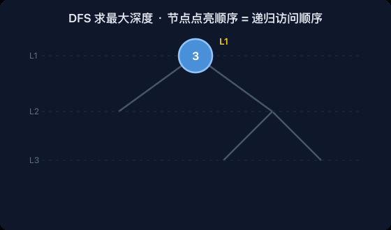

# 001 · 二叉树的最大深度（树专题 · 入门第一课）

> **难度**：⭐ Easy ｜ **LeetCode 104** ｜ **学习阶段**：第 6 阶段 · 二叉树（第 1 篇）
> **一句话**：一棵树到底有多「深」？这是所有树问题的地基题，5 分钟学会，面试必考。

---

## 1. 题目描述

给定一个二叉树的根节点 `root`，返回它的**最大深度**。

二叉树的**最大深度**是指从根节点到**最远叶子节点**的最长路径上的**节点数**。

```
示例：                3            ← 第 1 层
                    /   \
                   9     20       ← 第 2 层
                        /  \
                       15   7     ← 第 3 层
输入：root = [3,9,20,null,null,15,7]
输出：3
```

---

## 2. 先建立直觉：深度是怎么「数」出来的？

想象你站在树根往下走：

1. 站在根节点，当前是第 **1** 层；
2. 往左孩子走一步，第 **2** 层；再往下走一步，第 **3** 层……
3. **走到叶子（没有孩子的节点）时**，这条路就走完了；
4. 把**所有能走的路都试一遍**，记住最深走到过第几层，答案就是它。

这个「把所有路都试一遍」的过程，就是 **DFS（深度优先搜索）**。
而「每一步只依赖左右子树谁更深」的视角，就是**分治（Divide & Conquer）**。

本题的两种经典解法，正对应这两种视角 👇

---

## 3. 动态算法图（自动播放）

**节点点亮顺序 = DFS 递归访问顺序**，L 标记 = 该节点所在层：
叶子节点处刷新「历史最深记录」，全部走完后 `dep` 即答案。



（GIF 自动循环播放；访问 3→9→20→15→7，叶子 15/7 处刷新最大深度为 3。发布到 CSDN 时直接上传该 GIF 即可。）

---

## 4. 解法一（推荐先学）：DFS + 外部记录变量

**思路**：像第 2 节的直觉一样：一路往下走，每到一个节点带上「当前层号 `l`」；遇到叶子就用它刷新「历史最深 `dep`」。

### 主语言 TypeScript 详解

```ts
function maxDepth(root: TreeNode | null): number {
    let dep = 0;                                    // ① 历史最深记录
    function dfs(n: TreeNode | null, l: number) {   // ② n=当前节点, l=当前层号
        if (!n) return;                             // ③ 走到空节点：此路不通，返回
        if (!n.left && !n.right) {                  // ④ 叶子：这条路走完了
            dep = Math.max(dep, l);                 //    刷新历史最深
        }
        dfs(n.left, l + 1);                         // ⑤ 往左走一层
        dfs(n.right, l + 1);                        // ⑥ 往右走一层
    }
    dfs(root, 1);                                   // 从根（第 1 层）出发
    return dep;
}
```

**逐行拆解（新手必读）**：

| 标记 | 代码 | 在做什么 |
|---|---|---|
| ① | `let dep = 0` | 闭包外的「记分板」，所有递归路径共同更新 |
| ② | `function dfs(n, l)` | `l` 是**层号**，随调用一层层 +1 传下去 |
| ③ | `if (!n) return` | **递归出口**：null 不算节点，直接返回 |
| ④⑤ | 叶子判断 + 刷新 | 只有叶子才是「一条完整路径的终点」 |
| ⑥⑦ | 两个递归调用 | **先左后右**走遍所有路径 |

### 关键 API 速查（TypeScript / JS）

| API | 用法 | 备注 |
|---|---|---|
| `Math.max(a, b)` | 取两数较大值 | 刷新最大深度标准写法 |
| 闭包函数 | 内层函数引用外层 `dep` | JS/TS 特色，等价于其他语言的「成员变量/引用传参」 |
| `n.left` / `n.right` | 访问孩子 | 树节点结构 `val + left + right` |

> 其他语言中 ① 的对应物：Python 用 `nonlocal dep`；Go 用闭包捕获；Java 用 `int[] dep = {0}`（数组绕过值语义）；Rust 用 `&mut i32`。

---

## 5. 解法二（面试最优雅）：分治递归

**思路**：换一个视角：**「我的深度 = 1 + 左右子树深度的较大者」**。整棵树的问题拆成两棵子树的同样问题，天然递归。

```ts
function maxDepth(root: TreeNode | null): number {
    if (!root) return 0;                            // 空树深度为 0（递归出口）
    return 1 + Math.max(                            // 我自己占 1 层 +
        maxDepth(root.left),                        //   左子树的最大深度
        maxDepth(root.right)                        //   右子树的最大深度
    );                                              //   取较深者
}
```

**为什么它更惊艳？** 3 行代码，无外部状态、无副作用，是「分治」思想的完美标本。
面试时先说解法二展示简洁，再主动提解法一展示「带层号的 DFS」可扩展性（比如求「每层最右节点」就非它不可）。

### 两种解法对比

| | 解法一：DFS+外部变量 | 解法二：分治 |
|---|---|---|
| 时间复杂度 | O(n) | O(n) |
| 空间复杂度 | O(h) 递归栈 | O(h) 递归栈 |
| 代码量 | 10 行 | 3 行 |
| 可扩展性 | 强（层号在手里） | 中（只答深度） |
| 面试叙事 | 「通用遍历框架」 | 「分治优雅解」 |

---

## 6. 关键思想总结（可迁移）

1. **树的遍历 = 递归**：出口（null）+ 自身逻辑 + 递归左右孩子，三段式。
2. **分治三步**：分解（左右子树）→ 解决（递归求深度）→ 合并（`1 + max`）。
3. **带参数的 DFS**：把「层号/路径/状态」作为参数传下去，是树题万能起手式（最大深度、路径总和、对称判断全是它）。
4. **复杂度口径**：n=节点数，h=树高；平衡树 h=log n，链状树 h=n（递归栈此时最大）。

---

## 7. 附录：11 种语言完整实现

> 每种语言仓库内共 **9 个解法文件**（两种思路 × 多种写法），此处收录代表作，全部文件见 `dsa/{语言}/tree/lc_104_二叉树的最大深度/`。
> 所有文件均可独立运行并输出 `PASS`（内嵌 LeetCode 官方用例自测）。

### TypeScript（主教学语言）
见第 4、5 节 · 仓库 9 解：`solution_1` DFS+外部变量 ～ `solution_9` 分治变体

### Python
```python
def maxDepth(root):
    if not root: return 0
    return 1 + max(maxDepth(root.left), maxDepth(root.right))
```

### Go
```go
func maxDepth(root *TreeNode) int {
    if root == nil { return 0 }
    l, r := maxDepth(root.Left), maxDepth(root.Right)
    if l > r { return l + 1 }
    return r + 1
}
```

### Java
```java
static int maxDepth(TreeNode root) {
    if (root == null) return 0;
    return 1 + Math.max(maxDepth(root.left), maxDepth(root.right));
}
```

### Rust
```rust
fn max_depth(root: Option<Rc<RefCell<TreeNode>>>) -> i32 {
    match root {
        None => 0,
        Some(node) => {
            let n = node.borrow();
            1 + max_depth(n.left.clone()).max(max_depth(n.right.clone()))
        }
    }
}
```

### Lua
```lua
local function max_depth(root)
    if not root then return 0 end
    return 1 + math.max(max_depth(root.left), max_depth(root.right))
end
```

### C
```c
int max_depth(struct TreeNode *root) {
    if (!root) return 0;
    int l = max_depth(root->left), r = max_depth(root->right);
    return 1 + (l > r ? l : r);
}
```

### C++
```cpp
int maxDepth(TreeNode* root) {
    if (!root) return 0;
    return 1 + std::max(maxDepth(root->left), maxDepth(root->right));
}
```

### R
```r
max_depth <- function(root) {
  if (is.null(root)) return(0L)
  1L + max(max_depth(root$left), max_depth(root$right))
}
```

### Zig
```zig
fn maxDepth(root: ?*TreeNode) i32 {
    const node = root orelse return 0;
    const l = maxDepth(node.left);
    const r = maxDepth(node.right);
    return 1 + @max(l, r);
}
```

### Dart
```dart
int maxDepth(TreeNode? root) {
  if (root == null) return 0;
  return 1 + (maxDepth(root.left) > maxDepth(root.right)
      ? maxDepth(root.left) : maxDepth(root.right));
}
```

---

## 8. 面试惊艳点（面试官加分项）

1. **主动报复杂度**：时间 O(n)，每个节点访问一次；空间 O(h) 递归栈，最坏链状退化为 O(n)。
2. **主动扩展**：把 `Math.max` 换成记录每层节点数，这题秒变 102 层序遍历；把「深度」换成「路径和」，就是 112 路径总和，同一个 DFS 骨架。
3. **追问防守**：面试官问「不用递归呢？」→ 用队列 BFS，每清空一层计数 +1（仓库树专题内有该变体）。
4. **一句话记忆**：**「分治版：我 = 1 + max(左, 右)」**。

---

*来源博客：[CSDN · 数据结构与算法之二叉树： LeetCode 104. 二叉树的最大深度](https://blog.csdn.net/tyro_java/article/details/130815631)*
*下一篇：002 · 相同的树（同款 DFS 骨架，双树并行遍历）*
