# 001 · 最小栈（第一阶段 · 线性结构入门 · Easy）

> **难度**：⭐ Easy ｜ **专题**：栈
> **学习定位**：第一阶段 · 线性结构入门第 1 篇 ｜ **解法数**：2
> **内容总结**：**最小栈**（栈 · Easy）：共 2 个方案，主线思路「栈辅助」；时间 O(n)（单趟线性扫描）；动画演示栈后进先出过程，附录给出 11 种语言 × 全部方案的可运行实现。

---

## 题目描述

设计一个支持 `push` ，`pop` ，`top` 操作，并能在常数时间内检索到最小元素的栈。

实现 `MinStack` 类：`MinStack()` 初始化堆栈对象。
 `void push(int value)` 将元素 `value` 推入堆栈。
 `void pop()` 删除堆栈顶部的元素。
 `int top()` 获取堆栈顶部的元素。
 `int getMin()` 获取堆栈中的最小元素。

**用例（来自原题）**：

**示例 1**

```text
输入：
["MinStack","push","push","push","getMin","pop","top","getMin"]
[[],[-2],[0],[-3],[],[],[],[]]

输出：
[null,null,null,null,-3,null,0,-2]
```

解释：MinStack minStack = new MinStack(); minStack.push(-2); minStack.push(0); minStack.push(-3); minStack.getMin();   --> 返回 -3. minStack.pop(); minStack.top();      --> 返回 0. minStack.getMin();   --> 返回 -2.
> 题面与 [leetcode.cn 官方](https://leetcode.cn/problems/min-stack/)一致，示例配图取自官方题面。

**数据范围与注意事项**：

- `-2^31 <= val <= 2^31 - 1`
- `pop`、`top` 和 `getMin` 操作总是在 非空栈 上调用
- ``push`，`pop`，`top`, and `getMin`最多被调用 `3  10^4` 次`
- **易错点**：出栈前判空；「下一个更大元素」类问题栈里存下标比存值好用。

## 题目分析

**场景是什么**：后进先出结构天然适合「最近匹配」，对应真实开发里的括号校验、浏览历史、函数调用栈。本题就是该场景的 Easy 级练习，主线做法是「栈辅助」。

**主线怎么解**：把主解法从头到尾过一遍，它其实在依次做这几件事：单循环线性扫描 → 栈的后进先出操作。

## 解题思路

**方案对比**（共 2 个方案，由浅入深）：

| 方案 | 时间复杂度 | 空间复杂度 |
|---|---|---|
| 方案 1 · 栈辅助 | O(n)（单趟线性扫描） | O(1) 到 O(n)（视辅助结构） |
| 方案 2 · 直接实现 | O(n) 量级 | O(n) |

**由浅入深的路径**：栈辅助 → 直接实现；每往右一步，都在补上一步的短板。

**方案间的取舍**：方案 1（栈辅助）；方案 2（直接实现）。数据规模小、可读性优先时选靠前的方案；规模大、性能优先时选靠后的方案。

**怎么读这一篇**：

- 🐣 **新手路线**：把「题目描述」的示例 1 在纸上手推一遍 → 读方案 1（最直观的写法）与它的代码走读 → 按「运行方式」本地跑通看 PASS → 回头对比方案 2 之后的写法差在哪
- 🦅 **大佬路线**：直接锁定最优方案 1（栈辅助，O(n)（单趟线性扫描））→ 跳读该方案代码与走读 → 用「逐步拆解与面试追问」补齐复杂度推导与边界追问

### 动态算法图（栈后进先出，GIF 自动循环）


动画演示栈专题里栈后进先出的典型过程；每个方案在「TypeScript 解题方案」一节还配了专属动画与专属流程图。

### 主解法流程图（真实控制流）

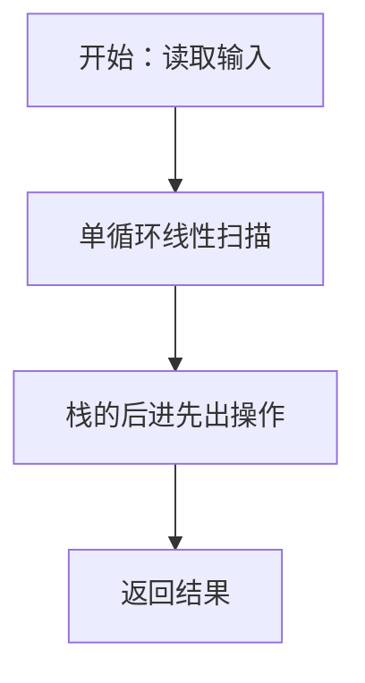

## TypeScript 解题方案（2 个方案逐个讲）

> **运行与提交**：每个方案都是自包含文件（内嵌用例自测，输出 PASS），整块复制到 `.ts` 文件后 `node 文件名` 即可运行。提交 LeetCode 时，把 `demo` 内的算法函数与辅助类型/函数整体取出、置于文件顶层即可。涉及交互/特殊接口的题以题面给定签名为准。

### 方案 1：栈辅助

**分析与思路**：核心做法是「栈辅助」。代码里依次做这些事：单循环线性扫描；栈的后进先出操作。

**运行方式**：`node 本文件`，内嵌用例全部通过会输出 PASS。


**方案专属流程图**（真实控制流）：


```typescript
// Faithful translation of python reference. Self-check via demo().
export function demo(): void {
  // 程序入口：跑内嵌自测用例
  class MinStack {
    // 定义类型
    xStack: number[] = []; // 把 []; 写入 xStack: number[]
    minStack: number[] = [Infinity]; // 把 [Infinity]; 写入 minStack: number[]
    push(val: number): void {
      // push(值: number): void {
      this.xStack.push(val); // 把 值 压入栈/数组尾部
      this.minStack.push(
        Math.min(this.minStack[this.minStack.length - 1], val),
      ); // 把 Math.取较小值 this.minStack[this.minStack.长度 减 1], 值 压入栈/数组尾部
    }
    pop(): void {
      this.xStack.pop();
      this.minStack.pop();
    } // 弹出栈顶元素
    top(): number {
      return this.xStack[this.xStack.length - 1];
    } // top(): number { return this.xStack[this.xStack.长度 减 1]; }
    getMin(): number {
      return this.minStack[this.minStack.length - 1];
    }
  }
  const minStack = new MinStack(); // 把 new MinStack() 存入 minStack
  minStack.push(-2);
  minStack.push(0);
  minStack.push(-3); // 把 减 2 压入栈/数组尾部
  const got = [
    minStack.getMin(),
    (minStack.pop(), minStack.top()),
    minStack.getMin(),
  ];
  const want = [-3, 0, -2]; // 把 [ 减 3, 0, 减 2] 存入 want
  for (let i = 0; i < got.length; i++) {
    // 让 下标 i 从 0 开始计数，下标 i 小于 got.长度 就继续
    if (got[i] !== want[i])
      throw new Error('FAIL idx ' + i + ' got ' + got[i] + ' want ' + want[i]);
  }
  console.log('PASS'); // 全部用例通过，输出 PASS
}
demo(); // demo();
```

### 方案 2：直接实现

**分析与思路**：核心做法是「直接实现」。

**运行方式**：`node 本文件`，内嵌用例全部通过会输出 PASS。

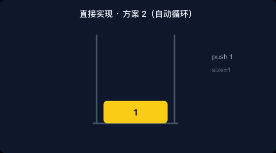

**方案专属流程图**（真实控制流）：

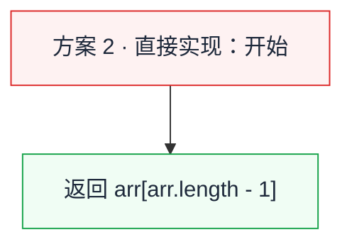

```typescript
// Faithful translation of python reference. Self-check via demo().
function last(arr: number[]): number {
  return arr[arr.length - 1];
} // 定义函数/方法 last
export function demo(): void {
  // 程序入口：跑内嵌自测用例
  class MinStack {
    // 定义类型
    stack: number[] = []; // 把 []; 写入 stack: number[]
    mins: number[] = []; // 把 []; 写入 mins: number[]
    push(val: number): void {
      // push(值: number): void {
      this.stack.push(val); // 把 值 压入栈/数组尾部
      this.mins.push(this.mins.length ? Math.min(last(this.mins), val) : val); // 把 this.mins.长度 ? Math.取较小值 last(this.mins 压入栈/数组尾部
    }
    pop(): void {
      this.stack.pop();
      this.mins.pop();
    } // 弹出栈顶元素
    top(): number {
      return this.stack[this.stack.length - 1];
    } // top(): number { return this.栈[this.栈.长度 减 1]; }
    getMin(): number {
      return last(this.mins);
    } // getMin(): number { return last(this.mins); }
  }
  const minStack = new MinStack(); // 把 new MinStack() 存入 minStack
  minStack.push(-2);
  minStack.push(0);
  minStack.push(-3); // 把 减 2 压入栈/数组尾部
  const got = [
    minStack.getMin(),
    (minStack.pop(), minStack.top()),
    minStack.getMin(),
  ];
  const want = [-3, 0, -2]; // 把 [ 减 3, 0, 减 2] 存入 want
  for (let i = 0; i < got.length; i++) {
    // 让 下标 i 从 0 开始计数，下标 i 小于 got.长度 就继续
    if (got[i] !== want[i])
      throw new Error('FAIL idx ' + i + ' got ' + got[i] + ' want ' + want[i]);
  }
  console.log('PASS'); // 全部用例通过，输出 PASS
}
demo(); // demo();
```

## 逐步拆解与面试追问

**复杂度**：时间 O(n)（单趟线性扫描），空间 O(1) 到 O(n)（视辅助结构）

**为什么是这个量级**：每个元素被常数次访问，辅助哈希或栈的开销与 n 同阶

**面试官可能会追问**：

- 什么时候用单调栈（求下一个更大或更小）？
- 栈里存值还是存下标？
- 能否用 O(1) 额外空间？

## 关键 API 速查（TS 主解法实际用到，附官方链接）

| API | 作用 | 使用要点 | 官方文档 |
|---|---|---|---|
| `Array.prototype.push()` | 尾部追加 | 返回新长度；可一次多个；均摊 O(1)；会改变原数组 | [官方文档](https://developer.mozilla.org/zh-CN/docs/Web/JavaScript/Reference/Global_Objects/Array/push) |
| `Array.prototype.pop()` | 尾部弹出 | 返回被删元素（空数组返回 undefined）；O(1) | [官方文档](https://developer.mozilla.org/zh-CN/docs/Web/JavaScript/Reference/Global_Objects/Array/pop) |
| `Math.min()` | 最小值 | 同 max；空参返回 Infinity | [官方文档](https://developer.mozilla.org/zh-CN/docs/Web/JavaScript/Reference/Global_Objects/Math/min) |

### 各语言官方文档导航

- **TypeScript / JS**：[MDN 中文参考](https://developer.mozilla.org/zh-CN/)
- **Python**：[Python 官方文档](https://docs.python.org/zh-cn/3/)
- **Go**：[Go 标准库](https://pkg.go.dev/std)
- **Java**：[JDK 17 API](https://docs.oracle.com/en/java/javase/17/docs/api/)
- **Rust**：[Rust 标准库](https://doc.rust-lang.org/std/)
- **Lua**：[Lua 5.4 手册](https://www.lua.org/manual/5.4/)
- **C**：[Cppreference C](https://zh.cppreference.com/w/c)
- **C++**：[Cppreference C++](https://zh.cppreference.com/w/cpp)
- **R**：[R 官方手册](https://stat.ethz.ch/R-manual/)
- **Zig**：[Zig 语言文档](https://ziglang.org/documentation/master/)
- **Dart**：[Dart API](https://api.dart.dev/)

## 附录：其他 10 种语言全部实现（每种语言列举其全部方案）

> TypeScript 的全部方案见「TypeScript 解题方案」一节；下面是其余 10 种语言的对应实现，每种语言的每个方案都带思路分析、代码走读与专属运行架构图。
> 每个方案都内嵌用例自测，可独立运行（老仓库 python/go 文件遵循「打印结果」约定）。
> 完整解法文件见 `dsa/<语言>/stack/lc_155_最小栈/`。

### Python 实现（2 种方案）

Python 的全部方案如下，每个方案都内嵌用例自测，可独立运行（老仓库 python/go 文件遵循「打印结果」约定）：

#### 方案 1：栈辅助

**思路与代码分析**：核心是「栈辅助」。Python 版用切片与字典推导式简化操作，突出可读性。代码里依次做这些事：栈的后进先出操作。

**运行架构**（真实控制流）：

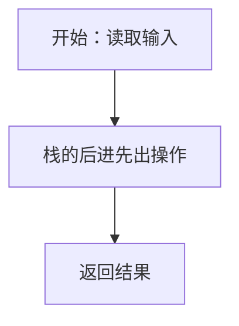

```python
class MinStack:  # 定义类
    def __init__(self):  # 构造函数：初始化成员
        self.x_stack = []  # 把 [] 写入 self.x_stack
        self.min_stack = [float("inf")]  # 把 [float('inf')] 写入 self.min_stack

    def push(self, val: int) -> None:  # 定义函数 push（参数：self, 值: int）
        self.x_stack.append(val)  # 把 值 追加到列表尾部
        self.min_stack.append(
            min(self.min_stack[-1], val)
        )  # 把 取较小值 self.min_stack[ 减 1], 值 追加到列表尾部

    def pop(self) -> None:  # 定义函数 pop（参数：self）
        self.x_stack.pop()  # 弹出栈顶元素
        self.min_stack.pop()  # 弹出栈顶元素

    def top(self) -> int:  # 定义函数 top（参数：self）
        return self.x_stack[-1]  # 返回 self.x_stack[ 减 1]

    def getMin(self) -> int:  # 定义函数 getMin（参数：self）
        return self.min_stack[-1]  # 返回 self.min_stack[ 减 1]

if __name__ == "__main__":  # 若 __name__ 等于 '__main__'
    minStack = MinStack()  # 把 MinStack() 存入 minStack
    minStack.push(-2)  # 把 减 2 压入栈/数组尾部
    minStack.push(0)  # 把 0 压入栈/数组尾部
    minStack.push(-3)  # 把 减 3 压入栈/数组尾部
    print(minStack.getMin())  # -3
    minStack.pop()  # 弹出栈顶元素
    print(minStack.top())  # 0
    print(minStack.getMin())  # -2
```

#### 方案 2：直接实现

**思路与代码分析**：核心是「直接实现」。Python 版用切片与字典推导式简化操作，突出可读性。**走读**：方案 2 · 直接实现：开始 → 返回 arr[-1]。

**运行架构**（真实控制流）：

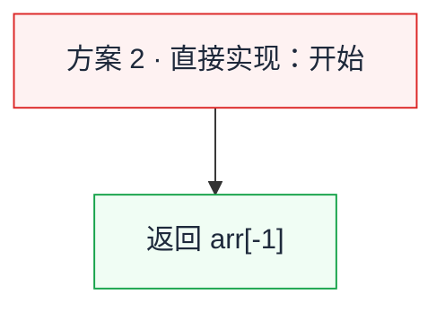

```python
class MinStack:  # 定义类
    def __init__(self):  # 构造函数：初始化成员
        self.stack = []  # 把 [] 写入 栈
        self.mins = []  # 把 [] 写入 self.mins

    def push(self, val: int) -> None:  # 定义函数 push（参数：self, 值: int）
        self.stack.append(val)  # 把 值 追加到列表尾部
        self.mins.append(
            min(last(self.mins), val) if self.mins else val
        )  # 把 取较小值 last(self.mins 追加到列表尾部

    def pop(self) -> None:  # 定义函数 pop（参数：self）
        self.stack.pop()  # 弹出栈顶元素
        self.mins.pop()  # 弹出栈顶元素

    def top(self) -> int:  # 定义函数 top（参数：self）
        return self.stack[-1]  # 返回 self.栈[ 减 1]

    def getMin(self) -> int:  # 定义函数 getMin（参数：self）
        return last(self.mins)  # 返回 last(self.mins)

def last(arr):  # 定义函数 last（参数：数组）
    return arr[-1]  # 返回 数组[ 减 1]

if __name__ == "__main__":  # 若 __name__ 等于 '__main__'
    minStack = MinStack()  # 把 MinStack() 存入 minStack
    minStack.push(-2)  # 把 减 2 压入栈/数组尾部
    minStack.push(0)  # 把 0 压入栈/数组尾部
    minStack.push(-3)  # 把 减 3 压入栈/数组尾部
    print(minStack.getMin())  # -3
    minStack.pop()  # 弹出栈顶元素
    print(minStack.top())  # 0
    print(minStack.getMin())  # -2
```

### Go 实现（2 种方案）

Go 的全部方案如下，每个方案都内嵌用例自测，可独立运行（老仓库 python/go 文件遵循「打印结果」约定）：

#### 方案 1：栈辅助

**思路与代码分析**：核心是「栈辅助」。Go 版用切片与多返回值惯用法，显式处理索引边界。**走读**：方案 1 · 栈辅助：开始 → 返回 &MinStack。

**运行架构**（真实控制流）：

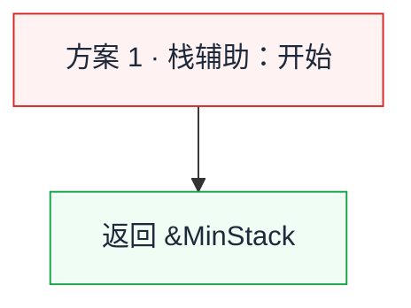

```go
package main // 引入依赖

import (
	"fmt"  // 「fmt」
	"math" // 「math」
	"os"   // 「os」
)

type MinStack struct { // 定义类型
	xStack   []int // xStack []int
	minStack []int // minStack []int
}

func NewMinStack() *MinStack { // 定义函数/方法 NewMinStack
	return &MinStack{[]int{}, []int{math.MaxInt}} // 返回 按位与 MinStack{[]int{}, []int{math.MaxInt}}
}

func (s *MinStack) push(val int) { // 定义函数/方法 push
	s.xStack = append(s.xStack, val)    // 把 append(字符串.xStack, 值) 写入 s.xStack
	mi := s.minStack[len(s.minStack)-1] // 把 字符串.minStack[长度(字符串.minStack) 减 1] 写入 mi :
	if val < mi {                       // 若 值 小于 mi
		mi = val // 把 值 写入 mi
	}
	s.minStack = append(s.minStack, mi) // 把 append(字符串.minStack, mi) 写入 s.minStack
}

func (s *MinStack) pop() { // 定义函数/方法 pop
	s.xStack = s.xStack[:len(s.xStack)-1]       // 把 字符串.xStack[:长度(字符串.xStack) 减 1] 写入 s.xStack
	s.minStack = s.minStack[:len(s.minStack)-1] // 把 字符串.minStack[:长度(字符串.minStack) 减 1] 写入 s.minStack
}

func (s *MinStack) top() int { // 定义函数/方法 top
	return s.xStack[len(s.xStack)-1] // 返回 字符串.xStack[长度(字符串.xStack) 减 1]
}

func (s *MinStack) getMin() int { // 定义函数/方法 getMin
	return s.minStack[len(s.minStack)-1] // 返回 字符串.minStack[长度(字符串.minStack) 减 1]
}

func main() { // 程序入口：跑内嵌自测用例
	ok := true                     // 把 true 写入 ok :
	ms := NewMinStack()            // 把 NewMinStack() 写入 ms :
	ms.push(-2)                    // 把 减 2 压入栈/数组尾部
	ms.push(0)                     // 把 0 压入栈/数组尾部
	ms.push(-3)                    // 把 减 3 压入栈/数组尾部
	if v := ms.getMin(); v != -3 { // 若 值 : 赋值为 ms.getMin(); 值 不等于 减 3
		ok = false                                // 把 false 写入 ok
		fmt.Printf("FAIL getMin=%v want -3\n", v) // 打印输出
	}
	ms.pop()                   // 弹出栈顶元素
	if v := ms.top(); v != 0 { // 若 值 : 赋值为 ms.top(); 值 不等于 0
		ok = false                            // 把 false 写入 ok
		fmt.Printf("FAIL top=%v want 0\n", v) // 打印输出
	}
	if v := ms.getMin(); v != -2 { // 若 值 : 赋值为 ms.getMin(); 值 不等于 减 2
		ok = false                                 // 把 false 写入 ok
		fmt.Printf("FAIL getMin2=%v want -2\n", v) // 打印输出
	}
	if !ok { // 若 取反 ok
		os.Exit(1) // os.Exit(1)
	}
	fmt.Println("PASS") // 全部用例通过，输出 PASS
}
```

#### 方案 2：直接实现

**思路与代码分析**：核心是「直接实现」。Go 版用切片与多返回值惯用法，显式处理索引边界。**走读**：方案 2 · 直接实现：开始 → 返回 &MinStack。

**运行架构**（真实控制流）：

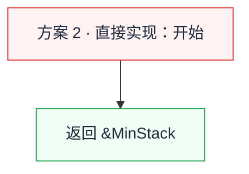

```go
package main // 引入依赖

import (
	"fmt" // 「fmt」
	"os"  // 「os」
)

type MinStack struct { // 定义类型
	stack []int // 栈 []int
	mins  []int // mins []int
}

func NewMinStack() *MinStack { // 定义函数/方法 NewMinStack
	return &MinStack{[]int{}, []int{}} // 返回 按位与 MinStack{[]int{}, []int{}}
}

func (s *MinStack) push(val int) { // 定义函数/方法 push
	s.stack = append(s.stack, val) // 把 append(字符串.栈, 值) 写入 栈
	var m int                      // var 映射表 int
	if len(s.mins) > 0 {           // 若 长度(字符串.mins) 超过 0
		if s.mins[len(s.mins)-1] < val { // 若 字符串.mins[长度(字符串.mins) 减 1] 小于 值
			m = s.mins[len(s.mins)-1] // 把 字符串.mins[长度(字符串.mins) 减 1] 写入 映射表
		} else { // 否则
			m = val // 把 值 写入 映射表
		}
	} else { // 否则
		m = val // 把 值 写入 映射表
	}
	s.mins = append(s.mins, m) // 把 append(字符串.mins, 映射表) 写入 s.mins
}

func (s *MinStack) pop() { // 定义函数/方法 pop
	s.stack = s.stack[:len(s.stack)-1] // 把 字符串.栈[:长度(字符串.栈) 减 1] 写入 栈
	s.mins = s.mins[:len(s.mins)-1]    // 把 字符串.mins[:长度(字符串.mins) 减 1] 写入 s.mins
}

func (s *MinStack) top() int { // 定义函数/方法 top
	return s.stack[len(s.stack)-1] // 返回 字符串.栈[长度(字符串.栈) 减 1]
}

func (s *MinStack) getMin() int { // 定义函数/方法 getMin
	return s.mins[len(s.mins)-1] // 返回 字符串.mins[长度(字符串.mins) 减 1]
}

func main() { // 程序入口：跑内嵌自测用例
	ok := true                     // 把 true 写入 ok :
	ms := NewMinStack()            // 把 NewMinStack() 写入 ms :
	ms.push(-2)                    // 把 减 2 压入栈/数组尾部
	ms.push(0)                     // 把 0 压入栈/数组尾部
	ms.push(-3)                    // 把 减 3 压入栈/数组尾部
	if v := ms.getMin(); v != -3 { // 若 值 : 赋值为 ms.getMin(); 值 不等于 减 3
		ok = false                                // 把 false 写入 ok
		fmt.Printf("FAIL getMin=%v want -3\n", v) // 打印输出
	}
	ms.pop()                   // 弹出栈顶元素
	if v := ms.top(); v != 0 { // 若 值 : 赋值为 ms.top(); 值 不等于 0
		ok = false                            // 把 false 写入 ok
		fmt.Printf("FAIL top=%v want 0\n", v) // 打印输出
	}
	if v := ms.getMin(); v != -2 { // 若 值 : 赋值为 ms.getMin(); 值 不等于 减 2
		ok = false                                 // 把 false 写入 ok
		fmt.Printf("FAIL getMin2=%v want -2\n", v) // 打印输出
	}
	if !ok { // 若 取反 ok
		os.Exit(1) // os.Exit(1)
	}
	fmt.Println("PASS") // 全部用例通过，输出 PASS
}
```

### Java 实现（2 种方案）

Java 的全部方案如下，每个方案都内嵌用例自测，可独立运行（老仓库 python/go 文件遵循「打印结果」约定）：

#### 方案 1：栈辅助

**思路与代码分析**：核心是「栈辅助」。Java 版用类与静态方法组织，集合操作显式明了。**走读**：方案 1 · 栈辅助：开始 → 向 minStack 追加记录 → 返回结果。

**运行架构**（真实控制流）：

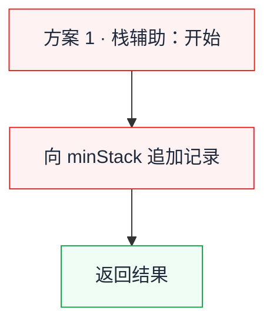

```java
package com.webfault.dsa; // 引入依赖

import java.util.*; // 引入依赖

class lc155_solution111 { // 定义类型
  static class MinStack { // static class MinStack {
    Deque<Integer> xStack =
        new ArrayDeque<>(); // 把 new ArrayDeque 小于 超过 (); 写入 Deque<Integer> xStack
    Deque<Integer> minStack =
        new ArrayDeque<>(); // 把 new ArrayDeque 小于 超过 (); 写入 Deque<Integer> minStack

    MinStack() {
      minStack.push(Integer.MAX_VALUE);
    } // 把 Integer.MAX_VALUE 压入栈/数组尾部

    void push(int val) {
      xStack.push(val);
      minStack.push(Math.min(minStack.peek(), val));
    } // 把 值 压入栈/数组尾部

    void pop() {
      xStack.pop();
      minStack.pop();
    } // 弹出栈顶元素

    int top() {
      return xStack.peek();
    } // int top() { return xStack.peek(); }

    int getMin() {
      return minStack.peek();
    } // int getMin() { return minStack.peek(); }
  }

  public static void main(String[] args) { // public static void main(String[] args) {
    MinStack m = new MinStack(); // 把 new MinStack(); 写入 MinStack m
    m.push(-2);
    m.push(0);
    m.push(-3); // 把 减 2 压入栈/数组尾部
    List<Integer> out = new ArrayList<>(); // 把 new ArrayList 小于 超过 (); 写入 List<Integer> out
    out.add(m.getMin()); // out 追加 映射表.getMin());
    m.pop(); // 弹出栈顶元素
    out.add(m.top()); // out 追加 映射表.top());
    out.add(m.getMin()); // out 追加 映射表.getMin());
    List<Integer> want =
        Arrays.asList(-3, 0, -2); // 把 Arrays.asList( 减 3, 0, 减 2); 写入 List<Integer> want
    if (!out.equals(want)) throw new RuntimeException("FAILED " + out);
    System.out.println("PASS"); // 全部用例通过，输出 PASS
  }
}
```

#### 方案 2：直接实现

**思路与代码分析**：核心是「直接实现」。Java 版用类与静态方法组织，集合操作显式明了。**走读**：方案 2 · 直接实现：开始 → 向 stack 追加记录 → 向 mins 追加记录 → 返回结果。

**运行架构**（真实控制流）：

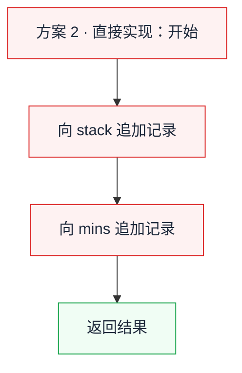

```java
package com.webfault.dsa; // 引入依赖

import java.util.*; // 引入依赖

class lc155_solution222 { // 定义类型
  static class MinStack { // static class MinStack {
    Deque<Integer> stack = new ArrayDeque<>(); // 把 new ArrayDeque 小于 超过 (); 写入 Deque<Integer> stack
    Deque<Integer> mins = new ArrayDeque<>(); // 把 new ArrayDeque 小于 超过 (); 写入 Deque<Integer> mins

    void push(int val) {
      stack.push(val);
      mins.push(mins.isEmpty() ? val : Math.min(mins.peek(), val));
    } // 把 值 压入栈/数组尾部

    void pop() {
      stack.pop();
      mins.pop();
    } // 弹出栈顶元素

    int top() {
      return stack.peek();
    } // int top() { return 栈.peek(); }

    int getMin() {
      return mins.peek();
    } // int getMin() { return mins.peek(); }
  }

  public static void main(String[] args) { // public static void main(String[] args) {
    MinStack m = new MinStack(); // 把 new MinStack(); 写入 MinStack m
    m.push(-2);
    m.push(0);
    m.push(-3); // 把 减 2 压入栈/数组尾部
    List<Integer> out = new ArrayList<>(); // 把 new ArrayList 小于 超过 (); 写入 List<Integer> out
    out.add(m.getMin()); // out 追加 映射表.getMin());
    m.pop(); // 弹出栈顶元素
    out.add(m.top()); // out 追加 映射表.top());
    out.add(m.getMin()); // out 追加 映射表.getMin());
    List<Integer> want =
        Arrays.asList(-3, 0, -2); // 把 Arrays.asList( 减 3, 0, 减 2); 写入 List<Integer> want
    if (!out.equals(want)) throw new RuntimeException("FAILED " + out);
    System.out.println("PASS"); // 全部用例通过，输出 PASS
  }
}
```

### Rust 实现（2 种方案）

Rust 的全部方案如下，每个方案都内嵌用例自测，可独立运行（老仓库 python/go 文件遵循「打印结果」约定）：

#### 方案 1：栈辅助

**思路与代码分析**：核心是「栈辅助」。Rust 版用所有权移动与切片借用改写同一逻辑，注意 Option 与引用边界。代码里依次做这些事：栈的后进先出操作。**走读**：方案 1 · 栈辅助：开始 → 计算 vals → 遍历 ops 中的每个元素 op → 返回结果。

**运行架构**（真实控制流）：

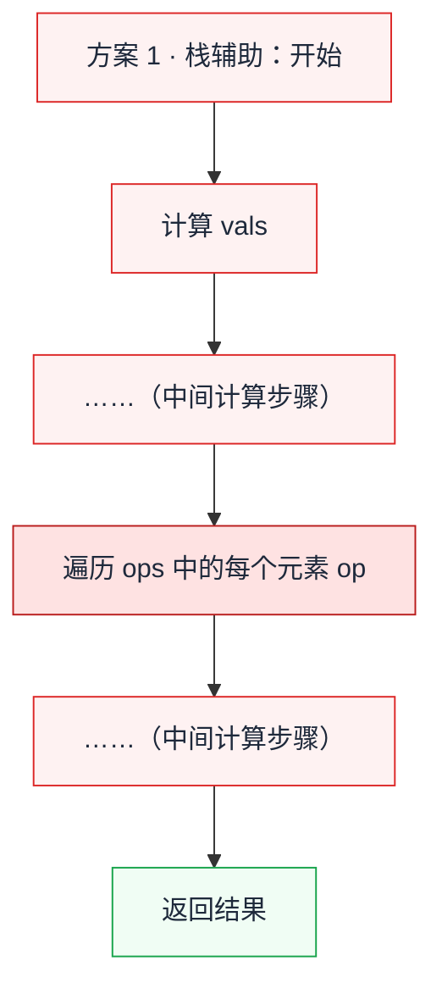

```rust
// LeetCode 155. 最小栈 — Rust 版（方案1）
#[derive(Clone)]
enum Op {
    Push(i32),
    Pop,
    Top,
    GetMin,
} // 定义类型
fn min_stack_run(ops: Vec<Op>) -> Vec<i32> {
    // 定义函数/方法 min_stack_run
    let mut vals: Vec<i32> = Vec::new(); // 把 Vec::new(); 写入 let mut vals: Vec<i32>
    let mut mins: Vec<i32> = Vec::new(); // 把 Vec::new(); 写入 let mut mins: Vec<i32>
    let mut out = Vec::new(); // 把 Vec::new(); 写入 let mut out
    for op in ops {
        // 逐个取出 ops 的元素（op）
        match op {
            // 按情况匹配处理
            Op::Push(v) => {
                vals.push(v); // 把 值 压入栈/数组尾部
                mins.push(if mins.is_empty() {
                    v
                } else {
                    (*mins.last().unwrap()).min(v)
                }); // 把 if mins.is_empty( 压入栈/数组尾部
            }
            Op::Pop => {
                vals.pop();
                mins.pop();
            }
            Op::Top => out.push(*vals.last().unwrap_or(&-1)),
            Op::GetMin => out.push(*mins.last().unwrap_or(&-1)),
        }
    }
    out // out
}
fn main() {
    // 程序入口：跑内嵌自测用例
    let ops = vec![
        Op::Push(-2),
        Op::Push(0),
        Op::Push(-3),
        Op::GetMin,
        Op::Pop,
        Op::Top,
        Op::GetMin,
    ];
    assert_eq!(min_stack_run(ops), vec![-3, 0, -2]); // 断言校验
    println!("PASS");
} // 全部用例通过，输出 PASS
```

#### 方案 2：直接实现

**思路与代码分析**：核心是「直接实现」。Rust 版用所有权移动与切片借用改写同一逻辑，注意 Option 与引用边界。代码里依次做这些事：栈的后进先出操作。**走读**：方案 2 · 直接实现：开始 → 计算 vals → 遍历 ops 中的每个元素 op → 返回结果。

**运行架构**（真实控制流）：

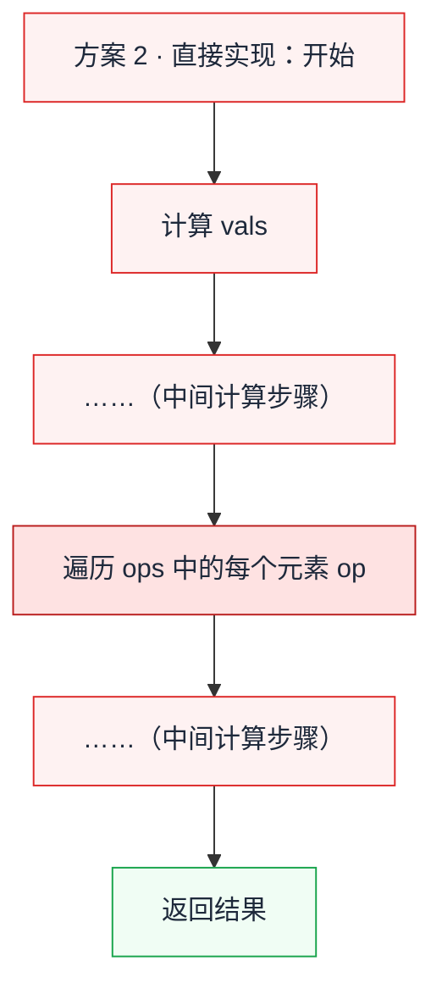

```rust
// LeetCode 155. 最小栈 — Rust 版（方案2）
#[derive(Clone)]
enum Op {
    Push(i32),
    Pop,
    Top,
    GetMin,
} // 定义类型
fn min_stack_run(ops: Vec<Op>) -> Vec<i32> {
    // 定义函数/方法 min_stack_run
    let mut vals: Vec<i32> = Vec::new(); // 把 Vec::new(); 写入 let mut vals: Vec<i32>
    let mut mins: Vec<i32> = Vec::new(); // 把 Vec::new(); 写入 let mut mins: Vec<i32>
    let mut out = Vec::new(); // 把 Vec::new(); 写入 let mut out
    for op in ops {
        // 逐个取出 ops 的元素（op）
        match op {
            // 按情况匹配处理
            Op::Push(v) => {
                vals.push(v); // 把 值 压入栈/数组尾部
                mins.push(if mins.is_empty() {
                    v
                } else {
                    (*mins.last().unwrap()).min(v)
                }); // 把 if mins.is_empty( 压入栈/数组尾部
            }
            Op::Pop => {
                vals.pop();
                mins.pop();
            }
            Op::Top => out.push(*vals.last().unwrap_or(&-1)),
            Op::GetMin => out.push(*mins.last().unwrap_or(&-1)),
        }
    }
    out // out
}
fn main() {
    // 程序入口：跑内嵌自测用例
    let ops = vec![
        Op::Push(-2),
        Op::Push(0),
        Op::Push(-3),
        Op::GetMin,
        Op::Pop,
        Op::Top,
        Op::GetMin,
    ];
    assert_eq!(min_stack_run(ops), vec![-3, 0, -2]); // 断言校验
    println!("PASS");
} // 全部用例通过，输出 PASS
```

### Lua 实现（2 种方案）

Lua 的全部方案如下，每个方案都内嵌用例自测，可独立运行（老仓库 python/go 文件遵循「打印结果」约定）：

#### 方案 1：栈辅助

**思路与代码分析**：核心是「栈辅助」。Lua 版用表与 ipairs 遍历，注意 ipairs 遇 nil 即停的语义。

**运行架构**（真实控制流）：

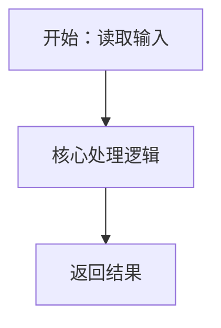

```lua
-- LeetCode 155. 最小栈 — Lua 版（方案1）
local MinStack = {} -- 把 {} 写入 local MinStack
MinStack.__index = MinStack -- 把 MinStack 写入 MinStack.__index
function MinStack.new()
	return setmetatable({ vals = {}, mins = {} }, MinStack)
end
function MinStack:push(v) -- function MinStack:push(值)
	self.vals[#self.vals + 1] = v -- 把 值 写入 self.vals[#self.vals + 1]
	local m = #self.mins > 0 and math.min(self.mins[#self.mins], v) or v
	self.mins[#self.mins + 1] = m -- 把 映射表 写入 self.mins[#self.mins + 1]
end -- 终点
function MinStack:pop()
	self.vals[#self.vals] = nil
	self.mins[#self.mins] = nil
end
function MinStack:top()
	return self.vals[#self.vals]
end -- function MinStack:top() return self.vals[#self.vals] 终点
function MinStack:getMin()
	return self.mins[#self.mins]
end -- function MinStack:getMin() return self.mins[#self.mins] 终点
local ms = MinStack.new() -- 把 MinStack.new() 写入 local ms
ms:push(-2)
ms:push(0)
ms:push(-3) -- ms:push( 减 2); ms:push(0); ms:push( 减 3)
assert(ms:getMin() == -3) -- 断言校验
ms:pop() -- ms:pop()
assert(ms:top() == 0) -- 断言校验
assert(ms:getMin() == -2) -- 断言校验
print("PASS") -- 全部用例通过，输出 PASS
```

#### 方案 2：直接实现

**思路与代码分析**：核心是「直接实现」。Lua 版用表与 ipairs 遍历，注意 ipairs 遇 nil 即停的语义。

**运行架构**：与方案 1 的控制流相同（同算法在该语言的等价实现），图见上。

```lua
-- LeetCode 155. 最小栈 — Lua 版（方案2）
local MinStack = {} -- 把 {} 写入 local MinStack
MinStack.__index = MinStack -- 把 MinStack 写入 MinStack.__index
function MinStack.new()
	return setmetatable({ vals = {}, mins = {} }, MinStack)
end
function MinStack:push(v) -- function MinStack:push(值)
	self.vals[#self.vals + 1] = v -- 把 值 写入 self.vals[#self.vals + 1]
	local m = #self.mins > 0 and math.min(self.mins[#self.mins], v) or v
	self.mins[#self.mins + 1] = m -- 把 映射表 写入 self.mins[#self.mins + 1]
end -- 终点
function MinStack:pop()
	self.vals[#self.vals] = nil
	self.mins[#self.mins] = nil
end
function MinStack:top()
	return self.vals[#self.vals]
end -- function MinStack:top() return self.vals[#self.vals] 终点
function MinStack:getMin()
	return self.mins[#self.mins]
end -- function MinStack:getMin() return self.mins[#self.mins] 终点
local ms = MinStack.new() -- 把 MinStack.new() 写入 local ms
ms:push(-2)
ms:push(0)
ms:push(-3) -- ms:push( 减 2); ms:push(0); ms:push( 减 3)
assert(ms:getMin() == -3) -- 断言校验
ms:pop() -- ms:pop()
assert(ms:top() == 0) -- 断言校验
assert(ms:getMin() == -2) -- 断言校验
print("PASS") -- 全部用例通过，输出 PASS
```

### C 实现（2 种方案）

C 的全部方案如下，每个方案都内嵌用例自测，可独立运行（老仓库 python/go 文件遵循「打印结果」约定）：

#### 方案 1：栈辅助

**思路与代码分析**：核心是「栈辅助」。C 版手动管理下标与内存，循环边界全部显式写出。**走读**：方案 1 · 栈辅助：开始 → 更新 s->top → 返回结果。

**运行架构**（真实控制流）：

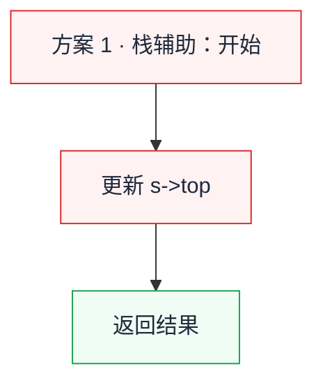

```c
/* LeetCode 155. 最小栈 — C 版（方案1） */
#include <stdio.h> // 引入头文件
typedef struct {
    int vals[4096];
    int mins[4096];
    int top;
} MinStack;
static void ms_init(MinStack *s) { s->top = 0; } // 把 0; } 写入 static void ms_init(MinStack *s) { s->top
static void ms_push(MinStack *s, int v) {        // 定义函数/方法 ms_push
    s->vals[s->top] = v;                         // 把 值; 写入 s->vals[s->top]
    s->mins[s->top] = s->top > 0 && s->mins[s->top - 1] < v ? s->mins[s->top - 1] : v;
    s->top++; // 字符串 减 超过 top 加一 ;
}
static void ms_pop(MinStack *s) {
    s->top--;
} // static void ms_pop(MinStack 乘 字符串) { 字符串 减 超过 top 减一 ; }
static int ms_top(MinStack *s) { return s->vals[s->top - 1]; }
static int ms_get_min(MinStack *s) { return s->mins[s->top - 1]; }
int main(void) { // 程序入口：跑内嵌自测用例
    MinStack s;  // MinStack 字符串;
    ms_init(&s); // ms_init( 按位与 字符串);
    ms_push(&s, -2);
    ms_push(&s, 0);
    ms_push(&s, -3);
    if (ms_get_min(&s) != -3) {
        printf("FAIL 1\n");
        return 1;
    }           // 若 ms_get_min( 按位与 字符串) 不等于 减 3) { 输出「FAIL 1 」); return 1; }
    ms_pop(&s); // ms_pop( 按位与 字符串);
    if (ms_top(&s) != 0) {
        printf("FAIL 2\n");
        return 1;
    } // 若 ms_top( 按位与 字符串) 不等于 0) { 输出「FAIL 2 」); return 1; }
    if (ms_get_min(&s) != -2) {
        printf("FAIL 3\n");
        return 1;
    } // 若 ms_get_min( 按位与 字符串) 不等于 减 2) { 输出「FAIL 3 」); return 1; }
    printf("PASS\n");
    return 0;
} // 全部用例通过，输出 PASS
```

#### 方案 2：直接实现

**思路与代码分析**：核心是「直接实现」。C 版手动管理下标与内存，循环边界全部显式写出。**走读**：方案 2 · 直接实现：开始 → 更新 s->top → 返回结果。

**运行架构**（真实控制流）：

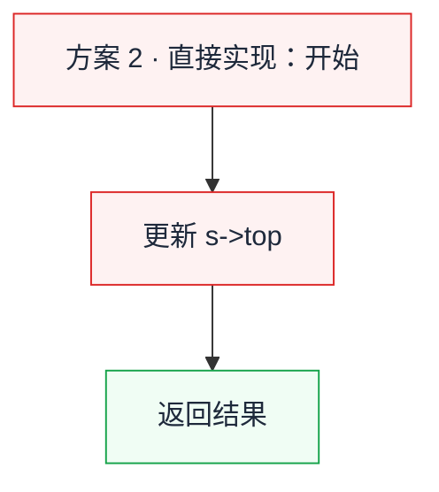

```c
/* LeetCode 155. 最小栈 — C 版（方案2） */
#include <stdio.h> // 引入头文件
typedef struct {
    int vals[4096];
    int mins[4096];
    int top;
} MinStack;
static void ms_init(MinStack *s) { s->top = 0; } // 把 0; } 写入 static void ms_init(MinStack *s) { s->top
static void ms_push(MinStack *s, int v) {        // 定义函数/方法 ms_push
    s->vals[s->top] = v;                         // 把 值; 写入 s->vals[s->top]
    s->mins[s->top] = s->top > 0 && s->mins[s->top - 1] < v ? s->mins[s->top - 1] : v;
    s->top++; // 字符串 减 超过 top 加一 ;
}
static void ms_pop(MinStack *s) {
    s->top--;
} // static void ms_pop(MinStack 乘 字符串) { 字符串 减 超过 top 减一 ; }
static int ms_top(MinStack *s) { return s->vals[s->top - 1]; }
static int ms_get_min(MinStack *s) { return s->mins[s->top - 1]; }
int main(void) { // 程序入口：跑内嵌自测用例
    MinStack s;  // MinStack 字符串;
    ms_init(&s); // ms_init( 按位与 字符串);
    ms_push(&s, -2);
    ms_push(&s, 0);
    ms_push(&s, -3);
    if (ms_get_min(&s) != -3) {
        printf("FAIL 1\n");
        return 1;
    }           // 若 ms_get_min( 按位与 字符串) 不等于 减 3) { 输出「FAIL 1 」); return 1; }
    ms_pop(&s); // ms_pop( 按位与 字符串);
    if (ms_top(&s) != 0) {
        printf("FAIL 2\n");
        return 1;
    } // 若 ms_top( 按位与 字符串) 不等于 0) { 输出「FAIL 2 」); return 1; }
    if (ms_get_min(&s) != -2) {
        printf("FAIL 3\n");
        return 1;
    } // 若 ms_get_min( 按位与 字符串) 不等于 减 2) { 输出「FAIL 3 」); return 1; }
    printf("PASS\n");
    return 0;
} // 全部用例通过，输出 PASS
```

### C++ 实现（2 种方案）

C++ 的全部方案如下，每个方案都内嵌用例自测，可独立运行（老仓库 python/go 文件遵循「打印结果」约定）：

#### 方案 1：栈辅助

**思路与代码分析**：核心是「栈辅助」。C++ 版用 STL 容器与迭代器，减少手写下标错误。**走读**：方案 1 · 栈辅助：开始 → 调用 vals.push_back(v) → 调用 mins.push_back(mins.empty() → 处理 ? v → 处理 : std::min(mins.back(), → 处理 v)) → 返回结果。

**运行架构**（真实控制流）：

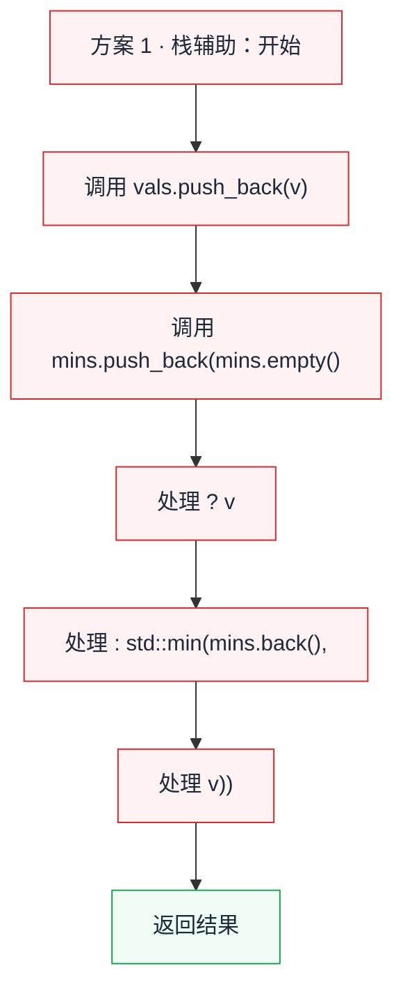

```cpp
// LeetCode 155. 最小栈 — C++ 版（方案1）
#include <cassert>               // 引入头文件
#include <iostream>              // 引入头文件
#include <vector>                // 引入头文件
struct MinStack {                // 定义类型
    std::vector<int> vals, mins; // std::vector 小于 int 超过 vals, mins;
    void push(int v) {           // 定义函数/方法 push
        vals.push_back(v);       // vals 追加 值);
        mins.push_back(mins.empty()
                           ? v
                           : std::min(mins.back(),
                                      v)); // mins 追加 mins 是否为空 ? 值 : std::取较小值 mins.back(), 值));
    }
    void pop() {
        vals.pop_back();
        mins.pop_back();
    }                                    // 弹出栈顶元素
    int top() { return vals.back(); }    // int top() { return vals.back(); }
    int getMin() { return mins.back(); } // int getMin() { return mins.back(); }
};
int main() {                  // 程序入口：跑内嵌自测用例
    MinStack s;               // MinStack 字符串;
    s.push(-2);               // 把 减 2 压入栈/数组尾部
    s.push(0);                // 把 0 压入栈/数组尾部
    s.push(-3);               // 把 减 3 压入栈/数组尾部
    assert(s.getMin() == -3); // 断言校验
    s.pop();                  // 弹出栈顶元素
    assert(s.top() == 0);     // 断言校验
    assert(s.getMin() == -2); // 断言校验
    std::cout << "PASS" << std::endl;
} // 全部用例通过，输出 PASS
```

#### 方案 2：直接实现

**思路与代码分析**：核心是「直接实现」。C++ 版用 STL 容器与迭代器，减少手写下标错误。**走读**：方案 2 · 直接实现：开始 → 调用 vals.push_back(v) → 调用 mins.push_back(mins.empty() → 处理 ? v → 处理 : std::min(mins.back(), → 处理 v)) → 返回结果。

**运行架构**（真实控制流）：

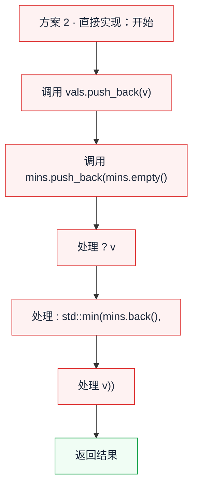

```cpp
// LeetCode 155. 最小栈 — C++ 版（方案2）
#include <cassert>               // 引入头文件
#include <iostream>              // 引入头文件
#include <vector>                // 引入头文件
struct MinStack {                // 定义类型
    std::vector<int> vals, mins; // std::vector 小于 int 超过 vals, mins;
    void push(int v) {           // 定义函数/方法 push
        vals.push_back(v);       // vals 追加 值);
        mins.push_back(mins.empty()
                           ? v
                           : std::min(mins.back(),
                                      v)); // mins 追加 mins 是否为空 ? 值 : std::取较小值 mins.back(), 值));
    }
    void pop() {
        vals.pop_back();
        mins.pop_back();
    }                                    // 弹出栈顶元素
    int top() { return vals.back(); }    // int top() { return vals.back(); }
    int getMin() { return mins.back(); } // int getMin() { return mins.back(); }
};
int main() {                  // 程序入口：跑内嵌自测用例
    MinStack s;               // MinStack 字符串;
    s.push(-2);               // 把 减 2 压入栈/数组尾部
    s.push(0);                // 把 0 压入栈/数组尾部
    s.push(-3);               // 把 减 3 压入栈/数组尾部
    assert(s.getMin() == -3); // 断言校验
    s.pop();                  // 弹出栈顶元素
    assert(s.top() == 0);     // 断言校验
    assert(s.getMin() == -2); // 断言校验
    std::cout << "PASS" << std::endl;
} // 全部用例通过，输出 PASS
```

### R 实现（2 种方案）

R 的全部方案如下，每个方案都内嵌用例自测，可独立运行（老仓库 python/go 文件遵循「打印结果」约定）：

#### 方案 1：栈辅助

**思路与代码分析**：核心是「栈辅助」。R 版用向量化思维与 1 起始下标，注意 1:n 的降序陷阱。**走读**：方案 1 · 栈辅助：开始 → 更新 new.env(parent → 处理 e$vals ＜- integer(0) → 处理 e$mins ＜- integer(0) → 处理 e$push ＜- function(v) → 处理 e$vals ＜＜- c(e$vals, v) → 处理 m ＜- if (length(e$mins) ＞ 0) → 调用 min(e$mins[length(e$mins)], → 处理 e$mins ＜＜- c(e$mins, m) → 处理 e$pop ＜- function() → 处理 e$vals ＜＜- e$vals[-length(e$ → 处理 e$mins ＜＜- e$mins[-length(e$ → 处理 e$top ＜- function() e$vals[l → 处理 e$getMin ＜- function() e$min → 处理 e → 返回结果。

**运行架构**（真实控制流）：

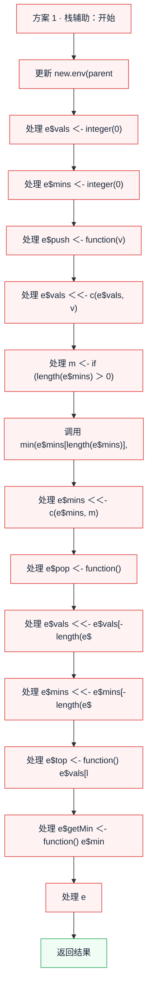

```r
# 版（方案1） 定义函数 MinStack（参数：无）
MinStack <- function() {
    e <- new.env(parent = emptyenv())  # 把 new.env(parent 赋值为 emptyenv()) 存入 e
    e$vals <- integer(0)
    e$mins <- integer(0)  # 把 integer(0); e$mins 小于 减 integer(0) 存入 e$vals
    e$push <- function(v) {
        # 把 function(值) { 存入 e$push
        e$vals <<- c(e$vals, v)  # e$vals 小于 小于 减 字符(e$vals, 值)
        m <- if (length(e$mins) > 0)
            min(e$mins[length(e$mins)], v) else v
        e$mins <<- c(e$mins, m)  # e$mins 小于 小于 减 字符(e$mins, 映射表)
    }
    e$pop <- function() {
        # 把 function() { 存入 e$pop
        e$vals <<- e$vals[-length(e$vals)]  # e$vals 小于 小于 减 e$vals[ 减 长度(e$vals)]
        e$mins <<- e$mins[-length(e$mins)]  # e$mins 小于 小于 减 e$mins[ 减 长度(e$mins)]
    }
    e$top <- function() e$vals[length(e$vals)]  # 把 function() e$vals[长度(e$vals)] 存入 e$top
    e$getMin <- function() e$mins[length(e$mins)]  # 把 function() e$mins[长度(e$mins)] 存入 e$getMin
    e
}
ms <- MinStack()  # 把 MinStack() 存入 ms
ms$push(-2)
ms$push(0)
ms$push(-3)  # ms$push( 减 2); ms$push(0); ms$push( 减 3)
stopifnot(ms$getMin() == -3)  # 断言校验
ms$pop()  # ms$pop()
stopifnot(ms$top() == 0, ms$getMin() == -2)  # 断言校验
cat("PASS\n")  # 全部用例通过，输出 PASS
```

#### 方案 2：直接实现

**思路与代码分析**：核心是「直接实现」。R 版用向量化思维与 1 起始下标，注意 1:n 的降序陷阱。**走读**：方案 2 · 直接实现：开始 → 更新 new.env(parent → 处理 e$vals ＜- integer(0) → 处理 e$mins ＜- integer(0) → 处理 e$push ＜- function(v) → 处理 e$vals ＜＜- c(e$vals, v) → 处理 m ＜- if (length(e$mins) ＞ 0) → 调用 min(e$mins[length(e$mins)], → 处理 e$mins ＜＜- c(e$mins, m) → 处理 e$pop ＜- function() → 处理 e$vals ＜＜- e$vals[-length(e$ → 处理 e$mins ＜＜- e$mins[-length(e$ → 处理 e$top ＜- function() e$vals[l → 处理 e$getMin ＜- function() e$min → 处理 e → 返回结果。

**运行架构**（真实控制流）：

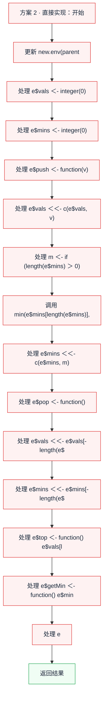

```r
# 版（方案2） 定义函数 MinStack（参数：无）
MinStack <- function() {
    e <- new.env(parent = emptyenv())  # 把 new.env(parent 赋值为 emptyenv()) 存入 e
    e$vals <- integer(0)
    e$mins <- integer(0)  # 把 integer(0); e$mins 小于 减 integer(0) 存入 e$vals
    e$push <- function(v) {
        # 把 function(值) { 存入 e$push
        e$vals <<- c(e$vals, v)  # e$vals 小于 小于 减 字符(e$vals, 值)
        m <- if (length(e$mins) > 0)
            min(e$mins[length(e$mins)], v) else v
        e$mins <<- c(e$mins, m)  # e$mins 小于 小于 减 字符(e$mins, 映射表)
    }
    e$pop <- function() {
        # 把 function() { 存入 e$pop
        e$vals <<- e$vals[-length(e$vals)]  # e$vals 小于 小于 减 e$vals[ 减 长度(e$vals)]
        e$mins <<- e$mins[-length(e$mins)]  # e$mins 小于 小于 减 e$mins[ 减 长度(e$mins)]
    }
    e$top <- function() e$vals[length(e$vals)]  # 把 function() e$vals[长度(e$vals)] 存入 e$top
    e$getMin <- function() e$mins[length(e$mins)]  # 把 function() e$mins[长度(e$mins)] 存入 e$getMin
    e
}
ms <- MinStack()  # 把 MinStack() 存入 ms
ms$push(-2)
ms$push(0)
ms$push(-3)  # ms$push( 减 2); ms$push(0); ms$push( 减 3)
stopifnot(ms$getMin() == -3)  # 断言校验
ms$pop()  # ms$pop()
stopifnot(ms$top() == 0, ms$getMin() == -2)  # 断言校验
cat("PASS\n")  # 全部用例通过，输出 PASS
```

### Zig 实现（2 种方案）

Zig 的全部方案如下，每个方案都内嵌用例自测，可独立运行（老仓库 python/go 文件遵循「打印结果」约定）：

#### 方案 1：栈辅助

**思路与代码分析**：核心是「栈辅助」。Zig 版显式分配与清零，整型边界处理严格。**走读**：方案 1 · 栈辅助：开始 → 返回 .。

**运行架构**（真实控制流）：

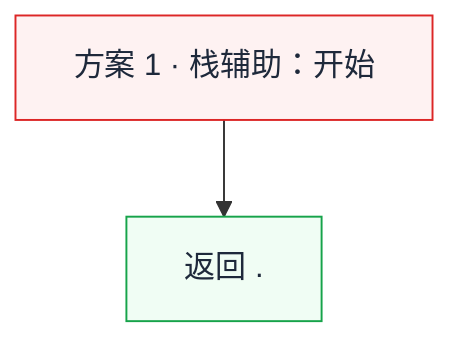

```zig
// LeetCode 155. 最小栈 — Zig 版（方案1）
const std = @import("std"); // 把 @import(「std」) 存入 std
const MinStack = struct { // 把 struct { 存入 MinStack
    vals: [4096]i32,
    mins: [4096]i32,
    n: usize,
    fn init() MinStack { // 定义函数/方法 init
        return .{ .vals = undefined, .mins = undefined, .n = 0 }; // 返回 { .vals 赋值为 undefined, .mins 赋值为 undefined, .元素个数 赋值为 0 }
    }
    fn push(self: *MinStack, v: i32) void { // 定义函数/方法 push
        self.vals[self.n] = v; // 把 值; 写入 self.vals[self.n]
        self.mins[self.n] = if (self.n > 0 and self.mins[self.n - 1] < v) self.mins[self.n - 1] else v;
        self.n += 1; // self.n累加 1
    }
    fn pop(self: *MinStack) void {
        self.n -= 1;
    } // 定义函数/方法 pop
    fn top(self: *MinStack) i32 {
        return self.vals[self.n - 1];
    } // 定义函数/方法 top
    fn getMin(self: *MinStack) i32 {
        return self.mins[self.n - 1];
    } // 定义函数/方法 getMin
};
pub fn main() !void { // 程序入口：跑内嵌自测用例
    var s = MinStack.init(); // 把 MinStack.init() 存入 字符串
    s.push(-2); // 把 减 2 压入栈/数组尾部
    s.push(0); // 把 0 压入栈/数组尾部
    s.push(-3); // 把 减 3 压入栈/数组尾部
    if (s.getMin() != -3) return error.TestFailed; // 若 字符串.getMin() 不等于 减 3，直接返回 error.TestFailed
    s.pop(); // 弹出栈顶元素
    if (s.top() != 0) return error.TestFailed; // 若 字符串.top() 不等于 0，直接返回 error.TestFailed
    if (s.getMin() != -2) return error.TestFailed; // 若 字符串.getMin() 不等于 减 2，直接返回 error.TestFailed
    std.debug.print("PASS\n", .{});
} // 全部用例通过，输出 PASS
```

#### 方案 2：直接实现

**思路与代码分析**：核心是「直接实现」。Zig 版显式分配与清零，整型边界处理严格。**走读**：方案 2 · 直接实现：开始 → 返回 .。

**运行架构**（真实控制流）：

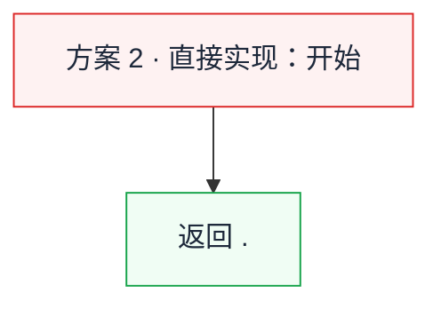

```zig
// LeetCode 155. 最小栈 — Zig 版（方案2）
const std = @import("std"); // 把 @import(「std」) 存入 std
const MinStack = struct { // 把 struct { 存入 MinStack
    vals: [4096]i32,
    mins: [4096]i32,
    n: usize,
    fn init() MinStack { // 定义函数/方法 init
        return .{ .vals = undefined, .mins = undefined, .n = 0 }; // 返回 { .vals 赋值为 undefined, .mins 赋值为 undefined, .元素个数 赋值为 0 }
    }
    fn push(self: *MinStack, v: i32) void { // 定义函数/方法 push
        self.vals[self.n] = v; // 把 值; 写入 self.vals[self.n]
        self.mins[self.n] = if (self.n > 0 and self.mins[self.n - 1] < v) self.mins[self.n - 1] else v;
        self.n += 1; // self.n累加 1
    }
    fn pop(self: *MinStack) void {
        self.n -= 1;
    } // 定义函数/方法 pop
    fn top(self: *MinStack) i32 {
        return self.vals[self.n - 1];
    } // 定义函数/方法 top
    fn getMin(self: *MinStack) i32 {
        return self.mins[self.n - 1];
    } // 定义函数/方法 getMin
};
pub fn main() !void { // 程序入口：跑内嵌自测用例
    var s = MinStack.init(); // 把 MinStack.init() 存入 字符串
    s.push(-2); // 把 减 2 压入栈/数组尾部
    s.push(0); // 把 0 压入栈/数组尾部
    s.push(-3); // 把 减 3 压入栈/数组尾部
    if (s.getMin() != -3) return error.TestFailed; // 若 字符串.getMin() 不等于 减 3，直接返回 error.TestFailed
    s.pop(); // 弹出栈顶元素
    if (s.top() != 0) return error.TestFailed; // 若 字符串.top() 不等于 0，直接返回 error.TestFailed
    if (s.getMin() != -2) return error.TestFailed; // 若 字符串.getMin() 不等于 减 2，直接返回 error.TestFailed
    std.debug.print("PASS\n", .{});
} // 全部用例通过，输出 PASS
```

### Dart 实现（2 种方案）

Dart 的全部方案如下，每个方案都内嵌用例自测，可独立运行（老仓库 python/go 文件遵循「打印结果」约定）：

#### 方案 1：栈辅助

**思路与代码分析**：核心是「栈辅助」。Dart 版用可空类型标注与集合方法，注意空安全。**走读**：方案 1 · 栈辅助：开始 → 调用 vals.add(v) → 调用 mins.add(mins.isEmpty ? v : → 返回结果。

**运行架构**（真实控制流）：

```mermaid
graph TD
    N0["方案 1 · 栈辅助：开始"]
    N1["调用 vals.add(v)"]
    N2["调用 mins.add(mins.isEmpty ? v :"]
    N3["返回结果"]
    N0 --> N1
    N1 --> N2
    N2 --> N3
    classDef n fill:#fef2f2,stroke:#dc2626,color:#1e293b;
    classDef lp fill:#fee2e2,stroke:#b91c1c,color:#1e293b;
    classDef dc fill:#fef9c3,stroke:#ca8a04,color:#1e293b;
    classDef tm fill:#f0fdf4,stroke:#16a34a,color:#1e293b;
    class N0,N1,N2 n;
    class N3 tm;
```

```dart
// LeetCode 155. 最小栈 — Dart 版（方案1）
class MinStack {
  // 定义类型
  final List<int> vals = []; // 把 []; 写入 final List<int> vals
  final List<int> mins = []; // 把 []; 写入 final List<int> mins
  void push(int v) {
    // 定义函数/方法 push
    vals.add(v); // vals 追加 值);
    mins.add(mins.isEmpty ? v : (mins.last < v ? mins.last : v));
  }

  void pop() {
    vals.removeLast();
    mins.removeLast();
  } // void pop() { vals.removeLast(); mins.removeLast(); }

  int top() => vals.last;
  int getMin() => mins.last;
}

void main() {
  // 程序入口：跑内嵌自测用例
  final ms = MinStack(); // 把 MinStack() 存入 ms
  ms.push(-2);
  ms.push(0);
  ms.push(-3); // 把 减 2 压入栈/数组尾部
  if (ms.getMin() != -3)
    throw StateError('c1'); // 若 ms.getMin() 不等于 减 3) throw StateError('c1');
  ms.pop(); // 弹出栈顶元素
  if (ms.top() != 0)
    throw StateError('c2'); // 若 ms.top() 不等于 0) throw StateError('c2');
  if (ms.getMin() != -2)
    throw StateError('c3'); // 若 ms.getMin() 不等于 减 2) throw StateError('c3');
  print('PASS');
} // 全部用例通过，输出 PASS
```

#### 方案 2：直接实现

**思路与代码分析**：核心是「直接实现」。Dart 版用可空类型标注与集合方法，注意空安全。**走读**：方案 2 · 直接实现：开始 → 调用 vals.add(v) → 调用 mins.add(mins.isEmpty ? v : → 返回结果。

**运行架构**（真实控制流）：

```mermaid
graph TD
    N0["方案 2 · 直接实现：开始"]
    N1["调用 vals.add(v)"]
    N2["调用 mins.add(mins.isEmpty ? v :"]
    N3["返回结果"]
    N0 --> N1
    N1 --> N2
    N2 --> N3
    classDef n fill:#fef2f2,stroke:#dc2626,color:#1e293b;
    classDef lp fill:#fee2e2,stroke:#b91c1c,color:#1e293b;
    classDef dc fill:#fef9c3,stroke:#ca8a04,color:#1e293b;
    classDef tm fill:#f0fdf4,stroke:#16a34a,color:#1e293b;
    class N0,N1,N2 n;
    class N3 tm;
```

```dart
// LeetCode 155. 最小栈 — Dart 版（方案2）
class MinStack {
  // 定义类型
  final List<int> vals = []; // 把 []; 写入 final List<int> vals
  final List<int> mins = []; // 把 []; 写入 final List<int> mins
  void push(int v) {
    // 定义函数/方法 push
    vals.add(v); // vals 追加 值);
    mins.add(mins.isEmpty ? v : (mins.last < v ? mins.last : v));
  }

  void pop() {
    vals.removeLast();
    mins.removeLast();
  } // void pop() { vals.removeLast(); mins.removeLast(); }

  int top() => vals.last;
  int getMin() => mins.last;
}

void main() {
  // 程序入口：跑内嵌自测用例
  final ms = MinStack(); // 把 MinStack() 存入 ms
  ms.push(-2);
  ms.push(0);
  ms.push(-3); // 把 减 2 压入栈/数组尾部
  if (ms.getMin() != -3)
    throw StateError('c1'); // 若 ms.getMin() 不等于 减 3) throw StateError('c1');
  ms.pop(); // 弹出栈顶元素
  if (ms.top() != 0)
    throw StateError('c2'); // 若 ms.top() 不等于 0) throw StateError('c2');
  if (ms.getMin() != -2)
    throw StateError('c3'); // 若 ms.getMin() 不等于 减 2) throw StateError('c3');
  print('PASS');
} // 全部用例通过，输出 PASS
```

---

## 内容总结

- **最小栈**（栈 · Easy）：共 2 个方案，主线思路「栈辅助」；时间 O(n)（单趟线性扫描）；动画演示栈后进先出过程，附录给出 11 种语言 × 全部方案的可运行实现。
- 来源博客：[https://blog.csdn.net/tyro_java/article/details/145245934](https://blog.csdn.net/tyro_java/article/details/145245934)
- 导航：[📋 总目录](../) ｜ [002 多数元素 →](../002_多数元素/)
