# 002 · 多数元素（第一阶段 · 线性结构入门 · Easy）

> **难度**：⭐ Easy ｜ **专题**：数组
> **学习定位**：第一阶段 · 线性结构入门第 2 篇 ｜ **解法数**：1
> **内容总结**：**多数元素**（数组 · Easy）：共 1 个方案，主线思路「哈希计数取最大值」；时间 O(n)（单趟线性扫描）；动画演示双指针过程，附录给出 11 种语言 × 全部方案的可运行实现。

---

## 题目描述

给定一个大小为 `n` 的数组 `nums` ，返回其中的多数元素。多数元素是指在数组中出现次数 大于 `⌊ n/2 ⌋` 的元素。

你可以假设数组是非空的，并且给定的数组总是存在多数元素。

示例 1：

输入：nums = [3,2,3]
输出：3

示例 2：

输入：nums = [2,2,1,1,1,2,2]
输出：2

提示：

 `n == nums.length`
 `1 
 `-10^9 
 输入保证数组中一定有一个多数元素。

尝试设计时间复杂度为 O(n)、空间复杂度为 O(1) 的算法解决此问题。

- 主函数签名：`function majorityElement(nums: number[]): number`

**用例演示**（摘自主解法内嵌自测，输入到输出一目了然）：

```typescript
  const cases: [number[], number][] = [
    [[3, 2, 3], 3],
    [[2, 2, 1, 1, 1, 2, 2], 2],
    [[1], 1],
  ];
```

> 题面与 [leetcode.cn 官方](https://leetcode.cn/problems/majority-element/)一致，示例配图取自官方题面。

**数据范围与注意事项**：

- 进阶：尝试设计时间复杂度为 O(n)、空间复杂度为 O(1) 的算法解决此问题。
- **易错点**：边界最容易漏：空数组、只有一个元素、目标出现在头尾。

## 题目分析

**场景是什么**：数组是最常用的线性容器，这类题练的是下标操作与原地腾挪，对应真实开发里的缓冲区、列表整理。本题就是该场景的 Easy 级练习，主线做法是「哈希计数取最大值」。

**主线怎么解**：把主解法从头到尾过一遍，它其实在依次做这几件事：双重循环遍历。

## 解题思路

**方案对比**（共 1 个方案，由浅入深）：

| 方案 | 时间复杂度 | 空间复杂度 |
|---|---|---|
| 方案 1 · 哈希计数取最大值 | O(n)（单趟线性扫描） | O(1) 到 O(n)（视辅助结构） |

**怎么读这一篇**：

- 🐣 **新手路线**：把「题目描述」的示例 1 在纸上手推一遍 → 读方案 1（最直观的写法）与它的代码走读 → 按「运行方式」本地跑通看 PASS → 回头对比方案 2 之后的写法差在哪
- 🦅 **大佬路线**：直接锁定最优方案 1（哈希计数取最大值，O(n)（单趟线性扫描））→ 跳读该方案代码与走读 → 用「逐步拆解与面试追问」补齐复杂度推导与边界追问

### 动态算法图（双指针，GIF 自动循环）


动画演示数组专题里双指针的典型过程；每个方案在「TypeScript 解题方案」一节还配了专属动画与专属流程图。

### 主解法流程图（真实控制流）

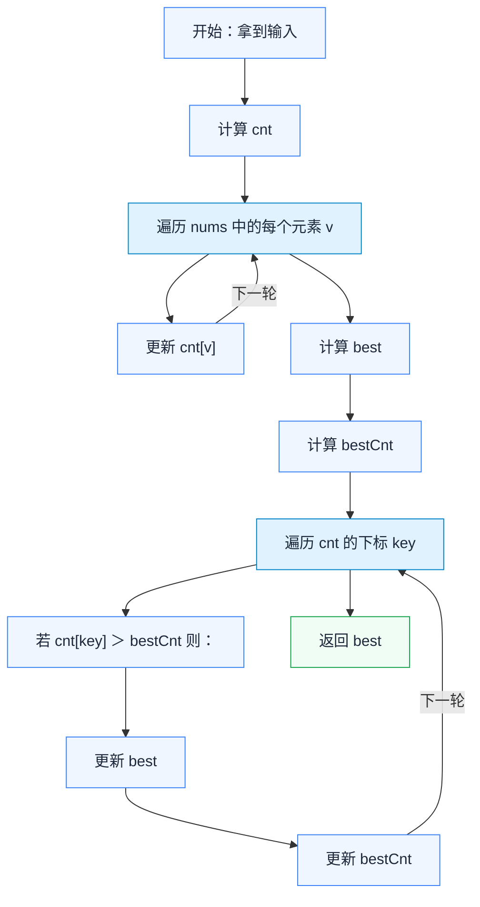

## TypeScript 解题方案（1 个方案逐个讲）

> **运行与提交**：每个方案都是自包含文件（内嵌用例自测，输出 PASS），整块复制到 `.ts` 文件后 `node 文件名` 即可运行。提交 LeetCode 时，把 `demo` 内的算法函数与辅助类型/函数整体取出、置于文件顶层即可。涉及交互/特殊接口的题以题面给定签名为准。

### 方案 1：哈希计数取最大值

**分析与思路**：核心做法是「哈希计数取最大值」。代码里依次做这些事：双重循环遍历。

**运行方式**：`node 本文件`，内嵌用例全部通过会输出 PASS。

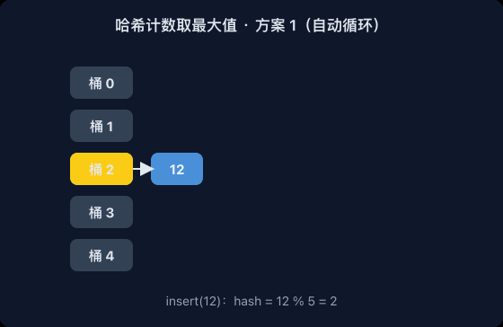

**方案专属流程图**（真实控制流）：

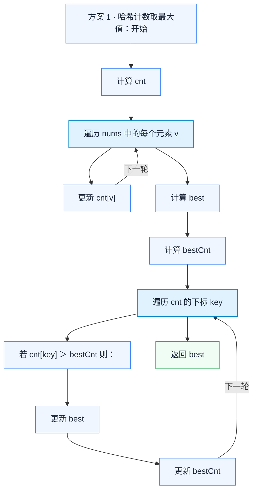

```typescript
/**
 ** LeetCode 169. 多数元素
 ** 方案：1 ) 方案1：哈希计数取最大值
 */

// 忠实翻译 Python 参考实现 ref_majorityElement：Counter(nums).most_common(1)[0][0]
function majorityElement(nums: number[]): number {
  // 定义函数/方法 majorityElement
  const cnt: Record<number, number> = {}; // 把 {}; 写入 const cnt: Record<number, number>
  for (const v of nums) {
    // for (const 值 of 数组) {
    cnt[v] = (cnt[v] ?? 0) + 1; // 把 (计数[值] ?? 0) 加 1; 写入 cnt[v]
  }
  let best = 0; // 把 0 存入 当前最优
  let bestCnt = -1; // 把 减 1 存入 bestCnt
  for (const key in cnt) {
    // for (const key in 计数) {
    if (cnt[key] > bestCnt) {
      // 若 计数[key] 超过 bestCnt
      best = Number(key); // 把 Number(key) 存入 当前最优
      bestCnt = cnt[key]; // 把 计数[key] 存入 bestCnt
    }
  }
  return best; // 返回 当前最优
}

export function demo(): void {
  // 程序入口：跑内嵌自测用例
  // 用例来自 _tools/correctness_check.py PROBLEMS["lc_169_多数元素"]
  const cases: [number[], number][] = [
    [[3, 2, 3], 3],
    [[2, 2, 1, 1, 1, 2, 2], 2],
    [[1], 1],
  ];
  for (const [input, want] of cases) {
    // for (const [input, want] of cases) {
    const got = majorityElement(input); // 把 majorityElement(input) 存入 got
    if (got !== want) {
      // 若 got 不等于 want
      throw new Error(
        `FAIL majorityElement(${JSON.stringify(input)}) = ${got}, want ${want}`,
      );
    }
  }
  console.log('PASS'); // 全部用例通过，输出 PASS
}

demo(); // demo();
```

## 逐步拆解与面试追问

**复杂度**：时间 O(n)（单趟线性扫描），空间 O(1) 到 O(n)（视辅助结构）

**为什么是这个量级**：每个元素被常数次访问，辅助哈希或栈的开销与 n 同阶

**面试官可能会追问**：

- 能不能原地做（O(1) 空间）？
- 如果数组已有序，能优化到什么程度？
- 空数组、单元素怎么处理？

## 关键 API 速查（TS 主解法实际用到，附官方链接）

| API | 作用 | 使用要点 | 官方文档 |
|---|---|---|---|
| `JSON.stringify()` | 序列化为 JSON 字符串 | 常用于结构化比较（深度相等判定）；undefined/函数/循环引用会被丢弃或抛错 | [官方文档](https://developer.mozilla.org/zh-CN/docs/Web/JavaScript/Reference/Global_Objects/JSON/stringify) |

### 各语言官方文档导航

- **TypeScript / JS**：[MDN 中文参考](https://developer.mozilla.org/zh-CN/)
- **Python**：[Python 官方文档](https://docs.python.org/zh-cn/3/)
- **Go**：[Go 标准库](https://pkg.go.dev/std)
- **Java**：[JDK 17 API](https://docs.oracle.com/en/java/javase/17/docs/api/)
- **Rust**：[Rust 标准库](https://doc.rust-lang.org/std/)
- **Lua**：[Lua 5.4 手册](https://www.lua.org/manual/5.4/)
- **C**：[Cppreference C](https://zh.cppreference.com/w/c)
- **C++**：[Cppreference C++](https://zh.cppreference.com/w/cpp)
- **R**：[R 官方手册](https://stat.ethz.ch/R-manual/)
- **Zig**：[Zig 语言文档](https://ziglang.org/documentation/master/)
- **Dart**：[Dart API](https://api.dart.dev/)

## 附录：其他 10 种语言全部实现（每种语言列举其全部方案）

> TypeScript 的全部方案见「TypeScript 解题方案」一节；下面是其余 10 种语言的对应实现，每种语言的每个方案都带思路分析、代码走读与专属运行架构图。
> 每个方案都内嵌用例自测，可独立运行（老仓库 python/go 文件遵循「打印结果」约定）。
> 完整解法文件见 `dsa/<语言>/array/lc_169_多数元素/`。

### Python 实现（1 种方案）

Python 的全部方案如下，每个方案都内嵌用例自测，可独立运行（老仓库 python/go 文件遵循「打印结果」约定）：

#### 方案 1：哈希计数取最大值

**思路与代码分析**：核心是「哈希计数取最大值」。Python 版用切片与字典推导式简化操作，突出可读性。**走读**：方案 1 · 哈希计数取最大值：开始 → 更新 cnt → 遍历 nums: 中的每个元素 v → 更新 cnt[v] → 更新 best → 更新 best_cnt → 遍历 cnt.items(): 中的每个元素 c → 若 c ＞ best_cnt：更新 best → 更新 best → 更新 best_cnt → 返回 best。

**运行架构**（真实控制流）：

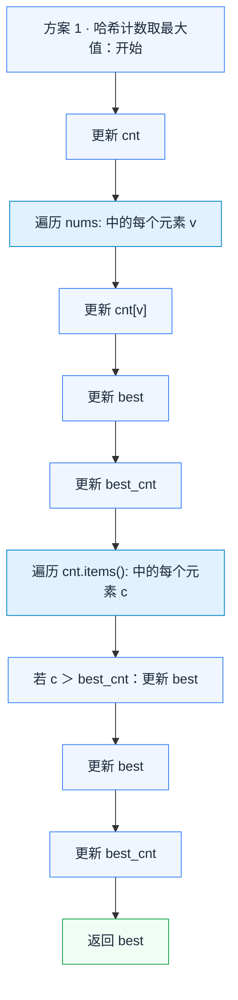

```python
import sys  # 提高递归深度上限（深输入防 RecursionError）

sys.setrecursionlimit(200000)  # 树/链表类题目节点数可达 1e4 量级

def majority_element(nums):  # 定义函数 majority_element（参数：数组）
    cnt = {}  # 把 {} 存入 计数
    for v in nums:  # 逐个取出 数组 的元素（值）
        cnt[v] = cnt.get(v, 0) + 1  # 把 计数 查找 值, 0) 加 1 写入 cnt[v]
    best = 0  # 把 0 存入 当前最优
    best_cnt = -1  # 把 减 1 存入 best_cnt
    for k, c in cnt.items():  # for 下标 k, 字符 in 计数.items():
        if c > best_cnt:  # 若 字符 超过 best_cnt
            best = k  # 把 下标 k 存入 当前最优
            best_cnt = c  # 把 字符 存入 best_cnt
    return best  # 返回 当前最优

if __name__ == "__main__":  # 若 __name__ 等于 '__main__'
    cases = [
        ([3, 2, 3], 3),
        ([2, 2, 1, 1, 1, 2, 2], 2),
        ([1], 1),
    ]
    for inp, want in cases:  # for inp, want in cases:
        got = majority_element(inp)  # 把 majority_element(inp) 存入 got
        assert got == want, f"majorityElement({inp}) = {got}, want {want}"  # 断言校验
    print("PASS")  # 全部用例通过，输出 PASS
```

### Go 实现（1 种方案）

Go 的全部方案如下，每个方案都内嵌用例自测，可独立运行（老仓库 python/go 文件遵循「打印结果」约定）：

#### 方案 1：哈希计数取最大值

**思路与代码分析**：核心是「哈希计数取最大值」。Go 版用切片与多返回值惯用法，显式处理索引边界。代码里依次做这些事：哈希结构做计数或查重。**走读**：方案 1 · 哈希计数取最大值：开始 → 更新 : → 遍历 nums 的下标与元素 v → 处理 cnt[v]++ → 更新 : → 遍历 cnt 的下标与元素 c → 处理 if c ＞ bestCnt → 更新 bestCnt → 返回 best。

**运行架构**（真实控制流）：

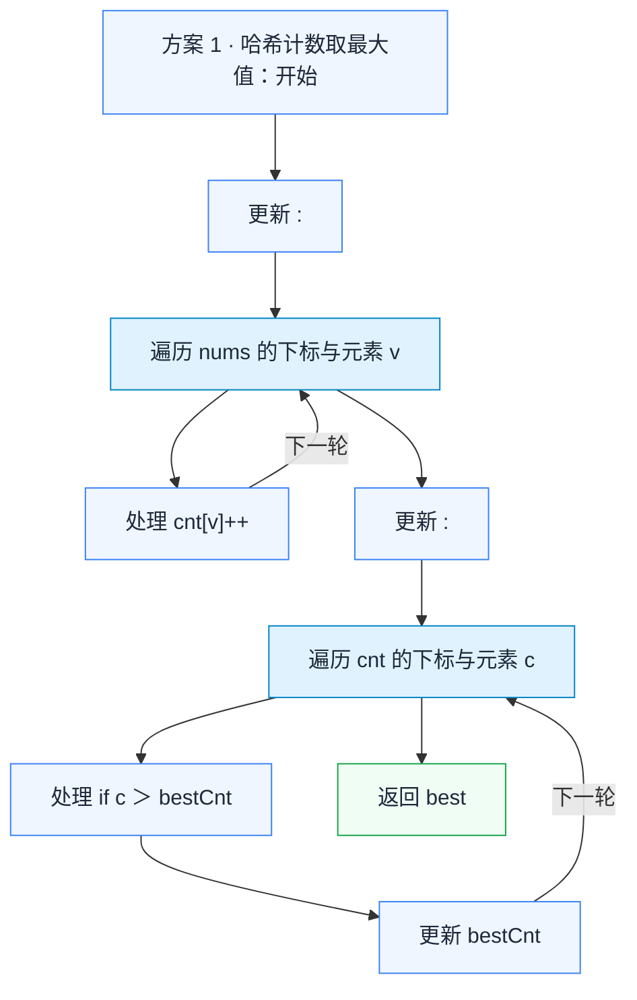

```go
package main // 引入依赖

import (
	"fmt" // 「fmt」
	"os"  // 「os」
)

// majorityElement 多数元素。忠实翻译 Python 参考实现 ref_majorityElement：
// Counter(nums).most_common(1)[0][0]
func majorityElement(nums []int) int { // 定义函数/方法 majorityElement
	cnt := make(map[int]int) // 把 make(映射表[int]int) 写入 cnt :
	for _, v := range nums { // 同时取 _ 与 值 遍历
		cnt[v]++ // 计数[值] 加一
	}
	best, bestCnt := 0, -1  // 把 0, 减 1 写入 best, bestCnt :
	for v, c := range cnt { // 同时取 值 与 字符 遍历
		if c > bestCnt { // 若 字符 超过 bestCnt
			best, bestCnt = v, c // 把 值, 字符 写入 best, bestCnt
		}
	}
	return best // 返回 当前最优
}

func main() { // 程序入口：跑内嵌自测用例
	// 用例来自 _tools/correctness_check.py PROBLEMS["lc_169_多数元素"]
	cases := []struct { // 把 []struct { 写入 cases :
		in   []int // in []int
		want int   // want int
	}{ // }{
		{[]int{3, 2, 3}, 3},
		{[]int{2, 2, 1, 1, 1, 2, 2}, 2},
		{[]int{1}, 1},
	}
	allOK := true             // 把 true 写入 allOK :
	for _, c := range cases { // 同时取 _ 与 字符 遍历
		got := majorityElement(c.in) // 把 majorityElement(字符.in) 写入 got :
		if got != c.want {           // 若 got 不等于 字符.want
			allOK = false                                                             // 把 false 写入 allOK
			fmt.Printf("FAIL majorityElement(%v) = %v, want %v\n", c.in, got, c.want) // 打印输出
		}
	}
	if !allOK { // 若 取反 allOK
		os.Exit(1) // os.Exit(1)
	}
	fmt.Println("PASS") // 全部用例通过，输出 PASS
}
```

### Java 实现（1 种方案）

Java 的全部方案如下，每个方案都内嵌用例自测，可独立运行（老仓库 python/go 文件遵循「打印结果」约定）：

#### 方案 1：哈希计数取最大值

**思路与代码分析**：核心是「哈希计数取最大值」。Java 版用类与静态方法组织，集合操作显式明了。代码里依次做这些事：哈希结构做计数或查重；双重循环遍历。**走读**：方案 1 · 哈希计数取最大值：开始 → 更新 cnt → 处理 new HashMap＜＞() → 遍历循环 → 调用 cnt.put(v, cnt.getOrDefault( → 更新 best → 遍历循环 → 调用 cnt.entrySet()) → 若 e.getValue() ＞ bestCnt 则： → 更新 best → 更新 bestCnt → 返回 best。

**运行架构**（真实控制流）：

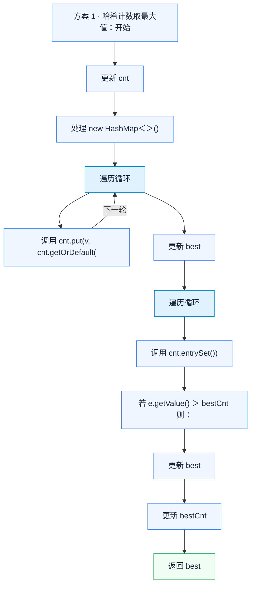

```java
package com.webfault.dsa; // 引入依赖

import java.util.HashMap; // 引入依赖
import java.util.Map; // 引入依赖

// LeetCode 169. 多数元素。忠实翻译 Python 参考实现 ref_majorityElement：
// Counter(nums).most_common(1)[0][0]
class lc169_solution1 { // 定义类型
  int majorityElement(int[] nums) { // 定义函数/方法 majorityElement
    Map<Integer, Integer> cnt =
        new HashMap<>(); // 把 new HashMap 小于 超过 (); 写入 Map<Integer, Integer> cnt
    for (int v : nums) { // for (int 值 : 数组) {
      cnt.put(v, cnt.getOrDefault(v, 0) + 1); // 计数.put(值, 计数.getOrDefault(值, 0) 加 1);
    }
    int best = 0, bestCnt = -1; // 把 0, bestCnt 赋值为 减 1 存入 当前最优
    for (Map.Entry<Integer, Integer> e :
        cnt.entrySet()) { // for (Map.Entry 小于 Integer, Integer 超过 e : 计数.entrySet()) {
      if (e.getValue() > bestCnt) { // 若 e.getValue() 超过 bestCnt
        best = e.getKey(); // 把 e.getKey(); 写入 当前最优
        bestCnt = e.getValue(); // 把 e.getValue(); 写入 bestCnt
      }
    }
    return best; // 返回 当前最优
  }

  public static void main(String[] args) { // public static void main(String[] args) {
    // 用例来自 _tools/correctness_check.py PROBLEMS["lc_169_多数元素"]
    Object[][] cases = { // 把 { 写入 Object[][] cases
      {new int[] {3, 2, 3}, 3},
      {new int[] {2, 2, 1, 1, 1, 2, 2}, 2},
      {new int[] {1}, 1},
    };
    lc169_solution1 s = new lc169_solution1(); // 把 new lc169_solution1(); 写入 lc169_solution1 s
    boolean allOK = true; // 把 true; 写入 boolean allOK
    for (Object[] c : cases) { // for (Object[] 字符 : cases) {
      int got = s.majorityElement((int[]) c[0]); // 把 字符串.majorityElement((int[]) 字符[0]) 存入 got
      int want = (Integer) c[1]; // 把 (Integer) 字符[1] 存入 want
      if (got != want) { // 若 got 不等于 want
        allOK = false; // 把 false; 写入 allOK
        System.out.println("FAIL majorityElement = " + got + ", want " + want); // 打印输出
      }
    }
    if (!allOK) { // 若 取反 allOK
      throw new RuntimeException(
          "some cases FAILED"); // throw new RuntimeException(「some cases FAILED」);
    }
    System.out.println("PASS"); // 全部用例通过，输出 PASS
  }
}
```

### Rust 实现（1 种方案）

Rust 的全部方案如下，每个方案都内嵌用例自测，可独立运行（老仓库 python/go 文件遵循「打印结果」约定）：

#### 方案 1：哈希计数取最大值

**思路与代码分析**：核心是「哈希计数取最大值」。Rust 版用所有权移动与切片借用改写同一逻辑，注意 Option 与引用边界。代码里依次做这些事：哈希结构做计数或查重。**走读**：方案 1 · 哈希计数取最大值：开始 → 计算 counts → 计算 best → 遍历 &nums 中的每个元素 v → 计算 c → 处理 if *c ＞ best.1 → 更新 best → 处理 best.0 → 返回结果。

**运行架构**（真实控制流）：

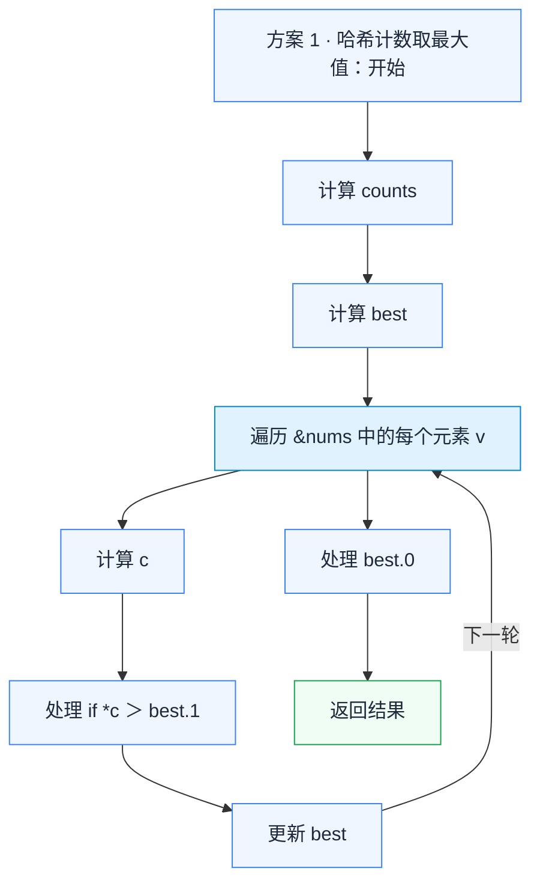

```rust
// LeetCode 169. 多数元素 — Rust 版（方案1）
use std::collections::HashMap; // 引入依赖
fn majority_element(nums: Vec<i32>) -> i32 {
    // 定义函数/方法 majority_element
    let mut counts: HashMap<i32, i32> = HashMap::new(); // 把 HashMap::new(); 写入 let mut counts: HashMap<i32, i32>
    let mut best = (nums[0], 0); // 把 (数组[0], 0); 写入 let mut best
    for &v in &nums {
        let c = counts.entry(v).or_insert(0);
        *c += 1;
        if *c > best.1 {
            best = (v, *c);
        }
    }
    best.0 // 当前最优.0
}
fn main() {
    assert_eq!(majority_element(vec![3, 2, 3]), 3);
    assert_eq!(majority_element(vec![2, 2, 1, 1, 1, 2, 2]), 2);
    println!("PASS");
} // 程序入口：跑内嵌自测用例
```

### Lua 实现（1 种方案）

Lua 的全部方案如下，每个方案都内嵌用例自测，可独立运行（老仓库 python/go 文件遵循「打印结果」约定）：

#### 方案 1：哈希计数取最大值

**思路与代码分析**：核心是「哈希计数取最大值」。Lua 版用表与 ipairs 遍历，注意 ipairs 遇 nil 即停的语义。**走读**：方案 1 · 哈希计数取最大值：开始 → 更新 counts → 更新 bn → 遍历 ipairs(nums) do 中的每个元素 v → 更新 counts[v] → 处理 if counts[v] ＞ bn then → 更新 bn → 返回 best。

**运行架构**（真实控制流）：

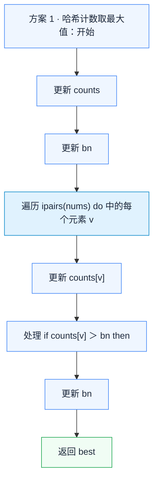

```lua
-- LeetCode 169. 多数元素 — Lua 版（方案1）
local function majority_element(nums) -- local function majority_element(数组)
	local counts = {} -- 把 {} 写入 local counts
	local best, bn = nums[1], 0 -- 把 数组[1], 0 写入 local best, bn
	for _, v in ipairs(nums) do -- 遍历取 值
		counts[v] = (counts[v] or 0) + 1 -- 把 (counts[值] or 0) 加 1 写入 counts[v]
		if counts[v] > bn then
			best, bn = v, counts[v]
		end -- 若 counts[值] 超过 bn then 当前最优, bn 赋值为 值, counts[值] 终点
	end -- 终点
	return best -- 返回 当前最优
end -- 终点
assert(majority_element({ 3, 2, 3 }) == 3) -- 断言校验
assert(majority_element({ 2, 2, 1, 1, 1, 2, 2 }) == 2) -- 断言校验
print("PASS") -- 全部用例通过，输出 PASS
```

### C 实现（1 种方案）

C 的全部方案如下，每个方案都内嵌用例自测，可独立运行（老仓库 python/go 文件遵循「打印结果」约定）：

#### 方案 1：哈希计数取最大值

**思路与代码分析**：核心是「哈希计数取最大值」。C 版手动管理下标与内存，循环边界全部显式写出。代码里依次做这些事：单循环线性扫描。**走读**：方案 1 · 哈希计数取最大值：开始 → 更新 counts[65536] → 更新 best → 遍历循环 → 更新 idx → 处理 counts[idx]++ → 若 counts[idx] ＞ bn 则： → 更新 bn → 更新 best → 返回 best。

**运行架构**（真实控制流）：

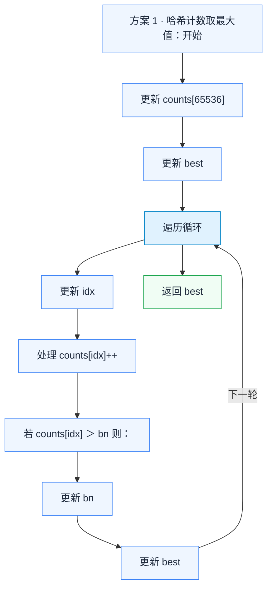

```c
/* LeetCode 169. 多数元素 — C 版（方案1） */
#include <stdio.h>                                   // 引入头文件
static int majority_element(const int *n, int len) { // 定义函数/方法 majority_element
    int counts[65536] = {0};                         // 把 {0}; 写入 int counts[65536]
    int best = n[0], bn = 0;        // 把 元素个数[0], bn 赋值为 0 存入 当前最优
    for (int i = 0; i < len; i++) { // 让 下标 i 从 0 开始计数，下标 i 小于 长度 就继续
        int idx = n[i] + 32768;     // 把 元素个数[下标 i] 加 32768 存入 idx
        counts[idx]++;              // counts[idx] 加一 ;
        if (counts[idx] > bn) {
            bn = counts[idx];
            best = n[i];
        }
    }
    return best; // 返回 当前最优
}
int main(void) { // 程序入口：跑内嵌自测用例
    if (majority_element((int[]){3, 2, 3}, 3) != 3) {
        printf("FAIL 1\n");
        return 1;
    }
    if (majority_element((int[]){2, 2, 1, 1, 1, 2, 2}, 7) != 2) {
        printf("FAIL 2\n");
        return 1;
    }
    printf("PASS\n");
    return 0;
} // 全部用例通过，输出 PASS
```

### C++ 实现（1 种方案）

C++ 的全部方案如下，每个方案都内嵌用例自测，可独立运行（老仓库 python/go 文件遵循「打印结果」约定）：

#### 方案 1：哈希计数取最大值

**思路与代码分析**：核心是「哈希计数取最大值」。C++ 版用 STL 容器与迭代器，减少手写下标错误。代码里依次做这些事：哈希结构做计数或查重；单循环线性扫描。**走读**：方案 1 · 哈希计数取最大值：开始 → 处理 std::unordered_map＜int, int＞ → 更新 best → 遍历循环 → 更新 c → 若 c ＞ bn 则： → 更新 bn → 更新 best → 返回 best。

**运行架构**（真实控制流）：

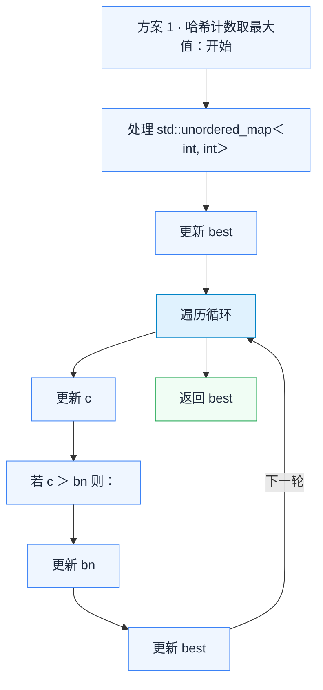

```cpp
// LeetCode 169. 多数元素 — C++ 版（方案1）
#include <cassert>                                         // 引入头文件
#include <iostream>                                        // 引入头文件
#include <unordered_map>                                   // 引入头文件
#include <vector>                                          // 引入头文件
static int majorityElement(const std::vector<int> &nums) { // 定义函数/方法 majorityElement
    std::unordered_map<int, int> counts; // std::unordered_map 小于 int, int 超过 counts;
    int best = nums[0], bn = 0;          // 把 数组[0], bn 赋值为 0 存入 当前最优
    for (int v : nums) {
        int c = ++counts[v];
        if (c > bn) {
            bn = c;
            best = v;
        }
    }
    return best; // 返回 当前最优
}
int main() {
    assert(majorityElement({3, 2, 3}) == 3);
    assert(majorityElement({2, 2, 1, 1, 1, 2, 2}) == 2);
    std::cout << "PASS" << std::endl;
} // 全部用例通过，输出 PASS
```

### R 实现（1 种方案）

R 的全部方案如下，每个方案都内嵌用例自测，可独立运行（老仓库 python/go 文件遵循「打印结果」约定）：

#### 方案 1：哈希计数取最大值

**思路与代码分析**：核心是「哈希计数取最大值」。R 版用向量化思维与 1 起始下标，注意 1:n 的降序陷阱。**走读**：方案 1 · 哈希计数取最大值：开始 → 处理 t ＜- table(nums) → 调用 as.integer(names(t)[which.ma → 返回结果。

**运行架构**（真实控制流）：

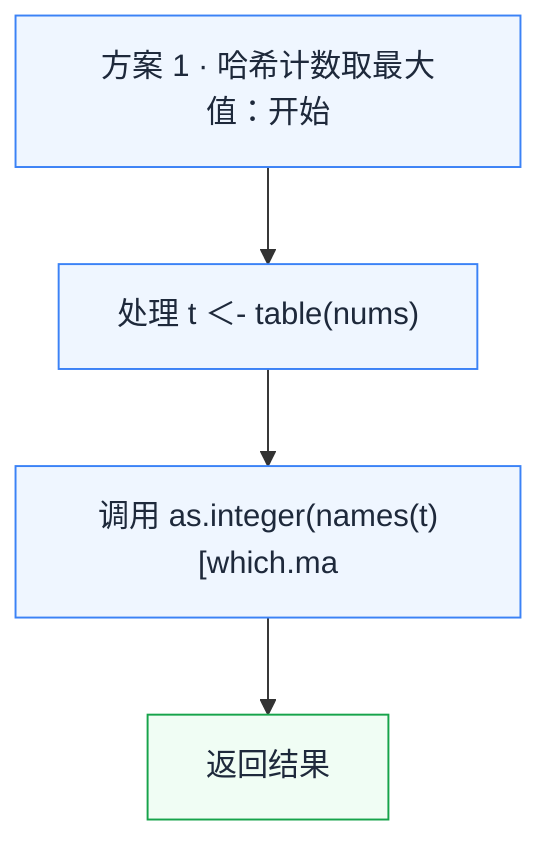

```r
# 版（方案1） 定义函数 majority_element（参数：数组）
majority_element <- function(nums) {
    t <- table(nums)  # 把 table(数组) 存入 另一字符串
    as.integer(names(t)[which.max(t)])  # as.integer(names(另一字符串)[which.取较大值 另一字符串)])
}
stopifnot(majority_element(c(3, 2, 3)) == 3)  # 断言校验
stopifnot(majority_element(c(2, 2, 1, 1, 1, 2, 2)) == 2)  # 断言校验
cat("PASS\n")  # 全部用例通过，输出 PASS
```

### Zig 实现（1 种方案）

Zig 的全部方案如下，每个方案都内嵌用例自测，可独立运行（老仓库 python/go 文件遵循「打印结果」约定）：

#### 方案 1：哈希计数取最大值

**思路与代码分析**：核心是「哈希计数取最大值」。Zig 版显式分配与清零，整型边界处理严格。代码里依次做这些事：哈希结构做计数或查重；单循环线性扫描。**走读**：方案 1 · 哈希计数取最大值：开始 → 计算 counts → 计算 best → 计算 bn → 遍历集合元素 → 计算 c → 调用 counts.put(v, c) catch unrea → 若 c ＞ bn 则： → 更新 bn → 更新 best → 返回 best。

**运行架构**（真实控制流）：

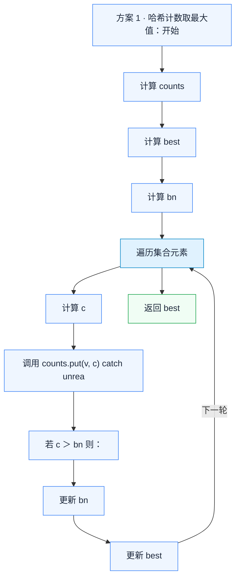

```zig
// LeetCode 169. 多数元素 — Zig 版（方案1）
const std = @import("std"); // 把 @import(「std」) 存入 std
fn majorityElement(nums: []const i32, alloc: std.mem.Allocator) i32 { // 定义函数/方法 majorityElement
    var counts = std.AutoHashMap(i32, i32).init(alloc); // 把 std.AutoHashMap(i32, i32).init(alloc) 存入 counts
    var best = nums[0]; // 把 数组[0] 存入 当前最优
    var bn: i32 = 0; // 把 0; 写入 var bn: i32
    for (nums) |v| { // 逐个取出 数组 的元素（值）
        const c = (counts.get(v) orelse 0) + 1; // 把 (counts 查找 值) orelse 0) 加 1 存入 字符
        counts.put(v, c) catch unreachable; // counts.put(值, 字符) catch unreachable;
        if (c > bn) {
            bn = c;
            best = v;
        } // 若 字符 超过 bn) { bn 赋值为 字符; 当前最优 赋值为 值; }
    }
    return best; // 返回 当前最优
}
pub fn main() !void { // 程序入口：跑内嵌自测用例
    var arena = std.heap.ArenaAllocator.init(std.heap.page_allocator); // 把 std.堆.ArenaAllocator.init(std.堆.page_allocator) 存入 arena
    defer arena.deinit(); // defer arena.deinit();
    if (majorityElement(&[_]i32{ 3, 2, 3 }, arena.allocator()) != 3) return error.TestFailed;
    if (majorityElement(&[_]i32{ 2, 2, 1, 1, 1, 2, 2 }, arena.allocator()) != 2) return error.TestFailed;
    std.debug.print("PASS\n", .{});
} // 全部用例通过，输出 PASS
```

### Dart 实现（1 种方案）

Dart 的全部方案如下，每个方案都内嵌用例自测，可独立运行（老仓库 python/go 文件遵循「打印结果」约定）：

#### 方案 1：哈希计数取最大值

**思路与代码分析**：核心是「哈希计数取最大值」。Dart 版用可空类型标注与集合方法，注意空安全。代码里依次做这些事：单循环线性扫描。**走读**：方案 1 · 哈希计数取最大值：开始 → 更新 counts → 计算 best → 遍历循环 → 更新 c → 更新 counts[v] → 若 c ＞ bn 则： → 更新 bn → 更新 best → 返回 best。

**运行架构**（真实控制流）：

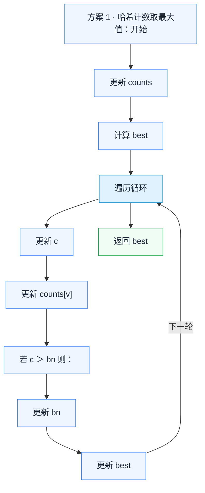

```dart
// LeetCode 169. 多数元素 — Dart 版（方案1）
int majorityElement(List<int> nums) {
  // 定义函数/方法 majorityElement
  final counts = <int, int>{}; // 把 小于 int, int 超过 {} 存入 counts
  var best = nums[0], bn = 0; // 把 数组[0], bn 赋值为 0 存入 当前最优
  for (final v in nums) {
    // for (final 值 in 数组) {
    final c = (counts[v] ?? 0) + 1; // 把 (counts[值] ?? 0) 加 1 存入 字符
    counts[v] = c; // 把 字符; 写入 counts[v]
    if (c > bn) {
      bn = c;
      best = v;
    } // 若 字符 超过 bn) { bn 赋值为 字符; 当前最优 赋值为 值; }
  }
  return best; // 返回 当前最优
}

void main() {
  if (majorityElement([3, 2, 3]) != 3) throw StateError('c1');
  if (majorityElement([2, 2, 1, 1, 1, 2, 2]) != 2) throw StateError('c2');
  print('PASS');
} // 全部用例通过，输出 PASS
```

---

## 内容总结

- **多数元素**（数组 · Easy）：共 1 个方案，主线思路「哈希计数取最大值」；时间 O(n)（单趟线性扫描）；动画演示双指针过程，附录给出 11 种语言 × 全部方案的可运行实现。
- 来源博客：[]()
- 导航：[📋 总目录](../) ｜ [← 001 最小栈](../001_最小栈/) ｜ [003 两数之和 →](../003_两数之和/)
