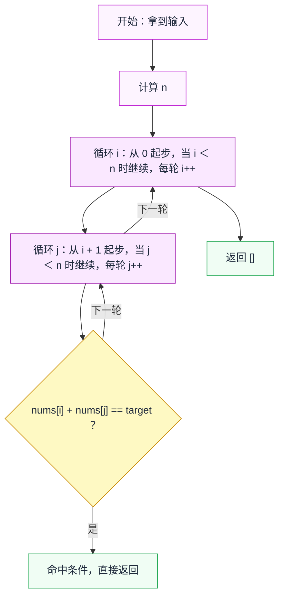
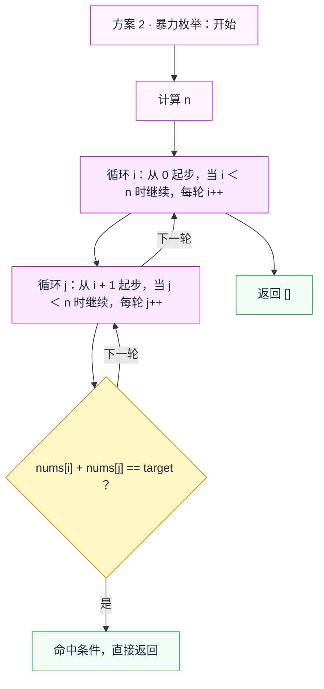
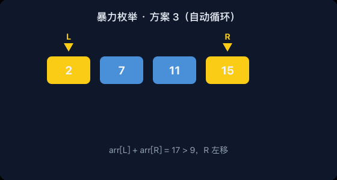
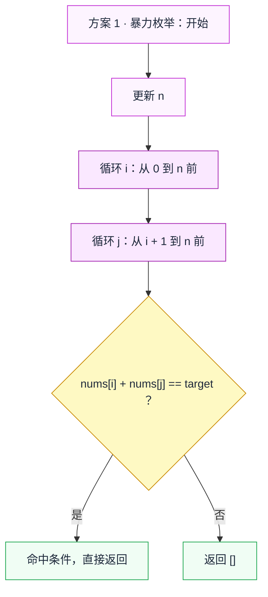
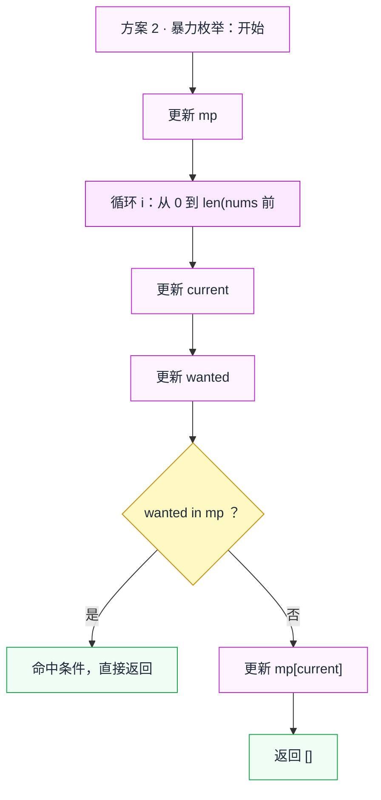
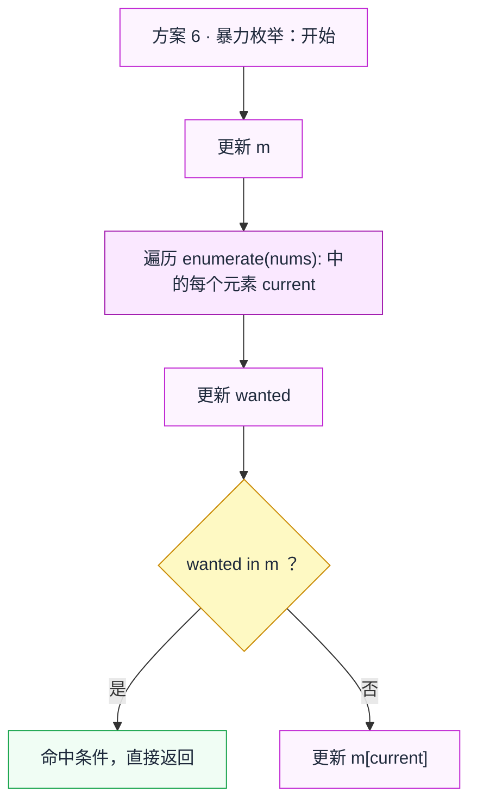
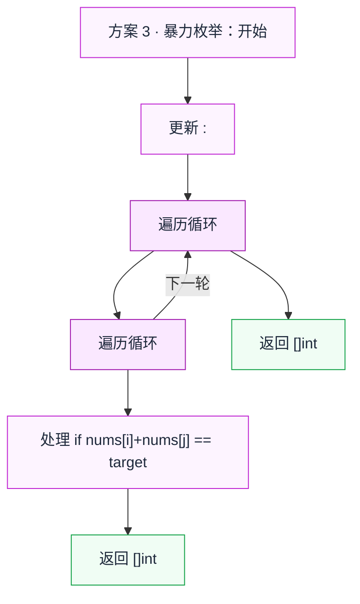
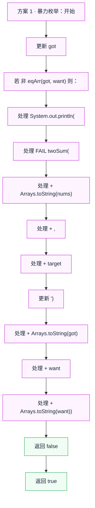

# 003 · 两数之和（第一阶段 · 线性结构入门 · Easy）

> **难度**：⭐ Easy ｜ **专题**：哈希表
> **学习定位**：第一阶段 · 线性结构入门第 3 篇 ｜ **解法数**：6
> **内容总结**：**两数之和**（哈希表 · Easy）：共 6 个方案，主线思路「暴力枚举」；时间 O(n²)（两层嵌套扫描）；动画演示哈希链地址过程，附录给出 11 种语言 × 全部方案的可运行实现。

---

## 题目描述

给定一个整数数组 `nums` 和一个整数目标值 `target`，请你在该数组中找出 和为目标值 `target` 的那 两个 整数，并返回它们的数组下标。

你可以假设每种输入只会对应一个答案，并且你不能使用两次相同的元素。

你可以按任意顺序返回答案。

- 主函数签名：`function twoSum(nums: number[], target: number): number[]`

**用例（来自原题）**：

**示例 1**

```text
输入：nums = [2,7,11,15], target = 9
输出：[0,1]
```

解释：因为 nums[0] + nums[1] == 9 ，返回 [0, 1] 。

**示例 2**

```text
输入：nums = [3,2,4], target = 6
输出：[1,2]
```

**示例 3**

```text
输入：nums = [3,3], target = 6
输出：[0,1]
```
> ✅ **官方验证**：全部 TypeScript 解法已通过 leetcode.cn 官方示例用例验证（自动注入运行，全部 PASS）。题面与 [leetcode.cn 官方](https://leetcode.cn/problems/two-sum/)一致，示例配图取自官方题面。

**数据范围与注意事项**：

- `2 <= nums.length <= 10^4`
- `-10^9 <= nums[i] <= 10^9`
- `-10^9 <= target <= 10^9`
- 只会存在一个有效答案
- 进阶：你可以想出一个时间复杂度小于 `O(n^2)` 的算法吗？
- **易错点**：键要选不可变量，计数完别忘了次数并列的情况。

## 题目分析

**场景是什么**：要在大量数据里按「特征值」瞬间找到配对或完成计数，对应真实开发里的对账、去重、缓存按键取值。本题就是该场景的 Easy 级练习，主线做法是「暴力枚举」。

**主线怎么解**：把主解法从头到尾过一遍，它其实在依次做这几件事：双重循环遍历。

## 解题思路

**方案对比**（共 6 个方案，由浅入深）：

| 方案 | 时间复杂度 | 空间复杂度 |
|---|---|---|
| 方案 1 · 暴力枚举 | O(n²)（两层嵌套扫描） | O(1) 到 O(n) |
| 方案 2 · 暴力枚举 | O(n²)（两层嵌套扫描） | O(1) 到 O(n) |
| 方案 3 · 暴力枚举 | O(n²)（两层嵌套扫描） | O(1) 到 O(n) |
| 方案 4 · 暴力枚举 | O(n²)（两层嵌套扫描） | O(1) 到 O(n) |
| 方案 5 · 暴力枚举 | O(n²)（两层嵌套扫描） | O(1) 到 O(n) |
| 方案 6 · 暴力枚举 | O(n²)（两层嵌套扫描） | O(1) 到 O(n) |

**方案间的取舍**：方案 1（暴力枚举）；方案 2（暴力枚举）；方案 3（暴力枚举）；方案 4（暴力枚举）；方案 5（暴力枚举）；方案 6（暴力枚举）。数据规模小、可读性优先时选靠前的方案；规模大、性能优先时选靠后的方案。

**怎么读这一篇**：

- 🐣 **新手路线**：把「题目描述」的示例 1 在纸上手推一遍 → 读方案 1（最直观的写法）与它的代码走读 → 按「运行方式」本地跑通看 PASS → 回头对比方案 2 之后的写法差在哪
- 🦅 **大佬路线**：直接锁定最优方案 1（暴力枚举，O(n²)（两层嵌套扫描））→ 跳读该方案代码与走读 → 用「逐步拆解与面试追问」补齐复杂度推导与边界追问

### 动态算法图（哈希链地址，GIF 自动循环）


动画演示哈希表专题里哈希链地址的典型过程；每个方案在「TypeScript 解题方案」一节还配了专属动画与专属流程图。

### 主解法流程图（真实控制流）



## TypeScript 解题方案（6 个方案逐个讲）

> **运行与提交**：每个方案都是自包含文件（内嵌用例自测，输出 PASS），整块复制到 `.ts` 文件后 `node 文件名` 即可运行。提交 LeetCode 时，把 `demo` 内的算法函数与辅助类型/函数整体取出、置于文件顶层即可。涉及交互/特殊接口的题以题面给定签名为准。

### 方案 1：暴力枚举

**分析与思路**：核心做法是「暴力枚举」。代码里依次做这些事：双重循环遍历。

**运行方式**：`node 本文件`，内嵌用例全部通过会输出 PASS。


**方案专属流程图**（真实控制流）：


```typescript
/**
 ** LeetCode 1. 两数之和
 ** 方案：方案1
 ** 来源：https://blog.csdn.net/tyro_java/article/details/133322239
 */

export function demo(): void {
  // 程序入口：跑内嵌自测用例
  function twoSum(nums: number[], target: number): number[] {
    // 定义函数/方法 twoSum
    const n = nums.length; // 把 数组.长度 存入 元素个数
    for (let i = 0; i < n; i++) {
      // 让 下标 i 从 0 开始计数，下标 i 小于 元素个数 就继续
      for (let j = i + 1; j < n; j++) {
        // 让 下标 j 从 下标 i 加 1 开始计数，下标 j 小于 元素个数 就继续
        if (nums[i] + nums[j] === target) {
          // 若 数组[下标 i] 加 数组[下标 j] 全等于 目标值
          return [i, j]; // 返回 [下标 i, 下标 j]
        }
      }
    }
    return []; // 返回 []
  }

  function eqArr(a: number[], b: number[]): boolean {
    // 定义函数/方法 eqArr
    if (a.length !== b.length) return false; // 若 数组.长度 不等于 b.长度，直接返回 false
    const x = [...a].sort((p, q) => p - q);
    const y = [...b].sort((p, q) => p - q);
    for (let i = 0; i < x.length; i++) {
      // 让 下标 i 从 0 开始计数，下标 i 小于 x.长度 就继续
      if (x[i] !== y[i]) return false; // 若 x[下标 i] 不等于 y[下标 i]，直接返回 false
    }
    return true; // 返回 true
  }

  const cases: Array<{ nums: number[]; target: number; want: number[] }> = [
    { nums: [2, 7, 11, 15], target: 9, want: [0, 1] },
    { nums: [3, 2, 4], target: 6, want: [1, 2] },
    { nums: [3, 3], target: 6, want: [0, 1] },
  ];
  let fail = false; // 把 false 存入 fail
  for (const c of cases) {
    // for (const 字符 of cases) {
    const got = twoSum(c.nums, c.target); // 把 twoSum(字符.数组, 字符.目标值) 存入 got
    if (!eqArr(got, c.want)) {
      // 若 取反 eqArr(got, 字符.want
      console.log(
        `FAIL twoSum(${JSON.stringify(c.nums)},${c.target})=${JSON.stringify(got)} want ${JSON.stringify(c.want)}`,
      );
      fail = true; // 把 true 存入 fail
    }
  }
  if (fail) throw new Error('FAILED'); // 若 fail) throw new Error(「FAILED」);
  console.log('PASS'); // 全部用例通过，输出 PASS
}

demo(); // demo();
```

### 方案 2：暴力枚举

**分析与思路**：核心做法是「暴力枚举」。代码里依次做这些事：双重循环遍历。

**运行方式**：`node 本文件`，内嵌用例全部通过会输出 PASS。


**方案专属流程图**（真实控制流）：



```typescript
/**
 ** LeetCode 1. 两数之和
 ** 方案：方案2
 ** 来源：https://blog.csdn.net/tyro_java/article/details/133322239
 */

export function demo(): void {
  // 程序入口：跑内嵌自测用例
  function twoSum(nums: number[], target: number): number[] {
    // 定义函数/方法 twoSum
    const n = nums.length; // 把 数组.长度 存入 元素个数
    for (let i = 0; i < n; i++) {
      // 让 下标 i 从 0 开始计数，下标 i 小于 元素个数 就继续
      for (let j = i + 1; j < n; j++) {
        // 让 下标 j 从 下标 i 加 1 开始计数，下标 j 小于 元素个数 就继续
        if (nums[i] + nums[j] === target) {
          // 若 数组[下标 i] 加 数组[下标 j] 全等于 目标值
          return [i, j]; // 返回 [下标 i, 下标 j]
        }
      }
    }
    return []; // 返回 []
  }

  function eqArr(a: number[], b: number[]): boolean {
    // 定义函数/方法 eqArr
    if (a.length !== b.length) return false; // 若 数组.长度 不等于 b.长度，直接返回 false
    const x = [...a].sort((p, q) => p - q);
    const y = [...b].sort((p, q) => p - q);
    for (let i = 0; i < x.length; i++) {
      // 让 下标 i 从 0 开始计数，下标 i 小于 x.长度 就继续
      if (x[i] !== y[i]) return false; // 若 x[下标 i] 不等于 y[下标 i]，直接返回 false
    }
    return true; // 返回 true
  }

  const cases: Array<{ nums: number[]; target: number; want: number[] }> = [
    { nums: [2, 7, 11, 15], target: 9, want: [0, 1] },
    { nums: [3, 2, 4], target: 6, want: [1, 2] },
    { nums: [3, 3], target: 6, want: [0, 1] },
  ];
  let fail = false; // 把 false 存入 fail
  for (const c of cases) {
    // for (const 字符 of cases) {
    const got = twoSum(c.nums, c.target); // 把 twoSum(字符.数组, 字符.目标值) 存入 got
    if (!eqArr(got, c.want)) {
      // 若 取反 eqArr(got, 字符.want
      console.log(
        `FAIL twoSum(${JSON.stringify(c.nums)},${c.target})=${JSON.stringify(got)} want ${JSON.stringify(c.want)}`,
      );
      fail = true; // 把 true 存入 fail
    }
  }
  if (fail) throw new Error('FAILED'); // 若 fail) throw new Error(「FAILED」);
  console.log('PASS'); // 全部用例通过，输出 PASS
}

demo(); // demo();
```

### 方案 3：暴力枚举

**分析与思路**：核心做法是「暴力枚举」。代码里依次做这些事：双重循环遍历。

**运行方式**：`node 本文件`，内嵌用例全部通过会输出 PASS。



**方案专属流程图**（真实控制流）：


```typescript
/**
 ** LeetCode 1. 两数之和
 ** 来源：https://blog.csdn.net/tyro_java/article/details/133322239
 */

export function demo(): void {
  // 程序入口：跑内嵌自测用例
  function twoSum(nums: number[], target: number): number[] {
    // 定义函数/方法 twoSum
    const n = nums.length; // 把 数组.长度 存入 元素个数
    for (let i = 0; i < n; i++) {
      // 让 下标 i 从 0 开始计数，下标 i 小于 元素个数 就继续
      for (let j = i + 1; j < n; j++) {
        // 让 下标 j 从 下标 i 加 1 开始计数，下标 j 小于 元素个数 就继续
        if (nums[i] + nums[j] === target) {
          // 若 数组[下标 i] 加 数组[下标 j] 全等于 目标值
          return [i, j]; // 返回 [下标 i, 下标 j]
        }
      }
    }
    return []; // 返回 []
  }

  function eqArr(a: number[], b: number[]): boolean {
    // 定义函数/方法 eqArr
    if (a.length !== b.length) return false; // 若 数组.长度 不等于 b.长度，直接返回 false
    const x = [...a].sort((p, q) => p - q);
    const y = [...b].sort((p, q) => p - q);
    for (let i = 0; i < x.length; i++) {
      // 让 下标 i 从 0 开始计数，下标 i 小于 x.长度 就继续
      if (x[i] !== y[i]) return false; // 若 x[下标 i] 不等于 y[下标 i]，直接返回 false
    }
    return true; // 返回 true
  }

  const cases: Array<{ nums: number[]; target: number; want: number[] }> = [
    { nums: [2, 7, 11, 15], target: 9, want: [0, 1] },
    { nums: [3, 2, 4], target: 6, want: [1, 2] },
    { nums: [3, 3], target: 6, want: [0, 1] },
  ];
  let fail = false; // 把 false 存入 fail
  for (const c of cases) {
    // for (const 字符 of cases) {
    const got = twoSum(c.nums, c.target); // 把 twoSum(字符.数组, 字符.目标值) 存入 got
    if (!eqArr(got, c.want)) {
      // 若 取反 eqArr(got, 字符.want
      console.log(
        `FAIL twoSum(${JSON.stringify(c.nums)},${c.target})=${JSON.stringify(got)} want ${JSON.stringify(c.want)}`,
      );
      fail = true; // 把 true 存入 fail
    }
  }
  if (fail) throw new Error('FAILED'); // 若 fail) throw new Error(「FAILED」);
  console.log('PASS'); // 全部用例通过，输出 PASS
}

demo(); // demo();
```

### 方案 4：暴力枚举

**分析与思路**：核心做法是「暴力枚举」。代码里依次做这些事：双重循环遍历。

**运行方式**：`node 本文件`，内嵌用例全部通过会输出 PASS。


**方案专属流程图**（真实控制流）：


```typescript
/**
 ** LeetCode 1. 两数之和
 ** 来源：https://blog.csdn.net/tyro_java/article/details/133322239
 */

export function demo(): void {
  // 程序入口：跑内嵌自测用例
  function twoSum(nums: number[], target: number): number[] {
    // 定义函数/方法 twoSum
    const n = nums.length; // 把 数组.长度 存入 元素个数
    for (let i = 0; i < n; i++) {
      // 让 下标 i 从 0 开始计数，下标 i 小于 元素个数 就继续
      for (let j = i + 1; j < n; j++) {
        // 让 下标 j 从 下标 i 加 1 开始计数，下标 j 小于 元素个数 就继续
        if (nums[i] + nums[j] === target) {
          // 若 数组[下标 i] 加 数组[下标 j] 全等于 目标值
          return [i, j]; // 返回 [下标 i, 下标 j]
        }
      }
    }
    return []; // 返回 []
  }

  function eqArr(a: number[], b: number[]): boolean {
    // 定义函数/方法 eqArr
    if (a.length !== b.length) return false; // 若 数组.长度 不等于 b.长度，直接返回 false
    const x = [...a].sort((p, q) => p - q);
    const y = [...b].sort((p, q) => p - q);
    for (let i = 0; i < x.length; i++) {
      // 让 下标 i 从 0 开始计数，下标 i 小于 x.长度 就继续
      if (x[i] !== y[i]) return false; // 若 x[下标 i] 不等于 y[下标 i]，直接返回 false
    }
    return true; // 返回 true
  }

  const cases: Array<{ nums: number[]; target: number; want: number[] }> = [
    { nums: [2, 7, 11, 15], target: 9, want: [0, 1] },
    { nums: [3, 2, 4], target: 6, want: [1, 2] },
    { nums: [3, 3], target: 6, want: [0, 1] },
  ];
  let fail = false; // 把 false 存入 fail
  for (const c of cases) {
    // for (const 字符 of cases) {
    const got = twoSum(c.nums, c.target); // 把 twoSum(字符.数组, 字符.目标值) 存入 got
    if (!eqArr(got, c.want)) {
      // 若 取反 eqArr(got, 字符.want
      console.log(
        `FAIL twoSum(${JSON.stringify(c.nums)},${c.target})=${JSON.stringify(got)} want ${JSON.stringify(c.want)}`,
      );
      fail = true; // 把 true 存入 fail
    }
  }
  if (fail) throw new Error('FAILED'); // 若 fail) throw new Error(「FAILED」);
  console.log('PASS'); // 全部用例通过，输出 PASS
}

demo(); // demo();
```

### 方案 5：暴力枚举

**分析与思路**：核心做法是「暴力枚举」。代码里依次做这些事：双重循环遍历。

**运行方式**：`node 本文件`，内嵌用例全部通过会输出 PASS。


**方案专属流程图**（真实控制流）：


```typescript
/**
 ** LeetCode 1. 两数之和
 ** 来源：https://blog.csdn.net/tyro_java/article/details/133322239
 */

export function demo(): void {
  // 程序入口：跑内嵌自测用例
  function twoSum(nums: number[], target: number): number[] {
    // 定义函数/方法 twoSum
    const n = nums.length; // 把 数组.长度 存入 元素个数
    for (let i = 0; i < n; i++) {
      // 让 下标 i 从 0 开始计数，下标 i 小于 元素个数 就继续
      for (let j = i + 1; j < n; j++) {
        // 让 下标 j 从 下标 i 加 1 开始计数，下标 j 小于 元素个数 就继续
        if (nums[i] + nums[j] === target) {
          // 若 数组[下标 i] 加 数组[下标 j] 全等于 目标值
          return [i, j]; // 返回 [下标 i, 下标 j]
        }
      }
    }
    return []; // 返回 []
  }

  function eqArr(a: number[], b: number[]): boolean {
    // 定义函数/方法 eqArr
    if (a.length !== b.length) return false; // 若 数组.长度 不等于 b.长度，直接返回 false
    const x = [...a].sort((p, q) => p - q);
    const y = [...b].sort((p, q) => p - q);
    for (let i = 0; i < x.length; i++) {
      // 让 下标 i 从 0 开始计数，下标 i 小于 x.长度 就继续
      if (x[i] !== y[i]) return false; // 若 x[下标 i] 不等于 y[下标 i]，直接返回 false
    }
    return true; // 返回 true
  }

  const cases: Array<{ nums: number[]; target: number; want: number[] }> = [
    { nums: [2, 7, 11, 15], target: 9, want: [0, 1] },
    { nums: [3, 2, 4], target: 6, want: [1, 2] },
    { nums: [3, 3], target: 6, want: [0, 1] },
  ];
  let fail = false; // 把 false 存入 fail
  for (const c of cases) {
    // for (const 字符 of cases) {
    const got = twoSum(c.nums, c.target); // 把 twoSum(字符.数组, 字符.目标值) 存入 got
    if (!eqArr(got, c.want)) {
      // 若 取反 eqArr(got, 字符.want
      console.log(
        `FAIL twoSum(${JSON.stringify(c.nums)},${c.target})=${JSON.stringify(got)} want ${JSON.stringify(c.want)}`,
      );
      fail = true; // 把 true 存入 fail
    }
  }
  if (fail) throw new Error('FAILED'); // 若 fail) throw new Error(「FAILED」);
  console.log('PASS'); // 全部用例通过，输出 PASS
}

demo(); // demo();
```

### 方案 6：暴力枚举

**分析与思路**：核心做法是「暴力枚举」。代码里依次做这些事：双重循环遍历。

**运行方式**：`node 本文件`，内嵌用例全部通过会输出 PASS。


**方案专属流程图**（真实控制流）：


```typescript
/**
 ** LeetCode 1. 两数之和
 ** 来源：https://blog.csdn.net/tyro_java/article/details/133322239
 */

export function demo(): void {
  // 程序入口：跑内嵌自测用例
  function twoSum(nums: number[], target: number): number[] {
    // 定义函数/方法 twoSum
    const n = nums.length; // 把 数组.长度 存入 元素个数
    for (let i = 0; i < n; i++) {
      // 让 下标 i 从 0 开始计数，下标 i 小于 元素个数 就继续
      for (let j = i + 1; j < n; j++) {
        // 让 下标 j 从 下标 i 加 1 开始计数，下标 j 小于 元素个数 就继续
        if (nums[i] + nums[j] === target) {
          // 若 数组[下标 i] 加 数组[下标 j] 全等于 目标值
          return [i, j]; // 返回 [下标 i, 下标 j]
        }
      }
    }
    return []; // 返回 []
  }

  function eqArr(a: number[], b: number[]): boolean {
    // 定义函数/方法 eqArr
    if (a.length !== b.length) return false; // 若 数组.长度 不等于 b.长度，直接返回 false
    const x = [...a].sort((p, q) => p - q);
    const y = [...b].sort((p, q) => p - q);
    for (let i = 0; i < x.length; i++) {
      // 让 下标 i 从 0 开始计数，下标 i 小于 x.长度 就继续
      if (x[i] !== y[i]) return false; // 若 x[下标 i] 不等于 y[下标 i]，直接返回 false
    }
    return true; // 返回 true
  }

  const cases: Array<{ nums: number[]; target: number; want: number[] }> = [
    { nums: [2, 7, 11, 15], target: 9, want: [0, 1] },
    { nums: [3, 2, 4], target: 6, want: [1, 2] },
    { nums: [3, 3], target: 6, want: [0, 1] },
  ];
  let fail = false; // 把 false 存入 fail
  for (const c of cases) {
    // for (const 字符 of cases) {
    const got = twoSum(c.nums, c.target); // 把 twoSum(字符.数组, 字符.目标值) 存入 got
    if (!eqArr(got, c.want)) {
      // 若 取反 eqArr(got, 字符.want
      console.log(
        `FAIL twoSum(${JSON.stringify(c.nums)},${c.target})=${JSON.stringify(got)} want ${JSON.stringify(c.want)}`,
      );
      fail = true; // 把 true 存入 fail
    }
  }
  if (fail) throw new Error('FAILED'); // 若 fail) throw new Error(「FAILED」);
  console.log('PASS'); // 全部用例通过，输出 PASS
}

demo(); // demo();
```

## 逐步拆解与面试追问

**复杂度**：时间 O(n²)（两层嵌套扫描），空间 O(1) 到 O(n)

**为什么是这个量级**：外层定起点、内层扫终点，n 个起点各扫 n 次

**面试官可能会追问**：

- 哈希冲突了怎么办？
- 键的选择有什么讲究？
- 值域有限时能否用数组代替哈希？

## 关键 API 速查（TS 主解法实际用到，附官方链接）

| API | 作用 | 使用要点 | 官方文档 |
|---|---|---|---|
| `Array.prototype.sort()` | 原地排序 | 默认按字符串 Unicode 序（10 会排在 2 前），数字必须传 (a,b)=>a-b；V8 用 TimSort，稳定，O(n log n)；返回原数组引用 | [官方文档](https://developer.mozilla.org/zh-CN/docs/Web/JavaScript/Reference/Global_Objects/Array/sort) |
| `JSON.stringify()` | 序列化为 JSON 字符串 | 常用于结构化比较（深度相等判定）；undefined/函数/循环引用会被丢弃或抛错 | [官方文档](https://developer.mozilla.org/zh-CN/docs/Web/JavaScript/Reference/Global_Objects/JSON/stringify) |

### 各语言官方文档导航

- **TypeScript / JS**：[MDN 中文参考](https://developer.mozilla.org/zh-CN/)
- **Python**：[Python 官方文档](https://docs.python.org/zh-cn/3/)
- **Go**：[Go 标准库](https://pkg.go.dev/std)
- **Java**：[JDK 17 API](https://docs.oracle.com/en/java/javase/17/docs/api/)
- **Rust**：[Rust 标准库](https://doc.rust-lang.org/std/)
- **Lua**：[Lua 5.4 手册](https://www.lua.org/manual/5.4/)
- **C**：[Cppreference C](https://zh.cppreference.com/w/c)
- **C++**：[Cppreference C++](https://zh.cppreference.com/w/cpp)
- **R**：[R 官方手册](https://stat.ethz.ch/R-manual/)
- **Zig**：[Zig 语言文档](https://ziglang.org/documentation/master/)
- **Dart**：[Dart API](https://api.dart.dev/)

## 附录：其他 10 种语言全部实现（每种语言列举其全部方案）

> TypeScript 的全部方案见「TypeScript 解题方案」一节；下面是其余 10 种语言的对应实现，每种语言的每个方案都带思路分析、代码走读与专属运行架构图。
> 每个方案都内嵌用例自测，可独立运行（老仓库 python/go 文件遵循「打印结果」约定）。
> 完整解法文件见 `dsa/<语言>/hash/lc_1_两数之和/`。

### Python 实现（6 种方案）

Python 的全部方案如下，每个方案都内嵌用例自测，可独立运行（老仓库 python/go 文件遵循「打印结果」约定）：

#### 方案 1：暴力枚举

**思路与代码分析**：核心是「暴力枚举」。Python 版用切片与字典推导式简化操作，突出可读性。**走读**：方案 1 · 暴力枚举：开始 → 更新 n → 循环 i：从 0 到 n 前 → 循环 j：从 i + 1 到 n 前 → 命中条件，直接返回 → 返回 []。

**运行架构**（真实控制流）：



```python
import sys  # 提高递归深度上限（深输入防 RecursionError）

sys.setrecursionlimit(200000)  # 树/链表类题目节点数可达 1e4 量级

def twoSum(nums, target):  # 定义函数 twoSum（参数：数组, 目标值）
    n = len(nums)  # 把 长度(数组) 存入 元素个数
    for i in range(n):  # 让 下标 i 从 元素个数 遍历
        for j in range(i + 1, n):  # 让 下标 j 从 下标 i 加 1 到 元素个数 遍历
            if nums[i] + nums[j] == target:  # 若 数组[下标 i] 加 数组[下标 j] 等于 目标值
                return [i, j]  # 返回 [下标 i, 下标 j]
    return []  # 返回 []

if __name__ == "__main__":  # 若 __name__ 等于 '__main__'
    print(twoSum([2, 7, 11, 15], 9))  # 打印输出
```

#### 方案 2：暴力枚举

**思路与代码分析**：核心是「暴力枚举」。Python 版用切片与字典推导式简化操作，突出可读性。**走读**：方案 2 · 暴力枚举：开始 → 更新 mp → 循环 i：从 0 到 len(nums 前 → 更新 current → 更新 wanted → 命中条件，直接返回 → 更新 mp[current] → 返回 []。

**运行架构**（真实控制流）：



```python
import sys  # 提高递归深度上限（深输入防 RecursionError）

sys.setrecursionlimit(200000)  # 树/链表类题目节点数可达 1e4 量级

def twoSum(nums, target):  # 定义函数 twoSum（参数：数组, 目标值）
    mp = {}  # 把 {} 存入 mp
    for i in range(len(nums)):  # 让 下标 i 从 长度(数组 遍历
        current = nums[i]  # 把 数组[下标 i] 存入 current
        wanted = target - current  # 把 目标值 减 current 存入 wanted
        if wanted in mp:  # 若 wanted in mp
            return [mp[wanted], i]  # 返回 [mp[wanted], 下标 i]
        mp[current] = i  # 把 下标 i 写入 mp[current]
    return []  # 返回 []

if __name__ == "__main__":  # 若 __name__ 等于 '__main__'
    print(twoSum([2, 7, 11, 15], 9))  # 打印输出
```

#### 方案 3：暴力枚举

**思路与代码分析**：核心是「暴力枚举」。Python 版用切片与字典推导式简化操作，突出可读性。**走读**：方案 3 · 暴力枚举：开始 → 更新 m → 遍历 enumerate(nums): 中的每个元素 current → 更新 wanted → 命中条件，直接返回 → 更新 m[current]。

**运行架构**（真实控制流）：


```python
import sys  # 提高递归深度上限（深输入防 RecursionError）

sys.setrecursionlimit(200000)  # 树/链表类题目节点数可达 1e4 量级

def twoSum(nums, target):  # 定义函数 twoSum（参数：数组, 目标值）
    m = {}  # 把 {} 存入 映射表
    for i, current in enumerate(nums):  # 同时取 下标 i 与 current 遍历
        wanted = target - current  # 把 目标值 减 current 存入 wanted
        if wanted in m:  # 若 wanted in 映射表
            return [m[wanted], i]  # 返回 [映射表[wanted], 下标 i]
        m[current] = i  # 把 下标 i 写入 m[current]

if __name__ == "__main__":  # 若 __name__ 等于 '__main__'
    print(twoSum([2, 7, 11, 15], 9))  # 打印输出
    print(twoSum([3, 2, 4], 6))  # 打印输出
    print(twoSum([3, 3], 6))  # 打印输出
```

#### 方案 4：暴力枚举

**思路与代码分析**：核心是「暴力枚举」。Python 版用切片与字典推导式简化操作，突出可读性。**走读**：方案 4 · 暴力枚举：开始 → 更新 m → 遍历 enumerate(nums): 中的每个元素 current → 更新 wanted → 命中条件，直接返回 → 更新 m[current]。

**运行架构**（真实控制流）：


```python
import sys  # 提高递归深度上限（深输入防 RecursionError）

sys.setrecursionlimit(200000)  # 树/链表类题目节点数可达 1e4 量级

def twoSum(nums, target):  # 定义函数 twoSum（参数：数组, 目标值）
    m = {}  # 把 {} 存入 映射表
    for i, current in enumerate(nums):  # 同时取 下标 i 与 current 遍历
        wanted = target - current  # 把 目标值 减 current 存入 wanted
        if wanted in m:  # 若 wanted in 映射表
            return [m[wanted], i]  # 返回 [映射表[wanted], 下标 i]
        m[current] = i  # 把 下标 i 写入 m[current]

if __name__ == "__main__":  # 若 __name__ 等于 '__main__'
    print(twoSum([2, 7, 11, 15], 9))  # 打印输出
    print(twoSum([3, 2, 4], 6))  # 打印输出
    print(twoSum([3, 3], 6))  # 打印输出
```

#### 方案 5：暴力枚举

**思路与代码分析**：核心是「暴力枚举」。Python 版用切片与字典推导式简化操作，突出可读性。**走读**：方案 5 · 暴力枚举：开始 → 更新 m → 遍历 enumerate(nums): 中的每个元素 current → 更新 wanted → 命中条件，直接返回 → 更新 m[current]。

**运行架构**（真实控制流）：


```python
import sys  # 提高递归深度上限（深输入防 RecursionError）

sys.setrecursionlimit(200000)  # 树/链表类题目节点数可达 1e4 量级

def twoSum(nums, target):  # 定义函数 twoSum（参数：数组, 目标值）
    m = {}  # 把 {} 存入 映射表
    for i, current in enumerate(nums):  # 同时取 下标 i 与 current 遍历
        wanted = target - current  # 把 目标值 减 current 存入 wanted
        if wanted in m:  # 若 wanted in 映射表
            return [m[wanted], i]  # 返回 [映射表[wanted], 下标 i]
        m[current] = i  # 把 下标 i 写入 m[current]

if __name__ == "__main__":  # 若 __name__ 等于 '__main__'
    print(twoSum([2, 7, 11, 15], 9))  # 打印输出
    print(twoSum([3, 2, 4], 6))  # 打印输出
    print(twoSum([3, 3], 6))  # 打印输出
```

#### 方案 6：暴力枚举

**思路与代码分析**：核心是「暴力枚举」。Python 版用切片与字典推导式简化操作，突出可读性。**走读**：方案 6 · 暴力枚举：开始 → 更新 m → 遍历 enumerate(nums): 中的每个元素 current → 更新 wanted → 命中条件，直接返回 → 更新 m[current]。

**运行架构**（真实控制流）：



```python
import sys  # 提高递归深度上限（深输入防 RecursionError）

sys.setrecursionlimit(200000)  # 树/链表类题目节点数可达 1e4 量级

def twoSum(nums, target):  # 定义函数 twoSum（参数：数组, 目标值）
    m = {}  # 把 {} 存入 映射表
    for i, current in enumerate(nums):  # 同时取 下标 i 与 current 遍历
        wanted = target - current  # 把 目标值 减 current 存入 wanted
        if wanted in m:  # 若 wanted in 映射表
            return [m[wanted], i]  # 返回 [映射表[wanted], 下标 i]
        m[current] = i  # 把 下标 i 写入 m[current]

if __name__ == "__main__":  # 若 __name__ 等于 '__main__'
    print(twoSum([2, 7, 11, 15], 9))  # 打印输出
    print(twoSum([3, 2, 4], 6))  # 打印输出
    print(twoSum([3, 3], 6))  # 打印输出
```

### Go 实现（6 种方案）

Go 的全部方案如下，每个方案都内嵌用例自测，可独立运行（老仓库 python/go 文件遵循「打印结果」约定）：

#### 方案 1：暴力枚举

**思路与代码分析**：核心是「暴力枚举」。Go 版用切片与多返回值惯用法，显式处理索引边界。**走读**：方案 1 · 暴力枚举：开始 → 更新 : → 遍历循环 → 遍历循环 → 处理 if nums[i]+nums[j] == target → 返回 []int → 返回 []int。

**运行架构**（真实控制流）：


```go
package main // 引入依赖

import (
	"fmt"  // 「fmt」
	"os"   // 「os」
	"sort" // 「sort」
)

func twoSum(nums []int, target int) []int { // 定义函数/方法 twoSum
	n := len(nums)           // 把 长度(数组) 写入 n :
	for i := 0; i < n; i++ { // 让 下标 i 从 0 开始计数
		for j := i + 1; j < n; j++ { // 把 下标 i 加 1; 下标 j 小于 元素个数; 下标 j 加一 { 写入 for j :
			if nums[i]+nums[j] == target { // 若 数组[下标 i] 加 数组[下标 j] 等于 目标值
				return []int{i, j} // 返回 []int{下标 i, 下标 j}
			}
		}
	}
	return []int{} // 返回 []int{}
}

func eqIntSlice(a, b []int) bool { // 定义函数/方法 eqIntSlice
	if len(a) != len(b) { // 定义函数/方法 len
		return false // 返回 false
	}
	for i := range a { // 把 range 数组 { 写入 for i :
		if a[i] != b[i] { // 若 数组[下标 i] 不等于 b[下标 i]
			return false // 返回 false
		}
	}
	return true // 返回 true
}

func main() { // 程序入口：跑内嵌自测用例
	type tc struct { // 定义类型
		nums   []int // 数组 []int
		target int   // 目标值 int
		want   []int // want []int
	}
	cases := []tc{ // 把 []tc{ 写入 cases :
		{[]int{2, 7, 11, 15}, 9, []int{0, 1}},
		{[]int{3, 2, 4}, 6, []int{1, 2}},
		{[]int{3, 3}, 6, []int{0, 1}},
	}
	fail := false             // 把 false 写入 fail :
	for _, c := range cases { // 同时取 _ 与 字符 遍历
		got := twoSum(c.nums, c.target) // 把 twoSum(字符.数组, 字符.目标值) 写入 got :
		g := append([]int{}, got...)    // 把 append([]int{}, got...) 写入 g :
		w := append([]int{}, c.want...) // 把 append([]int{}, 字符.want...) 写入 w :
		sort.Ints(g)                    // sort.Ints(g)
		sort.Ints(w)                    // sort.Ints(权重)
		if !eqIntSlice(g, w) {          // 若 取反 eqIntSlice(g, 权重
			fmt.Printf("FAIL twoSum(%v,%d)=%v want %v\n", c.nums, c.target, got, c.want) // 打印输出
			fail = true                                                                  // 把 true 写入 fail
		}
	}
	if fail { // 若 fail
		os.Exit(1) // os.Exit(1)
	}
	fmt.Println("PASS") // 全部用例通过，输出 PASS
}
```

#### 方案 2：暴力枚举

**思路与代码分析**：核心是「暴力枚举」。Go 版用切片与多返回值惯用法，显式处理索引边界。**走读**：方案 2 · 暴力枚举：开始 → 更新 : → 遍历循环 → 遍历循环 → 处理 if nums[i]+nums[j] == target → 返回 []int → 返回 []int。

**运行架构**（真实控制流）：


```go
package main // 引入依赖

import (
	"fmt"  // 「fmt」
	"os"   // 「os」
	"sort" // 「sort」
)

func twoSum(nums []int, target int) []int { // 定义函数/方法 twoSum
	n := len(nums)           // 把 长度(数组) 写入 n :
	for i := 0; i < n; i++ { // 让 下标 i 从 0 开始计数
		for j := i + 1; j < n; j++ { // 把 下标 i 加 1; 下标 j 小于 元素个数; 下标 j 加一 { 写入 for j :
			if nums[i]+nums[j] == target { // 若 数组[下标 i] 加 数组[下标 j] 等于 目标值
				return []int{i, j} // 返回 []int{下标 i, 下标 j}
			}
		}
	}
	return []int{} // 返回 []int{}
}

func eqIntSlice(a, b []int) bool { // 定义函数/方法 eqIntSlice
	if len(a) != len(b) { // 定义函数/方法 len
		return false // 返回 false
	}
	for i := range a { // 把 range 数组 { 写入 for i :
		if a[i] != b[i] { // 若 数组[下标 i] 不等于 b[下标 i]
			return false // 返回 false
		}
	}
	return true // 返回 true
}

func main() { // 程序入口：跑内嵌自测用例
	type tc struct { // 定义类型
		nums   []int // 数组 []int
		target int   // 目标值 int
		want   []int // want []int
	}
	cases := []tc{ // 把 []tc{ 写入 cases :
		{[]int{2, 7, 11, 15}, 9, []int{0, 1}},
		{[]int{3, 2, 4}, 6, []int{1, 2}},
		{[]int{3, 3}, 6, []int{0, 1}},
	}
	fail := false             // 把 false 写入 fail :
	for _, c := range cases { // 同时取 _ 与 字符 遍历
		got := twoSum(c.nums, c.target) // 把 twoSum(字符.数组, 字符.目标值) 写入 got :
		g := append([]int{}, got...)    // 把 append([]int{}, got...) 写入 g :
		w := append([]int{}, c.want...) // 把 append([]int{}, 字符.want...) 写入 w :
		sort.Ints(g)                    // sort.Ints(g)
		sort.Ints(w)                    // sort.Ints(权重)
		if !eqIntSlice(g, w) {          // 若 取反 eqIntSlice(g, 权重
			fmt.Printf("FAIL twoSum(%v,%d)=%v want %v\n", c.nums, c.target, got, c.want) // 打印输出
			fail = true                                                                  // 把 true 写入 fail
		}
	}
	if fail { // 若 fail
		os.Exit(1) // os.Exit(1)
	}
	fmt.Println("PASS") // 全部用例通过，输出 PASS
}
```

#### 方案 3：暴力枚举

**思路与代码分析**：核心是「暴力枚举」。Go 版用切片与多返回值惯用法，显式处理索引边界。**走读**：方案 3 · 暴力枚举：开始 → 更新 : → 遍历循环 → 遍历循环 → 处理 if nums[i]+nums[j] == target → 返回 []int → 返回 []int。

**运行架构**（真实控制流）：



```go
package main // 引入依赖

import (
	"fmt"  // 「fmt」
	"os"   // 「os」
	"sort" // 「sort」
)

func twoSum(nums []int, target int) []int { // 定义函数/方法 twoSum
	n := len(nums)           // 把 长度(数组) 写入 n :
	for i := 0; i < n; i++ { // 让 下标 i 从 0 开始计数
		for j := i + 1; j < n; j++ { // 把 下标 i 加 1; 下标 j 小于 元素个数; 下标 j 加一 { 写入 for j :
			if nums[i]+nums[j] == target { // 若 数组[下标 i] 加 数组[下标 j] 等于 目标值
				return []int{i, j} // 返回 []int{下标 i, 下标 j}
			}
		}
	}
	return []int{} // 返回 []int{}
}

func eqIntSlice(a, b []int) bool { // 定义函数/方法 eqIntSlice
	if len(a) != len(b) { // 定义函数/方法 len
		return false // 返回 false
	}
	for i := range a { // 把 range 数组 { 写入 for i :
		if a[i] != b[i] { // 若 数组[下标 i] 不等于 b[下标 i]
			return false // 返回 false
		}
	}
	return true // 返回 true
}

func main() { // 程序入口：跑内嵌自测用例
	type tc struct { // 定义类型
		nums   []int // 数组 []int
		target int   // 目标值 int
		want   []int // want []int
	}
	cases := []tc{ // 把 []tc{ 写入 cases :
		{[]int{2, 7, 11, 15}, 9, []int{0, 1}},
		{[]int{3, 2, 4}, 6, []int{1, 2}},
		{[]int{3, 3}, 6, []int{0, 1}},
	}
	fail := false             // 把 false 写入 fail :
	for _, c := range cases { // 同时取 _ 与 字符 遍历
		got := twoSum(c.nums, c.target) // 把 twoSum(字符.数组, 字符.目标值) 写入 got :
		g := append([]int{}, got...)    // 把 append([]int{}, got...) 写入 g :
		w := append([]int{}, c.want...) // 把 append([]int{}, 字符.want...) 写入 w :
		sort.Ints(g)                    // sort.Ints(g)
		sort.Ints(w)                    // sort.Ints(权重)
		if !eqIntSlice(g, w) {          // 若 取反 eqIntSlice(g, 权重
			fmt.Printf("FAIL twoSum(%v,%d)=%v want %v\n", c.nums, c.target, got, c.want) // 打印输出
			fail = true                                                                  // 把 true 写入 fail
		}
	}
	if fail { // 若 fail
		os.Exit(1) // os.Exit(1)
	}
	fmt.Println("PASS") // 全部用例通过，输出 PASS
}
```

#### 方案 4：暴力枚举

**思路与代码分析**：核心是「暴力枚举」。Go 版用切片与多返回值惯用法，显式处理索引边界。**走读**：方案 4 · 暴力枚举：开始 → 更新 : → 遍历循环 → 遍历循环 → 处理 if nums[i]+nums[j] == target → 返回 []int → 返回 []int。

**运行架构**（真实控制流）：


```go
package main // 引入依赖

import (
	"fmt"  // 「fmt」
	"os"   // 「os」
	"sort" // 「sort」
)

func twoSum(nums []int, target int) []int { // 定义函数/方法 twoSum
	n := len(nums)           // 把 长度(数组) 写入 n :
	for i := 0; i < n; i++ { // 让 下标 i 从 0 开始计数
		for j := i + 1; j < n; j++ { // 把 下标 i 加 1; 下标 j 小于 元素个数; 下标 j 加一 { 写入 for j :
			if nums[i]+nums[j] == target { // 若 数组[下标 i] 加 数组[下标 j] 等于 目标值
				return []int{i, j} // 返回 []int{下标 i, 下标 j}
			}
		}
	}
	return []int{} // 返回 []int{}
}

func eqIntSlice(a, b []int) bool { // 定义函数/方法 eqIntSlice
	if len(a) != len(b) { // 定义函数/方法 len
		return false // 返回 false
	}
	for i := range a { // 把 range 数组 { 写入 for i :
		if a[i] != b[i] { // 若 数组[下标 i] 不等于 b[下标 i]
			return false // 返回 false
		}
	}
	return true // 返回 true
}

func main() { // 程序入口：跑内嵌自测用例
	type tc struct { // 定义类型
		nums   []int // 数组 []int
		target int   // 目标值 int
		want   []int // want []int
	}
	cases := []tc{ // 把 []tc{ 写入 cases :
		{[]int{2, 7, 11, 15}, 9, []int{0, 1}},
		{[]int{3, 2, 4}, 6, []int{1, 2}},
		{[]int{3, 3}, 6, []int{0, 1}},
	}
	fail := false             // 把 false 写入 fail :
	for _, c := range cases { // 同时取 _ 与 字符 遍历
		got := twoSum(c.nums, c.target) // 把 twoSum(字符.数组, 字符.目标值) 写入 got :
		g := append([]int{}, got...)    // 把 append([]int{}, got...) 写入 g :
		w := append([]int{}, c.want...) // 把 append([]int{}, 字符.want...) 写入 w :
		sort.Ints(g)                    // sort.Ints(g)
		sort.Ints(w)                    // sort.Ints(权重)
		if !eqIntSlice(g, w) {          // 若 取反 eqIntSlice(g, 权重
			fmt.Printf("FAIL twoSum(%v,%d)=%v want %v\n", c.nums, c.target, got, c.want) // 打印输出
			fail = true                                                                  // 把 true 写入 fail
		}
	}
	if fail { // 若 fail
		os.Exit(1) // os.Exit(1)
	}
	fmt.Println("PASS") // 全部用例通过，输出 PASS
}
```

#### 方案 5：暴力枚举

**思路与代码分析**：核心是「暴力枚举」。Go 版用切片与多返回值惯用法，显式处理索引边界。**走读**：方案 5 · 暴力枚举：开始 → 更新 : → 遍历循环 → 遍历循环 → 处理 if nums[i]+nums[j] == target → 返回 []int → 返回 []int。

**运行架构**（真实控制流）：


```go
package main // 引入依赖

import (
	"fmt"  // 「fmt」
	"os"   // 「os」
	"sort" // 「sort」
)

func twoSum(nums []int, target int) []int { // 定义函数/方法 twoSum
	n := len(nums)           // 把 长度(数组) 写入 n :
	for i := 0; i < n; i++ { // 让 下标 i 从 0 开始计数
		for j := i + 1; j < n; j++ { // 把 下标 i 加 1; 下标 j 小于 元素个数; 下标 j 加一 { 写入 for j :
			if nums[i]+nums[j] == target { // 若 数组[下标 i] 加 数组[下标 j] 等于 目标值
				return []int{i, j} // 返回 []int{下标 i, 下标 j}
			}
		}
	}
	return []int{} // 返回 []int{}
}

func eqIntSlice(a, b []int) bool { // 定义函数/方法 eqIntSlice
	if len(a) != len(b) { // 定义函数/方法 len
		return false // 返回 false
	}
	for i := range a { // 把 range 数组 { 写入 for i :
		if a[i] != b[i] { // 若 数组[下标 i] 不等于 b[下标 i]
			return false // 返回 false
		}
	}
	return true // 返回 true
}

func main() { // 程序入口：跑内嵌自测用例
	type tc struct { // 定义类型
		nums   []int // 数组 []int
		target int   // 目标值 int
		want   []int // want []int
	}
	cases := []tc{ // 把 []tc{ 写入 cases :
		{[]int{2, 7, 11, 15}, 9, []int{0, 1}},
		{[]int{3, 2, 4}, 6, []int{1, 2}},
		{[]int{3, 3}, 6, []int{0, 1}},
	}
	fail := false             // 把 false 写入 fail :
	for _, c := range cases { // 同时取 _ 与 字符 遍历
		got := twoSum(c.nums, c.target) // 把 twoSum(字符.数组, 字符.目标值) 写入 got :
		g := append([]int{}, got...)    // 把 append([]int{}, got...) 写入 g :
		w := append([]int{}, c.want...) // 把 append([]int{}, 字符.want...) 写入 w :
		sort.Ints(g)                    // sort.Ints(g)
		sort.Ints(w)                    // sort.Ints(权重)
		if !eqIntSlice(g, w) {          // 若 取反 eqIntSlice(g, 权重
			fmt.Printf("FAIL twoSum(%v,%d)=%v want %v\n", c.nums, c.target, got, c.want) // 打印输出
			fail = true                                                                  // 把 true 写入 fail
		}
	}
	if fail { // 若 fail
		os.Exit(1) // os.Exit(1)
	}
	fmt.Println("PASS") // 全部用例通过，输出 PASS
}
```

#### 方案 6：暴力枚举

**思路与代码分析**：核心是「暴力枚举」。Go 版用切片与多返回值惯用法，显式处理索引边界。**走读**：方案 6 · 暴力枚举：开始 → 更新 : → 遍历循环 → 遍历循环 → 处理 if nums[i]+nums[j] == target → 返回 []int → 返回 []int。

**运行架构**（真实控制流）：


```go
package main // 引入依赖

import (
	"fmt"  // 「fmt」
	"os"   // 「os」
	"sort" // 「sort」
)

func twoSum(nums []int, target int) []int { // 定义函数/方法 twoSum
	n := len(nums)           // 把 长度(数组) 写入 n :
	for i := 0; i < n; i++ { // 让 下标 i 从 0 开始计数
		for j := i + 1; j < n; j++ { // 把 下标 i 加 1; 下标 j 小于 元素个数; 下标 j 加一 { 写入 for j :
			if nums[i]+nums[j] == target { // 若 数组[下标 i] 加 数组[下标 j] 等于 目标值
				return []int{i, j} // 返回 []int{下标 i, 下标 j}
			}
		}
	}
	return []int{} // 返回 []int{}
}

func eqIntSlice(a, b []int) bool { // 定义函数/方法 eqIntSlice
	if len(a) != len(b) { // 定义函数/方法 len
		return false // 返回 false
	}
	for i := range a { // 把 range 数组 { 写入 for i :
		if a[i] != b[i] { // 若 数组[下标 i] 不等于 b[下标 i]
			return false // 返回 false
		}
	}
	return true // 返回 true
}

func main() { // 程序入口：跑内嵌自测用例
	type tc struct { // 定义类型
		nums   []int // 数组 []int
		target int   // 目标值 int
		want   []int // want []int
	}
	cases := []tc{ // 把 []tc{ 写入 cases :
		{[]int{2, 7, 11, 15}, 9, []int{0, 1}},
		{[]int{3, 2, 4}, 6, []int{1, 2}},
		{[]int{3, 3}, 6, []int{0, 1}},
	}
	fail := false             // 把 false 写入 fail :
	for _, c := range cases { // 同时取 _ 与 字符 遍历
		got := twoSum(c.nums, c.target) // 把 twoSum(字符.数组, 字符.目标值) 写入 got :
		g := append([]int{}, got...)    // 把 append([]int{}, got...) 写入 g :
		w := append([]int{}, c.want...) // 把 append([]int{}, 字符.want...) 写入 w :
		sort.Ints(g)                    // sort.Ints(g)
		sort.Ints(w)                    // sort.Ints(权重)
		if !eqIntSlice(g, w) {          // 若 取反 eqIntSlice(g, 权重
			fmt.Printf("FAIL twoSum(%v,%d)=%v want %v\n", c.nums, c.target, got, c.want) // 打印输出
			fail = true                                                                  // 把 true 写入 fail
		}
	}
	if fail { // 若 fail
		os.Exit(1) // os.Exit(1)
	}
	fmt.Println("PASS") // 全部用例通过，输出 PASS
}
```

### Java 实现（6 种方案）

Java 的全部方案如下，每个方案都内嵌用例自测，可独立运行（老仓库 python/go 文件遵循「打印结果」约定）：

#### 方案 1：暴力枚举

**思路与代码分析**：核心是「暴力枚举」。Java 版用类与静态方法组织，集合操作显式明了。**走读**：方案 1 · 暴力枚举：开始 → 更新 got → 若 非 eqArr(got, want) 则： → 处理 System.out.println( → 处理 FAIL twoSum( → 处理 + Arrays.toString(nums) → 处理 + , → 处理 + target → 更新 ') → 处理 + Arrays.toString(got) → 处理 + want → 处理 + Arrays.toString(want)) → 返回 false → 返回 true。

**运行架构**（真实控制流）：



```java
package com.webfault.dsa; // 引入依赖

import java.util.Arrays; // 引入依赖

class solution_1___1 { // 定义类型
  static int[] twoSum(int[] nums, int target) { // 定义函数/方法 twoSum
    int n = nums.length; // 把 数组.长度 存入 元素个数
    for (int i = 0; i < n; i++) { // 让 下标 i 从 0 开始计数，下标 i 小于 元素个数 就继续
      for (int j = i + 1; j < n; j++) { // 让 下标 j 从 下标 i 加 1 开始计数，下标 j 小于 元素个数 就继续
        if (nums[i] + nums[j] == target) { // 若 数组[下标 i] 加 数组[下标 j] 等于 目标值
          return new int[] {i, j}; // 返回 new int[]{下标 i, 下标 j}
        }
      }
    }
    return new int[] {}; // 返回 new int[]{}
  }

  static boolean eqArr(int[] a, int[] b) { // 定义函数/方法 eqArr
    if (a.length != b.length) return false; // 若 数组.长度 不等于 b.长度，直接返回 false
    int[] x = a.clone(); // 把 数组.clone(); 写入 int[] x
    int[] y = b.clone(); // 把 b.clone(); 写入 int[] y
    Arrays.sort(x); // 排序
    Arrays.sort(y); // 排序
    return Arrays.equals(x, y); // 返回 Arrays.equals(x, y)
  }

  public static void main(String[] args) { // public static void main(String[] args) {
    boolean fail = false; // 把 false; 写入 boolean fail
    fail |= !check(new int[] {2, 7, 11, 15}, 9, new int[] {0, 1});
    fail |= !check(new int[] {3, 2, 4}, 6, new int[] {1, 2});
    fail |=
        !check(
            new int[] {3, 3},
            6,
            new int[] {0, 1}); // 把 取反 check(new int[]{3, 3}, 6, new int[]{0, 1}); 写入 fail |
    if (fail) throw new RuntimeException("FAILED"); // 若 fail) throw new RuntimeException(「FAILED」);
    System.out.println("PASS"); // 全部用例通过，输出 PASS
  }

  static boolean check(int[] nums, int target, int[] want) { // 定义判定函数 check
    int[] got = twoSum(nums, target); // 把 twoSum(数组, 目标值); 写入 int[] got
    if (!eqArr(got, want)) { // 若 取反 eqArr(got, want
      System.out.println(
          "FAIL twoSum("
              + Arrays.toString(nums)
              + ","
              + target
              + ")="
              + Arrays.toString(got)
              + " want "
              + Arrays.toString(want)); // 打印输出
      return false; // 返回 false
    }
    return true; // 返回 true
  }
}
```

#### 方案 2：暴力枚举

**思路与代码分析**：核心是「暴力枚举」。Java 版用类与静态方法组织，集合操作显式明了。**走读**：方案 2 · 暴力枚举：开始 → 更新 got → 若 非 eqArr(got, want) 则： → 处理 System.out.println( → 处理 FAIL twoSum( → 处理 + Arrays.toString(nums) → 处理 + , → 处理 + target → 更新 ') → 处理 + Arrays.toString(got) → 处理 + want → 处理 + Arrays.toString(want)) → 返回 false → 返回 true。

**运行架构**（真实控制流）：

```mermaid
graph TD
    N0["方案 2 · 暴力枚举：开始"]
    N1["更新 got"]
    N2["若 非 eqArr(got, want) 则："]
    N3["处理 System.out.println("]
    N4["处理 FAIL twoSum("]
    N5["处理 + Arrays.toString(nums)"]
    N6["处理 + ,"]
    N7["处理 + target"]
    N8["更新 ')"]
    N9["处理 + Arrays.toString(got)"]
    N10["处理 + want"]
    N11["处理 + Arrays.toString(want))"]
    N12["返回 false"]
    N13["返回 true"]
    N0 --> N1
    N1 --> N2
    N2 --> N3
    N3 --> N4
    N4 --> N5
    N5 --> N6
    N6 --> N7
    N7 --> N8
    N8 --> N9
    N9 --> N10
    N10 --> N11
    N11 --> N12
    N12 --> N13
    classDef n fill:#fdf4ff,stroke:#c026d3,color:#1e293b;
    classDef lp fill:#fae8ff,stroke:#a21caf,color:#1e293b;
    classDef dc fill:#fef9c3,stroke:#ca8a04,color:#1e293b;
    classDef tm fill:#f0fdf4,stroke:#16a34a,color:#1e293b;
    class N0,N1,N2,N3,N4,N5,N6,N7,N8,N9,N10,N11 n;
    class N12,N13 tm;
```

```java
package com.webfault.dsa; // 引入依赖

import java.util.Arrays; // 引入依赖

class solution_2___2 { // 定义类型
  static int[] twoSum(int[] nums, int target) { // 定义函数/方法 twoSum
    int n = nums.length; // 把 数组.长度 存入 元素个数
    for (int i = 0; i < n; i++) { // 让 下标 i 从 0 开始计数，下标 i 小于 元素个数 就继续
      for (int j = i + 1; j < n; j++) { // 让 下标 j 从 下标 i 加 1 开始计数，下标 j 小于 元素个数 就继续
        if (nums[i] + nums[j] == target) { // 若 数组[下标 i] 加 数组[下标 j] 等于 目标值
          return new int[] {i, j}; // 返回 new int[]{下标 i, 下标 j}
        }
      }
    }
    return new int[] {}; // 返回 new int[]{}
  }

  static boolean eqArr(int[] a, int[] b) { // 定义函数/方法 eqArr
    if (a.length != b.length) return false; // 若 数组.长度 不等于 b.长度，直接返回 false
    int[] x = a.clone(); // 把 数组.clone(); 写入 int[] x
    int[] y = b.clone(); // 把 b.clone(); 写入 int[] y
    Arrays.sort(x); // 排序
    Arrays.sort(y); // 排序
    return Arrays.equals(x, y); // 返回 Arrays.equals(x, y)
  }

  public static void main(String[] args) { // public static void main(String[] args) {
    boolean fail = false; // 把 false; 写入 boolean fail
    fail |= !check(new int[] {2, 7, 11, 15}, 9, new int[] {0, 1});
    fail |= !check(new int[] {3, 2, 4}, 6, new int[] {1, 2});
    fail |=
        !check(
            new int[] {3, 3},
            6,
            new int[] {0, 1}); // 把 取反 check(new int[]{3, 3}, 6, new int[]{0, 1}); 写入 fail |
    if (fail) throw new RuntimeException("FAILED"); // 若 fail) throw new RuntimeException(「FAILED」);
    System.out.println("PASS"); // 全部用例通过，输出 PASS
  }

  static boolean check(int[] nums, int target, int[] want) { // 定义判定函数 check
    int[] got = twoSum(nums, target); // 把 twoSum(数组, 目标值); 写入 int[] got
    if (!eqArr(got, want)) { // 若 取反 eqArr(got, want
      System.out.println(
          "FAIL twoSum("
              + Arrays.toString(nums)
              + ","
              + target
              + ")="
              + Arrays.toString(got)
              + " want "
              + Arrays.toString(want)); // 打印输出
      return false; // 返回 false
    }
    return true; // 返回 true
  }
}
```

#### 方案 3：暴力枚举

**思路与代码分析**：核心是「暴力枚举」。Java 版用类与静态方法组织，集合操作显式明了。**走读**：方案 3 · 暴力枚举：开始 → 更新 got → 若 非 eqArr(got, want) 则： → 处理 System.out.println( → 处理 FAIL twoSum( → 处理 + Arrays.toString(nums) → 处理 + , → 处理 + target → 更新 ') → 处理 + Arrays.toString(got) → 处理 + want → 处理 + Arrays.toString(want)) → 返回 false → 返回 true。

**运行架构**（真实控制流）：

```mermaid
graph TD
    N0["方案 3 · 暴力枚举：开始"]
    N1["更新 got"]
    N2["若 非 eqArr(got, want) 则："]
    N3["处理 System.out.println("]
    N4["处理 FAIL twoSum("]
    N5["处理 + Arrays.toString(nums)"]
    N6["处理 + ,"]
    N7["处理 + target"]
    N8["更新 ')"]
    N9["处理 + Arrays.toString(got)"]
    N10["处理 + want"]
    N11["处理 + Arrays.toString(want))"]
    N12["返回 false"]
    N13["返回 true"]
    N0 --> N1
    N1 --> N2
    N2 --> N3
    N3 --> N4
    N4 --> N5
    N5 --> N6
    N6 --> N7
    N7 --> N8
    N8 --> N9
    N9 --> N10
    N10 --> N11
    N11 --> N12
    N12 --> N13
    classDef n fill:#fdf4ff,stroke:#c026d3,color:#1e293b;
    classDef lp fill:#fae8ff,stroke:#a21caf,color:#1e293b;
    classDef dc fill:#fef9c3,stroke:#ca8a04,color:#1e293b;
    classDef tm fill:#f0fdf4,stroke:#16a34a,color:#1e293b;
    class N0,N1,N2,N3,N4,N5,N6,N7,N8,N9,N10,N11 n;
    class N12,N13 tm;
```

```java
package com.webfault.dsa; // 引入依赖

import java.util.Arrays; // 引入依赖

class solution_3___3 { // 定义类型
  static int[] twoSum(int[] nums, int target) { // 定义函数/方法 twoSum
    int n = nums.length; // 把 数组.长度 存入 元素个数
    for (int i = 0; i < n; i++) { // 让 下标 i 从 0 开始计数，下标 i 小于 元素个数 就继续
      for (int j = i + 1; j < n; j++) { // 让 下标 j 从 下标 i 加 1 开始计数，下标 j 小于 元素个数 就继续
        if (nums[i] + nums[j] == target) { // 若 数组[下标 i] 加 数组[下标 j] 等于 目标值
          return new int[] {i, j}; // 返回 new int[]{下标 i, 下标 j}
        }
      }
    }
    return new int[] {}; // 返回 new int[]{}
  }

  static boolean eqArr(int[] a, int[] b) { // 定义函数/方法 eqArr
    if (a.length != b.length) return false; // 若 数组.长度 不等于 b.长度，直接返回 false
    int[] x = a.clone(); // 把 数组.clone(); 写入 int[] x
    int[] y = b.clone(); // 把 b.clone(); 写入 int[] y
    Arrays.sort(x); // 排序
    Arrays.sort(y); // 排序
    return Arrays.equals(x, y); // 返回 Arrays.equals(x, y)
  }

  public static void main(String[] args) { // public static void main(String[] args) {
    boolean fail = false; // 把 false; 写入 boolean fail
    fail |= !check(new int[] {2, 7, 11, 15}, 9, new int[] {0, 1});
    fail |= !check(new int[] {3, 2, 4}, 6, new int[] {1, 2});
    fail |=
        !check(
            new int[] {3, 3},
            6,
            new int[] {0, 1}); // 把 取反 check(new int[]{3, 3}, 6, new int[]{0, 1}); 写入 fail |
    if (fail) throw new RuntimeException("FAILED"); // 若 fail) throw new RuntimeException(「FAILED」);
    System.out.println("PASS"); // 全部用例通过，输出 PASS
  }

  static boolean check(int[] nums, int target, int[] want) { // 定义判定函数 check
    int[] got = twoSum(nums, target); // 把 twoSum(数组, 目标值); 写入 int[] got
    if (!eqArr(got, want)) { // 若 取反 eqArr(got, want
      System.out.println(
          "FAIL twoSum("
              + Arrays.toString(nums)
              + ","
              + target
              + ")="
              + Arrays.toString(got)
              + " want "
              + Arrays.toString(want)); // 打印输出
      return false; // 返回 false
    }
    return true; // 返回 true
  }
}
```

#### 方案 4：暴力枚举

**思路与代码分析**：核心是「暴力枚举」。Java 版用类与静态方法组织，集合操作显式明了。**走读**：方案 4 · 暴力枚举：开始 → 更新 got → 若 非 eqArr(got, want) 则： → 处理 System.out.println( → 处理 FAIL twoSum( → 处理 + Arrays.toString(nums) → 处理 + , → 处理 + target → 更新 ') → 处理 + Arrays.toString(got) → 处理 + want → 处理 + Arrays.toString(want)) → 返回 false → 返回 true。

**运行架构**（真实控制流）：

```mermaid
graph TD
    N0["方案 4 · 暴力枚举：开始"]
    N1["更新 got"]
    N2["若 非 eqArr(got, want) 则："]
    N3["处理 System.out.println("]
    N4["处理 FAIL twoSum("]
    N5["处理 + Arrays.toString(nums)"]
    N6["处理 + ,"]
    N7["处理 + target"]
    N8["更新 ')"]
    N9["处理 + Arrays.toString(got)"]
    N10["处理 + want"]
    N11["处理 + Arrays.toString(want))"]
    N12["返回 false"]
    N13["返回 true"]
    N0 --> N1
    N1 --> N2
    N2 --> N3
    N3 --> N4
    N4 --> N5
    N5 --> N6
    N6 --> N7
    N7 --> N8
    N8 --> N9
    N9 --> N10
    N10 --> N11
    N11 --> N12
    N12 --> N13
    classDef n fill:#fdf4ff,stroke:#c026d3,color:#1e293b;
    classDef lp fill:#fae8ff,stroke:#a21caf,color:#1e293b;
    classDef dc fill:#fef9c3,stroke:#ca8a04,color:#1e293b;
    classDef tm fill:#f0fdf4,stroke:#16a34a,color:#1e293b;
    class N0,N1,N2,N3,N4,N5,N6,N7,N8,N9,N10,N11 n;
    class N12,N13 tm;
```

```java
package com.webfault.dsa; // 引入依赖

import java.util.Arrays; // 引入依赖

class solution_4___4 { // 定义类型
  static int[] twoSum(int[] nums, int target) { // 定义函数/方法 twoSum
    int n = nums.length; // 把 数组.长度 存入 元素个数
    for (int i = 0; i < n; i++) { // 让 下标 i 从 0 开始计数，下标 i 小于 元素个数 就继续
      for (int j = i + 1; j < n; j++) { // 让 下标 j 从 下标 i 加 1 开始计数，下标 j 小于 元素个数 就继续
        if (nums[i] + nums[j] == target) { // 若 数组[下标 i] 加 数组[下标 j] 等于 目标值
          return new int[] {i, j}; // 返回 new int[]{下标 i, 下标 j}
        }
      }
    }
    return new int[] {}; // 返回 new int[]{}
  }

  static boolean eqArr(int[] a, int[] b) { // 定义函数/方法 eqArr
    if (a.length != b.length) return false; // 若 数组.长度 不等于 b.长度，直接返回 false
    int[] x = a.clone(); // 把 数组.clone(); 写入 int[] x
    int[] y = b.clone(); // 把 b.clone(); 写入 int[] y
    Arrays.sort(x); // 排序
    Arrays.sort(y); // 排序
    return Arrays.equals(x, y); // 返回 Arrays.equals(x, y)
  }

  public static void main(String[] args) { // public static void main(String[] args) {
    boolean fail = false; // 把 false; 写入 boolean fail
    fail |= !check(new int[] {2, 7, 11, 15}, 9, new int[] {0, 1});
    fail |= !check(new int[] {3, 2, 4}, 6, new int[] {1, 2});
    fail |=
        !check(
            new int[] {3, 3},
            6,
            new int[] {0, 1}); // 把 取反 check(new int[]{3, 3}, 6, new int[]{0, 1}); 写入 fail |
    if (fail) throw new RuntimeException("FAILED"); // 若 fail) throw new RuntimeException(「FAILED」);
    System.out.println("PASS"); // 全部用例通过，输出 PASS
  }

  static boolean check(int[] nums, int target, int[] want) { // 定义判定函数 check
    int[] got = twoSum(nums, target); // 把 twoSum(数组, 目标值); 写入 int[] got
    if (!eqArr(got, want)) { // 若 取反 eqArr(got, want
      System.out.println(
          "FAIL twoSum("
              + Arrays.toString(nums)
              + ","
              + target
              + ")="
              + Arrays.toString(got)
              + " want "
              + Arrays.toString(want)); // 打印输出
      return false; // 返回 false
    }
    return true; // 返回 true
  }
}
```

#### 方案 5：暴力枚举

**思路与代码分析**：核心是「暴力枚举」。Java 版用类与静态方法组织，集合操作显式明了。**走读**：方案 5 · 暴力枚举：开始 → 更新 got → 若 非 eqArr(got, want) 则： → 处理 System.out.println( → 处理 FAIL twoSum( → 处理 + Arrays.toString(nums) → 处理 + , → 处理 + target → 更新 ') → 处理 + Arrays.toString(got) → 处理 + want → 处理 + Arrays.toString(want)) → 返回 false → 返回 true。

**运行架构**（真实控制流）：

```mermaid
graph TD
    N0["方案 5 · 暴力枚举：开始"]
    N1["更新 got"]
    N2["若 非 eqArr(got, want) 则："]
    N3["处理 System.out.println("]
    N4["处理 FAIL twoSum("]
    N5["处理 + Arrays.toString(nums)"]
    N6["处理 + ,"]
    N7["处理 + target"]
    N8["更新 ')"]
    N9["处理 + Arrays.toString(got)"]
    N10["处理 + want"]
    N11["处理 + Arrays.toString(want))"]
    N12["返回 false"]
    N13["返回 true"]
    N0 --> N1
    N1 --> N2
    N2 --> N3
    N3 --> N4
    N4 --> N5
    N5 --> N6
    N6 --> N7
    N7 --> N8
    N8 --> N9
    N9 --> N10
    N10 --> N11
    N11 --> N12
    N12 --> N13
    classDef n fill:#fdf4ff,stroke:#c026d3,color:#1e293b;
    classDef lp fill:#fae8ff,stroke:#a21caf,color:#1e293b;
    classDef dc fill:#fef9c3,stroke:#ca8a04,color:#1e293b;
    classDef tm fill:#f0fdf4,stroke:#16a34a,color:#1e293b;
    class N0,N1,N2,N3,N4,N5,N6,N7,N8,N9,N10,N11 n;
    class N12,N13 tm;
```

```java
package com.webfault.dsa; // 引入依赖

import java.util.Arrays; // 引入依赖

class solution_5___5 { // 定义类型
  static int[] twoSum(int[] nums, int target) { // 定义函数/方法 twoSum
    int n = nums.length; // 把 数组.长度 存入 元素个数
    for (int i = 0; i < n; i++) { // 让 下标 i 从 0 开始计数，下标 i 小于 元素个数 就继续
      for (int j = i + 1; j < n; j++) { // 让 下标 j 从 下标 i 加 1 开始计数，下标 j 小于 元素个数 就继续
        if (nums[i] + nums[j] == target) { // 若 数组[下标 i] 加 数组[下标 j] 等于 目标值
          return new int[] {i, j}; // 返回 new int[]{下标 i, 下标 j}
        }
      }
    }
    return new int[] {}; // 返回 new int[]{}
  }

  static boolean eqArr(int[] a, int[] b) { // 定义函数/方法 eqArr
    if (a.length != b.length) return false; // 若 数组.长度 不等于 b.长度，直接返回 false
    int[] x = a.clone(); // 把 数组.clone(); 写入 int[] x
    int[] y = b.clone(); // 把 b.clone(); 写入 int[] y
    Arrays.sort(x); // 排序
    Arrays.sort(y); // 排序
    return Arrays.equals(x, y); // 返回 Arrays.equals(x, y)
  }

  public static void main(String[] args) { // public static void main(String[] args) {
    boolean fail = false; // 把 false; 写入 boolean fail
    fail |= !check(new int[] {2, 7, 11, 15}, 9, new int[] {0, 1});
    fail |= !check(new int[] {3, 2, 4}, 6, new int[] {1, 2});
    fail |=
        !check(
            new int[] {3, 3},
            6,
            new int[] {0, 1}); // 把 取反 check(new int[]{3, 3}, 6, new int[]{0, 1}); 写入 fail |
    if (fail) throw new RuntimeException("FAILED"); // 若 fail) throw new RuntimeException(「FAILED」);
    System.out.println("PASS"); // 全部用例通过，输出 PASS
  }

  static boolean check(int[] nums, int target, int[] want) { // 定义判定函数 check
    int[] got = twoSum(nums, target); // 把 twoSum(数组, 目标值); 写入 int[] got
    if (!eqArr(got, want)) { // 若 取反 eqArr(got, want
      System.out.println(
          "FAIL twoSum("
              + Arrays.toString(nums)
              + ","
              + target
              + ")="
              + Arrays.toString(got)
              + " want "
              + Arrays.toString(want)); // 打印输出
      return false; // 返回 false
    }
    return true; // 返回 true
  }
}
```

#### 方案 6：暴力枚举

**思路与代码分析**：核心是「暴力枚举」。Java 版用类与静态方法组织，集合操作显式明了。**走读**：方案 6 · 暴力枚举：开始 → 更新 got → 若 非 eqArr(got, want) 则： → 处理 System.out.println( → 处理 FAIL twoSum( → 处理 + Arrays.toString(nums) → 处理 + , → 处理 + target → 更新 ') → 处理 + Arrays.toString(got) → 处理 + want → 处理 + Arrays.toString(want)) → 返回 false → 返回 true。

**运行架构**（真实控制流）：

```mermaid
graph TD
    N0["方案 6 · 暴力枚举：开始"]
    N1["更新 got"]
    N2["若 非 eqArr(got, want) 则："]
    N3["处理 System.out.println("]
    N4["处理 FAIL twoSum("]
    N5["处理 + Arrays.toString(nums)"]
    N6["处理 + ,"]
    N7["处理 + target"]
    N8["更新 ')"]
    N9["处理 + Arrays.toString(got)"]
    N10["处理 + want"]
    N11["处理 + Arrays.toString(want))"]
    N12["返回 false"]
    N13["返回 true"]
    N0 --> N1
    N1 --> N2
    N2 --> N3
    N3 --> N4
    N4 --> N5
    N5 --> N6
    N6 --> N7
    N7 --> N8
    N8 --> N9
    N9 --> N10
    N10 --> N11
    N11 --> N12
    N12 --> N13
    classDef n fill:#fdf4ff,stroke:#c026d3,color:#1e293b;
    classDef lp fill:#fae8ff,stroke:#a21caf,color:#1e293b;
    classDef dc fill:#fef9c3,stroke:#ca8a04,color:#1e293b;
    classDef tm fill:#f0fdf4,stroke:#16a34a,color:#1e293b;
    class N0,N1,N2,N3,N4,N5,N6,N7,N8,N9,N10,N11 n;
    class N12,N13 tm;
```

```java
package com.webfault.dsa; // 引入依赖

import java.util.Arrays; // 引入依赖

class solution_6___6 { // 定义类型
  static int[] twoSum(int[] nums, int target) { // 定义函数/方法 twoSum
    int n = nums.length; // 把 数组.长度 存入 元素个数
    for (int i = 0; i < n; i++) { // 让 下标 i 从 0 开始计数，下标 i 小于 元素个数 就继续
      for (int j = i + 1; j < n; j++) { // 让 下标 j 从 下标 i 加 1 开始计数，下标 j 小于 元素个数 就继续
        if (nums[i] + nums[j] == target) { // 若 数组[下标 i] 加 数组[下标 j] 等于 目标值
          return new int[] {i, j}; // 返回 new int[]{下标 i, 下标 j}
        }
      }
    }
    return new int[] {}; // 返回 new int[]{}
  }

  static boolean eqArr(int[] a, int[] b) { // 定义函数/方法 eqArr
    if (a.length != b.length) return false; // 若 数组.长度 不等于 b.长度，直接返回 false
    int[] x = a.clone(); // 把 数组.clone(); 写入 int[] x
    int[] y = b.clone(); // 把 b.clone(); 写入 int[] y
    Arrays.sort(x); // 排序
    Arrays.sort(y); // 排序
    return Arrays.equals(x, y); // 返回 Arrays.equals(x, y)
  }

  public static void main(String[] args) { // public static void main(String[] args) {
    boolean fail = false; // 把 false; 写入 boolean fail
    fail |= !check(new int[] {2, 7, 11, 15}, 9, new int[] {0, 1});
    fail |= !check(new int[] {3, 2, 4}, 6, new int[] {1, 2});
    fail |=
        !check(
            new int[] {3, 3},
            6,
            new int[] {0, 1}); // 把 取反 check(new int[]{3, 3}, 6, new int[]{0, 1}); 写入 fail |
    if (fail) throw new RuntimeException("FAILED"); // 若 fail) throw new RuntimeException(「FAILED」);
    System.out.println("PASS"); // 全部用例通过，输出 PASS
  }

  static boolean check(int[] nums, int target, int[] want) { // 定义判定函数 check
    int[] got = twoSum(nums, target); // 把 twoSum(数组, 目标值); 写入 int[] got
    if (!eqArr(got, want)) { // 若 取反 eqArr(got, want
      System.out.println(
          "FAIL twoSum("
              + Arrays.toString(nums)
              + ","
              + target
              + ")="
              + Arrays.toString(got)
              + " want "
              + Arrays.toString(want)); // 打印输出
      return false; // 返回 false
    }
    return true; // 返回 true
  }
}
```

### Rust 实现（6 种方案）

Rust 的全部方案如下，每个方案都内嵌用例自测，可独立运行（老仓库 python/go 文件遵循「打印结果」约定）：

#### 方案 1：暴力枚举

**思路与代码分析**：核心是「暴力枚举」。Rust 版用所有权移动与切片借用改写同一逻辑，注意 Option 与引用边界。**走读**：方案 1 · 暴力枚举：开始 → 计算 n → 遍历 0..n 中的每个元素 i → 遍历 i + 1..n 中的每个元素 j → 处理 if nums[i] + nums[j] == targ → 返回 vec非 [i as i32, j as i32] → 处理 vec非 []。

**运行架构**（真实控制流）：

```mermaid
graph TD
    N0["方案 1 · 暴力枚举：开始"]
    N1["计算 n"]
    N2["遍历 0..n 中的每个元素 i"]
    N3["遍历 i + 1..n 中的每个元素 j"]
    N4["处理 if nums[i] + nums[j] == targ"]
    N5["返回 vec非 [i as i32, j as i32]"]
    N6["处理 vec非 []"]
    N0 --> N1
    N1 --> N2
    N2 --> N3
    N3 --> N4
    N4 --> N5
    N3 -- 下一轮 --> N2
    N2 --> N6
    classDef n fill:#fdf4ff,stroke:#c026d3,color:#1e293b;
    classDef lp fill:#fae8ff,stroke:#a21caf,color:#1e293b;
    classDef dc fill:#fef9c3,stroke:#ca8a04,color:#1e293b;
    classDef tm fill:#f0fdf4,stroke:#16a34a,color:#1e293b;
    class N0,N1,N4,N6 n;
    class N2,N3 lp;
    class N5 tm;
```

```rust
// LeetCode 1. 两数之和 — Rust 版（方案1：暴力双循环）
fn two_sum(nums: &[i32], target: i32) -> Vec<i32> {
    // 定义函数/方法 two_sum
    let n = nums.len(); // 把 数组.长度() 存入 元素个数
    for i in 0..n {
        // 逐个取出 0 的元素（下标 i）
        for j in i + 1..n {
            // 逐个取出 下标 i 的元素（下标 j）
            if nums[i] + nums[j] == target {
                // 若 数组[下标 i] 加 数组[下标 j] 等于 目标值
                return vec![i as i32, j as i32]; // 返回 vec取反 [下标 i as i32, 下标 j as i32]
            }
        }
    }
    vec![] // vec取反 []
}
fn main() {
    // 程序入口：跑内嵌自测用例
    assert_eq!(two_sum(&[2, 7, 11, 15], 9), vec![0, 1]); // 断言校验
    assert_eq!(two_sum(&[3, 2, 4], 6), vec![1, 2]); // 断言校验
    assert_eq!(two_sum(&[3, 3], 6), vec![0, 1]); // 断言校验
    println!("PASS"); // 全部用例通过，输出 PASS
}
```

#### 方案 2：暴力枚举

**思路与代码分析**：核心是「暴力枚举」。Rust 版用所有权移动与切片借用改写同一逻辑，注意 Option 与引用边界。代码里依次做这些事：哈希结构做计数或查重；单循环线性扫描。**走读**：方案 2 · 暴力枚举：开始 → 计算 seen → 遍历循环 → 处理 if let Some(&j) = seen.get(& → 返回 vec非 [j, i as i32] → 调用 seen.insert(v, i as i32) → 处理 vec非 []。

**运行架构**（真实控制流）：

```mermaid
graph TD
    N0["方案 2 · 暴力枚举：开始"]
    N1["计算 seen"]
    N2["遍历循环"]
    N3["处理 if let Some(&j) = seen.get(&"]
    N4["返回 vec非 [j, i as i32]"]
    N5["调用 seen.insert(v, i as i32)"]
    N6["处理 vec非 []"]
    N0 --> N1
    N1 --> N2
    N2 --> N3
    N3 --> N4
    N4 --> N5
    N5 -- 下一轮 --> N2
    N2 --> N6
    classDef n fill:#fdf4ff,stroke:#c026d3,color:#1e293b;
    classDef lp fill:#fae8ff,stroke:#a21caf,color:#1e293b;
    classDef dc fill:#fef9c3,stroke:#ca8a04,color:#1e293b;
    classDef tm fill:#f0fdf4,stroke:#16a34a,color:#1e293b;
    class N0,N1,N3,N5,N6 n;
    class N2 lp;
    class N4 tm;
```

```rust
// LeetCode 1. 两数之和 — Rust 版（方案2：哈希表一次遍历）
use std::collections::HashMap; // 引入依赖
fn two_sum(nums: &[i32], target: i32) -> Vec<i32> {
    // 定义函数/方法 two_sum
    let mut seen: HashMap<i32, i32> = HashMap::new(); // 把 HashMap::new(); 写入 let mut seen: HashMap<i32, i32>
    for (i, &v) in nums.iter().enumerate() {
        // for (下标 i, 按位与 值) in 数组.iter().enumerate() {
        if let Some(&j) = seen.get(&(target - v)) {
            // 若 let Some( 按位与 下标 j) 赋值为 已见集合 查找 按位与 (目标值 减 值
            return vec![j, i as i32]; // 返回 vec取反 [下标 j, 下标 i as i32]
        }
        seen.insert(v, i as i32); // 已见集合 插入 值, 下标 i as i32);
    }
    vec![] // vec取反 []
}
fn main() {
    // 程序入口：跑内嵌自测用例
    assert_eq!(two_sum(&[2, 7, 11, 15], 9), vec![0, 1]); // 断言校验
    assert_eq!(two_sum(&[3, 2, 4], 6), vec![1, 2]); // 断言校验
    assert_eq!(two_sum(&[3, 3], 6), vec![0, 1]); // 断言校验
    println!("PASS"); // 全部用例通过，输出 PASS
}
```

#### 方案 3：暴力枚举

**思路与代码分析**：核心是「暴力枚举」。Rust 版用所有权移动与切片借用改写同一逻辑，注意 Option 与引用边界。代码里依次做这些事：哈希结构做计数或查重；单循环线性扫描。**走读**：方案 3 · 暴力枚举：开始 → 计算 seen → 遍历循环 → 处理 if let Some(&j) = seen.get(& → 返回 vec非 [j, i as i32] → 调用 seen.insert(v, i as i32) → 处理 vec非 []。

**运行架构**（真实控制流）：

```mermaid
graph TD
    N0["方案 3 · 暴力枚举：开始"]
    N1["计算 seen"]
    N2["遍历循环"]
    N3["处理 if let Some(&j) = seen.get(&"]
    N4["返回 vec非 [j, i as i32]"]
    N5["调用 seen.insert(v, i as i32)"]
    N6["处理 vec非 []"]
    N0 --> N1
    N1 --> N2
    N2 --> N3
    N3 --> N4
    N4 --> N5
    N5 -- 下一轮 --> N2
    N2 --> N6
    classDef n fill:#fdf4ff,stroke:#c026d3,color:#1e293b;
    classDef lp fill:#fae8ff,stroke:#a21caf,color:#1e293b;
    classDef dc fill:#fef9c3,stroke:#ca8a04,color:#1e293b;
    classDef tm fill:#f0fdf4,stroke:#16a34a,color:#1e293b;
    class N0,N1,N3,N5,N6 n;
    class N2 lp;
    class N4 tm;
```

```rust
// LeetCode 1. 两数之和 — Rust 版（方案3：哈希表一次遍历）
use std::collections::HashMap; // 引入依赖
fn two_sum(nums: &[i32], target: i32) -> Vec<i32> {
    // 定义函数/方法 two_sum
    let mut seen: HashMap<i32, i32> = HashMap::new(); // 把 HashMap::new(); 写入 let mut seen: HashMap<i32, i32>
    for (i, &v) in nums.iter().enumerate() {
        // for (下标 i, 按位与 值) in 数组.iter().enumerate() {
        if let Some(&j) = seen.get(&(target - v)) {
            // 若 let Some( 按位与 下标 j) 赋值为 已见集合 查找 按位与 (目标值 减 值
            return vec![j, i as i32]; // 返回 vec取反 [下标 j, 下标 i as i32]
        }
        seen.insert(v, i as i32); // 已见集合 插入 值, 下标 i as i32);
    }
    vec![] // vec取反 []
}
fn main() {
    // 程序入口：跑内嵌自测用例
    assert_eq!(two_sum(&[2, 7, 11, 15], 9), vec![0, 1]); // 断言校验
    assert_eq!(two_sum(&[3, 2, 4], 6), vec![1, 2]); // 断言校验
    assert_eq!(two_sum(&[3, 3], 6), vec![0, 1]); // 断言校验
    println!("PASS"); // 全部用例通过，输出 PASS
}
```

#### 方案 4：暴力枚举

**思路与代码分析**：核心是「暴力枚举」。Rust 版用所有权移动与切片借用改写同一逻辑，注意 Option 与引用边界。代码里依次做这些事：哈希结构做计数或查重；单循环线性扫描。**走读**：方案 4 · 暴力枚举：开始 → 计算 seen → 遍历循环 → 处理 if let Some(&j) = seen.get(& → 返回 vec非 [j, i as i32] → 调用 seen.insert(v, i as i32) → 处理 vec非 []。

**运行架构**（真实控制流）：

```mermaid
graph TD
    N0["方案 4 · 暴力枚举：开始"]
    N1["计算 seen"]
    N2["遍历循环"]
    N3["处理 if let Some(&j) = seen.get(&"]
    N4["返回 vec非 [j, i as i32]"]
    N5["调用 seen.insert(v, i as i32)"]
    N6["处理 vec非 []"]
    N0 --> N1
    N1 --> N2
    N2 --> N3
    N3 --> N4
    N4 --> N5
    N5 -- 下一轮 --> N2
    N2 --> N6
    classDef n fill:#fdf4ff,stroke:#c026d3,color:#1e293b;
    classDef lp fill:#fae8ff,stroke:#a21caf,color:#1e293b;
    classDef dc fill:#fef9c3,stroke:#ca8a04,color:#1e293b;
    classDef tm fill:#f0fdf4,stroke:#16a34a,color:#1e293b;
    class N0,N1,N3,N5,N6 n;
    class N2 lp;
    class N4 tm;
```

```rust
// LeetCode 1. 两数之和 — Rust 版（方案4：哈希表一次遍历）
use std::collections::HashMap; // 引入依赖
fn two_sum(nums: &[i32], target: i32) -> Vec<i32> {
    // 定义函数/方法 two_sum
    let mut seen: HashMap<i32, i32> = HashMap::new(); // 把 HashMap::new(); 写入 let mut seen: HashMap<i32, i32>
    for (i, &v) in nums.iter().enumerate() {
        // for (下标 i, 按位与 值) in 数组.iter().enumerate() {
        if let Some(&j) = seen.get(&(target - v)) {
            // 若 let Some( 按位与 下标 j) 赋值为 已见集合 查找 按位与 (目标值 减 值
            return vec![j, i as i32]; // 返回 vec取反 [下标 j, 下标 i as i32]
        }
        seen.insert(v, i as i32); // 已见集合 插入 值, 下标 i as i32);
    }
    vec![] // vec取反 []
}
fn main() {
    // 程序入口：跑内嵌自测用例
    assert_eq!(two_sum(&[2, 7, 11, 15], 9), vec![0, 1]); // 断言校验
    assert_eq!(two_sum(&[3, 2, 4], 6), vec![1, 2]); // 断言校验
    assert_eq!(two_sum(&[3, 3], 6), vec![0, 1]); // 断言校验
    println!("PASS"); // 全部用例通过，输出 PASS
}
```

#### 方案 5：暴力枚举

**思路与代码分析**：核心是「暴力枚举」。Rust 版用所有权移动与切片借用改写同一逻辑，注意 Option 与引用边界。代码里依次做这些事：哈希结构做计数或查重；单循环线性扫描。**走读**：方案 5 · 暴力枚举：开始 → 计算 seen → 遍历循环 → 处理 if let Some(&j) = seen.get(& → 返回 vec非 [j, i as i32] → 调用 seen.insert(v, i as i32) → 处理 vec非 []。

**运行架构**（真实控制流）：

```mermaid
graph TD
    N0["方案 5 · 暴力枚举：开始"]
    N1["计算 seen"]
    N2["遍历循环"]
    N3["处理 if let Some(&j) = seen.get(&"]
    N4["返回 vec非 [j, i as i32]"]
    N5["调用 seen.insert(v, i as i32)"]
    N6["处理 vec非 []"]
    N0 --> N1
    N1 --> N2
    N2 --> N3
    N3 --> N4
    N4 --> N5
    N5 -- 下一轮 --> N2
    N2 --> N6
    classDef n fill:#fdf4ff,stroke:#c026d3,color:#1e293b;
    classDef lp fill:#fae8ff,stroke:#a21caf,color:#1e293b;
    classDef dc fill:#fef9c3,stroke:#ca8a04,color:#1e293b;
    classDef tm fill:#f0fdf4,stroke:#16a34a,color:#1e293b;
    class N0,N1,N3,N5,N6 n;
    class N2 lp;
    class N4 tm;
```

```rust
// LeetCode 1. 两数之和 — Rust 版（方案5：哈希表一次遍历）
use std::collections::HashMap; // 引入依赖
fn two_sum(nums: &[i32], target: i32) -> Vec<i32> {
    // 定义函数/方法 two_sum
    let mut seen: HashMap<i32, i32> = HashMap::new(); // 把 HashMap::new(); 写入 let mut seen: HashMap<i32, i32>
    for (i, &v) in nums.iter().enumerate() {
        // for (下标 i, 按位与 值) in 数组.iter().enumerate() {
        if let Some(&j) = seen.get(&(target - v)) {
            // 若 let Some( 按位与 下标 j) 赋值为 已见集合 查找 按位与 (目标值 减 值
            return vec![j, i as i32]; // 返回 vec取反 [下标 j, 下标 i as i32]
        }
        seen.insert(v, i as i32); // 已见集合 插入 值, 下标 i as i32);
    }
    vec![] // vec取反 []
}
fn main() {
    // 程序入口：跑内嵌自测用例
    assert_eq!(two_sum(&[2, 7, 11, 15], 9), vec![0, 1]); // 断言校验
    assert_eq!(two_sum(&[3, 2, 4], 6), vec![1, 2]); // 断言校验
    assert_eq!(two_sum(&[3, 3], 6), vec![0, 1]); // 断言校验
    println!("PASS"); // 全部用例通过，输出 PASS
}
```

#### 方案 6：暴力枚举

**思路与代码分析**：核心是「暴力枚举」。Rust 版用所有权移动与切片借用改写同一逻辑，注意 Option 与引用边界。代码里依次做这些事：哈希结构做计数或查重；单循环线性扫描。**走读**：方案 6 · 暴力枚举：开始 → 计算 seen → 遍历循环 → 处理 if let Some(&j) = seen.get(& → 返回 vec非 [j, i as i32] → 调用 seen.insert(v, i as i32) → 处理 vec非 []。

**运行架构**（真实控制流）：

```mermaid
graph TD
    N0["方案 6 · 暴力枚举：开始"]
    N1["计算 seen"]
    N2["遍历循环"]
    N3["处理 if let Some(&j) = seen.get(&"]
    N4["返回 vec非 [j, i as i32]"]
    N5["调用 seen.insert(v, i as i32)"]
    N6["处理 vec非 []"]
    N0 --> N1
    N1 --> N2
    N2 --> N3
    N3 --> N4
    N4 --> N5
    N5 -- 下一轮 --> N2
    N2 --> N6
    classDef n fill:#fdf4ff,stroke:#c026d3,color:#1e293b;
    classDef lp fill:#fae8ff,stroke:#a21caf,color:#1e293b;
    classDef dc fill:#fef9c3,stroke:#ca8a04,color:#1e293b;
    classDef tm fill:#f0fdf4,stroke:#16a34a,color:#1e293b;
    class N0,N1,N3,N5,N6 n;
    class N2 lp;
    class N4 tm;
```

```rust
// LeetCode 1. 两数之和 — Rust 版（方案6：哈希表一次遍历）
use std::collections::HashMap; // 引入依赖
fn two_sum(nums: &[i32], target: i32) -> Vec<i32> {
    // 定义函数/方法 two_sum
    let mut seen: HashMap<i32, i32> = HashMap::new(); // 把 HashMap::new(); 写入 let mut seen: HashMap<i32, i32>
    for (i, &v) in nums.iter().enumerate() {
        // for (下标 i, 按位与 值) in 数组.iter().enumerate() {
        if let Some(&j) = seen.get(&(target - v)) {
            // 若 let Some( 按位与 下标 j) 赋值为 已见集合 查找 按位与 (目标值 减 值
            return vec![j, i as i32]; // 返回 vec取反 [下标 j, 下标 i as i32]
        }
        seen.insert(v, i as i32); // 已见集合 插入 值, 下标 i as i32);
    }
    vec![] // vec取反 []
}
fn main() {
    // 程序入口：跑内嵌自测用例
    assert_eq!(two_sum(&[2, 7, 11, 15], 9), vec![0, 1]); // 断言校验
    assert_eq!(two_sum(&[3, 2, 4], 6), vec![1, 2]); // 断言校验
    assert_eq!(two_sum(&[3, 3], 6), vec![0, 1]); // 断言校验
    println!("PASS"); // 全部用例通过，输出 PASS
}
```

### Lua 实现（6 种方案）

Lua 的全部方案如下，每个方案都内嵌用例自测，可独立运行（老仓库 python/go 文件遵循「打印结果」约定）：

#### 方案 1：暴力枚举

**思路与代码分析**：核心是「暴力枚举」。Lua 版用表与 ipairs 遍历，注意 ipairs 遇 nil 即停的语义。**走读**：方案 1 · 暴力枚举：开始 → 更新 n → 循环 i：从 1 到 n do → 循环 j：从 i + 1 到 n do → 处理 if nums[i] + nums[j] == targ → 返回  → 返回 。

**运行架构**（真实控制流）：

```mermaid
graph TD
    N0["方案 1 · 暴力枚举：开始"]
    N1["更新 n"]
    N2["循环 i：从 1 到 n do"]
    N3["循环 j：从 i + 1 到 n do"]
    N4["处理 if nums[i] + nums[j] == targ"]
    N5["返回 "]
    N6["返回 "]
    N0 --> N1
    N1 --> N2
    N2 --> N3
    N3 --> N4
    N4 --> N5
    N5 --> N6
    classDef n fill:#fdf4ff,stroke:#c026d3,color:#1e293b;
    classDef lp fill:#fae8ff,stroke:#a21caf,color:#1e293b;
    classDef dc fill:#fef9c3,stroke:#ca8a04,color:#1e293b;
    classDef tm fill:#f0fdf4,stroke:#16a34a,color:#1e293b;
    class N0,N1,N4 n;
    class N2,N3 lp;
    class N5,N6 tm;
```

```lua
-- LeetCode 1. 两数之和 — Lua 版（方案1：暴力双循环）
local function two_sum(nums, target) -- local function two_sum(数组, 目标值)
	local n = #nums -- 把 #数组 写入 local n
	for i = 1, n do -- 让 下标 i 从 1 走到 元素个数（Lua 1 基）
		for j = i + 1, n do -- 把 下标 i 加 1, 元素个数 do 写入 for j
			if nums[i] + nums[j] == target then -- 若 数组[下标 i] 加 数组[下标 j] 等于 目标值 then
				return { i - 1, j - 1 } -- 返回 {下标 i 减 1, 下标 j 减 1}
			end -- 终点
		end -- 终点
	end -- 终点
	return {} -- 返回 {}
end -- 终点
local function eq(a, b) -- local function eq(数组, b)
	if #a ~= #b then
		return false
	end -- 若 #数组 ~ 赋值为 #b then return false 终点
	for i = 1, #a do
		if a[i] ~= b[i] then
			return false
		end
	end
	return true -- 返回 true
end -- 终点
assert(eq(two_sum({ 2, 7, 11, 15 }, 9), { 0, 1 })) -- 断言校验
assert(eq(two_sum({ 3, 2, 4 }, 6), { 1, 2 })) -- 断言校验
assert(eq(two_sum({ 3, 3 }, 6), { 0, 1 })) -- 断言校验
print("PASS") -- 全部用例通过，输出 PASS
```

#### 方案 2：暴力枚举

**思路与代码分析**：核心是「暴力枚举」。Lua 版用表与 ipairs 遍历，注意 ipairs 遇 nil 即停的语义。**走读**：方案 2 · 暴力枚举：开始 → 更新 seen → 遍历 ipairs(nums) do 中的每个元素 v → 更新 need → 处理 if seen[need] then → 返回  → 更新 seen[v] → 返回 。

**运行架构**（真实控制流）：

```mermaid
graph TD
    N0["方案 2 · 暴力枚举：开始"]
    N1["更新 seen"]
    N2["遍历 ipairs(nums) do 中的每个元素 v"]
    N3["更新 need"]
    N4["处理 if seen[need] then"]
    N5["返回 "]
    N6["更新 seen[v]"]
    N7["返回 "]
    N0 --> N1
    N1 --> N2
    N2 --> N3
    N3 --> N4
    N4 --> N5
    N5 --> N6
    N6 --> N7
    classDef n fill:#fdf4ff,stroke:#c026d3,color:#1e293b;
    classDef lp fill:#fae8ff,stroke:#a21caf,color:#1e293b;
    classDef dc fill:#fef9c3,stroke:#ca8a04,color:#1e293b;
    classDef tm fill:#f0fdf4,stroke:#16a34a,color:#1e293b;
    class N0,N1,N3,N4,N6 n;
    class N2 lp;
    class N5,N7 tm;
```

```lua
-- LeetCode 1. 两数之和 — Lua 版（方案2：哈希表一次遍历）
local function two_sum(nums, target) -- local function two_sum(数组, 目标值)
	local seen = {} -- 把 {} 写入 local seen
	for i, v in ipairs(nums) do -- 遍历取 值
		local need = target - v -- 把 目标值 减 值 写入 local need
		if seen[need] then
			return { seen[need] - 1, i - 1 }
		end -- 若 已见集合[need] then return {已见集合[need] 减 1, 下标 i 减 1} 终点
		seen[v] = i -- 把 下标 i 写入 seen[v]
	end -- 终点
	return {} -- 返回 {}
end -- 终点
local function eq(a, b) -- local function eq(数组, b)
	if #a ~= #b then
		return false
	end -- 若 #数组 ~ 赋值为 #b then return false 终点
	for i = 1, #a do
		if a[i] ~= b[i] then
			return false
		end
	end
	return true -- 返回 true
end -- 终点
assert(eq(two_sum({ 2, 7, 11, 15 }, 9), { 0, 1 })) -- 断言校验
assert(eq(two_sum({ 3, 2, 4 }, 6), { 1, 2 })) -- 断言校验
assert(eq(two_sum({ 3, 3 }, 6), { 0, 1 })) -- 断言校验
print("PASS") -- 全部用例通过，输出 PASS
```

#### 方案 3：暴力枚举

**思路与代码分析**：核心是「暴力枚举」。Lua 版用表与 ipairs 遍历，注意 ipairs 遇 nil 即停的语义。**走读**：方案 3 · 暴力枚举：开始 → 更新 seen → 遍历 ipairs(nums) do 中的每个元素 v → 更新 need → 处理 if seen[need] then → 返回  → 更新 seen[v] → 返回 。

**运行架构**（真实控制流）：

```mermaid
graph TD
    N0["方案 3 · 暴力枚举：开始"]
    N1["更新 seen"]
    N2["遍历 ipairs(nums) do 中的每个元素 v"]
    N3["更新 need"]
    N4["处理 if seen[need] then"]
    N5["返回 "]
    N6["更新 seen[v]"]
    N7["返回 "]
    N0 --> N1
    N1 --> N2
    N2 --> N3
    N3 --> N4
    N4 --> N5
    N5 --> N6
    N6 --> N7
    classDef n fill:#fdf4ff,stroke:#c026d3,color:#1e293b;
    classDef lp fill:#fae8ff,stroke:#a21caf,color:#1e293b;
    classDef dc fill:#fef9c3,stroke:#ca8a04,color:#1e293b;
    classDef tm fill:#f0fdf4,stroke:#16a34a,color:#1e293b;
    class N0,N1,N3,N4,N6 n;
    class N2 lp;
    class N5,N7 tm;
```

```lua
-- LeetCode 1. 两数之和 — Lua 版（方案3：哈希表一次遍历）
local function two_sum(nums, target) -- local function two_sum(数组, 目标值)
	local seen = {} -- 把 {} 写入 local seen
	for i, v in ipairs(nums) do -- 遍历取 值
		local need = target - v -- 把 目标值 减 值 写入 local need
		if seen[need] then
			return { seen[need] - 1, i - 1 }
		end -- 若 已见集合[need] then return {已见集合[need] 减 1, 下标 i 减 1} 终点
		seen[v] = i -- 把 下标 i 写入 seen[v]
	end -- 终点
	return {} -- 返回 {}
end -- 终点
local function eq(a, b) -- local function eq(数组, b)
	if #a ~= #b then
		return false
	end -- 若 #数组 ~ 赋值为 #b then return false 终点
	for i = 1, #a do
		if a[i] ~= b[i] then
			return false
		end
	end
	return true -- 返回 true
end -- 终点
assert(eq(two_sum({ 2, 7, 11, 15 }, 9), { 0, 1 })) -- 断言校验
assert(eq(two_sum({ 3, 2, 4 }, 6), { 1, 2 })) -- 断言校验
assert(eq(two_sum({ 3, 3 }, 6), { 0, 1 })) -- 断言校验
print("PASS") -- 全部用例通过，输出 PASS
```

#### 方案 4：暴力枚举

**思路与代码分析**：核心是「暴力枚举」。Lua 版用表与 ipairs 遍历，注意 ipairs 遇 nil 即停的语义。**走读**：方案 4 · 暴力枚举：开始 → 更新 seen → 遍历 ipairs(nums) do 中的每个元素 v → 更新 need → 处理 if seen[need] then → 返回  → 更新 seen[v] → 返回 。

**运行架构**（真实控制流）：

```mermaid
graph TD
    N0["方案 4 · 暴力枚举：开始"]
    N1["更新 seen"]
    N2["遍历 ipairs(nums) do 中的每个元素 v"]
    N3["更新 need"]
    N4["处理 if seen[need] then"]
    N5["返回 "]
    N6["更新 seen[v]"]
    N7["返回 "]
    N0 --> N1
    N1 --> N2
    N2 --> N3
    N3 --> N4
    N4 --> N5
    N5 --> N6
    N6 --> N7
    classDef n fill:#fdf4ff,stroke:#c026d3,color:#1e293b;
    classDef lp fill:#fae8ff,stroke:#a21caf,color:#1e293b;
    classDef dc fill:#fef9c3,stroke:#ca8a04,color:#1e293b;
    classDef tm fill:#f0fdf4,stroke:#16a34a,color:#1e293b;
    class N0,N1,N3,N4,N6 n;
    class N2 lp;
    class N5,N7 tm;
```

```lua
-- LeetCode 1. 两数之和 — Lua 版（方案4：哈希表一次遍历）
local function two_sum(nums, target) -- local function two_sum(数组, 目标值)
	local seen = {} -- 把 {} 写入 local seen
	for i, v in ipairs(nums) do -- 遍历取 值
		local need = target - v -- 把 目标值 减 值 写入 local need
		if seen[need] then
			return { seen[need] - 1, i - 1 }
		end -- 若 已见集合[need] then return {已见集合[need] 减 1, 下标 i 减 1} 终点
		seen[v] = i -- 把 下标 i 写入 seen[v]
	end -- 终点
	return {} -- 返回 {}
end -- 终点
local function eq(a, b) -- local function eq(数组, b)
	if #a ~= #b then
		return false
	end -- 若 #数组 ~ 赋值为 #b then return false 终点
	for i = 1, #a do
		if a[i] ~= b[i] then
			return false
		end
	end
	return true -- 返回 true
end -- 终点
assert(eq(two_sum({ 2, 7, 11, 15 }, 9), { 0, 1 })) -- 断言校验
assert(eq(two_sum({ 3, 2, 4 }, 6), { 1, 2 })) -- 断言校验
assert(eq(two_sum({ 3, 3 }, 6), { 0, 1 })) -- 断言校验
print("PASS") -- 全部用例通过，输出 PASS
```

#### 方案 5：暴力枚举

**思路与代码分析**：核心是「暴力枚举」。Lua 版用表与 ipairs 遍历，注意 ipairs 遇 nil 即停的语义。**走读**：方案 5 · 暴力枚举：开始 → 更新 seen → 遍历 ipairs(nums) do 中的每个元素 v → 更新 need → 处理 if seen[need] then → 返回  → 更新 seen[v] → 返回 。

**运行架构**（真实控制流）：

```mermaid
graph TD
    N0["方案 5 · 暴力枚举：开始"]
    N1["更新 seen"]
    N2["遍历 ipairs(nums) do 中的每个元素 v"]
    N3["更新 need"]
    N4["处理 if seen[need] then"]
    N5["返回 "]
    N6["更新 seen[v]"]
    N7["返回 "]
    N0 --> N1
    N1 --> N2
    N2 --> N3
    N3 --> N4
    N4 --> N5
    N5 --> N6
    N6 --> N7
    classDef n fill:#fdf4ff,stroke:#c026d3,color:#1e293b;
    classDef lp fill:#fae8ff,stroke:#a21caf,color:#1e293b;
    classDef dc fill:#fef9c3,stroke:#ca8a04,color:#1e293b;
    classDef tm fill:#f0fdf4,stroke:#16a34a,color:#1e293b;
    class N0,N1,N3,N4,N6 n;
    class N2 lp;
    class N5,N7 tm;
```

```lua
-- LeetCode 1. 两数之和 — Lua 版（方案5：哈希表一次遍历）
local function two_sum(nums, target) -- local function two_sum(数组, 目标值)
	local seen = {} -- 把 {} 写入 local seen
	for i, v in ipairs(nums) do -- 遍历取 值
		local need = target - v -- 把 目标值 减 值 写入 local need
		if seen[need] then
			return { seen[need] - 1, i - 1 }
		end -- 若 已见集合[need] then return {已见集合[need] 减 1, 下标 i 减 1} 终点
		seen[v] = i -- 把 下标 i 写入 seen[v]
	end -- 终点
	return {} -- 返回 {}
end -- 终点
local function eq(a, b) -- local function eq(数组, b)
	if #a ~= #b then
		return false
	end -- 若 #数组 ~ 赋值为 #b then return false 终点
	for i = 1, #a do
		if a[i] ~= b[i] then
			return false
		end
	end
	return true -- 返回 true
end -- 终点
assert(eq(two_sum({ 2, 7, 11, 15 }, 9), { 0, 1 })) -- 断言校验
assert(eq(two_sum({ 3, 2, 4 }, 6), { 1, 2 })) -- 断言校验
assert(eq(two_sum({ 3, 3 }, 6), { 0, 1 })) -- 断言校验
print("PASS") -- 全部用例通过，输出 PASS
```

#### 方案 6：暴力枚举

**思路与代码分析**：核心是「暴力枚举」。Lua 版用表与 ipairs 遍历，注意 ipairs 遇 nil 即停的语义。**走读**：方案 6 · 暴力枚举：开始 → 更新 seen → 遍历 ipairs(nums) do 中的每个元素 v → 更新 need → 处理 if seen[need] then → 返回  → 更新 seen[v] → 返回 。

**运行架构**（真实控制流）：

```mermaid
graph TD
    N0["方案 6 · 暴力枚举：开始"]
    N1["更新 seen"]
    N2["遍历 ipairs(nums) do 中的每个元素 v"]
    N3["更新 need"]
    N4["处理 if seen[need] then"]
    N5["返回 "]
    N6["更新 seen[v]"]
    N7["返回 "]
    N0 --> N1
    N1 --> N2
    N2 --> N3
    N3 --> N4
    N4 --> N5
    N5 --> N6
    N6 --> N7
    classDef n fill:#fdf4ff,stroke:#c026d3,color:#1e293b;
    classDef lp fill:#fae8ff,stroke:#a21caf,color:#1e293b;
    classDef dc fill:#fef9c3,stroke:#ca8a04,color:#1e293b;
    classDef tm fill:#f0fdf4,stroke:#16a34a,color:#1e293b;
    class N0,N1,N3,N4,N6 n;
    class N2 lp;
    class N5,N7 tm;
```

```lua
-- LeetCode 1. 两数之和 — Lua 版（方案6：哈希表一次遍历）
local function two_sum(nums, target) -- local function two_sum(数组, 目标值)
	local seen = {} -- 把 {} 写入 local seen
	for i, v in ipairs(nums) do -- 遍历取 值
		local need = target - v -- 把 目标值 减 值 写入 local need
		if seen[need] then
			return { seen[need] - 1, i - 1 }
		end -- 若 已见集合[need] then return {已见集合[need] 减 1, 下标 i 减 1} 终点
		seen[v] = i -- 把 下标 i 写入 seen[v]
	end -- 终点
	return {} -- 返回 {}
end -- 终点
local function eq(a, b) -- local function eq(数组, b)
	if #a ~= #b then
		return false
	end -- 若 #数组 ~ 赋值为 #b then return false 终点
	for i = 1, #a do
		if a[i] ~= b[i] then
			return false
		end
	end
	return true -- 返回 true
end -- 终点
assert(eq(two_sum({ 2, 7, 11, 15 }, 9), { 0, 1 })) -- 断言校验
assert(eq(two_sum({ 3, 2, 4 }, 6), { 1, 2 })) -- 断言校验
assert(eq(two_sum({ 3, 3 }, 6), { 0, 1 })) -- 断言校验
print("PASS") -- 全部用例通过，输出 PASS
```

### C 实现（6 种方案）

C 的全部方案如下，每个方案都内嵌用例自测，可独立运行（老仓库 python/go 文件遵循「打印结果」约定）：

#### 方案 1：暴力枚举

**思路与代码分析**：核心是「暴力枚举」。C 版手动管理下标与内存，循环边界全部显式写出。代码里依次做这些事：双重循环遍历。**走读**：方案 1 · 暴力枚举：开始 → 遍历循环 → 遍历循环 → 若 nums[i] + nums[j] == target 则： → 更新 out[0] → 更新 out[1] → 返回 2 → 返回 0。

**运行架构**（真实控制流）：

```mermaid
graph TD
    N0["方案 1 · 暴力枚举：开始"]
    N1["遍历循环"]
    N2["遍历循环"]
    N3["若 nums[i] + nums[j] == target 则："]
    N4["更新 out[0]"]
    N5["更新 out[1]"]
    N6["返回 2"]
    N7["返回 0"]
    N0 --> N1
    N1 --> N2
    N2 --> N3
    N3 --> N4
    N4 --> N5
    N5 --> N6
    N2 -- 下一轮 --> N1
    N1 --> N7
    classDef n fill:#fdf4ff,stroke:#c026d3,color:#1e293b;
    classDef lp fill:#fae8ff,stroke:#a21caf,color:#1e293b;
    classDef dc fill:#fef9c3,stroke:#ca8a04,color:#1e293b;
    classDef tm fill:#f0fdf4,stroke:#16a34a,color:#1e293b;
    class N0,N3,N4,N5 n;
    class N1,N2 lp;
    class N6,N7 tm;
```

```c
/* LeetCode 1. 两数之和 — C 版（方案1：暴力双循环） */
#include <stdio.h>                                                   // 引入头文件
static int two_sum(const int *nums, int n, int target, int out[2]) { // 定义函数/方法 two_sum
    for (int i = 0; i < n; i++) { // 让 下标 i 从 0 开始计数，下标 i 小于 元素个数 就继续
        for (int j = i + 1; j < n; j++) { // 让 下标 j 从 下标 i 加 1 开始计数，下标 j 小于 元素个数 就继续
            if (nums[i] + nums[j] == target) {
                out[0] = i;
                out[1] = j;
                return 2;
            }
        }
    }
    return 0; // 返回 0
}
int main(void) { // 程序入口：跑内嵌自测用例
    int out[2];  // int out[2];
    if (two_sum((int[]){2, 7, 11, 15}, 4, 9, out) != 2 || out[0] != 0 || out[1] != 1) {
        printf("FAIL 1\n");
        return 1;
    }
    if (two_sum((int[]){3, 2, 4}, 3, 6, out) != 2 || out[0] != 1 || out[1] != 2) {
        printf("FAIL 2\n");
        return 1;
    }
    if (two_sum((int[]){3, 3}, 2, 6, out) != 2 || out[0] != 0 || out[1] != 1) {
        printf("FAIL 3\n");
        return 1;
    }
    printf("PASS\n"); // 全部用例通过，输出 PASS
    return 0;         // 返回 0
}
```

#### 方案 2：暴力枚举

**思路与代码分析**：核心是「暴力枚举」。C 版手动管理下标与内存，循环边界全部显式写出。代码里依次做这些事：双重循环遍历。**走读**：方案 2 · 暴力枚举：开始 → 遍历循环 → 处理 i++) → 遍历循环 → 若 nums[j] == target - nums[i] 则： → 更新 out[0] → 更新 out[1] → 返回 2 → 返回 0。

**运行架构**（真实控制流）：

```mermaid
graph TD
    N0["方案 2 · 暴力枚举：开始"]
    N1["遍历循环"]
    N2["处理 i++)"]
    N3["遍历循环"]
    N4["若 nums[j] == target - nums[i] 则："]
    N5["更新 out[0]"]
    N6["更新 out[1]"]
    N7["返回 2"]
    N8["返回 0"]
    N0 --> N1
    N1 --> N2
    N2 --> N3
    N3 --> N4
    N4 --> N5
    N5 --> N6
    N6 --> N7
    N3 --> N8
    classDef n fill:#fdf4ff,stroke:#c026d3,color:#1e293b;
    classDef lp fill:#fae8ff,stroke:#a21caf,color:#1e293b;
    classDef dc fill:#fef9c3,stroke:#ca8a04,color:#1e293b;
    classDef tm fill:#f0fdf4,stroke:#16a34a,color:#1e293b;
    class N0,N2,N4,N5,N6 n;
    class N1,N3 lp;
    class N7,N8 tm;
```

```c
/* LeetCode 1. 两数之和 — C 版（方案2：哈希表一次遍历） */
#include <stdio.h>  // 引入头文件
#include <stdlib.h> // 引入头文件
/* 哈希解法：值域散列（测试值小，用直接映射足够；通用性用开放寻址简化为线性扫描兜底） */
static int two_sum(const int *nums, int n, int target, int out[2]) { // 定义函数/方法 two_sum
    for (int i = 0; i < n;
         i++) { /* 等价 one-pass：先查先前元素 */ // 让 下标 i 从 0 开始计数，下标 i 小于 元素个数 就继续
        for (int j = 0; j < i; j++) { // 让 下标 j 从 0 开始计数，下标 j 小于 下标 i 就继续
            if (nums[j] == target - nums[i]) {
                out[0] = j;
                out[1] = i;
                return 2;
            }
        }
    }
    return 0; // 返回 0
}
int main(void) { // 程序入口：跑内嵌自测用例
    int out[2];  // int out[2];
    if (two_sum((int[]){2, 7, 11, 15}, 4, 9, out) != 2 || out[0] != 0 || out[1] != 1) {
        printf("FAIL 1\n");
        return 1;
    }
    if (two_sum((int[]){3, 2, 4}, 3, 6, out) != 2 || out[0] != 1 || out[1] != 2) {
        printf("FAIL 2\n");
        return 1;
    }
    if (two_sum((int[]){3, 3}, 2, 6, out) != 2 || out[0] != 0 || out[1] != 1) {
        printf("FAIL 3\n");
        return 1;
    }
    printf("PASS\n"); // 全部用例通过，输出 PASS
    return 0;         // 返回 0
}
```

#### 方案 3：暴力枚举

**思路与代码分析**：核心是「暴力枚举」。C 版手动管理下标与内存，循环边界全部显式写出。代码里依次做这些事：双重循环遍历。**走读**：方案 3 · 暴力枚举：开始 → 遍历循环 → 处理 i++) → 遍历循环 → 若 nums[j] == target - nums[i] 则： → 更新 out[0] → 更新 out[1] → 返回 2 → 返回 0。

**运行架构**（真实控制流）：

```mermaid
graph TD
    N0["方案 3 · 暴力枚举：开始"]
    N1["遍历循环"]
    N2["处理 i++)"]
    N3["遍历循环"]
    N4["若 nums[j] == target - nums[i] 则："]
    N5["更新 out[0]"]
    N6["更新 out[1]"]
    N7["返回 2"]
    N8["返回 0"]
    N0 --> N1
    N1 --> N2
    N2 --> N3
    N3 --> N4
    N4 --> N5
    N5 --> N6
    N6 --> N7
    N3 --> N8
    classDef n fill:#fdf4ff,stroke:#c026d3,color:#1e293b;
    classDef lp fill:#fae8ff,stroke:#a21caf,color:#1e293b;
    classDef dc fill:#fef9c3,stroke:#ca8a04,color:#1e293b;
    classDef tm fill:#f0fdf4,stroke:#16a34a,color:#1e293b;
    class N0,N2,N4,N5,N6 n;
    class N1,N3 lp;
    class N7,N8 tm;
```

```c
/* LeetCode 1. 两数之和 — C 版（方案3：哈希表一次遍历） */
#include <stdio.h>  // 引入头文件
#include <stdlib.h> // 引入头文件
/* 哈希解法：值域散列（测试值小，用直接映射足够；通用性用开放寻址简化为线性扫描兜底） */
static int two_sum(const int *nums, int n, int target, int out[2]) { // 定义函数/方法 two_sum
    for (int i = 0; i < n;
         i++) { /* 等价 one-pass：先查先前元素 */ // 让 下标 i 从 0 开始计数，下标 i 小于 元素个数 就继续
        for (int j = 0; j < i; j++) { // 让 下标 j 从 0 开始计数，下标 j 小于 下标 i 就继续
            if (nums[j] == target - nums[i]) {
                out[0] = j;
                out[1] = i;
                return 2;
            }
        }
    }
    return 0; // 返回 0
}
int main(void) { // 程序入口：跑内嵌自测用例
    int out[2];  // int out[2];
    if (two_sum((int[]){2, 7, 11, 15}, 4, 9, out) != 2 || out[0] != 0 || out[1] != 1) {
        printf("FAIL 1\n");
        return 1;
    }
    if (two_sum((int[]){3, 2, 4}, 3, 6, out) != 2 || out[0] != 1 || out[1] != 2) {
        printf("FAIL 2\n");
        return 1;
    }
    if (two_sum((int[]){3, 3}, 2, 6, out) != 2 || out[0] != 0 || out[1] != 1) {
        printf("FAIL 3\n");
        return 1;
    }
    printf("PASS\n"); // 全部用例通过，输出 PASS
    return 0;         // 返回 0
}
```

#### 方案 4：暴力枚举

**思路与代码分析**：核心是「暴力枚举」。C 版手动管理下标与内存，循环边界全部显式写出。代码里依次做这些事：双重循环遍历。**走读**：方案 4 · 暴力枚举：开始 → 遍历循环 → 处理 i++) → 遍历循环 → 若 nums[j] == target - nums[i] 则： → 更新 out[0] → 更新 out[1] → 返回 2 → 返回 0。

**运行架构**（真实控制流）：

```mermaid
graph TD
    N0["方案 4 · 暴力枚举：开始"]
    N1["遍历循环"]
    N2["处理 i++)"]
    N3["遍历循环"]
    N4["若 nums[j] == target - nums[i] 则："]
    N5["更新 out[0]"]
    N6["更新 out[1]"]
    N7["返回 2"]
    N8["返回 0"]
    N0 --> N1
    N1 --> N2
    N2 --> N3
    N3 --> N4
    N4 --> N5
    N5 --> N6
    N6 --> N7
    N3 --> N8
    classDef n fill:#fdf4ff,stroke:#c026d3,color:#1e293b;
    classDef lp fill:#fae8ff,stroke:#a21caf,color:#1e293b;
    classDef dc fill:#fef9c3,stroke:#ca8a04,color:#1e293b;
    classDef tm fill:#f0fdf4,stroke:#16a34a,color:#1e293b;
    class N0,N2,N4,N5,N6 n;
    class N1,N3 lp;
    class N7,N8 tm;
```

```c
/* LeetCode 1. 两数之和 — C 版（方案4：哈希表一次遍历） */
#include <stdio.h>  // 引入头文件
#include <stdlib.h> // 引入头文件
/* 哈希解法：值域散列（测试值小，用直接映射足够；通用性用开放寻址简化为线性扫描兜底） */
static int two_sum(const int *nums, int n, int target, int out[2]) { // 定义函数/方法 two_sum
    for (int i = 0; i < n;
         i++) { /* 等价 one-pass：先查先前元素 */ // 让 下标 i 从 0 开始计数，下标 i 小于 元素个数 就继续
        for (int j = 0; j < i; j++) { // 让 下标 j 从 0 开始计数，下标 j 小于 下标 i 就继续
            if (nums[j] == target - nums[i]) {
                out[0] = j;
                out[1] = i;
                return 2;
            }
        }
    }
    return 0; // 返回 0
}
int main(void) { // 程序入口：跑内嵌自测用例
    int out[2];  // int out[2];
    if (two_sum((int[]){2, 7, 11, 15}, 4, 9, out) != 2 || out[0] != 0 || out[1] != 1) {
        printf("FAIL 1\n");
        return 1;
    }
    if (two_sum((int[]){3, 2, 4}, 3, 6, out) != 2 || out[0] != 1 || out[1] != 2) {
        printf("FAIL 2\n");
        return 1;
    }
    if (two_sum((int[]){3, 3}, 2, 6, out) != 2 || out[0] != 0 || out[1] != 1) {
        printf("FAIL 3\n");
        return 1;
    }
    printf("PASS\n"); // 全部用例通过，输出 PASS
    return 0;         // 返回 0
}
```

#### 方案 5：暴力枚举

**思路与代码分析**：核心是「暴力枚举」。C 版手动管理下标与内存，循环边界全部显式写出。代码里依次做这些事：双重循环遍历。**走读**：方案 5 · 暴力枚举：开始 → 遍历循环 → 处理 i++) → 遍历循环 → 若 nums[j] == target - nums[i] 则： → 更新 out[0] → 更新 out[1] → 返回 2 → 返回 0。

**运行架构**（真实控制流）：

```mermaid
graph TD
    N0["方案 5 · 暴力枚举：开始"]
    N1["遍历循环"]
    N2["处理 i++)"]
    N3["遍历循环"]
    N4["若 nums[j] == target - nums[i] 则："]
    N5["更新 out[0]"]
    N6["更新 out[1]"]
    N7["返回 2"]
    N8["返回 0"]
    N0 --> N1
    N1 --> N2
    N2 --> N3
    N3 --> N4
    N4 --> N5
    N5 --> N6
    N6 --> N7
    N3 --> N8
    classDef n fill:#fdf4ff,stroke:#c026d3,color:#1e293b;
    classDef lp fill:#fae8ff,stroke:#a21caf,color:#1e293b;
    classDef dc fill:#fef9c3,stroke:#ca8a04,color:#1e293b;
    classDef tm fill:#f0fdf4,stroke:#16a34a,color:#1e293b;
    class N0,N2,N4,N5,N6 n;
    class N1,N3 lp;
    class N7,N8 tm;
```

```c
/* LeetCode 1. 两数之和 — C 版（方案5：哈希表一次遍历） */
#include <stdio.h>  // 引入头文件
#include <stdlib.h> // 引入头文件
/* 哈希解法：值域散列（测试值小，用直接映射足够；通用性用开放寻址简化为线性扫描兜底） */
static int two_sum(const int *nums, int n, int target, int out[2]) { // 定义函数/方法 two_sum
    for (int i = 0; i < n;
         i++) { /* 等价 one-pass：先查先前元素 */ // 让 下标 i 从 0 开始计数，下标 i 小于 元素个数 就继续
        for (int j = 0; j < i; j++) { // 让 下标 j 从 0 开始计数，下标 j 小于 下标 i 就继续
            if (nums[j] == target - nums[i]) {
                out[0] = j;
                out[1] = i;
                return 2;
            }
        }
    }
    return 0; // 返回 0
}
int main(void) { // 程序入口：跑内嵌自测用例
    int out[2];  // int out[2];
    if (two_sum((int[]){2, 7, 11, 15}, 4, 9, out) != 2 || out[0] != 0 || out[1] != 1) {
        printf("FAIL 1\n");
        return 1;
    }
    if (two_sum((int[]){3, 2, 4}, 3, 6, out) != 2 || out[0] != 1 || out[1] != 2) {
        printf("FAIL 2\n");
        return 1;
    }
    if (two_sum((int[]){3, 3}, 2, 6, out) != 2 || out[0] != 0 || out[1] != 1) {
        printf("FAIL 3\n");
        return 1;
    }
    printf("PASS\n"); // 全部用例通过，输出 PASS
    return 0;         // 返回 0
}
```

#### 方案 6：暴力枚举

**思路与代码分析**：核心是「暴力枚举」。C 版手动管理下标与内存，循环边界全部显式写出。代码里依次做这些事：双重循环遍历。**走读**：方案 6 · 暴力枚举：开始 → 遍历循环 → 处理 i++) → 遍历循环 → 若 nums[j] == target - nums[i] 则： → 更新 out[0] → 更新 out[1] → 返回 2 → 返回 0。

**运行架构**（真实控制流）：

```mermaid
graph TD
    N0["方案 6 · 暴力枚举：开始"]
    N1["遍历循环"]
    N2["处理 i++)"]
    N3["遍历循环"]
    N4["若 nums[j] == target - nums[i] 则："]
    N5["更新 out[0]"]
    N6["更新 out[1]"]
    N7["返回 2"]
    N8["返回 0"]
    N0 --> N1
    N1 --> N2
    N2 --> N3
    N3 --> N4
    N4 --> N5
    N5 --> N6
    N6 --> N7
    N3 --> N8
    classDef n fill:#fdf4ff,stroke:#c026d3,color:#1e293b;
    classDef lp fill:#fae8ff,stroke:#a21caf,color:#1e293b;
    classDef dc fill:#fef9c3,stroke:#ca8a04,color:#1e293b;
    classDef tm fill:#f0fdf4,stroke:#16a34a,color:#1e293b;
    class N0,N2,N4,N5,N6 n;
    class N1,N3 lp;
    class N7,N8 tm;
```

```c
/* LeetCode 1. 两数之和 — C 版（方案6：哈希表一次遍历） */
#include <stdio.h>  // 引入头文件
#include <stdlib.h> // 引入头文件
/* 哈希解法：值域散列（测试值小，用直接映射足够；通用性用开放寻址简化为线性扫描兜底） */
static int two_sum(const int *nums, int n, int target, int out[2]) { // 定义函数/方法 two_sum
    for (int i = 0; i < n;
         i++) { /* 等价 one-pass：先查先前元素 */ // 让 下标 i 从 0 开始计数，下标 i 小于 元素个数 就继续
        for (int j = 0; j < i; j++) { // 让 下标 j 从 0 开始计数，下标 j 小于 下标 i 就继续
            if (nums[j] == target - nums[i]) {
                out[0] = j;
                out[1] = i;
                return 2;
            }
        }
    }
    return 0; // 返回 0
}
int main(void) { // 程序入口：跑内嵌自测用例
    int out[2];  // int out[2];
    if (two_sum((int[]){2, 7, 11, 15}, 4, 9, out) != 2 || out[0] != 0 || out[1] != 1) {
        printf("FAIL 1\n");
        return 1;
    }
    if (two_sum((int[]){3, 2, 4}, 3, 6, out) != 2 || out[0] != 1 || out[1] != 2) {
        printf("FAIL 2\n");
        return 1;
    }
    if (two_sum((int[]){3, 3}, 2, 6, out) != 2 || out[0] != 0 || out[1] != 1) {
        printf("FAIL 3\n");
        return 1;
    }
    printf("PASS\n"); // 全部用例通过，输出 PASS
    return 0;         // 返回 0
}
```

### C++ 实现（6 种方案）

C++ 的全部方案如下，每个方案都内嵌用例自测，可独立运行（老仓库 python/go 文件遵循「打印结果」约定）：

#### 方案 1：暴力枚举

**思路与代码分析**：核心是「暴力枚举」。C++ 版用 STL 容器与迭代器，减少手写下标错误。代码里依次做这些事：双重循环遍历。**走读**：方案 1 · 暴力枚举：开始 → 更新 n → 遍历循环 → 遍历循环 → 命中条件，直接返回 → 返回 。

**运行架构**（真实控制流）：

```mermaid
graph TD
    N0["方案 1 · 暴力枚举：开始"]
    N1["更新 n"]
    N2["遍历循环"]
    N3["遍历循环"]
    N4{"nums[i] + nums[j] == target ？"}
    N5["命中条件，直接返回"]
    N6["返回 "]
    N0 --> N1
    N1 --> N2
    N2 --> N3
    N3 --> N4
    N4 -- 是 --> N5
    N4 -- 下一轮 --> N3
    N3 -- 下一轮 --> N2
    N2 --> N6
    classDef n fill:#fdf4ff,stroke:#c026d3,color:#1e293b;
    classDef lp fill:#fae8ff,stroke:#a21caf,color:#1e293b;
    classDef dc fill:#fef9c3,stroke:#ca8a04,color:#1e293b;
    classDef tm fill:#f0fdf4,stroke:#16a34a,color:#1e293b;
    class N0,N1 n;
    class N2,N3 lp;
    class N4 dc;
    class N5,N6 tm;
```

```cpp
// LeetCode 1. 两数之和 — C++ 版（方案1：暴力双循环）
#include <cassert>  // 引入头文件
#include <iostream> // 引入头文件
#include <vector>   // 引入头文件
static std::vector<int> twoSum(const std::vector<int> &nums, int target) {
    int n = static_cast<int>(nums.size()); // 把 static_cast 小于 int 超过 (数组.大小()) 存入 元素个数
    for (int i = 0; i < n; ++i) { // 让 下标 i 从 0 开始计数，下标 i 小于 元素个数 就继续
        for (int j = i + 1; j < n; ++j) { // 让 下标 j 从 下标 i 加 1 开始计数，下标 j 小于 元素个数 就继续
            if (nums[i] + nums[j] == target)
                return {i, j}; // 若 数组[下标 i] 加 数组[下标 j] 等于 目标值，直接返回 {下标 i, 下标 j}
        }
    }
    return {}; // 返回 {}
}
int main() {                                                       // 程序入口：跑内嵌自测用例
    assert((twoSum({2, 7, 11, 15}, 9) == std::vector<int>{0, 1})); // 断言校验
    assert((twoSum({3, 2, 4}, 6) == std::vector<int>{1, 2}));      // 断言校验
    assert((twoSum({3, 3}, 6) == std::vector<int>{0, 1}));         // 断言校验
    std::cout << "PASS" << std::endl;                              // 全部用例通过，输出 PASS
    return 0;                                                      // 返回 0
}
```

#### 方案 2：暴力枚举

**思路与代码分析**：核心是「暴力枚举」。C++ 版用 STL 容器与迭代器，减少手写下标错误。代码里依次做这些事：哈希结构做计数或查重；单循环线性扫描。**走读**：方案 2 · 暴力枚举：开始 → 处理 std::unordered_map＜int, int＞ → 遍历循环 → 处理 ++i) → 更新 it → 命中条件，直接返回 → 更新 seen[nums[i]] → 返回 。

**运行架构**（真实控制流）：

```mermaid
graph TD
    N0["方案 2 · 暴力枚举：开始"]
    N1["处理 std::unordered_map＜int, int＞"]
    N2["遍历循环"]
    N3["处理 ++i)"]
    N4["更新 it"]
    N5{"it ≠ seen.end() ？"}
    N6["命中条件，直接返回"]
    N7["更新 seen[nums[i]]"]
    N8["返回 "]
    N0 --> N1
    N1 --> N2
    N2 --> N3
    N3 --> N4
    N4 --> N5
    N5 -- 是 --> N6
    N5 -- 否 --> N7
    N7 --> N8
    classDef n fill:#fdf4ff,stroke:#c026d3,color:#1e293b;
    classDef lp fill:#fae8ff,stroke:#a21caf,color:#1e293b;
    classDef dc fill:#fef9c3,stroke:#ca8a04,color:#1e293b;
    classDef tm fill:#f0fdf4,stroke:#16a34a,color:#1e293b;
    class N0,N1,N3,N4,N7 n;
    class N2 lp;
    class N5 dc;
    class N6,N8 tm;
```

```cpp
// LeetCode 1. 两数之和 — C++ 版（方案2：哈希表一次遍历）
#include <cassert>       // 引入头文件
#include <iostream>      // 引入头文件
#include <unordered_map> // 引入头文件
#include <vector>        // 引入头文件
static std::vector<int> twoSum(const std::vector<int> &nums, int target) {
    std::unordered_map<int, int> seen; // std::unordered_map 小于 int, int 超过 已见集合;
    for (int i = 0; i < static_cast<int>(nums.size());
         ++i) { // 让 下标 i 从 0 开始计数，下标 i 小于 static_cast 小于 int 超过 (数组.大小()) 就继续
        auto it = seen.find(target - nums[i]); // 把 已见集合 查找 目标值 减 数组[下标 i]) 存入 it
        if (it != seen.end())
            return {it->second, i}; // 若 it 不等于 已见集合.终点()，直接返回 {it 减 超过 second, 下标 i}
        seen[nums[i]] = i; // 把 下标 i; 写入 seen[nums[i]]
    }
    return {}; // 返回 {}
}
int main() {                                                       // 程序入口：跑内嵌自测用例
    assert((twoSum({2, 7, 11, 15}, 9) == std::vector<int>{0, 1})); // 断言校验
    assert((twoSum({3, 2, 4}, 6) == std::vector<int>{1, 2}));      // 断言校验
    assert((twoSum({3, 3}, 6) == std::vector<int>{0, 1}));         // 断言校验
    std::cout << "PASS" << std::endl;                              // 全部用例通过，输出 PASS
    return 0;                                                      // 返回 0
}
```

#### 方案 3：暴力枚举

**思路与代码分析**：核心是「暴力枚举」。C++ 版用 STL 容器与迭代器，减少手写下标错误。代码里依次做这些事：哈希结构做计数或查重；单循环线性扫描。**走读**：方案 3 · 暴力枚举：开始 → 处理 std::unordered_map＜int, int＞ → 遍历循环 → 处理 ++i) → 更新 it → 命中条件，直接返回 → 更新 seen[nums[i]] → 返回 。

**运行架构**（真实控制流）：

```mermaid
graph TD
    N0["方案 3 · 暴力枚举：开始"]
    N1["处理 std::unordered_map＜int, int＞"]
    N2["遍历循环"]
    N3["处理 ++i)"]
    N4["更新 it"]
    N5{"it ≠ seen.end() ？"}
    N6["命中条件，直接返回"]
    N7["更新 seen[nums[i]]"]
    N8["返回 "]
    N0 --> N1
    N1 --> N2
    N2 --> N3
    N3 --> N4
    N4 --> N5
    N5 -- 是 --> N6
    N5 -- 否 --> N7
    N7 --> N8
    classDef n fill:#fdf4ff,stroke:#c026d3,color:#1e293b;
    classDef lp fill:#fae8ff,stroke:#a21caf,color:#1e293b;
    classDef dc fill:#fef9c3,stroke:#ca8a04,color:#1e293b;
    classDef tm fill:#f0fdf4,stroke:#16a34a,color:#1e293b;
    class N0,N1,N3,N4,N7 n;
    class N2 lp;
    class N5 dc;
    class N6,N8 tm;
```

```cpp
// LeetCode 1. 两数之和 — C++ 版（方案3：哈希表一次遍历）
#include <cassert>       // 引入头文件
#include <iostream>      // 引入头文件
#include <unordered_map> // 引入头文件
#include <vector>        // 引入头文件
static std::vector<int> twoSum(const std::vector<int> &nums, int target) {
    std::unordered_map<int, int> seen; // std::unordered_map 小于 int, int 超过 已见集合;
    for (int i = 0; i < static_cast<int>(nums.size());
         ++i) { // 让 下标 i 从 0 开始计数，下标 i 小于 static_cast 小于 int 超过 (数组.大小()) 就继续
        auto it = seen.find(target - nums[i]); // 把 已见集合 查找 目标值 减 数组[下标 i]) 存入 it
        if (it != seen.end())
            return {it->second, i}; // 若 it 不等于 已见集合.终点()，直接返回 {it 减 超过 second, 下标 i}
        seen[nums[i]] = i; // 把 下标 i; 写入 seen[nums[i]]
    }
    return {}; // 返回 {}
}
int main() {                                                       // 程序入口：跑内嵌自测用例
    assert((twoSum({2, 7, 11, 15}, 9) == std::vector<int>{0, 1})); // 断言校验
    assert((twoSum({3, 2, 4}, 6) == std::vector<int>{1, 2}));      // 断言校验
    assert((twoSum({3, 3}, 6) == std::vector<int>{0, 1}));         // 断言校验
    std::cout << "PASS" << std::endl;                              // 全部用例通过，输出 PASS
    return 0;                                                      // 返回 0
}
```

#### 方案 4：暴力枚举

**思路与代码分析**：核心是「暴力枚举」。C++ 版用 STL 容器与迭代器，减少手写下标错误。代码里依次做这些事：哈希结构做计数或查重；单循环线性扫描。**走读**：方案 4 · 暴力枚举：开始 → 处理 std::unordered_map＜int, int＞ → 遍历循环 → 处理 ++i) → 更新 it → 命中条件，直接返回 → 更新 seen[nums[i]] → 返回 。

**运行架构**（真实控制流）：

```mermaid
graph TD
    N0["方案 4 · 暴力枚举：开始"]
    N1["处理 std::unordered_map＜int, int＞"]
    N2["遍历循环"]
    N3["处理 ++i)"]
    N4["更新 it"]
    N5{"it ≠ seen.end() ？"}
    N6["命中条件，直接返回"]
    N7["更新 seen[nums[i]]"]
    N8["返回 "]
    N0 --> N1
    N1 --> N2
    N2 --> N3
    N3 --> N4
    N4 --> N5
    N5 -- 是 --> N6
    N5 -- 否 --> N7
    N7 --> N8
    classDef n fill:#fdf4ff,stroke:#c026d3,color:#1e293b;
    classDef lp fill:#fae8ff,stroke:#a21caf,color:#1e293b;
    classDef dc fill:#fef9c3,stroke:#ca8a04,color:#1e293b;
    classDef tm fill:#f0fdf4,stroke:#16a34a,color:#1e293b;
    class N0,N1,N3,N4,N7 n;
    class N2 lp;
    class N5 dc;
    class N6,N8 tm;
```

```cpp
// LeetCode 1. 两数之和 — C++ 版（方案4：哈希表一次遍历）
#include <cassert>       // 引入头文件
#include <iostream>      // 引入头文件
#include <unordered_map> // 引入头文件
#include <vector>        // 引入头文件
static std::vector<int> twoSum(const std::vector<int> &nums, int target) {
    std::unordered_map<int, int> seen; // std::unordered_map 小于 int, int 超过 已见集合;
    for (int i = 0; i < static_cast<int>(nums.size());
         ++i) { // 让 下标 i 从 0 开始计数，下标 i 小于 static_cast 小于 int 超过 (数组.大小()) 就继续
        auto it = seen.find(target - nums[i]); // 把 已见集合 查找 目标值 减 数组[下标 i]) 存入 it
        if (it != seen.end())
            return {it->second, i}; // 若 it 不等于 已见集合.终点()，直接返回 {it 减 超过 second, 下标 i}
        seen[nums[i]] = i; // 把 下标 i; 写入 seen[nums[i]]
    }
    return {}; // 返回 {}
}
int main() {                                                       // 程序入口：跑内嵌自测用例
    assert((twoSum({2, 7, 11, 15}, 9) == std::vector<int>{0, 1})); // 断言校验
    assert((twoSum({3, 2, 4}, 6) == std::vector<int>{1, 2}));      // 断言校验
    assert((twoSum({3, 3}, 6) == std::vector<int>{0, 1}));         // 断言校验
    std::cout << "PASS" << std::endl;                              // 全部用例通过，输出 PASS
    return 0;                                                      // 返回 0
}
```

#### 方案 5：暴力枚举

**思路与代码分析**：核心是「暴力枚举」。C++ 版用 STL 容器与迭代器，减少手写下标错误。代码里依次做这些事：哈希结构做计数或查重；单循环线性扫描。**走读**：方案 5 · 暴力枚举：开始 → 处理 std::unordered_map＜int, int＞ → 遍历循环 → 处理 ++i) → 更新 it → 命中条件，直接返回 → 更新 seen[nums[i]] → 返回 。

**运行架构**（真实控制流）：

```mermaid
graph TD
    N0["方案 5 · 暴力枚举：开始"]
    N1["处理 std::unordered_map＜int, int＞"]
    N2["遍历循环"]
    N3["处理 ++i)"]
    N4["更新 it"]
    N5{"it ≠ seen.end() ？"}
    N6["命中条件，直接返回"]
    N7["更新 seen[nums[i]]"]
    N8["返回 "]
    N0 --> N1
    N1 --> N2
    N2 --> N3
    N3 --> N4
    N4 --> N5
    N5 -- 是 --> N6
    N5 -- 否 --> N7
    N7 --> N8
    classDef n fill:#fdf4ff,stroke:#c026d3,color:#1e293b;
    classDef lp fill:#fae8ff,stroke:#a21caf,color:#1e293b;
    classDef dc fill:#fef9c3,stroke:#ca8a04,color:#1e293b;
    classDef tm fill:#f0fdf4,stroke:#16a34a,color:#1e293b;
    class N0,N1,N3,N4,N7 n;
    class N2 lp;
    class N5 dc;
    class N6,N8 tm;
```

```cpp
// LeetCode 1. 两数之和 — C++ 版（方案5：哈希表一次遍历）
#include <cassert>       // 引入头文件
#include <iostream>      // 引入头文件
#include <unordered_map> // 引入头文件
#include <vector>        // 引入头文件
static std::vector<int> twoSum(const std::vector<int> &nums, int target) {
    std::unordered_map<int, int> seen; // std::unordered_map 小于 int, int 超过 已见集合;
    for (int i = 0; i < static_cast<int>(nums.size());
         ++i) { // 让 下标 i 从 0 开始计数，下标 i 小于 static_cast 小于 int 超过 (数组.大小()) 就继续
        auto it = seen.find(target - nums[i]); // 把 已见集合 查找 目标值 减 数组[下标 i]) 存入 it
        if (it != seen.end())
            return {it->second, i}; // 若 it 不等于 已见集合.终点()，直接返回 {it 减 超过 second, 下标 i}
        seen[nums[i]] = i; // 把 下标 i; 写入 seen[nums[i]]
    }
    return {}; // 返回 {}
}
int main() {                                                       // 程序入口：跑内嵌自测用例
    assert((twoSum({2, 7, 11, 15}, 9) == std::vector<int>{0, 1})); // 断言校验
    assert((twoSum({3, 2, 4}, 6) == std::vector<int>{1, 2}));      // 断言校验
    assert((twoSum({3, 3}, 6) == std::vector<int>{0, 1}));         // 断言校验
    std::cout << "PASS" << std::endl;                              // 全部用例通过，输出 PASS
    return 0;                                                      // 返回 0
}
```

#### 方案 6：暴力枚举

**思路与代码分析**：核心是「暴力枚举」。C++ 版用 STL 容器与迭代器，减少手写下标错误。代码里依次做这些事：哈希结构做计数或查重；单循环线性扫描。**走读**：方案 6 · 暴力枚举：开始 → 处理 std::unordered_map＜int, int＞ → 遍历循环 → 处理 ++i) → 更新 it → 命中条件，直接返回 → 更新 seen[nums[i]] → 返回 。

**运行架构**（真实控制流）：

```mermaid
graph TD
    N0["方案 6 · 暴力枚举：开始"]
    N1["处理 std::unordered_map＜int, int＞"]
    N2["遍历循环"]
    N3["处理 ++i)"]
    N4["更新 it"]
    N5{"it ≠ seen.end() ？"}
    N6["命中条件，直接返回"]
    N7["更新 seen[nums[i]]"]
    N8["返回 "]
    N0 --> N1
    N1 --> N2
    N2 --> N3
    N3 --> N4
    N4 --> N5
    N5 -- 是 --> N6
    N5 -- 否 --> N7
    N7 --> N8
    classDef n fill:#fdf4ff,stroke:#c026d3,color:#1e293b;
    classDef lp fill:#fae8ff,stroke:#a21caf,color:#1e293b;
    classDef dc fill:#fef9c3,stroke:#ca8a04,color:#1e293b;
    classDef tm fill:#f0fdf4,stroke:#16a34a,color:#1e293b;
    class N0,N1,N3,N4,N7 n;
    class N2 lp;
    class N5 dc;
    class N6,N8 tm;
```

```cpp
// LeetCode 1. 两数之和 — C++ 版（方案6：哈希表一次遍历）
#include <cassert>       // 引入头文件
#include <iostream>      // 引入头文件
#include <unordered_map> // 引入头文件
#include <vector>        // 引入头文件
static std::vector<int> twoSum(const std::vector<int> &nums, int target) {
    std::unordered_map<int, int> seen; // std::unordered_map 小于 int, int 超过 已见集合;
    for (int i = 0; i < static_cast<int>(nums.size());
         ++i) { // 让 下标 i 从 0 开始计数，下标 i 小于 static_cast 小于 int 超过 (数组.大小()) 就继续
        auto it = seen.find(target - nums[i]); // 把 已见集合 查找 目标值 减 数组[下标 i]) 存入 it
        if (it != seen.end())
            return {it->second, i}; // 若 it 不等于 已见集合.终点()，直接返回 {it 减 超过 second, 下标 i}
        seen[nums[i]] = i; // 把 下标 i; 写入 seen[nums[i]]
    }
    return {}; // 返回 {}
}
int main() {                                                       // 程序入口：跑内嵌自测用例
    assert((twoSum({2, 7, 11, 15}, 9) == std::vector<int>{0, 1})); // 断言校验
    assert((twoSum({3, 2, 4}, 6) == std::vector<int>{1, 2}));      // 断言校验
    assert((twoSum({3, 3}, 6) == std::vector<int>{0, 1}));         // 断言校验
    std::cout << "PASS" << std::endl;                              // 全部用例通过，输出 PASS
    return 0;                                                      // 返回 0
}
```

### R 实现（6 种方案）

R 的全部方案如下，每个方案都内嵌用例自测，可独立运行（老仓库 python/go 文件遵循「打印结果」约定）：

#### 方案 1：暴力枚举

**思路与代码分析**：核心是「暴力枚举」。R 版用向量化思维与 1 起始下标，注意 1:n 的降序陷阱。代码里依次做这些事：双重循环遍历。**走读**：方案 1 · 暴力枚举：开始 → 处理 n ＜- length(nums) → 循环 i：遍历 seq_len(n) → 循环 j：遍历 (i + 1L):n → 命中条件，直接返回 → 调用 integer(0)。

**运行架构**（真实控制流）：

```mermaid
graph TD
    N0["方案 1 · 暴力枚举：开始"]
    N1["处理 n ＜- length(nums)"]
    N2["循环 i：遍历 seq_len(n)"]
    N3["循环 j：遍历 (i + 1L):n"]
    N4{"nums[i] + nums[j] == target ？"}
    N5["命中条件，直接返回"]
    N6["调用 integer(0)"]
    N0 --> N1
    N1 --> N2
    N2 --> N3
    N3 --> N4
    N4 -- 是 --> N5
    N4 -- 下一轮 --> N3
    N3 -- 下一轮 --> N2
    N2 --> N6
    classDef n fill:#fdf4ff,stroke:#c026d3,color:#1e293b;
    classDef lp fill:#fae8ff,stroke:#a21caf,color:#1e293b;
    classDef dc fill:#fef9c3,stroke:#ca8a04,color:#1e293b;
    classDef tm fill:#f0fdf4,stroke:#16a34a,color:#1e293b;
    class N0,N1,N6 n;
    class N2,N3 lp;
    class N4 dc;
    class N5 tm;
```

```r
# 版（方案1：暴力双循环） 定义函数 two_sum（参数：数组, 目标值）
two_sum <- function(nums, target) {
    n <- length(nums)  # 把 长度(数组) 存入 元素个数
    for (i in seq_len(n)) {
        # for (下标 i in seq_len(元素个数)) { for (下标 j in (下标 i 加 1L):元素个数) {
        for (j in (i + 1L):n) {
            if (nums[i] + nums[j] == target)
                return(c(i - 1L, j - 1L))  # 若 数组[下标 i] 加 数组[下标 j] 等于 目标值) return(字符(下标 i 减 1L, 下标 j 减 1L
        }
    }
    integer(0)  # integer(0)
}
stopifnot(identical(two_sum(c(2, 7, 11, 15), 9), c(0L, 1L)))  # 断言校验
stopifnot(identical(two_sum(c(3, 2, 4), 6), c(1L, 2L)))  # 断言校验
stopifnot(identical(two_sum(c(3, 3), 6), c(0L, 1L)))  # 断言校验
cat("PASS\n")  # 全部用例通过，输出 PASS
```

#### 方案 2：暴力枚举

**思路与代码分析**：核心是「暴力枚举」。R 版用向量化思维与 1 起始下标，注意 1:n 的降序陷阱。代码里依次做这些事：单循环线性扫描。**走读**：方案 2 · 暴力枚举：开始 → 更新 new.env(parent → 循环 i：遍历 seq_along(nums) → 处理 need ＜- target - nums[i] → 命中条件，直接返回 → 处理 seen[[as.character(nums[i])] → 调用 integer(0)。

**运行架构**（真实控制流）：

```mermaid
graph TD
    N0["方案 2 · 暴力枚举：开始"]
    N1["更新 new.env(parent"]
    N2["循环 i：遍历 seq_along(nums)"]
    N3["处理 need ＜- target - nums[i]"]
    N4{"非 is.null(seen[[as.character(need)]]) ？"}
    N5["命中条件，直接返回"]
    N6["处理 seen[[as.character(nums[i])]"]
    N7["调用 integer(0)"]
    N0 --> N1
    N1 --> N2
    N2 --> N3
    N3 --> N4
    N4 -- 是 --> N5
    N4 -- 否 --> N6
    N6 -- 下一轮 --> N2
    N2 --> N7
    classDef n fill:#fdf4ff,stroke:#c026d3,color:#1e293b;
    classDef lp fill:#fae8ff,stroke:#a21caf,color:#1e293b;
    classDef dc fill:#fef9c3,stroke:#ca8a04,color:#1e293b;
    classDef tm fill:#f0fdf4,stroke:#16a34a,color:#1e293b;
    class N0,N1,N3,N6,N7 n;
    class N2 lp;
    class N4 dc;
    class N5 tm;
```

```r
# 版（方案2：哈希表一次遍历） 定义函数 two_sum（参数：数组, 目标值）
two_sum <- function(nums, target) {
    seen <- new.env(parent = emptyenv())  # 把 new.env(parent 赋值为 emptyenv()) 存入 已见集合
    for (i in seq_along(nums)) {
        # for (下标 i in seq_along(数组)) {
        need <- target - nums[i]  # 把 目标值 减 数组[下标 i] 存入 need
        if (!is.null(seen[[as.character(need)]])) {
            # 若 取反 is.null(已见集合[[as.character(need)]]
            return(c(seen[[as.character(need)]], i - 1L))  # 返回 字符(已见集合[[as.character(need)]], 下标 i 减 1L
        }
        seen[[as.character(nums[i])]] <- i - 1L  # 把 下标 i 减 1L 存入 seen[[as.character(nums[i])]]
    }
    integer(0)  # integer(0)
}
stopifnot(identical(two_sum(c(2, 7, 11, 15), 9), c(0L, 1L)))  # 断言校验
stopifnot(identical(two_sum(c(3, 2, 4), 6), c(1L, 2L)))  # 断言校验
stopifnot(identical(two_sum(c(3, 3), 6), c(0L, 1L)))  # 断言校验
cat("PASS\n")  # 全部用例通过，输出 PASS
```

#### 方案 3：暴力枚举

**思路与代码分析**：核心是「暴力枚举」。R 版用向量化思维与 1 起始下标，注意 1:n 的降序陷阱。代码里依次做这些事：单循环线性扫描。**走读**：方案 3 · 暴力枚举：开始 → 更新 new.env(parent → 循环 i：遍历 seq_along(nums) → 处理 need ＜- target - nums[i] → 命中条件，直接返回 → 处理 seen[[as.character(nums[i])] → 调用 integer(0)。

**运行架构**（真实控制流）：

```mermaid
graph TD
    N0["方案 3 · 暴力枚举：开始"]
    N1["更新 new.env(parent"]
    N2["循环 i：遍历 seq_along(nums)"]
    N3["处理 need ＜- target - nums[i]"]
    N4{"非 is.null(seen[[as.character(need)]]) ？"}
    N5["命中条件，直接返回"]
    N6["处理 seen[[as.character(nums[i])]"]
    N7["调用 integer(0)"]
    N0 --> N1
    N1 --> N2
    N2 --> N3
    N3 --> N4
    N4 -- 是 --> N5
    N4 -- 否 --> N6
    N6 -- 下一轮 --> N2
    N2 --> N7
    classDef n fill:#fdf4ff,stroke:#c026d3,color:#1e293b;
    classDef lp fill:#fae8ff,stroke:#a21caf,color:#1e293b;
    classDef dc fill:#fef9c3,stroke:#ca8a04,color:#1e293b;
    classDef tm fill:#f0fdf4,stroke:#16a34a,color:#1e293b;
    class N0,N1,N3,N6,N7 n;
    class N2 lp;
    class N4 dc;
    class N5 tm;
```

```r
# 版（方案3：哈希表一次遍历） 定义函数 two_sum（参数：数组, 目标值）
two_sum <- function(nums, target) {
    seen <- new.env(parent = emptyenv())  # 把 new.env(parent 赋值为 emptyenv()) 存入 已见集合
    for (i in seq_along(nums)) {
        # for (下标 i in seq_along(数组)) {
        need <- target - nums[i]  # 把 目标值 减 数组[下标 i] 存入 need
        if (!is.null(seen[[as.character(need)]])) {
            # 若 取反 is.null(已见集合[[as.character(need)]]
            return(c(seen[[as.character(need)]], i - 1L))  # 返回 字符(已见集合[[as.character(need)]], 下标 i 减 1L
        }
        seen[[as.character(nums[i])]] <- i - 1L  # 把 下标 i 减 1L 存入 seen[[as.character(nums[i])]]
    }
    integer(0)  # integer(0)
}
stopifnot(identical(two_sum(c(2, 7, 11, 15), 9), c(0L, 1L)))  # 断言校验
stopifnot(identical(two_sum(c(3, 2, 4), 6), c(1L, 2L)))  # 断言校验
stopifnot(identical(two_sum(c(3, 3), 6), c(0L, 1L)))  # 断言校验
cat("PASS\n")  # 全部用例通过，输出 PASS
```

#### 方案 4：暴力枚举

**思路与代码分析**：核心是「暴力枚举」。R 版用向量化思维与 1 起始下标，注意 1:n 的降序陷阱。代码里依次做这些事：单循环线性扫描。**走读**：方案 4 · 暴力枚举：开始 → 更新 new.env(parent → 循环 i：遍历 seq_along(nums) → 处理 need ＜- target - nums[i] → 命中条件，直接返回 → 处理 seen[[as.character(nums[i])] → 调用 integer(0)。

**运行架构**（真实控制流）：

```mermaid
graph TD
    N0["方案 4 · 暴力枚举：开始"]
    N1["更新 new.env(parent"]
    N2["循环 i：遍历 seq_along(nums)"]
    N3["处理 need ＜- target - nums[i]"]
    N4{"非 is.null(seen[[as.character(need)]]) ？"}
    N5["命中条件，直接返回"]
    N6["处理 seen[[as.character(nums[i])]"]
    N7["调用 integer(0)"]
    N0 --> N1
    N1 --> N2
    N2 --> N3
    N3 --> N4
    N4 -- 是 --> N5
    N4 -- 否 --> N6
    N6 -- 下一轮 --> N2
    N2 --> N7
    classDef n fill:#fdf4ff,stroke:#c026d3,color:#1e293b;
    classDef lp fill:#fae8ff,stroke:#a21caf,color:#1e293b;
    classDef dc fill:#fef9c3,stroke:#ca8a04,color:#1e293b;
    classDef tm fill:#f0fdf4,stroke:#16a34a,color:#1e293b;
    class N0,N1,N3,N6,N7 n;
    class N2 lp;
    class N4 dc;
    class N5 tm;
```

```r
# 版（方案4：哈希表一次遍历） 定义函数 two_sum（参数：数组, 目标值）
two_sum <- function(nums, target) {
    seen <- new.env(parent = emptyenv())  # 把 new.env(parent 赋值为 emptyenv()) 存入 已见集合
    for (i in seq_along(nums)) {
        # for (下标 i in seq_along(数组)) {
        need <- target - nums[i]  # 把 目标值 减 数组[下标 i] 存入 need
        if (!is.null(seen[[as.character(need)]])) {
            # 若 取反 is.null(已见集合[[as.character(need)]]
            return(c(seen[[as.character(need)]], i - 1L))  # 返回 字符(已见集合[[as.character(need)]], 下标 i 减 1L
        }
        seen[[as.character(nums[i])]] <- i - 1L  # 把 下标 i 减 1L 存入 seen[[as.character(nums[i])]]
    }
    integer(0)  # integer(0)
}
stopifnot(identical(two_sum(c(2, 7, 11, 15), 9), c(0L, 1L)))  # 断言校验
stopifnot(identical(two_sum(c(3, 2, 4), 6), c(1L, 2L)))  # 断言校验
stopifnot(identical(two_sum(c(3, 3), 6), c(0L, 1L)))  # 断言校验
cat("PASS\n")  # 全部用例通过，输出 PASS
```

#### 方案 5：暴力枚举

**思路与代码分析**：核心是「暴力枚举」。R 版用向量化思维与 1 起始下标，注意 1:n 的降序陷阱。代码里依次做这些事：单循环线性扫描。**走读**：方案 5 · 暴力枚举：开始 → 更新 new.env(parent → 循环 i：遍历 seq_along(nums) → 处理 need ＜- target - nums[i] → 命中条件，直接返回 → 处理 seen[[as.character(nums[i])] → 调用 integer(0)。

**运行架构**（真实控制流）：

```mermaid
graph TD
    N0["方案 5 · 暴力枚举：开始"]
    N1["更新 new.env(parent"]
    N2["循环 i：遍历 seq_along(nums)"]
    N3["处理 need ＜- target - nums[i]"]
    N4{"非 is.null(seen[[as.character(need)]]) ？"}
    N5["命中条件，直接返回"]
    N6["处理 seen[[as.character(nums[i])]"]
    N7["调用 integer(0)"]
    N0 --> N1
    N1 --> N2
    N2 --> N3
    N3 --> N4
    N4 -- 是 --> N5
    N4 -- 否 --> N6
    N6 -- 下一轮 --> N2
    N2 --> N7
    classDef n fill:#fdf4ff,stroke:#c026d3,color:#1e293b;
    classDef lp fill:#fae8ff,stroke:#a21caf,color:#1e293b;
    classDef dc fill:#fef9c3,stroke:#ca8a04,color:#1e293b;
    classDef tm fill:#f0fdf4,stroke:#16a34a,color:#1e293b;
    class N0,N1,N3,N6,N7 n;
    class N2 lp;
    class N4 dc;
    class N5 tm;
```

```r
# 版（方案5：哈希表一次遍历） 定义函数 two_sum（参数：数组, 目标值）
two_sum <- function(nums, target) {
    seen <- new.env(parent = emptyenv())  # 把 new.env(parent 赋值为 emptyenv()) 存入 已见集合
    for (i in seq_along(nums)) {
        # for (下标 i in seq_along(数组)) {
        need <- target - nums[i]  # 把 目标值 减 数组[下标 i] 存入 need
        if (!is.null(seen[[as.character(need)]])) {
            # 若 取反 is.null(已见集合[[as.character(need)]]
            return(c(seen[[as.character(need)]], i - 1L))  # 返回 字符(已见集合[[as.character(need)]], 下标 i 减 1L
        }
        seen[[as.character(nums[i])]] <- i - 1L  # 把 下标 i 减 1L 存入 seen[[as.character(nums[i])]]
    }
    integer(0)  # integer(0)
}
stopifnot(identical(two_sum(c(2, 7, 11, 15), 9), c(0L, 1L)))  # 断言校验
stopifnot(identical(two_sum(c(3, 2, 4), 6), c(1L, 2L)))  # 断言校验
stopifnot(identical(two_sum(c(3, 3), 6), c(0L, 1L)))  # 断言校验
cat("PASS\n")  # 全部用例通过，输出 PASS
```

#### 方案 6：暴力枚举

**思路与代码分析**：核心是「暴力枚举」。R 版用向量化思维与 1 起始下标，注意 1:n 的降序陷阱。代码里依次做这些事：单循环线性扫描。**走读**：方案 6 · 暴力枚举：开始 → 更新 new.env(parent → 循环 i：遍历 seq_along(nums) → 处理 need ＜- target - nums[i] → 命中条件，直接返回 → 处理 seen[[as.character(nums[i])] → 调用 integer(0)。

**运行架构**（真实控制流）：

```mermaid
graph TD
    N0["方案 6 · 暴力枚举：开始"]
    N1["更新 new.env(parent"]
    N2["循环 i：遍历 seq_along(nums)"]
    N3["处理 need ＜- target - nums[i]"]
    N4{"非 is.null(seen[[as.character(need)]]) ？"}
    N5["命中条件，直接返回"]
    N6["处理 seen[[as.character(nums[i])]"]
    N7["调用 integer(0)"]
    N0 --> N1
    N1 --> N2
    N2 --> N3
    N3 --> N4
    N4 -- 是 --> N5
    N4 -- 否 --> N6
    N6 -- 下一轮 --> N2
    N2 --> N7
    classDef n fill:#fdf4ff,stroke:#c026d3,color:#1e293b;
    classDef lp fill:#fae8ff,stroke:#a21caf,color:#1e293b;
    classDef dc fill:#fef9c3,stroke:#ca8a04,color:#1e293b;
    classDef tm fill:#f0fdf4,stroke:#16a34a,color:#1e293b;
    class N0,N1,N3,N6,N7 n;
    class N2 lp;
    class N4 dc;
    class N5 tm;
```

```r
# 版（方案6：哈希表一次遍历） 定义函数 two_sum（参数：数组, 目标值）
two_sum <- function(nums, target) {
    seen <- new.env(parent = emptyenv())  # 把 new.env(parent 赋值为 emptyenv()) 存入 已见集合
    for (i in seq_along(nums)) {
        # for (下标 i in seq_along(数组)) {
        need <- target - nums[i]  # 把 目标值 减 数组[下标 i] 存入 need
        if (!is.null(seen[[as.character(need)]])) {
            # 若 取反 is.null(已见集合[[as.character(need)]]
            return(c(seen[[as.character(need)]], i - 1L))  # 返回 字符(已见集合[[as.character(need)]], 下标 i 减 1L
        }
        seen[[as.character(nums[i])]] <- i - 1L  # 把 下标 i 减 1L 存入 seen[[as.character(nums[i])]]
    }
    integer(0)  # integer(0)
}
stopifnot(identical(two_sum(c(2, 7, 11, 15), 9), c(0L, 1L)))  # 断言校验
stopifnot(identical(two_sum(c(3, 2, 4), 6), c(1L, 2L)))  # 断言校验
stopifnot(identical(two_sum(c(3, 3), 6), c(0L, 1L)))  # 断言校验
cat("PASS\n")  # 全部用例通过，输出 PASS
```

### Zig 实现（6 种方案）

Zig 的全部方案如下，每个方案都内嵌用例自测，可独立运行（老仓库 python/go 文件遵循「打印结果」约定）：

#### 方案 1：暴力枚举

**思路与代码分析**：核心是「暴力枚举」。Zig 版显式分配与清零，整型边界处理严格。代码里依次做这些事：双重循环遍历。**走读**：方案 1 · 暴力枚举：开始 → 遍历集合元素 → 遍历集合元素 → 若 a + b == target 则： → 更新 out[0] → 更新 out[1] → 返回 2 → 返回 0。

**运行架构**（真实控制流）：

```mermaid
graph TD
    N0["方案 1 · 暴力枚举：开始"]
    N1["遍历集合元素"]
    N2["遍历集合元素"]
    N3["若 a + b == target 则："]
    N4["更新 out[0]"]
    N5["更新 out[1]"]
    N6["返回 2"]
    N7["返回 0"]
    N0 --> N1
    N1 --> N2
    N2 --> N3
    N3 --> N4
    N4 --> N5
    N5 --> N6
    N2 -- 下一轮 --> N1
    N1 --> N7
    classDef n fill:#fdf4ff,stroke:#c026d3,color:#1e293b;
    classDef lp fill:#fae8ff,stroke:#a21caf,color:#1e293b;
    classDef dc fill:#fef9c3,stroke:#ca8a04,color:#1e293b;
    classDef tm fill:#f0fdf4,stroke:#16a34a,color:#1e293b;
    class N0,N3,N4,N5 n;
    class N1,N2 lp;
    class N6,N7 tm;
```

```zig
// LeetCode 1. 两数之和 — Zig 版（方案1：暴力双循环）
const std = @import("std"); // 把 @import(「std」) 存入 std
fn twoSum(nums: []const i32, target: i32, out: *[2]i32) usize { // 定义函数/方法 twoSum
    for (nums, 0..) |a, i| { // for (数组, 0..) 按位或 数组, 下标 i 按位或 {
        for (nums[i + 1 ..], i + 1..) |b, j| { // for (数组[下标 i 加 1 ..], 下标 i 加 1..) 按位或 b, 下标 j 按位或 {
            if (a + b == target) { // 若 数组 加 b 等于 目标值
                out[0] = @intCast(i); // 把 @intCast(下标 i); 写入 out[0]
                out[1] = @intCast(j); // 把 @intCast(下标 j); 写入 out[1]
                return 2; // 返回 2
            }
        }
    }
    return 0; // 返回 0
}
pub fn main() !void { // 程序入口：跑内嵌自测用例
    var out: [2]i32 = undefined; // 把 undefined; 写入 var out: [2]i32
    if (twoSum(&[_]i32{ 2, 7, 11, 15 }, 9, &out) != 2 or out[0] != 0 or out[1] != 1) return error.TestFailed;
    if (twoSum(&[_]i32{ 3, 2, 4 }, 6, &out) != 2 or out[0] != 1 or out[1] != 2) return error.TestFailed;
    if (twoSum(&[_]i32{ 3, 3 }, 6, &out) != 2 or out[0] != 0 or out[1] != 1) return error.TestFailed;
    std.debug.print("PASS\n", .{}); // 全部用例通过，输出 PASS
}
```

#### 方案 2：暴力枚举

**思路与代码分析**：核心是「暴力枚举」。Zig 版显式分配与清零，整型边界处理严格。代码里依次做这些事：哈希结构做计数或查重；单循环线性扫描。**走读**：方案 2 · 暴力枚举：开始 → 计算 seen → 处理 defer seen.deinit() → 遍历集合元素 → 若 seen.get(target - v)：处理 ｜j｜ → 更新 out[0] → 更新 out[1] → 返回 2 → 调用 seen.put(v, @intCast(i)) cat → 返回 0。

**运行架构**（真实控制流）：

```mermaid
graph TD
    N0["方案 2 · 暴力枚举：开始"]
    N1["计算 seen"]
    N2["处理 defer seen.deinit()"]
    N3["遍历集合元素"]
    N4["若 seen.get(target - v)：处理 ｜j｜"]
    N5["更新 out[0]"]
    N6["更新 out[1]"]
    N7["返回 2"]
    N8["调用 seen.put(v, @intCast(i)) cat"]
    N9["返回 0"]
    N0 --> N1
    N1 --> N2
    N2 --> N3
    N3 --> N4
    N4 --> N5
    N5 --> N6
    N6 --> N7
    N7 --> N8
    N8 -- 下一轮 --> N3
    N3 --> N9
    classDef n fill:#fdf4ff,stroke:#c026d3,color:#1e293b;
    classDef lp fill:#fae8ff,stroke:#a21caf,color:#1e293b;
    classDef dc fill:#fef9c3,stroke:#ca8a04,color:#1e293b;
    classDef tm fill:#f0fdf4,stroke:#16a34a,color:#1e293b;
    class N0,N1,N2,N4,N5,N6,N8 n;
    class N3 lp;
    class N7,N9 tm;
```

```zig
// LeetCode 1. 两数之和 — Zig 版（方案2：哈希表一次遍历）
const std = @import("std"); // 把 @import(「std」) 存入 std
fn twoSum(nums: []const i32, target: i32, alloc: std.mem.Allocator, out: *[2]i32) usize { // 定义函数/方法 twoSum
    var seen = std.AutoHashMap(i32, i32).init(alloc); // 把 std.AutoHashMap(i32, i32).init(alloc) 存入 已见集合
    defer seen.deinit(); // defer 已见集合.deinit();
    for (nums, 0..) |v, i| { // for (数组, 0..) 按位或 值, 下标 i 按位或 {
        if (seen.get(target - v)) |j| { // 若 已见集合 查找 目标值 减 值)) 按位或 下标 j 按位或
            out[0] = j; // 把 下标 j; 写入 out[0]
            out[1] = @intCast(i); // 把 @intCast(下标 i); 写入 out[1]
            return 2; // 返回 2
        }
        seen.put(v, @intCast(i)) catch unreachable; // 已见集合.put(值, @intCast(下标 i)) catch unreachable;
    }
    return 0; // 返回 0
}
pub fn main() !void { // 程序入口：跑内嵌自测用例
    var arena = std.heap.ArenaAllocator.init(std.heap.page_allocator); // 把 std.堆.ArenaAllocator.init(std.堆.page_allocator) 存入 arena
    defer arena.deinit(); // defer arena.deinit();
    var out: [2]i32 = undefined; // 把 undefined; 写入 var out: [2]i32
    if (twoSum(&[_]i32{ 2, 7, 11, 15 }, 9, arena.allocator(), &out) != 2 or out[0] != 0 or out[1] != 1) return error.TestFailed;
    if (twoSum(&[_]i32{ 3, 2, 4 }, 6, arena.allocator(), &out) != 2 or out[0] != 1 or out[1] != 2) return error.TestFailed;
    if (twoSum(&[_]i32{ 3, 3 }, 6, arena.allocator(), &out) != 2 or out[0] != 0 or out[1] != 1) return error.TestFailed;
    std.debug.print("PASS\n", .{}); // 全部用例通过，输出 PASS
}
```

#### 方案 3：暴力枚举

**思路与代码分析**：核心是「暴力枚举」。Zig 版显式分配与清零，整型边界处理严格。代码里依次做这些事：哈希结构做计数或查重；单循环线性扫描。**走读**：方案 3 · 暴力枚举：开始 → 计算 seen → 处理 defer seen.deinit() → 遍历集合元素 → 若 seen.get(target - v)：处理 ｜j｜ → 更新 out[0] → 更新 out[1] → 返回 2 → 调用 seen.put(v, @intCast(i)) cat → 返回 0。

**运行架构**（真实控制流）：

```mermaid
graph TD
    N0["方案 3 · 暴力枚举：开始"]
    N1["计算 seen"]
    N2["处理 defer seen.deinit()"]
    N3["遍历集合元素"]
    N4["若 seen.get(target - v)：处理 ｜j｜"]
    N5["更新 out[0]"]
    N6["更新 out[1]"]
    N7["返回 2"]
    N8["调用 seen.put(v, @intCast(i)) cat"]
    N9["返回 0"]
    N0 --> N1
    N1 --> N2
    N2 --> N3
    N3 --> N4
    N4 --> N5
    N5 --> N6
    N6 --> N7
    N7 --> N8
    N8 -- 下一轮 --> N3
    N3 --> N9
    classDef n fill:#fdf4ff,stroke:#c026d3,color:#1e293b;
    classDef lp fill:#fae8ff,stroke:#a21caf,color:#1e293b;
    classDef dc fill:#fef9c3,stroke:#ca8a04,color:#1e293b;
    classDef tm fill:#f0fdf4,stroke:#16a34a,color:#1e293b;
    class N0,N1,N2,N4,N5,N6,N8 n;
    class N3 lp;
    class N7,N9 tm;
```

```zig
// LeetCode 1. 两数之和 — Zig 版（方案3：哈希表一次遍历）
const std = @import("std"); // 把 @import(「std」) 存入 std
fn twoSum(nums: []const i32, target: i32, alloc: std.mem.Allocator, out: *[2]i32) usize { // 定义函数/方法 twoSum
    var seen = std.AutoHashMap(i32, i32).init(alloc); // 把 std.AutoHashMap(i32, i32).init(alloc) 存入 已见集合
    defer seen.deinit(); // defer 已见集合.deinit();
    for (nums, 0..) |v, i| { // for (数组, 0..) 按位或 值, 下标 i 按位或 {
        if (seen.get(target - v)) |j| { // 若 已见集合 查找 目标值 减 值)) 按位或 下标 j 按位或
            out[0] = j; // 把 下标 j; 写入 out[0]
            out[1] = @intCast(i); // 把 @intCast(下标 i); 写入 out[1]
            return 2; // 返回 2
        }
        seen.put(v, @intCast(i)) catch unreachable; // 已见集合.put(值, @intCast(下标 i)) catch unreachable;
    }
    return 0; // 返回 0
}
pub fn main() !void { // 程序入口：跑内嵌自测用例
    var arena = std.heap.ArenaAllocator.init(std.heap.page_allocator); // 把 std.堆.ArenaAllocator.init(std.堆.page_allocator) 存入 arena
    defer arena.deinit(); // defer arena.deinit();
    var out: [2]i32 = undefined; // 把 undefined; 写入 var out: [2]i32
    if (twoSum(&[_]i32{ 2, 7, 11, 15 }, 9, arena.allocator(), &out) != 2 or out[0] != 0 or out[1] != 1) return error.TestFailed;
    if (twoSum(&[_]i32{ 3, 2, 4 }, 6, arena.allocator(), &out) != 2 or out[0] != 1 or out[1] != 2) return error.TestFailed;
    if (twoSum(&[_]i32{ 3, 3 }, 6, arena.allocator(), &out) != 2 or out[0] != 0 or out[1] != 1) return error.TestFailed;
    std.debug.print("PASS\n", .{}); // 全部用例通过，输出 PASS
}
```

#### 方案 4：暴力枚举

**思路与代码分析**：核心是「暴力枚举」。Zig 版显式分配与清零，整型边界处理严格。代码里依次做这些事：哈希结构做计数或查重；单循环线性扫描。**走读**：方案 4 · 暴力枚举：开始 → 计算 seen → 处理 defer seen.deinit() → 遍历集合元素 → 若 seen.get(target - v)：处理 ｜j｜ → 更新 out[0] → 更新 out[1] → 返回 2 → 调用 seen.put(v, @intCast(i)) cat → 返回 0。

**运行架构**（真实控制流）：

```mermaid
graph TD
    N0["方案 4 · 暴力枚举：开始"]
    N1["计算 seen"]
    N2["处理 defer seen.deinit()"]
    N3["遍历集合元素"]
    N4["若 seen.get(target - v)：处理 ｜j｜"]
    N5["更新 out[0]"]
    N6["更新 out[1]"]
    N7["返回 2"]
    N8["调用 seen.put(v, @intCast(i)) cat"]
    N9["返回 0"]
    N0 --> N1
    N1 --> N2
    N2 --> N3
    N3 --> N4
    N4 --> N5
    N5 --> N6
    N6 --> N7
    N7 --> N8
    N8 -- 下一轮 --> N3
    N3 --> N9
    classDef n fill:#fdf4ff,stroke:#c026d3,color:#1e293b;
    classDef lp fill:#fae8ff,stroke:#a21caf,color:#1e293b;
    classDef dc fill:#fef9c3,stroke:#ca8a04,color:#1e293b;
    classDef tm fill:#f0fdf4,stroke:#16a34a,color:#1e293b;
    class N0,N1,N2,N4,N5,N6,N8 n;
    class N3 lp;
    class N7,N9 tm;
```

```zig
// LeetCode 1. 两数之和 — Zig 版（方案4：哈希表一次遍历）
const std = @import("std"); // 把 @import(「std」) 存入 std
fn twoSum(nums: []const i32, target: i32, alloc: std.mem.Allocator, out: *[2]i32) usize { // 定义函数/方法 twoSum
    var seen = std.AutoHashMap(i32, i32).init(alloc); // 把 std.AutoHashMap(i32, i32).init(alloc) 存入 已见集合
    defer seen.deinit(); // defer 已见集合.deinit();
    for (nums, 0..) |v, i| { // for (数组, 0..) 按位或 值, 下标 i 按位或 {
        if (seen.get(target - v)) |j| { // 若 已见集合 查找 目标值 减 值)) 按位或 下标 j 按位或
            out[0] = j; // 把 下标 j; 写入 out[0]
            out[1] = @intCast(i); // 把 @intCast(下标 i); 写入 out[1]
            return 2; // 返回 2
        }
        seen.put(v, @intCast(i)) catch unreachable; // 已见集合.put(值, @intCast(下标 i)) catch unreachable;
    }
    return 0; // 返回 0
}
pub fn main() !void { // 程序入口：跑内嵌自测用例
    var arena = std.heap.ArenaAllocator.init(std.heap.page_allocator); // 把 std.堆.ArenaAllocator.init(std.堆.page_allocator) 存入 arena
    defer arena.deinit(); // defer arena.deinit();
    var out: [2]i32 = undefined; // 把 undefined; 写入 var out: [2]i32
    if (twoSum(&[_]i32{ 2, 7, 11, 15 }, 9, arena.allocator(), &out) != 2 or out[0] != 0 or out[1] != 1) return error.TestFailed;
    if (twoSum(&[_]i32{ 3, 2, 4 }, 6, arena.allocator(), &out) != 2 or out[0] != 1 or out[1] != 2) return error.TestFailed;
    if (twoSum(&[_]i32{ 3, 3 }, 6, arena.allocator(), &out) != 2 or out[0] != 0 or out[1] != 1) return error.TestFailed;
    std.debug.print("PASS\n", .{}); // 全部用例通过，输出 PASS
}
```

#### 方案 5：暴力枚举

**思路与代码分析**：核心是「暴力枚举」。Zig 版显式分配与清零，整型边界处理严格。代码里依次做这些事：哈希结构做计数或查重；单循环线性扫描。**走读**：方案 5 · 暴力枚举：开始 → 计算 seen → 处理 defer seen.deinit() → 遍历集合元素 → 若 seen.get(target - v)：处理 ｜j｜ → 更新 out[0] → 更新 out[1] → 返回 2 → 调用 seen.put(v, @intCast(i)) cat → 返回 0。

**运行架构**（真实控制流）：

```mermaid
graph TD
    N0["方案 5 · 暴力枚举：开始"]
    N1["计算 seen"]
    N2["处理 defer seen.deinit()"]
    N3["遍历集合元素"]
    N4["若 seen.get(target - v)：处理 ｜j｜"]
    N5["更新 out[0]"]
    N6["更新 out[1]"]
    N7["返回 2"]
    N8["调用 seen.put(v, @intCast(i)) cat"]
    N9["返回 0"]
    N0 --> N1
    N1 --> N2
    N2 --> N3
    N3 --> N4
    N4 --> N5
    N5 --> N6
    N6 --> N7
    N7 --> N8
    N8 -- 下一轮 --> N3
    N3 --> N9
    classDef n fill:#fdf4ff,stroke:#c026d3,color:#1e293b;
    classDef lp fill:#fae8ff,stroke:#a21caf,color:#1e293b;
    classDef dc fill:#fef9c3,stroke:#ca8a04,color:#1e293b;
    classDef tm fill:#f0fdf4,stroke:#16a34a,color:#1e293b;
    class N0,N1,N2,N4,N5,N6,N8 n;
    class N3 lp;
    class N7,N9 tm;
```

```zig
// LeetCode 1. 两数之和 — Zig 版（方案5：哈希表一次遍历）
const std = @import("std"); // 把 @import(「std」) 存入 std
fn twoSum(nums: []const i32, target: i32, alloc: std.mem.Allocator, out: *[2]i32) usize { // 定义函数/方法 twoSum
    var seen = std.AutoHashMap(i32, i32).init(alloc); // 把 std.AutoHashMap(i32, i32).init(alloc) 存入 已见集合
    defer seen.deinit(); // defer 已见集合.deinit();
    for (nums, 0..) |v, i| { // for (数组, 0..) 按位或 值, 下标 i 按位或 {
        if (seen.get(target - v)) |j| { // 若 已见集合 查找 目标值 减 值)) 按位或 下标 j 按位或
            out[0] = j; // 把 下标 j; 写入 out[0]
            out[1] = @intCast(i); // 把 @intCast(下标 i); 写入 out[1]
            return 2; // 返回 2
        }
        seen.put(v, @intCast(i)) catch unreachable; // 已见集合.put(值, @intCast(下标 i)) catch unreachable;
    }
    return 0; // 返回 0
}
pub fn main() !void { // 程序入口：跑内嵌自测用例
    var arena = std.heap.ArenaAllocator.init(std.heap.page_allocator); // 把 std.堆.ArenaAllocator.init(std.堆.page_allocator) 存入 arena
    defer arena.deinit(); // defer arena.deinit();
    var out: [2]i32 = undefined; // 把 undefined; 写入 var out: [2]i32
    if (twoSum(&[_]i32{ 2, 7, 11, 15 }, 9, arena.allocator(), &out) != 2 or out[0] != 0 or out[1] != 1) return error.TestFailed;
    if (twoSum(&[_]i32{ 3, 2, 4 }, 6, arena.allocator(), &out) != 2 or out[0] != 1 or out[1] != 2) return error.TestFailed;
    if (twoSum(&[_]i32{ 3, 3 }, 6, arena.allocator(), &out) != 2 or out[0] != 0 or out[1] != 1) return error.TestFailed;
    std.debug.print("PASS\n", .{}); // 全部用例通过，输出 PASS
}
```

#### 方案 6：暴力枚举

**思路与代码分析**：核心是「暴力枚举」。Zig 版显式分配与清零，整型边界处理严格。代码里依次做这些事：哈希结构做计数或查重；单循环线性扫描。**走读**：方案 6 · 暴力枚举：开始 → 计算 seen → 处理 defer seen.deinit() → 遍历集合元素 → 若 seen.get(target - v)：处理 ｜j｜ → 更新 out[0] → 更新 out[1] → 返回 2 → 调用 seen.put(v, @intCast(i)) cat → 返回 0。

**运行架构**（真实控制流）：

```mermaid
graph TD
    N0["方案 6 · 暴力枚举：开始"]
    N1["计算 seen"]
    N2["处理 defer seen.deinit()"]
    N3["遍历集合元素"]
    N4["若 seen.get(target - v)：处理 ｜j｜"]
    N5["更新 out[0]"]
    N6["更新 out[1]"]
    N7["返回 2"]
    N8["调用 seen.put(v, @intCast(i)) cat"]
    N9["返回 0"]
    N0 --> N1
    N1 --> N2
    N2 --> N3
    N3 --> N4
    N4 --> N5
    N5 --> N6
    N6 --> N7
    N7 --> N8
    N8 -- 下一轮 --> N3
    N3 --> N9
    classDef n fill:#fdf4ff,stroke:#c026d3,color:#1e293b;
    classDef lp fill:#fae8ff,stroke:#a21caf,color:#1e293b;
    classDef dc fill:#fef9c3,stroke:#ca8a04,color:#1e293b;
    classDef tm fill:#f0fdf4,stroke:#16a34a,color:#1e293b;
    class N0,N1,N2,N4,N5,N6,N8 n;
    class N3 lp;
    class N7,N9 tm;
```

```zig
// LeetCode 1. 两数之和 — Zig 版（方案6：哈希表一次遍历）
const std = @import("std"); // 把 @import(「std」) 存入 std
fn twoSum(nums: []const i32, target: i32, alloc: std.mem.Allocator, out: *[2]i32) usize { // 定义函数/方法 twoSum
    var seen = std.AutoHashMap(i32, i32).init(alloc); // 把 std.AutoHashMap(i32, i32).init(alloc) 存入 已见集合
    defer seen.deinit(); // defer 已见集合.deinit();
    for (nums, 0..) |v, i| { // for (数组, 0..) 按位或 值, 下标 i 按位或 {
        if (seen.get(target - v)) |j| { // 若 已见集合 查找 目标值 减 值)) 按位或 下标 j 按位或
            out[0] = j; // 把 下标 j; 写入 out[0]
            out[1] = @intCast(i); // 把 @intCast(下标 i); 写入 out[1]
            return 2; // 返回 2
        }
        seen.put(v, @intCast(i)) catch unreachable; // 已见集合.put(值, @intCast(下标 i)) catch unreachable;
    }
    return 0; // 返回 0
}
pub fn main() !void { // 程序入口：跑内嵌自测用例
    var arena = std.heap.ArenaAllocator.init(std.heap.page_allocator); // 把 std.堆.ArenaAllocator.init(std.堆.page_allocator) 存入 arena
    defer arena.deinit(); // defer arena.deinit();
    var out: [2]i32 = undefined; // 把 undefined; 写入 var out: [2]i32
    if (twoSum(&[_]i32{ 2, 7, 11, 15 }, 9, arena.allocator(), &out) != 2 or out[0] != 0 or out[1] != 1) return error.TestFailed;
    if (twoSum(&[_]i32{ 3, 2, 4 }, 6, arena.allocator(), &out) != 2 or out[0] != 1 or out[1] != 2) return error.TestFailed;
    if (twoSum(&[_]i32{ 3, 3 }, 6, arena.allocator(), &out) != 2 or out[0] != 0 or out[1] != 1) return error.TestFailed;
    std.debug.print("PASS\n", .{}); // 全部用例通过，输出 PASS
}
```

### Dart 实现（6 种方案）

Dart 的全部方案如下，每个方案都内嵌用例自测，可独立运行（老仓库 python/go 文件遵循「打印结果」约定）：

#### 方案 1：暴力枚举

**思路与代码分析**：核心是「暴力枚举」。Dart 版用可空类型标注与集合方法，注意空安全。代码里依次做这些事：双重循环遍历。**走读**：方案 1 · 暴力枚举：开始 → 更新 n → 遍历循环 → 遍历循环 → 命中条件，直接返回 → 返回 []。

**运行架构**（真实控制流）：

```mermaid
graph TD
    N0["方案 1 · 暴力枚举：开始"]
    N1["更新 n"]
    N2["遍历循环"]
    N3["遍历循环"]
    N4{"nums[i] + nums[j] == target ？"}
    N5["命中条件，直接返回"]
    N6["返回 []"]
    N0 --> N1
    N1 --> N2
    N2 --> N3
    N3 --> N4
    N4 -- 是 --> N5
    N4 -- 下一轮 --> N3
    N3 -- 下一轮 --> N2
    N2 --> N6
    classDef n fill:#fdf4ff,stroke:#c026d3,color:#1e293b;
    classDef lp fill:#fae8ff,stroke:#a21caf,color:#1e293b;
    classDef dc fill:#fef9c3,stroke:#ca8a04,color:#1e293b;
    classDef tm fill:#f0fdf4,stroke:#16a34a,color:#1e293b;
    class N0,N1 n;
    class N2,N3 lp;
    class N4 dc;
    class N5,N6 tm;
```

```dart
// LeetCode 1. 两数之和 — Dart 版（方案1：暴力双循环）
List<int> twoSum(List<int> nums, int target) {
  // 定义函数/方法 twoSum
  final n = nums.length; // 把 数组.长度 存入 元素个数
  for (var i = 0; i < n; i++) {
    // 让 下标 i 从 0 开始计数，下标 i 小于 元素个数 就继续
    for (var j = i + 1; j < n; j++) {
      // 让 下标 j 从 下标 i 加 1 开始计数，下标 j 小于 元素个数 就继续
      if (nums[i] + nums[j] == target)
        return [i, j]; // 若 数组[下标 i] 加 数组[下标 j] 等于 目标值，直接返回 [下标 i, 下标 j]
    }
  }
  return []; // 返回 []
}

void main() {
  // 程序入口：跑内嵌自测用例
  if (twoSum([2, 7, 11, 15], 9).toString() != '[0, 1]') throw StateError('c1');
  if (twoSum([3, 2, 4], 6).toString() != '[1, 2]') throw StateError('c2');
  if (twoSum([3, 3], 6).toString() != '[0, 1]') throw StateError('c3');
  print('PASS'); // 全部用例通过，输出 PASS
}
```

#### 方案 2：暴力枚举

**思路与代码分析**：核心是「暴力枚举」。Dart 版用可空类型标注与集合方法，注意空安全。代码里依次做这些事：单循环线性扫描。**走读**：方案 2 · 暴力枚举：开始 → 更新 seen → 遍历循环 → 更新 need → 命中条件，直接返回 → 处理 seen[need]非 , → 处理 i, → 处理 ] → 更新 seen[nums[i]] → 返回 []。

**运行架构**（真实控制流）：

```mermaid
graph TD
    N0["方案 2 · 暴力枚举：开始"]
    N1["更新 seen"]
    N2["遍历循环"]
    N3["更新 need"]
    N4{"seen.containsKey(need) ？"}
    N5["命中条件，直接返回"]
    N6["处理 seen[need]非 ,"]
    N7["处理 i,"]
    N8["处理 ]"]
    N9["更新 seen[nums[i]]"]
    N10["返回 []"]
    N0 --> N1
    N1 --> N2
    N2 --> N3
    N3 --> N4
    N4 -- 是 --> N5
    N4 -- 否 --> N6
    N6 --> N7
    N7 --> N8
    N8 --> N9
    N9 -- 下一轮 --> N2
    N2 --> N10
    classDef n fill:#fdf4ff,stroke:#c026d3,color:#1e293b;
    classDef lp fill:#fae8ff,stroke:#a21caf,color:#1e293b;
    classDef dc fill:#fef9c3,stroke:#ca8a04,color:#1e293b;
    classDef tm fill:#f0fdf4,stroke:#16a34a,color:#1e293b;
    class N0,N1,N3,N6,N7,N8,N9 n;
    class N2 lp;
    class N4 dc;
    class N5,N10 tm;
```

```dart
// LeetCode 1. 两数之和 — Dart 版（方案2：哈希表一次遍历）
List<int> twoSum(List<int> nums, int target) {
  // 定义函数/方法 twoSum
  final seen = <int, int>{}; // 把 小于 int, int 超过 {} 存入 已见集合
  for (var i = 0; i < nums.length; i++) {
    // 让 下标 i 从 0 开始计数，下标 i 小于 数组.长度 就继续
    final need = target - nums[i]; // 把 目标值 减 数组[下标 i] 存入 need
    if (seen.containsKey(need))
      return [
        seen[need]!,
        i,
      ]; // 若 已见集合.containsKey(need)，直接返回 [已见集合[need]取反 , 下标 i]
    seen[nums[i]] = i; // 把 下标 i; 写入 seen[nums[i]]
  }
  return []; // 返回 []
}

void main() {
  // 程序入口：跑内嵌自测用例
  if (twoSum([2, 7, 11, 15], 9).toString() != '[0, 1]') throw StateError('c1');
  if (twoSum([3, 2, 4], 6).toString() != '[1, 2]') throw StateError('c2');
  if (twoSum([3, 3], 6).toString() != '[0, 1]') throw StateError('c3');
  print('PASS'); // 全部用例通过，输出 PASS
}
```

#### 方案 3：暴力枚举

**思路与代码分析**：核心是「暴力枚举」。Dart 版用可空类型标注与集合方法，注意空安全。代码里依次做这些事：单循环线性扫描。**走读**：方案 3 · 暴力枚举：开始 → 更新 seen → 遍历循环 → 更新 need → 命中条件，直接返回 → 处理 seen[need]非 , → 处理 i, → 处理 ] → 更新 seen[nums[i]] → 返回 []。

**运行架构**（真实控制流）：

```mermaid
graph TD
    N0["方案 3 · 暴力枚举：开始"]
    N1["更新 seen"]
    N2["遍历循环"]
    N3["更新 need"]
    N4{"seen.containsKey(need) ？"}
    N5["命中条件，直接返回"]
    N6["处理 seen[need]非 ,"]
    N7["处理 i,"]
    N8["处理 ]"]
    N9["更新 seen[nums[i]]"]
    N10["返回 []"]
    N0 --> N1
    N1 --> N2
    N2 --> N3
    N3 --> N4
    N4 -- 是 --> N5
    N4 -- 否 --> N6
    N6 --> N7
    N7 --> N8
    N8 --> N9
    N9 -- 下一轮 --> N2
    N2 --> N10
    classDef n fill:#fdf4ff,stroke:#c026d3,color:#1e293b;
    classDef lp fill:#fae8ff,stroke:#a21caf,color:#1e293b;
    classDef dc fill:#fef9c3,stroke:#ca8a04,color:#1e293b;
    classDef tm fill:#f0fdf4,stroke:#16a34a,color:#1e293b;
    class N0,N1,N3,N6,N7,N8,N9 n;
    class N2 lp;
    class N4 dc;
    class N5,N10 tm;
```

```dart
// LeetCode 1. 两数之和 — Dart 版（方案3：哈希表一次遍历）
List<int> twoSum(List<int> nums, int target) {
  // 定义函数/方法 twoSum
  final seen = <int, int>{}; // 把 小于 int, int 超过 {} 存入 已见集合
  for (var i = 0; i < nums.length; i++) {
    // 让 下标 i 从 0 开始计数，下标 i 小于 数组.长度 就继续
    final need = target - nums[i]; // 把 目标值 减 数组[下标 i] 存入 need
    if (seen.containsKey(need))
      return [
        seen[need]!,
        i,
      ]; // 若 已见集合.containsKey(need)，直接返回 [已见集合[need]取反 , 下标 i]
    seen[nums[i]] = i; // 把 下标 i; 写入 seen[nums[i]]
  }
  return []; // 返回 []
}

void main() {
  // 程序入口：跑内嵌自测用例
  if (twoSum([2, 7, 11, 15], 9).toString() != '[0, 1]') throw StateError('c1');
  if (twoSum([3, 2, 4], 6).toString() != '[1, 2]') throw StateError('c2');
  if (twoSum([3, 3], 6).toString() != '[0, 1]') throw StateError('c3');
  print('PASS'); // 全部用例通过，输出 PASS
}
```

#### 方案 4：暴力枚举

**思路与代码分析**：核心是「暴力枚举」。Dart 版用可空类型标注与集合方法，注意空安全。代码里依次做这些事：单循环线性扫描。**走读**：方案 4 · 暴力枚举：开始 → 更新 seen → 遍历循环 → 更新 need → 命中条件，直接返回 → 处理 seen[need]非 , → 处理 i, → 处理 ] → 更新 seen[nums[i]] → 返回 []。

**运行架构**（真实控制流）：

```mermaid
graph TD
    N0["方案 4 · 暴力枚举：开始"]
    N1["更新 seen"]
    N2["遍历循环"]
    N3["更新 need"]
    N4{"seen.containsKey(need) ？"}
    N5["命中条件，直接返回"]
    N6["处理 seen[need]非 ,"]
    N7["处理 i,"]
    N8["处理 ]"]
    N9["更新 seen[nums[i]]"]
    N10["返回 []"]
    N0 --> N1
    N1 --> N2
    N2 --> N3
    N3 --> N4
    N4 -- 是 --> N5
    N4 -- 否 --> N6
    N6 --> N7
    N7 --> N8
    N8 --> N9
    N9 -- 下一轮 --> N2
    N2 --> N10
    classDef n fill:#fdf4ff,stroke:#c026d3,color:#1e293b;
    classDef lp fill:#fae8ff,stroke:#a21caf,color:#1e293b;
    classDef dc fill:#fef9c3,stroke:#ca8a04,color:#1e293b;
    classDef tm fill:#f0fdf4,stroke:#16a34a,color:#1e293b;
    class N0,N1,N3,N6,N7,N8,N9 n;
    class N2 lp;
    class N4 dc;
    class N5,N10 tm;
```

```dart
// LeetCode 1. 两数之和 — Dart 版（方案4：哈希表一次遍历）
List<int> twoSum(List<int> nums, int target) {
  // 定义函数/方法 twoSum
  final seen = <int, int>{}; // 把 小于 int, int 超过 {} 存入 已见集合
  for (var i = 0; i < nums.length; i++) {
    // 让 下标 i 从 0 开始计数，下标 i 小于 数组.长度 就继续
    final need = target - nums[i]; // 把 目标值 减 数组[下标 i] 存入 need
    if (seen.containsKey(need))
      return [
        seen[need]!,
        i,
      ]; // 若 已见集合.containsKey(need)，直接返回 [已见集合[need]取反 , 下标 i]
    seen[nums[i]] = i; // 把 下标 i; 写入 seen[nums[i]]
  }
  return []; // 返回 []
}

void main() {
  // 程序入口：跑内嵌自测用例
  if (twoSum([2, 7, 11, 15], 9).toString() != '[0, 1]') throw StateError('c1');
  if (twoSum([3, 2, 4], 6).toString() != '[1, 2]') throw StateError('c2');
  if (twoSum([3, 3], 6).toString() != '[0, 1]') throw StateError('c3');
  print('PASS'); // 全部用例通过，输出 PASS
}
```

#### 方案 5：暴力枚举

**思路与代码分析**：核心是「暴力枚举」。Dart 版用可空类型标注与集合方法，注意空安全。代码里依次做这些事：单循环线性扫描。**走读**：方案 5 · 暴力枚举：开始 → 更新 seen → 遍历循环 → 更新 need → 命中条件，直接返回 → 处理 seen[need]非 , → 处理 i, → 处理 ] → 更新 seen[nums[i]] → 返回 []。

**运行架构**（真实控制流）：

```mermaid
graph TD
    N0["方案 5 · 暴力枚举：开始"]
    N1["更新 seen"]
    N2["遍历循环"]
    N3["更新 need"]
    N4{"seen.containsKey(need) ？"}
    N5["命中条件，直接返回"]
    N6["处理 seen[need]非 ,"]
    N7["处理 i,"]
    N8["处理 ]"]
    N9["更新 seen[nums[i]]"]
    N10["返回 []"]
    N0 --> N1
    N1 --> N2
    N2 --> N3
    N3 --> N4
    N4 -- 是 --> N5
    N4 -- 否 --> N6
    N6 --> N7
    N7 --> N8
    N8 --> N9
    N9 -- 下一轮 --> N2
    N2 --> N10
    classDef n fill:#fdf4ff,stroke:#c026d3,color:#1e293b;
    classDef lp fill:#fae8ff,stroke:#a21caf,color:#1e293b;
    classDef dc fill:#fef9c3,stroke:#ca8a04,color:#1e293b;
    classDef tm fill:#f0fdf4,stroke:#16a34a,color:#1e293b;
    class N0,N1,N3,N6,N7,N8,N9 n;
    class N2 lp;
    class N4 dc;
    class N5,N10 tm;
```

```dart
// LeetCode 1. 两数之和 — Dart 版（方案5：哈希表一次遍历）
List<int> twoSum(List<int> nums, int target) {
  // 定义函数/方法 twoSum
  final seen = <int, int>{}; // 把 小于 int, int 超过 {} 存入 已见集合
  for (var i = 0; i < nums.length; i++) {
    // 让 下标 i 从 0 开始计数，下标 i 小于 数组.长度 就继续
    final need = target - nums[i]; // 把 目标值 减 数组[下标 i] 存入 need
    if (seen.containsKey(need))
      return [
        seen[need]!,
        i,
      ]; // 若 已见集合.containsKey(need)，直接返回 [已见集合[need]取反 , 下标 i]
    seen[nums[i]] = i; // 把 下标 i; 写入 seen[nums[i]]
  }
  return []; // 返回 []
}

void main() {
  // 程序入口：跑内嵌自测用例
  if (twoSum([2, 7, 11, 15], 9).toString() != '[0, 1]') throw StateError('c1');
  if (twoSum([3, 2, 4], 6).toString() != '[1, 2]') throw StateError('c2');
  if (twoSum([3, 3], 6).toString() != '[0, 1]') throw StateError('c3');
  print('PASS'); // 全部用例通过，输出 PASS
}
```

#### 方案 6：暴力枚举

**思路与代码分析**：核心是「暴力枚举」。Dart 版用可空类型标注与集合方法，注意空安全。代码里依次做这些事：单循环线性扫描。**走读**：方案 6 · 暴力枚举：开始 → 更新 seen → 遍历循环 → 更新 need → 命中条件，直接返回 → 处理 seen[need]非 , → 处理 i, → 处理 ] → 更新 seen[nums[i]] → 返回 []。

**运行架构**（真实控制流）：

```mermaid
graph TD
    N0["方案 6 · 暴力枚举：开始"]
    N1["更新 seen"]
    N2["遍历循环"]
    N3["更新 need"]
    N4{"seen.containsKey(need) ？"}
    N5["命中条件，直接返回"]
    N6["处理 seen[need]非 ,"]
    N7["处理 i,"]
    N8["处理 ]"]
    N9["更新 seen[nums[i]]"]
    N10["返回 []"]
    N0 --> N1
    N1 --> N2
    N2 --> N3
    N3 --> N4
    N4 -- 是 --> N5
    N4 -- 否 --> N6
    N6 --> N7
    N7 --> N8
    N8 --> N9
    N9 -- 下一轮 --> N2
    N2 --> N10
    classDef n fill:#fdf4ff,stroke:#c026d3,color:#1e293b;
    classDef lp fill:#fae8ff,stroke:#a21caf,color:#1e293b;
    classDef dc fill:#fef9c3,stroke:#ca8a04,color:#1e293b;
    classDef tm fill:#f0fdf4,stroke:#16a34a,color:#1e293b;
    class N0,N1,N3,N6,N7,N8,N9 n;
    class N2 lp;
    class N4 dc;
    class N5,N10 tm;
```

```dart
// LeetCode 1. 两数之和 — Dart 版（方案6：哈希表一次遍历）
List<int> twoSum(List<int> nums, int target) {
  // 定义函数/方法 twoSum
  final seen = <int, int>{}; // 把 小于 int, int 超过 {} 存入 已见集合
  for (var i = 0; i < nums.length; i++) {
    // 让 下标 i 从 0 开始计数，下标 i 小于 数组.长度 就继续
    final need = target - nums[i]; // 把 目标值 减 数组[下标 i] 存入 need
    if (seen.containsKey(need))
      return [
        seen[need]!,
        i,
      ]; // 若 已见集合.containsKey(need)，直接返回 [已见集合[need]取反 , 下标 i]
    seen[nums[i]] = i; // 把 下标 i; 写入 seen[nums[i]]
  }
  return []; // 返回 []
}

void main() {
  // 程序入口：跑内嵌自测用例
  if (twoSum([2, 7, 11, 15], 9).toString() != '[0, 1]') throw StateError('c1');
  if (twoSum([3, 2, 4], 6).toString() != '[1, 2]') throw StateError('c2');
  if (twoSum([3, 3], 6).toString() != '[0, 1]') throw StateError('c3');
  print('PASS'); // 全部用例通过，输出 PASS
}
```

---

## 内容总结

- **两数之和**（哈希表 · Easy）：共 6 个方案，主线思路「暴力枚举」；时间 O(n²)（两层嵌套扫描）；动画演示哈希链地址过程，附录给出 11 种语言 × 全部方案的可运行实现。
- 来源博客：[https://blog.csdn.net/tyro_java/article/details/133322239](https://blog.csdn.net/tyro_java/article/details/133322239)
- 导航：[📋 总目录](../) ｜ [← 002 多数元素](../002_多数元素/) ｜ [004 删除有序数组中的重复项 →](../004_删除有序数组中的重复项/)
