# 004 · 删除有序数组中的重复项（第一阶段 · 线性结构入门 · Easy）

> **难度**：⭐ Easy ｜ **专题**：队列
> **学习定位**：第一阶段 · 线性结构入门第 4 篇 ｜ **解法数**：3
> **内容总结**：**删除有序数组中的重复项**（队列 · Easy）：共 3 个方案，主线思路「单趟扫描」；时间 O(n)（单趟线性扫描）；动画演示队列先进先出过程，附录给出 11 种语言 × 全部方案的可运行实现。

---

## 题目描述

给你一个 非严格递增排列 的数组 `nums` ，请你 原地 删除重复出现的元素，使每个元素 只出现一次 ，返回删除后数组的新长度。元素的 相对顺序 应该保持 一致 。然后返回 `nums` 中唯一元素的个数。

考虑 `nums` 的唯一元素的数量为 `k`。去重后，返回唯一元素的数量 `k`。

`nums` 的前 `k` 个元素应包含 排序后 的唯一数字。下标 `k - 1` 之后的剩余元素可以忽略。

判题标准：系统会用下面的代码来测试你的题解：
int[] nums = [...]; // 输入数组
int[] expectedNums = [...]; // 长度正确的期望答案

int k = removeDuplicates(nums); // 调用

assert k == expectedNums.length;
for (int i = 0; i 

如果所有断言都通过，那么您的题解将被 通过。

- 主函数签名：`function removeDuplicates(nums: number[]): number`

**用例（来自原题）**：

**示例 1**

```text
输入：nums = [1,1,2]
输出：2, nums = [1,2,_]
```

解释：函数应该返回新的长度 2 ，并且原数组 nums 的前两个元素被修改为 1, 2 。不需要考虑数组中超出新长度后面的元素。

**示例 2**

```text
输入：nums = [0,0,1,1,1,2,2,3,3,4]
输出：5, nums = [0,1,2,3,4,_,_,_,_,_]
```

解释：函数应该返回新的长度 5 ， 并且原数组 nums 的前五个元素被修改为 0, 1, 2, 3, 4 。不需要考虑数组中超出新长度后面的元素。
> 题面与 [leetcode.cn 官方](https://leetcode.cn/problems/remove-duplicates-from-sorted-array/)一致，示例配图取自官方题面。

**数据范围与注意事项**：

- `1 <= nums.length <= 3  10^4`
- `-100 0`
- `nums` 已按 非递减 顺序排列。
- **易错点**：循环队列判满与判空的条件不能相同，通常牺牲一个格位。

## 题目分析

**场景是什么**：先进先出结构天然适合「按到达顺序处理」，对应真实开发里的任务队列、消息缓冲。本题就是该场景的 Easy 级练习，主线做法是「单趟扫描」。

**主线怎么解**：把主解法从头到尾过一遍，它其实在依次做这几件事：单循环线性扫描。

## 解题思路

**方案对比**（共 3 个方案，由浅入深）：

| 方案 | 时间复杂度 | 空间复杂度 |
|---|---|---|
| 方案 1 · 单趟扫描 | O(n)（单趟线性扫描） | O(1) 到 O(n)（视辅助结构） |
| 方案 2 · 双指针 | O(n)（单趟线性扫描） | O(1) 到 O(n)（视辅助结构） |
| 方案 3 · 双指针 | O(n)（单趟线性扫描） | O(1) 到 O(n)（视辅助结构） |

**由浅入深的路径**：单趟扫描 → 双指针；每往右一步，都在补上一步的短板。

**方案间的取舍**：方案 1（单趟扫描）；方案 2（双指针）；方案 3（双指针）。数据规模小、可读性优先时选靠前的方案；规模大、性能优先时选靠后的方案。

**怎么读这一篇**：

- 🐣 **新手路线**：把「题目描述」的示例 1 在纸上手推一遍 → 读方案 1（最直观的写法）与它的代码走读 → 按「运行方式」本地跑通看 PASS → 回头对比方案 2 之后的写法差在哪
- 🦅 **大佬路线**：直接锁定最优方案 1（单趟扫描，O(n)（单趟线性扫描））→ 跳读该方案代码与走读 → 用「逐步拆解与面试追问」补齐复杂度推导与边界追问

### 动态算法图（队列先进先出，GIF 自动循环）

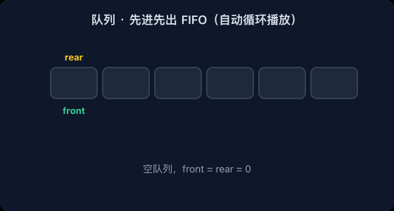

动画演示队列专题里队列先进先出的典型过程；每个方案在「TypeScript 解题方案」一节还配了专属动画与专属流程图。

### 主解法流程图（真实控制流）

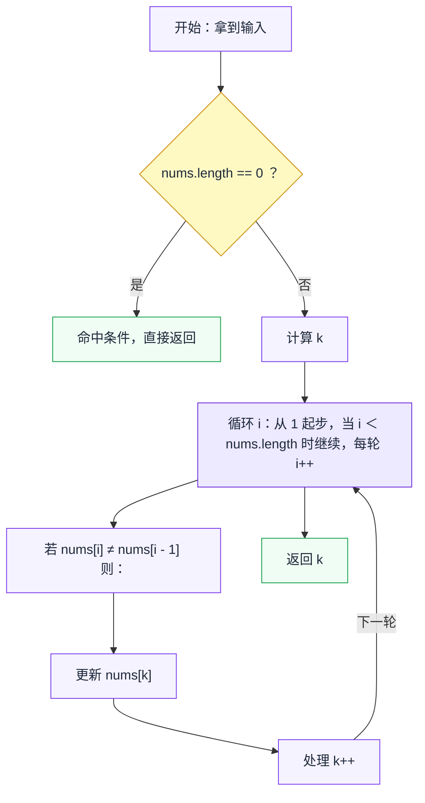

## TypeScript 解题方案（3 个方案逐个讲）

> **运行与提交**：每个方案都是自包含文件（内嵌用例自测，输出 PASS），整块复制到 `.ts` 文件后 `node 文件名` 即可运行。提交 LeetCode 时，把 `demo` 内的算法函数与辅助类型/函数整体取出、置于文件顶层即可。涉及交互/特殊接口的题以题面给定签名为准。

### 方案 1：单趟扫描

**分析与思路**：核心做法是「单趟扫描」。代码里依次做这些事：单循环线性扫描。

**运行方式**：`node 本文件`，内嵌用例全部通过会输出 PASS。


**方案专属流程图**（真实控制流）：

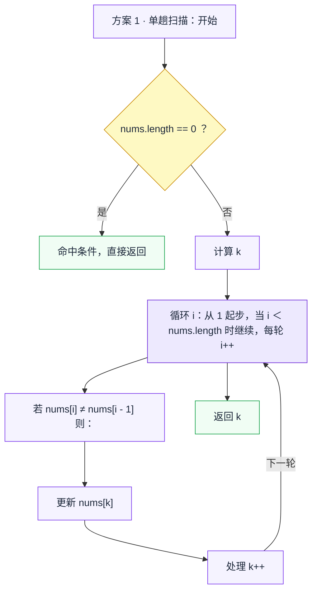

```typescript
export function demo(): void {
  // 程序入口：跑内嵌自测用例
  function removeDuplicates(nums: number[]): number {
    // 定义函数/方法 removeDuplicates
    if (nums.length === 0) return 0; // 若 数组.长度 全等于 0，直接返回 0
    let k = 1; // 把 1 存入 下标 k
    for (let i = 1; i < nums.length; i++) {
      // 让 下标 i 从 1 开始计数，下标 i 小于 数组.长度 就继续
      if (nums[i] !== nums[i - 1]) {
        nums[k] = nums[i];
        k++;
      }
    }
    return k; // 返回 下标 k
  }
  function eqArr(a: number[], b: number[]): boolean {
    // 定义函数/方法 eqArr
    if (a.length !== b.length) return false; // 若 数组.长度 不等于 b.长度，直接返回 false
    for (let i = 0; i < a.length; i++) if (a[i] !== b[i]) return false; // 让 下标 i 从 0 开始计数，下标 i 小于 数组.长度 就继续
    return true; // 返回 true
  }
  const cases = [
    { in: [1, 1, 2], k: 2, pre: [1, 2] },
    { in: [1, 2, 3], k: 3, pre: [1, 2, 3] },
    { in: [], k: 0, pre: [] },
  ];
  let fail = false; // 把 false 存入 fail
  for (const c of cases) {
    // for (const 字符 of cases) {
    const nums = c.in.slice(); // 把 字符.in 截取 ) 存入 数组
    const got = removeDuplicates(nums); // 把 removeDuplicates(数组) 存入 got
    const prefix = nums.slice(0, got); // 把 数组 截取 0, got) 存入 prefix
    if (got !== c.k || !eqArr(prefix, c.pre)) {
      // 若 got 不等于 字符.下标 k 或 取反 eqArr(prefix, 字符.前缀和
      fail = true; // 把 true 存入 fail
      console.log(
        'FAIL removeDuplicates(' +
          JSON.stringify(c.in) +
          ') k=' +
          got +
          ' prefix=' +
          JSON.stringify(prefix),
      ); // 打印输出
    }
  }
  if (fail) throw new Error('FAILED'); // 若 fail) throw new Error(「FAILED」);
  console.log('PASS'); // 全部用例通过，输出 PASS
}
demo(); // demo();
```

### 方案 2：双指针

**分析与思路**：核心做法是「双指针」。代码里依次做这些事：单循环线性扫描。

**运行方式**：`node 本文件`，内嵌用例全部通过会输出 PASS。


**方案专属流程图**（真实控制流）：

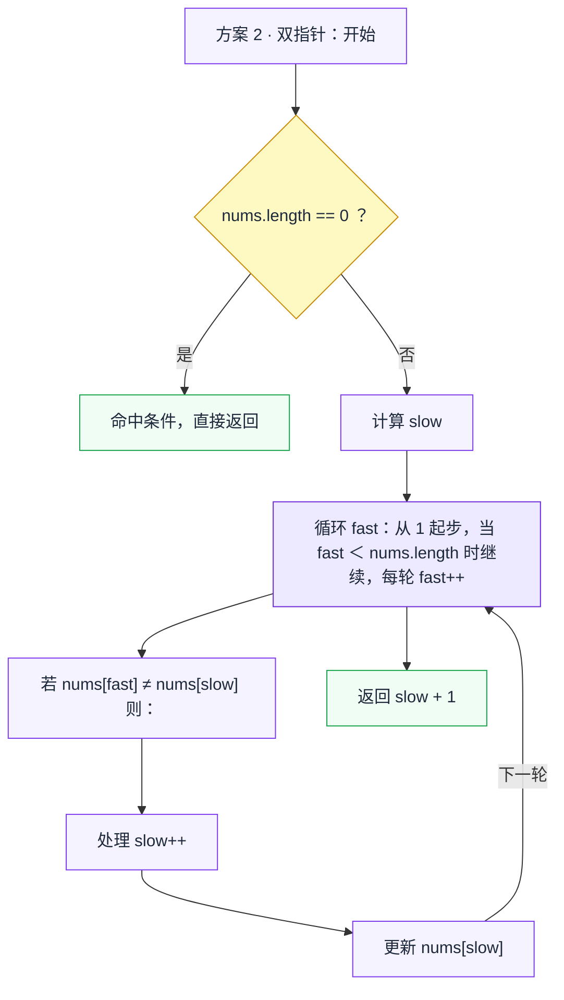

```typescript
export function demo(): void {
  // 程序入口：跑内嵌自测用例
  function removeDuplicates(nums: number[]): number {
    // 定义函数/方法 removeDuplicates
    if (nums.length === 0) return 0; // 若 数组.长度 全等于 0，直接返回 0
    let slow = 0; // 把 0 存入 慢指针
    for (let fast = 1; fast < nums.length; fast++) {
      // 让 快指针 从 1 开始计数，快指针 小于 数组.长度 就继续
      if (nums[fast] !== nums[slow]) {
        slow++;
        nums[slow] = nums[fast];
      } // 若 数组[快指针] 不等于 数组[慢指针]) { 慢指针 加一 ; 数组[慢指针] 赋值为 数组[快指针]; }
    }
    return slow + 1; // 返回 慢指针 加 1
  }
  function eqArr(a: number[], b: number[]): boolean {
    // 定义函数/方法 eqArr
    if (a.length !== b.length) return false; // 若 数组.长度 不等于 b.长度，直接返回 false
    for (let i = 0; i < a.length; i++) if (a[i] !== b[i]) return false; // 让 下标 i 从 0 开始计数，下标 i 小于 数组.长度 就继续
    return true; // 返回 true
  }
  const cases = [
    { in: [1, 1, 2], k: 2, pre: [1, 2] },
    { in: [1, 2, 3], k: 3, pre: [1, 2, 3] },
    { in: [], k: 0, pre: [] },
  ];
  let fail = false; // 把 false 存入 fail
  for (const c of cases) {
    // for (const 字符 of cases) {
    const nums = c.in.slice(); // 把 字符.in 截取 ) 存入 数组
    const got = removeDuplicates(nums); // 把 removeDuplicates(数组) 存入 got
    const prefix = nums.slice(0, got); // 把 数组 截取 0, got) 存入 prefix
    if (got !== c.k || !eqArr(prefix, c.pre)) {
      // 若 got 不等于 字符.下标 k 或 取反 eqArr(prefix, 字符.前缀和
      fail = true; // 把 true 存入 fail
      console.log(
        'FAIL removeDuplicates(' +
          JSON.stringify(c.in) +
          ') k=' +
          got +
          ' prefix=' +
          JSON.stringify(prefix),
      ); // 打印输出
    }
  }
  if (fail) throw new Error('FAILED'); // 若 fail) throw new Error(「FAILED」);
  console.log('PASS'); // 全部用例通过，输出 PASS
}
demo(); // demo();
```

### 方案 3：双指针

**分析与思路**：核心做法是「双指针」。代码里依次做这些事：单循环线性扫描。

**运行方式**：`node 本文件`，内嵌用例全部通过会输出 PASS。

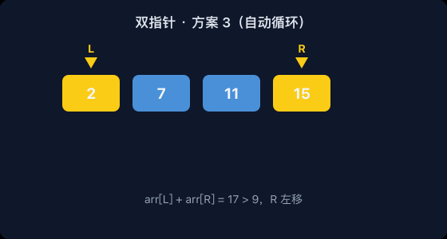

**方案专属流程图**（真实控制流）：


```typescript
export function demo(): void {
  // 程序入口：跑内嵌自测用例
  function removeDuplicates(nums: number[]): number {
    // 定义函数/方法 removeDuplicates
    if (nums.length === 0) return 0; // 若 数组.长度 全等于 0，直接返回 0
    let slow = 0; // 把 0 存入 慢指针
    for (let fast = 1; fast < nums.length; fast++) {
      // 让 快指针 从 1 开始计数，快指针 小于 数组.长度 就继续
      if (nums[fast] !== nums[slow]) {
        slow++;
        nums[slow] = nums[fast];
      } // 若 数组[快指针] 不等于 数组[慢指针]) { 慢指针 加一 ; 数组[慢指针] 赋值为 数组[快指针]; }
    }
    return slow + 1; // 返回 慢指针 加 1
  }
  function eqArr(a: number[], b: number[]): boolean {
    // 定义函数/方法 eqArr
    if (a.length !== b.length) return false; // 若 数组.长度 不等于 b.长度，直接返回 false
    for (let i = 0; i < a.length; i++) if (a[i] !== b[i]) return false; // 让 下标 i 从 0 开始计数，下标 i 小于 数组.长度 就继续
    return true; // 返回 true
  }
  const cases = [
    { in: [1, 1, 2], k: 2, pre: [1, 2] },
    { in: [1, 2, 3], k: 3, pre: [1, 2, 3] },
    { in: [], k: 0, pre: [] },
  ];
  let fail = false; // 把 false 存入 fail
  for (const c of cases) {
    // for (const 字符 of cases) {
    const nums = c.in.slice(); // 把 字符.in 截取 ) 存入 数组
    const got = removeDuplicates(nums); // 把 removeDuplicates(数组) 存入 got
    const prefix = nums.slice(0, got); // 把 数组 截取 0, got) 存入 prefix
    if (got !== c.k || !eqArr(prefix, c.pre)) {
      // 若 got 不等于 字符.下标 k 或 取反 eqArr(prefix, 字符.前缀和
      fail = true; // 把 true 存入 fail
      console.log(
        'FAIL removeDuplicates(' +
          JSON.stringify(c.in) +
          ') k=' +
          got +
          ' prefix=' +
          JSON.stringify(prefix),
      ); // 打印输出
    }
  }
  if (fail) throw new Error('FAILED'); // 若 fail) throw new Error(「FAILED」);
  console.log('PASS'); // 全部用例通过，输出 PASS
}
demo(); // demo();
```

## 逐步拆解与面试追问

**复杂度**：时间 O(n)（单趟线性扫描），空间 O(1) 到 O(n)（视辅助结构）

**为什么是这个量级**：每个元素被常数次访问，辅助哈希或栈的开销与 n 同阶

**面试官可能会追问**：

- 单调队列为什么能保证队首最优？
- 循环队列如何判满？
- 双端队列能替代吗？

## 关键 API 速查（TS 主解法实际用到，附官方链接）

| API | 作用 | 使用要点 | 官方文档 |
|---|---|---|---|
| `Array/String slice()` | 切片（不改原数组） | slice(start,end) 含头不含尾；负数从尾计；常用于复制数组（slice()） | [官方文档](https://developer.mozilla.org/zh-CN/docs/Web/JavaScript/Reference/Global_Objects/Array/slice) |
| `JSON.stringify()` | 序列化为 JSON 字符串 | 常用于结构化比较（深度相等判定）；undefined/函数/循环引用会被丢弃或抛错 | [官方文档](https://developer.mozilla.org/zh-CN/docs/Web/JavaScript/Reference/Global_Objects/JSON/stringify) |

### 各语言官方文档导航

- **TypeScript / JS**：[MDN 中文参考](https://developer.mozilla.org/zh-CN/)
- **Python**：[Python 官方文档](https://docs.python.org/zh-cn/3/)
- **Go**：[Go 标准库](https://pkg.go.dev/std)
- **Java**：[JDK 17 API](https://docs.oracle.com/en/java/javase/17/docs/api/)
- **Rust**：[Rust 标准库](https://doc.rust-lang.org/std/)
- **Lua**：[Lua 5.4 手册](https://www.lua.org/manual/5.4/)
- **C**：[Cppreference C](https://zh.cppreference.com/w/c)
- **C++**：[Cppreference C++](https://zh.cppreference.com/w/cpp)
- **R**：[R 官方手册](https://stat.ethz.ch/R-manual/)
- **Zig**：[Zig 语言文档](https://ziglang.org/documentation/master/)
- **Dart**：[Dart API](https://api.dart.dev/)

## 附录：其他 10 种语言全部实现（每种语言列举其全部方案）

> TypeScript 的全部方案见「TypeScript 解题方案」一节；下面是其余 10 种语言的对应实现，每种语言的每个方案都带思路分析、代码走读与专属运行架构图。
> 每个方案都内嵌用例自测，可独立运行（老仓库 python/go 文件遵循「打印结果」约定）。
> 完整解法文件见 `dsa/<语言>/queue/lc_26_删除有序数组中的重复项/`。

### Python 实现（3 种方案）

Python 的全部方案如下，每个方案都内嵌用例自测，可独立运行（老仓库 python/go 文件遵循「打印结果」约定）：

#### 方案 1：单趟扫描

**思路与代码分析**：核心是「单趟扫描」。Python 版用切片与字典推导式简化操作，突出可读性。**走读**：方案 1 · 单趟扫描：开始 → 命中条件，直接返回 → 更新 k → 循环 i：从 1 到 len(nums 前 → 若 nums[i] ≠ nums[i - 1]：更新 nums[k] → 更新 nums[k] → 更新 + → 返回 k。

**运行架构**（真实控制流）：

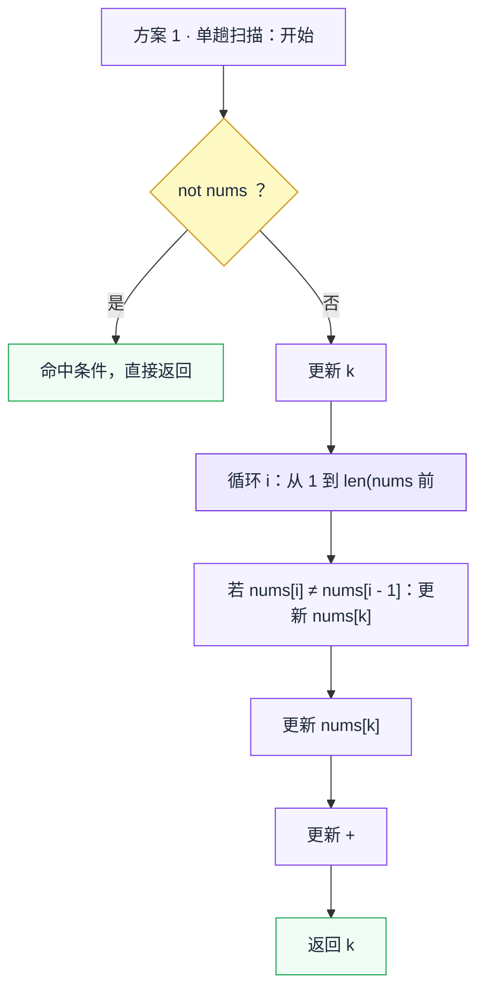

```python
import sys  # 提高递归深度上限（深输入防 RecursionError）

sys.setrecursionlimit(200000)  # 树/链表类题目节点数可达 1e4 量级

def removeDuplicates(nums):  # 定义函数 removeDuplicates（参数：数组）
    # 双指针：慢指针 k 指向去重后下一个待填位置，快指针遍历
    if not nums:  # 若 not 数组
        return 0  # 返回 0
    k = 1  # 把 1 存入 下标 k
    for i in range(1, len(nums)):  # 让 下标 i 从 1 到 长度(数组 遍历
        if nums[i] != nums[i - 1]:  # 若 数组[下标 i] 不等于 数组[下标 i 减 1]
            nums[k] = nums[i]  # 把 数组[下标 i] 写入 nums[k]
            k += 1  # 下标 k累加 1
    return k  # 返回 下标 k

if __name__ == "__main__":  # 若 __name__ 等于 '__main__'
    nums = [1, 1, 2]  # 把 [1, 1, 2] 存入 数组
    k = removeDuplicates(nums)  # 把 removeDuplicates(数组) 存入 下标 k
    print(k, nums[:k])  # 打印输出
```

#### 方案 2：双指针

**思路与代码分析**：核心是「双指针」。Python 版用切片与字典推导式简化操作，突出可读性。**走读**：方案 2 · 双指针：开始 → 命中条件，直接返回 → 更新 slow → 循环 fast：从 1 到 len(nums 前 → 若 nums[fast] ≠ nums[slow]：更新 + → 更新 + → 更新 nums[slow] → 返回 slow + 1。

**运行架构**（真实控制流）：

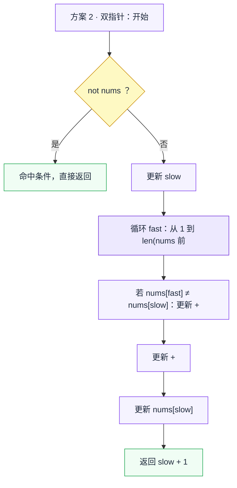

```python
import sys  # 提高递归深度上限（深输入防 RecursionError）

sys.setrecursionlimit(200000)  # 树/链表类题目节点数可达 1e4 量级

def removeDuplicates(nums):  # 定义函数 removeDuplicates（参数：数组）
    if not nums:  # 若 not 数组
        return 0  # 返回 0
    slow = 0  # 把 0 存入 慢指针
    for fast in range(1, len(nums)):  # 让 快指针 从 1 到 长度(数组 遍历
        if nums[fast] != nums[slow]:  # 若 数组[快指针] 不等于 数组[慢指针]
            slow += 1  # 慢指针累加 1
            nums[slow] = nums[fast]  # 把 数组[快指针] 写入 nums[slow]
    return slow + 1  # 返回 慢指针 加 1

if __name__ == "__main__":  # 若 __name__ 等于 '__main__'
    print(removeDuplicates([1, 2, 3]))  # 打印输出
```

#### 方案 3：双指针

**思路与代码分析**：核心是「双指针」。Python 版用切片与字典推导式简化操作，突出可读性。**走读**：方案 3 · 双指针：开始 → 命中条件，直接返回 → 更新 slow → 循环 fast：从 1 到 len(nums 前 → 若 nums[fast] ≠ nums[slow]：更新 + → 更新 + → 更新 nums[slow] → 返回 slow + 1。

**运行架构**（真实控制流）：


```python
import sys  # 提高递归深度上限（深输入防 RecursionError）

sys.setrecursionlimit(200000)  # 树/链表类题目节点数可达 1e4 量级

def removeDuplicates(nums):  # 定义函数 removeDuplicates（参数：数组）
    if not nums:  # 若 not 数组
        return 0  # 返回 0
    slow = 0  # 把 0 存入 慢指针
    for fast in range(1, len(nums)):  # 让 快指针 从 1 到 长度(数组 遍历
        if nums[fast] != nums[slow]:  # 若 数组[快指针] 不等于 数组[慢指针]
            slow += 1  # 慢指针累加 1
            nums[slow] = nums[fast]  # 把 数组[快指针] 写入 nums[slow]
    return slow + 1  # 返回 慢指针 加 1

if __name__ == "__main__":  # 若 __name__ 等于 '__main__'
    print(removeDuplicates([1, 2, 3]))  # 打印输出
```

### Go 实现（3 种方案）

Go 的全部方案如下，每个方案都内嵌用例自测，可独立运行（老仓库 python/go 文件遵循「打印结果」约定）：

#### 方案 1：单趟扫描

**思路与代码分析**：核心是「单趟扫描」。Go 版用切片与多返回值惯用法，显式处理索引边界。**走读**：方案 1 · 单趟扫描：开始 → 处理 if len(nums) == 0 → 返回 0 → 更新 : → 遍历循环 → 处理 if nums[i] ≠ nums[i-1] → 更新 nums[k] → 处理 k++ → 返回 k。

**运行架构**（真实控制流）：

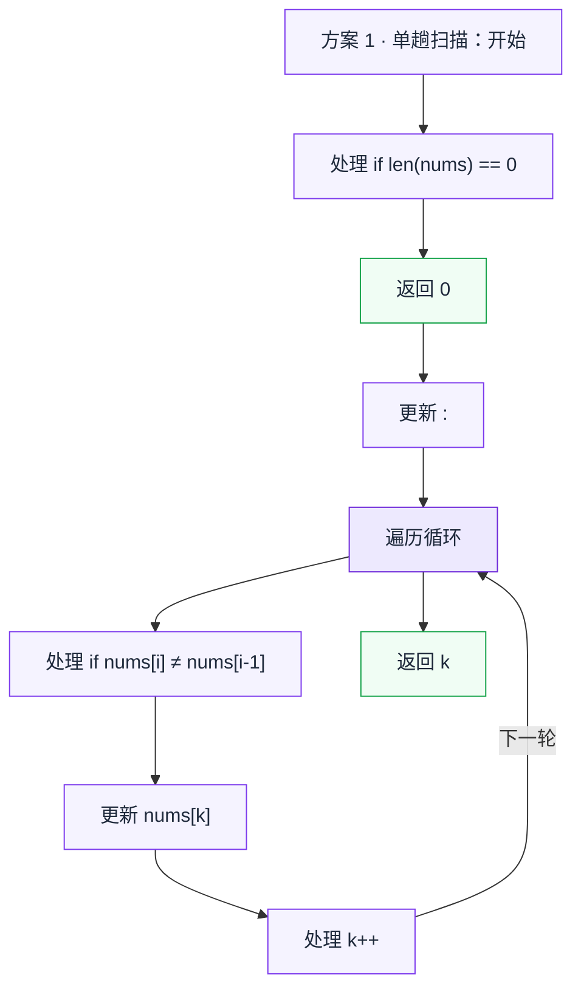

```go
package main // 引入依赖

import (
	"fmt"     // 「fmt」
	"os"      // 「os」
	"reflect" // 「reflect」
)

func RemoveDuplicates(nums []int) int { // 定义函数/方法 RemoveDuplicates
	if len(nums) == 0 { // 若 长度(数组) 等于 0
		return 0 // 返回 0
	}
	k := 1                           // 把 1 写入 k :
	for i := 1; i < len(nums); i++ { // 让 下标 i 从 1 开始计数
		if nums[i] != nums[i-1] { // 若 数组[下标 i] 不等于 数组[下标 i 减 1]
			nums[k] = nums[i] // 把 数组[下标 i] 写入 nums[k]
			k++               // 下标 k 加一
		}
	}
	return k // 返回 下标 k
}

func main() { // 程序入口：跑内嵌自测用例
	ok := true                                               // 把 true 写入 ok :
	nums := []int{1, 1, 2}                                   // 把 []int{1, 1, 2} 写入 nums :
	k := RemoveDuplicates(nums)                              // 把 RemoveDuplicates(数组) 写入 k :
	if k != 2 || !reflect.DeepEqual(nums[:k], []int{1, 2}) { // 若 下标 k 不等于 2 或 取反 reflect.DeepEqual(数组[:下标 k], []int{1, 2}
		ok = false                                                        // 把 false 写入 ok
		fmt.Printf("FAIL removeDuplicates([1,1,2])=%d %v\n", k, nums[:k]) // 打印输出
	}
	nums2 := []int{}                  // 把 []int{} 写入 nums2 :
	if RemoveDuplicates(nums2) != 0 { // 若 RemoveDuplicates(数组2) 不等于 0
		ok = false                // 把 false 写入 ok
		fmt.Println("FAIL empty") // 打印输出
	}
	nums3 := []int{1, 2, 3}           // 把 []int{1, 2, 3} 写入 nums3 :
	if RemoveDuplicates(nums3) != 3 { // 若 RemoveDuplicates(nums3) 不等于 3
		ok = false                  // 把 false 写入 ok
		fmt.Println("FAIL no-dups") // 打印输出
	}
	if !ok { // 若 取反 ok
		os.Exit(1) // os.Exit(1)
	}
	fmt.Println("PASS") // 全部用例通过，输出 PASS
}
```

#### 方案 2：双指针

**思路与代码分析**：核心是「双指针」。Go 版用切片与多返回值惯用法，显式处理索引边界。**走读**：方案 2 · 双指针：开始 → 处理 if len(nums) == 0 → 返回 0 → 更新 : → 遍历循环 → 处理 if nums[fast] ≠ nums[slow] → 处理 slow++ → 更新 nums[slow] → 返回 slow + 1。

**运行架构**（真实控制流）：

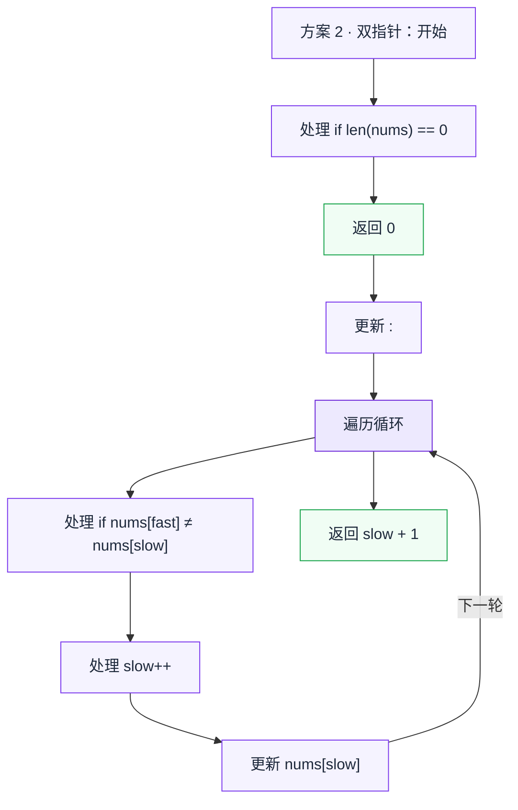

```go
package main // 引入依赖

import (
	"fmt" // 「fmt」
	"os"  // 「os」
)

func removeDuplicates(nums []int) int { // 定义函数/方法 removeDuplicates
	if len(nums) == 0 { // 若 长度(数组) 等于 0
		return 0 // 返回 0
	}
	slow := 0                                 // 把 0 写入 slow :
	for fast := 1; fast < len(nums); fast++ { // 让 快指针 从 1 开始计数
		if nums[fast] != nums[slow] { // 若 数组[快指针] 不等于 数组[慢指针]
			slow++                  // 慢指针 加一
			nums[slow] = nums[fast] // 把 数组[快指针] 写入 nums[slow]
		}
	}
	return slow + 1 // 返回 慢指针 加 1
}

func main() { // 程序入口：跑内嵌自测用例
	ok := true                                         // 把 true 写入 ok :
	if v := removeDuplicates([]int{1, 2, 3}); v != 3 { // 若 值 : 赋值为 removeDuplicates([]int{1, 2, 3}); 值 不等于 3
		ok = false                         // 把 false 写入 ok
		fmt.Printf("FAIL [1,2,3]=%d\n", v) // 打印输出
	}
	if v := removeDuplicates([]int{1, 1, 2}); v != 2 { // 若 值 : 赋值为 removeDuplicates([]int{1, 1, 2}); 值 不等于 2
		ok = false                         // 把 false 写入 ok
		fmt.Printf("FAIL [1,1,2]=%d\n", v) // 打印输出
	}
	if !ok { // 若 取反 ok
		os.Exit(1) // os.Exit(1)
	}
	fmt.Println("PASS") // 全部用例通过，输出 PASS
}
```

#### 方案 3：双指针

**思路与代码分析**：核心是「双指针」。Go 版用切片与多返回值惯用法，显式处理索引边界。**走读**：方案 3 · 双指针：开始 → 处理 if len(nums) == 0 → 返回 0 → 更新 : → 遍历循环 → 处理 if nums[fast] ≠ nums[slow] → 处理 slow++ → 更新 nums[slow] → 返回 slow + 1。

**运行架构**（真实控制流）：


```go
package main // 引入依赖

import (
	"fmt" // 「fmt」
	"os"  // 「os」
)

func removeDuplicates(nums []int) int { // 定义函数/方法 removeDuplicates
	if len(nums) == 0 { // 若 长度(数组) 等于 0
		return 0 // 返回 0
	}
	slow := 0                                 // 把 0 写入 slow :
	for fast := 1; fast < len(nums); fast++ { // 让 快指针 从 1 开始计数
		if nums[fast] != nums[slow] { // 若 数组[快指针] 不等于 数组[慢指针]
			slow++                  // 慢指针 加一
			nums[slow] = nums[fast] // 把 数组[快指针] 写入 nums[slow]
		}
	}
	return slow + 1 // 返回 慢指针 加 1
}

func main() { // 程序入口：跑内嵌自测用例
	ok := true                                         // 把 true 写入 ok :
	if v := removeDuplicates([]int{1, 2, 3}); v != 3 { // 若 值 : 赋值为 removeDuplicates([]int{1, 2, 3}); 值 不等于 3
		ok = false                         // 把 false 写入 ok
		fmt.Printf("FAIL [1,2,3]=%d\n", v) // 打印输出
	}
	if v := removeDuplicates([]int{1, 1, 2}); v != 2 { // 若 值 : 赋值为 removeDuplicates([]int{1, 1, 2}); 值 不等于 2
		ok = false                         // 把 false 写入 ok
		fmt.Printf("FAIL [1,1,2]=%d\n", v) // 打印输出
	}
	if !ok { // 若 取反 ok
		os.Exit(1) // os.Exit(1)
	}
	fmt.Println("PASS") // 全部用例通过，输出 PASS
}
```

### Java 实现（3 种方案）

Java 的全部方案如下，每个方案都内嵌用例自测，可独立运行（老仓库 python/go 文件遵循「打印结果」约定）：

#### 方案 1：单趟扫描

**思路与代码分析**：核心是「单趟扫描」。Java 版用类与静态方法组织，集合操作显式明了。代码里依次做这些事：单循环线性扫描。**走读**：方案 1 · 单趟扫描：开始 → 命中条件，直接返回 → 更新 k → 遍历循环 → 若 nums[i] ≠ nums[i - 1] 则： → 更新 nums[k] → 处理 k++ → 返回 k。

**运行架构**（真实控制流）：

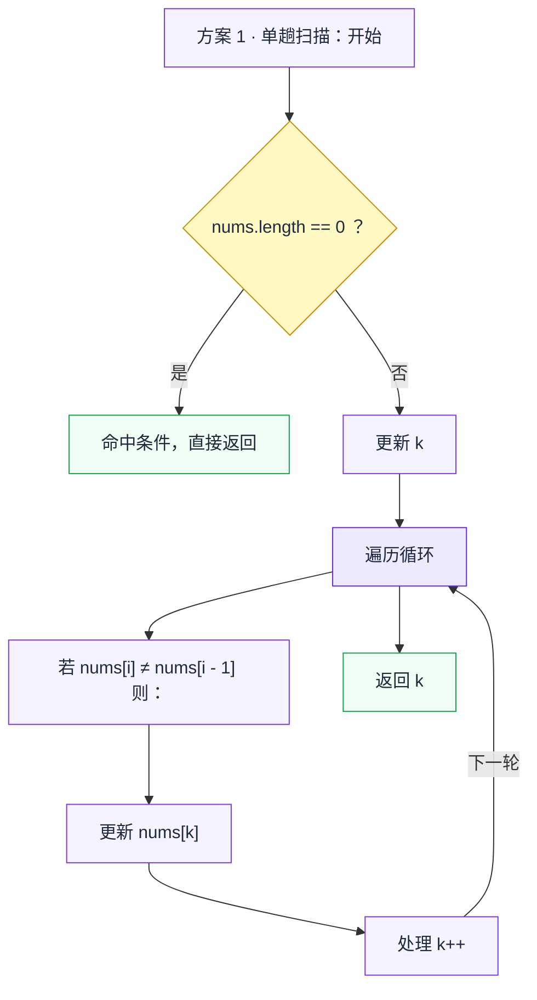

```java
package com.webfault.dsa; // 引入依赖

import java.util.Arrays; // 引入依赖

/**
 * LeetCode 26. 删除有序数组中的重复项 忠实翻译自 python/queue/lc_26_删除有序数组中的重复项/solution_1___1.py 双指针：慢指针 k
 * 指向去重后下一个待填位置，快指针遍历
 */
class Main { // 定义类型
  int removeDuplicates(int[] nums) { // 定义函数/方法 removeDuplicates
    if (nums.length == 0) { // 若 数组.长度 等于 0
      return 0; // 返回 0
    }
    int k = 1; // 把 1 存入 下标 k
    for (int i = 1; i < nums.length; i++) { // 让 下标 i 从 1 开始计数，下标 i 小于 数组.长度 就继续
      if (nums[i] != nums[i - 1]) { // 若 数组[下标 i] 不等于 数组[下标 i 减 1]
        nums[k] = nums[i]; // 把 数组[下标 i]; 写入 nums[k]
        k++; // 下标 k 加一
      }
    }
    return k; // 返回 下标 k
  }

  public static void main(String[] args) { // public static void main(String[] args) {
    Main s = new Main(); // 把 new Main(); 写入 Main s
    int[][] inputs = { // 把 { 写入 int[][] inputs
      {1, 1, 2},
      {0, 0, 1, 1, 1, 2, 2, 3, 3, 4},
      {},
      {1},
      {1, 1, 1},
      {1, 2, 3},
    };
    int[] wants = {2, 5, 0, 1, 1, 3}; // 把 {2, 5, 0, 1, 1, 3}; 写入 int[] wants
    int[][] wantPrefix = { // 把 { 写入 int[][] wantPrefix
      {1, 2},
      {0, 1, 2, 3, 4},
      {},
      {1},
      {1},
      {1, 2, 3},
    };
    boolean ok = true; // 把 true; 写入 boolean ok
    for (int ci = 0; ci < inputs.length; ci++) { // 让 ci 从 0 开始计数，ci 小于 inputs.长度 就继续
      int[] nums = inputs[ci].clone(); // 把 inputs[ci].clone(); 写入 int[] nums
      int k = s.removeDuplicates(nums); // 把 字符串.removeDuplicates(数组) 存入 下标 k
      int[] pre = Arrays.copyOf(nums, k); // 把 Arrays.copyOf(数组, 下标 k); 写入 int[] pre
      if (k != wants[ci]
          || !Arrays.equals(
              pre, wantPrefix[ci])) { // 若 下标 k 不等于 wants[ci] 或 取反 Arrays.equals(前缀和, wantPrefix[ci]
        ok = false; // 把 false; 写入 ok
        System.out.println(
            "FAIL case "
                + ci
                + " k="
                + k // 打印输出
                + " prefix="
                + Arrays.toString(pre) // 把 " 加 Arrays.toString(前缀和) 写入 + " prefix
                + " want k="
                + wants[ci]
                + " prefix="
                + Arrays.toString(wantPrefix[ci]));
      }
    }
    if (!ok) { // 若 取反 ok
      throw new RuntimeException("FAILED"); // throw new RuntimeException(「FAILED」);
    }
    System.out.println("PASS"); // 全部用例通过，输出 PASS
  }
}
```

#### 方案 2：双指针

**思路与代码分析**：核心是「双指针」。Java 版用类与静态方法组织，集合操作显式明了。代码里依次做这些事：单循环线性扫描。**走读**：方案 2 · 双指针：开始 → 命中条件，直接返回 → 更新 slow → 遍历循环 → 若 nums[fast] ≠ nums[slow] 则： → 处理 slow++ → 更新 nums[slow] → 返回 slow + 1。

**运行架构**（真实控制流）：


```java
package com.webfault.dsa; // 引入依赖

import java.util.Arrays; // 引入依赖

/**
 * LeetCode 26. 删除有序数组中的重复项 忠实翻译自 python/queue/lc_26_删除有序数组中的重复项/solution_2_1_____1_____.py
 * slow/fast 双指针，返回 slow + 1
 */
class Main { // 定义类型
  int removeDuplicates(int[] nums) { // 定义函数/方法 removeDuplicates
    if (nums.length == 0) { // 若 数组.长度 等于 0
      return 0; // 返回 0
    }
    int slow = 0; // 把 0 存入 慢指针
    for (int fast = 1; fast < nums.length; fast++) { // 让 快指针 从 1 开始计数，快指针 小于 数组.长度 就继续
      if (nums[fast] != nums[slow]) { // 若 数组[快指针] 不等于 数组[慢指针]
        slow++; // 慢指针 加一
        nums[slow] = nums[fast]; // 把 数组[快指针]; 写入 nums[slow]
      }
    }
    return slow + 1; // 返回 慢指针 加 1
  }

  public static void main(String[] args) { // public static void main(String[] args) {
    Main s = new Main(); // 把 new Main(); 写入 Main s
    int[][] inputs = { // 把 { 写入 int[][] inputs
      {1, 1, 2},
      {0, 0, 1, 1, 1, 2, 2, 3, 3, 4},
      {},
      {1},
      {1, 1, 1},
      {1, 2, 3},
    };
    int[] wants = {2, 5, 0, 1, 1, 3}; // 把 {2, 5, 0, 1, 1, 3}; 写入 int[] wants
    int[][] wantPrefix = { // 把 { 写入 int[][] wantPrefix
      {1, 2},
      {0, 1, 2, 3, 4},
      {},
      {1},
      {1},
      {1, 2, 3},
    };
    boolean ok = true; // 把 true; 写入 boolean ok
    for (int ci = 0; ci < inputs.length; ci++) { // 让 ci 从 0 开始计数，ci 小于 inputs.长度 就继续
      int[] nums = inputs[ci].clone(); // 把 inputs[ci].clone(); 写入 int[] nums
      int k = s.removeDuplicates(nums); // 把 字符串.removeDuplicates(数组) 存入 下标 k
      int[] pre = Arrays.copyOf(nums, k); // 把 Arrays.copyOf(数组, 下标 k); 写入 int[] pre
      if (k != wants[ci]
          || !Arrays.equals(
              pre, wantPrefix[ci])) { // 若 下标 k 不等于 wants[ci] 或 取反 Arrays.equals(前缀和, wantPrefix[ci]
        ok = false; // 把 false; 写入 ok
        System.out.println(
            "FAIL case "
                + ci
                + " k="
                + k // 打印输出
                + " prefix="
                + Arrays.toString(pre) // 把 " 加 Arrays.toString(前缀和) 写入 + " prefix
                + " want k="
                + wants[ci]
                + " prefix="
                + Arrays.toString(wantPrefix[ci]));
      }
    }
    if (!ok) { // 若 取反 ok
      throw new RuntimeException("FAILED"); // throw new RuntimeException(「FAILED」);
    }
    System.out.println("PASS"); // 全部用例通过，输出 PASS
  }
}
```

#### 方案 3：双指针

**思路与代码分析**：核心是「双指针」。Java 版用类与静态方法组织，集合操作显式明了。代码里依次做这些事：单循环线性扫描。**走读**：方案 3 · 双指针：开始 → 命中条件，直接返回 → 更新 slow → 遍历循环 → 若 nums[fast] ≠ nums[slow] 则： → 处理 slow++ → 更新 nums[slow] → 返回 slow + 1。

**运行架构**（真实控制流）：

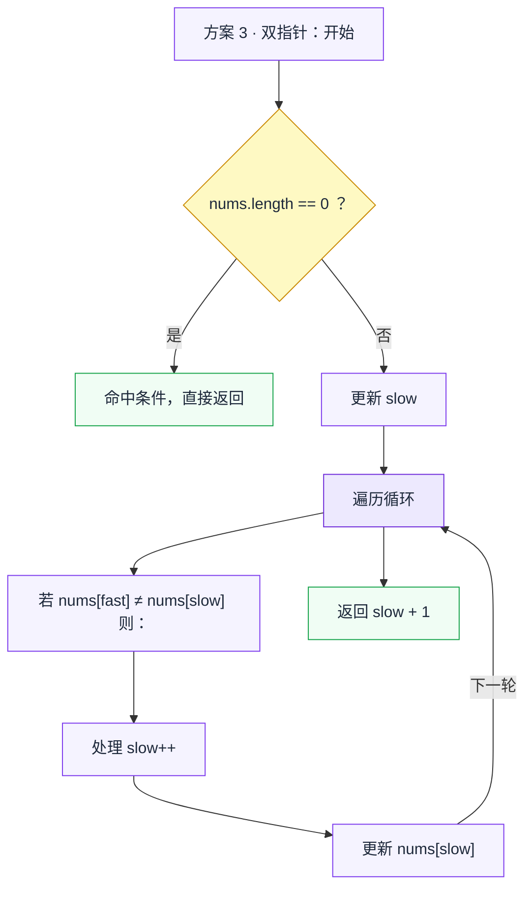

```java
package com.webfault.dsa; // 引入依赖

import java.util.Arrays; // 引入依赖

/**
 * LeetCode 26. 删除有序数组中的重复项 忠实翻译自 python/queue/lc_26_删除有序数组中的重复项/solution_3_2_____2_______.py
 * slow/fast 双指针，返回 slow + 1
 */
class Main { // 定义类型
  int removeDuplicates(int[] nums) { // 定义函数/方法 removeDuplicates
    if (nums.length == 0) { // 若 数组.长度 等于 0
      return 0; // 返回 0
    }
    int slow = 0; // 把 0 存入 慢指针
    for (int fast = 1; fast < nums.length; fast++) { // 让 快指针 从 1 开始计数，快指针 小于 数组.长度 就继续
      if (nums[fast] != nums[slow]) { // 若 数组[快指针] 不等于 数组[慢指针]
        slow++; // 慢指针 加一
        nums[slow] = nums[fast]; // 把 数组[快指针]; 写入 nums[slow]
      }
    }
    return slow + 1; // 返回 慢指针 加 1
  }

  public static void main(String[] args) { // public static void main(String[] args) {
    Main s = new Main(); // 把 new Main(); 写入 Main s
    int[][] inputs = { // 把 { 写入 int[][] inputs
      {1, 1, 2},
      {0, 0, 1, 1, 1, 2, 2, 3, 3, 4},
      {},
      {1},
      {1, 1, 1},
      {1, 2, 3},
    };
    int[] wants = {2, 5, 0, 1, 1, 3}; // 把 {2, 5, 0, 1, 1, 3}; 写入 int[] wants
    int[][] wantPrefix = { // 把 { 写入 int[][] wantPrefix
      {1, 2},
      {0, 1, 2, 3, 4},
      {},
      {1},
      {1},
      {1, 2, 3},
    };
    boolean ok = true; // 把 true; 写入 boolean ok
    for (int ci = 0; ci < inputs.length; ci++) { // 让 ci 从 0 开始计数，ci 小于 inputs.长度 就继续
      int[] nums = inputs[ci].clone(); // 把 inputs[ci].clone(); 写入 int[] nums
      int k = s.removeDuplicates(nums); // 把 字符串.removeDuplicates(数组) 存入 下标 k
      int[] pre = Arrays.copyOf(nums, k); // 把 Arrays.copyOf(数组, 下标 k); 写入 int[] pre
      if (k != wants[ci]
          || !Arrays.equals(
              pre, wantPrefix[ci])) { // 若 下标 k 不等于 wants[ci] 或 取反 Arrays.equals(前缀和, wantPrefix[ci]
        ok = false; // 把 false; 写入 ok
        System.out.println(
            "FAIL case "
                + ci
                + " k="
                + k // 打印输出
                + " prefix="
                + Arrays.toString(pre) // 把 " 加 Arrays.toString(前缀和) 写入 + " prefix
                + " want k="
                + wants[ci]
                + " prefix="
                + Arrays.toString(wantPrefix[ci]));
      }
    }
    if (!ok) { // 若 取反 ok
      throw new RuntimeException("FAILED"); // throw new RuntimeException(「FAILED」);
    }
    System.out.println("PASS"); // 全部用例通过，输出 PASS
  }
}
```

### Rust 实现（3 种方案）

Rust 的全部方案如下，每个方案都内嵌用例自测，可独立运行（老仓库 python/go 文件遵循「打印结果」约定）：

#### 方案 1：单趟扫描

**思路与代码分析**：核心是「单趟扫描」。Rust 版用所有权移动与切片借用改写同一逻辑，注意 Option 与引用边界。**走读**：方案 1 · 单趟扫描：开始 → 处理 if a.len() ≠ b.len() → 返回 false → 遍历 0..a.len() 中的每个元素 i → 处理 if a[i] ≠ b[i] → 返回 false → 处理 true。

**运行架构**（真实控制流）：

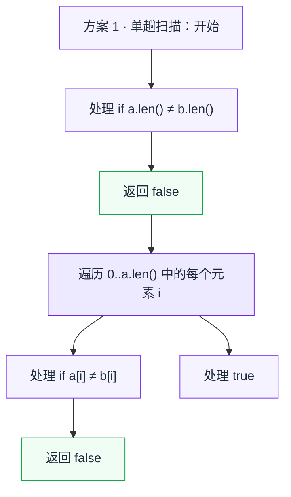

```rust
// LeetCode 26. 删除有序数组中的重复项 — Rust 版

// 方案1：k 指针 —— 相邻比较，不同元素逐个写入前 k 个位置
fn remove_duplicates(nums: &mut [i32]) -> usize {
    // 定义函数/方法 remove_duplicates
    if nums.is_empty() {
        // 若 数组.is_empty(
        return 0; // 返回 0
    }
    let mut k = 1usize; // 把 1usize; 写入 let mut k
    for i in 1..nums.len() {
        // 逐个取出 1 的元素（下标 i）
        if nums[i] != nums[i - 1] {
            // 若 数组[下标 i] 不等于 数组[下标 i 减 1]
            nums[k] = nums[i]; // 把 数组[下标 i]; 写入 nums[k]
            k += 1; // 下标 k累加 1
        }
    }
    k // 下标 k
}

fn eq_arr(a: &[i32], b: &[i32]) -> bool {
    // 定义函数/方法 eq_arr
    if a.len() != b.len() {
        // 若 数组.长度() 不等于 b.长度(
        return false; // 返回 false
    }
    for i in 0..a.len() {
        // 逐个取出 0 的元素（下标 i）
        if a[i] != b[i] {
            // 若 数组[下标 i] 不等于 b[下标 i]
            return false; // 返回 false
        }
    }
    true // true
}

fn main() {
    // 程序入口：跑内嵌自测用例
    // 与 TS 事实源内嵌用例一致
    let cases: Vec<(Vec<i32>, usize, Vec<i32>)> = vec![
        (vec![1, 1, 2], 2, vec![1, 2]),
        (vec![1, 2, 3], 3, vec![1, 2, 3]),
        (vec![], 0, vec![]),
    ];
    for (input, want_k, want_pre) in cases {
        // for (input, want_k, want_pre) in cases {
        let mut nums = input.clone(); // 把 input.clone(); 写入 let mut nums
        let got = remove_duplicates(&mut nums); // 把 remove_duplicates( 按位与 mut 数组) 存入 got
        let prefix: Vec<i32> = nums[..got].to_vec(); // 把 数组[..got].to_vec(); 写入 let prefix: Vec<i32>
        assert!(
            got == want_k && eq_arr(&prefix, &want_pre),
            "FAIL remove_duplicates({:?}) k={} prefix={:?}",
            input,
            got,
            prefix // prefix
        );
    }
    println!("PASS"); // 全部用例通过，输出 PASS
}
```

#### 方案 2：双指针

**思路与代码分析**：核心是「双指针」。Rust 版用所有权移动与切片借用改写同一逻辑，注意 Option 与引用边界。**走读**：方案 2 · 双指针：开始 → 处理 if a.len() ≠ b.len() → 返回 false → 遍历 0..a.len() 中的每个元素 i → 处理 if a[i] ≠ b[i] → 返回 false → 处理 true。

**运行架构**（真实控制流）：

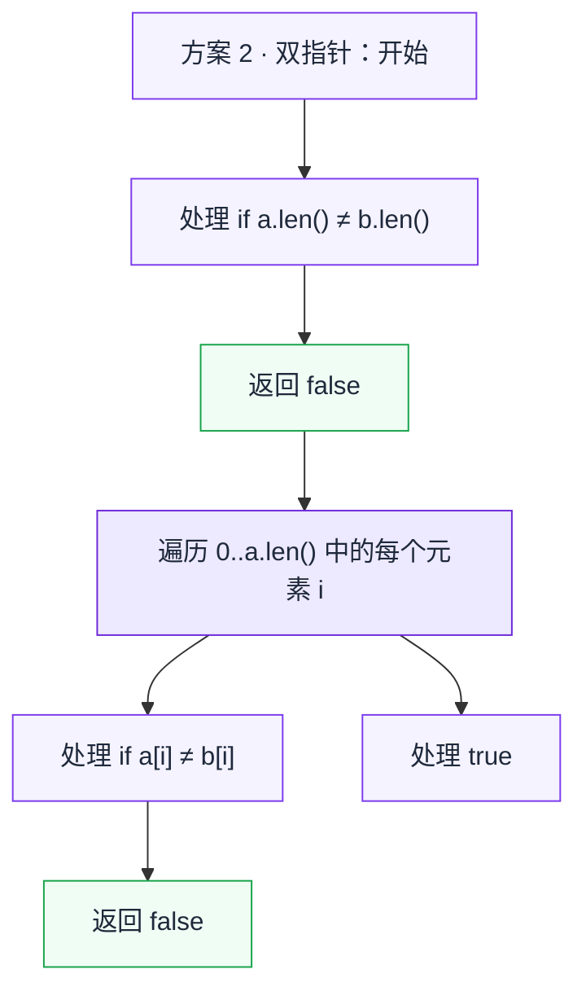

```rust
// LeetCode 26. 删除有序数组中的重复项 — Rust 版

// 方案2：快慢指针 —— fast 扫描，slow 指向已去重区间末尾
fn remove_duplicates(nums: &mut [i32]) -> usize {
    // 定义函数/方法 remove_duplicates
    if nums.is_empty() {
        // 若 数组.is_empty(
        return 0; // 返回 0
    }
    let mut slow = 0usize; // 把 0usize; 写入 let mut slow
    for fast in 1..nums.len() {
        // 逐个取出 1 的元素（快指针）
        if nums[fast] != nums[slow] {
            // 若 数组[快指针] 不等于 数组[慢指针]
            slow += 1; // 慢指针累加 1
            nums[slow] = nums[fast]; // 把 数组[快指针]; 写入 nums[slow]
        }
    }
    slow + 1 // 慢指针 加 1
}

fn eq_arr(a: &[i32], b: &[i32]) -> bool {
    // 定义函数/方法 eq_arr
    if a.len() != b.len() {
        // 若 数组.长度() 不等于 b.长度(
        return false; // 返回 false
    }
    for i in 0..a.len() {
        // 逐个取出 0 的元素（下标 i）
        if a[i] != b[i] {
            // 若 数组[下标 i] 不等于 b[下标 i]
            return false; // 返回 false
        }
    }
    true // true
}

fn main() {
    // 程序入口：跑内嵌自测用例
    // 与 TS 事实源内嵌用例一致
    let cases: Vec<(Vec<i32>, usize, Vec<i32>)> = vec![
        (vec![1, 1, 2], 2, vec![1, 2]),
        (vec![1, 2, 3], 3, vec![1, 2, 3]),
        (vec![], 0, vec![]),
    ];
    for (input, want_k, want_pre) in cases {
        // for (input, want_k, want_pre) in cases {
        let mut nums = input.clone(); // 把 input.clone(); 写入 let mut nums
        let got = remove_duplicates(&mut nums); // 把 remove_duplicates( 按位与 mut 数组) 存入 got
        let prefix: Vec<i32> = nums[..got].to_vec(); // 把 数组[..got].to_vec(); 写入 let prefix: Vec<i32>
        assert!(
            got == want_k && eq_arr(&prefix, &want_pre),
            "FAIL remove_duplicates({:?}) k={} prefix={:?}",
            input,
            got,
            prefix // prefix
        );
    }
    println!("PASS"); // 全部用例通过，输出 PASS
}
```

#### 方案 3：双指针

**思路与代码分析**：核心是「双指针」。Rust 版用所有权移动与切片借用改写同一逻辑，注意 Option 与引用边界。**走读**：方案 3 · 双指针：开始 → 处理 if a.len() ≠ b.len() → 返回 false → 遍历 0..a.len() 中的每个元素 i → 处理 if a[i] ≠ b[i] → 返回 false → 处理 true。

**运行架构**（真实控制流）：

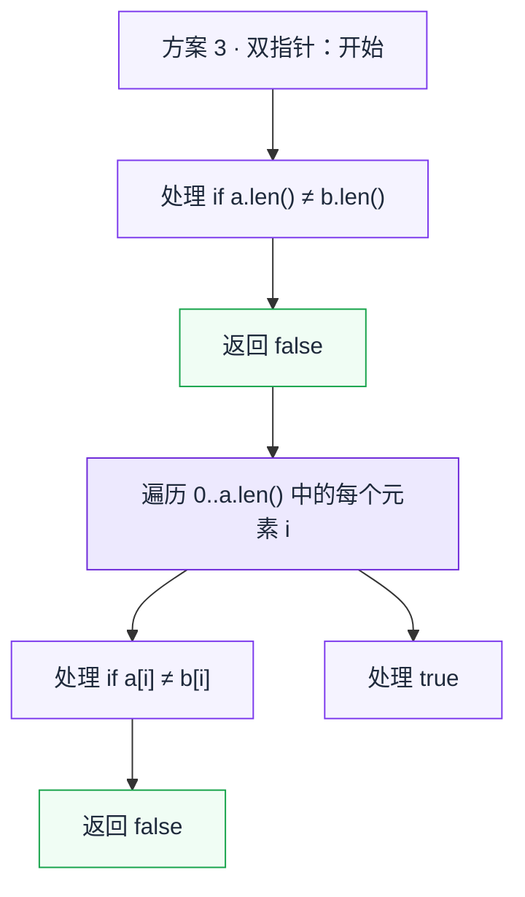

```rust
// LeetCode 26. 删除有序数组中的重复项 — Rust 版

// 方案3：快慢指针 —— fast 扫描，slow 指向已去重区间末尾
fn remove_duplicates(nums: &mut [i32]) -> usize {
    // 定义函数/方法 remove_duplicates
    if nums.is_empty() {
        // 若 数组.is_empty(
        return 0; // 返回 0
    }
    let mut slow = 0usize; // 把 0usize; 写入 let mut slow
    for fast in 1..nums.len() {
        // 逐个取出 1 的元素（快指针）
        if nums[fast] != nums[slow] {
            // 若 数组[快指针] 不等于 数组[慢指针]
            slow += 1; // 慢指针累加 1
            nums[slow] = nums[fast]; // 把 数组[快指针]; 写入 nums[slow]
        }
    }
    slow + 1 // 慢指针 加 1
}

fn eq_arr(a: &[i32], b: &[i32]) -> bool {
    // 定义函数/方法 eq_arr
    if a.len() != b.len() {
        // 若 数组.长度() 不等于 b.长度(
        return false; // 返回 false
    }
    for i in 0..a.len() {
        // 逐个取出 0 的元素（下标 i）
        if a[i] != b[i] {
            // 若 数组[下标 i] 不等于 b[下标 i]
            return false; // 返回 false
        }
    }
    true // true
}

fn main() {
    // 程序入口：跑内嵌自测用例
    // 与 TS 事实源内嵌用例一致
    let cases: Vec<(Vec<i32>, usize, Vec<i32>)> = vec![
        (vec![1, 1, 2], 2, vec![1, 2]),
        (vec![1, 2, 3], 3, vec![1, 2, 3]),
        (vec![], 0, vec![]),
    ];
    for (input, want_k, want_pre) in cases {
        // for (input, want_k, want_pre) in cases {
        let mut nums = input.clone(); // 把 input.clone(); 写入 let mut nums
        let got = remove_duplicates(&mut nums); // 把 remove_duplicates( 按位与 mut 数组) 存入 got
        let prefix: Vec<i32> = nums[..got].to_vec(); // 把 数组[..got].to_vec(); 写入 let prefix: Vec<i32>
        assert!(
            got == want_k && eq_arr(&prefix, &want_pre),
            "FAIL remove_duplicates({:?}) k={} prefix={:?}",
            input,
            got,
            prefix // prefix
        );
    }
    println!("PASS"); // 全部用例通过，输出 PASS
}
```

### Lua 实现（3 种方案）

Lua 的全部方案如下，每个方案都内嵌用例自测，可独立运行（老仓库 python/go 文件遵循「打印结果」约定）：

#### 方案 1：单趟扫描

**思路与代码分析**：核心是「单趟扫描」。Lua 版用表与 ipairs 遍历，注意 ipairs 遇 nil 即停的语义。**走读**：方案 1 · 单趟扫描：开始 → 处理 if #nums == 0 then → 返回 0 → 更新 k → 循环 i：从 2 到 #nums do → 处理 if nums[i] ~= nums[i - 1] th → 更新 nums[k] → 更新 k → 返回 k - 1。

**运行架构**（真实控制流）：

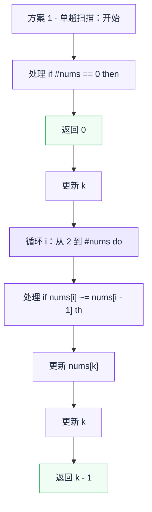

```lua
-- LeetCode 26. 删除有序数组中的重复项 — Lua 版

-- 方案1：k 指针 —— 相邻比较，不同元素逐个写入前 k 个位置
local function remove_duplicates(nums) -- local function remove_duplicates(数组)
	if #nums == 0 then
		return 0
	end -- 若 #数组 等于 0 then return 0 终点
	local k = 2 -- TS 中 k 从 1（0 基）开始，对应 Lua 1 基下标 2
	for i = 2, #nums do -- 把 2, #数组 do 写入 for i
		if nums[i] ~= nums[i - 1] then -- 若 数组[下标 i] ~ 赋值为 数组[下标 i 减 1] then
			nums[k] = nums[i] -- 把 数组[下标 i] 写入 nums[k]
			k = k + 1 -- 把 下标 k 加 1 存入 下标 k
		end -- 终点
	end -- 终点
	return k - 1 -- 返回 下标 k 减 1
end -- 终点

local function eq_arr(a, b) -- local function eq_arr(数组, b)
	if #a ~= #b then
		return false
	end -- 若 #数组 ~ 赋值为 #b then return false 终点
	for i = 1, #a do -- 把 1, #数组 do 写入 for i
		if a[i] ~= b[i] then
			return false
		end -- 若 数组[下标 i] ~ 赋值为 b[下标 i] then return false 终点
	end -- 终点
	return true -- 返回 true
end -- 终点

-- 自测：与 TS 事实源内嵌用例一致
local cases = { -- 把 { 写入 local cases
	{ input = { 1, 1, 2 }, k = 2, pre = { 1, 2 } },
	{ input = { 1, 2, 3 }, k = 3, pre = { 1, 2, 3 } },
	{ input = {}, k = 0, pre = {} },
}
for _, c in ipairs(cases) do -- 遍历取 字符
	local nums = {} -- 把 {} 写入 local nums
	for i, v in ipairs(c.input) do
		nums[i] = v
	end -- 遍历取 值
	local got = remove_duplicates(nums) -- 把 remove_duplicates(数组) 写入 local got
	local prefix = {} -- 把 {} 写入 local prefix
	for i = 1, got do
		prefix[i] = nums[i]
	end -- 让 下标 i 从 1 走到 got（Lua 1 基）
	assert(got == c.k and eq_arr(prefix, c.pre), string.format("FAIL removeDuplicates k=%d", got)) -- 把 对…取模 d", got)) 写入 string.format("FAIL removeDuplicates k
end -- 终点
print("PASS") -- 全部用例通过，输出 PASS
```

#### 方案 2：双指针

**思路与代码分析**：核心是「双指针」。Lua 版用表与 ipairs 遍历，注意 ipairs 遇 nil 即停的语义。**走读**：方案 2 · 双指针：开始 → 处理 if #nums == 0 then → 返回 0 → 更新 slow → 循环 fast：从 2 到 #nums do → 处理 if nums[fast] ~= nums[slow] → 更新 slow → 更新 nums[slow] → 返回 slow。

**运行架构**（真实控制流）：

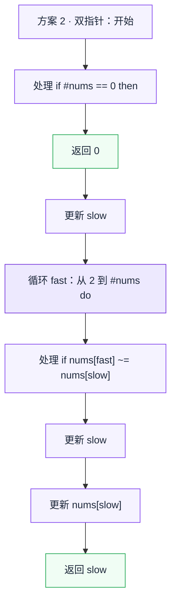

```lua
-- LeetCode 26. 删除有序数组中的重复项 — Lua 版

-- 方案2：快慢指针 —— fast 扫描，slow 指向已去重区间末尾
local function remove_duplicates(nums) -- local function remove_duplicates(数组)
	if #nums == 0 then
		return 0
	end -- 若 #数组 等于 0 then return 0 终点
	local slow = 1 -- 把 1 写入 local slow
	for fast = 2, #nums do -- 把 2, #数组 do 写入 for fast
		if nums[fast] ~= nums[slow] then -- 若 数组[快指针] ~ 赋值为 数组[慢指针] then
			slow = slow + 1 -- 把 慢指针 加 1 存入 慢指针
			nums[slow] = nums[fast] -- 把 数组[快指针] 写入 nums[slow]
		end -- 终点
	end -- 终点
	return slow -- 返回 慢指针
end -- 终点

local function eq_arr(a, b) -- local function eq_arr(数组, b)
	if #a ~= #b then
		return false
	end -- 若 #数组 ~ 赋值为 #b then return false 终点
	for i = 1, #a do -- 把 1, #数组 do 写入 for i
		if a[i] ~= b[i] then
			return false
		end -- 若 数组[下标 i] ~ 赋值为 b[下标 i] then return false 终点
	end -- 终点
	return true -- 返回 true
end -- 终点

-- 自测：与 TS 事实源内嵌用例一致
local cases = { -- 把 { 写入 local cases
	{ input = { 1, 1, 2 }, k = 2, pre = { 1, 2 } },
	{ input = { 1, 2, 3 }, k = 3, pre = { 1, 2, 3 } },
	{ input = {}, k = 0, pre = {} },
}
for _, c in ipairs(cases) do -- 遍历取 字符
	local nums = {} -- 把 {} 写入 local nums
	for i, v in ipairs(c.input) do
		nums[i] = v
	end -- 遍历取 值
	local got = remove_duplicates(nums) -- 把 remove_duplicates(数组) 写入 local got
	local prefix = {} -- 把 {} 写入 local prefix
	for i = 1, got do
		prefix[i] = nums[i]
	end -- 让 下标 i 从 1 走到 got（Lua 1 基）
	assert(got == c.k and eq_arr(prefix, c.pre), string.format("FAIL removeDuplicates k=%d", got)) -- 把 对…取模 d", got)) 写入 string.format("FAIL removeDuplicates k
end -- 终点
print("PASS") -- 全部用例通过，输出 PASS
```

#### 方案 3：双指针

**思路与代码分析**：核心是「双指针」。Lua 版用表与 ipairs 遍历，注意 ipairs 遇 nil 即停的语义。**走读**：方案 3 · 双指针：开始 → 处理 if #nums == 0 then → 返回 0 → 更新 slow → 循环 fast：从 2 到 #nums do → 处理 if nums[fast] ~= nums[slow] → 更新 slow → 更新 nums[slow] → 返回 slow。

**运行架构**（真实控制流）：


```lua
-- LeetCode 26. 删除有序数组中的重复项 — Lua 版

-- 方案3：快慢指针 —— fast 扫描，slow 指向已去重区间末尾
local function remove_duplicates(nums) -- local function remove_duplicates(数组)
	if #nums == 0 then
		return 0
	end -- 若 #数组 等于 0 then return 0 终点
	local slow = 1 -- 把 1 写入 local slow
	for fast = 2, #nums do -- 把 2, #数组 do 写入 for fast
		if nums[fast] ~= nums[slow] then -- 若 数组[快指针] ~ 赋值为 数组[慢指针] then
			slow = slow + 1 -- 把 慢指针 加 1 存入 慢指针
			nums[slow] = nums[fast] -- 把 数组[快指针] 写入 nums[slow]
		end -- 终点
	end -- 终点
	return slow -- 返回 慢指针
end -- 终点

local function eq_arr(a, b) -- local function eq_arr(数组, b)
	if #a ~= #b then
		return false
	end -- 若 #数组 ~ 赋值为 #b then return false 终点
	for i = 1, #a do -- 把 1, #数组 do 写入 for i
		if a[i] ~= b[i] then
			return false
		end -- 若 数组[下标 i] ~ 赋值为 b[下标 i] then return false 终点
	end -- 终点
	return true -- 返回 true
end -- 终点

-- 自测：与 TS 事实源内嵌用例一致
local cases = { -- 把 { 写入 local cases
	{ input = { 1, 1, 2 }, k = 2, pre = { 1, 2 } },
	{ input = { 1, 2, 3 }, k = 3, pre = { 1, 2, 3 } },
	{ input = {}, k = 0, pre = {} },
}
for _, c in ipairs(cases) do -- 遍历取 字符
	local nums = {} -- 把 {} 写入 local nums
	for i, v in ipairs(c.input) do
		nums[i] = v
	end -- 遍历取 值
	local got = remove_duplicates(nums) -- 把 remove_duplicates(数组) 写入 local got
	local prefix = {} -- 把 {} 写入 local prefix
	for i = 1, got do
		prefix[i] = nums[i]
	end -- 让 下标 i 从 1 走到 got（Lua 1 基）
	assert(got == c.k and eq_arr(prefix, c.pre), string.format("FAIL removeDuplicates k=%d", got)) -- 把 对…取模 d", got)) 写入 string.format("FAIL removeDuplicates k
end -- 终点
print("PASS") -- 全部用例通过，输出 PASS
```

### C 实现（3 种方案）

C 的全部方案如下，每个方案都内嵌用例自测，可独立运行（老仓库 python/go 文件遵循「打印结果」约定）：

#### 方案 1：单趟扫描

**思路与代码分析**：核心是「单趟扫描」。C 版手动管理下标与内存，循环边界全部显式写出。代码里依次做这些事：单循环线性扫描。**走读**：方案 1 · 单趟扫描：开始 → 命中条件，直接返回 → 更新 k → 遍历循环 → 若 nums[i] ≠ nums[i - 1] 则： → 更新 nums[k] → 处理 k++ → 返回 k。

**运行架构**（真实控制流）：

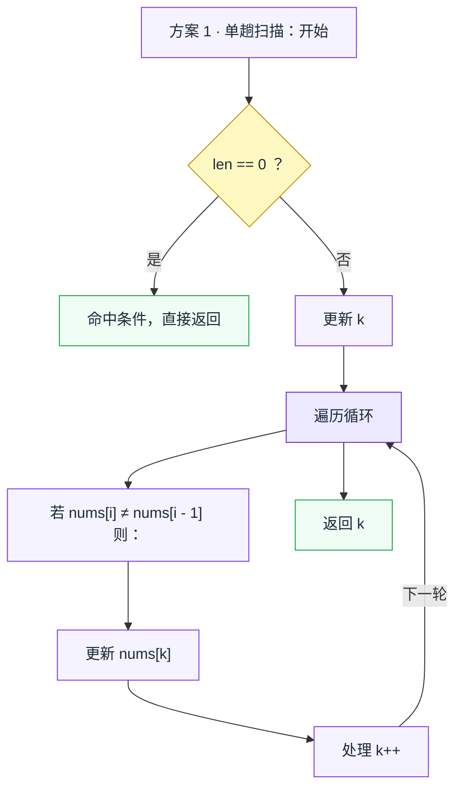

```c
* LeetCode 26. 删除有序数组中的重复项 — C 版 */
#include <stdio.h> // 引入头文件

/* 方案1：k 指针 —— 相邻比较，不同元素逐个写入前 k 个位置 */
static int remove_duplicates(int *nums, int len) { // 定义函数/方法 remove_duplicates
    if (len == 0)
        return 0;                     // 若 长度 等于 0，直接返回 0
    int k = 1;                        // 把 1 存入 下标 k
    for (int i = 1; i < len; i++) {   // 让 下标 i 从 1 开始计数，下标 i 小于 长度 就继续
        if (nums[i] != nums[i - 1]) { // 若 数组[下标 i] 不等于 数组[下标 i 减 1]
            nums[k] = nums[i];        // 把 数组[下标 i]; 写入 nums[k]
            k++;                      // 下标 k 加一
        }
    }
    return k; // 返回 下标 k
}

static int eq_arr(const int *a, int alen, const int *b, int blen) { // 定义函数/方法 eq_arr
    if (alen != blen)
        return 0;                    // 若 alen 不等于 blen，直接返回 0
    for (int i = 0; i < alen; i++) { // 让 下标 i 从 0 开始计数，下标 i 小于 alen 就继续
        if (a[i] != b[i])
            return 0; // 若 数组[下标 i] 不等于 b[下标 i]，直接返回 0
    }
    return 1; // 返回 1
}

int main(void) { // 程序入口：跑内嵌自测用例
    /* 与 TS 事实源内嵌用例一致 */
    struct {
        int in[4];
        int in_len;
        int k;
        int pre[4];
        int pre_len;
    } cases[] = {
        {{1, 1, 2}, 3, 2, {1, 2}, 2},
        {{1, 2, 3}, 3, 3, {1, 2, 3}, 3},
        {{0}, 0, 0, {0}, 0},
    };
    int n = (int)(sizeof(cases) /
                  sizeof(cases[0])); // 把 (int)(sizeof(cases) 除以 sizeof(cases[0])) 存入 元素个数
    for (int ci = 0; ci < n; ci++) { // 让 ci 从 0 开始计数，ci 小于 元素个数 就继续
        int nums[4];                 // int 数组[4];
        for (int i = 0; i < cases[ci].in_len; i++)
            nums[i] = cases[ci].in[i]; // 让 下标 i 从 0 开始计数，下标 i 小于 cases[ci].in_len 就继续
        int got = remove_duplicates(
            nums, cases[ci].in_len); // 把 remove_duplicates(数组, cases[ci].in_len) 存入 got
        if (got != cases[ci].k || !eq_arr(nums, got, cases[ci].pre, cases[ci].pre_len)) {
            printf("FAIL case %d k=%d\n", ci, got); // 打印输出
            return 1;                               // 返回 1
        }
    }
    printf("PASS\n"); // 全部用例通过，输出 PASS
    return 0;         // 返回 0
}
```

#### 方案 2：双指针

**思路与代码分析**：核心是「双指针」。C 版手动管理下标与内存，循环边界全部显式写出。代码里依次做这些事：单循环线性扫描。**走读**：方案 2 · 双指针：开始 → 命中条件，直接返回 → 更新 slow → 遍历循环 → 若 nums[fast] ≠ nums[slow] 则： → 处理 slow++ → 更新 nums[slow] → 返回 slow + 1。

**运行架构**（真实控制流）：

```mermaid
graph TD
    N0["方案 2 · 双指针：开始"]
    N1{"len == 0 ？"}
    N2["命中条件，直接返回"]
    N3["更新 slow"]
    N4["遍历循环"]
    N5["若 nums[fast] ≠ nums[slow] 则："]
    N6["处理 slow++"]
    N7["更新 nums[slow]"]
    N8["返回 slow + 1"]
    N0 --> N1
    N1 -- 是 --> N2
    N1 -- 否 --> N3
    N3 --> N4
    N4 --> N5
    N5 --> N6
    N6 --> N7
    N7 -- 下一轮 --> N4
    N4 --> N8
    classDef n fill:#f5f3ff,stroke:#7c3aed,color:#1e293b;
    classDef lp fill:#ede9fe,stroke:#6d28d9,color:#1e293b;
    classDef dc fill:#fef9c3,stroke:#ca8a04,color:#1e293b;
    classDef tm fill:#f0fdf4,stroke:#16a34a,color:#1e293b;
    class N0,N3,N5,N6,N7 n;
    class N4 lp;
    class N1 dc;
    class N2,N8 tm;
```

```c
* LeetCode 26. 删除有序数组中的重复项 — C 版 */
#include <stdio.h> // 引入头文件

/* 方案2：快慢指针 —— fast 扫描，slow 指向已去重区间末尾 */
static int remove_duplicates(int *nums, int len) { // 定义函数/方法 remove_duplicates
    if (len == 0)
        return 0;                            // 若 长度 等于 0，直接返回 0
    int slow = 0;                            // 把 0 存入 慢指针
    for (int fast = 1; fast < len; fast++) { // 让 快指针 从 1 开始计数，快指针 小于 长度 就继续
        if (nums[fast] != nums[slow]) { // 若 数组[快指针] 不等于 数组[慢指针]
            slow++;                     // 慢指针 加一
            nums[slow] = nums[fast];    // 把 数组[快指针]; 写入 nums[slow]
        }
    }
    return slow + 1; // 返回 慢指针 加 1
}

static int eq_arr(const int *a, int alen, const int *b, int blen) { // 定义函数/方法 eq_arr
    if (alen != blen)
        return 0;                    // 若 alen 不等于 blen，直接返回 0
    for (int i = 0; i < alen; i++) { // 让 下标 i 从 0 开始计数，下标 i 小于 alen 就继续
        if (a[i] != b[i])
            return 0; // 若 数组[下标 i] 不等于 b[下标 i]，直接返回 0
    }
    return 1; // 返回 1
}

int main(void) { // 程序入口：跑内嵌自测用例
    /* 与 TS 事实源内嵌用例一致 */
    struct {
        int in[4];
        int in_len;
        int k;
        int pre[4];
        int pre_len;
    } cases[] = {
        {{1, 1, 2}, 3, 2, {1, 2}, 2},
        {{1, 2, 3}, 3, 3, {1, 2, 3}, 3},
        {{0}, 0, 0, {0}, 0},
    };
    int n = (int)(sizeof(cases) /
                  sizeof(cases[0])); // 把 (int)(sizeof(cases) 除以 sizeof(cases[0])) 存入 元素个数
    for (int ci = 0; ci < n; ci++) { // 让 ci 从 0 开始计数，ci 小于 元素个数 就继续
        int nums[4];                 // int 数组[4];
        for (int i = 0; i < cases[ci].in_len; i++)
            nums[i] = cases[ci].in[i]; // 让 下标 i 从 0 开始计数，下标 i 小于 cases[ci].in_len 就继续
        int got = remove_duplicates(
            nums, cases[ci].in_len); // 把 remove_duplicates(数组, cases[ci].in_len) 存入 got
        if (got != cases[ci].k || !eq_arr(nums, got, cases[ci].pre, cases[ci].pre_len)) {
            printf("FAIL case %d k=%d\n", ci, got); // 打印输出
            return 1;                               // 返回 1
        }
    }
    printf("PASS\n"); // 全部用例通过，输出 PASS
    return 0;         // 返回 0
}
```

#### 方案 3：双指针

**思路与代码分析**：核心是「双指针」。C 版手动管理下标与内存，循环边界全部显式写出。代码里依次做这些事：单循环线性扫描。**走读**：方案 3 · 双指针：开始 → 命中条件，直接返回 → 更新 slow → 遍历循环 → 若 nums[fast] ≠ nums[slow] 则： → 处理 slow++ → 更新 nums[slow] → 返回 slow + 1。

**运行架构**（真实控制流）：

```mermaid
graph TD
    N0["方案 3 · 双指针：开始"]
    N1{"len == 0 ？"}
    N2["命中条件，直接返回"]
    N3["更新 slow"]
    N4["遍历循环"]
    N5["若 nums[fast] ≠ nums[slow] 则："]
    N6["处理 slow++"]
    N7["更新 nums[slow]"]
    N8["返回 slow + 1"]
    N0 --> N1
    N1 -- 是 --> N2
    N1 -- 否 --> N3
    N3 --> N4
    N4 --> N5
    N5 --> N6
    N6 --> N7
    N7 -- 下一轮 --> N4
    N4 --> N8
    classDef n fill:#f5f3ff,stroke:#7c3aed,color:#1e293b;
    classDef lp fill:#ede9fe,stroke:#6d28d9,color:#1e293b;
    classDef dc fill:#fef9c3,stroke:#ca8a04,color:#1e293b;
    classDef tm fill:#f0fdf4,stroke:#16a34a,color:#1e293b;
    class N0,N3,N5,N6,N7 n;
    class N4 lp;
    class N1 dc;
    class N2,N8 tm;
```

```c
* LeetCode 26. 删除有序数组中的重复项 — C 版 */
#include <stdio.h> // 引入头文件

/* 方案3：快慢指针 —— fast 扫描，slow 指向已去重区间末尾 */
static int remove_duplicates(int *nums, int len) { // 定义函数/方法 remove_duplicates
    if (len == 0)
        return 0;                            // 若 长度 等于 0，直接返回 0
    int slow = 0;                            // 把 0 存入 慢指针
    for (int fast = 1; fast < len; fast++) { // 让 快指针 从 1 开始计数，快指针 小于 长度 就继续
        if (nums[fast] != nums[slow]) { // 若 数组[快指针] 不等于 数组[慢指针]
            slow++;                     // 慢指针 加一
            nums[slow] = nums[fast];    // 把 数组[快指针]; 写入 nums[slow]
        }
    }
    return slow + 1; // 返回 慢指针 加 1
}

static int eq_arr(const int *a, int alen, const int *b, int blen) { // 定义函数/方法 eq_arr
    if (alen != blen)
        return 0;                    // 若 alen 不等于 blen，直接返回 0
    for (int i = 0; i < alen; i++) { // 让 下标 i 从 0 开始计数，下标 i 小于 alen 就继续
        if (a[i] != b[i])
            return 0; // 若 数组[下标 i] 不等于 b[下标 i]，直接返回 0
    }
    return 1; // 返回 1
}

int main(void) { // 程序入口：跑内嵌自测用例
    /* 与 TS 事实源内嵌用例一致 */
    struct {
        int in[4];
        int in_len;
        int k;
        int pre[4];
        int pre_len;
    } cases[] = {
        {{1, 1, 2}, 3, 2, {1, 2}, 2},
        {{1, 2, 3}, 3, 3, {1, 2, 3}, 3},
        {{0}, 0, 0, {0}, 0},
    };
    int n = (int)(sizeof(cases) /
                  sizeof(cases[0])); // 把 (int)(sizeof(cases) 除以 sizeof(cases[0])) 存入 元素个数
    for (int ci = 0; ci < n; ci++) { // 让 ci 从 0 开始计数，ci 小于 元素个数 就继续
        int nums[4];                 // int 数组[4];
        for (int i = 0; i < cases[ci].in_len; i++)
            nums[i] = cases[ci].in[i]; // 让 下标 i 从 0 开始计数，下标 i 小于 cases[ci].in_len 就继续
        int got = remove_duplicates(
            nums, cases[ci].in_len); // 把 remove_duplicates(数组, cases[ci].in_len) 存入 got
        if (got != cases[ci].k || !eq_arr(nums, got, cases[ci].pre, cases[ci].pre_len)) {
            printf("FAIL case %d k=%d\n", ci, got); // 打印输出
            return 1;                               // 返回 1
        }
    }
    printf("PASS\n"); // 全部用例通过，输出 PASS
    return 0;         // 返回 0
}
```

### C++ 实现（3 种方案）

C++ 的全部方案如下，每个方案都内嵌用例自测，可独立运行（老仓库 python/go 文件遵循「打印结果」约定）：

#### 方案 1：单趟扫描

**思路与代码分析**：核心是「单趟扫描」。C++ 版用 STL 容器与迭代器，减少手写下标错误。代码里依次做这些事：单循环线性扫描。**走读**：方案 1 · 单趟扫描：开始 → 命中条件，直接返回 → 更新 k → 遍历循环 → 若 nums[i] ≠ nums[i - 1] 则： → 更新 nums[k] → 处理 ++k → 返回 k。

**运行架构**（真实控制流）：

```mermaid
graph TD
    N0["方案 1 · 单趟扫描：开始"]
    N1{"nums.empty() ？"}
    N2["命中条件，直接返回"]
    N3["更新 k"]
    N4["遍历循环"]
    N5["若 nums[i] ≠ nums[i - 1] 则："]
    N6["更新 nums[k]"]
    N7["处理 ++k"]
    N8["返回 k"]
    N0 --> N1
    N1 -- 是 --> N2
    N1 -- 否 --> N3
    N3 --> N4
    N4 --> N5
    N5 --> N6
    N6 --> N7
    N7 -- 下一轮 --> N4
    N4 --> N8
    classDef n fill:#f5f3ff,stroke:#7c3aed,color:#1e293b;
    classDef lp fill:#ede9fe,stroke:#6d28d9,color:#1e293b;
    classDef dc fill:#fef9c3,stroke:#ca8a04,color:#1e293b;
    classDef tm fill:#f0fdf4,stroke:#16a34a,color:#1e293b;
    class N0,N3,N5,N6,N7 n;
    class N4 lp;
    class N1 dc;
    class N2,N8 tm;
```

```cpp
// LeetCode 26. 删除有序数组中的重复项 — C++ 版
#include <iostream> // 引入头文件
#include <vector>   // 引入头文件

// 方案1：k 指针 —— 相邻比较，不同元素逐个写入前 k 个位置
size_t removeDuplicates(std::vector<int> &nums) { // 定义函数/方法 removeDuplicates
    if (nums.empty())
        return 0;                              // 若 数组 是否为空，直接返回 0
    size_t k = 1;                              // 把 1; 写入 size_t k
    for (size_t i = 1; i < nums.size(); ++i) { // 让 下标 i 从 1 开始计数，下标 i 小于 数组.大小() 就继续
        if (nums[i] != nums[i - 1]) { // 若 数组[下标 i] 不等于 数组[下标 i 减 1]
            nums[k] = nums[i];        // 把 数组[下标 i]; 写入 nums[k]
            ++k;                      // 加一 下标 k;
        }
    }
    return k; // 返回 下标 k
}

int main() { // 程序入口：跑内嵌自测用例
    // 与 TS 事实源内嵌用例一致
    struct Case {             // 定义类型
        std::vector<int> in;  // std::vector 小于 int 超过 in;
        size_t k;             // size_t 下标 k;
        std::vector<int> pre; // std::vector 小于 int 超过 前缀和;
    };
    std::vector<Case> cases = {
        // 把 { 写入 std::vector<Case> cases
        {{1, 1, 2}, 2, {1, 2}},
        {{1, 2, 3}, 3, {1, 2, 3}},
        {{}, 0, {}},
    };
    for (const auto &c : cases) {            // 逐个取出 cases 的元素（字符）
        std::vector<int> nums = c.in;        // 把 字符.in; 写入 std::vector<int> nums
        size_t got = removeDuplicates(nums); // 把 removeDuplicates(数组); 写入 size_t got
        std::vector<int> prefix(nums.begin(), nums.begin() + static_cast<std::ptrdiff_t>(got));
        if (got != c.k || prefix != c.pre) { // 若 got 不等于 字符.下标 k 或 prefix 不等于 字符.前缀和
            std::cout << "FAILED case k=" << got << std::endl; // 打印输出
            return 1;                                          // 返回 1
        }
    }
    std::cout << "PASS" << std::endl; // 全部用例通过，输出 PASS
    return 0;                         // 返回 0
}
```

#### 方案 2：双指针

**思路与代码分析**：核心是「双指针」。C++ 版用 STL 容器与迭代器，减少手写下标错误。代码里依次做这些事：单循环线性扫描。**走读**：方案 2 · 双指针：开始 → 命中条件，直接返回 → 更新 slow → 遍历循环 → 处理 ++fast) → 若 nums[fast] ≠ nums[slow] 则： → 处理 ++slow → 更新 nums[slow] → 返回 slow + 1。

**运行架构**（真实控制流）：

```mermaid
graph TD
    N0["方案 2 · 双指针：开始"]
    N1{"nums.empty() ？"}
    N2["命中条件，直接返回"]
    N3["更新 slow"]
    N4["遍历循环"]
    N5["处理 ++fast)"]
    N6["若 nums[fast] ≠ nums[slow] 则："]
    N7["处理 ++slow"]
    N8["更新 nums[slow]"]
    N9["返回 slow + 1"]
    N0 --> N1
    N1 -- 是 --> N2
    N1 -- 否 --> N3
    N3 --> N4
    N4 --> N5
    N5 --> N6
    N6 --> N7
    N7 --> N8
    N8 --> N9
    classDef n fill:#f5f3ff,stroke:#7c3aed,color:#1e293b;
    classDef lp fill:#ede9fe,stroke:#6d28d9,color:#1e293b;
    classDef dc fill:#fef9c3,stroke:#ca8a04,color:#1e293b;
    classDef tm fill:#f0fdf4,stroke:#16a34a,color:#1e293b;
    class N0,N3,N5,N6,N7,N8 n;
    class N4 lp;
    class N1 dc;
    class N2,N9 tm;
```

```cpp
// LeetCode 26. 删除有序数组中的重复项 — C++ 版
#include <iostream> // 引入头文件
#include <vector>   // 引入头文件

// 方案2：快慢指针 —— fast 扫描，slow 指向已去重区间末尾
size_t removeDuplicates(std::vector<int> &nums) { // 定义函数/方法 removeDuplicates
    if (nums.empty())
        return 0;    // 若 数组 是否为空，直接返回 0
    size_t slow = 0; // 把 0; 写入 size_t slow
    for (size_t fast = 1; fast < nums.size();
         ++fast) { // 让 快指针 从 1 开始计数，快指针 小于 数组.大小() 就继续
        if (nums[fast] != nums[slow]) { // 若 数组[快指针] 不等于 数组[慢指针]
            ++slow;                     // 加一 慢指针;
            nums[slow] = nums[fast];    // 把 数组[快指针]; 写入 nums[slow]
        }
    }
    return slow + 1; // 返回 慢指针 加 1
}

int main() { // 程序入口：跑内嵌自测用例
    // 与 TS 事实源内嵌用例一致
    struct Case {             // 定义类型
        std::vector<int> in;  // std::vector 小于 int 超过 in;
        size_t k;             // size_t 下标 k;
        std::vector<int> pre; // std::vector 小于 int 超过 前缀和;
    };
    std::vector<Case> cases = {
        // 把 { 写入 std::vector<Case> cases
        {{1, 1, 2}, 2, {1, 2}},
        {{1, 2, 3}, 3, {1, 2, 3}},
        {{}, 0, {}},
    };
    for (const auto &c : cases) {            // 逐个取出 cases 的元素（字符）
        std::vector<int> nums = c.in;        // 把 字符.in; 写入 std::vector<int> nums
        size_t got = removeDuplicates(nums); // 把 removeDuplicates(数组); 写入 size_t got
        std::vector<int> prefix(nums.begin(), nums.begin() + static_cast<std::ptrdiff_t>(got));
        if (got != c.k || prefix != c.pre) { // 若 got 不等于 字符.下标 k 或 prefix 不等于 字符.前缀和
            std::cout << "FAILED case k=" << got << std::endl; // 打印输出
            return 1;                                          // 返回 1
        }
    }
    std::cout << "PASS" << std::endl; // 全部用例通过，输出 PASS
    return 0;                         // 返回 0
}
```

#### 方案 3：双指针

**思路与代码分析**：核心是「双指针」。C++ 版用 STL 容器与迭代器，减少手写下标错误。代码里依次做这些事：单循环线性扫描。**走读**：方案 3 · 双指针：开始 → 命中条件，直接返回 → 更新 slow → 遍历循环 → 处理 ++fast) → 若 nums[fast] ≠ nums[slow] 则： → 处理 ++slow → 更新 nums[slow] → 返回 slow + 1。

**运行架构**（真实控制流）：

```mermaid
graph TD
    N0["方案 3 · 双指针：开始"]
    N1{"nums.empty() ？"}
    N2["命中条件，直接返回"]
    N3["更新 slow"]
    N4["遍历循环"]
    N5["处理 ++fast)"]
    N6["若 nums[fast] ≠ nums[slow] 则："]
    N7["处理 ++slow"]
    N8["更新 nums[slow]"]
    N9["返回 slow + 1"]
    N0 --> N1
    N1 -- 是 --> N2
    N1 -- 否 --> N3
    N3 --> N4
    N4 --> N5
    N5 --> N6
    N6 --> N7
    N7 --> N8
    N8 --> N9
    classDef n fill:#f5f3ff,stroke:#7c3aed,color:#1e293b;
    classDef lp fill:#ede9fe,stroke:#6d28d9,color:#1e293b;
    classDef dc fill:#fef9c3,stroke:#ca8a04,color:#1e293b;
    classDef tm fill:#f0fdf4,stroke:#16a34a,color:#1e293b;
    class N0,N3,N5,N6,N7,N8 n;
    class N4 lp;
    class N1 dc;
    class N2,N9 tm;
```

```cpp
// LeetCode 26. 删除有序数组中的重复项 — C++ 版
#include <iostream> // 引入头文件
#include <vector>   // 引入头文件

// 方案3：快慢指针 —— fast 扫描，slow 指向已去重区间末尾
size_t removeDuplicates(std::vector<int> &nums) { // 定义函数/方法 removeDuplicates
    if (nums.empty())
        return 0;    // 若 数组 是否为空，直接返回 0
    size_t slow = 0; // 把 0; 写入 size_t slow
    for (size_t fast = 1; fast < nums.size();
         ++fast) { // 让 快指针 从 1 开始计数，快指针 小于 数组.大小() 就继续
        if (nums[fast] != nums[slow]) { // 若 数组[快指针] 不等于 数组[慢指针]
            ++slow;                     // 加一 慢指针;
            nums[slow] = nums[fast];    // 把 数组[快指针]; 写入 nums[slow]
        }
    }
    return slow + 1; // 返回 慢指针 加 1
}

int main() { // 程序入口：跑内嵌自测用例
    // 与 TS 事实源内嵌用例一致
    struct Case {             // 定义类型
        std::vector<int> in;  // std::vector 小于 int 超过 in;
        size_t k;             // size_t 下标 k;
        std::vector<int> pre; // std::vector 小于 int 超过 前缀和;
    };
    std::vector<Case> cases = {
        // 把 { 写入 std::vector<Case> cases
        {{1, 1, 2}, 2, {1, 2}},
        {{1, 2, 3}, 3, {1, 2, 3}},
        {{}, 0, {}},
    };
    for (const auto &c : cases) {            // 逐个取出 cases 的元素（字符）
        std::vector<int> nums = c.in;        // 把 字符.in; 写入 std::vector<int> nums
        size_t got = removeDuplicates(nums); // 把 removeDuplicates(数组); 写入 size_t got
        std::vector<int> prefix(nums.begin(), nums.begin() + static_cast<std::ptrdiff_t>(got));
        if (got != c.k || prefix != c.pre) { // 若 got 不等于 字符.下标 k 或 prefix 不等于 字符.前缀和
            std::cout << "FAILED case k=" << got << std::endl; // 打印输出
            return 1;                                          // 返回 1
        }
    }
    std::cout << "PASS" << std::endl; // 全部用例通过，输出 PASS
    return 0;                         // 返回 0
}
```

### R 实现（3 种方案）

R 的全部方案如下，每个方案都内嵌用例自测，可独立运行（老仓库 python/go 文件遵循「打印结果」约定）：

#### 方案 1：单趟扫描

**思路与代码分析**：核心是「单趟扫描」。R 版用向量化思维与 1 起始下标，注意 1:n 的降序陷阱。代码里依次做这些事：单循环线性扫描。**走读**：方案 1 · 单趟扫描：开始 → 命中条件，直接返回 → 处理 k ＜- 2L → 循环 i：遍历 seq_along(nums)[-1] → 若 nums[i] ≠ nums[i - 1L] 则： → 处理 nums[k] ＜- nums[i] → 处理 k ＜- k + 1L → 更新 list(k。

**运行架构**（真实控制流）：

```mermaid
graph TD
    N0["方案 1 · 单趟扫描：开始"]
    N1{"length(nums) == 0 ？"}
    N2["命中条件，直接返回"]
    N3["处理 k ＜- 2L"]
    N4["循环 i：遍历 seq_along(nums)[-1]"]
    N5["若 nums[i] ≠ nums[i - 1L] 则："]
    N6["处理 nums[k] ＜- nums[i]"]
    N7["处理 k ＜- k + 1L"]
    N8["更新 list(k"]
    N0 --> N1
    N1 -- 是 --> N2
    N1 -- 否 --> N3
    N3 --> N4
    N4 --> N5
    N5 --> N6
    N6 --> N7
    N7 -- 下一轮 --> N4
    N4 --> N8
    classDef n fill:#f5f3ff,stroke:#7c3aed,color:#1e293b;
    classDef lp fill:#ede9fe,stroke:#6d28d9,color:#1e293b;
    classDef dc fill:#fef9c3,stroke:#ca8a04,color:#1e293b;
    classDef tm fill:#f0fdf4,stroke:#16a34a,color:#1e293b;
    class N0,N3,N5,N6,N7,N8 n;
    class N4 lp;
    class N1 dc;
    class N2 tm;
```

```r
# — R 版
# 方案1：k 指针 —— 相邻比较，不同元素逐个写入前 k 个位置 定义函数 remove_duplicates（参数：数组）
remove_duplicates <- function(nums) {
    if (length(nums) == 0)
        return(list(k = 0L, nums = nums))  # 若 长度(数组) 等于 0) return(列表(下标 k 赋值为 0L, 数组 赋值为 数组
    k <- 2L  # TS 中 k 从 1（0 基）开始，对应 R 1 基下标 2
    for (i in seq_along(nums)[-1]) {
        # for (下标 i in seq_along(数组)[ 减 1]) { 若 数组[下标 i] 不等于 数组[下标 i 减 1L]
        if (nums[i] != nums[i - 1L]) {
            nums[k] <- nums[i]  # 把 数组[下标 i] 存入 nums[k]
            k <- k + 1L  # 把 下标 k 加 1L 存入 下标 k
        }
    }
    list(k = k - 1L, nums = nums)  # 把 下标 k 减 1L, 数组 赋值为 数组) 写入 list(k
}
eq_arr <- function(a, b) {
    # 定义函数 eq_arr（参数：数组, b）
    length(a) == length(b) && (length(a) == 0 || all(a == b))  # 把 赋值为 长度(b) 且 (长度(数组) 等于 0 或 all(数组 等于 b)) 写入 length(a)
}
# 自测：与 TS 事实源内嵌用例一致
cases <- list(list(input = c(1L, 1L, 2L), k = 2L, pre = c(1L, 2L)), list(input = c(1L, 2L, 3L), k = 3L, pre = c(1L,
    2L, 3L)), list(input = integer(0), k = 0L, pre = integer(0))  # 把 integer(0), 下标 k 赋值为 0L, 前缀和 赋值为 integer(0)) 写入 list(input
)
for (cs in cases) {
    # for (cs in cases) {
    res <- remove_duplicates(cs$input)  # 把 remove_duplicates(cs$input) 存入 结果
    prefix <- res$nums[seq_len(res$k)]  # 把 结果$数组[seq_len(结果$下标 k)] 存入 prefix
    stopifnot(res$k == cs$k, eq_arr(prefix, cs$pre))  # 断言校验
}
cat("PASS\n")  # 全部用例通过，输出 PASS
```

#### 方案 2：双指针

**思路与代码分析**：核心是「双指针」。R 版用向量化思维与 1 起始下标，注意 1:n 的降序陷阱。代码里依次做这些事：单循环线性扫描。**走读**：方案 2 · 双指针：开始 → 命中条件，直接返回 → 处理 slow ＜- 1L → 循环 fast：遍历 seq_along(nums)[-1] → 若 nums[fast] ≠ nums[slow] 则： → 处理 slow ＜- slow + 1L → 处理 nums[slow] ＜- nums[fast] → 更新 list(k。

**运行架构**（真实控制流）：

```mermaid
graph TD
    N0["方案 2 · 双指针：开始"]
    N1{"length(nums) == 0 ？"}
    N2["命中条件，直接返回"]
    N3["处理 slow ＜- 1L"]
    N4["循环 fast：遍历 seq_along(nums)[-1]"]
    N5["若 nums[fast] ≠ nums[slow] 则："]
    N6["处理 slow ＜- slow + 1L"]
    N7["处理 nums[slow] ＜- nums[fast]"]
    N8["更新 list(k"]
    N0 --> N1
    N1 -- 是 --> N2
    N1 -- 否 --> N3
    N3 --> N4
    N4 --> N5
    N5 --> N6
    N6 --> N7
    N7 -- 下一轮 --> N4
    N4 --> N8
    classDef n fill:#f5f3ff,stroke:#7c3aed,color:#1e293b;
    classDef lp fill:#ede9fe,stroke:#6d28d9,color:#1e293b;
    classDef dc fill:#fef9c3,stroke:#ca8a04,color:#1e293b;
    classDef tm fill:#f0fdf4,stroke:#16a34a,color:#1e293b;
    class N0,N3,N5,N6,N7,N8 n;
    class N4 lp;
    class N1 dc;
    class N2 tm;
```

```r
# — R 版
# 方案2：快慢指针 —— fast 扫描，slow 指向已去重区间末尾 定义函数 remove_duplicates（参数：数组）
remove_duplicates <- function(nums) {
    if (length(nums) == 0)
        return(list(k = 0L, nums = nums))  # 若 长度(数组) 等于 0) return(列表(下标 k 赋值为 0L, 数组 赋值为 数组
    slow <- 1L  # 把 1L 存入 慢指针
    for (fast in seq_along(nums)[-1]) {
        # for (快指针 in seq_along(数组)[ 减 1]) { 若 数组[快指针] 不等于 数组[慢指针]
        if (nums[fast] != nums[slow]) {
            slow <- slow + 1L  # 把 慢指针 加 1L 存入 慢指针
            nums[slow] <- nums[fast]  # 把 数组[快指针] 存入 nums[slow]
        }
    }
    list(k = slow, nums = nums)  # 把 慢指针, 数组 赋值为 数组) 写入 list(k
}
eq_arr <- function(a, b) {
    # 定义函数 eq_arr（参数：数组, b）
    length(a) == length(b) && (length(a) == 0 || all(a == b))  # 把 赋值为 长度(b) 且 (长度(数组) 等于 0 或 all(数组 等于 b)) 写入 length(a)
}
# 自测：与 TS 事实源内嵌用例一致
cases <- list(list(input = c(1L, 1L, 2L), k = 2L, pre = c(1L, 2L)), list(input = c(1L, 2L, 3L), k = 3L, pre = c(1L,
    2L, 3L)), list(input = integer(0), k = 0L, pre = integer(0))  # 把 integer(0), 下标 k 赋值为 0L, 前缀和 赋值为 integer(0)) 写入 list(input
)
for (cs in cases) {
    # for (cs in cases) {
    res <- remove_duplicates(cs$input)  # 把 remove_duplicates(cs$input) 存入 结果
    prefix <- res$nums[seq_len(res$k)]  # 把 结果$数组[seq_len(结果$下标 k)] 存入 prefix
    stopifnot(res$k == cs$k, eq_arr(prefix, cs$pre))  # 断言校验
}
cat("PASS\n")  # 全部用例通过，输出 PASS
```

#### 方案 3：双指针

**思路与代码分析**：核心是「双指针」。R 版用向量化思维与 1 起始下标，注意 1:n 的降序陷阱。代码里依次做这些事：单循环线性扫描。**走读**：方案 3 · 双指针：开始 → 命中条件，直接返回 → 处理 slow ＜- 1L → 循环 fast：遍历 seq_along(nums)[-1] → 若 nums[fast] ≠ nums[slow] 则： → 处理 slow ＜- slow + 1L → 处理 nums[slow] ＜- nums[fast] → 更新 list(k。

**运行架构**（真实控制流）：

```mermaid
graph TD
    N0["方案 3 · 双指针：开始"]
    N1{"length(nums) == 0 ？"}
    N2["命中条件，直接返回"]
    N3["处理 slow ＜- 1L"]
    N4["循环 fast：遍历 seq_along(nums)[-1]"]
    N5["若 nums[fast] ≠ nums[slow] 则："]
    N6["处理 slow ＜- slow + 1L"]
    N7["处理 nums[slow] ＜- nums[fast]"]
    N8["更新 list(k"]
    N0 --> N1
    N1 -- 是 --> N2
    N1 -- 否 --> N3
    N3 --> N4
    N4 --> N5
    N5 --> N6
    N6 --> N7
    N7 -- 下一轮 --> N4
    N4 --> N8
    classDef n fill:#f5f3ff,stroke:#7c3aed,color:#1e293b;
    classDef lp fill:#ede9fe,stroke:#6d28d9,color:#1e293b;
    classDef dc fill:#fef9c3,stroke:#ca8a04,color:#1e293b;
    classDef tm fill:#f0fdf4,stroke:#16a34a,color:#1e293b;
    class N0,N3,N5,N6,N7,N8 n;
    class N4 lp;
    class N1 dc;
    class N2 tm;
```

```r
# — R 版
# 方案3：快慢指针 —— fast 扫描，slow 指向已去重区间末尾 定义函数 remove_duplicates（参数：数组）
remove_duplicates <- function(nums) {
    if (length(nums) == 0)
        return(list(k = 0L, nums = nums))  # 若 长度(数组) 等于 0) return(列表(下标 k 赋值为 0L, 数组 赋值为 数组
    slow <- 1L  # 把 1L 存入 慢指针
    for (fast in seq_along(nums)[-1]) {
        # for (快指针 in seq_along(数组)[ 减 1]) { 若 数组[快指针] 不等于 数组[慢指针]
        if (nums[fast] != nums[slow]) {
            slow <- slow + 1L  # 把 慢指针 加 1L 存入 慢指针
            nums[slow] <- nums[fast]  # 把 数组[快指针] 存入 nums[slow]
        }
    }
    list(k = slow, nums = nums)  # 把 慢指针, 数组 赋值为 数组) 写入 list(k
}
eq_arr <- function(a, b) {
    # 定义函数 eq_arr（参数：数组, b）
    length(a) == length(b) && (length(a) == 0 || all(a == b))  # 把 赋值为 长度(b) 且 (长度(数组) 等于 0 或 all(数组 等于 b)) 写入 length(a)
}
# 自测：与 TS 事实源内嵌用例一致
cases <- list(list(input = c(1L, 1L, 2L), k = 2L, pre = c(1L, 2L)), list(input = c(1L, 2L, 3L), k = 3L, pre = c(1L,
    2L, 3L)), list(input = integer(0), k = 0L, pre = integer(0))  # 把 integer(0), 下标 k 赋值为 0L, 前缀和 赋值为 integer(0)) 写入 list(input
)
for (cs in cases) {
    # for (cs in cases) {
    res <- remove_duplicates(cs$input)  # 把 remove_duplicates(cs$input) 存入 结果
    prefix <- res$nums[seq_len(res$k)]  # 把 结果$数组[seq_len(结果$下标 k)] 存入 prefix
    stopifnot(res$k == cs$k, eq_arr(prefix, cs$pre))  # 断言校验
}
cat("PASS\n")  # 全部用例通过，输出 PASS
```

### Zig 实现（3 种方案）

Zig 的全部方案如下，每个方案都内嵌用例自测，可独立运行（老仓库 python/go 文件遵循「打印结果」约定）：

#### 方案 1：单趟扫描

**思路与代码分析**：核心是「单趟扫描」。Zig 版显式分配与清零，整型边界处理严格。**走读**：方案 1 · 单趟扫描：开始 → 命中条件，直接返回 → 计算 k → 计算 i → 当 (i ＜ nums.len) : (i += 1) 时反复执行 → 若 nums[i] ≠ nums[i - 1] 则： → 更新 nums[k] → 更新 + → 返回 k。

**运行架构**（真实控制流）：

```mermaid
graph TD
    N0["方案 1 · 单趟扫描：开始"]
    N1{"nums.len == 0 ？"}
    N2["命中条件，直接返回"]
    N3["计算 k"]
    N4["计算 i"]
    N5["当 (i ＜ nums.len) : (i += 1) 时反复执行"]
    N6["若 nums[i] ≠ nums[i - 1] 则："]
    N7["更新 nums[k]"]
    N8["更新 +"]
    N9["返回 k"]
    N0 --> N1
    N1 -- 是 --> N2
    N1 -- 否 --> N3
    N3 --> N4
    N4 --> N5
    N5 --> N6
    N6 --> N7
    N7 --> N8
    N8 -- 下一轮 --> N5
    N5 --> N9
    classDef n fill:#f5f3ff,stroke:#7c3aed,color:#1e293b;
    classDef lp fill:#ede9fe,stroke:#6d28d9,color:#1e293b;
    classDef dc fill:#fef9c3,stroke:#ca8a04,color:#1e293b;
    classDef tm fill:#f0fdf4,stroke:#16a34a,color:#1e293b;
    class N0,N3,N4,N6,N7,N8 n;
    class N5 lp;
    class N1 dc;
    class N2,N9 tm;
```

```zig
// LeetCode 26. 删除有序数组中的重复项 — Zig 版
const std = @import("std"); // 把 @import(「std」) 存入 std

// 方案1：k 指针 —— 相邻比较，不同元素逐个写入前 k 个位置
fn removeDuplicates(nums: []i32) usize { // 定义函数/方法 removeDuplicates
    if (nums.len == 0) return 0; // 若 数组.长度 等于 0，直接返回 0
    var k: usize = 1; // 把 1; 写入 var k: usize
    var i: usize = 1; // 把 1; 写入 var i: usize
    while (i < nums.len) : (i += 1) { // 循环，直到不满足「下标 i 小于 数组.长度) : (下标 i 累加 1」
        if (nums[i] != nums[i - 1]) { // 若 数组[下标 i] 不等于 数组[下标 i 减 1]
            nums[k] = nums[i]; // 把 数组[下标 i]; 写入 nums[k]
            k += 1; // 下标 k累加 1
        }
    }
    return k; // 返回 下标 k
}

fn eqArr(a: []const i32, b: []const i32) bool { // 定义函数/方法 eqArr
    if (a.len != b.len) return false; // 若 数组.长度 不等于 b.长度，直接返回 false
    for (a, b) |x, y| { // for (数组, b) 按位或 x, y 按位或 {
        if (x != y) return false; // 若 x 不等于 y，直接返回 false
    }
    return true; // 返回 true
}

pub fn main() !void { // 程序入口：跑内嵌自测用例
    // 与 TS 事实源内嵌用例一致
    const c1 = [_]i32{ 1, 1, 2 }; // 把 [_]i32{ 1, 1, 2 } 存入 c1
    const c2 = [_]i32{ 1, 2, 3 }; // 把 [_]i32{ 1, 2, 3 } 存入 c2
    const c3 = [_]i32{}; // 把 [_]i32{} 存入 c3
    const p1 = [_]i32{ 1, 2 }; // 把 [_]i32{ 1, 2 } 存入 p1
    const p2 = [_]i32{ 1, 2, 3 }; // 把 [_]i32{ 1, 2, 3 } 存入 p2
    const p3 = [_]i32{}; // 把 [_]i32{} 存入 p3

    const Case = struct { in: []const i32, k: usize, pre: []const i32 };
    const cases = [_]Case{ // 把 [_]Case{ 存入 cases
        .{ .in = &c1, .k = 2, .pre = &p1 },
        .{ .in = &c2, .k = 3, .pre = &p2 },
        .{ .in = &c3, .k = 0, .pre = &p3 },
    };
    for (cases, 0..) |c, idx| { // for (cases, 0..) 按位或 字符, idx 按位或 {
        var buf: [8]i32 = undefined; // 把 undefined; 写入 var buf: [8]i32
        @memcpy(buf[0..c.in.len], c.in); // @memcpy(buf[0..字符.in.长度], 字符.in);
        const got = removeDuplicates(buf[0..c.in.len]); // 把 removeDuplicates(buf[0..字符.in.长度]) 存入 got
        if (got != c.k or !eqArr(buf[0..got], c.pre)) { // 若 got 不等于 字符.下标 k or 取反 eqArr(buf[0..got], 字符.前缀和
            std.debug.print("FAIL case {d}: k={d}\n", .{ idx, got }); // 打印输出
            return error.TestFailed; // 返回 error.TestFailed
        }
    }
    std.debug.print("PASS\n", .{}); // 全部用例通过，输出 PASS
}
```

#### 方案 2：双指针

**思路与代码分析**：核心是「双指针」。Zig 版显式分配与清零，整型边界处理严格。**走读**：方案 2 · 双指针：开始 → 命中条件，直接返回 → 计算 slow → 计算 fast → 当 (fast ＜ nums.len) : (fast += 1) 时反复执行 → 若 nums[fast] ≠ nums[slow] 则： → 更新 + → 更新 nums[slow] → 返回 slow + 1。

**运行架构**（真实控制流）：

```mermaid
graph TD
    N0["方案 2 · 双指针：开始"]
    N1{"nums.len == 0 ？"}
    N2["命中条件，直接返回"]
    N3["计算 slow"]
    N4["计算 fast"]
    N5["当 (fast ＜ nums.len) : (fast += 1) 时反复执行"]
    N6["若 nums[fast] ≠ nums[slow] 则："]
    N7["更新 +"]
    N8["更新 nums[slow]"]
    N9["返回 slow + 1"]
    N0 --> N1
    N1 -- 是 --> N2
    N1 -- 否 --> N3
    N3 --> N4
    N4 --> N5
    N5 --> N6
    N6 --> N7
    N7 --> N8
    N8 -- 下一轮 --> N5
    N5 --> N9
    classDef n fill:#f5f3ff,stroke:#7c3aed,color:#1e293b;
    classDef lp fill:#ede9fe,stroke:#6d28d9,color:#1e293b;
    classDef dc fill:#fef9c3,stroke:#ca8a04,color:#1e293b;
    classDef tm fill:#f0fdf4,stroke:#16a34a,color:#1e293b;
    class N0,N3,N4,N6,N7,N8 n;
    class N5 lp;
    class N1 dc;
    class N2,N9 tm;
```

```zig
// LeetCode 26. 删除有序数组中的重复项 — Zig 版
const std = @import("std"); // 把 @import(「std」) 存入 std

// 方案2：快慢指针 —— fast 扫描，slow 指向已去重区间末尾
fn removeDuplicates(nums: []i32) usize { // 定义函数/方法 removeDuplicates
    if (nums.len == 0) return 0; // 若 数组.长度 等于 0，直接返回 0
    var slow: usize = 0; // 把 0; 写入 var slow: usize
    var fast: usize = 1; // 把 1; 写入 var fast: usize
    while (fast < nums.len) : (fast += 1) { // 循环，直到不满足「快指针 小于 数组.长度) : (快指针 累加 1」
        if (nums[fast] != nums[slow]) { // 若 数组[快指针] 不等于 数组[慢指针]
            slow += 1; // 慢指针累加 1
            nums[slow] = nums[fast]; // 把 数组[快指针]; 写入 nums[slow]
        }
    }
    return slow + 1; // 返回 慢指针 加 1
}

fn eqArr(a: []const i32, b: []const i32) bool { // 定义函数/方法 eqArr
    if (a.len != b.len) return false; // 若 数组.长度 不等于 b.长度，直接返回 false
    for (a, b) |x, y| { // for (数组, b) 按位或 x, y 按位或 {
        if (x != y) return false; // 若 x 不等于 y，直接返回 false
    }
    return true; // 返回 true
}

pub fn main() !void { // 程序入口：跑内嵌自测用例
    // 与 TS 事实源内嵌用例一致
    const c1 = [_]i32{ 1, 1, 2 }; // 把 [_]i32{ 1, 1, 2 } 存入 c1
    const c2 = [_]i32{ 1, 2, 3 }; // 把 [_]i32{ 1, 2, 3 } 存入 c2
    const c3 = [_]i32{}; // 把 [_]i32{} 存入 c3
    const p1 = [_]i32{ 1, 2 }; // 把 [_]i32{ 1, 2 } 存入 p1
    const p2 = [_]i32{ 1, 2, 3 }; // 把 [_]i32{ 1, 2, 3 } 存入 p2
    const p3 = [_]i32{}; // 把 [_]i32{} 存入 p3

    const Case = struct { in: []const i32, k: usize, pre: []const i32 };
    const cases = [_]Case{ // 把 [_]Case{ 存入 cases
        .{ .in = &c1, .k = 2, .pre = &p1 },
        .{ .in = &c2, .k = 3, .pre = &p2 },
        .{ .in = &c3, .k = 0, .pre = &p3 },
    };
    for (cases, 0..) |c, idx| { // for (cases, 0..) 按位或 字符, idx 按位或 {
        var buf: [8]i32 = undefined; // 把 undefined; 写入 var buf: [8]i32
        @memcpy(buf[0..c.in.len], c.in); // @memcpy(buf[0..字符.in.长度], 字符.in);
        const got = removeDuplicates(buf[0..c.in.len]); // 把 removeDuplicates(buf[0..字符.in.长度]) 存入 got
        if (got != c.k or !eqArr(buf[0..got], c.pre)) { // 若 got 不等于 字符.下标 k or 取反 eqArr(buf[0..got], 字符.前缀和
            std.debug.print("FAIL case {d}: k={d}\n", .{ idx, got }); // 打印输出
            return error.TestFailed; // 返回 error.TestFailed
        }
    }
    std.debug.print("PASS\n", .{}); // 全部用例通过，输出 PASS
}
```

#### 方案 3：双指针

**思路与代码分析**：核心是「双指针」。Zig 版显式分配与清零，整型边界处理严格。**走读**：方案 3 · 双指针：开始 → 命中条件，直接返回 → 计算 slow → 计算 fast → 当 (fast ＜ nums.len) : (fast += 1) 时反复执行 → 若 nums[fast] ≠ nums[slow] 则： → 更新 + → 更新 nums[slow] → 返回 slow + 1。

**运行架构**（真实控制流）：

```mermaid
graph TD
    N0["方案 3 · 双指针：开始"]
    N1{"nums.len == 0 ？"}
    N2["命中条件，直接返回"]
    N3["计算 slow"]
    N4["计算 fast"]
    N5["当 (fast ＜ nums.len) : (fast += 1) 时反复执行"]
    N6["若 nums[fast] ≠ nums[slow] 则："]
    N7["更新 +"]
    N8["更新 nums[slow]"]
    N9["返回 slow + 1"]
    N0 --> N1
    N1 -- 是 --> N2
    N1 -- 否 --> N3
    N3 --> N4
    N4 --> N5
    N5 --> N6
    N6 --> N7
    N7 --> N8
    N8 -- 下一轮 --> N5
    N5 --> N9
    classDef n fill:#f5f3ff,stroke:#7c3aed,color:#1e293b;
    classDef lp fill:#ede9fe,stroke:#6d28d9,color:#1e293b;
    classDef dc fill:#fef9c3,stroke:#ca8a04,color:#1e293b;
    classDef tm fill:#f0fdf4,stroke:#16a34a,color:#1e293b;
    class N0,N3,N4,N6,N7,N8 n;
    class N5 lp;
    class N1 dc;
    class N2,N9 tm;
```

```zig
// LeetCode 26. 删除有序数组中的重复项 — Zig 版
const std = @import("std"); // 把 @import(「std」) 存入 std

// 方案3：快慢指针 —— fast 扫描，slow 指向已去重区间末尾
fn removeDuplicates(nums: []i32) usize { // 定义函数/方法 removeDuplicates
    if (nums.len == 0) return 0; // 若 数组.长度 等于 0，直接返回 0
    var slow: usize = 0; // 把 0; 写入 var slow: usize
    var fast: usize = 1; // 把 1; 写入 var fast: usize
    while (fast < nums.len) : (fast += 1) { // 循环，直到不满足「快指针 小于 数组.长度) : (快指针 累加 1」
        if (nums[fast] != nums[slow]) { // 若 数组[快指针] 不等于 数组[慢指针]
            slow += 1; // 慢指针累加 1
            nums[slow] = nums[fast]; // 把 数组[快指针]; 写入 nums[slow]
        }
    }
    return slow + 1; // 返回 慢指针 加 1
}

fn eqArr(a: []const i32, b: []const i32) bool { // 定义函数/方法 eqArr
    if (a.len != b.len) return false; // 若 数组.长度 不等于 b.长度，直接返回 false
    for (a, b) |x, y| { // for (数组, b) 按位或 x, y 按位或 {
        if (x != y) return false; // 若 x 不等于 y，直接返回 false
    }
    return true; // 返回 true
}

pub fn main() !void { // 程序入口：跑内嵌自测用例
    // 与 TS 事实源内嵌用例一致
    const c1 = [_]i32{ 1, 1, 2 }; // 把 [_]i32{ 1, 1, 2 } 存入 c1
    const c2 = [_]i32{ 1, 2, 3 }; // 把 [_]i32{ 1, 2, 3 } 存入 c2
    const c3 = [_]i32{}; // 把 [_]i32{} 存入 c3
    const p1 = [_]i32{ 1, 2 }; // 把 [_]i32{ 1, 2 } 存入 p1
    const p2 = [_]i32{ 1, 2, 3 }; // 把 [_]i32{ 1, 2, 3 } 存入 p2
    const p3 = [_]i32{}; // 把 [_]i32{} 存入 p3

    const Case = struct { in: []const i32, k: usize, pre: []const i32 };
    const cases = [_]Case{ // 把 [_]Case{ 存入 cases
        .{ .in = &c1, .k = 2, .pre = &p1 },
        .{ .in = &c2, .k = 3, .pre = &p2 },
        .{ .in = &c3, .k = 0, .pre = &p3 },
    };
    for (cases, 0..) |c, idx| { // for (cases, 0..) 按位或 字符, idx 按位或 {
        var buf: [8]i32 = undefined; // 把 undefined; 写入 var buf: [8]i32
        @memcpy(buf[0..c.in.len], c.in); // @memcpy(buf[0..字符.in.长度], 字符.in);
        const got = removeDuplicates(buf[0..c.in.len]); // 把 removeDuplicates(buf[0..字符.in.长度]) 存入 got
        if (got != c.k or !eqArr(buf[0..got], c.pre)) { // 若 got 不等于 字符.下标 k or 取反 eqArr(buf[0..got], 字符.前缀和
            std.debug.print("FAIL case {d}: k={d}\n", .{ idx, got }); // 打印输出
            return error.TestFailed; // 返回 error.TestFailed
        }
    }
    std.debug.print("PASS\n", .{}); // 全部用例通过，输出 PASS
}
```

### Dart 实现（3 种方案）

Dart 的全部方案如下，每个方案都内嵌用例自测，可独立运行（老仓库 python/go 文件遵循「打印结果」约定）：

#### 方案 1：单趟扫描

**思路与代码分析**：核心是「单趟扫描」。Dart 版用可空类型标注与集合方法，注意空安全。代码里依次做这些事：单循环线性扫描。**走读**：方案 1 · 单趟扫描：开始 → 命中条件，直接返回 → 计算 k → 遍历循环 → 若 nums[i] ≠ nums[i - 1] 则： → 更新 nums[k] → 处理 k++ → 返回 k。

**运行架构**（真实控制流）：

```mermaid
graph TD
    N0["方案 1 · 单趟扫描：开始"]
    N1{"nums.isEmpty ？"}
    N2["命中条件，直接返回"]
    N3["计算 k"]
    N4["遍历循环"]
    N5["若 nums[i] ≠ nums[i - 1] 则："]
    N6["更新 nums[k]"]
    N7["处理 k++"]
    N8["返回 k"]
    N0 --> N1
    N1 -- 是 --> N2
    N1 -- 否 --> N3
    N3 --> N4
    N4 --> N5
    N5 --> N6
    N6 --> N7
    N7 -- 下一轮 --> N4
    N4 --> N8
    classDef n fill:#f5f3ff,stroke:#7c3aed,color:#1e293b;
    classDef lp fill:#ede9fe,stroke:#6d28d9,color:#1e293b;
    classDef dc fill:#fef9c3,stroke:#ca8a04,color:#1e293b;
    classDef tm fill:#f0fdf4,stroke:#16a34a,color:#1e293b;
    class N0,N3,N5,N6,N7 n;
    class N4 lp;
    class N1 dc;
    class N2,N8 tm;
```

```dart
// LeetCode 26. 删除有序数组中的重复项 — Dart 版

// 方案1：k 指针 —— 相邻比较，不同元素逐个写入前 k 个位置
int removeDuplicates(List<int> nums) {
  // 定义函数/方法 removeDuplicates
  if (nums.isEmpty) return 0; // 若 数组.isEmpty，直接返回 0
  var k = 1; // 把 1 存入 下标 k
  for (var i = 1; i < nums.length; i++) {
    // 让 下标 i 从 1 开始计数，下标 i 小于 数组.长度 就继续
    if (nums[i] != nums[i - 1]) {
      // 若 数组[下标 i] 不等于 数组[下标 i 减 1]
      nums[k] = nums[i]; // 把 数组[下标 i]; 写入 nums[k]
      k++; // 下标 k 加一
    }
  }
  return k; // 返回 下标 k
}

bool eqArr(List<int> a, List<int> b) {
  // 定义函数/方法 eqArr
  if (a.length != b.length) return false; // 若 数组.长度 不等于 b.长度，直接返回 false
  for (var i = 0; i < a.length; i++) {
    // 让 下标 i 从 0 开始计数，下标 i 小于 数组.长度 就继续
    if (a[i] != b[i]) return false; // 若 数组[下标 i] 不等于 b[下标 i]，直接返回 false
  }
  return true; // 返回 true
}

class _Case {
  // 定义类型
  final List<int> input; // final List 小于 int 超过 input;
  final int k; // final int 下标 k;
  final List<int> pre; // final List 小于 int 超过 前缀和;
  _Case(
    this.input,
    this.k,
    this.pre,
  ); // _Case(this.input, this.下标 k, this.前缀和);
}

void main() {
  // 程序入口：跑内嵌自测用例
  // 与 TS 事实源内嵌用例一致
  final cases = [
    _Case([1, 1, 2], 2, [1, 2]),
    _Case([1, 2, 3], 3, [1, 2, 3]),
    _Case([], 0, []),
  ];
  for (final c in cases) {
    // for (final 字符 in cases) {
    final nums = c.input.toList(); // 把 字符.input.toList() 存入 数组
    final got = removeDuplicates(nums); // 把 removeDuplicates(数组) 存入 got
    final prefix = nums.sublist(0, got); // 把 数组.sublist(0, got) 存入 prefix
    if (got != c.k || !eqArr(prefix, c.pre)) {
      // 若 got 不等于 字符.下标 k 或 取反 eqArr(prefix, 字符.前缀和
      throw StateError(
        'FAILED removeDuplicates k=$got',
      ); // 把 $got'); 写入 throw StateError('FAILED removeDuplicates k
    }
  }
  print('PASS'); // 全部用例通过，输出 PASS
}
```

#### 方案 2：双指针

**思路与代码分析**：核心是「双指针」。Dart 版用可空类型标注与集合方法，注意空安全。代码里依次做这些事：单循环线性扫描。**走读**：方案 2 · 双指针：开始 → 命中条件，直接返回 → 计算 slow → 遍历循环 → 若 nums[fast] ≠ nums[slow] 则： → 处理 slow++ → 更新 nums[slow] → 返回 slow + 1。

**运行架构**（真实控制流）：

```mermaid
graph TD
    N0["方案 2 · 双指针：开始"]
    N1{"nums.isEmpty ？"}
    N2["命中条件，直接返回"]
    N3["计算 slow"]
    N4["遍历循环"]
    N5["若 nums[fast] ≠ nums[slow] 则："]
    N6["处理 slow++"]
    N7["更新 nums[slow]"]
    N8["返回 slow + 1"]
    N0 --> N1
    N1 -- 是 --> N2
    N1 -- 否 --> N3
    N3 --> N4
    N4 --> N5
    N5 --> N6
    N6 --> N7
    N7 -- 下一轮 --> N4
    N4 --> N8
    classDef n fill:#f5f3ff,stroke:#7c3aed,color:#1e293b;
    classDef lp fill:#ede9fe,stroke:#6d28d9,color:#1e293b;
    classDef dc fill:#fef9c3,stroke:#ca8a04,color:#1e293b;
    classDef tm fill:#f0fdf4,stroke:#16a34a,color:#1e293b;
    class N0,N3,N5,N6,N7 n;
    class N4 lp;
    class N1 dc;
    class N2,N8 tm;
```

```dart
// LeetCode 26. 删除有序数组中的重复项 — Dart 版

// 方案2：快慢指针 —— fast 扫描，slow 指向已去重区间末尾
int removeDuplicates(List<int> nums) {
  // 定义函数/方法 removeDuplicates
  if (nums.isEmpty) return 0; // 若 数组.isEmpty，直接返回 0
  var slow = 0; // 把 0 存入 慢指针
  for (var fast = 1; fast < nums.length; fast++) {
    // 让 快指针 从 1 开始计数，快指针 小于 数组.长度 就继续
    if (nums[fast] != nums[slow]) {
      // 若 数组[快指针] 不等于 数组[慢指针]
      slow++; // 慢指针 加一
      nums[slow] = nums[fast]; // 把 数组[快指针]; 写入 nums[slow]
    }
  }
  return slow + 1; // 返回 慢指针 加 1
}

bool eqArr(List<int> a, List<int> b) {
  // 定义函数/方法 eqArr
  if (a.length != b.length) return false; // 若 数组.长度 不等于 b.长度，直接返回 false
  for (var i = 0; i < a.length; i++) {
    // 让 下标 i 从 0 开始计数，下标 i 小于 数组.长度 就继续
    if (a[i] != b[i]) return false; // 若 数组[下标 i] 不等于 b[下标 i]，直接返回 false
  }
  return true; // 返回 true
}

class _Case {
  // 定义类型
  final List<int> input; // final List 小于 int 超过 input;
  final int k; // final int 下标 k;
  final List<int> pre; // final List 小于 int 超过 前缀和;
  _Case(
    this.input,
    this.k,
    this.pre,
  ); // _Case(this.input, this.下标 k, this.前缀和);
}

void main() {
  // 程序入口：跑内嵌自测用例
  // 与 TS 事实源内嵌用例一致
  final cases = [
    _Case([1, 1, 2], 2, [1, 2]),
    _Case([1, 2, 3], 3, [1, 2, 3]),
    _Case([], 0, []),
  ];
  for (final c in cases) {
    // for (final 字符 in cases) {
    final nums = c.input.toList(); // 把 字符.input.toList() 存入 数组
    final got = removeDuplicates(nums); // 把 removeDuplicates(数组) 存入 got
    final prefix = nums.sublist(0, got); // 把 数组.sublist(0, got) 存入 prefix
    if (got != c.k || !eqArr(prefix, c.pre)) {
      // 若 got 不等于 字符.下标 k 或 取反 eqArr(prefix, 字符.前缀和
      throw StateError(
        'FAILED removeDuplicates k=$got',
      ); // 把 $got'); 写入 throw StateError('FAILED removeDuplicates k
    }
  }
  print('PASS'); // 全部用例通过，输出 PASS
}
```

#### 方案 3：双指针

**思路与代码分析**：核心是「双指针」。Dart 版用可空类型标注与集合方法，注意空安全。代码里依次做这些事：单循环线性扫描。**走读**：方案 3 · 双指针：开始 → 命中条件，直接返回 → 计算 slow → 遍历循环 → 若 nums[fast] ≠ nums[slow] 则： → 处理 slow++ → 更新 nums[slow] → 返回 slow + 1。

**运行架构**（真实控制流）：

```mermaid
graph TD
    N0["方案 3 · 双指针：开始"]
    N1{"nums.isEmpty ？"}
    N2["命中条件，直接返回"]
    N3["计算 slow"]
    N4["遍历循环"]
    N5["若 nums[fast] ≠ nums[slow] 则："]
    N6["处理 slow++"]
    N7["更新 nums[slow]"]
    N8["返回 slow + 1"]
    N0 --> N1
    N1 -- 是 --> N2
    N1 -- 否 --> N3
    N3 --> N4
    N4 --> N5
    N5 --> N6
    N6 --> N7
    N7 -- 下一轮 --> N4
    N4 --> N8
    classDef n fill:#f5f3ff,stroke:#7c3aed,color:#1e293b;
    classDef lp fill:#ede9fe,stroke:#6d28d9,color:#1e293b;
    classDef dc fill:#fef9c3,stroke:#ca8a04,color:#1e293b;
    classDef tm fill:#f0fdf4,stroke:#16a34a,color:#1e293b;
    class N0,N3,N5,N6,N7 n;
    class N4 lp;
    class N1 dc;
    class N2,N8 tm;
```

```dart
// LeetCode 26. 删除有序数组中的重复项 — Dart 版

// 方案3：快慢指针 —— fast 扫描，slow 指向已去重区间末尾
int removeDuplicates(List<int> nums) {
  // 定义函数/方法 removeDuplicates
  if (nums.isEmpty) return 0; // 若 数组.isEmpty，直接返回 0
  var slow = 0; // 把 0 存入 慢指针
  for (var fast = 1; fast < nums.length; fast++) {
    // 让 快指针 从 1 开始计数，快指针 小于 数组.长度 就继续
    if (nums[fast] != nums[slow]) {
      // 若 数组[快指针] 不等于 数组[慢指针]
      slow++; // 慢指针 加一
      nums[slow] = nums[fast]; // 把 数组[快指针]; 写入 nums[slow]
    }
  }
  return slow + 1; // 返回 慢指针 加 1
}

bool eqArr(List<int> a, List<int> b) {
  // 定义函数/方法 eqArr
  if (a.length != b.length) return false; // 若 数组.长度 不等于 b.长度，直接返回 false
  for (var i = 0; i < a.length; i++) {
    // 让 下标 i 从 0 开始计数，下标 i 小于 数组.长度 就继续
    if (a[i] != b[i]) return false; // 若 数组[下标 i] 不等于 b[下标 i]，直接返回 false
  }
  return true; // 返回 true
}

class _Case {
  // 定义类型
  final List<int> input; // final List 小于 int 超过 input;
  final int k; // final int 下标 k;
  final List<int> pre; // final List 小于 int 超过 前缀和;
  _Case(
    this.input,
    this.k,
    this.pre,
  ); // _Case(this.input, this.下标 k, this.前缀和);
}

void main() {
  // 程序入口：跑内嵌自测用例
  // 与 TS 事实源内嵌用例一致
  final cases = [
    _Case([1, 1, 2], 2, [1, 2]),
    _Case([1, 2, 3], 3, [1, 2, 3]),
    _Case([], 0, []),
  ];
  for (final c in cases) {
    // for (final 字符 in cases) {
    final nums = c.input.toList(); // 把 字符.input.toList() 存入 数组
    final got = removeDuplicates(nums); // 把 removeDuplicates(数组) 存入 got
    final prefix = nums.sublist(0, got); // 把 数组.sublist(0, got) 存入 prefix
    if (got != c.k || !eqArr(prefix, c.pre)) {
      // 若 got 不等于 字符.下标 k 或 取反 eqArr(prefix, 字符.前缀和
      throw StateError(
        'FAILED removeDuplicates k=$got',
      ); // 把 $got'); 写入 throw StateError('FAILED removeDuplicates k
    }
  }
  print('PASS'); // 全部用例通过，输出 PASS
}
```

---

## 内容总结

- **删除有序数组中的重复项**（队列 · Easy）：共 3 个方案，主线思路「单趟扫描」；时间 O(n)（单趟线性扫描）；动画演示队列先进先出过程，附录给出 11 种语言 × 全部方案的可运行实现。
- 来源博客：[https://blog.csdn.net/tyro_java/article/details/145114454](https://blog.csdn.net/tyro_java/article/details/145114454)
- 导航：[📋 总目录](../) ｜ [← 003 两数之和](../003_两数之和/) ｜ [005 移除元素 →](../005_移除元素/)
