# 006 · 反转字符串（第一阶段 · 线性结构入门 · Easy）

> **难度**：⭐ Easy ｜ **专题**：数组
> **学习定位**：第一阶段 · 线性结构入门第 6 篇 ｜ **解法数**：2
> **内容总结**：**反转字符串**（数组 · Easy）：共 2 个方案，主线思路「双指针」；时间 O(n)（单趟线性扫描）；动画演示双指针过程，附录给出 11 种语言 × 全部方案的可运行实现。

---

## 题目描述

编写一个函数，其作用是将输入的字符串反转过来。输入字符串以字符数组 `s` 的形式给出。

不要给另外的数组分配额外的空间，你必须原地修改输入数组、使用 O(1) 的额外空间解决这一问题。

- 主函数签名：`function reverseString(s: string[]): void`

**用例（来自原题）**：

**示例 1**

```text
输入：s = ["h","e","l","l","o"]
输出：["o","l","l","e","h"]
```

**示例 2**

```text
输入：s = ["H","a","n","n","a","h"]
输出：["h","a","n","n","a","H"]
```
> 题面与 [leetcode.cn 官方](https://leetcode.cn/problems/reverse-string/)一致，示例配图取自官方题面。

**数据范围与注意事项**：

- `1 <= s.length <= 10^5`
- `s[i]` 都是 ASCII 码表中的可打印字符
- **易错点**：边界最容易漏：空数组、只有一个元素、目标出现在头尾。

## 题目分析

**场景是什么**：数组是最常用的线性容器，这类题练的是下标操作与原地腾挪，对应真实开发里的缓冲区、列表整理。本题就是该场景的 Easy 级练习，主线做法是「双指针」。

**主线怎么解**：主解法结构简单：读入、处理、返回。

## 解题思路

**方案对比**（共 2 个方案，由浅入深）：

| 方案 | 时间复杂度 | 空间复杂度 |
|---|---|---|
| 方案 1 · 双指针 | O(n)（单趟线性扫描） | O(1) 到 O(n)（视辅助结构） |
| 方案 2 · 双指针 | O(n)（单趟线性扫描） | O(1) 到 O(n)（视辅助结构） |

**方案间的取舍**：方案 1（双指针）；方案 2（双指针）。数据规模小、可读性优先时选靠前的方案；规模大、性能优先时选靠后的方案。

**怎么读这一篇**：

- 🐣 **新手路线**：把「题目描述」的示例 1 在纸上手推一遍 → 读方案 1（最直观的写法）与它的代码走读 → 按「运行方式」本地跑通看 PASS → 回头对比方案 2 之后的写法差在哪
- 🦅 **大佬路线**：直接锁定最优方案 1（双指针，O(n)（单趟线性扫描））→ 跳读该方案代码与走读 → 用「逐步拆解与面试追问」补齐复杂度推导与边界追问

### 动态算法图（双指针，GIF 自动循环）


动画演示数组专题里双指针的典型过程；每个方案在「TypeScript 解题方案」一节还配了专属动画与专属流程图。

### 主解法流程图（真实控制流）

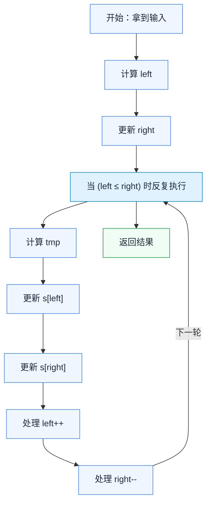

## TypeScript 解题方案（2 个方案逐个讲）

> **运行与提交**：每个方案都是自包含文件（内嵌用例自测，输出 PASS），整块复制到 `.ts` 文件后 `node 文件名` 即可运行。提交 LeetCode 时，把 `demo` 内的算法函数与辅助类型/函数整体取出、置于文件顶层即可。涉及交互/特殊接口的题以题面给定签名为准。

### 方案 1：双指针

**分析与思路**：核心做法是「双指针」。

**运行方式**：`node 本文件`，内嵌用例全部通过会输出 PASS。

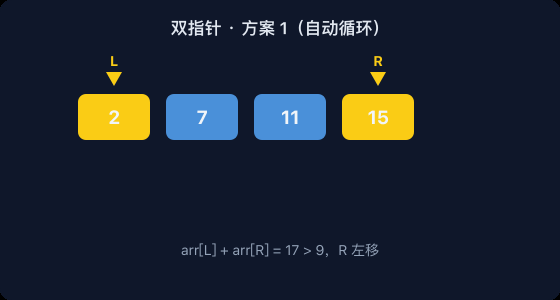

**方案专属流程图**（真实控制流）：

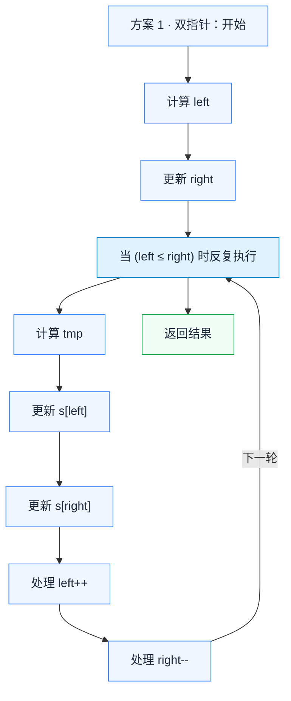

```typescript
/**
 ** LeetCode 344. 反转字符串
 ** 方案：1 ) 方案1：双指针
 ** 来源：https://blog.csdn.net/tyro_java/article/details/145116781
 */

function reverseString(s: string[]): void {
  // 定义函数/方法 reverseString
  let left = 0,
    right = s.length - 1; // 把 0, 右边界 赋值为 字符串.长度 减 1 存入 左边界
  while (left <= right) {
    // 循环，直到不满足「左边界 不超过 右边界」
    const tmp = s[left]; // 把 字符串[左边界] 存入 临时变量
    s[left] = s[right]; // 把 字符串[右边界]; 写入 s[left]
    s[right] = tmp; // 把 临时变量; 写入 s[right]
    left++; // 左边界 加一
    right--; // 右边界 减一
  }
}

function eqStr(a: string[], b: string[]): boolean {
  // 定义函数/方法 eqStr
  if (a.length !== b.length) return false; // 若 数组.长度 不等于 b.长度，直接返回 false
  for (let i = 0; i < a.length; i++) {
    // 让 下标 i 从 0 开始计数，下标 i 小于 数组.长度 就继续
    if (a[i] !== b[i]) return false; // 若 数组[下标 i] 不等于 b[下标 i]，直接返回 false
  }
  return true; // 返回 true
}

export function demo(): void {
  // 程序入口：跑内嵌自测用例
  const cases: [string[], string[]][] = [
    [
      ['h', 'e', 'l', 'l', 'o'],
      ['o', 'l', 'l', 'e', 'h'],
    ],
    [
      ['H', 'a', 'n', 'n', 'a', 'h'],
      ['h', 'a', 'n', 'n', 'a', 'H'],
    ],
  ];
  for (const [input, expected] of cases) {
    // for (const [input, expected] of cases) {
    reverseString(input); // reverseString(input);
    if (!eqStr(input, expected)) {
      // 若 取反 eqStr(input, expected
      throw new Error('FAIL: got ' + input + ' expected ' + expected);
    }
  }
  console.log('PASS'); // 全部用例通过，输出 PASS
}

demo(); // demo();
```

### 方案 2：双指针

**分析与思路**：核心做法是「双指针」。代码里依次做这些事：单循环线性扫描。

**运行方式**：`node 本文件`，内嵌用例全部通过会输出 PASS。


**方案专属流程图**（真实控制流）：

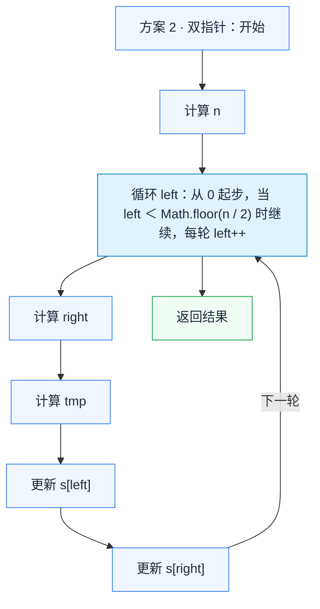

```typescript
/**
 ** LeetCode 344. 反转字符串
 ** 方案：1 ) 方案1：双指针
 ** 来源：https://blog.csdn.net/tyro_java/article/details/145116781
 */

function reverseString(s: string[]): void {
  // 定义函数/方法 reverseString
  const n = s.length; // 把 字符串.长度 存入 元素个数
  for (let left = 0; left < Math.floor(n / 2); left++) {
    // 让 左边界 从 0 开始计数，左边界 小于 向下取整(元素个数 除以 2) 就继续
    const right = n - 1 - left; // 把 元素个数 减 1 减 左边界 存入 右边界
    const tmp = s[left]; // 把 字符串[左边界] 存入 临时变量
    s[left] = s[right]; // 把 字符串[右边界]; 写入 s[left]
    s[right] = tmp; // 把 临时变量; 写入 s[right]
  }
}

function eqStr(a: string[], b: string[]): boolean {
  // 定义函数/方法 eqStr
  if (a.length !== b.length) return false; // 若 数组.长度 不等于 b.长度，直接返回 false
  for (let i = 0; i < a.length; i++) {
    // 让 下标 i 从 0 开始计数，下标 i 小于 数组.长度 就继续
    if (a[i] !== b[i]) return false; // 若 数组[下标 i] 不等于 b[下标 i]，直接返回 false
  }
  return true; // 返回 true
}

export function demo(): void {
  // 程序入口：跑内嵌自测用例
  const cases: [string[], string[]][] = [
    [
      ['h', 'e', 'l', 'l', 'o'],
      ['o', 'l', 'l', 'e', 'h'],
    ],
    [
      ['H', 'a', 'n', 'n', 'a', 'h'],
      ['h', 'a', 'n', 'n', 'a', 'H'],
    ],
  ];
  for (const [input, expected] of cases) {
    // for (const [input, expected] of cases) {
    reverseString(input); // reverseString(input);
    if (!eqStr(input, expected)) {
      // 若 取反 eqStr(input, expected
      throw new Error('FAIL: got ' + input + ' expected ' + expected);
    }
  }
  console.log('PASS'); // 全部用例通过，输出 PASS
}

demo(); // demo();
```

## 逐步拆解与面试追问

**复杂度**：时间 O(n)（单趟线性扫描），空间 O(1) 到 O(n)（视辅助结构）

**为什么是这个量级**：每个元素被常数次访问，辅助哈希或栈的开销与 n 同阶

**面试官可能会追问**：

- 能不能原地做（O(1) 空间）？
- 如果数组已有序，能优化到什么程度？
- 空数组、单元素怎么处理？

## 关键 API 速查（TS 主解法实际用到，附官方链接）

本题主解法只用到基础语法（变量、循环、比较），不依赖特殊库 API。

### 各语言官方文档导航

- **TypeScript / JS**：[MDN 中文参考](https://developer.mozilla.org/zh-CN/)
- **Python**：[Python 官方文档](https://docs.python.org/zh-cn/3/)
- **Go**：[Go 标准库](https://pkg.go.dev/std)
- **Java**：[JDK 17 API](https://docs.oracle.com/en/java/javase/17/docs/api/)
- **Rust**：[Rust 标准库](https://doc.rust-lang.org/std/)
- **Lua**：[Lua 5.4 手册](https://www.lua.org/manual/5.4/)
- **C**：[Cppreference C](https://zh.cppreference.com/w/c)
- **C++**：[Cppreference C++](https://zh.cppreference.com/w/cpp)
- **R**：[R 官方手册](https://stat.ethz.ch/R-manual/)
- **Zig**：[Zig 语言文档](https://ziglang.org/documentation/master/)
- **Dart**：[Dart API](https://api.dart.dev/)

## 附录：其他 10 种语言全部实现（每种语言列举其全部方案）

> TypeScript 的全部方案见「TypeScript 解题方案」一节；下面是其余 10 种语言的对应实现，每种语言的每个方案都带思路分析、代码走读与专属运行架构图。
> 每个方案都内嵌用例自测，可独立运行（老仓库 python/go 文件遵循「打印结果」约定）。
> 完整解法文件见 `dsa/<语言>/array/lc_344_反转字符串/`。

### Python 实现（2 种方案）

Python 的全部方案如下，每个方案都内嵌用例自测，可独立运行（老仓库 python/go 文件遵循「打印结果」约定）：

#### 方案 1：双指针

**思路与代码分析**：核心是「双指针」。Python 版用切片与字典推导式简化操作，突出可读性。**走读**：方案 1 · 双指针：开始 → 更新 right → 当 left ≤ right: 时反复执行 → 更新 s[right] → 更新 + → 更新 - → 返回结果。

**运行架构**（真实控制流）：

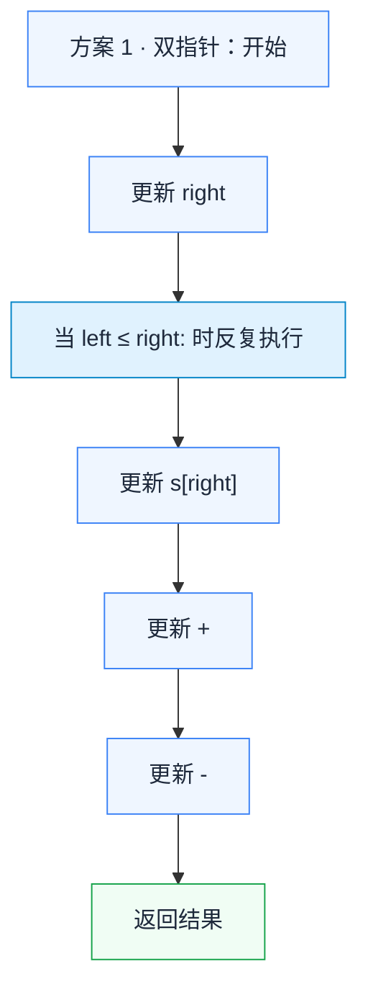

```python
import sys  # 提高递归深度上限（深输入防 RecursionError）

sys.setrecursionlimit(200000)  # 树/链表类题目节点数可达 1e4 量级

def reverseString(s):  # 定义函数 reverseString（参数：字符串）
    left, right = 0, len(s) - 1  # 把 0, 长度(字符串) 减 1 写入 left, right
    while left <= right:  # 循环，直到不满足「左边界 不超过 右边界」
        s[left], s[right] = s[right], s[left]  # 把 字符串[右边界], 字符串[左边界] 写入 s[left], s[right]
        left += 1  # 左边界累加 1
        right -= 1  # 右边界累减 1

if __name__ == "__main__":  # 若 __name__ 等于 '__main__'
    s = list("abc")  # 把 列表(「abc」) 存入 字符串
    reverseString(s)  # reverseString(字符串)
    print("".join(s))  # 打印输出
    s2 = list("hello")  # 把 列表(「hello」) 存入 s2
    reverseString(s2)  # reverseString(s2)
    print("".join(s2))  # 打印输出
```

#### 方案 2：双指针

**思路与代码分析**：核心是「双指针」。Python 版用切片与字典推导式简化操作，突出可读性。**走读**：方案 2 · 双指针：开始 → 更新 n → 循环 left：从 0 到 n // 2 前 → 更新 right → 更新 s[right] → 返回结果。

**运行架构**（真实控制流）：

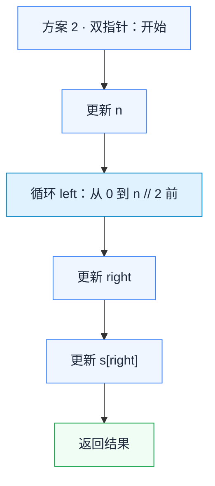

```python
import sys  # 提高递归深度上限（深输入防 RecursionError）

sys.setrecursionlimit(200000)  # 树/链表类题目节点数可达 1e4 量级

def reverseString(s):  # 定义函数 reverseString（参数：字符串）
    n = len(s)  # 把 长度(字符串) 存入 元素个数
    for left in range(n // 2):  # 让 左边界 从 元素个数 除以 除以 2 遍历
        right = n - 1 - left  # 把 元素个数 减 1 减 左边界 存入 右边界
        s[left], s[right] = s[right], s[left]  # 把 字符串[右边界], 字符串[左边界] 写入 s[left], s[right]

if __name__ == "__main__":  # 若 __name__ 等于 '__main__'
    s = list("abc")  # 把 列表(「abc」) 存入 字符串
    reverseString(s)  # reverseString(字符串)
    print("".join(s))  # 打印输出
    s2 = list("hello")  # 把 列表(「hello」) 存入 s2
    reverseString(s2)  # reverseString(s2)
    print("".join(s2))  # 打印输出
```

### Go 实现（2 种方案）

Go 的全部方案如下，每个方案都内嵌用例自测，可独立运行（老仓库 python/go 文件遵循「打印结果」约定）：

#### 方案 1：双指针

**思路与代码分析**：核心是「双指针」。Go 版用切片与多返回值惯用法，显式处理索引边界。**走读**：方案 1 · 双指针：开始 → 更新 : → 遍历循环 → 更新 s[right] → 处理 left++ → 处理 right-- → 返回结果。

**运行架构**（真实控制流）：

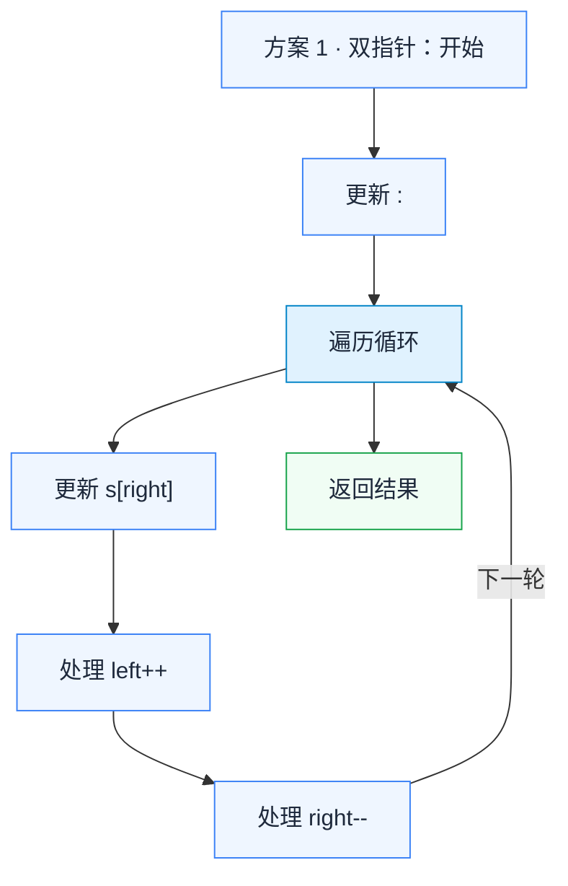

```go
package main // 引入依赖

import (
	"fmt" // 「fmt」
	"os"  // 「os」
)

func eqStrSlice(a, b []string) bool { // 定义函数/方法 eqStrSlice
	if len(a) != len(b) {
		return false
	} // 若 长度(数组) 不等于 长度(b) { return false }
	for i := range a { // 把 range 数组 { 写入 for i :
		if a[i] != b[i] {
			return false
		} // 若 数组[下标 i] 不等于 b[下标 i] { return false }
	}
	return true // 返回 true
}

func reverseString(s []string) { // 定义函数/方法 reverseString
	left, right := 0, len(s)-1 // 把 0, 长度(字符串) 减 1 写入 left, right :
	for left <= right {        // 把 右边界 { 写入 for left <
		s[left], s[right] = s[right], s[left] // 把 字符串[右边界], 字符串[左边界] 写入 s[left], s[right]
		left++                                // 左边界 加一
		right--                               // 右边界 减一
	}
}

func main() { // 程序入口：跑内嵌自测用例
	cases := [][2][]string{ // 把 [][2][]string{ 写入 cases :
		{{"h", "e", "l", "l", "o"}, {"o", "l", "l", "e", "h"}},
		{{"H", "a", "n", "n", "a", "h"}, {"h", "a", "n", "n", "a", "H"}},
	}
	for _, c := range cases { // 同时取 _ 与 字符 遍历
		input := c[0]                     // 把 字符[0] 写入 input :
		expected := c[1]                  // 把 字符[1] 写入 expected :
		reverseString(input)              // reverseString(input)
		if !eqStrSlice(input, expected) { // 若 取反 eqStrSlice(input, expected
			fmt.Printf("FAIL: got %v expected %v\n", input, expected) // 打印输出
			os.Exit(1)                                                // os.Exit(1)
		}
	}
	fmt.Println("PASS") // 全部用例通过，输出 PASS
}
```

#### 方案 2：双指针

**思路与代码分析**：核心是「双指针」。Go 版用切片与多返回值惯用法，显式处理索引边界。**走读**：方案 2 · 双指针：开始 → 更新 : → 遍历循环 → 更新 : → 更新 s[right] → 返回结果。

**运行架构**（真实控制流）：

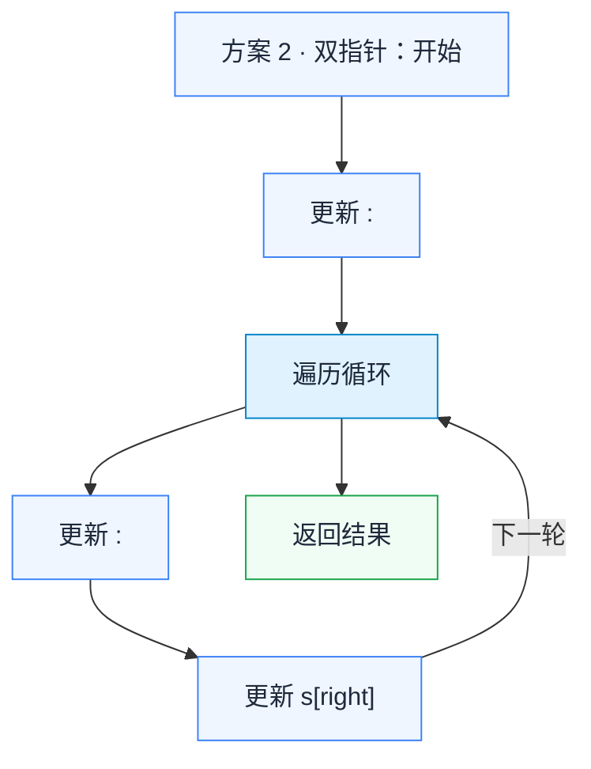

```go
package main // 引入依赖

import (
	"fmt" // 「fmt」
	"os"  // 「os」
)

func eqStrSlice(a, b []string) bool { // 定义函数/方法 eqStrSlice
	if len(a) != len(b) {
		return false
	} // 若 长度(数组) 不等于 长度(b) { return false }
	for i := range a { // 把 range 数组 { 写入 for i :
		if a[i] != b[i] {
			return false
		} // 若 数组[下标 i] 不等于 b[下标 i] { return false }
	}
	return true // 返回 true
}

func reverseString(s []string) { // 定义函数/方法 reverseString
	n := len(s)                         // 把 长度(字符串) 写入 n :
	for left := 0; left < n/2; left++ { // 让 左边界 从 0 开始计数
		right := n - 1 - left                 // 把 元素个数 减 1 减 左边界 写入 right :
		s[left], s[right] = s[right], s[left] // 把 字符串[右边界], 字符串[左边界] 写入 s[left], s[right]
	}
}

func main() { // 程序入口：跑内嵌自测用例
	cases := [][2][]string{ // 把 [][2][]string{ 写入 cases :
		{{"h", "e", "l", "l", "o"}, {"o", "l", "l", "e", "h"}},
		{{"H", "a", "n", "n", "a", "h"}, {"h", "a", "n", "n", "a", "H"}},
	}
	for _, c := range cases { // 同时取 _ 与 字符 遍历
		input := c[0]                     // 把 字符[0] 写入 input :
		expected := c[1]                  // 把 字符[1] 写入 expected :
		reverseString(input)              // reverseString(input)
		if !eqStrSlice(input, expected) { // 若 取反 eqStrSlice(input, expected
			fmt.Printf("FAIL: got %v expected %v\n", input, expected) // 打印输出
			os.Exit(1)                                                // os.Exit(1)
		}
	}
	fmt.Println("PASS") // 全部用例通过，输出 PASS
}
```

### Java 实现（2 种方案）

Java 的全部方案如下，每个方案都内嵌用例自测，可独立运行（老仓库 python/go 文件遵循「打印结果」约定）：

#### 方案 1：双指针

**思路与代码分析**：核心是「双指针」。Java 版用类与静态方法组织，集合操作显式明了。**走读**：方案 1 · 双指针：开始 → 更新 left → 当 (left ≤ right) 时反复执行 → 更新 tmp → 更新 s[left] → 更新 s[right] → 处理 left++ → 处理 right-- → 返回结果。

**运行架构**（真实控制流）：

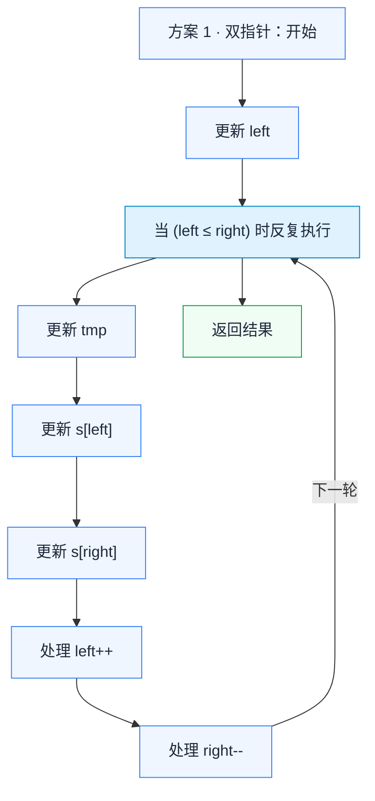

```java
package com.webfault.dsa; // 引入依赖

import java.util.*; // 引入依赖

class Solution { // 定义类型

  static void reverseString(String[] s) { // 定义函数/方法 reverseString
    int left = 0, right = s.length - 1; // 把 0, 右边界 赋值为 字符串.长度 减 1 存入 左边界
    while (left <= right) { // 循环，直到不满足「左边界 不超过 右边界」
      String tmp = s[left]; // 把 字符串[左边界] 存入 临时变量
      s[left] = s[right]; // 把 字符串[右边界]; 写入 s[left]
      s[right] = tmp; // 把 临时变量; 写入 s[right]
      left++; // 左边界 加一
      right--; // 右边界 减一
    }
  }

  public static void main(String[] args) { // public static void main(String[] args) {
    String[][][] cases = { // 把 { 写入 String[][][] cases
      {{"h", "e", "l", "l", "o"}, {"o", "l", "l", "e", "h"}},
      {{"H", "a", "n", "n", "a", "h"}, {"h", "a", "n", "n", "a", "H"}},
    };
    for (int k = 0; k < cases.length; k++) { // 让 下标 k 从 0 开始计数，下标 k 小于 cases.长度 就继续
      String[] input = cases[k][0]; // 把 cases[下标 k][0]; 写入 String[] input
      String[] expected = cases[k][1]; // 把 cases[下标 k][1]; 写入 String[] expected
      reverseString(input); // reverseString(input);
      if (!java.util.Arrays.equals(
          input, expected)) { // 若 取反 java.util.Arrays.equals(input, expected
        System.out.println("FAIL at case " + k); // 打印输出
        throw new RuntimeException(
            "self-check failed"); // throw new RuntimeException(「self 减 check failed」);
      }
    }
    System.out.println("PASS"); // 全部用例通过，输出 PASS
  }
}
```

#### 方案 2：双指针

**思路与代码分析**：核心是「双指针」。Java 版用类与静态方法组织，集合操作显式明了。代码里依次做这些事：单循环线性扫描。**走读**：方案 2 · 双指针：开始 → 更新 n → 遍历循环 → 更新 right → 更新 tmp → 更新 s[left] → 更新 s[right] → 返回结果。

**运行架构**（真实控制流）：

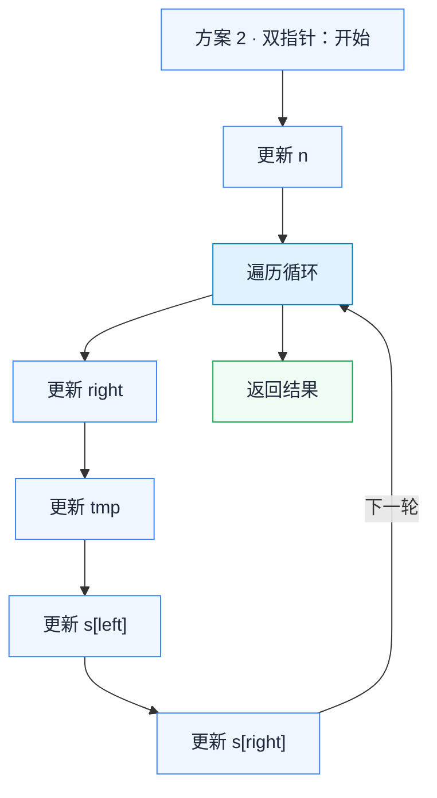

```java
package com.webfault.dsa; // 引入依赖

import java.util.*; // 引入依赖

class Solution { // 定义类型

  static void reverseString(String[] s) { // 定义函数/方法 reverseString
    int n = s.length; // 把 字符串.长度 存入 元素个数
    for (int left = 0; left < n / 2; left++) { // 让 左边界 从 0 开始计数，左边界 小于 元素个数 除以 2 就继续
      int right = n - 1 - left; // 把 元素个数 减 1 减 左边界 存入 右边界
      String tmp = s[left]; // 把 字符串[左边界] 存入 临时变量
      s[left] = s[right]; // 把 字符串[右边界]; 写入 s[left]
      s[right] = tmp; // 把 临时变量; 写入 s[right]
    }
  }

  public static void main(String[] args) { // public static void main(String[] args) {
    String[][][] cases = { // 把 { 写入 String[][][] cases
      {{"h", "e", "l", "l", "o"}, {"o", "l", "l", "e", "h"}},
      {{"H", "a", "n", "n", "a", "h"}, {"h", "a", "n", "n", "a", "H"}},
    };
    for (int k = 0; k < cases.length; k++) { // 让 下标 k 从 0 开始计数，下标 k 小于 cases.长度 就继续
      String[] input = cases[k][0]; // 把 cases[下标 k][0]; 写入 String[] input
      String[] expected = cases[k][1]; // 把 cases[下标 k][1]; 写入 String[] expected
      reverseString(input); // reverseString(input);
      if (!java.util.Arrays.equals(
          input, expected)) { // 若 取反 java.util.Arrays.equals(input, expected
        System.out.println("FAIL at case " + k); // 打印输出
        throw new RuntimeException(
            "self-check failed"); // throw new RuntimeException(「self 减 check failed」);
      }
    }
    System.out.println("PASS"); // 全部用例通过，输出 PASS
  }
}
```

### Rust 实现（2 种方案）

Rust 的全部方案如下，每个方案都内嵌用例自测，可独立运行（老仓库 python/go 文件遵循「打印结果」约定）：

#### 方案 1：双指针

**思路与代码分析**：核心是「双指针」。Rust 版用所有权移动与切片借用改写同一逻辑，注意 Option 与引用边界。**走读**：方案 1 · 双指针：开始 → 计算 let (mut i, mut j) = (0u → 当 i ＜ j 时反复执行 → 调用 s.swap(i, j) → 更新 + → 处理 if j == 0 → 跳出循环（break） → 更新 - → 返回结果。

**运行架构**（真实控制流）：


```rust
// LeetCode 344. 反转字符串 — Rust 版（方案1）
fn reverse_string(s: &mut Vec<char>) {
    // 定义函数/方法 reverse_string
    let (mut i, mut j) = (0usize, s.len() - 1); // 把 (0usize, 字符串.长度() 减 1); 写入 let (mut i, mut j)
    while i < j {
        s.swap(i, j);
        i += 1;
        if j == 0 {
            break;
        }
        j -= 1;
    }
}
fn main() {
    // 程序入口：跑内嵌自测用例
    let mut v: Vec<char> = "hello".chars().collect();
    reverse_string(&mut v);
    assert_eq!(v.iter().collect::<String>(), "olleh"); // 断言校验
    let mut v2: Vec<char> = "Hannah".chars().collect();
    reverse_string(&mut v2);
    assert_eq!(v2.iter().collect::<String>(), "hannaH"); // 断言校验
    println!("PASS");
} // 全部用例通过，输出 PASS
```

#### 方案 2：双指针

**思路与代码分析**：核心是「双指针」。Rust 版用所有权移动与切片借用改写同一逻辑，注意 Option 与引用边界。**走读**：方案 2 · 双指针：开始 → 计算 let (mut i, mut j) = (0u → 当 i ＜ j 时反复执行 → 调用 s.swap(i, j) → 更新 + → 处理 if j == 0 → 跳出循环（break） → 更新 - → 返回结果。

**运行架构**（真实控制流）：

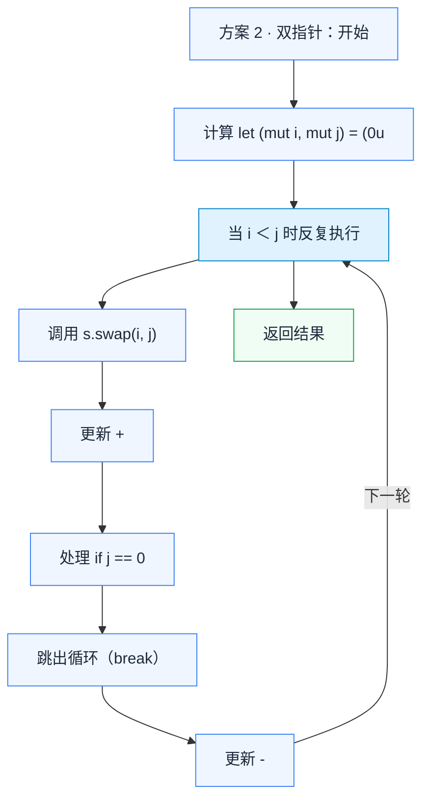

```rust
// LeetCode 344. 反转字符串 — Rust 版（方案2）
fn reverse_string(s: &mut Vec<char>) {
    // 定义函数/方法 reverse_string
    let (mut i, mut j) = (0usize, s.len() - 1); // 把 (0usize, 字符串.长度() 减 1); 写入 let (mut i, mut j)
    while i < j {
        s.swap(i, j);
        i += 1;
        if j == 0 {
            break;
        }
        j -= 1;
    }
}
fn main() {
    // 程序入口：跑内嵌自测用例
    let mut v: Vec<char> = "hello".chars().collect();
    reverse_string(&mut v);
    assert_eq!(v.iter().collect::<String>(), "olleh"); // 断言校验
    let mut v2: Vec<char> = "Hannah".chars().collect();
    reverse_string(&mut v2);
    assert_eq!(v2.iter().collect::<String>(), "hannaH"); // 断言校验
    println!("PASS");
} // 全部用例通过，输出 PASS
```

### Lua 实现（2 种方案）

Lua 的全部方案如下，每个方案都内嵌用例自测，可独立运行（老仓库 python/go 文件遵循「打印结果」约定）：

#### 方案 1：双指针

**思路与代码分析**：核心是「双指针」。Lua 版用表与 ipairs 遍历，注意 ipairs 遇 nil 即停的语义。**走读**：方案 1 · 双指针：开始 → 返回 s:reverse()。

**运行架构**（真实控制流）：

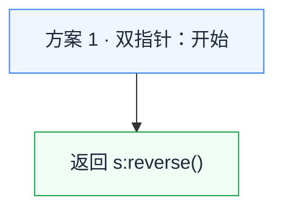

```lua
-- LeetCode 344. 反转字符串 — Lua 版（方案1）
local function reverse_string(s)
	return s:reverse()
end -- local function reverse_string(字符串) return 字符串:reverse() 终点
assert(reverse_string("hello") == "olleh") -- 断言校验
assert(reverse_string("Hannah") == "hannaH") -- 断言校验
print("PASS") -- 全部用例通过，输出 PASS
```

#### 方案 2：双指针

**思路与代码分析**：核心是「双指针」。Lua 版用表与 ipairs 遍历，注意 ipairs 遇 nil 即停的语义。**走读**：方案 2 · 双指针：开始 → 返回 s:reverse()。

**运行架构**（真实控制流）：

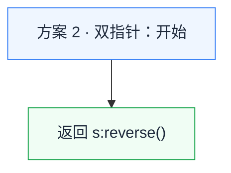

```lua
-- LeetCode 344. 反转字符串 — Lua 版（方案2）
local function reverse_string(s)
	return s:reverse()
end -- local function reverse_string(字符串) return 字符串:reverse() 终点
assert(reverse_string("hello") == "olleh") -- 断言校验
assert(reverse_string("Hannah") == "hannaH") -- 断言校验
print("PASS") -- 全部用例通过，输出 PASS
```

### C 实现（2 种方案）

C 的全部方案如下，每个方案都内嵌用例自测，可独立运行（老仓库 python/go 文件遵循「打印结果」约定）：

#### 方案 1：双指针

**思路与代码分析**：核心是「双指针」。C 版手动管理下标与内存，循环边界全部显式写出。代码里依次做这些事：单循环线性扫描。**走读**：方案 1 · 双指针：开始 → 更新 n → 遍历循环 → 更新 t → 更新 s[i] → 更新 s[j] → 返回结果。

**运行架构**（真实控制流）：

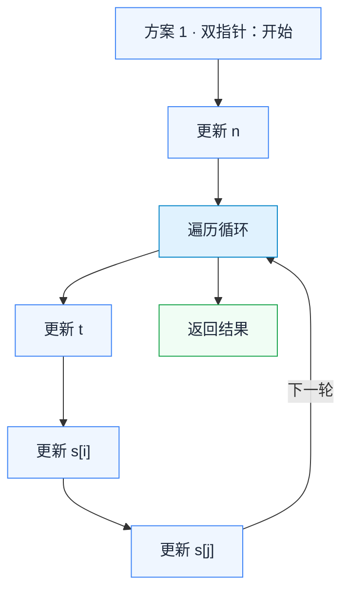

```c
/* LeetCode 344. 反转字符串 — C 版（方案1） */
#include <stdio.h>                     // 引入头文件
#include <string.h>                    // 引入头文件
static void reverse_string(char s[]) { // 定义函数/方法 reverse_string
    int n = (int)strlen(s);            // 把 (int)strlen(字符串) 存入 元素个数
    for (int i = 0, j = n - 1; i < j; i++, j--) {
        char t = s[i];
        s[i] = s[j];
        s[j] = t;
    } // 让 下标 i 从 0, 下标 j 赋值为 元素个数 减 1 开始计数，下标 i 小于 下标 j 就继续
}
int main(void) { // 程序入口：跑内嵌自测用例
    char b[64];  // char b[64];
    strcpy(b, "hello");
    reverse_string(b); // strcpy(b, 「hello」); reverse_string(b);
    if (strcmp(b, "olleh") != 0) {
        printf("FAIL 1\n");
        return 1;
    } // 若 strcmp(b, 「olleh」) 不等于 0) { 输出「olleh」); return 1; }
    strcpy(b, "Hannah");
    reverse_string(b); // strcpy(b, 「Hannah」); reverse_string(b);
    if (strcmp(b, "hannaH") != 0) {
        printf("FAIL 2\n");
        return 1;
    } // 若 strcmp(b, 「hannaH」) 不等于 0) { 输出「hannaH」); return 1; }
    printf("PASS\n");
    return 0;
} // 全部用例通过，输出 PASS
```

#### 方案 2：双指针

**思路与代码分析**：核心是「双指针」。C 版手动管理下标与内存，循环边界全部显式写出。代码里依次做这些事：单循环线性扫描。**走读**：方案 2 · 双指针：开始 → 更新 n → 遍历循环 → 更新 t → 更新 s[i] → 更新 s[j] → 返回结果。

**运行架构**（真实控制流）：

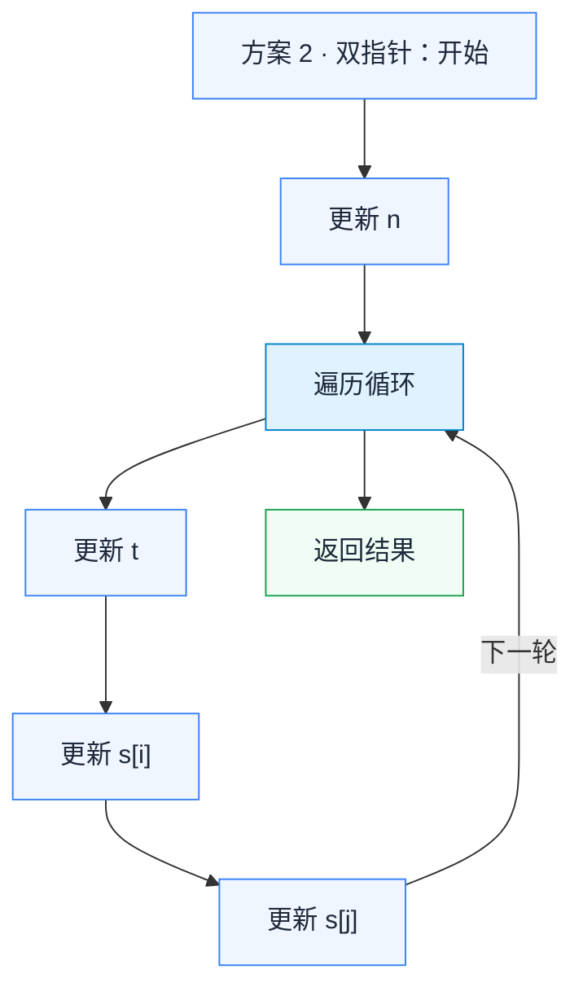

```c
/* LeetCode 344. 反转字符串 — C 版（方案2） */
#include <stdio.h>                     // 引入头文件
#include <string.h>                    // 引入头文件
static void reverse_string(char s[]) { // 定义函数/方法 reverse_string
    int n = (int)strlen(s);            // 把 (int)strlen(字符串) 存入 元素个数
    for (int i = 0, j = n - 1; i < j; i++, j--) {
        char t = s[i];
        s[i] = s[j];
        s[j] = t;
    } // 让 下标 i 从 0, 下标 j 赋值为 元素个数 减 1 开始计数，下标 i 小于 下标 j 就继续
}
int main(void) { // 程序入口：跑内嵌自测用例
    char b[64];  // char b[64];
    strcpy(b, "hello");
    reverse_string(b); // strcpy(b, 「hello」); reverse_string(b);
    if (strcmp(b, "olleh") != 0) {
        printf("FAIL 1\n");
        return 1;
    } // 若 strcmp(b, 「olleh」) 不等于 0) { 输出「olleh」); return 1; }
    strcpy(b, "Hannah");
    reverse_string(b); // strcpy(b, 「Hannah」); reverse_string(b);
    if (strcmp(b, "hannaH") != 0) {
        printf("FAIL 2\n");
        return 1;
    } // 若 strcmp(b, 「hannaH」) 不等于 0) { 输出「hannaH」); return 1; }
    printf("PASS\n");
    return 0;
} // 全部用例通过，输出 PASS
```

### C++ 实现（2 种方案）

C++ 的全部方案如下，每个方案都内嵌用例自测，可独立运行（老仓库 python/go 文件遵循「打印结果」约定）：

#### 方案 1：双指针

**思路与代码分析**：核心是「双指针」。C++ 版用 STL 容器与迭代器，减少手写下标错误。**走读**：方案 1 · 双指针：开始 → 处理 std::reverse(s.begin(), s.en → 返回 s。

**运行架构**（真实控制流）：


```cpp
// LeetCode 344. 反转字符串 — C++ 版（方案1）
#include <algorithm>                              // 引入头文件
#include <cassert>                                // 引入头文件
#include <iostream>                               // 引入头文件
#include <string>                                 // 引入头文件
static std::string reverseString(std::string s) { // static std::string reverseString(std::string 字符串) {
    std::reverse(s.begin(), s.end()); // std::reverse(字符串 迭代位置 , 字符串.终点());
    return s;                         // 返回 字符串
}
int main() {
    assert(reverseString("hello") == "olleh");
    assert(reverseString("Hannah") == "hannaH");
    std::cout << "PASS" << std::endl;
} // 全部用例通过，输出 PASS
```

#### 方案 2：双指针

**思路与代码分析**：核心是「双指针」。C++ 版用 STL 容器与迭代器，减少手写下标错误。**走读**：方案 2 · 双指针：开始 → 处理 std::reverse(s.begin(), s.en → 返回 s。

**运行架构**（真实控制流）：

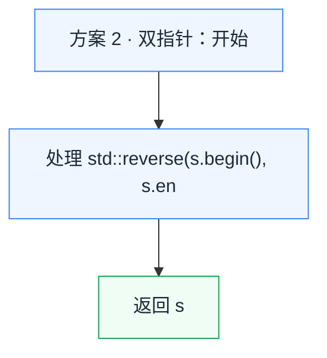

```cpp
// LeetCode 344. 反转字符串 — C++ 版（方案2）
#include <algorithm>                              // 引入头文件
#include <cassert>                                // 引入头文件
#include <iostream>                               // 引入头文件
#include <string>                                 // 引入头文件
static std::string reverseString(std::string s) { // static std::string reverseString(std::string 字符串) {
    std::reverse(s.begin(), s.end()); // std::reverse(字符串 迭代位置 , 字符串.终点());
    return s;                         // 返回 字符串
}
int main() {
    assert(reverseString("hello") == "olleh");
    assert(reverseString("Hannah") == "hannaH");
    std::cout << "PASS" << std::endl;
} // 全部用例通过，输出 PASS
```

### R 实现（2 种方案）

R 的全部方案如下，每个方案都内嵌用例自测，可独立运行（老仓库 python/go 文件遵循「打印结果」约定）：

#### 方案 1：双指针

**思路与代码分析**：核心是「双指针」。R 版用向量化思维与 1 起始下标，注意 1:n 的降序陷阱。

**运行架构**（真实控制流）：

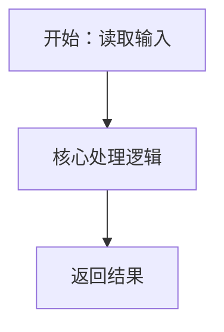

```r
# 版（方案1）
reverse_string <- function(s) paste(rev(strsplit(s, "")[[1]]), collapse = "")  # 定义函数 reverse_string（参数：字符串）
stopifnot(reverse_string("hello") == "olleh")  # 断言校验
stopifnot(reverse_string("Hannah") == "hannaH")  # 断言校验
cat("PASS\n")  # 全部用例通过，输出 PASS
```

#### 方案 2：双指针

**思路与代码分析**：核心是「双指针」。R 版用向量化思维与 1 起始下标，注意 1:n 的降序陷阱。

**运行架构**：与方案 1 的控制流相同（同算法在该语言的等价实现），图见上。

```r
# 版（方案2）
reverse_string <- function(s) paste(rev(strsplit(s, "")[[1]]), collapse = "")  # 定义函数 reverse_string（参数：字符串）
stopifnot(reverse_string("hello") == "olleh")  # 断言校验
stopifnot(reverse_string("Hannah") == "hannaH")  # 断言校验
cat("PASS\n")  # 全部用例通过，输出 PASS
```

### Zig 实现（2 种方案）

Zig 的全部方案如下，每个方案都内嵌用例自测，可独立运行（老仓库 python/go 文件遵循「打印结果」约定）：

#### 方案 1：双指针

**思路与代码分析**：核心是「双指针」。Zig 版显式分配与清零，整型边界处理严格。**走读**：方案 1 · 双指针：开始 → 命中条件，直接返回 → 计算 i → 计算 j → 当 (i ＜ j) : ( 时反复执行 → 更新 + → 更新 - → 计算 t → 更新 s[i] → 更新 s[j]。

**运行架构**（真实控制流）：


```zig
// LeetCode 344. 反转字符串 — Zig 版（方案1）
const std = @import("std"); // 把 @import(「std」) 存入 std
fn reverseString(s: []u8) void { // 定义函数/方法 reverseString
    if (s.len == 0) return; // 若 字符串.长度 等于 0) return;
    var i: usize = 0; // 把 0; 写入 var i: usize
    var j: usize = s.len - 1; // 把 字符串.长度 减 1; 写入 var j: usize
    while (i < j) : ({ // 循环，直到不满足「下标 i 小于 下标 j) : (」
        i += 1; // 下标 i累加 1
        j -= 1; // 下标 j累减 1
    }) { // }) {
        const t = s[i]; // 把 字符串[下标 i] 存入 另一字符串
        s[i] = s[j]; // 把 字符串[下标 j]; 写入 s[i]
        s[j] = t; // 把 另一字符串; 写入 s[j]
    }
}
pub fn main() !void { // 程序入口：跑内嵌自测用例
    var buf1 = [_]u8{ 'h', 'e', 'l', 'l', 'o' }; // 把 [_]u8{ 'h', 'e', '左指针', '左指针', 'o' } 存入 buf1
    reverseString(&buf1); // reverseString( 按位与 buf1);
    if (!std.mem.eql(u8, &buf1, "olleh")) return error.TestFailed;
    var buf2 = [_]u8{ 'H', 'a', 'n', 'n', 'a', 'h' }; // 把 [_]u8{ 'H', '数组', '元素个数', '元素个数', '数组', 'h' } 存入 buf2
    reverseString(&buf2); // reverseString( 按位与 buf2);
    if (!std.mem.eql(u8, &buf2, "hannaH")) return error.TestFailed;
    std.debug.print("PASS\n", .{});
} // 全部用例通过，输出 PASS
```

#### 方案 2：双指针

**思路与代码分析**：核心是「双指针」。Zig 版显式分配与清零，整型边界处理严格。**走读**：方案 2 · 双指针：开始 → 命中条件，直接返回 → 计算 i → 计算 j → 当 (i ＜ j) : ( 时反复执行 → 更新 + → 更新 - → 计算 t → 更新 s[i] → 更新 s[j]。

**运行架构**（真实控制流）：

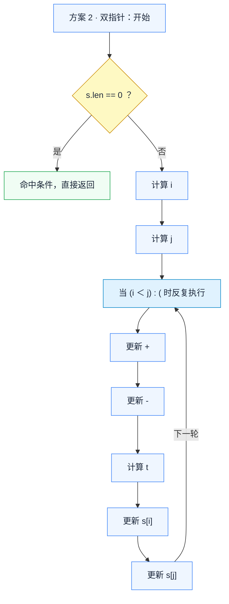

```zig
// LeetCode 344. 反转字符串 — Zig 版（方案2）
const std = @import("std"); // 把 @import(「std」) 存入 std
fn reverseString(s: []u8) void { // 定义函数/方法 reverseString
    if (s.len == 0) return; // 若 字符串.长度 等于 0) return;
    var i: usize = 0; // 把 0; 写入 var i: usize
    var j: usize = s.len - 1; // 把 字符串.长度 减 1; 写入 var j: usize
    while (i < j) : ({ // 循环，直到不满足「下标 i 小于 下标 j) : (」
        i += 1; // 下标 i累加 1
        j -= 1; // 下标 j累减 1
    }) { // }) {
        const t = s[i]; // 把 字符串[下标 i] 存入 另一字符串
        s[i] = s[j]; // 把 字符串[下标 j]; 写入 s[i]
        s[j] = t; // 把 另一字符串; 写入 s[j]
    }
}
pub fn main() !void { // 程序入口：跑内嵌自测用例
    var buf1 = [_]u8{ 'h', 'e', 'l', 'l', 'o' }; // 把 [_]u8{ 'h', 'e', '左指针', '左指针', 'o' } 存入 buf1
    reverseString(&buf1); // reverseString( 按位与 buf1);
    if (!std.mem.eql(u8, &buf1, "olleh")) return error.TestFailed;
    var buf2 = [_]u8{ 'H', 'a', 'n', 'n', 'a', 'h' }; // 把 [_]u8{ 'H', '数组', '元素个数', '元素个数', '数组', 'h' } 存入 buf2
    reverseString(&buf2); // reverseString( 按位与 buf2);
    if (!std.mem.eql(u8, &buf2, "hannaH")) return error.TestFailed;
    std.debug.print("PASS\n", .{});
} // 全部用例通过，输出 PASS
```

### Dart 实现（2 种方案）

Dart 的全部方案如下，每个方案都内嵌用例自测，可独立运行（老仓库 python/go 文件遵循「打印结果」约定）：

#### 方案 1：双指针

**思路与代码分析**：核心是「双指针」。Dart 版用可空类型标注与集合方法，注意空安全。

**运行架构**（真实控制流）：

```mermaid
graph TD
    A["开始：读取输入"]
    F0["核心处理逻辑"]
    A --> F0
    Z["返回结果"]
    F0 --> Z
```

```dart
// LeetCode 344. 反转字符串 — Dart 版（方案1）
String reverseString(String s) => String.fromCharCodes(s.codeUnits.reversed);
void main() {
  if (reverseString('hello') != 'olleh') throw StateError('c1');
  if (reverseString('Hannah') != 'hannaH') throw StateError('c2');
  print('PASS');
} // 全部用例通过，输出 PASS
```

#### 方案 2：双指针

**思路与代码分析**：核心是「双指针」。Dart 版用可空类型标注与集合方法，注意空安全。

**运行架构**：与方案 1 的控制流相同（同算法在该语言的等价实现），图见上。

```dart
// LeetCode 344. 反转字符串 — Dart 版（方案2）
String reverseString(String s) => String.fromCharCodes(s.codeUnits.reversed);
void main() {
  if (reverseString('hello') != 'olleh') throw StateError('c1');
  if (reverseString('Hannah') != 'hannaH') throw StateError('c2');
  print('PASS');
} // 全部用例通过，输出 PASS
```

---

## 内容总结

- **反转字符串**（数组 · Easy）：共 2 个方案，主线思路「双指针」；时间 O(n)（单趟线性扫描）；动画演示双指针过程，附录给出 11 种语言 × 全部方案的可运行实现。
- 来源博客：[https://blog.csdn.net/tyro_java/article/details/145116781](https://blog.csdn.net/tyro_java/article/details/145116781)
- 导航：[📋 总目录](../) ｜ [← 005 移除元素](../005_移除元素/) ｜ [007 按奇偶排序数组 →](../007_按奇偶排序数组/)
