# 007 · 按奇偶排序数组（第一阶段 · 线性结构入门 · Easy）

> **难度**：⭐ Easy ｜ **专题**：数组
> **学习定位**：第一阶段 · 线性结构入门第 7 篇 ｜ **解法数**：3
> **内容总结**：**按奇偶排序数组**（数组 · Easy）：共 3 个方案，主线思路「两次遍历」；时间 O(n²)（两层嵌套扫描）；动画演示双指针过程，附录给出 11 种语言 × 全部方案的可运行实现。

---

## 题目描述

给你一个整数数组 `nums`，将 `nums` 中的所有偶数元素移动到数组的前面，后跟所有奇数元素。

返回满足此条件的 任一数组 作为答案。

- 主函数签名：`function sortArrayByParity(nums: number[]): number[]`

**用例（来自原题）**：

**示例 1**

```text
输入：nums = [3,1,2,4]
输出：[2,4,3,1]
```

解释：[4,2,3,1]、[2,4,1,3] 和 [4,2,1,3] 也会被视作正确答案。

**示例 2**

```text
输入：nums = [0]
输出：[0]
```
> ✅ **官方验证**：全部 TypeScript 解法已通过 leetcode.cn 官方示例用例验证（自动注入运行，全部 PASS）。题面与 [leetcode.cn 官方](https://leetcode.cn/problems/sort-array-by-parity/)一致，示例配图取自官方题面。

**数据范围与注意事项**：

- `1 <= nums.length <= 5000`
- `0 <= nums[i] <= 5000`
- **易错点**：边界最容易漏：空数组、只有一个元素、目标出现在头尾。

## 题目分析

**场景是什么**：数组是最常用的线性容器，这类题练的是下标操作与原地腾挪，对应真实开发里的缓冲区、列表整理。本题就是该场景的 Easy 级练习，主线做法是「两次遍历」。

**主线怎么解**：把主解法从头到尾过一遍，它其实在依次做这几件事：双重循环遍历。

## 解题思路

**方案对比**（共 3 个方案，由浅入深）：

| 方案 | 时间复杂度 | 空间复杂度 |
|---|---|---|
| 方案 1 · 两次遍历 | O(n²)（两层嵌套扫描） | O(1) 到 O(n) |
| 方案 2 · 双指针 + 一次遍历 | O(n)（单趟线性扫描） | O(1) 到 O(n)（视辅助结构） |
| 方案 3 · 原地交换 | O(n²)（两层嵌套扫描） | O(1) 到 O(n) |

**由浅入深的路径**：两次遍历 → 双指针 + 一次遍历 → 原地交换；每往右一步，都在补上一步的短板。

**方案间的取舍**：方案 1（两次遍历）；方案 2（双指针 + 一次遍历）；方案 3（原地交换）。数据规模小、可读性优先时选靠前的方案；规模大、性能优先时选靠后的方案。

**怎么读这一篇**：

- 🐣 **新手路线**：把「题目描述」的示例 1 在纸上手推一遍 → 读方案 1（最直观的写法）与它的代码走读 → 按「运行方式」本地跑通看 PASS → 回头对比方案 2 之后的写法差在哪
- 🦅 **大佬路线**：直接锁定最优方案 2（双指针 + 一次遍历，O(n)（单趟线性扫描））→ 跳读该方案代码与走读 → 用「逐步拆解与面试追问」补齐复杂度推导与边界追问

### 动态算法图（双指针，GIF 自动循环）


动画演示数组专题里双指针的典型过程；每个方案在「TypeScript 解题方案」一节还配了专属动画与专属流程图。

### 主解法流程图（真实控制流）

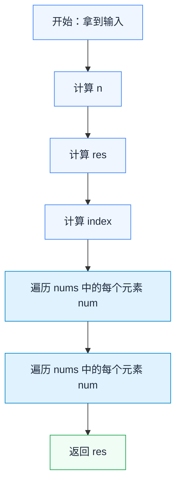

## TypeScript 解题方案（3 个方案逐个讲）

> **运行与提交**：每个方案都是自包含文件（内嵌用例自测，输出 PASS），整块复制到 `.ts` 文件后 `node 文件名` 即可运行。提交 LeetCode 时，把 `demo` 内的算法函数与辅助类型/函数整体取出、置于文件顶层即可。涉及交互/特殊接口的题以题面给定签名为准。

### 方案 1：两次遍历

**分析与思路**：核心做法是「两次遍历」。代码里依次做这些事：双重循环遍历。

**运行方式**：`node 本文件`，内嵌用例全部通过会输出 PASS。


**方案专属流程图**（真实控制流）：

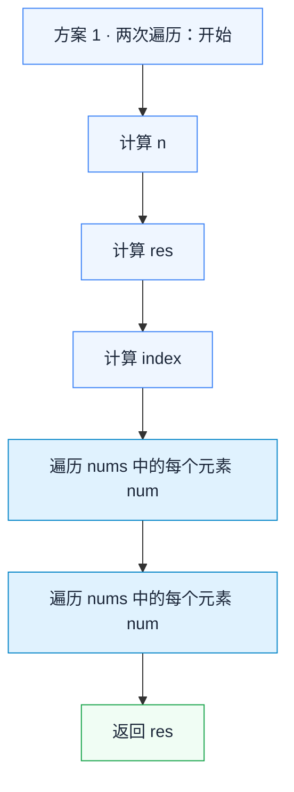

```typescript
/**
 ** LeetCode 905. 按奇偶排序数组
 ** 方案1: 两次遍历
 */

function sortArrayByParity(nums: number[]): number[] {
  // 定义函数/方法 sortArrayByParity
  const n = nums.length; // 把 数组.长度 存入 元素个数
  const res: number[] = new Array(n).fill(0); // 把 new Array(元素个数).fill(0); 写入 const res: number[]
  let index = 0; // 把 0 存入 index
  for (const num of nums) if (num % 2 === 0) res[index++] = num;
  for (const num of nums) if (num % 2 === 1) res[index++] = num;
  return res; // 返回 结果
}

export function demo(): void {
  // 程序入口：跑内嵌自测用例
  function eqArr(a: number[], b: number[]): boolean {
    // 定义函数/方法 eqArr
    if (a.length !== b.length) return false; // 若 数组.长度 不等于 b.长度，直接返回 false
    for (let i = 0; i < a.length; i++) if (a[i] !== b[i]) return false; // 让 下标 i 从 0 开始计数，下标 i 小于 数组.长度 就继续
    return true; // 返回 true
  }
  const cases: { in: number[]; want: number[] }[] = [
    { in: [1, 2, 3], want: [2, 1, 3] },
    { in: [3, 1, 2, 4], want: [2, 4, 3, 1] },
    { in: [0], want: [0] },
    { in: [0, 1, 2], want: [0, 2, 1] },
  ];
  let fail = false; // 把 false 存入 fail
  for (const c of cases) {
    // for (const 字符 of cases) {
    const got = sortArrayByParity([...c.in]); // 把 sortArrayByParity([...字符.in]) 存入 got
    if (!eqArr(got, c.want)) {
      // 若 取反 eqArr(got, 字符.want
      fail = true; // 把 true 存入 fail
      console.log(
        'FAIL sortArrayByParity(' +
          JSON.stringify(c.in) +
          ')=' +
          JSON.stringify(got) +
          ' want ' +
          JSON.stringify(c.want),
      ); // 打印输出
    }
  }
  if (fail) throw new Error('FAILED'); // 若 fail) throw new Error(「FAILED」);
  console.log('PASS'); // 全部用例通过，输出 PASS
}
demo(); // demo();
```

### 方案 2：双指针 + 一次遍历

**分析与思路**：核心做法是「双指针 + 一次遍历」。代码里依次做这些事：单循环线性扫描。

**运行方式**：`node 本文件`，内嵌用例全部通过会输出 PASS。

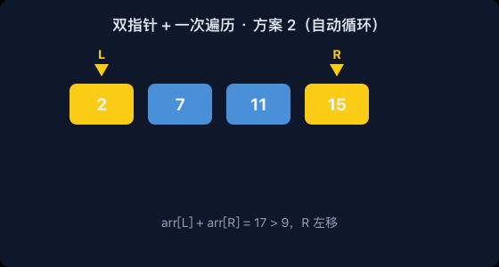

**方案专属流程图**（真实控制流）：

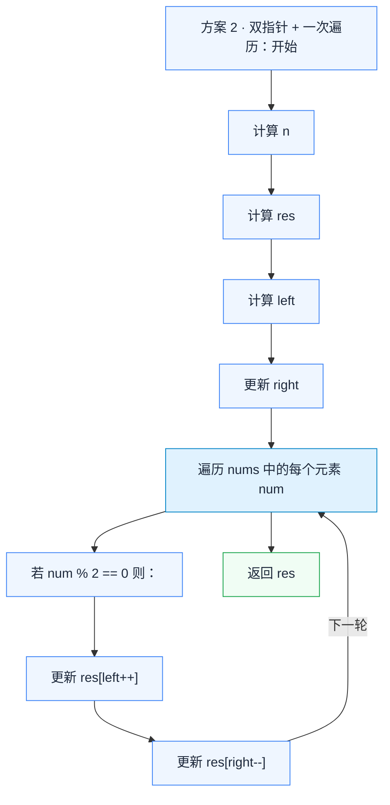

```typescript
/**
 ** LeetCode 905. 按奇偶排序数组
 ** 方案2: 双指针 + 一次遍历
 */

function sortArrayByParity(nums: number[]): number[] {
  // 定义函数/方法 sortArrayByParity
  const n = nums.length; // 把 数组.长度 存入 元素个数
  const res: number[] = new Array(n).fill(0); // 把 new Array(元素个数).fill(0); 写入 const res: number[]
  let left = 0,
    right = n - 1; // 把 0, 右边界 赋值为 元素个数 减 1 存入 左边界
  for (const num of nums) {
    // for (const num of 数组) {
    if (num % 2 === 0) {
      // 若 num 对…取模 2 全等于 0
      res[left++] = num; // 把 num; 写入 res[left++]
    } else {
      // 否则
      res[right--] = num; // 把 num; 写入 res[right--]
    }
  }
  return res; // 返回 结果
}

export function demo(): void {
  // 程序入口：跑内嵌自测用例
  function eqArr(a: number[], b: number[]): boolean {
    // 定义函数/方法 eqArr
    if (a.length !== b.length) return false; // 若 数组.长度 不等于 b.长度，直接返回 false
    for (let i = 0; i < a.length; i++) if (a[i] !== b[i]) return false; // 让 下标 i 从 0 开始计数，下标 i 小于 数组.长度 就继续
    return true; // 返回 true
  }
  const cases: { in: number[]; want: number[] }[] = [
    { in: [1, 2, 3], want: [2, 3, 1] },
    { in: [3, 1, 2, 4], want: [2, 4, 1, 3] },
    { in: [0], want: [0] },
    { in: [0, 1, 2], want: [0, 2, 1] },
  ];
  let fail = false; // 把 false 存入 fail
  for (const c of cases) {
    // for (const 字符 of cases) {
    const got = sortArrayByParity([...c.in]); // 把 sortArrayByParity([...字符.in]) 存入 got
    if (!eqArr(got, c.want)) {
      // 若 取反 eqArr(got, 字符.want
      fail = true; // 把 true 存入 fail
      console.log(
        'FAIL sortArrayByParity(' +
          JSON.stringify(c.in) +
          ')=' +
          JSON.stringify(got) +
          ' want ' +
          JSON.stringify(c.want),
      ); // 打印输出
    }
  }
  if (fail) throw new Error('FAILED'); // 若 fail) throw new Error(「FAILED」);
  console.log('PASS'); // 全部用例通过，输出 PASS
}
demo(); // demo();
```

### 方案 3：原地交换

**分析与思路**：核心做法是「原地交换」。

**运行方式**：`node 本文件`，内嵌用例全部通过会输出 PASS。

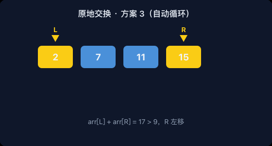

**方案专属流程图**（真实控制流）：

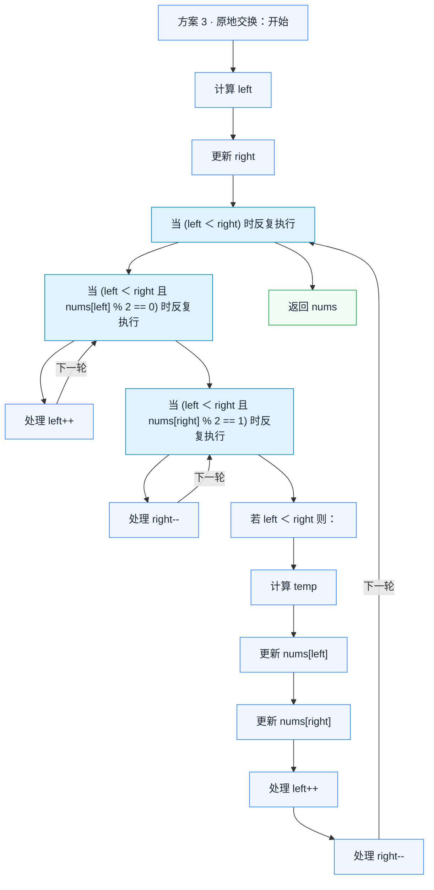

```typescript
/**
 ** LeetCode 905. 按奇偶排序数组
 ** 方案3: 原地交换
 */

function sortArrayByParity(nums: number[]): number[] {
  // 定义函数/方法 sortArrayByParity
  let left = 0,
    right = nums.length - 1; // 把 0, 右边界 赋值为 数组.长度 减 1 存入 左边界
  while (left < right) {
    // 循环，直到不满足「左边界 小于 右边界」
    while (left < right && nums[left] % 2 === 0) {
      // 循环，直到不满足「左边界 小于 右边界 且 数组[左边界] 对…取模 2 全等于 0」
      left++; // 左边界 加一
    }
    while (left < right && nums[right] % 2 === 1) {
      // 循环，直到不满足「左边界 小于 右边界 且 数组[右边界] 对…取模 2 全等于 1」
      right--; // 右边界 减一
    }
    if (left < right) {
      // 若 左边界 小于 右边界
      const temp = nums[left]; // 把 数组[左边界] 存入 临时变量
      nums[left] = nums[right]; // 把 数组[右边界]; 写入 nums[left]
      nums[right] = temp; // 把 临时变量; 写入 nums[right]
      left++; // 左边界 加一
      right--; // 右边界 减一
    }
  }
  return nums; // 返回 数组
}

export function demo(): void {
  // 程序入口：跑内嵌自测用例
  function eqArr(a: number[], b: number[]): boolean {
    // 定义函数/方法 eqArr
    if (a.length !== b.length) return false; // 若 数组.长度 不等于 b.长度，直接返回 false
    for (let i = 0; i < a.length; i++) if (a[i] !== b[i]) return false; // 让 下标 i 从 0 开始计数，下标 i 小于 数组.长度 就继续
    return true; // 返回 true
  }
  const cases: { in: number[]; want: number[] }[] = [
    { in: [1, 2, 3], want: [2, 1, 3] },
    { in: [3, 1, 2, 4], want: [4, 2, 1, 3] },
    { in: [0], want: [0] },
    { in: [0, 1, 2], want: [0, 2, 1] },
  ];
  let fail = false; // 把 false 存入 fail
  for (const c of cases) {
    // for (const 字符 of cases) {
    const got = sortArrayByParity([...c.in]); // 把 sortArrayByParity([...字符.in]) 存入 got
    if (!eqArr(got, c.want)) {
      // 若 取反 eqArr(got, 字符.want
      fail = true; // 把 true 存入 fail
      console.log(
        'FAIL sortArrayByParity(' +
          JSON.stringify(c.in) +
          ')=' +
          JSON.stringify(got) +
          ' want ' +
          JSON.stringify(c.want),
      ); // 打印输出
    }
  }
  if (fail) throw new Error('FAILED'); // 若 fail) throw new Error(「FAILED」);
  console.log('PASS'); // 全部用例通过，输出 PASS
}
demo(); // demo();
```

## 逐步拆解与面试追问

**复杂度**：时间 O(n²)（两层嵌套扫描），空间 O(1) 到 O(n)

**为什么是这个量级**：外层定起点、内层扫终点，n 个起点各扫 n 次

**面试官可能会追问**：

- 能不能原地做（O(1) 空间）？
- 如果数组已有序，能优化到什么程度？
- 空数组、单元素怎么处理？

## 关键 API 速查（TS 主解法实际用到，附官方链接）

| API | 作用 | 使用要点 | 官方文档 |
|---|---|---|---|
| `JSON.stringify()` | 序列化为 JSON 字符串 | 常用于结构化比较（深度相等判定）；undefined/函数/循环引用会被丢弃或抛错 | [官方文档](https://developer.mozilla.org/zh-CN/docs/Web/JavaScript/Reference/Global_Objects/JSON/stringify) |

### 各语言官方文档导航

- **TypeScript / JS**：[MDN 中文参考](https://developer.mozilla.org/zh-CN/)
- **Python**：[Python 官方文档](https://docs.python.org/zh-cn/3/)
- **Go**：[Go 标准库](https://pkg.go.dev/std)
- **Java**：[JDK 17 API](https://docs.oracle.com/en/java/javase/17/docs/api/)
- **Rust**：[Rust 标准库](https://doc.rust-lang.org/std/)
- **Lua**：[Lua 5.4 手册](https://www.lua.org/manual/5.4/)
- **C**：[Cppreference C](https://zh.cppreference.com/w/c)
- **C++**：[Cppreference C++](https://zh.cppreference.com/w/cpp)
- **R**：[R 官方手册](https://stat.ethz.ch/R-manual/)
- **Zig**：[Zig 语言文档](https://ziglang.org/documentation/master/)
- **Dart**：[Dart API](https://api.dart.dev/)

## 附录：其他 10 种语言全部实现（每种语言列举其全部方案）

> TypeScript 的全部方案见「TypeScript 解题方案」一节；下面是其余 10 种语言的对应实现，每种语言的每个方案都带思路分析、代码走读与专属运行架构图。
> 每个方案都内嵌用例自测，可独立运行（老仓库 python/go 文件遵循「打印结果」约定）。
> 完整解法文件见 `dsa/<语言>/array/lc_905_按奇偶排序数组/`。

### Python 实现（3 种方案）

Python 的全部方案如下，每个方案都内嵌用例自测，可独立运行（老仓库 python/go 文件遵循「打印结果」约定）：

#### 方案 1：两次遍历

**思路与代码分析**：核心是「两次遍历」。Python 版用切片与字典推导式简化操作，突出可读性。**走读**：方案 1 · 两次遍历：开始 → 更新 n → 更新 res → 更新 index → 遍历 nums: 中的每个元素 num → 若 num % 2 == 0：更新 res[index] → 更新 res[index] → 更新 + → 遍历 nums: 中的每个元素 num → 若 num % 2 == 1：更新 res[index] → 更新 res[index] → 更新 + → 返回 res。

**运行架构**（真实控制流）：

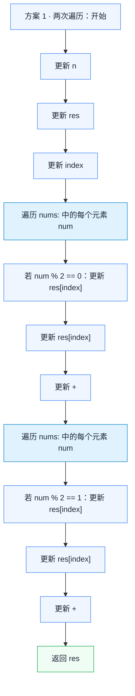

```python
import sys  # 提高递归深度上限（深输入防 RecursionError）

sys.setrecursionlimit(200000)  # 树/链表类题目节点数可达 1e4 量级

def sortArrayByParity(nums):  # 定义函数 sortArrayByParity（参数：数组）
    n = len(nums)  # 把 长度(数组) 存入 元素个数
    res = [0] * n  # 把 [0] 乘 元素个数 存入 结果
    index = 0  # 把 0 存入 index
    for num in nums:  # 逐个取出 数组 的元素（num）
        if num % 2 == 0:  # 若 num 对…取模 2 等于 0
            res[index] = num  # 把 num 写入 res[index]
            index += 1  # index累加 1
    for num in nums:  # 逐个取出 数组 的元素（num）
        if num % 2 == 1:  # 若 num 对…取模 2 等于 1
            res[index] = num  # 把 num 写入 res[index]
            index += 1  # index累加 1
    return res  # 返回 结果

if __name__ == "__main__":  # 若 __name__ 等于 '__main__'
    print(sortArrayByParity([1, 2, 3]))  # 打印输出
```

#### 方案 2：双指针 + 一次遍历

**思路与代码分析**：核心是「双指针 + 一次遍历」。Python 版用切片与字典推导式简化操作，突出可读性。**走读**：方案 2 · 双指针 + 一次遍历：开始 → 更新 n → 更新 res → 更新 right → 遍历 nums: 中的每个元素 num → 若 num % 2 == 0：更新 res[left] → 更新 res[left] → 更新 + → 更新 res[right] → 更新 - → 返回 res。

**运行架构**（真实控制流）：

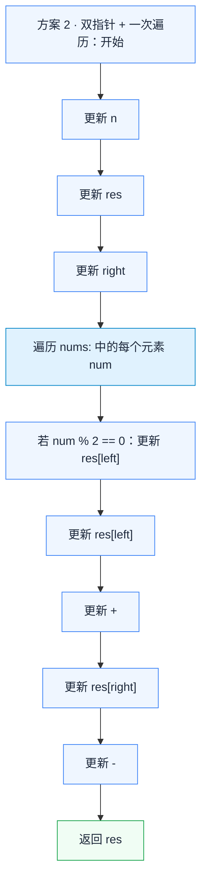

```python
import sys  # 提高递归深度上限（深输入防 RecursionError）

sys.setrecursionlimit(200000)  # 树/链表类题目节点数可达 1e4 量级

def sortArrayByParity(nums):  # 定义函数 sortArrayByParity（参数：数组）
    n = len(nums)  # 把 长度(数组) 存入 元素个数
    res = [0] * n  # 把 [0] 乘 元素个数 存入 结果
    left, right = 0, n - 1  # 把 0, 元素个数 减 1 写入 left, right
    for num in nums:  # 逐个取出 数组 的元素（num）
        if num % 2 == 0:  # 若 num 对…取模 2 等于 0
            res[left] = num  # 把 num 写入 res[left]
            left += 1  # 左边界累加 1
        else:  # 否则
            res[right] = num  # 把 num 写入 res[right]
            right -= 1  # 右边界累减 1
    return res  # 返回 结果

if __name__ == "__main__":  # 若 __name__ 等于 '__main__'
    print(sortArrayByParity([1, 2, 3]))  # 打印输出
```

#### 方案 3：原地交换

**思路与代码分析**：核心是「原地交换」。Python 版用切片与字典推导式简化操作，突出可读性。**走读**：方案 3 · 原地交换：开始 → 更新 right → 当 left ＜ right: 时反复执行 → 当 ( 时反复执行 → 当 ( 时反复执行 → 返回 nums。

**运行架构**（真实控制流）：

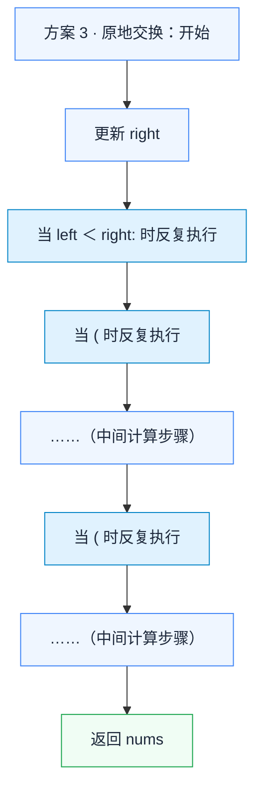

```python
import sys  # 提高递归深度上限（深输入防 RecursionError）

sys.setrecursionlimit(200000)  # 树/链表类题目节点数可达 1e4 量级

def sortArrayByParity(nums):  # 定义函数 sortArrayByParity（参数：数组）
    left, right = 0, len(nums) - 1  # 把 0, 长度(数组) 减 1 写入 left, right
    while left < right:  # 循环，直到不满足「左边界 小于 右边界」
        while (
            left < right and nums[left] % 2 == 0
        ):  # 循环，直到不满足「左边界 小于 右边界 and 数组[左边界] 对…取模 2 等于 0」
            left += 1  # 左边界累加 1
        while (
            left < right and nums[right] % 2 == 1
        ):  # 循环，直到不满足「左边界 小于 右边界 and 数组[右边界] 对…取模 2 等于 1」
            right -= 1  # 右边界累减 1
        if left < right:  # 若 左边界 小于 右边界
            nums[left], nums[right] = (
                nums[right],
                nums[left],
            )  # 把 数组[右边界], 数组[左边界] 写入 nums[left], nums[right]
            left += 1  # 左边界累加 1
            right -= 1  # 右边界累减 1
    return nums  # 返回 数组

if __name__ == "__main__":  # 若 __name__ 等于 '__main__'
    print(sortArrayByParity([1, 2, 3]))  # 打印输出
```

### Go 实现（3 种方案）

Go 的全部方案如下，每个方案都内嵌用例自测，可独立运行（老仓库 python/go 文件遵循「打印结果」约定）：

#### 方案 1：两次遍历

**思路与代码分析**：核心是「两次遍历」。Go 版用切片与多返回值惯用法，显式处理索引边界。**走读**：方案 1 · 两次遍历：开始 → 更新 : → 更新 : → 更新 : → 遍历 nums 的下标与元素 num → 处理 if num%2 == 0 → 更新 res[index] → 处理 index++ → 遍历 nums 的下标与元素 num → 处理 if num%2 == 1 → 更新 res[index] → 处理 index++ → 返回 res。

**运行架构**（真实控制流）：

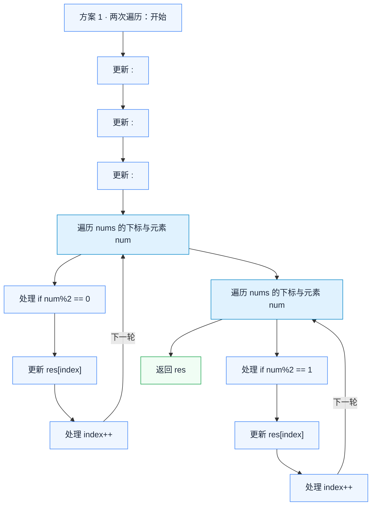

```go
package main // 引入依赖

import (
	"fmt"     // 「fmt」
	"os"      // 「os」
	"reflect" // 「reflect」
)

func sortArrayByParity(nums []int) []int { // 定义函数/方法 sortArrayByParity
	n := len(nums)             // 把 长度(数组) 写入 n :
	res := make([]int, n)      // 把 make([]int, 元素个数) 写入 res :
	index := 0                 // 把 0 写入 index :
	for _, num := range nums { // 同时取 _ 与 num 遍历
		if num%2 == 0 { // 若 num 对…取模 2 等于 0
			res[index] = num // 把 num 写入 res[index]
			index++          // index 加一
		}
	}
	for _, num := range nums { // 同时取 _ 与 num 遍历
		if num%2 == 1 { // 若 num 对…取模 2 等于 1
			res[index] = num // 把 num 写入 res[index]
			index++          // index 加一
		}
	}
	return res // 返回 结果
}

func main() { // 程序入口：跑内嵌自测用例
	type tc struct { // 定义类型
		in   []int // in []int
		want []int // want []int
	}
	cases := []tc{ // 把 []tc{ 写入 cases :
		{[]int{1, 2, 3}, []int{2, 1, 3}},
		{[]int{3, 1, 2, 4}, []int{2, 4, 3, 1}},
		{[]int{}, []int{}},
	}
	ok := true                // 把 true 写入 ok :
	for _, c := range cases { // 同时取 _ 与 字符 遍历
		if got := sortArrayByParity(c.in); !reflect.DeepEqual(got, c.want) {
			ok = false                                                               // 把 false 写入 ok
			fmt.Printf("FAIL sortArrayByParity(%v)=%v want %v\n", c.in, got, c.want) // 打印输出
		}
	}
	if !ok { // 若 取反 ok
		os.Exit(1) // os.Exit(1)
	}
	fmt.Println("PASS") // 全部用例通过，输出 PASS
}
```

#### 方案 2：双指针 + 一次遍历

**思路与代码分析**：核心是「双指针 + 一次遍历」。Go 版用切片与多返回值惯用法，显式处理索引边界。**走读**：方案 2 · 双指针 + 一次遍历：开始 → 更新 : → 更新 : → 更新 : → 遍历 nums 的下标与元素 num → 处理 if num%2 == 0 → 更新 res[left] → 处理 left++ → 更新 res[right] → 处理 right-- → 返回 res。

**运行架构**（真实控制流）：

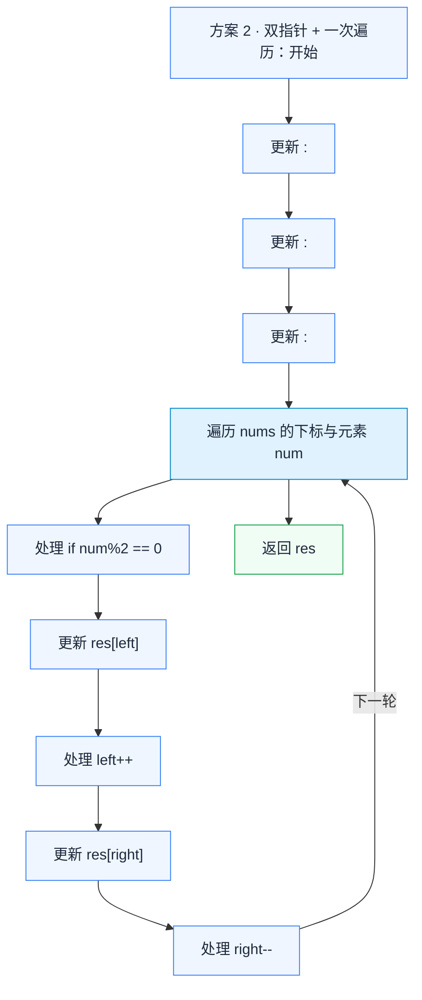

```go
package main // 引入依赖

import (
	"fmt"     // 「fmt」
	"os"      // 「os」
	"reflect" // 「reflect」
)

func sortArrayByParity(nums []int) []int { // 定义函数/方法 sortArrayByParity
	n := len(nums)             // 把 长度(数组) 写入 n :
	res := make([]int, n)      // 把 make([]int, 元素个数) 写入 res :
	left, right := 0, n-1      // 把 0, 元素个数 减 1 写入 left, right :
	for _, num := range nums { // 同时取 _ 与 num 遍历
		if num%2 == 0 { // 若 num 对…取模 2 等于 0
			res[left] = num // 把 num 写入 res[left]
			left++          // 左边界 加一
		} else { // 否则
			res[right] = num // 把 num 写入 res[right]
			right--          // 右边界 减一
		}
	}
	return res // 返回 结果
}

func main() { // 程序入口：跑内嵌自测用例
	type tc struct { // 定义类型
		in   []int // in []int
		want []int // want []int
	}
	cases := []tc{ // 把 []tc{ 写入 cases :
		{[]int{1, 2, 3}, []int{2, 3, 1}},
		{[]int{3, 1, 2, 4}, []int{2, 4, 1, 3}},
		{[]int{}, []int{}},
	}
	ok := true                // 把 true 写入 ok :
	for _, c := range cases { // 同时取 _ 与 字符 遍历
		if got := sortArrayByParity(c.in); !reflect.DeepEqual(got, c.want) {
			ok = false                                                               // 把 false 写入 ok
			fmt.Printf("FAIL sortArrayByParity(%v)=%v want %v\n", c.in, got, c.want) // 打印输出
		}
	}
	if !ok { // 若 取反 ok
		os.Exit(1) // os.Exit(1)
	}
	fmt.Println("PASS") // 全部用例通过，输出 PASS
}
```

#### 方案 3：原地交换

**思路与代码分析**：核心是「原地交换」。Go 版用切片与多返回值惯用法，显式处理索引边界。**走读**：方案 3 · 原地交换：开始 → 更新 : → 遍历循环 → 遍历循环 → 处理 left++ → 遍历循环 → 处理 right-- → 处理 if left ＜ right → 更新 nums[right] → 处理 left++ → 处理 right-- → 返回 nums。

**运行架构**（真实控制流）：

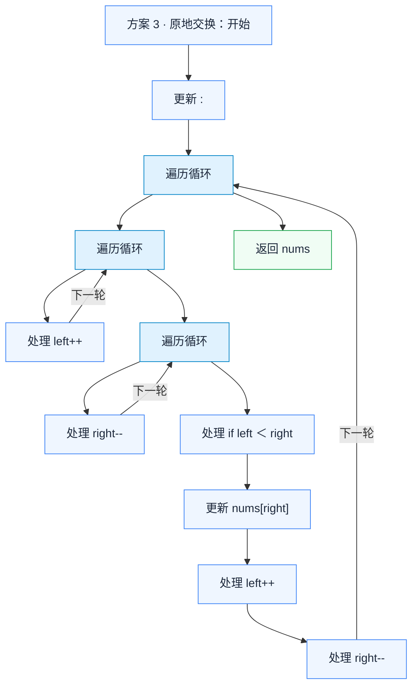

```go
package main // 引入依赖

import (
	"fmt"     // 「fmt」
	"os"      // 「os」
	"reflect" // 「reflect」
)

func sortArrayByParity(nums []int) []int { // 定义函数/方法 sortArrayByParity
	left, right := 0, len(nums)-1 // 把 0, 长度(数组) 减 1 写入 left, right :
	for left < right {            // for 左边界 小于 右边界 {
		for left < right && nums[left]%2 == 0 { // 把 赋值为 0 { 写入 for left < right && nums[left]%2
			left++ // 左边界 加一
		}
		for left < right && nums[right]%2 == 1 { // 把 赋值为 1 { 写入 for left < right && nums[right]%2
			right-- // 右边界 减一
		}
		if left < right { // 若 左边界 小于 右边界
			nums[left], nums[right] = nums[right], nums[left] // 把 数组[右边界], 数组[左边界] 写入 nums[left], nums[right]
			left++                                            // 左边界 加一
			right--                                           // 右边界 减一
		}
	}
	return nums // 返回 数组
}

func main() { // 程序入口：跑内嵌自测用例
	type tc struct { // 定义类型
		in   []int // in []int
		want []int // want []int
	}
	cases := []tc{ // 把 []tc{ 写入 cases :
		{[]int{1, 2, 3}, []int{2, 1, 3}},
		{[]int{3, 1, 2, 4}, []int{4, 2, 1, 3}},
		{[]int{}, []int{}},
	}
	ok := true                // 把 true 写入 ok :
	for _, c := range cases { // 同时取 _ 与 字符 遍历
		in := append([]int{}, c.in...) // 把 append([]int{}, 字符.in...) 写入 in :
		if got := sortArrayByParity(in); !reflect.DeepEqual(got, c.want) {
			ok = false                                                               // 把 false 写入 ok
			fmt.Printf("FAIL sortArrayByParity(%v)=%v want %v\n", c.in, got, c.want) // 打印输出
		}
	}
	if !ok { // 若 取反 ok
		os.Exit(1) // os.Exit(1)
	}
	fmt.Println("PASS") // 全部用例通过，输出 PASS
}
```

### Java 实现（3 种方案）

Java 的全部方案如下，每个方案都内嵌用例自测，可独立运行（老仓库 python/go 文件遵循「打印结果」约定）：

#### 方案 1：两次遍历

**思路与代码分析**：核心是「两次遍历」。Java 版用类与静态方法组织，集合操作显式明了。代码里依次做这些事：双重循环遍历。**走读**：方案 1 · 两次遍历：开始 → 更新 n → 更新 index → 更新 res → 遍历循环 → 若 num % 2 == 0 则： → 更新 res[index++] → 遍历循环 → 若 num % 2 == 1 则： → 更新 res[index++] → 返回 res。

**运行架构**（真实控制流）：

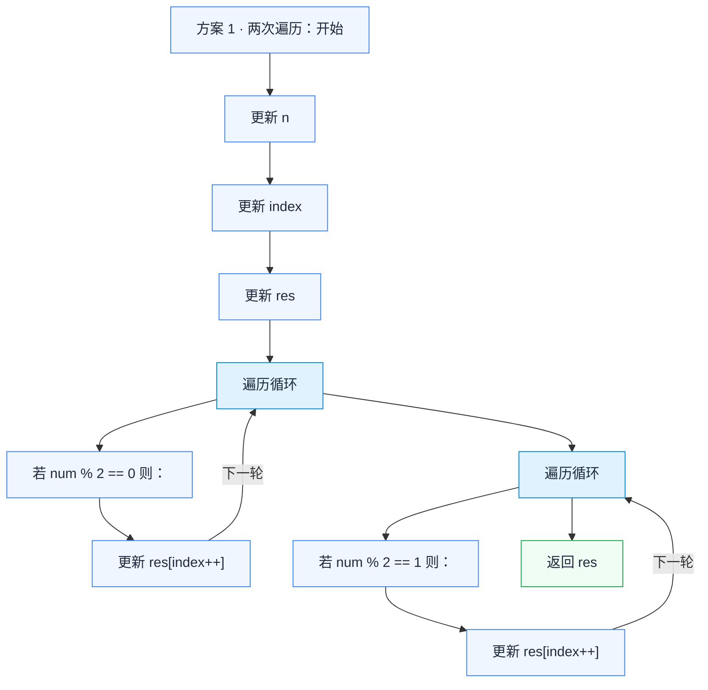

```java
package com.webfault.dsa; // 引入依赖

import java.util.*; // 引入依赖

class lc905_solution111 { // 定义类型
  public int[] sortArrayByParity(int[] nums) { // 定义函数/方法 sortArrayByParity
    int n = nums.length; // 把 数组.长度 存入 元素个数
    int index = 0; // 把 0 存入 index
    int[] res = new int[n]; // 把 new int[元素个数]; 写入 int[] res
    for (int num : nums) { // for (int num : 数组) {
      if (num % 2 == 0) { // 若 num 对…取模 2 等于 0
        res[index++] = num; // 把 num; 写入 res[index++]
      }
    }
    for (int num : nums) { // for (int num : 数组) {
      if (num % 2 == 1) { // 若 num 对…取模 2 等于 1
        res[index++] = num; // 把 num; 写入 res[index++]
      }
    }
    return res; // 返回 结果
  }

  public static void main(String[] args) { // public static void main(String[] args) {
    lc905_solution111 s =
        new lc905_solution111(); // 把 new lc905_solution111(); 写入 lc905_solution111 s
    int[] r =
        s.sortArrayByParity(
            new int[] {1, 2, 3}); // 把 字符串.sortArrayByParity(new int[]{1, 2, 3}); 写入 int[] r
    if (!(r[0] == 2 && r[1] == 1 && r[2] == 3)) throw new RuntimeException("FAILED");
    System.out.println("PASS"); // 全部用例通过，输出 PASS
  }
}
```

#### 方案 2：双指针 + 一次遍历

**思路与代码分析**：核心是「双指针 + 一次遍历」。Java 版用类与静态方法组织，集合操作显式明了。代码里依次做这些事：单循环线性扫描。**走读**：方案 2 · 双指针 + 一次遍历：开始 → 更新 n → 更新 res → 更新 left → 遍历循环 → 若 num % 2 == 0 则： → 更新 res[left++] → 更新 res[right--] → 返回 res。

**运行架构**（真实控制流）：

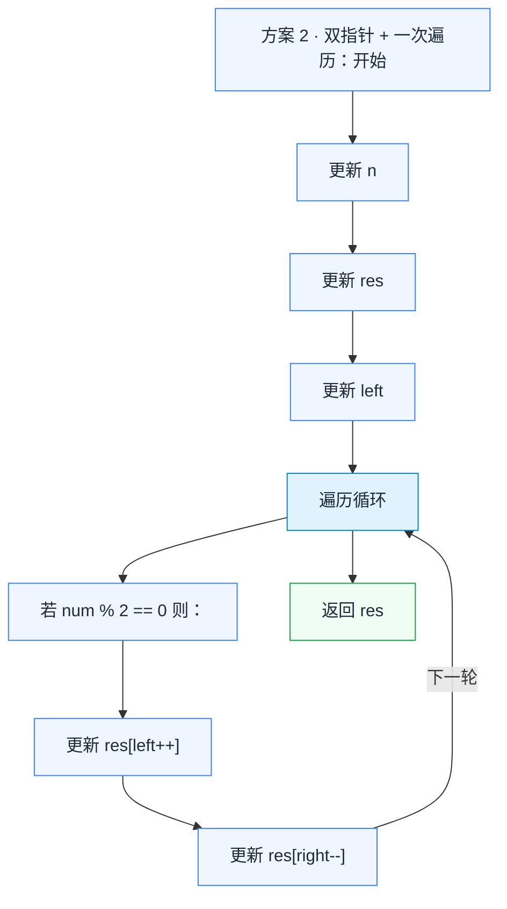

```java
package com.webfault.dsa; // 引入依赖

import java.util.*; // 引入依赖

class lc905_solution222 { // 定义类型
  public int[] sortArrayByParity(int[] nums) { // 定义函数/方法 sortArrayByParity
    int n = nums.length; // 把 数组.长度 存入 元素个数
    int[] res = new int[n]; // 把 new int[元素个数]; 写入 int[] res
    int left = 0, right = n - 1; // 把 0, 右边界 赋值为 元素个数 减 1 存入 左边界
    for (int num : nums) { // for (int num : 数组) {
      if (num % 2 == 0) { // 若 num 对…取模 2 等于 0
        res[left++] = num; // 把 num; 写入 res[left++]
      } else { // 否则
        res[right--] = num; // 把 num; 写入 res[right--]
      }
    }
    return res; // 返回 结果
  }

  public static void main(String[] args) { // public static void main(String[] args) {
    lc905_solution222 s =
        new lc905_solution222(); // 把 new lc905_solution222(); 写入 lc905_solution222 s
    int[] r =
        s.sortArrayByParity(
            new int[] {1, 2, 3}); // 把 字符串.sortArrayByParity(new int[]{1, 2, 3}); 写入 int[] r
    if (!(r[0] == 2 && r[1] == 3 && r[2] == 1)) throw new RuntimeException("FAILED");
    System.out.println("PASS"); // 全部用例通过，输出 PASS
  }
}
```

#### 方案 3：原地交换

**思路与代码分析**：核心是「原地交换」。Java 版用类与静态方法组织，集合操作显式明了。**走读**：方案 3 · 原地交换：开始 → 更新 left → 当 (left ＜ right) 时反复执行 → 当 (left ＜ right 且 nums[left] % 2 == 0) 时反复执行 → 处理 left++ → 当 (left ＜ right 且 nums[right] % 2 == 1) 时反复执行 → 处理 right-- → 若 left ＜ right 则： → 更新 temp → 更新 nums[left] → 更新 nums[right] → 处理 left++ → 处理 right-- → 返回 nums。

**运行架构**（真实控制流）：

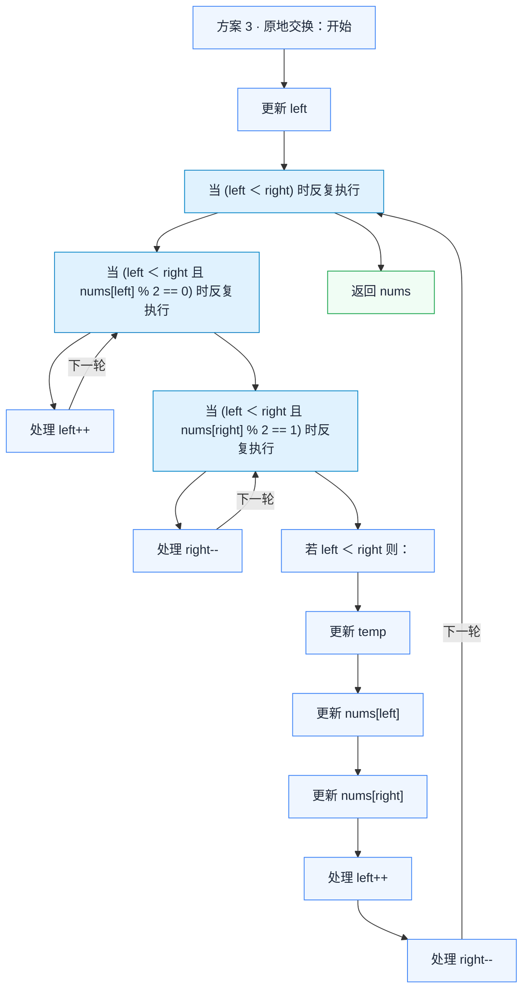

```java
package com.webfault.dsa; // 引入依赖

import java.util.*; // 引入依赖

class lc905_solution333 { // 定义类型
  public int[] sortArrayByParity(int[] nums) { // 定义函数/方法 sortArrayByParity
    int left = 0, right = nums.length - 1; // 把 0, 右边界 赋值为 数组.长度 减 1 存入 左边界
    while (left < right) { // 循环，直到不满足「左边界 小于 右边界」
      while (left < right && nums[left] % 2 == 0) { // 循环，直到不满足「左边界 小于 右边界 且 数组[左边界] 对…取模 2 等于 0」
        left++; // 左边界 加一
      }
      while (left < right && nums[right] % 2 == 1) { // 循环，直到不满足「左边界 小于 右边界 且 数组[右边界] 对…取模 2 等于 1」
        right--; // 右边界 减一
      }
      if (left < right) { // 若 左边界 小于 右边界
        int temp = nums[left]; // 把 数组[左边界] 存入 临时变量
        nums[left] = nums[right]; // 把 数组[右边界]; 写入 nums[left]
        nums[right] = temp; // 把 临时变量; 写入 nums[right]
        left++; // 左边界 加一
        right--; // 右边界 减一
      }
    }
    return nums; // 返回 数组
  }

  public static void main(String[] args) { // public static void main(String[] args) {
    lc905_solution333 s =
        new lc905_solution333(); // 把 new lc905_solution333(); 写入 lc905_solution333 s
    int[] r =
        s.sortArrayByParity(
            new int[] {1, 2, 3}); // 把 字符串.sortArrayByParity(new int[]{1, 2, 3}); 写入 int[] r
    if (!(r[0] == 2 && r[1] == 1 && r[2] == 3)) throw new RuntimeException("FAILED");
    System.out.println("PASS"); // 全部用例通过，输出 PASS
  }
}
```

### Rust 实现（3 种方案）

Rust 的全部方案如下，每个方案都内嵌用例自测，可独立运行（老仓库 python/go 文件遵循「打印结果」约定）：

#### 方案 1：两次遍历

**思路与代码分析**：核心是「两次遍历」。Rust 版用所有权移动与切片借用改写同一逻辑，注意 Option 与引用边界。**走读**：方案 1 · 两次遍历：开始 → 计算 pos → 遍历 0..nums.len() 中的每个元素 i → 处理 if nums[i] % 2 == 0 → 调用 nums.swap(pos, i) → 更新 + → 处理 nums → 返回结果。

**运行架构**（真实控制流）：


```rust
// LeetCode 905. 按奇偶排序数组 — Rust 版（方案1）
fn sort_array_by_parity(mut nums: Vec<i32>) -> Vec<i32> {
    // 定义函数/方法 sort_array_by_parity
    let mut pos = 0usize; // 把 0usize; 写入 let mut pos
    for i in 0..nums.len() {
        // 逐个取出 0 的元素（下标 i）
        if nums[i] % 2 == 0 {
            nums.swap(pos, i);
            pos += 1;
        } // 若 数组[下标 i] 对…取模 2 等于 0 { 数组.交换 pos, 下标 i); pos 累加 1; }
    }
    nums // 数组
}
fn main() {
    // 程序入口：跑内嵌自测用例
    let got = sort_array_by_parity(vec![3, 1, 2, 4]); // 把 sort_array_by_parity(vec取反 [3,1,2,4]) 存入 got
    assert_eq!(got.len(), 4); // 断言校验
    assert!(got[0] % 2 == 0 && got[1] % 2 == 0); // 断言校验
    assert!(got[2] % 2 != 0 && got[3] % 2 != 0); // 断言校验
    let got2 = sort_array_by_parity(vec![1, 2, 3]); // 把 sort_array_by_parity(vec取反 [1,2,3]) 存入 got2
    assert_eq!(got2[1], 1); // 断言校验
    assert_eq!(got2[0], 2); // 断言校验
    assert_eq!(got2[2], 3); // 断言校验
    println!("PASS");
} // 全部用例通过，输出 PASS
```

#### 方案 2：双指针 + 一次遍历

**思路与代码分析**：核心是「双指针 + 一次遍历」。Rust 版用所有权移动与切片借用改写同一逻辑，注意 Option 与引用边界。**走读**：方案 2 · 双指针 + 一次遍历：开始 → 计算 pos → 遍历 0..nums.len() 中的每个元素 i → 处理 if nums[i] % 2 == 0 → 调用 nums.swap(pos, i) → 更新 + → 处理 nums → 返回结果。

**运行架构**（真实控制流）：

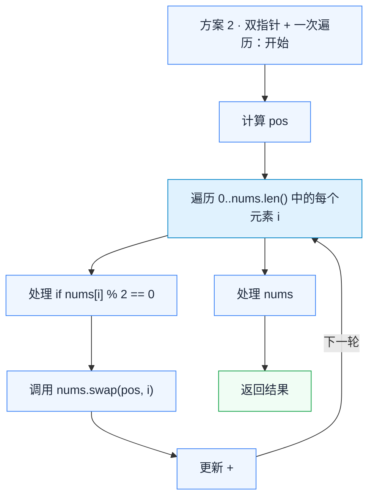

```rust
// LeetCode 905. 按奇偶排序数组 — Rust 版（方案2）
fn sort_array_by_parity(mut nums: Vec<i32>) -> Vec<i32> {
    // 定义函数/方法 sort_array_by_parity
    let mut pos = 0usize; // 把 0usize; 写入 let mut pos
    for i in 0..nums.len() {
        // 逐个取出 0 的元素（下标 i）
        if nums[i] % 2 == 0 {
            nums.swap(pos, i);
            pos += 1;
        } // 若 数组[下标 i] 对…取模 2 等于 0 { 数组.交换 pos, 下标 i); pos 累加 1; }
    }
    nums // 数组
}
fn main() {
    // 程序入口：跑内嵌自测用例
    let got = sort_array_by_parity(vec![3, 1, 2, 4]); // 把 sort_array_by_parity(vec取反 [3,1,2,4]) 存入 got
    assert_eq!(got.len(), 4); // 断言校验
    assert!(got[0] % 2 == 0 && got[1] % 2 == 0); // 断言校验
    assert!(got[2] % 2 != 0 && got[3] % 2 != 0); // 断言校验
    let got2 = sort_array_by_parity(vec![1, 2, 3]); // 把 sort_array_by_parity(vec取反 [1,2,3]) 存入 got2
    assert_eq!(got2[1], 1); // 断言校验
    assert_eq!(got2[0], 2); // 断言校验
    assert_eq!(got2[2], 3); // 断言校验
    println!("PASS");
} // 全部用例通过，输出 PASS
```

#### 方案 3：原地交换

**思路与代码分析**：核心是「原地交换」。Rust 版用所有权移动与切片借用改写同一逻辑，注意 Option 与引用边界。**走读**：方案 3 · 原地交换：开始 → 计算 pos → 遍历 0..nums.len() 中的每个元素 i → 处理 if nums[i] % 2 == 0 → 调用 nums.swap(pos, i) → 更新 + → 处理 nums → 返回结果。

**运行架构**（真实控制流）：

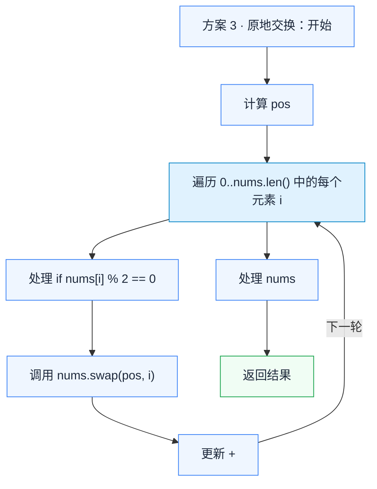

```rust
// LeetCode 905. 按奇偶排序数组 — Rust 版（方案3）
fn sort_array_by_parity(mut nums: Vec<i32>) -> Vec<i32> {
    // 定义函数/方法 sort_array_by_parity
    let mut pos = 0usize; // 把 0usize; 写入 let mut pos
    for i in 0..nums.len() {
        // 逐个取出 0 的元素（下标 i）
        if nums[i] % 2 == 0 {
            nums.swap(pos, i);
            pos += 1;
        } // 若 数组[下标 i] 对…取模 2 等于 0 { 数组.交换 pos, 下标 i); pos 累加 1; }
    }
    nums // 数组
}
fn main() {
    // 程序入口：跑内嵌自测用例
    let got = sort_array_by_parity(vec![3, 1, 2, 4]); // 把 sort_array_by_parity(vec取反 [3,1,2,4]) 存入 got
    assert_eq!(got.len(), 4); // 断言校验
    assert!(got[0] % 2 == 0 && got[1] % 2 == 0); // 断言校验
    assert!(got[2] % 2 != 0 && got[3] % 2 != 0); // 断言校验
    let got2 = sort_array_by_parity(vec![1, 2, 3]); // 把 sort_array_by_parity(vec取反 [1,2,3]) 存入 got2
    assert_eq!(got2[1], 1); // 断言校验
    assert_eq!(got2[0], 2); // 断言校验
    assert_eq!(got2[2], 3); // 断言校验
    println!("PASS");
} // 全部用例通过，输出 PASS
```

### Lua 实现（3 种方案）

Lua 的全部方案如下，每个方案都内嵌用例自测，可独立运行（老仓库 python/go 文件遵循「打印结果」约定）：

#### 方案 1：两次遍历

**思路与代码分析**：核心是「两次遍历」。Lua 版用表与 ipairs 遍历，注意 ipairs 遇 nil 即停的语义。**走读**：方案 1 · 两次遍历：开始 → 更新 v → 更新 pos → 循环 i：从 1 到 #v do → 处理 if v[i] % 2 == 0 then → 更新 v[i] → 更新 pos → 返回 v。

**运行架构**（真实控制流）：


```lua
-- LeetCode 905. 按奇偶排序数组 — Lua 版（方案1）
local function sort_array_by_parity(nums) -- local function sort_array_by_parity(数组)
	local v = { table.unpack(nums) } -- 把 {table.unpack(数组)} 写入 local v
	local pos = 1 -- 把 1 写入 local pos
	for i = 1, #v do -- 把 1, #值 do 写入 for i
		if v[i] % 2 == 0 then -- 若 值[下标 i] 对…取模 2 等于 0 then
			v[pos], v[i] = v[i], v[pos] -- 把 值[下标 i], 值[pos] 写入 v[pos], v[i]
			pos = pos + 1 -- 把 pos 加 1 存入 pos
		end -- 终点
	end -- 终点
	return v -- 返回 值
end -- 终点
local g1 = sort_array_by_parity({ 3, 1, 2, 4 }) -- 把 sort_array_by_parity({3,1,2,4}) 写入 local g1
assert(#g1 == 4 and g1[1] % 2 == 0 and g1[2] % 2 == 0 and g1[3] % 2 == 1) -- 断言校验
local g2 = sort_array_by_parity({ 1, 2, 3 }) -- 把 sort_array_by_parity({1,2,3}) 写入 local g2
assert(table.concat(g2, ",") == "2,1,3") -- 打印输出
print("PASS") -- 全部用例通过，输出 PASS
```

#### 方案 2：双指针 + 一次遍历

**思路与代码分析**：核心是「双指针 + 一次遍历」。Lua 版用表与 ipairs 遍历，注意 ipairs 遇 nil 即停的语义。**走读**：方案 2 · 双指针 + 一次遍历：开始 → 更新 v → 更新 pos → 循环 i：从 1 到 #v do → 处理 if v[i] % 2 == 0 then → 更新 v[i] → 更新 pos → 返回 v。

**运行架构**（真实控制流）：

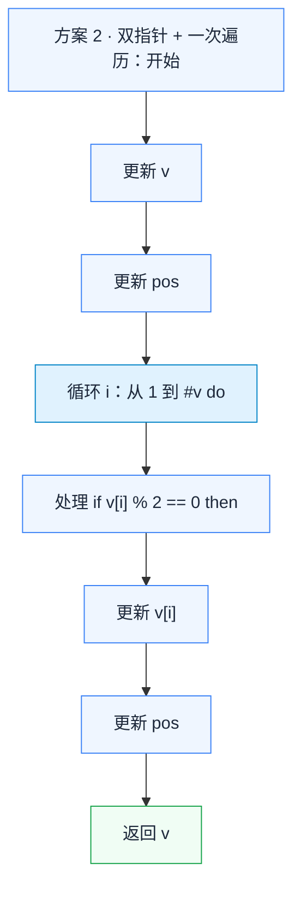

```lua
-- LeetCode 905. 按奇偶排序数组 — Lua 版（方案2）
local function sort_array_by_parity(nums) -- local function sort_array_by_parity(数组)
	local v = { table.unpack(nums) } -- 把 {table.unpack(数组)} 写入 local v
	local pos = 1 -- 把 1 写入 local pos
	for i = 1, #v do -- 把 1, #值 do 写入 for i
		if v[i] % 2 == 0 then -- 若 值[下标 i] 对…取模 2 等于 0 then
			v[pos], v[i] = v[i], v[pos] -- 把 值[下标 i], 值[pos] 写入 v[pos], v[i]
			pos = pos + 1 -- 把 pos 加 1 存入 pos
		end -- 终点
	end -- 终点
	return v -- 返回 值
end -- 终点
local g1 = sort_array_by_parity({ 3, 1, 2, 4 }) -- 把 sort_array_by_parity({3,1,2,4}) 写入 local g1
assert(#g1 == 4 and g1[1] % 2 == 0 and g1[2] % 2 == 0 and g1[3] % 2 == 1) -- 断言校验
local g2 = sort_array_by_parity({ 1, 2, 3 }) -- 把 sort_array_by_parity({1,2,3}) 写入 local g2
assert(table.concat(g2, ",") == "2,1,3") -- 打印输出
print("PASS") -- 全部用例通过，输出 PASS
```

#### 方案 3：原地交换

**思路与代码分析**：核心是「原地交换」。Lua 版用表与 ipairs 遍历，注意 ipairs 遇 nil 即停的语义。**走读**：方案 3 · 原地交换：开始 → 更新 v → 更新 pos → 循环 i：从 1 到 #v do → 处理 if v[i] % 2 == 0 then → 更新 v[i] → 更新 pos → 返回 v。

**运行架构**（真实控制流）：

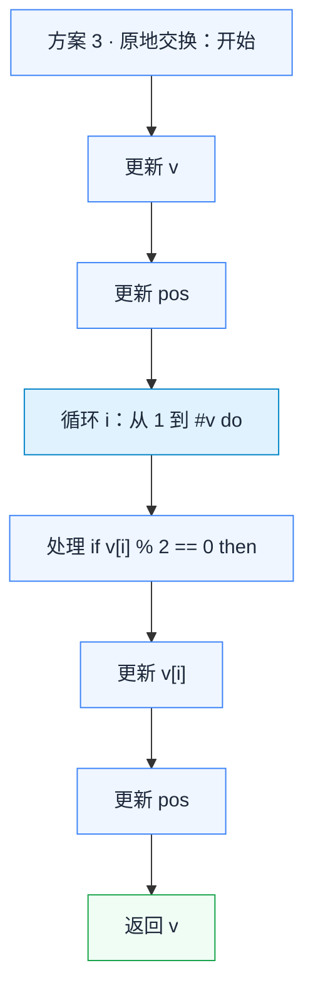

```lua
-- LeetCode 905. 按奇偶排序数组 — Lua 版（方案3）
local function sort_array_by_parity(nums) -- local function sort_array_by_parity(数组)
	local v = { table.unpack(nums) } -- 把 {table.unpack(数组)} 写入 local v
	local pos = 1 -- 把 1 写入 local pos
	for i = 1, #v do -- 把 1, #值 do 写入 for i
		if v[i] % 2 == 0 then -- 若 值[下标 i] 对…取模 2 等于 0 then
			v[pos], v[i] = v[i], v[pos] -- 把 值[下标 i], 值[pos] 写入 v[pos], v[i]
			pos = pos + 1 -- 把 pos 加 1 存入 pos
		end -- 终点
	end -- 终点
	return v -- 返回 值
end -- 终点
local g1 = sort_array_by_parity({ 3, 1, 2, 4 }) -- 把 sort_array_by_parity({3,1,2,4}) 写入 local g1
assert(#g1 == 4 and g1[1] % 2 == 0 and g1[2] % 2 == 0 and g1[3] % 2 == 1) -- 断言校验
local g2 = sort_array_by_parity({ 1, 2, 3 }) -- 把 sort_array_by_parity({1,2,3}) 写入 local g2
assert(table.concat(g2, ",") == "2,1,3") -- 打印输出
print("PASS") -- 全部用例通过，输出 PASS
```

### C 实现（3 种方案）

C 的全部方案如下，每个方案都内嵌用例自测，可独立运行（老仓库 python/go 文件遵循「打印结果」约定）：

#### 方案 1：两次遍历

**思路与代码分析**：核心是「两次遍历」。C 版手动管理下标与内存，循环边界全部显式写出。代码里依次做这些事：单循环线性扫描。**走读**：方案 1 · 两次遍历：开始 → 更新 pos → 遍历循环 → 若 n[i] % 2 == 0 则： → 更新 t → 更新 n[pos] → 更新 n[i] → 处理 pos++ → 返回结果。

**运行架构**（真实控制流）：

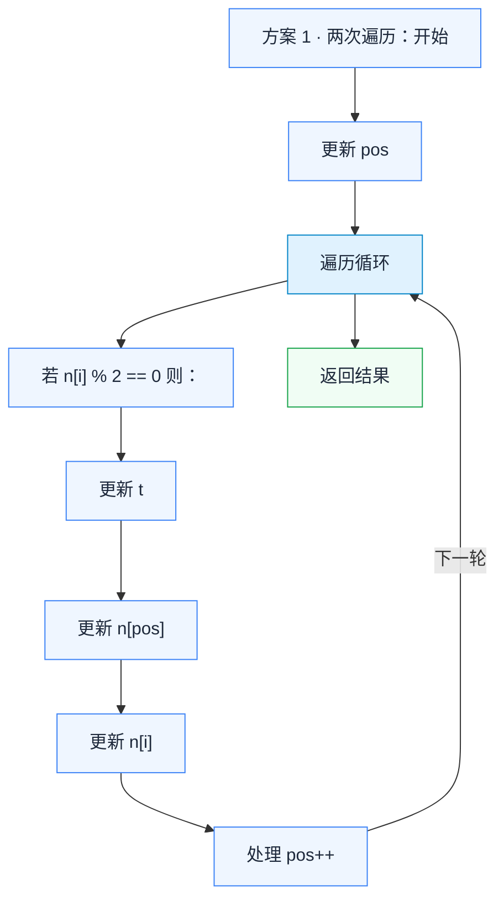

```c
/* LeetCode 905. 按奇偶排序数组 — C 版（方案1） */
#include <stdio.h>                                   // 引入头文件
static void sort_array_by_parity(int n[], int len) { // 定义函数/方法 sort_array_by_parity
    int pos = 0;                                     // 把 0 存入 pos
    for (int i = 0; i < len; i++) { // 让 下标 i 从 0 开始计数，下标 i 小于 长度 就继续
        if (n[i] % 2 == 0) {
            int t = n[pos];
            n[pos] = n[i];
            n[i] = t;
            pos++;
        }
    }
}
int main(void) {                 // 程序入口：跑内嵌自测用例
    int v1[] = {3, 1, 2, 4};     // 把 {3,1,2,4}; 写入 int v1[]
    sort_array_by_parity(v1, 4); // sort_array_by_parity(v1, 4);
    if (!(v1[0] % 2 == 0 && v1[1] % 2 == 0 && v1[2] % 2 == 1 && v1[3] % 2 == 1)) {
        printf("FAIL 1\n");
        return 1;
    }
    int v2[] = {1, 2, 3};        // 把 {1,2,3}; 写入 int v2[]
    sort_array_by_parity(v2, 3); // sort_array_by_parity(v2, 3);
    if (!(v2[0] == 2 && v2[1] == 1 && v2[2] == 3)) {
        printf("FAIL 2\n");
        return 1;
    }
    printf("PASS\n");
    return 0;
} // 全部用例通过，输出 PASS
```

#### 方案 2：双指针 + 一次遍历

**思路与代码分析**：核心是「双指针 + 一次遍历」。C 版手动管理下标与内存，循环边界全部显式写出。代码里依次做这些事：单循环线性扫描。**走读**：方案 2 · 双指针 + 一次遍历：开始 → 更新 pos → 遍历循环 → 若 n[i] % 2 == 0 则： → 更新 t → 更新 n[pos] → 更新 n[i] → 处理 pos++ → 返回结果。

**运行架构**（真实控制流）：

```mermaid
graph TD
    N0["方案 2 · 双指针 + 一次遍历：开始"]
    N1["更新 pos"]
    N2["遍历循环"]
    N3["若 n[i] % 2 == 0 则："]
    N4["更新 t"]
    N5["更新 n[pos]"]
    N6["更新 n[i]"]
    N7["处理 pos++"]
    N8["返回结果"]
    N0 --> N1
    N1 --> N2
    N2 --> N3
    N3 --> N4
    N4 --> N5
    N5 --> N6
    N6 --> N7
    N7 -- 下一轮 --> N2
    N2 --> N8
    classDef n fill:#eff6ff,stroke:#3b82f6,color:#1e293b;
    classDef lp fill:#e0f2fe,stroke:#0284c7,color:#1e293b;
    classDef dc fill:#fef9c3,stroke:#ca8a04,color:#1e293b;
    classDef tm fill:#f0fdf4,stroke:#16a34a,color:#1e293b;
    class N0,N1,N3,N4,N5,N6,N7 n;
    class N2 lp;
    class N8 tm;
```

```c
/* LeetCode 905. 按奇偶排序数组 — C 版（方案2） */
#include <stdio.h>                                   // 引入头文件
static void sort_array_by_parity(int n[], int len) { // 定义函数/方法 sort_array_by_parity
    int pos = 0;                                     // 把 0 存入 pos
    for (int i = 0; i < len; i++) { // 让 下标 i 从 0 开始计数，下标 i 小于 长度 就继续
        if (n[i] % 2 == 0) {
            int t = n[pos];
            n[pos] = n[i];
            n[i] = t;
            pos++;
        }
    }
}
int main(void) {                 // 程序入口：跑内嵌自测用例
    int v1[] = {3, 1, 2, 4};     // 把 {3,1,2,4}; 写入 int v1[]
    sort_array_by_parity(v1, 4); // sort_array_by_parity(v1, 4);
    if (!(v1[0] % 2 == 0 && v1[1] % 2 == 0 && v1[2] % 2 == 1 && v1[3] % 2 == 1)) {
        printf("FAIL 1\n");
        return 1;
    }
    int v2[] = {1, 2, 3};        // 把 {1,2,3}; 写入 int v2[]
    sort_array_by_parity(v2, 3); // sort_array_by_parity(v2, 3);
    if (!(v2[0] == 2 && v2[1] == 1 && v2[2] == 3)) {
        printf("FAIL 2\n");
        return 1;
    }
    printf("PASS\n");
    return 0;
} // 全部用例通过，输出 PASS
```

#### 方案 3：原地交换

**思路与代码分析**：核心是「原地交换」。C 版手动管理下标与内存，循环边界全部显式写出。代码里依次做这些事：单循环线性扫描。**走读**：方案 3 · 原地交换：开始 → 更新 pos → 遍历循环 → 若 n[i] % 2 == 0 则： → 更新 t → 更新 n[pos] → 更新 n[i] → 处理 pos++ → 返回结果。

**运行架构**（真实控制流）：

```mermaid
graph TD
    N0["方案 3 · 原地交换：开始"]
    N1["更新 pos"]
    N2["遍历循环"]
    N3["若 n[i] % 2 == 0 则："]
    N4["更新 t"]
    N5["更新 n[pos]"]
    N6["更新 n[i]"]
    N7["处理 pos++"]
    N8["返回结果"]
    N0 --> N1
    N1 --> N2
    N2 --> N3
    N3 --> N4
    N4 --> N5
    N5 --> N6
    N6 --> N7
    N7 -- 下一轮 --> N2
    N2 --> N8
    classDef n fill:#eff6ff,stroke:#3b82f6,color:#1e293b;
    classDef lp fill:#e0f2fe,stroke:#0284c7,color:#1e293b;
    classDef dc fill:#fef9c3,stroke:#ca8a04,color:#1e293b;
    classDef tm fill:#f0fdf4,stroke:#16a34a,color:#1e293b;
    class N0,N1,N3,N4,N5,N6,N7 n;
    class N2 lp;
    class N8 tm;
```

```c
/* LeetCode 905. 按奇偶排序数组 — C 版（方案3） */
#include <stdio.h>                                   // 引入头文件
static void sort_array_by_parity(int n[], int len) { // 定义函数/方法 sort_array_by_parity
    int pos = 0;                                     // 把 0 存入 pos
    for (int i = 0; i < len; i++) { // 让 下标 i 从 0 开始计数，下标 i 小于 长度 就继续
        if (n[i] % 2 == 0) {
            int t = n[pos];
            n[pos] = n[i];
            n[i] = t;
            pos++;
        }
    }
}
int main(void) {                 // 程序入口：跑内嵌自测用例
    int v1[] = {3, 1, 2, 4};     // 把 {3,1,2,4}; 写入 int v1[]
    sort_array_by_parity(v1, 4); // sort_array_by_parity(v1, 4);
    if (!(v1[0] % 2 == 0 && v1[1] % 2 == 0 && v1[2] % 2 == 1 && v1[3] % 2 == 1)) {
        printf("FAIL 1\n");
        return 1;
    }
    int v2[] = {1, 2, 3};        // 把 {1,2,3}; 写入 int v2[]
    sort_array_by_parity(v2, 3); // sort_array_by_parity(v2, 3);
    if (!(v2[0] == 2 && v2[1] == 1 && v2[2] == 3)) {
        printf("FAIL 2\n");
        return 1;
    }
    printf("PASS\n");
    return 0;
} // 全部用例通过，输出 PASS
```

### C++ 实现（3 种方案）

C++ 的全部方案如下，每个方案都内嵌用例自测，可独立运行（老仓库 python/go 文件遵循「打印结果」约定）：

#### 方案 1：两次遍历

**思路与代码分析**：核心是「两次遍历」。C++ 版用 STL 容器与迭代器，减少手写下标错误。代码里依次做这些事：单循环线性扫描。**走读**：方案 1 · 两次遍历：开始 → 更新 pos → 遍历循环 → 若 nums[i] % 2 == 0：处理 std::swap(nums[pos++], → 处理 std::swap(nums[pos++], → 处理 nums[i]) → 返回 nums。

**运行架构**（真实控制流）：

```mermaid
graph TD
    N0["方案 1 · 两次遍历：开始"]
    N1["更新 pos"]
    N2["遍历循环"]
    N3["若 nums[i] % 2 == 0：处理 std::swap(nums[pos++],"]
    N4["处理 std::swap(nums[pos++],"]
    N5["处理 nums[i])"]
    N6["返回 nums"]
    N0 --> N1
    N1 --> N2
    N2 --> N3
    N3 --> N4
    N4 --> N5
    N5 -- 下一轮 --> N2
    N2 --> N6
    classDef n fill:#eff6ff,stroke:#3b82f6,color:#1e293b;
    classDef lp fill:#e0f2fe,stroke:#0284c7,color:#1e293b;
    classDef dc fill:#fef9c3,stroke:#ca8a04,color:#1e293b;
    classDef tm fill:#f0fdf4,stroke:#16a34a,color:#1e293b;
    class N0,N1,N3,N4,N5 n;
    class N2 lp;
    class N6 tm;
```

```cpp
// LeetCode 905. 按奇偶排序数组 — C++ 版（方案1）
#include <cassert>  // 引入头文件
#include <iostream> // 引入头文件
#include <vector>   // 引入头文件
static std::vector<int> sortArrayByParity(std::vector<int> nums) {
    size_t pos = 0;                            // 把 0; 写入 size_t pos
    for (size_t i = 0; i < nums.size(); ++i) { // 让 下标 i 从 0 开始计数，下标 i 小于 数组.大小() 就继续
        if (nums[i] % 2 == 0)
            std::swap(nums[pos++],
                      nums[i]); // 若 数组[下标 i] 对…取模 2 等于 0) std::交换 数组[pos 加一 ], 数组[下标 i]);
    }
    return nums; // 返回 数组
}
int main() {                                   // 程序入口：跑内嵌自测用例
    auto g1 = sortArrayByParity({3, 1, 2, 4}); // 把 sortArrayByParity({3, 1, 2, 4}) 存入 g1
    assert(g1.size() == 4 && g1[0] % 2 == 0 && g1[1] % 2 == 0 && g1[2] % 2 == 1); // 断言校验
    auto g2 = sortArrayByParity({1, 2, 3});    // 把 sortArrayByParity({1, 2, 3}) 存入 g2
    assert((g2 == std::vector<int>{2, 1, 3})); // 断言校验
    std::cout << "PASS" << std::endl;
} // 全部用例通过，输出 PASS
```

#### 方案 2：双指针 + 一次遍历

**思路与代码分析**：核心是「双指针 + 一次遍历」。C++ 版用 STL 容器与迭代器，减少手写下标错误。代码里依次做这些事：单循环线性扫描。**走读**：方案 2 · 双指针 + 一次遍历：开始 → 更新 pos → 遍历循环 → 若 nums[i] % 2 == 0：处理 std::swap(nums[pos++], → 处理 std::swap(nums[pos++], → 处理 nums[i]) → 返回 nums。

**运行架构**（真实控制流）：

```mermaid
graph TD
    N0["方案 2 · 双指针 + 一次遍历：开始"]
    N1["更新 pos"]
    N2["遍历循环"]
    N3["若 nums[i] % 2 == 0：处理 std::swap(nums[pos++],"]
    N4["处理 std::swap(nums[pos++],"]
    N5["处理 nums[i])"]
    N6["返回 nums"]
    N0 --> N1
    N1 --> N2
    N2 --> N3
    N3 --> N4
    N4 --> N5
    N5 -- 下一轮 --> N2
    N2 --> N6
    classDef n fill:#eff6ff,stroke:#3b82f6,color:#1e293b;
    classDef lp fill:#e0f2fe,stroke:#0284c7,color:#1e293b;
    classDef dc fill:#fef9c3,stroke:#ca8a04,color:#1e293b;
    classDef tm fill:#f0fdf4,stroke:#16a34a,color:#1e293b;
    class N0,N1,N3,N4,N5 n;
    class N2 lp;
    class N6 tm;
```

```cpp
// LeetCode 905. 按奇偶排序数组 — C++ 版（方案2）
#include <cassert>  // 引入头文件
#include <iostream> // 引入头文件
#include <vector>   // 引入头文件
static std::vector<int> sortArrayByParity(std::vector<int> nums) {
    size_t pos = 0;                            // 把 0; 写入 size_t pos
    for (size_t i = 0; i < nums.size(); ++i) { // 让 下标 i 从 0 开始计数，下标 i 小于 数组.大小() 就继续
        if (nums[i] % 2 == 0)
            std::swap(nums[pos++],
                      nums[i]); // 若 数组[下标 i] 对…取模 2 等于 0) std::交换 数组[pos 加一 ], 数组[下标 i]);
    }
    return nums; // 返回 数组
}
int main() {                                   // 程序入口：跑内嵌自测用例
    auto g1 = sortArrayByParity({3, 1, 2, 4}); // 把 sortArrayByParity({3, 1, 2, 4}) 存入 g1
    assert(g1.size() == 4 && g1[0] % 2 == 0 && g1[1] % 2 == 0 && g1[2] % 2 == 1); // 断言校验
    auto g2 = sortArrayByParity({1, 2, 3});    // 把 sortArrayByParity({1, 2, 3}) 存入 g2
    assert((g2 == std::vector<int>{2, 1, 3})); // 断言校验
    std::cout << "PASS" << std::endl;
} // 全部用例通过，输出 PASS
```

#### 方案 3：原地交换

**思路与代码分析**：核心是「原地交换」。C++ 版用 STL 容器与迭代器，减少手写下标错误。代码里依次做这些事：单循环线性扫描。**走读**：方案 3 · 原地交换：开始 → 更新 pos → 遍历循环 → 若 nums[i] % 2 == 0：处理 std::swap(nums[pos++], → 处理 std::swap(nums[pos++], → 处理 nums[i]) → 返回 nums。

**运行架构**（真实控制流）：

```mermaid
graph TD
    N0["方案 3 · 原地交换：开始"]
    N1["更新 pos"]
    N2["遍历循环"]
    N3["若 nums[i] % 2 == 0：处理 std::swap(nums[pos++],"]
    N4["处理 std::swap(nums[pos++],"]
    N5["处理 nums[i])"]
    N6["返回 nums"]
    N0 --> N1
    N1 --> N2
    N2 --> N3
    N3 --> N4
    N4 --> N5
    N5 -- 下一轮 --> N2
    N2 --> N6
    classDef n fill:#eff6ff,stroke:#3b82f6,color:#1e293b;
    classDef lp fill:#e0f2fe,stroke:#0284c7,color:#1e293b;
    classDef dc fill:#fef9c3,stroke:#ca8a04,color:#1e293b;
    classDef tm fill:#f0fdf4,stroke:#16a34a,color:#1e293b;
    class N0,N1,N3,N4,N5 n;
    class N2 lp;
    class N6 tm;
```

```cpp
// LeetCode 905. 按奇偶排序数组 — C++ 版（方案3）
#include <cassert>  // 引入头文件
#include <iostream> // 引入头文件
#include <vector>   // 引入头文件
static std::vector<int> sortArrayByParity(std::vector<int> nums) {
    size_t pos = 0;                            // 把 0; 写入 size_t pos
    for (size_t i = 0; i < nums.size(); ++i) { // 让 下标 i 从 0 开始计数，下标 i 小于 数组.大小() 就继续
        if (nums[i] % 2 == 0)
            std::swap(nums[pos++],
                      nums[i]); // 若 数组[下标 i] 对…取模 2 等于 0) std::交换 数组[pos 加一 ], 数组[下标 i]);
    }
    return nums; // 返回 数组
}
int main() {                                   // 程序入口：跑内嵌自测用例
    auto g1 = sortArrayByParity({3, 1, 2, 4}); // 把 sortArrayByParity({3, 1, 2, 4}) 存入 g1
    assert(g1.size() == 4 && g1[0] % 2 == 0 && g1[1] % 2 == 0 && g1[2] % 2 == 1); // 断言校验
    auto g2 = sortArrayByParity({1, 2, 3});    // 把 sortArrayByParity({1, 2, 3}) 存入 g2
    assert((g2 == std::vector<int>{2, 1, 3})); // 断言校验
    std::cout << "PASS" << std::endl;
} // 全部用例通过，输出 PASS
```

### R 实现（3 种方案）

R 的全部方案如下，每个方案都内嵌用例自测，可独立运行（老仓库 python/go 文件遵循「打印结果」约定）：

#### 方案 1：两次遍历

**思路与代码分析**：核心是「两次遍历」。R 版用向量化思维与 1 起始下标，注意 1:n 的降序陷阱。**走读**：方案 1 · 两次遍历：开始 → 更新 = → 更新 ! → 调用 c(even, odd) → 返回结果。

**运行架构**（真实控制流）：

```mermaid
graph TD
    N0["方案 1 · 两次遍历：开始"]
    N1["更新 ="]
    N2["更新 !"]
    N3["调用 c(even, odd)"]
    N4["返回结果"]
    N0 --> N1
    N1 --> N2
    N2 --> N3
    N3 --> N4
    classDef n fill:#eff6ff,stroke:#3b82f6,color:#1e293b;
    classDef lp fill:#e0f2fe,stroke:#0284c7,color:#1e293b;
    classDef dc fill:#fef9c3,stroke:#ca8a04,color:#1e293b;
    classDef tm fill:#f0fdf4,stroke:#16a34a,color:#1e293b;
    class N0,N1,N2,N3 n;
    class N4 tm;
```

```r
# 版（方案1） 定义函数 sort_array_by_parity（参数：数组）
sort_array_by_parity <- function(nums) {
    even <- nums[nums%%2 == 0]  # 把 数组[数组 对…取模 对…取模 2 等于 0] 存入 even
    odd <- nums[nums%%2 != 0]  # 把 数组[数组 对…取模 对…取模 2 不等于 0] 存入 odd
    c(even, odd)  # 字符(even, odd)
}
g1 <- sort_array_by_parity(c(3, 1, 2, 3 + 1))  # 把 sort_array_by_parity(字符(3, 1, 2, 3 加 1)) 存入 g1
stopifnot(length(g1) == 4, g1[1]%%2 == 0, g1[2]%%2 == 0, g1[3]%%2 == 1)  # 断言校验
g2 <- sort_array_by_parity(c(1, 2, 3))  # 把 sort_array_by_parity(字符(1, 2, 3)) 存入 g2
stopifnot(identical(g2, c(2, 1, 3)))  # 断言校验
cat("PASS\n")  # 全部用例通过，输出 PASS
```

#### 方案 2：双指针 + 一次遍历

**思路与代码分析**：核心是「双指针 + 一次遍历」。R 版用向量化思维与 1 起始下标，注意 1:n 的降序陷阱。**走读**：方案 2 · 双指针 + 一次遍历：开始 → 更新 = → 更新 ! → 调用 c(even, odd) → 返回结果。

**运行架构**（真实控制流）：

```mermaid
graph TD
    N0["方案 2 · 双指针 + 一次遍历：开始"]
    N1["更新 ="]
    N2["更新 !"]
    N3["调用 c(even, odd)"]
    N4["返回结果"]
    N0 --> N1
    N1 --> N2
    N2 --> N3
    N3 --> N4
    classDef n fill:#eff6ff,stroke:#3b82f6,color:#1e293b;
    classDef lp fill:#e0f2fe,stroke:#0284c7,color:#1e293b;
    classDef dc fill:#fef9c3,stroke:#ca8a04,color:#1e293b;
    classDef tm fill:#f0fdf4,stroke:#16a34a,color:#1e293b;
    class N0,N1,N2,N3 n;
    class N4 tm;
```

```r
# 版（方案2） 定义函数 sort_array_by_parity（参数：数组）
sort_array_by_parity <- function(nums) {
    even <- nums[nums%%2 == 0]  # 把 数组[数组 对…取模 对…取模 2 等于 0] 存入 even
    odd <- nums[nums%%2 != 0]  # 把 数组[数组 对…取模 对…取模 2 不等于 0] 存入 odd
    c(even, odd)  # 字符(even, odd)
}
g1 <- sort_array_by_parity(c(3, 1, 2, 3 + 1))  # 把 sort_array_by_parity(字符(3, 1, 2, 3 加 1)) 存入 g1
stopifnot(length(g1) == 4, g1[1]%%2 == 0, g1[2]%%2 == 0, g1[3]%%2 == 1)  # 断言校验
g2 <- sort_array_by_parity(c(1, 2, 3))  # 把 sort_array_by_parity(字符(1, 2, 3)) 存入 g2
stopifnot(identical(g2, c(2, 1, 3)))  # 断言校验
cat("PASS\n")  # 全部用例通过，输出 PASS
```

#### 方案 3：原地交换

**思路与代码分析**：核心是「原地交换」。R 版用向量化思维与 1 起始下标，注意 1:n 的降序陷阱。**走读**：方案 3 · 原地交换：开始 → 更新 = → 更新 ! → 调用 c(even, odd) → 返回结果。

**运行架构**（真实控制流）：

```mermaid
graph TD
    N0["方案 3 · 原地交换：开始"]
    N1["更新 ="]
    N2["更新 !"]
    N3["调用 c(even, odd)"]
    N4["返回结果"]
    N0 --> N1
    N1 --> N2
    N2 --> N3
    N3 --> N4
    classDef n fill:#eff6ff,stroke:#3b82f6,color:#1e293b;
    classDef lp fill:#e0f2fe,stroke:#0284c7,color:#1e293b;
    classDef dc fill:#fef9c3,stroke:#ca8a04,color:#1e293b;
    classDef tm fill:#f0fdf4,stroke:#16a34a,color:#1e293b;
    class N0,N1,N2,N3 n;
    class N4 tm;
```

```r
# 版（方案3） 定义函数 sort_array_by_parity（参数：数组）
sort_array_by_parity <- function(nums) {
    even <- nums[nums%%2 == 0]  # 把 数组[数组 对…取模 对…取模 2 等于 0] 存入 even
    odd <- nums[nums%%2 != 0]  # 把 数组[数组 对…取模 对…取模 2 不等于 0] 存入 odd
    c(even, odd)  # 字符(even, odd)
}
g1 <- sort_array_by_parity(c(3, 1, 2, 3 + 1))  # 把 sort_array_by_parity(字符(3, 1, 2, 3 加 1)) 存入 g1
stopifnot(length(g1) == 4, g1[1]%%2 == 0, g1[2]%%2 == 0, g1[3]%%2 == 1)  # 断言校验
g2 <- sort_array_by_parity(c(1, 2, 3))  # 把 sort_array_by_parity(字符(1, 2, 3)) 存入 g2
stopifnot(identical(g2, c(2, 1, 3)))  # 断言校验
cat("PASS\n")  # 全部用例通过，输出 PASS
```

### Zig 实现（3 种方案）

Zig 的全部方案如下，每个方案都内嵌用例自测，可独立运行（老仓库 python/go 文件遵循「打印结果」约定）：

#### 方案 1：两次遍历

**思路与代码分析**：核心是「两次遍历」。Zig 版显式分配与清零，整型边界处理严格。代码里依次做这些事：单循环线性扫描。**走读**：方案 1 · 两次遍历：开始 → 计算 pos → 遍历集合元素 → 若 @mod(v, 2) == 0 则： → 计算 t → 更新 nums[pos] → 更新 nums[i] → 更新 + → 返回结果。

**运行架构**（真实控制流）：

```mermaid
graph TD
    N0["方案 1 · 两次遍历：开始"]
    N1["计算 pos"]
    N2["遍历集合元素"]
    N3["若 @mod(v, 2) == 0 则："]
    N4["计算 t"]
    N5["更新 nums[pos]"]
    N6["更新 nums[i]"]
    N7["更新 +"]
    N8["返回结果"]
    N0 --> N1
    N1 --> N2
    N2 --> N3
    N3 --> N4
    N4 --> N5
    N5 --> N6
    N6 --> N7
    N7 -- 下一轮 --> N2
    N2 --> N8
    classDef n fill:#eff6ff,stroke:#3b82f6,color:#1e293b;
    classDef lp fill:#e0f2fe,stroke:#0284c7,color:#1e293b;
    classDef dc fill:#fef9c3,stroke:#ca8a04,color:#1e293b;
    classDef tm fill:#f0fdf4,stroke:#16a34a,color:#1e293b;
    class N0,N1,N3,N4,N5,N6,N7 n;
    class N2 lp;
    class N8 tm;
```

```zig
// LeetCode 905. 按奇偶排序数组 — Zig 版（方案1）
const std = @import("std"); // 把 @import(「std」) 存入 std
fn sortArrayByParity(nums: []i32) void { // 定义函数/方法 sortArrayByParity
    var pos: usize = 0; // 把 0; 写入 var pos: usize
    for (nums, 0..) |v, i| { // for (数组, 0..) 按位或 值, 下标 i 按位或 {
        if (@mod(v, 2) == 0) { // 若 @mod(值, 2) 等于 0
            const t = nums[pos]; // 把 数组[pos] 存入 另一字符串
            nums[pos] = nums[i]; // 把 数组[下标 i]; 写入 nums[pos]
            nums[i] = t; // 把 另一字符串; 写入 nums[i]
            pos += 1; // pos累加 1
        }
    }
}
pub fn main() !void { // 程序入口：跑内嵌自测用例
    var v1 = [_]i32{ 3, 1, 2, 4 }; // 把 [_]i32{ 3, 1, 2, 4 } 存入 v1
    sortArrayByParity(&v1); // sortArrayByParity( 按位与 v1);
    if (@mod(v1[0], 2) != 0 or @mod(v1[1], 2) != 0 or @mod(v1[2], 2) != 1) return error.TestFailed;
    var v2 = [_]i32{ 1, 2, 3 }; // 把 [_]i32{ 1, 2, 3 } 存入 v2
    sortArrayByParity(&v2); // sortArrayByParity( 按位与 v2);
    if (v2[0] != 2 or v2[1] != 1 or v2[2] != 3) return error.TestFailed;
    std.debug.print("PASS\n", .{});
} // 全部用例通过，输出 PASS
```

#### 方案 2：双指针 + 一次遍历

**思路与代码分析**：核心是「双指针 + 一次遍历」。Zig 版显式分配与清零，整型边界处理严格。代码里依次做这些事：单循环线性扫描。**走读**：方案 2 · 双指针 + 一次遍历：开始 → 计算 pos → 遍历集合元素 → 若 @mod(v, 2) == 0 则： → 计算 t → 更新 nums[pos] → 更新 nums[i] → 更新 + → 返回结果。

**运行架构**（真实控制流）：

```mermaid
graph TD
    N0["方案 2 · 双指针 + 一次遍历：开始"]
    N1["计算 pos"]
    N2["遍历集合元素"]
    N3["若 @mod(v, 2) == 0 则："]
    N4["计算 t"]
    N5["更新 nums[pos]"]
    N6["更新 nums[i]"]
    N7["更新 +"]
    N8["返回结果"]
    N0 --> N1
    N1 --> N2
    N2 --> N3
    N3 --> N4
    N4 --> N5
    N5 --> N6
    N6 --> N7
    N7 -- 下一轮 --> N2
    N2 --> N8
    classDef n fill:#eff6ff,stroke:#3b82f6,color:#1e293b;
    classDef lp fill:#e0f2fe,stroke:#0284c7,color:#1e293b;
    classDef dc fill:#fef9c3,stroke:#ca8a04,color:#1e293b;
    classDef tm fill:#f0fdf4,stroke:#16a34a,color:#1e293b;
    class N0,N1,N3,N4,N5,N6,N7 n;
    class N2 lp;
    class N8 tm;
```

```zig
// LeetCode 905. 按奇偶排序数组 — Zig 版（方案2）
const std = @import("std"); // 把 @import(「std」) 存入 std
fn sortArrayByParity(nums: []i32) void { // 定义函数/方法 sortArrayByParity
    var pos: usize = 0; // 把 0; 写入 var pos: usize
    for (nums, 0..) |v, i| { // for (数组, 0..) 按位或 值, 下标 i 按位或 {
        if (@mod(v, 2) == 0) { // 若 @mod(值, 2) 等于 0
            const t = nums[pos]; // 把 数组[pos] 存入 另一字符串
            nums[pos] = nums[i]; // 把 数组[下标 i]; 写入 nums[pos]
            nums[i] = t; // 把 另一字符串; 写入 nums[i]
            pos += 1; // pos累加 1
        }
    }
}
pub fn main() !void { // 程序入口：跑内嵌自测用例
    var v1 = [_]i32{ 3, 1, 2, 4 }; // 把 [_]i32{ 3, 1, 2, 4 } 存入 v1
    sortArrayByParity(&v1); // sortArrayByParity( 按位与 v1);
    if (@mod(v1[0], 2) != 0 or @mod(v1[1], 2) != 0 or @mod(v1[2], 2) != 1) return error.TestFailed;
    var v2 = [_]i32{ 1, 2, 3 }; // 把 [_]i32{ 1, 2, 3 } 存入 v2
    sortArrayByParity(&v2); // sortArrayByParity( 按位与 v2);
    if (v2[0] != 2 or v2[1] != 1 or v2[2] != 3) return error.TestFailed;
    std.debug.print("PASS\n", .{});
} // 全部用例通过，输出 PASS
```

#### 方案 3：原地交换

**思路与代码分析**：核心是「原地交换」。Zig 版显式分配与清零，整型边界处理严格。代码里依次做这些事：单循环线性扫描。**走读**：方案 3 · 原地交换：开始 → 计算 pos → 遍历集合元素 → 若 @mod(v, 2) == 0 则： → 计算 t → 更新 nums[pos] → 更新 nums[i] → 更新 + → 返回结果。

**运行架构**（真实控制流）：

```mermaid
graph TD
    N0["方案 3 · 原地交换：开始"]
    N1["计算 pos"]
    N2["遍历集合元素"]
    N3["若 @mod(v, 2) == 0 则："]
    N4["计算 t"]
    N5["更新 nums[pos]"]
    N6["更新 nums[i]"]
    N7["更新 +"]
    N8["返回结果"]
    N0 --> N1
    N1 --> N2
    N2 --> N3
    N3 --> N4
    N4 --> N5
    N5 --> N6
    N6 --> N7
    N7 -- 下一轮 --> N2
    N2 --> N8
    classDef n fill:#eff6ff,stroke:#3b82f6,color:#1e293b;
    classDef lp fill:#e0f2fe,stroke:#0284c7,color:#1e293b;
    classDef dc fill:#fef9c3,stroke:#ca8a04,color:#1e293b;
    classDef tm fill:#f0fdf4,stroke:#16a34a,color:#1e293b;
    class N0,N1,N3,N4,N5,N6,N7 n;
    class N2 lp;
    class N8 tm;
```

```zig
// LeetCode 905. 按奇偶排序数组 — Zig 版（方案3）
const std = @import("std"); // 把 @import(「std」) 存入 std
fn sortArrayByParity(nums: []i32) void { // 定义函数/方法 sortArrayByParity
    var pos: usize = 0; // 把 0; 写入 var pos: usize
    for (nums, 0..) |v, i| { // for (数组, 0..) 按位或 值, 下标 i 按位或 {
        if (@mod(v, 2) == 0) { // 若 @mod(值, 2) 等于 0
            const t = nums[pos]; // 把 数组[pos] 存入 另一字符串
            nums[pos] = nums[i]; // 把 数组[下标 i]; 写入 nums[pos]
            nums[i] = t; // 把 另一字符串; 写入 nums[i]
            pos += 1; // pos累加 1
        }
    }
}
pub fn main() !void { // 程序入口：跑内嵌自测用例
    var v1 = [_]i32{ 3, 1, 2, 4 }; // 把 [_]i32{ 3, 1, 2, 4 } 存入 v1
    sortArrayByParity(&v1); // sortArrayByParity( 按位与 v1);
    if (@mod(v1[0], 2) != 0 or @mod(v1[1], 2) != 0 or @mod(v1[2], 2) != 1) return error.TestFailed;
    var v2 = [_]i32{ 1, 2, 3 }; // 把 [_]i32{ 1, 2, 3 } 存入 v2
    sortArrayByParity(&v2); // sortArrayByParity( 按位与 v2);
    if (v2[0] != 2 or v2[1] != 1 or v2[2] != 3) return error.TestFailed;
    std.debug.print("PASS\n", .{});
} // 全部用例通过，输出 PASS
```

### Dart 实现（3 种方案）

Dart 的全部方案如下，每个方案都内嵌用例自测，可独立运行（老仓库 python/go 文件遵循「打印结果」约定）：

#### 方案 1：两次遍历

**思路与代码分析**：核心是「两次遍历」。Dart 版用可空类型标注与集合方法，注意空安全。代码里依次做这些事：单循环线性扫描。**走读**：方案 1 · 两次遍历：开始 → 更新 v → 计算 pos → 遍历循环 → 若 v[i] % 2 == 0 则： → 更新 t → 更新 v[pos] → 更新 v[i] → 处理 pos++ → 返回 v。

**运行架构**（真实控制流）：

```mermaid
graph TD
    N0["方案 1 · 两次遍历：开始"]
    N1["更新 v"]
    N2["计算 pos"]
    N3["遍历循环"]
    N4["若 v[i] % 2 == 0 则："]
    N5["更新 t"]
    N6["更新 v[pos]"]
    N7["更新 v[i]"]
    N8["处理 pos++"]
    N9["返回 v"]
    N0 --> N1
    N1 --> N2
    N2 --> N3
    N3 --> N4
    N4 --> N5
    N5 --> N6
    N6 --> N7
    N7 --> N8
    N8 -- 下一轮 --> N3
    N3 --> N9
    classDef n fill:#eff6ff,stroke:#3b82f6,color:#1e293b;
    classDef lp fill:#e0f2fe,stroke:#0284c7,color:#1e293b;
    classDef dc fill:#fef9c3,stroke:#ca8a04,color:#1e293b;
    classDef tm fill:#f0fdf4,stroke:#16a34a,color:#1e293b;
    class N0,N1,N2,N4,N5,N6,N7,N8 n;
    class N3 lp;
    class N9 tm;
```

```dart
// LeetCode 905. 按奇偶排序数组 — Dart 版（方案1）
List<int> sortArrayByParity(List<int> nums) {
  // 定义函数/方法 sortArrayByParity
  final v = List<int>.from(nums); // 把 List 小于 int 超过 .from(数组) 存入 值
  var pos = 0; // 把 0 存入 pos
  for (var i = 0; i < v.length; i++) {
    // 让 下标 i 从 0 开始计数，下标 i 小于 值.长度 就继续
    if (v[i] % 2 == 0) {
      // 若 值[下标 i] 对…取模 2 等于 0
      final t = v[pos]; // 把 值[pos] 存入 另一字符串
      v[pos] = v[i]; // 把 值[下标 i]; 写入 v[pos]
      v[i] = t; // 把 另一字符串; 写入 v[i]
      pos++; // pos 加一
    }
  }
  return v; // 返回 值
}

void main() {
  // 程序入口：跑内嵌自测用例
  final g1 = sortArrayByParity([
    3,
    1,
    2,
    4,
  ]); // 把 sortArrayByParity([3, 1, 2, 4]) 存入 g1
  if (g1.length != 4 || g1[0] % 2 != 0 || g1[1] % 2 != 0 || g1[2] % 2 != 1)
    throw StateError('c1');
  if (sortArrayByParity([1, 2, 3]).toString() != '[2, 1, 3]')
    throw StateError('c2');
  print('PASS');
} // 全部用例通过，输出 PASS
```

#### 方案 2：双指针 + 一次遍历

**思路与代码分析**：核心是「双指针 + 一次遍历」。Dart 版用可空类型标注与集合方法，注意空安全。代码里依次做这些事：单循环线性扫描。**走读**：方案 2 · 双指针 + 一次遍历：开始 → 更新 v → 计算 pos → 遍历循环 → 若 v[i] % 2 == 0 则： → 更新 t → 更新 v[pos] → 更新 v[i] → 处理 pos++ → 返回 v。

**运行架构**（真实控制流）：

```mermaid
graph TD
    N0["方案 2 · 双指针 + 一次遍历：开始"]
    N1["更新 v"]
    N2["计算 pos"]
    N3["遍历循环"]
    N4["若 v[i] % 2 == 0 则："]
    N5["更新 t"]
    N6["更新 v[pos]"]
    N7["更新 v[i]"]
    N8["处理 pos++"]
    N9["返回 v"]
    N0 --> N1
    N1 --> N2
    N2 --> N3
    N3 --> N4
    N4 --> N5
    N5 --> N6
    N6 --> N7
    N7 --> N8
    N8 -- 下一轮 --> N3
    N3 --> N9
    classDef n fill:#eff6ff,stroke:#3b82f6,color:#1e293b;
    classDef lp fill:#e0f2fe,stroke:#0284c7,color:#1e293b;
    classDef dc fill:#fef9c3,stroke:#ca8a04,color:#1e293b;
    classDef tm fill:#f0fdf4,stroke:#16a34a,color:#1e293b;
    class N0,N1,N2,N4,N5,N6,N7,N8 n;
    class N3 lp;
    class N9 tm;
```

```dart
// LeetCode 905. 按奇偶排序数组 — Dart 版（方案2）
List<int> sortArrayByParity(List<int> nums) {
  // 定义函数/方法 sortArrayByParity
  final v = List<int>.from(nums); // 把 List 小于 int 超过 .from(数组) 存入 值
  var pos = 0; // 把 0 存入 pos
  for (var i = 0; i < v.length; i++) {
    // 让 下标 i 从 0 开始计数，下标 i 小于 值.长度 就继续
    if (v[i] % 2 == 0) {
      // 若 值[下标 i] 对…取模 2 等于 0
      final t = v[pos]; // 把 值[pos] 存入 另一字符串
      v[pos] = v[i]; // 把 值[下标 i]; 写入 v[pos]
      v[i] = t; // 把 另一字符串; 写入 v[i]
      pos++; // pos 加一
    }
  }
  return v; // 返回 值
}

void main() {
  // 程序入口：跑内嵌自测用例
  final g1 = sortArrayByParity([
    3,
    1,
    2,
    4,
  ]); // 把 sortArrayByParity([3, 1, 2, 4]) 存入 g1
  if (g1.length != 4 || g1[0] % 2 != 0 || g1[1] % 2 != 0 || g1[2] % 2 != 1)
    throw StateError('c1');
  if (sortArrayByParity([1, 2, 3]).toString() != '[2, 1, 3]')
    throw StateError('c2');
  print('PASS');
} // 全部用例通过，输出 PASS
```

#### 方案 3：原地交换

**思路与代码分析**：核心是「原地交换」。Dart 版用可空类型标注与集合方法，注意空安全。代码里依次做这些事：单循环线性扫描。**走读**：方案 3 · 原地交换：开始 → 更新 v → 计算 pos → 遍历循环 → 若 v[i] % 2 == 0 则： → 更新 t → 更新 v[pos] → 更新 v[i] → 处理 pos++ → 返回 v。

**运行架构**（真实控制流）：

```mermaid
graph TD
    N0["方案 3 · 原地交换：开始"]
    N1["更新 v"]
    N2["计算 pos"]
    N3["遍历循环"]
    N4["若 v[i] % 2 == 0 则："]
    N5["更新 t"]
    N6["更新 v[pos]"]
    N7["更新 v[i]"]
    N8["处理 pos++"]
    N9["返回 v"]
    N0 --> N1
    N1 --> N2
    N2 --> N3
    N3 --> N4
    N4 --> N5
    N5 --> N6
    N6 --> N7
    N7 --> N8
    N8 -- 下一轮 --> N3
    N3 --> N9
    classDef n fill:#eff6ff,stroke:#3b82f6,color:#1e293b;
    classDef lp fill:#e0f2fe,stroke:#0284c7,color:#1e293b;
    classDef dc fill:#fef9c3,stroke:#ca8a04,color:#1e293b;
    classDef tm fill:#f0fdf4,stroke:#16a34a,color:#1e293b;
    class N0,N1,N2,N4,N5,N6,N7,N8 n;
    class N3 lp;
    class N9 tm;
```

```dart
// LeetCode 905. 按奇偶排序数组 — Dart 版（方案3）
List<int> sortArrayByParity(List<int> nums) {
  // 定义函数/方法 sortArrayByParity
  final v = List<int>.from(nums); // 把 List 小于 int 超过 .from(数组) 存入 值
  var pos = 0; // 把 0 存入 pos
  for (var i = 0; i < v.length; i++) {
    // 让 下标 i 从 0 开始计数，下标 i 小于 值.长度 就继续
    if (v[i] % 2 == 0) {
      // 若 值[下标 i] 对…取模 2 等于 0
      final t = v[pos]; // 把 值[pos] 存入 另一字符串
      v[pos] = v[i]; // 把 值[下标 i]; 写入 v[pos]
      v[i] = t; // 把 另一字符串; 写入 v[i]
      pos++; // pos 加一
    }
  }
  return v; // 返回 值
}

void main() {
  // 程序入口：跑内嵌自测用例
  final g1 = sortArrayByParity([
    3,
    1,
    2,
    4,
  ]); // 把 sortArrayByParity([3, 1, 2, 4]) 存入 g1
  if (g1.length != 4 || g1[0] % 2 != 0 || g1[1] % 2 != 0 || g1[2] % 2 != 1)
    throw StateError('c1');
  if (sortArrayByParity([1, 2, 3]).toString() != '[2, 1, 3]')
    throw StateError('c2');
  print('PASS');
} // 全部用例通过，输出 PASS
```

---

## 内容总结

- **按奇偶排序数组**（数组 · Easy）：共 3 个方案，主线思路「两次遍历」；时间 O(n²)（两层嵌套扫描）；动画演示双指针过程，附录给出 11 种语言 × 全部方案的可运行实现。
- 来源博客：[https://blog.csdn.net/tyro_java/article/details/145588341](https://blog.csdn.net/tyro_java/article/details/145588341)
- 导航：[📋 总目录](../) ｜ [← 006 反转字符串](../006_反转字符串/) ｜ [008 最近的请求次数 →](../008_最近的请求次数/)
