# 008 · 最近的请求次数（第一阶段 · 线性结构入门 · Easy）

> **难度**：⭐ Easy ｜ **专题**：队列
> **学习定位**：第一阶段 · 线性结构入门第 8 篇 ｜ **解法数**：3
> **内容总结**：**最近的请求次数**（队列 · Easy）：共 3 个方案，主线思路「单趟扫描」；时间 O(n)（单趟线性扫描）；动画演示队列先进先出过程，附录给出 11 种语言 × 全部方案的可运行实现。

---

## 题目描述

写一个 `RecentCounter` 类来计算特定时间范围内最近的请求。

请你实现 `RecentCounter` 类：

 `RecentCounter()` 初始化计数器，请求数为 0 。
 `int ping(int t)` 在时间 `t` 添加一个新请求，其中 `t` 表示以毫秒为单位的某个时间，然后返回在包含范围 `[t - 3000, t]` 内发生的请求数量，即新请求加上所有早于或等于 `3000` 毫秒前的请求。

保证 每次对 `ping` 的调用都使用比之前更大的 `t` 值。

**用例（来自原题）**：

**示例 1**

```text
输入：
["RecentCounter", "ping", "ping", "ping", "ping"]
[[], [1], [100], [3001], [3002]]
输出：
[null, 1, 2, 3, 3]
```

解释：RecentCounter recentCounter = new RecentCounter(); recentCounter.ping(1);     // requests = [1]，范围是 [-2999,1]，返回 1 recentCounter.ping(100);   // requests = [1, 100]，范围是 [-2900,100]，返回 2 recentCounter.ping(3001);  // requests = [1, 100, 3001]，范围是 [1,3001]，返回 3 recentCounter.ping(3002);  // requests = [1, 100, 3001, 3002]，范围是 [2,3002]，返回 3
> 题面与 [leetcode.cn 官方](https://leetcode.cn/problems/number-of-recent-calls/)一致，示例配图取自官方题面。

**数据范围与注意事项**：

- `1 <= t <= 10^9`
- 保证每次对 `ping` 调用所使用的 `t` 值都 严格递增
- `至多调用 `ping` 方法 `10^4` 次`
- **易错点**：循环队列判满与判空的条件不能相同，通常牺牲一个格位。

## 题目分析

**场景是什么**：先进先出结构天然适合「按到达顺序处理」，对应真实开发里的任务队列、消息缓冲。本题就是该场景的 Easy 级练习，主线做法是「单趟扫描」。

**主线怎么解**：把主解法从头到尾过一遍，它其实在依次做这几件事：单循环线性扫描 → 队列或堆的调度。

## 解题思路

**方案对比**（共 3 个方案，由浅入深）：

| 方案 | 时间复杂度 | 空间复杂度 |
|---|---|---|
| 方案 1 · 单趟扫描 | O(n)（单趟线性扫描） | O(1) 到 O(n)（视辅助结构） |
| 方案 2 · 单趟扫描 | O(n)（单趟线性扫描） | O(1) 到 O(n)（视辅助结构） |
| 方案 3 · 单趟扫描 | O(n)（单趟线性扫描） | O(1) 到 O(n)（视辅助结构） |

**方案间的取舍**：方案 1（单趟扫描）；方案 2（单趟扫描）；方案 3（单趟扫描）。数据规模小、可读性优先时选靠前的方案；规模大、性能优先时选靠后的方案。

**怎么读这一篇**：

- 🐣 **新手路线**：把「题目描述」的示例 1 在纸上手推一遍 → 读方案 1（最直观的写法）与它的代码走读 → 按「运行方式」本地跑通看 PASS → 回头对比方案 2 之后的写法差在哪
- 🦅 **大佬路线**：直接锁定最优方案 1（单趟扫描，O(n)（单趟线性扫描））→ 跳读该方案代码与走读 → 用「逐步拆解与面试追问」补齐复杂度推导与边界追问

### 动态算法图（队列先进先出，GIF 自动循环）

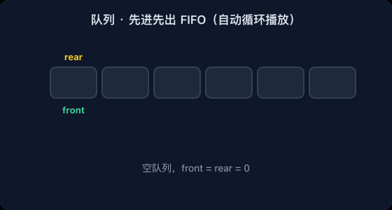

动画演示队列专题里队列先进先出的典型过程；每个方案在「TypeScript 解题方案」一节还配了专属动画与专属流程图。

### 主解法流程图（真实控制流）

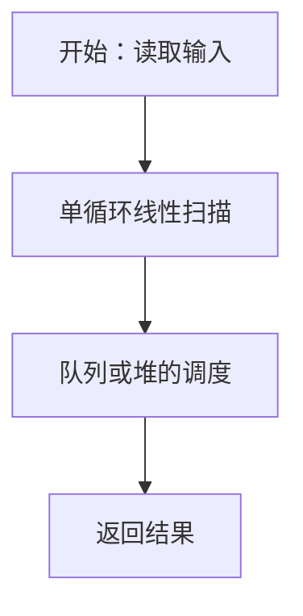

## TypeScript 解题方案（3 个方案逐个讲）

> **运行与提交**：每个方案都是自包含文件（内嵌用例自测，输出 PASS），整块复制到 `.ts` 文件后 `node 文件名` 即可运行。提交 LeetCode 时，把 `demo` 内的算法函数与辅助类型/函数整体取出、置于文件顶层即可。**提交备注**：设计题：按题面 RecentCounter 类接口提交。

### 方案 1：单趟扫描

**分析与思路**：核心做法是「单趟扫描」。代码里依次做这些事：单循环线性扫描；队列或堆的调度。

**运行方式**：`node 本文件`，内嵌用例全部通过会输出 PASS。

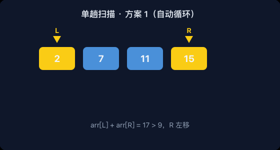

**方案专属流程图**（真实控制流）：


```typescript
// Faithful translation of python reference. Self-check via demo().
export function demo(): void {
  // 程序入口：跑内嵌自测用例
  class RecentCounter {
    // 定义类型
    q: number[] = []; // 把 []; 写入 q: number[]
    ping(t: number): number {
      // ping(另一字符串: number): number {
      this.q.push(t); // 把 另一字符串 压入栈/数组尾部
      while (this.q[0] < t - 3000) this.q.shift(); // 循环，直到不满足「this.节点[0] 小于 另一字符串 减 3000) this.节点.shift();」
      return this.q.length; // 返回 this.节点.长度
    }
  }
  const c = new RecentCounter(); // 把 new RecentCounter() 存入 字符
  const got = [c.ping(1), c.ping(100), c.ping(3001), c.ping(3002)];
  const want = [1, 2, 3, 3]; // 把 [1, 2, 3, 3] 存入 want
  for (let i = 0; i < got.length; i++) {
    // 让 下标 i 从 0 开始计数，下标 i 小于 got.长度 就继续
    if (got[i] !== want[i])
      throw new Error('FAIL case ' + i + ' got ' + got[i] + ' want ' + want[i]);
  }
  console.log('PASS'); // 全部用例通过，输出 PASS
}
demo(); // demo();
```

### 方案 2：单趟扫描

**分析与思路**：核心做法是「单趟扫描」。代码里依次做这些事：单循环线性扫描。

**运行方式**：`node 本文件`，内嵌用例全部通过会输出 PASS。


**方案专属流程图**（真实控制流）：

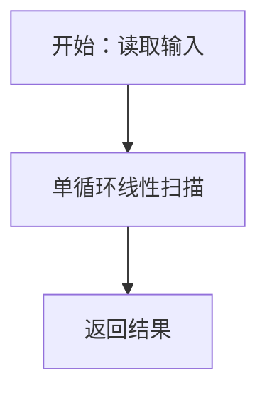

```typescript
// Faithful translation of python reference. Self-check via demo().
export function demo(): void {
  // 程序入口：跑内嵌自测用例
  class RecentCounter {
    // 定义类型
    queue: number[] = []; // 把 []; 写入 queue: number[]
    front: number = 0; // 把 0; 写入 front: number
    ping(t: number): number {
      // ping(另一字符串: number): number {
      this.queue.push(t); // 把 另一字符串 压入栈/数组尾部
      while (this.queue[this.front] < t - 3000) this.front++;
      return this.queue.length - this.front; // 返回 this.队列.长度 减 this.front
    }
  }
  const c = new RecentCounter(); // 把 new RecentCounter() 存入 字符
  const got = [c.ping(1), c.ping(100), c.ping(3001), c.ping(3002)];
  const want = [1, 2, 3, 3]; // 把 [1, 2, 3, 3] 存入 want
  for (let i = 0; i < got.length; i++) {
    // 让 下标 i 从 0 开始计数，下标 i 小于 got.长度 就继续
    if (got[i] !== want[i])
      throw new Error('FAIL case ' + i + ' got ' + got[i] + ' want ' + want[i]);
  }
  console.log('PASS'); // 全部用例通过，输出 PASS
}
demo(); // demo();
```

### 方案 3：单趟扫描

**分析与思路**：核心做法是「单趟扫描」。代码里依次做这些事：单循环线性扫描；队列或堆的调度。

**运行方式**：`node 本文件`，内嵌用例全部通过会输出 PASS。


**方案专属流程图**（真实控制流）：


```typescript
// Faithful translation of python reference. Self-check via demo().
export function demo(): void {
  // 程序入口：跑内嵌自测用例
  class RecentCounter {
    // 定义类型
    q: number[] = []; // 把 []; 写入 q: number[]
    ping(t: number): number {
      // ping(另一字符串: number): number {
      this.q.push(t); // 把 另一字符串 压入栈/数组尾部
      while (this.q[0] < t - 3000) this.q.shift(); // 循环，直到不满足「this.节点[0] 小于 另一字符串 减 3000) this.节点.shift();」
      return this.q.length; // 返回 this.节点.长度
    }
  }
  const c = new RecentCounter(); // 把 new RecentCounter() 存入 字符
  const got = [c.ping(1), c.ping(100), c.ping(3001), c.ping(3002)];
  const want = [1, 2, 3, 3]; // 把 [1, 2, 3, 3] 存入 want
  for (let i = 0; i < got.length; i++) {
    // 让 下标 i 从 0 开始计数，下标 i 小于 got.长度 就继续
    if (got[i] !== want[i])
      throw new Error('FAIL case ' + i + ' got ' + got[i] + ' want ' + want[i]);
  }
  console.log('PASS'); // 全部用例通过，输出 PASS
}
demo(); // demo();
```

## 逐步拆解与面试追问

**复杂度**：时间 O(n)（单趟线性扫描），空间 O(1) 到 O(n)（视辅助结构）

**为什么是这个量级**：每个元素被常数次访问，辅助哈希或栈的开销与 n 同阶

**面试官可能会追问**：

- 单调队列为什么能保证队首最优？
- 循环队列如何判满？
- 双端队列能替代吗？

## 关键 API 速查（TS 主解法实际用到，附官方链接）

| API | 作用 | 使用要点 | 官方文档 |
|---|---|---|---|
| `Array.prototype.push()` | 尾部追加 | 返回新长度；可一次多个；均摊 O(1)；会改变原数组 | [官方文档](https://developer.mozilla.org/zh-CN/docs/Web/JavaScript/Reference/Global_Objects/Array/push) |
| `Array.prototype.shift()` | 头部取出 | O(n)（后续元素整体前移）；大量头部操作请用链表或双端结构 | [官方文档](https://developer.mozilla.org/zh-CN/docs/Web/JavaScript/Reference/Global_Objects/Array/shift) |

### 各语言官方文档导航

- **TypeScript / JS**：[MDN 中文参考](https://developer.mozilla.org/zh-CN/)
- **Python**：[Python 官方文档](https://docs.python.org/zh-cn/3/)
- **Go**：[Go 标准库](https://pkg.go.dev/std)
- **Java**：[JDK 17 API](https://docs.oracle.com/en/java/javase/17/docs/api/)
- **Rust**：[Rust 标准库](https://doc.rust-lang.org/std/)
- **Lua**：[Lua 5.4 手册](https://www.lua.org/manual/5.4/)
- **C**：[Cppreference C](https://zh.cppreference.com/w/c)
- **C++**：[Cppreference C++](https://zh.cppreference.com/w/cpp)
- **R**：[R 官方手册](https://stat.ethz.ch/R-manual/)
- **Zig**：[Zig 语言文档](https://ziglang.org/documentation/master/)
- **Dart**：[Dart API](https://api.dart.dev/)

## 附录：其他 10 种语言全部实现（每种语言列举其全部方案）

> TypeScript 的全部方案见「TypeScript 解题方案」一节；下面是其余 10 种语言的对应实现，每种语言的每个方案都带思路分析、代码走读与专属运行架构图。
> 每个方案都内嵌用例自测，可独立运行（老仓库 python/go 文件遵循「打印结果」约定）。
> 完整解法文件见 `dsa/<语言>/queue/lc_933_最近的请求次数/`。

### Python 实现（3 种方案）

Python 的全部方案如下，每个方案都内嵌用例自测，可独立运行（老仓库 python/go 文件遵循「打印结果」约定）：

#### 方案 1：单趟扫描

**思路与代码分析**：核心是「单趟扫描」。Python 版用切片与字典推导式简化操作，突出可读性。**走读**：方案 1 · 单趟扫描：开始 → 更新 counter → 返回 [ → 调用 counter.ping(1), → 调用 counter.ping(100), → 调用 counter.ping(3001), → 调用 counter.ping(3002), → 处理 ]。

**运行架构**（真实控制流）：

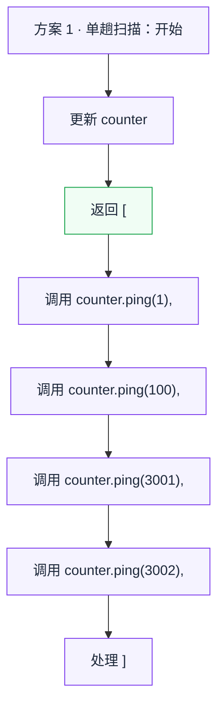

```python
import sys  # 提高递归深度上限（深输入防 RecursionError）

sys.setrecursionlimit(200000)  # 树/链表类题目节点数可达 1e4 量级
from collections import deque  # from collections import deque

class RecentCounter:  # 定义类
    def __init__(self):  # 构造函数：初始化成员
        self.q = deque()  # 把 deque() 写入 节点

    def ping(self, t: int) -> int:  # 定义函数 ping（参数：self, 另一字符串: int）
        self.q.append(t)  # 把 另一字符串 追加到列表尾部
        while self.q[0] < t - 3000:  # 循环，直到不满足「self.节点[0] 小于 另一字符串 减 3000」
            self.q.popleft()  # self.节点.popleft()
        return len(self.q)  # 返回 长度(self.节点)

def solution():  # 定义函数 solution（参数：无）
    counter = RecentCounter()  # 把 RecentCounter() 存入 counter
    return [
        counter.ping(1),
        counter.ping(100),
        counter.ping(3001),
        counter.ping(3002),
    ]

if __name__ == "__main__":  # 若 __name__ 等于 '__main__'
    print(solution())  # 打印输出
```

#### 方案 2：单趟扫描

**思路与代码分析**：核心是「单趟扫描」。Python 版用切片与字典推导式简化操作，突出可读性。

**运行架构**（真实控制流）：

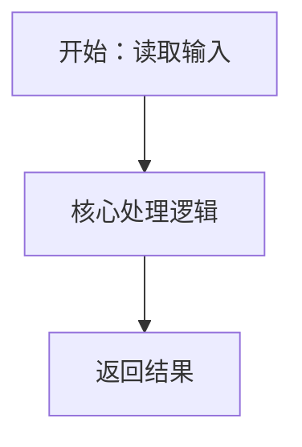

```python
import sys  # 提高递归深度上限（深输入防 RecursionError）

sys.setrecursionlimit(200000)  # 树/链表类题目节点数可达 1e4 量级

class RecentCounter:  # 定义类
    def __init__(self):  # 构造函数：初始化成员
        self.queue = []  # 把 [] 写入 队列
        self.front = 0  # 把 0 写入 self.front

    def ping(self, t):  # 定义函数 ping（参数：self, 另一字符串）
        self.queue.append(t)  # 把 另一字符串 追加到列表尾部
        while (
            self.queue[self.front] < t - 3000
        ):  # 循环，直到不满足「self.队列[self.front] 小于 另一字符串 减 3000」
            self.front += 1  # self.front累加 1
        return len(self.queue) - self.front  # 返回 长度(self.队列) 减 self.front

if __name__ == "__main__":  # 若 __name__ 等于 '__main__'
    counter = RecentCounter()  # 把 RecentCounter() 存入 counter
    print(counter.ping(1))  # 打印输出
    print(counter.ping(100))  # 打印输出
    print(counter.ping(3001))  # 打印输出
```

#### 方案 3：单趟扫描

**思路与代码分析**：核心是「单趟扫描」。Python 版用切片与字典推导式简化操作，突出可读性。代码里依次做这些事：队列或堆的调度。

**运行架构**（真实控制流）：

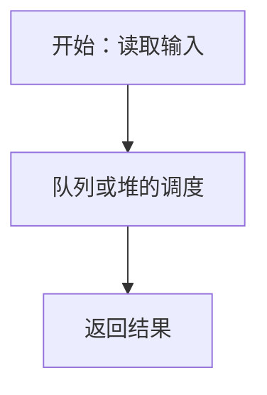

```python
import sys  # 提高递归深度上限（深输入防 RecursionError）

sys.setrecursionlimit(200000)  # 树/链表类题目节点数可达 1e4 量级
from collections import deque  # from collections import deque

class RecentCounter:  # 定义类
    # 维护一个队列，只保留 [t-3000, t] 时间窗口内的请求
    def __init__(self):  # 构造函数：初始化成员
        self.q = deque()  # 把 deque() 写入 节点

    def ping(self, t):  # 定义函数 ping（参数：self, 另一字符串）
        self.q.append(t)  # 把 另一字符串 追加到列表尾部
        while self.q[0] < t - 3000:  # 循环，直到不满足「self.节点[0] 小于 另一字符串 减 3000」
            self.q.popleft()  # self.节点.popleft()
        return len(self.q)  # 返回 长度(self.节点)

if __name__ == "__main__":  # 若 __name__ 等于 '__main__'
    rc = RecentCounter()  # 把 RecentCounter() 存入 rc
    print(rc.ping(1))  # 打印输出
    print(rc.ping(100))  # 打印输出
    print(rc.ping(3001))  # 打印输出
```

### Go 实现（3 种方案）

Go 的全部方案如下，每个方案都内嵌用例自测，可独立运行（老仓库 python/go 文件遵循「打印结果」约定）：

#### 方案 1：单趟扫描

**思路与代码分析**：核心是「单趟扫描」。Go 版用切片与多返回值惯用法，显式处理索引边界。**走读**：方案 1 · 单趟扫描：开始 → 返回 &RecentCounter。

**运行架构**（真实控制流）：

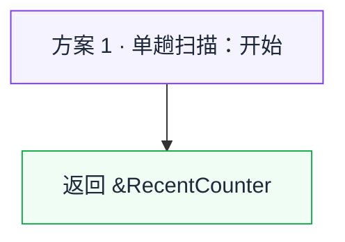

```go
package main // 引入依赖

import (
	"fmt" // 「fmt」
	"os"  // 「os」
)

type RecentCounter struct { // 定义类型
	q []int // 节点 []int
}

func Constructor() *RecentCounter { // 定义函数/方法 Constructor
	return &RecentCounter{q: []int{}} // 返回 按位与 RecentCounter{节点: []int{}}
}

func (this *RecentCounter) Ping(t int) int { // 定义函数/方法 Ping
	this.q = append(this.q, t) // 把 append(this.节点, 另一字符串) 写入 节点
	for this.q[0] < t-3000 {   // for this.节点[0] 小于 另一字符串 减 3000 {
		this.q = this.q[1:] // 把 this.节点[1:] 写入 节点
	}
	return len(this.q) // 定义函数/方法 len
}

func main() { // 程序入口：跑内嵌自测用例
	c := Constructor() // 把 Constructor() 写入 c :
	ok := true         // 把 true 写入 ok :
	tc := []struct {   // 把 []struct { 写入 tc :
		t    int // 另一字符串 int
		want int // want int
	}{ // }{
		{1, 1}, {100, 2}, {3001, 3}, {3002, 3},
	}
	for _, cse := range tc { // 同时取 _ 与 cse 遍历
		if got := c.Ping(cse.t); got != cse.want { // 若 got : 赋值为 字符.Ping(cse.另一字符串); got 不等于 cse.want
			ok = false                                                     // 把 false 写入 ok
			fmt.Printf("FAIL Ping(%d)=%d want %d\n", cse.t, got, cse.want) // 打印输出
		}
	}
	if !ok { // 若 取反 ok
		os.Exit(1) // os.Exit(1)
	}
	fmt.Println("PASS") // 全部用例通过，输出 PASS
}
```

#### 方案 2：单趟扫描

**思路与代码分析**：核心是「单趟扫描」。Go 版用切片与多返回值惯用法，显式处理索引边界。**走读**：方案 2 · 单趟扫描：开始 → 返回 &RecentCounter。

**运行架构**（真实控制流）：


```go
package main // 引入依赖

import (
	"fmt" // 「fmt」
	"os"  // 「os」
)

type RecentCounter struct { // 定义类型
	queue []int // 队列 []int
	front int   // front int
}

func NewRecentCounter() *RecentCounter { // 定义函数/方法 NewRecentCounter
	return &RecentCounter{queue: []int{}, front: 0} // 返回 按位与 RecentCounter{队列: []int{}, front: 0}
}

func (this *RecentCounter) Ping(t int) int { // 定义函数/方法 Ping
	this.queue = append(this.queue, t)    // 把 append(this.队列, 另一字符串) 写入 队列
	for this.queue[this.front] < t-3000 { // for this.队列[this.front] 小于 另一字符串 减 3000 {
		this.front++ // this.front 加一
	}
	return len(this.queue) - this.front // 返回 长度(this.队列) 减 this.front
}

func main() { // 程序入口：跑内嵌自测用例
	c := NewRecentCounter() // 把 NewRecentCounter() 写入 c :
	ok := true              // 把 true 写入 ok :
	tc := []struct {        // 把 []struct { 写入 tc :
		t    int // 另一字符串 int
		want int // want int
	}{ // }{
		{1, 1}, {100, 2}, {3001, 3},
	}
	for _, cse := range tc { // 同时取 _ 与 cse 遍历
		if got := c.Ping(cse.t); got != cse.want { // 若 got : 赋值为 字符.Ping(cse.另一字符串); got 不等于 cse.want
			ok = false                                                     // 把 false 写入 ok
			fmt.Printf("FAIL Ping(%d)=%d want %d\n", cse.t, got, cse.want) // 打印输出
		}
	}
	if !ok { // 若 取反 ok
		os.Exit(1) // os.Exit(1)
	}
	fmt.Println("PASS") // 全部用例通过，输出 PASS
}
```

#### 方案 3：单趟扫描

**思路与代码分析**：核心是「单趟扫描」。Go 版用切片与多返回值惯用法，显式处理索引边界。**走读**：方案 3 · 单趟扫描：开始 → 返回 &RecentCounter。

**运行架构**（真实控制流）：

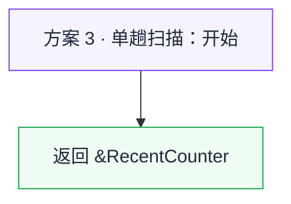

```go
package main // 引入依赖

import (
	"fmt" // 「fmt」
	"os"  // 「os」
)

type RecentCounter struct { // 定义类型
	q []int // 节点 []int
}

func NewRecentCounter() *RecentCounter { // 定义函数/方法 NewRecentCounter
	return &RecentCounter{q: []int{}} // 返回 按位与 RecentCounter{节点: []int{}}
}

func (this *RecentCounter) Ping(t int) int { // 定义函数/方法 Ping
	this.q = append(this.q, t) // 把 append(this.节点, 另一字符串) 写入 节点
	for this.q[0] < t-3000 {   // for this.节点[0] 小于 另一字符串 减 3000 {
		this.q = this.q[1:] // 把 this.节点[1:] 写入 节点
	}
	return len(this.q) // 定义函数/方法 len
}

func main() { // 程序入口：跑内嵌自测用例
	c := NewRecentCounter() // 把 NewRecentCounter() 写入 c :
	ok := true              // 把 true 写入 ok :
	tc := []struct {        // 把 []struct { 写入 tc :
		t    int // 另一字符串 int
		want int // want int
	}{ // }{
		{1, 1}, {100, 2}, {3001, 3},
	}
	for _, cse := range tc { // 同时取 _ 与 cse 遍历
		if got := c.Ping(cse.t); got != cse.want { // 若 got : 赋值为 字符.Ping(cse.另一字符串); got 不等于 cse.want
			ok = false                                                     // 把 false 写入 ok
			fmt.Printf("FAIL Ping(%d)=%d want %d\n", cse.t, got, cse.want) // 打印输出
		}
	}
	if !ok { // 若 取反 ok
		os.Exit(1) // os.Exit(1)
	}
	fmt.Println("PASS") // 全部用例通过，输出 PASS
}
```

### Java 实现（3 种方案）

Java 的全部方案如下，每个方案都内嵌用例自测，可独立运行（老仓库 python/go 文件遵循「打印结果」约定）：

#### 方案 1：单趟扫描

**思路与代码分析**：核心是「单趟扫描」。Java 版用类与静态方法组织，集合操作显式明了。**走读**：方案 1 · 单趟扫描：开始 → 调用 q.addLast(t) → 当 (q.peekFirst() ＜ t - 3000) 时反复执行 → 调用 q.pollFirst() → 返回 q.size()。

**运行架构**（真实控制流）：


```java
package com.webfault.dsa; // 引入依赖

import java.util.*; // 引入依赖

class Q933S1 { // 定义类型
  static class RecentCounter { // static class RecentCounter {
    Deque<Integer> q = new ArrayDeque<>(); // 把 new ArrayDeque 小于 超过 (); 写入 Deque<Integer> q

    int ping(int t) { // 定义函数/方法 ping
      q.addLast(t); // 节点.addLast(另一字符串);
      while (q.peekFirst() < t - 3000)
        q.pollFirst(); // 循环，直到不满足「节点.peekFirst() 小于 另一字符串 减 3000) 节点.pollFirst();」
      return q.size(); // 返回 节点.大小()
    }
  }

  public static void main(String[] args) { // public static void main(String[] args) {
    RecentCounter counter = new RecentCounter(); // 把 new RecentCounter(); 写入 RecentCounter counter
    List<Integer> got = new ArrayList<>(); // 把 new ArrayList 小于 超过 (); 写入 List<Integer> got
    got.add(counter.ping(1)); // got 追加 counter.ping(1));
    got.add(counter.ping(100)); // got 追加 counter.ping(100));
    got.add(counter.ping(3001)); // got 追加 counter.ping(3001));
    got.add(counter.ping(3002)); // got 追加 counter.ping(3002));
    List<Integer> want =
        Arrays.asList(1, 2, 3, 3); // 把 Arrays.asList(1, 2, 3, 3); 写入 List<Integer> want
    boolean ok = got.equals(want); // 把 got.equals(want); 写入 boolean ok
    if (!ok) {
      System.out.println("FAIL got " + got);
      throw new RuntimeException("FAILED");
    }
    System.out.println("PASS"); // 全部用例通过，输出 PASS
  }
}
```

#### 方案 2：单趟扫描

**思路与代码分析**：核心是「单趟扫描」。Java 版用类与静态方法组织，集合操作显式明了。**走读**：方案 2 · 单趟扫描：开始 → 调用 queue.add(t) → 当 (queue.get(front) ＜ t - 3000) 时反复执行 → 处理 front++ → 返回 queue.size() - front。

**运行架构**（真实控制流）：

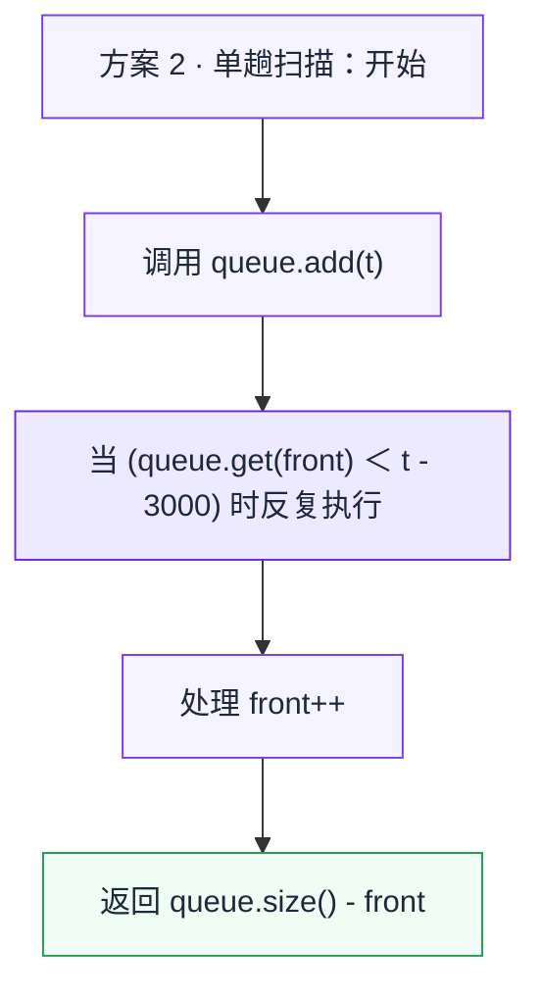

```java
package com.webfault.dsa; // 引入依赖

import java.util.*; // 引入依赖

class Q933S2 { // 定义类型
  static class RecentCounter { // static class RecentCounter {
    List<Integer> queue = new ArrayList<>(); // 把 new ArrayList 小于 超过 (); 写入 List<Integer> queue
    int front = 0; // 把 0 存入 front

    int ping(int t) { // 定义函数/方法 ping
      queue.add(t); // 队列 追加 另一字符串);
      while (queue.get(front) < t - 3000)
        front++; // 循环，直到不满足「队列 查找 front) 小于 另一字符串 减 3000) front 加一 ;」
      return queue.size() - front; // 返回 队列.大小() 减 front
    }
  }

  public static void main(String[] args) { // public static void main(String[] args) {
    RecentCounter counter = new RecentCounter(); // 把 new RecentCounter(); 写入 RecentCounter counter
    List<Integer> got = new ArrayList<>(); // 把 new ArrayList 小于 超过 (); 写入 List<Integer> got
    got.add(counter.ping(1)); // got 追加 counter.ping(1));
    got.add(counter.ping(100)); // got 追加 counter.ping(100));
    got.add(counter.ping(3001)); // got 追加 counter.ping(3001));
    List<Integer> want = Arrays.asList(1, 2, 3); // 把 Arrays.asList(1, 2, 3); 写入 List<Integer> want
    boolean ok = got.equals(want); // 把 got.equals(want); 写入 boolean ok
    if (!ok) {
      System.out.println("FAIL got " + got);
      throw new RuntimeException("FAILED");
    }
    System.out.println("PASS"); // 全部用例通过，输出 PASS
  }
}
```

#### 方案 3：单趟扫描

**思路与代码分析**：核心是「单趟扫描」。Java 版用类与静态方法组织，集合操作显式明了。**走读**：方案 3 · 单趟扫描：开始 → 调用 q.addLast(t) → 当 (q.peekFirst() ＜ t - 3000) 时反复执行 → 调用 q.pollFirst() → 返回 q.size()。

**运行架构**（真实控制流）：

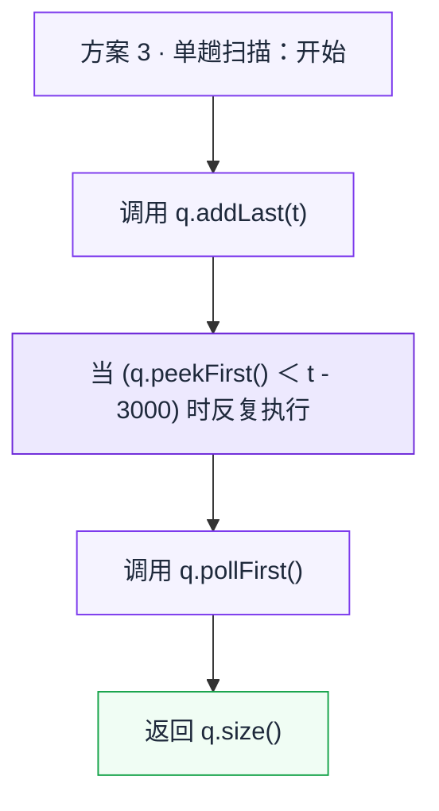

```java
package com.webfault.dsa; // 引入依赖

import java.util.*; // 引入依赖

class Q933S3 { // 定义类型
  static class RecentCounter { // static class RecentCounter {
    Deque<Integer> q = new ArrayDeque<>(); // 把 new ArrayDeque 小于 超过 (); 写入 Deque<Integer> q

    int ping(int t) { // 定义函数/方法 ping
      q.addLast(t); // 节点.addLast(另一字符串);
      while (q.peekFirst() < t - 3000)
        q.pollFirst(); // 循环，直到不满足「节点.peekFirst() 小于 另一字符串 减 3000) 节点.pollFirst();」
      return q.size(); // 返回 节点.大小()
    }
  }

  public static void main(String[] args) { // public static void main(String[] args) {
    RecentCounter counter = new RecentCounter(); // 把 new RecentCounter(); 写入 RecentCounter counter
    List<Integer> got = new ArrayList<>(); // 把 new ArrayList 小于 超过 (); 写入 List<Integer> got
    got.add(counter.ping(1)); // got 追加 counter.ping(1));
    got.add(counter.ping(100)); // got 追加 counter.ping(100));
    got.add(counter.ping(3001)); // got 追加 counter.ping(3001));
    List<Integer> want = Arrays.asList(1, 2, 3); // 把 Arrays.asList(1, 2, 3); 写入 List<Integer> want
    boolean ok = got.equals(want); // 把 got.equals(want); 写入 boolean ok
    if (!ok) {
      System.out.println("FAIL got " + got);
      throw new RuntimeException("FAILED");
    }
    System.out.println("PASS"); // 全部用例通过，输出 PASS
  }
}
```

### Rust 实现（3 种方案）

Rust 的全部方案如下，每个方案都内嵌用例自测，可独立运行（老仓库 python/go 文件遵循「打印结果」约定）：

#### 方案 1：单趟扫描

**思路与代码分析**：核心是「单趟扫描」。Rust 版用所有权移动与切片借用改写同一逻辑，注意 Option 与引用边界。**走读**：方案 1 · 单趟扫描：开始 → 处理 RecentCounter → 返回结果。

**运行架构**（真实控制流）：

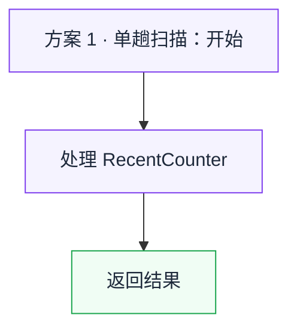

```rust
// LeetCode 933. 最近的请求次数 — Rust 版

// 方案1：push + 真出队（等价 TS 数组 shift）
use std::collections::VecDeque; // 引入依赖

struct RecentCounter {
    // 定义类型
    q: VecDeque<i32>,
}

impl RecentCounter {
    // 实现块
    fn new() -> Self {
        // 定义函数/方法 new
        RecentCounter { q: VecDeque::new() } // RecentCounter { 节点: VecDeque::new() }
    }
    fn ping(&mut self, t: i32) -> usize {
        // 定义函数/方法 ping
        self.q.push_back(t); // self.节点 追加 另一字符串);
        while let Some(&f) = self.q.front() {
            // 边取边处理，取空即停
            if f < t - 3000 {
                // 若 f 小于 另一字符串 减 3000
                self.q.pop_front(); // self.节点.pop_front();
            } else {
                // 否则
                break; // 跳出循环
            }
        }
        self.q.len() // self.节点.长度()
    }
}

fn main() {
    // 程序入口：跑内嵌自测用例
    // 与 TS 事实源内嵌用例一致
    let mut c = RecentCounter::new(); // 把 RecentCounter::new(); 写入 let mut c
    let got = [c.ping(1), c.ping(100), c.ping(3001), c.ping(3002)];
    let want = [1usize, 2, 3, 3]; // 把 [1usize, 2, 3, 3] 存入 want
    for i in 0..got.len() {
        // 逐个取出 0 的元素（下标 i）
        assert!(
            got[i] == want[i],
            "FAIL case {} got {} want {}",
            i,
            got[i],
            want[i]
        ); // 断言校验
    }
    println!("PASS"); // 全部用例通过，输出 PASS
}
```

#### 方案 2：单趟扫描

**思路与代码分析**：核心是「单趟扫描」。Rust 版用所有权移动与切片借用改写同一逻辑，注意 Option 与引用边界。**走读**：方案 2 · 单趟扫描：开始 → 处理 RecentCounter → 处理 queue: Vec::new(), → 处理 front: 0, → 返回结果。

**运行架构**（真实控制流）：

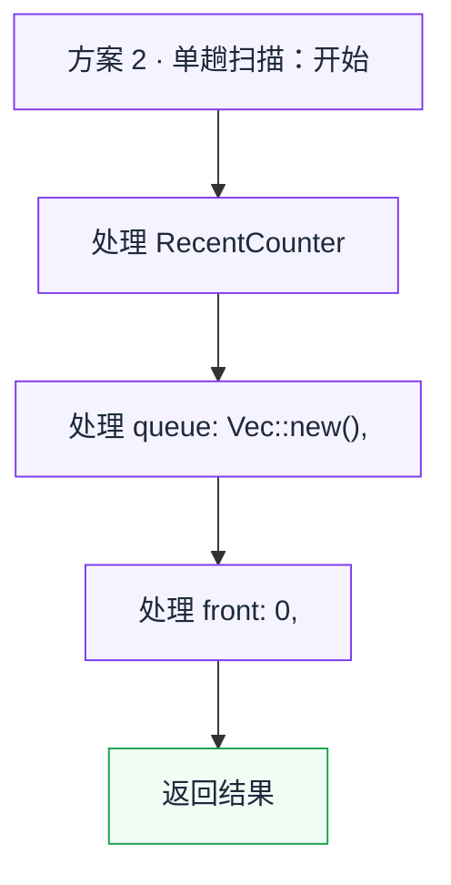

```rust
// LeetCode 933. 最近的请求次数 — Rust 版

// 方案2：front 指针懒删除（不真正移除元素，仅移动队头下标）
struct RecentCounter {
    // 定义类型
    queue: Vec<i32>,
    front: usize,
}

impl RecentCounter {
    // 实现块
    fn new() -> Self {
        // 定义函数/方法 new
        RecentCounter {
            queue: Vec::new(),
            front: 0,
        } // RecentCounter { 队列: Vec::new(), front: 0 }
    }
    fn ping(&mut self, t: i32) -> usize {
        // 定义函数/方法 ping
        self.queue.push(t); // 把 另一字符串 压入栈/数组尾部
        while self.queue[self.front] < t - 3000 {
            // while self.队列[self.front] 小于 另一字符串 减 3000 {
            self.front += 1; // self.front累加 1
        }
        self.queue.len() - self.front // self.队列.长度() 减 self.front
    }
}

fn main() {
    // 程序入口：跑内嵌自测用例
    // 与 TS 事实源内嵌用例一致
    let mut c = RecentCounter::new(); // 把 RecentCounter::new(); 写入 let mut c
    let got = [c.ping(1), c.ping(100), c.ping(3001), c.ping(3002)];
    let want = [1usize, 2, 3, 3]; // 把 [1usize, 2, 3, 3] 存入 want
    for i in 0..got.len() {
        // 逐个取出 0 的元素（下标 i）
        assert!(
            got[i] == want[i],
            "FAIL case {} got {} want {}",
            i,
            got[i],
            want[i]
        ); // 断言校验
    }
    println!("PASS"); // 全部用例通过，输出 PASS
}
```

#### 方案 3：单趟扫描

**思路与代码分析**：核心是「单趟扫描」。Rust 版用所有权移动与切片借用改写同一逻辑，注意 Option 与引用边界。**走读**：方案 3 · 单趟扫描：开始 → 处理 RecentCounter → 返回结果。

**运行架构**（真实控制流）：

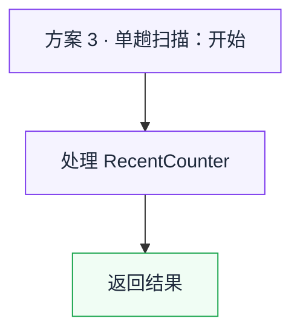

```rust
// LeetCode 933. 最近的请求次数 — Rust 版

// 方案3：push + 真出队（等价 TS 数组 shift）
use std::collections::VecDeque; // 引入依赖

struct RecentCounter {
    // 定义类型
    q: VecDeque<i32>,
}

impl RecentCounter {
    // 实现块
    fn new() -> Self {
        // 定义函数/方法 new
        RecentCounter { q: VecDeque::new() } // RecentCounter { 节点: VecDeque::new() }
    }
    fn ping(&mut self, t: i32) -> usize {
        // 定义函数/方法 ping
        self.q.push_back(t); // self.节点 追加 另一字符串);
        while let Some(&f) = self.q.front() {
            // 边取边处理，取空即停
            if f < t - 3000 {
                // 若 f 小于 另一字符串 减 3000
                self.q.pop_front(); // self.节点.pop_front();
            } else {
                // 否则
                break; // 跳出循环
            }
        }
        self.q.len() // self.节点.长度()
    }
}

fn main() {
    // 程序入口：跑内嵌自测用例
    // 与 TS 事实源内嵌用例一致
    let mut c = RecentCounter::new(); // 把 RecentCounter::new(); 写入 let mut c
    let got = [c.ping(1), c.ping(100), c.ping(3001), c.ping(3002)];
    let want = [1usize, 2, 3, 3]; // 把 [1usize, 2, 3, 3] 存入 want
    for i in 0..got.len() {
        // 逐个取出 0 的元素（下标 i）
        assert!(
            got[i] == want[i],
            "FAIL case {} got {} want {}",
            i,
            got[i],
            want[i]
        ); // 断言校验
    }
    println!("PASS"); // 全部用例通过，输出 PASS
}
```

### Lua 实现（3 种方案）

Lua 的全部方案如下，每个方案都内嵌用例自测，可独立运行（老仓库 python/go 文件遵循「打印结果」约定）：

#### 方案 1：单趟扫描

**思路与代码分析**：核心是「单趟扫描」。Lua 版用表与 ipairs 遍历，注意 ipairs 遇 nil 即停的语义。

**运行架构**（真实控制流）：


```lua
-- LeetCode 933. 最近的请求次数 — Lua 版

-- 方案1：push + 真出队（table.remove 首元素，等价 TS 数组 shift）
local RecentCounter = {} -- 把 {} 写入 local RecentCounter
RecentCounter.__index = RecentCounter -- 把 RecentCounter 写入 RecentCounter.__index

function RecentCounter.new() -- function RecentCounter.new()
	return setmetatable({ q = {} }, RecentCounter) -- 返回 setmetatable({ 节点 赋值为 {} }, RecentCounter)
end -- 终点

function RecentCounter:ping(t) -- function RecentCounter:ping(另一字符串)
	self.q[#self.q + 1] = t -- 把 另一字符串 写入 self.q[#self.q + 1]
	while self.q[1] ~= nil and self.q[1] < t - 3000 do -- 把 nil and self.节点[1] 小于 另一字符串 减 3000 do 写入 while self.q[1] ~
		table.remove(self.q, 1) -- table 弹出 self.节点, 1)
	end -- 终点
	return #self.q -- 返回 #self.节点
end -- 终点

-- 自测：与 TS 事实源内嵌用例一致
local c = RecentCounter.new() -- 把 RecentCounter.new() 写入 local c
local got = { c:ping(1), c:ping(100), c:ping(3001), c:ping(3002) }
local want = { 1, 2, 3, 3 } -- 把 { 1, 2, 3, 3 } 写入 local want
for i = 1, #want do -- 把 1, #want do 写入 for i
	assert(got[i] == want[i], string.format("FAIL case %d got %d want %d", i, got[i], want[i])) -- 断言校验
end -- 终点
print("PASS") -- 全部用例通过，输出 PASS
```

#### 方案 2：单趟扫描

**思路与代码分析**：核心是「单趟扫描」。Lua 版用表与 ipairs 遍历，注意 ipairs 遇 nil 即停的语义。

**运行架构**：与方案 1 的控制流相同（同算法在该语言的等价实现），图见上。

```lua
-- LeetCode 933. 最近的请求次数 — Lua 版

-- 方案2：front 指针懒删除（不真正移除元素，仅移动队头下标）
local RecentCounter = {} -- 把 {} 写入 local RecentCounter
RecentCounter.__index = RecentCounter -- 把 RecentCounter 写入 RecentCounter.__index

function RecentCounter.new() -- function RecentCounter.new()
	return setmetatable({ queue = {}, front = 0 }, RecentCounter) -- 返回 setmetatable({ 队列 赋值为 {}, front 赋值为 0 }, RecentCounter)
end -- 终点

function RecentCounter:ping(t) -- function RecentCounter:ping(另一字符串)
	self.queue[#self.queue + 1] = t -- 把 另一字符串 写入 self.queue[#self.queue + 1]
	while self.queue[self.front + 1] < t - 3000 do -- while self.队列[self.front 加 1] 小于 另一字符串 减 3000 do
		self.front = self.front + 1 -- 把 self.front 加 1 写入 self.front
	end -- 终点
	return #self.queue - self.front -- 返回 #self.队列 减 self.front
end -- 终点

-- 自测：与 TS 事实源内嵌用例一致
local c = RecentCounter.new() -- 把 RecentCounter.new() 写入 local c
local got = { c:ping(1), c:ping(100), c:ping(3001), c:ping(3002) }
local want = { 1, 2, 3, 3 } -- 把 { 1, 2, 3, 3 } 写入 local want
for i = 1, #want do -- 把 1, #want do 写入 for i
	assert(got[i] == want[i], string.format("FAIL case %d got %d want %d", i, got[i], want[i])) -- 断言校验
end -- 终点
print("PASS") -- 全部用例通过，输出 PASS
```

#### 方案 3：单趟扫描

**思路与代码分析**：核心是「单趟扫描」。Lua 版用表与 ipairs 遍历，注意 ipairs 遇 nil 即停的语义。

**运行架构**：与方案 1 的控制流相同（同算法在该语言的等价实现），图见上。

```lua
-- LeetCode 933. 最近的请求次数 — Lua 版

-- 方案3：push + 真出队（table.remove 首元素，等价 TS 数组 shift）
local RecentCounter = {} -- 把 {} 写入 local RecentCounter
RecentCounter.__index = RecentCounter -- 把 RecentCounter 写入 RecentCounter.__index

function RecentCounter.new() -- function RecentCounter.new()
	return setmetatable({ q = {} }, RecentCounter) -- 返回 setmetatable({ 节点 赋值为 {} }, RecentCounter)
end -- 终点

function RecentCounter:ping(t) -- function RecentCounter:ping(另一字符串)
	self.q[#self.q + 1] = t -- 把 另一字符串 写入 self.q[#self.q + 1]
	while self.q[1] ~= nil and self.q[1] < t - 3000 do -- 把 nil and self.节点[1] 小于 另一字符串 减 3000 do 写入 while self.q[1] ~
		table.remove(self.q, 1) -- table 弹出 self.节点, 1)
	end -- 终点
	return #self.q -- 返回 #self.节点
end -- 终点

-- 自测：与 TS 事实源内嵌用例一致
local c = RecentCounter.new() -- 把 RecentCounter.new() 写入 local c
local got = { c:ping(1), c:ping(100), c:ping(3001), c:ping(3002) }
local want = { 1, 2, 3, 3 } -- 把 { 1, 2, 3, 3 } 写入 local want
for i = 1, #want do -- 把 1, #want do 写入 for i
	assert(got[i] == want[i], string.format("FAIL case %d got %d want %d", i, got[i], want[i])) -- 断言校验
end -- 终点
print("PASS") -- 全部用例通过，输出 PASS
```

### C 实现（3 种方案）

C 的全部方案如下，每个方案都内嵌用例自测，可独立运行（老仓库 python/go 文件遵循「打印结果」约定）：

#### 方案 1：单趟扫描

**思路与代码分析**：核心是「单趟扫描」。C 版手动管理下标与内存，循环边界全部显式写出。**走读**：方案 1 · 单趟扫描：开始 → 更新 *c → 更新 c->data → 更新 c->len → 更新 c->cap → 返回 c。

**运行架构**（真实控制流）：

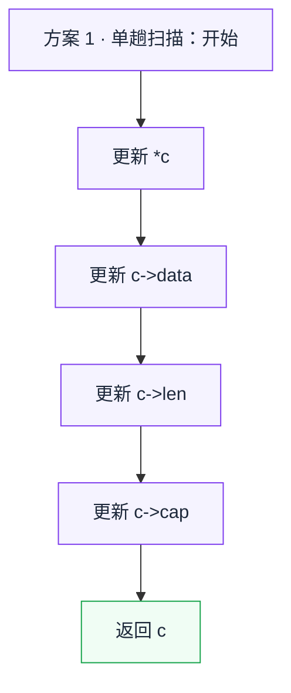

```c
* LeetCode 933. 最近的请求次数 — C 版 */
#include <stdio.h>  // 引入头文件
#include <stdlib.h> // 引入头文件

/* 方案1：push + 真出队（整体前移一位，等价 TS 数组 shift） */
typedef struct { // typedef struct {
    int *data;   // int 乘 data;
    int len;     // int 长度;
    int cap;     // int cap;
} RecentCounter; // } RecentCounter;

static RecentCounter *rc_new(void) { // static RecentCounter 乘 rc_new(void) {
    RecentCounter *c = (RecentCounter *)malloc(sizeof(RecentCounter));
    c->data = NULL; // 把 NULL; 写入 c->data
    c->len = 0;     // 把 0; 写入 c->len
    c->cap = 0;     // 把 0; 写入 c->cap
    return c;       // 返回 字符
}

static void rc_free(RecentCounter *c) { // 定义函数/方法 rc_free
    free(c->data);                      // free(字符 减 超过 data);
    free(c);                            // free(字符);
}

static int rc_ping(RecentCounter *c, int t) { // 定义函数/方法 rc_ping
    if (c->len == c->cap) {                   // 若 字符 减 超过 长度 等于 字符 减 超过 cap
        c->cap = c->cap ? c->cap * 2 : 8; // 把 字符 减 超过 cap ? 字符 减 超过 cap 乘 2 : 8; 写入 c->cap
        c->data = (int *)realloc(c->data, sizeof(int) * (size_t)c->cap);
    }
    c->data[c->len++] = t;                        // 把 另一字符串; 写入 c->data[c->len++]
    while (c->len > 0 && c->data[0] < t - 3000) { // 循环，直到不满足「字符 减 超过 长度 超过 0 且 字符 减
                                                  // 超过 data[0] 小于 另一字符串 减 3000」
        /* 真出队：整体前移一位 */
        for (int i = 1; i < c->len; i++)
            c->data[i - 1] = c->data[i]; // 让 下标 i 从 1 开始计数，下标 i 小于 字符 减 超过 长度 就继续
        c->len--;                        // 字符 减 超过 长度 减一 ;
    }
    return c->len; // 返回 字符 减 超过 长度
}

int main(void) { // 程序入口：跑内嵌自测用例
    /* 与 TS 事实源内嵌用例一致 */
    RecentCounter *c = rc_new();  // 把 rc_new(); 写入 RecentCounter *c
    int got[4];                   // int got[4];
    got[0] = rc_ping(c, 1);       // 把 rc_ping(字符, 1); 写入 got[0]
    got[1] = rc_ping(c, 100);     // 把 rc_ping(字符, 100); 写入 got[1]
    got[2] = rc_ping(c, 3001);    // 把 rc_ping(字符, 3001); 写入 got[2]
    got[3] = rc_ping(c, 3002);    // 把 rc_ping(字符, 3002); 写入 got[3]
    rc_free(c);                   // rc_free(字符);
    int want[4] = {1, 2, 3, 3};   // 把 { 1, 2, 3, 3 }; 写入 int want[4]
    for (int i = 0; i < 4; i++) { // 让 下标 i 从 0 开始计数，下标 i 小于 4 就继续
        if (got[i] != want[i]) {  // 若 got[下标 i] 不等于 want[下标 i]
            printf("FAIL case %d got %d want %d\n", i, got[i], want[i]); // 打印输出
            return 1;                                                    // 返回 1
        }
    }
    printf("PASS\n"); // 全部用例通过，输出 PASS
    return 0;         // 返回 0
}
```

#### 方案 2：单趟扫描

**思路与代码分析**：核心是「单趟扫描」。C 版手动管理下标与内存，循环边界全部显式写出。**走读**：方案 2 · 单趟扫描：开始 → 更新 *c → 更新 c->queue → 更新 c->len → 更新 c->cap → 更新 c->front → 返回 c。

**运行架构**（真实控制流）：

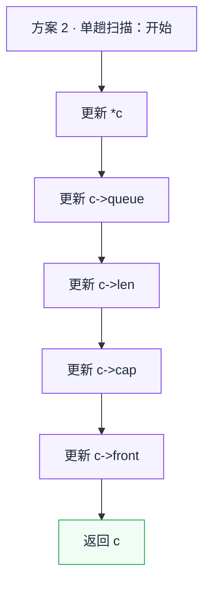

```c
* LeetCode 933. 最近的请求次数 — C 版 */
#include <stdio.h>  // 引入头文件
#include <stdlib.h> // 引入头文件

/* 方案2：front 指针懒删除（不真正移除元素，仅移动队头下标） */
typedef struct {              // typedef struct {
    int *queue;               // int 乘 队列;
    int len;                  // int 长度;
    int cap;                  // int cap;
    int front; /* 队头下标 */ // int front; 除以 乘 队头下标 乘 除以
} RecentCounter;              // } RecentCounter;

static RecentCounter *rc_new(void) { // static RecentCounter 乘 rc_new(void) {
    RecentCounter *c = (RecentCounter *)malloc(sizeof(RecentCounter));
    c->queue = NULL; // 把 NULL; 写入 c->queue
    c->len = 0;      // 把 0; 写入 c->len
    c->cap = 0;      // 把 0; 写入 c->cap
    c->front = 0;    // 把 0; 写入 c->front
    return c;        // 返回 字符
}

static void rc_free(RecentCounter *c) { // 定义函数/方法 rc_free
    free(c->queue);                     // free(字符 减 超过 队列);
    free(c);                            // free(字符);
}

static int rc_ping(RecentCounter *c, int t) { // 定义函数/方法 rc_ping
    if (c->len == c->cap) {                   // 若 字符 减 超过 长度 等于 字符 减 超过 cap
        c->cap = c->cap ? c->cap * 2 : 8; // 把 字符 减 超过 cap ? 字符 减 超过 cap 乘 2 : 8; 写入 c->cap
        c->queue = (int *)realloc(c->queue, sizeof(int) * (size_t)c->cap);
    }
    c->queue[c->len++] = t; // 把 另一字符串; 写入 c->queue[c->len++]
    while (c->queue[c->front] <
           t - 3000) { // 循环，直到不满足「字符 减 超过 队列[字符 减 超过 front] 小于 另一字符串 减 3000」
        c->front++;    // 字符 减 超过 front 加一 ;
    }
    return c->len - c->front; // 返回 字符 减 超过 长度 减 字符 减 超过 front
}

int main(void) { // 程序入口：跑内嵌自测用例
    /* 与 TS 事实源内嵌用例一致 */
    RecentCounter *c = rc_new();  // 把 rc_new(); 写入 RecentCounter *c
    int got[4];                   // int got[4];
    got[0] = rc_ping(c, 1);       // 把 rc_ping(字符, 1); 写入 got[0]
    got[1] = rc_ping(c, 100);     // 把 rc_ping(字符, 100); 写入 got[1]
    got[2] = rc_ping(c, 3001);    // 把 rc_ping(字符, 3001); 写入 got[2]
    got[3] = rc_ping(c, 3002);    // 把 rc_ping(字符, 3002); 写入 got[3]
    rc_free(c);                   // rc_free(字符);
    int want[4] = {1, 2, 3, 3};   // 把 { 1, 2, 3, 3 }; 写入 int want[4]
    for (int i = 0; i < 4; i++) { // 让 下标 i 从 0 开始计数，下标 i 小于 4 就继续
        if (got[i] != want[i]) {  // 若 got[下标 i] 不等于 want[下标 i]
            printf("FAIL case %d got %d want %d\n", i, got[i], want[i]); // 打印输出
            return 1;                                                    // 返回 1
        }
    }
    printf("PASS\n"); // 全部用例通过，输出 PASS
    return 0;         // 返回 0
}
```

#### 方案 3：单趟扫描

**思路与代码分析**：核心是「单趟扫描」。C 版手动管理下标与内存，循环边界全部显式写出。**走读**：方案 3 · 单趟扫描：开始 → 更新 *c → 更新 c->data → 更新 c->len → 更新 c->cap → 返回 c。

**运行架构**（真实控制流）：


```c
* LeetCode 933. 最近的请求次数 — C 版 */
#include <stdio.h>  // 引入头文件
#include <stdlib.h> // 引入头文件

/* 方案3：push + 真出队（整体前移一位，等价 TS 数组 shift） */
typedef struct { // typedef struct {
    int *data;   // int 乘 data;
    int len;     // int 长度;
    int cap;     // int cap;
} RecentCounter; // } RecentCounter;

static RecentCounter *rc_new(void) { // static RecentCounter 乘 rc_new(void) {
    RecentCounter *c = (RecentCounter *)malloc(sizeof(RecentCounter));
    c->data = NULL; // 把 NULL; 写入 c->data
    c->len = 0;     // 把 0; 写入 c->len
    c->cap = 0;     // 把 0; 写入 c->cap
    return c;       // 返回 字符
}

static void rc_free(RecentCounter *c) { // 定义函数/方法 rc_free
    free(c->data);                      // free(字符 减 超过 data);
    free(c);                            // free(字符);
}

static int rc_ping(RecentCounter *c, int t) { // 定义函数/方法 rc_ping
    if (c->len == c->cap) {                   // 若 字符 减 超过 长度 等于 字符 减 超过 cap
        c->cap = c->cap ? c->cap * 2 : 8; // 把 字符 减 超过 cap ? 字符 减 超过 cap 乘 2 : 8; 写入 c->cap
        c->data = (int *)realloc(c->data, sizeof(int) * (size_t)c->cap);
    }
    c->data[c->len++] = t;                        // 把 另一字符串; 写入 c->data[c->len++]
    while (c->len > 0 && c->data[0] < t - 3000) { // 循环，直到不满足「字符 减 超过 长度 超过 0 且 字符 减
                                                  // 超过 data[0] 小于 另一字符串 减 3000」
        /* 真出队：整体前移一位 */
        for (int i = 1; i < c->len; i++)
            c->data[i - 1] = c->data[i]; // 让 下标 i 从 1 开始计数，下标 i 小于 字符 减 超过 长度 就继续
        c->len--;                        // 字符 减 超过 长度 减一 ;
    }
    return c->len; // 返回 字符 减 超过 长度
}

int main(void) { // 程序入口：跑内嵌自测用例
    /* 与 TS 事实源内嵌用例一致 */
    RecentCounter *c = rc_new();  // 把 rc_new(); 写入 RecentCounter *c
    int got[4];                   // int got[4];
    got[0] = rc_ping(c, 1);       // 把 rc_ping(字符, 1); 写入 got[0]
    got[1] = rc_ping(c, 100);     // 把 rc_ping(字符, 100); 写入 got[1]
    got[2] = rc_ping(c, 3001);    // 把 rc_ping(字符, 3001); 写入 got[2]
    got[3] = rc_ping(c, 3002);    // 把 rc_ping(字符, 3002); 写入 got[3]
    rc_free(c);                   // rc_free(字符);
    int want[4] = {1, 2, 3, 3};   // 把 { 1, 2, 3, 3 }; 写入 int want[4]
    for (int i = 0; i < 4; i++) { // 让 下标 i 从 0 开始计数，下标 i 小于 4 就继续
        if (got[i] != want[i]) {  // 若 got[下标 i] 不等于 want[下标 i]
            printf("FAIL case %d got %d want %d\n", i, got[i], want[i]); // 打印输出
            return 1;                                                    // 返回 1
        }
    }
    printf("PASS\n"); // 全部用例通过，输出 PASS
    return 0;         // 返回 0
}
```

### C++ 实现（3 种方案）

C++ 的全部方案如下，每个方案都内嵌用例自测，可独立运行（老仓库 python/go 文件遵循「打印结果」约定）：

#### 方案 1：单趟扫描

**思路与代码分析**：核心是「单趟扫描」。C++ 版用 STL 容器与迭代器，减少手写下标错误。代码里依次做这些事：栈的后进先出操作。**走读**：方案 1 · 单趟扫描：开始 → 向 q 追加记录 → 当 (q.front() ＜ t - 3000) 时反复执行 → 从 q 弹出 → 返回 static_cast＜int＞(q.size())。

**运行架构**（真实控制流）：

```mermaid
graph TD
    N0["方案 1 · 单趟扫描：开始"]
    N1["向 q 追加记录"]
    N2["当 (q.front() ＜ t - 3000) 时反复执行"]
    N3["从 q 弹出"]
    N4["返回 static_cast＜int＞(q.size())"]
    N0 --> N1
    N1 --> N2
    N2 --> N3
    N3 -- 下一轮 --> N2
    N2 --> N4
    classDef n fill:#f5f3ff,stroke:#7c3aed,color:#1e293b;
    classDef lp fill:#ede9fe,stroke:#6d28d9,color:#1e293b;
    classDef dc fill:#fef9c3,stroke:#ca8a04,color:#1e293b;
    classDef tm fill:#f0fdf4,stroke:#16a34a,color:#1e293b;
    class N0,N1,N3 n;
    class N2 lp;
    class N4 tm;
```

```cpp
// LeetCode 933. 最近的请求次数 — C++ 版
#include <cassert>  // 引入头文件
#include <iostream> // 引入头文件
#include <queue>    // 引入头文件

// 方案1：push + 真出队（queue::pop 等价 TS 数组 shift）
class RecentCounter {  // 定义类型
    std::queue<int> q; // std::队列 小于 int 超过 节点;

  public:                              // public:
    int ping(int t) {                  // 定义函数/方法 ping
        q.push(t);                     // 把 另一字符串 压入栈/数组尾部
        while (q.front() < t - 3000) { // 循环，直到不满足「节点.front() 小于 另一字符串 减 3000」
            q.pop();                   // 弹出栈顶元素
        }
        return static_cast<int>(q.size()); // 返回 static_cast 小于 int 超过 (节点.大小())
    }
};

int main() { // 程序入口：跑内嵌自测用例
    // 与 TS 事实源内嵌用例一致
    RecentCounter c; // RecentCounter 字符;
    int got[4] = {c.ping(1), c.ping(100), c.ping(3001), c.ping(3002)};
    int want[4] = {1, 2, 3, 3};    // 把 { 1, 2, 3, 3 }; 写入 int want[4]
    for (int i = 0; i < 4; ++i) {  // 让 下标 i 从 0 开始计数，下标 i 小于 4 就继续
        assert(got[i] == want[i]); // 断言校验
    }
    std::cout << "PASS" << std::endl; // 全部用例通过，输出 PASS
    return 0;                         // 返回 0
}
```

#### 方案 2：单趟扫描

**思路与代码分析**：核心是「单趟扫描」。C++ 版用 STL 容器与迭代器，减少手写下标错误。**走读**：方案 2 · 单趟扫描：开始 → 调用 queue.push_back(t) → 当 (queue[front] ＜ t - 3000) 时反复执行 → 处理 ++front → 返回 static_cast＜int＞(queue.size() - → 处理 front)。

**运行架构**（真实控制流）：

```mermaid
graph TD
    N0["方案 2 · 单趟扫描：开始"]
    N1["调用 queue.push_back(t)"]
    N2["当 (queue[front] ＜ t - 3000) 时反复执行"]
    N3["处理 ++front"]
    N4["返回 static_cast＜int＞(queue.size() -"]
    N5["处理 front)"]
    N0 --> N1
    N1 --> N2
    N2 --> N3
    N3 -- 下一轮 --> N2
    N2 --> N4
    N4 --> N5
    classDef n fill:#f5f3ff,stroke:#7c3aed,color:#1e293b;
    classDef lp fill:#ede9fe,stroke:#6d28d9,color:#1e293b;
    classDef dc fill:#fef9c3,stroke:#ca8a04,color:#1e293b;
    classDef tm fill:#f0fdf4,stroke:#16a34a,color:#1e293b;
    class N0,N1,N3,N5 n;
    class N2 lp;
    class N4 tm;
```

```cpp
// LeetCode 933. 最近的请求次数 — C++ 版
#include <cassert>  // 引入头文件
#include <iostream> // 引入头文件
#include <vector>   // 引入头文件

// 方案2：front 指针懒删除（不真正移除元素，仅移动队头下标）
class RecentCounter {       // 定义类型
    std::vector<int> queue; // std::vector 小于 int 超过 队列;
    size_t front = 0;       // 把 0; 写入 size_t front

  public:                                 // public:
    int ping(int t) {                     // 定义函数/方法 ping
        queue.push_back(t);               // 队列 追加 另一字符串);
        while (queue[front] < t - 3000) { // 循环，直到不满足「队列[front] 小于 另一字符串 减 3000」
            ++front;                      // 加一 front;
        }
        return static_cast<int>(queue.size() -
                                front); // 返回 static_cast 小于 int 超过 (队列.大小() 减 front)
    }
};

int main() { // 程序入口：跑内嵌自测用例
    // 与 TS 事实源内嵌用例一致
    RecentCounter c; // RecentCounter 字符;
    int got[4] = {c.ping(1), c.ping(100), c.ping(3001), c.ping(3002)};
    int want[4] = {1, 2, 3, 3};    // 把 { 1, 2, 3, 3 }; 写入 int want[4]
    for (int i = 0; i < 4; ++i) {  // 让 下标 i 从 0 开始计数，下标 i 小于 4 就继续
        assert(got[i] == want[i]); // 断言校验
    }
    std::cout << "PASS" << std::endl; // 全部用例通过，输出 PASS
    return 0;                         // 返回 0
}
```

#### 方案 3：单趟扫描

**思路与代码分析**：核心是「单趟扫描」。C++ 版用 STL 容器与迭代器，减少手写下标错误。代码里依次做这些事：栈的后进先出操作。**走读**：方案 3 · 单趟扫描：开始 → 向 q 追加记录 → 当 (q.front() ＜ t - 3000) 时反复执行 → 从 q 弹出 → 返回 static_cast＜int＞(q.size())。

**运行架构**（真实控制流）：

```mermaid
graph TD
    N0["方案 3 · 单趟扫描：开始"]
    N1["向 q 追加记录"]
    N2["当 (q.front() ＜ t - 3000) 时反复执行"]
    N3["从 q 弹出"]
    N4["返回 static_cast＜int＞(q.size())"]
    N0 --> N1
    N1 --> N2
    N2 --> N3
    N3 -- 下一轮 --> N2
    N2 --> N4
    classDef n fill:#f5f3ff,stroke:#7c3aed,color:#1e293b;
    classDef lp fill:#ede9fe,stroke:#6d28d9,color:#1e293b;
    classDef dc fill:#fef9c3,stroke:#ca8a04,color:#1e293b;
    classDef tm fill:#f0fdf4,stroke:#16a34a,color:#1e293b;
    class N0,N1,N3 n;
    class N2 lp;
    class N4 tm;
```

```cpp
// LeetCode 933. 最近的请求次数 — C++ 版
#include <cassert>  // 引入头文件
#include <iostream> // 引入头文件
#include <queue>    // 引入头文件

// 方案3：push + 真出队（queue::pop 等价 TS 数组 shift）
class RecentCounter {  // 定义类型
    std::queue<int> q; // std::队列 小于 int 超过 节点;

  public:                              // public:
    int ping(int t) {                  // 定义函数/方法 ping
        q.push(t);                     // 把 另一字符串 压入栈/数组尾部
        while (q.front() < t - 3000) { // 循环，直到不满足「节点.front() 小于 另一字符串 减 3000」
            q.pop();                   // 弹出栈顶元素
        }
        return static_cast<int>(q.size()); // 返回 static_cast 小于 int 超过 (节点.大小())
    }
};

int main() { // 程序入口：跑内嵌自测用例
    // 与 TS 事实源内嵌用例一致
    RecentCounter c; // RecentCounter 字符;
    int got[4] = {c.ping(1), c.ping(100), c.ping(3001), c.ping(3002)};
    int want[4] = {1, 2, 3, 3};    // 把 { 1, 2, 3, 3 }; 写入 int want[4]
    for (int i = 0; i < 4; ++i) {  // 让 下标 i 从 0 开始计数，下标 i 小于 4 就继续
        assert(got[i] == want[i]); // 断言校验
    }
    std::cout << "PASS" << std::endl; // 全部用例通过，输出 PASS
    return 0;                         // 返回 0
}
```

### R 实现（3 种方案）

R 的全部方案如下，每个方案都内嵌用例自测，可独立运行（老仓库 python/go 文件遵循「打印结果」约定）：

#### 方案 1：单趟扫描

**思路与代码分析**：核心是「单趟扫描」。R 版用向量化思维与 1 起始下标，注意 1:n 的降序陷阱。**走读**：方案 1 · 单趟扫描：开始 → 处理 q ＜- numeric(0) → 调用 function(t) → 处理 q ＜＜- c(q, t) → 当 (length(q) ＞ 0 且 q[1] ＜ t - 3000) 时反复执行 → 处理 q ＜＜- q[-1] → 调用 length(q) → 返回结果。

**运行架构**（真实控制流）：

```mermaid
graph TD
    N0["方案 1 · 单趟扫描：开始"]
    N1["处理 q ＜- numeric(0)"]
    N2["调用 function(t)"]
    N3["处理 q ＜＜- c(q, t)"]
    N4["当 (length(q) ＞ 0 且 q[1] ＜ t - 3000) 时反复执行"]
    N5["处理 q ＜＜- q[-1]"]
    N6["调用 length(q)"]
    N7["返回结果"]
    N0 --> N1
    N1 --> N2
    N2 --> N3
    N3 --> N4
    N4 --> N5
    N5 -- 下一轮 --> N4
    N4 --> N6
    N6 --> N7
    classDef n fill:#f5f3ff,stroke:#7c3aed,color:#1e293b;
    classDef lp fill:#ede9fe,stroke:#6d28d9,color:#1e293b;
    classDef dc fill:#fef9c3,stroke:#ca8a04,color:#1e293b;
    classDef tm fill:#f0fdf4,stroke:#16a34a,color:#1e293b;
    class N0,N1,N2,N3,N5,N6 n;
    class N4 lp;
    class N7 tm;
```

```r
# 方案1：push + 真出队（q[-1] 等价 TS 数组 shift）；闭包工厂保存队列状态 定义函数 RecentCounter（参数：无）
RecentCounter <- function() {
    q <- numeric(0)  # 把 numeric(0) 存入 节点
    function(t) {
        # function(另一字符串) {
        q <<- c(q, t)  # 节点 小于 小于 减 字符(节点, 另一字符串)
        while (length(q) > 0 && q[1] < t - 3000) {
            # 循环，直到不满足「长度(节点) 超过 0 且 节点[1] 小于 另一字符串 减 3000」
            q <<- q[-1]  # 真出队
        }
        length(q)  # 长度(节点)
    }
}
# 自测：与 TS 事实源内嵌用例一致
ping <- RecentCounter()  # 把 RecentCounter() 存入 ping
got <- c(ping(1), ping(100), ping(3001), ping(3002))  # 把 字符(ping(1), ping(100), ping(3001), ping(3002)) 存入 got
want <- c(1L, 2L, 3L, 3L)  # 把 字符(1L, 2L, 3L, 3L) 存入 want
stopifnot(length(got) == length(want))  # 断言校验
for (i in seq_along(want)) {
    # for (下标 i in seq_along(want)) {
    stopifnot(got[i] == want[i])  # 断言校验
}
cat("PASS\n")  # 全部用例通过，输出 PASS
```

#### 方案 2：单趟扫描

**思路与代码分析**：核心是「单趟扫描」。R 版用向量化思维与 1 起始下标，注意 1:n 的降序陷阱。**走读**：方案 2 · 单趟扫描：开始 → 处理 queue ＜- numeric(0) → 处理 front ＜- 0L → 调用 function(t) → 处理 queue ＜＜- c(queue, t) → 当 (queue[front + 1L] ＜ t - 3000) 时反复执行 → 处理 front ＜＜- front + 1L → 调用 length(queue) - front → 返回结果。

**运行架构**（真实控制流）：

```mermaid
graph TD
    N0["方案 2 · 单趟扫描：开始"]
    N1["处理 queue ＜- numeric(0)"]
    N2["处理 front ＜- 0L"]
    N3["调用 function(t)"]
    N4["处理 queue ＜＜- c(queue, t)"]
    N5["当 (queue[front + 1L] ＜ t - 3000) 时反复执行"]
    N6["处理 front ＜＜- front + 1L"]
    N7["调用 length(queue) - front"]
    N8["返回结果"]
    N0 --> N1
    N1 --> N2
    N2 --> N3
    N3 --> N4
    N4 --> N5
    N5 --> N6
    N6 -- 下一轮 --> N5
    N5 --> N7
    N7 --> N8
    classDef n fill:#f5f3ff,stroke:#7c3aed,color:#1e293b;
    classDef lp fill:#ede9fe,stroke:#6d28d9,color:#1e293b;
    classDef dc fill:#fef9c3,stroke:#ca8a04,color:#1e293b;
    classDef tm fill:#f0fdf4,stroke:#16a34a,color:#1e293b;
    class N0,N1,N2,N3,N4,N6,N7 n;
    class N5 lp;
    class N8 tm;
```

```r
# 方案2：front 指针懒删除（不真正移除元素，仅移动队头下标） 定义函数 RecentCounter（参数：无）
RecentCounter <- function() {
    queue <- numeric(0)  # 把 numeric(0) 存入 队列
    front <- 0L  # 已懒删除的元素个数（0 基）
    function(t) {
        # function(另一字符串) {
        queue <<- c(queue, t)  # 队列 小于 小于 减 字符(队列, 另一字符串)
        while (queue[front + 1L] < t - 3000) {
            # 循环，直到不满足「队列[front 加 1L] 小于 另一字符串 减 3000」
            front <<- front + 1L  # front 小于 小于 减 front 加 1L
        }
        length(queue) - front  # 长度(队列) 减 front
    }
}
# 自测：与 TS 事实源内嵌用例一致
ping <- RecentCounter()  # 把 RecentCounter() 存入 ping
got <- c(ping(1), ping(100), ping(3001), ping(3002))  # 把 字符(ping(1), ping(100), ping(3001), ping(3002)) 存入 got
want <- c(1L, 2L, 3L, 3L)  # 把 字符(1L, 2L, 3L, 3L) 存入 want
stopifnot(length(got) == length(want))  # 断言校验
for (i in seq_along(want)) {
    # for (下标 i in seq_along(want)) {
    stopifnot(got[i] == want[i])  # 断言校验
}
cat("PASS\n")  # 全部用例通过，输出 PASS
```

#### 方案 3：单趟扫描

**思路与代码分析**：核心是「单趟扫描」。R 版用向量化思维与 1 起始下标，注意 1:n 的降序陷阱。**走读**：方案 3 · 单趟扫描：开始 → 处理 q ＜- numeric(0) → 调用 function(t) → 处理 q ＜＜- c(q, t) → 当 (length(q) ＞ 0 且 q[1] ＜ t - 3000) 时反复执行 → 处理 q ＜＜- q[-1] → 调用 length(q) → 返回结果。

**运行架构**（真实控制流）：

```mermaid
graph TD
    N0["方案 3 · 单趟扫描：开始"]
    N1["处理 q ＜- numeric(0)"]
    N2["调用 function(t)"]
    N3["处理 q ＜＜- c(q, t)"]
    N4["当 (length(q) ＞ 0 且 q[1] ＜ t - 3000) 时反复执行"]
    N5["处理 q ＜＜- q[-1]"]
    N6["调用 length(q)"]
    N7["返回结果"]
    N0 --> N1
    N1 --> N2
    N2 --> N3
    N3 --> N4
    N4 --> N5
    N5 -- 下一轮 --> N4
    N4 --> N6
    N6 --> N7
    classDef n fill:#f5f3ff,stroke:#7c3aed,color:#1e293b;
    classDef lp fill:#ede9fe,stroke:#6d28d9,color:#1e293b;
    classDef dc fill:#fef9c3,stroke:#ca8a04,color:#1e293b;
    classDef tm fill:#f0fdf4,stroke:#16a34a,color:#1e293b;
    class N0,N1,N2,N3,N5,N6 n;
    class N4 lp;
    class N7 tm;
```

```r
# 方案3：push + 真出队（q[-1] 等价 TS 数组 shift）；闭包工厂保存队列状态 定义函数 RecentCounter（参数：无）
RecentCounter <- function() {
    q <- numeric(0)  # 把 numeric(0) 存入 节点
    function(t) {
        # function(另一字符串) {
        q <<- c(q, t)  # 节点 小于 小于 减 字符(节点, 另一字符串)
        while (length(q) > 0 && q[1] < t - 3000) {
            # 循环，直到不满足「长度(节点) 超过 0 且 节点[1] 小于 另一字符串 减 3000」
            q <<- q[-1]  # 真出队
        }
        length(q)  # 长度(节点)
    }
}
# 自测：与 TS 事实源内嵌用例一致
ping <- RecentCounter()  # 把 RecentCounter() 存入 ping
got <- c(ping(1), ping(100), ping(3001), ping(3002))  # 把 字符(ping(1), ping(100), ping(3001), ping(3002)) 存入 got
want <- c(1L, 2L, 3L, 3L)  # 把 字符(1L, 2L, 3L, 3L) 存入 want
stopifnot(length(got) == length(want))  # 断言校验
for (i in seq_along(want)) {
    # for (下标 i in seq_along(want)) {
    stopifnot(got[i] == want[i])  # 断言校验
}
cat("PASS\n")  # 全部用例通过，输出 PASS
```

### Zig 实现（3 种方案）

Zig 的全部方案如下，每个方案都内嵌用例自测，可独立运行（老仓库 python/go 文件遵循「打印结果」约定）：

#### 方案 1：单趟扫描

**思路与代码分析**：核心是「单趟扫描」。Zig 版显式分配与清零，整型边界处理严格。**走读**：方案 1 · 单趟扫描：开始 → 返回 .。

**运行架构**（真实控制流）：

```mermaid
graph TD
    N0["方案 1 · 单趟扫描：开始"]
    N1["返回 ."]
    N0 --> N1
    classDef n fill:#f5f3ff,stroke:#7c3aed,color:#1e293b;
    classDef lp fill:#ede9fe,stroke:#6d28d9,color:#1e293b;
    classDef dc fill:#fef9c3,stroke:#ca8a04,color:#1e293b;
    classDef tm fill:#f0fdf4,stroke:#16a34a,color:#1e293b;
    class N0 n;
    class N1 tm;
```

```zig
// LeetCode 933. 最近的请求次数 — Zig 版
const std = @import("std"); // 把 @import(「std」) 存入 std

// 方案1：push + 真出队（orderedRemove(0) 等价 TS 数组 shift）
const RecentCounter = struct { // 把 struct { 存入 RecentCounter
    q: std.ArrayList(i32),

    fn init(allocator: std.mem.Allocator) RecentCounter { // 定义函数/方法 init
        return .{ .q = std.ArrayList(i32).init(allocator) }; // 返回 { .节点 赋值为 std.ArrayList(i32).init(allocator) }
    }

    fn ping(self: *RecentCounter, t: i32) !usize { // 定义函数/方法 ping
        try self.q.append(t); // 把 另一字符串 追加到列表尾部
        while (self.q.items.len > 0 and self.q.items[0] < t - 3000) {
            _ = self.q.orderedRemove(0); // 真出队
        }
        return self.q.items.len; // 返回 self.节点.items.长度
    }
};

pub fn main() !void { // 程序入口：跑内嵌自测用例
    var arena = std.heap.ArenaAllocator.init(std.heap.page_allocator); // 把 std.堆.ArenaAllocator.init(std.堆.page_allocator) 存入 arena
    defer arena.deinit(); // defer arena.deinit();
    var c = RecentCounter.init(arena.allocator()); // 把 RecentCounter.init(arena.allocator()) 存入 字符

    // 与 TS 事实源内嵌用例一致
    const want = [_]usize{ 1, 2, 3, 3 }; // 把 [_]usize{ 1, 2, 3, 3 } 存入 want
    const ts = [_]i32{ 1, 100, 3001, 3002 }; // 把 [_]i32{ 1, 100, 3001, 3002 } 存入 ts
    for (ts, want, 0..) |t, w, i| { // for (ts, want, 0..) 按位或 另一字符串, 权重, 下标 i 按位或 {
        const got = try c.ping(t); // 把 try 字符.ping(另一字符串) 存入 got
        if (got != w) { // 若 got 不等于 权重
            std.debug.print("FAIL case {d} got {d} want {d}\n", .{ i, got, w }); // 打印输出
            return error.TestFailed; // 返回 error.TestFailed
        }
    }
    std.debug.print("PASS\n", .{}); // 全部用例通过，输出 PASS
}
```

#### 方案 2：单趟扫描

**思路与代码分析**：核心是「单趟扫描」。Zig 版显式分配与清零，整型边界处理严格。**走读**：方案 2 · 单趟扫描：开始 → 返回 .。

**运行架构**（真实控制流）：

```mermaid
graph TD
    N0["方案 2 · 单趟扫描：开始"]
    N1["返回 ."]
    N0 --> N1
    classDef n fill:#f5f3ff,stroke:#7c3aed,color:#1e293b;
    classDef lp fill:#ede9fe,stroke:#6d28d9,color:#1e293b;
    classDef dc fill:#fef9c3,stroke:#ca8a04,color:#1e293b;
    classDef tm fill:#f0fdf4,stroke:#16a34a,color:#1e293b;
    class N0 n;
    class N1 tm;
```

```zig
// LeetCode 933. 最近的请求次数 — Zig 版
const std = @import("std"); // 把 @import(「std」) 存入 std

// 方案2：front 指针懒删除（不真正移除元素，仅移动队头下标）
const RecentCounter = struct { // 把 struct { 存入 RecentCounter
    queue: std.ArrayList(i32),
    front: usize,

    fn init(allocator: std.mem.Allocator) RecentCounter { // 定义函数/方法 init
        return .{ .queue = std.ArrayList(i32).init(allocator), .front = 0 };
    }

    fn ping(self: *RecentCounter, t: i32) !usize { // 定义函数/方法 ping
        try self.queue.append(t); // 把 另一字符串 追加到列表尾部
        while (self.queue.items[self.front] < t - 3000) { // 循环，直到不满足「self.队列.items[self.front] 小于 另一字符串 减 3000」
            self.front += 1; // self.front累加 1
        }
        return self.queue.items.len - self.front; // 返回 self.队列.items.长度 减 self.front
    }
};

pub fn main() !void { // 程序入口：跑内嵌自测用例
    var arena = std.heap.ArenaAllocator.init(std.heap.page_allocator); // 把 std.堆.ArenaAllocator.init(std.堆.page_allocator) 存入 arena
    defer arena.deinit(); // defer arena.deinit();
    var c = RecentCounter.init(arena.allocator()); // 把 RecentCounter.init(arena.allocator()) 存入 字符

    // 与 TS 事实源内嵌用例一致
    const want = [_]usize{ 1, 2, 3, 3 }; // 把 [_]usize{ 1, 2, 3, 3 } 存入 want
    const ts = [_]i32{ 1, 100, 3001, 3002 }; // 把 [_]i32{ 1, 100, 3001, 3002 } 存入 ts
    for (ts, want, 0..) |t, w, i| { // for (ts, want, 0..) 按位或 另一字符串, 权重, 下标 i 按位或 {
        const got = try c.ping(t); // 把 try 字符.ping(另一字符串) 存入 got
        if (got != w) { // 若 got 不等于 权重
            std.debug.print("FAIL case {d} got {d} want {d}\n", .{ i, got, w }); // 打印输出
            return error.TestFailed; // 返回 error.TestFailed
        }
    }
    std.debug.print("PASS\n", .{}); // 全部用例通过，输出 PASS
}
```

#### 方案 3：单趟扫描

**思路与代码分析**：核心是「单趟扫描」。Zig 版显式分配与清零，整型边界处理严格。**走读**：方案 3 · 单趟扫描：开始 → 返回 .。

**运行架构**（真实控制流）：

```mermaid
graph TD
    N0["方案 3 · 单趟扫描：开始"]
    N1["返回 ."]
    N0 --> N1
    classDef n fill:#f5f3ff,stroke:#7c3aed,color:#1e293b;
    classDef lp fill:#ede9fe,stroke:#6d28d9,color:#1e293b;
    classDef dc fill:#fef9c3,stroke:#ca8a04,color:#1e293b;
    classDef tm fill:#f0fdf4,stroke:#16a34a,color:#1e293b;
    class N0 n;
    class N1 tm;
```

```zig
// LeetCode 933. 最近的请求次数 — Zig 版
const std = @import("std"); // 把 @import(「std」) 存入 std

// 方案3：push + 真出队（orderedRemove(0) 等价 TS 数组 shift）
const RecentCounter = struct { // 把 struct { 存入 RecentCounter
    q: std.ArrayList(i32),

    fn init(allocator: std.mem.Allocator) RecentCounter { // 定义函数/方法 init
        return .{ .q = std.ArrayList(i32).init(allocator) }; // 返回 { .节点 赋值为 std.ArrayList(i32).init(allocator) }
    }

    fn ping(self: *RecentCounter, t: i32) !usize { // 定义函数/方法 ping
        try self.q.append(t); // 把 另一字符串 追加到列表尾部
        while (self.q.items.len > 0 and self.q.items[0] < t - 3000) {
            _ = self.q.orderedRemove(0); // 真出队
        }
        return self.q.items.len; // 返回 self.节点.items.长度
    }
};

pub fn main() !void { // 程序入口：跑内嵌自测用例
    var arena = std.heap.ArenaAllocator.init(std.heap.page_allocator); // 把 std.堆.ArenaAllocator.init(std.堆.page_allocator) 存入 arena
    defer arena.deinit(); // defer arena.deinit();
    var c = RecentCounter.init(arena.allocator()); // 把 RecentCounter.init(arena.allocator()) 存入 字符

    // 与 TS 事实源内嵌用例一致
    const want = [_]usize{ 1, 2, 3, 3 }; // 把 [_]usize{ 1, 2, 3, 3 } 存入 want
    const ts = [_]i32{ 1, 100, 3001, 3002 }; // 把 [_]i32{ 1, 100, 3001, 3002 } 存入 ts
    for (ts, want, 0..) |t, w, i| { // for (ts, want, 0..) 按位或 另一字符串, 权重, 下标 i 按位或 {
        const got = try c.ping(t); // 把 try 字符.ping(另一字符串) 存入 got
        if (got != w) { // 若 got 不等于 权重
            std.debug.print("FAIL case {d} got {d} want {d}\n", .{ i, got, w }); // 打印输出
            return error.TestFailed; // 返回 error.TestFailed
        }
    }
    std.debug.print("PASS\n", .{}); // 全部用例通过，输出 PASS
}
```

### Dart 实现（3 种方案）

Dart 的全部方案如下，每个方案都内嵌用例自测，可独立运行（老仓库 python/go 文件遵循「打印结果」约定）：

#### 方案 1：单趟扫描

**思路与代码分析**：核心是「单趟扫描」。Dart 版用可空类型标注与集合方法，注意空安全。**走读**：方案 1 · 单趟扫描：开始 → 调用 _q.add(t) → 当 (_q.isNotEmpty 且 _q.first ＜ t - 3000) 时反复执行 → 调用 _q.removeAt(0) → 返回 _q.length。

**运行架构**（真实控制流）：

```mermaid
graph TD
    N0["方案 1 · 单趟扫描：开始"]
    N1["调用 _q.add(t)"]
    N2["当 (_q.isNotEmpty 且 _q.first ＜ t - 3000) 时反复执行"]
    N3["调用 _q.removeAt(0)"]
    N4["返回 _q.length"]
    N0 --> N1
    N1 --> N2
    N2 --> N3
    N3 -- 下一轮 --> N2
    N2 --> N4
    classDef n fill:#f5f3ff,stroke:#7c3aed,color:#1e293b;
    classDef lp fill:#ede9fe,stroke:#6d28d9,color:#1e293b;
    classDef dc fill:#fef9c3,stroke:#ca8a04,color:#1e293b;
    classDef tm fill:#f0fdf4,stroke:#16a34a,color:#1e293b;
    class N0,N1,N3 n;
    class N2 lp;
    class N4 tm;
```

```dart
// LeetCode 933. 最近的请求次数 — Dart 版

// 方案1：push + 真出队（removeAt(0) 等价 TS 数组 shift）
class RecentCounter {
  // 定义类型
  final _q = <int>[]; // 把 小于 int 超过 [] 存入 _q

  int ping(int t) {
    // 定义函数/方法 ping
    _q.add(t); // _q 追加 另一字符串);
    while (_q.isNotEmpty && _q.first < t - 3000) {
      // 循环，直到不满足「_q.isNotEmpty 且 _q.first 小于 另一字符串 减 3000」
      _q.removeAt(0); // 真出队
    }
    return _q.length; // 返回 _q.长度
  }
}

void main() {
  // 程序入口：跑内嵌自测用例
  // 与 TS 事实源内嵌用例一致
  final c = RecentCounter(); // 把 RecentCounter() 存入 字符
  final got = [c.ping(1), c.ping(100), c.ping(3001), c.ping(3002)];
  final want = [1, 2, 3, 3]; // 把 [1, 2, 3, 3] 存入 want
  for (var i = 0; i < want.length; i++) {
    // 让 下标 i 从 0 开始计数，下标 i 小于 want.长度 就继续
    if (got[i] != want[i]) {
      // 若 got[下标 i] 不等于 want[下标 i]
      throw StateError('FAIL case $i got ${got[i]} want ${want[i]}');
    }
  }
  print('PASS'); // 全部用例通过，输出 PASS
}
```

#### 方案 2：单趟扫描

**思路与代码分析**：核心是「单趟扫描」。Dart 版用可空类型标注与集合方法，注意空安全。**走读**：方案 2 · 单趟扫描：开始 → 调用 _queue.add(t) → 当 (_queue[_front] ＜ t - 3000) 时反复执行 → 处理 _front++ → 返回 _queue.length - _front。

**运行架构**（真实控制流）：

```mermaid
graph TD
    N0["方案 2 · 单趟扫描：开始"]
    N1["调用 _queue.add(t)"]
    N2["当 (_queue[_front] ＜ t - 3000) 时反复执行"]
    N3["处理 _front++"]
    N4["返回 _queue.length - _front"]
    N0 --> N1
    N1 --> N2
    N2 --> N3
    N3 -- 下一轮 --> N2
    N2 --> N4
    classDef n fill:#f5f3ff,stroke:#7c3aed,color:#1e293b;
    classDef lp fill:#ede9fe,stroke:#6d28d9,color:#1e293b;
    classDef dc fill:#fef9c3,stroke:#ca8a04,color:#1e293b;
    classDef tm fill:#f0fdf4,stroke:#16a34a,color:#1e293b;
    class N0,N1,N3 n;
    class N2 lp;
    class N4 tm;
```

```dart
// LeetCode 933. 最近的请求次数 — Dart 版

// 方案2：front 指针懒删除（不真正移除元素，仅移动队头下标）
class RecentCounter {
  // 定义类型
  final _queue = <int>[]; // 把 小于 int 超过 [] 存入 _queue
  int _front = 0; // 把 0 存入 _front

  int ping(int t) {
    // 定义函数/方法 ping
    _queue.add(t); // _queue 追加 另一字符串);
    while (_queue[_front] < t - 3000) {
      // 循环，直到不满足「_queue[_front] 小于 另一字符串 减 3000」
      _front++; // _front 加一
    }
    return _queue.length - _front; // 返回 _queue.长度 减 _front
  }
}

void main() {
  // 程序入口：跑内嵌自测用例
  // 与 TS 事实源内嵌用例一致
  final c = RecentCounter(); // 把 RecentCounter() 存入 字符
  final got = [c.ping(1), c.ping(100), c.ping(3001), c.ping(3002)];
  final want = [1, 2, 3, 3]; // 把 [1, 2, 3, 3] 存入 want
  for (var i = 0; i < want.length; i++) {
    // 让 下标 i 从 0 开始计数，下标 i 小于 want.长度 就继续
    if (got[i] != want[i]) {
      // 若 got[下标 i] 不等于 want[下标 i]
      throw StateError('FAIL case $i got ${got[i]} want ${want[i]}');
    }
  }
  print('PASS'); // 全部用例通过，输出 PASS
}
```

#### 方案 3：单趟扫描

**思路与代码分析**：核心是「单趟扫描」。Dart 版用可空类型标注与集合方法，注意空安全。**走读**：方案 3 · 单趟扫描：开始 → 调用 _q.add(t) → 当 (_q.isNotEmpty 且 _q.first ＜ t - 3000) 时反复执行 → 调用 _q.removeAt(0) → 返回 _q.length。

**运行架构**（真实控制流）：

```mermaid
graph TD
    N0["方案 3 · 单趟扫描：开始"]
    N1["调用 _q.add(t)"]
    N2["当 (_q.isNotEmpty 且 _q.first ＜ t - 3000) 时反复执行"]
    N3["调用 _q.removeAt(0)"]
    N4["返回 _q.length"]
    N0 --> N1
    N1 --> N2
    N2 --> N3
    N3 -- 下一轮 --> N2
    N2 --> N4
    classDef n fill:#f5f3ff,stroke:#7c3aed,color:#1e293b;
    classDef lp fill:#ede9fe,stroke:#6d28d9,color:#1e293b;
    classDef dc fill:#fef9c3,stroke:#ca8a04,color:#1e293b;
    classDef tm fill:#f0fdf4,stroke:#16a34a,color:#1e293b;
    class N0,N1,N3 n;
    class N2 lp;
    class N4 tm;
```

```dart
// LeetCode 933. 最近的请求次数 — Dart 版

// 方案3：push + 真出队（removeAt(0) 等价 TS 数组 shift）
class RecentCounter {
  // 定义类型
  final _q = <int>[]; // 把 小于 int 超过 [] 存入 _q

  int ping(int t) {
    // 定义函数/方法 ping
    _q.add(t); // _q 追加 另一字符串);
    while (_q.isNotEmpty && _q.first < t - 3000) {
      // 循环，直到不满足「_q.isNotEmpty 且 _q.first 小于 另一字符串 减 3000」
      _q.removeAt(0); // 真出队
    }
    return _q.length; // 返回 _q.长度
  }
}

void main() {
  // 程序入口：跑内嵌自测用例
  // 与 TS 事实源内嵌用例一致
  final c = RecentCounter(); // 把 RecentCounter() 存入 字符
  final got = [c.ping(1), c.ping(100), c.ping(3001), c.ping(3002)];
  final want = [1, 2, 3, 3]; // 把 [1, 2, 3, 3] 存入 want
  for (var i = 0; i < want.length; i++) {
    // 让 下标 i 从 0 开始计数，下标 i 小于 want.长度 就继续
    if (got[i] != want[i]) {
      // 若 got[下标 i] 不等于 want[下标 i]
      throw StateError('FAIL case $i got ${got[i]} want ${want[i]}');
    }
  }
  print('PASS'); // 全部用例通过，输出 PASS
}
```

---

## 内容总结

- **最近的请求次数**（队列 · Easy）：共 3 个方案，主线思路「单趟扫描」；时间 O(n)（单趟线性扫描）；动画演示队列先进先出过程，附录给出 11 种语言 × 全部方案的可运行实现。
- 来源博客：[https://blog.csdn.net/tyro_java/article/details/130470370](https://blog.csdn.net/tyro_java/article/details/130470370)
- 导航：[📋 总目录](../) ｜ [← 007 按奇偶排序数组](../007_按奇偶排序数组/) ｜ [009 05 栈排序 →](../009_05_栈排序/)
