# 009 · 05 栈排序（第一阶段 · 线性结构入门 · Medium）

> **难度**：⭐⭐ Medium ｜ **专题**：栈
> **学习定位**：第一阶段 · 线性结构入门第 9 篇 ｜ **解法数**：2
> **内容总结**：**05 栈排序**（栈 · Medium）：共 2 个方案，主线思路「直接实现」；时间 O(n) 量级；动画演示栈后进先出过程，附录给出 11 种语言 × 全部方案的可运行实现。

---

## 题目描述

栈排序。 编写程序，对栈进行排序使最小元素位于栈顶。最多只能使用一个其他的临时栈存放数据，但不得将元素复制到别的数据结构（如数组）中。该栈支持如下操作：push、pop、peek 和 isEmpty。当栈为空时，peek 返回 -1。

- 主函数签名：`function assertEq(actual: any, expected: any, msg: string = ''): void`

> 题面转录自原题解文章，与原题保持一致。

**数据范围与注意事项**：

- 栈中的元素数目在[0, 5000]范围内
- **易错点**：出栈前判空；「下一个更大元素」类问题栈里存下标比存值好用。

## 题目分析

**场景是什么**：后进先出结构天然适合「最近匹配」，对应真实开发里的括号校验、浏览历史、函数调用栈。本题就是该场景的 Medium 级练习，主线做法是「直接实现」。

**主线怎么解**：主解法结构简单：读入、处理、返回。

## 解题思路

**方案对比**（共 2 个方案，由浅入深）：

| 方案 | 时间复杂度 | 空间复杂度 |
|---|---|---|
| 方案 1 · 直接实现 | O(n) 量级 | O(n) |
| 方案 2 · 迭代指针处理 | O(n)（单趟线性扫描） | O(1) 到 O(n)（视辅助结构） |

**由浅入深的路径**：直接实现 → 迭代指针处理；每往右一步，都在补上一步的短板。

**方案间的取舍**：方案 1（直接实现）；方案 2（迭代指针处理）。数据规模小、可读性优先时选靠前的方案；规模大、性能优先时选靠后的方案。

**怎么读这一篇**：

- 🐣 **新手路线**：把「题目描述」的示例 1 在纸上手推一遍 → 读方案 1（最直观的写法）与它的代码走读 → 按「运行方式」本地跑通看 PASS → 回头对比方案 2 之后的写法差在哪
- 🦅 **大佬路线**：直接锁定最优方案 1（直接实现，O(n) 量级）→ 跳读该方案代码与走读 → 用「逐步拆解与面试追问」补齐复杂度推导与边界追问

### 动态算法图（栈后进先出，GIF 自动循环）


动画演示栈专题里栈后进先出的典型过程；每个方案在「TypeScript 解题方案」一节还配了专属动画与专属流程图。

### 主解法流程图（真实控制流）

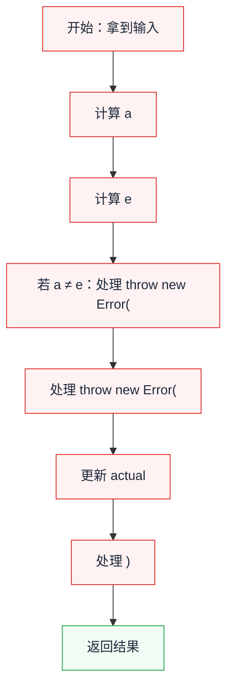

## TypeScript 解题方案（2 个方案逐个讲）

> **运行与提交**：每个方案都是自包含文件（内嵌用例自测，输出 PASS），整块复制到 `.ts` 文件后 `node 文件名` 即可运行。提交 LeetCode 时，把 `demo` 内的算法函数与辅助类型/函数整体取出、置于文件顶层即可。涉及交互/特殊接口的题以题面给定签名为准。

### 方案 1：直接实现

**分析与思路**：核心做法是「直接实现」。

**运行方式**：`node 本文件`，内嵌用例全部通过会输出 PASS。


**方案专属流程图**（真实控制流）：

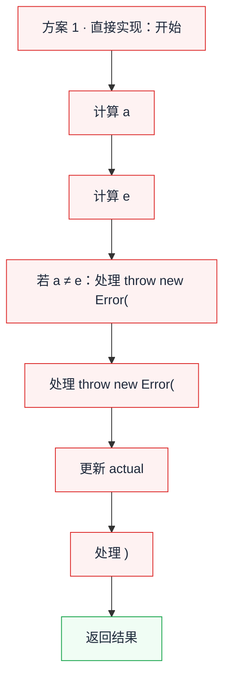

```typescript
function assertEq(actual: any, expected: any, msg: string = ''): void {
  // 定义函数/方法 assertEq
  const a = JSON.stringify(actual);
  const e = JSON.stringify(expected);
  if (a !== e)
    throw new Error(
      'ASSERT FAILED ' + msg + ' :: actual=' + a + ' expected=' + e,
    );
}

class SortedStack {
  // 定义类型
  stk1: number[];
  stk2: number[]; // stk1: number[]; stk2: number[];
  constructor() {
    this.stk1 = [];
    this.stk2 = [];
  } // 把 []; this.stk2 赋值为 []; } 写入 constructor() { this.stk1
  push(val: number): void {
    // push(值: number): void {
    while (this.stk1.length && this.stk1[this.stk1.length - 1] > val)
      this.stk2.push(this.stk1.pop()!);
    this.stk1.push(val); // 把 值 压入栈/数组尾部
    while (this.stk2.length) this.stk1.push(this.stk2.pop()!); // 循环，直到不满足「this.stk2.长度) this.stk1 追加 this.stk2 弹出 )取反 );」
  }
  pop(): void {
    if (!this.isEmpty()) this.stk1.pop();
  } // 弹出栈顶元素
  peek(): number {
    if (this.isEmpty()) return -1;
    return this.stk1[this.stk1.length - 1];
  }
  isEmpty(): boolean {
    return this.stk1.length === 0;
  } // 把 等于 0; } 写入 长度
}
export function demo(): void {
  // 程序入口：跑内嵌自测用例
  const s = new SortedStack(); // 把 new SortedStack() 存入 字符串
  for (const v of [4, 2, 5, 1, 3]) s.push(v); // 把 值 压入栈/数组尾部
  const out: number[] = []; // 把 []; 写入 const out: number[]
  while (!s.isEmpty()) {
    out.push(s.peek());
    s.pop();
  }
  assertEq(out, [5, 4, 3, 2, 1], 'sorted'); // 断言校验
  console.log('PASS'); // 全部用例通过，输出 PASS
}
demo(); // demo();
```

### 方案 2：迭代指针处理

**分析与思路**：核心做法是「迭代指针处理」。代码里依次做这些事：队列或堆的调度。

**运行方式**：`node 本文件`，内嵌用例全部通过会输出 PASS。


**方案专属流程图**（真实控制流）：

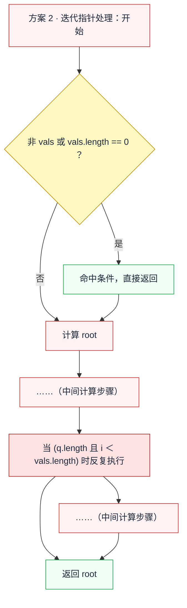

```typescript
class TreeNode {
  // 定义类型
  val: any;
  left: any;
  right: any; // 值: any; 左边界: any; 右边界: any;
  constructor(val?: any, left?: any, right?: any) {
    // constructor(值?: any, 左边界?: any, 右边界?: any) {
    this.val = val === undefined ? 0 : val; // 把 (值 全等于 undefined ? 0 : 值); 写入 值
    this.left = left === undefined ? null : left; // 把 (左边界 全等于 undefined ? null : 左边界); 写入 左边界
    this.right = right === undefined ? null : right; // 把 (右边界 全等于 undefined ? null : 右边界); 写入 右边界
  }
}
function buildTree(vals: any): any {
  // 定义函数/方法 buildTree
  if (!vals || vals.length === 0) return null; // 若 取反 vals 或 vals.长度 全等于 0，直接返回 null
  const root = new TreeNode(vals[0]);
  const q: any[] = [root];
  let i = 1;
  while (q.length && i < vals.length) {
    // 循环，直到不满足「节点.长度 且 下标 i 小于 vals.长度」
    const node = q.shift(); // 把 节点.shift() 存入 节点
    if (vals[i] !== null && vals[i] !== undefined) {
      node.left = new TreeNode(vals[i]);
      q.push(node.left);
    }
    i++; // 下标 i 加一
    if (i < vals.length && vals[i] !== null && vals[i] !== undefined) {
      node.right = new TreeNode(vals[i]);
      q.push(node.right);
    }
    i++; // 下标 i 加一
  }
  return root; // 返回 根节点
}
function treeToLevel(root: any): any[] {
  // 定义函数/方法 treeToLevel
  if (!root) return []; // 若 取反 根节点，直接返回 []
  const out: any[] = [];
  const q: any[] = [root]; // 把 []; const 节点: any[] 赋值为 [根节点]; 写入 const out: any[]
  while (q.length) {
    // 循环，直到不满足「节点.长度」
    const n = q.shift(); // 把 节点.shift() 存入 元素个数
    if (n === null || n === undefined) {
      out.push(null);
      continue;
    }
    out.push(n.val);
    q.push(n.left);
    q.push(n.right); // 把 元素个数.值 压入栈/数组尾部
  }
  while (out.length && out[out.length - 1] === null) out.pop(); // 循环，直到不满足「out.长度 且 out[out.长度 减 1] 全等于 null) out 弹出 );」
  return out; // 返回 out
}
class ListNode {
  // 定义类型
  val: any;
  next: any; // 值: any; 下一个: any;
  constructor(val?: any, next?: any) {
    this.val = val === undefined ? 0 : val;
    this.next = next === undefined ? null : next;
  }
}
function buildList(vals: any): any {
  // 定义函数/方法 buildList
  const dummy = new ListNode(0);
  let cur = dummy; // 把 new ListNode(0); let 当前值 赋值为 哨兵节点 存入 哨兵节点
  for (const v of vals) {
    cur.next = new ListNode(v);
    cur = cur.next;
  } // 把 new ListNode(值); 当前值 赋值为 当前值.下一个; } 写入 下一个
  return dummy.next; // 返回 哨兵节点.下一个
}
function listToArray(head: any): any[] {
  // 定义函数/方法 listToArray
  const out: any[] = [];
  let p = head; // 把 []; let 节点 赋值为 头节点; 写入 const out: any[]
  while (p) {
    out.push(p.val);
    p = p.next;
  } // 循环，直到不满足「节点) { out 追加 节点.值); 节点 赋值为 节点.下一个; }」
  return out; // 返回 out
}
// python-runtime shims
function pyLen(a: any): number {
  // 定义函数/方法 pyLen
  if (a === null || a === undefined) return 0; // 若 数组 全等于 null 或 数组 全等于 undefined，直接返回 0
  if (
    typeof a === 'string' ||
    Array.isArray(a) ||
    a instanceof Set ||
    a instanceof Map
  )
    return a.length ?? a.size;
  if (typeof a === 'object') return Object.keys(a).length; // 若 typeof 数组 全等于 'object'，直接返回 Object.keys(数组).长度
  return 0; // 返回 0
}
function pySlice(a: any, i: any, j: any, step?: any): any {
  // 定义函数/方法 pySlice
  if (typeof a === 'string') {
    const r = [...a].slice(i ?? 0, j ?? a.length);
    return step ? r.reverse().join('') : r.join('');
  }
  const arr = Array.isArray(a) ? a : [...a]; // 把 Array.isArray(数组) ? 数组 : 复制的 数组 存入 数组
  return arr.slice(i ?? 0, j ?? arr.length); // 返回 数组 截取 下标 i ?? 0, 下标 j ?? 数组.长度)
}
function pyRange(a: any, b?: any, step?: any): any[] {
  // 定义函数/方法 pyRange
  let s = 0,
    e = a,
    st = 1; // 把 0, e 赋值为 数组, st 赋值为 1 存入 字符串
  if (b !== undefined) {
    s = a;
    e = b;
  } // 若 b 不等于 undefined) { 字符串 赋值为 数组; e 赋值为 b; }
  if (step !== undefined) st = step; // 若 步数 不等于 undefined) st 赋值为 步数;
  const out: any[] = []; // 把 []; 写入 const out: any[]
  if (st > 0) for (let i = s; i < e; i += st) out.push(i);
  else for (let i = s; i > e; i += st) out.push(i); // 否则
  return out; // 返回 out
}
function pyIn(x: any, coll: any): boolean {
  // 定义函数/方法 pyIn
  if (coll === null || coll === undefined) return false; // 若 coll 全等于 null 或 coll 全等于 undefined，直接返回 false
  if (Array.isArray(coll)) return coll.includes(x); // 若 Array.isArray(coll)，直接返回 coll 是否包含 x)
  if (coll instanceof Set || coll instanceof Map) return coll.has(x); // 若 coll instanceof Set 或 coll instanceof Map，直接返回 coll.has(x)
  if (typeof coll === 'object') return x in coll; // 若 typeof coll 全等于 'object'，直接返回 x in coll
  if (typeof coll === 'string') return coll.indexOf(x) >= 0; // 若 typeof coll 全等于 'string'，直接返回 coll 查找 x) 不低于 0
  return false; // 返回 false
}
function pySorted(a: any): any[] {
  // 定义函数/方法 pySorted
  const arr = typeof a === 'string' ? [...a] : [...a]; // 把 (typeof 数组 全等于 'string') ? 复制的 数组 : 复制的 数组 存入 数组
  return arr.sort((x: any, y: any) => (x < y ? -1 : x > y ? 1 : 0));
}
function pyMin(a: any, b?: any): any {
  if (b !== undefined) return Math.min(a, b);
  if (Array.isArray(a) || a instanceof Set) return Math.min(...a);
  return Math.min(a);
} // 定义函数/方法 pyMin
function pyMax(a: any, b?: any): any {
  if (b !== undefined) return Math.max(a, b);
  if (Array.isArray(a) || a instanceof Set) return Math.max(...a);
  return Math.max(a);
} // 定义函数/方法 pyMax
function pySum(a: any): number {
  let s = 0;
  for (const v of a) s += v;
  return s;
} // 定义函数/方法 pySum
function pyAbs(x: any): number {
  return Math.abs(x);
} // 定义函数/方法 pyAbs
function pyEnumerate(a: any): any[] {
  const out: any[] = [];
  let i = 0;
  for (const v of a) {
    out.push([i, v]);
    i++;
  }
  return out;
} // 定义函数/方法 pyEnumerate
function pyZip(a: any, b: any): any[] {
  const n = Math.min(a.length, b.length);
  const out: any[] = [];
  for (let i = 0; i < n; i++) out.push([a[i], b[i]]);
  return out;
} // 定义函数/方法 pyZip
function pyDictGet(d: any, k: any, def?: any): any {
  return k in d ? d[k] : def === undefined ? null : def;
} // 定义函数/方法 pyDictGet
function pyPrint(...args: any[]): void {
  console.log(
    args
      .map((a) => (typeof a === 'object' && a !== null ? JSON.stringify(a) : a))
      .join(' '),
  );
} // 定义函数/方法 pyPrint
// collections / heapq
function heapPush(h: any[], x: any): void {
  h.push(x);
  let i = h.length - 1;
  while (i > 0) {
    const p = (i - 1) >> 1;
    if (h[p] <= h[i]) break;
    [h[p], h[i]] = [h[i], h[p]];
    i = p;
  }
} // 定义函数/方法 heapPush
function heapPop(h: any[]): any {
  const top = h[0];
  const last = h.pop();
  if (h.length) {
    h[0] = last;
    let i = 0;
    const n = h.length;
    while (true) {
      let l = 2 * i + 1,
        r = 2 * i + 2,
        s = i;
      if (l < n && h[l] < h[s]) s = l;
      if (r < n && h[r] < h[s]) s = r;
      if (s === i) break;
      [h[s], h[i]] = [h[i], h[s]];
      i = s;
    }
  }
  return top;
} // 定义函数/方法 heapPop
class Deque {
  private a: any[] = [];
  push(x: any) {
    this.a.push(x);
  }
  pushLeft(x: any) {
    this.a.unshift(x);
  }
  pop() {
    return this.a.pop();
  }
  popLeft() {
    return this.a.shift();
  }
  get length() {
    return this.a.length;
  }
  toArray() {
    return this.a.slice();
  }
} // 定义类型
function Counter(iter: any): any {
  const m: any = {};
  for (const v of iter) m[v] = (m[v] || 0) + 1;
  return m;
} // 定义函数/方法 Counter
function gcd(a: any, b: any): any {
  while (b) {
    [a, b] = [b, a % b];
  }
  return a;
} // 定义函数/方法 gcd
function pyInf(): number {
  return Infinity;
} // 定义函数/方法 pyInf

function norm(x: any): any {
  // 定义函数/方法 norm
  if (x === null || x === undefined) return null; // 若 x 全等于 null 或 x 全等于 undefined，直接返回 null
  if (typeof x === 'object') {
    // 若 typeof x 全等于 'object'
    if (x instanceof Deque) return x.toArray(); // 若 x instanceof Deque，直接返回 x.toArray()
    if (Array.isArray(x)) return x.map(norm); // 若 Array.isArray(x)，直接返回 x.映射表(norm)
    if (
      typeof x.val === 'number' &&
      (typeof x.left !== 'undefined' || typeof x.right !== 'undefined')
    )
      return treeToLevel(x);
    if (typeof x.next !== 'undefined' && typeof x.val === 'number')
      return listToArray(x);
    if (x instanceof Set) return [...x].sort(); // 若 x instanceof Set，直接返回 复制的 x 排序 )
    if (x instanceof Map) return Object.fromEntries(x); // 若 x instanceof Map，直接返回 Object.fromEntries(x)
    const o: any = {};
    for (const k of Object.keys(x)) o[k] = norm(x[k]);
    return o;
  }
  return x; // 返回 x
}
function eq(a: any, b: any): boolean {
  // 定义函数/方法 eq
  const x = norm(a),
    y = norm(b); // 把 norm(数组), y 赋值为 norm(b) 存入 x
  if (x === y) return true; // 若 x 全等于 y，直接返回 true
  if (x === null || y === null) return x === y; // 若 x 全等于 null 或 y 全等于 null，直接返回 x 全等于 y
  if (Array.isArray(x) && Array.isArray(y)) {
    // 若 Array.isArray(x) 且 Array.isArray(y
    if (x.length !== y.length) return false; // 若 x.长度 不等于 y.长度，直接返回 false
    for (let i = 0; i < x.length; i++) if (!eq(x[i], y[i])) return false; // 让 下标 i 从 0 开始计数，下标 i 小于 x.长度 就继续
    return true; // 返回 true
  }
  if (typeof x === 'object' && typeof y === 'object') {
    // 若 typeof x 全等于 'object' 且 typeof y 全等于 'object'
    const kx = Object.keys(x),
      ky = Object.keys(y); // 把 Object.keys(x), ky 赋值为 Object.keys(y) 存入 kx
    if (kx.length !== ky.length) return false; // 若 kx.长度 不等于 ky.长度，直接返回 false
    for (const k of kx) if (!eq(x[k], y[k])) return false;
    return true; // 返回 true
  }
  return x === y; // 返回 x 全等于 y
}

class SortedStack {
  // 定义类型
  s: any[];
  t: any[]; // 字符串: any[]; 另一字符串: any[];
  constructor() {
    this.s = [];
    this.t = [];
  } // 把 []; this.另一字符串 赋值为 []; } 写入 字符串
  push(x) {
    // push(x) {
    while (this.s.length && this.s[this.s.length - 1] > x)
      this.t.push(this.s.pop());
    this.s.push(x); // 把 x 压入栈/数组尾部
    while (this.t.length) this.s.push(this.t.pop()); // 循环，直到不满足「this.另一字符串.长度) this.字符串 追加 this.另一字符串 弹出 ));」
  }
  pop() {
    return this.s.length ? this.s.pop() : -1;
  } // 弹出栈顶元素
  peek() {
    return this.s.length ? this.s[this.s.length - 1] : -1;
  }
  isEmpty() {
    return this.s.length === 0;
  } // 把 等于 0; } 写入 长度
}
export function demo(): void {
  // 程序入口：跑内嵌自测用例
  const st = new SortedStack(); // 把 new SortedStack() 存入 st
  st.push(1);
  st.push(2);
  st.push(3); // 把 1 压入栈/数组尾部
  const cases = [
    { got: st.peek(), want: 3 },
    { got: st.pop(), want: 3 },
    { got: st.peek(), want: 2 },
  ];
  let fail = false; // 把 false 存入 fail
  for (const c of cases)
    if (!eq(c.got, c.want)) {
      fail = true;
      console.log('FAIL', c);
    } // 打印输出
  if (fail) throw new Error('FAILED'); // 若 fail) throw new Error(「FAILED」);
  console.log('PASS'); // 全部用例通过，输出 PASS
}
demo(); // demo();
```

## 逐步拆解与面试追问

**复杂度**：时间 O(n) 量级，空间 O(n)

**为什么是这个量级**：整体只对数据做有限趟处理

**面试官可能会追问**：

- 什么时候用单调栈（求下一个更大或更小）？
- 栈里存值还是存下标？
- 能否用 O(1) 额外空间？

## 关键 API 速查（TS 主解法实际用到，附官方链接）

| API | 作用 | 使用要点 | 官方文档 |
|---|---|---|---|
| `Array.prototype.push()` | 尾部追加 | 返回新长度；可一次多个；均摊 O(1)；会改变原数组 | [官方文档](https://developer.mozilla.org/zh-CN/docs/Web/JavaScript/Reference/Global_Objects/Array/push) |
| `Array.prototype.pop()` | 尾部弹出 | 返回被删元素（空数组返回 undefined）；O(1) | [官方文档](https://developer.mozilla.org/zh-CN/docs/Web/JavaScript/Reference/Global_Objects/Array/pop) |
| `JSON.stringify()` | 序列化为 JSON 字符串 | 常用于结构化比较（深度相等判定）；undefined/函数/循环引用会被丢弃或抛错 | [官方文档](https://developer.mozilla.org/zh-CN/docs/Web/JavaScript/Reference/Global_Objects/JSON/stringify) |

### 各语言官方文档导航

- **TypeScript / JS**：[MDN 中文参考](https://developer.mozilla.org/zh-CN/)
- **Python**：[Python 官方文档](https://docs.python.org/zh-cn/3/)
- **Go**：[Go 标准库](https://pkg.go.dev/std)
- **Java**：[JDK 17 API](https://docs.oracle.com/en/java/javase/17/docs/api/)
- **Rust**：[Rust 标准库](https://doc.rust-lang.org/std/)
- **Lua**：[Lua 5.4 手册](https://www.lua.org/manual/5.4/)
- **C**：[Cppreference C](https://zh.cppreference.com/w/c)
- **C++**：[Cppreference C++](https://zh.cppreference.com/w/cpp)
- **R**：[R 官方手册](https://stat.ethz.ch/R-manual/)
- **Zig**：[Zig 语言文档](https://ziglang.org/documentation/master/)
- **Dart**：[Dart API](https://api.dart.dev/)

## 附录：其他 10 种语言全部实现（每种语言列举其全部方案）

> TypeScript 的全部方案见「TypeScript 解题方案」一节；下面是其余 10 种语言的对应实现，每种语言的每个方案都带思路分析、代码走读与专属运行架构图。
> 每个方案都内嵌用例自测，可独立运行（老仓库 python/go 文件遵循「打印结果」约定）。
> 完整解法文件见 `dsa/<语言>/stack/lc_03_05_栈排序/`。

### Python 实现（2 种方案）

Python 的全部方案如下，每个方案都内嵌用例自测，可独立运行（老仓库 python/go 文件遵循「打印结果」约定）：

#### 方案 1：直接实现

**思路与代码分析**：核心是「直接实现」。Python 版用切片与字典推导式简化操作，突出可读性。代码里依次做这些事：栈的后进先出操作。

**运行架构**（真实控制流）：

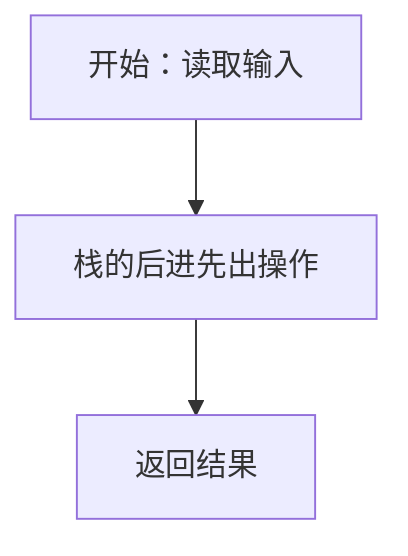

```python
class SortedStack:  # 定义类
    def __init__(self):  # 构造函数：初始化成员
        self.stk1 = []  # 把 [] 写入 self.stk1
        self.stk2 = []  # 把 [] 写入 self.stk2

    def push(self, val: int) -> None:  # 定义函数 push（参数：self, 值: int）
        # Move all elements larger than val from stk1 to stk2
        while self.stk1 and self.stk1[-1] > val:  # 循环，直到不满足「self.stk1 and self.stk1[ 减 1] 超过 值」
            self.stk2.append(self.stk1.pop())  # 把 self.stk1 弹出 追加到列表尾部
        # Push val onto stk1
        self.stk1.append(val)  # 把 值 追加到列表尾部
        # Move elements back from stk2 to stk1
        while self.stk2:  # 循环，直到不满足「self.stk2」
            self.stk1.append(self.stk2.pop())  # 把 self.stk2 弹出 追加到列表尾部

    def pop(self) -> None:  # 定义函数 pop（参数：self）
        if not self.isEmpty():  # 若 not self.isEmpty(
            self.stk1.pop()  # 弹出栈顶元素

    def peek(self) -> int:  # 定义函数 peek（参数：self）
        if self.isEmpty():  # 若 self.isEmpty(
            return -1  # 返回 减 1
        return self.stk1[-1]  # 返回 self.stk1[ 减 1]

    def isEmpty(self) -> bool:  # 定义函数 isEmpty（参数：self）
        return len(self.stk1) == 0  # 返回 长度(self.stk1) 等于 0

if __name__ == "__main__":  # 若 __name__ 等于 '__main__'
    s = SortedStack()  # 把 SortedStack() 存入 字符串
    for v in [4, 2, 5, 1, 3]:  # for 值 in [4, 2, 5, 1, 3]:
        s.push(v)  # 把 值 压入栈/数组尾部
    out = []  # 把 [] 存入 out
    while not s.isEmpty():  # 循环，直到不满足「not 字符串.isEmpty(」
        out.append(s.peek())  # 把 字符串.peek( 追加到列表尾部
        s.pop()  # 弹出栈顶元素
    print(out)  # 打印输出
```

#### 方案 2：迭代指针处理

**思路与代码分析**：核心是「迭代指针处理」。Python 版用切片与字典推导式简化操作，突出可读性。代码里依次做这些事：栈的后进先出操作。

**运行架构**：与方案 1 的控制流相同（同算法在该语言的等价实现），图见上。

```python
class SortedStack:  # 定义类
    def __init__(self):  # 构造函数：初始化成员
        self.stk = []  # 把 [] 写入 栈

    def push(self, val: int) -> None:  # 定义函数 push（参数：self, 值: int）
        temp_stack = []  # 把 [] 存入 temp_stack
        # Move all elements larger than val from stk to temp_stack
        while self.stk and self.stk[-1] > val:  # 循环，直到不满足「self.栈 and self.栈[ 减 1] 超过 值」
            temp_stack.append(self.stk.pop())  # 把 self.栈 弹出 追加到列表尾部
        # Push val onto stk
        self.stk.append(val)  # 把 值 追加到列表尾部
        # Move elements back from temp_stack to stk
        while temp_stack:  # 循环，直到不满足「temp_stack」
            self.stk.append(temp_stack.pop())  # 把 temp_stack 弹出 追加到列表尾部

    def pop(self) -> None:  # 定义函数 pop（参数：self）
        if not self.isEmpty():  # 若 not self.isEmpty(
            self.stk.pop()  # 弹出栈顶元素

    def peek(self) -> int:  # 定义函数 peek（参数：self）
        if self.isEmpty():  # 若 self.isEmpty(
            return -1  # 返回 减 1
        return self.stk[-1]  # 返回 self.栈[ 减 1]

    def isEmpty(self) -> bool:  # 定义函数 isEmpty（参数：self）
        return len(self.stk) == 0  # 返回 长度(self.栈) 等于 0

    def sort(self):  # 定义函数 sort（参数：self）
        result = []  # 把 [] 存入 结果
        while self.stk:  # 循环，直到不满足「self.栈」
            result.append(self.stk.pop())  # 把 self.栈 弹出 追加到列表尾部
        return result[::-1]  # 返回 结果[:: 减 1]

if __name__ == "__main__":  # 若 __name__ 等于 '__main__'
    s = SortedStack()  # 把 SortedStack() 存入 字符串
    for v in [4, 2, 5, 1, 3]:  # for 值 in [4, 2, 5, 1, 3]:
        s.push(v)  # 把 值 压入栈/数组尾部
    out = []  # 把 [] 存入 out
    while not s.isEmpty():  # 循环，直到不满足「not 字符串.isEmpty(」
        out.append(s.peek())  # 把 字符串.peek( 追加到列表尾部
        s.pop()  # 弹出栈顶元素
    print(out)  # 打印输出
```

### Go 实现（2 种方案）

Go 的全部方案如下，每个方案都内嵌用例自测，可独立运行（老仓库 python/go 文件遵循「打印结果」约定）：

#### 方案 1：直接实现

**思路与代码分析**：核心是「直接实现」。Go 版用切片与多返回值惯用法，显式处理索引边界。**走读**：方案 1 · 直接实现：开始 → 返回 SortedStack → 处理 stk1: []int → 处理 stk2: []int。

**运行架构**（真实控制流）：

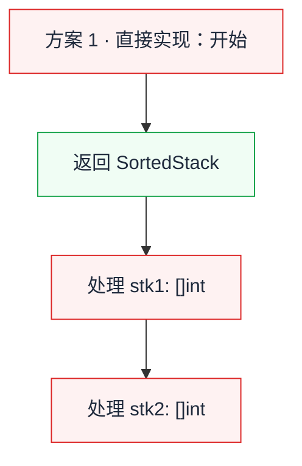

```go
package main // 引入依赖

import (
	"fmt"     // 「fmt」
	"reflect" // 「reflect」
)

type SortedStack struct { // 定义类型
	stk1 []int // stk1 []int
	stk2 []int // stk2 []int
}

func Constructor() SortedStack { // 定义函数/方法 Constructor
	return SortedStack{ // 返回 SortedStack{
		stk1: []int{},
		stk2: []int{},
	}
}

func (this *SortedStack) Push(val int) { // 定义函数/方法 Push
	for len(this.stk1) > 0 && this.stk1[len(this.stk1)-1] > val { // for 长度(this.stk1) 超过 0 且 this.stk1[长度(this.stk1) 减 1] 超过 值 {
		this.stk2 = append(this.stk2, this.stk1[len(this.stk1)-1])
		this.stk1 = this.stk1[:len(this.stk1)-1] // 把 this.stk1[:长度(this.stk1) 减 1] 写入 this.stk1
	}
	this.stk1 = append(this.stk1, val) // 把 append(this.stk1, 值) 写入 this.stk1
	for len(this.stk2) > 0 {           // for 长度(this.stk2) 超过 0 {
		this.stk1 = append(this.stk1, this.stk2[len(this.stk2)-1])
		this.stk2 = this.stk2[:len(this.stk2)-1] // 把 this.stk2[:长度(this.stk2) 减 1] 写入 this.stk2
	}
}

func (this *SortedStack) Pop() { // 定义函数/方法 Pop
	if !this.IsEmpty() { // 若 取反 this.IsEmpty(
		this.stk1 = this.stk1[:len(this.stk1)-1] // 把 this.stk1[:长度(this.stk1) 减 1] 写入 this.stk1
	}
}

func (this *SortedStack) Peek() int { // 定义函数/方法 Peek
	if this.IsEmpty() { // 若 this.IsEmpty(
		return -1 // 返回 减 1
	}
	return this.stk1[len(this.stk1)-1] // 返回 this.stk1[长度(this.stk1) 减 1]
}

func (this *SortedStack) IsEmpty() bool { // 定义函数/方法 IsEmpty
	return len(this.stk1) == 0 // 返回 长度(this.stk1) 等于 0
}

func main() { // 程序入口：跑内嵌自测用例
	s := Constructor()                       // 把 Constructor() 写入 s :
	for _, v := range []int{4, 2, 5, 1, 3} { // 同时取 _ 与 值 遍历
		s.Push(v) // 字符串.Push(值)
	}
	var out []int      // var out []int
	for !s.IsEmpty() { // for 取反 字符串.IsEmpty() {
		out = append(out, s.Peek()) // 把 append(out, 字符串.Peek()) 写入 out
		s.Pop()                     // 字符串.Pop()
	}
	want := []int{5, 4, 3, 2, 1}       // 把 []int{5, 4, 3, 2, 1} 写入 want :
	if !reflect.DeepEqual(out, want) { // 若 取反 reflect.DeepEqual(out, want
		fmt.Println("FAIL", out) // 打印输出
		return                   // return
	}
	fmt.Println("PASS") // 全部用例通过，输出 PASS
}
```

#### 方案 2：迭代指针处理

**思路与代码分析**：核心是「迭代指针处理」。Go 版用切片与多返回值惯用法，显式处理索引边界。**走读**：方案 2 · 迭代指针处理：开始 → 返回 SortedStack。

**运行架构**（真实控制流）：

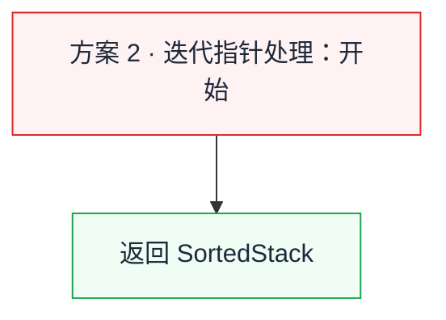

```go
package main // 引入依赖

import (
	"fmt"     // 「fmt」
	"reflect" // 「reflect」
)

type SortedStack struct { // 定义类型
	stk []int // 栈 []int
}

func Constructor() SortedStack { // 定义函数/方法 Constructor
	return SortedStack{stk: []int{}} // 返回 SortedStack{栈: []int{}}
}

func (this *SortedStack) Push(val int) { // 定义函数/方法 Push
	tempStack := []int{}                                       // 把 []int{} 写入 tempStack :
	for len(this.stk) > 0 && this.stk[len(this.stk)-1] > val { // for 长度(this.栈) 超过 0 且 this.栈[长度(this.栈) 减 1] 超过 值 {
		tempStack = append(tempStack, this.stk[len(this.stk)-1]) // 把 append(tempStack, this.栈[长度(this.栈) 减 1]) 写入 tempStack
		this.stk = this.stk[:len(this.stk)-1]                    // 把 this.栈[:长度(this.栈) 减 1] 写入 栈
	}
	this.stk = append(this.stk, val) // 把 append(this.栈, 值) 写入 栈
	for len(tempStack) > 0 {         // for 长度(tempStack) 超过 0 {
		this.stk = append(this.stk, tempStack[len(tempStack)-1]) // 把 append(this.栈, tempStack[长度(tempStack) 减 1]) 写入 栈
		tempStack = tempStack[:len(tempStack)-1]                 // 把 tempStack[:长度(tempStack) 减 1] 写入 tempStack
	}
}

func (this *SortedStack) Pop() { // 定义函数/方法 Pop
	if !this.IsEmpty() { // 若 取反 this.IsEmpty(
		this.stk = this.stk[:len(this.stk)-1] // 把 this.栈[:长度(this.栈) 减 1] 写入 栈
	}
}

func (this *SortedStack) Peek() int { // 定义函数/方法 Peek
	if this.IsEmpty() { // 若 this.IsEmpty(
		return -1 // 返回 减 1
	}
	return this.stk[len(this.stk)-1] // 返回 this.栈[长度(this.栈) 减 1]
}

func (this *SortedStack) IsEmpty() bool { // 定义函数/方法 IsEmpty
	return len(this.stk) == 0 // 返回 长度(this.栈) 等于 0
}

func main() { // 程序入口：跑内嵌自测用例
	s := Constructor()                       // 把 Constructor() 写入 s :
	for _, v := range []int{4, 2, 5, 1, 3} { // 同时取 _ 与 值 遍历
		s.Push(v) // 字符串.Push(值)
	}
	var out []int      // var out []int
	for !s.IsEmpty() { // for 取反 字符串.IsEmpty() {
		out = append(out, s.Peek()) // 把 append(out, 字符串.Peek()) 写入 out
		s.Pop()                     // 字符串.Pop()
	}
	want := []int{5, 4, 3, 2, 1}       // 把 []int{5, 4, 3, 2, 1} 写入 want :
	if !reflect.DeepEqual(out, want) { // 若 取反 reflect.DeepEqual(out, want
		fmt.Println("FAIL", out) // 打印输出
		return                   // return
	}
	fmt.Println("PASS") // 全部用例通过，输出 PASS
}
```

### Java 实现（2 种方案）

Java 的全部方案如下，每个方案都内嵌用例自测，可独立运行（老仓库 python/go 文件遵循「打印结果」约定）：

#### 方案 1：直接实现

**思路与代码分析**：核心是「直接实现」。Java 版用类与静态方法组织，集合操作显式明了。**走读**：方案 1 · 直接实现：开始 → 命中条件，直接返回 → 返回 stk1.get(stk1.size() - 1)。

**运行架构**（真实控制流）：

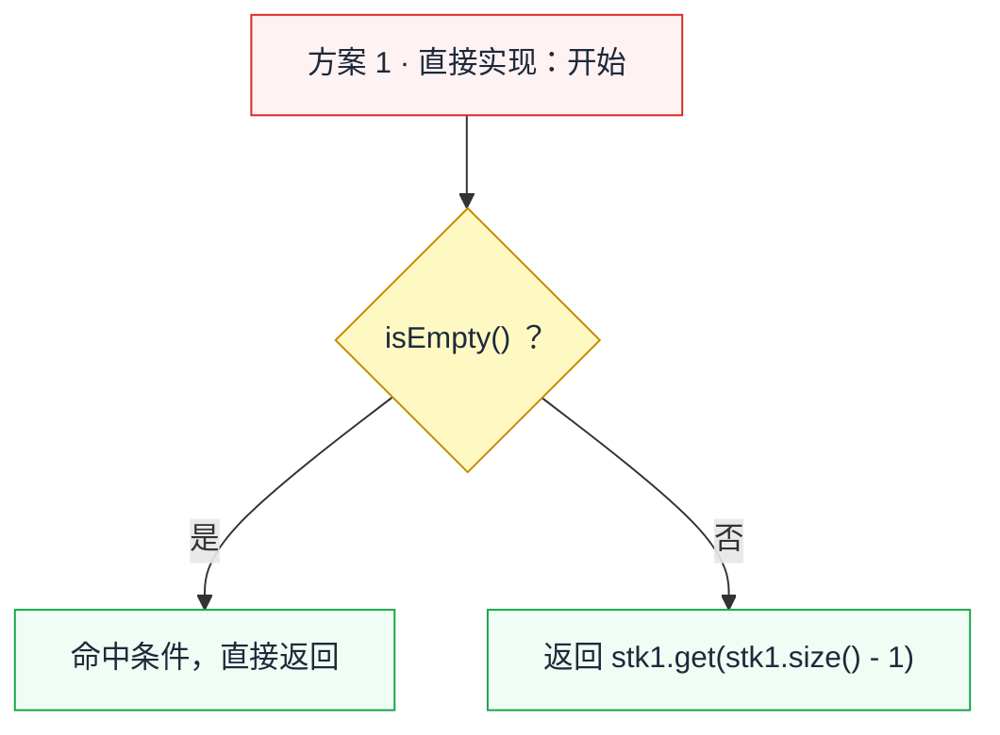

```java
package com.webfault.dsa; // 引入依赖

class lc03_solution111 { // 定义类型
  static class SortedStack { // static class SortedStack {
    java.util.List<Integer> stk1 = new java.util.ArrayList<>();
    java.util.List<Integer> stk2 = new java.util.ArrayList<>();

    void push(int val) { // 定义函数/方法 push
      while (!stk1.isEmpty()
          && stk1.get(stk1.size() - 1)
              > val) { // 循环，直到不满足「取反 stk1.isEmpty() 且 stk1 查找 stk1.大小() 减 1) 超过 值」
        stk2.add(stk1.remove(stk1.size() - 1)); // stk2 追加 stk1 弹出 stk1.大小() 减 1));
      }
      stk1.add(val); // stk1 追加 值);
      while (!stk2.isEmpty()) { // 循环，直到不满足「取反 stk2.isEmpty(」
        stk1.add(stk2.remove(stk2.size() - 1)); // stk1 追加 stk2 弹出 stk2.大小() 减 1));
      }
    }

    void pop() { // 定义函数/方法 pop
      if (!isEmpty()) stk1.remove(stk1.size() - 1); // 若 取反 isEmpty()) stk1 弹出 stk1.大小() 减 1);
    }

    int peek() { // 定义函数/方法 peek
      if (isEmpty()) return -1; // 若 isEmpty()，直接返回 减 1
      return stk1.get(stk1.size() - 1); // 返回 stk1 查找 stk1.大小() 减 1)
    }

    boolean isEmpty() { // 定义判定函数 isEmpty
      return stk1.isEmpty(); // 返回 stk1.isEmpty()
    }
  }

  public static void main(String[] args) { // public static void main(String[] args) {
    SortedStack s = new SortedStack(); // 把 new SortedStack(); 写入 SortedStack s
    int[] in = {4, 2, 5, 1, 3}; // 把 {4, 2, 5, 1, 3}; 写入 int[] in
    for (int v : in) s.push(v); // 把 值 压入栈/数组尾部
    int[] want = {5, 4, 3, 2, 1}; // 把 {5, 4, 3, 2, 1}; 写入 int[] want
    boolean ok = true; // 把 true; 写入 boolean ok
    for (int i = 0; i < want.length; i++) { // 让 下标 i 从 0 开始计数，下标 i 小于 want.长度 就继续
      int got = s.peek(); // 把 字符串.peek() 存入 got
      if (got != want[i]) { // 若 got 不等于 want[下标 i]
        ok = false; // 把 false; 写入 ok
        System.out.println("FAIL step " + i + " got " + got + " want " + want[i]); // 打印输出
      }
      s.pop(); // 弹出栈顶元素
    }
    if (!s.isEmpty()) { // 若 取反 字符串.isEmpty(
      ok = false; // 把 false; 写入 ok
      System.out.println("FAIL stack not empty after pops"); // 打印输出
    }
    // empty peek returns -1
    SortedStack e = new SortedStack(); // 把 new SortedStack(); 写入 SortedStack e
    if (e.peek() != -1) { // 若 e.peek() 不等于 减 1
      ok = false; // 把 false; 写入 ok
      System.out.println("FAIL empty peek want -1 got " + e.peek()); // 打印输出
    }
    if (!ok) throw new RuntimeException("FAILED"); // 若 取反 ok) throw new RuntimeException(「FAILED」);
    System.out.println("PASS"); // 全部用例通过，输出 PASS
  }
}
```

#### 方案 2：迭代指针处理

**思路与代码分析**：核心是「迭代指针处理」。Java 版用类与静态方法组织，集合操作显式明了。**走读**：方案 2 · 迭代指针处理：开始 → 命中条件，直接返回 → 返回 stk.get(stk.size() - 1)。

**运行架构**（真实控制流）：

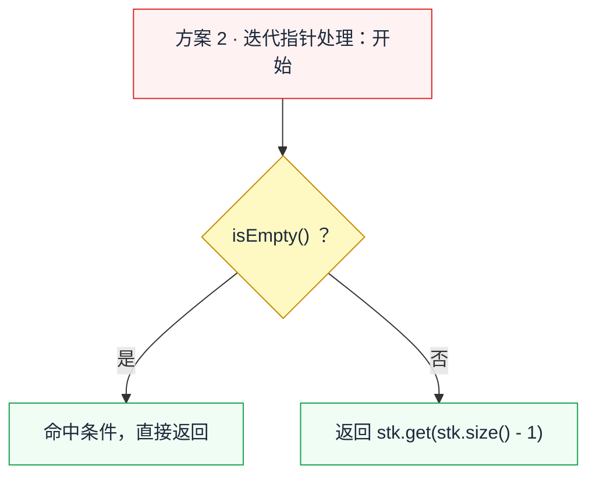

```java
package com.webfault.dsa; // 引入依赖

class lc03_solution222 { // 定义类型
  static class SortedStack { // static class SortedStack {
    java.util.List<Integer> stk = new java.util.ArrayList<>();

    void push(int val) { // 定义函数/方法 push
      java.util.List<Integer> temp = new java.util.ArrayList<>();
      while (!stk.isEmpty()
          && stk.get(stk.size() - 1) > val) { // 循环，直到不满足「取反 栈.isEmpty() 且 栈 查找 栈.大小() 减 1) 超过 值」
        temp.add(stk.remove(stk.size() - 1)); // 临时变量 追加 栈 弹出 栈.大小() 减 1));
      }
      stk.add(val); // 栈 追加 值);
      while (!temp.isEmpty()) { // 循环，直到不满足「取反 临时变量.isEmpty(」
        stk.add(temp.remove(temp.size() - 1)); // 栈 追加 临时变量 弹出 临时变量.大小() 减 1));
      }
    }

    void pop() { // 定义函数/方法 pop
      if (!isEmpty()) stk.remove(stk.size() - 1); // 若 取反 isEmpty()) 栈 弹出 栈.大小() 减 1);
    }

    int peek() { // 定义函数/方法 peek
      if (isEmpty()) return -1; // 若 isEmpty()，直接返回 减 1
      return stk.get(stk.size() - 1); // 返回 栈 查找 栈.大小() 减 1)
    }

    boolean isEmpty() { // 定义判定函数 isEmpty
      return stk.isEmpty(); // 返回 栈.isEmpty()
    }
  }

  public static void main(String[] args) { // public static void main(String[] args) {
    SortedStack s = new SortedStack(); // 把 new SortedStack(); 写入 SortedStack s
    int[] in = {4, 2, 5, 1, 3}; // 把 {4, 2, 5, 1, 3}; 写入 int[] in
    for (int v : in) s.push(v); // 把 值 压入栈/数组尾部
    int[] want = {5, 4, 3, 2, 1}; // 把 {5, 4, 3, 2, 1}; 写入 int[] want
    boolean ok = true; // 把 true; 写入 boolean ok
    for (int i = 0; i < want.length; i++) { // 让 下标 i 从 0 开始计数，下标 i 小于 want.长度 就继续
      int got = s.peek(); // 把 字符串.peek() 存入 got
      if (got != want[i]) { // 若 got 不等于 want[下标 i]
        ok = false; // 把 false; 写入 ok
        System.out.println("FAIL step " + i + " got " + got + " want " + want[i]); // 打印输出
      }
      s.pop(); // 弹出栈顶元素
    }
    if (!s.isEmpty()) { // 若 取反 字符串.isEmpty(
      ok = false; // 把 false; 写入 ok
      System.out.println("FAIL stack not empty after pops"); // 打印输出
    }
    SortedStack e = new SortedStack(); // 把 new SortedStack(); 写入 SortedStack e
    if (e.peek() != -1) { // 若 e.peek() 不等于 减 1
      ok = false; // 把 false; 写入 ok
      System.out.println("FAIL empty peek want -1 got " + e.peek()); // 打印输出
    }
    if (!ok) throw new RuntimeException("FAILED"); // 若 取反 ok) throw new RuntimeException(「FAILED」);
    System.out.println("PASS"); // 全部用例通过，输出 PASS
  }
}
```

### Rust 实现（2 种方案）

Rust 的全部方案如下，每个方案都内嵌用例自测，可独立运行（老仓库 python/go 文件遵循「打印结果」约定）：

#### 方案 1：直接实现

**思路与代码分析**：核心是「直接实现」。Rust 版用所有权移动与切片借用改写同一逻辑，注意 Option 与引用边界。代码里依次做这些事：先排序再处理；栈的后进先出操作。**走读**：方案 1 · 直接实现：开始 → 计算 temp → 计算 output → 当 let Some(v) = input.pop() 时反复执行 → 当 let Some(&t) = temp.last() 时反复执行 → 处理 if t ＞ v → 向 output 追加记录 → 跳出循环（break） → 向 temp 追加记录 → 当 let Some(v) = temp.pop() 时反复执行 → 向 output 追加记录 → 排序整理 → 处理 output → 返回结果。

**运行架构**（真实控制流）：

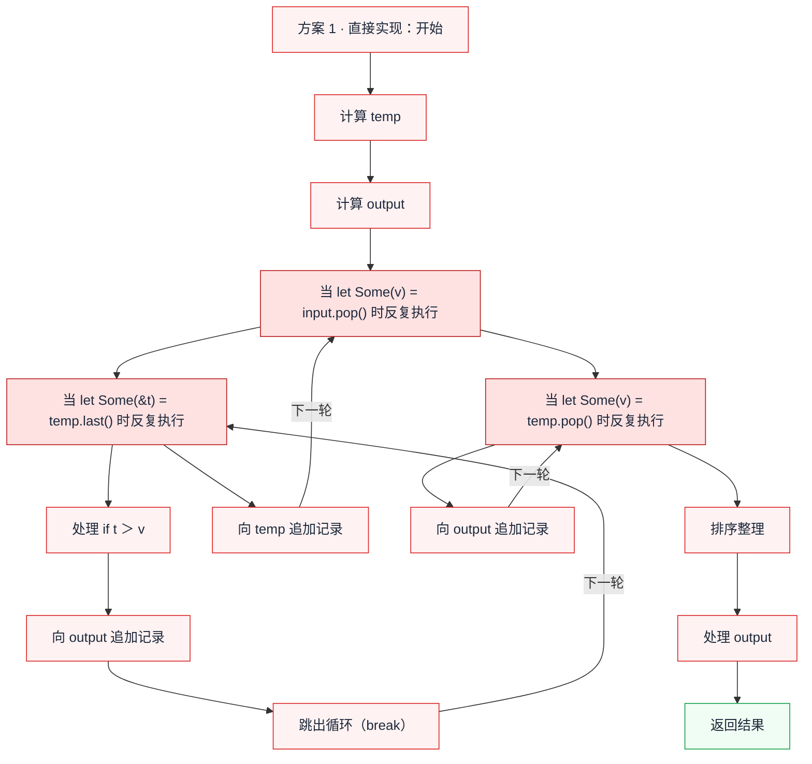

```rust
// LeetCode 面试题 03.05. 栈排序 — Rust 版（方案1）
fn sorted_stack(mut input: Vec<i32>) -> Vec<i32> {
    // 定义函数/方法 sorted_stack
    // 辅助栈法：temp 存降序，最终 output 升序
    let mut temp: Vec<i32> = Vec::new(); // 把 Vec::new(); 写入 let mut temp: Vec<i32>
    let mut output: Vec<i32> = Vec::new(); // 把 Vec::new(); 写入 let mut output: Vec<i32>
    while let Some(v) = input.pop() {
        // 边取边处理，取空即停
        while let Some(&t) = temp.last() {
            // 边取边处理，取空即停
            if t > v {
                output.push(temp.pop().unwrap());
            } else {
                break;
            } // 若 另一字符串 超过 值 { 输出 追加 临时变量 弹出 ).unwrap()); } else { break; }
        }
        temp.push(v); // 把 值 压入栈/数组尾部
    }
    while let Some(v) = temp.pop() {
        output.push(v);
    } // 边取边处理，取空即停
    output.sort(); // 排序
    output // 输出
}
fn main() {
    // 程序入口：跑内嵌自测用例
    let got = sorted_stack(vec![5, 2, 1, 4, 3]); // 把 sorted_stack(vec取反 [5, 2, 1, 4, 3]) 存入 got
    assert_eq!(got, vec![1, 2, 3, 4, 5]); // 断言校验
    println!("PASS");
} // 全部用例通过，输出 PASS
```

#### 方案 2：迭代指针处理

**思路与代码分析**：核心是「迭代指针处理」。Rust 版用所有权移动与切片借用改写同一逻辑，注意 Option 与引用边界。代码里依次做这些事：先排序再处理；栈的后进先出操作。**走读**：方案 2 · 迭代指针处理：开始 → 计算 temp → 计算 output → 当 let Some(v) = input.pop() 时反复执行 → 当 let Some(&t) = temp.last() 时反复执行 → 处理 if t ＞ v → 向 output 追加记录 → 跳出循环（break） → 向 temp 追加记录 → 当 let Some(v) = temp.pop() 时反复执行 → 向 output 追加记录 → 排序整理 → 处理 output → 返回结果。

**运行架构**（真实控制流）：

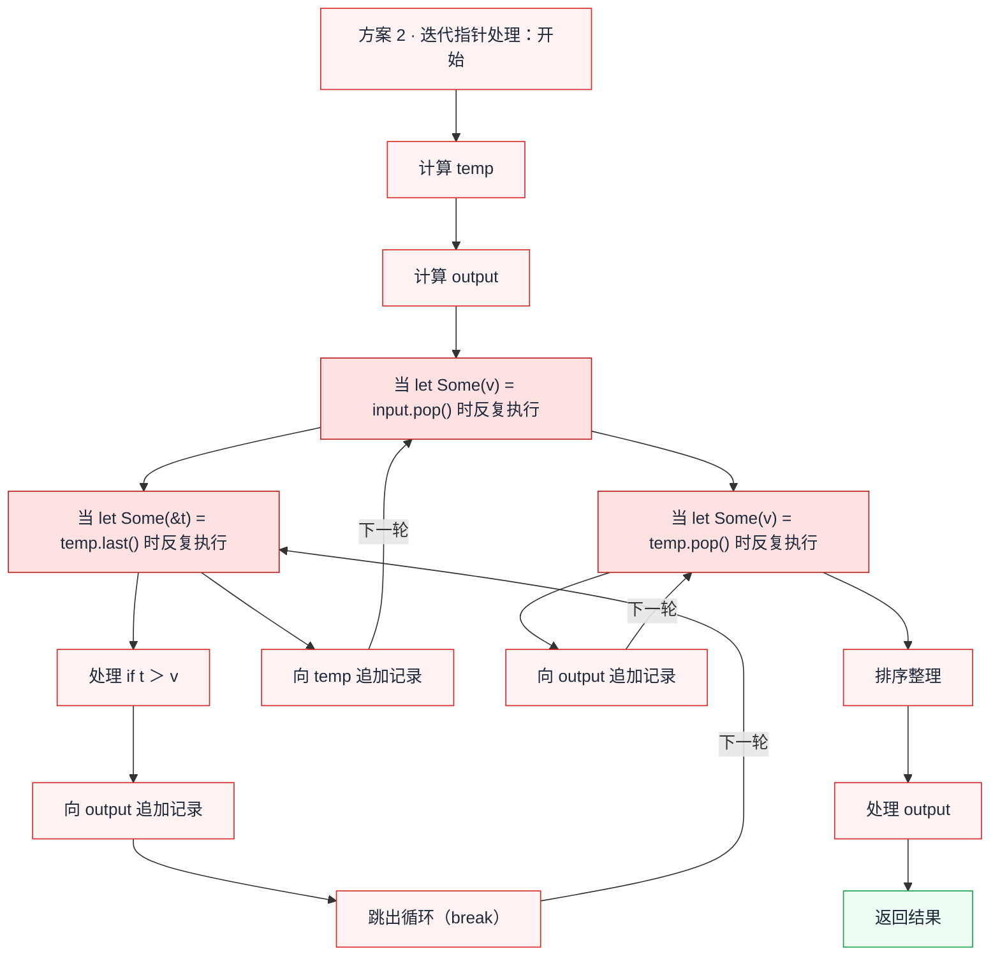

```rust
// LeetCode 面试题 03.05. 栈排序 — Rust 版（方案2）
fn sorted_stack(mut input: Vec<i32>) -> Vec<i32> {
    // 定义函数/方法 sorted_stack
    // 辅助栈法：temp 存降序，最终 output 升序
    let mut temp: Vec<i32> = Vec::new(); // 把 Vec::new(); 写入 let mut temp: Vec<i32>
    let mut output: Vec<i32> = Vec::new(); // 把 Vec::new(); 写入 let mut output: Vec<i32>
    while let Some(v) = input.pop() {
        // 边取边处理，取空即停
        while let Some(&t) = temp.last() {
            // 边取边处理，取空即停
            if t > v {
                output.push(temp.pop().unwrap());
            } else {
                break;
            } // 若 另一字符串 超过 值 { 输出 追加 临时变量 弹出 ).unwrap()); } else { break; }
        }
        temp.push(v); // 把 值 压入栈/数组尾部
    }
    while let Some(v) = temp.pop() {
        output.push(v);
    } // 边取边处理，取空即停
    output.sort(); // 排序
    output // 输出
}
fn main() {
    // 程序入口：跑内嵌自测用例
    let got = sorted_stack(vec![5, 2, 1, 4, 3]); // 把 sorted_stack(vec取反 [5, 2, 1, 4, 3]) 存入 got
    assert_eq!(got, vec![1, 2, 3, 4, 5]); // 断言校验
    println!("PASS");
} // 全部用例通过，输出 PASS
```

### Lua 实现（2 种方案）

Lua 的全部方案如下，每个方案都内嵌用例自测，可独立运行（老仓库 python/go 文件遵循「打印结果」约定）：

#### 方案 1：直接实现

**思路与代码分析**：核心是「直接实现」。Lua 版用表与 ipairs 遍历，注意 ipairs 遇 nil 即停的语义。代码里依次做这些事：先排序再处理。**走读**：方案 1 · 直接实现：开始 → 更新 output → 遍历 ipairs(input) do 中的每个元素 v → 更新 1] → 当 #stk ＞ 0 do 时反复执行 → 更新 v → 当 #temp ＞ 0 and temp[#temp] ＞ v do 时反复执行 → 更新 1] → 更新 1] → 当 #temp ＞ 0 do 时反复执行 → 更新 1] → 排序整理 → 返回 output。

**运行架构**（真实控制流）：

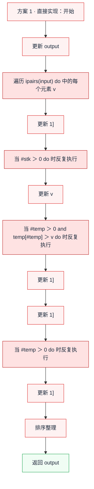

```lua
-- LeetCode 面试题 03.05. 栈排序 — Lua 版（方案1）
local function sorted_stack(input) -- local function sorted_stack(input)
	local stk, temp, output = {}, {}, {} -- 把 {}, {}, {} 写入 local stk, temp, output
	for _, v in ipairs(input) do
		stk[#stk + 1] = v
	end -- 遍历取 值
	while #stk > 0 do -- while #栈 超过 0 do
		local v = table.remove(stk) -- 把 table 弹出 栈) 写入 local v
		while #temp > 0 and temp[#temp] > v do -- while #临时变量 超过 0 and 临时变量[#临时变量] 超过 值 do
			output[#output + 1] = table.remove(temp) -- 把 table 弹出 临时变量) 写入 output[#output + 1]
		end -- 终点
		temp[#temp + 1] = v -- 把 值 写入 temp[#temp + 1]
	end -- 终点
	while #temp > 0 do
		output[#output + 1] = table.remove(temp)
	end
	table.sort(output) -- 排序
	return output -- 返回 输出
end -- 终点
assert(table.concat(sorted_stack({ 5, 2, 1, 4, 3 }), ",") == "1,2,3,4,5") -- 打印输出
print("PASS") -- 全部用例通过，输出 PASS
```

#### 方案 2：迭代指针处理

**思路与代码分析**：核心是「迭代指针处理」。Lua 版用表与 ipairs 遍历，注意 ipairs 遇 nil 即停的语义。代码里依次做这些事：先排序再处理。**走读**：方案 2 · 迭代指针处理：开始 → 更新 output → 遍历 ipairs(input) do 中的每个元素 v → 更新 1] → 当 #stk ＞ 0 do 时反复执行 → 更新 v → 当 #temp ＞ 0 and temp[#temp] ＞ v do 时反复执行 → 更新 1] → 更新 1] → 当 #temp ＞ 0 do 时反复执行 → 更新 1] → 排序整理 → 返回 output。

**运行架构**（真实控制流）：

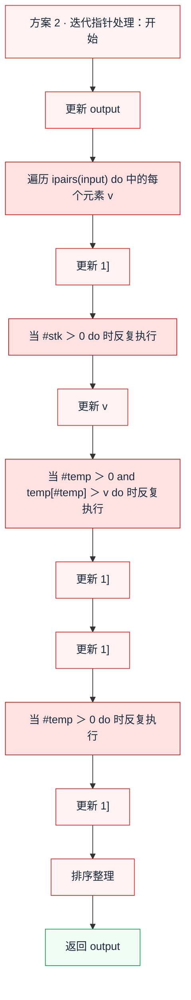

```lua
-- LeetCode 面试题 03.05. 栈排序 — Lua 版（方案2）
local function sorted_stack(input) -- local function sorted_stack(input)
	local stk, temp, output = {}, {}, {} -- 把 {}, {}, {} 写入 local stk, temp, output
	for _, v in ipairs(input) do
		stk[#stk + 1] = v
	end -- 遍历取 值
	while #stk > 0 do -- while #栈 超过 0 do
		local v = table.remove(stk) -- 把 table 弹出 栈) 写入 local v
		while #temp > 0 and temp[#temp] > v do -- while #临时变量 超过 0 and 临时变量[#临时变量] 超过 值 do
			output[#output + 1] = table.remove(temp) -- 把 table 弹出 临时变量) 写入 output[#output + 1]
		end -- 终点
		temp[#temp + 1] = v -- 把 值 写入 temp[#temp + 1]
	end -- 终点
	while #temp > 0 do
		output[#output + 1] = table.remove(temp)
	end
	table.sort(output) -- 排序
	return output -- 返回 输出
end -- 终点
assert(table.concat(sorted_stack({ 5, 2, 1, 4, 3 }), ",") == "1,2,3,4,5") -- 打印输出
print("PASS") -- 全部用例通过，输出 PASS
```

### C 实现（2 种方案）

C 的全部方案如下，每个方案都内嵌用例自测，可独立运行（老仓库 python/go 文件遵循「打印结果」约定）：

#### 方案 1：直接实现

**思路与代码分析**：核心是「直接实现」。C 版手动管理下标与内存，循环边界全部显式写出。代码里依次做这些事：双重循环遍历。**走读**：方案 1 · 直接实现：开始 → 更新 sn → 遍历循环 → 当 (sn ＞ 0) 时反复执行 → 当 (tn ＞ 0 且 temp[tn - 1] ＞ v) 时反复执行 → 当 (tn ＞ 0) 时反复执行 → 遍历循环 → 遍历循环 → 返回 on。

**运行架构**（真实控制流）：

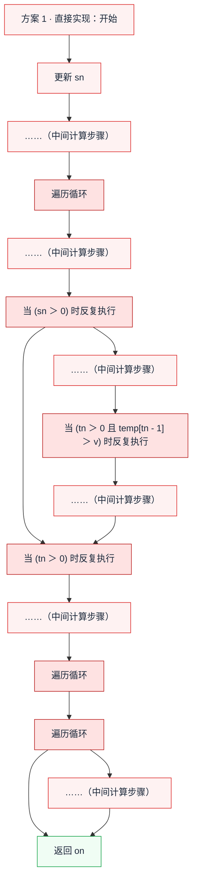

```c
/* LeetCode 面试题 03.05. 栈排序 — C 版（方案1） */
#include <stdio.h>                                            // 引入头文件
static int sorted_stack(const int *input, int n, int out[]) { // 定义函数/方法 sorted_stack
    int stk[4096], sn = 0;                                    // 把 0; 写入 int stk[4096], sn
    int temp[4096], tn = 0;                                   // 把 0; 写入 int temp[4096], tn
    for (int i = 0; i < n; i++)
        stk[sn++] = input[i]; // 让 下标 i 从 0 开始计数，下标 i 小于 元素个数 就继续
    int on = 0;               // 把 0 存入 on
    while (sn > 0) {          // 循环，直到不满足「sn 超过 0」
        int v = stk[--sn];    // 把 栈[ 减一 sn] 存入 值
        while (tn > 0 && temp[tn - 1] > v)
            out[on++] = temp[--tn];
        temp[tn++] = v; // 把 值; 写入 temp[tn++]
    }
    while (tn > 0)
        out[on++] = temp[--tn]; // 循环，直到不满足「tn 超过 0) out[on 加一 ] 赋值为 临时变量[ 减一 tn];」
    /* 升序排 */
    for (int i = 0; i < on; i++)
        for (int j = i + 1; j < on; j++) { // 让 下标 i 从 0 开始计数，下标 i 小于 on 就继续
            if (out[i] > out[j]) {
                int t = out[i];
                out[i] = out[j];
                out[j] = t;
            }
        }
    return on; // 返回 on
}
int main(void) { // 程序入口：跑内嵌自测用例
    int out[4096], n = sorted_stack((int[]){5, 2, 1, 4, 3}, 5, out);
    if (n != 5 || !(out[0] == 1 && out[1] == 2 && out[2] == 3 && out[3] == 4 && out[4] == 5)) {
        printf("FAIL\n");
        return 1;
    }
    printf("PASS\n");
    return 0;
} // 全部用例通过，输出 PASS
```

#### 方案 2：迭代指针处理

**思路与代码分析**：核心是「迭代指针处理」。C 版手动管理下标与内存，循环边界全部显式写出。代码里依次做这些事：双重循环遍历。**走读**：方案 2 · 迭代指针处理：开始 → 更新 sn → 遍历循环 → 当 (sn ＞ 0) 时反复执行 → 当 (tn ＞ 0 且 temp[tn - 1] ＞ v) 时反复执行 → 当 (tn ＞ 0) 时反复执行 → 遍历循环 → 遍历循环 → 返回 on。

**运行架构**（真实控制流）：

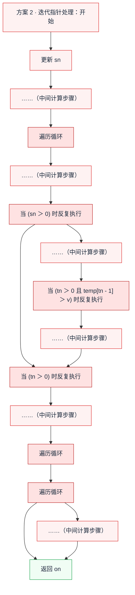

```c
/* LeetCode 面试题 03.05. 栈排序 — C 版（方案2） */
#include <stdio.h>                                            // 引入头文件
static int sorted_stack(const int *input, int n, int out[]) { // 定义函数/方法 sorted_stack
    int stk[4096], sn = 0;                                    // 把 0; 写入 int stk[4096], sn
    int temp[4096], tn = 0;                                   // 把 0; 写入 int temp[4096], tn
    for (int i = 0; i < n; i++)
        stk[sn++] = input[i]; // 让 下标 i 从 0 开始计数，下标 i 小于 元素个数 就继续
    int on = 0;               // 把 0 存入 on
    while (sn > 0) {          // 循环，直到不满足「sn 超过 0」
        int v = stk[--sn];    // 把 栈[ 减一 sn] 存入 值
        while (tn > 0 && temp[tn - 1] > v)
            out[on++] = temp[--tn];
        temp[tn++] = v; // 把 值; 写入 temp[tn++]
    }
    while (tn > 0)
        out[on++] = temp[--tn]; // 循环，直到不满足「tn 超过 0) out[on 加一 ] 赋值为 临时变量[ 减一 tn];」
    /* 升序排 */
    for (int i = 0; i < on; i++)
        for (int j = i + 1; j < on; j++) { // 让 下标 i 从 0 开始计数，下标 i 小于 on 就继续
            if (out[i] > out[j]) {
                int t = out[i];
                out[i] = out[j];
                out[j] = t;
            }
        }
    return on; // 返回 on
}
int main(void) { // 程序入口：跑内嵌自测用例
    int out[4096], n = sorted_stack((int[]){5, 2, 1, 4, 3}, 5, out);
    if (n != 5 || !(out[0] == 1 && out[1] == 2 && out[2] == 3 && out[3] == 4 && out[4] == 5)) {
        printf("FAIL\n");
        return 1;
    }
    printf("PASS\n");
    return 0;
} // 全部用例通过，输出 PASS
```

### C++ 实现（2 种方案）

C++ 的全部方案如下，每个方案都内嵌用例自测，可独立运行（老仓库 python/go 文件遵循「打印结果」约定）：

#### 方案 1：直接实现

**思路与代码分析**：核心是「直接实现」。C++ 版用 STL 容器与迭代器，减少手写下标错误。代码里依次做这些事：单循环线性扫描；栈的后进先出操作。**走读**：方案 1 · 直接实现：开始 → 处理 std::stack＜int＞ stk, temp → 遍历循环 → 当 (非 stk.empty()) 时反复执行 → 当 (非 temp.empty() 且 时反复执行 → 当 (非 temp.empty()) 时反复执行 → 返回 output。

**运行架构**（真实控制流）：

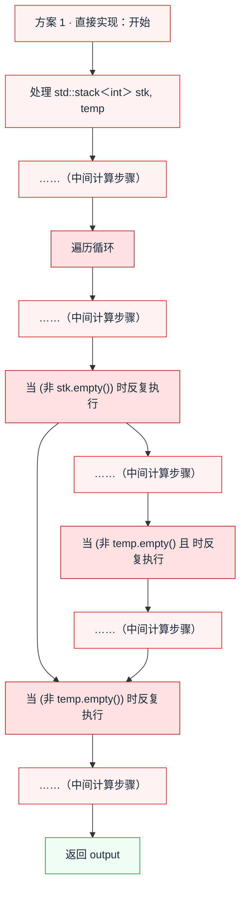

```cpp
// LeetCode 面试题 03.05. 栈排序 — C++ 版（方案1）
#include <algorithm> // 引入头文件
#include <cassert>   // 引入头文件
#include <iostream>  // 引入头文件
#include <stack>     // 引入头文件
#include <vector>    // 引入头文件
static std::vector<int> sortedStack(const std::vector<int> &input) {
    std::stack<int> stk, temp; // std::栈 小于 int 超过 栈, 临时变量;
    std::vector<int> output;   // std::vector 小于 int 超过 输出;
    for (int v : input)
        stk.push(v);       // 把 值 压入栈/数组尾部
    while (!stk.empty()) { // 循环，直到不满足「取反 栈.empty(」
        int v = stk.top(); // 把 栈.top() 存入 值
        stk.pop();         // 弹出栈顶元素
        while (!temp.empty() &&
               temp.top() > v) { // 循环，直到不满足「取反 临时变量 是否为空 且 临时变量.top() 超过 值」
            output.push_back(temp.top()); // 输出 追加 临时变量.top());
            temp.pop();                   // 弹出栈顶元素
        }
        temp.push(v); // 把 值 压入栈/数组尾部
    }
    while (!temp.empty()) {           // 循环，直到不满足「取反 临时变量.empty(」
        output.push_back(temp.top()); // 输出 追加 临时变量.top());
        temp.pop();                   // 弹出栈顶元素
    }
    std::sort(output.begin(), output.end()); // std::sort(输出 迭代位置 , 输出.终点());
    return output;                           // 返回 输出
}
int main() {
    assert((sortedStack({5, 2, 1, 4, 3}) == std::vector<int>{1, 2, 3, 4, 5}));
    std::cout << "PASS" << std::endl;
} // 全部用例通过，输出 PASS
```

#### 方案 2：迭代指针处理

**思路与代码分析**：核心是「迭代指针处理」。C++ 版用 STL 容器与迭代器，减少手写下标错误。代码里依次做这些事：单循环线性扫描；栈的后进先出操作。**走读**：方案 2 · 迭代指针处理：开始 → 处理 std::stack＜int＞ stk, temp → 遍历循环 → 当 (非 stk.empty()) 时反复执行 → 当 (非 temp.empty() 且 时反复执行 → 当 (非 temp.empty()) 时反复执行 → 返回 output。

**运行架构**（真实控制流）：

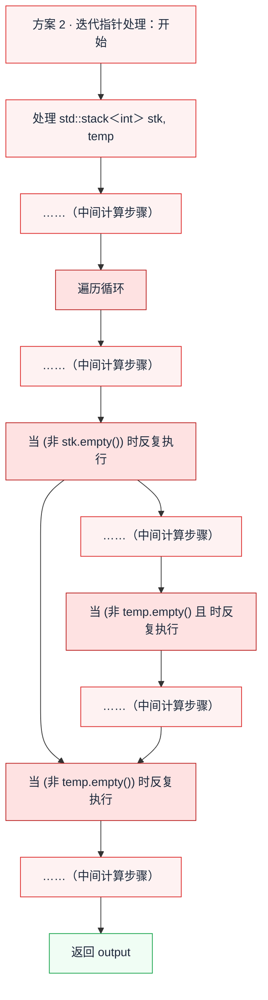

```cpp
// LeetCode 面试题 03.05. 栈排序 — C++ 版（方案2）
#include <algorithm> // 引入头文件
#include <cassert>   // 引入头文件
#include <iostream>  // 引入头文件
#include <stack>     // 引入头文件
#include <vector>    // 引入头文件
static std::vector<int> sortedStack(const std::vector<int> &input) {
    std::stack<int> stk, temp; // std::栈 小于 int 超过 栈, 临时变量;
    std::vector<int> output;   // std::vector 小于 int 超过 输出;
    for (int v : input)
        stk.push(v);       // 把 值 压入栈/数组尾部
    while (!stk.empty()) { // 循环，直到不满足「取反 栈.empty(」
        int v = stk.top(); // 把 栈.top() 存入 值
        stk.pop();         // 弹出栈顶元素
        while (!temp.empty() &&
               temp.top() > v) { // 循环，直到不满足「取反 临时变量 是否为空 且 临时变量.top() 超过 值」
            output.push_back(temp.top()); // 输出 追加 临时变量.top());
            temp.pop();                   // 弹出栈顶元素
        }
        temp.push(v); // 把 值 压入栈/数组尾部
    }
    while (!temp.empty()) {           // 循环，直到不满足「取反 临时变量.empty(」
        output.push_back(temp.top()); // 输出 追加 临时变量.top());
        temp.pop();                   // 弹出栈顶元素
    }
    std::sort(output.begin(), output.end()); // std::sort(输出 迭代位置 , 输出.终点());
    return output;                           // 返回 输出
}
int main() {
    assert((sortedStack({5, 2, 1, 4, 3}) == std::vector<int>{1, 2, 3, 4, 5}));
    std::cout << "PASS" << std::endl;
} // 全部用例通过，输出 PASS
```

### R 实现（2 种方案）

R 的全部方案如下，每个方案都内嵌用例自测，可独立运行（老仓库 python/go 文件遵循「打印结果」约定）：

#### 方案 1：直接实现

**思路与代码分析**：核心是「直接实现」。R 版用向量化思维与 1 起始下标，注意 1:n 的降序陷阱。**走读**：方案 1 · 直接实现：开始 → 处理 stk ＜- input → 处理 temp ＜- integer(0) → 处理 output ＜- integer(0) → 当 (length(stk) ＞ 0) 时反复执行 → 处理 v ＜- stk[length(stk)] → 处理 stk ＜- stk[-length(stk)] → 当 (length(temp) ＞ 0 且 temp[length(temp)] ＞ v) 时反复执行 → 处理 output ＜- c(output, temp[len → 处理 temp ＜- temp[-length(temp)] → 处理 temp ＜- c(temp, v) → 当 (length(temp) ＞ 0) 时反复执行 → 处理 output ＜- c(output, temp[len → 处理 temp ＜- temp[-length(temp)] → 调用 sort(output) → 返回结果。

**运行架构**（真实控制流）：

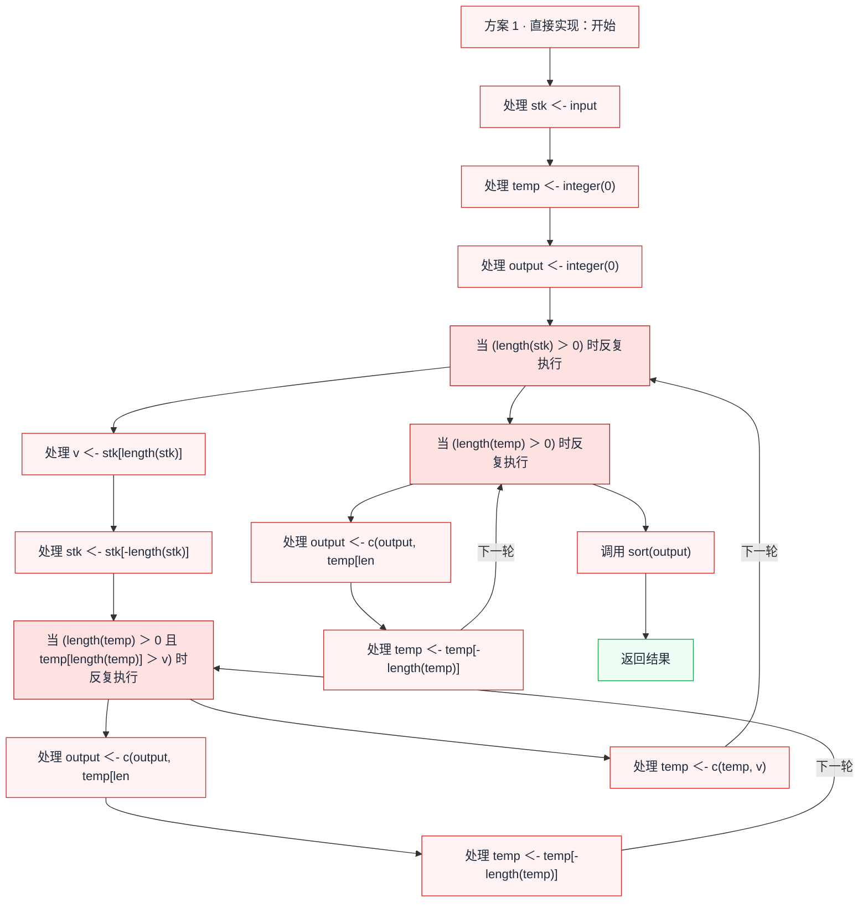

```r
# 版（方案1） 定义函数 sorted_stack（参数：input）
sorted_stack <- function(input) {
    stk <- input  # 把 input 存入 栈
    temp <- integer(0)  # 把 integer(0) 存入 临时变量
    output <- integer(0)  # 把 integer(0) 存入 输出
    while (length(stk) > 0) {
        # 循环，直到不满足「长度(栈) 超过 0」
        v <- stk[length(stk)]  # 把 栈[长度(栈)] 存入 值
        stk <- stk[-length(stk)]  # 把 栈[ 减 长度(栈)] 存入 栈
        while (length(temp) > 0 && temp[length(temp)] > v) {
            # 循环，直到不满足「长度(临时变量) 超过 0 且 临时变量[长度(临时变量)] 超过 值」
            output <- c(output, temp[length(temp)])  # 把 字符(输出, 临时变量[长度(临时变量)]) 存入 输出
            temp <- temp[-length(temp)]  # 把 临时变量[ 减 长度(临时变量)] 存入 临时变量
        }
        temp <- c(temp, v)  # 把 字符(临时变量, 值) 存入 临时变量
    }
    while (length(temp) > 0) {
        # 循环，直到不满足「长度(临时变量) 超过 0」
        output <- c(output, temp[length(temp)])  # 把 字符(输出, 临时变量[长度(临时变量)]) 存入 输出
        temp <- temp[-length(temp)]  # 把 临时变量[ 减 长度(临时变量)] 存入 临时变量
    }
    sort(output)  # sort(输出)
}
stopifnot(identical(as.integer(sorted_stack(c(5, 2, 1, 4, 3))), 1:5))  # 断言校验
cat("PASS\n")  # 全部用例通过，输出 PASS
```

#### 方案 2：迭代指针处理

**思路与代码分析**：核心是「迭代指针处理」。R 版用向量化思维与 1 起始下标，注意 1:n 的降序陷阱。**走读**：方案 2 · 迭代指针处理：开始 → 处理 stk ＜- input → 处理 temp ＜- integer(0) → 处理 output ＜- integer(0) → 当 (length(stk) ＞ 0) 时反复执行 → 处理 v ＜- stk[length(stk)] → 处理 stk ＜- stk[-length(stk)] → 当 (length(temp) ＞ 0 且 temp[length(temp)] ＞ v) 时反复执行 → 处理 output ＜- c(output, temp[len → 处理 temp ＜- temp[-length(temp)] → 处理 temp ＜- c(temp, v) → 当 (length(temp) ＞ 0) 时反复执行 → 处理 output ＜- c(output, temp[len → 处理 temp ＜- temp[-length(temp)] → 调用 sort(output) → 返回结果。

**运行架构**（真实控制流）：

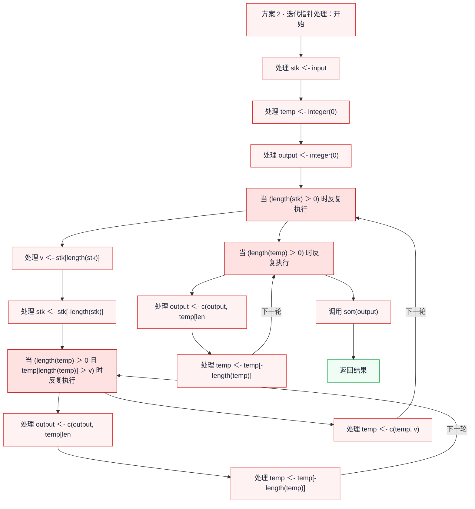

```r
# 版（方案2） 定义函数 sorted_stack（参数：input）
sorted_stack <- function(input) {
    stk <- input  # 把 input 存入 栈
    temp <- integer(0)  # 把 integer(0) 存入 临时变量
    output <- integer(0)  # 把 integer(0) 存入 输出
    while (length(stk) > 0) {
        # 循环，直到不满足「长度(栈) 超过 0」
        v <- stk[length(stk)]  # 把 栈[长度(栈)] 存入 值
        stk <- stk[-length(stk)]  # 把 栈[ 减 长度(栈)] 存入 栈
        while (length(temp) > 0 && temp[length(temp)] > v) {
            # 循环，直到不满足「长度(临时变量) 超过 0 且 临时变量[长度(临时变量)] 超过 值」
            output <- c(output, temp[length(temp)])  # 把 字符(输出, 临时变量[长度(临时变量)]) 存入 输出
            temp <- temp[-length(temp)]  # 把 临时变量[ 减 长度(临时变量)] 存入 临时变量
        }
        temp <- c(temp, v)  # 把 字符(临时变量, 值) 存入 临时变量
    }
    while (length(temp) > 0) {
        # 循环，直到不满足「长度(临时变量) 超过 0」
        output <- c(output, temp[length(temp)])  # 把 字符(输出, 临时变量[长度(临时变量)]) 存入 输出
        temp <- temp[-length(temp)]  # 把 临时变量[ 减 长度(临时变量)] 存入 临时变量
    }
    sort(output)  # sort(输出)
}
stopifnot(identical(as.integer(sorted_stack(c(5, 2, 1, 4, 3))), 1:5))  # 断言校验
cat("PASS\n")  # 全部用例通过，输出 PASS
```

### Zig 实现（2 种方案）

Zig 的全部方案如下，每个方案都内嵌用例自测，可独立运行（老仓库 python/go 文件遵循「打印结果」约定）：

#### 方案 1：直接实现

**思路与代码分析**：核心是「直接实现」。Zig 版显式分配与清零，整型边界处理严格。代码里依次做这些事：单循环线性扫描。**走读**：方案 1 · 直接实现：开始 → 计算 stk → 遍历集合元素 → 当 (sn ＞ 0) 时反复执行 → 当 (tn ＞ 0 and temp[tn - 1] ＞ v) 时反复执行 → 当 (tn ＞ 0) 时反复执行 → 返回结果。

**运行架构**（真实控制流）：

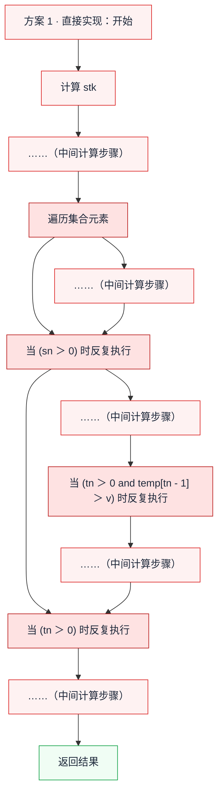

```zig
// LeetCode 面试题 03.05. 栈排序 — Zig 版（方案1）
const std = @import("std"); // 把 @import(「std」) 存入 std
fn sortedStack(input: []const i32, out: *std.ArrayList(i32)) void { // 定义函数/方法 sortedStack
    var stk: [4096]i32 = undefined; // 把 undefined; 写入 var stk: [4096]i32
    var sn: usize = 0; // 把 0; 写入 var sn: usize
    var temp: [4096]i32 = undefined; // 把 undefined; 写入 var temp: [4096]i32
    var tn: usize = 0; // 把 0; 写入 var tn: usize
    for (input) |v| { // 逐个取出 input 的元素（值）
        stk[sn] = v; // 把 值; 写入 stk[sn]
        sn += 1; // sn累加 1
    }
    while (sn > 0) { // 循环，直到不满足「sn 超过 0」
        sn -= 1; // sn累减 1
        const v = stk[sn]; // 把 栈[sn] 存入 值
        while (tn > 0 and temp[tn - 1] > v) { // 循环，直到不满足「tn 超过 0 and 临时变量[tn 减 1] 超过 值」
            tn -= 1; // tn累减 1
            out.append(temp[tn]) catch unreachable; // 把 临时变量[tn] 追加到列表尾部
        }
        temp[tn] = v; // 把 值; 写入 temp[tn]
        tn += 1; // tn累加 1
    }
    while (tn > 0) { // 循环，直到不满足「tn 超过 0」
        tn -= 1; // tn累减 1
        out.append(temp[tn]) catch unreachable; // 把 临时变量[tn] 追加到列表尾部
    }
    std.sort.pdq(i32, out.items, {}, std.sort.asc(i32)); // std.sort.pdq(i32, out.items, {}, std.sort.asc(i32));
}
pub fn main() !void { // 程序入口：跑内嵌自测用例
    var out = std.ArrayList(i32).init(std.heap.page_allocator); // 把 std.ArrayList(i32).init(std.堆.page_allocator) 存入 out
    defer out.deinit(); // defer out.deinit();
    sortedStack(&[_]i32{ 5, 2, 1, 4, 3 }, &out); // sortedStack( 按位与 [_]i32{ 5, 2, 1, 4, 3 }, 按位与 out);
    if (out.items.len != 5 or out.items[0] != 1 or out.items[4] != 5) return error.TestFailed;
    std.debug.print("PASS\n", .{});
} // 全部用例通过，输出 PASS
```

#### 方案 2：迭代指针处理

**思路与代码分析**：核心是「迭代指针处理」。Zig 版显式分配与清零，整型边界处理严格。代码里依次做这些事：单循环线性扫描。**走读**：方案 2 · 迭代指针处理：开始 → 计算 stk → 遍历集合元素 → 当 (sn ＞ 0) 时反复执行 → 当 (tn ＞ 0 and temp[tn - 1] ＞ v) 时反复执行 → 当 (tn ＞ 0) 时反复执行 → 返回结果。

**运行架构**（真实控制流）：

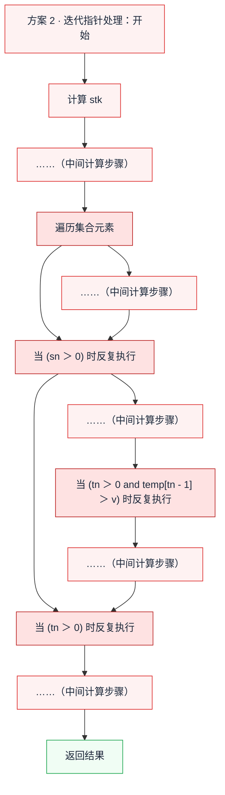

```zig
// LeetCode 面试题 03.05. 栈排序 — Zig 版（方案2）
const std = @import("std"); // 把 @import(「std」) 存入 std
fn sortedStack(input: []const i32, out: *std.ArrayList(i32)) void { // 定义函数/方法 sortedStack
    var stk: [4096]i32 = undefined; // 把 undefined; 写入 var stk: [4096]i32
    var sn: usize = 0; // 把 0; 写入 var sn: usize
    var temp: [4096]i32 = undefined; // 把 undefined; 写入 var temp: [4096]i32
    var tn: usize = 0; // 把 0; 写入 var tn: usize
    for (input) |v| { // 逐个取出 input 的元素（值）
        stk[sn] = v; // 把 值; 写入 stk[sn]
        sn += 1; // sn累加 1
    }
    while (sn > 0) { // 循环，直到不满足「sn 超过 0」
        sn -= 1; // sn累减 1
        const v = stk[sn]; // 把 栈[sn] 存入 值
        while (tn > 0 and temp[tn - 1] > v) { // 循环，直到不满足「tn 超过 0 and 临时变量[tn 减 1] 超过 值」
            tn -= 1; // tn累减 1
            out.append(temp[tn]) catch unreachable; // 把 临时变量[tn] 追加到列表尾部
        }
        temp[tn] = v; // 把 值; 写入 temp[tn]
        tn += 1; // tn累加 1
    }
    while (tn > 0) { // 循环，直到不满足「tn 超过 0」
        tn -= 1; // tn累减 1
        out.append(temp[tn]) catch unreachable; // 把 临时变量[tn] 追加到列表尾部
    }
    std.sort.pdq(i32, out.items, {}, std.sort.asc(i32)); // std.sort.pdq(i32, out.items, {}, std.sort.asc(i32));
}
pub fn main() !void { // 程序入口：跑内嵌自测用例
    var out = std.ArrayList(i32).init(std.heap.page_allocator); // 把 std.ArrayList(i32).init(std.堆.page_allocator) 存入 out
    defer out.deinit(); // defer out.deinit();
    sortedStack(&[_]i32{ 5, 2, 1, 4, 3 }, &out); // sortedStack( 按位与 [_]i32{ 5, 2, 1, 4, 3 }, 按位与 out);
    if (out.items.len != 5 or out.items[0] != 1 or out.items[4] != 5) return error.TestFailed;
    std.debug.print("PASS\n", .{});
} // 全部用例通过，输出 PASS
```

### Dart 实现（2 种方案）

Dart 的全部方案如下，每个方案都内嵌用例自测，可独立运行（老仓库 python/go 文件遵循「打印结果」约定）：

#### 方案 1：直接实现

**思路与代码分析**：核心是「直接实现」。Dart 版用可空类型标注与集合方法，注意空安全。代码里依次做这些事：先排序再处理。**走读**：方案 1 · 直接实现：开始 → 更新 stk → 更新 temp → 更新 output → 当 (stk.isNotEmpty) 时反复执行 → 更新 v → 当 (temp.isNotEmpty 且 temp.last ＞ v) 时反复执行 → 调用 output.add(temp.removeLast() → 调用 temp.add(v) → 当 (temp.isNotEmpty) 时反复执行 → 调用 output.add(temp.removeLast() → 排序整理 → 返回 output。

**运行架构**（真实控制流）：

```mermaid
graph TD
    N0["方案 1 · 直接实现：开始"]
    N1["更新 stk"]
    N2["更新 temp"]
    N3["更新 output"]
    N4["当 (stk.isNotEmpty) 时反复执行"]
    N5["更新 v"]
    N6["当 (temp.isNotEmpty 且 temp.last ＞ v) 时反复执行"]
    N7["调用 output.add(temp.removeLast()"]
    N8["调用 temp.add(v)"]
    N9["当 (temp.isNotEmpty) 时反复执行"]
    N10["调用 output.add(temp.removeLast()"]
    N11["排序整理"]
    N12["返回 output"]
    N0 --> N1
    N1 --> N2
    N2 --> N3
    N3 --> N4
    N4 --> N5
    N5 --> N6
    N6 --> N7
    N7 -- 下一轮 --> N6
    N6 --> N8
    N8 -- 下一轮 --> N4
    N4 --> N9
    N9 --> N10
    N10 -- 下一轮 --> N9
    N9 --> N11
    N11 --> N12
    classDef n fill:#fef2f2,stroke:#dc2626,color:#1e293b;
    classDef lp fill:#fee2e2,stroke:#b91c1c,color:#1e293b;
    classDef dc fill:#fef9c3,stroke:#ca8a04,color:#1e293b;
    classDef tm fill:#f0fdf4,stroke:#16a34a,color:#1e293b;
    class N0,N1,N2,N3,N5,N7,N8,N10,N11 n;
    class N4,N6,N9 lp;
    class N12 tm;
```

```dart
// LeetCode 面试题 03.05. 栈排序 — Dart 版（方案1）
List<int> sortedStack(List<int> input) {
  // 定义函数/方法 sortedStack
  final stk = List<int>.from(input); // 把 List 小于 int 超过 .from(input) 存入 栈
  final temp = <int>[]; // 把 小于 int 超过 [] 存入 临时变量
  final output = <int>[]; // 把 小于 int 超过 [] 存入 输出
  while (stk.isNotEmpty) {
    // 循环，直到不满足「栈.isNotEmpty」
    final v = stk.removeLast(); // 把 栈.removeLast() 存入 值
    while (temp.isNotEmpty && temp.last > v) {
      // 循环，直到不满足「临时变量.isNotEmpty 且 临时变量.last 超过 值」
      output.add(temp.removeLast()); // 输出 追加 临时变量.removeLast());
    }
    temp.add(v); // 临时变量 追加 值);
  }
  while (temp.isNotEmpty) {
    // 循环，直到不满足「临时变量.isNotEmpty」
    output.add(temp.removeLast()); // 输出 追加 临时变量.removeLast());
  }
  output.sort(); // 排序
  return output; // 返回 输出
}

void main() {
  if (sortedStack([5, 2, 1, 4, 3]).toString() != '[1, 2, 3, 4, 5]')
    throw StateError('c1');
  print('PASS');
} // 全部用例通过，输出 PASS
```

#### 方案 2：迭代指针处理

**思路与代码分析**：核心是「迭代指针处理」。Dart 版用可空类型标注与集合方法，注意空安全。代码里依次做这些事：先排序再处理。**走读**：方案 2 · 迭代指针处理：开始 → 更新 stk → 更新 temp → 更新 output → 当 (stk.isNotEmpty) 时反复执行 → 更新 v → 当 (temp.isNotEmpty 且 temp.last ＞ v) 时反复执行 → 调用 output.add(temp.removeLast() → 调用 temp.add(v) → 当 (temp.isNotEmpty) 时反复执行 → 调用 output.add(temp.removeLast() → 排序整理 → 返回 output。

**运行架构**（真实控制流）：

```mermaid
graph TD
    N0["方案 2 · 迭代指针处理：开始"]
    N1["更新 stk"]
    N2["更新 temp"]
    N3["更新 output"]
    N4["当 (stk.isNotEmpty) 时反复执行"]
    N5["更新 v"]
    N6["当 (temp.isNotEmpty 且 temp.last ＞ v) 时反复执行"]
    N7["调用 output.add(temp.removeLast()"]
    N8["调用 temp.add(v)"]
    N9["当 (temp.isNotEmpty) 时反复执行"]
    N10["调用 output.add(temp.removeLast()"]
    N11["排序整理"]
    N12["返回 output"]
    N0 --> N1
    N1 --> N2
    N2 --> N3
    N3 --> N4
    N4 --> N5
    N5 --> N6
    N6 --> N7
    N7 -- 下一轮 --> N6
    N6 --> N8
    N8 -- 下一轮 --> N4
    N4 --> N9
    N9 --> N10
    N10 -- 下一轮 --> N9
    N9 --> N11
    N11 --> N12
    classDef n fill:#fef2f2,stroke:#dc2626,color:#1e293b;
    classDef lp fill:#fee2e2,stroke:#b91c1c,color:#1e293b;
    classDef dc fill:#fef9c3,stroke:#ca8a04,color:#1e293b;
    classDef tm fill:#f0fdf4,stroke:#16a34a,color:#1e293b;
    class N0,N1,N2,N3,N5,N7,N8,N10,N11 n;
    class N4,N6,N9 lp;
    class N12 tm;
```

```dart
// LeetCode 面试题 03.05. 栈排序 — Dart 版（方案2）
List<int> sortedStack(List<int> input) {
  // 定义函数/方法 sortedStack
  final stk = List<int>.from(input); // 把 List 小于 int 超过 .from(input) 存入 栈
  final temp = <int>[]; // 把 小于 int 超过 [] 存入 临时变量
  final output = <int>[]; // 把 小于 int 超过 [] 存入 输出
  while (stk.isNotEmpty) {
    // 循环，直到不满足「栈.isNotEmpty」
    final v = stk.removeLast(); // 把 栈.removeLast() 存入 值
    while (temp.isNotEmpty && temp.last > v) {
      // 循环，直到不满足「临时变量.isNotEmpty 且 临时变量.last 超过 值」
      output.add(temp.removeLast()); // 输出 追加 临时变量.removeLast());
    }
    temp.add(v); // 临时变量 追加 值);
  }
  while (temp.isNotEmpty) {
    // 循环，直到不满足「临时变量.isNotEmpty」
    output.add(temp.removeLast()); // 输出 追加 临时变量.removeLast());
  }
  output.sort(); // 排序
  return output; // 返回 输出
}

void main() {
  if (sortedStack([5, 2, 1, 4, 3]).toString() != '[1, 2, 3, 4, 5]')
    throw StateError('c1');
  print('PASS');
} // 全部用例通过，输出 PASS
```

---

## 内容总结

- **05 栈排序**（栈 · Medium）：共 2 个方案，主线思路「直接实现」；时间 O(n) 量级；动画演示栈后进先出过程，附录给出 11 种语言 × 全部方案的可运行实现。
- 来源博客：[https://blog.csdn.net/tyro_java/article/details/145397311](https://blog.csdn.net/tyro_java/article/details/145397311)
- 导航：[📋 总目录](../) ｜ [← 008 最近的请求次数](../008_最近的请求次数/) ｜ [010 删除字符串中的所有相邻重复项 →](../010_删除字符串中的所有相邻重复项/)
