# 010 · 删除字符串中的所有相邻重复项（第一阶段 · 线性结构入门 · Medium）

> **难度**：⭐⭐ Medium ｜ **专题**：栈
> **学习定位**：第一阶段 · 线性结构入门第 10 篇 ｜ **解法数**：2
> **内容总结**：**删除字符串中的所有相邻重复项**（栈 · Medium）：共 2 个方案，主线思路「栈」；时间 O(n)（单趟线性扫描）；动画演示栈后进先出过程，附录给出 11 种语言 × 全部方案的可运行实现。

---

## 题目描述

给出由小写字母组成的字符串 `s`，重复项删除操作 会选择两个相邻且相同的字母，并删除它们。

在 `s` 上反复执行重复项删除操作，直到无法继续删除。

在完成所有重复项删除操作后返回最终的字符串。答案保证唯一。

- 主函数签名：`function removeDuplicates(s: string): string`

**用例（来自原题）**：

**示例 1**

```text
输入："abbaca"
输出："ca"
```

解释：例如，在 「abbaca」 中，我们可以删除 「bb」 由于两字母相邻且相同，这是此时唯一可以执行删除操作的重复项。之后我们得到字符串 「aaca」，其中又只有 「aa」 可以执行重复项删除操作，所以最后的字符串为 「ca」。

**示例 2**

```text
输入：s = "azxxzy"
输出："ay"
```
> ✅ **官方验证**：全部 TypeScript 解法已通过 leetcode.cn 官方示例用例验证（自动注入运行，全部 PASS）。题面与 [leetcode.cn 官方](https://leetcode.cn/problems/remove-all-adjacent-duplicates-in-string/)一致，示例配图取自官方题面。

**数据范围与注意事项**：

- `1 <= s.length <= 10^5`
- `s` 仅由小写英文字母组成。
- **易错点**：出栈前判空；「下一个更大元素」类问题栈里存下标比存值好用。

## 题目分析

**场景是什么**：后进先出结构天然适合「最近匹配」，对应真实开发里的括号校验、浏览历史、函数调用栈。本题就是该场景的 Medium 级练习，主线做法是「栈」。

**主线怎么解**：把主解法从头到尾过一遍，它其实在依次做这几件事：单循环线性扫描 → 栈的后进先出操作。

## 解题思路

**方案对比**（共 2 个方案，由浅入深）：

| 方案 | 时间复杂度 | 空间复杂度 |
|---|---|---|
| 方案 1 · 栈 | O(n)（单趟线性扫描） | O(1) 到 O(n)（视辅助结构） |
| 方案 2 · 栈优化 | O(n)（单趟线性扫描） | O(1) 到 O(n)（视辅助结构） |

**由浅入深的路径**：栈 → 栈优化；每往右一步，都在补上一步的短板。

**方案间的取舍**：方案 1（栈）；方案 2（栈优化）。数据规模小、可读性优先时选靠前的方案；规模大、性能优先时选靠后的方案。

**怎么读这一篇**：

- 🐣 **新手路线**：把「题目描述」的示例 1 在纸上手推一遍 → 读方案 1（最直观的写法）与它的代码走读 → 按「运行方式」本地跑通看 PASS → 回头对比方案 2 之后的写法差在哪
- 🦅 **大佬路线**：直接锁定最优方案 1（栈，O(n)（单趟线性扫描））→ 跳读该方案代码与走读 → 用「逐步拆解与面试追问」补齐复杂度推导与边界追问

### 动态算法图（栈后进先出，GIF 自动循环）


动画演示栈专题里栈后进先出的典型过程；每个方案在「TypeScript 解题方案」一节还配了专属动画与专属流程图。

### 主解法流程图（真实控制流）

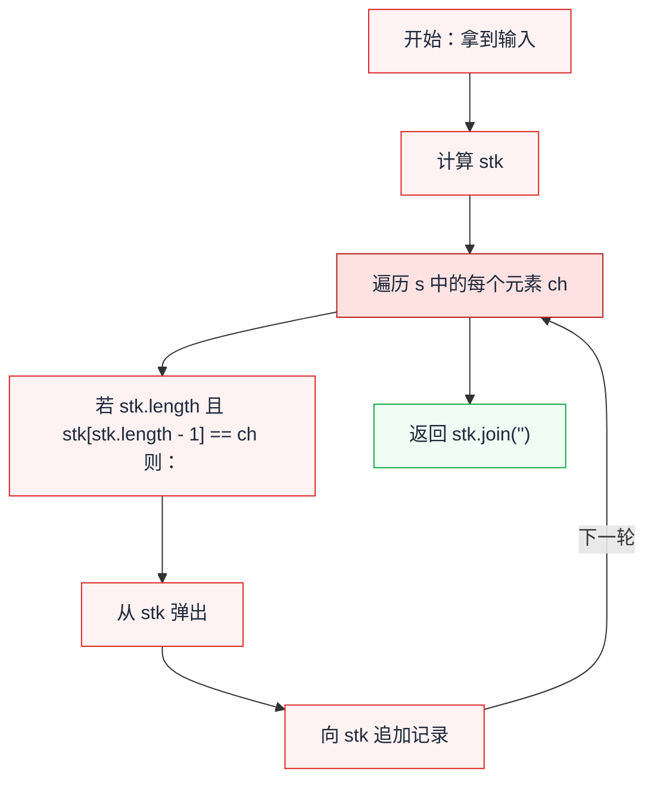

## TypeScript 解题方案（2 个方案逐个讲）

> **运行与提交**：每个方案都是自包含文件（内嵌用例自测，输出 PASS），整块复制到 `.ts` 文件后 `node 文件名` 即可运行。提交 LeetCode 时，把 `demo` 内的算法函数与辅助类型/函数整体取出、置于文件顶层即可。涉及交互/特殊接口的题以题面给定签名为准。

### 方案 1：栈

**分析与思路**：核心做法是「栈」。代码里依次做这些事：单循环线性扫描；栈的后进先出操作。

**运行方式**：`node 本文件`，内嵌用例全部通过会输出 PASS。

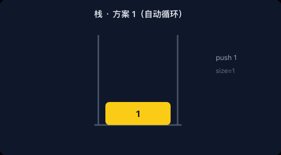

**方案专属流程图**（真实控制流）：

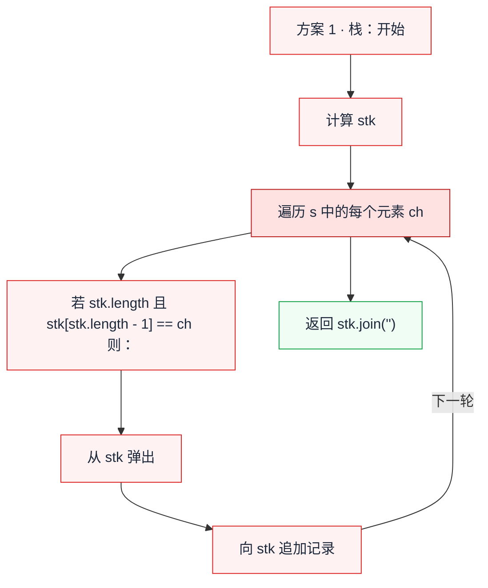

```typescript
/**
 ** LeetCode 1047. 删除字符串中的所有相邻重复项
 ** 方案：1 ) 方案1: 栈
 ** 来源：https://blog.csdn.net/tyro_java/article/details/145114201
 */

export function demo(): void {
  // 程序入口：跑内嵌自测用例
  // removeDuplicates 忠实翻译 python ref solution_1_1_____1___.py（栈消消乐）
  function removeDuplicates(s: string): string {
    // 定义函数/方法 removeDuplicates
    const stk: string[] = []; // 把 []; 写入 const stk: string[]
    for (const ch of s) {
      // for (const 字符 of 字符串) {
      if (stk.length && stk[stk.length - 1] === ch) {
        // 若 栈.长度 且 栈[栈.长度 减 1] 全等于 字符
        stk.pop(); // 弹出栈顶元素
      } else {
        // 否则
        stk.push(ch); // 把 字符 压入栈/数组尾部
      }
    }
    return stk.join(''); // 返回 栈.join('')
  }

  // want 由 python ref 实跑得到
  const cases: { in: string; want: string }[] = [
    { in: 'abbaca', want: 'ca' },
    { in: 'azxxzy', want: 'ay' },
    { in: 'abc', want: 'abc' },
    { in: '', want: '' },
    { in: 'aabb', want: '' },
    { in: 'aaaa', want: '' },
    { in: 'abba', want: '' },
  ];
  let fail = false; // 把 false 存入 fail
  for (const c of cases) {
    // for (const 字符 of cases) {
    const got = removeDuplicates(c.in); // 把 removeDuplicates(字符.in) 存入 got
    if (got !== c.want) {
      // 若 got 不等于 字符.want
      fail = true; // 把 true 存入 fail
      console.log(`FAIL solve("${c.in}")="${got}" want "${c.want}"`);
    }
  }
  if (fail) {
    // 若 fail
    throw new Error('FAILED'); // throw new Error(「FAILED」);
  }
  console.log('PASS'); // 全部用例通过，输出 PASS
}
demo(); // demo();
```

### 方案 2：栈优化

**分析与思路**：核心做法是「栈优化」。代码里依次做这些事：单循环线性扫描；栈的后进先出操作。

**运行方式**：`node 本文件`，内嵌用例全部通过会输出 PASS。

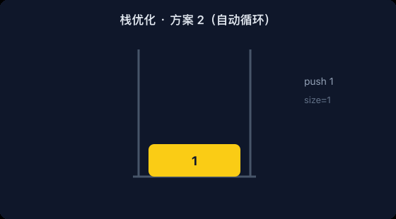

**方案专属流程图**（真实控制流）：

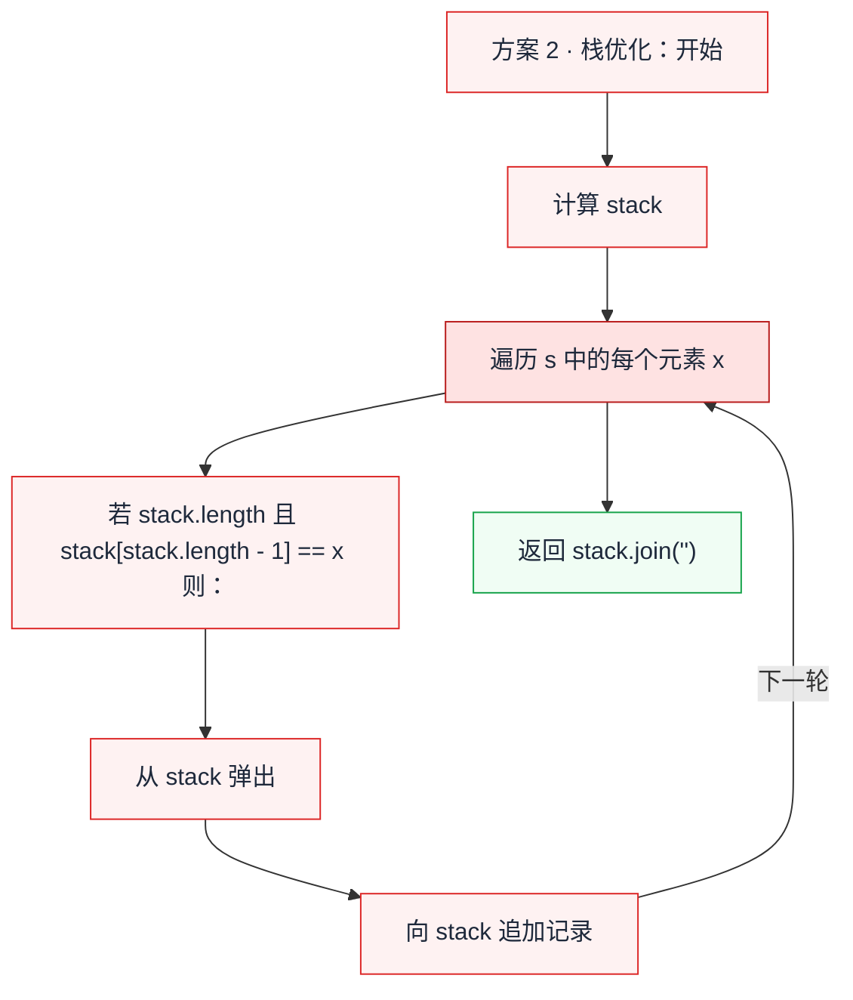

```typescript
/**
 ** LeetCode 1047. 删除字符串中的所有相邻重复项
 ** 方案：2 ) 方案2：栈优化
 ** 来源：https://blog.csdn.net/tyro_java/article/details/145114201
 */

export function demo(): void {
  // 程序入口：跑内嵌自测用例
  // removeDuplicates 忠实翻译 python ref solution_2_2_____2____.py（栈消消乐，continue 变体）
  function removeDuplicates(s: string): string {
    // 定义函数/方法 removeDuplicates
    const stack: string[] = []; // 把 []; 写入 const stack: string[]
    for (const x of s) {
      // for (const x of 字符串) {
      if (stack.length && stack[stack.length - 1] === x) {
        // 若 栈.长度 且 栈[栈.长度 减 1] 全等于 x
        stack.pop(); // 弹出栈顶元素
        continue; // 跳过本轮，进入下一次
      }
      stack.push(x); // 把 x 压入栈/数组尾部
    }
    return stack.join(''); // 返回 栈.join('')
  }

  // want 由 python ref 实跑得到
  const cases: { in: string; want: string }[] = [
    { in: 'abbaca', want: 'ca' },
    { in: 'azxxzy', want: 'ay' },
    { in: 'abc', want: 'abc' },
    { in: '', want: '' },
    { in: 'aabb', want: '' },
    { in: 'aaaa', want: '' },
    { in: 'abba', want: '' },
  ];
  let fail = false; // 把 false 存入 fail
  for (const c of cases) {
    // for (const 字符 of cases) {
    const got = removeDuplicates(c.in); // 把 removeDuplicates(字符.in) 存入 got
    if (got !== c.want) {
      // 若 got 不等于 字符.want
      fail = true; // 把 true 存入 fail
      console.log(`FAIL solve("${c.in}")="${got}" want "${c.want}"`);
    }
  }
  if (fail) {
    // 若 fail
    throw new Error('FAILED'); // throw new Error(「FAILED」);
  }
  console.log('PASS'); // 全部用例通过，输出 PASS
}
demo(); // demo();
```

## 逐步拆解与面试追问

**复杂度**：时间 O(n)（单趟线性扫描），空间 O(1) 到 O(n)（视辅助结构）

**为什么是这个量级**：每个元素被常数次访问，辅助哈希或栈的开销与 n 同阶

**面试官可能会追问**：

- 什么时候用单调栈（求下一个更大或更小）？
- 栈里存值还是存下标？
- 能否用 O(1) 额外空间？

## 关键 API 速查（TS 主解法实际用到，附官方链接）

| API | 作用 | 使用要点 | 官方文档 |
|---|---|---|---|
| `Array.prototype.push()` | 尾部追加 | 返回新长度；可一次多个；均摊 O(1)；会改变原数组 | [官方文档](https://developer.mozilla.org/zh-CN/docs/Web/JavaScript/Reference/Global_Objects/Array/push) |
| `Array.prototype.pop()` | 尾部弹出 | 返回被删元素（空数组返回 undefined）；O(1) | [官方文档](https://developer.mozilla.org/zh-CN/docs/Web/JavaScript/Reference/Global_Objects/Array/pop) |
| `Array.prototype.join()` | 数组拼接为字符串 | undefined/null 转空串；嵌套数组会展平一层；join('') 用于字符数组还原 | [官方文档](https://developer.mozilla.org/zh-CN/docs/Web/JavaScript/Reference/Global_Objects/Array/join) |

### 各语言官方文档导航

- **TypeScript / JS**：[MDN 中文参考](https://developer.mozilla.org/zh-CN/)
- **Python**：[Python 官方文档](https://docs.python.org/zh-cn/3/)
- **Go**：[Go 标准库](https://pkg.go.dev/std)
- **Java**：[JDK 17 API](https://docs.oracle.com/en/java/javase/17/docs/api/)
- **Rust**：[Rust 标准库](https://doc.rust-lang.org/std/)
- **Lua**：[Lua 5.4 手册](https://www.lua.org/manual/5.4/)
- **C**：[Cppreference C](https://zh.cppreference.com/w/c)
- **C++**：[Cppreference C++](https://zh.cppreference.com/w/cpp)
- **R**：[R 官方手册](https://stat.ethz.ch/R-manual/)
- **Zig**：[Zig 语言文档](https://ziglang.org/documentation/master/)
- **Dart**：[Dart API](https://api.dart.dev/)

## 附录：其他 10 种语言全部实现（每种语言列举其全部方案）

> TypeScript 的全部方案见「TypeScript 解题方案」一节；下面是其余 10 种语言的对应实现，每种语言的每个方案都带思路分析、代码走读与专属运行架构图。
> 每个方案都内嵌用例自测，可独立运行（老仓库 python/go 文件遵循「打印结果」约定）。
> 完整解法文件见 `dsa/<语言>/stack/lc_1047_删除字符串中的所有相邻重复项/`。

### Python 实现（2 种方案）

Python 的全部方案如下，每个方案都内嵌用例自测，可独立运行（老仓库 python/go 文件遵循「打印结果」约定）：

#### 方案 1：栈

**思路与代码分析**：核心是「栈」。Python 版用切片与字典推导式简化操作，突出可读性。**走读**：方案 1 · 栈：开始 → 更新 stk → 遍历 s: 中的每个元素 ch → 若 stk and stk[-1] == ch：从 stk 弹出 → 从 stk 弹出 → 向 stk 追加记录 → 返回 .join(stk)。

**运行架构**（真实控制流）：

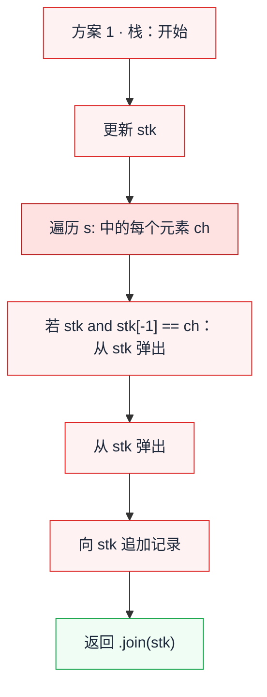

```python
import sys  # 提高递归深度上限（深输入防 RecursionError）

sys.setrecursionlimit(200000)  # 树/链表类题目节点数可达 1e4 量级

def removeDuplicates(s):  # 定义函数 removeDuplicates（参数：字符串）
    stk = []  # 把 [] 存入 栈
    for ch in s:  # 逐个取出 字符串 的元素（字符）
        if stk and stk[-1] == ch:  # 若 栈 and 栈[ 减 1] 等于 字符
            stk.pop()  # 弹出栈顶元素
        else:  # 否则
            stk.append(ch)  # 把 字符 追加到列表尾部
    return "".join(stk)  # 返回 「」.join(栈)

if __name__ == "__main__":  # 若 __name__ 等于 '__main__'
    print(removeDuplicates("abc"))  # 打印输出
```

#### 方案 2：栈优化

**思路与代码分析**：核心是「栈优化」。Python 版用切片与字典推导式简化操作，突出可读性。**走读**：方案 2 · 栈优化：开始 → 更新 stack → 遍历 s: 中的每个元素 x → 若 stack and stack[-1] == x：从 stack 弹出 → 从 stack 弹出 → 向 stack 追加记录 → 返回 .join(stack)。

**运行架构**（真实控制流）：

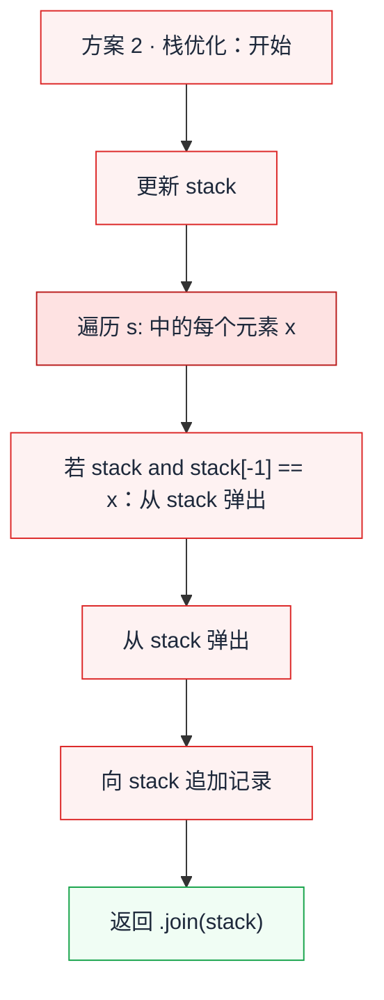

```python
import sys  # 提高递归深度上限（深输入防 RecursionError）

sys.setrecursionlimit(200000)  # 树/链表类题目节点数可达 1e4 量级

def removeDuplicates(s):  # 定义函数 removeDuplicates（参数：字符串）
    stack = []  # 把 [] 存入 栈
    for x in s:  # 逐个取出 字符串 的元素（x）
        if stack and stack[-1] == x:  # 若 栈 and 栈[ 减 1] 等于 x
            stack.pop()  # 弹出栈顶元素
            continue  # 跳过本轮，进入下一次
        stack.append(x)  # 把 x 追加到列表尾部
    return "".join(stack)  # 返回 「」.join(栈)

if __name__ == "__main__":  # 若 __name__ 等于 '__main__'
    print(removeDuplicates("abc"))  # 打印输出
```

### Go 实现（2 种方案）

Go 的全部方案如下，每个方案都内嵌用例自测，可独立运行（老仓库 python/go 文件遵循「打印结果」约定）：

#### 方案 1：栈

**思路与代码分析**：核心是「栈」。Go 版用切片与多返回值惯用法，显式处理索引边界。**走读**：方案 1 · 栈：开始 → 更新 : → 遍历 s 的下标与元素 ch → 处理 if len(stk) ＞ 0 且 stk[len(s → 更新 stk → 更新 stk → 返回 string(stk)。

**运行架构**（真实控制流）：

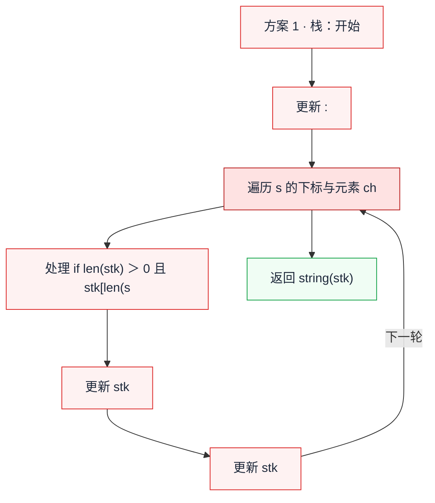

```go
package main // 引入依赖

import (
	"fmt"     // 「fmt」
	"reflect" // 「reflect」
)

func removeDuplicates(s string) string { // 定义函数/方法 removeDuplicates
	stk := []rune{}        // 把 []rune{} 写入 stk :
	for _, ch := range s { // 同时取 _ 与 字符 遍历
		if len(stk) > 0 && stk[len(stk)-1] == ch { // 若 长度(栈) 超过 0 且 栈[长度(栈) 减 1] 等于 字符
			stk = stk[:len(stk)-1] // 把 栈[:长度(栈) 减 1] 写入 栈
		} else { // 否则
			stk = append(stk, ch) // 把 append(栈, 字符) 写入 栈
		}
	}
	return string(stk) // 定义函数/方法 string
}

func main() { // 程序入口：跑内嵌自测用例
	want := "abc"                      // 把 「abc」 写入 want :
	got := removeDuplicates("abc")     // 把 removeDuplicates(「abc」) 写入 got :
	if !reflect.DeepEqual(got, want) { // 若 取反 reflect.DeepEqual(got, want
		fmt.Println("FAIL", got) // 打印输出
		return                   // return
	}
	fmt.Println("PASS") // 全部用例通过，输出 PASS
}
```

#### 方案 2：栈优化

**思路与代码分析**：核心是「栈优化」。Go 版用切片与多返回值惯用法，显式处理索引边界。**走读**：方案 2 · 栈优化：开始 → 更新 : → 遍历 s 的下标与元素 x → 处理 if len(stack) ＞ 0 且 stack[l → 更新 stack → 更新 stack → 返回 string(stack)。

**运行架构**（真实控制流）：

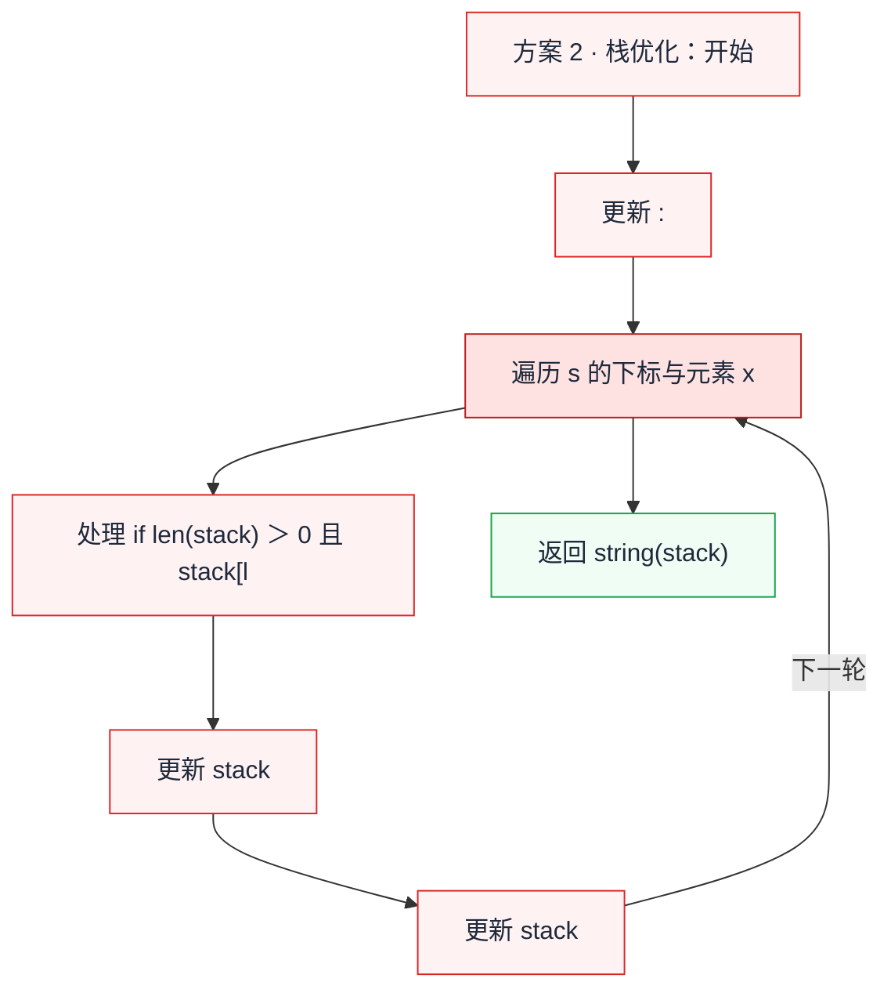

```go
package main // 引入依赖

import (
	"fmt"     // 「fmt」
	"reflect" // 「reflect」
)

func removeDuplicates(s string) string { // 定义函数/方法 removeDuplicates
	stack := []rune{}     // 把 []rune{} 写入 stack :
	for _, x := range s { // 同时取 _ 与 x 遍历
		if len(stack) > 0 && stack[len(stack)-1] == x { // 若 长度(栈) 超过 0 且 栈[长度(栈) 减 1] 等于 x
			stack = stack[:len(stack)-1] // 把 栈[:长度(栈) 减 1] 写入 栈
			continue                     // 跳过本轮，进入下一次
		}
		stack = append(stack, x) // 把 append(栈, x) 写入 栈
	}
	return string(stack) // 定义函数/方法 string
}

func main() { // 程序入口：跑内嵌自测用例
	want := "abc"                      // 把 「abc」 写入 want :
	got := removeDuplicates("abc")     // 把 removeDuplicates(「abc」) 写入 got :
	if !reflect.DeepEqual(got, want) { // 若 取反 reflect.DeepEqual(got, want
		fmt.Println("FAIL", got) // 打印输出
		return                   // return
	}
	fmt.Println("PASS") // 全部用例通过，输出 PASS
}
```

### Java 实现（2 种方案）

Java 的全部方案如下，每个方案都内嵌用例自测，可独立运行（老仓库 python/go 文件遵循「打印结果」约定）：

#### 方案 1：栈

**思路与代码分析**：核心是「栈」。Java 版用类与静态方法组织，集合操作显式明了。代码里依次做这些事：双重循环遍历；栈的后进先出操作。**走读**：方案 1 · 栈：开始 → 更新 stk → 遍历循环 → 若 非 stk.isEmpty() 且 stk.peek() == c：从 stk 弹出 → 从 stk 弹出 → 更新 sb → 遍历循环 → 返回 sb.reverse().toString()。

**运行架构**（真实控制流）：

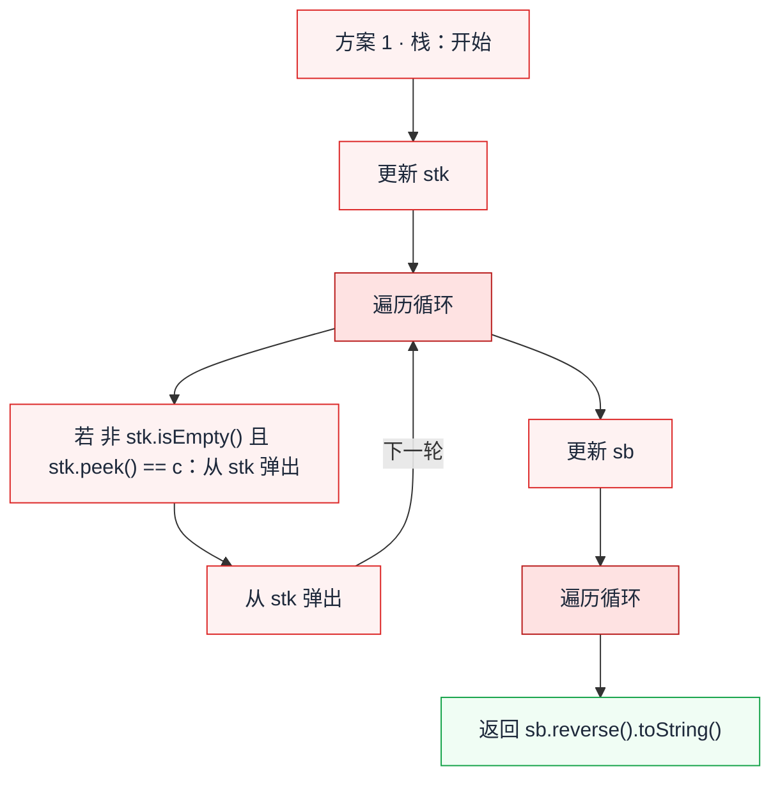

```java
package com.webfault.dsa; // 引入依赖

import java.util.*; // 引入依赖

class lc1047_solution111 { // 定义类型
  static String removeDuplicates(String s) { // 定义函数/方法 removeDuplicates
    Deque<Character> stk = new ArrayDeque<>(); // 把 new ArrayDeque 小于 超过 (); 写入 Deque<Character> stk
    for (char c : s.toCharArray()) { // for (char 字符 : 字符串.toCharArray()) {
      if (!stk.isEmpty() && stk.peek() == c)
        stk.pop(); // 若 取反 栈.isEmpty() 且 栈.peek() 等于 字符) 栈 弹出 );
      else stk.push(c); // 否则
    }
    StringBuilder sb = new StringBuilder(); // 把 new StringBuilder(); 写入 StringBuilder sb
    for (char c : stk) sb.append(c); // 把 字符 追加到列表尾部
    return sb.reverse().toString(); // 返回 sb.reverse().toString()
  }

  public static void main(String[] args) { // public static void main(String[] args) {
    String[] ins = {
      "abc", "abbaca", "azxxzy", "aabbcc", ""
    }; // 把 {「abc」, 「abc」, 「abc」, 「abc」, 「abc」}; 写入 String[] ins
    String[] want = {
      "abc", "ca", "ay", "", ""
    }; // 把 {「abc」, 「abc」, 「abc」, 「abc」, 「abc」}; 写入 String[] want
    boolean ok = true; // 把 true; 写入 boolean ok
    for (int i = 0; i < ins.length; i++) { // 让 下标 i 从 0 开始计数，下标 i 小于 ins.长度 就继续
      String r = removeDuplicates(ins[i]); // 把 removeDuplicates(ins[下标 i]) 存入 右指针
      if (!r.equals(want[i])) {
        ok = false;
        System.out.println("FAIL in=" + ins[i] + " got=" + r + " want=" + want[i]);
      }
    }
    if (!ok) throw new RuntimeException("FAILED"); // 若 取反 ok) throw new RuntimeException(「FAILED」);
    System.out.println("PASS"); // 全部用例通过，输出 PASS
  }
}
```

#### 方案 2：栈优化

**思路与代码分析**：核心是「栈优化」。Java 版用类与静态方法组织，集合操作显式明了。代码里依次做这些事：单循环线性扫描。**走读**：方案 2 · 栈优化：开始 → 更新 stack → 遍历循环 → 若 stack.length(：处理 ＞ 0 → 更新 = → 调用 stack.deleteCharAt(stack.len → 向 stack 追加记录 → 返回 stack.toString()。

**运行架构**（真实控制流）：

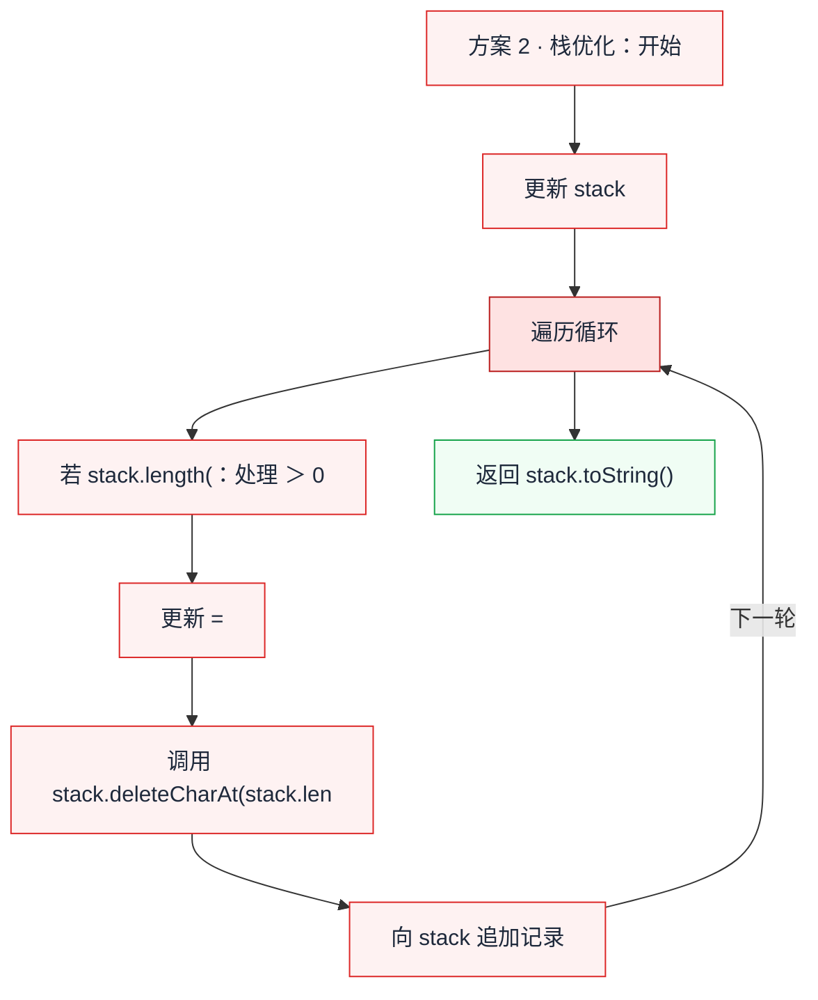

```java
package com.webfault.dsa; // 引入依赖

import java.util.*; // 引入依赖

class lc1047_solution222 { // 定义类型
  static String removeDuplicates(String s) { // 定义函数/方法 removeDuplicates
    StringBuilder stack = new StringBuilder(); // 把 new StringBuilder(); 写入 StringBuilder stack
    for (char x : s.toCharArray()) { // for (char x : 字符串.toCharArray()) {
      if (stack.length() > 0
          && stack.charAt(stack.length() - 1) == x) { // 若 栈.长度() 超过 0 且 栈 取字符 栈.长度() 减 1) 等于 x
        stack.deleteCharAt(stack.length() - 1); // 栈.deleteCharAt(栈.长度() 减 1);
        continue; // 跳过本轮，进入下一次
      }
      stack.append(x); // 把 x 追加到列表尾部
    }
    return stack.toString(); // 返回 栈.toString()
  }

  public static void main(String[] args) { // public static void main(String[] args) {
    String[] ins = {
      "abc", "abbaca", "azxxzy", "aabbcc", ""
    }; // 把 {「abc」, 「abc」, 「abc」, 「abc」, 「abc」}; 写入 String[] ins
    String[] want = {
      "abc", "ca", "ay", "", ""
    }; // 把 {「abc」, 「abc」, 「abc」, 「abc」, 「abc」}; 写入 String[] want
    boolean ok = true; // 把 true; 写入 boolean ok
    for (int i = 0; i < ins.length; i++) { // 让 下标 i 从 0 开始计数，下标 i 小于 ins.长度 就继续
      String r = removeDuplicates(ins[i]); // 把 removeDuplicates(ins[下标 i]) 存入 右指针
      if (!r.equals(want[i])) {
        ok = false;
        System.out.println("FAIL in=" + ins[i] + " got=" + r + " want=" + want[i]);
      }
    }
    if (!ok) throw new RuntimeException("FAILED"); // 若 取反 ok) throw new RuntimeException(「FAILED」);
    System.out.println("PASS"); // 全部用例通过，输出 PASS
  }
}
```

### Rust 实现（2 种方案）

Rust 的全部方案如下，每个方案都内嵌用例自测，可独立运行（老仓库 python/go 文件遵循「打印结果」约定）：

#### 方案 1：栈

**思路与代码分析**：核心是「栈」。Rust 版用所有权移动与切片借用改写同一逻辑，注意 Option 与引用边界。代码里依次做这些事：栈的后进先出操作。**走读**：方案 1 · 栈：开始 → 计算 st → 遍历 s.chars() 中的每个元素 c → 处理 if st.last() == Some(&c) → 从 st 弹出 → 向 st 追加记录 → 调用 st.into_iter().collect() → 返回结果。

**运行架构**（真实控制流）：

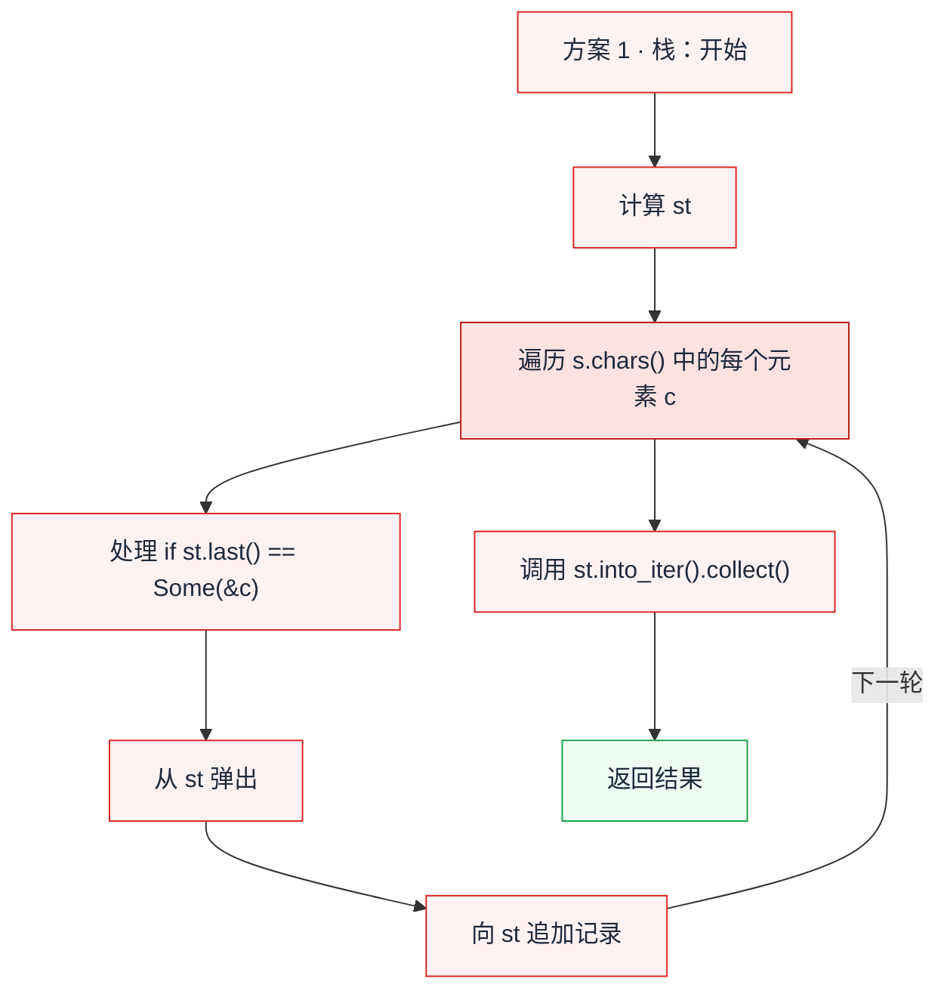

```rust
// LeetCode 1047. 删除字符串中的所有相邻重复项 — Rust 版（方案1）
fn remove_duplicates(s: String) -> String {
    // 定义函数/方法 remove_duplicates
    let mut st: Vec<char> = Vec::new(); // 把 Vec::new(); 写入 let mut st: Vec<char>
    for c in s.chars() {
        // 逐个取出 字符串 的元素（字符）
        if st.last() == Some(&c) {
            st.pop();
        } else {
            st.push(c);
        }
    }
    st.into_iter().collect() // st.into_iter().collect()
}
fn main() {
    // 程序入口：跑内嵌自测用例
    assert_eq!(remove_duplicates("abbaca".into()), "ca"); // 断言校验
    assert_eq!(remove_duplicates("azxxzy".into()), "ay"); // 断言校验
    assert_eq!(remove_duplicates("".into()), ""); // 断言校验
    println!("PASS");
} // 全部用例通过，输出 PASS
```

#### 方案 2：栈优化

**思路与代码分析**：核心是「栈优化」。Rust 版用所有权移动与切片借用改写同一逻辑，注意 Option 与引用边界。代码里依次做这些事：栈的后进先出操作。**走读**：方案 2 · 栈优化：开始 → 计算 st → 遍历 s.chars() 中的每个元素 c → 处理 if st.last() == Some(&c) → 从 st 弹出 → 向 st 追加记录 → 调用 st.into_iter().collect() → 返回结果。

**运行架构**（真实控制流）：

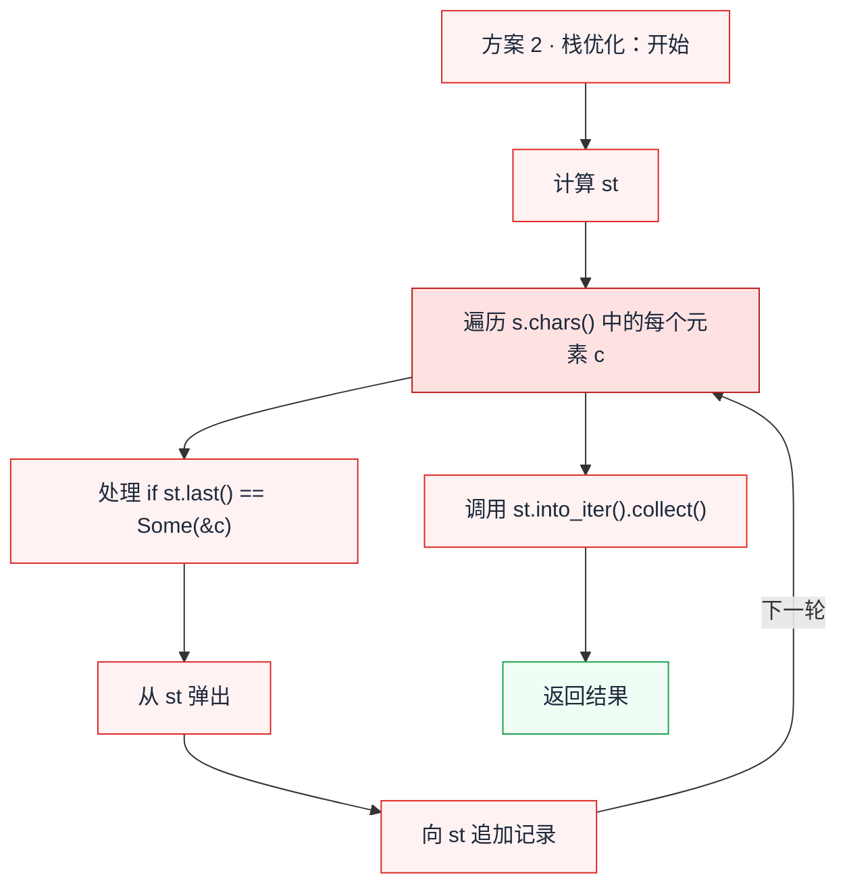

```rust
// LeetCode 1047. 删除字符串中的所有相邻重复项 — Rust 版（方案2）
fn remove_duplicates(s: String) -> String {
    // 定义函数/方法 remove_duplicates
    let mut st: Vec<char> = Vec::new(); // 把 Vec::new(); 写入 let mut st: Vec<char>
    for c in s.chars() {
        // 逐个取出 字符串 的元素（字符）
        if st.last() == Some(&c) {
            st.pop();
        } else {
            st.push(c);
        }
    }
    st.into_iter().collect() // st.into_iter().collect()
}
fn main() {
    // 程序入口：跑内嵌自测用例
    assert_eq!(remove_duplicates("abbaca".into()), "ca"); // 断言校验
    assert_eq!(remove_duplicates("azxxzy".into()), "ay"); // 断言校验
    assert_eq!(remove_duplicates("".into()), ""); // 断言校验
    println!("PASS");
} // 全部用例通过，输出 PASS
```

### Lua 实现（2 种方案）

Lua 的全部方案如下，每个方案都内嵌用例自测，可独立运行（老仓库 python/go 文件遵循「打印结果」约定）：

#### 方案 1：栈

**思路与代码分析**：核心是「栈」。Lua 版用表与 ipairs 遍历，注意 ipairs 遇 nil 即停的语义。**走读**：方案 1 · 栈：开始 → 更新 st → 循环 i：从 1 到 #s do → 更新 c → 处理 if #st ＞ 0 and st[#st] == c → 更新 st[#st] → 更新 1] → 返回 table.concat(st)。

**运行架构**（真实控制流）：

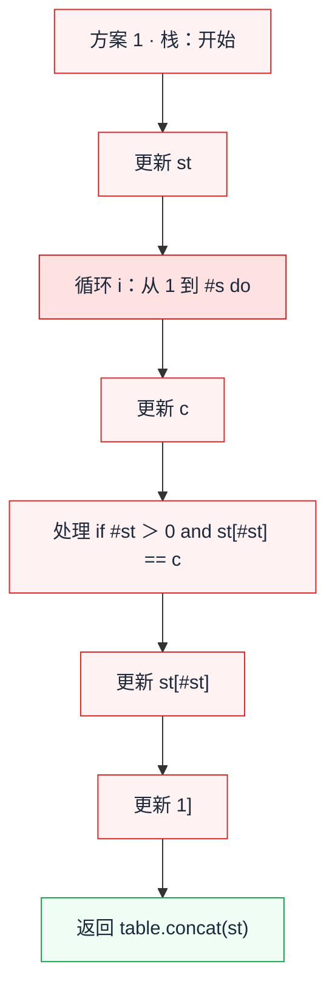

```lua
-- LeetCode 1047. 删除字符串中的所有相邻重复项 — Lua 版（方案1）
local function remove_duplicates(s) -- local function remove_duplicates(字符串)
	local st = {} -- 把 {} 写入 local st
	for i = 1, #s do -- 把 1, #字符串 do 写入 for i
		local c = s:sub(i, i) -- 把 字符串:sub(下标 i, 下标 i) 写入 local c
		if #st > 0 and st[#st] == c then -- 若 #st 超过 0 and st[#st] 等于 字符 then
			st[#st] = nil -- 把 nil 写入 st[#st]
		else -- 否则
			st[#st + 1] = c -- 把 字符 写入 st[#st + 1]
		end -- 终点
	end -- 终点
	return table.concat(st) -- 返回 table.concat(st)
end -- 终点
assert(remove_duplicates("abbaca") == "ca") -- 断言校验
assert(remove_duplicates("azxxzy") == "ay") -- 断言校验
assert(remove_duplicates("") == "") -- 断言校验
print("PASS") -- 全部用例通过，输出 PASS
```

#### 方案 2：栈优化

**思路与代码分析**：核心是「栈优化」。Lua 版用表与 ipairs 遍历，注意 ipairs 遇 nil 即停的语义。**走读**：方案 2 · 栈优化：开始 → 更新 st → 循环 i：从 1 到 #s do → 更新 c → 处理 if #st ＞ 0 and st[#st] == c → 更新 st[#st] → 更新 1] → 返回 table.concat(st)。

**运行架构**（真实控制流）：

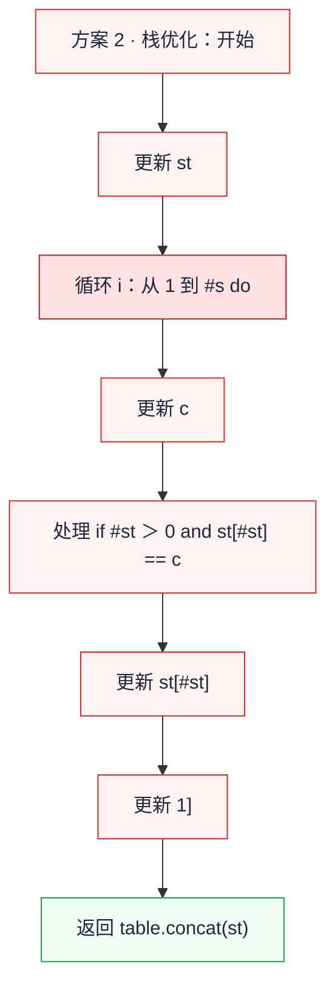

```lua
-- LeetCode 1047. 删除字符串中的所有相邻重复项 — Lua 版（方案2）
local function remove_duplicates(s) -- local function remove_duplicates(字符串)
	local st = {} -- 把 {} 写入 local st
	for i = 1, #s do -- 把 1, #字符串 do 写入 for i
		local c = s:sub(i, i) -- 把 字符串:sub(下标 i, 下标 i) 写入 local c
		if #st > 0 and st[#st] == c then -- 若 #st 超过 0 and st[#st] 等于 字符 then
			st[#st] = nil -- 把 nil 写入 st[#st]
		else -- 否则
			st[#st + 1] = c -- 把 字符 写入 st[#st + 1]
		end -- 终点
	end -- 终点
	return table.concat(st) -- 返回 table.concat(st)
end -- 终点
assert(remove_duplicates("abbaca") == "ca") -- 断言校验
assert(remove_duplicates("azxxzy") == "ay") -- 断言校验
assert(remove_duplicates("") == "") -- 断言校验
print("PASS") -- 全部用例通过，输出 PASS
```

### C 实现（2 种方案）

C 的全部方案如下，每个方案都内嵌用例自测，可独立运行（老仓库 python/go 文件遵循「打印结果」约定）：

#### 方案 1：栈

**思路与代码分析**：核心是「栈」。C 版手动管理下标与内存，循环边界全部显式写出。代码里依次做这些事：单循环线性扫描。**走读**：方案 1 · 栈：开始 → 更新 top → 遍历循环 → 若 top ＞ 0 且 out[top - 1] == *p：处理 top-- → 处理 top-- → 更新 out[top++] → 更新 out[top] → 返回结果。

**运行架构**（真实控制流）：

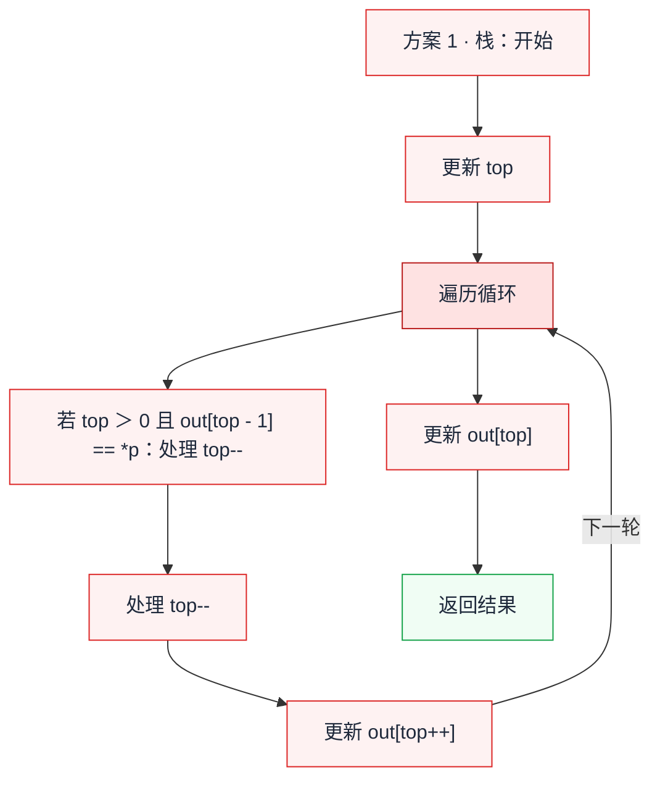

```c
/* LeetCode 1047. 删除字符串中的所有相邻重复项 — C 版（方案1） */
#include <stdio.h>                                         // 引入头文件
#include <string.h>                                        // 引入头文件
static void remove_duplicates(const char *s, char out[]) { // 定义函数/方法 remove_duplicates
    int top = 0;                                           // 把 0 存入 top
    for (const char *p = s; *p; p++) { // 把 字符串; 乘 节点; 节点 加一 ) { 写入 for (const char *p
        if (top > 0 && out[top - 1] == *p)
            top--; // 若 top 超过 0 且 out[top 减 1] 等于 乘 节点) top 减一 ;
        else
            out[top++] = *p; // 否则
    }
    out[top] = '\0'; // 把 '\0'; 写入 out[top]
}
int main(void) {                      // 程序入口：跑内嵌自测用例
    char out[8192];                   // char out[8192];
    remove_duplicates("abbaca", out); // remove_duplicates(「abbaca」, out);
    if (strcmp(out, "ca") != 0) {
        printf("FAIL 1\n");
        return 1;
    }                                 // 若 strcmp(out, 「ca」) 不等于 0) { 输出「ca」); return 1; }
    remove_duplicates("azxxzy", out); // remove_duplicates(「azxxzy」, out);
    if (strcmp(out, "ay") != 0) {
        printf("FAIL 2\n");
        return 1;
    }                           // 若 strcmp(out, 「ay」) 不等于 0) { 输出「ay」); return 1; }
    remove_duplicates("", out); // remove_duplicates(「」, out);
    if (strcmp(out, "") != 0) {
        printf("FAIL 3\n");
        return 1;
    } // 若 strcmp(out, 「」) 不等于 0) { 输出「」); return 1; }
    printf("PASS\n");
    return 0;
} // 全部用例通过，输出 PASS
```

#### 方案 2：栈优化

**思路与代码分析**：核心是「栈优化」。C 版手动管理下标与内存，循环边界全部显式写出。代码里依次做这些事：单循环线性扫描。**走读**：方案 2 · 栈优化：开始 → 更新 top → 遍历循环 → 若 top ＞ 0 且 out[top - 1] == *p：处理 top-- → 处理 top-- → 更新 out[top++] → 更新 out[top] → 返回结果。

**运行架构**（真实控制流）：

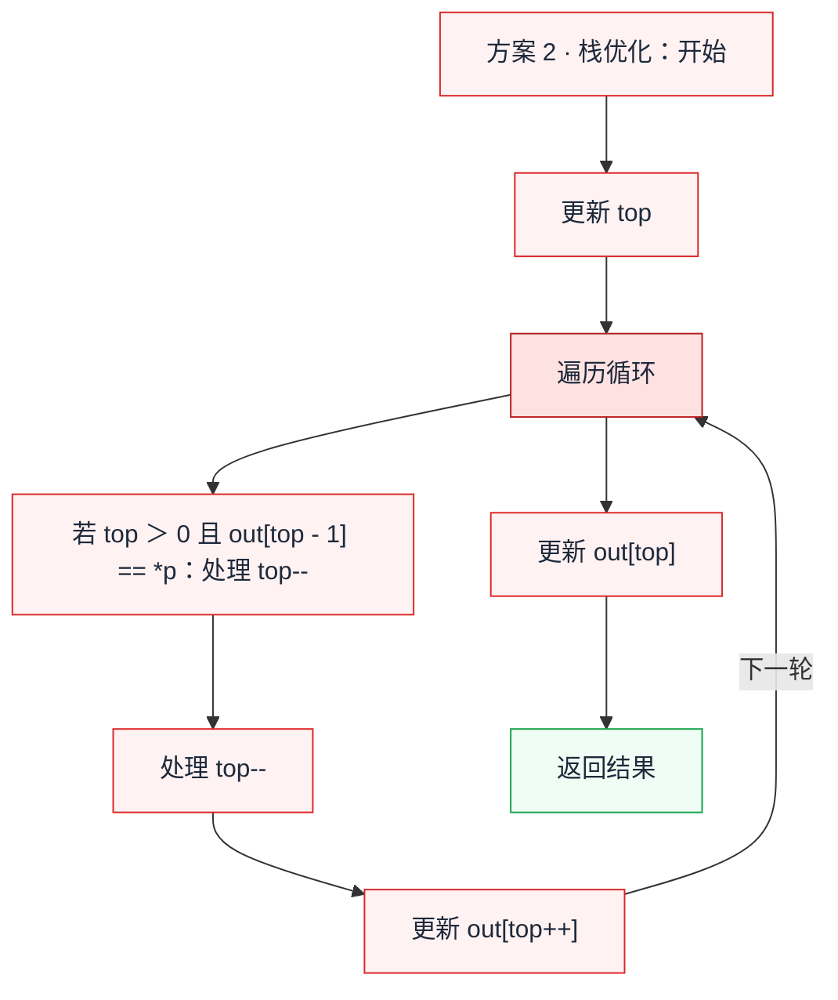

```c
/* LeetCode 1047. 删除字符串中的所有相邻重复项 — C 版（方案2） */
#include <stdio.h>                                         // 引入头文件
#include <string.h>                                        // 引入头文件
static void remove_duplicates(const char *s, char out[]) { // 定义函数/方法 remove_duplicates
    int top = 0;                                           // 把 0 存入 top
    for (const char *p = s; *p; p++) { // 把 字符串; 乘 节点; 节点 加一 ) { 写入 for (const char *p
        if (top > 0 && out[top - 1] == *p)
            top--; // 若 top 超过 0 且 out[top 减 1] 等于 乘 节点) top 减一 ;
        else
            out[top++] = *p; // 否则
    }
    out[top] = '\0'; // 把 '\0'; 写入 out[top]
}
int main(void) {                      // 程序入口：跑内嵌自测用例
    char out[8192];                   // char out[8192];
    remove_duplicates("abbaca", out); // remove_duplicates(「abbaca」, out);
    if (strcmp(out, "ca") != 0) {
        printf("FAIL 1\n");
        return 1;
    }                                 // 若 strcmp(out, 「ca」) 不等于 0) { 输出「ca」); return 1; }
    remove_duplicates("azxxzy", out); // remove_duplicates(「azxxzy」, out);
    if (strcmp(out, "ay") != 0) {
        printf("FAIL 2\n");
        return 1;
    }                           // 若 strcmp(out, 「ay」) 不等于 0) { 输出「ay」); return 1; }
    remove_duplicates("", out); // remove_duplicates(「」, out);
    if (strcmp(out, "") != 0) {
        printf("FAIL 3\n");
        return 1;
    } // 若 strcmp(out, 「」) 不等于 0) { 输出「」); return 1; }
    printf("PASS\n");
    return 0;
} // 全部用例通过，输出 PASS
```

### C++ 实现（2 种方案）

C++ 的全部方案如下，每个方案都内嵌用例自测，可独立运行（老仓库 python/go 文件遵循「打印结果」约定）：

#### 方案 1：栈

**思路与代码分析**：核心是「栈」。C++ 版用 STL 容器与迭代器，减少手写下标错误。代码里依次做这些事：单循环线性扫描。**走读**：方案 1 · 栈：开始 → 处理 std::string st → 遍历循环 → 若 非 st.empty() 且 st.back() == c：调用 st.pop_back() → 调用 st.pop_back() → 调用 st.push_back(c) → 返回 st。

**运行架构**（真实控制流）：

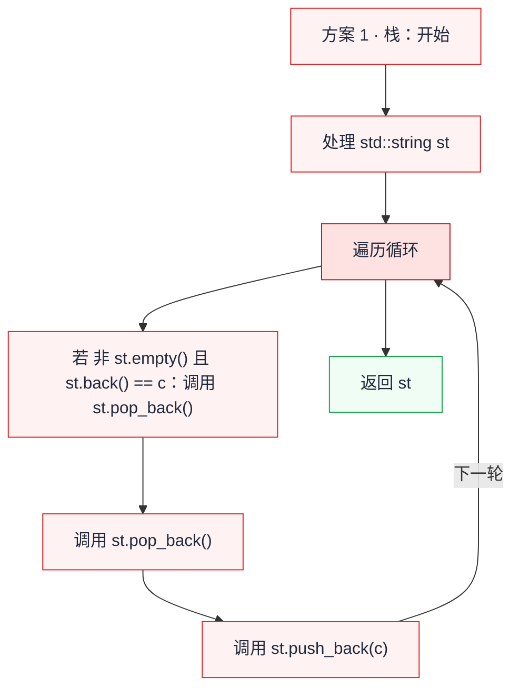

```cpp
// LeetCode 1047. 删除字符串中的所有相邻重复项 — C++ 版（方案1）
#include <cassert>  // 引入头文件
#include <iostream> // 引入头文件
#include <string>   // 引入头文件
static std::string removeDuplicates(const std::string &s) {
    std::string st;    // std::string st;
    for (char c : s) { // for (char 字符 : 字符串) {
        if (!st.empty() && st.back() == c)
            st.pop_back(); // 若 取反 st 是否为空 且 st.back() 等于 字符) st 弹出 );
        else
            st.push_back(c); // 否则
    }
    return st; // 返回 st
}
int main() {
    assert(removeDuplicates("abbaca") == "ca");
    assert(removeDuplicates("azxxzy") == "ay");
    assert(removeDuplicates("") == "");
    std::cout << "PASS" << std::endl;
} // 全部用例通过，输出 PASS
```

#### 方案 2：栈优化

**思路与代码分析**：核心是「栈优化」。C++ 版用 STL 容器与迭代器，减少手写下标错误。代码里依次做这些事：单循环线性扫描。**走读**：方案 2 · 栈优化：开始 → 处理 std::string st → 遍历循环 → 若 非 st.empty() 且 st.back() == c：调用 st.pop_back() → 调用 st.pop_back() → 调用 st.push_back(c) → 返回 st。

**运行架构**（真实控制流）：

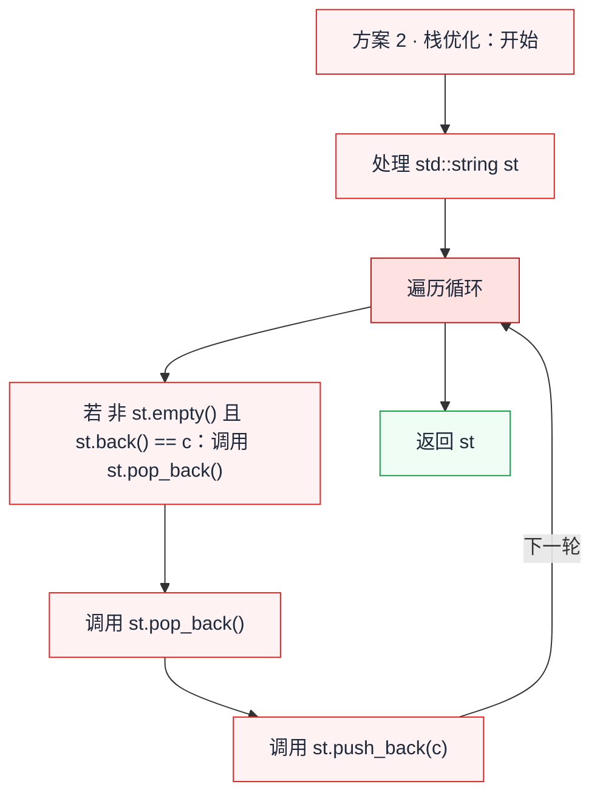

```cpp
// LeetCode 1047. 删除字符串中的所有相邻重复项 — C++ 版（方案2）
#include <cassert>  // 引入头文件
#include <iostream> // 引入头文件
#include <string>   // 引入头文件
static std::string removeDuplicates(const std::string &s) {
    std::string st;    // std::string st;
    for (char c : s) { // for (char 字符 : 字符串) {
        if (!st.empty() && st.back() == c)
            st.pop_back(); // 若 取反 st 是否为空 且 st.back() 等于 字符) st 弹出 );
        else
            st.push_back(c); // 否则
    }
    return st; // 返回 st
}
int main() {
    assert(removeDuplicates("abbaca") == "ca");
    assert(removeDuplicates("azxxzy") == "ay");
    assert(removeDuplicates("") == "");
    std::cout << "PASS" << std::endl;
} // 全部用例通过，输出 PASS
```

### R 实现（2 种方案）

R 的全部方案如下，每个方案都内嵌用例自测，可独立运行（老仓库 python/go 文件遵循「打印结果」约定）：

#### 方案 1：栈

**思路与代码分析**：核心是「栈」。R 版用向量化思维与 1 起始下标，注意 1:n 的降序陷阱。代码里依次做这些事：单循环线性扫描。**走读**：方案 1 · 栈：开始 → 处理 chars ＜- strsplit(s, )[[1] → 处理 st ＜- character(0) → 循环 c：遍历 chars → 若 length(st) ＞ 0 且 st[length(st)] == c：处理 st ＜- st[-length(st)] → 处理 st ＜- st[-length(st)] → 更新 collapse → 返回结果。

**运行架构**（真实控制流）：

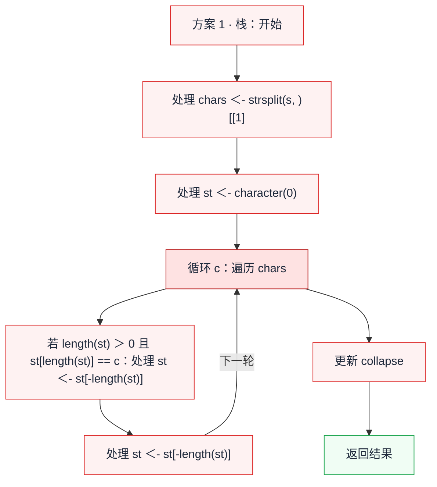

```r
# 删除字符串中的所有相邻重复项 — R 版（方案1） 定义函数 remove_duplicates_str（参数：字符串）
remove_duplicates_str <- function(s) {
    chars <- strsplit(s, "")[[1]]  # 把 strsplit(字符串, 「」)[[1]] 存入 chars
    st <- character(0)  # 把 character(0) 存入 st
    for (c in chars) {
        # for (字符 in chars) {
        if (length(st) > 0 && st[length(st)] == c)
            st <- st[-length(st)]  # 若 长度(st) 超过 0 且 st[长度(st)] 等于 字符) st 小于 减 st[ 减 长度(st)]
 else st <- c(st, c)  # 否则
    }
    paste(st, collapse = "")  # 把 「」) 写入 paste(st, collapse
}
stopifnot(remove_duplicates_str("abbaca") == "ca")  # 断言校验
stopifnot(remove_duplicates_str("azxxzy") == "ay")  # 断言校验
stopifnot(remove_duplicates_str("") == "")  # 断言校验
cat("PASS\n")  # 全部用例通过，输出 PASS
```

#### 方案 2：栈优化

**思路与代码分析**：核心是「栈优化」。R 版用向量化思维与 1 起始下标，注意 1:n 的降序陷阱。代码里依次做这些事：单循环线性扫描。**走读**：方案 2 · 栈优化：开始 → 处理 chars ＜- strsplit(s, )[[1] → 处理 st ＜- character(0) → 循环 c：遍历 chars → 若 length(st) ＞ 0 且 st[length(st)] == c：处理 st ＜- st[-length(st)] → 处理 st ＜- st[-length(st)] → 更新 collapse → 返回结果。

**运行架构**（真实控制流）：

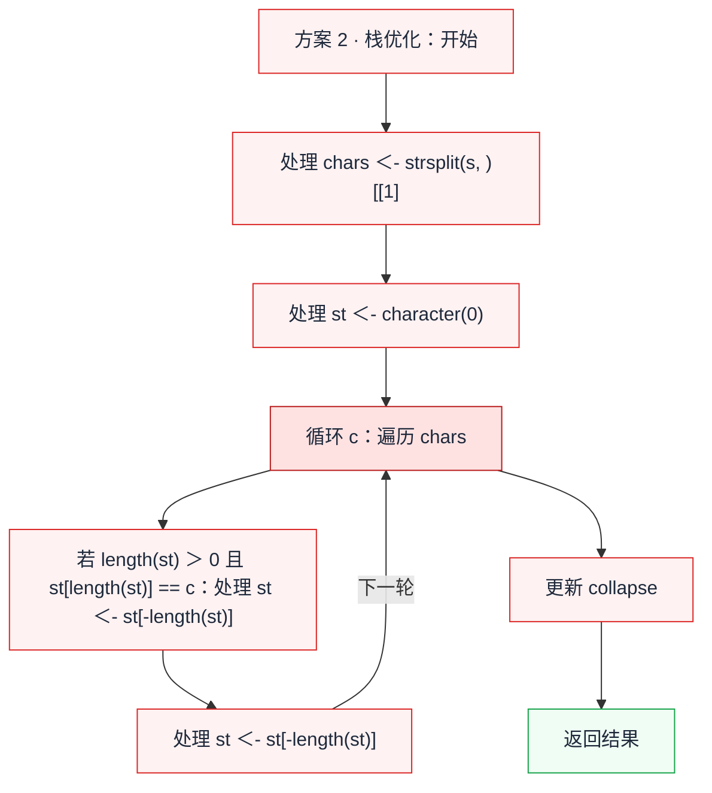

```r
# 删除字符串中的所有相邻重复项 — R 版（方案2） 定义函数 remove_duplicates_str（参数：字符串）
remove_duplicates_str <- function(s) {
    chars <- strsplit(s, "")[[1]]  # 把 strsplit(字符串, 「」)[[1]] 存入 chars
    st <- character(0)  # 把 character(0) 存入 st
    for (c in chars) {
        # for (字符 in chars) {
        if (length(st) > 0 && st[length(st)] == c)
            st <- st[-length(st)]  # 若 长度(st) 超过 0 且 st[长度(st)] 等于 字符) st 小于 减 st[ 减 长度(st)]
 else st <- c(st, c)  # 否则
    }
    paste(st, collapse = "")  # 把 「」) 写入 paste(st, collapse
}
stopifnot(remove_duplicates_str("abbaca") == "ca")  # 断言校验
stopifnot(remove_duplicates_str("azxxzy") == "ay")  # 断言校验
stopifnot(remove_duplicates_str("") == "")  # 断言校验
cat("PASS\n")  # 全部用例通过，输出 PASS
```

### Zig 实现（2 种方案）

Zig 的全部方案如下，每个方案都内嵌用例自测，可独立运行（老仓库 python/go 文件遵循「打印结果」约定）：

#### 方案 1：栈

**思路与代码分析**：核心是「栈」。Zig 版显式分配与清零，整型边界处理严格。代码里依次做这些事：单循环线性扫描。**走读**：方案 1 · 栈：开始 → 计算 st → 计算 top → 遍历集合元素 → 若 top ＞ 0 and st[top - 1] == c：更新 - → 更新 st[top] → 更新 + → 调用 out.appendSlice(st[0..top]) → 返回结果。

**运行架构**（真实控制流）：

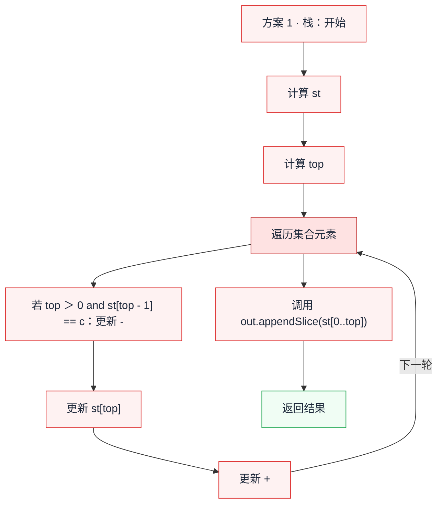

```zig
// LeetCode 1047. 删除字符串中的所有相邻重复项 — Zig 版（方案1）
const std = @import("std"); // 把 @import(「std」) 存入 std
fn removeDuplicates(s: []const u8, out: *std.ArrayList(u8)) void { // 定义函数/方法 removeDuplicates
    var st: [8192]u8 = undefined; // 把 undefined; 写入 var st: [8192]u8
    var top: usize = 0; // 把 0; 写入 var top: usize
    for (s) |c| { // 逐个取出 字符串 的元素（字符）
        if (top > 0 and st[top - 1] == c) top -= 1 else { // 若 top 超过 0 and st[top 减 1] 等于 字符) top 累减 1 else
            st[top] = c; // 把 字符; 写入 st[top]
            top += 1; // top累加 1
        }
    }
    out.appendSlice(st[0..top]) catch unreachable; // out.appendSlice(st[0..top]) catch unreachable;
}
pub fn main() !void { // 程序入口：跑内嵌自测用例
    var out = std.ArrayList(u8).init(std.heap.page_allocator); // 把 std.ArrayList(u8).init(std.堆.page_allocator) 存入 out
    defer out.deinit(); // defer out.deinit();
    removeDuplicates("abbaca", &out); // removeDuplicates(「abbaca」, 按位与 out);
    if (!std.mem.eql(u8, out.items, "ca")) return error.TestFailed; // 若 取反 std.mem.eql(u8, out.items, 「ca」)，直接返回 error.TestFailed
    out.clearRetainingCapacity(); // out.clearRetainingCapacity();
    removeDuplicates("azxxzy", &out); // removeDuplicates(「azxxzy」, 按位与 out);
    if (!std.mem.eql(u8, out.items, "ay")) return error.TestFailed; // 若 取反 std.mem.eql(u8, out.items, 「ay」)，直接返回 error.TestFailed
    out.clearRetainingCapacity(); // out.clearRetainingCapacity();
    removeDuplicates("", &out); // removeDuplicates(「」, 按位与 out);
    if (out.items.len != 0) return error.TestFailed; // 若 out.items.长度 不等于 0，直接返回 error.TestFailed
    std.debug.print("PASS\n", .{});
} // 全部用例通过，输出 PASS
```

#### 方案 2：栈优化

**思路与代码分析**：核心是「栈优化」。Zig 版显式分配与清零，整型边界处理严格。代码里依次做这些事：单循环线性扫描。**走读**：方案 2 · 栈优化：开始 → 计算 st → 计算 top → 遍历集合元素 → 若 top ＞ 0 and st[top - 1] == c：更新 - → 更新 st[top] → 更新 + → 调用 out.appendSlice(st[0..top]) → 返回结果。

**运行架构**（真实控制流）：

```mermaid
graph TD
    N0["方案 2 · 栈优化：开始"]
    N1["计算 st"]
    N2["计算 top"]
    N3["遍历集合元素"]
    N4["若 top ＞ 0 and st[top - 1] == c：更新 -"]
    N5["更新 st[top]"]
    N6["更新 +"]
    N7["调用 out.appendSlice(st[0..top])"]
    N8["返回结果"]
    N0 --> N1
    N1 --> N2
    N2 --> N3
    N3 --> N4
    N4 --> N5
    N5 --> N6
    N6 -- 下一轮 --> N3
    N3 --> N7
    N7 --> N8
    classDef n fill:#fef2f2,stroke:#dc2626,color:#1e293b;
    classDef lp fill:#fee2e2,stroke:#b91c1c,color:#1e293b;
    classDef dc fill:#fef9c3,stroke:#ca8a04,color:#1e293b;
    classDef tm fill:#f0fdf4,stroke:#16a34a,color:#1e293b;
    class N0,N1,N2,N4,N5,N6,N7 n;
    class N3 lp;
    class N8 tm;
```

```zig
// LeetCode 1047. 删除字符串中的所有相邻重复项 — Zig 版（方案2）
const std = @import("std"); // 把 @import(「std」) 存入 std
fn removeDuplicates(s: []const u8, out: *std.ArrayList(u8)) void { // 定义函数/方法 removeDuplicates
    var st: [8192]u8 = undefined; // 把 undefined; 写入 var st: [8192]u8
    var top: usize = 0; // 把 0; 写入 var top: usize
    for (s) |c| { // 逐个取出 字符串 的元素（字符）
        if (top > 0 and st[top - 1] == c) top -= 1 else { // 若 top 超过 0 and st[top 减 1] 等于 字符) top 累减 1 else
            st[top] = c; // 把 字符; 写入 st[top]
            top += 1; // top累加 1
        }
    }
    out.appendSlice(st[0..top]) catch unreachable; // out.appendSlice(st[0..top]) catch unreachable;
}
pub fn main() !void { // 程序入口：跑内嵌自测用例
    var out = std.ArrayList(u8).init(std.heap.page_allocator); // 把 std.ArrayList(u8).init(std.堆.page_allocator) 存入 out
    defer out.deinit(); // defer out.deinit();
    removeDuplicates("abbaca", &out); // removeDuplicates(「abbaca」, 按位与 out);
    if (!std.mem.eql(u8, out.items, "ca")) return error.TestFailed; // 若 取反 std.mem.eql(u8, out.items, 「ca」)，直接返回 error.TestFailed
    out.clearRetainingCapacity(); // out.clearRetainingCapacity();
    removeDuplicates("azxxzy", &out); // removeDuplicates(「azxxzy」, 按位与 out);
    if (!std.mem.eql(u8, out.items, "ay")) return error.TestFailed; // 若 取反 std.mem.eql(u8, out.items, 「ay」)，直接返回 error.TestFailed
    out.clearRetainingCapacity(); // out.clearRetainingCapacity();
    removeDuplicates("", &out); // removeDuplicates(「」, 按位与 out);
    if (out.items.len != 0) return error.TestFailed; // 若 out.items.长度 不等于 0，直接返回 error.TestFailed
    std.debug.print("PASS\n", .{});
} // 全部用例通过，输出 PASS
```

### Dart 实现（2 种方案）

Dart 的全部方案如下，每个方案都内嵌用例自测，可独立运行（老仓库 python/go 文件遵循「打印结果」约定）：

#### 方案 1：栈

**思路与代码分析**：核心是「栈」。Dart 版用可空类型标注与集合方法，注意空安全。代码里依次做这些事：单循环线性扫描。**走读**：方案 1 · 栈：开始 → 更新 st → 遍历循环 → 若 st.isNotEmpty 且 st.last == c 则： → 调用 st.removeLast() → 调用 st.add(c) → 返回 st.join()。

**运行架构**（真实控制流）：

```mermaid
graph TD
    N0["方案 1 · 栈：开始"]
    N1["更新 st"]
    N2["遍历循环"]
    N3["若 st.isNotEmpty 且 st.last == c 则："]
    N4["调用 st.removeLast()"]
    N5["调用 st.add(c)"]
    N6["返回 st.join()"]
    N0 --> N1
    N1 --> N2
    N2 --> N3
    N3 --> N4
    N4 --> N5
    N5 -- 下一轮 --> N2
    N2 --> N6
    classDef n fill:#fef2f2,stroke:#dc2626,color:#1e293b;
    classDef lp fill:#fee2e2,stroke:#b91c1c,color:#1e293b;
    classDef dc fill:#fef9c3,stroke:#ca8a04,color:#1e293b;
    classDef tm fill:#f0fdf4,stroke:#16a34a,color:#1e293b;
    class N0,N1,N3,N4,N5 n;
    class N2 lp;
    class N6 tm;
```

```dart
// LeetCode 1047. 删除字符串中的所有相邻重复项 — Dart 版（方案1）
String removeDuplicates(String s) {
  // 定义函数/方法 removeDuplicates
  final st = <String>[]; // 把 小于 String 超过 [] 存入 st
  for (final c in s.split('')) {
    // for (final 字符 in 字符串.split('')) {
    if (st.isNotEmpty && st.last == c) {
      st.removeLast();
    } else {
      st.add(c);
    }
  }
  return st.join(); // 返回 st.join()
}

void main() {
  if (removeDuplicates('abbaca') != 'ca') throw StateError('c1');
  if (removeDuplicates('azxxzy') != 'ay') throw StateError('c2');
  if (removeDuplicates('') != '') throw StateError('c3');
  print('PASS');
} // 全部用例通过，输出 PASS
```

#### 方案 2：栈优化

**思路与代码分析**：核心是「栈优化」。Dart 版用可空类型标注与集合方法，注意空安全。代码里依次做这些事：单循环线性扫描。**走读**：方案 2 · 栈优化：开始 → 更新 st → 遍历循环 → 若 st.isNotEmpty 且 st.last == c 则： → 调用 st.removeLast() → 调用 st.add(c) → 返回 st.join()。

**运行架构**（真实控制流）：

```mermaid
graph TD
    N0["方案 2 · 栈优化：开始"]
    N1["更新 st"]
    N2["遍历循环"]
    N3["若 st.isNotEmpty 且 st.last == c 则："]
    N4["调用 st.removeLast()"]
    N5["调用 st.add(c)"]
    N6["返回 st.join()"]
    N0 --> N1
    N1 --> N2
    N2 --> N3
    N3 --> N4
    N4 --> N5
    N5 -- 下一轮 --> N2
    N2 --> N6
    classDef n fill:#fef2f2,stroke:#dc2626,color:#1e293b;
    classDef lp fill:#fee2e2,stroke:#b91c1c,color:#1e293b;
    classDef dc fill:#fef9c3,stroke:#ca8a04,color:#1e293b;
    classDef tm fill:#f0fdf4,stroke:#16a34a,color:#1e293b;
    class N0,N1,N3,N4,N5 n;
    class N2 lp;
    class N6 tm;
```

```dart
// LeetCode 1047. 删除字符串中的所有相邻重复项 — Dart 版（方案2）
String removeDuplicates(String s) {
  // 定义函数/方法 removeDuplicates
  final st = <String>[]; // 把 小于 String 超过 [] 存入 st
  for (final c in s.split('')) {
    // for (final 字符 in 字符串.split('')) {
    if (st.isNotEmpty && st.last == c) {
      st.removeLast();
    } else {
      st.add(c);
    }
  }
  return st.join(); // 返回 st.join()
}

void main() {
  if (removeDuplicates('abbaca') != 'ca') throw StateError('c1');
  if (removeDuplicates('azxxzy') != 'ay') throw StateError('c2');
  if (removeDuplicates('') != '') throw StateError('c3');
  print('PASS');
} // 全部用例通过，输出 PASS
```

---

## 内容总结

- **删除字符串中的所有相邻重复项**（栈 · Medium）：共 2 个方案，主线思路「栈」；时间 O(n)（单趟线性扫描）；动画演示栈后进先出过程，附录给出 11 种语言 × 全部方案的可运行实现。
- 来源博客：[https://blog.csdn.net/tyro_java/article/details/145114201](https://blog.csdn.net/tyro_java/article/details/145114201)
- 导航：[📋 总目录](../) ｜ [← 009 05 栈排序](../009_05_栈排序/) ｜ [011 最长连续序列 →](../011_最长连续序列/)
