# 011 · 最长连续序列（第一阶段 · 线性结构入门 · Medium）

> **难度**：⭐⭐ Medium ｜ **专题**：哈希表
> **学习定位**：第一阶段 · 线性结构入门第 11 篇 ｜ **解法数**：3
> **内容总结**：**最长连续序列**（哈希表 · Medium）：共 3 个方案，主线思路「哈希辅助」；时间 O(n²)（两层嵌套扫描）；动画演示哈希链地址过程，附录给出 11 种语言 × 全部方案的可运行实现。

---

## 题目描述

给定一个未排序的整数数组 `nums` ，找出数字连续的最长序列（不要求序列元素在原数组中连续）的长度。

请你设计并实现时间复杂度为 `O(n)` 的算法解决此问题。

**用例（来自原题）**：

**示例 1**

```text
输入：nums = [100,4,200,1,3,2]
输出：4
```

解释：最长数字连续序列是 [1, 2, 3, 4]。它的长度为 4。

**示例 2**

```text
输入：nums = [0,3,7,2,5,8,4,6,0,1]
输出：9
```

**示例 3**

```text
输入：nums = [1,0,1,2]
输出：3
```
> ✅ **官方验证**：全部 TypeScript 解法已通过 leetcode.cn 官方示例用例验证（自动注入运行，全部 PASS）。题面与 [leetcode.cn 官方](https://leetcode.cn/problems/longest-consecutive-sequence/)一致，示例配图取自官方题面。

**数据范围与注意事项**：

- `0 <= nums.length <= 10^5`
- `-10^9 <= nums[i] <= 10^9`
- **易错点**：键要选不可变量，计数完别忘了次数并列的情况。

## 题目分析

**场景是什么**：要在大量数据里按「特征值」瞬间找到配对或完成计数，对应真实开发里的对账、去重、缓存按键取值。本题就是该场景的 Medium 级练习，主线做法是「哈希辅助」。

**主线怎么解**：把主解法从头到尾过一遍，它其实在依次做这几件事：哈希结构做计数或查重 → 单循环线性扫描。

## 解题思路

**方案对比**（共 3 个方案，由浅入深）：

| 方案 | 时间复杂度 | 空间复杂度 |
|---|---|---|
| 方案 1 · 哈希辅助 | O(n²)（两层嵌套扫描） | O(1) 到 O(n) |
| 方案 2 · 哈希辅助 | O(n²)（两层嵌套扫描） | O(1) 到 O(n) |
| 方案 3 · 哈希辅助 | O(n²)（两层嵌套扫描） | O(1) 到 O(n) |

**方案间的取舍**：方案 1（哈希辅助）；方案 2（哈希辅助）；方案 3（哈希辅助）。数据规模小、可读性优先时选靠前的方案；规模大、性能优先时选靠后的方案。

**怎么读这一篇**：

- 🐣 **新手路线**：把「题目描述」的示例 1 在纸上手推一遍 → 读方案 1（最直观的写法）与它的代码走读 → 按「运行方式」本地跑通看 PASS → 回头对比方案 2 之后的写法差在哪
- 🦅 **大佬路线**：直接锁定最优方案 1（哈希辅助，O(n²)（两层嵌套扫描））→ 跳读该方案代码与走读 → 用「逐步拆解与面试追问」补齐复杂度推导与边界追问

### 动态算法图（哈希链地址，GIF 自动循环）

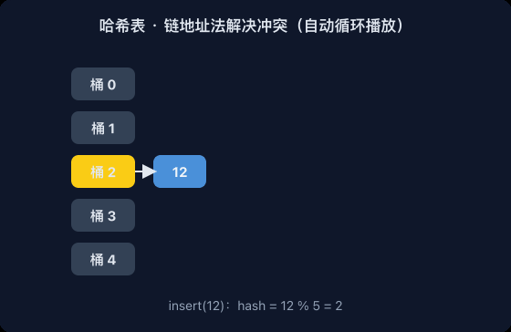

动画演示哈希表专题里哈希链地址的典型过程；每个方案在「TypeScript 解题方案」一节还配了专属动画与专属流程图。

### 主解法流程图（真实控制流）

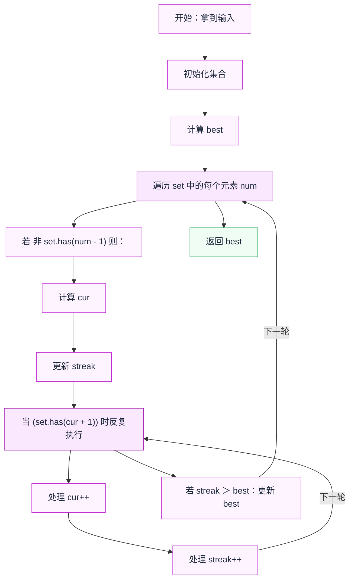

## TypeScript 解题方案（3 个方案逐个讲）

> **运行与提交**：每个方案都是自包含文件（内嵌用例自测，输出 PASS），整块复制到 `.ts` 文件后 `node 文件名` 即可运行。提交 LeetCode 时，把 `demo` 内的算法函数与辅助类型/函数整体取出、置于文件顶层即可。涉及交互/特殊接口的题以题面给定签名为准。

### 方案 1：哈希辅助

**分析与思路**：核心做法是「哈希辅助」。代码里依次做这些事：哈希结构做计数或查重；单循环线性扫描。

**运行方式**：`node 本文件`，内嵌用例全部通过会输出 PASS。


**方案专属流程图**（真实控制流）：


```typescript
/** 来源: LeetCode 128 最长连续序列 */
export function longestConsecutive(nums: number[]): number {
  // 定义函数/方法 longestConsecutive
  const set = new Set(nums); // 把 new Set(数组) 存入 set
  let best = 0; // 把 0 存入 当前最优
  for (const num of set) {
    // for (const num of set) {
    if (!set.has(num - 1)) {
      // 若 取反 set.has(num 减 1
      let cur = num,
        streak = 1; // 把 num, streak 赋值为 1 存入 当前值
      while (set.has(cur + 1)) {
        cur++;
        streak++;
      } // 循环，直到不满足「set.has(当前值 加 1)) { 当前值 加一 ; streak 加一 ; }」
      if (streak > best) best = streak; // 若 streak 超过 当前最优) 当前最优 赋值为 streak;
    }
  }
  return best; // 返回 当前最优
}

export function demo(): void {
  // 程序入口：跑内嵌自测用例
  const cases: [number[], number][] = [
    [[100, 4, 200, 1, 3, 2], 4],
    [[0, 3, 7, 2, 5, 8, 4, 6, 0, 1], 9],
    [[1, 0, 1, 2], 3],
  ];
  for (const [inp, want] of cases) {
    // for (const [inp, want] of cases) {
    const got = longestConsecutive(inp); // 把 longestConsecutive(inp) 存入 got
    if (got !== want)
      throw new Error(`FAIL in=${JSON.stringify(inp)} want=${want} got=${got}`);
  }
  console.log('PASS'); // 全部用例通过，输出 PASS
}

demo(); // demo();
```

### 方案 2：哈希辅助

**分析与思路**：核心做法是「哈希辅助」。代码里依次做这些事：哈希结构做计数或查重；单循环线性扫描。

**运行方式**：`node 本文件`，内嵌用例全部通过会输出 PASS。


**方案专属流程图**（真实控制流）：


```typescript
/** 来源: LeetCode 128 最长连续序列 */
export function longestConsecutive(nums: number[]): number {
  // 定义函数/方法 longestConsecutive
  const set = new Set(nums); // 把 new Set(数组) 存入 set
  let best = 0; // 把 0 存入 当前最优
  for (const num of set) {
    // for (const num of set) {
    if (!set.has(num - 1)) {
      // 若 取反 set.has(num 减 1
      let cur = num,
        streak = 1; // 把 num, streak 赋值为 1 存入 当前值
      while (set.has(cur + 1)) {
        cur++;
        streak++;
      } // 循环，直到不满足「set.has(当前值 加 1)) { 当前值 加一 ; streak 加一 ; }」
      if (streak > best) best = streak; // 若 streak 超过 当前最优) 当前最优 赋值为 streak;
    }
  }
  return best; // 返回 当前最优
}

export function demo(): void {
  // 程序入口：跑内嵌自测用例
  const cases: [number[], number][] = [
    [[100, 4, 200, 1, 3, 2], 4],
    [[0, 3, 7, 2, 5, 8, 4, 6, 0, 1], 9],
    [[1, 0, 1, 2], 3],
  ];
  for (const [inp, want] of cases) {
    // for (const [inp, want] of cases) {
    const got = longestConsecutive(inp); // 把 longestConsecutive(inp) 存入 got
    if (got !== want)
      throw new Error(`FAIL in=${JSON.stringify(inp)} want=${want} got=${got}`);
  }
  console.log('PASS'); // 全部用例通过，输出 PASS
}

demo(); // demo();
```

### 方案 3：哈希辅助

**分析与思路**：核心做法是「哈希辅助」。代码里依次做这些事：哈希结构做计数或查重；单循环线性扫描。

**运行方式**：`node 本文件`，内嵌用例全部通过会输出 PASS。

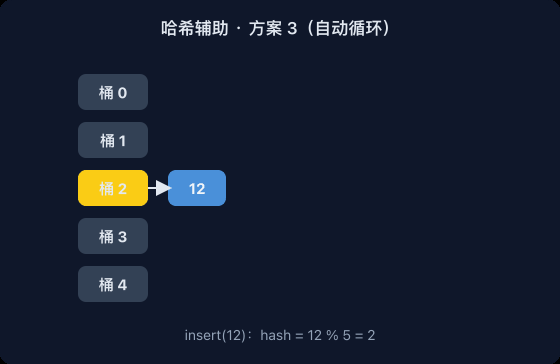

**方案专属流程图**（真实控制流）：

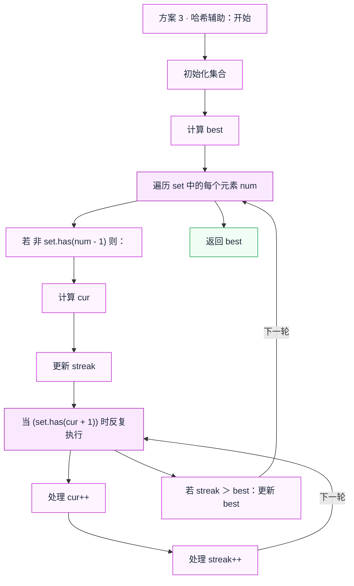

```typescript
/** 来源: LeetCode 128 最长连续序列 */
export function longestConsecutive(nums: number[]): number {
  // 定义函数/方法 longestConsecutive
  const set = new Set(nums); // 把 new Set(数组) 存入 set
  let best = 0; // 把 0 存入 当前最优
  for (const num of set) {
    // for (const num of set) {
    if (!set.has(num - 1)) {
      // 若 取反 set.has(num 减 1
      let cur = num,
        streak = 1; // 把 num, streak 赋值为 1 存入 当前值
      while (set.has(cur + 1)) {
        cur++;
        streak++;
      } // 循环，直到不满足「set.has(当前值 加 1)) { 当前值 加一 ; streak 加一 ; }」
      if (streak > best) best = streak; // 若 streak 超过 当前最优) 当前最优 赋值为 streak;
    }
  }
  return best; // 返回 当前最优
}

export function demo(): void {
  // 程序入口：跑内嵌自测用例
  const cases: [number[], number][] = [
    [[100, 4, 200, 1, 3, 2], 4],
    [[0, 3, 7, 2, 5, 8, 4, 6, 0, 1], 9],
    [[1, 0, 1, 2], 3],
  ];
  for (const [inp, want] of cases) {
    // for (const [inp, want] of cases) {
    const got = longestConsecutive(inp); // 把 longestConsecutive(inp) 存入 got
    if (got !== want)
      throw new Error(`FAIL in=${JSON.stringify(inp)} want=${want} got=${got}`);
  }
  console.log('PASS'); // 全部用例通过，输出 PASS
}

demo(); // demo();
```

## 逐步拆解与面试追问

**复杂度**：时间 O(n²)（两层嵌套扫描），空间 O(1) 到 O(n)

**为什么是这个量级**：外层定起点、内层扫终点，n 个起点各扫 n 次

**面试官可能会追问**：

- 哈希冲突了怎么办？
- 键的选择有什么讲究？
- 值域有限时能否用数组代替哈希？

## 关键 API 速查（TS 主解法实际用到，附官方链接）

| API | 作用 | 使用要点 | 官方文档 |
|---|---|---|---|
| `Set` | 集合：元素唯一 | add/add.has/delete；has 均摊 O(1)；NaN 视为相同；去重常用 [...new Set(arr)] | [官方文档](https://developer.mozilla.org/zh-CN/docs/Web/JavaScript/Reference/Global_Objects/Set) |
| `JSON.stringify()` | 序列化为 JSON 字符串 | 常用于结构化比较（深度相等判定）；undefined/函数/循环引用会被丢弃或抛错 | [官方文档](https://developer.mozilla.org/zh-CN/docs/Web/JavaScript/Reference/Global_Objects/JSON/stringify) |

### 各语言官方文档导航

- **TypeScript / JS**：[MDN 中文参考](https://developer.mozilla.org/zh-CN/)
- **Python**：[Python 官方文档](https://docs.python.org/zh-cn/3/)
- **Go**：[Go 标准库](https://pkg.go.dev/std)
- **Java**：[JDK 17 API](https://docs.oracle.com/en/java/javase/17/docs/api/)
- **Rust**：[Rust 标准库](https://doc.rust-lang.org/std/)
- **Lua**：[Lua 5.4 手册](https://www.lua.org/manual/5.4/)
- **C**：[Cppreference C](https://zh.cppreference.com/w/c)
- **C++**：[Cppreference C++](https://zh.cppreference.com/w/cpp)
- **R**：[R 官方手册](https://stat.ethz.ch/R-manual/)
- **Zig**：[Zig 语言文档](https://ziglang.org/documentation/master/)
- **Dart**：[Dart API](https://api.dart.dev/)

## 附录：其他 10 种语言全部实现（每种语言列举其全部方案）

> TypeScript 的全部方案见「TypeScript 解题方案」一节；下面是其余 10 种语言的对应实现，每种语言的每个方案都带思路分析、代码走读与专属运行架构图。
> 每个方案都内嵌用例自测，可独立运行（老仓库 python/go 文件遵循「打印结果」约定）。
> 完整解法文件见 `dsa/<语言>/hash/lc_128_最长连续序列/`。

### Python 实现（3 种方案）

Python 的全部方案如下，每个方案都内嵌用例自测，可独立运行（老仓库 python/go 文件遵循「打印结果」约定）：

#### 方案 1：哈希辅助

**思路与代码分析**：核心是「哈希辅助」。Python 版用切片与字典推导式简化操作，突出可读性。**走读**：方案 1 · 哈希辅助：开始 → 更新 num_set → 遍历 nums: 中的每个元素 num → 调用 num_set.add(num) → 更新 longestStreak → 遍历 num_set: 中的每个元素 num → 若 (num - 1) not in num_set：更新 currentNum → 更新 currentNum → 更新 currentStreak → 当 (currentNum + 1) in num_set: 时反复执行 → 更新 + → 更新 + → 更新 longestStreak → 处理 longestStreak, currentStreak → 处理 ) → 返回 longestStreak。

**运行架构**（真实控制流）：

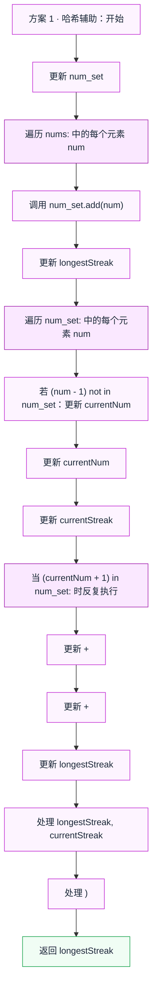

```python
import sys  # 提高递归深度上限（深输入防 RecursionError）

sys.setrecursionlimit(200000)  # 树/链表类题目节点数可达 1e4 量级

def longestConsecutive(nums):  # 定义函数 longestConsecutive（参数：数组）
    num_set = set()  # 把 set() 存入 num_set
    for num in nums:  # 逐个取出 数组 的元素（num）
        num_set.add(num)  # num_set 追加 num)
    longestStreak = 0  # 把 0 存入 longestStreak
    for num in num_set:  # 逐个取出 num_set 的元素（num）
        if (num - 1) not in num_set:  # 若 num 减 1) not in num_set
            currentNum = num  # 把 num 存入 currentNum
            currentStreak = 1  # 把 1 存入 currentStreak
            while (currentNum + 1) in num_set:  # 循环，直到不满足「currentNum 加 1) in num_set」
                currentNum += 1  # currentNum累加 1
                currentStreak += 1  # currentStreak累加 1
            longestStreak = max(
                longestStreak, currentStreak
            )  # 把 取较大值 longestStreak, currentStreak) 存入 longestStreak
    return longestStreak  # 返回 longestStreak

if __name__ == "__main__":  # 若 __name__ 等于 '__main__'
    print(longestConsecutive([1, 2, 3]))  # 打印输出
```

#### 方案 2：哈希辅助

**思路与代码分析**：核心是「哈希辅助」。Python 版用切片与字典推导式简化操作，突出可读性。**走读**：方案 2 · 哈希辅助：开始 → 更新 num_set → 更新 longest → 遍历 num_set: 中的每个元素 num → 若 num - 1 not in num_set：更新 current_num → 更新 current_num → 更新 current_streak → 当 current_num + 1 in num_set: 时反复执行 → 更新 + → 更新 + → 更新 longest → 返回 longest。

**运行架构**（真实控制流）：


```python
import sys  # 提高递归深度上限（深输入防 RecursionError）

sys.setrecursionlimit(200000)  # 树/链表类题目节点数可达 1e4 量级

def longestConsecutive(nums):  # 定义函数 longestConsecutive（参数：数组）
    num_set = set(nums)  # 把 set(数组) 存入 num_set
    longest = 0  # 把 0 存入 longest
    for num in num_set:  # 逐个取出 num_set 的元素（num）
        if num - 1 not in num_set:  # 若 num 减 1 not in num_set
            current_num = num  # 把 num 存入 current_num
            current_streak = 1  # 把 1 存入 current_streak
            while current_num + 1 in num_set:  # 循环，直到不满足「current_num 加 1 in num_set」
                current_num += 1  # current_num累加 1
                current_streak += 1  # current_streak累加 1
            longest = max(longest, current_streak)  # 把 取较大值 longest, current_streak) 存入 longest
    return longest  # 返回 longest

if __name__ == "__main__":  # 若 __name__ 等于 '__main__'
    print(longestConsecutive([1, 2, 3]))  # 打印输出
```

#### 方案 3：哈希辅助

**思路与代码分析**：核心是「哈希辅助」。Python 版用切片与字典推导式简化操作，突出可读性。**走读**：方案 3 · 哈希辅助：开始 → 更新 num_set → 更新 longest → 遍历 num_set: 中的每个元素 num → 若 num - 1 not in num_set：更新 current_num → 更新 current_num → 更新 current_streak → 当 current_num + 1 in num_set: 时反复执行 → 更新 + → 更新 + → 更新 longest → 返回 longest。

**运行架构**（真实控制流）：

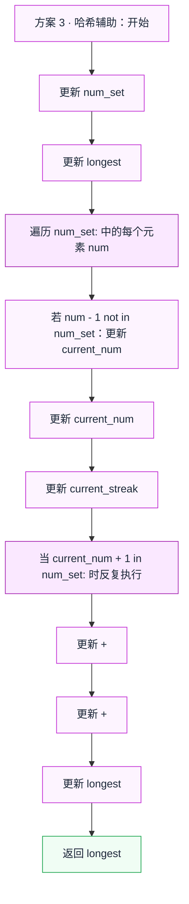

```python
import sys  # 提高递归深度上限（深输入防 RecursionError）

sys.setrecursionlimit(200000)  # 树/链表类题目节点数可达 1e4 量级

def longestConsecutive(nums):  # 定义函数 longestConsecutive（参数：数组）
    num_set = set(nums)  # 把 set(数组) 存入 num_set
    longest = 0  # 把 0 存入 longest
    for num in num_set:  # 逐个取出 num_set 的元素（num）
        if num - 1 not in num_set:  # 若 num 减 1 not in num_set
            current_num = num  # 把 num 存入 current_num
            current_streak = 1  # 把 1 存入 current_streak
            while current_num + 1 in num_set:  # 循环，直到不满足「current_num 加 1 in num_set」
                current_num += 1  # current_num累加 1
                current_streak += 1  # current_streak累加 1
            longest = max(longest, current_streak)  # 把 取较大值 longest, current_streak) 存入 longest
    return longest  # 返回 longest

if __name__ == "__main__":  # 若 __name__ 等于 '__main__'
    print(longestConsecutive([1, 2, 3]))  # 打印输出
```

### Go 实现（3 种方案）

Go 的全部方案如下，每个方案都内嵌用例自测，可独立运行（老仓库 python/go 文件遵循「打印结果」约定）：

#### 方案 1：哈希辅助

**思路与代码分析**：核心是「哈希辅助」。Go 版用切片与多返回值惯用法，显式处理索引边界。代码里依次做这些事：哈希结构做计数或查重。**走读**：方案 1 · 哈希辅助：开始 → 更新 : → 遍历 nums 的下标与元素 v → 更新 set[v] → 更新 : → 遍历 set 的下标与元素 num → 处理 if 非 set[num-1] → 更新 : → 更新 : → 遍历循环 → 处理 current++ → 处理 streak++ → 处理 if streak ＞ best → 更新 best → 返回 best。

**运行架构**（真实控制流）：


```go
package main // 引入依赖

import (
	"fmt" // 「fmt」
	"os"  // 「os」
)

func longestConsecutive(nums []int) int { // 定义函数/方法 longestConsecutive
	set := make(map[int]bool) // 把 make(映射表[int]bool) 写入 set :
	for _, v := range nums {  // 同时取 _ 与 值 遍历
		set[v] = true // 把 true 写入 set[v]
	}
	best := 0              // 把 0 写入 best :
	for num := range set { // 把 range set { 写入 for num :
		if !set[num-1] { // 若 取反 set[num 减 1]
			current := num       // 把 num 写入 current :
			streak := 1          // 把 1 写入 streak :
			for set[current+1] { // for set[current 加 1] {
				current++ // current 加一
				streak++  // streak 加一
			}
			if streak > best { // 若 streak 超过 当前最优
				best = streak // 把 streak 写入 当前最优
			}
		}
	}
	return best // 返回 当前最优
}

func main() { // 程序入口：跑内嵌自测用例
	cases := []struct { // 把 []struct { 写入 cases :
		in   []int // in []int
		want int   // want int
	}{ // }{
		{[]int{100, 4, 200, 1, 3, 2}, 4},
		{[]int{0, 3, 7, 2, 5, 8, 4, 6, 0, 1}, 9},
		{[]int{1, 0, 1, 2}, 3},
	}
	ok := true                // 把 true 写入 ok :
	for _, c := range cases { // 同时取 _ 与 字符 遍历
		got := longestConsecutive(c.in) // 把 longestConsecutive(字符.in) 写入 got :
		if got != c.want {              // 若 got 不等于 字符.want
			fmt.Printf("FAIL in=%v want=%d got=%d\n", c.in, c.want, got) // 打印输出
			ok = false                                                   // 把 false 写入 ok
		}
	}
	if !ok { // 若 取反 ok
		fmt.Println("RESULT: FAIL") // 打印输出
		os.Exit(1)                  // os.Exit(1)
	}
	fmt.Println("PASS") // 全部用例通过，输出 PASS
}
```

#### 方案 2：哈希辅助

**思路与代码分析**：核心是「哈希辅助」。Go 版用切片与多返回值惯用法，显式处理索引边界。代码里依次做这些事：哈希结构做计数或查重。**走读**：方案 2 · 哈希辅助：开始 → 更新 : → 遍历 nums 的下标与元素 v → 更新 set[v] → 更新 : → 遍历 set 的下标与元素 num → 处理 if 非 set[num-1] → 更新 : → 更新 : → 遍历循环 → 处理 current++ → 处理 streak++ → 处理 if streak ＞ best → 更新 best → 返回 best。

**运行架构**（真实控制流）：

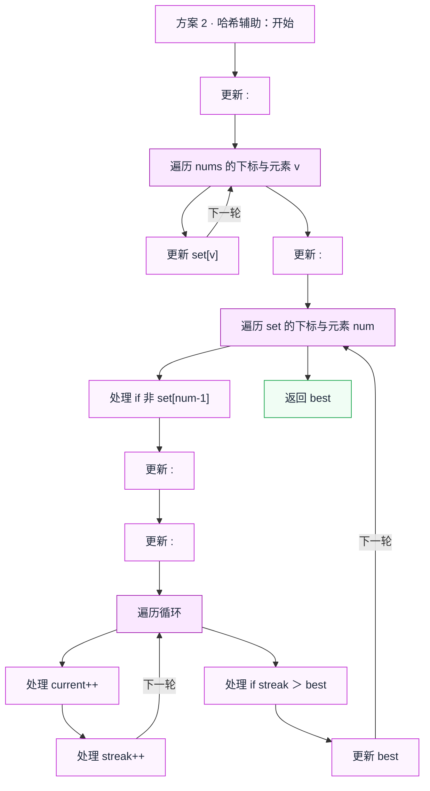

```go
package main // 引入依赖

import (
	"fmt" // 「fmt」
	"os"  // 「os」
)

func longestConsecutive(nums []int) int { // 定义函数/方法 longestConsecutive
	set := make(map[int]bool) // 把 make(映射表[int]bool) 写入 set :
	for _, v := range nums {  // 同时取 _ 与 值 遍历
		set[v] = true // 把 true 写入 set[v]
	}
	best := 0              // 把 0 写入 best :
	for num := range set { // 把 range set { 写入 for num :
		if !set[num-1] { // 若 取反 set[num 减 1]
			current := num       // 把 num 写入 current :
			streak := 1          // 把 1 写入 streak :
			for set[current+1] { // for set[current 加 1] {
				current++ // current 加一
				streak++  // streak 加一
			}
			if streak > best { // 若 streak 超过 当前最优
				best = streak // 把 streak 写入 当前最优
			}
		}
	}
	return best // 返回 当前最优
}

func main() { // 程序入口：跑内嵌自测用例
	cases := []struct { // 把 []struct { 写入 cases :
		in   []int // in []int
		want int   // want int
	}{ // }{
		{[]int{100, 4, 200, 1, 3, 2}, 4},
		{[]int{0, 3, 7, 2, 5, 8, 4, 6, 0, 1}, 9},
		{[]int{1, 0, 1, 2}, 3},
	}
	ok := true                // 把 true 写入 ok :
	for _, c := range cases { // 同时取 _ 与 字符 遍历
		got := longestConsecutive(c.in) // 把 longestConsecutive(字符.in) 写入 got :
		if got != c.want {              // 若 got 不等于 字符.want
			fmt.Printf("FAIL in=%v want=%d got=%d\n", c.in, c.want, got) // 打印输出
			ok = false                                                   // 把 false 写入 ok
		}
	}
	if !ok { // 若 取反 ok
		fmt.Println("RESULT: FAIL") // 打印输出
		os.Exit(1)                  // os.Exit(1)
	}
	fmt.Println("PASS") // 全部用例通过，输出 PASS
}
```

#### 方案 3：哈希辅助

**思路与代码分析**：核心是「哈希辅助」。Go 版用切片与多返回值惯用法，显式处理索引边界。代码里依次做这些事：哈希结构做计数或查重。**走读**：方案 3 · 哈希辅助：开始 → 更新 : → 遍历 nums 的下标与元素 v → 更新 set[v] → 更新 : → 遍历 set 的下标与元素 num → 处理 if 非 set[num-1] → 更新 : → 更新 : → 遍历循环 → 处理 current++ → 处理 streak++ → 处理 if streak ＞ best → 更新 best → 返回 best。

**运行架构**（真实控制流）：


```go
package main // 引入依赖

import (
	"fmt" // 「fmt」
	"os"  // 「os」
)

func longestConsecutive(nums []int) int { // 定义函数/方法 longestConsecutive
	set := make(map[int]bool) // 把 make(映射表[int]bool) 写入 set :
	for _, v := range nums {  // 同时取 _ 与 值 遍历
		set[v] = true // 把 true 写入 set[v]
	}
	best := 0              // 把 0 写入 best :
	for num := range set { // 把 range set { 写入 for num :
		if !set[num-1] { // 若 取反 set[num 减 1]
			current := num       // 把 num 写入 current :
			streak := 1          // 把 1 写入 streak :
			for set[current+1] { // for set[current 加 1] {
				current++ // current 加一
				streak++  // streak 加一
			}
			if streak > best { // 若 streak 超过 当前最优
				best = streak // 把 streak 写入 当前最优
			}
		}
	}
	return best // 返回 当前最优
}

func main() { // 程序入口：跑内嵌自测用例
	cases := []struct { // 把 []struct { 写入 cases :
		in   []int // in []int
		want int   // want int
	}{ // }{
		{[]int{100, 4, 200, 1, 3, 2}, 4},
		{[]int{0, 3, 7, 2, 5, 8, 4, 6, 0, 1}, 9},
		{[]int{1, 0, 1, 2}, 3},
	}
	ok := true                // 把 true 写入 ok :
	for _, c := range cases { // 同时取 _ 与 字符 遍历
		got := longestConsecutive(c.in) // 把 longestConsecutive(字符.in) 写入 got :
		if got != c.want {              // 若 got 不等于 字符.want
			fmt.Printf("FAIL in=%v want=%d got=%d\n", c.in, c.want, got) // 打印输出
			ok = false                                                   // 把 false 写入 ok
		}
	}
	if !ok { // 若 取反 ok
		fmt.Println("RESULT: FAIL") // 打印输出
		os.Exit(1)                  // os.Exit(1)
	}
	fmt.Println("PASS") // 全部用例通过，输出 PASS
}
```

### Java 实现（3 种方案）

Java 的全部方案如下，每个方案都内嵌用例自测，可独立运行（老仓库 python/go 文件遵循「打印结果」约定）：

#### 方案 1：哈希辅助

**思路与代码分析**：核心是「哈希辅助」。Java 版用类与静态方法组织，集合操作显式明了。代码里依次做这些事：双重循环遍历。**走读**：方案 1 · 哈希辅助：开始 → 更新 set → 遍历循环 → 更新 best → 遍历循环 → 若 非 set.contains(num - 1) 则： → 更新 cur → 当 (set.contains(cur + 1)) 时反复执行 → 处理 cur++ → 处理 streak++ → 若 streak ＞ best：更新 best → 返回 best。

**运行架构**（真实控制流）：

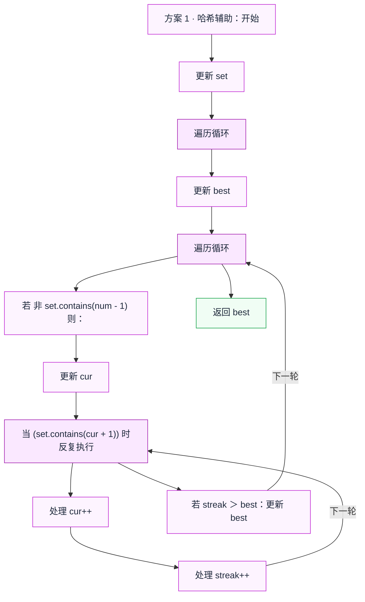

```java
package com.webfault.dsa; // 引入依赖

import java.util.*; // 引入依赖

class Solution { // 定义类型
  static int longestConsecutive(int[] nums) { // 定义函数/方法 longestConsecutive
    Set<Integer> set = new HashSet<>(); // 把 new HashSet 小于 超过 (); 写入 Set<Integer> set
    for (int v : nums) set.add(v); // for (int 值 : 数组) set 追加 值);
    int best = 0; // 把 0 存入 当前最优
    for (int num : set) { // for (int num : set) {
      if (!set.contains(num - 1)) { // 若 取反 set 是否包含 num 减 1
        int cur = num, streak = 1; // 把 num, streak 赋值为 1 存入 当前值
        while (set.contains(cur + 1)) {
          cur++;
          streak++;
        } // 循环，直到不满足「set 是否包含 当前值 加 1)) { 当前值 加一 ; streak 加一 ; }」
        if (streak > best) best = streak; // 若 streak 超过 当前最优) 当前最优 赋值为 streak;
      }
    }
    return best; // 返回 当前最优
  }

  public static void main(String[] args) { // public static void main(String[] args) {
    int[][] ins = {{100, 4, 200, 1, 3, 2}, {0, 3, 7, 2, 5, 8, 4, 6, 0, 1}, {1, 0, 1, 2}};
    int[] wants = {4, 9, 3}; // 把 {4, 9, 3}; 写入 int[] wants
    boolean ok = true; // 把 true; 写入 boolean ok
    for (int i = 0; i < ins.length; i++) { // 让 下标 i 从 0 开始计数，下标 i 小于 ins.长度 就继续
      int got = longestConsecutive(ins[i]); // 把 longestConsecutive(ins[下标 i]) 存入 got
      if (got != wants[i]) { // 若 got 不等于 wants[下标 i]
        System.out.println(
            "FAIL in=" + Arrays.toString(ins[i]) + " want=" + wants[i] + " got=" + got); // 打印输出
        ok = false; // 把 false; 写入 ok
      }
    }
    if (!ok) {
      System.out.println("RESULT: FAIL");
      System.exit(1);
    } // 若 取反 ok) { System.out.输出(「RESULT: FAIL」); System.exit(1); }
    System.out.println("PASS"); // 全部用例通过，输出 PASS
  }
}
```

#### 方案 2：哈希辅助

**思路与代码分析**：核心是「哈希辅助」。Java 版用类与静态方法组织，集合操作显式明了。代码里依次做这些事：双重循环遍历。**走读**：方案 2 · 哈希辅助：开始 → 更新 set → 遍历循环 → 更新 best → 遍历循环 → 若 非 set.contains(num - 1) 则： → 更新 cur → 当 (set.contains(cur + 1)) 时反复执行 → 处理 cur++ → 处理 streak++ → 若 streak ＞ best：更新 best → 返回 best。

**运行架构**（真实控制流）：


```java
package com.webfault.dsa; // 引入依赖

import java.util.*; // 引入依赖

class Solution { // 定义类型
  static int longestConsecutive(int[] nums) { // 定义函数/方法 longestConsecutive
    Set<Integer> set = new HashSet<>(); // 把 new HashSet 小于 超过 (); 写入 Set<Integer> set
    for (int v : nums) set.add(v); // for (int 值 : 数组) set 追加 值);
    int best = 0; // 把 0 存入 当前最优
    for (int num : set) { // for (int num : set) {
      if (!set.contains(num - 1)) { // 若 取反 set 是否包含 num 减 1
        int cur = num, streak = 1; // 把 num, streak 赋值为 1 存入 当前值
        while (set.contains(cur + 1)) {
          cur++;
          streak++;
        } // 循环，直到不满足「set 是否包含 当前值 加 1)) { 当前值 加一 ; streak 加一 ; }」
        if (streak > best) best = streak; // 若 streak 超过 当前最优) 当前最优 赋值为 streak;
      }
    }
    return best; // 返回 当前最优
  }

  public static void main(String[] args) { // public static void main(String[] args) {
    int[][] ins = {{100, 4, 200, 1, 3, 2}, {0, 3, 7, 2, 5, 8, 4, 6, 0, 1}, {1, 0, 1, 2}};
    int[] wants = {4, 9, 3}; // 把 {4, 9, 3}; 写入 int[] wants
    boolean ok = true; // 把 true; 写入 boolean ok
    for (int i = 0; i < ins.length; i++) { // 让 下标 i 从 0 开始计数，下标 i 小于 ins.长度 就继续
      int got = longestConsecutive(ins[i]); // 把 longestConsecutive(ins[下标 i]) 存入 got
      if (got != wants[i]) { // 若 got 不等于 wants[下标 i]
        System.out.println(
            "FAIL in=" + Arrays.toString(ins[i]) + " want=" + wants[i] + " got=" + got); // 打印输出
        ok = false; // 把 false; 写入 ok
      }
    }
    if (!ok) {
      System.out.println("RESULT: FAIL");
      System.exit(1);
    } // 若 取反 ok) { System.out.输出(「RESULT: FAIL」); System.exit(1); }
    System.out.println("PASS"); // 全部用例通过，输出 PASS
  }
}
```

#### 方案 3：哈希辅助

**思路与代码分析**：核心是「哈希辅助」。Java 版用类与静态方法组织，集合操作显式明了。代码里依次做这些事：双重循环遍历。**走读**：方案 3 · 哈希辅助：开始 → 更新 set → 遍历循环 → 更新 best → 遍历循环 → 若 非 set.contains(num - 1) 则： → 更新 cur → 当 (set.contains(cur + 1)) 时反复执行 → 处理 cur++ → 处理 streak++ → 若 streak ＞ best：更新 best → 返回 best。

**运行架构**（真实控制流）：


```java
package com.webfault.dsa; // 引入依赖

import java.util.*; // 引入依赖

class Solution { // 定义类型
  static int longestConsecutive(int[] nums) { // 定义函数/方法 longestConsecutive
    Set<Integer> set = new HashSet<>(); // 把 new HashSet 小于 超过 (); 写入 Set<Integer> set
    for (int v : nums) set.add(v); // for (int 值 : 数组) set 追加 值);
    int best = 0; // 把 0 存入 当前最优
    for (int num : set) { // for (int num : set) {
      if (!set.contains(num - 1)) { // 若 取反 set 是否包含 num 减 1
        int cur = num, streak = 1; // 把 num, streak 赋值为 1 存入 当前值
        while (set.contains(cur + 1)) {
          cur++;
          streak++;
        } // 循环，直到不满足「set 是否包含 当前值 加 1)) { 当前值 加一 ; streak 加一 ; }」
        if (streak > best) best = streak; // 若 streak 超过 当前最优) 当前最优 赋值为 streak;
      }
    }
    return best; // 返回 当前最优
  }

  public static void main(String[] args) { // public static void main(String[] args) {
    int[][] ins = {{100, 4, 200, 1, 3, 2}, {0, 3, 7, 2, 5, 8, 4, 6, 0, 1}, {1, 0, 1, 2}};
    int[] wants = {4, 9, 3}; // 把 {4, 9, 3}; 写入 int[] wants
    boolean ok = true; // 把 true; 写入 boolean ok
    for (int i = 0; i < ins.length; i++) { // 让 下标 i 从 0 开始计数，下标 i 小于 ins.长度 就继续
      int got = longestConsecutive(ins[i]); // 把 longestConsecutive(ins[下标 i]) 存入 got
      if (got != wants[i]) { // 若 got 不等于 wants[下标 i]
        System.out.println(
            "FAIL in=" + Arrays.toString(ins[i]) + " want=" + wants[i] + " got=" + got); // 打印输出
        ok = false; // 把 false; 写入 ok
      }
    }
    if (!ok) {
      System.out.println("RESULT: FAIL");
      System.exit(1);
    } // 若 取反 ok) { System.out.输出(「RESULT: FAIL」); System.exit(1); }
    System.out.println("PASS"); // 全部用例通过，输出 PASS
  }
}
```

### Rust 实现（3 种方案）

Rust 的全部方案如下，每个方案都内嵌用例自测，可独立运行（老仓库 python/go 文件遵循「打印结果」约定）：

#### 方案 1：哈希辅助

**思路与代码分析**：核心是「哈希辅助」。Rust 版用所有权移动与切片借用改写同一逻辑，注意 Option 与引用边界。**走读**：方案 1 · 哈希辅助：开始 → 计算 set → 计算 best → 遍历 &set 中的每个元素 num → 处理 if 非 set.contains(&(num - 1)) → 计算 cur → 计算 streak → 当 set.contains(&(cur + 1)) 时反复执行 → 更新 + → 更新 + → 处理 if streak ＞ best → 更新 best → 处理 best → 返回结果。

**运行架构**（真实控制流）：


```rust
// LeetCode 128. 最长连续序列 — Rust 版（方案1）
use std::collections::HashSet; // 引入依赖
fn longest_consecutive(nums: &[i32]) -> i32 {
    // 定义函数/方法 longest_consecutive
    let set: HashSet<i32> = nums.iter().cloned().collect(); // 把 数组.iter().cloned().collect(); 写入 let set: HashSet<i32>
    let mut best = 0; // 把 0; 写入 let mut best
    for &num in &set {
        // for 按位与 num in 按位与 set {
        if !set.contains(&(num - 1)) {
            // 若 取反 set 是否包含 按位与 (num 减 1
            let mut cur = num; // 把 num; 写入 let mut cur
            let mut streak = 1; // 把 1; 写入 let mut streak
            while set.contains(&(cur + 1)) {
                cur += 1;
                streak += 1;
            }
            if streak > best {
                best = streak;
            } // 若 streak 超过 当前最优 { 当前最优 赋值为 streak; }
        }
    }
    best // 当前最优
}
fn main() {
    // 程序入口：跑内嵌自测用例
    assert_eq!(longest_consecutive(&[100, 4, 200, 1, 3, 2]), 4); // 断言校验
    assert_eq!(longest_consecutive(&[0, 3, 7, 2, 5, 8, 4, 6, 0, 1]), 9); // 断言校验
    assert_eq!(longest_consecutive(&[]), 0); // 断言校验
    println!("PASS"); // 全部用例通过，输出 PASS
}
```

#### 方案 2：哈希辅助

**思路与代码分析**：核心是「哈希辅助」。Rust 版用所有权移动与切片借用改写同一逻辑，注意 Option 与引用边界。**走读**：方案 2 · 哈希辅助：开始 → 计算 set → 计算 best → 遍历 &set 中的每个元素 num → 处理 if 非 set.contains(&(num - 1)) → 计算 cur → 计算 streak → 当 set.contains(&(cur + 1)) 时反复执行 → 更新 + → 更新 + → 处理 if streak ＞ best → 更新 best → 处理 best → 返回结果。

**运行架构**（真实控制流）：


```rust
// LeetCode 128. 最长连续序列 — Rust 版（方案2）
use std::collections::HashSet; // 引入依赖
fn longest_consecutive(nums: &[i32]) -> i32 {
    // 定义函数/方法 longest_consecutive
    let set: HashSet<i32> = nums.iter().cloned().collect(); // 把 数组.iter().cloned().collect(); 写入 let set: HashSet<i32>
    let mut best = 0; // 把 0; 写入 let mut best
    for &num in &set {
        // for 按位与 num in 按位与 set {
        if !set.contains(&(num - 1)) {
            // 若 取反 set 是否包含 按位与 (num 减 1
            let mut cur = num; // 把 num; 写入 let mut cur
            let mut streak = 1; // 把 1; 写入 let mut streak
            while set.contains(&(cur + 1)) {
                cur += 1;
                streak += 1;
            }
            if streak > best {
                best = streak;
            } // 若 streak 超过 当前最优 { 当前最优 赋值为 streak; }
        }
    }
    best // 当前最优
}
fn main() {
    // 程序入口：跑内嵌自测用例
    assert_eq!(longest_consecutive(&[100, 4, 200, 1, 3, 2]), 4); // 断言校验
    assert_eq!(longest_consecutive(&[0, 3, 7, 2, 5, 8, 4, 6, 0, 1]), 9); // 断言校验
    assert_eq!(longest_consecutive(&[]), 0); // 断言校验
    println!("PASS"); // 全部用例通过，输出 PASS
}
```

#### 方案 3：哈希辅助

**思路与代码分析**：核心是「哈希辅助」。Rust 版用所有权移动与切片借用改写同一逻辑，注意 Option 与引用边界。**走读**：方案 3 · 哈希辅助：开始 → 计算 set → 计算 best → 遍历 &set 中的每个元素 num → 处理 if 非 set.contains(&(num - 1)) → 计算 cur → 计算 streak → 当 set.contains(&(cur + 1)) 时反复执行 → 更新 + → 更新 + → 处理 if streak ＞ best → 更新 best → 处理 best → 返回结果。

**运行架构**（真实控制流）：

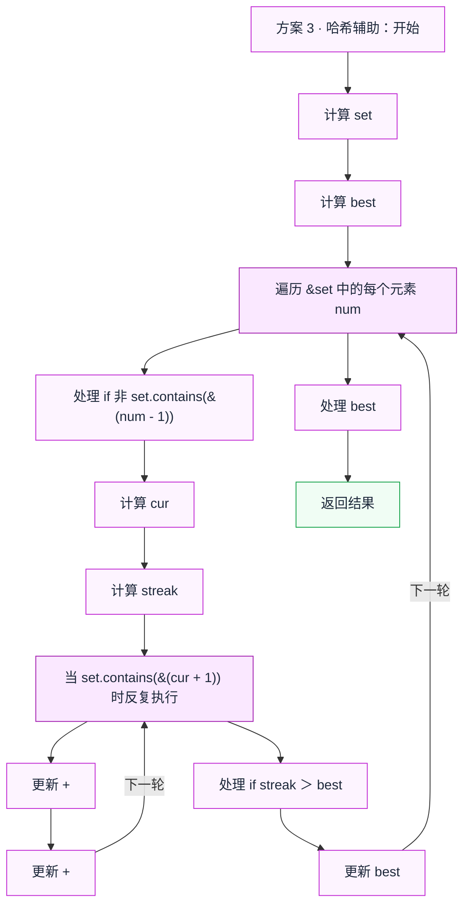

```rust
// LeetCode 128. 最长连续序列 — Rust 版（方案3）
use std::collections::HashSet; // 引入依赖
fn longest_consecutive(nums: &[i32]) -> i32 {
    // 定义函数/方法 longest_consecutive
    let set: HashSet<i32> = nums.iter().cloned().collect(); // 把 数组.iter().cloned().collect(); 写入 let set: HashSet<i32>
    let mut best = 0; // 把 0; 写入 let mut best
    for &num in &set {
        // for 按位与 num in 按位与 set {
        if !set.contains(&(num - 1)) {
            // 若 取反 set 是否包含 按位与 (num 减 1
            let mut cur = num; // 把 num; 写入 let mut cur
            let mut streak = 1; // 把 1; 写入 let mut streak
            while set.contains(&(cur + 1)) {
                cur += 1;
                streak += 1;
            }
            if streak > best {
                best = streak;
            } // 若 streak 超过 当前最优 { 当前最优 赋值为 streak; }
        }
    }
    best // 当前最优
}
fn main() {
    // 程序入口：跑内嵌自测用例
    assert_eq!(longest_consecutive(&[100, 4, 200, 1, 3, 2]), 4); // 断言校验
    assert_eq!(longest_consecutive(&[0, 3, 7, 2, 5, 8, 4, 6, 0, 1]), 9); // 断言校验
    assert_eq!(longest_consecutive(&[]), 0); // 断言校验
    println!("PASS"); // 全部用例通过，输出 PASS
}
```

### Lua 实现（3 种方案）

Lua 的全部方案如下，每个方案都内嵌用例自测，可独立运行（老仓库 python/go 文件遵循「打印结果」约定）：

#### 方案 1：哈希辅助

**思路与代码分析**：核心是「哈希辅助」。Lua 版用表与 ipairs 遍历，注意 ipairs 遇 nil 即停的语义。**走读**：方案 1 · 哈希辅助：开始 → 更新 set → 遍历 ipairs(nums) do 中的每个元素 v → 更新 set[v] → 更新 best → 遍历 pairs(set) do 中的每个元素 v → 处理 if not set[v - 1] then → 更新 streak → 当 set[cur + 1] do 时反复执行 → 更新 cur → 更新 streak → 处理 if streak ＞ best then → 更新 best → 返回 best。

**运行架构**（真实控制流）：

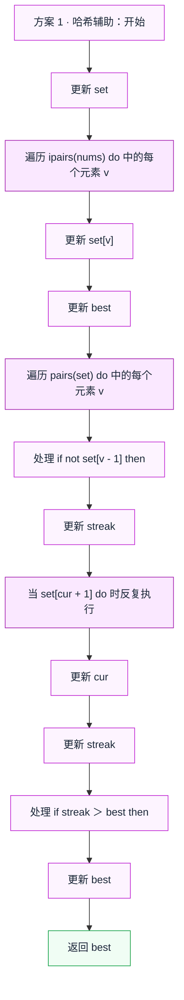

```lua
-- LeetCode 128. 最长连续序列 — Lua 版（方案1）
local function longest_consecutive(nums) -- local function longest_consecutive(数组)
	local set = {} -- 把 {} 写入 local set
	for _, v in ipairs(nums) do
		set[v] = true
	end -- 遍历取 值
	local best = 0 -- 把 0 写入 local best
	for v in pairs(set) do -- for 值 in pairs(set) do
		if not set[v - 1] then -- 若 not set[值 减 1] then
			local cur, streak = v, 1 -- 把 值, 1 写入 local cur, streak
			while set[cur + 1] do
				cur = cur + 1
				streak = streak + 1
			end
			if streak > best then
				best = streak
			end -- 若 streak 超过 当前最优 then 当前最优 赋值为 streak 终点
		end -- 终点
	end -- 终点
	return best -- 返回 当前最优
end -- 终点
assert(longest_consecutive({ 100, 4, 200, 1, 3, 2 }) == 4) -- 断言校验
assert(longest_consecutive({ 0, 3, 7, 2, 5, 8, 4, 6, 0, 1 }) == 9) -- 断言校验
assert(longest_consecutive({}) == 0) -- 断言校验
print("PASS") -- 全部用例通过，输出 PASS
```

#### 方案 2：哈希辅助

**思路与代码分析**：核心是「哈希辅助」。Lua 版用表与 ipairs 遍历，注意 ipairs 遇 nil 即停的语义。**走读**：方案 2 · 哈希辅助：开始 → 更新 set → 遍历 ipairs(nums) do 中的每个元素 v → 更新 set[v] → 更新 best → 遍历 pairs(set) do 中的每个元素 v → 处理 if not set[v - 1] then → 更新 streak → 当 set[cur + 1] do 时反复执行 → 更新 cur → 更新 streak → 处理 if streak ＞ best then → 更新 best → 返回 best。

**运行架构**（真实控制流）：

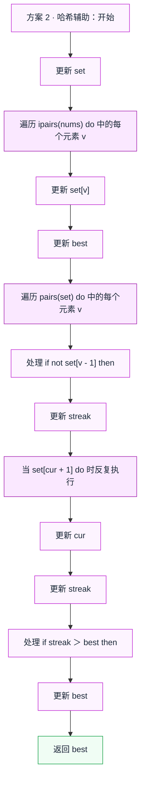

```lua
-- LeetCode 128. 最长连续序列 — Lua 版（方案2）
local function longest_consecutive(nums) -- local function longest_consecutive(数组)
	local set = {} -- 把 {} 写入 local set
	for _, v in ipairs(nums) do
		set[v] = true
	end -- 遍历取 值
	local best = 0 -- 把 0 写入 local best
	for v in pairs(set) do -- for 值 in pairs(set) do
		if not set[v - 1] then -- 若 not set[值 减 1] then
			local cur, streak = v, 1 -- 把 值, 1 写入 local cur, streak
			while set[cur + 1] do
				cur = cur + 1
				streak = streak + 1
			end
			if streak > best then
				best = streak
			end -- 若 streak 超过 当前最优 then 当前最优 赋值为 streak 终点
		end -- 终点
	end -- 终点
	return best -- 返回 当前最优
end -- 终点
assert(longest_consecutive({ 100, 4, 200, 1, 3, 2 }) == 4) -- 断言校验
assert(longest_consecutive({ 0, 3, 7, 2, 5, 8, 4, 6, 0, 1 }) == 9) -- 断言校验
assert(longest_consecutive({}) == 0) -- 断言校验
print("PASS") -- 全部用例通过，输出 PASS
```

#### 方案 3：哈希辅助

**思路与代码分析**：核心是「哈希辅助」。Lua 版用表与 ipairs 遍历，注意 ipairs 遇 nil 即停的语义。**走读**：方案 3 · 哈希辅助：开始 → 更新 set → 遍历 ipairs(nums) do 中的每个元素 v → 更新 set[v] → 更新 best → 遍历 pairs(set) do 中的每个元素 v → 处理 if not set[v - 1] then → 更新 streak → 当 set[cur + 1] do 时反复执行 → 更新 cur → 更新 streak → 处理 if streak ＞ best then → 更新 best → 返回 best。

**运行架构**（真实控制流）：

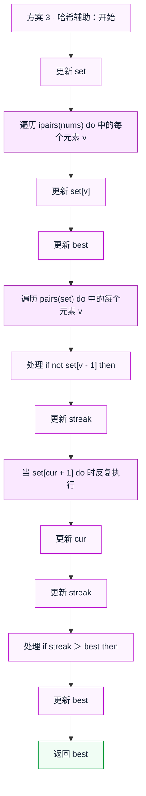

```lua
-- LeetCode 128. 最长连续序列 — Lua 版（方案3）
local function longest_consecutive(nums) -- local function longest_consecutive(数组)
	local set = {} -- 把 {} 写入 local set
	for _, v in ipairs(nums) do
		set[v] = true
	end -- 遍历取 值
	local best = 0 -- 把 0 写入 local best
	for v in pairs(set) do -- for 值 in pairs(set) do
		if not set[v - 1] then -- 若 not set[值 减 1] then
			local cur, streak = v, 1 -- 把 值, 1 写入 local cur, streak
			while set[cur + 1] do
				cur = cur + 1
				streak = streak + 1
			end
			if streak > best then
				best = streak
			end -- 若 streak 超过 当前最优 then 当前最优 赋值为 streak 终点
		end -- 终点
	end -- 终点
	return best -- 返回 当前最优
end -- 终点
assert(longest_consecutive({ 100, 4, 200, 1, 3, 2 }) == 4) -- 断言校验
assert(longest_consecutive({ 0, 3, 7, 2, 5, 8, 4, 6, 0, 1 }) == 9) -- 断言校验
assert(longest_consecutive({}) == 0) -- 断言校验
print("PASS") -- 全部用例通过，输出 PASS
```

### C 实现（3 种方案）

C 的全部方案如下，每个方案都内嵌用例自测，可独立运行（老仓库 python/go 文件遵循「打印结果」约定）：

#### 方案 1：哈希辅助

**思路与代码分析**：核心是「哈希辅助」。C 版手动管理下标与内存，循环边界全部显式写出。代码里依次做这些事：双重循环遍历。**走读**：方案 1 · 哈希辅助：开始 → 命中条件，直接返回 → 更新 *sorted → 遍历循环 → 遍历循环 → 返回 best。

**运行架构**（真实控制流）：

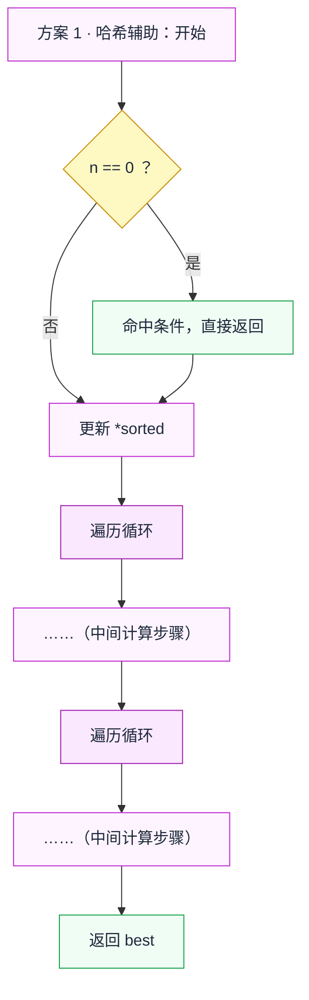

```c
/* LeetCode 128. 最长连续序列 — C 版（方案1） */
#include <stdio.h>  // 引入头文件
#include <stdlib.h> // 引入头文件
static int cmp_int(const void *a, const void *b) { return *(const int *)a - *(const int *)b; }
static int longest_consecutive(const int *nums, int n) { // 定义函数/方法 longest_consecutive
    if (n == 0)
        return 0;                          // 若 元素个数 等于 0，直接返回 0
    int *sorted = malloc(sizeof(int) * n); // 把 malloc(sizeof(int) 乘 元素个数); 写入 int *sorted
    for (int i = 0; i < n; i++)
        sorted[i] = nums[i]; // 让 下标 i 从 0 开始计数，下标 i 小于 元素个数 就继续
    qsort(sorted, n, sizeof(int), cmp_int); // qsort(sorted, 元素个数, sizeof(int), cmp_int);
    int best = 1, streak = 1;               // 把 1, streak 赋值为 1 存入 当前最优
    for (int i = 1; i < n; i++) { // 让 下标 i 从 1 开始计数，下标 i 小于 元素个数 就继续
        if (sorted[i] == sorted[i - 1])
            continue; // 若 sorted[下标 i] 等于 sorted[下标 i 减 1]) continue;
        if (sorted[i] == sorted[i - 1] + 1)
            streak++; // 若 sorted[下标 i] 等于 sorted[下标 i 减 1] 加 1) streak 加一 ;
        else
            streak = 1; // 否则
        if (streak > best)
            best = streak; // 若 streak 超过 当前最优) 当前最优 赋值为 streak;
    }
    free(sorted); // free(sorted);
    return best;  // 返回 当前最优
}
int main(void) { // 程序入口：跑内嵌自测用例
    if (longest_consecutive((int[]){100, 4, 200, 1, 3, 2}, 6) != 4) {
        printf("FAIL 1\n");
        return 1;
    }
    if (longest_consecutive((int[]){0, 3, 7, 2, 5, 8, 4, 6, 0, 1}, 10) != 9) {
        printf("FAIL 2\n");
        return 1;
    }
    if (longest_consecutive(NULL, 0) != 0) {
        printf("FAIL 3\n");
        return 1;
    }
    printf("PASS\n"); // 全部用例通过，输出 PASS
    return 0;         // 返回 0
}
```

#### 方案 2：哈希辅助

**思路与代码分析**：核心是「哈希辅助」。C 版手动管理下标与内存，循环边界全部显式写出。代码里依次做这些事：双重循环遍历。**走读**：方案 2 · 哈希辅助：开始 → 命中条件，直接返回 → 更新 *sorted → 遍历循环 → 遍历循环 → 返回 best。

**运行架构**（真实控制流）：

```mermaid
graph TD
    N0["方案 2 · 哈希辅助：开始"]
    N1{"n == 0 ？"}
    N2["命中条件，直接返回"]
    N3["更新 *sorted"]
    N4["遍历循环"]
    D1["……（中间计算步骤）"]
    N8["遍历循环"]
    D2["……（中间计算步骤）"]
    N16["返回 best"]
    N0 --> N1
    N1 -- 是 --> N2
    N1 -- 否 --> N3
    N3 --> N4
    N2 --> N3
    N4 --> D1
    D1 --> N8
    N8 --> D2
    D2 --> N16
    classDef n fill:#fdf4ff,stroke:#c026d3,color:#1e293b;
    classDef lp fill:#fae8ff,stroke:#a21caf,color:#1e293b;
    classDef dc fill:#fef9c3,stroke:#ca8a04,color:#1e293b;
    classDef tm fill:#f0fdf4,stroke:#16a34a,color:#1e293b;
    class N0,N3,D1,D2 n;
    class N4,N8 lp;
    class N1 dc;
    class N2,N16 tm;
```

```c
/* LeetCode 128. 最长连续序列 — C 版（方案2） */
#include <stdio.h>  // 引入头文件
#include <stdlib.h> // 引入头文件
static int cmp_int(const void *a, const void *b) { return *(const int *)a - *(const int *)b; }
static int longest_consecutive(const int *nums, int n) { // 定义函数/方法 longest_consecutive
    if (n == 0)
        return 0;                          // 若 元素个数 等于 0，直接返回 0
    int *sorted = malloc(sizeof(int) * n); // 把 malloc(sizeof(int) 乘 元素个数); 写入 int *sorted
    for (int i = 0; i < n; i++)
        sorted[i] = nums[i]; // 让 下标 i 从 0 开始计数，下标 i 小于 元素个数 就继续
    qsort(sorted, n, sizeof(int), cmp_int); // qsort(sorted, 元素个数, sizeof(int), cmp_int);
    int best = 1, streak = 1;               // 把 1, streak 赋值为 1 存入 当前最优
    for (int i = 1; i < n; i++) { // 让 下标 i 从 1 开始计数，下标 i 小于 元素个数 就继续
        if (sorted[i] == sorted[i - 1])
            continue; // 若 sorted[下标 i] 等于 sorted[下标 i 减 1]) continue;
        if (sorted[i] == sorted[i - 1] + 1)
            streak++; // 若 sorted[下标 i] 等于 sorted[下标 i 减 1] 加 1) streak 加一 ;
        else
            streak = 1; // 否则
        if (streak > best)
            best = streak; // 若 streak 超过 当前最优) 当前最优 赋值为 streak;
    }
    free(sorted); // free(sorted);
    return best;  // 返回 当前最优
}
int main(void) { // 程序入口：跑内嵌自测用例
    if (longest_consecutive((int[]){100, 4, 200, 1, 3, 2}, 6) != 4) {
        printf("FAIL 1\n");
        return 1;
    }
    if (longest_consecutive((int[]){0, 3, 7, 2, 5, 8, 4, 6, 0, 1}, 10) != 9) {
        printf("FAIL 2\n");
        return 1;
    }
    if (longest_consecutive(NULL, 0) != 0) {
        printf("FAIL 3\n");
        return 1;
    }
    printf("PASS\n"); // 全部用例通过，输出 PASS
    return 0;         // 返回 0
}
```

#### 方案 3：哈希辅助

**思路与代码分析**：核心是「哈希辅助」。C 版手动管理下标与内存，循环边界全部显式写出。代码里依次做这些事：双重循环遍历。**走读**：方案 3 · 哈希辅助：开始 → 命中条件，直接返回 → 更新 *sorted → 遍历循环 → 遍历循环 → 返回 best。

**运行架构**（真实控制流）：

```mermaid
graph TD
    N0["方案 3 · 哈希辅助：开始"]
    N1{"n == 0 ？"}
    N2["命中条件，直接返回"]
    N3["更新 *sorted"]
    N4["遍历循环"]
    D1["……（中间计算步骤）"]
    N8["遍历循环"]
    D2["……（中间计算步骤）"]
    N16["返回 best"]
    N0 --> N1
    N1 -- 是 --> N2
    N1 -- 否 --> N3
    N3 --> N4
    N2 --> N3
    N4 --> D1
    D1 --> N8
    N8 --> D2
    D2 --> N16
    classDef n fill:#fdf4ff,stroke:#c026d3,color:#1e293b;
    classDef lp fill:#fae8ff,stroke:#a21caf,color:#1e293b;
    classDef dc fill:#fef9c3,stroke:#ca8a04,color:#1e293b;
    classDef tm fill:#f0fdf4,stroke:#16a34a,color:#1e293b;
    class N0,N3,D1,D2 n;
    class N4,N8 lp;
    class N1 dc;
    class N2,N16 tm;
```

```c
/* LeetCode 128. 最长连续序列 — C 版（方案3） */
#include <stdio.h>  // 引入头文件
#include <stdlib.h> // 引入头文件
static int cmp_int(const void *a, const void *b) { return *(const int *)a - *(const int *)b; }
static int longest_consecutive(const int *nums, int n) { // 定义函数/方法 longest_consecutive
    if (n == 0)
        return 0;                          // 若 元素个数 等于 0，直接返回 0
    int *sorted = malloc(sizeof(int) * n); // 把 malloc(sizeof(int) 乘 元素个数); 写入 int *sorted
    for (int i = 0; i < n; i++)
        sorted[i] = nums[i]; // 让 下标 i 从 0 开始计数，下标 i 小于 元素个数 就继续
    qsort(sorted, n, sizeof(int), cmp_int); // qsort(sorted, 元素个数, sizeof(int), cmp_int);
    int best = 1, streak = 1;               // 把 1, streak 赋值为 1 存入 当前最优
    for (int i = 1; i < n; i++) { // 让 下标 i 从 1 开始计数，下标 i 小于 元素个数 就继续
        if (sorted[i] == sorted[i - 1])
            continue; // 若 sorted[下标 i] 等于 sorted[下标 i 减 1]) continue;
        if (sorted[i] == sorted[i - 1] + 1)
            streak++; // 若 sorted[下标 i] 等于 sorted[下标 i 减 1] 加 1) streak 加一 ;
        else
            streak = 1; // 否则
        if (streak > best)
            best = streak; // 若 streak 超过 当前最优) 当前最优 赋值为 streak;
    }
    free(sorted); // free(sorted);
    return best;  // 返回 当前最优
}
int main(void) { // 程序入口：跑内嵌自测用例
    if (longest_consecutive((int[]){100, 4, 200, 1, 3, 2}, 6) != 4) {
        printf("FAIL 1\n");
        return 1;
    }
    if (longest_consecutive((int[]){0, 3, 7, 2, 5, 8, 4, 6, 0, 1}, 10) != 9) {
        printf("FAIL 2\n");
        return 1;
    }
    if (longest_consecutive(NULL, 0) != 0) {
        printf("FAIL 3\n");
        return 1;
    }
    printf("PASS\n"); // 全部用例通过，输出 PASS
    return 0;         // 返回 0
}
```

### C++ 实现（3 种方案）

C++ 的全部方案如下，每个方案都内嵌用例自测，可独立运行（老仓库 python/go 文件遵循「打印结果」约定）：

#### 方案 1：哈希辅助

**思路与代码分析**：核心是「哈希辅助」。C++ 版用 STL 容器与迭代器，减少手写下标错误。代码里依次做这些事：单循环线性扫描。**走读**：方案 1 · 哈希辅助：开始 → 处理 std::unordered_set＜int＞ set( → 调用 nums.begin(), nums.end()) → 更新 best → 遍历循环 → 若 set.count(num - 1)：处理 continue → 更新 cur → 当 (set.count(cur + 1)) 时反复执行 → 处理 ++cur → 处理 ++streak → 更新 best → 返回 best。

**运行架构**（真实控制流）：

```mermaid
graph TD
    N0["方案 1 · 哈希辅助：开始"]
    N1["处理 std::unordered_set＜int＞ set("]
    N2["调用 nums.begin(), nums.end())"]
    N3["更新 best"]
    N4["遍历循环"]
    N5["若 set.count(num - 1)：处理 continue"]
    N6["更新 cur"]
    N7["当 (set.count(cur + 1)) 时反复执行"]
    N8["处理 ++cur"]
    N9["处理 ++streak"]
    N10["更新 best"]
    N11["返回 best"]
    N0 --> N1
    N1 --> N2
    N2 --> N3
    N3 --> N4
    N4 --> N5
    N5 --> N6
    N6 --> N7
    N7 --> N8
    N8 --> N9
    N9 -- 下一轮 --> N7
    N7 --> N10
    N10 -- 下一轮 --> N4
    N4 --> N11
    classDef n fill:#fdf4ff,stroke:#c026d3,color:#1e293b;
    classDef lp fill:#fae8ff,stroke:#a21caf,color:#1e293b;
    classDef dc fill:#fef9c3,stroke:#ca8a04,color:#1e293b;
    classDef tm fill:#f0fdf4,stroke:#16a34a,color:#1e293b;
    class N0,N1,N2,N3,N5,N6,N8,N9,N10 n;
    class N4,N7 lp;
    class N11 tm;
```

```cpp
// LeetCode 128. 最长连续序列 — C++ 版（方案1）
#include <cassert>                                            // 引入头文件
#include <iostream>                                           // 引入头文件
#include <unordered_set>                                      // 引入头文件
#include <vector>                                             // 引入头文件
static int longestConsecutive(const std::vector<int> &nums) { // 定义函数/方法 longestConsecutive
    std::unordered_set<int> set(
        nums.begin(), nums.end()); // std::unordered_set 小于 int 超过 set(数组 迭代位置 , 数组.终点());
    int best = 0;                  // 把 0 存入 当前最优
    for (int num : set) {          // for (int num : set) {
        if (set.count(num - 1))
            continue;              // 若 set.计数(num 减 1)) continue;
        int cur = num, streak = 1; // 把 num, streak 赋值为 1 存入 当前值
        while (set.count(cur + 1)) {
            ++cur;
            ++streak;
        } // 循环，直到不满足「set.计数(当前值 加 1)) { 加一 当前值; 加一 streak; }」
        best = std::max(best, streak); // 把 std::取较大值 当前最优, streak); 写入 当前最优
    }
    return best; // 返回 当前最优
}
int main() {                                                         // 程序入口：跑内嵌自测用例
    assert(longestConsecutive({100, 4, 200, 1, 3, 2}) == 4);         // 断言校验
    assert(longestConsecutive({0, 3, 7, 2, 5, 8, 4, 6, 0, 1}) == 9); // 断言校验
    assert(longestConsecutive({}) == 0);                             // 断言校验
    std::cout << "PASS" << std::endl;                                // 全部用例通过，输出 PASS
    return 0;                                                        // 返回 0
}
```

#### 方案 2：哈希辅助

**思路与代码分析**：核心是「哈希辅助」。C++ 版用 STL 容器与迭代器，减少手写下标错误。代码里依次做这些事：单循环线性扫描。**走读**：方案 2 · 哈希辅助：开始 → 处理 std::unordered_set＜int＞ set( → 调用 nums.begin(), nums.end()) → 更新 best → 遍历循环 → 若 set.count(num - 1)：处理 continue → 更新 cur → 当 (set.count(cur + 1)) 时反复执行 → 处理 ++cur → 处理 ++streak → 更新 best → 返回 best。

**运行架构**（真实控制流）：

```mermaid
graph TD
    N0["方案 2 · 哈希辅助：开始"]
    N1["处理 std::unordered_set＜int＞ set("]
    N2["调用 nums.begin(), nums.end())"]
    N3["更新 best"]
    N4["遍历循环"]
    N5["若 set.count(num - 1)：处理 continue"]
    N6["更新 cur"]
    N7["当 (set.count(cur + 1)) 时反复执行"]
    N8["处理 ++cur"]
    N9["处理 ++streak"]
    N10["更新 best"]
    N11["返回 best"]
    N0 --> N1
    N1 --> N2
    N2 --> N3
    N3 --> N4
    N4 --> N5
    N5 --> N6
    N6 --> N7
    N7 --> N8
    N8 --> N9
    N9 -- 下一轮 --> N7
    N7 --> N10
    N10 -- 下一轮 --> N4
    N4 --> N11
    classDef n fill:#fdf4ff,stroke:#c026d3,color:#1e293b;
    classDef lp fill:#fae8ff,stroke:#a21caf,color:#1e293b;
    classDef dc fill:#fef9c3,stroke:#ca8a04,color:#1e293b;
    classDef tm fill:#f0fdf4,stroke:#16a34a,color:#1e293b;
    class N0,N1,N2,N3,N5,N6,N8,N9,N10 n;
    class N4,N7 lp;
    class N11 tm;
```

```cpp
// LeetCode 128. 最长连续序列 — C++ 版（方案2）
#include <cassert>                                            // 引入头文件
#include <iostream>                                           // 引入头文件
#include <unordered_set>                                      // 引入头文件
#include <vector>                                             // 引入头文件
static int longestConsecutive(const std::vector<int> &nums) { // 定义函数/方法 longestConsecutive
    std::unordered_set<int> set(
        nums.begin(), nums.end()); // std::unordered_set 小于 int 超过 set(数组 迭代位置 , 数组.终点());
    int best = 0;                  // 把 0 存入 当前最优
    for (int num : set) {          // for (int num : set) {
        if (set.count(num - 1))
            continue;              // 若 set.计数(num 减 1)) continue;
        int cur = num, streak = 1; // 把 num, streak 赋值为 1 存入 当前值
        while (set.count(cur + 1)) {
            ++cur;
            ++streak;
        } // 循环，直到不满足「set.计数(当前值 加 1)) { 加一 当前值; 加一 streak; }」
        best = std::max(best, streak); // 把 std::取较大值 当前最优, streak); 写入 当前最优
    }
    return best; // 返回 当前最优
}
int main() {                                                         // 程序入口：跑内嵌自测用例
    assert(longestConsecutive({100, 4, 200, 1, 3, 2}) == 4);         // 断言校验
    assert(longestConsecutive({0, 3, 7, 2, 5, 8, 4, 6, 0, 1}) == 9); // 断言校验
    assert(longestConsecutive({}) == 0);                             // 断言校验
    std::cout << "PASS" << std::endl;                                // 全部用例通过，输出 PASS
    return 0;                                                        // 返回 0
}
```

#### 方案 3：哈希辅助

**思路与代码分析**：核心是「哈希辅助」。C++ 版用 STL 容器与迭代器，减少手写下标错误。代码里依次做这些事：单循环线性扫描。**走读**：方案 3 · 哈希辅助：开始 → 处理 std::unordered_set＜int＞ set( → 调用 nums.begin(), nums.end()) → 更新 best → 遍历循环 → 若 set.count(num - 1)：处理 continue → 更新 cur → 当 (set.count(cur + 1)) 时反复执行 → 处理 ++cur → 处理 ++streak → 更新 best → 返回 best。

**运行架构**（真实控制流）：

```mermaid
graph TD
    N0["方案 3 · 哈希辅助：开始"]
    N1["处理 std::unordered_set＜int＞ set("]
    N2["调用 nums.begin(), nums.end())"]
    N3["更新 best"]
    N4["遍历循环"]
    N5["若 set.count(num - 1)：处理 continue"]
    N6["更新 cur"]
    N7["当 (set.count(cur + 1)) 时反复执行"]
    N8["处理 ++cur"]
    N9["处理 ++streak"]
    N10["更新 best"]
    N11["返回 best"]
    N0 --> N1
    N1 --> N2
    N2 --> N3
    N3 --> N4
    N4 --> N5
    N5 --> N6
    N6 --> N7
    N7 --> N8
    N8 --> N9
    N9 -- 下一轮 --> N7
    N7 --> N10
    N10 -- 下一轮 --> N4
    N4 --> N11
    classDef n fill:#fdf4ff,stroke:#c026d3,color:#1e293b;
    classDef lp fill:#fae8ff,stroke:#a21caf,color:#1e293b;
    classDef dc fill:#fef9c3,stroke:#ca8a04,color:#1e293b;
    classDef tm fill:#f0fdf4,stroke:#16a34a,color:#1e293b;
    class N0,N1,N2,N3,N5,N6,N8,N9,N10 n;
    class N4,N7 lp;
    class N11 tm;
```

```cpp
// LeetCode 128. 最长连续序列 — C++ 版（方案3）
#include <cassert>                                            // 引入头文件
#include <iostream>                                           // 引入头文件
#include <unordered_set>                                      // 引入头文件
#include <vector>                                             // 引入头文件
static int longestConsecutive(const std::vector<int> &nums) { // 定义函数/方法 longestConsecutive
    std::unordered_set<int> set(
        nums.begin(), nums.end()); // std::unordered_set 小于 int 超过 set(数组 迭代位置 , 数组.终点());
    int best = 0;                  // 把 0 存入 当前最优
    for (int num : set) {          // for (int num : set) {
        if (set.count(num - 1))
            continue;              // 若 set.计数(num 减 1)) continue;
        int cur = num, streak = 1; // 把 num, streak 赋值为 1 存入 当前值
        while (set.count(cur + 1)) {
            ++cur;
            ++streak;
        } // 循环，直到不满足「set.计数(当前值 加 1)) { 加一 当前值; 加一 streak; }」
        best = std::max(best, streak); // 把 std::取较大值 当前最优, streak); 写入 当前最优
    }
    return best; // 返回 当前最优
}
int main() {                                                         // 程序入口：跑内嵌自测用例
    assert(longestConsecutive({100, 4, 200, 1, 3, 2}) == 4);         // 断言校验
    assert(longestConsecutive({0, 3, 7, 2, 5, 8, 4, 6, 0, 1}) == 9); // 断言校验
    assert(longestConsecutive({}) == 0);                             // 断言校验
    std::cout << "PASS" << std::endl;                                // 全部用例通过，输出 PASS
    return 0;                                                        // 返回 0
}
```

### R 实现（3 种方案）

R 的全部方案如下，每个方案都内嵌用例自测，可独立运行（老仓库 python/go 文件遵循「打印结果」约定）：

#### 方案 1：哈希辅助

**思路与代码分析**：核心是「哈希辅助」。R 版用向量化思维与 1 起始下标，注意 1:n 的降序陷阱。代码里依次做这些事：单循环线性扫描。**走读**：方案 1 · 哈希辅助：开始 → 命中条件，直接返回 → 处理 s ＜- sort(unique(nums)) → 处理 best ＜- 1L → 处理 streak ＜- 1L → 循环 i：遍历 2:length(s) → 若 s[i] == s[i - 1L] + 1L：处理 streak ＜- streak + 1L else s → 处理 streak ＜- streak + 1L else s → 若 streak ＞ best：处理 best ＜- streak → 处理 best ＜- streak → 处理 best。

**运行架构**（真实控制流）：

```mermaid
graph TD
    N0["方案 1 · 哈希辅助：开始"]
    N1{"length(nums) == 0L ？"}
    N2["命中条件，直接返回"]
    N3["处理 s ＜- sort(unique(nums))"]
    N4["处理 best ＜- 1L"]
    N5["处理 streak ＜- 1L"]
    N6["循环 i：遍历 2:length(s)"]
    N7["若 s[i] == s[i - 1L] + 1L：处理 streak ＜- streak + 1L else s"]
    N8["处理 streak ＜- streak + 1L else s"]
    N9["若 streak ＞ best：处理 best ＜- streak"]
    N10["处理 best ＜- streak"]
    N11["处理 best"]
    N0 --> N1
    N1 -- 是 --> N2
    N1 -- 否 --> N3
    N3 --> N4
    N4 --> N5
    N5 --> N6
    N6 --> N7
    N7 --> N8
    N8 --> N9
    N9 --> N10
    N10 -- 下一轮 --> N6
    N6 --> N11
    classDef n fill:#fdf4ff,stroke:#c026d3,color:#1e293b;
    classDef lp fill:#fae8ff,stroke:#a21caf,color:#1e293b;
    classDef dc fill:#fef9c3,stroke:#ca8a04,color:#1e293b;
    classDef tm fill:#f0fdf4,stroke:#16a34a,color:#1e293b;
    class N0,N3,N4,N5,N7,N8,N9,N10,N11 n;
    class N6 lp;
    class N1 dc;
    class N2 tm;
```

```r
# 版（方案1） 定义函数 longest_consecutive（参数：数组）
longest_consecutive <- function(nums) {
    if (length(nums) == 0L)
        return(0L)  # 若 长度(数组) 等于 0L) return(0L
    s <- sort(unique(nums))  # 把 sort(unique(数组)) 存入 字符串
    best <- 1L
    streak <- 1L  # 把 1L; streak 小于 减 1L 存入 当前最优
    for (i in 2:length(s)) {
        # for (下标 i in 2:长度(字符串)) {
        if (s[i] == s[i - 1L] + 1L)
            streak <- streak + 1L else streak <- 1L
        if (streak > best)
            best <- streak  # 若 streak 超过 当前最优) 当前最优 小于 减 streak
    }
    best  # 当前最优
}
stopifnot(longest_consecutive(c(100, 4, 200, 1, 3, 2)) == 4L)  # 断言校验
stopifnot(longest_consecutive(c(0, 3, 7, 2, 5, 8, 4, 6, 0, 1)) == 9L)  # 断言校验
stopifnot(longest_consecutive(integer(0)) == 0L)  # 断言校验
cat("PASS\n")  # 全部用例通过，输出 PASS
```

#### 方案 2：哈希辅助

**思路与代码分析**：核心是「哈希辅助」。R 版用向量化思维与 1 起始下标，注意 1:n 的降序陷阱。代码里依次做这些事：单循环线性扫描。**走读**：方案 2 · 哈希辅助：开始 → 命中条件，直接返回 → 处理 s ＜- sort(unique(nums)) → 处理 best ＜- 1L → 处理 streak ＜- 1L → 循环 i：遍历 2:length(s) → 若 s[i] == s[i - 1L] + 1L：处理 streak ＜- streak + 1L else s → 处理 streak ＜- streak + 1L else s → 若 streak ＞ best：处理 best ＜- streak → 处理 best ＜- streak → 处理 best。

**运行架构**（真实控制流）：

```mermaid
graph TD
    N0["方案 2 · 哈希辅助：开始"]
    N1{"length(nums) == 0L ？"}
    N2["命中条件，直接返回"]
    N3["处理 s ＜- sort(unique(nums))"]
    N4["处理 best ＜- 1L"]
    N5["处理 streak ＜- 1L"]
    N6["循环 i：遍历 2:length(s)"]
    N7["若 s[i] == s[i - 1L] + 1L：处理 streak ＜- streak + 1L else s"]
    N8["处理 streak ＜- streak + 1L else s"]
    N9["若 streak ＞ best：处理 best ＜- streak"]
    N10["处理 best ＜- streak"]
    N11["处理 best"]
    N0 --> N1
    N1 -- 是 --> N2
    N1 -- 否 --> N3
    N3 --> N4
    N4 --> N5
    N5 --> N6
    N6 --> N7
    N7 --> N8
    N8 --> N9
    N9 --> N10
    N10 -- 下一轮 --> N6
    N6 --> N11
    classDef n fill:#fdf4ff,stroke:#c026d3,color:#1e293b;
    classDef lp fill:#fae8ff,stroke:#a21caf,color:#1e293b;
    classDef dc fill:#fef9c3,stroke:#ca8a04,color:#1e293b;
    classDef tm fill:#f0fdf4,stroke:#16a34a,color:#1e293b;
    class N0,N3,N4,N5,N7,N8,N9,N10,N11 n;
    class N6 lp;
    class N1 dc;
    class N2 tm;
```

```r
# 版（方案2） 定义函数 longest_consecutive（参数：数组）
longest_consecutive <- function(nums) {
    if (length(nums) == 0L)
        return(0L)  # 若 长度(数组) 等于 0L) return(0L
    s <- sort(unique(nums))  # 把 sort(unique(数组)) 存入 字符串
    best <- 1L
    streak <- 1L  # 把 1L; streak 小于 减 1L 存入 当前最优
    for (i in 2:length(s)) {
        # for (下标 i in 2:长度(字符串)) {
        if (s[i] == s[i - 1L] + 1L)
            streak <- streak + 1L else streak <- 1L
        if (streak > best)
            best <- streak  # 若 streak 超过 当前最优) 当前最优 小于 减 streak
    }
    best  # 当前最优
}
stopifnot(longest_consecutive(c(100, 4, 200, 1, 3, 2)) == 4L)  # 断言校验
stopifnot(longest_consecutive(c(0, 3, 7, 2, 5, 8, 4, 6, 0, 1)) == 9L)  # 断言校验
stopifnot(longest_consecutive(integer(0)) == 0L)  # 断言校验
cat("PASS\n")  # 全部用例通过，输出 PASS
```

#### 方案 3：哈希辅助

**思路与代码分析**：核心是「哈希辅助」。R 版用向量化思维与 1 起始下标，注意 1:n 的降序陷阱。代码里依次做这些事：单循环线性扫描。**走读**：方案 3 · 哈希辅助：开始 → 命中条件，直接返回 → 处理 s ＜- sort(unique(nums)) → 处理 best ＜- 1L → 处理 streak ＜- 1L → 循环 i：遍历 2:length(s) → 若 s[i] == s[i - 1L] + 1L：处理 streak ＜- streak + 1L else s → 处理 streak ＜- streak + 1L else s → 若 streak ＞ best：处理 best ＜- streak → 处理 best ＜- streak → 处理 best。

**运行架构**（真实控制流）：

```mermaid
graph TD
    N0["方案 3 · 哈希辅助：开始"]
    N1{"length(nums) == 0L ？"}
    N2["命中条件，直接返回"]
    N3["处理 s ＜- sort(unique(nums))"]
    N4["处理 best ＜- 1L"]
    N5["处理 streak ＜- 1L"]
    N6["循环 i：遍历 2:length(s)"]
    N7["若 s[i] == s[i - 1L] + 1L：处理 streak ＜- streak + 1L else s"]
    N8["处理 streak ＜- streak + 1L else s"]
    N9["若 streak ＞ best：处理 best ＜- streak"]
    N10["处理 best ＜- streak"]
    N11["处理 best"]
    N0 --> N1
    N1 -- 是 --> N2
    N1 -- 否 --> N3
    N3 --> N4
    N4 --> N5
    N5 --> N6
    N6 --> N7
    N7 --> N8
    N8 --> N9
    N9 --> N10
    N10 -- 下一轮 --> N6
    N6 --> N11
    classDef n fill:#fdf4ff,stroke:#c026d3,color:#1e293b;
    classDef lp fill:#fae8ff,stroke:#a21caf,color:#1e293b;
    classDef dc fill:#fef9c3,stroke:#ca8a04,color:#1e293b;
    classDef tm fill:#f0fdf4,stroke:#16a34a,color:#1e293b;
    class N0,N3,N4,N5,N7,N8,N9,N10,N11 n;
    class N6 lp;
    class N1 dc;
    class N2 tm;
```

```r
# 版（方案3） 定义函数 longest_consecutive（参数：数组）
longest_consecutive <- function(nums) {
    if (length(nums) == 0L)
        return(0L)  # 若 长度(数组) 等于 0L) return(0L
    s <- sort(unique(nums))  # 把 sort(unique(数组)) 存入 字符串
    best <- 1L
    streak <- 1L  # 把 1L; streak 小于 减 1L 存入 当前最优
    for (i in 2:length(s)) {
        # for (下标 i in 2:长度(字符串)) {
        if (s[i] == s[i - 1L] + 1L)
            streak <- streak + 1L else streak <- 1L
        if (streak > best)
            best <- streak  # 若 streak 超过 当前最优) 当前最优 小于 减 streak
    }
    best  # 当前最优
}
stopifnot(longest_consecutive(c(100, 4, 200, 1, 3, 2)) == 4L)  # 断言校验
stopifnot(longest_consecutive(c(0, 3, 7, 2, 5, 8, 4, 6, 0, 1)) == 9L)  # 断言校验
stopifnot(longest_consecutive(integer(0)) == 0L)  # 断言校验
cat("PASS\n")  # 全部用例通过，输出 PASS
```

### Zig 实现（3 种方案）

Zig 的全部方案如下，每个方案都内嵌用例自测，可独立运行（老仓库 python/go 文件遵循「打印结果」约定）：

#### 方案 1：哈希辅助

**思路与代码分析**：核心是「哈希辅助」。Zig 版显式分配与清零，整型边界处理严格。代码里依次做这些事：哈希结构做计数或查重；单循环线性扫描。**走读**：方案 1 · 哈希辅助：开始 → 命中条件，直接返回 → 计算 set → 遍历集合元素 → 当 (it.next()) ｜kp｜ 时反复执行 → 当 (set.contains(cur + 1)) 时反复执行 → 返回 best。

**运行架构**（真实控制流）：

```mermaid
graph TD
    N0["方案 1 · 哈希辅助：开始"]
    N1{"nums.len == 0 ？"}
    N2["命中条件，直接返回"]
    N3["计算 set"]
    D1["……（中间计算步骤）"]
    N5["遍历集合元素"]
    D2["……（中间计算步骤）"]
    N8["当 (it.next()) ｜kp｜ 时反复执行"]
    D3["……（中间计算步骤）"]
    N13["当 (set.contains(cur + 1)) 时反复执行"]
    D4["……（中间计算步骤）"]
    N17["返回 best"]
    N0 --> N1
    N1 -- 是 --> N2
    N1 -- 否 --> N3
    N8 --> N17
    N2 --> N3
    N3 --> D1
    D1 --> N5
    N5 --> D2
    D2 --> N8
    N8 --> D3
    D3 --> N13
    N13 --> D4
    D4 --> N17
    classDef n fill:#fdf4ff,stroke:#c026d3,color:#1e293b;
    classDef lp fill:#fae8ff,stroke:#a21caf,color:#1e293b;
    classDef dc fill:#fef9c3,stroke:#ca8a04,color:#1e293b;
    classDef tm fill:#f0fdf4,stroke:#16a34a,color:#1e293b;
    class N0,N3,D1,D2,D3,D4 n;
    class N5,N8,N13 lp;
    class N1 dc;
    class N2,N17 tm;
```

```zig
// LeetCode 128. 最长连续序列 — Zig 版（方案1）
const std = @import("std"); // 把 @import(「std」) 存入 std
fn longestConsecutive(nums: []const i32, alloc: std.mem.Allocator) i32 { // 定义函数/方法 longestConsecutive
    if (nums.len == 0) return 0; // 若 数组.长度 等于 0，直接返回 0
    var set = std.AutoHashMap(i32, void).init(alloc); // 把 std.AutoHashMap(i32, void).init(alloc) 存入 set
    defer set.deinit(); // defer set.deinit();
    for (nums) |v| set.put(v, {}) catch unreachable; // 逐个取出 数组 的元素（值）
    var best: i32 = 0; // 把 0; 写入 var best: i32
    var it = set.keyIterator(); // 把 set.keyIterator() 存入 it
    while (it.next()) |kp| { // 循环，直到不满足「it.下一个()) 按位或 kp 按位或」
        const num = kp.*; // 把 kp. 乘 存入 num
        if (set.contains(num - 1)) continue; // 若 set 是否包含 num 减 1)) continue;
        var cur = num; // 把 num 存入 当前值
        var streak: i32 = 1; // 把 1; 写入 var streak: i32
        while (set.contains(cur + 1)) {
            cur += 1;
            streak += 1;
        } // 循环，直到不满足「set 是否包含 当前值 加 1)) { 当前值 累加 1; streak 累加 1; }」
        if (streak > best) best = streak; // 若 streak 超过 当前最优) 当前最优 赋值为 streak;
    }
    return best; // 返回 当前最优
}
pub fn main() !void { // 程序入口：跑内嵌自测用例
    var arena = std.heap.ArenaAllocator.init(std.heap.page_allocator); // 把 std.堆.ArenaAllocator.init(std.堆.page_allocator) 存入 arena
    defer arena.deinit(); // defer arena.deinit();
    const alloc = arena.allocator(); // 把 arena.allocator() 存入 alloc
    if (longestConsecutive(&[_]i32{ 100, 4, 200, 1, 3, 2 }, alloc) != 4) return error.TestFailed;
    if (longestConsecutive(&[_]i32{ 0, 3, 7, 2, 5, 8, 4, 6, 0, 1 }, alloc) != 9) return error.TestFailed;
    if (longestConsecutive(&[_]i32{}, alloc) != 0) return error.TestFailed;
    std.debug.print("PASS\n", .{}); // 全部用例通过，输出 PASS
}
```

#### 方案 2：哈希辅助

**思路与代码分析**：核心是「哈希辅助」。Zig 版显式分配与清零，整型边界处理严格。代码里依次做这些事：哈希结构做计数或查重；单循环线性扫描。**走读**：方案 2 · 哈希辅助：开始 → 命中条件，直接返回 → 计算 set → 遍历集合元素 → 当 (it.next()) ｜kp｜ 时反复执行 → 当 (set.contains(cur + 1)) 时反复执行 → 返回 best。

**运行架构**（真实控制流）：

```mermaid
graph TD
    N0["方案 2 · 哈希辅助：开始"]
    N1{"nums.len == 0 ？"}
    N2["命中条件，直接返回"]
    N3["计算 set"]
    D1["……（中间计算步骤）"]
    N5["遍历集合元素"]
    D2["……（中间计算步骤）"]
    N8["当 (it.next()) ｜kp｜ 时反复执行"]
    D3["……（中间计算步骤）"]
    N13["当 (set.contains(cur + 1)) 时反复执行"]
    D4["……（中间计算步骤）"]
    N17["返回 best"]
    N0 --> N1
    N1 -- 是 --> N2
    N1 -- 否 --> N3
    N8 --> N17
    N2 --> N3
    N3 --> D1
    D1 --> N5
    N5 --> D2
    D2 --> N8
    N8 --> D3
    D3 --> N13
    N13 --> D4
    D4 --> N17
    classDef n fill:#fdf4ff,stroke:#c026d3,color:#1e293b;
    classDef lp fill:#fae8ff,stroke:#a21caf,color:#1e293b;
    classDef dc fill:#fef9c3,stroke:#ca8a04,color:#1e293b;
    classDef tm fill:#f0fdf4,stroke:#16a34a,color:#1e293b;
    class N0,N3,D1,D2,D3,D4 n;
    class N5,N8,N13 lp;
    class N1 dc;
    class N2,N17 tm;
```

```zig
// LeetCode 128. 最长连续序列 — Zig 版（方案2）
const std = @import("std"); // 把 @import(「std」) 存入 std
fn longestConsecutive(nums: []const i32, alloc: std.mem.Allocator) i32 { // 定义函数/方法 longestConsecutive
    if (nums.len == 0) return 0; // 若 数组.长度 等于 0，直接返回 0
    var set = std.AutoHashMap(i32, void).init(alloc); // 把 std.AutoHashMap(i32, void).init(alloc) 存入 set
    defer set.deinit(); // defer set.deinit();
    for (nums) |v| set.put(v, {}) catch unreachable; // 逐个取出 数组 的元素（值）
    var best: i32 = 0; // 把 0; 写入 var best: i32
    var it = set.keyIterator(); // 把 set.keyIterator() 存入 it
    while (it.next()) |kp| { // 循环，直到不满足「it.下一个()) 按位或 kp 按位或」
        const num = kp.*; // 把 kp. 乘 存入 num
        if (set.contains(num - 1)) continue; // 若 set 是否包含 num 减 1)) continue;
        var cur = num; // 把 num 存入 当前值
        var streak: i32 = 1; // 把 1; 写入 var streak: i32
        while (set.contains(cur + 1)) {
            cur += 1;
            streak += 1;
        } // 循环，直到不满足「set 是否包含 当前值 加 1)) { 当前值 累加 1; streak 累加 1; }」
        if (streak > best) best = streak; // 若 streak 超过 当前最优) 当前最优 赋值为 streak;
    }
    return best; // 返回 当前最优
}
pub fn main() !void { // 程序入口：跑内嵌自测用例
    var arena = std.heap.ArenaAllocator.init(std.heap.page_allocator); // 把 std.堆.ArenaAllocator.init(std.堆.page_allocator) 存入 arena
    defer arena.deinit(); // defer arena.deinit();
    const alloc = arena.allocator(); // 把 arena.allocator() 存入 alloc
    if (longestConsecutive(&[_]i32{ 100, 4, 200, 1, 3, 2 }, alloc) != 4) return error.TestFailed;
    if (longestConsecutive(&[_]i32{ 0, 3, 7, 2, 5, 8, 4, 6, 0, 1 }, alloc) != 9) return error.TestFailed;
    if (longestConsecutive(&[_]i32{}, alloc) != 0) return error.TestFailed;
    std.debug.print("PASS\n", .{}); // 全部用例通过，输出 PASS
}
```

#### 方案 3：哈希辅助

**思路与代码分析**：核心是「哈希辅助」。Zig 版显式分配与清零，整型边界处理严格。代码里依次做这些事：哈希结构做计数或查重；单循环线性扫描。**走读**：方案 3 · 哈希辅助：开始 → 命中条件，直接返回 → 计算 set → 遍历集合元素 → 当 (it.next()) ｜kp｜ 时反复执行 → 当 (set.contains(cur + 1)) 时反复执行 → 返回 best。

**运行架构**（真实控制流）：

```mermaid
graph TD
    N0["方案 3 · 哈希辅助：开始"]
    N1{"nums.len == 0 ？"}
    N2["命中条件，直接返回"]
    N3["计算 set"]
    D1["……（中间计算步骤）"]
    N5["遍历集合元素"]
    D2["……（中间计算步骤）"]
    N8["当 (it.next()) ｜kp｜ 时反复执行"]
    D3["……（中间计算步骤）"]
    N13["当 (set.contains(cur + 1)) 时反复执行"]
    D4["……（中间计算步骤）"]
    N17["返回 best"]
    N0 --> N1
    N1 -- 是 --> N2
    N1 -- 否 --> N3
    N8 --> N17
    N2 --> N3
    N3 --> D1
    D1 --> N5
    N5 --> D2
    D2 --> N8
    N8 --> D3
    D3 --> N13
    N13 --> D4
    D4 --> N17
    classDef n fill:#fdf4ff,stroke:#c026d3,color:#1e293b;
    classDef lp fill:#fae8ff,stroke:#a21caf,color:#1e293b;
    classDef dc fill:#fef9c3,stroke:#ca8a04,color:#1e293b;
    classDef tm fill:#f0fdf4,stroke:#16a34a,color:#1e293b;
    class N0,N3,D1,D2,D3,D4 n;
    class N5,N8,N13 lp;
    class N1 dc;
    class N2,N17 tm;
```

```zig
// LeetCode 128. 最长连续序列 — Zig 版（方案3）
const std = @import("std"); // 把 @import(「std」) 存入 std
fn longestConsecutive(nums: []const i32, alloc: std.mem.Allocator) i32 { // 定义函数/方法 longestConsecutive
    if (nums.len == 0) return 0; // 若 数组.长度 等于 0，直接返回 0
    var set = std.AutoHashMap(i32, void).init(alloc); // 把 std.AutoHashMap(i32, void).init(alloc) 存入 set
    defer set.deinit(); // defer set.deinit();
    for (nums) |v| set.put(v, {}) catch unreachable; // 逐个取出 数组 的元素（值）
    var best: i32 = 0; // 把 0; 写入 var best: i32
    var it = set.keyIterator(); // 把 set.keyIterator() 存入 it
    while (it.next()) |kp| { // 循环，直到不满足「it.下一个()) 按位或 kp 按位或」
        const num = kp.*; // 把 kp. 乘 存入 num
        if (set.contains(num - 1)) continue; // 若 set 是否包含 num 减 1)) continue;
        var cur = num; // 把 num 存入 当前值
        var streak: i32 = 1; // 把 1; 写入 var streak: i32
        while (set.contains(cur + 1)) {
            cur += 1;
            streak += 1;
        } // 循环，直到不满足「set 是否包含 当前值 加 1)) { 当前值 累加 1; streak 累加 1; }」
        if (streak > best) best = streak; // 若 streak 超过 当前最优) 当前最优 赋值为 streak;
    }
    return best; // 返回 当前最优
}
pub fn main() !void { // 程序入口：跑内嵌自测用例
    var arena = std.heap.ArenaAllocator.init(std.heap.page_allocator); // 把 std.堆.ArenaAllocator.init(std.堆.page_allocator) 存入 arena
    defer arena.deinit(); // defer arena.deinit();
    const alloc = arena.allocator(); // 把 arena.allocator() 存入 alloc
    if (longestConsecutive(&[_]i32{ 100, 4, 200, 1, 3, 2 }, alloc) != 4) return error.TestFailed;
    if (longestConsecutive(&[_]i32{ 0, 3, 7, 2, 5, 8, 4, 6, 0, 1 }, alloc) != 9) return error.TestFailed;
    if (longestConsecutive(&[_]i32{}, alloc) != 0) return error.TestFailed;
    std.debug.print("PASS\n", .{}); // 全部用例通过，输出 PASS
}
```

### Dart 实现（3 种方案）

Dart 的全部方案如下，每个方案都内嵌用例自测，可独立运行（老仓库 python/go 文件遵循「打印结果」约定）：

#### 方案 1：哈希辅助

**思路与代码分析**：核心是「哈希辅助」。Dart 版用可空类型标注与集合方法，注意空安全。代码里依次做这些事：单循环线性扫描。**走读**：方案 1 · 哈希辅助：开始 → 更新 set → 计算 best → 遍历循环 → 若 set.contains(num - 1)：处理 continue → 计算 cur → 计算 streak → 当 (set.contains(cur + 1)) 时反复执行 → 处理 cur++ → 处理 streak++ → 若 streak ＞ best：更新 best → 返回 best。

**运行架构**（真实控制流）：

```mermaid
graph TD
    N0["方案 1 · 哈希辅助：开始"]
    N1["更新 set"]
    N2["计算 best"]
    N3["遍历循环"]
    N4["若 set.contains(num - 1)：处理 continue"]
    N5["计算 cur"]
    N6["计算 streak"]
    N7["当 (set.contains(cur + 1)) 时反复执行"]
    N8["处理 cur++"]
    N9["处理 streak++"]
    N10["若 streak ＞ best：更新 best"]
    N11["返回 best"]
    N0 --> N1
    N1 --> N2
    N2 --> N3
    N3 --> N4
    N4 --> N5
    N5 --> N6
    N6 --> N7
    N7 --> N8
    N8 --> N9
    N9 -- 下一轮 --> N7
    N7 --> N10
    N10 -- 下一轮 --> N3
    N3 --> N11
    classDef n fill:#fdf4ff,stroke:#c026d3,color:#1e293b;
    classDef lp fill:#fae8ff,stroke:#a21caf,color:#1e293b;
    classDef dc fill:#fef9c3,stroke:#ca8a04,color:#1e293b;
    classDef tm fill:#f0fdf4,stroke:#16a34a,color:#1e293b;
    class N0,N1,N2,N4,N5,N6,N8,N9,N10 n;
    class N3,N7 lp;
    class N11 tm;
```

```dart
// LeetCode 128. 最长连续序列 — Dart 版（方案1）
int longestConsecutive(List<int> nums) {
  // 定义函数/方法 longestConsecutive
  final set = nums.toSet(); // 把 数组.toSet() 存入 set
  var best = 0; // 把 0 存入 当前最优
  for (final num in set) {
    // for (final num in set) {
    if (set.contains(num - 1)) continue; // 若 set 是否包含 num 减 1)) continue;
    var cur = num; // 把 num 存入 当前值
    var streak = 1; // 把 1 存入 streak
    while (set.contains(cur + 1)) {
      // 循环，直到不满足「set 是否包含 当前值 加 1」
      cur++; // 当前值 加一
      streak++; // streak 加一
    }
    if (streak > best) best = streak; // 若 streak 超过 当前最优) 当前最优 赋值为 streak;
  }
  return best; // 返回 当前最优
}

void main() {
  // 程序入口：跑内嵌自测用例
  if (longestConsecutive([100, 4, 200, 1, 3, 2]) != 4) throw StateError('c1');
  if (longestConsecutive([0, 3, 7, 2, 5, 8, 4, 6, 0, 1]) != 9)
    throw StateError('c2');
  if (longestConsecutive([]) != 0)
    throw StateError(
      'c3',
    ); // 若 longestConsecutive([]) 不等于 0) throw StateError('c3');
  print('PASS'); // 全部用例通过，输出 PASS
}
```

#### 方案 2：哈希辅助

**思路与代码分析**：核心是「哈希辅助」。Dart 版用可空类型标注与集合方法，注意空安全。代码里依次做这些事：单循环线性扫描。**走读**：方案 2 · 哈希辅助：开始 → 更新 set → 计算 best → 遍历循环 → 若 set.contains(num - 1)：处理 continue → 计算 cur → 计算 streak → 当 (set.contains(cur + 1)) 时反复执行 → 处理 cur++ → 处理 streak++ → 若 streak ＞ best：更新 best → 返回 best。

**运行架构**（真实控制流）：

```mermaid
graph TD
    N0["方案 2 · 哈希辅助：开始"]
    N1["更新 set"]
    N2["计算 best"]
    N3["遍历循环"]
    N4["若 set.contains(num - 1)：处理 continue"]
    N5["计算 cur"]
    N6["计算 streak"]
    N7["当 (set.contains(cur + 1)) 时反复执行"]
    N8["处理 cur++"]
    N9["处理 streak++"]
    N10["若 streak ＞ best：更新 best"]
    N11["返回 best"]
    N0 --> N1
    N1 --> N2
    N2 --> N3
    N3 --> N4
    N4 --> N5
    N5 --> N6
    N6 --> N7
    N7 --> N8
    N8 --> N9
    N9 -- 下一轮 --> N7
    N7 --> N10
    N10 -- 下一轮 --> N3
    N3 --> N11
    classDef n fill:#fdf4ff,stroke:#c026d3,color:#1e293b;
    classDef lp fill:#fae8ff,stroke:#a21caf,color:#1e293b;
    classDef dc fill:#fef9c3,stroke:#ca8a04,color:#1e293b;
    classDef tm fill:#f0fdf4,stroke:#16a34a,color:#1e293b;
    class N0,N1,N2,N4,N5,N6,N8,N9,N10 n;
    class N3,N7 lp;
    class N11 tm;
```

```dart
// LeetCode 128. 最长连续序列 — Dart 版（方案2）
int longestConsecutive(List<int> nums) {
  // 定义函数/方法 longestConsecutive
  final set = nums.toSet(); // 把 数组.toSet() 存入 set
  var best = 0; // 把 0 存入 当前最优
  for (final num in set) {
    // for (final num in set) {
    if (set.contains(num - 1)) continue; // 若 set 是否包含 num 减 1)) continue;
    var cur = num; // 把 num 存入 当前值
    var streak = 1; // 把 1 存入 streak
    while (set.contains(cur + 1)) {
      // 循环，直到不满足「set 是否包含 当前值 加 1」
      cur++; // 当前值 加一
      streak++; // streak 加一
    }
    if (streak > best) best = streak; // 若 streak 超过 当前最优) 当前最优 赋值为 streak;
  }
  return best; // 返回 当前最优
}

void main() {
  // 程序入口：跑内嵌自测用例
  if (longestConsecutive([100, 4, 200, 1, 3, 2]) != 4) throw StateError('c1');
  if (longestConsecutive([0, 3, 7, 2, 5, 8, 4, 6, 0, 1]) != 9)
    throw StateError('c2');
  if (longestConsecutive([]) != 0)
    throw StateError(
      'c3',
    ); // 若 longestConsecutive([]) 不等于 0) throw StateError('c3');
  print('PASS'); // 全部用例通过，输出 PASS
}
```

#### 方案 3：哈希辅助

**思路与代码分析**：核心是「哈希辅助」。Dart 版用可空类型标注与集合方法，注意空安全。代码里依次做这些事：单循环线性扫描。**走读**：方案 3 · 哈希辅助：开始 → 更新 set → 计算 best → 遍历循环 → 若 set.contains(num - 1)：处理 continue → 计算 cur → 计算 streak → 当 (set.contains(cur + 1)) 时反复执行 → 处理 cur++ → 处理 streak++ → 若 streak ＞ best：更新 best → 返回 best。

**运行架构**（真实控制流）：

```mermaid
graph TD
    N0["方案 3 · 哈希辅助：开始"]
    N1["更新 set"]
    N2["计算 best"]
    N3["遍历循环"]
    N4["若 set.contains(num - 1)：处理 continue"]
    N5["计算 cur"]
    N6["计算 streak"]
    N7["当 (set.contains(cur + 1)) 时反复执行"]
    N8["处理 cur++"]
    N9["处理 streak++"]
    N10["若 streak ＞ best：更新 best"]
    N11["返回 best"]
    N0 --> N1
    N1 --> N2
    N2 --> N3
    N3 --> N4
    N4 --> N5
    N5 --> N6
    N6 --> N7
    N7 --> N8
    N8 --> N9
    N9 -- 下一轮 --> N7
    N7 --> N10
    N10 -- 下一轮 --> N3
    N3 --> N11
    classDef n fill:#fdf4ff,stroke:#c026d3,color:#1e293b;
    classDef lp fill:#fae8ff,stroke:#a21caf,color:#1e293b;
    classDef dc fill:#fef9c3,stroke:#ca8a04,color:#1e293b;
    classDef tm fill:#f0fdf4,stroke:#16a34a,color:#1e293b;
    class N0,N1,N2,N4,N5,N6,N8,N9,N10 n;
    class N3,N7 lp;
    class N11 tm;
```

```dart
// LeetCode 128. 最长连续序列 — Dart 版（方案3）
int longestConsecutive(List<int> nums) {
  // 定义函数/方法 longestConsecutive
  final set = nums.toSet(); // 把 数组.toSet() 存入 set
  var best = 0; // 把 0 存入 当前最优
  for (final num in set) {
    // for (final num in set) {
    if (set.contains(num - 1)) continue; // 若 set 是否包含 num 减 1)) continue;
    var cur = num; // 把 num 存入 当前值
    var streak = 1; // 把 1 存入 streak
    while (set.contains(cur + 1)) {
      // 循环，直到不满足「set 是否包含 当前值 加 1」
      cur++; // 当前值 加一
      streak++; // streak 加一
    }
    if (streak > best) best = streak; // 若 streak 超过 当前最优) 当前最优 赋值为 streak;
  }
  return best; // 返回 当前最优
}

void main() {
  // 程序入口：跑内嵌自测用例
  if (longestConsecutive([100, 4, 200, 1, 3, 2]) != 4) throw StateError('c1');
  if (longestConsecutive([0, 3, 7, 2, 5, 8, 4, 6, 0, 1]) != 9)
    throw StateError('c2');
  if (longestConsecutive([]) != 0)
    throw StateError(
      'c3',
    ); // 若 longestConsecutive([]) 不等于 0) throw StateError('c3');
  print('PASS'); // 全部用例通过，输出 PASS
}
```

---

## 内容总结

- **最长连续序列**（哈希表 · Medium）：共 3 个方案，主线思路「哈希辅助」；时间 O(n²)（两层嵌套扫描）；动画演示哈希链地址过程，附录给出 11 种语言 × 全部方案的可运行实现。
- 来源博客：[https://blog.csdn.net/tyro_java/article/details/144830623](https://blog.csdn.net/tyro_java/article/details/144830623)
- 导航：[📋 总目录](../) ｜ [← 010 删除字符串中的所有相邻重复项](../010_删除字符串中的所有相邻重复项/) ｜ [012 只出现一次的数字 →](../012_只出现一次的数字/)
