# 012 · 只出现一次的数字（第一阶段 · 线性结构入门 · Medium）

> **难度**：⭐⭐ Medium ｜ **专题**：数组
> **学习定位**：第一阶段 · 线性结构入门第 12 篇 ｜ **解法数**：2
> **内容总结**：**只出现一次的数字**（数组 · Medium）：共 2 个方案，主线思路「位运算」；时间 O(n)（单趟线性扫描）；动画演示双指针过程，附录给出 11 种语言 × 全部方案的可运行实现。

---

## 题目描述

给你一个 非空 整数数组 `nums` ，除了某个元素只出现一次以外，其余每个元素均出现两次。找出那个只出现了一次的元素。

你必须设计并实现线性时间复杂度的算法来解决此问题，且该算法只使用常量额外空间。

- 主函数签名：`function singleNumber(nums: number[]): number`

**用例（来自原题）**：

**示例 1**

**示例 2**

**示例 3**
> 题面与 [leetcode.cn 官方](https://leetcode.cn/problems/single-number/)一致，示例配图取自官方题面。

**数据范围与注意事项**：

- `1 <= nums.length <= 3  10^4`
- `-3  10^4 <= nums[i] <= 3  10^4`
- 除了某个元素只出现一次以外，其余每个元素均出现两次。
- **易错点**：边界最容易漏：空数组、只有一个元素、目标出现在头尾。

## 题目分析

**场景是什么**：数组是最常用的线性容器，这类题练的是下标操作与原地腾挪，对应真实开发里的缓冲区、列表整理。本题就是该场景的 Medium 级练习，主线做法是「位运算」。

**主线怎么解**：把主解法从头到尾过一遍，它其实在依次做这几件事：单循环线性扫描。

## 解题思路

**方案对比**（共 2 个方案，由浅入深）：

| 方案 | 时间复杂度 | 空间复杂度 |
|---|---|---|
| 方案 1 · 位运算 | O(n)（单趟线性扫描） | O(1) 到 O(n)（视辅助结构） |
| 方案 2 · 基于Set (不推荐) | O(n)（单趟线性扫描） | O(1) 到 O(n)（视辅助结构） |

**由浅入深的路径**：位运算 → 基于Set (不推荐)；每往右一步，都在补上一步的短板。

**方案间的取舍**：方案 1（位运算）；方案 2（基于Set (不推荐)）。数据规模小、可读性优先时选靠前的方案；规模大、性能优先时选靠后的方案。

**怎么读这一篇**：

- 🐣 **新手路线**：把「题目描述」的示例 1 在纸上手推一遍 → 读方案 1（最直观的写法）与它的代码走读 → 按「运行方式」本地跑通看 PASS → 回头对比方案 2 之后的写法差在哪
- 🦅 **大佬路线**：直接锁定最优方案 1（位运算，O(n)（单趟线性扫描））→ 跳读该方案代码与走读 → 用「逐步拆解与面试追问」补齐复杂度推导与边界追问

### 动态算法图（双指针，GIF 自动循环）


动画演示数组专题里双指针的典型过程；每个方案在「TypeScript 解题方案」一节还配了专属动画与专属流程图。

### 主解法流程图（真实控制流）

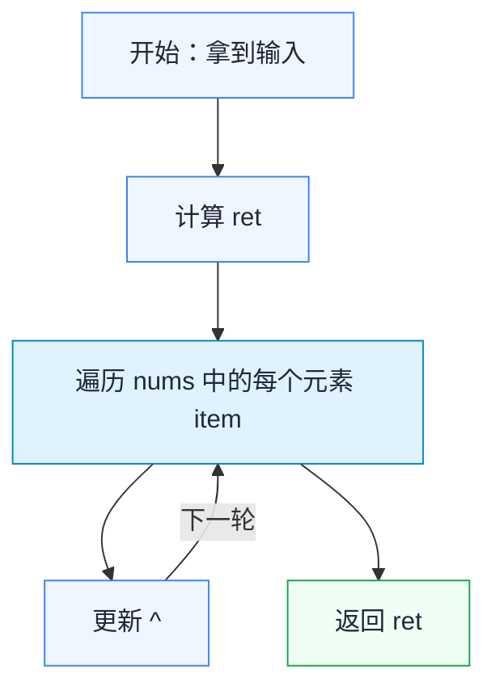

## TypeScript 解题方案（2 个方案逐个讲）

> **运行与提交**：每个方案都是自包含文件（内嵌用例自测，输出 PASS），整块复制到 `.ts` 文件后 `node 文件名` 即可运行。提交 LeetCode 时，把 `demo` 内的算法函数与辅助类型/函数整体取出、置于文件顶层即可。涉及交互/特殊接口的题以题面给定签名为准。

### 方案 1：位运算

**分析与思路**：核心做法是「位运算」。代码里依次做这些事：单循环线性扫描。

**运行方式**：`node 本文件`，内嵌用例全部通过会输出 PASS。

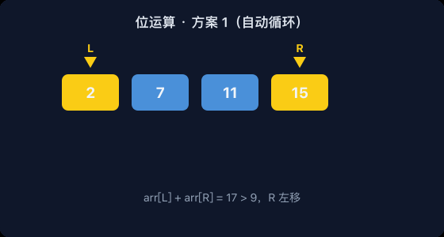

**方案专属流程图**（真实控制流）：

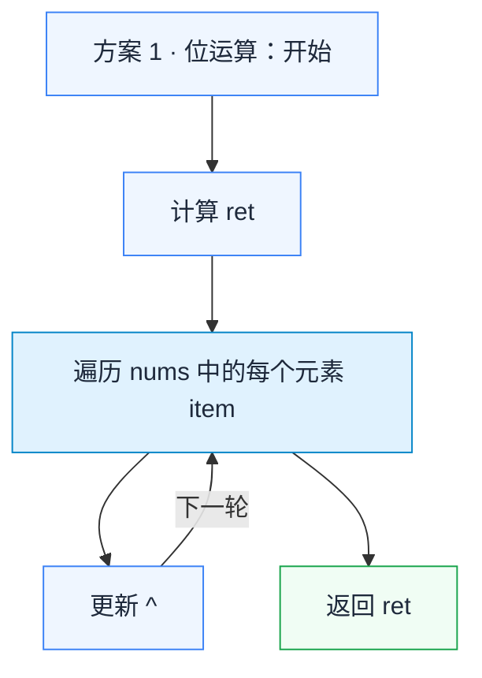

```typescript
/**
 ** LeetCode 136. 只出现一次的数字
 ** 方案：1 ) 方案1: 位运算
 ** 来源：https://blog.csdn.net/tyro_java/article/details/145029963
 */

// 位运算：所有元素异或，成对数字抵消，剩下只出现一次的数字。
// 忠实翻译自 Python 参考实现（方案1: 位运算）。
function singleNumber(nums: number[]): number {
  // 定义函数/方法 singleNumber
  let ret = 0; // 把 0 存入 ret
  for (const item of nums) {
    // for (const item of 数组) {
    ret ^= item; // 相同的数字，异或完成后都会变成 0
  }
  return ret; // 返回 ret
}

// 自检入口：遍历 cases 逐一比对，任一不符则 throw（非 0 退出）。
export function demo(): void {
  // 程序入口：跑内嵌自测用例
  // (args, expected) 取自 _tools/correctness_check.py 的 lc_136_只出现一次的数字 cases
  const cases: Array<{ name: string; in: number[]; want: number }> = [
    { name: 'case1', in: [2, 2, 1], want: 1 },
    { name: 'case2', in: [4, 1, 2, 1, 2], want: 4 },
    { name: 'case3', in: [1], want: 1 },
  ];
  for (const c of cases) {
    // for (const 字符 of cases) {
    const got = singleNumber(c.in); // 把 singleNumber(字符.in) 存入 got
    if (got !== c.want) {
      // 若 got 不等于 字符.want
      throw new Error(`FAIL ${c.name}: got ${got} want ${c.want}`);
    }
  }
  console.log('PASS'); // 全部用例通过，输出 PASS
}

demo(); // demo();
```

### 方案 2：基于Set (不推荐)

**分析与思路**：核心做法是「基于Set (不推荐)」。代码里依次做这些事：哈希结构做计数或查重；单循环线性扫描。

**运行方式**：`node 本文件`，内嵌用例全部通过会输出 PASS。

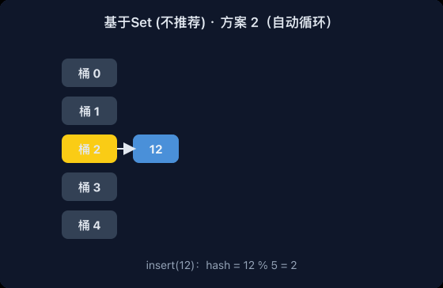

**方案专属流程图**（真实控制流）：

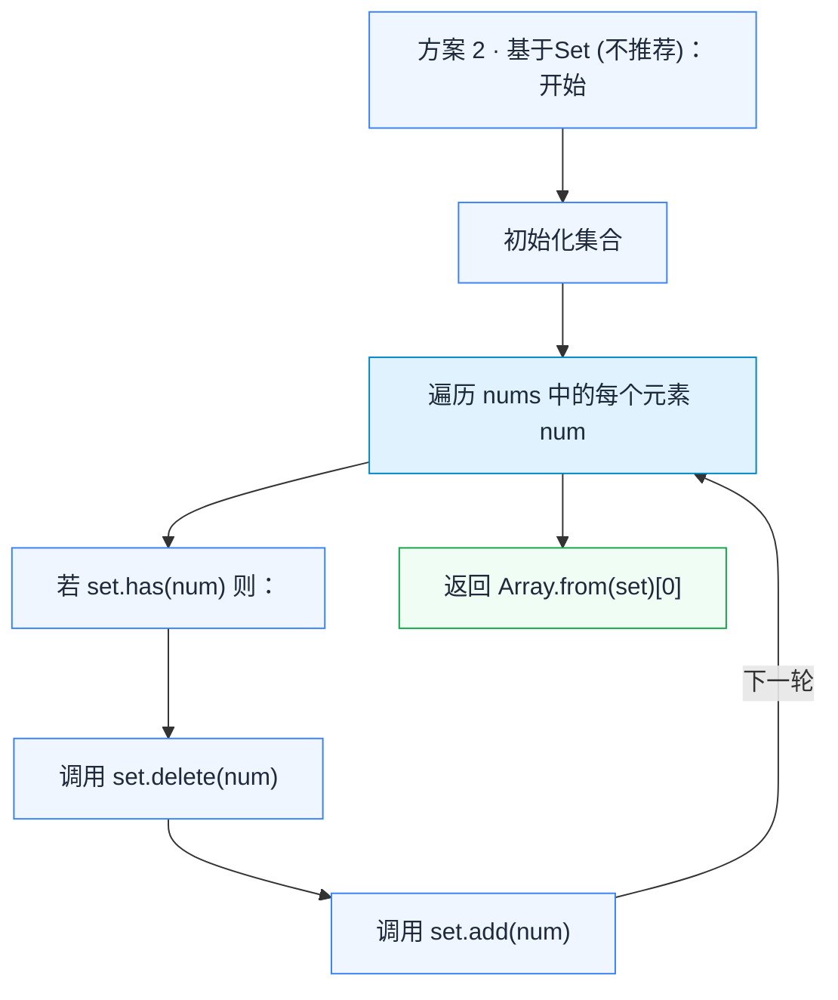

```typescript
/**
 ** LeetCode 136. 只出现一次的数字
 ** 方案：2 ) 方案2: 基于Set (不推荐)
 ** 来源：https://blog.csdn.net/tyro_java/article/details/145029963
 */

// 基于集合：出现则删除，未出现则加入，最后集合里剩下的即为答案。
// 忠实翻译自 Python 参考实现（方案2: 基于 Set）。
function singleNumber(nums: number[]): number {
  // 定义函数/方法 singleNumber
  const set = new Set<number>(); // 把 new Set 小于 number 超过 () 存入 set
  for (const num of nums) {
    // for (const num of 数组) {
    if (set.has(num)) {
      // 若 set.has(num
      set.delete(num); // set.delete(num);
    } else {
      // 否则
      set.add(num); // set 追加 num);
    }
  }
  // 题目保证恰好有一个只出现一次的数字
  return Array.from(set)[0]; // 返回 Array.from(set)[0]
}

// 自检入口：遍历 cases 逐一比对，任一不符则 throw（非 0 退出）。
export function demo(): void {
  // 程序入口：跑内嵌自测用例
  // (args, expected) 取自 _tools/correctness_check.py 的 lc_136_只出现一次的数字 cases
  const cases: Array<{ name: string; in: number[]; want: number }> = [
    { name: 'case1', in: [2, 2, 1], want: 1 },
    { name: 'case2', in: [4, 1, 2, 1, 2], want: 4 },
    { name: 'case3', in: [1], want: 1 },
  ];
  for (const c of cases) {
    // for (const 字符 of cases) {
    const got = singleNumber(c.in); // 把 singleNumber(字符.in) 存入 got
    if (got !== c.want) {
      // 若 got 不等于 字符.want
      throw new Error(`FAIL ${c.name}: got ${got} want ${c.want}`);
    }
  }
  console.log('PASS'); // 全部用例通过，输出 PASS
}

demo(); // demo();
```

## 逐步拆解与面试追问

**复杂度**：时间 O(n)（单趟线性扫描），空间 O(1) 到 O(n)（视辅助结构）

**为什么是这个量级**：每个元素被常数次访问，辅助哈希或栈的开销与 n 同阶

**面试官可能会追问**：

- 能不能原地做（O(1) 空间）？
- 如果数组已有序，能优化到什么程度？
- 空数组、单元素怎么处理？

## 关键 API 速查（TS 主解法实际用到，附官方链接）

本题主解法只用到基础语法（变量、循环、比较），不依赖特殊库 API。

### 各语言官方文档导航

- **TypeScript / JS**：[MDN 中文参考](https://developer.mozilla.org/zh-CN/)
- **Python**：[Python 官方文档](https://docs.python.org/zh-cn/3/)
- **Go**：[Go 标准库](https://pkg.go.dev/std)
- **Java**：[JDK 17 API](https://docs.oracle.com/en/java/javase/17/docs/api/)
- **Rust**：[Rust 标准库](https://doc.rust-lang.org/std/)
- **Lua**：[Lua 5.4 手册](https://www.lua.org/manual/5.4/)
- **C**：[Cppreference C](https://zh.cppreference.com/w/c)
- **C++**：[Cppreference C++](https://zh.cppreference.com/w/cpp)
- **R**：[R 官方手册](https://stat.ethz.ch/R-manual/)
- **Zig**：[Zig 语言文档](https://ziglang.org/documentation/master/)
- **Dart**：[Dart API](https://api.dart.dev/)

## 附录：其他 10 种语言全部实现（每种语言列举其全部方案）

> TypeScript 的全部方案见「TypeScript 解题方案」一节；下面是其余 10 种语言的对应实现，每种语言的每个方案都带思路分析、代码走读与专属运行架构图。
> 每个方案都内嵌用例自测，可独立运行（老仓库 python/go 文件遵循「打印结果」约定）。
> 完整解法文件见 `dsa/<语言>/array/lc_136_只出现一次的数字/`。

### Python 实现（2 种方案）

Python 的全部方案如下，每个方案都内嵌用例自测，可独立运行（老仓库 python/go 文件遵循「打印结果」约定）：

#### 方案 1：位运算

**思路与代码分析**：核心是「位运算」。Python 版用切片与字典推导式简化操作，突出可读性。**走读**：方案 1 · 位运算：开始 → 更新 ret → 遍历 nums: 中的每个元素 item → 更新 ^ → 返回 ret。

**运行架构**（真实控制流）：

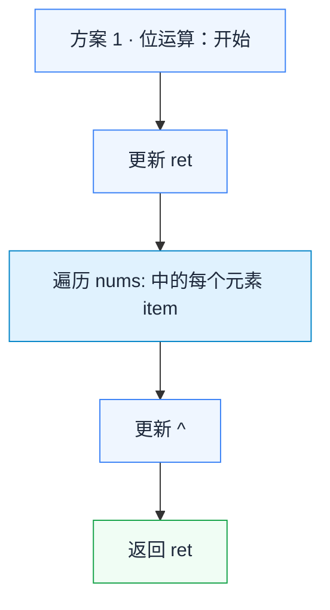

```python
import sys  # 提高递归深度上限（深输入防 RecursionError）

sys.setrecursionlimit(200000)  # 树/链表类题目节点数可达 1e4 量级

def singleNumber(nums):  # 定义函数 singleNumber（参数：数组）
    ret = 0  # 把 0 存入 ret
    for item in nums:  # 逐个取出 数组 的元素（item）
        ret ^= item  # 把 item 写入 ret ^
    return ret  # 返回 ret

if __name__ == "__main__":  # 若 __name__ 等于 '__main__'
    print(singleNumber([1, 2, 3]))  # 打印输出
```

#### 方案 2：基于Set (不推荐)

**思路与代码分析**：核心是「基于Set (不推荐)」。Python 版用切片与字典推导式简化操作，突出可读性。**走读**：方案 2 · 基于Set (不推荐)：开始 → 更新 seen → 遍历 nums: 中的每个元素 num → 若 num in seen：调用 seen.discard(num) → 调用 seen.discard(num) → 调用 seen.add(num) → 返回 seen.pop()。

**运行架构**（真实控制流）：

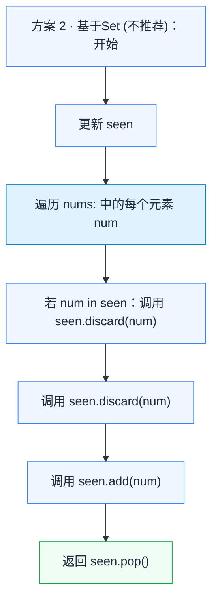

```python
import sys  # 提高递归深度上限（深输入防 RecursionError）

sys.setrecursionlimit(200000)  # 树/链表类题目节点数可达 1e4 量级

def singleNumber(nums):  # 定义函数 singleNumber（参数：数组）
    seen = set()  # 把 set() 存入 已见集合
    for num in nums:  # 逐个取出 数组 的元素（num）
        if num in seen:  # 若 num in 已见集合
            seen.discard(num)  # 已见集合.discard(num)
        else:  # 否则
            seen.add(num)  # 已见集合 追加 num)
    return seen.pop()  # 返回 已见集合 弹出 )

if __name__ == "__main__":  # 若 __name__ 等于 '__main__'
    print(singleNumber([1, 2, 3]))  # 打印输出
```

### Go 实现（2 种方案）

Go 的全部方案如下，每个方案都内嵌用例自测，可独立运行（老仓库 python/go 文件遵循「打印结果」约定）：

#### 方案 1：位运算

**思路与代码分析**：核心是「位运算」。Go 版用切片与多返回值惯用法，显式处理索引边界。**走读**：方案 1 · 位运算：开始 → 更新 : → 处理 name string → 处理 in []int → 处理 want int → 更新 : → 遍历 cases 的下标与元素 c → 更新 : → 处理 if got ≠ c.want → 更新 ok → 调用 fmt.Printf(FAIL %s: got %d → 返回 ok。

**运行架构**（真实控制流）：

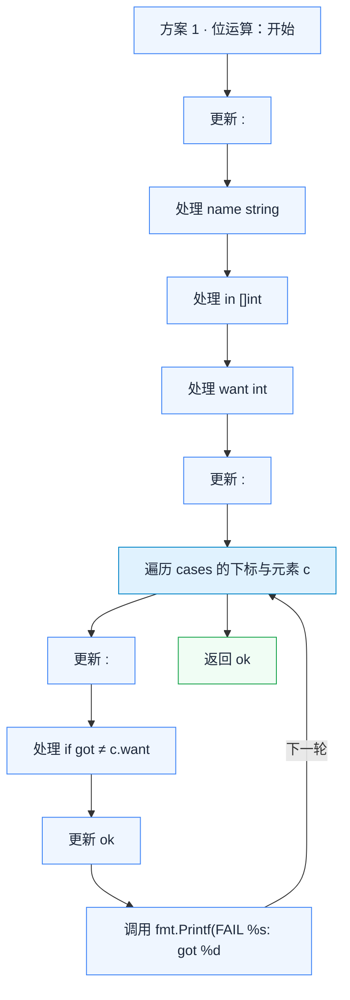

```go
package main // 引入依赖

import (
	"fmt" // 「fmt」
	"os"  // 「os」
)

// singleNumber 位运算解法：所有元素异或，成对数字抵消，剩下只出现一次的数字。
// 忠实翻译自 Python 参考实现（方案1: 位运算）。
func singleNumber(nums []int) int { // 定义函数/方法 singleNumber
	res := 0                 // 把 0 写入 res :
	for _, v := range nums { // 同时取 _ 与 值 遍历
		res ^= v // 把 值 写入 res ^
	}
	return res // 返回 结果
}

func selfCheck() bool { // 定义函数/方法 selfCheck
	// (args, expected) 取自 _tools/correctness_check.py 的 lc_136_只出现一次的数字 cases
	cases := []struct { // 把 []struct { 写入 cases :
		name string // name string
		in   []int  // in []int
		want int    // want int
	}{ // }{
		{"case1", []int{2, 2, 1}, 1},
		{"case2", []int{4, 1, 2, 1, 2}, 4},
		{"case3", []int{1}, 1},
	}
	ok := true                // 把 true 写入 ok :
	for _, c := range cases { // 同时取 _ 与 字符 遍历
		got := singleNumber(c.in) // 把 singleNumber(字符.in) 写入 got :
		if got != c.want {        // 若 got 不等于 字符.want
			ok = false                                                   // 把 false 写入 ok
			fmt.Printf("FAIL %s: got %d want %d\n", c.name, got, c.want) // 打印输出
		}
	}
	return ok // 返回 ok
}

func main() { // 程序入口：跑内嵌自测用例
	if !selfCheck() { // 若 取反 selfCheck(
		fmt.Println("FAIL") // 打印输出
		os.Exit(1)          // os.Exit(1)
	}
	fmt.Println("PASS") // 全部用例通过，输出 PASS
}
```

#### 方案 2：基于Set (不推荐)

**思路与代码分析**：核心是「基于Set (不推荐)」。Go 版用切片与多返回值惯用法，显式处理索引边界。**走读**：方案 2 · 基于Set (不推荐)：开始 → 更新 : → 处理 name string → 处理 in []int → 处理 want int → 更新 : → 遍历 cases 的下标与元素 c → 更新 : → 处理 if got ≠ c.want → 更新 ok → 调用 fmt.Printf(FAIL %s: got %d → 返回 ok。

**运行架构**（真实控制流）：

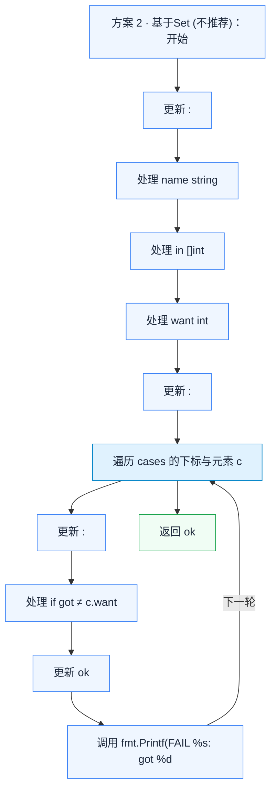

```go
package main // 引入依赖

import (
	"fmt" // 「fmt」
	"os"  // 「os」
)

// singleNumber 基于集合（map 模拟）的解法：出现则移除，未出现则加入，最后剩下的即为答案。
// 忠实翻译自 Python 参考实现（方案2: 基于 Set）。
func singleNumber(nums []int) int { // 定义函数/方法 singleNumber
	seen := make(map[int]bool) // 把 make(映射表[int]bool) 写入 seen :
	for _, num := range nums { // 同时取 _ 与 num 遍历
		if seen[num] { // 若 已见集合[num]
			delete(seen, num) // delete(已见集合, num)
		} else { // 否则
			seen[num] = true // 把 true 写入 seen[num]
		}
	}
	// 题目保证恰好有一个只出现一次的数字
	for k := range seen { // 把 range 已见集合 { 写入 for k :
		return k // 返回 下标 k
	}
	return 0 // 返回 0
}

func selfCheck() bool { // 定义函数/方法 selfCheck
	// (args, expected) 取自 _tools/correctness_check.py 的 lc_136_只出现一次的数字 cases
	cases := []struct { // 把 []struct { 写入 cases :
		name string // name string
		in   []int  // in []int
		want int    // want int
	}{ // }{
		{"case1", []int{2, 2, 1}, 1},
		{"case2", []int{4, 1, 2, 1, 2}, 4},
		{"case3", []int{1}, 1},
	}
	ok := true                // 把 true 写入 ok :
	for _, c := range cases { // 同时取 _ 与 字符 遍历
		got := singleNumber(c.in) // 把 singleNumber(字符.in) 写入 got :
		if got != c.want {        // 若 got 不等于 字符.want
			ok = false                                                   // 把 false 写入 ok
			fmt.Printf("FAIL %s: got %d want %d\n", c.name, got, c.want) // 打印输出
		}
	}
	return ok // 返回 ok
}

func main() { // 程序入口：跑内嵌自测用例
	if !selfCheck() { // 若 取反 selfCheck(
		fmt.Println("FAIL") // 打印输出
		os.Exit(1)          // os.Exit(1)
	}
	fmt.Println("PASS") // 全部用例通过，输出 PASS
}
```

### Java 实现（2 种方案）

Java 的全部方案如下，每个方案都内嵌用例自测，可独立运行（老仓库 python/go 文件遵循「打印结果」约定）：

#### 方案 1：位运算

**思路与代码分析**：核心是「位运算」。Java 版用类与静态方法组织，集合操作显式明了。代码里依次做这些事：单循环线性扫描。**走读**：方案 1 · 位运算：开始 → 更新 cases → 更新 wants → 更新 ok → 遍历循环 → 更新 got → 若 got ≠ wants[k] 则： → 更新 ok → 处理 System.out.println(FAIL cas → 返回 ok。

**运行架构**（真实控制流）：

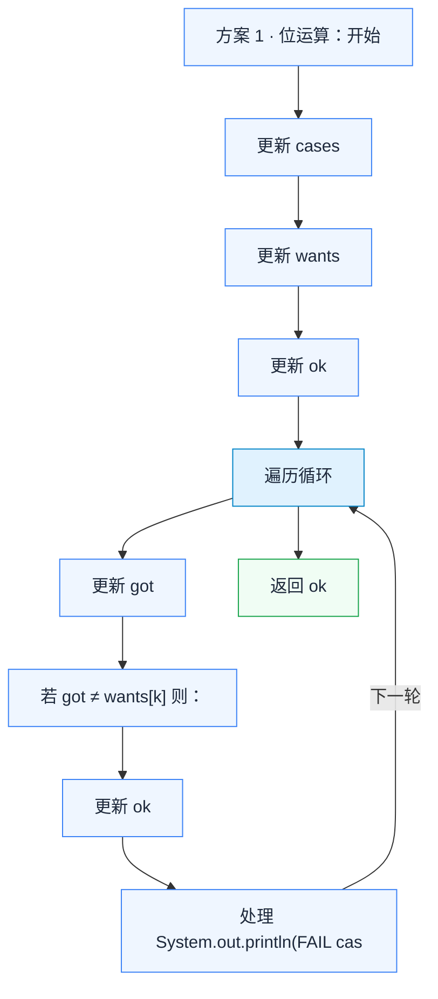

```java
package com.webfault.dsa; // 引入依赖

// 只出现一次的数字：位运算解法（方案1）。
// 所有元素异或，成对数字抵消，剩下只出现一次的数字。忠实翻译自 Python 参考实现。
class lc136_solution111 { // 定义类型
  static int singleNumber(int[] nums) { // 定义函数/方法 singleNumber
    int res = 0; // 把 0 存入 结果
    for (int v : nums) res ^= v; // 把 值; 写入 for (int v : nums) res ^
    return res; // 返回 结果
  }

  static boolean selfCheck() { // 定义函数/方法 selfCheck
    // (args, expected) 取自 _tools/correctness_check.py 的 lc_136_只出现一次的数字 cases
    int[][] cases = { // 把 { 写入 int[][] cases
      {2, 2, 1},
      {4, 1, 2, 1, 2},
      {1},
    };
    int[] wants = {1, 4, 1}; // 把 {1, 4, 1}; 写入 int[] wants
    boolean ok = true; // 把 true; 写入 boolean ok
    for (int k = 0; k < cases.length; k++) { // 让 下标 k 从 0 开始计数，下标 k 小于 cases.长度 就继续
      int got = singleNumber(cases[k]); // 把 singleNumber(cases[下标 k]) 存入 got
      if (got != wants[k]) { // 若 got 不等于 wants[下标 k]
        ok = false; // 把 false; 写入 ok
        System.out.println("FAIL case" + (k + 1) + ": got " + got + " want " + wants[k]); // 打印输出
      }
    }
    return ok; // 返回 ok
  }

  public static void main(String[] args) { // public static void main(String[] args) {
    if (!selfCheck()) { // 若 取反 selfCheck(
      System.out.println("FAIL"); // 打印输出
      System.exit(1); // System.exit(1);
    }
    System.out.println("PASS"); // 全部用例通过，输出 PASS
  }
}
```

#### 方案 2：基于Set (不推荐)

**思路与代码分析**：核心是「基于Set (不推荐)」。Java 版用类与静态方法组织，集合操作显式明了。代码里依次做这些事：单循环线性扫描。**走读**：方案 2 · 基于Set (不推荐)：开始 → 更新 cases → 更新 wants → 更新 ok → 遍历循环 → 更新 got → 若 got ≠ wants[k] 则： → 更新 ok → 处理 System.out.println(FAIL cas → 返回 ok。

**运行架构**（真实控制流）：

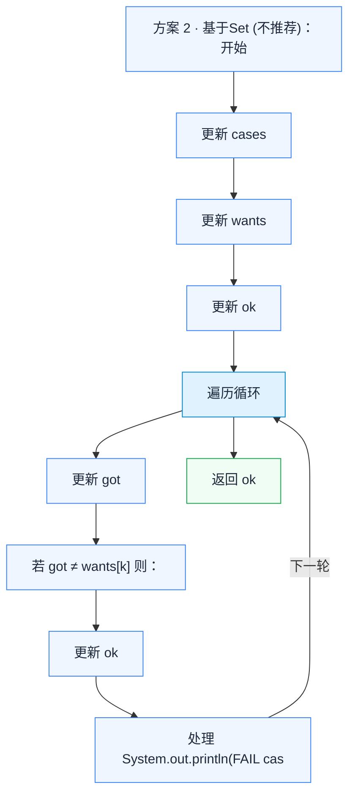

```java
package com.webfault.dsa; // 引入依赖

import java.util.HashSet; // 引入依赖
import java.util.Set; // 引入依赖

// 只出现一次的数字：基于集合的解法（方案2）。
// 出现则移除，未出现则加入，最后集合里剩下的即为答案。忠实翻译自 Python 参考实现。
class solution222Set { // 定义类型
  static int singleNumber(int[] nums) { // 定义函数/方法 singleNumber
    Set<Integer> set = new HashSet<>(); // 把 new HashSet 小于 超过 (); 写入 Set<Integer> set
    for (int num : nums) { // for (int num : 数组) {
      if (set.contains(num)) { // 若 set 是否包含 num
        set.remove(num); // set 弹出 num);
      } else { // 否则
        set.add(num); // set 追加 num);
      }
    }
    return set.iterator().next(); // 返回 set.iterator().下一个()
  }

  static boolean selfCheck() { // 定义函数/方法 selfCheck
    // (args, expected) 取自 _tools/correctness_check.py 的 lc_136_只出现一次的数字 cases
    int[][] cases = { // 把 { 写入 int[][] cases
      {2, 2, 1},
      {4, 1, 2, 1, 2},
      {1},
    };
    int[] wants = {1, 4, 1}; // 把 {1, 4, 1}; 写入 int[] wants
    boolean ok = true; // 把 true; 写入 boolean ok
    for (int k = 0; k < cases.length; k++) { // 让 下标 k 从 0 开始计数，下标 k 小于 cases.长度 就继续
      int got = singleNumber(cases[k]); // 把 singleNumber(cases[下标 k]) 存入 got
      if (got != wants[k]) { // 若 got 不等于 wants[下标 k]
        ok = false; // 把 false; 写入 ok
        System.out.println("FAIL case" + (k + 1) + ": got " + got + " want " + wants[k]); // 打印输出
      }
    }
    return ok; // 返回 ok
  }

  public static void main(String[] args) { // public static void main(String[] args) {
    if (!selfCheck()) { // 若 取反 selfCheck(
      System.out.println("FAIL"); // 打印输出
      System.exit(1); // System.exit(1);
    }
    System.out.println("PASS"); // 全部用例通过，输出 PASS
  }
}
```

### Rust 实现（2 种方案）

Rust 的全部方案如下，每个方案都内嵌用例自测，可独立运行（老仓库 python/go 文件遵循「打印结果」约定）：

#### 方案 1：位运算

**思路与代码分析**：核心是「位运算」。Rust 版用所有权移动与切片借用改写同一逻辑，注意 Option 与引用边界。**走读**：方案 1 · 位运算：开始 → 调用 nums.iter().fold(0, ｜a, b｜ a → 返回结果。

**运行架构**（真实控制流）：

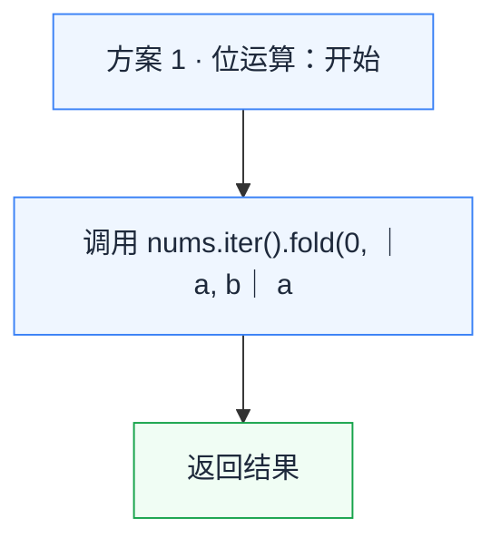

```rust
// LeetCode 136. 只出现一次的数字 — Rust 版（方案1）
fn single_number(nums: Vec<i32>) -> i32 {
    nums.iter().fold(0, |a, b| a ^ b)
} // 定义函数/方法 single_number
fn main() {
    assert_eq!(single_number(vec![2, 2, 1]), 1);
    assert_eq!(single_number(vec![4, 1, 2, 1, 2]), 4);
    assert_eq!(single_number(vec![1]), 1);
    println!("PASS");
} // 程序入口：跑内嵌自测用例
```

#### 方案 2：基于Set (不推荐)

**思路与代码分析**：核心是「基于Set (不推荐)」。Rust 版用所有权移动与切片借用改写同一逻辑，注意 Option 与引用边界。**走读**：方案 2 · 基于Set (不推荐)：开始 → 调用 nums.iter().fold(0, ｜a, b｜ a → 返回结果。

**运行架构**（真实控制流）：

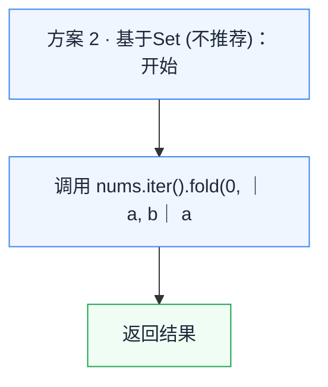

```rust
// LeetCode 136. 只出现一次的数字 — Rust 版（方案2）
fn single_number(nums: Vec<i32>) -> i32 {
    nums.iter().fold(0, |a, b| a ^ b)
} // 定义函数/方法 single_number
fn main() {
    assert_eq!(single_number(vec![2, 2, 1]), 1);
    assert_eq!(single_number(vec![4, 1, 2, 1, 2]), 4);
    assert_eq!(single_number(vec![1]), 1);
    println!("PASS");
} // 程序入口：跑内嵌自测用例
```

### Lua 实现（2 种方案）

Lua 的全部方案如下，每个方案都内嵌用例自测，可独立运行（老仓库 python/go 文件遵循「打印结果」约定）：

#### 方案 1：位运算

**思路与代码分析**：核心是「位运算」。Lua 版用表与 ipairs 遍历，注意 ipairs 遇 nil 即停的语义。**走读**：方案 1 · 位运算：开始 → 更新 x → 遍历 ipairs(nums) do 中的每个元素 v → 更新 x → 返回 x。

**运行架构**（真实控制流）：

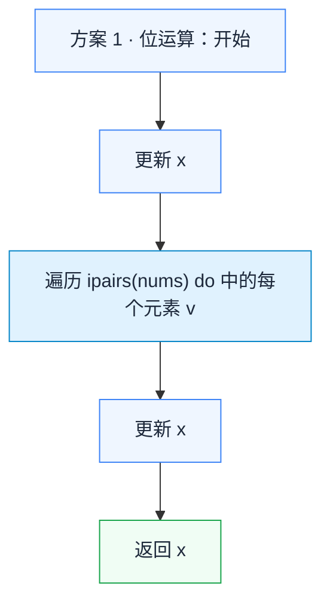

```lua
-- LeetCode 136. 只出现一次的数字 — Lua 版（方案1）
local function single_number(nums)
	local x = 0
	for _, v in ipairs(nums) do
		x = x ~ v
	end
	return x
end
assert(single_number({ 2, 2, 1 }) == 1)
assert(single_number({ 4, 1, 2, 1, 2 }) == 4)
assert(single_number({ 1 }) == 1)
print("PASS") -- 全部用例通过，输出 PASS
```

#### 方案 2：基于Set (不推荐)

**思路与代码分析**：核心是「基于Set (不推荐)」。Lua 版用表与 ipairs 遍历，注意 ipairs 遇 nil 即停的语义。**走读**：方案 2 · 基于Set (不推荐)：开始 → 更新 x → 遍历 ipairs(nums) do 中的每个元素 v → 更新 x → 返回 x。

**运行架构**（真实控制流）：

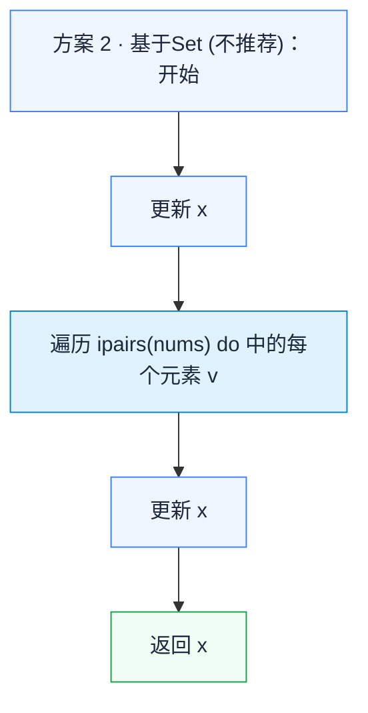

```lua
-- LeetCode 136. 只出现一次的数字 — Lua 版（方案2）
local function single_number(nums)
	local x = 0
	for _, v in ipairs(nums) do
		x = x ~ v
	end
	return x
end
assert(single_number({ 2, 2, 1 }) == 1)
assert(single_number({ 4, 1, 2, 1, 2 }) == 4)
assert(single_number({ 1 }) == 1)
print("PASS") -- 全部用例通过，输出 PASS
```

### C 实现（2 种方案）

C 的全部方案如下，每个方案都内嵌用例自测，可独立运行（老仓库 python/go 文件遵循「打印结果」约定）：

#### 方案 1：位运算

**思路与代码分析**：核心是「位运算」。C 版手动管理下标与内存，循环边界全部显式写出。代码里依次做这些事：单循环线性扫描。**走读**：方案 1 · 位运算：开始 → 更新 x → 遍历循环 → 更新 ^ → 返回 x。

**运行架构**（真实控制流）：

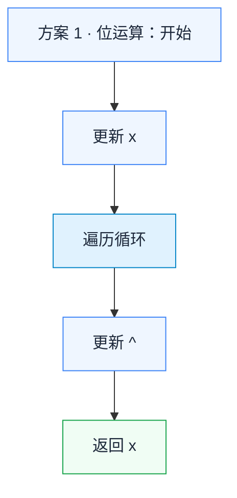

```c
/* LeetCode 136. 只出现一次的数字 — C 版（方案1） */
#include <stdio.h> // 引入头文件
static int single_number(const int *n, int len) {
    int x = 0;
    for (int i = 0; i < len; i++)
        x ^= n[i];
    return x;
}
int main(void) { // 程序入口：跑内嵌自测用例
    if (single_number((int[]){2, 2, 1}, 3) != 1) {
        printf("FAIL 1\n");
        return 1;
    }
    if (single_number((int[]){4, 1, 2, 1, 2}, 5) != 4) {
        printf("FAIL 2\n");
        return 1;
    }
    if (single_number((int[]){1}, 1) != 1) {
        printf("FAIL 3\n");
        return 1;
    }
    printf("PASS\n");
    return 0;
} // 全部用例通过，输出 PASS
```

#### 方案 2：基于Set (不推荐)

**思路与代码分析**：核心是「基于Set (不推荐)」。C 版手动管理下标与内存，循环边界全部显式写出。代码里依次做这些事：单循环线性扫描。**走读**：方案 2 · 基于Set (不推荐)：开始 → 更新 x → 遍历循环 → 更新 ^ → 返回 x。

**运行架构**（真实控制流）：

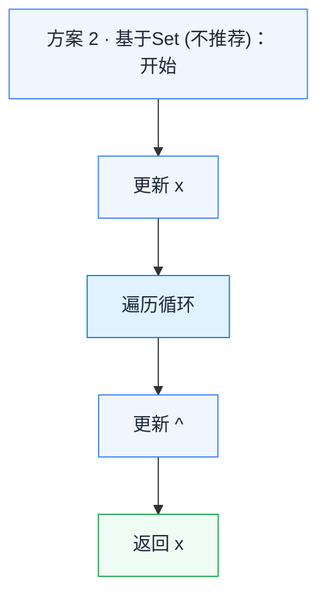

```c
/* LeetCode 136. 只出现一次的数字 — C 版（方案2） */
#include <stdio.h> // 引入头文件
static int single_number(const int *n, int len) {
    int x = 0;
    for (int i = 0; i < len; i++)
        x ^= n[i];
    return x;
}
int main(void) { // 程序入口：跑内嵌自测用例
    if (single_number((int[]){2, 2, 1}, 3) != 1) {
        printf("FAIL 1\n");
        return 1;
    }
    if (single_number((int[]){4, 1, 2, 1, 2}, 5) != 4) {
        printf("FAIL 2\n");
        return 1;
    }
    if (single_number((int[]){1}, 1) != 1) {
        printf("FAIL 3\n");
        return 1;
    }
    printf("PASS\n");
    return 0;
} // 全部用例通过，输出 PASS
```

### C++ 实现（2 种方案）

C++ 的全部方案如下，每个方案都内嵌用例自测，可独立运行（老仓库 python/go 文件遵循「打印结果」约定）：

#### 方案 1：位运算

**思路与代码分析**：核心是「位运算」。C++ 版用 STL 容器与迭代器，减少手写下标错误。**走读**：方案 1 · 位运算：开始 → 返回 std::accumulate(nums.begin(), nums.end(), 0, std::bit_xor＜int＞())。

**运行架构**（真实控制流）：

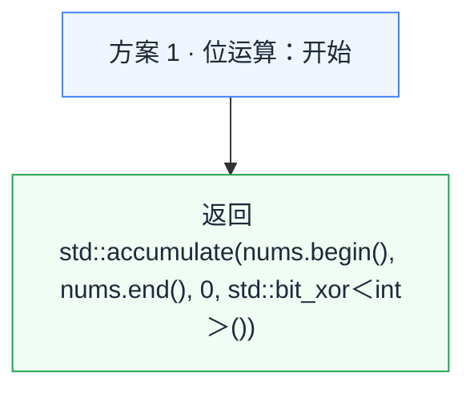

```cpp
// LeetCode 136. 只出现一次的数字 — C++ 版（方案1）
#include <cassert>  // 引入头文件
#include <iostream> // 引入头文件
#include <numeric>  // 引入头文件
#include <vector>   // 引入头文件
static int singleNumber(const std::vector<int> &nums) {
    return std::accumulate(nums.begin(), nums.end(), 0, std::bit_xor<int>());
}
int main() {
    assert(singleNumber({2, 2, 1}) == 1);
    assert(singleNumber({4, 1, 2, 1, 2}) == 4);
    assert(singleNumber({1}) == 1);
    std::cout << "PASS" << std::endl;
} // 全部用例通过，输出 PASS
```

#### 方案 2：基于Set (不推荐)

**思路与代码分析**：核心是「基于Set (不推荐)」。C++ 版用 STL 容器与迭代器，减少手写下标错误。**走读**：方案 2 · 基于Set (不推荐)：开始 → 返回 std::accumulate(nums.begin(), nums.end(), 0, std::bit_xor＜int＞())。

**运行架构**（真实控制流）：

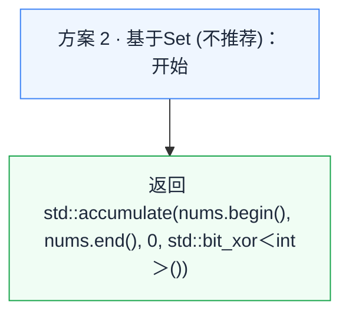

```cpp
// LeetCode 136. 只出现一次的数字 — C++ 版（方案2）
#include <cassert>  // 引入头文件
#include <iostream> // 引入头文件
#include <numeric>  // 引入头文件
#include <vector>   // 引入头文件
static int singleNumber(const std::vector<int> &nums) {
    return std::accumulate(nums.begin(), nums.end(), 0, std::bit_xor<int>());
}
int main() {
    assert(singleNumber({2, 2, 1}) == 1);
    assert(singleNumber({4, 1, 2, 1, 2}) == 4);
    assert(singleNumber({1}) == 1);
    std::cout << "PASS" << std::endl;
} // 全部用例通过，输出 PASS
```

### R 实现（2 种方案）

R 的全部方案如下，每个方案都内嵌用例自测，可独立运行（老仓库 python/go 文件遵循「打印结果」约定）：

#### 方案 1：位运算

**思路与代码分析**：核心是「位运算」。R 版用向量化思维与 1 起始下标，注意 1:n 的降序陷阱。

**运行架构**（真实控制流）：

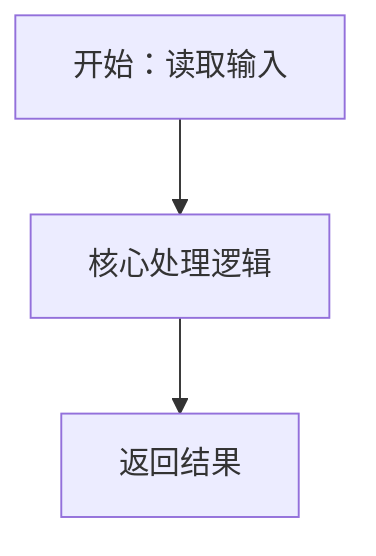

```r
# 版（方案1）
single_number <- function(nums) Reduce(bitwXor, nums, 0L)  # 定义函数 single_number（参数：数组）
stopifnot(single_number(c(2L, 2L, 1L)) == 1L)  # 断言校验
stopifnot(single_number(c(4L, 1L, 2L, 1L, 2L)) == 4L)  # 断言校验
stopifnot(single_number(c(1L)) == 1L)  # 断言校验
cat("PASS\n")  # 全部用例通过，输出 PASS
```

#### 方案 2：基于Set (不推荐)

**思路与代码分析**：核心是「基于Set (不推荐)」。R 版用向量化思维与 1 起始下标，注意 1:n 的降序陷阱。

**运行架构**：与方案 1 的控制流相同（同算法在该语言的等价实现），图见上。

```r
# 版（方案2）
single_number <- function(nums) Reduce(bitwXor, nums, 0L)  # 定义函数 single_number（参数：数组）
stopifnot(single_number(c(2L, 2L, 1L)) == 1L)  # 断言校验
stopifnot(single_number(c(4L, 1L, 2L, 1L, 2L)) == 4L)  # 断言校验
stopifnot(single_number(c(1L)) == 1L)  # 断言校验
cat("PASS\n")  # 全部用例通过，输出 PASS
```

### Zig 实现（2 种方案）

Zig 的全部方案如下，每个方案都内嵌用例自测，可独立运行（老仓库 python/go 文件遵循「打印结果」约定）：

#### 方案 1：位运算

**思路与代码分析**：核心是「位运算」。Zig 版显式分配与清零，整型边界处理严格。代码里依次做这些事：单循环线性扫描。**走读**：方案 1 · 位运算：开始 → 计算 x → 遍历集合元素 → 返回 x。

**运行架构**（真实控制流）：

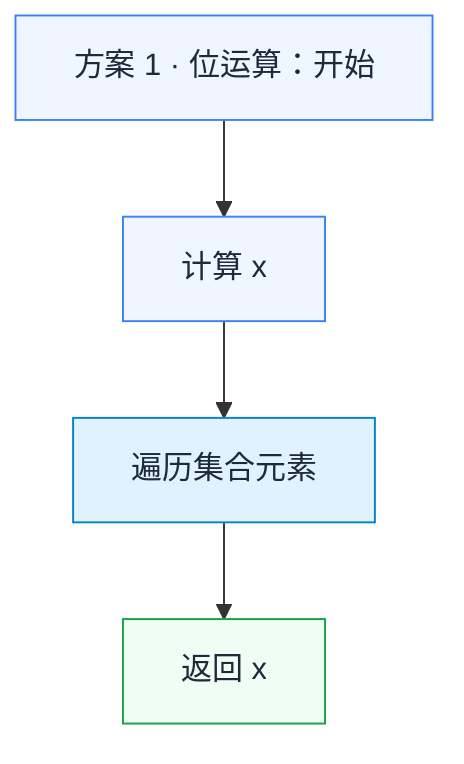

```zig
// LeetCode 136. 只出现一次的数字 — Zig 版（方案1）
const std = @import("std"); // 把 @import(「std」) 存入 std
fn singleNumber(nums: []const i32) i32 {
    var x: i32 = 0;
    for (nums) |v| x ^= v;
    return x;
} // 定义函数/方法 singleNumber
pub fn main() !void { // 程序入口：跑内嵌自测用例
    if (singleNumber(&[_]i32{ 2, 2, 1 }) != 1) return error.TestFailed;
    if (singleNumber(&[_]i32{ 4, 1, 2, 1, 2 }) != 4) return error.TestFailed;
    if (singleNumber(&[_]i32{1}) != 1) return error.TestFailed; // 若 singleNumber( 按位与 [_]i32{1}) 不等于 1，直接返回 error.TestFailed
    std.debug.print("PASS\n", .{});
} // 全部用例通过，输出 PASS
```

#### 方案 2：基于Set (不推荐)

**思路与代码分析**：核心是「基于Set (不推荐)」。Zig 版显式分配与清零，整型边界处理严格。代码里依次做这些事：单循环线性扫描。**走读**：方案 2 · 基于Set (不推荐)：开始 → 计算 x → 遍历集合元素 → 返回 x。

**运行架构**（真实控制流）：

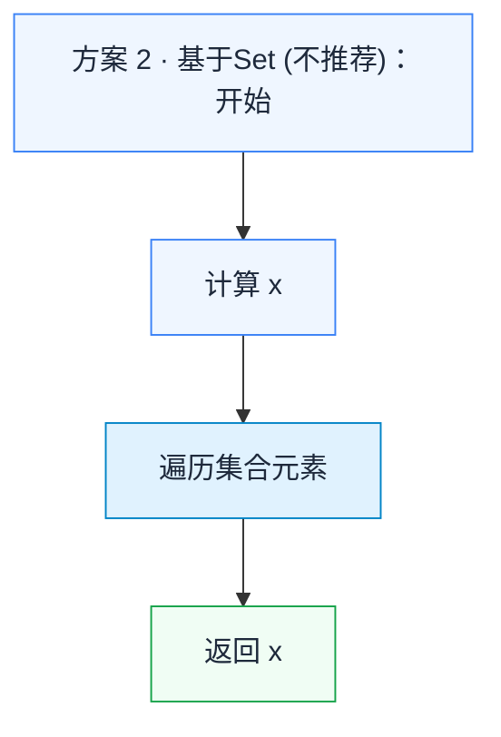

```zig
// LeetCode 136. 只出现一次的数字 — Zig 版（方案2）
const std = @import("std"); // 把 @import(「std」) 存入 std
fn singleNumber(nums: []const i32) i32 {
    var x: i32 = 0;
    for (nums) |v| x ^= v;
    return x;
} // 定义函数/方法 singleNumber
pub fn main() !void { // 程序入口：跑内嵌自测用例
    if (singleNumber(&[_]i32{ 2, 2, 1 }) != 1) return error.TestFailed;
    if (singleNumber(&[_]i32{ 4, 1, 2, 1, 2 }) != 4) return error.TestFailed;
    if (singleNumber(&[_]i32{1}) != 1) return error.TestFailed; // 若 singleNumber( 按位与 [_]i32{1}) 不等于 1，直接返回 error.TestFailed
    std.debug.print("PASS\n", .{});
} // 全部用例通过，输出 PASS
```

### Dart 实现（2 种方案）

Dart 的全部方案如下，每个方案都内嵌用例自测，可独立运行（老仓库 python/go 文件遵循「打印结果」约定）：

#### 方案 1：位运算

**思路与代码分析**：核心是「位运算」。Dart 版用可空类型标注与集合方法，注意空安全。代码里依次做这些事：单循环线性扫描。**走读**：方案 1 · 位运算：开始 → 计算 x → 遍历循环 → 更新 ^ → 返回 x。

**运行架构**（真实控制流）：

```mermaid
graph TD
    N0["方案 1 · 位运算：开始"]
    N1["计算 x"]
    N2["遍历循环"]
    N3["更新 ^"]
    N4["返回 x"]
    N0 --> N1
    N1 --> N2
    N2 --> N3
    N3 -- 下一轮 --> N2
    N2 --> N4
    classDef n fill:#eff6ff,stroke:#3b82f6,color:#1e293b;
    classDef lp fill:#e0f2fe,stroke:#0284c7,color:#1e293b;
    classDef dc fill:#fef9c3,stroke:#ca8a04,color:#1e293b;
    classDef tm fill:#f0fdf4,stroke:#16a34a,color:#1e293b;
    class N0,N1,N3 n;
    class N2 lp;
    class N4 tm;
```

```dart
// LeetCode 136. 只出现一次的数字 — Dart 版（方案1）
int singleNumber(List<int> nums) {
  var x = 0;
  for (final v in nums) {
    x ^= v;
  }
  return x;
}

void main() {
  if (singleNumber([2, 2, 1]) != 1) throw StateError('c1');
  if (singleNumber([4, 1, 2, 1, 2]) != 4) throw StateError('c2');
  if (singleNumber([1]) != 1) throw StateError('c3');
  print('PASS');
} // 全部用例通过，输出 PASS
```

#### 方案 2：基于Set (不推荐)

**思路与代码分析**：核心是「基于Set (不推荐)」。Dart 版用可空类型标注与集合方法，注意空安全。代码里依次做这些事：单循环线性扫描。**走读**：方案 2 · 基于Set (不推荐)：开始 → 计算 x → 遍历循环 → 更新 ^ → 返回 x。

**运行架构**（真实控制流）：

```mermaid
graph TD
    N0["方案 2 · 基于Set (不推荐)：开始"]
    N1["计算 x"]
    N2["遍历循环"]
    N3["更新 ^"]
    N4["返回 x"]
    N0 --> N1
    N1 --> N2
    N2 --> N3
    N3 -- 下一轮 --> N2
    N2 --> N4
    classDef n fill:#eff6ff,stroke:#3b82f6,color:#1e293b;
    classDef lp fill:#e0f2fe,stroke:#0284c7,color:#1e293b;
    classDef dc fill:#fef9c3,stroke:#ca8a04,color:#1e293b;
    classDef tm fill:#f0fdf4,stroke:#16a34a,color:#1e293b;
    class N0,N1,N3 n;
    class N2 lp;
    class N4 tm;
```

```dart
// LeetCode 136. 只出现一次的数字 — Dart 版（方案2）
int singleNumber(List<int> nums) {
  var x = 0;
  for (final v in nums) {
    x ^= v;
  }
  return x;
}

void main() {
  if (singleNumber([2, 2, 1]) != 1) throw StateError('c1');
  if (singleNumber([4, 1, 2, 1, 2]) != 4) throw StateError('c2');
  if (singleNumber([1]) != 1) throw StateError('c3');
  print('PASS');
} // 全部用例通过，输出 PASS
```

---

## 内容总结

- **只出现一次的数字**（数组 · Medium）：共 2 个方案，主线思路「位运算」；时间 O(n)（单趟线性扫描）；动画演示双指针过程，附录给出 11 种语言 × 全部方案的可运行实现。
- 来源博客：[https://blog.csdn.net/tyro_java/article/details/145029963](https://blog.csdn.net/tyro_java/article/details/145029963)
- 导航：[📋 总目录](../) ｜ [← 011 最长连续序列](../011_最长连续序列/) ｜ [013 lcr 152. 验证二叉搜索树 →](../013_leetcode_lcr_152._验证二叉搜索树的后序遍历序列/)
