# 014 · 设计浏览器历史记录（第一阶段 · 线性结构入门 · Medium）

> **难度**：⭐⭐ Medium ｜ **专题**：栈
> **学习定位**：第一阶段 · 线性结构入门第 14 篇 ｜ **解法数**：1
> **内容总结**：**设计浏览器历史记录**（栈 · Medium）：共 1 个方案，主线思路「直接实现」；时间 O(n) 量级；动画演示栈后进先出过程，附录给出 11 种语言 × 全部方案的可运行实现。

---

## 题目描述

你有一个只支持单个标签页的 浏览器 ，最开始你浏览的网页是 `homepage` ，你可以访问其他的网站 `url` ，也可以在浏览历史中后退 `steps` 步或前进 `steps` 步。

请你实现 `BrowserHistory` 类：

 `BrowserHistory(string homepage)` ，用 `homepage` 初始化浏览器类。
 `void visit(string url)` 从当前页跳转访问 `url` 对应的页面 。执行此操作会把浏览历史前进的记录全部删除。
 `string back(int steps)` 在浏览历史中后退 `steps` 步。如果你只能在浏览历史中后退至多 `x` 步且 `steps > x` ，那么你只后退 `x` 步。请返回后退 至多 `steps` 步以后的 `url` 。
 `string forward(int steps)` 在浏览历史中前进 `steps` 步。如果你只能在浏览历史中前进至多 `x` 步且 `steps > x` ，那么你只前进 `x` 步。请返回前进 至多 `steps`步以后的 `url` 。

示例：

输入：
[「BrowserHistory」,「visit」,「visit」,「visit」,「back」,「back」,「forward」,「visit」,「forward」,「back」,「back」]
[[「leetcode.com」],[「google.com」],[「facebook.com」],[「youtube.com」],[1],[1],[1],[「linkedin.com」],[2],[2],[7]]
输出：
[null,null,null,null,「facebook.com」,「google.com」,「facebook.com」,null,「linkedin.com」,「google.com」,「leetcode.com」]

解释：
BrowserHistory browserHistory = new BrowserHistory(「leetcode.com」);
browserHistory.visit(「google.com」); // 你原本在浏览 「leetcode.com」 。访问 「google.com」
browserHistory.visit(「facebook.com」); // 你原本在浏览 「google.com」 。访问 「facebook.com」
browserHistory.visit(「youtube.com」); // 你原本在浏览 「facebook.com」 。访问 「youtube.com」
browserHistory.back(1); // 你原本在浏览 「youtube.com」 ，后退到 「facebook.com」 并返回 「facebook.com」
browserHistory.back(1); // 你原本在浏览 「facebook.com」 ，后退到 「google.com」 并返回 「google.com」
browserHistory.forward(1); // 你原本在浏览 「google.com」 ，前进到 「facebook.com」 并返回 「facebook.com」
browserHistory.visit(「linkedin.com」); // 你原本在浏览 「facebook.com」 。 访问 「linkedin.com」
browserHistory.forward(2); // 你原本在浏览 「linkedin.com」 ，你无法前进任何步数。
browserHistory.back(2); // 你原本在浏览 「linkedin.com」 ，后退两步依次先到 「facebook.com」 ，然后到 「google.com」 ，并返回 「google.com」
browserHistory.back(7); // 你原本在浏览 「google.com」， 你只能后退一步到 「leetcode.com」 ，并返回 「leetcode.com」

提示：

 `1 
 `1 
 `1 
 `homepage` 和 `url` 都只包含 '.' 或者小写英文字母。
 最多调用 `5000` 次 `visit`， `back` 和 `forward` 函数。

- 主函数签名：`function assertEq(actual: any, expected: any, msg: string = ''): void`

> 题面与 [leetcode.cn 官方](https://leetcode.cn/problems/design-browser-history/)一致，示例配图取自官方题面。

**数据范围与注意事项**：

- `1 <= homepage.length <= 20`
- `1 <= url.length <= 20`
- `1 <= steps <= 100`
- `homepage` 和 `url` 都只包含 '.' 或者小写英文字母。
- 最多调用 `5000` 次 `visit`， `back` 和 `forward` 函数。
- **易错点**：出栈前判空；「下一个更大元素」类问题栈里存下标比存值好用。

## 题目分析

**场景是什么**：后进先出结构天然适合「最近匹配」，对应真实开发里的括号校验、浏览历史、函数调用栈。本题就是该场景的 Medium 级练习，主线做法是「直接实现」。

**主线怎么解**：主解法结构简单：读入、处理、返回。

## 解题思路

**方案对比**（共 1 个方案，由浅入深）：

| 方案 | 时间复杂度 | 空间复杂度 |
|---|---|---|
| 方案 1 · 直接实现 | O(n) 量级 | O(n) |

**怎么读这一篇**：

- 🐣 **新手路线**：把「题目描述」的示例 1 在纸上手推一遍 → 读方案 1（最直观的写法）与它的代码走读 → 按「运行方式」本地跑通看 PASS → 回头对比方案 2 之后的写法差在哪
- 🦅 **大佬路线**：直接锁定最优方案 1（直接实现，O(n) 量级）→ 跳读该方案代码与走读 → 用「逐步拆解与面试追问」补齐复杂度推导与边界追问

### 动态算法图（栈后进先出，GIF 自动循环）


动画演示栈专题里栈后进先出的典型过程；每个方案在「TypeScript 解题方案」一节还配了专属动画与专属流程图。

### 主解法流程图（真实控制流）

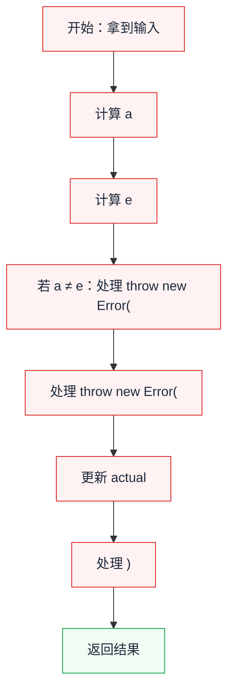

## TypeScript 解题方案（1 个方案逐个讲）

> **运行与提交**：每个方案都是自包含文件（内嵌用例自测，输出 PASS），整块复制到 `.ts` 文件后 `node 文件名` 即可运行。提交 LeetCode 时，把 `demo` 内的算法函数与辅助类型/函数整体取出、置于文件顶层即可。涉及交互/特殊接口的题以题面给定签名为准。

### 方案 1：直接实现

**分析与思路**：核心做法是「直接实现」。

**运行方式**：`node 本文件`，内嵌用例全部通过会输出 PASS。


**方案专属流程图**（真实控制流）：

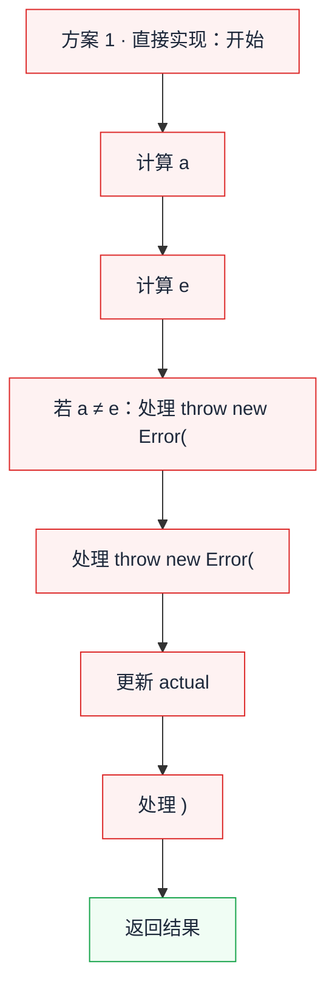

```typescript
function assertEq(actual: any, expected: any, msg: string = ''): void {
  // 定义函数/方法 assertEq
  const a = JSON.stringify(actual);
  const e = JSON.stringify(expected);
  if (a !== e)
    throw new Error(
      'ASSERT FAILED ' + msg + ' :: actual=' + a + ' expected=' + e,
    );
}

class BrowserHistory {
  // 定义类型
  history: string[];
  current: number; // history: string[]; current: number;
  constructor(homepage: string) {
    this.history = [homepage];
    this.current = 0;
  }
  visit(url: string): void {
    this.history = this.history.slice(0, this.current + 1);
    this.history.push(url);
    this.current = this.history.length - 1;
  } // 把 url 压入栈/数组尾部
  back(steps: number): string {
    this.current = Math.max(0, this.current - steps);
    return this.history[this.current];
  }
  forward(steps: number): string {
    this.current = Math.min(this.history.length - 1, this.current + steps);
    return this.history[this.current];
  }
}
export function demo(): void {
  // 程序入口：跑内嵌自测用例
  const browser = new BrowserHistory('leetcode.com'); // 把 new BrowserHistory(「leetcode.com」) 存入 browser
  browser.visit('google.com'); // browser.visit(「google.com」);
  browser.visit('facebook.com'); // browser.visit(「facebook.com」);
  browser.visit('youtube.com'); // browser.visit(「youtube.com」);
  assertEq(browser.back(1), 'facebook.com', 'back1'); // 断言校验
  assertEq(browser.forward(2), 'youtube.com', 'fwd2'); // 断言校验
  console.log('PASS'); // 全部用例通过，输出 PASS
}
demo(); // demo();
```

## 逐步拆解与面试追问

**复杂度**：时间 O(n) 量级，空间 O(n)

**为什么是这个量级**：整体只对数据做有限趟处理

**面试官可能会追问**：

- 什么时候用单调栈（求下一个更大或更小）？
- 栈里存值还是存下标？
- 能否用 O(1) 额外空间？

## 关键 API 速查（TS 主解法实际用到，附官方链接）

| API | 作用 | 使用要点 | 官方文档 |
|---|---|---|---|
| `Array.prototype.push()` | 尾部追加 | 返回新长度；可一次多个；均摊 O(1)；会改变原数组 | [官方文档](https://developer.mozilla.org/zh-CN/docs/Web/JavaScript/Reference/Global_Objects/Array/push) |
| `Array/String slice()` | 切片（不改原数组） | slice(start,end) 含头不含尾；负数从尾计；常用于复制数组（slice()） | [官方文档](https://developer.mozilla.org/zh-CN/docs/Web/JavaScript/Reference/Global_Objects/Array/slice) |
| `JSON.stringify()` | 序列化为 JSON 字符串 | 常用于结构化比较（深度相等判定）；undefined/函数/循环引用会被丢弃或抛错 | [官方文档](https://developer.mozilla.org/zh-CN/docs/Web/JavaScript/Reference/Global_Objects/JSON/stringify) |
| `Math.max()` | 最大值 | 配展开 Math.max(...arr)；空参返回 -Infinity；超大数组注意展开参数上限 | [官方文档](https://developer.mozilla.org/zh-CN/docs/Web/JavaScript/Reference/Global_Objects/Math/max) |
| `Math.min()` | 最小值 | 同 max；空参返回 Infinity | [官方文档](https://developer.mozilla.org/zh-CN/docs/Web/JavaScript/Reference/Global_Objects/Math/min) |

### 各语言官方文档导航

- **TypeScript / JS**：[MDN 中文参考](https://developer.mozilla.org/zh-CN/)
- **Python**：[Python 官方文档](https://docs.python.org/zh-cn/3/)
- **Go**：[Go 标准库](https://pkg.go.dev/std)
- **Java**：[JDK 17 API](https://docs.oracle.com/en/java/javase/17/docs/api/)
- **Rust**：[Rust 标准库](https://doc.rust-lang.org/std/)
- **Lua**：[Lua 5.4 手册](https://www.lua.org/manual/5.4/)
- **C**：[Cppreference C](https://zh.cppreference.com/w/c)
- **C++**：[Cppreference C++](https://zh.cppreference.com/w/cpp)
- **R**：[R 官方手册](https://stat.ethz.ch/R-manual/)
- **Zig**：[Zig 语言文档](https://ziglang.org/documentation/master/)
- **Dart**：[Dart API](https://api.dart.dev/)

## 附录：其他 10 种语言全部实现（每种语言列举其全部方案）

> TypeScript 的全部方案见「TypeScript 解题方案」一节；下面是其余 10 种语言的对应实现，每种语言的每个方案都带思路分析、代码走读与专属运行架构图。
> 每个方案都内嵌用例自测，可独立运行（老仓库 python/go 文件遵循「打印结果」约定）。
> 完整解法文件见 `dsa/<语言>/stack/lc_1472_设计浏览器历史记录/`。

### Python 实现（1 种方案）

Python 的全部方案如下，每个方案都内嵌用例自测，可独立运行（老仓库 python/go 文件遵循「打印结果」约定）：

#### 方案 1：直接实现

**思路与代码分析**：核心是「直接实现」。Python 版用切片与字典推导式简化操作，突出可读性。**走读**：方案 1 · 直接实现：开始 → 更新 browser → 调用 browser.visit(google.com) → 调用 browser.visit(facebook.com → 调用 browser.visit(youtube.com) → 调用 print(browser.back(1)) → 调用 print(browser.forward(2)) → 返回结果。

**运行架构**（真实控制流）：

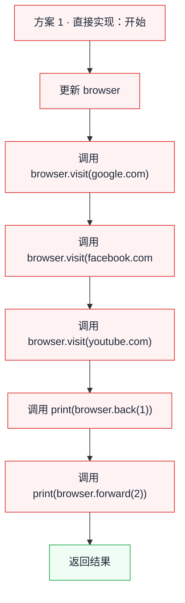

```python
import sys  # 提高递归深度上限（深输入防 RecursionError）

sys.setrecursionlimit(200000)  # 树/链表类题目节点数可达 1e4 量级

class BrowserHistory:  # 定义类
    def __init__(self, homepage: str):  # 构造函数：初始化成员
        self.history = [homepage]  # 把 [homepage] 写入 self.history
        self.current = 0  # 把 0 写入 self.current

    def visit(self, url: str) -> None:  # 定义函数 visit（参数：self, url: str）
        # Remove forward history
        self.history = self.history[
            : self.current + 1
        ]  # 把 self.history[:self.current 加 1] 写入 self.history
        self.history.append(url)  # 把 url 追加到列表尾部
        self.current = len(self.history) - 1  # 把 长度(self.history) 减 1 写入 self.current

    def back(self, steps: int) -> str:  # 定义函数 back（参数：self, steps: int）
        self.current = max(0, self.current - steps)  # 把 取较大值 0, self.current 减 steps) 写入 self.current
        return self.history[self.current]  # 返回 self.history[self.current]

    def forward(self, steps: int) -> str:  # 定义函数 forward（参数：self, steps: int）
        self.current = min(len(self.history) - 1, self.current + steps)
        return self.history[self.current]  # 返回 self.history[self.current]

def solve():  # 定义函数 solve（参数：无）
    browser = BrowserHistory("leetcode.com")  # 把 BrowserHistory(「leetcode.com」) 存入 browser
    browser.visit("google.com")  # browser.visit(「google.com」)
    browser.visit("facebook.com")  # browser.visit(「facebook.com」)
    browser.visit("youtube.com")  # browser.visit(「youtube.com」)
    print(browser.back(1))  # "facebook.com"
    print(browser.forward(2))  # "youtube.com"

if __name__ == "__main__":  # 若 __name__ 等于 「__main__」
    solve()  # solve()
```

### Go 实现（1 种方案）

Go 的全部方案如下，每个方案都内嵌用例自测，可独立运行（老仓库 python/go 文件遵循「打印结果」约定）：

#### 方案 1：直接实现

**思路与代码分析**：核心是「直接实现」。Go 版用切片与多返回值惯用法，显式处理索引边界。**走读**：方案 1 · 直接实现：开始 → 返回 BrowserHistory。

**运行架构**（真实控制流）：

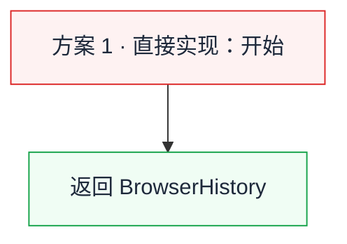

```go
package main // 引入依赖

import (
	"fmt"     // 「fmt」
	"reflect" // 「reflect」
)

type BrowserHistory struct { // 定义类型
	history []string // history []string
	current int      // current int
}

func Constructor(homepage string) BrowserHistory { // 定义函数/方法 Constructor
	return BrowserHistory{history: []string{homepage}, current: 0} // 返回 BrowserHistory{history: []string{homepage}, current: 0}
}

func (this *BrowserHistory) Visit(url string) { // 定义函数/方法 Visit
	this.history = this.history[:this.current+1] // 把 this.history[:this.current 加 1] 写入 this.history
	this.history = append(this.history, url)     // 把 append(this.history, url) 写入 this.history
	this.current = len(this.history) - 1         // 把 长度(this.history) 减 1 写入 this.current
}

func (this *BrowserHistory) Back(steps int) string { // 定义函数/方法 Back
	this.current = max(0, this.current-steps) // 把 取较大值 0, this.current 减 steps) 写入 this.current
	return this.history[this.current]         // 返回 this.history[this.current]
}

func (this *BrowserHistory) Forward(steps int) string { // 定义函数/方法 Forward
	this.current = min(len(this.history)-1, this.current+steps)
	return this.history[this.current] // 返回 this.history[this.current]
}

func max(a, b int) int { // 定义函数/方法 max
	if a > b { // 若 数组 超过 b
		return a // 返回 数组
	}
	return b // 返回 b
}

func min(a, b int) int { // 定义函数/方法 min
	if a < b { // 若 数组 小于 b
		return a // 返回 数组
	}
	return b // 返回 b
}

func main() { // 程序入口：跑内嵌自测用例
	browser := Constructor("leetcode.com") // 把 Constructor(「leetcode.com」) 写入 browser :
	browser.Visit("google.com")            // browser.Visit(「google.com」)
	browser.Visit("facebook.com")          // browser.Visit(「facebook.com」)
	browser.Visit("youtube.com")           // browser.Visit(「youtube.com」)
	out1 := browser.Back(1)                // 把 browser.Back(1) 写入 out1 :
	out2 := browser.Forward(2)             // 把 browser.Forward(2) 写入 out2 :
	if !reflect.DeepEqual([]string{out1, out2}, []string{"facebook.com", "youtube.com"}) {
		fmt.Println("FAIL", out1, out2) // 打印输出
		return                          // return
	}
	fmt.Println("PASS") // 全部用例通过，输出 PASS
}
```

### Java 实现（1 种方案）

Java 的全部方案如下，每个方案都内嵌用例自测，可独立运行（老仓库 python/go 文件遵循「打印结果」约定）：

#### 方案 1：直接实现

**思路与代码分析**：核心是「直接实现」。Java 版用类与静态方法组织，集合操作显式明了。**走读**：方案 1 · 直接实现：开始 → 调用 history.add(homepage) → 更新 current → 返回结果。

**运行架构**（真实控制流）：

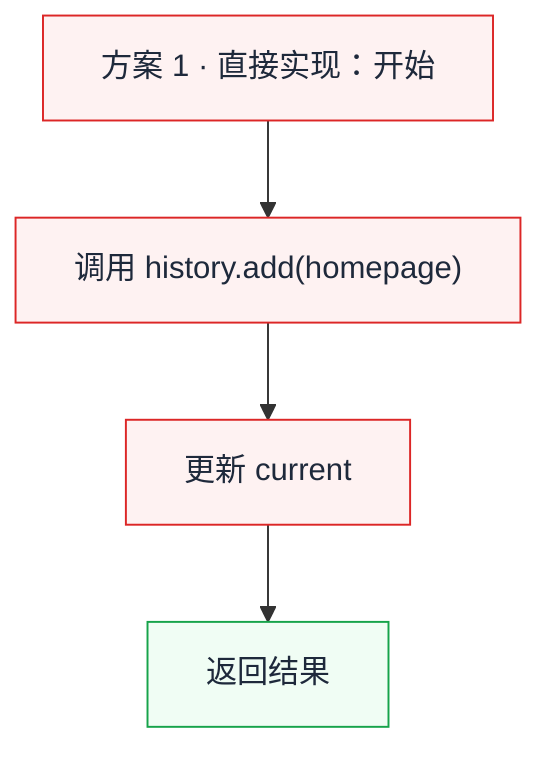

```java
package com.webfault.dsa; // 引入依赖

import java.util.*; // 引入依赖

class lc1472_solution1 { // 定义类型
  static class BrowserHistory { // static class BrowserHistory {
    List<String> history = new ArrayList<>(); // 把 new ArrayList 小于 超过 (); 写入 List<String> history
    int current = 0; // 把 0 存入 current

    BrowserHistory(String homepage) {
      history.add(homepage);
      current = 0;
    }

    void visit(String url) { // 定义函数/方法 visit
      history = new ArrayList<>(history.subList(0, current + 1));
      history.add(url); // history 追加 url);
      current = history.size() - 1; // 把 history.大小() 减 1; 写入 current
    }

    String back(int steps) {
      current = Math.max(0, current - steps);
      return history.get(current);
    }

    String forward(int steps) {
      current = Math.min(history.size() - 1, current + steps);
      return history.get(current);
    }
  }

  public static void main(String[] args) { // public static void main(String[] args) {
    BrowserHistory b =
        new BrowserHistory(
            "leetcode.com"); // 把 new BrowserHistory(「leetcode.com」); 写入 BrowserHistory b
    b.visit("google.com"); // b.visit(「google.com」);
    b.visit("facebook.com"); // b.visit(「facebook.com」);
    b.visit("youtube.com"); // b.visit(「youtube.com」);
    List<String> out = new ArrayList<>(); // 把 new ArrayList 小于 超过 (); 写入 List<String> out
    out.add(b.back(1)); // out 追加 b.back(1));
    out.add(b.forward(2)); // out 追加 b.forward(2));
    List<String> want = Arrays.asList("facebook.com", "youtube.com");
    if (!out.equals(want)) throw new RuntimeException("FAILED " + out);
    System.out.println("PASS"); // 全部用例通过，输出 PASS
  }
}
```

### Rust 实现（1 种方案）

Rust 的全部方案如下，每个方案都内嵌用例自测，可独立运行（老仓库 python/go 文件遵循「打印结果」约定）：

#### 方案 1：直接实现

**思路与代码分析**：核心是「直接实现」。Rust 版用所有权移动与切片借用改写同一逻辑，注意 Option 与引用边界。**走读**：方案 1 · 直接实现：开始 → 处理 BrowserHistory → 处理 history: vec非 [homepage.to_st → 处理 cur: 0, → 返回结果。

**运行架构**（真实控制流）：

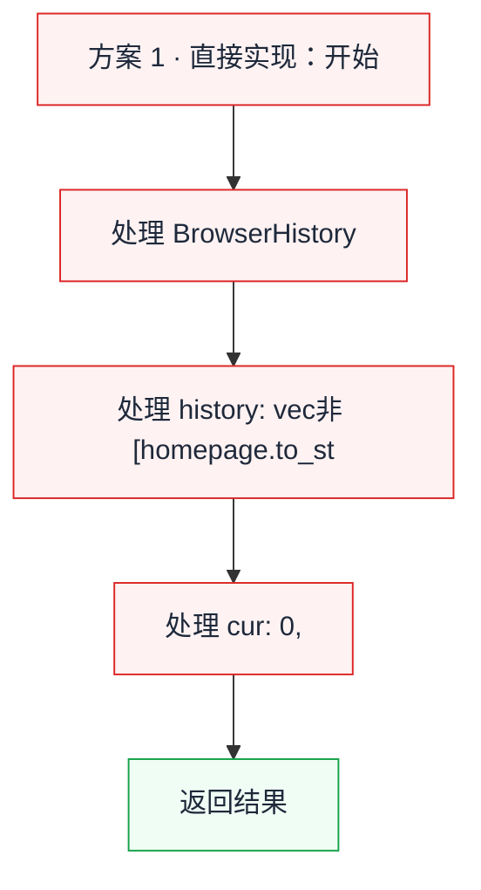

```rust
// LeetCode 1472. 设计浏览器历史记录 — Rust 版（方案1）
struct BrowserHistory {
    history: Vec<String>,
    cur: usize,
} // 定义类型
impl BrowserHistory {
    // 实现块
    fn new(homepage: &str) -> Self {
        BrowserHistory {
            history: vec![homepage.to_string()],
            cur: 0,
        }
    } // 定义函数/方法 new
    fn visit(&mut self, url: &str) {
        // 定义函数/方法 visit
        self.history.truncate(self.cur + 1); // self.history.truncate(self.当前值 加 1);
        self.history.push(url.to_string()); // 把 url.to_string( 压入栈/数组尾部
        self.cur = self.history.len() - 1; // 把 self.history.长度() 减 1; 写入 当前值
    }
    fn back(&mut self, steps: i32) -> String {
        // 定义函数/方法 back
        self.cur = self.cur.saturating_sub(steps as usize); // 把 self.当前值.saturating_sub(steps as usize); 写入 当前值
        self.history[self.cur].clone() // self.history[self.当前值].clone()
    }
    fn forward(&mut self, steps: i32) -> String {
        // 定义函数/方法 forward
        self.cur = (self.cur + steps as usize).min(self.history.len() - 1);
        self.history[self.cur].clone() // self.history[self.当前值].clone()
    }
}
fn main() {
    // 程序入口：跑内嵌自测用例
    let mut b = BrowserHistory::new("leetcode.com"); // 把 BrowserHistory::new(「leetcode.com」); 写入 let mut b
    b.visit("google.com"); // b.visit(「google.com」);
    b.visit("facebook.com"); // b.visit(「facebook.com」);
    b.visit("youtube.com"); // b.visit(「youtube.com」);
    assert_eq!(b.back(1), "facebook.com".to_string()); // 断言校验
    assert_eq!(b.back(1), "google.com".to_string()); // 断言校验
    assert_eq!(b.forward(1), "facebook.com".to_string()); // 断言校验
    b.visit("linkedin.com"); // b.visit(「linkedin.com」);
    assert_eq!(b.forward(2), "linkedin.com".to_string()); // 断言校验
    assert_eq!(b.back(2), "google.com".to_string()); // 断言校验
    assert_eq!(b.back(7), "leetcode.com".to_string()); // 断言校验
    println!("PASS");
} // 全部用例通过，输出 PASS
```

### Lua 实现（1 种方案）

Lua 的全部方案如下，每个方案都内嵌用例自测，可独立运行（老仓库 python/go 文件遵循「打印结果」约定）：

#### 方案 1：直接实现

**思路与代码分析**：核心是「直接实现」。Lua 版用表与 ipairs 遍历，注意 ipairs 遇 nil 即停的语义。

**运行架构**（真实控制流）：

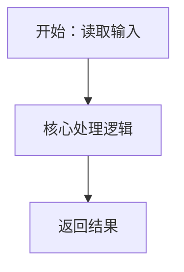

```lua
-- LeetCode 1472. 设计浏览器历史记录 — Lua 版（方案1）
local BrowserHistory = {} -- 把 {} 写入 local BrowserHistory
BrowserHistory.__index = BrowserHistory -- 把 BrowserHistory 写入 BrowserHistory.__index
function BrowserHistory.new(homepage) -- function BrowserHistory.new(homepage)
	return setmetatable({ history = { homepage }, cur = 1 }, BrowserHistory)
end -- 终点
function BrowserHistory:visit(url) -- function BrowserHistory:visit(url)
	for i = #self.history, self.cur + 1, -1 do
		self.history[i] = nil
	end
	self.history[#self.history + 1] = url -- 把 url 写入 self.history[#self.history + 1]
	self.cur = #self.history -- 把 #self.history 写入 当前值
end -- 终点
function BrowserHistory:back(steps) -- function BrowserHistory:back(steps)
	self.cur = math.max(1, self.cur - steps) -- 把 math.取较大值 1, self.当前值 减 steps) 写入 当前值
	return self.history[self.cur] -- 返回 self.history[self.当前值]
end -- 终点
function BrowserHistory:forward(steps) -- function BrowserHistory:forward(steps)
	self.cur = math.min(#self.history, self.cur + steps) -- 把 math.取较小值 #self.history, self.当前值 加 steps) 写入 当前值
	return self.history[self.cur] -- 返回 self.history[self.当前值]
end -- 终点
local b = BrowserHistory.new("leetcode.com") -- 把 BrowserHistory.new(「leetcode.com」) 写入 local b
b:visit("google.com")
b:visit("facebook.com")
b:visit("youtube.com")
assert(b:back(1) == "facebook.com") -- 断言校验
assert(b:back(1) == "google.com") -- 断言校验
assert(b:forward(1) == "facebook.com") -- 断言校验
b:visit("linkedin.com") -- b:visit(「linkedin.com」)
assert(b:forward(2) == "linkedin.com") -- 断言校验
assert(b:back(2) == "google.com") -- 断言校验
assert(b:back(7) == "leetcode.com") -- 断言校验
print("PASS") -- 全部用例通过，输出 PASS
```

### C 实现（1 种方案）

C 的全部方案如下，每个方案都内嵌用例自测，可独立运行（老仓库 python/go 文件遵循「打印结果」约定）：

#### 方案 1：直接实现

**思路与代码分析**：核心是「直接实现」。C 版手动管理下标与内存，循环边界全部显式写出。**走读**：方案 1 · 直接实现：开始 → 调用 strcpy(b-＞history[0], homepa → 更新 b->n → 更新 b->cur → 返回结果。

**运行架构**（真实控制流）：

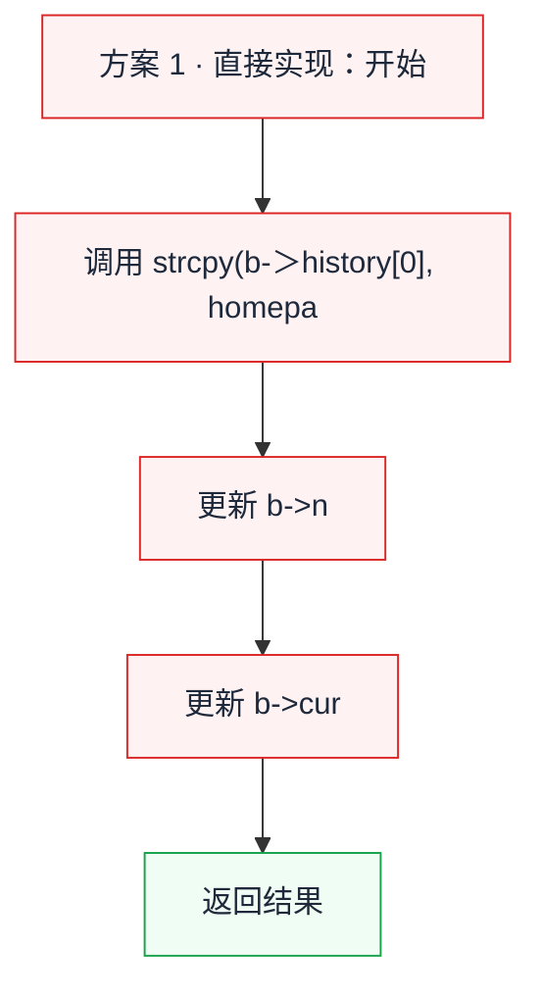

```c
/* LeetCode 1472. 设计浏览器历史记录 — C 版（方案1） */
#include <stdio.h>  // 引入头文件
#include <string.h> // 引入头文件
typedef struct {
    char history[64][64];
    int n;
    int cur;
} BrowserHistory;
static void bh_init(BrowserHistory *b, const char *homepage) { // 定义函数/方法 bh_init
    strcpy(b->history[0], homepage);                           // strcpy(b 减 超过 history[0], homepage);
    b->n = 1;                                                  // 把 1; 写入 b->n
    b->cur = 0;                                                // 把 0; 写入 b->cur
}
static void bh_visit(BrowserHistory *b, const char *url) { // 定义函数/方法 bh_visit
    b->n = b->cur + 1;                                     // 把 b 减 超过 当前值 加 1; 写入 b->n
    strcpy(b->history[b->n++], url); // strcpy(b 减 超过 history[b 减 超过 元素个数 加一 ], url);
    b->cur = b->n - 1;               // 把 b 减 超过 元素个数 减 1; 写入 b->cur
}
static const char *bh_back(BrowserHistory *b,
                           int steps) { // static const char 乘 bh_back(BrowserHistory 乘 b, int steps) {
    b->cur = b->cur - steps < 0 ? 0 : b->cur - steps;
    return b->history[b->cur]; // 返回 b 减 超过 history[b 减 超过 当前值]
}
static const char *bh_forward(BrowserHistory *b, int steps) {
    b->cur = b->cur + steps > b->n - 1 ? b->n - 1 : b->cur + steps;
    return b->history[b->cur]; // 返回 b 减 超过 history[b 减 超过 当前值]
}
int main(void) {                  // 程序入口：跑内嵌自测用例
    BrowserHistory b;             // BrowserHistory b;
    bh_init(&b, "leetcode.com");  // bh_init( 按位与 b, 「leetcode.com」);
    bh_visit(&b, "google.com");   // bh_visit( 按位与 b, 「google.com」);
    bh_visit(&b, "facebook.com"); // bh_visit( 按位与 b, 「facebook.com」);
    bh_visit(&b, "youtube.com");  // bh_visit( 按位与 b, 「youtube.com」);
    if (strcmp(bh_back(&b, 1), "facebook.com") != 0) {
        printf("FAIL 1\n");
        return 1;
    }
    if (strcmp(bh_back(&b, 1), "google.com") != 0) {
        printf("FAIL 2\n");
        return 1;
    }
    if (strcmp(bh_forward(&b, 1), "facebook.com") != 0) {
        printf("FAIL 3\n");
        return 1;
    }
    bh_visit(&b, "linkedin.com"); // bh_visit( 按位与 b, 「linkedin.com」);
    if (strcmp(bh_forward(&b, 2), "linkedin.com") != 0) {
        printf("FAIL 4\n");
        return 1;
    }
    if (strcmp(bh_back(&b, 2), "google.com") != 0) {
        printf("FAIL 5\n");
        return 1;
    }
    if (strcmp(bh_back(&b, 7), "leetcode.com") != 0) {
        printf("FAIL 6\n");
        return 1;
    }
    printf("PASS\n");
    return 0;
} // 全部用例通过，输出 PASS
```

### C++ 实现（1 种方案）

C++ 的全部方案如下，每个方案都内嵌用例自测，可独立运行（老仓库 python/go 文件遵循「打印结果」约定）：

#### 方案 1：直接实现

**思路与代码分析**：核心是「直接实现」。C++ 版用 STL 容器与迭代器，减少手写下标错误。**走读**：方案 1 · 直接实现：开始 → 调用 history.resize(cur + 1) → 调用 history.push_back(url) → 更新 cur → 返回结果。

**运行架构**（真实控制流）：

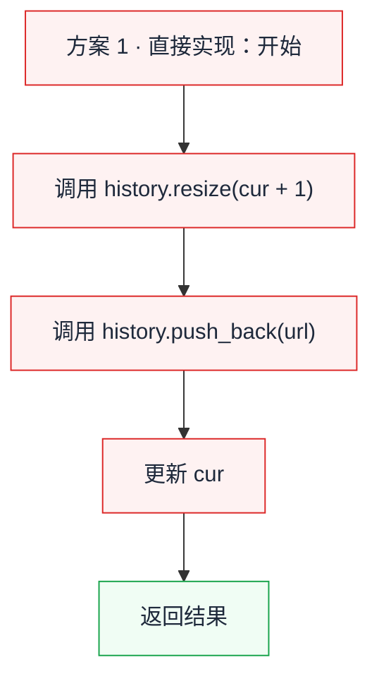

```cpp
// LeetCode 1472. 设计浏览器历史记录 — C++ 版（方案1）
#include <cassert>                    // 引入头文件
#include <iostream>                   // 引入头文件
#include <string>                     // 引入头文件
#include <vector>                     // 引入头文件
struct BrowserHistory {               // 定义类型
    std::vector<std::string> history; // std::vector 小于 std::string 超过 history;
    size_t cur;                       // size_t 当前值;
    explicit BrowserHistory(const std::string &homepage) : history{homepage}, cur(0) {}
    void visit(const std::string &url) { // 定义函数/方法 visit
        history.resize(cur + 1);         // history.resize(当前值 加 1);
        history.push_back(url);          // history 追加 url);
        cur = history.size() - 1;        // 把 history.大小() 减 1; 写入 当前值
    }
    std::string back(int steps) { // std::string back(int steps) {
        cur = cur >= static_cast<size_t>(steps) ? cur - steps : 0;
        return history[cur]; // 返回 history[当前值]
    }
    std::string forward(int steps) { // std::string forward(int steps) {
        cur = std::min(cur + static_cast<size_t>(steps), history.size() - 1);
        return history[cur]; // 返回 history[当前值]
    }
};
int main() {                                // 程序入口：跑内嵌自测用例
    BrowserHistory b("leetcode.com");       // BrowserHistory b(「leetcode.com」);
    b.visit("google.com");                  // b.visit(「google.com」);
    b.visit("facebook.com");                // b.visit(「facebook.com」);
    b.visit("youtube.com");                 // b.visit(「youtube.com」);
    assert(b.back(1) == "facebook.com");    // 断言校验
    assert(b.back(1) == "google.com");      // 断言校验
    assert(b.forward(1) == "facebook.com"); // 断言校验
    b.visit("linkedin.com");                // b.visit(「linkedin.com」);
    assert(b.forward(2) == "linkedin.com"); // 断言校验
    assert(b.back(2) == "google.com");      // 断言校验
    assert(b.back(7) == "leetcode.com");    // 断言校验
    std::cout << "PASS" << std::endl;
} // 全部用例通过，输出 PASS
```

### R 实现（1 种方案）

R 的全部方案如下，每个方案都内嵌用例自测，可独立运行（老仓库 python/go 文件遵循「打印结果」约定）：

#### 方案 1：直接实现

**思路与代码分析**：核心是「直接实现」。R 版用向量化思维与 1 起始下标，注意 1:n 的降序陷阱。**走读**：方案 1 · 直接实现：开始 → 更新 new.env(parent → 处理 e$history ＜- homepage → 处理 e$cur ＜- 1L → 处理 e$visit ＜- function(url) → 处理 e$history ＜＜- c(e$history[se → 处理 e$cur ＜＜- length(e$history) → 处理 e$back ＜- function(steps) → 处理 e$cur ＜＜- max(1L, e$cur - st → 处理 e$history[e$cur] → 处理 e$forward ＜- function(steps) → 处理 e$cur ＜＜- min(length(e$histo → 处理 e$history[e$cur] → 处理 e → 返回结果。

**运行架构**（真实控制流）：

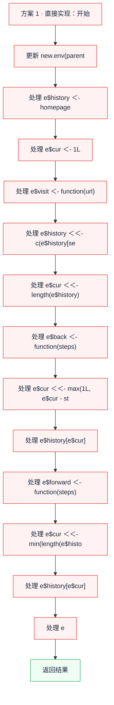

```r
# R 版（方案1） 定义函数 BrowserHistory（参数：homepage）
BrowserHistory <- function(homepage) {
    e <- new.env(parent = emptyenv())  # 把 new.env(parent 赋值为 emptyenv()) 存入 e
    e$history <- homepage
    e$cur <- 1L  # 把 homepage; e$当前值 小于 减 1L 存入 e$history
    e$visit <- function(url) {
        # 把 function(url) { 存入 e$visit
        e$history <<- c(e$history[seq_len(e$cur)], url)  # e$history 小于 小于 减 字符(e$history[seq_len(e$当前值)], url)
        e$cur <<- length(e$history)  # e$当前值 小于 小于 减 长度(e$history)
    }
    e$back <- function(steps) {
        # 把 function(steps) { 存入 e$back
        e$cur <<- max(1L, e$cur - steps)  # e$当前值 小于 小于 减 取较大值 1L, e$当前值 减 steps)
        e$history[e$cur]  # e$history[e$当前值]
    }
    e$forward <- function(steps) {
        # 把 function(steps) { 存入 e$forward
        e$cur <<- min(length(e$history), e$cur + steps)  # e$当前值 小于 小于 减 取较小值 长度(e$history), e$当前值 加 steps)
        e$history[e$cur]  # e$history[e$当前值]
    }
    e
}
b <- BrowserHistory("leetcode.com")  # 把 BrowserHistory(「leetcode.com」) 存入 b
b$visit("google.com")
b$visit("facebook.com")
b$visit("youtube.com")
stopifnot(b$back(1) == "facebook.com")  # 断言校验
stopifnot(b$back(1) == "google.com")  # 断言校验
stopifnot(b$forward(1) == "facebook.com")  # 断言校验
b$visit("linkedin.com")  # b$visit(「linkedin.com」)
stopifnot(b$forward(2) == "linkedin.com")  # 断言校验
stopifnot(b$back(2) == "google.com")  # 断言校验
stopifnot(b$back(7) == "leetcode.com")  # 断言校验
cat("PASS\n")  # 全部用例通过，输出 PASS
```

### Zig 实现（1 种方案）

Zig 的全部方案如下，每个方案都内嵌用例自测，可独立运行（老仓库 python/go 文件遵循「打印结果」约定）：

#### 方案 1：直接实现

**思路与代码分析**：核心是「直接实现」。Zig 版显式分配与清零，整型边界处理严格。**走读**：方案 1 · 直接实现：开始 → 计算 b → 处理 @memcpy(b.history[0][0..home → 更新 b.lens[0] → 返回 b。

**运行架构**（真实控制流）：

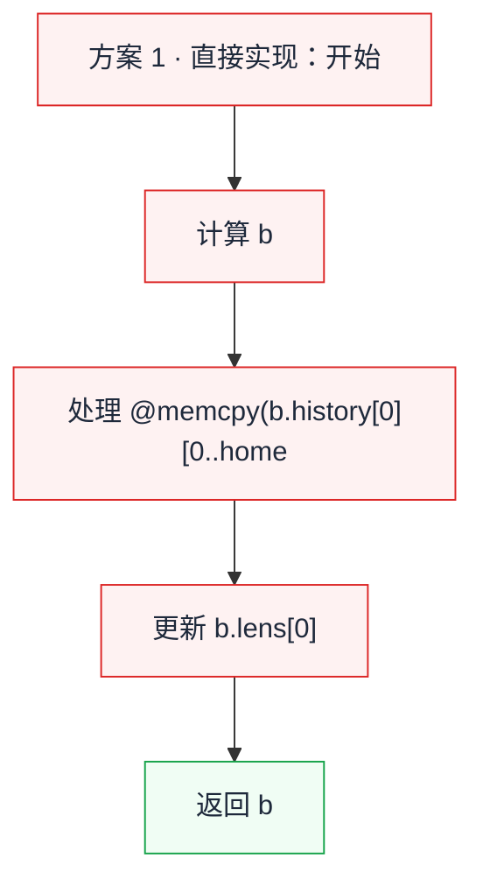

```zig
// LeetCode 1472. 设计浏览器历史记录 — Zig 版（方案1）
const std = @import("std"); // 把 @import(「std」) 存入 std
const BrowserHistory = struct { // 把 struct { 存入 BrowserHistory
    history: [64][64]u8,
    lens: [64]usize,
    n: usize,
    cur: usize,
    fn init(homepage: []const u8) BrowserHistory { // 定义函数/方法 init
        var b = BrowserHistory{ .history = undefined, .lens = undefined, .n = 1, .cur = 0 };
        @memcpy(b.history[0][0..homepage.len], homepage); // @memcpy(b.history[0][0..homepage.长度], homepage);
        b.lens[0] = homepage.len; // 把 homepage.长度; 写入 b.lens[0]
        return b; // 返回 b
    }
    fn visit(self: *BrowserHistory, url: []const u8) void { // 定义函数/方法 visit
        self.n = self.cur + 1; // 把 self.当前值 加 1; 写入 元素个数
        @memcpy(self.history[self.n][0..url.len], url); // @memcpy(self.history[self.元素个数][0..url.长度], url);
        self.lens[self.n] = url.len; // 把 url.长度; 写入 self.lens[self.n]
        self.n += 1; // self.n累加 1
        self.cur = self.n - 1; // 把 self.元素个数 减 1; 写入 当前值
    }
    fn back(self: *BrowserHistory, steps: usize) []const u8 { // 定义函数/方法 back
        self.cur = if (self.cur >= steps) self.cur - steps else 0; // 把 if (self.当前值 不低于 steps) self.当前值 减 steps else 0; 写入 当前值
        return self.history[self.cur][0..self.lens[self.cur]]; // 返回 self.history[self.当前值][0..self.lens[self.当前值]]
    }
    fn forward(self: *BrowserHistory, steps: usize) []const u8 { // 定义函数/方法 forward
        self.cur = @min(self.cur + steps, self.n - 1); // 把 @取较小值 self.当前值 加 steps, self.元素个数 减 1); 写入 当前值
        return self.history[self.cur][0..self.lens[self.cur]]; // 返回 self.history[self.当前值][0..self.lens[self.当前值]]
    }
};
pub fn main() !void { // 程序入口：跑内嵌自测用例
    var b = BrowserHistory.init("leetcode.com"); // 把 BrowserHistory.init(「leetcode.com」) 存入 b
    b.visit("google.com"); // b.visit(「google.com」);
    b.visit("facebook.com"); // b.visit(「facebook.com」);
    b.visit("youtube.com"); // b.visit(「youtube.com」);
    if (!std.mem.eql(u8, b.back(1), "facebook.com")) return error.TestFailed;
    if (!std.mem.eql(u8, b.back(1), "google.com")) return error.TestFailed;
    if (!std.mem.eql(u8, b.forward(1), "facebook.com")) return error.TestFailed;
    b.visit("linkedin.com"); // b.visit(「linkedin.com」);
    if (!std.mem.eql(u8, b.forward(2), "linkedin.com")) return error.TestFailed;
    if (!std.mem.eql(u8, b.back(2), "google.com")) return error.TestFailed;
    if (!std.mem.eql(u8, b.back(7), "leetcode.com")) return error.TestFailed;
    std.debug.print("PASS\n", .{});
} // 全部用例通过，输出 PASS
```

### Dart 实现（1 种方案）

Dart 的全部方案如下，每个方案都内嵌用例自测，可独立运行（老仓库 python/go 文件遵循「打印结果」约定）：

#### 方案 1：直接实现

**思路与代码分析**：核心是「直接实现」。Dart 版用可空类型标注与集合方法，注意空安全。**走读**：方案 1 · 直接实现：开始 → 调用 history.removeRange( → 处理 cur + 1, → 处理 history.length, → 处理 ) → 调用 history.add(url) → 更新 cur → 返回结果。

**运行架构**（真实控制流）：

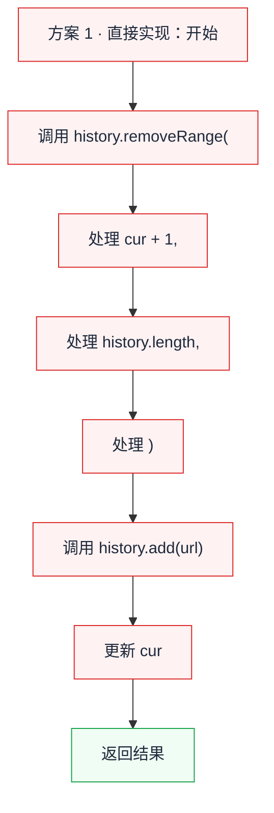

```dart
// LeetCode 1472. 设计浏览器历史记录 — Dart 版（方案1）
class BrowserHistory {
  // 定义类型
  final List<String> history; // final List 小于 String 超过 history;
  int cur = 0; // 把 0 存入 当前值
  BrowserHistory(String homepage)
    : history = [
        homepage,
      ]; // 把 [homepage]; 写入 BrowserHistory(String homepage) : history
  void visit(String url) {
    // 定义函数/方法 visit
    history.removeRange(
      cur + 1,
      history.length,
    ); // history.removeRange(当前值 加 1, history.长度);
    history.add(url); // history 追加 url);
    cur = history.length - 1; // 把 history.长度 减 1 存入 当前值
  }

  String back(int steps) {
    // 定义函数/方法 back
    cur = cur - steps < 0
        ? 0
        : cur - steps; // 把 当前值 减 steps 小于 0 ? 0 : 当前值 减 steps 存入 当前值
    return history[cur]; // 返回 history[当前值]
  }

  String forward(int steps) {
    // 定义函数/方法 forward
    cur = (cur + steps > history.length - 1) ? history.length - 1 : cur + steps;
    return history[cur]; // 返回 history[当前值]
  }
}

void main() {
  // 程序入口：跑内嵌自测用例
  final b = BrowserHistory(
    'leetcode.com',
  ); // 把 BrowserHistory('leetcode.com') 存入 b
  b.visit('google.com'); // b.visit('google.com');
  b.visit('facebook.com'); // b.visit('facebook.com');
  b.visit('youtube.com'); // b.visit('youtube.com');
  if (b.back(1) != 'facebook.com')
    throw StateError(
      'c1',
    ); // 若 b.back(1) 不等于 'facebook.com') throw StateError('c1');
  if (b.back(1) != 'google.com')
    throw StateError(
      'c2',
    ); // 若 b.back(1) 不等于 'google.com') throw StateError('c2');
  if (b.forward(1) != 'facebook.com')
    throw StateError(
      'c3',
    ); // 若 b.forward(1) 不等于 'facebook.com') throw StateError('c3');
  b.visit('linkedin.com'); // b.visit('linkedin.com');
  if (b.forward(2) != 'linkedin.com')
    throw StateError(
      'c4',
    ); // 若 b.forward(2) 不等于 'linkedin.com') throw StateError('c4');
  if (b.back(2) != 'google.com')
    throw StateError(
      'c5',
    ); // 若 b.back(2) 不等于 'google.com') throw StateError('c5');
  if (b.back(7) != 'leetcode.com')
    throw StateError(
      'c6',
    ); // 若 b.back(7) 不等于 'leetcode.com') throw StateError('c6');
  print('PASS');
} // 全部用例通过，输出 PASS
```

---

## 内容总结

- **设计浏览器历史记录**（栈 · Medium）：共 1 个方案，主线思路「直接实现」；时间 O(n) 量级；动画演示栈后进先出过程，附录给出 11 种语言 × 全部方案的可运行实现。
- 来源博客：[https://blog.csdn.net/tyro_java/article/details/145354313](https://blog.csdn.net/tyro_java/article/details/145354313)
- 导航：[📋 总目录](../) ｜ [← 013 lcr 152. 验证二叉搜索树](../013_leetcode_lcr_152._验证二叉搜索树的后序遍历序列/) ｜ [015 逆波兰表达式求值 →](../015_逆波兰表达式求值/)
