# 015 · 逆波兰表达式求值（第一阶段 · 线性结构入门 · Medium）

> **难度**：⭐⭐ Medium ｜ **专题**：栈
> **学习定位**：第一阶段 · 线性结构入门第 15 篇 ｜ **解法数**：2
> **内容总结**：**逆波兰表达式求值**（栈 · Medium）：共 2 个方案，主线思路「栈辅助」；时间 O(n)（单趟线性扫描）；动画演示栈后进先出过程，附录给出 11 种语言 × 全部方案的可运行实现。

---

## 题目描述

给你一个字符串数组 `tokens` ，表示一个根据 逆波兰表示法 表示的算术表达式。

请你计算该表达式。返回一个表示表达式值的整数。

注意：

 有效的算符为 `'+'`、`'-'`、`''` 和 `'/'` 。
 每个操作数（运算对象）都可以是一个整数或者另一个表达式。
 两个整数之间的除法总是 向零截断 。
 表达式中不含除零运算。
 输入是一个根据逆波兰表示法表示的算术表达式。
 答案及所有中间计算结果可以用 32 位 整数表示。

示例 1：

输入：tokens = [「2」,「1」,「+」,「3」,「」]
输出：9
解释：该算式转化为常见的中缀算术表达式为：((2 + 1)  3) = 9

示例 2：

输入：tokens = [「4」,「13」,「5」,「/」,「+」]
输出：6
解释：该算式转化为常见的中缀算术表达式为：(4 + (13 / 5)) = 6

示例 3：

输入：tokens = [「10」,「6」,「9」,「3」,「+」,「-11」,「」,「/」,「」,「17」,「+」,「5」,「+」]
输出：22
解释：该算式转化为常见的中缀算术表达式为：
 ((10  (6 / ((9 + 3)  -11))) + 17) + 5
= ((10  (6 / (12  -11))) + 17) + 5
= ((10  (6 / -132)) + 17) + 5
= ((10  0) + 17) + 5
= (0 + 17) + 5
= 17 + 5
= 22

提示：

 `1 
 `tokens[i]` 是一个算符（`「+」`、`「-」`、`「」` 或 `「/」`），或是在范围 `[-200, 200]` 内的一个整数

逆波兰表达式：

逆波兰表达式是一种后缀表达式，所谓后缀就是指算符写在后面。

 平常使用的算式则是一种中缀表达式，如 `( 1 + 2 )  ( 3 + 4 )` 。
 该算式的逆波兰表达式写法为 `( ( 1 2 + ) ( 3 4 + )  )` 。

逆波兰表达式主要有以下两个优点：

 去掉括号后表达式无歧义，上式即便写成 `1 2 + 3 4 +  `也可以依据次序计算出正确结果。
 适合用栈操作运算：遇到数字则入栈；遇到算符则取出栈顶两个数字进行计算，并将结果压入栈中

- 主函数签名：`function evalRPN(tokens: string[]): number`

**用例演示**（摘自主解法内嵌自测，输入到输出一目了然）：

```typescript
  const cases = [
    { t: ['2', '1', '+', '3', '*'], want: 9 },
    { t: ['4', '13', '5', '/', '+'], want: 6 },
    {
      t: ['10', '6', '9', '3', '+', '-11', '*', '/', '*', '17', '+', '5', '+'],
      want: 22,
    },
  ];
```

> 题面与 [leetcode.cn 官方](https://leetcode.cn/problems/evaluate-reverse-polish-notation/)一致，示例配图取自官方题面。

**数据范围与注意事项**：

- `1 <= tokens.length <= 10^4`
- `tokens[i]` 是一个算符（`「+」`、`「-」`、`「」` 或 `「/」`），或是在范围 `[-200, 200]` 内的一个整数
- 平常使用的算式则是一种中缀表达式，如 `( 1 + 2 )  ( 3 + 4 )` 。
- 该算式的逆波兰表达式写法为 `( ( 1 2 + ) ( 3 4 + )  )` 。
- 去掉括号后表达式无歧义，上式即便写成 `1 2 + 3 4 +  `也可以依据次序计算出正确结果。
- 适合用栈操作运算：遇到数字则入栈；遇到算符则取出栈顶两个数字进行计算，并将结果压入栈中
- **易错点**：出栈前判空；「下一个更大元素」类问题栈里存下标比存值好用。

## 题目分析

**场景是什么**：后进先出结构天然适合「最近匹配」，对应真实开发里的括号校验、浏览历史、函数调用栈。本题就是该场景的 Medium 级练习，主线做法是「栈辅助」。

**主线怎么解**：把主解法从头到尾过一遍，它其实在依次做这几件事：单循环线性扫描 → 栈的后进先出操作。

## 解题思路

**方案对比**（共 2 个方案，由浅入深）：

| 方案 | 时间复杂度 | 空间复杂度 |
|---|---|---|
| 方案 1 · 栈辅助 | O(n)（单趟线性扫描） | O(1) 到 O(n)（视辅助结构） |
| 方案 2 · 栈辅助 | O(n)（单趟线性扫描） | O(1) 到 O(n)（视辅助结构） |

**方案间的取舍**：方案 1（栈辅助）；方案 2（栈辅助）。数据规模小、可读性优先时选靠前的方案；规模大、性能优先时选靠后的方案。

**怎么读这一篇**：

- 🐣 **新手路线**：把「题目描述」的示例 1 在纸上手推一遍 → 读方案 1（最直观的写法）与它的代码走读 → 按「运行方式」本地跑通看 PASS → 回头对比方案 2 之后的写法差在哪
- 🦅 **大佬路线**：直接锁定最优方案 1（栈辅助，O(n)（单趟线性扫描））→ 跳读该方案代码与走读 → 用「逐步拆解与面试追问」补齐复杂度推导与边界追问

### 动态算法图（栈后进先出，GIF 自动循环）


动画演示栈专题里栈后进先出的典型过程；每个方案在「TypeScript 解题方案」一节还配了专属动画与专属流程图。

### 主解法流程图（真实控制流）

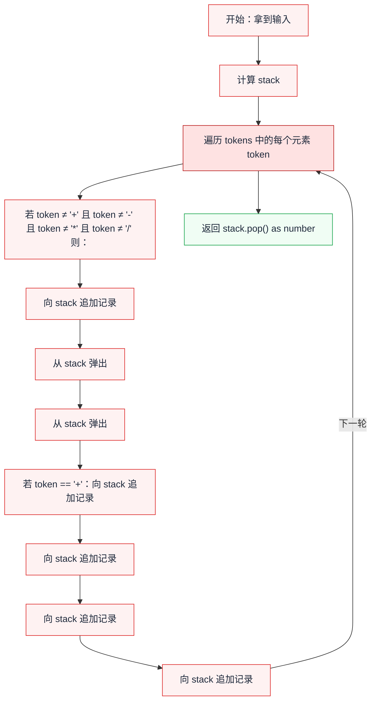

## TypeScript 解题方案（2 个方案逐个讲）

> **运行与提交**：每个方案都是自包含文件（内嵌用例自测，输出 PASS），整块复制到 `.ts` 文件后 `node 文件名` 即可运行。提交 LeetCode 时，把 `demo` 内的算法函数与辅助类型/函数整体取出、置于文件顶层即可。涉及交互/特殊接口的题以题面给定签名为准。

### 方案 1：栈辅助

**分析与思路**：核心做法是「栈辅助」。代码里依次做这些事：单循环线性扫描；栈的后进先出操作。

**运行方式**：`node 本文件`，内嵌用例全部通过会输出 PASS。


**方案专属流程图**（真实控制流）：


```typescript
export function demo(): void {
  // 程序入口：跑内嵌自测用例
  function evalRPN(tokens: string[]): number {
    // 定义函数/方法 evalRPN
    const stack: number[] = []; // 把 []; 写入 const stack: number[]
    for (const token of tokens) {
      // for (const token of tokens) {
      if (token !== '+' && token !== '-' && token !== '*' && token !== '/') {
        stack.push(parseInt(token, 10)); // 把 转整数(token, 10 压入栈/数组尾部
      } else {
        // 否则
        const num2 = stack.pop() as number; // 把 栈 弹出 ) as number 存入 num2
        const num1 = stack.pop() as number; // 把 栈 弹出 ) as number 存入 num1
        if (token === '+')
          stack.push(num1 + num2); // 若 token 全等于 「 加 」) 栈 追加 num1 加 num2);
        else if (token === '-')
          stack.push(num1 - num2); // 否则，若 token 全等于 「 减 」) 栈 追加 num1 减 num2);
        else if (token === '*')
          stack.push(num1 * num2); // 否则，若 token 全等于 「 乘 」) 栈 追加 num1 乘 num2);
        else stack.push(Math.trunc(num1 / num2)); // 否则
      }
    }
    return stack.pop() as number; // 返回 栈 弹出 ) as number
  }
  const cases = [
    { t: ['2', '1', '+', '3', '*'], want: 9 },
    { t: ['4', '13', '5', '/', '+'], want: 6 },
    {
      t: ['10', '6', '9', '3', '+', '-11', '*', '/', '*', '17', '+', '5', '+'],
      want: 22,
    },
  ];
  let fail = false; // 把 false 存入 fail
  for (const c of cases) {
    // for (const 字符 of cases) {
    const got = evalRPN(c.t); // 把 evalRPN(字符.另一字符串) 存入 got
    if (got !== c.want) {
      fail = true;
      console.log('FAIL', c, 'got', got);
    }
  }
  if (fail) throw new Error('FAILED'); // 若 fail) throw new Error(「FAILED」);
  console.log('PASS'); // 全部用例通过，输出 PASS
}
demo(); // demo();
```

### 方案 2：栈辅助

**分析与思路**：核心做法是「栈辅助」。代码里依次做这些事：单循环线性扫描；栈的后进先出操作。

**运行方式**：`node 本文件`，内嵌用例全部通过会输出 PASS。

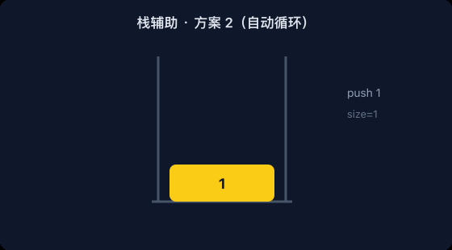

**方案专属流程图**（真实控制流）：


```typescript
export function demo(): void {
  // 程序入口：跑内嵌自测用例
  function evalRPN(tokens: string[]): number {
    // 定义函数/方法 evalRPN
    const stack: number[] = []; // 把 []; 写入 const stack: number[]
    for (const token of tokens) {
      // for (const token of tokens) {
      if (token !== '+' && token !== '-' && token !== '*' && token !== '/') {
        stack.push(parseInt(token, 10)); // 把 转整数(token, 10 压入栈/数组尾部
      } else {
        // 否则
        const num2 = stack.pop() as number; // 把 栈 弹出 ) as number 存入 num2
        const num1 = stack.pop() as number; // 把 栈 弹出 ) as number 存入 num1
        if (token === '+')
          stack.push(num1 + num2); // 若 token 全等于 「 加 」) 栈 追加 num1 加 num2);
        else if (token === '-')
          stack.push(num1 - num2); // 否则，若 token 全等于 「 减 」) 栈 追加 num1 减 num2);
        else if (token === '*')
          stack.push(num1 * num2); // 否则，若 token 全等于 「 乘 」) 栈 追加 num1 乘 num2);
        else stack.push(Math.trunc(num1 / num2)); // 否则
      }
    }
    return stack.pop() as number; // 返回 栈 弹出 ) as number
  }
  const cases = [
    { t: ['2', '1', '+', '3', '*'], want: 9 },
    { t: ['4', '13', '5', '/', '+'], want: 6 },
    {
      t: ['10', '6', '9', '3', '+', '-11', '*', '/', '*', '17', '+', '5', '+'],
      want: 22,
    },
  ];
  let fail = false; // 把 false 存入 fail
  for (const c of cases) {
    // for (const 字符 of cases) {
    const got = evalRPN(c.t); // 把 evalRPN(字符.另一字符串) 存入 got
    if (got !== c.want) {
      fail = true;
      console.log('FAIL', c, 'got', got);
    }
  }
  if (fail) throw new Error('FAILED'); // 若 fail) throw new Error(「FAILED」);
  console.log('PASS'); // 全部用例通过，输出 PASS
}
demo(); // demo();
```

## 逐步拆解与面试追问

**复杂度**：时间 O(n)（单趟线性扫描），空间 O(1) 到 O(n)（视辅助结构）

**为什么是这个量级**：每个元素被常数次访问，辅助哈希或栈的开销与 n 同阶

**面试官可能会追问**：

- 什么时候用单调栈（求下一个更大或更小）？
- 栈里存值还是存下标？
- 能否用 O(1) 额外空间？

## 关键 API 速查（TS 主解法实际用到，附官方链接）

| API | 作用 | 使用要点 | 官方文档 |
|---|---|---|---|
| `Array.prototype.push()` | 尾部追加 | 返回新长度；可一次多个；均摊 O(1)；会改变原数组 | [官方文档](https://developer.mozilla.org/zh-CN/docs/Web/JavaScript/Reference/Global_Objects/Array/push) |
| `Array.prototype.pop()` | 尾部弹出 | 返回被删元素（空数组返回 undefined）；O(1) | [官方文档](https://developer.mozilla.org/zh-CN/docs/Web/JavaScript/Reference/Global_Objects/Array/pop) |

### 各语言官方文档导航

- **TypeScript / JS**：[MDN 中文参考](https://developer.mozilla.org/zh-CN/)
- **Python**：[Python 官方文档](https://docs.python.org/zh-cn/3/)
- **Go**：[Go 标准库](https://pkg.go.dev/std)
- **Java**：[JDK 17 API](https://docs.oracle.com/en/java/javase/17/docs/api/)
- **Rust**：[Rust 标准库](https://doc.rust-lang.org/std/)
- **Lua**：[Lua 5.4 手册](https://www.lua.org/manual/5.4/)
- **C**：[Cppreference C](https://zh.cppreference.com/w/c)
- **C++**：[Cppreference C++](https://zh.cppreference.com/w/cpp)
- **R**：[R 官方手册](https://stat.ethz.ch/R-manual/)
- **Zig**：[Zig 语言文档](https://ziglang.org/documentation/master/)
- **Dart**：[Dart API](https://api.dart.dev/)

## 附录：其他 10 种语言全部实现（每种语言列举其全部方案）

> TypeScript 的全部方案见「TypeScript 解题方案」一节；下面是其余 10 种语言的对应实现，每种语言的每个方案都带思路分析、代码走读与专属运行架构图。
> 每个方案都内嵌用例自测，可独立运行（老仓库 python/go 文件遵循「打印结果」约定）。
> 完整解法文件见 `dsa/<语言>/stack/lc_150_逆波兰表达式求值/`。

### Python 实现（2 种方案）

Python 的全部方案如下，每个方案都内嵌用例自测，可独立运行（老仓库 python/go 文件遵循「打印结果」约定）：

#### 方案 1：栈辅助

**思路与代码分析**：核心是「栈辅助」。Python 版用切片与字典推导式简化操作，突出可读性。**走读**：方案 1 · 栈辅助：开始 → 更新 stack → 遍历 tokens: 中的每个元素 token → 若 token not in (+, -, *, /)：向 stack 追加记录 → 向 stack 追加记录 → 从 stack 弹出 → 从 stack 弹出 → 若 token == +：向 stack 追加记录 → 向 stack 追加记录 → 更新 = → 向 stack 追加记录 → 更新 = → 向 stack 追加记录 → 向 stack 追加记录 → 返回 stack.pop()。

**运行架构**（真实控制流）：

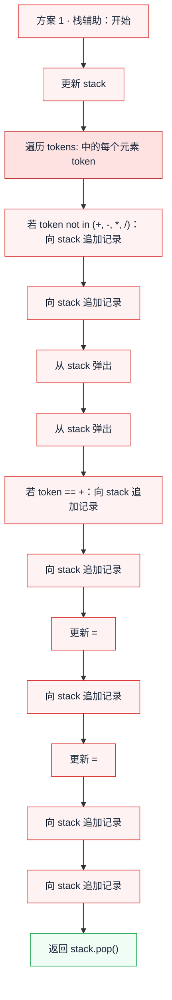

```python
import sys  # 提高递归深度上限（深输入防 RecursionError）

sys.setrecursionlimit(200000)  # 树/链表类题目节点数可达 1e4 量级

def evalRPN(tokens):  # 定义函数 evalRPN（参数：tokens）
    stack = []  # 把 [] 存入 栈
    for token in tokens:  # 逐个取出 tokens 的元素（token）
        if token not in ("+", "-", "*", "/"):  # 若 token not in (「 加 」, 「 加 」, 「 加 」, 「 加 」
            stack.append(int(token))  # 把 int(token 追加到列表尾部
        else:  # 否则
            num2 = stack.pop()  # 把 栈 弹出 ) 存入 num2
            num1 = stack.pop()  # 把 栈 弹出 ) 存入 num1
            if token == "+":  # 若 token 等于 「 加 」
                stack.append(num1 + num2)  # 把 num1 加 num2 追加到列表尾部
            elif token == "-":  # 否则，若 token 等于 「 减 」
                stack.append(num1 - num2)  # 把 num1 减 num2 追加到列表尾部
            elif token == "*":  # 否则，若 token 等于 「 乘 」
                stack.append(num1 * num2)  # 把 num1 乘 num2 追加到列表尾部
            else:  # 否则
                # Truncate toward zero
                stack.append(int(num1 / num2))  # 把 int(num1 除以 num2 追加到列表尾部
    return stack.pop()  # 返回 栈 弹出 )

if __name__ == "__main__":  # 若 __name__ 等于 '__main__'
    print(evalRPN(["2", "1", "+", "3", "*"]))  # 打印输出
    print(evalRPN(["4", "13", "5", "/", "+"]))  # 打印输出
```

#### 方案 2：栈辅助

**思路与代码分析**：核心是「栈辅助」。Python 版用切片与字典推导式简化操作，突出可读性。**走读**：方案 2 · 栈辅助：开始 → 更新 n → 遍历 tokens: 中的每个元素 token → 返回 stack[index]。

**运行架构**（真实控制流）：

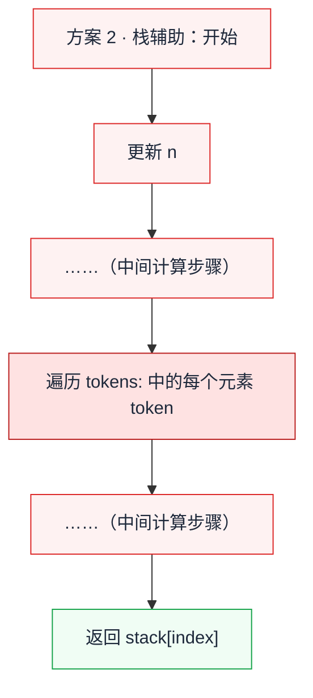

```python
import sys  # 提高递归深度上限（深输入防 RecursionError）

sys.setrecursionlimit(200000)  # 树/链表类题目节点数可达 1e4 量级

def evalRPN(tokens):  # 定义函数 evalRPN（参数：tokens）
    n = len(tokens)  # 把 长度(tokens) 存入 元素个数
    stack = [0] * ((n + 1) // 2)  # 把 [0] 乘 ((元素个数 加 1) 除以 除以 2) 存入 栈
    index = -1  # 把 减 1 存入 index
    for token in tokens:  # 逐个取出 tokens 的元素（token）
        if token in ("+", "-", "*", "/"):  # 若 token in (「 加 」, 「 加 」, 「 加 」, 「 加 」
            num2 = stack[index]  # 把 栈[index] 存入 num2
            num1 = stack[index - 1]  # 把 栈[index 减 1] 存入 num1
            index -= 1  # index累减 1
            if token == "+":  # 若 token 等于 「 加 」
                stack[index] = num1 + num2  # 把 num1 加 num2 写入 stack[index]
            elif token == "-":  # 否则，若 token 等于 「 减 」
                stack[index] = num1 - num2  # 把 num1 减 num2 写入 stack[index]
            elif token == "*":  # 否则，若 token 等于 「 乘 」
                stack[index] = num1 * num2  # 把 num1 乘 num2 写入 stack[index]
            else:  # 否则
                stack[index] = int(num1 / num2)  # 把 int(num1 除以 num2) 写入 stack[index]
        else:  # 否则
            index += 1  # index累加 1
            stack[index] = int(token)  # 把 int(token) 写入 stack[index]
    return stack[index]  # 返回 栈[index]

if __name__ == "__main__":  # 若 __name__ 等于 '__main__'
    print(evalRPN(["2", "1", "+", "3", "*"]))  # 打印输出
```

### Go 实现（2 种方案）

Go 的全部方案如下，每个方案都内嵌用例自测，可独立运行（老仓库 python/go 文件遵循「打印结果」约定）：

#### 方案 1：栈辅助

**思路与代码分析**：核心是「栈辅助」。Go 版用切片与多返回值惯用法，显式处理索引边界。**走读**：方案 1 · 栈辅助：开始 → 更新 : → 遍历 tokens 的下标与元素 token → 返回 stack[len(stack)-1]。

**运行架构**（真实控制流）：

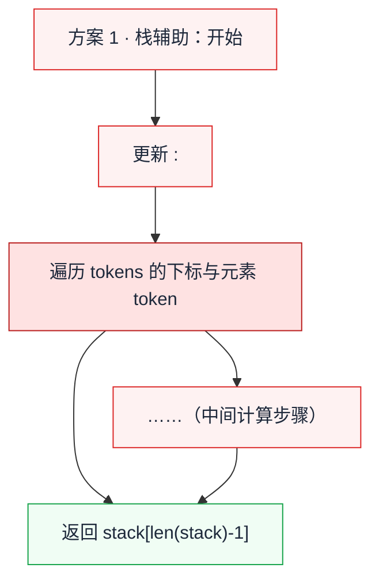

```go
package main // 引入依赖

import (
	"fmt"     // 「fmt」
	"reflect" // 「reflect」
	"strconv" // 「strconv」
)

func evalRPN(tokens []string) int { // 定义函数/方法 evalRPN
	stack := []int{}               // 把 []int{} 写入 stack :
	for _, token := range tokens { // 同时取 _ 与 token 遍历
		if token != "+" && token != "-" && token != "*" && token != "/" {
			v, _ := strconv.Atoi(token) // 把 strconv.Atoi(token) 写入 v, _ :
			stack = append(stack, v)    // 把 append(栈, 值) 写入 栈
		} else { // 否则
			num2 := stack[len(stack)-1]  // 把 栈[长度(栈) 减 1] 写入 num2 :
			stack = stack[:len(stack)-1] // 把 栈[:长度(栈) 减 1] 写入 栈
			num1 := stack[len(stack)-1]  // 把 栈[长度(栈) 减 1] 写入 num1 :
			stack = stack[:len(stack)-1] // 把 栈[:长度(栈) 减 1] 写入 栈
			var res int                  // var 结果 int
			switch token {               // switch token {
			case "+": // case 「 加 」:
				res = num1 + num2 // 把 num1 加 num2 写入 结果
			case "-": // case 「 减 」:
				res = num1 - num2 // 把 num1 减 num2 写入 结果
			case "*": // case 「 乘 」:
				res = num1 * num2 // 把 num1 乘 num2 写入 结果
			case "/": // case 「 除以 」:
				res = num1 / num2 // 把 num1 除以 num2 写入 结果
			}
			stack = append(stack, res) // 把 append(栈, 结果) 写入 栈
		}
	}
	return stack[len(stack)-1] // 返回 栈[长度(栈) 减 1]
}

func main() { // 程序入口：跑内嵌自测用例
	if !reflect.DeepEqual(evalRPN([]string{"2", "1", "+", "3", "*"}), 9) {
		fmt.Println("FAIL1") // 打印输出
		return               // return
	}
	if !reflect.DeepEqual(evalRPN([]string{"4", "13", "5", "/", "+"}), 6) {
		fmt.Println("FAIL2") // 打印输出
		return               // return
	}
	fmt.Println("PASS") // 全部用例通过，输出 PASS
}
```

#### 方案 2：栈辅助

**思路与代码分析**：核心是「栈辅助」。Go 版用切片与多返回值惯用法，显式处理索引边界。**走读**：方案 2 · 栈辅助：开始 → 更新 : → 遍历 tokens 的下标与元素 token → 返回 stack[len(stack)-1]。

**运行架构**（真实控制流）：

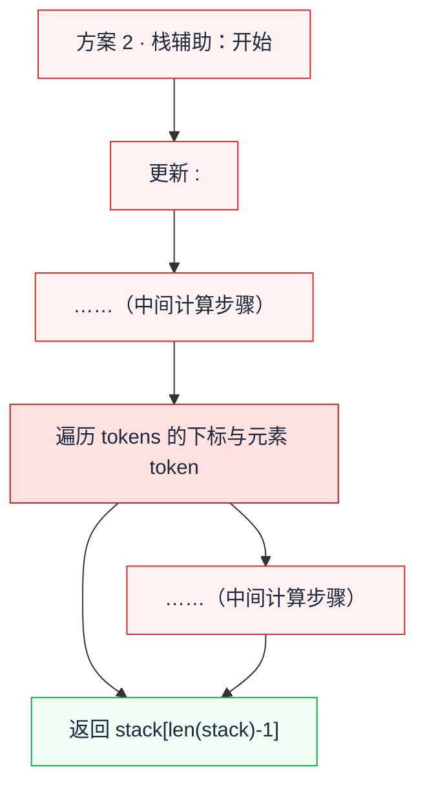

```go
package main // 引入依赖

import (
	"fmt"     // 「fmt」
	"os"      // 「os」
	"strconv" // 「strconv」
)

func evalRPN(tokens []string) int { // 定义函数/方法 evalRPN
	n := len(tokens)                 // 把 长度(tokens) 写入 n :
	stack := make([]int, 0, (n+1)/2) // 把 make([]int, 0, (元素个数 加 1) 除以 2) 写入 stack :
	for _, token := range tokens {   // 同时取 _ 与 token 遍历
		switch token { // switch token {
		case "+", "-", "*", "/": // case 「 加 」, 「 加 」, 「 加 」, 「 加 」:
			num2 := stack[len(stack)-1]  // 把 栈[长度(栈) 减 1] 写入 num2 :
			num1 := stack[len(stack)-2]  // 把 栈[长度(栈) 减 2] 写入 num1 :
			stack = stack[:len(stack)-1] // 把 栈[:长度(栈) 减 1] 写入 栈
			var res int                  // var 结果 int
			switch token {               // switch token {
			case "+": // case 「 加 」:
				res = num1 + num2 // 把 num1 加 num2 写入 结果
			case "-": // case 「 减 」:
				res = num1 - num2 // 把 num1 减 num2 写入 结果
			case "*": // case 「 乘 」:
				res = num1 * num2 // 把 num1 乘 num2 写入 结果
			case "/": // case 「 除以 」:
				res = num1 / num2 // 把 num1 除以 num2 写入 结果
			}
			stack[len(stack)-1] = res // 把 结果 写入 stack[len(stack)-1]
		default: // default:
			v, _ := strconv.Atoi(token) // 把 strconv.Atoi(token) 写入 v, _ :
			stack = append(stack, v)    // 把 append(栈, 值) 写入 栈
		}
	}
	return stack[len(stack)-1] // 返回 栈[长度(栈) 减 1]
}

func main() { // 程序入口：跑内嵌自测用例
	type tc struct { // 定义类型
		in   []string // in []string
		want int      // want int
	}
	cases := []tc{ // 把 []tc{ 写入 cases :
		{[]string{"2", "1", "+", "3", "*"}, 9},
		{[]string{"4", "13", "5", "/", "+"}, 6},
		{[]string{"10", "6", "9", "3", "+", "-11", "*", "/", "*", "17", "+", "5", "+"}, 22},
	}
	ok := true                // 把 true 写入 ok :
	for _, c := range cases { // 同时取 _ 与 字符 遍历
		if got := evalRPN(c.in); got != c.want { // 若 got : 赋值为 evalRPN(字符.in); got 不等于 字符.want
			ok = false                                                     // 把 false 写入 ok
			fmt.Printf("FAIL evalRPN(%v)=%v want %v\n", c.in, got, c.want) // 打印输出
		}
	}
	if !ok { // 若 取反 ok
		os.Exit(1) // os.Exit(1)
	}
	fmt.Println("PASS") // 全部用例通过，输出 PASS
}
```

### Java 实现（2 种方案）

Java 的全部方案如下，每个方案都内嵌用例自测，可独立运行（老仓库 python/go 文件遵循「打印结果」约定）：

#### 方案 1：栈辅助

**思路与代码分析**：核心是「栈辅助」。Java 版用类与静态方法组织，集合操作显式明了。代码里依次做这些事：单循环线性扫描。**走读**：方案 1 · 栈辅助：开始 → 更新 stack → 遍历循环 → 若 非 token.equals(+) 且 非 token.equals(-) 且 非 token.equals(*) 且 非 token.equals(/) 则： → 调用 stack.add(Integer.parseInt(t → 更新 num2 → 更新 num1 → 若 token.equals(+)) stack.add(num1 + num2：None → 调用 stack.add(num1 - num2) → 调用 stack.add(num1 * num2) → 返回 stack.pollLast()。

**运行架构**（真实控制流）：

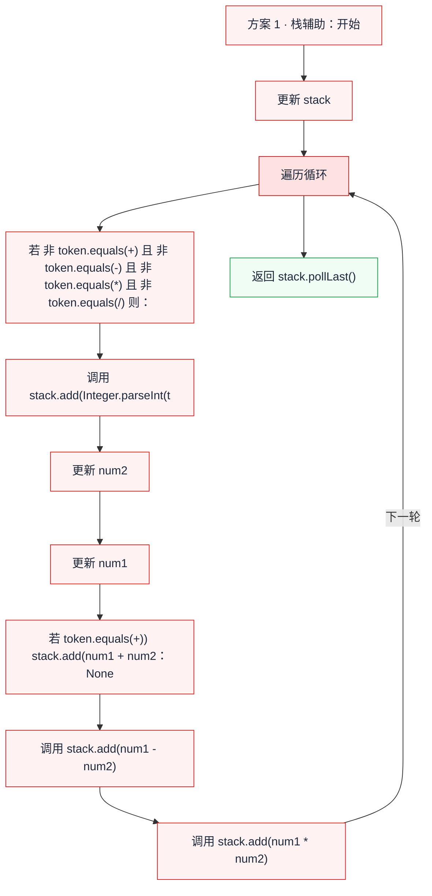

```java
package com.webfault.dsa; // 引入依赖

import java.util.*; // 引入依赖

class Main { // 定义类型

  static int evalRPN(String[] tokens) { // 定义函数/方法 evalRPN
    java.util.LinkedList<Integer> stack = new java.util.LinkedList<>();
    for (String token : tokens) { // for (String token : tokens) {
      if (!token.equals("+") && !token.equals("-") && !token.equals("*") && !token.equals("/")) {
        stack.add(Integer.parseInt(token)); // 栈 追加 Integer.转整数(token));
      } else { // 否则
        int num2 = stack.pollLast(); // 把 栈.pollLast() 存入 num2
        int num1 = stack.pollLast(); // 把 栈.pollLast() 存入 num1
        if (token.equals("+")) stack.add(num1 + num2); // 若 token.equals(「 加 」)) 栈 追加 num1 加 num2);
        else if (token.equals("-"))
          stack.add(num1 - num2); // 否则，若 token.equals(「 减 」)) 栈 追加 num1 减 num2);
        else if (token.equals("*"))
          stack.add(num1 * num2); // 否则，若 token.equals(「 乘 」)) 栈 追加 num1 乘 num2);
        else stack.add((int) (num1 / num2)); // 否则
      }
    }
    return stack.pollLast(); // 返回 栈.pollLast()
  }

  public static void main(String[] args) { // public static void main(String[] args) {
    String[][][] cases = { // 把 { 写入 String[][][] cases
      {{"2", "1", "+", "3", "*"}},
      {{"4", "13", "5", "/", "+"}},
      {{"10", "6", "9", "3", "+", "-11", "*", "/", "*", "17", "+", "5", "+"}},
      {{"2", "1", "+", "3", "*"}},
      {{"3", "11", "5", "+", "-"}},
    };
    int[] wants = {9, 6, 22, 9, -13}; // 把 {9, 6, 22, 9, 减 13}; 写入 int[] wants
    boolean ok = true; // 把 true; 写入 boolean ok
    for (int ci = 0; ci < cases.length; ci++) { // 让 ci 从 0 开始计数，ci 小于 cases.长度 就继续
      int got = evalRPN(cases[ci][0]); // 把 evalRPN(cases[ci][0]) 存入 got
      if (got != wants[ci]) { // 若 got 不等于 wants[ci]
        ok = false; // 把 false; 写入 ok
        System.out.println("FAIL case " + ci + " got " + got + " want " + wants[ci]); // 打印输出
      }
    }
    if (!ok) throw new RuntimeException("FAILED"); // 若 取反 ok) throw new RuntimeException(「FAILED」);
    System.out.println("PASS"); // 全部用例通过，输出 PASS
  }
}
```

#### 方案 2：栈辅助

**思路与代码分析**：核心是「栈辅助」。Java 版用类与静态方法组织，集合操作显式明了。代码里依次做这些事：单循环线性扫描。**走读**：方案 2 · 栈辅助：开始 → 更新 n → 更新 stack → 更新 index → 遍历循环 → 若 token.equals(+) 或 token.equals(-) 或 token.equals(*) 或 token.equals(/) 则： → 更新 num2 → 更新 num1 → 处理 index-- → 若 token.equals(+)：更新 stack[index] → 更新 stack[index] → 更新 stack[index] → 更新 stack[index] → 处理 index++ → 更新 stack[index] → 返回 stack[index]。

**运行架构**（真实控制流）：

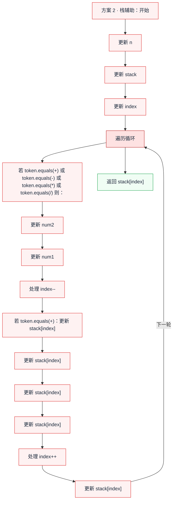

```java
package com.webfault.dsa; // 引入依赖

import java.util.*; // 引入依赖

class Main { // 定义类型

  static int evalRPN(String[] tokens) { // 定义函数/方法 evalRPN
    int n = tokens.length; // 把 tokens.长度 存入 元素个数
    int[] stack = new int[(n + 1) / 2]; // 把 new int[(元素个数 加 1) 除以 2]; 写入 int[] stack
    int index = -1; // 把 减 1 存入 index
    for (String token : tokens) { // for (String token : tokens) {
      if (token.equals("+") || token.equals("-") || token.equals("*") || token.equals("/")) {
        int num2 = stack[index]; // 把 栈[index] 存入 num2
        int num1 = stack[index - 1]; // 把 栈[index 减 1] 存入 num1
        index--; // index 减一
        if (token.equals("+"))
          stack[index] = num1 + num2; // 若 token.equals(「 加 」)) 栈[index] 赋值为 num1 加 num2;
        else if (token.equals("-"))
          stack[index] = num1 - num2; // 否则，若 token.equals(「 减 」)) 栈[index] 赋值为 num1 减 num2;
        else if (token.equals("*"))
          stack[index] = num1 * num2; // 否则，若 token.equals(「 乘 」)) 栈[index] 赋值为 num1 乘 num2;
        else stack[index] = (int) (num1 / num2); // 否则
      } else { // 否则
        index++; // index 加一
        stack[index] = Integer.parseInt(token); // 把 Integer.转整数(token); 写入 stack[index]
      }
    }
    return stack[index]; // 返回 栈[index]
  }

  public static void main(String[] args) { // public static void main(String[] args) {
    String[][][] cases = { // 把 { 写入 String[][][] cases
      {{"2", "1", "+", "3", "*"}},
      {{"4", "13", "5", "/", "+"}},
      {{"10", "6", "9", "3", "+", "-11", "*", "/", "*", "17", "+", "5", "+"}},
      {{"2", "1", "+", "3", "*"}},
      {{"3", "11", "5", "+", "-"}},
    };
    int[] wants = {9, 6, 22, 9, -13}; // 把 {9, 6, 22, 9, 减 13}; 写入 int[] wants
    boolean ok = true; // 把 true; 写入 boolean ok
    for (int ci = 0; ci < cases.length; ci++) { // 让 ci 从 0 开始计数，ci 小于 cases.长度 就继续
      int got = evalRPN(cases[ci][0]); // 把 evalRPN(cases[ci][0]) 存入 got
      if (got != wants[ci]) { // 若 got 不等于 wants[ci]
        ok = false; // 把 false; 写入 ok
        System.out.println("FAIL case " + ci + " got " + got + " want " + wants[ci]); // 打印输出
      }
    }
    if (!ok) throw new RuntimeException("FAILED"); // 若 取反 ok) throw new RuntimeException(「FAILED」);
    System.out.println("PASS"); // 全部用例通过，输出 PASS
  }
}
```

### Rust 实现（2 种方案）

Rust 的全部方案如下，每个方案都内嵌用例自测，可独立运行（老仓库 python/go 文件遵循「打印结果」约定）：

#### 方案 1：栈辅助

**思路与代码分析**：核心是「栈辅助」。Rust 版用所有权移动与切片借用改写同一逻辑，注意 Option 与引用边界。代码里依次做这些事：栈的后进先出操作。**走读**：方案 1 · 栈辅助：开始 → 计算 st → 遍历 tokens 中的每个元素 t → 返回结果。

**运行架构**（真实控制流）：

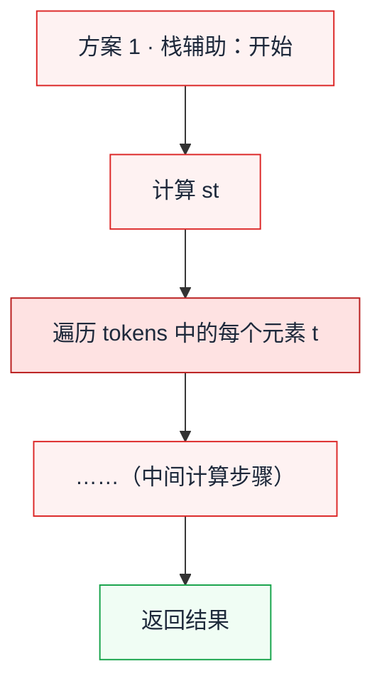

```rust
// LeetCode 150. 逆波兰表达式求值 — Rust 版（方案1）
fn eval_rpn(tokens: Vec<&str>) -> i32 {
    // 定义函数/方法 eval_rpn
    let mut st: Vec<i64> = Vec::new(); // 把 Vec::new(); 写入 let mut st: Vec<i64>
    for t in tokens {
        // 逐个取出 tokens 的元素（另一字符串）
        match t {
            // 按情况匹配处理
            "+" => {
                let b = st.pop().unwrap();
                let a = st.pop().unwrap();
                st.push(a + b);
            }
            "-" => {
                let b = st.pop().unwrap();
                let a = st.pop().unwrap();
                st.push(a - b);
            }
            "*" => {
                let b = st.pop().unwrap();
                let a = st.pop().unwrap();
                st.push(a * b);
            }
            "/" => {
                let b = st.pop().unwrap();
                let a = st.pop().unwrap();
                st.push(a / b);
            }
            _ => st.push(t.parse::<i64>().unwrap()),
        }
    }
    st[0] as i32 // st[0] as i32
}
fn main() {
    // 程序入口：跑内嵌自测用例
    assert_eq!(eval_rpn(vec!["2", "1", "+", "3", "*"]), 9); // 断言校验
    assert_eq!(eval_rpn(vec!["4", "13", "5", "/", "+"]), 6); // 断言校验
    assert_eq!(
        eval_rpn(vec![
            "10", "6", "9", "3", "+", "-11", "*", "/", "*", "17", "+", "5", "+"
        ]),
        22
    ); // 断言校验
    println!("PASS");
} // 全部用例通过，输出 PASS
```

#### 方案 2：栈辅助

**思路与代码分析**：核心是「栈辅助」。Rust 版用所有权移动与切片借用改写同一逻辑，注意 Option 与引用边界。代码里依次做这些事：栈的后进先出操作。**走读**：方案 2 · 栈辅助：开始 → 计算 st → 遍历 tokens 中的每个元素 t → 返回结果。

**运行架构**（真实控制流）：


```rust
// LeetCode 150. 逆波兰表达式求值 — Rust 版（方案2）
fn eval_rpn(tokens: Vec<&str>) -> i32 {
    // 定义函数/方法 eval_rpn
    let mut st: Vec<i64> = Vec::new(); // 把 Vec::new(); 写入 let mut st: Vec<i64>
    for t in tokens {
        // 逐个取出 tokens 的元素（另一字符串）
        match t {
            // 按情况匹配处理
            "+" => {
                let b = st.pop().unwrap();
                let a = st.pop().unwrap();
                st.push(a + b);
            }
            "-" => {
                let b = st.pop().unwrap();
                let a = st.pop().unwrap();
                st.push(a - b);
            }
            "*" => {
                let b = st.pop().unwrap();
                let a = st.pop().unwrap();
                st.push(a * b);
            }
            "/" => {
                let b = st.pop().unwrap();
                let a = st.pop().unwrap();
                st.push(a / b);
            }
            _ => st.push(t.parse::<i64>().unwrap()),
        }
    }
    st[0] as i32 // st[0] as i32
}
fn main() {
    // 程序入口：跑内嵌自测用例
    assert_eq!(eval_rpn(vec!["2", "1", "+", "3", "*"]), 9); // 断言校验
    assert_eq!(eval_rpn(vec!["4", "13", "5", "/", "+"]), 6); // 断言校验
    assert_eq!(
        eval_rpn(vec![
            "10", "6", "9", "3", "+", "-11", "*", "/", "*", "17", "+", "5", "+"
        ]),
        22
    ); // 断言校验
    println!("PASS");
} // 全部用例通过，输出 PASS
```

### Lua 实现（2 种方案）

Lua 的全部方案如下，每个方案都内嵌用例自测，可独立运行（老仓库 python/go 文件遵循「打印结果」约定）：

#### 方案 1：栈辅助

**思路与代码分析**：核心是「栈辅助」。Lua 版用表与 ipairs 遍历，注意 ipairs 遇 nil 即停的语义。**走读**：方案 1 · 栈辅助：开始 → 更新 st → 遍历 ipairs(tokens) do 中的每个元素 t → 返回 st[1]。

**运行架构**（真实控制流）：

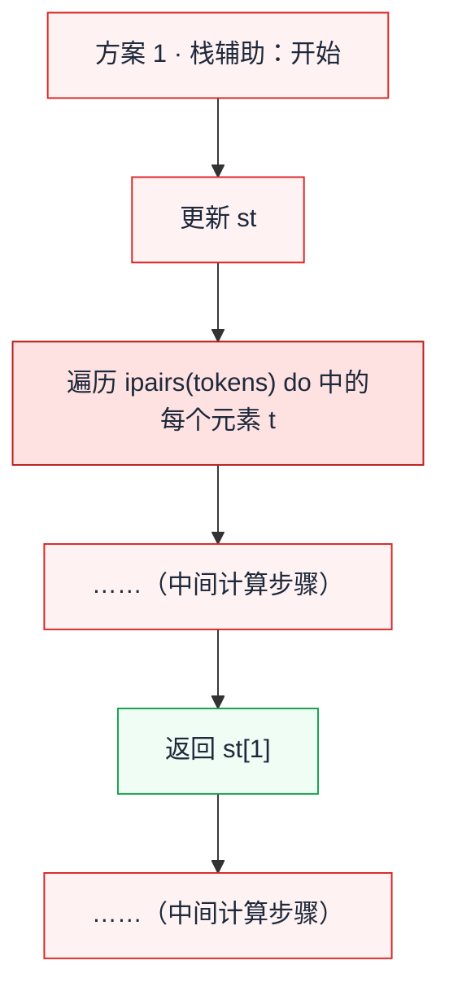

```lua
-- LeetCode 150. 逆波兰表达式求值 — Lua 版（方案1）
local function eval_rpn(tokens) -- local function eval_rpn(tokens)
	local st = {} -- 把 {} 写入 local st
	for _, t in ipairs(tokens) do -- 遍历取 另一字符串
		if t == "+" then -- 若 另一字符串 等于 「 加 」 then
			local b = table.remove(st)
			local a = table.remove(st) -- 把 table 弹出 st); local 数组 赋值为 table 弹出 st) 写入 local b
			st[#st + 1] = a + b -- 把 数组 加 b 写入 st[#st + 1]
		elseif t == "-" then -- 把 赋值为 「 减 」 then 写入 elseif t
			local b = table.remove(st)
			local a = table.remove(st) -- 把 table 弹出 st); local 数组 赋值为 table 弹出 st) 写入 local b
			st[#st + 1] = a - b -- 把 数组 减 b 写入 st[#st + 1]
		elseif t == "*" then -- 把 赋值为 「 乘 」 then 写入 elseif t
			local b = table.remove(st)
			local a = table.remove(st) -- 把 table 弹出 st); local 数组 赋值为 table 弹出 st) 写入 local b
			st[#st + 1] = a * b -- 把 数组 乘 b 写入 st[#st + 1]
		elseif t == "/" then -- 把 赋值为 「 除以 」 then 写入 elseif t
			local b = table.remove(st)
			local a = table.remove(st) -- 把 table 弹出 st); local 数组 赋值为 table 弹出 st) 写入 local b
			st[#st + 1] = math.floor(a / b + 0.5) * ((a * b < 0) and -1 or 1) * -1 -- 截断除法
			-- 简化：C 风格截断
			local q = a / b -- 把 数组 除以 b 写入 local q
			st[#st] = (q >= 0) and math.floor(q) or math.ceil(q) -- 把 (节点 不低于 0) and math.floor(节点) or math.ceil(节点) 写入 st[#st]
		else -- 否则
			st[#st + 1] = tonumber(t) -- 把 tonumber(另一字符串) 写入 st[#st + 1]
		end -- 终点
	end -- 终点
	return st[1] -- 返回 st[1]
end -- 终点
assert(eval_rpn({ "2", "1", "+", "3", "*" }) == 9) -- 断言校验
assert(eval_rpn({ "4", "13", "5", "/", "+" }) == 6) -- 断言校验
assert(eval_rpn({ "10", "6", "9", "3", "+", "-11", "*", "/", "*", "17", "+", "5", "+" }) == 22) -- 断言校验
print("PASS") -- 全部用例通过，输出 PASS
```

#### 方案 2：栈辅助

**思路与代码分析**：核心是「栈辅助」。Lua 版用表与 ipairs 遍历，注意 ipairs 遇 nil 即停的语义。**走读**：方案 2 · 栈辅助：开始 → 更新 st → 遍历 ipairs(tokens) do 中的每个元素 t → 返回 st[1]。

**运行架构**（真实控制流）：

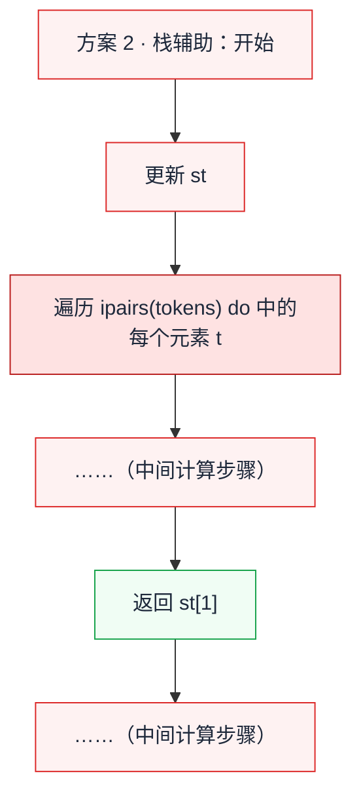

```lua
-- LeetCode 150. 逆波兰表达式求值 — Lua 版（方案2）
local function eval_rpn(tokens) -- local function eval_rpn(tokens)
	local st = {} -- 把 {} 写入 local st
	for _, t in ipairs(tokens) do -- 遍历取 另一字符串
		if t == "+" then -- 若 另一字符串 等于 「 加 」 then
			local b = table.remove(st)
			local a = table.remove(st) -- 把 table 弹出 st); local 数组 赋值为 table 弹出 st) 写入 local b
			st[#st + 1] = a + b -- 把 数组 加 b 写入 st[#st + 1]
		elseif t == "-" then -- 把 赋值为 「 减 」 then 写入 elseif t
			local b = table.remove(st)
			local a = table.remove(st) -- 把 table 弹出 st); local 数组 赋值为 table 弹出 st) 写入 local b
			st[#st + 1] = a - b -- 把 数组 减 b 写入 st[#st + 1]
		elseif t == "*" then -- 把 赋值为 「 乘 」 then 写入 elseif t
			local b = table.remove(st)
			local a = table.remove(st) -- 把 table 弹出 st); local 数组 赋值为 table 弹出 st) 写入 local b
			st[#st + 1] = a * b -- 把 数组 乘 b 写入 st[#st + 1]
		elseif t == "/" then -- 把 赋值为 「 除以 」 then 写入 elseif t
			local b = table.remove(st)
			local a = table.remove(st) -- 把 table 弹出 st); local 数组 赋值为 table 弹出 st) 写入 local b
			st[#st + 1] = math.floor(a / b + 0.5) * ((a * b < 0) and -1 or 1) * -1 -- 截断除法
			-- 简化：C 风格截断
			local q = a / b -- 把 数组 除以 b 写入 local q
			st[#st] = (q >= 0) and math.floor(q) or math.ceil(q) -- 把 (节点 不低于 0) and math.floor(节点) or math.ceil(节点) 写入 st[#st]
		else -- 否则
			st[#st + 1] = tonumber(t) -- 把 tonumber(另一字符串) 写入 st[#st + 1]
		end -- 终点
	end -- 终点
	return st[1] -- 返回 st[1]
end -- 终点
assert(eval_rpn({ "2", "1", "+", "3", "*" }) == 9) -- 断言校验
assert(eval_rpn({ "4", "13", "5", "/", "+" }) == 6) -- 断言校验
assert(eval_rpn({ "10", "6", "9", "3", "+", "-11", "*", "/", "*", "17", "+", "5", "+" }) == 22) -- 断言校验
print("PASS") -- 全部用例通过，输出 PASS
```

### C 实现（2 种方案）

C 的全部方案如下，每个方案都内嵌用例自测，可独立运行（老仓库 python/go 文件遵循「打印结果」约定）：

#### 方案 1：栈辅助

**思路与代码分析**：核心是「栈辅助」。C 版手动管理下标与内存，循环边界全部显式写出。代码里依次做这些事：单循环线性扫描。**走读**：方案 1 · 栈辅助：开始 → 处理 long st[4096] → 遍历循环 → 返回 st[0]。

**运行架构**（真实控制流）：


```c
/* LeetCode 150. 逆波兰表达式求值 — C 版（方案1） */
#include <stdio.h>                                 // 引入头文件
#include <stdlib.h>                                // 引入头文件
#include <string.h>                                // 引入头文件
static long eval_rpn(const char **tokens, int n) { // 定义函数/方法 eval_rpn
    long st[4096];                                 // long st[4096];
    int top = 0;                                   // 把 0 存入 top
    for (int i = 0; i < n; i++) {  // 让 下标 i 从 0 开始计数，下标 i 小于 元素个数 就继续
        const char *t = tokens[i]; // 把 tokens[下标 i]; 写入 const char *t
        if (strcmp(t, "+") == 0 || strcmp(t, "-") == 0 || strcmp(t, "*") == 0 || strcmp(t, "/") == 0) {
            long b = st[--top]; // 把 st[ 减一 top]; 写入 long b
            long a = st[--top]; // 把 st[ 减一 top]; 写入 long a
            long r = 0;         // 把 0; 写入 long r
            if (t[0] == '+')
                r = a + b; // 若 另一字符串[0] 等于 ' 加 ') 右指针 赋值为 数组 加 b;
            else if (t[0] == '-')
                r = a - b; // 否则，若 另一字符串[0] 等于 ' 减 ') 右指针 赋值为 数组 减 b;
            else if (t[0] == '*')
                r = a * b; // 否则，若 另一字符串[0] 等于 ' 乘 ') 右指针 赋值为 数组 乘 b;
            else
                r = a / b;       // 否则
            st[top++] = r;       // 把 右指针; 写入 st[top++]
        } else {                 // 否则
            st[top++] = atol(t); // 把 atol(另一字符串); 写入 st[top++]
        }
    }
    return st[0]; // 返回 st[0]
}
int main(void) {                                  // 程序入口：跑内嵌自测用例
    const char *t1[] = {"2", "1", "+", "3", "*"}; // 把 {「2」,「2」,「2」,「2」,「2」}; 写入 const char *t1[]
    const char *t2[] = {"4", "13", "5", "/",
                        "+"}; // 把 {「4」,「4」,「4」,「4」,「4」}; 写入 const char *t2[]
    const char *t3[] = {"10", "6", "9", "3", "+", "-11", "*", "/", "*", "17", "+", "5", "+"};
    if (eval_rpn(t1, 5) != 9) {
        printf("FAIL 1\n");
        return 1;
    } // 若 eval_rpn(t1, 5) 不等于 9) { 输出「FAIL 1 」); return 1; }
    if (eval_rpn(t2, 5) != 6) {
        printf("FAIL 2\n");
        return 1;
    } // 若 eval_rpn(t2, 5) 不等于 6) { 输出「FAIL 2 」); return 1; }
    if (eval_rpn(t3, 13) != 22) {
        printf("FAIL 3\n");
        return 1;
    } // 若 eval_rpn(t3, 13) 不等于 22) { 输出「FAIL 3 」); return 1; }
    printf("PASS\n");
    return 0;
} // 全部用例通过，输出 PASS
```

#### 方案 2：栈辅助

**思路与代码分析**：核心是「栈辅助」。C 版手动管理下标与内存，循环边界全部显式写出。代码里依次做这些事：单循环线性扫描。**走读**：方案 2 · 栈辅助：开始 → 处理 long st[4096] → 遍历循环 → 返回 st[0]。

**运行架构**（真实控制流）：

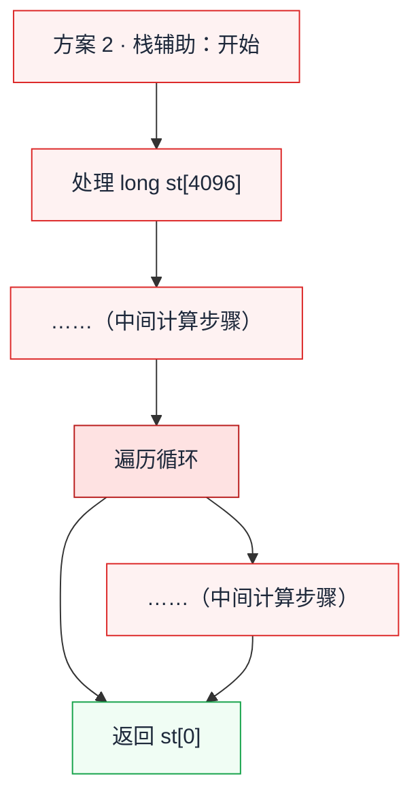

```c
/* LeetCode 150. 逆波兰表达式求值 — C 版（方案2） */
#include <stdio.h>                                 // 引入头文件
#include <stdlib.h>                                // 引入头文件
#include <string.h>                                // 引入头文件
static long eval_rpn(const char **tokens, int n) { // 定义函数/方法 eval_rpn
    long st[4096];                                 // long st[4096];
    int top = 0;                                   // 把 0 存入 top
    for (int i = 0; i < n; i++) {  // 让 下标 i 从 0 开始计数，下标 i 小于 元素个数 就继续
        const char *t = tokens[i]; // 把 tokens[下标 i]; 写入 const char *t
        if (strcmp(t, "+") == 0 || strcmp(t, "-") == 0 || strcmp(t, "*") == 0 || strcmp(t, "/") == 0) {
            long b = st[--top]; // 把 st[ 减一 top]; 写入 long b
            long a = st[--top]; // 把 st[ 减一 top]; 写入 long a
            long r = 0;         // 把 0; 写入 long r
            if (t[0] == '+')
                r = a + b; // 若 另一字符串[0] 等于 ' 加 ') 右指针 赋值为 数组 加 b;
            else if (t[0] == '-')
                r = a - b; // 否则，若 另一字符串[0] 等于 ' 减 ') 右指针 赋值为 数组 减 b;
            else if (t[0] == '*')
                r = a * b; // 否则，若 另一字符串[0] 等于 ' 乘 ') 右指针 赋值为 数组 乘 b;
            else
                r = a / b;       // 否则
            st[top++] = r;       // 把 右指针; 写入 st[top++]
        } else {                 // 否则
            st[top++] = atol(t); // 把 atol(另一字符串); 写入 st[top++]
        }
    }
    return st[0]; // 返回 st[0]
}
int main(void) {                                  // 程序入口：跑内嵌自测用例
    const char *t1[] = {"2", "1", "+", "3", "*"}; // 把 {「2」,「2」,「2」,「2」,「2」}; 写入 const char *t1[]
    const char *t2[] = {"4", "13", "5", "/",
                        "+"}; // 把 {「4」,「4」,「4」,「4」,「4」}; 写入 const char *t2[]
    const char *t3[] = {"10", "6", "9", "3", "+", "-11", "*", "/", "*", "17", "+", "5", "+"};
    if (eval_rpn(t1, 5) != 9) {
        printf("FAIL 1\n");
        return 1;
    } // 若 eval_rpn(t1, 5) 不等于 9) { 输出「FAIL 1 」); return 1; }
    if (eval_rpn(t2, 5) != 6) {
        printf("FAIL 2\n");
        return 1;
    } // 若 eval_rpn(t2, 5) 不等于 6) { 输出「FAIL 2 」); return 1; }
    if (eval_rpn(t3, 13) != 22) {
        printf("FAIL 3\n");
        return 1;
    } // 若 eval_rpn(t3, 13) 不等于 22) { 输出「FAIL 3 」); return 1; }
    printf("PASS\n");
    return 0;
} // 全部用例通过，输出 PASS
```

### C++ 实现（2 种方案）

C++ 的全部方案如下，每个方案都内嵌用例自测，可独立运行（老仓库 python/go 文件遵循「打印结果」约定）：

#### 方案 1：栈辅助

**思路与代码分析**：核心是「栈辅助」。C++ 版用 STL 容器与迭代器，减少手写下标错误。代码里依次做这些事：单循环线性扫描。**走读**：方案 1 · 栈辅助：开始 → 处理 std::vector＜long long＞ st → 遍历循环 → 若 t == + 或 t == - 或 t == * 或 t == / 则： → 更新 b → 调用 st.pop_back() → 更新 a → 调用 st.pop_back() → 若 t == +：调用 st.push_back(a + b) → 调用 st.push_back(a + b) → 调用 st.push_back(a - b) → 调用 st.push_back(a * b) → 调用 st.push_back(a / b) → 调用 st.push_back(std::stoll(t)) → 返回 static_cast＜int＞(st[0])。

**运行架构**（真实控制流）：

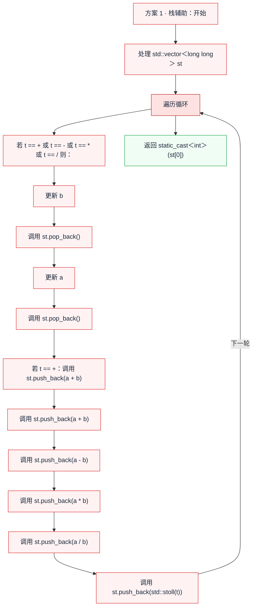

```cpp
// LeetCode 150. 逆波兰表达式求值 — C++ 版（方案1）
#include <cassert>                                           // 引入头文件
#include <cstdlib>                                           // 引入头文件
#include <iostream>                                          // 引入头文件
#include <string>                                            // 引入头文件
#include <vector>                                            // 引入头文件
static int evalRPN(const std::vector<std::string> &tokens) { // 定义函数/方法 evalRPN
    std::vector<long long> st;                               // std::vector 小于 long long 超过 st;
    for (const auto &t : tokens) { // 逐个取出 tokens 的元素（另一字符串）
        if (t == "+" || t == "-" || t == "*" || t == "/") {
            long long b = st.back();
            st.pop_back(); // 把 st.back(); st 弹出 ) 存入 b
            long long a = st.back();
            st.pop_back(); // 把 st.back(); st 弹出 ) 存入 数组
            if (t == "+")
                st.push_back(a + b); // 若 另一字符串 等于 「 加 」) st 追加 数组 加 b);
            else if (t == "-")
                st.push_back(a - b); // 否则，若 另一字符串 等于 「 减 」) st 追加 数组 减 b);
            else if (t == "*")
                st.push_back(a * b); // 否则，若 另一字符串 等于 「 乘 」) st 追加 数组 乘 b);
            else
                st.push_back(a / b);     // 否则
        } else {                         // 否则
            st.push_back(std::stoll(t)); // st 追加 std::stoll(另一字符串));
        }
    }
    return static_cast<int>(st[0]); // 返回 static_cast 小于 int 超过 (st[0])
}
int main() {                                          // 程序入口：跑内嵌自测用例
    assert(evalRPN({"2", "1", "+", "3", "*"}) == 9);  // 断言校验
    assert(evalRPN({"4", "13", "5", "/", "+"}) == 6); // 断言校验
    assert(evalRPN({"10", "6", "9", "3", "+", "-11", "*", "/", "*", "17", "+", "5", "+"}) == 22); // 断言校验
    std::cout << "PASS" << std::endl;
} // 全部用例通过，输出 PASS
```

#### 方案 2：栈辅助

**思路与代码分析**：核心是「栈辅助」。C++ 版用 STL 容器与迭代器，减少手写下标错误。代码里依次做这些事：单循环线性扫描。**走读**：方案 2 · 栈辅助：开始 → 处理 std::vector＜long long＞ st → 遍历循环 → 若 t == + 或 t == - 或 t == * 或 t == / 则： → 更新 b → 调用 st.pop_back() → 更新 a → 调用 st.pop_back() → 若 t == +：调用 st.push_back(a + b) → 调用 st.push_back(a + b) → 调用 st.push_back(a - b) → 调用 st.push_back(a * b) → 调用 st.push_back(a / b) → 调用 st.push_back(std::stoll(t)) → 返回 static_cast＜int＞(st[0])。

**运行架构**（真实控制流）：


```cpp
// LeetCode 150. 逆波兰表达式求值 — C++ 版（方案2）
#include <cassert>                                           // 引入头文件
#include <cstdlib>                                           // 引入头文件
#include <iostream>                                          // 引入头文件
#include <string>                                            // 引入头文件
#include <vector>                                            // 引入头文件
static int evalRPN(const std::vector<std::string> &tokens) { // 定义函数/方法 evalRPN
    std::vector<long long> st;                               // std::vector 小于 long long 超过 st;
    for (const auto &t : tokens) { // 逐个取出 tokens 的元素（另一字符串）
        if (t == "+" || t == "-" || t == "*" || t == "/") {
            long long b = st.back();
            st.pop_back(); // 把 st.back(); st 弹出 ) 存入 b
            long long a = st.back();
            st.pop_back(); // 把 st.back(); st 弹出 ) 存入 数组
            if (t == "+")
                st.push_back(a + b); // 若 另一字符串 等于 「 加 」) st 追加 数组 加 b);
            else if (t == "-")
                st.push_back(a - b); // 否则，若 另一字符串 等于 「 减 」) st 追加 数组 减 b);
            else if (t == "*")
                st.push_back(a * b); // 否则，若 另一字符串 等于 「 乘 」) st 追加 数组 乘 b);
            else
                st.push_back(a / b);     // 否则
        } else {                         // 否则
            st.push_back(std::stoll(t)); // st 追加 std::stoll(另一字符串));
        }
    }
    return static_cast<int>(st[0]); // 返回 static_cast 小于 int 超过 (st[0])
}
int main() {                                          // 程序入口：跑内嵌自测用例
    assert(evalRPN({"2", "1", "+", "3", "*"}) == 9);  // 断言校验
    assert(evalRPN({"4", "13", "5", "/", "+"}) == 6); // 断言校验
    assert(evalRPN({"10", "6", "9", "3", "+", "-11", "*", "/", "*", "17", "+", "5", "+"}) == 22); // 断言校验
    std::cout << "PASS" << std::endl;
} // 全部用例通过，输出 PASS
```

### R 实现（2 种方案）

R 的全部方案如下，每个方案都内嵌用例自测，可独立运行（老仓库 python/go 文件遵循「打印结果」约定）：

#### 方案 1：栈辅助

**思路与代码分析**：核心是「栈辅助」。R 版用向量化思维与 1 起始下标，注意 1:n 的降序陷阱。代码里依次做这些事：单循环线性扫描。**走读**：方案 1 · 栈辅助：开始 → 处理 st ＜- numeric(0) → 循环 t：遍历 tokens → 返回结果。

**运行架构**（真实控制流）：


```r
# 版（方案1） 定义函数 eval_rpn（参数：tokens）
eval_rpn <- function(tokens) {
    st <- numeric(0)  # 把 numeric(0) 存入 st
    for (t in tokens) {
        # for (另一字符串 in tokens) { 若 另一字符串 对…取模 in 对…取模 字符(「 加 」, 「 加 」, 「 加 」, 「
        # 加 」
        if (t %in% c("+", "-", "*", "/")) {
            b <- st[length(st)]
            st <- st[-length(st)]  # 把 st[长度(st)]; st 小于 减 st[ 减 长度(st)] 存入 b
            a <- st[length(st)]
            st <- st[-length(st)]  # 把 st[长度(st)]; st 小于 减 st[ 减 长度(st)] 存入 数组
            if (t == "+")
                r <- a + b  # 若 另一字符串 等于 「 加 」) 右指针 小于 减 数组 加 b
 else if (t == "-")
                r <- a - b  # 否则，若 另一字符串 等于 「 减 」) 右指针 小于 减 数组 减 b
 else if (t == "*")
                r <- a * b  # 否则，若 另一字符串 等于 「 乘 」) 右指针 小于 减 数组 乘 b
 else {
                # 否则
                q <- a/b  # 把 数组 除以 b 存入 节点
                r <- if (q >= 0)
                  floor(q) else ceiling(q)  # 把 if (节点 不低于 0) floor(节点) else ceiling(节点) 存入 右指针
            }
            st <- c(st, r)  # 把 字符(st, 右指针) 存入 st
        } else {
            # 否则
            st <- c(st, as.numeric(t))  # 把 字符(st, as.numeric(另一字符串)) 存入 st
        }
    }
    st[1]  # st[1]
}
stopifnot(eval_rpn(c("2", "1", "+", "3", "*")) == 9)  # 断言校验
stopifnot(eval_rpn(c("4", "13", "5", "/", "+")) == 6)  # 断言校验
stopifnot(eval_rpn(c("10", "6", "9", "3", "+", "-11", "*", "/", "*", "17", "+", "5", "+")) == 22)  # 断言校验
cat("PASS\n")  # 全部用例通过，输出 PASS
```

#### 方案 2：栈辅助

**思路与代码分析**：核心是「栈辅助」。R 版用向量化思维与 1 起始下标，注意 1:n 的降序陷阱。代码里依次做这些事：单循环线性扫描。**走读**：方案 2 · 栈辅助：开始 → 处理 st ＜- numeric(0) → 循环 t：遍历 tokens → 返回结果。

**运行架构**（真实控制流）：

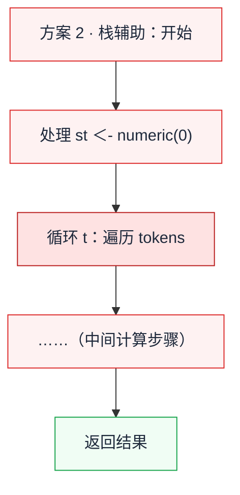

```r
# 版（方案2） 定义函数 eval_rpn（参数：tokens）
eval_rpn <- function(tokens) {
    st <- numeric(0)  # 把 numeric(0) 存入 st
    for (t in tokens) {
        # for (另一字符串 in tokens) { 若 另一字符串 对…取模 in 对…取模 字符(「 加 」, 「 加 」, 「 加 」, 「
        # 加 」
        if (t %in% c("+", "-", "*", "/")) {
            b <- st[length(st)]
            st <- st[-length(st)]  # 把 st[长度(st)]; st 小于 减 st[ 减 长度(st)] 存入 b
            a <- st[length(st)]
            st <- st[-length(st)]  # 把 st[长度(st)]; st 小于 减 st[ 减 长度(st)] 存入 数组
            if (t == "+")
                r <- a + b  # 若 另一字符串 等于 「 加 」) 右指针 小于 减 数组 加 b
 else if (t == "-")
                r <- a - b  # 否则，若 另一字符串 等于 「 减 」) 右指针 小于 减 数组 减 b
 else if (t == "*")
                r <- a * b  # 否则，若 另一字符串 等于 「 乘 」) 右指针 小于 减 数组 乘 b
 else {
                # 否则
                q <- a/b  # 把 数组 除以 b 存入 节点
                r <- if (q >= 0)
                  floor(q) else ceiling(q)  # 把 if (节点 不低于 0) floor(节点) else ceiling(节点) 存入 右指针
            }
            st <- c(st, r)  # 把 字符(st, 右指针) 存入 st
        } else {
            # 否则
            st <- c(st, as.numeric(t))  # 把 字符(st, as.numeric(另一字符串)) 存入 st
        }
    }
    st[1]  # st[1]
}
stopifnot(eval_rpn(c("2", "1", "+", "3", "*")) == 9)  # 断言校验
stopifnot(eval_rpn(c("4", "13", "5", "/", "+")) == 6)  # 断言校验
stopifnot(eval_rpn(c("10", "6", "9", "3", "+", "-11", "*", "/", "*", "17", "+", "5", "+")) == 22)  # 断言校验
cat("PASS\n")  # 全部用例通过，输出 PASS
```

### Zig 实现（2 种方案）

Zig 的全部方案如下，每个方案都内嵌用例自测，可独立运行（老仓库 python/go 文件遵循「打印结果」约定）：

#### 方案 1：栈辅助

**思路与代码分析**：核心是「栈辅助」。Zig 版显式分配与清零，整型边界处理严格。代码里依次做这些事：单循环线性扫描。**走读**：方案 1 · 栈辅助：开始 → 计算 st → 遍历集合元素 → 返回 st[0]。

**运行架构**（真实控制流）：

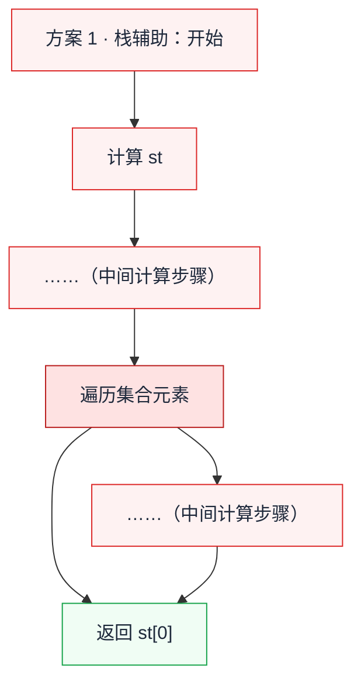

```zig
// LeetCode 150. 逆波兰表达式求值 — Zig 版（方案1）
const std = @import("std"); // 把 @import(「std」) 存入 std
fn evalRPN(tokens: []const []const u8) i64 { // 定义函数/方法 evalRPN
    var st: [4096]i64 = undefined; // 把 undefined; 写入 var st: [4096]i64
    var top: usize = 0; // 把 0; 写入 var top: usize
    for (tokens) |t| { // 逐个取出 tokens 的元素（另一字符串）
        if (t.len == 1 and (t[0] == '+' or t[0] == '-' or t[0] == '*' or t[0] == '/') and t.len == 1) {
            if (std.mem.eql(u8, t, "+") or std.mem.eql(u8, t, "-") or std.mem.eql(u8, t, "*") or std.mem.eql(u8, t, "/")) {
                const b = st[top - 1]; // 把 st[top 减 1] 存入 b
                top -= 1; // top累减 1
                const a = st[top - 1]; // 把 st[top 减 1] 存入 数组
                top -= 1; // top累减 1
                var r: i64 = 0; // 把 0; 写入 var r: i64
                if (t[0] == '+') r = a + b // 若 另一字符串[0] 等于 ' 加 ') 右指针 赋值为 数组 加 b
                else if (t[0] == '-') r = a - b // 否则，若 另一字符串[0] 等于 ' 减 ') 右指针 赋值为 数组 减 b
                else if (t[0] == '*') r = a * b // 否则，若 另一字符串[0] 等于 ' 乘 ') 右指针 赋值为 数组 乘 b
                else r = @divTrunc(a, b); // 否则
                st[top] = r; // 把 右指针; 写入 st[top]
                top += 1; // top累加 1
            }
        } else { // 否则
            st[top] = std.fmt.parseInt(i64, t, 10) catch unreachable; // 把 std.fmt.转整数(i64, 另一字符串, 10) catch unreachable; 写入 st[top]
            top += 1; // top累加 1
        }
    }
    return st[0]; // 返回 st[0]
}
pub fn main() !void { // 程序入口：跑内嵌自测用例
    if (evalRPN(&[_][]const u8{ "2", "1", "+", "3", "*" }) != 9) return error.TestFailed;
    if (evalRPN(&[_][]const u8{ "4", "13", "5", "/", "+" }) != 6) return error.TestFailed;
    if (evalRPN(&[_][]const u8{ "10", "6", "9", "3", "+", "-11", "*", "/", "*", "17", "+", "5", "+" }) != 22) return error.TestFailed;
    std.debug.print("PASS\n", .{});
} // 全部用例通过，输出 PASS
```

#### 方案 2：栈辅助

**思路与代码分析**：核心是「栈辅助」。Zig 版显式分配与清零，整型边界处理严格。代码里依次做这些事：单循环线性扫描。**走读**：方案 2 · 栈辅助：开始 → 计算 st → 遍历集合元素 → 返回 st[0]。

**运行架构**（真实控制流）：

```mermaid
graph TD
    N0["方案 2 · 栈辅助：开始"]
    N1["计算 st"]
    D1["……（中间计算步骤）"]
    N3["遍历集合元素"]
    D2["……（中间计算步骤）"]
    N16["返回 st[0]"]
    N0 --> N1
    N3 --> N16
    N1 --> D1
    D1 --> N3
    N3 --> D2
    D2 --> N16
    classDef n fill:#fef2f2,stroke:#dc2626,color:#1e293b;
    classDef lp fill:#fee2e2,stroke:#b91c1c,color:#1e293b;
    classDef dc fill:#fef9c3,stroke:#ca8a04,color:#1e293b;
    classDef tm fill:#f0fdf4,stroke:#16a34a,color:#1e293b;
    class N0,N1,D1,D2 n;
    class N3 lp;
    class N16 tm;
```

```zig
// LeetCode 150. 逆波兰表达式求值 — Zig 版（方案2）
const std = @import("std"); // 把 @import(「std」) 存入 std
fn evalRPN(tokens: []const []const u8) i64 { // 定义函数/方法 evalRPN
    var st: [4096]i64 = undefined; // 把 undefined; 写入 var st: [4096]i64
    var top: usize = 0; // 把 0; 写入 var top: usize
    for (tokens) |t| { // 逐个取出 tokens 的元素（另一字符串）
        if (t.len == 1 and (t[0] == '+' or t[0] == '-' or t[0] == '*' or t[0] == '/') and t.len == 1) {
            if (std.mem.eql(u8, t, "+") or std.mem.eql(u8, t, "-") or std.mem.eql(u8, t, "*") or std.mem.eql(u8, t, "/")) {
                const b = st[top - 1]; // 把 st[top 减 1] 存入 b
                top -= 1; // top累减 1
                const a = st[top - 1]; // 把 st[top 减 1] 存入 数组
                top -= 1; // top累减 1
                var r: i64 = 0; // 把 0; 写入 var r: i64
                if (t[0] == '+') r = a + b // 若 另一字符串[0] 等于 ' 加 ') 右指针 赋值为 数组 加 b
                else if (t[0] == '-') r = a - b // 否则，若 另一字符串[0] 等于 ' 减 ') 右指针 赋值为 数组 减 b
                else if (t[0] == '*') r = a * b // 否则，若 另一字符串[0] 等于 ' 乘 ') 右指针 赋值为 数组 乘 b
                else r = @divTrunc(a, b); // 否则
                st[top] = r; // 把 右指针; 写入 st[top]
                top += 1; // top累加 1
            }
        } else { // 否则
            st[top] = std.fmt.parseInt(i64, t, 10) catch unreachable; // 把 std.fmt.转整数(i64, 另一字符串, 10) catch unreachable; 写入 st[top]
            top += 1; // top累加 1
        }
    }
    return st[0]; // 返回 st[0]
}
pub fn main() !void { // 程序入口：跑内嵌自测用例
    if (evalRPN(&[_][]const u8{ "2", "1", "+", "3", "*" }) != 9) return error.TestFailed;
    if (evalRPN(&[_][]const u8{ "4", "13", "5", "/", "+" }) != 6) return error.TestFailed;
    if (evalRPN(&[_][]const u8{ "10", "6", "9", "3", "+", "-11", "*", "/", "*", "17", "+", "5", "+" }) != 22) return error.TestFailed;
    std.debug.print("PASS\n", .{});
} // 全部用例通过，输出 PASS
```

### Dart 实现（2 种方案）

Dart 的全部方案如下，每个方案都内嵌用例自测，可独立运行（老仓库 python/go 文件遵循「打印结果」约定）：

#### 方案 1：栈辅助

**思路与代码分析**：核心是「栈辅助」。Dart 版用可空类型标注与集合方法，注意空安全。代码里依次做这些事：单循环线性扫描。**走读**：方案 1 · 栈辅助：开始 → 更新 st → 遍历循环 → 若 t == '+' 或 t == '-' 或 t == '*' 或 t == '/' 则： → 更新 b → 更新 a → 若 t == '+' 则： → 调用 st.add(a + b) → 调用 st.add(a - b) → 调用 st.add(a * b) → 更新 q → 调用 st.add( → 更新 > → 处理 ) → 调用 st.add(int.parse(t)) → 返回 st[0]。

**运行架构**（真实控制流）：

```mermaid
graph TD
    N0["方案 1 · 栈辅助：开始"]
    N1["更新 st"]
    N2["遍历循环"]
    N3["若 t == '+' 或 t == '-' 或 t == '*' 或 t == '/' 则："]
    N4["更新 b"]
    N5["更新 a"]
    N6["若 t == '+' 则："]
    N7["调用 st.add(a + b)"]
    N8["调用 st.add(a - b)"]
    N9["调用 st.add(a * b)"]
    N10["更新 q"]
    N11["调用 st.add("]
    N12["更新 >"]
    N13["处理 )"]
    N14["调用 st.add(int.parse(t))"]
    N15["返回 st[0]"]
    N0 --> N1
    N1 --> N2
    N2 --> N3
    N3 --> N4
    N4 --> N5
    N5 --> N6
    N6 --> N7
    N7 --> N8
    N8 --> N9
    N9 --> N10
    N10 --> N11
    N11 --> N12
    N12 --> N13
    N13 --> N14
    N14 -- 下一轮 --> N2
    N2 --> N15
    classDef n fill:#fef2f2,stroke:#dc2626,color:#1e293b;
    classDef lp fill:#fee2e2,stroke:#b91c1c,color:#1e293b;
    classDef dc fill:#fef9c3,stroke:#ca8a04,color:#1e293b;
    classDef tm fill:#f0fdf4,stroke:#16a34a,color:#1e293b;
    class N0,N1,N3,N4,N5,N6,N7,N8,N9,N10,N11,N12,N13,N14 n;
    class N2 lp;
    class N15 tm;
```

```dart
// LeetCode 150. 逆波兰表达式求值 — Dart 版（方案1）
int evalRPN(List<String> tokens) {
  // 定义函数/方法 evalRPN
  final st = <int>[]; // 把 小于 int 超过 [] 存入 st
  for (final t in tokens) {
    // for (final 另一字符串 in tokens) {
    if (t == '+' || t == '-' || t == '*' || t == '/') {
      final b = st.removeLast(); // 把 st.removeLast() 存入 b
      final a = st.removeLast(); // 把 st.removeLast() 存入 数组
      if (t == '+') {
        st.add(a + b);
      } // 若 另一字符串 等于 ' 加 ') { st 追加 数组 加 b); }
      else if (t == '-') {
        st.add(a - b);
      } // 否则，若 另一字符串 等于 ' 减 ') { st 追加 数组 减 b); }
      else if (t == '*') {
        st.add(a * b);
      } // 否则，若 另一字符串 等于 ' 乘 ') { st 追加 数组 乘 b); }
      else {
        // 否则
        final q = a / b; // 把 数组 除以 b 存入 节点
        st.add(
          q >= 0 ? q.floor() : q.ceil(),
        ); // 把 0 ? 节点.floor() : 节点.ceil()); 写入 st.add(q >
      }
    } else {
      // 否则
      st.add(int.parse(t)); // st 追加 int.parse(另一字符串));
    }
  }
  return st[0]; // 返回 st[0]
}

void main() {
  // 程序入口：跑内嵌自测用例
  if (evalRPN(['2', '1', '+', '3', '*']) != 9) throw StateError('c1');
  if (evalRPN(['4', '13', '5', '/', '+']) != 6) throw StateError('c2');
  if (evalRPN([
        '10',
        '6',
        '9',
        '3',
        '+',
        '-11',
        '*',
        '/',
        '*',
        '17',
        '+',
        '5',
        '+',
      ]) !=
      22)
    throw StateError('c3');
  print('PASS');
} // 全部用例通过，输出 PASS
```

#### 方案 2：栈辅助

**思路与代码分析**：核心是「栈辅助」。Dart 版用可空类型标注与集合方法，注意空安全。代码里依次做这些事：单循环线性扫描。**走读**：方案 2 · 栈辅助：开始 → 更新 st → 遍历循环 → 若 t == '+' 或 t == '-' 或 t == '*' 或 t == '/' 则： → 更新 b → 更新 a → 若 t == '+' 则： → 调用 st.add(a + b) → 调用 st.add(a - b) → 调用 st.add(a * b) → 更新 q → 调用 st.add( → 更新 > → 处理 ) → 调用 st.add(int.parse(t)) → 返回 st[0]。

**运行架构**（真实控制流）：

```mermaid
graph TD
    N0["方案 2 · 栈辅助：开始"]
    N1["更新 st"]
    N2["遍历循环"]
    N3["若 t == '+' 或 t == '-' 或 t == '*' 或 t == '/' 则："]
    N4["更新 b"]
    N5["更新 a"]
    N6["若 t == '+' 则："]
    N7["调用 st.add(a + b)"]
    N8["调用 st.add(a - b)"]
    N9["调用 st.add(a * b)"]
    N10["更新 q"]
    N11["调用 st.add("]
    N12["更新 >"]
    N13["处理 )"]
    N14["调用 st.add(int.parse(t))"]
    N15["返回 st[0]"]
    N0 --> N1
    N1 --> N2
    N2 --> N3
    N3 --> N4
    N4 --> N5
    N5 --> N6
    N6 --> N7
    N7 --> N8
    N8 --> N9
    N9 --> N10
    N10 --> N11
    N11 --> N12
    N12 --> N13
    N13 --> N14
    N14 -- 下一轮 --> N2
    N2 --> N15
    classDef n fill:#fef2f2,stroke:#dc2626,color:#1e293b;
    classDef lp fill:#fee2e2,stroke:#b91c1c,color:#1e293b;
    classDef dc fill:#fef9c3,stroke:#ca8a04,color:#1e293b;
    classDef tm fill:#f0fdf4,stroke:#16a34a,color:#1e293b;
    class N0,N1,N3,N4,N5,N6,N7,N8,N9,N10,N11,N12,N13,N14 n;
    class N2 lp;
    class N15 tm;
```

```dart
// LeetCode 150. 逆波兰表达式求值 — Dart 版（方案2）
int evalRPN(List<String> tokens) {
  // 定义函数/方法 evalRPN
  final st = <int>[]; // 把 小于 int 超过 [] 存入 st
  for (final t in tokens) {
    // for (final 另一字符串 in tokens) {
    if (t == '+' || t == '-' || t == '*' || t == '/') {
      final b = st.removeLast(); // 把 st.removeLast() 存入 b
      final a = st.removeLast(); // 把 st.removeLast() 存入 数组
      if (t == '+') {
        st.add(a + b);
      } // 若 另一字符串 等于 ' 加 ') { st 追加 数组 加 b); }
      else if (t == '-') {
        st.add(a - b);
      } // 否则，若 另一字符串 等于 ' 减 ') { st 追加 数组 减 b); }
      else if (t == '*') {
        st.add(a * b);
      } // 否则，若 另一字符串 等于 ' 乘 ') { st 追加 数组 乘 b); }
      else {
        // 否则
        final q = a / b; // 把 数组 除以 b 存入 节点
        st.add(
          q >= 0 ? q.floor() : q.ceil(),
        ); // 把 0 ? 节点.floor() : 节点.ceil()); 写入 st.add(q >
      }
    } else {
      // 否则
      st.add(int.parse(t)); // st 追加 int.parse(另一字符串));
    }
  }
  return st[0]; // 返回 st[0]
}

void main() {
  // 程序入口：跑内嵌自测用例
  if (evalRPN(['2', '1', '+', '3', '*']) != 9) throw StateError('c1');
  if (evalRPN(['4', '13', '5', '/', '+']) != 6) throw StateError('c2');
  if (evalRPN([
        '10',
        '6',
        '9',
        '3',
        '+',
        '-11',
        '*',
        '/',
        '*',
        '17',
        '+',
        '5',
        '+',
      ]) !=
      22)
    throw StateError('c3');
  print('PASS');
} // 全部用例通过，输出 PASS
```

---

## 内容总结

- **逆波兰表达式求值**（栈 · Medium）：共 2 个方案，主线思路「栈辅助」；时间 O(n)（单趟线性扫描）；动画演示栈后进先出过程，附录给出 11 种语言 × 全部方案的可运行实现。
- 来源博客：[https://blog.csdn.net/tyro_java/article/details/145113233](https://blog.csdn.net/tyro_java/article/details/145113233)
- 导航：[📋 总目录](../) ｜ [← 014 设计浏览器历史记录](../014_设计浏览器历史记录/) ｜ [016 反转字符串中的单词 →](../016_反转字符串中的单词/)
