# 016 · 反转字符串中的单词（第一阶段 · 线性结构入门 · Medium）

> **难度**：⭐⭐ Medium ｜ **专题**：栈
> **学习定位**：第一阶段 · 线性结构入门第 16 篇 ｜ **解法数**：3
> **内容总结**：**反转字符串中的单词**（栈 · Medium）：共 3 个方案，主线思路「直接实现」；时间 O(n) 量级；动画演示栈后进先出过程，附录给出 11 种语言 × 全部方案的可运行实现。

---

## 题目描述

给你一个字符串 `s` ，请你反转字符串中 单词 的顺序。

单词 是由非空格字符组成的字符串。`s` 中使用至少一个空格将字符串中的 单词 分隔开。

返回 单词 顺序颠倒且 单词 之间用单个空格连接的结果字符串。

注意：输入字符串 `s`中可能会存在前导空格、尾随空格或者单词间的多个空格。返回的结果字符串中，单词间应当仅用单个空格分隔，且不包含任何额外的空格。

- 主函数签名：`function assertEq(actual: any, expected: any, msg: string = ''): void`

**用例（来自原题）**：

**示例 1**

```text
输入：s = "the sky is blue"
输出："blue is sky the"
```

**示例 2**

```text
输入：s = "  hello world  "
输出："world hello"
```

解释：反转后的字符串中不能存在前导空格和尾随空格。

**示例 3**

```text
输入：s = "a good   example"
输出："example good a"
```

解释：如果两个单词间有多余的空格，反转后的字符串需要将单词间的空格减少到仅有一个。
> ✅ **官方验证**：全部 TypeScript 解法已通过 leetcode.cn 官方示例用例验证（自动注入运行，全部 PASS）。题面与 [leetcode.cn 官方](https://leetcode.cn/problems/reverse-words-in-a-string/)一致，示例配图取自官方题面。

**数据范围与注意事项**：

- `1 <= s.length <= 10^4`
- `s` 包含英文大小写字母、数字和空格 `' '`
- `s` 中 至少存在一个 单词
- 进阶：如果字符串在你使用的编程语言中是一种可变数据类型，请尝试使用 `O(1)` 额外空间复杂度的 原地 解法。
- **易错点**：出栈前判空；「下一个更大元素」类问题栈里存下标比存值好用。

## 题目分析

**场景是什么**：后进先出结构天然适合「最近匹配」，对应真实开发里的括号校验、浏览历史、函数调用栈。本题就是该场景的 Medium 级练习，主线做法是「直接实现」。

**主线怎么解**：主解法结构简单：读入、处理、返回。

## 解题思路

**方案对比**（共 3 个方案，由浅入深）：

| 方案 | 时间复杂度 | 空间复杂度 |
|---|---|---|
| 方案 1 · 直接实现 | O(n) 量级 | O(n) |
| 方案 2 · 迭代指针处理 | O(n)（单趟线性扫描） | O(1) 到 O(n)（视辅助结构） |
| 方案 3 · 直接实现 | O(n) 量级 | O(n) |

**由浅入深的路径**：直接实现 → 迭代指针处理；每往右一步，都在补上一步的短板。

**方案间的取舍**：方案 1（直接实现）；方案 2（迭代指针处理）；方案 3（直接实现）。数据规模小、可读性优先时选靠前的方案；规模大、性能优先时选靠后的方案。

**怎么读这一篇**：

- 🐣 **新手路线**：把「题目描述」的示例 1 在纸上手推一遍 → 读方案 1（最直观的写法）与它的代码走读 → 按「运行方式」本地跑通看 PASS → 回头对比方案 2 之后的写法差在哪
- 🦅 **大佬路线**：直接锁定最优方案 1（直接实现，O(n) 量级）→ 跳读该方案代码与走读 → 用「逐步拆解与面试追问」补齐复杂度推导与边界追问

### 动态算法图（栈后进先出，GIF 自动循环）

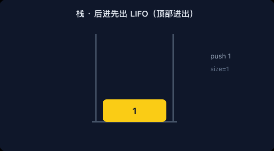

动画演示栈专题里栈后进先出的典型过程；每个方案在「TypeScript 解题方案」一节还配了专属动画与专属流程图。

### 主解法流程图（真实控制流）

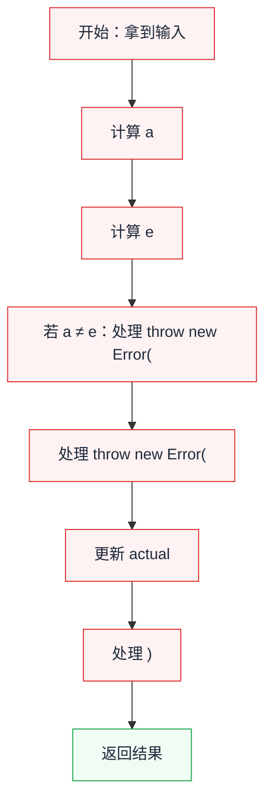

## TypeScript 解题方案（3 个方案逐个讲）

> **运行与提交**：每个方案都是自包含文件（内嵌用例自测，输出 PASS），整块复制到 `.ts` 文件后 `node 文件名` 即可运行。提交 LeetCode 时，把 `demo` 内的算法函数与辅助类型/函数整体取出、置于文件顶层即可。涉及交互/特殊接口的题以题面给定签名为准。

### 方案 1：直接实现

**分析与思路**：核心做法是「直接实现」。

**运行方式**：`node 本文件`，内嵌用例全部通过会输出 PASS。


**方案专属流程图**（真实控制流）：

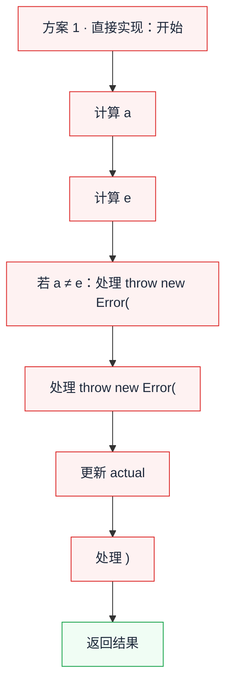

```typescript
function assertEq(actual: any, expected: any, msg: string = ''): void {
  // 定义函数/方法 assertEq
  const a = JSON.stringify(actual); // 把 JSON.stringify(actual) 存入 数组
  const e = JSON.stringify(expected); // 把 JSON.stringify(expected) 存入 e
  if (a !== e)
    throw new Error(
      'ASSERT FAILED ' + msg + ' :: actual=' + a + ' expected=' + e,
    );
}

function reverseWords(s: string): string {
  // 定义函数/方法 reverseWords
  return s.trim().split(/\s+/).reverse().join(' '); // 返回 字符串.trim().split( 除以 \字符串 加 除以 ).reverse().join(「 」)
}
export function demo(): void {
  // 程序入口：跑内嵌自测用例
  assertEq(reverseWords('the sky is blue'), 'blue is sky the', 'reverseWords'); // 断言校验
  assertEq(reverseWords('abc'), 'abc', 'reverseWords single'); // 断言校验
  assertEq(
    reverseWords('  hello   world  '),
    'world hello',
    'reverseWords spaces',
  ); // 断言校验
  console.log('PASS'); // 全部用例通过，输出 PASS
}
demo(); // demo();
```

### 方案 2：迭代指针处理

**分析与思路**：核心做法是「迭代指针处理」。代码里依次做这些事：队列或堆的调度。

**运行方式**：`node 本文件`，内嵌用例全部通过会输出 PASS。


**方案专属流程图**（真实控制流）：

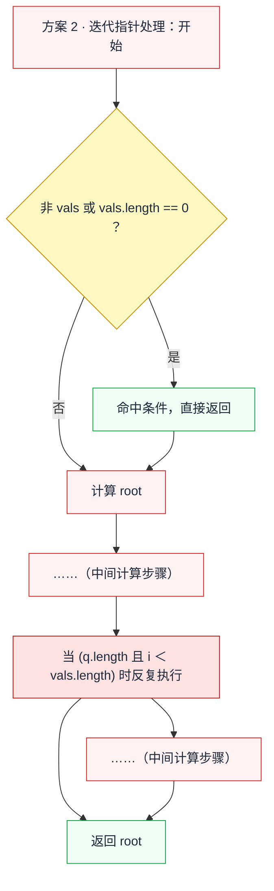

```typescript
class TreeNode {
  // 定义类型
  val: any;
  left: any;
  right: any; // 值: any; 左边界: any; 右边界: any;
  constructor(val?: any, left?: any, right?: any) {
    // constructor(值?: any, 左边界?: any, 右边界?: any) {
    this.val = val === undefined ? 0 : val; // 把 (值 全等于 undefined ? 0 : 值); 写入 值
    this.left = left === undefined ? null : left; // 把 (左边界 全等于 undefined ? null : 左边界); 写入 左边界
    this.right = right === undefined ? null : right; // 把 (右边界 全等于 undefined ? null : 右边界); 写入 右边界
  }
}
function buildTree(vals: any): any {
  // 定义函数/方法 buildTree
  if (!vals || vals.length === 0) return null; // 若 取反 vals 或 vals.长度 全等于 0，直接返回 null
  const root = new TreeNode(vals[0]);
  const q: any[] = [root];
  let i = 1;
  while (q.length && i < vals.length) {
    // 循环，直到不满足「节点.长度 且 下标 i 小于 vals.长度」
    const node = q.shift(); // 把 节点.shift() 存入 节点
    if (vals[i] !== null && vals[i] !== undefined) {
      node.left = new TreeNode(vals[i]);
      q.push(node.left);
    }
    i++; // 下标 i 加一
    if (i < vals.length && vals[i] !== null && vals[i] !== undefined) {
      node.right = new TreeNode(vals[i]);
      q.push(node.right);
    }
    i++; // 下标 i 加一
  }
  return root; // 返回 根节点
}
function treeToLevel(root: any): any[] {
  // 定义函数/方法 treeToLevel
  if (!root) return []; // 若 取反 根节点，直接返回 []
  const out: any[] = [];
  const q: any[] = [root]; // 把 []; const 节点: any[] 赋值为 [根节点]; 写入 const out: any[]
  while (q.length) {
    // 循环，直到不满足「节点.长度」
    const n = q.shift(); // 把 节点.shift() 存入 元素个数
    if (n === null || n === undefined) {
      out.push(null);
      continue;
    }
    out.push(n.val);
    q.push(n.left);
    q.push(n.right); // 把 元素个数.值 压入栈/数组尾部
  }
  while (out.length && out[out.length - 1] === null) out.pop(); // 循环，直到不满足「out.长度 且 out[out.长度 减 1] 全等于 null) out 弹出 );」
  return out; // 返回 out
}
class ListNode {
  // 定义类型
  val: any;
  next: any; // 值: any; 下一个: any;
  constructor(val?: any, next?: any) {
    this.val = val === undefined ? 0 : val;
    this.next = next === undefined ? null : next;
  }
}
function buildList(vals: any): any {
  // 定义函数/方法 buildList
  const dummy = new ListNode(0);
  let cur = dummy; // 把 new ListNode(0); let 当前值 赋值为 哨兵节点 存入 哨兵节点
  for (const v of vals) {
    cur.next = new ListNode(v);
    cur = cur.next;
  } // 把 new ListNode(值); 当前值 赋值为 当前值.下一个; } 写入 下一个
  return dummy.next; // 返回 哨兵节点.下一个
}
function listToArray(head: any): any[] {
  // 定义函数/方法 listToArray
  const out: any[] = [];
  let p = head; // 把 []; let 节点 赋值为 头节点; 写入 const out: any[]
  while (p) {
    out.push(p.val);
    p = p.next;
  } // 循环，直到不满足「节点) { out 追加 节点.值); 节点 赋值为 节点.下一个; }」
  return out; // 返回 out
}
// python-runtime shims
function pyLen(a: any): number {
  // 定义函数/方法 pyLen
  if (a === null || a === undefined) return 0; // 若 数组 全等于 null 或 数组 全等于 undefined，直接返回 0
  if (
    typeof a === 'string' ||
    Array.isArray(a) ||
    a instanceof Set ||
    a instanceof Map
  )
    return a.length ?? a.size;
  if (typeof a === 'object') return Object.keys(a).length; // 若 typeof 数组 全等于 'object'，直接返回 Object.keys(数组).长度
  return 0; // 返回 0
}
function pySlice(a: any, i: any, j: any, step?: any): any {
  // 定义函数/方法 pySlice
  if (typeof a === 'string') {
    const r = [...a].slice(i ?? 0, j ?? a.length);
    return step ? r.reverse().join('') : r.join('');
  }
  const arr = Array.isArray(a) ? a : [...a]; // 把 Array.isArray(数组) ? 数组 : 复制的 数组 存入 数组
  return arr.slice(i ?? 0, j ?? arr.length); // 返回 数组 截取 下标 i ?? 0, 下标 j ?? 数组.长度)
}
function pyRange(a: any, b?: any, step?: any): any[] {
  // 定义函数/方法 pyRange
  let s = 0,
    e = a,
    st = 1; // 把 0, e 赋值为 数组, st 赋值为 1 存入 字符串
  if (b !== undefined) {
    s = a;
    e = b;
  } // 若 b 不等于 undefined) { 字符串 赋值为 数组; e 赋值为 b; }
  if (step !== undefined) st = step; // 若 步数 不等于 undefined) st 赋值为 步数;
  const out: any[] = []; // 把 []; 写入 const out: any[]
  if (st > 0) for (let i = s; i < e; i += st) out.push(i);
  else for (let i = s; i > e; i += st) out.push(i); // 否则
  return out; // 返回 out
}
function pyIn(x: any, coll: any): boolean {
  // 定义函数/方法 pyIn
  if (coll === null || coll === undefined) return false; // 若 coll 全等于 null 或 coll 全等于 undefined，直接返回 false
  if (Array.isArray(coll)) return coll.includes(x); // 若 Array.isArray(coll)，直接返回 coll 是否包含 x)
  if (coll instanceof Set || coll instanceof Map) return coll.has(x); // 若 coll instanceof Set 或 coll instanceof Map，直接返回 coll.has(x)
  if (typeof coll === 'object') return x in coll; // 若 typeof coll 全等于 'object'，直接返回 x in coll
  if (typeof coll === 'string') return coll.indexOf(x) >= 0; // 若 typeof coll 全等于 'string'，直接返回 coll 查找 x) 不低于 0
  return false; // 返回 false
}
function pySorted(a: any): any[] {
  // 定义函数/方法 pySorted
  const arr = typeof a === 'string' ? [...a] : [...a]; // 把 (typeof 数组 全等于 'string') ? 复制的 数组 : 复制的 数组 存入 数组
  return arr.sort((x: any, y: any) => (x < y ? -1 : x > y ? 1 : 0));
}
function pyMin(a: any, b?: any): any {
  if (b !== undefined) return Math.min(a, b);
  if (Array.isArray(a) || a instanceof Set) return Math.min(...a);
  return Math.min(a);
} // 定义函数/方法 pyMin
function pyMax(a: any, b?: any): any {
  if (b !== undefined) return Math.max(a, b);
  if (Array.isArray(a) || a instanceof Set) return Math.max(...a);
  return Math.max(a);
} // 定义函数/方法 pyMax
function pySum(a: any): number {
  let s = 0;
  for (const v of a) s += v;
  return s;
} // 定义函数/方法 pySum
function pyAbs(x: any): number {
  return Math.abs(x);
} // 定义函数/方法 pyAbs
function pyEnumerate(a: any): any[] {
  const out: any[] = [];
  let i = 0;
  for (const v of a) {
    out.push([i, v]);
    i++;
  }
  return out;
} // 定义函数/方法 pyEnumerate
function pyZip(a: any, b: any): any[] {
  const n = Math.min(a.length, b.length);
  const out: any[] = [];
  for (let i = 0; i < n; i++) out.push([a[i], b[i]]);
  return out;
} // 定义函数/方法 pyZip
function pyDictGet(d: any, k: any, def?: any): any {
  return k in d ? d[k] : def === undefined ? null : def;
} // 定义函数/方法 pyDictGet
function pyPrint(...args: any[]): void {
  console.log(
    args
      .map((a) => (typeof a === 'object' && a !== null ? JSON.stringify(a) : a))
      .join(' '),
  );
} // 定义函数/方法 pyPrint
// collections / heapq
function heapPush(h: any[], x: any): void {
  h.push(x);
  let i = h.length - 1;
  while (i > 0) {
    const p = (i - 1) >> 1;
    if (h[p] <= h[i]) break;
    [h[p], h[i]] = [h[i], h[p]];
    i = p;
  }
} // 定义函数/方法 heapPush
function heapPop(h: any[]): any {
  const top = h[0];
  const last = h.pop();
  if (h.length) {
    h[0] = last;
    let i = 0;
    const n = h.length;
    while (true) {
      let l = 2 * i + 1,
        r = 2 * i + 2,
        s = i;
      if (l < n && h[l] < h[s]) s = l;
      if (r < n && h[r] < h[s]) s = r;
      if (s === i) break;
      [h[s], h[i]] = [h[i], h[s]];
      i = s;
    }
  }
  return top;
} // 定义函数/方法 heapPop
class Deque {
  private a: any[] = [];
  push(x: any) {
    this.a.push(x);
  }
  pushLeft(x: any) {
    this.a.unshift(x);
  }
  pop() {
    return this.a.pop();
  }
  popLeft() {
    return this.a.shift();
  }
  get length() {
    return this.a.length;
  }
  toArray() {
    return this.a.slice();
  }
} // 定义类型
function Counter(iter: any): any {
  const m: any = {};
  for (const v of iter) m[v] = (m[v] || 0) + 1;
  return m;
} // 定义函数/方法 Counter
function gcd(a: any, b: any): any {
  while (b) {
    [a, b] = [b, a % b];
  }
  return a;
} // 定义函数/方法 gcd
function pyInf(): number {
  return Infinity;
} // 定义函数/方法 pyInf

function norm(x: any): any {
  // 定义函数/方法 norm
  if (x === null || x === undefined) return null; // 若 x 全等于 null 或 x 全等于 undefined，直接返回 null
  if (typeof x === 'object') {
    // 若 typeof x 全等于 'object'
    if (x instanceof Deque) return x.toArray(); // 若 x instanceof Deque，直接返回 x.toArray()
    if (Array.isArray(x)) return x.map(norm); // 若 Array.isArray(x)，直接返回 x.映射表(norm)
    if (
      typeof x.val === 'number' &&
      (typeof x.left !== 'undefined' || typeof x.right !== 'undefined')
    )
      return treeToLevel(x);
    if (typeof x.next !== 'undefined' && typeof x.val === 'number')
      return listToArray(x);
    if (x instanceof Set) return [...x].sort(); // 若 x instanceof Set，直接返回 复制的 x 排序 )
    if (x instanceof Map) return Object.fromEntries(x); // 若 x instanceof Map，直接返回 Object.fromEntries(x)
    const o: any = {};
    for (const k of Object.keys(x)) o[k] = norm(x[k]);
    return o;
  }
  return x; // 返回 x
}
function eq(a: any, b: any): boolean {
  // 定义函数/方法 eq
  const x = norm(a),
    y = norm(b); // 把 norm(数组), y 赋值为 norm(b) 存入 x
  if (x === y) return true; // 若 x 全等于 y，直接返回 true
  if (x === null || y === null) return x === y; // 若 x 全等于 null 或 y 全等于 null，直接返回 x 全等于 y
  if (Array.isArray(x) && Array.isArray(y)) {
    // 若 Array.isArray(x) 且 Array.isArray(y
    if (x.length !== y.length) return false; // 若 x.长度 不等于 y.长度，直接返回 false
    for (let i = 0; i < x.length; i++) if (!eq(x[i], y[i])) return false; // 让 下标 i 从 0 开始计数，下标 i 小于 x.长度 就继续
    return true; // 返回 true
  }
  if (typeof x === 'object' && typeof y === 'object') {
    // 若 typeof x 全等于 'object' 且 typeof y 全等于 'object'
    const kx = Object.keys(x),
      ky = Object.keys(y); // 把 Object.keys(x), ky 赋值为 Object.keys(y) 存入 kx
    if (kx.length !== ky.length) return false; // 若 kx.长度 不等于 ky.长度，直接返回 false
    for (const k of kx) if (!eq(x[k], y[k])) return false;
    return true; // 返回 true
  }
  return x === y; // 返回 x 全等于 y
}

function reverseWords(s) {
  // 定义函数/方法 reverseWords
  return s.trim().split(/\s+/).reverse().join(' '); // 返回 字符串.trim().split( 除以 \字符串 加 除以 ).reverse().join(' ')
}
export function demo(): void {
  // 程序入口：跑内嵌自测用例
  const cases = [
    { in: ['the sky is blue'], want: 'blue is sky the' },
    { in: ['  hello world  '], want: 'world hello' },
    { in: ['a good   example'], want: 'example good a' },
    { in: ['  bob   '], want: 'bob' },
  ];
  let fail = false; // 把 false 存入 fail
  for (const c of cases) {
    // for (const 字符 of cases) {
    const got = reverseWords(...c.in); // 把 reverseWords(...字符.in) 存入 got
    if (!eq(got, c.want)) {
      fail = true;
      console.log(
        'FAIL',
        JSON.stringify(c.in),
        '=>',
        JSON.stringify(got),
        'want',
        JSON.stringify(c.want),
      );
    }
  }
  if (fail) throw new Error('FAILED'); // 若 fail) throw new Error('FAILED');
  console.log('PASS'); // 全部用例通过，输出 PASS
}
demo(); // demo();
```

### 方案 3：直接实现

**分析与思路**：核心做法是「直接实现」。

**运行方式**：`node 本文件`，内嵌用例全部通过会输出 PASS。

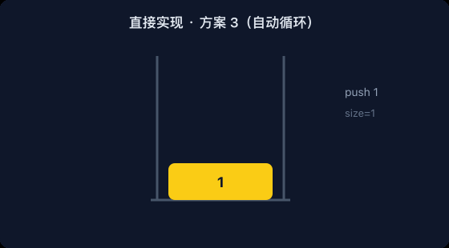

**方案专属流程图**（真实控制流）：

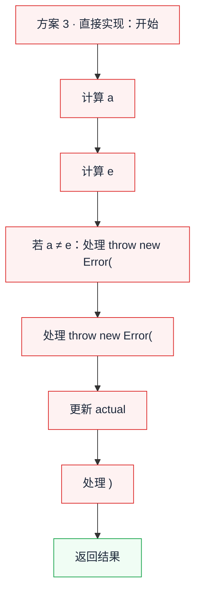

```typescript
function assertEq(actual: any, expected: any, msg: string = ''): void {
  // 定义函数/方法 assertEq
  const a = JSON.stringify(actual); // 把 JSON.stringify(actual) 存入 数组
  const e = JSON.stringify(expected); // 把 JSON.stringify(expected) 存入 e
  if (a !== e)
    throw new Error(
      'ASSERT FAILED ' + msg + ' :: actual=' + a + ' expected=' + e,
    );
}

function reverseWords(s: string): string {
  // 定义函数/方法 reverseWords
  let left = 0,
    right = s.length - 1; // 把 0, 右边界 赋值为 字符串.长度 减 1 存入 左边界
  const words: string[] = []; // 把 []; 写入 const words: string[]
  let word: string[] = []; // 把 []; 写入 let word: string[]
  while (left <= right) {
    // 循环，直到不满足「左边界 不超过 右边界」
    if (s[left] === ' ' && word.length) {
      // 若 字符串[左边界] 全等于 ' ' 且 单词.长度
      words.splice(0, 0, word.join('')); // 拼接为字符串
      word = []; // 把 [] 存入 单词
    } else if (s[left] !== ' ') {
      // 否则，若 字符串[左边界] 不等于 ' '
      word.push(s[left]); // 把 字符串[左边界] 压入栈/数组尾部
    }
    left++; // 左边界 加一
  }
  if (word.length) words.splice(0, 0, word.join('')); // 若 单词.长度) 单词列表.splice(0, 0, 单词.join(「」));
  return words.join(' '); // 返回 单词列表.join(「 」)
}
export function demo(): void {
  // 程序入口：跑内嵌自测用例
  assertEq(reverseWords('the sky is blue'), 'blue is sky the', 'reverseWords'); // 断言校验
  assertEq(reverseWords('abc'), 'abc', 'reverseWords single'); // 断言校验
  console.log('PASS'); // 全部用例通过，输出 PASS
}
demo(); // demo();
```

## 逐步拆解与面试追问

**复杂度**：时间 O(n) 量级，空间 O(n)

**为什么是这个量级**：整体只对数据做有限趟处理

**面试官可能会追问**：

- 什么时候用单调栈（求下一个更大或更小）？
- 栈里存值还是存下标？
- 能否用 O(1) 额外空间？

## 关键 API 速查（TS 主解法实际用到，附官方链接）

| API | 作用 | 使用要点 | 官方文档 |
|---|---|---|---|
| `Array.prototype.join()` | 数组拼接为字符串 | undefined/null 转空串；嵌套数组会展平一层；join('') 用于字符数组还原 | [官方文档](https://developer.mozilla.org/zh-CN/docs/Web/JavaScript/Reference/Global_Objects/Array/join) |
| `String.prototype.split()` | 字符串切分为数组 | split('') 按字符拆；split(/正则/) 支持模式；空串调用会拆出空串数组 | [官方文档](https://developer.mozilla.org/zh-CN/docs/Web/JavaScript/Reference/Global_Objects/String/split) |
| `String.prototype.trim()` | 去除首尾空白 | 返回新串；变体 trimStart/trimEnd；不处理串中间空格 | [官方文档](https://developer.mozilla.org/zh-CN/docs/Web/JavaScript/Reference/Global_Objects/String/trim) |
| `JSON.stringify()` | 序列化为 JSON 字符串 | 常用于结构化比较（深度相等判定）；undefined/函数/循环引用会被丢弃或抛错 | [官方文档](https://developer.mozilla.org/zh-CN/docs/Web/JavaScript/Reference/Global_Objects/JSON/stringify) |

### 各语言官方文档导航

- **TypeScript / JS**：[MDN 中文参考](https://developer.mozilla.org/zh-CN/)
- **Python**：[Python 官方文档](https://docs.python.org/zh-cn/3/)
- **Go**：[Go 标准库](https://pkg.go.dev/std)
- **Java**：[JDK 17 API](https://docs.oracle.com/en/java/javase/17/docs/api/)
- **Rust**：[Rust 标准库](https://doc.rust-lang.org/std/)
- **Lua**：[Lua 5.4 手册](https://www.lua.org/manual/5.4/)
- **C**：[Cppreference C](https://zh.cppreference.com/w/c)
- **C++**：[Cppreference C++](https://zh.cppreference.com/w/cpp)
- **R**：[R 官方手册](https://stat.ethz.ch/R-manual/)
- **Zig**：[Zig 语言文档](https://ziglang.org/documentation/master/)
- **Dart**：[Dart API](https://api.dart.dev/)

## 附录：其他 10 种语言全部实现（每种语言列举其全部方案）

> TypeScript 的全部方案见「TypeScript 解题方案」一节；下面是其余 10 种语言的对应实现，每种语言的每个方案都带思路分析、代码走读与专属运行架构图。
> 每个方案都内嵌用例自测，可独立运行（老仓库 python/go 文件遵循「打印结果」约定）。
> 完整解法文件见 `dsa/<语言>/stack/lc_151_反转字符串中的单词/`。

### Python 实现（3 种方案）

Python 的全部方案如下，每个方案都内嵌用例自测，可独立运行（老仓库 python/go 文件遵循「打印结果」约定）：

#### 方案 1：直接实现

**思路与代码分析**：核心是「直接实现」。Python 版用切片与字典推导式简化操作，突出可读性。**走读**：方案 1 · 直接实现：开始 → 返回 .join(s.strip().split()[::-1])。

**运行架构**（真实控制流）：

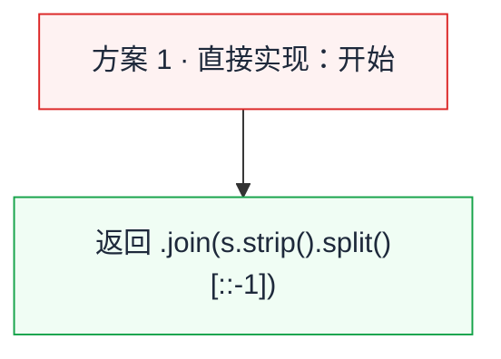

```python
import sys  # 提高递归深度上限（深输入防 RecursionError）

sys.setrecursionlimit(200000)  # 树/链表类题目节点数可达 1e4 量级

def reverseWords(s):  # 定义函数 reverseWords（参数：字符串）
    return " ".join(s.strip().split()[::-1])  # 返回 「 」.join(字符串.strip().split()[:: 减 1])

if __name__ == "__main__":  # 若 __name__ 等于 '__main__'
    print(reverseWords("abc"))  # 打印输出
```

#### 方案 2：迭代指针处理

**思路与代码分析**：核心是「迭代指针处理」。Python 版用切片与字典推导式简化操作，突出可读性。**走读**：方案 2 · 迭代指针处理：开始 → 更新 right → 当 ( 时反复执行 → 当 ( 时反复执行 → 当 left ≤ right: 时反复执行 → 返回 output。

**运行架构**（真实控制流）：

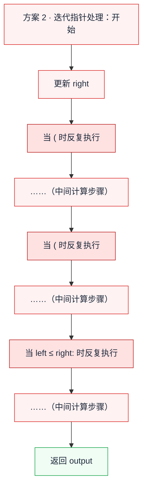

```python
import sys  # 提高递归深度上限（深输入防 RecursionError）

sys.setrecursionlimit(200000)  # 树/链表类题目节点数可达 1e4 量级

def trimSpaces(s):  # 定义函数 trimSpaces（参数：字符串）
    left, right = 0, len(s) - 1  # 把 0, 长度(字符串) 减 1 写入 left, right
    while (
        left <= right and s[left] == " "
    ):  # 循环，直到不满足「左边界 不超过 右边界 and 字符串[左边界] 等于 ' '」
        left += 1  # 左边界累加 1
    while (
        left <= right and s[right] == " "
    ):  # 循环，直到不满足「左边界 不超过 右边界 and 字符串[右边界] 等于 ' '」
        right -= 1  # 右边界累减 1
    output = []  # 把 [] 存入 输出
    while left <= right:  # 循环，直到不满足「左边界 不超过 右边界」
        if s[left] != " ":  # 若 字符串[左边界] 不等于 ' '
            output.append(s[left])  # 把 字符串[左边界] 追加到列表尾部
        elif output and output[-1] != " ":  # 否则，若 输出 and 输出[ 减 1] 不等于 ' '
            output.append(s[left])  # 把 字符串[左边界] 追加到列表尾部
        left += 1  # 左边界累加 1
    return output  # 返回 输出

def reverse(l, left, right):  # 定义函数 reverse（参数：左指针, 左边界, 右边界）
    while left < right:  # 循环，直到不满足「左边界 小于 右边界」
        l[left], l[right] = l[right], l[left]  # 把 左指针[右边界], 左指针[左边界] 写入 l[left], l[right]
        left += 1  # 左边界累加 1
        right -= 1  # 右边界累减 1

def reverseEachWord(l):  # 定义函数 reverseEachWord（参数：左指针）
    n = len(l)  # 把 长度(左指针) 存入 元素个数
    start = end = 0  # 把 终点 赋值为 0 存入 起点
    while start < n:  # 循环，直到不满足「起点 小于 元素个数」
        while end < n and l[end] != " ":  # 循环，直到不满足「终点 小于 元素个数 and 左指针[终点] 不等于 ' '」
            end += 1  # 终点累加 1
        reverse(l, start, end - 1)  # reverse(左指针, 起点, 终点 减 1)
        start = end + 1  # 把 终点 加 1 存入 起点
        end = start  # 把 起点 存入 终点

def reverseWords(s):  # 定义函数 reverseWords（参数：字符串）
    l = trimSpaces(s)  # 把 trimSpaces(字符串) 存入 左指针
    reverse(l, 0, len(l) - 1)  # reverse(左指针, 0, 长度(左指针) 减 1)
    reverseEachWord(l)  # reverseEachWord(左指针)
    return "".join(l)  # 返回 「」.join(左指针)

if __name__ == "__main__":  # 若 __name__ 等于 '__main__'
    print(trimSpaces("abc"))  # 打印输出
```

#### 方案 3：直接实现

**思路与代码分析**：核心是「直接实现」。Python 版用切片与字典推导式简化操作，突出可读性。**走读**：方案 3 · 直接实现：开始 → 更新 right → 更新 words → 更新 word → 当 left ≤ right: 时反复执行 → 若 s[left] == and word：调用 words.insert(0, .join(word → 调用 words.insert(0, .join(word → 更新 word → 更新 ! → 向 word 追加记录 → 更新 + → 若 word：调用 words.insert(0, .join(word → 调用 words.insert(0, .join(word → 返回 .join(words)。

**运行架构**（真实控制流）：

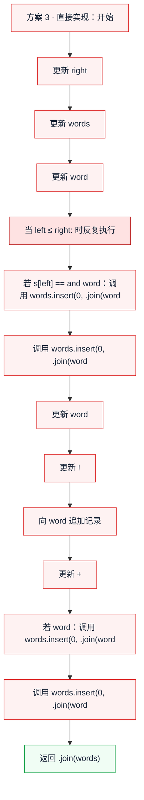

```python
import sys  # 提高递归深度上限（深输入防 RecursionError）

sys.setrecursionlimit(200000)  # 树/链表类题目节点数可达 1e4 量级

def reverseWords(s):  # 定义函数 reverseWords（参数：字符串）
    left, right = 0, len(s) - 1  # 把 0, 长度(字符串) 减 1 写入 left, right
    words = []  # 把 [] 存入 单词列表
    word = []  # 把 [] 存入 单词
    while left <= right:  # 循环，直到不满足「左边界 不超过 右边界」
        if s[left] == " " and word:  # 若 字符串[左边界] 等于 ' ' and 单词
            words.insert(0, "".join(word))  # 拼接为字符串
            word = []  # 把 [] 存入 单词
        elif s[left] != " ":  # 否则，若 字符串[左边界] 不等于 ' '
            word.append(s[left])  # 把 字符串[左边界] 追加到列表尾部
        left += 1  # 左边界累加 1
    if word:  # 若 单词
        words.insert(0, "".join(word))  # 拼接为字符串
    return " ".join(words)  # 返回 「 」.join(单词列表)

if __name__ == "__main__":  # 若 __name__ 等于 '__main__'
    print(reverseWords("abc"))  # 打印输出
```

### Go 实现（3 种方案）

Go 的全部方案如下，每个方案都内嵌用例自测，可独立运行（老仓库 python/go 文件遵循「打印结果」约定）：

#### 方案 1：直接实现

**思路与代码分析**：核心是「直接实现」。Go 版用切片与多返回值惯用法，显式处理索引边界。**走读**：方案 1 · 直接实现：开始 → 更新 : → 遍历循环 → 更新 fields[j] → 返回 strings.Join(fields, )。

**运行架构**（真实控制流）：

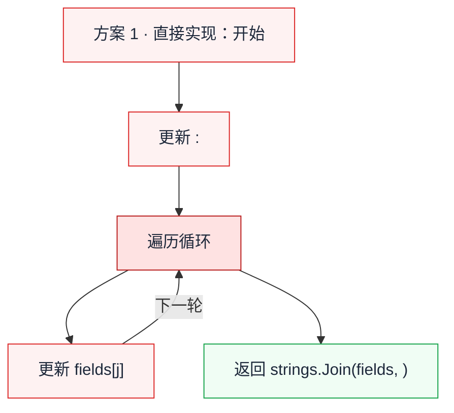

```go
package main // 引入依赖

import (
	"fmt"     // 「fmt」
	"os"      // 「os」
	"reflect" // 「reflect」
	"strings" // 「strings」
)

func reverseWords(s string) string { // 定义函数/方法 reverseWords
	fields := strings.Fields(s) // 把 strings.Fields(字符串) 写入 fields :
	for i, j := 0, len(fields)-1; i < j; i, j = i+1, j-1 {
		fields[i], fields[j] = fields[j], fields[i] // 把 fields[下标 j], fields[下标 i] 写入 fields[i], fields[j]
	}
	return strings.Join(fields, " ") // 返回 strings.Join(fields, 「 」)
}

func main() { // 程序入口：跑内嵌自测用例
	type tc struct { // 定义类型
		in   string // in string
		want string // want string
	}
	cases := []tc{ // 把 []tc{ 写入 cases :
		{"abc", "abc"},
		{"the sky is blue", "blue is sky the"},
		{"  hello world  ", "world hello"},
		{"a", "a"},
	}
	ok := true                // 把 true 写入 ok :
	for _, c := range cases { // 同时取 _ 与 字符 遍历
		if got := reverseWords(c.in); !reflect.DeepEqual(got, c.want) {
			ok = false                                                          // 把 false 写入 ok
			fmt.Printf("FAIL reverseWords(%q)=%q want %q\n", c.in, got, c.want) // 打印输出
		}
	}
	if !ok { // 若 取反 ok
		os.Exit(1) // os.Exit(1)
	}
	fmt.Println("PASS") // 全部用例通过，输出 PASS
}
```

#### 方案 2：迭代指针处理

**思路与代码分析**：核心是「迭代指针处理」。Go 版用切片与多返回值惯用法，显式处理索引边界。**走读**：方案 2 · 迭代指针处理：开始 → 更新 : → 调用 reverse(l, 0, len(l)-1) → 调用 reverseEachWord(l) → 返回 string(l)。

**运行架构**（真实控制流）：

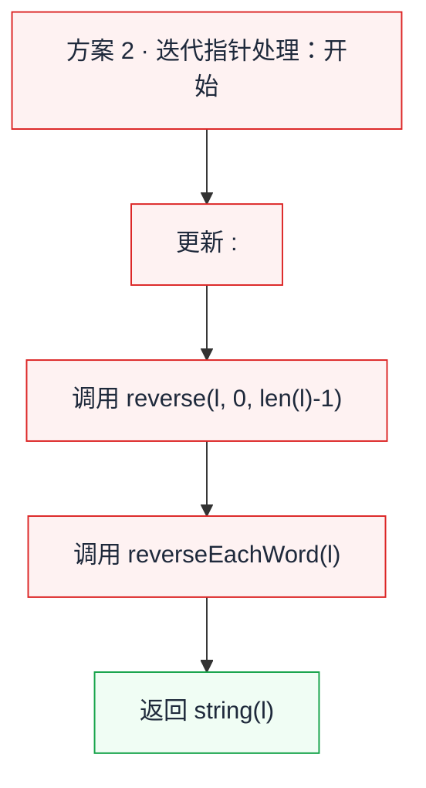

```go
package main // 引入依赖

import (
	"fmt"     // 「fmt」
	"os"      // 「os」
	"reflect" // 「reflect」
)

func trimSpaces(s string) []rune { // 定义函数/方法 trimSpaces
	left, right := 0, len(s)-1            // 把 0, 长度(字符串) 减 1 写入 left, right :
	for left <= right && s[left] == ' ' { // 把 右边界 且 字符串[左边界] 等于 ' ' { 写入 for left <
		left++ // 左边界 加一
	}
	for left <= right && s[right] == ' ' { // 把 右边界 且 字符串[右边界] 等于 ' ' { 写入 for left <
		right-- // 右边界 减一
	}
	out := []rune{}     // 把 []rune{} 写入 out :
	for left <= right { // 把 右边界 { 写入 for left <
		if s[left] != ' ' { // 若 字符串[左边界] 不等于 ' '
			out = append(out, rune(s[left])) // 把 append(out, rune(字符串[左边界])) 写入 out
		} else if len(out) > 0 && out[len(out)-1] != ' ' { // 否则，若 长度(out) 超过 0 且 out[长度(out) 减 1] 不等于 ' '
			out = append(out, ' ') // 把 append(out, ' ') 写入 out
		}
		left++ // 左边界 加一
	}
	return out // 返回 out
}

func reverse(l []rune, left, right int) { // 定义函数/方法 reverse
	for left < right { // for 左边界 小于 右边界 {
		l[left], l[right] = l[right], l[left] // 把 左指针[右边界], 左指针[左边界] 写入 l[left], l[right]
		left++                                // 左边界 加一
		right--                               // 右边界 减一
	}
}

func reverseEachWord(l []rune) { // 定义函数/方法 reverseEachWord
	n := len(l)        // 把 长度(左指针) 写入 n :
	start, end := 0, 0 // 把 0, 0 写入 start, end :
	for start < n {    // for 起点 小于 元素个数 {
		for end < n && l[end] != ' ' { // 把 ' ' { 写入 for end < n && l[end] !
			end++ // 终点 加一
		}
		reverse(l, start, end-1) // reverse(左指针, 起点, 终点 减 1)
		start = end + 1          // 把 终点 加 1 写入 起点
		end = start              // 把 起点 写入 终点
	}
}

func reverseWords(s string) string { // 定义函数/方法 reverseWords
	l := trimSpaces(s)      // 把 trimSpaces(字符串) 写入 l :
	reverse(l, 0, len(l)-1) // reverse(左指针, 0, 长度(左指针) 减 1)
	reverseEachWord(l)      // reverseEachWord(左指针)
	return string(l)        // 定义函数/方法 string
}

func main() { // 程序入口：跑内嵌自测用例
	type tc struct { // 定义类型
		in   string // in string
		want string // want string
	}
	cases := []tc{ // 把 []tc{ 写入 cases :
		{"abc", "abc"},
		{"the sky is blue", "blue is sky the"},
		{"  hello world  ", "world hello"},
		{"a", "a"},
	}
	ok := true                // 把 true 写入 ok :
	for _, c := range cases { // 同时取 _ 与 字符 遍历
		if got := reverseWords(c.in); !reflect.DeepEqual(got, c.want) {
			ok = false                                                          // 把 false 写入 ok
			fmt.Printf("FAIL reverseWords(%q)=%q want %q\n", c.in, got, c.want) // 打印输出
		}
	}
	if !ok { // 若 取反 ok
		os.Exit(1) // os.Exit(1)
	}
	fmt.Println("PASS") // 全部用例通过，输出 PASS
}
```

#### 方案 3：直接实现

**思路与代码分析**：核心是「直接实现」。Go 版用切片与多返回值惯用法，显式处理索引边界。**走读**：方案 3 · 直接实现：开始 → 更新 : → 更新 : → 更新 : → 遍历循环 → 处理 if s[left] == ' ' 且 len(wor → 更新 words → 更新 word → 更新 word → 处理 left++ → 处理 if len(word) ＞ 0 → 更新 words → 返回 strings.Join(words, )。

**运行架构**（真实控制流）：

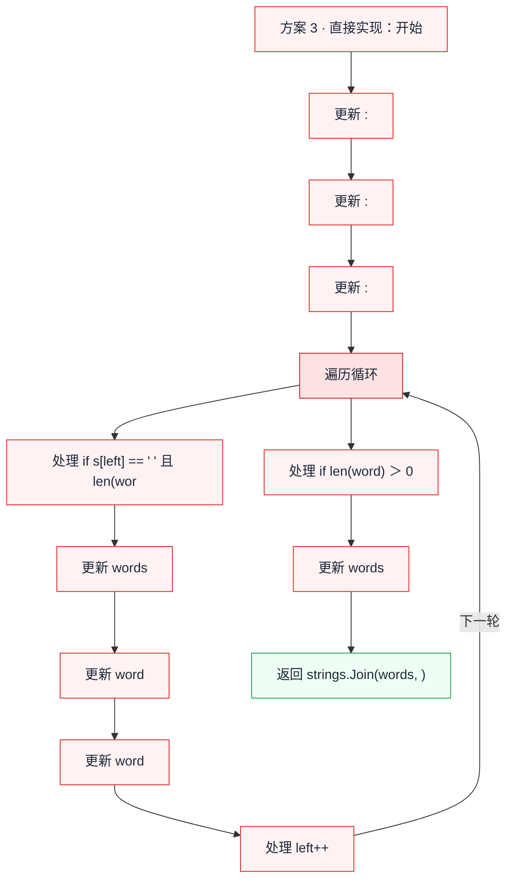

```go
package main // 引入依赖

import (
	"fmt"     // 「fmt」
	"os"      // 「os」
	"reflect" // 「reflect」
	"strings" // 「strings」
)

func reverseWords(s string) string { // 定义函数/方法 reverseWords
	left, right := 0, len(s)-1 // 把 0, 长度(字符串) 减 1 写入 left, right :
	words := []string{}        // 把 []string{} 写入 words :
	word := []rune{}           // 把 []rune{} 写入 word :
	for left <= right {        // 把 右边界 { 写入 for left <
		if s[left] == ' ' && len(word) > 0 { // 若 字符串[左边界] 等于 ' ' 且 长度(单词) 超过 0
			words = append([]string{string(word)}, words...) // 把 append([]string{string(单词)}, 单词列表...) 写入 单词列表
			word = []rune{}                                  // 把 []rune{} 写入 单词
		} else if s[left] != ' ' { // 否则，若 字符串[左边界] 不等于 ' '
			word = append(word, rune(s[left])) // 把 append(单词, rune(字符串[左边界])) 写入 单词
		}
		left++ // 左边界 加一
	}
	if len(word) > 0 { // 若 长度(单词) 超过 0
		words = append([]string{string(word)}, words...) // 把 append([]string{string(单词)}, 单词列表...) 写入 单词列表
	}
	return strings.Join(words, " ") // 返回 strings.Join(单词列表, 「 」)
}

func main() { // 程序入口：跑内嵌自测用例
	type tc struct { // 定义类型
		in   string // in string
		want string // want string
	}
	cases := []tc{ // 把 []tc{ 写入 cases :
		{"abc", "abc"},
		{"the sky is blue", "blue is sky the"},
		{"  hello world  ", "world hello"},
		{"a", "a"},
	}
	ok := true                // 把 true 写入 ok :
	for _, c := range cases { // 同时取 _ 与 字符 遍历
		if got := reverseWords(c.in); !reflect.DeepEqual(got, c.want) {
			ok = false                                                          // 把 false 写入 ok
			fmt.Printf("FAIL reverseWords(%q)=%q want %q\n", c.in, got, c.want) // 打印输出
		}
	}
	if !ok { // 若 取反 ok
		os.Exit(1) // os.Exit(1)
	}
	fmt.Println("PASS") // 全部用例通过，输出 PASS
}
```

### Java 实现（3 种方案）

Java 的全部方案如下，每个方案都内嵌用例自测，可独立运行（老仓库 python/go 文件遵循「打印结果」约定）：

#### 方案 1：直接实现

**思路与代码分析**：核心是「直接实现」。Java 版用类与静态方法组织，集合操作显式明了。代码里依次做这些事：双重循环遍历。**走读**：方案 1 · 直接实现：开始 → 更新 parts → 更新 list → 遍历循环 → 若 非 p.isEmpty()) list.add(p：None → 更新 sb → 遍历循环 → 若 k ＜ list.size() - 1) sb.append(' '：None → 向 sb 追加记录 → 返回 sb.toString()。

**运行架构**（真实控制流）：

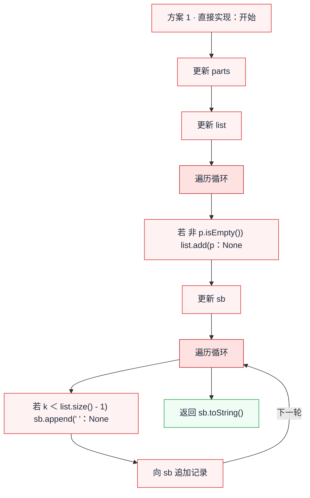

```java
package com.webfault.dsa; // 引入依赖

import java.util.*; // 引入依赖

class Main { // 定义类型

  static String reverseWords(String s) { // 定义函数/方法 reverseWords
    String[] parts = s.split("\\s+"); // 把 字符串.split(「\字符串 加 」); 写入 String[] parts
    java.util.ArrayList<String> list = new java.util.ArrayList<>();
    for (String p : parts)
      if (!p.isEmpty()) list.add(p); // for (String 节点 : parts) if (取反 节点.isEmpty()) 列表 追加 节点);
    StringBuilder sb = new StringBuilder(); // 把 new StringBuilder(); 写入 StringBuilder sb
    for (int k = list.size() - 1; k >= 0; k--) { // 让 下标 k 从 列表.大小() 减 1 开始计数，下标 k 不低于 0 就继续
      if (k < list.size() - 1) sb.append(' '); // 若 下标 k 小于 列表.大小() 减 1) sb 追加 ' ');
      sb.append(list.get(k)); // 把 列表 查找 下标 k 追加到列表尾部
    }
    return sb.toString(); // 返回 sb.toString()
  }

  public static void main(String[] args) { // public static void main(String[] args) {
    String[] cases = { // 把 { 写入 String[] cases
      "the sky is blue",
      "  hello   world  ",
      "a good   example",
      "abc",
      "",
      "  fly me   to   the moon  ",
    };
    String[] wants = { // 把 { 写入 String[] wants
      "blue is sky the", "world hello", "example good a", "abc", "", "moon the to me fly",
    };
    boolean ok = true; // 把 true; 写入 boolean ok
    for (int ci = 0; ci < cases.length; ci++) { // 让 ci 从 0 开始计数，ci 小于 cases.长度 就继续
      String got = reverseWords(cases[ci]); // 把 reverseWords(cases[ci]) 存入 got
      if (!got.equals(wants[ci])) { // 若 取反 got.equals(wants[ci]
        ok = false; // 把 false; 写入 ok
        System.out.println(
            "FAIL case " + ci + " got [" + got + "] want [" + wants[ci] + "]"); // 打印输出
      }
    }
    if (!ok) throw new RuntimeException("FAILED"); // 若 取反 ok) throw new RuntimeException(「FAILED」);
    System.out.println("PASS"); // 全部用例通过，输出 PASS
  }
}
```

#### 方案 2：迭代指针处理

**思路与代码分析**：核心是「迭代指针处理」。Java 版用类与静态方法组织，集合操作显式明了。**走读**：方案 2 · 迭代指针处理：开始 → 更新 l → 调用 reverse(l, 0, l.length - 1) → 调用 reverseEachWord(l) → 返回 new String(l)。

**运行架构**（真实控制流）：

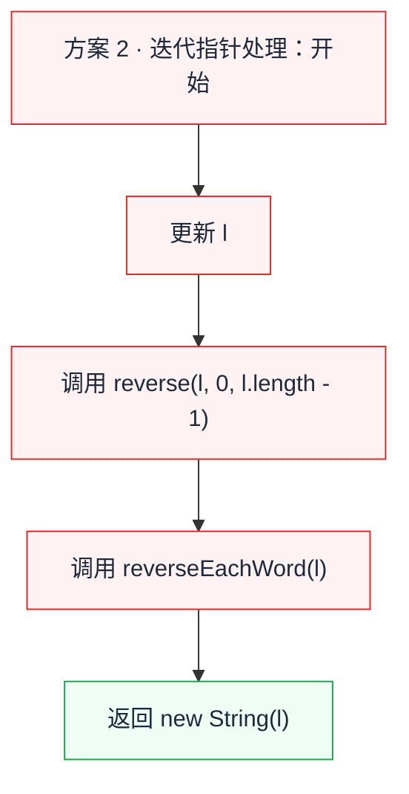

```java
package com.webfault.dsa; // 引入依赖

import java.util.*; // 引入依赖

class Main { // 定义类型

  static char[] trimSpaces(String s) { // 定义函数/方法 trimSpaces
    int left = 0, right = s.length() - 1; // 把 0, 右边界 赋值为 字符串.长度() 减 1 存入 左边界
    while (left <= right && s.charAt(left) == ' ')
      left++; // 循环，直到不满足「左边界 不超过 右边界 且 字符串 取字符 左边界) 等于 ' ') 左边界 加一 ;」
    while (left <= right && s.charAt(right) == ' ')
      right--; // 循环，直到不满足「左边界 不超过 右边界 且 字符串 取字符 右边界) 等于 ' ') 右边界 减一 ;」
    StringBuilder out = new StringBuilder(); // 把 new StringBuilder(); 写入 StringBuilder out
    while (left <= right) { // 循环，直到不满足「左边界 不超过 右边界」
      if (s.charAt(left) != ' ')
        out.append(s.charAt(left)); // 若 字符串 取字符 左边界) 不等于 ' ') out 追加 字符串 取字符 左边界));
      else if (out.length() > 0 && out.charAt(out.length() - 1) != ' ') out.append(s.charAt(left));
      left++; // 左边界 加一
    }
    return out.toString().toCharArray(); // 返回 out.toString().toCharArray()
  }

  static void reverse(char[] l, int left, int right) { // 定义函数/方法 reverse
    while (left < right) { // 循环，直到不满足「左边界 小于 右边界」
      char t = l[left];
      l[left] = l[right];
      l[right] = t;
      left++;
      right--; // 左边界 加一 ; 右边界 减一 ;
    }
  }

  static void reverseEachWord(char[] l) { // 定义函数/方法 reverseEachWord
    int n = l.length, start = 0, end = 0; // 把 左指针.长度, 起点 赋值为 0, 终点 赋值为 0 存入 元素个数
    while (start < n) { // 循环，直到不满足「起点 小于 元素个数」
      while (end < n && l[end] != ' ') end++; // 循环，直到不满足「终点 小于 元素个数 且 左指针[终点] 不等于 ' ') 终点 加一 ;」
      reverse(l, start, end - 1); // reverse(左指针, 起点, 终点 减 1);
      start = end + 1; // 把 终点 加 1; 写入 起点
      end = start; // 把 起点; 写入 终点
    }
  }

  static String reverseWords(String s) { // 定义函数/方法 reverseWords
    char[] l = trimSpaces(s); // 把 trimSpaces(字符串); 写入 char[] l
    reverse(l, 0, l.length - 1); // reverse(左指针, 0, 左指针.长度 减 1);
    reverseEachWord(l); // reverseEachWord(左指针);
    return new String(l); // 返回 new String(左指针)
  }

  public static void main(String[] args) { // public static void main(String[] args) {
    String[] cases = { // 把 { 写入 String[] cases
      "the sky is blue",
      "  hello   world  ",
      "a good   example",
      "abc",
      "",
      "  fly me   to   the moon  ",
    };
    String[] wants = { // 把 { 写入 String[] wants
      "blue is sky the", "world hello", "example good a", "abc", "", "moon the to me fly",
    };
    boolean ok = true; // 把 true; 写入 boolean ok
    for (int ci = 0; ci < cases.length; ci++) { // 让 ci 从 0 开始计数，ci 小于 cases.长度 就继续
      String got = reverseWords(cases[ci]); // 把 reverseWords(cases[ci]) 存入 got
      if (!got.equals(wants[ci])) { // 若 取反 got.equals(wants[ci]
        ok = false; // 把 false; 写入 ok
        System.out.println(
            "FAIL case " + ci + " got [" + got + "] want [" + wants[ci] + "]"); // 打印输出
      }
    }
    if (!ok) throw new RuntimeException("FAILED"); // 若 取反 ok) throw new RuntimeException(「FAILED」);
    System.out.println("PASS"); // 全部用例通过，输出 PASS
  }
}
```

#### 方案 3：直接实现

**思路与代码分析**：核心是「直接实现」。Java 版用类与静态方法组织，集合操作显式明了。**走读**：方案 3 · 直接实现：开始 → 更新 left → 更新 words → 更新 word → 当 (left ≤ right) 时反复执行 → 若 s.charAt(left) == ' ' 且 word.length() ＞ 0 则： → 调用 words.add(0, word.toString() → 更新 word → 向 word 追加记录 → 处理 left++ → 若 word.length() ＞ 0：调用 words.add(0, word.toString() → 调用 words.add(0, word.toString() → 返回 String.join( , words)。

**运行架构**（真实控制流）：

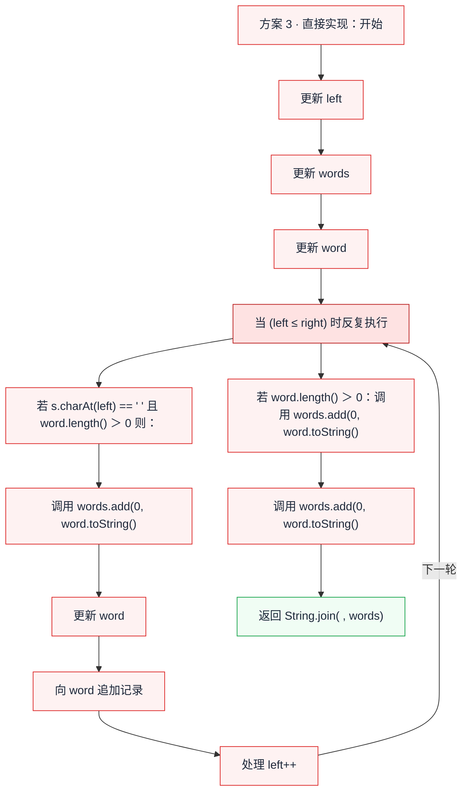

```java
package com.webfault.dsa; // 引入依赖

import java.util.*; // 引入依赖

class Main { // 定义类型

  static String reverseWords(String s) { // 定义函数/方法 reverseWords
    int left = 0, right = s.length() - 1; // 把 0, 右边界 赋值为 字符串.长度() 减 1 存入 左边界
    java.util.ArrayList<String> words = new java.util.ArrayList<>();
    StringBuilder word = new StringBuilder(); // 把 new StringBuilder(); 写入 StringBuilder word
    while (left <= right) { // 循环，直到不满足「左边界 不超过 右边界」
      if (s.charAt(left) == ' ' && word.length() > 0) { // 若 字符串 取字符 左边界) 等于 ' ' 且 单词.长度() 超过 0
        words.add(0, word.toString()); // 单词列表 追加 0, 单词.toString());
        word = new StringBuilder(); // 把 new StringBuilder(); 写入 单词
      } else if (s.charAt(left) != ' ') { // 否则，若 字符串 取字符 左边界) 不等于 ' '
        word.append(s.charAt(left)); // 把 字符串 取字符 左边界 追加到列表尾部
      }
      left++; // 左边界 加一
    }
    if (word.length() > 0)
      words.add(0, word.toString()); // 若 单词.长度() 超过 0) 单词列表 追加 0, 单词.toString());
    return String.join(" ", words); // 返回 String.join(「 」, 单词列表)
  }

  public static void main(String[] args) { // public static void main(String[] args) {
    String[] cases = { // 把 { 写入 String[] cases
      "the sky is blue",
      "  hello   world  ",
      "a good   example",
      "abc",
      "",
      "  fly me   to   the moon  ",
    };
    String[] wants = { // 把 { 写入 String[] wants
      "blue is sky the", "world hello", "example good a", "abc", "", "moon the to me fly",
    };
    boolean ok = true; // 把 true; 写入 boolean ok
    for (int ci = 0; ci < cases.length; ci++) { // 让 ci 从 0 开始计数，ci 小于 cases.长度 就继续
      String got = reverseWords(cases[ci]); // 把 reverseWords(cases[ci]) 存入 got
      if (!got.equals(wants[ci])) { // 若 取反 got.equals(wants[ci]
        ok = false; // 把 false; 写入 ok
        System.out.println(
            "FAIL case " + ci + " got [" + got + "] want [" + wants[ci] + "]"); // 打印输出
      }
    }
    if (!ok) throw new RuntimeException("FAILED"); // 若 取反 ok) throw new RuntimeException(「FAILED」);
    System.out.println("PASS"); // 全部用例通过，输出 PASS
  }
}
```

### Rust 实现（3 种方案）

Rust 的全部方案如下，每个方案都内嵌用例自测，可独立运行（老仓库 python/go 文件遵循「打印结果」约定）：

#### 方案 1：直接实现

**思路与代码分析**：核心是「直接实现」。Rust 版用所有权移动与切片借用改写同一逻辑，注意 Option 与引用边界。**走读**：方案 1 · 直接实现：开始 → 调用 s.split_whitespace().rev().c → 返回结果。

**运行架构**（真实控制流）：

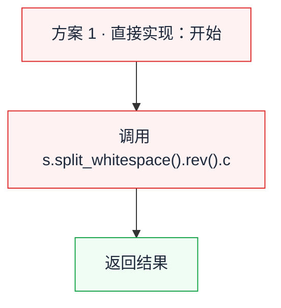

```rust
// LeetCode 151. 反转字符串中的单词 — Rust 版（方案1）
fn reverse_words(s: String) -> String {
    // 定义函数/方法 reverse_words
    s.split_whitespace().rev().collect::<Vec<_>>().join(" ") // 拼接为字符串
}
fn main() {
    // 程序入口：跑内嵌自测用例
    assert_eq!(reverse_words("the sky is blue".into()), "blue is sky the"); // 断言校验
    assert_eq!(reverse_words("  hello world  ".into()), "world hello"); // 断言校验
    assert_eq!(reverse_words("a good   example".into()), "example good a"); // 断言校验
    println!("PASS");
} // 全部用例通过，输出 PASS
```

#### 方案 2：迭代指针处理

**思路与代码分析**：核心是「迭代指针处理」。Rust 版用所有权移动与切片借用改写同一逻辑，注意 Option 与引用边界。**走读**：方案 2 · 迭代指针处理：开始 → 调用 s.split_whitespace().rev().c → 返回结果。

**运行架构**（真实控制流）：

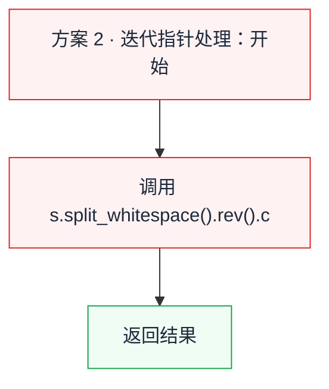

```rust
// LeetCode 151. 反转字符串中的单词 — Rust 版（方案2）
fn reverse_words(s: String) -> String {
    // 定义函数/方法 reverse_words
    s.split_whitespace().rev().collect::<Vec<_>>().join(" ") // 拼接为字符串
}
fn main() {
    // 程序入口：跑内嵌自测用例
    assert_eq!(reverse_words("the sky is blue".into()), "blue is sky the"); // 断言校验
    assert_eq!(reverse_words("  hello world  ".into()), "world hello"); // 断言校验
    assert_eq!(reverse_words("a good   example".into()), "example good a"); // 断言校验
    println!("PASS");
} // 全部用例通过，输出 PASS
```

#### 方案 3：直接实现

**思路与代码分析**：核心是「直接实现」。Rust 版用所有权移动与切片借用改写同一逻辑，注意 Option 与引用边界。**走读**：方案 3 · 直接实现：开始 → 调用 s.split_whitespace().rev().c → 返回结果。

**运行架构**（真实控制流）：


```rust
// LeetCode 151. 反转字符串中的单词 — Rust 版（方案3）
fn reverse_words(s: String) -> String {
    // 定义函数/方法 reverse_words
    s.split_whitespace().rev().collect::<Vec<_>>().join(" ") // 拼接为字符串
}
fn main() {
    // 程序入口：跑内嵌自测用例
    assert_eq!(reverse_words("the sky is blue".into()), "blue is sky the"); // 断言校验
    assert_eq!(reverse_words("  hello world  ".into()), "world hello"); // 断言校验
    assert_eq!(reverse_words("a good   example".into()), "example good a"); // 断言校验
    println!("PASS");
} // 全部用例通过，输出 PASS
```

### Lua 实现（3 种方案）

Lua 的全部方案如下，每个方案都内嵌用例自测，可独立运行（老仓库 python/go 文件遵循「打印结果」约定）：

#### 方案 1：直接实现

**思路与代码分析**：核心是「直接实现」。Lua 版用表与 ipairs 遍历，注意 ipairs 遇 nil 即停的语义。**走读**：方案 1 · 直接实现：开始 → 更新 words → 遍历 s:gmatch('%S+') do 中的每个元素 w → 更新 1] → 更新 out → 循环 i：从 #words 到 1, -1 do → 更新 1] → 返回 table.concat(out, )。

**运行架构**（真实控制流）：

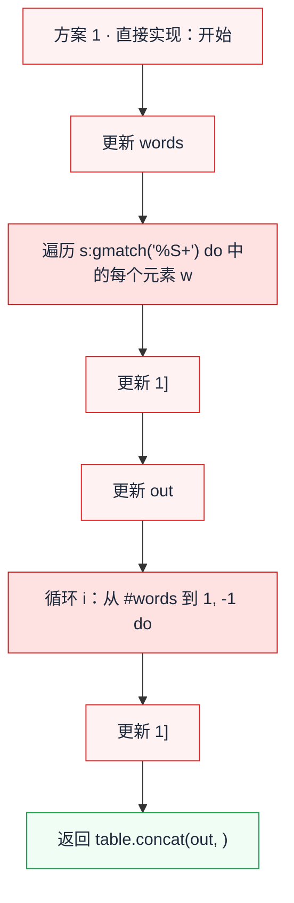

```lua
-- LeetCode 151. 反转字符串中的单词 — Lua 版（方案1）
local function reverse_words(s) -- local function reverse_words(字符串)
	local words = {} -- 把 {} 写入 local words
	for w in s:gmatch("%S+") do
		words[#words + 1] = w
	end -- 把 权重 终点 写入 for w in s:gmatch("%S+") do words[#words + 1]
	local out = {} -- 把 {} 写入 local out
	for i = #words, 1, -1 do
		out[#out + 1] = words[i]
	end -- 把 #单词列表, 1, 减 1 do out[#out 加 1] 赋值为 单词列表[下标 i] 终点 写入 for i
	return table.concat(out, " ") -- 返回 table.concat(out, 「 」)
end -- 终点
assert(reverse_words("the sky is blue") == "blue is sky the") -- 断言校验
assert(reverse_words("  hello world  ") == "world hello") -- 断言校验
assert(reverse_words("a good   example") == "example good a") -- 断言校验
print("PASS") -- 全部用例通过，输出 PASS
```

#### 方案 2：迭代指针处理

**思路与代码分析**：核心是「迭代指针处理」。Lua 版用表与 ipairs 遍历，注意 ipairs 遇 nil 即停的语义。**走读**：方案 2 · 迭代指针处理：开始 → 更新 words → 遍历 s:gmatch('%S+') do 中的每个元素 w → 更新 1] → 更新 out → 循环 i：从 #words 到 1, -1 do → 更新 1] → 返回 table.concat(out, )。

**运行架构**（真实控制流）：

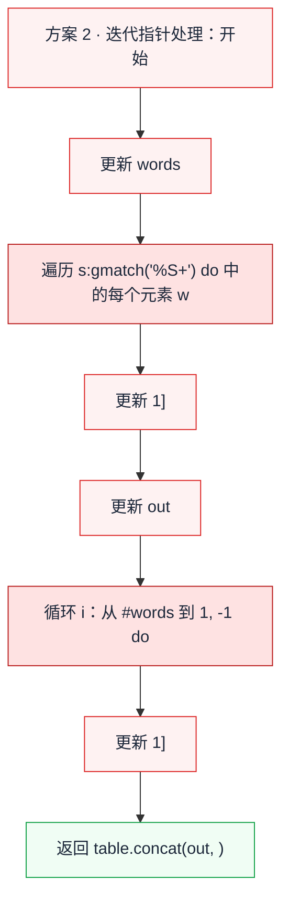

```lua
-- LeetCode 151. 反转字符串中的单词 — Lua 版（方案2）
local function reverse_words(s) -- local function reverse_words(字符串)
	local words = {} -- 把 {} 写入 local words
	for w in s:gmatch("%S+") do
		words[#words + 1] = w
	end -- 把 权重 终点 写入 for w in s:gmatch("%S+") do words[#words + 1]
	local out = {} -- 把 {} 写入 local out
	for i = #words, 1, -1 do
		out[#out + 1] = words[i]
	end -- 把 #单词列表, 1, 减 1 do out[#out 加 1] 赋值为 单词列表[下标 i] 终点 写入 for i
	return table.concat(out, " ") -- 返回 table.concat(out, 「 」)
end -- 终点
assert(reverse_words("the sky is blue") == "blue is sky the") -- 断言校验
assert(reverse_words("  hello world  ") == "world hello") -- 断言校验
assert(reverse_words("a good   example") == "example good a") -- 断言校验
print("PASS") -- 全部用例通过，输出 PASS
```

#### 方案 3：直接实现

**思路与代码分析**：核心是「直接实现」。Lua 版用表与 ipairs 遍历，注意 ipairs 遇 nil 即停的语义。**走读**：方案 3 · 直接实现：开始 → 更新 words → 遍历 s:gmatch('%S+') do 中的每个元素 w → 更新 1] → 更新 out → 循环 i：从 #words 到 1, -1 do → 更新 1] → 返回 table.concat(out, )。

**运行架构**（真实控制流）：


```lua
-- LeetCode 151. 反转字符串中的单词 — Lua 版（方案3）
local function reverse_words(s) -- local function reverse_words(字符串)
	local words = {} -- 把 {} 写入 local words
	for w in s:gmatch("%S+") do
		words[#words + 1] = w
	end -- 把 权重 终点 写入 for w in s:gmatch("%S+") do words[#words + 1]
	local out = {} -- 把 {} 写入 local out
	for i = #words, 1, -1 do
		out[#out + 1] = words[i]
	end -- 把 #单词列表, 1, 减 1 do out[#out 加 1] 赋值为 单词列表[下标 i] 终点 写入 for i
	return table.concat(out, " ") -- 返回 table.concat(out, 「 」)
end -- 终点
assert(reverse_words("the sky is blue") == "blue is sky the") -- 断言校验
assert(reverse_words("  hello world  ") == "world hello") -- 断言校验
assert(reverse_words("a good   example") == "example good a") -- 断言校验
print("PASS") -- 全部用例通过，输出 PASS
```

### C 实现（3 种方案）

C 的全部方案如下，每个方案都内嵌用例自测，可独立运行（老仓库 python/go 文件遵循「打印结果」约定）：

#### 方案 1：直接实现

**思路与代码分析**：核心是「直接实现」。C 版手动管理下标与内存，循环边界全部显式写出。代码里依次做这些事：单循环线性扫描。**走读**：方案 1 · 直接实现：开始 → 处理 char *words[8192] → 当 (*p) 时反复执行 → 当 (*p 且 isspace((unsigned char)*p)) 时反复执行 → 当 (*p 且 非 isspace((unsigned char)*p)) 时反复执行 → 遍历循环 → 返回结果。

**运行架构**（真实控制流）：

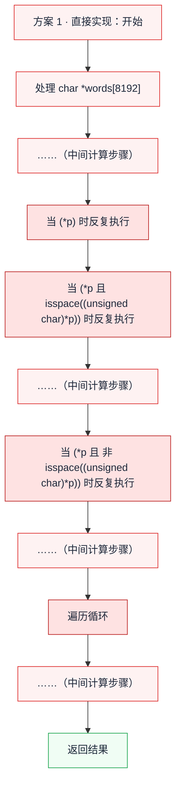

```c
/* LeetCode 151. 反转字符串中的单词 — C 版（方案1） */
#include <ctype.h>                                     // 引入头文件
#include <stdio.h>                                     // 引入头文件
#include <stdlib.h>                                    // 引入头文件
#include <string.h>                                    // 引入头文件
static void reverse_words(const char *s, char out[]) { // 定义函数/方法 reverse_words
    char *words[8192];                                 // char 乘 单词列表[8192];
    int wn = 0;                                        // 把 0 存入 wn
    const char *p = s;                                 // 把 字符串; 写入 const char *p
    while (*p) {                                       // 循环，直到不满足「乘 节点」
        while (*p && isspace((unsigned char)*p))
            p++; // 循环，直到不满足「乘 节点 且 isspace((unsigned char) 乘 节点)) 节点 加一 ;」
        if (!*p)
            break;             // 若 取反 乘 节点) break;
        const char *start = p; // 把 节点; 写入 const char *start
        while (*p && !isspace((unsigned char)*p))
            p++; // 循环，直到不满足「乘 节点 且 取反 isspace((unsigned char) 乘 节点)) 节点 加一 ;」
        size_t len = p - start;         // 把 节点 减 起点; 写入 size_t len
        words[wn] = malloc(len + 1);    // 把 malloc(长度 加 1); 写入 words[wn]
        strncpy(words[wn], start, len); // strncpy(单词列表[wn], 起点, 长度);
        words[wn][len] = '\0';          // 把 '\0'; 写入 words[wn][len]
        wn++;                           // wn 加一
    }
    int pos = 0;                        // 把 0 存入 pos
    for (int i = wn - 1; i >= 0; i--) { // 让 下标 i 从 wn 减 1 开始计数，下标 i 不低于 0 就继续
        if (pos > 0)
            out[pos++] = ' ';        // 若 pos 超过 0) out[pos 加一 ] 赋值为 ' ';
        strcpy(out + pos, words[i]); // strcpy(out 加 pos, 单词列表[下标 i]);
        pos += strlen(words[i]);     // pos累加 strlen(单词列表[下标 i])
        free(words[i]);              // free(单词列表[下标 i]);
    }
    out[pos] = '\0'; // 把 '\0'; 写入 out[pos]
}
int main(void) {                           // 程序入口：跑内嵌自测用例
    char out[8192];                        // char out[8192];
    reverse_words("the sky is blue", out); // reverse_words(「the sky is blue」, out);
    if (strcmp(out, "blue is sky the") != 0) {
        printf("FAIL 1\n");
        return 1;
    }
    reverse_words("  hello world  ", out); // reverse_words(「 hello world 」, out);
    if (strcmp(out, "world hello") != 0) {
        printf("FAIL 2\n");
        return 1;
    }
    reverse_words("a good   example", out); // reverse_words(「数组 good example」, out);
    if (strcmp(out, "example good a") != 0) {
        printf("FAIL 3\n");
        return 1;
    }
    printf("PASS\n");
    return 0;
} // 全部用例通过，输出 PASS
```

#### 方案 2：迭代指针处理

**思路与代码分析**：核心是「迭代指针处理」。C 版手动管理下标与内存，循环边界全部显式写出。代码里依次做这些事：单循环线性扫描。**走读**：方案 2 · 迭代指针处理：开始 → 处理 char *words[8192] → 当 (*p) 时反复执行 → 当 (*p 且 isspace((unsigned char)*p)) 时反复执行 → 当 (*p 且 非 isspace((unsigned char)*p)) 时反复执行 → 遍历循环 → 返回结果。

**运行架构**（真实控制流）：

```mermaid
graph TD
    N0["方案 2 · 迭代指针处理：开始"]
    N1["处理 char *words[8192]"]
    D1["……（中间计算步骤）"]
    N4["当 (*p) 时反复执行"]
    N5["当 (*p 且 isspace((unsigned char)*p)) 时反复执行"]
    D2["……（中间计算步骤）"]
    N10["当 (*p 且 非 isspace((unsigned char)*p)) 时反复执行"]
    D3["……（中间计算步骤）"]
    N18["遍历循环"]
    D4["……（中间计算步骤）"]
    N25["返回结果"]
    N0 --> N1
    N4 --> N5
    N1 --> D1
    D1 --> N4
    N5 --> D2
    D2 --> N10
    N10 --> D3
    D3 --> N18
    N18 --> D4
    D4 --> N25
    classDef n fill:#fef2f2,stroke:#dc2626,color:#1e293b;
    classDef lp fill:#fee2e2,stroke:#b91c1c,color:#1e293b;
    classDef dc fill:#fef9c3,stroke:#ca8a04,color:#1e293b;
    classDef tm fill:#f0fdf4,stroke:#16a34a,color:#1e293b;
    class N0,N1,D1,D2,D3,D4 n;
    class N4,N5,N10,N18 lp;
    class N25 tm;
```

```c
/* LeetCode 151. 反转字符串中的单词 — C 版（方案2） */
#include <ctype.h>                                     // 引入头文件
#include <stdio.h>                                     // 引入头文件
#include <stdlib.h>                                    // 引入头文件
#include <string.h>                                    // 引入头文件
static void reverse_words(const char *s, char out[]) { // 定义函数/方法 reverse_words
    char *words[8192];                                 // char 乘 单词列表[8192];
    int wn = 0;                                        // 把 0 存入 wn
    const char *p = s;                                 // 把 字符串; 写入 const char *p
    while (*p) {                                       // 循环，直到不满足「乘 节点」
        while (*p && isspace((unsigned char)*p))
            p++; // 循环，直到不满足「乘 节点 且 isspace((unsigned char) 乘 节点)) 节点 加一 ;」
        if (!*p)
            break;             // 若 取反 乘 节点) break;
        const char *start = p; // 把 节点; 写入 const char *start
        while (*p && !isspace((unsigned char)*p))
            p++; // 循环，直到不满足「乘 节点 且 取反 isspace((unsigned char) 乘 节点)) 节点 加一 ;」
        size_t len = p - start;         // 把 节点 减 起点; 写入 size_t len
        words[wn] = malloc(len + 1);    // 把 malloc(长度 加 1); 写入 words[wn]
        strncpy(words[wn], start, len); // strncpy(单词列表[wn], 起点, 长度);
        words[wn][len] = '\0';          // 把 '\0'; 写入 words[wn][len]
        wn++;                           // wn 加一
    }
    int pos = 0;                        // 把 0 存入 pos
    for (int i = wn - 1; i >= 0; i--) { // 让 下标 i 从 wn 减 1 开始计数，下标 i 不低于 0 就继续
        if (pos > 0)
            out[pos++] = ' ';        // 若 pos 超过 0) out[pos 加一 ] 赋值为 ' ';
        strcpy(out + pos, words[i]); // strcpy(out 加 pos, 单词列表[下标 i]);
        pos += strlen(words[i]);     // pos累加 strlen(单词列表[下标 i])
        free(words[i]);              // free(单词列表[下标 i]);
    }
    out[pos] = '\0'; // 把 '\0'; 写入 out[pos]
}
int main(void) {                           // 程序入口：跑内嵌自测用例
    char out[8192];                        // char out[8192];
    reverse_words("the sky is blue", out); // reverse_words(「the sky is blue」, out);
    if (strcmp(out, "blue is sky the") != 0) {
        printf("FAIL 1\n");
        return 1;
    }
    reverse_words("  hello world  ", out); // reverse_words(「 hello world 」, out);
    if (strcmp(out, "world hello") != 0) {
        printf("FAIL 2\n");
        return 1;
    }
    reverse_words("a good   example", out); // reverse_words(「数组 good example」, out);
    if (strcmp(out, "example good a") != 0) {
        printf("FAIL 3\n");
        return 1;
    }
    printf("PASS\n");
    return 0;
} // 全部用例通过，输出 PASS
```

#### 方案 3：直接实现

**思路与代码分析**：核心是「直接实现」。C 版手动管理下标与内存，循环边界全部显式写出。代码里依次做这些事：单循环线性扫描。**走读**：方案 3 · 直接实现：开始 → 处理 char *words[8192] → 当 (*p) 时反复执行 → 当 (*p 且 isspace((unsigned char)*p)) 时反复执行 → 当 (*p 且 非 isspace((unsigned char)*p)) 时反复执行 → 遍历循环 → 返回结果。

**运行架构**（真实控制流）：

```mermaid
graph TD
    N0["方案 3 · 直接实现：开始"]
    N1["处理 char *words[8192]"]
    D1["……（中间计算步骤）"]
    N4["当 (*p) 时反复执行"]
    N5["当 (*p 且 isspace((unsigned char)*p)) 时反复执行"]
    D2["……（中间计算步骤）"]
    N10["当 (*p 且 非 isspace((unsigned char)*p)) 时反复执行"]
    D3["……（中间计算步骤）"]
    N18["遍历循环"]
    D4["……（中间计算步骤）"]
    N25["返回结果"]
    N0 --> N1
    N4 --> N5
    N1 --> D1
    D1 --> N4
    N5 --> D2
    D2 --> N10
    N10 --> D3
    D3 --> N18
    N18 --> D4
    D4 --> N25
    classDef n fill:#fef2f2,stroke:#dc2626,color:#1e293b;
    classDef lp fill:#fee2e2,stroke:#b91c1c,color:#1e293b;
    classDef dc fill:#fef9c3,stroke:#ca8a04,color:#1e293b;
    classDef tm fill:#f0fdf4,stroke:#16a34a,color:#1e293b;
    class N0,N1,D1,D2,D3,D4 n;
    class N4,N5,N10,N18 lp;
    class N25 tm;
```

```c
/* LeetCode 151. 反转字符串中的单词 — C 版（方案3） */
#include <ctype.h>                                     // 引入头文件
#include <stdio.h>                                     // 引入头文件
#include <stdlib.h>                                    // 引入头文件
#include <string.h>                                    // 引入头文件
static void reverse_words(const char *s, char out[]) { // 定义函数/方法 reverse_words
    char *words[8192];                                 // char 乘 单词列表[8192];
    int wn = 0;                                        // 把 0 存入 wn
    const char *p = s;                                 // 把 字符串; 写入 const char *p
    while (*p) {                                       // 循环，直到不满足「乘 节点」
        while (*p && isspace((unsigned char)*p))
            p++; // 循环，直到不满足「乘 节点 且 isspace((unsigned char) 乘 节点)) 节点 加一 ;」
        if (!*p)
            break;             // 若 取反 乘 节点) break;
        const char *start = p; // 把 节点; 写入 const char *start
        while (*p && !isspace((unsigned char)*p))
            p++; // 循环，直到不满足「乘 节点 且 取反 isspace((unsigned char) 乘 节点)) 节点 加一 ;」
        size_t len = p - start;         // 把 节点 减 起点; 写入 size_t len
        words[wn] = malloc(len + 1);    // 把 malloc(长度 加 1); 写入 words[wn]
        strncpy(words[wn], start, len); // strncpy(单词列表[wn], 起点, 长度);
        words[wn][len] = '\0';          // 把 '\0'; 写入 words[wn][len]
        wn++;                           // wn 加一
    }
    int pos = 0;                        // 把 0 存入 pos
    for (int i = wn - 1; i >= 0; i--) { // 让 下标 i 从 wn 减 1 开始计数，下标 i 不低于 0 就继续
        if (pos > 0)
            out[pos++] = ' ';        // 若 pos 超过 0) out[pos 加一 ] 赋值为 ' ';
        strcpy(out + pos, words[i]); // strcpy(out 加 pos, 单词列表[下标 i]);
        pos += strlen(words[i]);     // pos累加 strlen(单词列表[下标 i])
        free(words[i]);              // free(单词列表[下标 i]);
    }
    out[pos] = '\0'; // 把 '\0'; 写入 out[pos]
}
int main(void) {                           // 程序入口：跑内嵌自测用例
    char out[8192];                        // char out[8192];
    reverse_words("the sky is blue", out); // reverse_words(「the sky is blue」, out);
    if (strcmp(out, "blue is sky the") != 0) {
        printf("FAIL 1\n");
        return 1;
    }
    reverse_words("  hello world  ", out); // reverse_words(「 hello world 」, out);
    if (strcmp(out, "world hello") != 0) {
        printf("FAIL 2\n");
        return 1;
    }
    reverse_words("a good   example", out); // reverse_words(「数组 good example」, out);
    if (strcmp(out, "example good a") != 0) {
        printf("FAIL 3\n");
        return 1;
    }
    printf("PASS\n");
    return 0;
} // 全部用例通过，输出 PASS
```

### C++ 实现（3 种方案）

C++ 的全部方案如下，每个方案都内嵌用例自测，可独立运行（老仓库 python/go 文件遵循「打印结果」约定）：

#### 方案 1：直接实现

**思路与代码分析**：核心是「直接实现」。C++ 版用 STL 容器与迭代器，减少手写下标错误。代码里依次做这些事：单循环线性扫描。**走读**：方案 1 · 直接实现：开始 → 处理 std::istringstream iss(s) → 处理 std::vector＜std::string＞ wor → 处理 std::string w → 当 (iss ＞＞ w) 时反复执行 → 调用 words.push_back(w) → 处理 std::reverse(words.begin(), → 处理 std::string out → 遍历循环 → 若 i：更新 + → 更新 + → 更新 + → 返回 out。

**运行架构**（真实控制流）：

```mermaid
graph TD
    N0["方案 1 · 直接实现：开始"]
    N1["处理 std::istringstream iss(s)"]
    N2["处理 std::vector＜std::string＞ wor"]
    N3["处理 std::string w"]
    N4["当 (iss ＞＞ w) 时反复执行"]
    N5["调用 words.push_back(w)"]
    N6["处理 std::reverse(words.begin(),"]
    N7["处理 std::string out"]
    N8["遍历循环"]
    N9["若 i：更新 +"]
    N10["更新 +"]
    N11["更新 +"]
    N12["返回 out"]
    N0 --> N1
    N1 --> N2
    N2 --> N3
    N3 --> N4
    N4 --> N5
    N5 --> N6
    N6 --> N7
    N7 --> N8
    N8 --> N9
    N9 --> N10
    N10 --> N11
    N11 -- 下一轮 --> N8
    N8 --> N12
    classDef n fill:#fef2f2,stroke:#dc2626,color:#1e293b;
    classDef lp fill:#fee2e2,stroke:#b91c1c,color:#1e293b;
    classDef dc fill:#fef9c3,stroke:#ca8a04,color:#1e293b;
    classDef tm fill:#f0fdf4,stroke:#16a34a,color:#1e293b;
    class N0,N1,N2,N3,N5,N6,N7,N9,N10,N11 n;
    class N4,N8 lp;
    class N12 tm;
```

```cpp
// LeetCode 151. 反转字符串中的单词 — C++ 版（方案1）
#include <algorithm> // 引入头文件
#include <cassert>   // 引入头文件
#include <iostream>  // 引入头文件
#include <sstream>   // 引入头文件
#include <string>    // 引入头文件
#include <vector>    // 引入头文件
static std::string
reverseWords(const std::string &s) { // static std::string reverseWords(const std::string 按位与 字符串) {
    std::istringstream iss(s);       // std::istringstream iss(字符串);
    std::vector<std::string> words; // std::vector 小于 std::string 超过 单词列表;
    std::string w;                  // std::string 权重;
    while (iss >> w)
        words.push_back(w); // 循环，直到不满足「iss 超过 超过 权重) 单词列表 追加 权重);」
    std::reverse(words.begin(), words.end()); // std::reverse(单词列表 迭代位置 , 单词列表.终点());
    std::string out;                          // std::string out;
    for (size_t i = 0; i < words.size(); ++i) { // 让 下标 i 从 0 开始计数，下标 i 小于 单词列表.大小() 就继续
        if (i)
            out += " ";  // 若 下标 i) out 累加 「 」;
        out += words[i]; // out累加 单词列表[下标 i]
    }
    return out; // 返回 out
}
int main() {
    assert(reverseWords("the sky is blue") == "blue is sky the");
    assert(reverseWords("  hello world  ") == "world hello");
    assert(reverseWords("a good   example") == "example good a");
    std::cout << "PASS" << std::endl;
} // 全部用例通过，输出 PASS
```

#### 方案 2：迭代指针处理

**思路与代码分析**：核心是「迭代指针处理」。C++ 版用 STL 容器与迭代器，减少手写下标错误。代码里依次做这些事：单循环线性扫描。**走读**：方案 2 · 迭代指针处理：开始 → 处理 std::istringstream iss(s) → 处理 std::vector＜std::string＞ wor → 处理 std::string w → 当 (iss ＞＞ w) 时反复执行 → 调用 words.push_back(w) → 处理 std::reverse(words.begin(), → 处理 std::string out → 遍历循环 → 若 i：更新 + → 更新 + → 更新 + → 返回 out。

**运行架构**（真实控制流）：

```mermaid
graph TD
    N0["方案 2 · 迭代指针处理：开始"]
    N1["处理 std::istringstream iss(s)"]
    N2["处理 std::vector＜std::string＞ wor"]
    N3["处理 std::string w"]
    N4["当 (iss ＞＞ w) 时反复执行"]
    N5["调用 words.push_back(w)"]
    N6["处理 std::reverse(words.begin(),"]
    N7["处理 std::string out"]
    N8["遍历循环"]
    N9["若 i：更新 +"]
    N10["更新 +"]
    N11["更新 +"]
    N12["返回 out"]
    N0 --> N1
    N1 --> N2
    N2 --> N3
    N3 --> N4
    N4 --> N5
    N5 --> N6
    N6 --> N7
    N7 --> N8
    N8 --> N9
    N9 --> N10
    N10 --> N11
    N11 -- 下一轮 --> N8
    N8 --> N12
    classDef n fill:#fef2f2,stroke:#dc2626,color:#1e293b;
    classDef lp fill:#fee2e2,stroke:#b91c1c,color:#1e293b;
    classDef dc fill:#fef9c3,stroke:#ca8a04,color:#1e293b;
    classDef tm fill:#f0fdf4,stroke:#16a34a,color:#1e293b;
    class N0,N1,N2,N3,N5,N6,N7,N9,N10,N11 n;
    class N4,N8 lp;
    class N12 tm;
```

```cpp
// LeetCode 151. 反转字符串中的单词 — C++ 版（方案2）
#include <algorithm> // 引入头文件
#include <cassert>   // 引入头文件
#include <iostream>  // 引入头文件
#include <sstream>   // 引入头文件
#include <string>    // 引入头文件
#include <vector>    // 引入头文件
static std::string
reverseWords(const std::string &s) { // static std::string reverseWords(const std::string 按位与 字符串) {
    std::istringstream iss(s);       // std::istringstream iss(字符串);
    std::vector<std::string> words; // std::vector 小于 std::string 超过 单词列表;
    std::string w;                  // std::string 权重;
    while (iss >> w)
        words.push_back(w); // 循环，直到不满足「iss 超过 超过 权重) 单词列表 追加 权重);」
    std::reverse(words.begin(), words.end()); // std::reverse(单词列表 迭代位置 , 单词列表.终点());
    std::string out;                          // std::string out;
    for (size_t i = 0; i < words.size(); ++i) { // 让 下标 i 从 0 开始计数，下标 i 小于 单词列表.大小() 就继续
        if (i)
            out += " ";  // 若 下标 i) out 累加 「 」;
        out += words[i]; // out累加 单词列表[下标 i]
    }
    return out; // 返回 out
}
int main() {
    assert(reverseWords("the sky is blue") == "blue is sky the");
    assert(reverseWords("  hello world  ") == "world hello");
    assert(reverseWords("a good   example") == "example good a");
    std::cout << "PASS" << std::endl;
} // 全部用例通过，输出 PASS
```

#### 方案 3：直接实现

**思路与代码分析**：核心是「直接实现」。C++ 版用 STL 容器与迭代器，减少手写下标错误。代码里依次做这些事：单循环线性扫描。**走读**：方案 3 · 直接实现：开始 → 处理 std::istringstream iss(s) → 处理 std::vector＜std::string＞ wor → 处理 std::string w → 当 (iss ＞＞ w) 时反复执行 → 调用 words.push_back(w) → 处理 std::reverse(words.begin(), → 处理 std::string out → 遍历循环 → 若 i：更新 + → 更新 + → 更新 + → 返回 out。

**运行架构**（真实控制流）：

```mermaid
graph TD
    N0["方案 3 · 直接实现：开始"]
    N1["处理 std::istringstream iss(s)"]
    N2["处理 std::vector＜std::string＞ wor"]
    N3["处理 std::string w"]
    N4["当 (iss ＞＞ w) 时反复执行"]
    N5["调用 words.push_back(w)"]
    N6["处理 std::reverse(words.begin(),"]
    N7["处理 std::string out"]
    N8["遍历循环"]
    N9["若 i：更新 +"]
    N10["更新 +"]
    N11["更新 +"]
    N12["返回 out"]
    N0 --> N1
    N1 --> N2
    N2 --> N3
    N3 --> N4
    N4 --> N5
    N5 --> N6
    N6 --> N7
    N7 --> N8
    N8 --> N9
    N9 --> N10
    N10 --> N11
    N11 -- 下一轮 --> N8
    N8 --> N12
    classDef n fill:#fef2f2,stroke:#dc2626,color:#1e293b;
    classDef lp fill:#fee2e2,stroke:#b91c1c,color:#1e293b;
    classDef dc fill:#fef9c3,stroke:#ca8a04,color:#1e293b;
    classDef tm fill:#f0fdf4,stroke:#16a34a,color:#1e293b;
    class N0,N1,N2,N3,N5,N6,N7,N9,N10,N11 n;
    class N4,N8 lp;
    class N12 tm;
```

```cpp
// LeetCode 151. 反转字符串中的单词 — C++ 版（方案3）
#include <algorithm> // 引入头文件
#include <cassert>   // 引入头文件
#include <iostream>  // 引入头文件
#include <sstream>   // 引入头文件
#include <string>    // 引入头文件
#include <vector>    // 引入头文件
static std::string
reverseWords(const std::string &s) { // static std::string reverseWords(const std::string 按位与 字符串) {
    std::istringstream iss(s);       // std::istringstream iss(字符串);
    std::vector<std::string> words; // std::vector 小于 std::string 超过 单词列表;
    std::string w;                  // std::string 权重;
    while (iss >> w)
        words.push_back(w); // 循环，直到不满足「iss 超过 超过 权重) 单词列表 追加 权重);」
    std::reverse(words.begin(), words.end()); // std::reverse(单词列表 迭代位置 , 单词列表.终点());
    std::string out;                          // std::string out;
    for (size_t i = 0; i < words.size(); ++i) { // 让 下标 i 从 0 开始计数，下标 i 小于 单词列表.大小() 就继续
        if (i)
            out += " ";  // 若 下标 i) out 累加 「 」;
        out += words[i]; // out累加 单词列表[下标 i]
    }
    return out; // 返回 out
}
int main() {
    assert(reverseWords("the sky is blue") == "blue is sky the");
    assert(reverseWords("  hello world  ") == "world hello");
    assert(reverseWords("a good   example") == "example good a");
    std::cout << "PASS" << std::endl;
} // 全部用例通过，输出 PASS
```

### R 实现（3 种方案）

R 的全部方案如下，每个方案都内嵌用例自测，可独立运行（老仓库 python/go 文件遵循「打印结果」约定）：

#### 方案 1：直接实现

**思路与代码分析**：核心是「直接实现」。R 版用向量化思维与 1 起始下标，注意 1:n 的降序陷阱。**走读**：方案 1 · 直接实现：开始 → 处理 words ＜- strsplit(trimws(s), → 更新 collapse → 返回结果。

**运行架构**（真实控制流）：

```mermaid
graph TD
    N0["方案 1 · 直接实现：开始"]
    N1["处理 words ＜- strsplit(trimws(s),"]
    N2["更新 collapse"]
    N3["返回结果"]
    N0 --> N1
    N1 --> N2
    N2 --> N3
    classDef n fill:#fef2f2,stroke:#dc2626,color:#1e293b;
    classDef lp fill:#fee2e2,stroke:#b91c1c,color:#1e293b;
    classDef dc fill:#fef9c3,stroke:#ca8a04,color:#1e293b;
    classDef tm fill:#f0fdf4,stroke:#16a34a,color:#1e293b;
    class N0,N1,N2 n;
    class N3 tm;
```

```r
# R 版（方案1） 定义函数 reverse_words（参数：字符串）
reverse_words <- function(s) {
    words <- strsplit(trimws(s), "\\s+")[[1]]  # 把 strsplit(trimws(字符串), 「\字符串 加 」)[[1]] 存入 单词列表
    paste(rev(words), collapse = " ")  # 把 「 」) 写入 paste(rev(words), collapse
}
stopifnot(reverse_words("the sky is blue") == "blue is sky the")  # 断言校验
stopifnot(reverse_words("  hello world  ") == "world hello")  # 断言校验
stopifnot(reverse_words("a good   example") == "example good a")  # 断言校验
cat("PASS\n")  # 全部用例通过，输出 PASS
```

#### 方案 2：迭代指针处理

**思路与代码分析**：核心是「迭代指针处理」。R 版用向量化思维与 1 起始下标，注意 1:n 的降序陷阱。**走读**：方案 2 · 迭代指针处理：开始 → 处理 words ＜- strsplit(trimws(s), → 更新 collapse → 返回结果。

**运行架构**（真实控制流）：

```mermaid
graph TD
    N0["方案 2 · 迭代指针处理：开始"]
    N1["处理 words ＜- strsplit(trimws(s),"]
    N2["更新 collapse"]
    N3["返回结果"]
    N0 --> N1
    N1 --> N2
    N2 --> N3
    classDef n fill:#fef2f2,stroke:#dc2626,color:#1e293b;
    classDef lp fill:#fee2e2,stroke:#b91c1c,color:#1e293b;
    classDef dc fill:#fef9c3,stroke:#ca8a04,color:#1e293b;
    classDef tm fill:#f0fdf4,stroke:#16a34a,color:#1e293b;
    class N0,N1,N2 n;
    class N3 tm;
```

```r
# R 版（方案2） 定义函数 reverse_words（参数：字符串）
reverse_words <- function(s) {
    words <- strsplit(trimws(s), "\\s+")[[1]]  # 把 strsplit(trimws(字符串), 「\字符串 加 」)[[1]] 存入 单词列表
    paste(rev(words), collapse = " ")  # 把 「 」) 写入 paste(rev(words), collapse
}
stopifnot(reverse_words("the sky is blue") == "blue is sky the")  # 断言校验
stopifnot(reverse_words("  hello world  ") == "world hello")  # 断言校验
stopifnot(reverse_words("a good   example") == "example good a")  # 断言校验
cat("PASS\n")  # 全部用例通过，输出 PASS
```

#### 方案 3：直接实现

**思路与代码分析**：核心是「直接实现」。R 版用向量化思维与 1 起始下标，注意 1:n 的降序陷阱。**走读**：方案 3 · 直接实现：开始 → 处理 words ＜- strsplit(trimws(s), → 更新 collapse → 返回结果。

**运行架构**（真实控制流）：

```mermaid
graph TD
    N0["方案 3 · 直接实现：开始"]
    N1["处理 words ＜- strsplit(trimws(s),"]
    N2["更新 collapse"]
    N3["返回结果"]
    N0 --> N1
    N1 --> N2
    N2 --> N3
    classDef n fill:#fef2f2,stroke:#dc2626,color:#1e293b;
    classDef lp fill:#fee2e2,stroke:#b91c1c,color:#1e293b;
    classDef dc fill:#fef9c3,stroke:#ca8a04,color:#1e293b;
    classDef tm fill:#f0fdf4,stroke:#16a34a,color:#1e293b;
    class N0,N1,N2 n;
    class N3 tm;
```

```r
# R 版（方案3） 定义函数 reverse_words（参数：字符串）
reverse_words <- function(s) {
    words <- strsplit(trimws(s), "\\s+")[[1]]  # 把 strsplit(trimws(字符串), 「\字符串 加 」)[[1]] 存入 单词列表
    paste(rev(words), collapse = " ")  # 把 「 」) 写入 paste(rev(words), collapse
}
stopifnot(reverse_words("the sky is blue") == "blue is sky the")  # 断言校验
stopifnot(reverse_words("  hello world  ") == "world hello")  # 断言校验
stopifnot(reverse_words("a good   example") == "example good a")  # 断言校验
cat("PASS\n")  # 全部用例通过，输出 PASS
```

### Zig 实现（3 种方案）

Zig 的全部方案如下，每个方案都内嵌用例自测，可独立运行（老仓库 python/go 文件遵循「打印结果」约定）：

#### 方案 1：直接实现

**思路与代码分析**：核心是「直接实现」。Zig 版显式分配与清零，整型边界处理严格。**走读**：方案 1 · 直接实现：开始 → 计算 words → 计算 wn → 计算 it → 当 (it.next()) ｜w｜ 时反复执行 → 更新 words[wn] → 更新 + → 计算 first → 计算 i → 当 (i ＞ 0) 时反复执行 → 更新 - → 若 非 first) out.append(' '：处理 catch unreachable → 更新 first → 调用 out.appendSlice(words[i]) ca → 返回结果。

**运行架构**（真实控制流）：

```mermaid
graph TD
    N0["方案 1 · 直接实现：开始"]
    N1["计算 words"]
    N2["计算 wn"]
    N3["计算 it"]
    N4["当 (it.next()) ｜w｜ 时反复执行"]
    N5["更新 words[wn]"]
    N6["更新 +"]
    N7["计算 first"]
    N8["计算 i"]
    N9["当 (i ＞ 0) 时反复执行"]
    N10["更新 -"]
    N11["若 非 first) out.append(' '：处理 catch unreachable"]
    N12["更新 first"]
    N13["调用 out.appendSlice(words[i]) ca"]
    N14["返回结果"]
    N0 --> N1
    N1 --> N2
    N2 --> N3
    N3 --> N4
    N4 --> N5
    N5 --> N6
    N6 -- 下一轮 --> N4
    N4 --> N7
    N7 --> N8
    N8 --> N9
    N9 --> N10
    N10 --> N11
    N11 --> N12
    N12 --> N13
    N13 -- 下一轮 --> N9
    N9 --> N14
    classDef n fill:#fef2f2,stroke:#dc2626,color:#1e293b;
    classDef lp fill:#fee2e2,stroke:#b91c1c,color:#1e293b;
    classDef dc fill:#fef9c3,stroke:#ca8a04,color:#1e293b;
    classDef tm fill:#f0fdf4,stroke:#16a34a,color:#1e293b;
    class N0,N1,N2,N3,N5,N6,N7,N8,N10,N11,N12,N13 n;
    class N4,N9 lp;
    class N14 tm;
```

```zig
// LeetCode 151. 反转字符串中的单词 — Zig 版（方案1）
const std = @import("std"); // 把 @import(「std」) 存入 std
fn reverseWords(s: []const u8, out: *std.ArrayList(u8)) void { // 定义函数/方法 reverseWords
    var words: [8192][]const u8 = undefined; // 把 undefined; 写入 var words: [8192][]const u8
    var wn: usize = 0; // 把 0; 写入 var wn: usize
    var it = std.mem.tokenizeAny(u8, s, " \t"); // 把 std.mem.tokenizeAny(u8, 字符串, 「 」) 存入 it
    while (it.next()) |w| { // 循环，直到不满足「it.下一个()) 按位或 权重 按位或」
        words[wn] = w; // 把 权重; 写入 words[wn]
        wn += 1; // wn累加 1
    }
    var first = true; // 把 true 存入 first
    var i: usize = wn; // 把 wn; 写入 var i: usize
    while (i > 0) { // 循环，直到不满足「下标 i 超过 0」
        i -= 1; // 下标 i累减 1
        if (!first) out.append(' ') catch unreachable; // 若 取反 first) out 追加 ' ') catch unreachable;
        first = false; // 把 false; 写入 first
        out.appendSlice(words[i]) catch unreachable; // out.appendSlice(单词列表[下标 i]) catch unreachable;
    }
}
pub fn main() !void { // 程序入口：跑内嵌自测用例
    var out = std.ArrayList(u8).init(std.heap.page_allocator); // 把 std.ArrayList(u8).init(std.堆.page_allocator) 存入 out
    defer out.deinit(); // defer out.deinit();
    reverseWords("the sky is blue", &out); // reverseWords(「the sky is blue」, 按位与 out);
    if (!std.mem.eql(u8, out.items, "blue is sky the")) return error.TestFailed;
    out.clearRetainingCapacity(); // out.clearRetainingCapacity();
    reverseWords("  hello world  ", &out); // reverseWords(「 hello world 」, 按位与 out);
    if (!std.mem.eql(u8, out.items, "world hello")) return error.TestFailed;
    out.clearRetainingCapacity(); // out.clearRetainingCapacity();
    reverseWords("a good   example", &out); // reverseWords(「数组 good example」, 按位与 out);
    if (!std.mem.eql(u8, out.items, "example good a")) return error.TestFailed;
    std.debug.print("PASS\n", .{});
} // 全部用例通过，输出 PASS
```

#### 方案 2：迭代指针处理

**思路与代码分析**：核心是「迭代指针处理」。Zig 版显式分配与清零，整型边界处理严格。**走读**：方案 2 · 迭代指针处理：开始 → 计算 words → 计算 wn → 计算 it → 当 (it.next()) ｜w｜ 时反复执行 → 更新 words[wn] → 更新 + → 计算 first → 计算 i → 当 (i ＞ 0) 时反复执行 → 更新 - → 若 非 first) out.append(' '：处理 catch unreachable → 更新 first → 调用 out.appendSlice(words[i]) ca → 返回结果。

**运行架构**（真实控制流）：

```mermaid
graph TD
    N0["方案 2 · 迭代指针处理：开始"]
    N1["计算 words"]
    N2["计算 wn"]
    N3["计算 it"]
    N4["当 (it.next()) ｜w｜ 时反复执行"]
    N5["更新 words[wn]"]
    N6["更新 +"]
    N7["计算 first"]
    N8["计算 i"]
    N9["当 (i ＞ 0) 时反复执行"]
    N10["更新 -"]
    N11["若 非 first) out.append(' '：处理 catch unreachable"]
    N12["更新 first"]
    N13["调用 out.appendSlice(words[i]) ca"]
    N14["返回结果"]
    N0 --> N1
    N1 --> N2
    N2 --> N3
    N3 --> N4
    N4 --> N5
    N5 --> N6
    N6 -- 下一轮 --> N4
    N4 --> N7
    N7 --> N8
    N8 --> N9
    N9 --> N10
    N10 --> N11
    N11 --> N12
    N12 --> N13
    N13 -- 下一轮 --> N9
    N9 --> N14
    classDef n fill:#fef2f2,stroke:#dc2626,color:#1e293b;
    classDef lp fill:#fee2e2,stroke:#b91c1c,color:#1e293b;
    classDef dc fill:#fef9c3,stroke:#ca8a04,color:#1e293b;
    classDef tm fill:#f0fdf4,stroke:#16a34a,color:#1e293b;
    class N0,N1,N2,N3,N5,N6,N7,N8,N10,N11,N12,N13 n;
    class N4,N9 lp;
    class N14 tm;
```

```zig
// LeetCode 151. 反转字符串中的单词 — Zig 版（方案2）
const std = @import("std"); // 把 @import(「std」) 存入 std
fn reverseWords(s: []const u8, out: *std.ArrayList(u8)) void { // 定义函数/方法 reverseWords
    var words: [8192][]const u8 = undefined; // 把 undefined; 写入 var words: [8192][]const u8
    var wn: usize = 0; // 把 0; 写入 var wn: usize
    var it = std.mem.tokenizeAny(u8, s, " \t"); // 把 std.mem.tokenizeAny(u8, 字符串, 「 」) 存入 it
    while (it.next()) |w| { // 循环，直到不满足「it.下一个()) 按位或 权重 按位或」
        words[wn] = w; // 把 权重; 写入 words[wn]
        wn += 1; // wn累加 1
    }
    var first = true; // 把 true 存入 first
    var i: usize = wn; // 把 wn; 写入 var i: usize
    while (i > 0) { // 循环，直到不满足「下标 i 超过 0」
        i -= 1; // 下标 i累减 1
        if (!first) out.append(' ') catch unreachable; // 若 取反 first) out 追加 ' ') catch unreachable;
        first = false; // 把 false; 写入 first
        out.appendSlice(words[i]) catch unreachable; // out.appendSlice(单词列表[下标 i]) catch unreachable;
    }
}
pub fn main() !void { // 程序入口：跑内嵌自测用例
    var out = std.ArrayList(u8).init(std.heap.page_allocator); // 把 std.ArrayList(u8).init(std.堆.page_allocator) 存入 out
    defer out.deinit(); // defer out.deinit();
    reverseWords("the sky is blue", &out); // reverseWords(「the sky is blue」, 按位与 out);
    if (!std.mem.eql(u8, out.items, "blue is sky the")) return error.TestFailed;
    out.clearRetainingCapacity(); // out.clearRetainingCapacity();
    reverseWords("  hello world  ", &out); // reverseWords(「 hello world 」, 按位与 out);
    if (!std.mem.eql(u8, out.items, "world hello")) return error.TestFailed;
    out.clearRetainingCapacity(); // out.clearRetainingCapacity();
    reverseWords("a good   example", &out); // reverseWords(「数组 good example」, 按位与 out);
    if (!std.mem.eql(u8, out.items, "example good a")) return error.TestFailed;
    std.debug.print("PASS\n", .{});
} // 全部用例通过，输出 PASS
```

#### 方案 3：直接实现

**思路与代码分析**：核心是「直接实现」。Zig 版显式分配与清零，整型边界处理严格。**走读**：方案 3 · 直接实现：开始 → 计算 words → 计算 wn → 计算 it → 当 (it.next()) ｜w｜ 时反复执行 → 更新 words[wn] → 更新 + → 计算 first → 计算 i → 当 (i ＞ 0) 时反复执行 → 更新 - → 若 非 first) out.append(' '：处理 catch unreachable → 更新 first → 调用 out.appendSlice(words[i]) ca → 返回结果。

**运行架构**（真实控制流）：

```mermaid
graph TD
    N0["方案 3 · 直接实现：开始"]
    N1["计算 words"]
    N2["计算 wn"]
    N3["计算 it"]
    N4["当 (it.next()) ｜w｜ 时反复执行"]
    N5["更新 words[wn]"]
    N6["更新 +"]
    N7["计算 first"]
    N8["计算 i"]
    N9["当 (i ＞ 0) 时反复执行"]
    N10["更新 -"]
    N11["若 非 first) out.append(' '：处理 catch unreachable"]
    N12["更新 first"]
    N13["调用 out.appendSlice(words[i]) ca"]
    N14["返回结果"]
    N0 --> N1
    N1 --> N2
    N2 --> N3
    N3 --> N4
    N4 --> N5
    N5 --> N6
    N6 -- 下一轮 --> N4
    N4 --> N7
    N7 --> N8
    N8 --> N9
    N9 --> N10
    N10 --> N11
    N11 --> N12
    N12 --> N13
    N13 -- 下一轮 --> N9
    N9 --> N14
    classDef n fill:#fef2f2,stroke:#dc2626,color:#1e293b;
    classDef lp fill:#fee2e2,stroke:#b91c1c,color:#1e293b;
    classDef dc fill:#fef9c3,stroke:#ca8a04,color:#1e293b;
    classDef tm fill:#f0fdf4,stroke:#16a34a,color:#1e293b;
    class N0,N1,N2,N3,N5,N6,N7,N8,N10,N11,N12,N13 n;
    class N4,N9 lp;
    class N14 tm;
```

```zig
// LeetCode 151. 反转字符串中的单词 — Zig 版（方案3）
const std = @import("std"); // 把 @import(「std」) 存入 std
fn reverseWords(s: []const u8, out: *std.ArrayList(u8)) void { // 定义函数/方法 reverseWords
    var words: [8192][]const u8 = undefined; // 把 undefined; 写入 var words: [8192][]const u8
    var wn: usize = 0; // 把 0; 写入 var wn: usize
    var it = std.mem.tokenizeAny(u8, s, " \t"); // 把 std.mem.tokenizeAny(u8, 字符串, 「 」) 存入 it
    while (it.next()) |w| { // 循环，直到不满足「it.下一个()) 按位或 权重 按位或」
        words[wn] = w; // 把 权重; 写入 words[wn]
        wn += 1; // wn累加 1
    }
    var first = true; // 把 true 存入 first
    var i: usize = wn; // 把 wn; 写入 var i: usize
    while (i > 0) { // 循环，直到不满足「下标 i 超过 0」
        i -= 1; // 下标 i累减 1
        if (!first) out.append(' ') catch unreachable; // 若 取反 first) out 追加 ' ') catch unreachable;
        first = false; // 把 false; 写入 first
        out.appendSlice(words[i]) catch unreachable; // out.appendSlice(单词列表[下标 i]) catch unreachable;
    }
}
pub fn main() !void { // 程序入口：跑内嵌自测用例
    var out = std.ArrayList(u8).init(std.heap.page_allocator); // 把 std.ArrayList(u8).init(std.堆.page_allocator) 存入 out
    defer out.deinit(); // defer out.deinit();
    reverseWords("the sky is blue", &out); // reverseWords(「the sky is blue」, 按位与 out);
    if (!std.mem.eql(u8, out.items, "blue is sky the")) return error.TestFailed;
    out.clearRetainingCapacity(); // out.clearRetainingCapacity();
    reverseWords("  hello world  ", &out); // reverseWords(「 hello world 」, 按位与 out);
    if (!std.mem.eql(u8, out.items, "world hello")) return error.TestFailed;
    out.clearRetainingCapacity(); // out.clearRetainingCapacity();
    reverseWords("a good   example", &out); // reverseWords(「数组 good example」, 按位与 out);
    if (!std.mem.eql(u8, out.items, "example good a")) return error.TestFailed;
    std.debug.print("PASS\n", .{});
} // 全部用例通过，输出 PASS
```

### Dart 实现（3 种方案）

Dart 的全部方案如下，每个方案都内嵌用例自测，可独立运行（老仓库 python/go 文件遵循「打印结果」约定）：

#### 方案 1：直接实现

**思路与代码分析**：核心是「直接实现」。Dart 版用可空类型标注与集合方法，注意空安全。**走读**：方案 1 · 直接实现：开始 → 更新 words → 处理 .trim() → 处理 .split(RegExp(r'\s+')) → 更新 .where((w) → 处理 .toList() → 返回 words.reversed.join(' ')。

**运行架构**（真实控制流）：

```mermaid
graph TD
    N0["方案 1 · 直接实现：开始"]
    N1["更新 words"]
    N2["处理 .trim()"]
    N3["处理 .split(RegExp(r'\s+'))"]
    N4["更新 .where((w)"]
    N5["处理 .toList()"]
    N6["返回 words.reversed.join(' ')"]
    N0 --> N1
    N1 --> N2
    N2 --> N3
    N3 --> N4
    N4 --> N5
    N5 --> N6
    classDef n fill:#fef2f2,stroke:#dc2626,color:#1e293b;
    classDef lp fill:#fee2e2,stroke:#b91c1c,color:#1e293b;
    classDef dc fill:#fef9c3,stroke:#ca8a04,color:#1e293b;
    classDef tm fill:#f0fdf4,stroke:#16a34a,color:#1e293b;
    class N0,N1,N2,N3,N4,N5 n;
    class N6 tm;
```

```dart
// LeetCode 151. 反转字符串中的单词 — Dart 版（方案1）
String reverseWords(String s) {
  // 定义函数/方法 reverseWords
  final words = s
      .trim()
      .split(RegExp(r'\s+'))
      .where((w) => w.isNotEmpty)
      .toList();
  return words.reversed.join(' '); // 返回 单词列表.reversed.join(' ')
}

void main() {
  if (reverseWords('the sky is blue') != 'blue is sky the')
    throw StateError('c1');
  if (reverseWords('  hello world  ') != 'world hello') throw StateError('c2');
  if (reverseWords('a good   example') != 'example good a')
    throw StateError('c3');
  print('PASS');
} // 全部用例通过，输出 PASS
```

#### 方案 2：迭代指针处理

**思路与代码分析**：核心是「迭代指针处理」。Dart 版用可空类型标注与集合方法，注意空安全。**走读**：方案 2 · 迭代指针处理：开始 → 更新 words → 处理 .trim() → 处理 .split(RegExp(r'\s+')) → 更新 .where((w) → 处理 .toList() → 返回 words.reversed.join(' ')。

**运行架构**（真实控制流）：

```mermaid
graph TD
    N0["方案 2 · 迭代指针处理：开始"]
    N1["更新 words"]
    N2["处理 .trim()"]
    N3["处理 .split(RegExp(r'\s+'))"]
    N4["更新 .where((w)"]
    N5["处理 .toList()"]
    N6["返回 words.reversed.join(' ')"]
    N0 --> N1
    N1 --> N2
    N2 --> N3
    N3 --> N4
    N4 --> N5
    N5 --> N6
    classDef n fill:#fef2f2,stroke:#dc2626,color:#1e293b;
    classDef lp fill:#fee2e2,stroke:#b91c1c,color:#1e293b;
    classDef dc fill:#fef9c3,stroke:#ca8a04,color:#1e293b;
    classDef tm fill:#f0fdf4,stroke:#16a34a,color:#1e293b;
    class N0,N1,N2,N3,N4,N5 n;
    class N6 tm;
```

```dart
// LeetCode 151. 反转字符串中的单词 — Dart 版（方案2）
String reverseWords(String s) {
  // 定义函数/方法 reverseWords
  final words = s
      .trim()
      .split(RegExp(r'\s+'))
      .where((w) => w.isNotEmpty)
      .toList();
  return words.reversed.join(' '); // 返回 单词列表.reversed.join(' ')
}

void main() {
  if (reverseWords('the sky is blue') != 'blue is sky the')
    throw StateError('c1');
  if (reverseWords('  hello world  ') != 'world hello') throw StateError('c2');
  if (reverseWords('a good   example') != 'example good a')
    throw StateError('c3');
  print('PASS');
} // 全部用例通过，输出 PASS
```

#### 方案 3：直接实现

**思路与代码分析**：核心是「直接实现」。Dart 版用可空类型标注与集合方法，注意空安全。**走读**：方案 3 · 直接实现：开始 → 更新 words → 处理 .trim() → 处理 .split(RegExp(r'\s+')) → 更新 .where((w) → 处理 .toList() → 返回 words.reversed.join(' ')。

**运行架构**（真实控制流）：

```mermaid
graph TD
    N0["方案 3 · 直接实现：开始"]
    N1["更新 words"]
    N2["处理 .trim()"]
    N3["处理 .split(RegExp(r'\s+'))"]
    N4["更新 .where((w)"]
    N5["处理 .toList()"]
    N6["返回 words.reversed.join(' ')"]
    N0 --> N1
    N1 --> N2
    N2 --> N3
    N3 --> N4
    N4 --> N5
    N5 --> N6
    classDef n fill:#fef2f2,stroke:#dc2626,color:#1e293b;
    classDef lp fill:#fee2e2,stroke:#b91c1c,color:#1e293b;
    classDef dc fill:#fef9c3,stroke:#ca8a04,color:#1e293b;
    classDef tm fill:#f0fdf4,stroke:#16a34a,color:#1e293b;
    class N0,N1,N2,N3,N4,N5 n;
    class N6 tm;
```

```dart
// LeetCode 151. 反转字符串中的单词 — Dart 版（方案3）
String reverseWords(String s) {
  // 定义函数/方法 reverseWords
  final words = s
      .trim()
      .split(RegExp(r'\s+'))
      .where((w) => w.isNotEmpty)
      .toList();
  return words.reversed.join(' '); // 返回 单词列表.reversed.join(' ')
}

void main() {
  if (reverseWords('the sky is blue') != 'blue is sky the')
    throw StateError('c1');
  if (reverseWords('  hello world  ') != 'world hello') throw StateError('c2');
  if (reverseWords('a good   example') != 'example good a')
    throw StateError('c3');
  print('PASS');
} // 全部用例通过，输出 PASS
```

---

## 内容总结

- **反转字符串中的单词**（栈 · Medium）：共 3 个方案，主线思路「直接实现」；时间 O(n) 量级；动画演示栈后进先出过程，附录给出 11 种语言 × 全部方案的可运行实现。
- 来源博客：[https://blog.csdn.net/tyro_java/article/details/145113405](https://blog.csdn.net/tyro_java/article/details/145113405)
- 导航：[📋 总目录](../) ｜ [← 015 逆波兰表达式求值](../015_逆波兰表达式求值/) ｜ [017 两数之和 ii - 输入有序数组 →](../017_两数之和_ii_-_输入有序数组/)
