# 017 · 两数之和 ii - 输入有序数组（第一阶段 · 线性结构入门 · Medium）

> **难度**：⭐⭐ Medium ｜ **专题**：数组
> **学习定位**：第一阶段 · 线性结构入门第 17 篇 ｜ **解法数**：2
> **内容总结**：**两数之和 ii - 输入有序数组**（数组 · Medium）：共 2 个方案，主线思路「二分查找」；时间 O(log n)；动画演示双指针过程，附录给出 11 种语言 × 全部方案的可运行实现。

---

## 题目描述

给你一个下标从 1 开始的整数数组 `numbers` ，该数组已按 非递减顺序排列。

请你从数组中找出满足相加之和等于目标数 `target` 的 两个 数。令这两个数分别是 `numbers[index_1]` 和 `numbers[index_2]` ，其中 `1 

以长度为 2 的整数数组 `[index_1, index_2]` 的形式返回这两个整数的下标 `index_1` 和 `index_2`。

你可以假设每个输入 只对应唯一的答案 ，而且你 不可以 重复使用相同的元素。

你所设计的解决方案必须只使用常数级的额外空间。

- 主函数签名：`function twoSum(numbers: number[], target: number): number[]`

**用例（来自原题）**：

**示例 1**

```text
输入：numbers = [2,7,11,15], target = 9
输出：[1,2]
```

解释：2 与 7 之和等于目标数 9 。因此 index1 = 1, index2 = 2 。返回 [1, 2] 。

**示例 2**

```text
输入：numbers = [2,3,4], target = 6
输出：[1,3]
```

解释：2 与 4 之和等于目标数 6 。因此 index1 = 1, index2 = 3 。返回 [1, 3] 。

**示例 3**

```text
输入：numbers = [-1,0], target = -1
输出：[1,2]
```

解释：-1 与 0 之和等于目标数 -1 。因此 index1 = 1, index2 = 2 。返回 [1, 2] 。
> ✅ **官方验证**：全部 TypeScript 解法已通过 leetcode.cn 官方示例用例验证（自动注入运行，全部 PASS）。题面与 [leetcode.cn 官方](https://leetcode.cn/problems/two-sum-ii-input-array-is-sorted/)一致，示例配图取自官方题面。

**数据范围与注意事项**：

- `2 <= numbers.length <= 3  10^4`
- `-1000 <= numbers[i] <= 1000`
- `numbers` 按 非递减顺序 排列
- `-1000 <= target <= 1000`
- 仅存在一个有效答案
- **易错点**：边界最容易漏：空数组、只有一个元素、目标出现在头尾。

## 题目分析

**场景是什么**：数组是最常用的线性容器，这类题练的是下标操作与原地腾挪，对应真实开发里的缓冲区、列表整理。本题就是该场景的 Medium 级练习，主线做法是「二分查找」。

**主线怎么解**：把主解法从头到尾过一遍，它其实在依次做这几件事：二分收缩区间 → 单循环线性扫描。

## 解题思路

**方案对比**（共 2 个方案，由浅入深）：

| 方案 | 时间复杂度 | 空间复杂度 |
|---|---|---|
| 方案 1 · 二分查找 | O(log n) | O(1) |
| 方案 2 · 双指针 | O(n)（单趟线性扫描） | O(1) 到 O(n)（视辅助结构） |

**由浅入深的路径**：二分查找 → 双指针；每往右一步，都在补上一步的短板。

**方案间的取舍**：方案 1（二分查找）；方案 2（双指针）。数据规模小、可读性优先时选靠前的方案；规模大、性能优先时选靠后的方案。

**怎么读这一篇**：

- 🐣 **新手路线**：把「题目描述」的示例 1 在纸上手推一遍 → 读方案 1（最直观的写法）与它的代码走读 → 按「运行方式」本地跑通看 PASS → 回头对比方案 2 之后的写法差在哪
- 🦅 **大佬路线**：直接锁定最优方案 1（二分查找，O(log n)）→ 跳读该方案代码与走读 → 用「逐步拆解与面试追问」补齐复杂度推导与边界追问

### 动态算法图（双指针，GIF 自动循环）


动画演示数组专题里双指针的典型过程；每个方案在「TypeScript 解题方案」一节还配了专属动画与专属流程图。

### 主解法流程图（真实控制流）

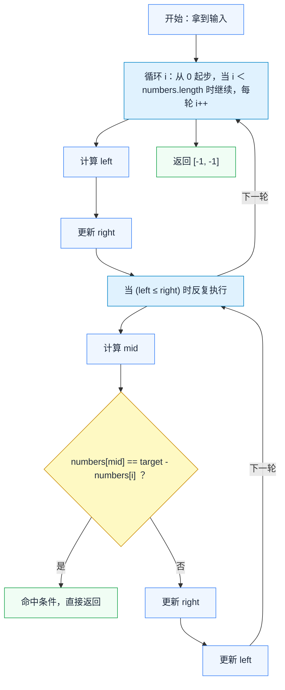

## TypeScript 解题方案（2 个方案逐个讲）

> **运行与提交**：每个方案都是自包含文件（内嵌用例自测，输出 PASS），整块复制到 `.ts` 文件后 `node 文件名` 即可运行。提交 LeetCode 时，把 `demo` 内的算法函数与辅助类型/函数整体取出、置于文件顶层即可。涉及交互/特殊接口的题以题面给定签名为准。

### 方案 1：二分查找

**分析与思路**：核心做法是「二分查找」。代码里依次做这些事：二分收缩区间；单循环线性扫描。

**运行方式**：`node 本文件`，内嵌用例全部通过会输出 PASS。


**方案专属流程图**（真实控制流）：

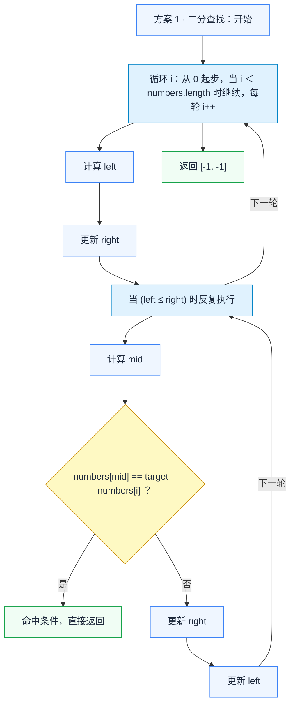

```typescript
/**
 ** LeetCode 167. 两数之和 II - 输入有序数组
 ** 方案1: 二分查找
 */

function twoSum(numbers: number[], target: number): number[] {
  // 定义函数/方法 twoSum
  for (let i = 0; i < numbers.length; i++) {
    // 让 下标 i 从 0 开始计数，下标 i 小于 numbers.长度 就继续
    let left = i + 1,
      right = numbers.length - 1; // 把 下标 i 加 1, 右边界 赋值为 numbers.长度 减 1 存入 左边界
    while (left <= right) {
      // 循环，直到不满足「左边界 不超过 右边界」
      const mid = Math.floor((left + right) / 2); // 把 向下取整((左边界 加 右边界) 除以 2) 存入 中点
      if (numbers[mid] === target - numbers[i]) {
        // 若 numbers[中点] 全等于 目标值 减 numbers[下标 i]
        return [i + 1, mid + 1]; // 返回 [下标 i 加 1, 中点 加 1]
      } else if (numbers[mid] > target - numbers[i]) {
        // 否则，若 numbers[中点] 超过 目标值 减 numbers[下标 i]
        right = mid - 1; // 把 中点 减 1 存入 右边界
      } else {
        // 否则
        left = mid + 1; // 把 中点 加 1 存入 左边界
      }
    }
  }
  return [-1, -1]; // 返回 [ 减 1, 减 1]
}

export function demo(): void {
  // 程序入口：跑内嵌自测用例
  function eqArr(a: number[], b: number[]): boolean {
    // 定义函数/方法 eqArr
    if (a.length !== b.length) return false; // 若 数组.长度 不等于 b.长度，直接返回 false
    for (let i = 0; i < a.length; i++) if (a[i] !== b[i]) return false; // 让 下标 i 从 0 开始计数，下标 i 小于 数组.长度 就继续
    return true; // 返回 true
  }
  const cases: { in: [number[], number]; want: number[] }[] = [
    { in: [[2, 7, 11, 15], 9], want: [1, 2] },
    { in: [[2, 3, 4], 6], want: [1, 3] },
    { in: [[-1, 0], -1], want: [1, 2] },
    { in: [[1, 2, 3, 4, 5], 10], want: [-1, -1] },
  ];
  let fail = false; // 把 false 存入 fail
  for (const c of cases) {
    // for (const 字符 of cases) {
    const got = twoSum(c.in[0], c.in[1]); // 把 twoSum(字符.in[0], 字符.in[1]) 存入 got
    if (!eqArr(got, c.want)) {
      // 若 取反 eqArr(got, 字符.want
      fail = true; // 把 true 存入 fail
      console.log(
        'FAIL twoSum(' +
          JSON.stringify(c.in[0]) +
          ',' +
          c.in[1] +
          ')=' +
          JSON.stringify(got) +
          ' want ' +
          JSON.stringify(c.want),
      ); // 打印输出
    }
  }
  if (fail) throw new Error('FAILED'); // 若 fail) throw new Error(「FAILED」);
  console.log('PASS'); // 全部用例通过，输出 PASS
}
demo(); // demo();
```

### 方案 2：双指针

**分析与思路**：核心做法是「双指针」。

**运行方式**：`node 本文件`，内嵌用例全部通过会输出 PASS。

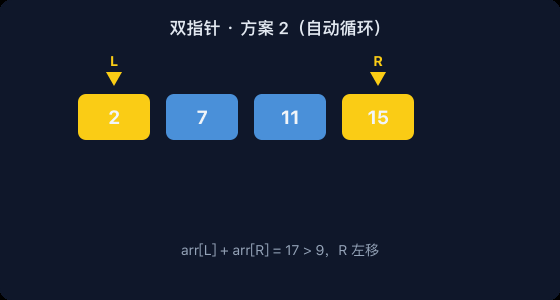

**方案专属流程图**（真实控制流）：

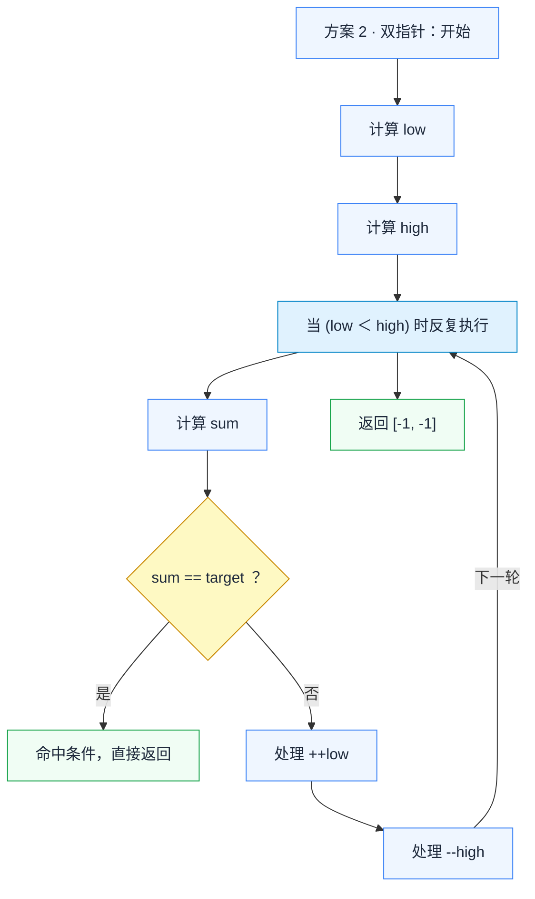

```typescript
/**
 ** LeetCode 167. 两数之和 II - 输入有序数组
 ** 方案2: 双指针
 */

function twoSum(numbers: number[], target: number): number[] {
  // 定义函数/方法 twoSum
  let low = 0; // 把 0 存入 low
  let high = numbers.length - 1; // 把 numbers.长度 减 1 存入 high
  while (low < high) {
    // 循环，直到不满足「low 小于 high」
    const sum = numbers[low] + numbers[high]; // 把 numbers[low] 加 numbers[high] 存入 累计和
    if (sum === target) {
      // 若 累计和 全等于 目标值
      return [low + 1, high + 1]; // 返回 [low 加 1, high 加 1]
    } else if (sum < target) {
      // 否则，若 累计和 小于 目标值
      ++low; // 加一 low;
    } else {
      // 否则
      --high; // 减一 high;
    }
  }
  return [-1, -1]; // 返回 [ 减 1, 减 1]
}

export function demo(): void {
  // 程序入口：跑内嵌自测用例
  function eqArr(a: number[], b: number[]): boolean {
    // 定义函数/方法 eqArr
    if (a.length !== b.length) return false; // 若 数组.长度 不等于 b.长度，直接返回 false
    for (let i = 0; i < a.length; i++) if (a[i] !== b[i]) return false; // 让 下标 i 从 0 开始计数，下标 i 小于 数组.长度 就继续
    return true; // 返回 true
  }
  const cases: { in: [number[], number]; want: number[] }[] = [
    { in: [[2, 7, 11, 15], 9], want: [1, 2] },
    { in: [[2, 3, 4], 6], want: [1, 3] },
    { in: [[-1, 0], -1], want: [1, 2] },
    { in: [[1, 2, 3, 4, 5], 10], want: [-1, -1] },
  ];
  let fail = false; // 把 false 存入 fail
  for (const c of cases) {
    // for (const 字符 of cases) {
    const got = twoSum(c.in[0], c.in[1]); // 把 twoSum(字符.in[0], 字符.in[1]) 存入 got
    if (!eqArr(got, c.want)) {
      // 若 取反 eqArr(got, 字符.want
      fail = true; // 把 true 存入 fail
      console.log(
        'FAIL twoSum(' +
          JSON.stringify(c.in[0]) +
          ',' +
          c.in[1] +
          ')=' +
          JSON.stringify(got) +
          ' want ' +
          JSON.stringify(c.want),
      ); // 打印输出
    }
  }
  if (fail) throw new Error('FAILED'); // 若 fail) throw new Error(「FAILED」);
  console.log('PASS'); // 全部用例通过，输出 PASS
}
demo(); // demo();
```

## 逐步拆解与面试追问

**复杂度**：时间 O(log n)，空间 O(1)

**为什么是这个量级**：每轮把候选区间砍半，n 个元素最多砍 log2(n) 轮

**面试官可能会追问**：

- 能不能原地做（O(1) 空间）？
- 如果数组已有序，能优化到什么程度？
- 空数组、单元素怎么处理？

## 关键 API 速查（TS 主解法实际用到，附官方链接）

| API | 作用 | 使用要点 | 官方文档 |
|---|---|---|---|
| `JSON.stringify()` | 序列化为 JSON 字符串 | 常用于结构化比较（深度相等判定）；undefined/函数/循环引用会被丢弃或抛错 | [官方文档](https://developer.mozilla.org/zh-CN/docs/Web/JavaScript/Reference/Global_Objects/JSON/stringify) |
| `Math.floor()` | 向下取整 | 负数向负无穷（-1.5 → -2）；大数用位运算前注意 2^31 界 | [官方文档](https://developer.mozilla.org/zh-CN/docs/Web/JavaScript/Reference/Global_Objects/Math/floor) |

### 各语言官方文档导航

- **TypeScript / JS**：[MDN 中文参考](https://developer.mozilla.org/zh-CN/)
- **Python**：[Python 官方文档](https://docs.python.org/zh-cn/3/)
- **Go**：[Go 标准库](https://pkg.go.dev/std)
- **Java**：[JDK 17 API](https://docs.oracle.com/en/java/javase/17/docs/api/)
- **Rust**：[Rust 标准库](https://doc.rust-lang.org/std/)
- **Lua**：[Lua 5.4 手册](https://www.lua.org/manual/5.4/)
- **C**：[Cppreference C](https://zh.cppreference.com/w/c)
- **C++**：[Cppreference C++](https://zh.cppreference.com/w/cpp)
- **R**：[R 官方手册](https://stat.ethz.ch/R-manual/)
- **Zig**：[Zig 语言文档](https://ziglang.org/documentation/master/)
- **Dart**：[Dart API](https://api.dart.dev/)

## 附录：其他 10 种语言全部实现（每种语言列举其全部方案）

> TypeScript 的全部方案见「TypeScript 解题方案」一节；下面是其余 10 种语言的对应实现，每种语言的每个方案都带思路分析、代码走读与专属运行架构图。
> 每个方案都内嵌用例自测，可独立运行（老仓库 python/go 文件遵循「打印结果」约定）。
> 完整解法文件见 `dsa/<语言>/array/lc_167_两数之和_ii_-_输入有序数组/`。

### Python 实现（2 种方案）

Python 的全部方案如下，每个方案都内嵌用例自测，可独立运行（老仓库 python/go 文件遵循「打印结果」约定）：

#### 方案 1：二分查找

**思路与代码分析**：核心是「二分查找」。Python 版用切片与字典推导式简化操作，突出可读性。代码里依次做这些事：二分收缩区间。**走读**：方案 1 · 二分查找：开始 → 循环 i：从 0 到 len(numbers 前 → 更新 right → 当 left ≤ right: 时反复执行 → 更新 mid → 命中条件，直接返回 → 处理 elif numbers[mid] ＞ target - → 更新 right → 更新 left → 返回 [-1, -1]。

**运行架构**（真实控制流）：

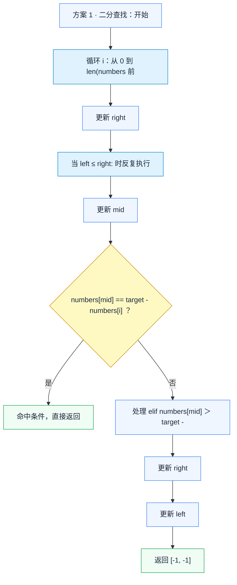

```python
import sys  # 提高递归深度上限（深输入防 RecursionError）

sys.setrecursionlimit(200000)  # 树/链表类题目节点数可达 1e4 量级

def twoSum(numbers, target):  # 定义函数 twoSum（参数：numbers, 目标值）
    for i in range(len(numbers)):  # 让 下标 i 从 长度(numbers 遍历
        left, right = i + 1, len(numbers) - 1  # 把 下标 i 加 1, 长度(numbers) 减 1 写入 left, right
        while left <= right:  # 循环，直到不满足「左边界 不超过 右边界」
            mid = (left + right) // 2  # 把 (左边界 加 右边界) 除以 除以 2 存入 中点
            if numbers[mid] == target - numbers[i]:  # 若 numbers[中点] 等于 目标值 减 numbers[下标 i]
                return [i + 1, mid + 1]  # 返回 [下标 i 加 1, 中点 加 1]
            elif numbers[mid] > target - numbers[i]:  # 否则，若 numbers[中点] 超过 目标值 减 numbers[下标 i]
                right = mid - 1  # 把 中点 减 1 存入 右边界
            else:  # 否则
                left = mid + 1  # 把 中点 加 1 存入 左边界
    return [-1, -1]  # 返回 [ 减 1, 减 1]

if __name__ == "__main__":  # 若 __name__ 等于 '__main__'
    print(twoSum([2, 7, 11, 15], 9))  # 打印输出
```

#### 方案 2：双指针

**思路与代码分析**：核心是「双指针」。Python 版用切片与字典推导式简化操作，突出可读性。**走读**：方案 2 · 双指针：开始 → 更新 right → 当 left ＜ right: 时反复执行 → 更新 s → 命中条件，直接返回 → 处理 elif s ＜ target: → 更新 + → 更新 - → 返回 [-1, -1]。

**运行架构**（真实控制流）：

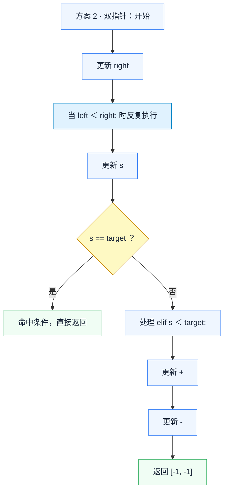

```python
import sys  # 提高递归深度上限（深输入防 RecursionError）

sys.setrecursionlimit(200000)  # 树/链表类题目节点数可达 1e4 量级

def twoSum(numbers, target):  # 定义函数 twoSum（参数：numbers, 目标值）
    left, right = 0, len(numbers) - 1  # 把 0, 长度(numbers) 减 1 写入 left, right
    while left < right:  # 循环，直到不满足「左边界 小于 右边界」
        s = numbers[left] + numbers[right]  # 把 numbers[左边界] 加 numbers[右边界] 存入 字符串
        if s == target:  # 若 字符串 等于 目标值
            return [left + 1, right + 1]  # 返回 [左边界 加 1, 右边界 加 1]
        elif s < target:  # 否则，若 字符串 小于 目标值
            left += 1  # 左边界累加 1
        else:  # 否则
            right -= 1  # 右边界累减 1
    return [-1, -1]  # 返回 [ 减 1, 减 1]

if __name__ == "__main__":  # 若 __name__ 等于 '__main__'
    print(twoSum([2, 7, 11, 15], 9))  # 打印输出
```

### Go 实现（2 种方案）

Go 的全部方案如下，每个方案都内嵌用例自测，可独立运行（老仓库 python/go 文件遵循「打印结果」约定）：

#### 方案 1：二分查找

**思路与代码分析**：核心是「二分查找」。Go 版用切片与多返回值惯用法，显式处理索引边界。**走读**：方案 1 · 二分查找：开始 → 遍历 numbers 的下标与元素 i → 更新 : → 遍历循环 → 更新 : → 处理 if numbers[mid] == target-nu → 返回 []int → 更新 right → 更新 left → 返回 []int。

**运行架构**（真实控制流）：

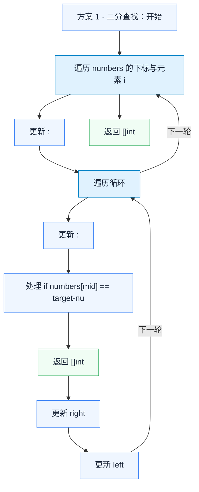

```go
package main // 引入依赖

import (
	"fmt"     // 「fmt」
	"os"      // 「os」
	"reflect" // 「reflect」
)

func twoSum(numbers []int, target int) []int { // 定义函数/方法 twoSum
	for i := range numbers { // 把 range numbers { 写入 for i :
		left, right := i+1, len(numbers)-1 // 把 下标 i 加 1, 长度(numbers) 减 1 写入 left, right :
		for left <= right {                // 把 右边界 { 写入 for left <
			mid := (left + right) / 2              // 把 (左边界 加 右边界) 除以 2 写入 mid :
			if numbers[mid] == target-numbers[i] { // 若 numbers[中点] 等于 目标值 减 numbers[下标 i]
				return []int{i + 1, mid + 1} // 返回 []int{下标 i 加 1, 中点 加 1}
			} else if numbers[mid] > target-numbers[i] { // 否则，若 numbers[中点] 超过 目标值 减 numbers[下标 i]
				right = mid - 1 // 把 中点 减 1 写入 右边界
			} else { // 否则
				left = mid + 1 // 把 中点 加 1 写入 左边界
			}
		}
	}
	return []int{-1, -1} // 返回 []int{ 减 1, 减 1}
}

func main() { // 程序入口：跑内嵌自测用例
	type tc struct { // 定义类型
		nums   []int // 数组 []int
		target int   // 目标值 int
		want   []int // want []int
	}
	cases := []tc{ // 把 []tc{ 写入 cases :
		{[]int{2, 7, 11, 15}, 9, []int{1, 2}},
		{[]int{2, 3, 4}, 6, []int{1, 3}},
		{[]int{-1, 0}, -1, []int{1, 2}},
	}
	ok := true                // 把 true 写入 ok :
	for _, c := range cases { // 同时取 _ 与 字符 遍历
		if got := twoSum(c.nums, c.target); !reflect.DeepEqual(got, c.want) {
			ok = false                                                                   // 把 false 写入 ok
			fmt.Printf("FAIL twoSum(%v,%v)=%v want %v\n", c.nums, c.target, got, c.want) // 打印输出
		}
	}
	if !ok { // 若 取反 ok
		os.Exit(1) // os.Exit(1)
	}
	fmt.Println("PASS") // 全部用例通过，输出 PASS
}
```

#### 方案 2：双指针

**思路与代码分析**：核心是「双指针」。Go 版用切片与多返回值惯用法，显式处理索引边界。**走读**：方案 2 · 双指针：开始 → 更新 : → 遍历循环 → 更新 : → 处理 if s == target → 返回 []int → 处理 left++ → 处理 right-- → 返回 []int。

**运行架构**（真实控制流）：

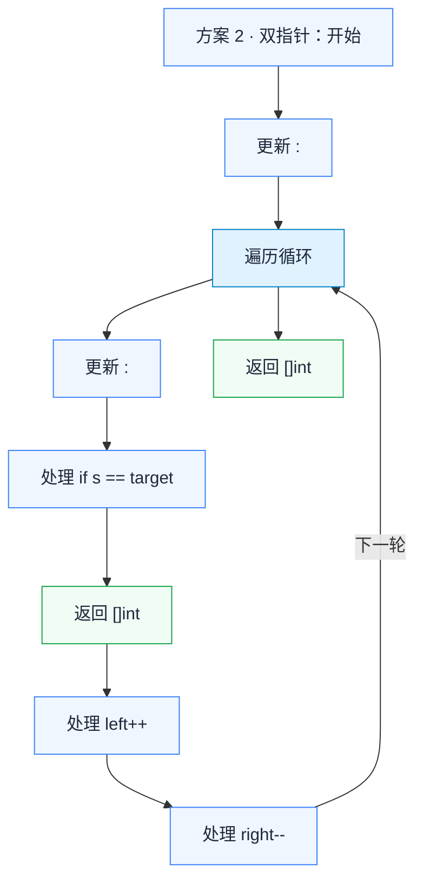

```go
package main // 引入依赖

import (
	"fmt"     // 「fmt」
	"os"      // 「os」
	"reflect" // 「reflect」
)

func twoSum(numbers []int, target int) []int { // 定义函数/方法 twoSum
	left, right := 0, len(numbers)-1 // 把 0, 长度(numbers) 减 1 写入 left, right :
	for left < right {               // for 左边界 小于 右边界 {
		s := numbers[left] + numbers[right] // 把 numbers[左边界] 加 numbers[右边界] 写入 s :
		if s == target {                    // 若 字符串 等于 目标值
			return []int{left + 1, right + 1} // 返回 []int{左边界 加 1, 右边界 加 1}
		} else if s < target { // 否则，若 字符串 小于 目标值
			left++ // 左边界 加一
		} else { // 否则
			right-- // 右边界 减一
		}
	}
	return []int{-1, -1} // 返回 []int{ 减 1, 减 1}
}

func main() { // 程序入口：跑内嵌自测用例
	type tc struct { // 定义类型
		nums   []int // 数组 []int
		target int   // 目标值 int
		want   []int // want []int
	}
	cases := []tc{ // 把 []tc{ 写入 cases :
		{[]int{2, 7, 11, 15}, 9, []int{1, 2}},
		{[]int{2, 3, 4}, 6, []int{1, 3}},
		{[]int{-1, 0}, -1, []int{1, 2}},
	}
	ok := true                // 把 true 写入 ok :
	for _, c := range cases { // 同时取 _ 与 字符 遍历
		if got := twoSum(c.nums, c.target); !reflect.DeepEqual(got, c.want) {
			ok = false                                                                   // 把 false 写入 ok
			fmt.Printf("FAIL twoSum(%v,%v)=%v want %v\n", c.nums, c.target, got, c.want) // 打印输出
		}
	}
	if !ok { // 若 取反 ok
		os.Exit(1) // os.Exit(1)
	}
	fmt.Println("PASS") // 全部用例通过，输出 PASS
}
```

### Java 实现（2 种方案）

Java 的全部方案如下，每个方案都内嵌用例自测，可独立运行（老仓库 python/go 文件遵循「打印结果」约定）：

#### 方案 1：二分查找

**思路与代码分析**：核心是「二分查找」。Java 版用类与静态方法组织，集合操作显式明了。代码里依次做这些事：单循环线性扫描。**走读**：方案 1 · 二分查找：开始 → 更新 n → 遍历循环 → 更新 remain → 更新 low → 更新 high → 当 (low ≤ high) 时反复执行 → 更新 m → 命中条件，直接返回 → 更新 low → 更新 high → 返回 new int[]。

**运行架构**（真实控制流）：

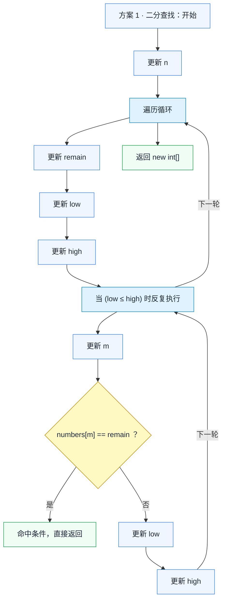

```java
package com.webfault.dsa; // 引入依赖

import java.util.*; // 引入依赖

class lc167_solution111 { // 定义类型
  public int[] twoSum(int[] numbers, int target) { // 定义函数/方法 twoSum
    int n = numbers.length; // 把 numbers.长度 存入 元素个数
    for (int i = 0; i < n; i++) { // 让 下标 i 从 0 开始计数，下标 i 小于 元素个数 就继续
      int remain = target - numbers[i]; // 把 目标值 减 numbers[下标 i] 存入 remain
      int low = i + 1; // 把 下标 i 加 1 存入 low
      int high = n - 1; // 把 元素个数 减 1 存入 high
      while (low <= high) { // 循环，直到不满足「low 不超过 high」
        int m = low + (high - low) / 2; // 把 (low 加 high) 除以 2 存入 映射表
        if (numbers[m] == remain) { // 若 numbers[映射表] 等于 remain
          return new int[] {i + 1, m + 1}; // 返回 new int[]{下标 i 加 1, 映射表 加 1}
        } else if (numbers[m] < remain) { // 否则，若 numbers[映射表] 小于 remain
          low = m + 1; // 把 映射表 加 1; 写入 low
        } else { // 否则
          high = m - 1; // 把 映射表 减 1; 写入 high
        }
      }
    }
    return new int[] {-1, -1}; // 返回 new int[]{ 减 1, 减 1}
  }

  public static void main(String[] args) { // public static void main(String[] args) {
    lc167_solution111 s =
        new lc167_solution111(); // 把 new lc167_solution111(); 写入 lc167_solution111 s
    int[] r1 =
        s.twoSum(
            new int[] {2, 7, 11, 15}, 9); // 把 字符串.twoSum(new int[]{2, 7, 11, 15}, 9); 写入 int[] r1
    if (!(r1[0] == 1 && r1[1] == 2)) throw new RuntimeException("FAILED");
    int[] r2 =
        s.twoSum(
            new int[] {2, 7, 11, 15}, 99); // 把 字符串.twoSum(new int[]{2, 7, 11, 15}, 99); 写入 int[] r2
    if (!(r2[0] == -1 && r2[1] == -1)) throw new RuntimeException("FAILED");
    System.out.println("PASS"); // 全部用例通过，输出 PASS
  }
}
```

#### 方案 2：双指针

**思路与代码分析**：核心是「双指针」。Java 版用类与静态方法组织，集合操作显式明了。**走读**：方案 2 · 双指针：开始 → 更新 left → 当 (left ＜ right) 时反复执行 → 更新 sum → 命中条件，直接返回 → 返回 new int[]。

**运行架构**（真实控制流）：

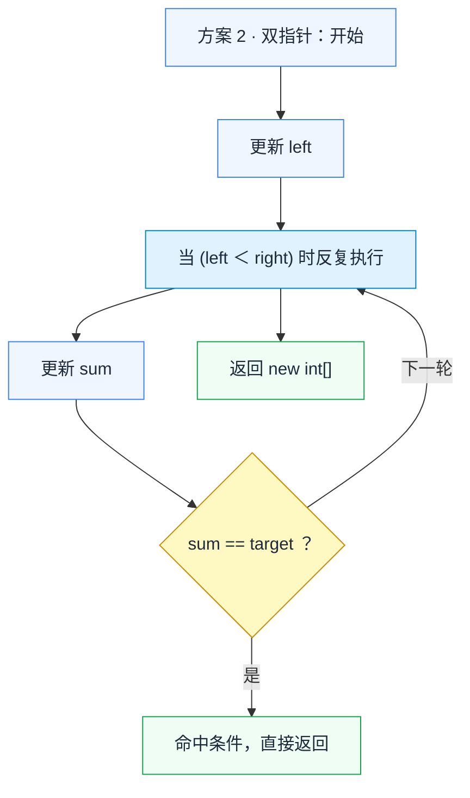

```java
package com.webfault.dsa; // 引入依赖

import java.util.*; // 引入依赖

class lc167_solution222 { // 定义类型
  public int[] twoSum(int[] numbers, int target) { // 定义函数/方法 twoSum
    int left = 0, right = numbers.length - 1; // 把 0, 右边界 赋值为 numbers.长度 减 1 存入 左边界
    while (left < right) { // 循环，直到不满足「左边界 小于 右边界」
      int sum = numbers[left] + numbers[right]; // 把 numbers[左边界] 加 numbers[右边界] 存入 累计和
      if (sum == target)
        return new int[] {left + 1, right + 1}; // 若 累计和 等于 目标值，直接返回 new int[]{左边界 加 1, 右边界 加 1}
      else if (sum < target) left++; // 否则，若 累计和 小于 目标值) 左边界 加一 ;
      else right--; // 否则
    }
    return new int[] {-1, -1}; // 返回 new int[]{ 减 1, 减 1}
  }

  public static void main(String[] args) { // public static void main(String[] args) {
    lc167_solution222 s =
        new lc167_solution222(); // 把 new lc167_solution222(); 写入 lc167_solution222 s
    int[] r =
        s.twoSum(
            new int[] {2, 7, 11, 15}, 9); // 把 字符串.twoSum(new int[]{2, 7, 11, 15}, 9); 写入 int[] r
    if (!(r[0] == 1 && r[1] == 2)) throw new RuntimeException("FAILED");
    System.out.println("PASS"); // 全部用例通过，输出 PASS
  }
}
```

### Rust 实现（2 种方案）

Rust 的全部方案如下，每个方案都内嵌用例自测，可独立运行（老仓库 python/go 文件遵循「打印结果」约定）：

#### 方案 1：二分查找

**思路与代码分析**：核心是「二分查找」。Rust 版用所有权移动与切片借用改写同一逻辑，注意 Option 与引用边界。**走读**：方案 1 · 二分查找：开始 → 计算 let (mut l, mut r) = (0u → 当 l ＜ r 时反复执行 → 计算 s → 处理 if s == target → 返回 vec非 [l as i32 + 1, r as i32 + 1] → 处理 if s ＜ target → 更新 + → 更新 - → 处理 vec非 []。

**运行架构**（真实控制流）：


```rust
// LeetCode 167. 两数之和II — Rust 版（方案1）
fn two_sum(numbers: Vec<i32>, target: i32) -> Vec<i32> {
    // 定义函数/方法 two_sum
    let (mut l, mut r) = (0usize, numbers.len() - 1); // 把 (0usize, numbers.长度() 减 1); 写入 let (mut l, mut r)
    while l < r {
        // while 左指针 小于 右指针 {
        let s = numbers[l] + numbers[r]; // 把 numbers[左指针] 加 numbers[右指针] 存入 字符串
        if s == target {
            return vec![l as i32 + 1, r as i32 + 1];
        }
        if s < target {
            l += 1;
        } else {
            r -= 1;
        } // 若 字符串 小于 目标值 { 左指针 累加 1; } else { 右指针 累减 1; }
    }
    vec![] // vec取反 []
}
fn main() {
    assert_eq!(two_sum(vec![2, 7, 11, 15], 9), vec![1, 2]);
    assert_eq!(two_sum(vec![2, 3, 4], 6), vec![1, 3]);
    assert_eq!(two_sum(vec![-1, 0], -1), vec![1, 2]);
    println!("PASS");
} // 程序入口：跑内嵌自测用例
```

#### 方案 2：双指针

**思路与代码分析**：核心是「双指针」。Rust 版用所有权移动与切片借用改写同一逻辑，注意 Option 与引用边界。**走读**：方案 2 · 双指针：开始 → 计算 let (mut l, mut r) = (0u → 当 l ＜ r 时反复执行 → 计算 s → 处理 if s == target → 返回 vec非 [l as i32 + 1, r as i32 + 1] → 处理 if s ＜ target → 更新 + → 更新 - → 处理 vec非 []。

**运行架构**（真实控制流）：

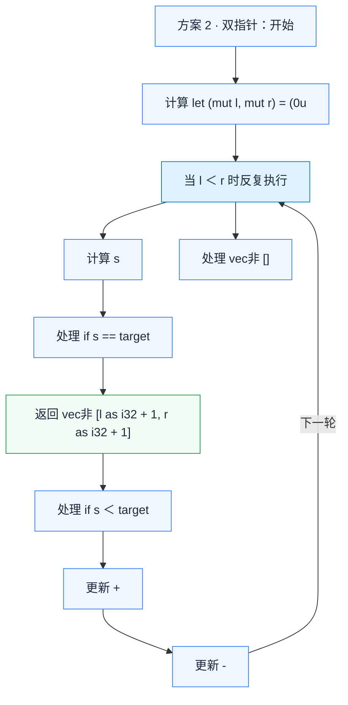

```rust
// LeetCode 167. 两数之和II — Rust 版（方案2）
fn two_sum(numbers: Vec<i32>, target: i32) -> Vec<i32> {
    // 定义函数/方法 two_sum
    let (mut l, mut r) = (0usize, numbers.len() - 1); // 把 (0usize, numbers.长度() 减 1); 写入 let (mut l, mut r)
    while l < r {
        // while 左指针 小于 右指针 {
        let s = numbers[l] + numbers[r]; // 把 numbers[左指针] 加 numbers[右指针] 存入 字符串
        if s == target {
            return vec![l as i32 + 1, r as i32 + 1];
        }
        if s < target {
            l += 1;
        } else {
            r -= 1;
        } // 若 字符串 小于 目标值 { 左指针 累加 1; } else { 右指针 累减 1; }
    }
    vec![] // vec取反 []
}
fn main() {
    assert_eq!(two_sum(vec![2, 7, 11, 15], 9), vec![1, 2]);
    assert_eq!(two_sum(vec![2, 3, 4], 6), vec![1, 3]);
    assert_eq!(two_sum(vec![-1, 0], -1), vec![1, 2]);
    println!("PASS");
} // 程序入口：跑内嵌自测用例
```

### Lua 实现（2 种方案）

Lua 的全部方案如下，每个方案都内嵌用例自测，可独立运行（老仓库 python/go 文件遵循「打印结果」约定）：

#### 方案 1：二分查找

**思路与代码分析**：核心是「二分查找」。Lua 版用表与 ipairs 遍历，注意 ipairs 遇 nil 即停的语义。**走读**：方案 1 · 二分查找：开始 → 更新 r → 当 l ＜ r do 时反复执行 → 更新 s → 处理 if s == target then → 返回  → 处理 if s ＜ target then → 更新 l → 更新 r → 返回 。

**运行架构**（真实控制流）：

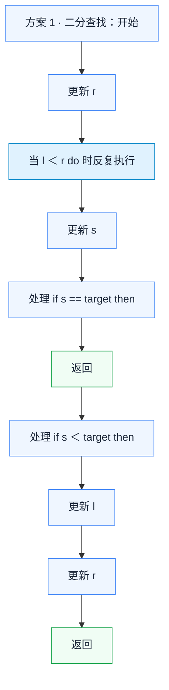

```lua
-- LeetCode 167. 两数之和II — Lua 版（方案1）
local function two_sum(numbers, target) -- local function two_sum(numbers, 目标值)
	local l, r = 1, #numbers -- 把 1, #numbers 写入 local l, r
	while l < r do -- while 左指针 小于 右指针 do
		local s = numbers[l] + numbers[r] -- 把 numbers[左指针] 加 numbers[右指针] 写入 local s
		if s == target then
			return { l, r }
		end -- 若 字符串 等于 目标值 then return {左指针, 右指针} 终点
		if s < target then
			l = l + 1
		else
			r = r - 1
		end -- 若 字符串 小于 目标值 then 左指针 赋值为 左指针 加 1 else 右指针 赋值为 右指针 减 1 终点
	end -- 终点
	return {} -- 返回 {}
end -- 终点
assert(table.concat(two_sum({ 2, 7, 11, 15 }, 9), ",") == "1,2") -- 打印输出
assert(table.concat(two_sum({ 2, 3, 4 }, 6), ",") == "1,3") -- 打印输出
assert(table.concat(two_sum({ -1, 0 }, -1), ",") == "1,2") -- 打印输出
print("PASS") -- 全部用例通过，输出 PASS
```

#### 方案 2：双指针

**思路与代码分析**：核心是「双指针」。Lua 版用表与 ipairs 遍历，注意 ipairs 遇 nil 即停的语义。**走读**：方案 2 · 双指针：开始 → 更新 r → 当 l ＜ r do 时反复执行 → 更新 s → 处理 if s == target then → 返回  → 处理 if s ＜ target then → 更新 l → 更新 r → 返回 。

**运行架构**（真实控制流）：

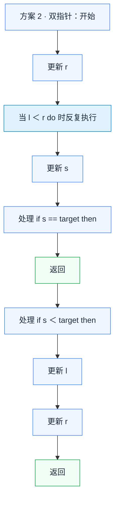

```lua
-- LeetCode 167. 两数之和II — Lua 版（方案2）
local function two_sum(numbers, target) -- local function two_sum(numbers, 目标值)
	local l, r = 1, #numbers -- 把 1, #numbers 写入 local l, r
	while l < r do -- while 左指针 小于 右指针 do
		local s = numbers[l] + numbers[r] -- 把 numbers[左指针] 加 numbers[右指针] 写入 local s
		if s == target then
			return { l, r }
		end -- 若 字符串 等于 目标值 then return {左指针, 右指针} 终点
		if s < target then
			l = l + 1
		else
			r = r - 1
		end -- 若 字符串 小于 目标值 then 左指针 赋值为 左指针 加 1 else 右指针 赋值为 右指针 减 1 终点
	end -- 终点
	return {} -- 返回 {}
end -- 终点
assert(table.concat(two_sum({ 2, 7, 11, 15 }, 9), ",") == "1,2") -- 打印输出
assert(table.concat(two_sum({ 2, 3, 4 }, 6), ",") == "1,3") -- 打印输出
assert(table.concat(two_sum({ -1, 0 }, -1), ",") == "1,2") -- 打印输出
print("PASS") -- 全部用例通过，输出 PASS
```

### C 实现（2 种方案）

C 的全部方案如下，每个方案都内嵌用例自测，可独立运行（老仓库 python/go 文件遵循「打印结果」约定）：

#### 方案 1：二分查找

**思路与代码分析**：核心是「二分查找」。C 版手动管理下标与内存，循环边界全部显式写出。**走读**：方案 1 · 二分查找：开始 → 更新 l → 当 (l ＜ r) 时反复执行 → 更新 s → 若 s == target 则： → 更新 out[0] → 更新 out[1] → 返回  → 若 s ＜ target：处理 l++ → 处理 l++ → 处理 r-- → 更新 out[0]。

**运行架构**（真实控制流）：

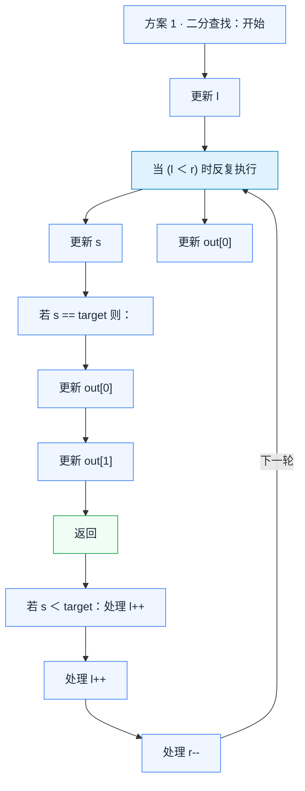

```c
/* LeetCode 167. 两数之和II — C 版（方案1） */
#include <stdio.h>                                                   // 引入头文件
static void two_sum(const int *n, int len, int target, int out[2]) { // 定义函数/方法 two_sum
    int l = 0, r = len - 1;  // 把 0, 右指针 赋值为 长度 减 1 存入 左指针
    while (l < r) {          // 循环，直到不满足「左指针 小于 右指针」
        int s = n[l] + n[r]; // 把 元素个数[左指针] 加 元素个数[右指针] 存入 字符串
        if (s == target) {
            out[0] = l + 1;
            out[1] = r + 1;
            return;
        }
        if (s < target)
            l++;
        else
            r--; // 若 字符串 小于 目标值) 左指针 加一 ; else 右指针 减一 ;
    }
    out[0] = out[1] = 0; // 把 out[1] 赋值为 0; 写入 out[0]
}
int main(void) {                               // 程序入口：跑内嵌自测用例
    int out[2];                                // int out[2];
    two_sum((int[]){2, 7, 11, 15}, 4, 9, out); // two_sum((int[]){2,7,11,15}, 4, 9, out);
    if (out[0] != 1 || out[1] != 2) {
        printf("FAIL 1\n");
        return 1;
    } // 若 out[0] 不等于 1 或 out[1] 不等于 2) { 输出「FAIL 1 」); return 1; }
    two_sum((int[]){2, 3, 4}, 3, 6, out); // two_sum((int[]){2,3,4}, 3, 6, out);
    if (out[0] != 1 || out[1] != 3) {
        printf("FAIL 2\n");
        return 1;
    } // 若 out[0] 不等于 1 或 out[1] 不等于 3) { 输出「FAIL 2 」); return 1; }
    two_sum((int[]){-1, 0}, 2, -1, out); // two_sum((int[]){ 减 1,0}, 2, 减 1, out);
    if (out[0] != 1 || out[1] != 2) {
        printf("FAIL 3\n");
        return 1;
    } // 若 out[0] 不等于 1 或 out[1] 不等于 2) { 输出「FAIL 3 」); return 1; }
    printf("PASS\n");
    return 0;
} // 全部用例通过，输出 PASS
```

#### 方案 2：双指针

**思路与代码分析**：核心是「双指针」。C 版手动管理下标与内存，循环边界全部显式写出。**走读**：方案 2 · 双指针：开始 → 更新 l → 当 (l ＜ r) 时反复执行 → 更新 s → 若 s == target 则： → 更新 out[0] → 更新 out[1] → 返回  → 若 s ＜ target：处理 l++ → 处理 l++ → 处理 r-- → 更新 out[0]。

**运行架构**（真实控制流）：

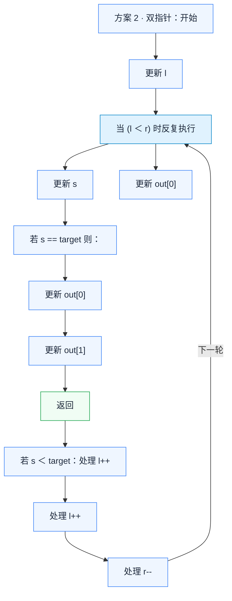

```c
/* LeetCode 167. 两数之和II — C 版（方案2） */
#include <stdio.h>                                                   // 引入头文件
static void two_sum(const int *n, int len, int target, int out[2]) { // 定义函数/方法 two_sum
    int l = 0, r = len - 1;  // 把 0, 右指针 赋值为 长度 减 1 存入 左指针
    while (l < r) {          // 循环，直到不满足「左指针 小于 右指针」
        int s = n[l] + n[r]; // 把 元素个数[左指针] 加 元素个数[右指针] 存入 字符串
        if (s == target) {
            out[0] = l + 1;
            out[1] = r + 1;
            return;
        }
        if (s < target)
            l++;
        else
            r--; // 若 字符串 小于 目标值) 左指针 加一 ; else 右指针 减一 ;
    }
    out[0] = out[1] = 0; // 把 out[1] 赋值为 0; 写入 out[0]
}
int main(void) {                               // 程序入口：跑内嵌自测用例
    int out[2];                                // int out[2];
    two_sum((int[]){2, 7, 11, 15}, 4, 9, out); // two_sum((int[]){2,7,11,15}, 4, 9, out);
    if (out[0] != 1 || out[1] != 2) {
        printf("FAIL 1\n");
        return 1;
    } // 若 out[0] 不等于 1 或 out[1] 不等于 2) { 输出「FAIL 1 」); return 1; }
    two_sum((int[]){2, 3, 4}, 3, 6, out); // two_sum((int[]){2,3,4}, 3, 6, out);
    if (out[0] != 1 || out[1] != 3) {
        printf("FAIL 2\n");
        return 1;
    } // 若 out[0] 不等于 1 或 out[1] 不等于 3) { 输出「FAIL 2 」); return 1; }
    two_sum((int[]){-1, 0}, 2, -1, out); // two_sum((int[]){ 减 1,0}, 2, 减 1, out);
    if (out[0] != 1 || out[1] != 2) {
        printf("FAIL 3\n");
        return 1;
    } // 若 out[0] 不等于 1 或 out[1] 不等于 2) { 输出「FAIL 3 」); return 1; }
    printf("PASS\n");
    return 0;
} // 全部用例通过，输出 PASS
```

### C++ 实现（2 种方案）

C++ 的全部方案如下，每个方案都内嵌用例自测，可独立运行（老仓库 python/go 文件遵循「打印结果」约定）：

#### 方案 1：二分查找

**思路与代码分析**：核心是「二分查找」。C++ 版用 STL 容器与迭代器，减少手写下标错误。**走读**：方案 1 · 二分查找：开始 → 更新 l → 处理 1 → 当 (l ＜ r) 时反复执行 → 更新 s → 命中条件，直接返回 → 若 s ＜ target：处理 ++l → 处理 ++l → 处理 --r → 返回 。

**运行架构**（真实控制流）：

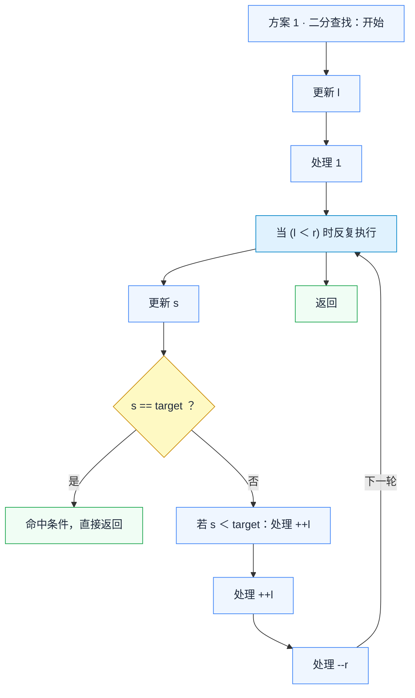

```cpp
// LeetCode 167. 两数之和II — C++ 版（方案1）
#include <cassert>  // 引入头文件
#include <iostream> // 引入头文件
#include <vector>   // 引入头文件
static std::vector<int> twoSum(const std::vector<int> &numbers, int target) {
    int l = 0, r = static_cast<int>(numbers.size()) -
                   1; // 把 0, 右指针 赋值为 static_cast 小于 int 超过 (numbers.大小()) 减 1 存入 左指针
    while (l < r) {                      // 循环，直到不满足「左指针 小于 右指针」
        int s = numbers[l] + numbers[r]; // 把 numbers[左指针] 加 numbers[右指针] 存入 字符串
        if (s == target)
            return {l + 1, r + 1}; // 若 字符串 等于 目标值，直接返回 {左指针 加 1, 右指针 加 1}
        if (s < target)
            ++l;
        else
            --r; // 若 字符串 小于 目标值) 加一 左指针; else 减一 右指针;
    }
    return {}; // 返回 {}
}
int main() {
    assert((twoSum({2, 7, 11, 15}, 9) == std::vector<int>{1, 2}));
    assert((twoSum({2, 3, 4}, 6) == std::vector<int>{1, 3}));
    assert((twoSum({-1, 0}, -1) == std::vector<int>{1, 2}));
    std::cout << "PASS" << std::endl;
} // 全部用例通过，输出 PASS
```

#### 方案 2：双指针

**思路与代码分析**：核心是「双指针」。C++ 版用 STL 容器与迭代器，减少手写下标错误。**走读**：方案 2 · 双指针：开始 → 更新 l → 处理 1 → 当 (l ＜ r) 时反复执行 → 更新 s → 命中条件，直接返回 → 若 s ＜ target：处理 ++l → 处理 ++l → 处理 --r → 返回 。

**运行架构**（真实控制流）：

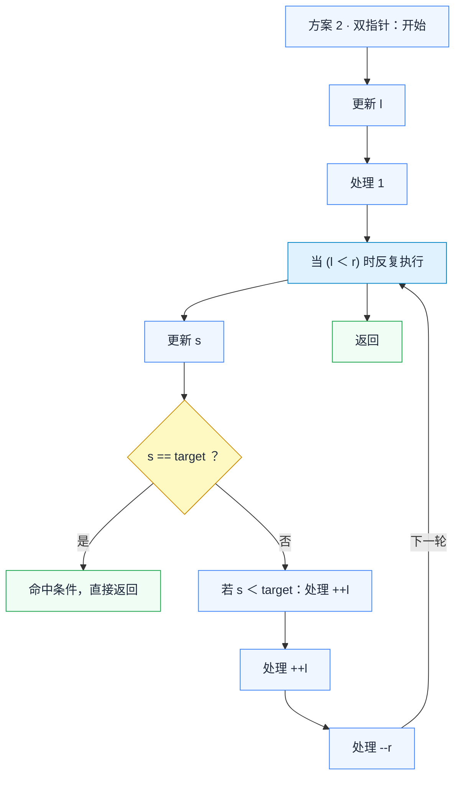

```cpp
// LeetCode 167. 两数之和II — C++ 版（方案2）
#include <cassert>  // 引入头文件
#include <iostream> // 引入头文件
#include <vector>   // 引入头文件
static std::vector<int> twoSum(const std::vector<int> &numbers, int target) {
    int l = 0, r = static_cast<int>(numbers.size()) -
                   1; // 把 0, 右指针 赋值为 static_cast 小于 int 超过 (numbers.大小()) 减 1 存入 左指针
    while (l < r) {                      // 循环，直到不满足「左指针 小于 右指针」
        int s = numbers[l] + numbers[r]; // 把 numbers[左指针] 加 numbers[右指针] 存入 字符串
        if (s == target)
            return {l + 1, r + 1}; // 若 字符串 等于 目标值，直接返回 {左指针 加 1, 右指针 加 1}
        if (s < target)
            ++l;
        else
            --r; // 若 字符串 小于 目标值) 加一 左指针; else 减一 右指针;
    }
    return {}; // 返回 {}
}
int main() {
    assert((twoSum({2, 7, 11, 15}, 9) == std::vector<int>{1, 2}));
    assert((twoSum({2, 3, 4}, 6) == std::vector<int>{1, 3}));
    assert((twoSum({-1, 0}, -1) == std::vector<int>{1, 2}));
    std::cout << "PASS" << std::endl;
} // 全部用例通过，输出 PASS
```

### R 实现（2 种方案）

R 的全部方案如下，每个方案都内嵌用例自测，可独立运行（老仓库 python/go 文件遵循「打印结果」约定）：

#### 方案 1：二分查找

**思路与代码分析**：核心是「二分查找」。R 版用向量化思维与 1 起始下标，注意 1:n 的降序陷阱。**走读**：方案 1 · 二分查找：开始 → 处理 l ＜- 1L → 处理 r ＜- length(numbers) → 当 (l ＜ r) 时反复执行 → 处理 s ＜- numbers[l] + numbers[r] → 命中条件，直接返回 → 若 s ＜ target：处理 l ＜- l + 1L else r ＜- r - 1L → 处理 l ＜- l + 1L else r ＜- r - 1L → 调用 integer(0)。

**运行架构**（真实控制流）：


```r
# 版（方案1） 定义函数 two_sum_ii（参数：numbers, 目标值）
two_sum_ii <- function(numbers, target) {
    l <- 1L
    r <- length(numbers)  # 把 1L; 右指针 小于 减 长度(numbers) 存入 左指针
    while (l < r) {
        # 循环，直到不满足「左指针 小于 右指针」
        s <- numbers[l] + numbers[r]  # 把 numbers[左指针] 加 numbers[右指针] 存入 字符串
        if (s == target)
            return(c(l, r))  # 若 字符串 等于 目标值) return(字符(左指针, 右指针
        if (s < target)
            l <- l + 1L else r <- r - 1L  # 若 字符串 小于 目标值) 左指针 小于 减 左指针 加 1L else 右指针 小于 减 右指针 减 1L
    }
    integer(0)  # integer(0)
}
stopifnot(identical(two_sum_ii(c(2, 7, 11, 15), 9), c(1L, 2L)))  # 断言校验
stopifnot(identical(two_sum_ii(c(2, 3, 4), 6), c(1L, 3L)))  # 断言校验
stopifnot(identical(two_sum_ii(c(-1, 0), -1), c(1L, 2L)))  # 断言校验
cat("PASS\n")  # 全部用例通过，输出 PASS
```

#### 方案 2：双指针

**思路与代码分析**：核心是「双指针」。R 版用向量化思维与 1 起始下标，注意 1:n 的降序陷阱。**走读**：方案 2 · 双指针：开始 → 处理 l ＜- 1L → 处理 r ＜- length(numbers) → 当 (l ＜ r) 时反复执行 → 处理 s ＜- numbers[l] + numbers[r] → 命中条件，直接返回 → 若 s ＜ target：处理 l ＜- l + 1L else r ＜- r - 1L → 处理 l ＜- l + 1L else r ＜- r - 1L → 调用 integer(0)。

**运行架构**（真实控制流）：

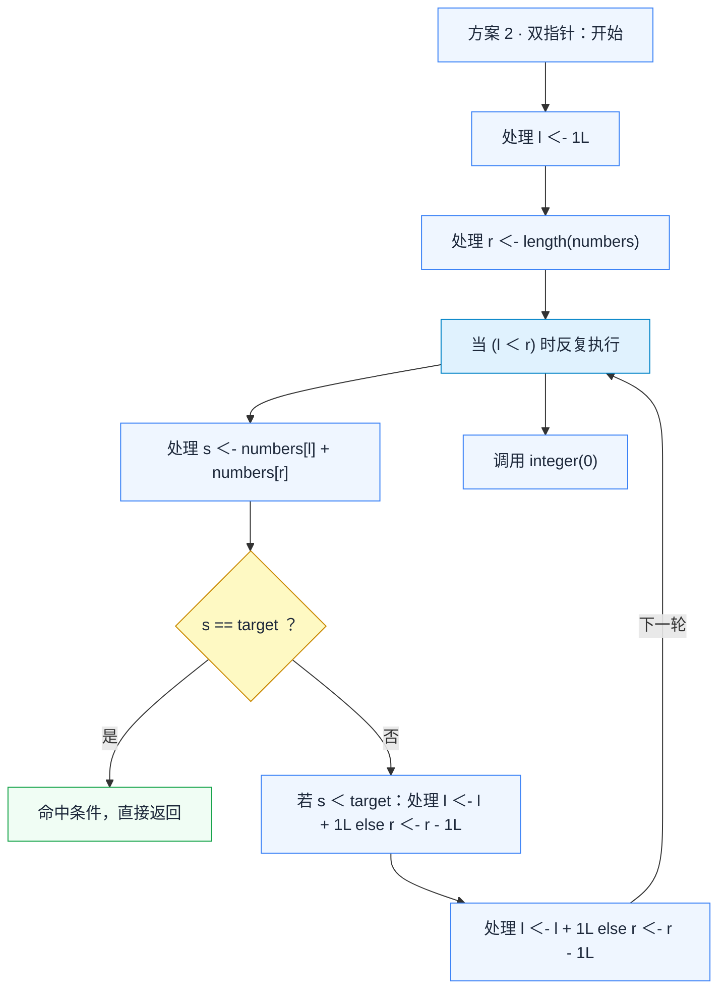

```r
# 版（方案2） 定义函数 two_sum_ii（参数：numbers, 目标值）
two_sum_ii <- function(numbers, target) {
    l <- 1L
    r <- length(numbers)  # 把 1L; 右指针 小于 减 长度(numbers) 存入 左指针
    while (l < r) {
        # 循环，直到不满足「左指针 小于 右指针」
        s <- numbers[l] + numbers[r]  # 把 numbers[左指针] 加 numbers[右指针] 存入 字符串
        if (s == target)
            return(c(l, r))  # 若 字符串 等于 目标值) return(字符(左指针, 右指针
        if (s < target)
            l <- l + 1L else r <- r - 1L  # 若 字符串 小于 目标值) 左指针 小于 减 左指针 加 1L else 右指针 小于 减 右指针 减 1L
    }
    integer(0)  # integer(0)
}
stopifnot(identical(two_sum_ii(c(2, 7, 11, 15), 9), c(1L, 2L)))  # 断言校验
stopifnot(identical(two_sum_ii(c(2, 3, 4), 6), c(1L, 3L)))  # 断言校验
stopifnot(identical(two_sum_ii(c(-1, 0), -1), c(1L, 2L)))  # 断言校验
cat("PASS\n")  # 全部用例通过，输出 PASS
```

### Zig 实现（2 种方案）

Zig 的全部方案如下，每个方案都内嵌用例自测，可独立运行（老仓库 python/go 文件遵循「打印结果」约定）：

#### 方案 1：二分查找

**思路与代码分析**：核心是「二分查找」。Zig 版显式分配与清零，整型边界处理严格。**走读**：方案 1 · 二分查找：开始 → 计算 l → 计算 r → 当 (l ＜ r) 时反复执行 → 计算 s → 若 s == target 则： → 更新 out[0] → 更新 out[1] → 返回  → 若 s ＜ target：更新 + → 更新 out[0] → 更新 out[1]。

**运行架构**（真实控制流）：

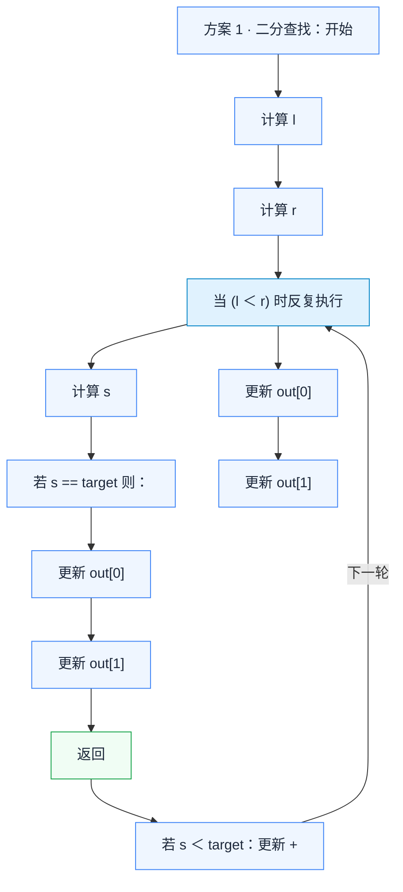

```zig
// LeetCode 167. 两数之和II — Zig 版（方案1）
const std = @import("std"); // 把 @import(「std」) 存入 std
fn twoSum(n: []const i32, target: i32, out: *[2]i32) void { // 定义函数/方法 twoSum
    var l: usize = 0; // 把 0; 写入 var l: usize
    var r: usize = n.len - 1; // 把 元素个数.长度 减 1; 写入 var r: usize
    while (l < r) { // 循环，直到不满足「左指针 小于 右指针」
        const s = n[l] + n[r]; // 把 元素个数[左指针] 加 元素个数[右指针] 存入 字符串
        if (s == target) {
            out[0] = @intCast(l + 1);
            out[1] = @intCast(r + 1);
            return;
        }
        if (s < target) l += 1 else r -= 1; // 若 字符串 小于 目标值) 左指针 累加 1 else 右指针 累减 1;
    }
    out[0] = 0;
    out[1] = 0; // 把 0; out[1] 赋值为 0; 写入 out[0]
}
pub fn main() !void { // 程序入口：跑内嵌自测用例
    var out: [2]i32 = undefined; // 把 undefined; 写入 var out: [2]i32
    twoSum(&[_]i32{ 2, 7, 11, 15 }, 9, &out); // twoSum( 按位与 [_]i32{ 2, 7, 11, 15 }, 9, 按位与 out);
    if (out[0] != 1 or out[1] != 2) return error.TestFailed; // 若 out[0] 不等于 1 or out[1] 不等于 2，直接返回 error.TestFailed
    twoSum(&[_]i32{ 2, 3, 4 }, 6, &out); // twoSum( 按位与 [_]i32{ 2, 3, 4 }, 6, 按位与 out);
    if (out[0] != 1 or out[1] != 3) return error.TestFailed; // 若 out[0] 不等于 1 or out[1] 不等于 3，直接返回 error.TestFailed
    twoSum(&[_]i32{ -1, 0 }, -1, &out); // twoSum( 按位与 [_]i32{ 减 1, 0 }, 减 1, 按位与 out);
    if (out[0] != 1 or out[1] != 2) return error.TestFailed; // 若 out[0] 不等于 1 or out[1] 不等于 2，直接返回 error.TestFailed
    std.debug.print("PASS\n", .{});
} // 全部用例通过，输出 PASS
```

#### 方案 2：双指针

**思路与代码分析**：核心是「双指针」。Zig 版显式分配与清零，整型边界处理严格。**走读**：方案 2 · 双指针：开始 → 计算 l → 计算 r → 当 (l ＜ r) 时反复执行 → 计算 s → 若 s == target 则： → 更新 out[0] → 更新 out[1] → 返回  → 若 s ＜ target：更新 + → 更新 out[0] → 更新 out[1]。

**运行架构**（真实控制流）：

```mermaid
graph TD
    N0["方案 2 · 双指针：开始"]
    N1["计算 l"]
    N2["计算 r"]
    N3["当 (l ＜ r) 时反复执行"]
    N4["计算 s"]
    N5["若 s == target 则："]
    N6["更新 out[0]"]
    N7["更新 out[1]"]
    N8["返回 "]
    N9["若 s ＜ target：更新 +"]
    N10["更新 out[0]"]
    N11["更新 out[1]"]
    N0 --> N1
    N1 --> N2
    N2 --> N3
    N3 --> N4
    N4 --> N5
    N5 --> N6
    N6 --> N7
    N7 --> N8
    N8 --> N9
    N9 -- 下一轮 --> N3
    N3 --> N10
    N10 --> N11
    classDef n fill:#eff6ff,stroke:#3b82f6,color:#1e293b;
    classDef lp fill:#e0f2fe,stroke:#0284c7,color:#1e293b;
    classDef dc fill:#fef9c3,stroke:#ca8a04,color:#1e293b;
    classDef tm fill:#f0fdf4,stroke:#16a34a,color:#1e293b;
    class N0,N1,N2,N4,N5,N6,N7,N9,N10,N11 n;
    class N3 lp;
    class N8 tm;
```

```zig
// LeetCode 167. 两数之和II — Zig 版（方案2）
const std = @import("std"); // 把 @import(「std」) 存入 std
fn twoSum(n: []const i32, target: i32, out: *[2]i32) void { // 定义函数/方法 twoSum
    var l: usize = 0; // 把 0; 写入 var l: usize
    var r: usize = n.len - 1; // 把 元素个数.长度 减 1; 写入 var r: usize
    while (l < r) { // 循环，直到不满足「左指针 小于 右指针」
        const s = n[l] + n[r]; // 把 元素个数[左指针] 加 元素个数[右指针] 存入 字符串
        if (s == target) {
            out[0] = @intCast(l + 1);
            out[1] = @intCast(r + 1);
            return;
        }
        if (s < target) l += 1 else r -= 1; // 若 字符串 小于 目标值) 左指针 累加 1 else 右指针 累减 1;
    }
    out[0] = 0;
    out[1] = 0; // 把 0; out[1] 赋值为 0; 写入 out[0]
}
pub fn main() !void { // 程序入口：跑内嵌自测用例
    var out: [2]i32 = undefined; // 把 undefined; 写入 var out: [2]i32
    twoSum(&[_]i32{ 2, 7, 11, 15 }, 9, &out); // twoSum( 按位与 [_]i32{ 2, 7, 11, 15 }, 9, 按位与 out);
    if (out[0] != 1 or out[1] != 2) return error.TestFailed; // 若 out[0] 不等于 1 or out[1] 不等于 2，直接返回 error.TestFailed
    twoSum(&[_]i32{ 2, 3, 4 }, 6, &out); // twoSum( 按位与 [_]i32{ 2, 3, 4 }, 6, 按位与 out);
    if (out[0] != 1 or out[1] != 3) return error.TestFailed; // 若 out[0] 不等于 1 or out[1] 不等于 3，直接返回 error.TestFailed
    twoSum(&[_]i32{ -1, 0 }, -1, &out); // twoSum( 按位与 [_]i32{ 减 1, 0 }, 减 1, 按位与 out);
    if (out[0] != 1 or out[1] != 2) return error.TestFailed; // 若 out[0] 不等于 1 or out[1] 不等于 2，直接返回 error.TestFailed
    std.debug.print("PASS\n", .{});
} // 全部用例通过，输出 PASS
```

### Dart 实现（2 种方案）

Dart 的全部方案如下，每个方案都内嵌用例自测，可独立运行（老仓库 python/go 文件遵循「打印结果」约定）：

#### 方案 1：二分查找

**思路与代码分析**：核心是「二分查找」。Dart 版用可空类型标注与集合方法，注意空安全。**走读**：方案 1 · 二分查找：开始 → 计算 l → 当 (l ＜ r) 时反复执行 → 更新 s → 命中条件，直接返回 → 若 s ＜ target 则： → 处理 l++ → 处理 r-- → 返回 []。

**运行架构**（真实控制流）：

```mermaid
graph TD
    N0["方案 1 · 二分查找：开始"]
    N1["计算 l"]
    N2["当 (l ＜ r) 时反复执行"]
    N3["更新 s"]
    N4{"s == target ？"}
    N5["命中条件，直接返回"]
    N6["若 s ＜ target 则："]
    N7["处理 l++"]
    N8["处理 r--"]
    N9["返回 []"]
    N0 --> N1
    N1 --> N2
    N2 --> N3
    N3 --> N4
    N4 -- 是 --> N5
    N4 -- 否 --> N6
    N6 --> N7
    N7 --> N8
    N8 -- 下一轮 --> N2
    N2 --> N9
    classDef n fill:#eff6ff,stroke:#3b82f6,color:#1e293b;
    classDef lp fill:#e0f2fe,stroke:#0284c7,color:#1e293b;
    classDef dc fill:#fef9c3,stroke:#ca8a04,color:#1e293b;
    classDef tm fill:#f0fdf4,stroke:#16a34a,color:#1e293b;
    class N0,N1,N3,N6,N7,N8 n;
    class N2 lp;
    class N4 dc;
    class N5,N9 tm;
```

```dart
// LeetCode 167. 两数之和II — Dart 版（方案1）
List<int> twoSum(List<int> numbers, int target) {
  // 定义函数/方法 twoSum
  var l = 0, r = numbers.length - 1; // 把 0, 右指针 赋值为 numbers.长度 减 1 存入 左指针
  while (l < r) {
    // 循环，直到不满足「左指针 小于 右指针」
    final s = numbers[l] + numbers[r]; // 把 numbers[左指针] 加 numbers[右指针] 存入 字符串
    if (s == target)
      return [l + 1, r + 1]; // 若 字符串 等于 目标值，直接返回 [左指针 加 1, 右指针 加 1]
    if (s < target) {
      l++;
    } else {
      r--;
    } // 若 字符串 小于 目标值) { 左指针 加一 ; } else { 右指针 减一 ; }
  }
  return []; // 返回 []
}

void main() {
  if (twoSum([2, 7, 11, 15], 9).toString() != '[1, 2]') throw StateError('c1');
  if (twoSum([2, 3, 4], 6).toString() != '[1, 3]') throw StateError('c2');
  if (twoSum([-1, 0], -1).toString() != '[1, 2]') throw StateError('c3');
  print('PASS');
} // 全部用例通过，输出 PASS
```

#### 方案 2：双指针

**思路与代码分析**：核心是「双指针」。Dart 版用可空类型标注与集合方法，注意空安全。**走读**：方案 2 · 双指针：开始 → 计算 l → 当 (l ＜ r) 时反复执行 → 更新 s → 命中条件，直接返回 → 若 s ＜ target 则： → 处理 l++ → 处理 r-- → 返回 []。

**运行架构**（真实控制流）：

```mermaid
graph TD
    N0["方案 2 · 双指针：开始"]
    N1["计算 l"]
    N2["当 (l ＜ r) 时反复执行"]
    N3["更新 s"]
    N4{"s == target ？"}
    N5["命中条件，直接返回"]
    N6["若 s ＜ target 则："]
    N7["处理 l++"]
    N8["处理 r--"]
    N9["返回 []"]
    N0 --> N1
    N1 --> N2
    N2 --> N3
    N3 --> N4
    N4 -- 是 --> N5
    N4 -- 否 --> N6
    N6 --> N7
    N7 --> N8
    N8 -- 下一轮 --> N2
    N2 --> N9
    classDef n fill:#eff6ff,stroke:#3b82f6,color:#1e293b;
    classDef lp fill:#e0f2fe,stroke:#0284c7,color:#1e293b;
    classDef dc fill:#fef9c3,stroke:#ca8a04,color:#1e293b;
    classDef tm fill:#f0fdf4,stroke:#16a34a,color:#1e293b;
    class N0,N1,N3,N6,N7,N8 n;
    class N2 lp;
    class N4 dc;
    class N5,N9 tm;
```

```dart
// LeetCode 167. 两数之和II — Dart 版（方案2）
List<int> twoSum(List<int> numbers, int target) {
  // 定义函数/方法 twoSum
  var l = 0, r = numbers.length - 1; // 把 0, 右指针 赋值为 numbers.长度 减 1 存入 左指针
  while (l < r) {
    // 循环，直到不满足「左指针 小于 右指针」
    final s = numbers[l] + numbers[r]; // 把 numbers[左指针] 加 numbers[右指针] 存入 字符串
    if (s == target)
      return [l + 1, r + 1]; // 若 字符串 等于 目标值，直接返回 [左指针 加 1, 右指针 加 1]
    if (s < target) {
      l++;
    } else {
      r--;
    } // 若 字符串 小于 目标值) { 左指针 加一 ; } else { 右指针 减一 ; }
  }
  return []; // 返回 []
}

void main() {
  if (twoSum([2, 7, 11, 15], 9).toString() != '[1, 2]') throw StateError('c1');
  if (twoSum([2, 3, 4], 6).toString() != '[1, 3]') throw StateError('c2');
  if (twoSum([-1, 0], -1).toString() != '[1, 2]') throw StateError('c3');
  print('PASS');
} // 全部用例通过，输出 PASS
```

---

## 内容总结

- **两数之和 ii - 输入有序数组**（数组 · Medium）：共 2 个方案，主线思路「二分查找」；时间 O(log n)；动画演示双指针过程，附录给出 11 种语言 × 全部方案的可运行实现。
- 来源博客：[https://blog.csdn.net/tyro_java/article/details/145115578](https://blog.csdn.net/tyro_java/article/details/145115578)
- 导航：[📋 总目录](../) ｜ [← 016 反转字符串中的单词](../016_反转字符串中的单词/) ｜ [018 有序数组中差绝对值之和 →](../018_有序数组中差绝对值之和/)
