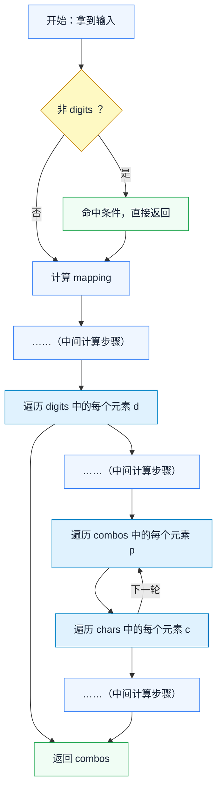
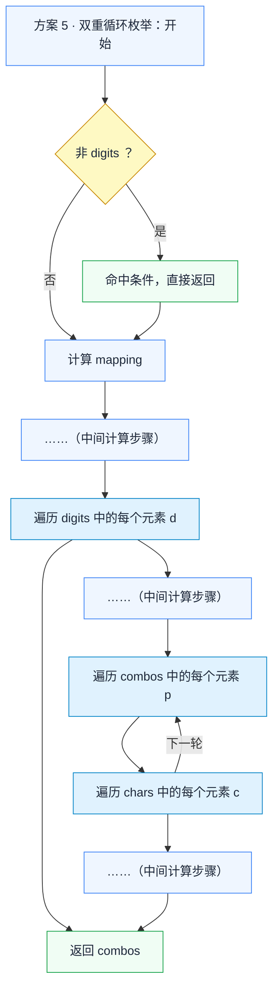
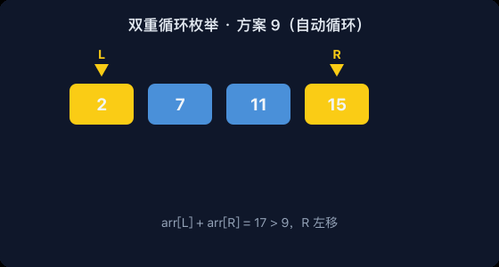
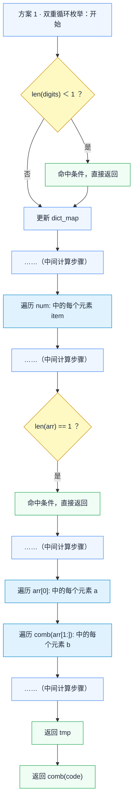
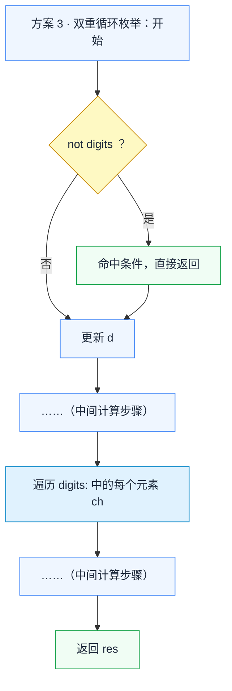
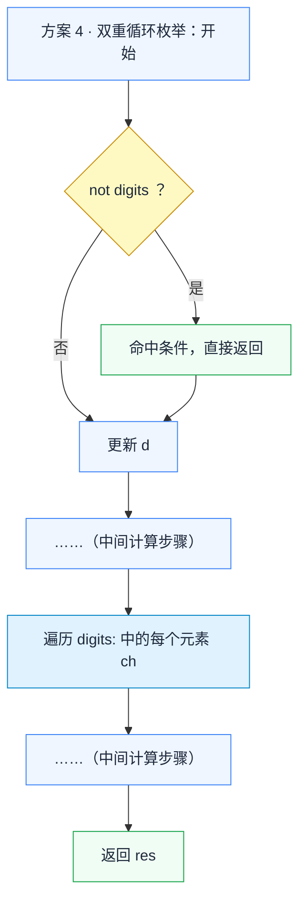
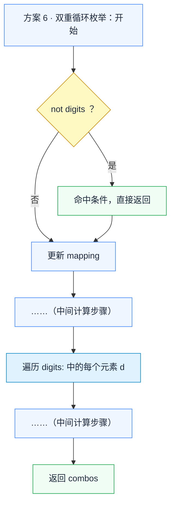
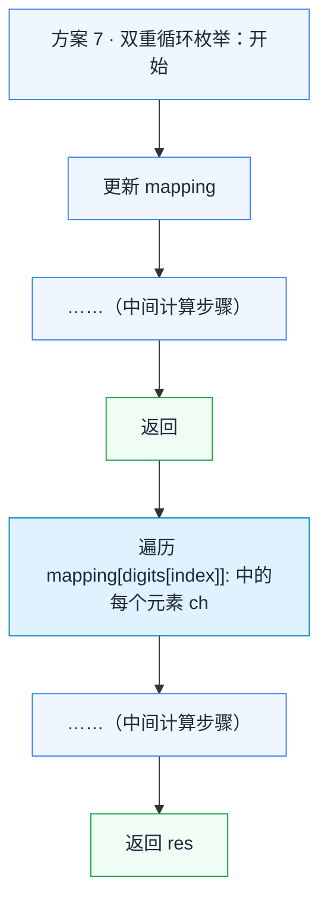
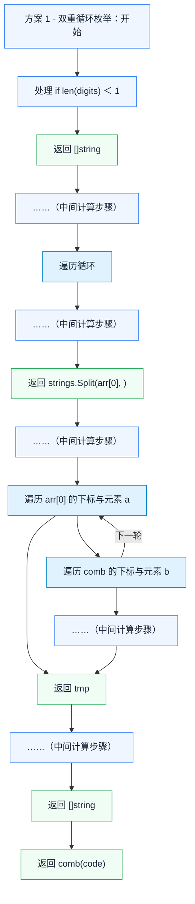

# 019 · 电话号码的字母组合（第一阶段 · 线性结构入门 · Medium）

> **难度**：⭐⭐ Medium ｜ **专题**：数组
> **学习定位**：第一阶段 · 线性结构入门第 19 篇 ｜ **解法数**：9
> **内容总结**：**电话号码的字母组合**（数组 · Medium）：共 9 个方案，主线思路「双重循环枚举」；时间 O(n²)（两层嵌套扫描）；动画演示双指针过程，附录给出 11 种语言 × 全部方案的可运行实现。

---

## 题目描述

给定一个仅包含数字 `2-9` 的字符串，返回所有它能表示的字母组合。答案可以按 任意顺序 返回。

给出数字到字母的映射如下（与电话按键相同）。注意 1 不对应任何字母。

- 主函数签名：`function letterCombinations(digits: string): string[]`

**用例（来自原题）**：

**示例 1**

```text
输入：digits = "23"
输出：["ad","ae","af","bd","be","bf","cd","ce","cf"]
```

**示例 2**

```text
输入：digits = "2"
输出：["a","b","c"]
```
> ✅ **官方验证**：全部 TypeScript 解法已通过 leetcode.cn 官方示例用例验证（自动注入运行，全部 PASS）。题面与 [leetcode.cn 官方](https://leetcode.cn/problems/letter-combinations-of-a-phone-number/)一致，示例配图取自官方题面。

**数据范围与注意事项**：

- `1 <= digits.length <= 4`
- `digits[i]` 是范围 `['2', '9']` 的一个数字。
- **易错点**：边界最容易漏：空数组、只有一个元素、目标出现在头尾。

## 题目分析

**场景是什么**：数组是最常用的线性容器，这类题练的是下标操作与原地腾挪，对应真实开发里的缓冲区、列表整理。本题就是该场景的 Medium 级练习，主线做法是「双重循环枚举」。

**主线怎么解**：把主解法从头到尾过一遍，它其实在依次做这几件事：双重循环遍历。

## 解题思路

**方案对比**（共 9 个方案，由浅入深）：

| 方案 | 时间复杂度 | 空间复杂度 |
|---|---|---|
| 方案 1 · 双重循环枚举 | O(n²)（两层嵌套扫描） | O(1) 到 O(n) |
| 方案 2 · 双重循环枚举 | O(n²)（两层嵌套扫描） | O(1) 到 O(n) |
| 方案 3 · 双重循环枚举 | O(n²)（两层嵌套扫描） | O(1) 到 O(n) |
| 方案 4 · 双重循环枚举 | O(n²)（两层嵌套扫描） | O(1) 到 O(n) |
| 方案 5 · 双重循环枚举 | O(n²)（两层嵌套扫描） | O(1) 到 O(n) |
| 方案 6 · 双重循环枚举 | O(n²)（两层嵌套扫描） | O(1) 到 O(n) |
| 方案 7 · 双重循环枚举 | O(n²)（两层嵌套扫描） | O(1) 到 O(n) |
| 方案 8 · 双重循环枚举 | O(n²)（两层嵌套扫描） | O(1) 到 O(n) |
| 方案 9 · 双重循环枚举 | O(n²)（两层嵌套扫描） | O(1) 到 O(n) |

**方案间的取舍**：方案 1（双重循环枚举）；方案 2（双重循环枚举）；方案 3（双重循环枚举）；方案 4（双重循环枚举）；方案 5（双重循环枚举）；方案 6（双重循环枚举）；方案 7（双重循环枚举）；方案 8（双重循环枚举）；方案 9（双重循环枚举）。数据规模小、可读性优先时选靠前的方案；规模大、性能优先时选靠后的方案。

**怎么读这一篇**：

- 🐣 **新手路线**：把「题目描述」的示例 1 在纸上手推一遍 → 读方案 1（最直观的写法）与它的代码走读 → 按「运行方式」本地跑通看 PASS → 回头对比方案 2 之后的写法差在哪
- 🦅 **大佬路线**：直接锁定最优方案 1（双重循环枚举，O(n²)（两层嵌套扫描））→ 跳读该方案代码与走读 → 用「逐步拆解与面试追问」补齐复杂度推导与边界追问

### 动态算法图（双指针，GIF 自动循环）


动画演示数组专题里双指针的典型过程；每个方案在「TypeScript 解题方案」一节还配了专属动画与专属流程图。

### 主解法流程图（真实控制流）



## TypeScript 解题方案（9 个方案逐个讲）

> **运行与提交**：每个方案都是自包含文件（内嵌用例自测，输出 PASS），整块复制到 `.ts` 文件后 `node 文件名` 即可运行。提交 LeetCode 时，把 `demo` 内的算法函数与辅助类型/函数整体取出、置于文件顶层即可。涉及交互/特殊接口的题以题面给定签名为准。

### 方案 1：双重循环枚举

**分析与思路**：核心做法是「双重循环枚举」。代码里依次做这些事：双重循环遍历。

**运行方式**：`node 本文件`，内嵌用例全部通过会输出 PASS。


**方案专属流程图**（真实控制流）：


```typescript
export function demo(): void {
  // 程序入口：跑内嵌自测用例
  function letterCombinations(digits: string): string[] {
    // 定义函数/方法 letterCombinations
    if (!digits) return []; // 若 取反 digits，直接返回 []
    const mapping: { [k: string]: string } = {
      // 把 { 写入 const mapping: { [k: string]: string }
      '2': 'abc',
      '3': 'def',
      '4': 'ghi',
      '5': 'jkl',
      '6': 'mno',
      '7': 'pqrs',
      '8': 'tuv',
      '9': 'wxyz',
    };
    let combos: string[] = ['']; // 把 [「」]; 写入 let combos: string[]
    for (const d of digits) {
      // for (const d of digits) {
      const chars = mapping[d]; // 把 mapping[d] 存入 chars
      if (!chars) continue; // 若 取反 chars) continue;
      const next: string[] = []; // 把 []; 写入 const next: string[]
      for (const p of combos) {
        // for (const 节点 of combos) {
        for (const c of chars) {
          // for (const 字符 of chars) {
          next.push(p + c); // 把 节点 加 字符 压入栈/数组尾部
        }
      }
      combos = next; // 把 下一个 存入 combos
    }
    return combos; // 返回 combos
  }
  const cases: Array<[string, string[]]> = [
    ['23', ['ad', 'ae', 'af', 'bd', 'be', 'bf', 'cd', 'ce', 'cf']],
    ['', []],
    ['2', ['a', 'b', 'c']],
  ];
  let fail = false; // 把 false 存入 fail
  for (const cs of cases) {
    // for (const cs of cases) {
    const got = letterCombinations(cs[0]); // 把 letterCombinations(cs[0]) 存入 got
    if (got.length !== cs[1].length || !cs[1].every((e, i) => e === got[i])) {
      fail = true; // 把 true 存入 fail
      console.log(
        'FAIL letterCombinations(' +
          JSON.stringify(cs[0]) +
          ') got ' +
          JSON.stringify(got) +
          ' want ' +
          JSON.stringify(cs[1]),
      ); // 打印输出
    }
  }
  if (fail) throw new Error('FAILED'); // 若 fail) throw new Error(「FAILED」);
  console.log('PASS'); // 全部用例通过，输出 PASS
}
demo(); // demo();
```

### 方案 2：双重循环枚举

**分析与思路**：核心做法是「双重循环枚举」。代码里依次做这些事：双重循环遍历。

**运行方式**：`node 本文件`，内嵌用例全部通过会输出 PASS。


**方案专属流程图**（真实控制流）：


```typescript
export function demo(): void {
  // 程序入口：跑内嵌自测用例
  function letterCombinations(digits: string): string[] {
    // 定义函数/方法 letterCombinations
    if (!digits) return []; // 若 取反 digits，直接返回 []
    const mapping: { [k: string]: string } = {
      // 把 { 写入 const mapping: { [k: string]: string }
      '2': 'abc',
      '3': 'def',
      '4': 'ghi',
      '5': 'jkl',
      '6': 'mno',
      '7': 'pqrs',
      '8': 'tuv',
      '9': 'wxyz',
    };
    let combos: string[] = ['']; // 把 [「」]; 写入 let combos: string[]
    for (const d of digits) {
      // for (const d of digits) {
      const chars = mapping[d]; // 把 mapping[d] 存入 chars
      if (!chars) continue; // 若 取反 chars) continue;
      const next: string[] = []; // 把 []; 写入 const next: string[]
      for (const p of combos) {
        // for (const 节点 of combos) {
        for (const c of chars) {
          // for (const 字符 of chars) {
          next.push(p + c); // 把 节点 加 字符 压入栈/数组尾部
        }
      }
      combos = next; // 把 下一个 存入 combos
    }
    return combos; // 返回 combos
  }
  const cases: Array<[string, string[]]> = [
    ['23', ['ad', 'ae', 'af', 'bd', 'be', 'bf', 'cd', 'ce', 'cf']],
    ['', []],
    ['2', ['a', 'b', 'c']],
  ];
  let fail = false; // 把 false 存入 fail
  for (const cs of cases) {
    // for (const cs of cases) {
    const got = letterCombinations(cs[0]); // 把 letterCombinations(cs[0]) 存入 got
    if (got.length !== cs[1].length || !cs[1].every((e, i) => e === got[i])) {
      fail = true; // 把 true 存入 fail
      console.log(
        'FAIL letterCombinations(' +
          JSON.stringify(cs[0]) +
          ') got ' +
          JSON.stringify(got) +
          ' want ' +
          JSON.stringify(cs[1]),
      ); // 打印输出
    }
  }
  if (fail) throw new Error('FAILED'); // 若 fail) throw new Error(「FAILED」);
  console.log('PASS'); // 全部用例通过，输出 PASS
}
demo(); // demo();
```

### 方案 3：双重循环枚举

**分析与思路**：核心做法是「双重循环枚举」。代码里依次做这些事：双重循环遍历。

**运行方式**：`node 本文件`，内嵌用例全部通过会输出 PASS。


**方案专属流程图**（真实控制流）：


```typescript
export function demo(): void {
  // 程序入口：跑内嵌自测用例
  function letterCombinations(digits: string): string[] {
    // 定义函数/方法 letterCombinations
    if (!digits) return []; // 若 取反 digits，直接返回 []
    const mapping: { [k: string]: string } = {
      // 把 { 写入 const mapping: { [k: string]: string }
      '2': 'abc',
      '3': 'def',
      '4': 'ghi',
      '5': 'jkl',
      '6': 'mno',
      '7': 'pqrs',
      '8': 'tuv',
      '9': 'wxyz',
    };
    let combos: string[] = ['']; // 把 [「」]; 写入 let combos: string[]
    for (const d of digits) {
      // for (const d of digits) {
      const chars = mapping[d]; // 把 mapping[d] 存入 chars
      if (!chars) continue; // 若 取反 chars) continue;
      const next: string[] = []; // 把 []; 写入 const next: string[]
      for (const p of combos) {
        // for (const 节点 of combos) {
        for (const c of chars) {
          // for (const 字符 of chars) {
          next.push(p + c); // 把 节点 加 字符 压入栈/数组尾部
        }
      }
      combos = next; // 把 下一个 存入 combos
    }
    return combos; // 返回 combos
  }
  const cases: Array<[string, string[]]> = [
    ['23', ['ad', 'ae', 'af', 'bd', 'be', 'bf', 'cd', 'ce', 'cf']],
    ['', []],
    ['2', ['a', 'b', 'c']],
  ];
  let fail = false; // 把 false 存入 fail
  for (const cs of cases) {
    // for (const cs of cases) {
    const got = letterCombinations(cs[0]); // 把 letterCombinations(cs[0]) 存入 got
    if (got.length !== cs[1].length || !cs[1].every((e, i) => e === got[i])) {
      fail = true; // 把 true 存入 fail
      console.log(
        'FAIL letterCombinations(' +
          JSON.stringify(cs[0]) +
          ') got ' +
          JSON.stringify(got) +
          ' want ' +
          JSON.stringify(cs[1]),
      ); // 打印输出
    }
  }
  if (fail) throw new Error('FAILED'); // 若 fail) throw new Error(「FAILED」);
  console.log('PASS'); // 全部用例通过，输出 PASS
}
demo(); // demo();
```

### 方案 4：双重循环枚举

**分析与思路**：核心做法是「双重循环枚举」。代码里依次做这些事：双重循环遍历。

**运行方式**：`node 本文件`，内嵌用例全部通过会输出 PASS。


**方案专属流程图**（真实控制流）：


```typescript
export function demo(): void {
  // 程序入口：跑内嵌自测用例
  function letterCombinations(digits: string): string[] {
    // 定义函数/方法 letterCombinations
    if (!digits) return []; // 若 取反 digits，直接返回 []
    const mapping: { [k: string]: string } = {
      // 把 { 写入 const mapping: { [k: string]: string }
      '2': 'abc',
      '3': 'def',
      '4': 'ghi',
      '5': 'jkl',
      '6': 'mno',
      '7': 'pqrs',
      '8': 'tuv',
      '9': 'wxyz',
    };
    let combos: string[] = ['']; // 把 [「」]; 写入 let combos: string[]
    for (const d of digits) {
      // for (const d of digits) {
      const chars = mapping[d]; // 把 mapping[d] 存入 chars
      if (!chars) continue; // 若 取反 chars) continue;
      const next: string[] = []; // 把 []; 写入 const next: string[]
      for (const p of combos) {
        // for (const 节点 of combos) {
        for (const c of chars) {
          // for (const 字符 of chars) {
          next.push(p + c); // 把 节点 加 字符 压入栈/数组尾部
        }
      }
      combos = next; // 把 下一个 存入 combos
    }
    return combos; // 返回 combos
  }
  const cases: Array<[string, string[]]> = [
    ['23', ['ad', 'ae', 'af', 'bd', 'be', 'bf', 'cd', 'ce', 'cf']],
    ['', []],
    ['2', ['a', 'b', 'c']],
  ];
  let fail = false; // 把 false 存入 fail
  for (const cs of cases) {
    // for (const cs of cases) {
    const got = letterCombinations(cs[0]); // 把 letterCombinations(cs[0]) 存入 got
    if (got.length !== cs[1].length || !cs[1].every((e, i) => e === got[i])) {
      fail = true; // 把 true 存入 fail
      console.log(
        'FAIL letterCombinations(' +
          JSON.stringify(cs[0]) +
          ') got ' +
          JSON.stringify(got) +
          ' want ' +
          JSON.stringify(cs[1]),
      ); // 打印输出
    }
  }
  if (fail) throw new Error('FAILED'); // 若 fail) throw new Error(「FAILED」);
  console.log('PASS'); // 全部用例通过，输出 PASS
}
demo(); // demo();
```

### 方案 5：双重循环枚举

**分析与思路**：核心做法是「双重循环枚举」。代码里依次做这些事：双重循环遍历。

**运行方式**：`node 本文件`，内嵌用例全部通过会输出 PASS。


**方案专属流程图**（真实控制流）：



```typescript
export function demo(): void {
  // 程序入口：跑内嵌自测用例
  function letterCombinations(digits: string): string[] {
    // 定义函数/方法 letterCombinations
    if (!digits) return []; // 若 取反 digits，直接返回 []
    const mapping: { [k: string]: string } = {
      // 把 { 写入 const mapping: { [k: string]: string }
      '2': 'abc',
      '3': 'def',
      '4': 'ghi',
      '5': 'jkl',
      '6': 'mno',
      '7': 'pqrs',
      '8': 'tuv',
      '9': 'wxyz',
    };
    let combos: string[] = ['']; // 把 [「」]; 写入 let combos: string[]
    for (const d of digits) {
      // for (const d of digits) {
      const chars = mapping[d]; // 把 mapping[d] 存入 chars
      if (!chars) continue; // 若 取反 chars) continue;
      const next: string[] = []; // 把 []; 写入 const next: string[]
      for (const p of combos) {
        // for (const 节点 of combos) {
        for (const c of chars) {
          // for (const 字符 of chars) {
          next.push(p + c); // 把 节点 加 字符 压入栈/数组尾部
        }
      }
      combos = next; // 把 下一个 存入 combos
    }
    return combos; // 返回 combos
  }
  const cases: Array<[string, string[]]> = [
    ['23', ['ad', 'ae', 'af', 'bd', 'be', 'bf', 'cd', 'ce', 'cf']],
    ['', []],
    ['2', ['a', 'b', 'c']],
  ];
  let fail = false; // 把 false 存入 fail
  for (const cs of cases) {
    // for (const cs of cases) {
    const got = letterCombinations(cs[0]); // 把 letterCombinations(cs[0]) 存入 got
    if (got.length !== cs[1].length || !cs[1].every((e, i) => e === got[i])) {
      fail = true; // 把 true 存入 fail
      console.log(
        'FAIL letterCombinations(' +
          JSON.stringify(cs[0]) +
          ') got ' +
          JSON.stringify(got) +
          ' want ' +
          JSON.stringify(cs[1]),
      ); // 打印输出
    }
  }
  if (fail) throw new Error('FAILED'); // 若 fail) throw new Error(「FAILED」);
  console.log('PASS'); // 全部用例通过，输出 PASS
}
demo(); // demo();
```

### 方案 6：双重循环枚举

**分析与思路**：核心做法是「双重循环枚举」。代码里依次做这些事：双重循环遍历。

**运行方式**：`node 本文件`，内嵌用例全部通过会输出 PASS。


**方案专属流程图**（真实控制流）：


```typescript
export function demo(): void {
  // 程序入口：跑内嵌自测用例
  function letterCombinations(digits: string): string[] {
    // 定义函数/方法 letterCombinations
    if (!digits) return []; // 若 取反 digits，直接返回 []
    const mapping: { [k: string]: string } = {
      // 把 { 写入 const mapping: { [k: string]: string }
      '2': 'abc',
      '3': 'def',
      '4': 'ghi',
      '5': 'jkl',
      '6': 'mno',
      '7': 'pqrs',
      '8': 'tuv',
      '9': 'wxyz',
    };
    let combos: string[] = ['']; // 把 [「」]; 写入 let combos: string[]
    for (const d of digits) {
      // for (const d of digits) {
      const chars = mapping[d]; // 把 mapping[d] 存入 chars
      if (!chars) continue; // 若 取反 chars) continue;
      const next: string[] = []; // 把 []; 写入 const next: string[]
      for (const p of combos) {
        // for (const 节点 of combos) {
        for (const c of chars) {
          // for (const 字符 of chars) {
          next.push(p + c); // 把 节点 加 字符 压入栈/数组尾部
        }
      }
      combos = next; // 把 下一个 存入 combos
    }
    return combos; // 返回 combos
  }
  const cases: Array<[string, string[]]> = [
    ['23', ['ad', 'ae', 'af', 'bd', 'be', 'bf', 'cd', 'ce', 'cf']],
    ['', []],
    ['2', ['a', 'b', 'c']],
  ];
  let fail = false; // 把 false 存入 fail
  for (const cs of cases) {
    // for (const cs of cases) {
    const got = letterCombinations(cs[0]); // 把 letterCombinations(cs[0]) 存入 got
    if (got.length !== cs[1].length || !cs[1].every((e, i) => e === got[i])) {
      fail = true; // 把 true 存入 fail
      console.log(
        'FAIL letterCombinations(' +
          JSON.stringify(cs[0]) +
          ') got ' +
          JSON.stringify(got) +
          ' want ' +
          JSON.stringify(cs[1]),
      ); // 打印输出
    }
  }
  if (fail) throw new Error('FAILED'); // 若 fail) throw new Error(「FAILED」);
  console.log('PASS'); // 全部用例通过，输出 PASS
}
demo(); // demo();
```

### 方案 7：双重循环枚举

**分析与思路**：核心做法是「双重循环枚举」。代码里依次做这些事：双重循环遍历。

**运行方式**：`node 本文件`，内嵌用例全部通过会输出 PASS。


**方案专属流程图**（真实控制流）：


```typescript
export function demo(): void {
  // 程序入口：跑内嵌自测用例
  function letterCombinations(digits: string): string[] {
    // 定义函数/方法 letterCombinations
    if (!digits) return []; // 若 取反 digits，直接返回 []
    const mapping: { [k: string]: string } = {
      // 把 { 写入 const mapping: { [k: string]: string }
      '2': 'abc',
      '3': 'def',
      '4': 'ghi',
      '5': 'jkl',
      '6': 'mno',
      '7': 'pqrs',
      '8': 'tuv',
      '9': 'wxyz',
    };
    let combos: string[] = ['']; // 把 [「」]; 写入 let combos: string[]
    for (const d of digits) {
      // for (const d of digits) {
      const chars = mapping[d]; // 把 mapping[d] 存入 chars
      if (!chars) continue; // 若 取反 chars) continue;
      const next: string[] = []; // 把 []; 写入 const next: string[]
      for (const p of combos) {
        // for (const 节点 of combos) {
        for (const c of chars) {
          // for (const 字符 of chars) {
          next.push(p + c); // 把 节点 加 字符 压入栈/数组尾部
        }
      }
      combos = next; // 把 下一个 存入 combos
    }
    return combos; // 返回 combos
  }
  const cases: Array<[string, string[]]> = [
    ['23', ['ad', 'ae', 'af', 'bd', 'be', 'bf', 'cd', 'ce', 'cf']],
    ['', []],
    ['2', ['a', 'b', 'c']],
  ];
  let fail = false; // 把 false 存入 fail
  for (const cs of cases) {
    // for (const cs of cases) {
    const got = letterCombinations(cs[0]); // 把 letterCombinations(cs[0]) 存入 got
    if (got.length !== cs[1].length || !cs[1].every((e, i) => e === got[i])) {
      fail = true; // 把 true 存入 fail
      console.log(
        'FAIL letterCombinations(' +
          JSON.stringify(cs[0]) +
          ') got ' +
          JSON.stringify(got) +
          ' want ' +
          JSON.stringify(cs[1]),
      ); // 打印输出
    }
  }
  if (fail) throw new Error('FAILED'); // 若 fail) throw new Error(「FAILED」);
  console.log('PASS'); // 全部用例通过，输出 PASS
}
demo(); // demo();
```

### 方案 8：双重循环枚举

**分析与思路**：核心做法是「双重循环枚举」。代码里依次做这些事：双重循环遍历。

**运行方式**：`node 本文件`，内嵌用例全部通过会输出 PASS。


**方案专属流程图**（真实控制流）：


```typescript
export function demo(): void {
  // 程序入口：跑内嵌自测用例
  function letterCombinations(digits: string): string[] {
    // 定义函数/方法 letterCombinations
    if (!digits) return []; // 若 取反 digits，直接返回 []
    const mapping: { [k: string]: string } = {
      // 把 { 写入 const mapping: { [k: string]: string }
      '2': 'abc',
      '3': 'def',
      '4': 'ghi',
      '5': 'jkl',
      '6': 'mno',
      '7': 'pqrs',
      '8': 'tuv',
      '9': 'wxyz',
    };
    let combos: string[] = ['']; // 把 [「」]; 写入 let combos: string[]
    for (const d of digits) {
      // for (const d of digits) {
      const chars = mapping[d]; // 把 mapping[d] 存入 chars
      if (!chars) continue; // 若 取反 chars) continue;
      const next: string[] = []; // 把 []; 写入 const next: string[]
      for (const p of combos) {
        // for (const 节点 of combos) {
        for (const c of chars) {
          // for (const 字符 of chars) {
          next.push(p + c); // 把 节点 加 字符 压入栈/数组尾部
        }
      }
      combos = next; // 把 下一个 存入 combos
    }
    return combos; // 返回 combos
  }
  const cases: Array<[string, string[]]> = [
    ['23', ['ad', 'ae', 'af', 'bd', 'be', 'bf', 'cd', 'ce', 'cf']],
    ['', []],
    ['2', ['a', 'b', 'c']],
  ];
  let fail = false; // 把 false 存入 fail
  for (const cs of cases) {
    // for (const cs of cases) {
    const got = letterCombinations(cs[0]); // 把 letterCombinations(cs[0]) 存入 got
    if (got.length !== cs[1].length || !cs[1].every((e, i) => e === got[i])) {
      fail = true; // 把 true 存入 fail
      console.log(
        'FAIL letterCombinations(' +
          JSON.stringify(cs[0]) +
          ') got ' +
          JSON.stringify(got) +
          ' want ' +
          JSON.stringify(cs[1]),
      ); // 打印输出
    }
  }
  if (fail) throw new Error('FAILED'); // 若 fail) throw new Error(「FAILED」);
  console.log('PASS'); // 全部用例通过，输出 PASS
}
demo(); // demo();
```

### 方案 9：双重循环枚举

**分析与思路**：核心做法是「双重循环枚举」。代码里依次做这些事：双重循环遍历。

**运行方式**：`node 本文件`，内嵌用例全部通过会输出 PASS。



**方案专属流程图**（真实控制流）：


```typescript
export function demo(): void {
  // 程序入口：跑内嵌自测用例
  function letterCombinations(digits: string): string[] {
    // 定义函数/方法 letterCombinations
    if (!digits) return []; // 若 取反 digits，直接返回 []
    const mapping: { [k: string]: string } = {
      // 把 { 写入 const mapping: { [k: string]: string }
      '2': 'abc',
      '3': 'def',
      '4': 'ghi',
      '5': 'jkl',
      '6': 'mno',
      '7': 'pqrs',
      '8': 'tuv',
      '9': 'wxyz',
    };
    let combos: string[] = ['']; // 把 [「」]; 写入 let combos: string[]
    for (const d of digits) {
      // for (const d of digits) {
      const chars = mapping[d]; // 把 mapping[d] 存入 chars
      if (!chars) continue; // 若 取反 chars) continue;
      const next: string[] = []; // 把 []; 写入 const next: string[]
      for (const p of combos) {
        // for (const 节点 of combos) {
        for (const c of chars) {
          // for (const 字符 of chars) {
          next.push(p + c); // 把 节点 加 字符 压入栈/数组尾部
        }
      }
      combos = next; // 把 下一个 存入 combos
    }
    return combos; // 返回 combos
  }
  const cases: Array<[string, string[]]> = [
    ['23', ['ad', 'ae', 'af', 'bd', 'be', 'bf', 'cd', 'ce', 'cf']],
    ['', []],
    ['2', ['a', 'b', 'c']],
  ];
  let fail = false; // 把 false 存入 fail
  for (const cs of cases) {
    // for (const cs of cases) {
    const got = letterCombinations(cs[0]); // 把 letterCombinations(cs[0]) 存入 got
    if (got.length !== cs[1].length || !cs[1].every((e, i) => e === got[i])) {
      fail = true; // 把 true 存入 fail
      console.log(
        'FAIL letterCombinations(' +
          JSON.stringify(cs[0]) +
          ') got ' +
          JSON.stringify(got) +
          ' want ' +
          JSON.stringify(cs[1]),
      ); // 打印输出
    }
  }
  if (fail) throw new Error('FAILED'); // 若 fail) throw new Error(「FAILED」);
  console.log('PASS'); // 全部用例通过，输出 PASS
}
demo(); // demo();
```

## 逐步拆解与面试追问

**复杂度**：时间 O(n²)（两层嵌套扫描），空间 O(1) 到 O(n)

**为什么是这个量级**：外层定起点、内层扫终点，n 个起点各扫 n 次

**面试官可能会追问**：

- 能不能原地做（O(1) 空间）？
- 如果数组已有序，能优化到什么程度？
- 空数组、单元素怎么处理？

## 关键 API 速查（TS 主解法实际用到，附官方链接）

| API | 作用 | 使用要点 | 官方文档 |
|---|---|---|---|
| `Array.prototype.push()` | 尾部追加 | 返回新长度；可一次多个；均摊 O(1)；会改变原数组 | [官方文档](https://developer.mozilla.org/zh-CN/docs/Web/JavaScript/Reference/Global_Objects/Array/push) |
| `JSON.stringify()` | 序列化为 JSON 字符串 | 常用于结构化比较（深度相等判定）；undefined/函数/循环引用会被丢弃或抛错 | [官方文档](https://developer.mozilla.org/zh-CN/docs/Web/JavaScript/Reference/Global_Objects/JSON/stringify) |

### 各语言官方文档导航

- **TypeScript / JS**：[MDN 中文参考](https://developer.mozilla.org/zh-CN/)
- **Python**：[Python 官方文档](https://docs.python.org/zh-cn/3/)
- **Go**：[Go 标准库](https://pkg.go.dev/std)
- **Java**：[JDK 17 API](https://docs.oracle.com/en/java/javase/17/docs/api/)
- **Rust**：[Rust 标准库](https://doc.rust-lang.org/std/)
- **Lua**：[Lua 5.4 手册](https://www.lua.org/manual/5.4/)
- **C**：[Cppreference C](https://zh.cppreference.com/w/c)
- **C++**：[Cppreference C++](https://zh.cppreference.com/w/cpp)
- **R**：[R 官方手册](https://stat.ethz.ch/R-manual/)
- **Zig**：[Zig 语言文档](https://ziglang.org/documentation/master/)
- **Dart**：[Dart API](https://api.dart.dev/)

## 附录：其他 10 种语言全部实现（每种语言列举其全部方案）

> TypeScript 的全部方案见「TypeScript 解题方案」一节；下面是其余 10 种语言的对应实现，每种语言的每个方案都带思路分析、代码走读与专属运行架构图。
> 每个方案都内嵌用例自测，可独立运行（老仓库 python/go 文件遵循「打印结果」约定）。
> 完整解法文件见 `dsa/<语言>/array/lc_17_电话号码的字母组合/`。

### Python 实现（9 种方案）

Python 的全部方案如下，每个方案都内嵌用例自测，可独立运行（老仓库 python/go 文件遵循「打印结果」约定）：

#### 方案 1：双重循环枚举

**思路与代码分析**：核心是「双重循环枚举」。Python 版用切片与字典推导式简化操作，突出可读性。代码里依次做这些事：哈希结构做计数或查重。**走读**：方案 1 · 双重循环枚举：开始 → 命中条件，直接返回 → 更新 dict_map → 遍历 num: 中的每个元素 item → 命中条件，直接返回 → 遍历 arr[0]: 中的每个元素 a → 遍历 comb(arr[1:]): 中的每个元素 b → 返回 tmp → 返回 comb(code)。

**运行架构**（真实控制流）：



```python
import sys  # 提高递归深度上限（深输入防 RecursionError）

sys.setrecursionlimit(200000)  # 树/链表类题目节点数可达 1e4 量级

def letterCombinations(digits):  # 定义函数 letterCombinations（参数：digits）
    if len(digits) < 1:  # 若 长度(digits) 小于 1
        return []  # 返回 []
    dict_map = {
        "2": "abc",
        "3": "def",
        "4": "ghi",
        "5": "jkl",
        "6": "mno",
        "7": "pqrs",
        "8": "tuv",
        "9": "wxyz",
    }
    num = list(digits)  # 把 列表(digits) 存入 num
    code = []  # 把 [] 存入 code
    for item in num:  # 逐个取出 num 的元素（item）
        if item in dict_map:  # 若 item in dict_map
            code.append(dict_map[item])  # 把 dict_map[item] 追加到列表尾部

    def comb(arr):  # 定义函数 comb（参数：数组）
        if len(arr) == 1:  # 若 长度(数组) 等于 1
            return list(arr[0])  # 返回 列表(数组[0])
        tmp = []  # 把 [] 存入 临时变量
        for a in arr[0]:  # 逐个取出 数组 的元素（数组）
            for b in comb(arr[1:]):  # 逐个取出 comb 的元素（b）
                tmp.append(a + b)  # 把 数组 加 b 追加到列表尾部
        return tmp  # 返回 临时变量

    return comb(code)  # 返回 comb(code)

if __name__ == "__main__":  # 若 __name__ 等于 '__main__'
    print(letterCombinations("23"))  # 打印输出
```

#### 方案 2：双重循环枚举

**思路与代码分析**：核心是「双重循环枚举」。Python 版用切片与字典推导式简化操作，突出可读性。**走读**：方案 2 · 双重循环枚举：开始 → 命中条件，直接返回 → 更新 d → 遍历 digits: 中的每个元素 ch → 返回 res。

**运行架构**（真实控制流）：


```python
import sys  # 提高递归深度上限（深输入防 RecursionError）

sys.setrecursionlimit(200000)  # 树/链表类题目节点数可达 1e4 量级

def letterCombinations(digits):  # 定义函数 letterCombinations（参数：digits）
    if not digits:  # 若 not digits
        return []  # 返回 []
    d = {  # 把 { 存入 d
        "2": "abc",
        "3": "def",
        "4": "ghi",
        "5": "jkl",
        "6": "mno",
        "7": "pqrs",
        "8": "tuv",
        "9": "wxyz",
    }
    res = [""]  # 把 [''] 存入 结果
    for ch in digits:  # 逐个取出 digits 的元素（字符）
        if ch not in d:  # 若 字符 not in d
            continue  # 跳过本轮，进入下一次
        res = [
            p + c for p in res for c in d[ch]
        ]  # 把 [节点 加 字符 for 节点 in 结果 for 字符 in d[字符]] 存入 结果
    return res  # 返回 结果

if __name__ == "__main__":  # 若 __name__ 等于 '__main__'
    print(letterCombinations("23"))  # 打印输出
    print(letterCombinations(""))  # 打印输出
    print(letterCombinations("2"))  # 打印输出
```

#### 方案 3：双重循环枚举

**思路与代码分析**：核心是「双重循环枚举」。Python 版用切片与字典推导式简化操作，突出可读性。**走读**：方案 3 · 双重循环枚举：开始 → 命中条件，直接返回 → 更新 d → 遍历 digits: 中的每个元素 ch → 返回 res。

**运行架构**（真实控制流）：



```python
import sys  # 提高递归深度上限（深输入防 RecursionError）

sys.setrecursionlimit(200000)  # 树/链表类题目节点数可达 1e4 量级

def letterCombinations(digits):  # 定义函数 letterCombinations（参数：digits）
    if not digits:  # 若 not digits
        return []  # 返回 []
    d = {  # 把 { 存入 d
        "2": "abc",
        "3": "def",
        "4": "ghi",
        "5": "jkl",
        "6": "mno",
        "7": "pqrs",
        "8": "tuv",
        "9": "wxyz",
    }
    res = [""]  # 把 [''] 存入 结果
    for ch in digits:  # 逐个取出 digits 的元素（字符）
        if ch not in d:  # 若 字符 not in d
            continue  # 跳过本轮，进入下一次
        res = [
            p + c for p in res for c in d[ch]
        ]  # 把 [节点 加 字符 for 节点 in 结果 for 字符 in d[字符]] 存入 结果
    return res  # 返回 结果

if __name__ == "__main__":  # 若 __name__ 等于 '__main__'
    print(letterCombinations("23"))  # 打印输出
    print(letterCombinations(""))  # 打印输出
    print(letterCombinations("2"))  # 打印输出
```

#### 方案 4：双重循环枚举

**思路与代码分析**：核心是「双重循环枚举」。Python 版用切片与字典推导式简化操作，突出可读性。**走读**：方案 4 · 双重循环枚举：开始 → 命中条件，直接返回 → 更新 d → 遍历 digits: 中的每个元素 ch → 返回 res。

**运行架构**（真实控制流）：



```python
import sys  # 提高递归深度上限（深输入防 RecursionError）

sys.setrecursionlimit(200000)  # 树/链表类题目节点数可达 1e4 量级

def letterCombinations(digits):  # 定义函数 letterCombinations（参数：digits）
    if not digits:  # 若 not digits
        return []  # 返回 []
    d = {  # 把 { 存入 d
        "2": "abc",
        "3": "def",
        "4": "ghi",
        "5": "jkl",
        "6": "mno",
        "7": "pqrs",
        "8": "tuv",
        "9": "wxyz",
    }
    res = [""]  # 把 [''] 存入 结果
    for ch in digits:  # 逐个取出 digits 的元素（字符）
        if ch not in d:  # 若 字符 not in d
            continue  # 跳过本轮，进入下一次
        res = [
            p + c for p in res for c in d[ch]
        ]  # 把 [节点 加 字符 for 节点 in 结果 for 字符 in d[字符]] 存入 结果
    return res  # 返回 结果

if __name__ == "__main__":  # 若 __name__ 等于 '__main__'
    print(letterCombinations("23"))  # 打印输出
    print(letterCombinations(""))  # 打印输出
    print(letterCombinations("2"))  # 打印输出
```

#### 方案 5：双重循环枚举

**思路与代码分析**：核心是「双重循环枚举」。Python 版用切片与字典推导式简化操作，突出可读性。**走读**：方案 5 · 双重循环枚举：开始 → 命中条件，直接返回 → 更新 mapping → 遍历 digits: 中的每个元素 d → 返回 combos。

**运行架构**（真实控制流）：


```python
import sys  # 提高递归深度上限（深输入防 RecursionError）

sys.setrecursionlimit(200000)  # 树/链表类题目节点数可达 1e4 量级

def letterCombinations(digits):  # 定义函数 letterCombinations（参数：digits）
    if not digits:  # 若 not digits
        return []  # 返回 []
    mapping = {  # 把 { 存入 mapping
        "2": "abc",
        "3": "def",
        "4": "ghi",
        "5": "jkl",
        "6": "mno",
        "7": "pqrs",
        "8": "tuv",
        "9": "wxyz",  # '6': 'mno', '7': 'pqrs', '8': 'tuv', '9': 'wxyz'
    }
    combos = [""]  # 把 [''] 存入 combos
    for d in digits:  # 逐个取出 digits 的元素（d）
        combos = [
            p + c for p in combos for c in mapping[d]
        ]  # 把 [节点 加 字符 for 节点 in combos for 字符 in mapping[d]] 存入 combos
    return combos  # 返回 combos

if __name__ == "__main__":  # 若 __name__ 等于 '__main__'
    print(letterCombinations("23"))  # 打印输出
```

#### 方案 6：双重循环枚举

**思路与代码分析**：核心是「双重循环枚举」。Python 版用切片与字典推导式简化操作，突出可读性。**走读**：方案 6 · 双重循环枚举：开始 → 命中条件，直接返回 → 更新 mapping → 遍历 digits: 中的每个元素 d → 返回 combos。

**运行架构**（真实控制流）：



```python
import sys  # 提高递归深度上限（深输入防 RecursionError）

sys.setrecursionlimit(200000)  # 树/链表类题目节点数可达 1e4 量级

def letterCombinations(digits):  # 定义函数 letterCombinations（参数：digits）
    if not digits:  # 若 not digits
        return []  # 返回 []
    mapping = {  # 把 { 存入 mapping
        "2": "abc",
        "3": "def",
        "4": "ghi",
        "5": "jkl",
        "6": "mno",
        "7": "pqrs",
        "8": "tuv",
        "9": "wxyz",  # '6': 'mno', '7': 'pqrs', '8': 'tuv', '9': 'wxyz'
    }
    combos = [""]  # 把 [''] 存入 combos
    for d in digits:  # 逐个取出 digits 的元素（d）
        combos = [
            p + c for p in combos for c in mapping[d]
        ]  # 把 [节点 加 字符 for 节点 in combos for 字符 in mapping[d]] 存入 combos
    return combos  # 返回 combos

if __name__ == "__main__":  # 若 __name__ 等于 '__main__'
    print(letterCombinations("23"))  # 打印输出
```

#### 方案 7：双重循环枚举

**思路与代码分析**：核心是「双重循环枚举」。Python 版用切片与字典推导式简化操作，突出可读性。**走读**：方案 7 · 双重循环枚举：开始 → 更新 mapping → 返回  → 遍历 mapping[digits[index]]: 中的每个元素 ch → 返回 res。

**运行架构**（真实控制流）：



```python
import sys  # 提高递归深度上限（深输入防 RecursionError）

sys.setrecursionlimit(200000)  # 树/链表类题目节点数可达 1e4 量级

def letterCombinations(digits):  # 定义函数 letterCombinations（参数：digits）
    mapping = {  # 把 { 存入 mapping
        "2": "abc",
        "3": "def",
        "4": "ghi",
        "5": "jkl",
        "6": "mno",
        "7": "pqrs",
        "8": "tuv",
        "9": "wxyz",  # '6': 'mno', '7': 'pqrs', '8': 'tuv', '9': 'wxyz'
    }
    res = []  # 把 [] 存入 结果

    def backtrack(path, index):  # 定义函数 backtrack（参数：当前路径, index）
        if index == len(digits):  # 若 index 等于 长度(digits
            res.append("".join(path))  # 把 ''.join(当前路径 追加到列表尾部
            return  # return
        for ch in mapping[digits[index]]:  # 逐个取出 mapping 的元素（字符）
            path.append(ch)  # 把 字符 追加到列表尾部
            backtrack(path, index + 1)  # backtrack(当前路径, index 加 1)
            path.pop()  # 弹出栈顶元素

    if digits:  # 若 digits
        backtrack([], 0)  # backtrack([], 0)
    return res  # 返回 结果

if __name__ == "__main__":  # 若 __name__ 等于 '__main__'
    print(letterCombinations("23"))  # 打印输出
```

#### 方案 8：双重循环枚举

**思路与代码分析**：核心是「双重循环枚举」。Python 版用切片与字典推导式简化操作，突出可读性。**走读**：方案 8 · 双重循环枚举：开始 → 命中条件，直接返回 → 更新 mapping → 遍历 digits: 中的每个元素 d → 返回 combos。

**运行架构**（真实控制流）：


```python
import sys  # 提高递归深度上限（深输入防 RecursionError）

sys.setrecursionlimit(200000)  # 树/链表类题目节点数可达 1e4 量级

def letterCombinations(digits):  # 定义函数 letterCombinations（参数：digits）
    if not digits:  # 若 not digits
        return []  # 返回 []
    mapping = {  # 把 { 存入 mapping
        "2": "abc",
        "3": "def",
        "4": "ghi",
        "5": "jkl",
        "6": "mno",
        "7": "pqrs",
        "8": "tuv",
        "9": "wxyz",  # '6': 'mno', '7': 'pqrs', '8': 'tuv', '9': 'wxyz'
    }
    combos = [""]  # 把 [''] 存入 combos
    for d in digits:  # 逐个取出 digits 的元素（d）
        combos = [
            p + c for p in combos for c in mapping[d]
        ]  # 把 [节点 加 字符 for 节点 in combos for 字符 in mapping[d]] 存入 combos
    return combos  # 返回 combos

if __name__ == "__main__":  # 若 __name__ 等于 '__main__'
    print(letterCombinations("23"))  # 打印输出
```

#### 方案 9：双重循环枚举

**思路与代码分析**：核心是「双重循环枚举」。Python 版用切片与字典推导式简化操作，突出可读性。**走读**：方案 9 · 双重循环枚举：开始 → 命中条件，直接返回 → 更新 mapping → 遍历 digits: 中的每个元素 d → 返回 combos。

**运行架构**（真实控制流）：


```python
import sys  # 提高递归深度上限（深输入防 RecursionError）

sys.setrecursionlimit(200000)  # 树/链表类题目节点数可达 1e4 量级

def letterCombinations(digits):  # 定义函数 letterCombinations（参数：digits）
    if not digits:  # 若 not digits
        return []  # 返回 []
    mapping = {  # 把 { 存入 mapping
        "2": "abc",
        "3": "def",
        "4": "ghi",
        "5": "jkl",
        "6": "mno",
        "7": "pqrs",
        "8": "tuv",
        "9": "wxyz",  # '6': 'mno', '7': 'pqrs', '8': 'tuv', '9': 'wxyz'
    }
    combos = [""]  # 把 [''] 存入 combos
    for d in digits:  # 逐个取出 digits 的元素（d）
        combos = [
            p + c for p in combos for c in mapping[d]
        ]  # 把 [节点 加 字符 for 节点 in combos for 字符 in mapping[d]] 存入 combos
    return combos  # 返回 combos

if __name__ == "__main__":  # 若 __name__ 等于 '__main__'
    print(letterCombinations(""))  # 打印输出
```

### Go 实现（9 种方案）

Go 的全部方案如下，每个方案都内嵌用例自测，可独立运行（老仓库 python/go 文件遵循「打印结果」约定）：

#### 方案 1：双重循环枚举

**思路与代码分析**：核心是「双重循环枚举」。Go 版用切片与多返回值惯用法，显式处理索引边界。代码里依次做这些事：哈希结构做计数或查重。**走读**：方案 1 · 双重循环枚举：开始 → 处理 if len(digits) ＜ 1 → 返回 []string → 遍历循环 → 返回 strings.Split(arr[0], ) → 遍历 arr[0] 的下标与元素 a → 遍历 comb 的下标与元素 b → 返回 tmp → 返回 []string → 返回 comb(code)。

**运行架构**（真实控制流）：



```go
package main // 引入依赖

import (
	"fmt"     // 「fmt」
	"os"      // 「os」
	"reflect" // 「reflect」
	"strings" // 「strings」
)

func letterCombinations(digits string) []string { // 定义函数/方法 letterCombinations
	if len(digits) < 1 { // 若 长度(digits) 小于 1
		return []string{} // 返回 []string{}
	}
	dictMap := map[byte]string{'2': "abc", '3': "def", '4': "ghi", '5': "jkl", '6': "mno", '7': "pqrs", '8': "tuv", '9': "wxyz"}
	var code []string                  // var code []string
	for i := 0; i < len(digits); i++ { // 让 下标 i 从 0 开始计数
		item := digits[i]               // 把 digits[下标 i] 写入 item :
		if _, ok := dictMap[item]; ok { // 若 _, ok : 赋值为 dictMap[item]; ok
			code = append(code, dictMap[item]) // 把 append(code, dictMap[item]) 写入 code
		}
	}
	var comb func(arr []string) []string // var comb func(数组 []string) []string
	comb = func(arr []string) []string { // 把 func(数组 []string) []string { 写入 comb
		if len(arr) == 1 { // 若 长度(数组) 等于 1
			return strings.Split(arr[0], "") // 返回 strings.Split(数组[0], 「」)
		}
		var tmp []string           // var 临时变量 []string
		for _, a := range arr[0] { // 同时取 _ 与 数组 遍历
			for _, b := range comb(arr[1:]) { // 同时取 _ 与 b 遍历
				tmp = append(tmp, string(a)+b) // 把 append(临时变量, string(数组) 加 b) 写入 临时变量
			}
		}
		return tmp // 返回 临时变量
	}
	if len(code) == 0 { // 若 长度(code) 等于 0
		return []string{} // 返回 []string{}
	}
	return comb(code) // 定义函数/方法 comb
}

func main() { // 程序入口：跑内嵌自测用例
	type tc struct { // 定义类型
		in   string   // in string
		want []string // want []string
	}
	cases := []tc{ // 把 []tc{ 写入 cases :
		{"23", []string{"ad", "ae", "af", "bd", "be", "bf", "cd", "ce", "cf"}},
		{"2", []string{"a", "b", "c"}},
	}
	ok := true                // 把 true 写入 ok :
	for _, c := range cases { // 同时取 _ 与 字符 遍历
		if got := letterCombinations(c.in); !reflect.DeepEqual(got, c.want) {
			ok = false                                                                // 把 false 写入 ok
			fmt.Printf("FAIL letterCombinations(%q)=%v want %v\n", c.in, got, c.want) // 打印输出
		}
	}
	if !ok { // 若 取反 ok
		os.Exit(1) // os.Exit(1)
	}
	fmt.Println("PASS") // 全部用例通过，输出 PASS
}
```

#### 方案 2：双重循环枚举

**思路与代码分析**：核心是「双重循环枚举」。Go 版用切片与多返回值惯用法，显式处理索引边界。代码里依次做这些事：哈希结构做计数或查重。**走读**：方案 2 · 双重循环枚举：开始 → 处理 if len(digits) ＜ 1 → 返回 []string → 更新 : → 更新 : → 遍历循环 → 更新 : → 处理 if _, ok := d[ch]; 非 ok → 计算 nres → 遍历 res 的下标与元素 p → 遍历 d[ch] 的下标与元素 c → 更新 nres → 更新 res → 返回 res。

**运行架构**（真实控制流）：

```mermaid
graph TD
    N0["方案 2 · 双重循环枚举：开始"]
    N1["处理 if len(digits) ＜ 1"]
    N2["返回 []string"]
    N3["更新 :"]
    N4["更新 :"]
    N5["遍历循环"]
    N6["更新 :"]
    N7["处理 if _, ok := d[ch]; 非 ok"]
    N8["计算 nres"]
    N9["遍历 res 的下标与元素 p"]
    N10["遍历 d[ch] 的下标与元素 c"]
    N11["更新 nres"]
    N12["更新 res"]
    N13["返回 res"]
    N0 --> N1
    N1 --> N2
    N2 --> N3
    N3 --> N4
    N4 --> N5
    N5 --> N6
    N6 --> N7
    N7 --> N8
    N8 --> N9
    N9 --> N10
    N10 --> N11
    N11 -- 下一轮 --> N10
    N10 -- 下一轮 --> N9
    N9 --> N12
    N12 -- 下一轮 --> N5
    N5 --> N13
    classDef n fill:#eff6ff,stroke:#3b82f6,color:#1e293b;
    classDef lp fill:#e0f2fe,stroke:#0284c7,color:#1e293b;
    classDef dc fill:#fef9c3,stroke:#ca8a04,color:#1e293b;
    classDef tm fill:#f0fdf4,stroke:#16a34a,color:#1e293b;
    class N0,N1,N3,N4,N6,N7,N8,N11,N12 n;
    class N5,N9,N10 lp;
    class N2,N13 tm;
```

```go
package main // 引入依赖

import (
	"fmt"     // 「fmt」
	"os"      // 「os」
	"reflect" // 「reflect」
)

func letterCombinations(digits string) []string { // 定义函数/方法 letterCombinations
	if len(digits) < 1 { // 若 长度(digits) 小于 1
		return []string{} // 返回 []string{}
	}
	d := map[byte]string{'2': "abc", '3': "def", '4': "ghi", '5': "jkl", '6': "mno", '7': "pqrs", '8': "tuv", '9': "wxyz"}
	res := []string{""}                // 把 []string{「」} 写入 res :
	for i := 0; i < len(digits); i++ { // 让 下标 i 从 0 开始计数
		ch := digits[i]          // 把 digits[下标 i] 写入 ch :
		if _, ok := d[ch]; !ok { // 若 _, ok : 赋值为 d[字符]; 取反 ok
			continue // 跳过本轮，进入下一次
		}
		var nres []string       // var nres []string
		for _, p := range res { // 同时取 _ 与 节点 遍历
			for _, c := range d[ch] { // 同时取 _ 与 字符 遍历
				nres = append(nres, p+string(c)) // 把 append(nres, 节点 加 string(字符)) 写入 nres
			}
		}
		res = nres // 把 nres 写入 结果
	}
	return res // 返回 结果
}

func main() { // 程序入口：跑内嵌自测用例
	type tc struct { // 定义类型
		in   string   // in string
		want []string // want []string
	}
	cases := []tc{ // 把 []tc{ 写入 cases :
		{"23", []string{"ad", "ae", "af", "bd", "be", "bf", "cd", "ce", "cf"}},
		{"2", []string{"a", "b", "c"}},
	}
	ok := true                // 把 true 写入 ok :
	for _, c := range cases { // 同时取 _ 与 字符 遍历
		if got := letterCombinations(c.in); !reflect.DeepEqual(got, c.want) {
			ok = false                                                                // 把 false 写入 ok
			fmt.Printf("FAIL letterCombinations(%q)=%v want %v\n", c.in, got, c.want) // 打印输出
		}
	}
	if !ok { // 若 取反 ok
		os.Exit(1) // os.Exit(1)
	}
	fmt.Println("PASS") // 全部用例通过，输出 PASS
}
```

#### 方案 3：双重循环枚举

**思路与代码分析**：核心是「双重循环枚举」。Go 版用切片与多返回值惯用法，显式处理索引边界。代码里依次做这些事：哈希结构做计数或查重。**走读**：方案 3 · 双重循环枚举：开始 → 处理 if len(digits) ＜ 1 → 返回 []string → 更新 : → 更新 : → 遍历循环 → 更新 : → 处理 if _, ok := d[ch]; 非 ok → 计算 nres → 遍历 res 的下标与元素 p → 遍历 d[ch] 的下标与元素 c → 更新 nres → 更新 res → 返回 res。

**运行架构**（真实控制流）：

```mermaid
graph TD
    N0["方案 3 · 双重循环枚举：开始"]
    N1["处理 if len(digits) ＜ 1"]
    N2["返回 []string"]
    N3["更新 :"]
    N4["更新 :"]
    N5["遍历循环"]
    N6["更新 :"]
    N7["处理 if _, ok := d[ch]; 非 ok"]
    N8["计算 nres"]
    N9["遍历 res 的下标与元素 p"]
    N10["遍历 d[ch] 的下标与元素 c"]
    N11["更新 nres"]
    N12["更新 res"]
    N13["返回 res"]
    N0 --> N1
    N1 --> N2
    N2 --> N3
    N3 --> N4
    N4 --> N5
    N5 --> N6
    N6 --> N7
    N7 --> N8
    N8 --> N9
    N9 --> N10
    N10 --> N11
    N11 -- 下一轮 --> N10
    N10 -- 下一轮 --> N9
    N9 --> N12
    N12 -- 下一轮 --> N5
    N5 --> N13
    classDef n fill:#eff6ff,stroke:#3b82f6,color:#1e293b;
    classDef lp fill:#e0f2fe,stroke:#0284c7,color:#1e293b;
    classDef dc fill:#fef9c3,stroke:#ca8a04,color:#1e293b;
    classDef tm fill:#f0fdf4,stroke:#16a34a,color:#1e293b;
    class N0,N1,N3,N4,N6,N7,N8,N11,N12 n;
    class N5,N9,N10 lp;
    class N2,N13 tm;
```

```go
package main // 引入依赖

import (
	"fmt"     // 「fmt」
	"os"      // 「os」
	"reflect" // 「reflect」
)

func letterCombinations(digits string) []string { // 定义函数/方法 letterCombinations
	if len(digits) < 1 { // 若 长度(digits) 小于 1
		return []string{} // 返回 []string{}
	}
	d := map[byte]string{'2': "abc", '3': "def", '4': "ghi", '5': "jkl", '6': "mno", '7': "pqrs", '8': "tuv", '9': "wxyz"}
	res := []string{""}                // 把 []string{「」} 写入 res :
	for i := 0; i < len(digits); i++ { // 让 下标 i 从 0 开始计数
		ch := digits[i]          // 把 digits[下标 i] 写入 ch :
		if _, ok := d[ch]; !ok { // 若 _, ok : 赋值为 d[字符]; 取反 ok
			continue // 跳过本轮，进入下一次
		}
		var nres []string       // var nres []string
		for _, p := range res { // 同时取 _ 与 节点 遍历
			for _, c := range d[ch] { // 同时取 _ 与 字符 遍历
				nres = append(nres, p+string(c)) // 把 append(nres, 节点 加 string(字符)) 写入 nres
			}
		}
		res = nres // 把 nres 写入 结果
	}
	return res // 返回 结果
}

func main() { // 程序入口：跑内嵌自测用例
	type tc struct { // 定义类型
		in   string   // in string
		want []string // want []string
	}
	cases := []tc{ // 把 []tc{ 写入 cases :
		{"23", []string{"ad", "ae", "af", "bd", "be", "bf", "cd", "ce", "cf"}},
		{"2", []string{"a", "b", "c"}},
	}
	ok := true                // 把 true 写入 ok :
	for _, c := range cases { // 同时取 _ 与 字符 遍历
		if got := letterCombinations(c.in); !reflect.DeepEqual(got, c.want) {
			ok = false                                                                // 把 false 写入 ok
			fmt.Printf("FAIL letterCombinations(%q)=%v want %v\n", c.in, got, c.want) // 打印输出
		}
	}
	if !ok { // 若 取反 ok
		os.Exit(1) // os.Exit(1)
	}
	fmt.Println("PASS") // 全部用例通过，输出 PASS
}
```

#### 方案 4：双重循环枚举

**思路与代码分析**：核心是「双重循环枚举」。Go 版用切片与多返回值惯用法，显式处理索引边界。代码里依次做这些事：哈希结构做计数或查重。**走读**：方案 4 · 双重循环枚举：开始 → 处理 if len(digits) ＜ 1 → 返回 []string → 更新 : → 更新 : → 遍历循环 → 更新 : → 处理 if _, ok := d[ch]; 非 ok → 计算 nres → 遍历 res 的下标与元素 p → 遍历 d[ch] 的下标与元素 c → 更新 nres → 更新 res → 返回 res。

**运行架构**（真实控制流）：

```mermaid
graph TD
    N0["方案 4 · 双重循环枚举：开始"]
    N1["处理 if len(digits) ＜ 1"]
    N2["返回 []string"]
    N3["更新 :"]
    N4["更新 :"]
    N5["遍历循环"]
    N6["更新 :"]
    N7["处理 if _, ok := d[ch]; 非 ok"]
    N8["计算 nres"]
    N9["遍历 res 的下标与元素 p"]
    N10["遍历 d[ch] 的下标与元素 c"]
    N11["更新 nres"]
    N12["更新 res"]
    N13["返回 res"]
    N0 --> N1
    N1 --> N2
    N2 --> N3
    N3 --> N4
    N4 --> N5
    N5 --> N6
    N6 --> N7
    N7 --> N8
    N8 --> N9
    N9 --> N10
    N10 --> N11
    N11 -- 下一轮 --> N10
    N10 -- 下一轮 --> N9
    N9 --> N12
    N12 -- 下一轮 --> N5
    N5 --> N13
    classDef n fill:#eff6ff,stroke:#3b82f6,color:#1e293b;
    classDef lp fill:#e0f2fe,stroke:#0284c7,color:#1e293b;
    classDef dc fill:#fef9c3,stroke:#ca8a04,color:#1e293b;
    classDef tm fill:#f0fdf4,stroke:#16a34a,color:#1e293b;
    class N0,N1,N3,N4,N6,N7,N8,N11,N12 n;
    class N5,N9,N10 lp;
    class N2,N13 tm;
```

```go
package main // 引入依赖

import (
	"fmt"     // 「fmt」
	"os"      // 「os」
	"reflect" // 「reflect」
)

func letterCombinations(digits string) []string { // 定义函数/方法 letterCombinations
	if len(digits) < 1 { // 若 长度(digits) 小于 1
		return []string{} // 返回 []string{}
	}
	d := map[byte]string{'2': "abc", '3': "def", '4': "ghi", '5': "jkl", '6': "mno", '7': "pqrs", '8': "tuv", '9': "wxyz"}
	res := []string{""}                // 把 []string{「」} 写入 res :
	for i := 0; i < len(digits); i++ { // 让 下标 i 从 0 开始计数
		ch := digits[i]          // 把 digits[下标 i] 写入 ch :
		if _, ok := d[ch]; !ok { // 若 _, ok : 赋值为 d[字符]; 取反 ok
			continue // 跳过本轮，进入下一次
		}
		var nres []string       // var nres []string
		for _, p := range res { // 同时取 _ 与 节点 遍历
			for _, c := range d[ch] { // 同时取 _ 与 字符 遍历
				nres = append(nres, p+string(c)) // 把 append(nres, 节点 加 string(字符)) 写入 nres
			}
		}
		res = nres // 把 nres 写入 结果
	}
	return res // 返回 结果
}

func main() { // 程序入口：跑内嵌自测用例
	type tc struct { // 定义类型
		in   string   // in string
		want []string // want []string
	}
	cases := []tc{ // 把 []tc{ 写入 cases :
		{"23", []string{"ad", "ae", "af", "bd", "be", "bf", "cd", "ce", "cf"}},
		{"2", []string{"a", "b", "c"}},
	}
	ok := true                // 把 true 写入 ok :
	for _, c := range cases { // 同时取 _ 与 字符 遍历
		if got := letterCombinations(c.in); !reflect.DeepEqual(got, c.want) {
			ok = false                                                                // 把 false 写入 ok
			fmt.Printf("FAIL letterCombinations(%q)=%v want %v\n", c.in, got, c.want) // 打印输出
		}
	}
	if !ok { // 若 取反 ok
		os.Exit(1) // os.Exit(1)
	}
	fmt.Println("PASS") // 全部用例通过，输出 PASS
}
```

#### 方案 5：双重循环枚举

**思路与代码分析**：核心是「双重循环枚举」。Go 版用切片与多返回值惯用法，显式处理索引边界。代码里依次做这些事：哈希结构做计数或查重。**走读**：方案 5 · 双重循环枚举：开始 → 更新 : → 更新 : → 遍历循环 → 更新 : → 计算 nres → 遍历 combos 的下标与元素 p → 遍历 mapping[d] 的下标与元素 c → 更新 nres → 更新 combos → 返回 combos。

**运行架构**（真实控制流）：

```mermaid
graph TD
    N0["方案 5 · 双重循环枚举：开始"]
    N1["更新 :"]
    N2["更新 :"]
    N3["遍历循环"]
    N4["更新 :"]
    N5["计算 nres"]
    N6["遍历 combos 的下标与元素 p"]
    N7["遍历 mapping[d] 的下标与元素 c"]
    N8["更新 nres"]
    N9["更新 combos"]
    N10["返回 combos"]
    N0 --> N1
    N1 --> N2
    N2 --> N3
    N3 --> N4
    N4 --> N5
    N5 --> N6
    N6 --> N7
    N7 --> N8
    N8 -- 下一轮 --> N7
    N7 -- 下一轮 --> N6
    N6 --> N9
    N9 -- 下一轮 --> N3
    N3 --> N10
    classDef n fill:#eff6ff,stroke:#3b82f6,color:#1e293b;
    classDef lp fill:#e0f2fe,stroke:#0284c7,color:#1e293b;
    classDef dc fill:#fef9c3,stroke:#ca8a04,color:#1e293b;
    classDef tm fill:#f0fdf4,stroke:#16a34a,color:#1e293b;
    class N0,N1,N2,N4,N5,N8,N9 n;
    class N3,N6,N7 lp;
    class N10 tm;
```

```go
package main // 引入依赖

import (
	"fmt"     // 「fmt」
	"os"      // 「os」
	"reflect" // 「reflect」
)

func letterCombinations(digits string) []string { // 定义函数/方法 letterCombinations
	mapping := map[byte]string{'2': "abc", '3': "def", '4': "ghi", '5': "jkl", '6': "mno", '7': "pqrs", '8': "tuv", '9': "wxyz"}
	combos := []string{""}             // 把 []string{「」} 写入 combos :
	for i := 0; i < len(digits); i++ { // 让 下标 i 从 0 开始计数
		d := digits[i]             // 把 digits[下标 i] 写入 d :
		var nres []string          // var nres []string
		for _, p := range combos { // 同时取 _ 与 节点 遍历
			for _, c := range mapping[d] { // 同时取 _ 与 字符 遍历
				nres = append(nres, p+string(c)) // 把 append(nres, 节点 加 string(字符)) 写入 nres
			}
		}
		combos = nres // 把 nres 写入 combos
	}
	return combos // 返回 combos
}

func main() { // 程序入口：跑内嵌自测用例
	type tc struct { // 定义类型
		in   string   // in string
		want []string // want []string
	}
	cases := []tc{ // 把 []tc{ 写入 cases :
		{"23", []string{"ad", "ae", "af", "bd", "be", "bf", "cd", "ce", "cf"}},
		{"2", []string{"a", "b", "c"}},
	}
	ok := true                // 把 true 写入 ok :
	for _, c := range cases { // 同时取 _ 与 字符 遍历
		if got := letterCombinations(c.in); !reflect.DeepEqual(got, c.want) {
			ok = false                                                                // 把 false 写入 ok
			fmt.Printf("FAIL letterCombinations(%q)=%v want %v\n", c.in, got, c.want) // 打印输出
		}
	}
	if !ok { // 若 取反 ok
		os.Exit(1) // os.Exit(1)
	}
	fmt.Println("PASS") // 全部用例通过，输出 PASS
}
```

#### 方案 6：双重循环枚举

**思路与代码分析**：核心是「双重循环枚举」。Go 版用切片与多返回值惯用法，显式处理索引边界。代码里依次做这些事：哈希结构做计数或查重。**走读**：方案 6 · 双重循环枚举：开始 → 处理 if digits == → 返回 []string → 更新 : → 更新 : → 遍历循环 → 更新 : → 计算 next → 遍历 combos 的下标与元素 p → 遍历 mapping[d] 的下标与元素 c → 更新 next → 更新 combos → 返回 combos。

**运行架构**（真实控制流）：

```mermaid
graph TD
    N0["方案 6 · 双重循环枚举：开始"]
    N1["处理 if digits =="]
    N2["返回 []string"]
    N3["更新 :"]
    N4["更新 :"]
    N5["遍历循环"]
    N6["更新 :"]
    N7["计算 next"]
    N8["遍历 combos 的下标与元素 p"]
    N9["遍历 mapping[d] 的下标与元素 c"]
    N10["更新 next"]
    N11["更新 combos"]
    N12["返回 combos"]
    N0 --> N1
    N1 --> N2
    N2 --> N3
    N3 --> N4
    N4 --> N5
    N5 --> N6
    N6 --> N7
    N7 --> N8
    N8 --> N9
    N9 --> N10
    N10 -- 下一轮 --> N9
    N9 -- 下一轮 --> N8
    N8 --> N11
    N11 -- 下一轮 --> N5
    N5 --> N12
    classDef n fill:#eff6ff,stroke:#3b82f6,color:#1e293b;
    classDef lp fill:#e0f2fe,stroke:#0284c7,color:#1e293b;
    classDef dc fill:#fef9c3,stroke:#ca8a04,color:#1e293b;
    classDef tm fill:#f0fdf4,stroke:#16a34a,color:#1e293b;
    class N0,N1,N3,N4,N6,N7,N10,N11 n;
    class N5,N8,N9 lp;
    class N2,N12 tm;
```

```go
package main // 引入依赖

import (
	"fmt"
	"os"
	"reflect"
) // 引入依赖

func letterCombinations(digits string) []string { // 定义函数/方法 letterCombinations
	if digits == "" { // 若 digits 等于 「」
		return []string{} // 返回 []string{}
	}
	mapping := map[byte]string{'2': "abc", '3': "def", '4': "ghi", '5': "jkl", '6': "mno", '7': "pqrs", '8': "tuv", '9': "wxyz"}
	combos := []string{""}             // 把 []string{「」} 写入 combos :
	for i := 0; i < len(digits); i++ { // 让 下标 i 从 0 开始计数
		d := digits[i]             // 把 digits[下标 i] 写入 d :
		var next []string          // var 下一个 []string
		for _, p := range combos { // 同时取 _ 与 节点 遍历
			for _, c := range mapping[d] { // 同时取 _ 与 字符 遍历
				next = append(next, p+string(c)) // 把 append(下一个, 节点 加 string(字符)) 写入 下一个
			}
		}
		combos = next // 把 下一个 写入 combos
	}
	return combos // 返回 combos
}

func main() { // 程序入口：跑内嵌自测用例
	cases := []struct { // 把 []struct { 写入 cases :
		in   string   // in string
		want []string // want []string
	}{ // }{
		{"23", []string{"ad", "ae", "af", "bd", "be", "bf", "cd", "ce", "cf"}},
		{"", []string{}},
		{"2", []string{"a", "b", "c"}},
	}
	ok := true                // 把 true 写入 ok :
	for _, c := range cases { // 同时取 _ 与 字符 遍历
		if g := letterCombinations(c.in); !reflect.DeepEqual(g, c.want) {
			ok = false                                          // 把 false 写入 ok
			fmt.Printf("FAIL %q=%v want %v\n", c.in, g, c.want) // 打印输出
		}
	}
	if !ok { // 若 取反 ok
		os.Exit(1) // os.Exit(1)
	}
	fmt.Println("PASS") // 全部用例通过，输出 PASS
}
```

#### 方案 7：双重循环枚举

**思路与代码分析**：核心是「双重循环枚举」。Go 版用切片与多返回值惯用法，显式处理索引边界。代码里依次做这些事：哈希结构做计数或查重。**走读**：方案 7 · 双重循环枚举：开始 → 更新 : → 更新 : → 遍历循环 → 更新 : → 计算 nres → 遍历 combos 的下标与元素 p → 遍历 mapping[d] 的下标与元素 c → 更新 nres → 更新 combos → 返回 combos。

**运行架构**（真实控制流）：

```mermaid
graph TD
    N0["方案 7 · 双重循环枚举：开始"]
    N1["更新 :"]
    N2["更新 :"]
    N3["遍历循环"]
    N4["更新 :"]
    N5["计算 nres"]
    N6["遍历 combos 的下标与元素 p"]
    N7["遍历 mapping[d] 的下标与元素 c"]
    N8["更新 nres"]
    N9["更新 combos"]
    N10["返回 combos"]
    N0 --> N1
    N1 --> N2
    N2 --> N3
    N3 --> N4
    N4 --> N5
    N5 --> N6
    N6 --> N7
    N7 --> N8
    N8 -- 下一轮 --> N7
    N7 -- 下一轮 --> N6
    N6 --> N9
    N9 -- 下一轮 --> N3
    N3 --> N10
    classDef n fill:#eff6ff,stroke:#3b82f6,color:#1e293b;
    classDef lp fill:#e0f2fe,stroke:#0284c7,color:#1e293b;
    classDef dc fill:#fef9c3,stroke:#ca8a04,color:#1e293b;
    classDef tm fill:#f0fdf4,stroke:#16a34a,color:#1e293b;
    class N0,N1,N2,N4,N5,N8,N9 n;
    class N3,N6,N7 lp;
    class N10 tm;
```

```go
package main // 引入依赖

import (
	"fmt"     // 「fmt」
	"os"      // 「os」
	"reflect" // 「reflect」
)

func letterCombinations(digits string) []string { // 定义函数/方法 letterCombinations
	mapping := map[byte]string{'2': "abc", '3': "def", '4': "ghi", '5': "jkl", '6': "mno", '7': "pqrs", '8': "tuv", '9': "wxyz"}
	combos := []string{""}             // 把 []string{「」} 写入 combos :
	for i := 0; i < len(digits); i++ { // 让 下标 i 从 0 开始计数
		d := digits[i]             // 把 digits[下标 i] 写入 d :
		var nres []string          // var nres []string
		for _, p := range combos { // 同时取 _ 与 节点 遍历
			for _, c := range mapping[d] { // 同时取 _ 与 字符 遍历
				nres = append(nres, p+string(c)) // 把 append(nres, 节点 加 string(字符)) 写入 nres
			}
		}
		combos = nres // 把 nres 写入 combos
	}
	return combos // 返回 combos
}

func main() { // 程序入口：跑内嵌自测用例
	type tc struct { // 定义类型
		in   string   // in string
		want []string // want []string
	}
	cases := []tc{ // 把 []tc{ 写入 cases :
		{"23", []string{"ad", "ae", "af", "bd", "be", "bf", "cd", "ce", "cf"}},
		{"2", []string{"a", "b", "c"}},
	}
	ok := true                // 把 true 写入 ok :
	for _, c := range cases { // 同时取 _ 与 字符 遍历
		if got := letterCombinations(c.in); !reflect.DeepEqual(got, c.want) {
			ok = false                                                                // 把 false 写入 ok
			fmt.Printf("FAIL letterCombinations(%q)=%v want %v\n", c.in, got, c.want) // 打印输出
		}
	}
	if !ok { // 若 取反 ok
		os.Exit(1) // os.Exit(1)
	}
	fmt.Println("PASS") // 全部用例通过，输出 PASS
}
```

#### 方案 8：双重循环枚举

**思路与代码分析**：核心是「双重循环枚举」。Go 版用切片与多返回值惯用法，显式处理索引边界。代码里依次做这些事：哈希结构做计数或查重。**走读**：方案 8 · 双重循环枚举：开始 → 更新 : → 计算 res → 计算 backtrack → 更新 backtrack → 处理 if index == len(digits) → 更新 res → 返回  → 遍历 mapping[digits[index]] 的下标与元素 ch → 调用 backtrack(append(path, byte( → 处理 if len(digits) ＞ 0 → 调用 backtrack([]byte → 返回 res。

**运行架构**（真实控制流）：

```mermaid
graph TD
    N0["方案 8 · 双重循环枚举：开始"]
    N1["更新 :"]
    N2["计算 res"]
    N3["计算 backtrack"]
    N4["更新 backtrack"]
    N5["处理 if index == len(digits)"]
    N6["更新 res"]
    N7["返回 "]
    N8["遍历 mapping[digits[index]] 的下标与元素 ch"]
    N9["调用 backtrack(append(path, byte("]
    N10["处理 if len(digits) ＞ 0"]
    N11["调用 backtrack([]byte"]
    N12["返回 res"]
    N0 --> N1
    N1 --> N2
    N2 --> N3
    N3 --> N4
    N4 --> N5
    N5 --> N6
    N6 --> N7
    N7 --> N8
    N8 --> N9
    N9 -- 下一轮 --> N8
    N8 --> N10
    N10 --> N11
    N11 --> N12
    classDef n fill:#eff6ff,stroke:#3b82f6,color:#1e293b;
    classDef lp fill:#e0f2fe,stroke:#0284c7,color:#1e293b;
    classDef dc fill:#fef9c3,stroke:#ca8a04,color:#1e293b;
    classDef tm fill:#f0fdf4,stroke:#16a34a,color:#1e293b;
    class N0,N1,N2,N3,N4,N5,N6,N9,N10,N11 n;
    class N8 lp;
    class N7,N12 tm;
```

```go
package main // 引入依赖

import (
	"fmt"     // 「fmt」
	"os"      // 「os」
	"reflect" // 「reflect」
)

func letterCombinations(digits string) []string { // 定义函数/方法 letterCombinations
	mapping := map[byte]string{'2': "abc", '3': "def", '4': "ghi", '5': "jkl", '6': "mno", '7': "pqrs", '8': "tuv", '9': "wxyz"}
	var res []string                           // var 结果 []string
	var backtrack func(path []byte, index int) // var backtrack func(当前路径 []byte, index int)
	backtrack = func(path []byte, index int) { // 把 func(当前路径 []byte, index int) { 写入 backtrack
		if index == len(digits) { // 若 index 等于 长度(digits
			res = append(res, string(path)) // 把 append(结果, string(当前路径)) 写入 结果
			return                          // return
		}
		for _, ch := range mapping[digits[index]] { // 同时取 _ 与 字符 遍历
			backtrack(append(path, byte(ch)), index+1) // backtrack(append(当前路径, byte(字符)), index 加 1)
		}
	}
	if len(digits) > 0 { // 若 长度(digits) 超过 0
		backtrack([]byte{}, 0) // backtrack([]byte{}, 0)
	}
	return res // 返回 结果
}

func main() { // 程序入口：跑内嵌自测用例
	type tc struct { // 定义类型
		in   string   // in string
		want []string // want []string
	}
	cases := []tc{ // 把 []tc{ 写入 cases :
		{"23", []string{"ad", "ae", "af", "bd", "be", "bf", "cd", "ce", "cf"}},
		{"2", []string{"a", "b", "c"}},
	}
	ok := true                // 把 true 写入 ok :
	for _, c := range cases { // 同时取 _ 与 字符 遍历
		if got := letterCombinations(c.in); !reflect.DeepEqual(got, c.want) {
			ok = false                                                                // 把 false 写入 ok
			fmt.Printf("FAIL letterCombinations(%q)=%v want %v\n", c.in, got, c.want) // 打印输出
		}
	}
	if !ok { // 若 取反 ok
		os.Exit(1) // os.Exit(1)
	}
	fmt.Println("PASS") // 全部用例通过，输出 PASS
}
```

#### 方案 9：双重循环枚举

**思路与代码分析**：核心是「双重循环枚举」。Go 版用切片与多返回值惯用法，显式处理索引边界。代码里依次做这些事：哈希结构做计数或查重。**走读**：方案 9 · 双重循环枚举：开始 → 更新 : → 更新 : → 遍历循环 → 更新 : → 计算 nres → 遍历 combos 的下标与元素 p → 遍历 mapping[d] 的下标与元素 c → 更新 nres → 更新 combos → 返回 combos。

**运行架构**（真实控制流）：

```mermaid
graph TD
    N0["方案 9 · 双重循环枚举：开始"]
    N1["更新 :"]
    N2["更新 :"]
    N3["遍历循环"]
    N4["更新 :"]
    N5["计算 nres"]
    N6["遍历 combos 的下标与元素 p"]
    N7["遍历 mapping[d] 的下标与元素 c"]
    N8["更新 nres"]
    N9["更新 combos"]
    N10["返回 combos"]
    N0 --> N1
    N1 --> N2
    N2 --> N3
    N3 --> N4
    N4 --> N5
    N5 --> N6
    N6 --> N7
    N7 --> N8
    N8 -- 下一轮 --> N7
    N7 -- 下一轮 --> N6
    N6 --> N9
    N9 -- 下一轮 --> N3
    N3 --> N10
    classDef n fill:#eff6ff,stroke:#3b82f6,color:#1e293b;
    classDef lp fill:#e0f2fe,stroke:#0284c7,color:#1e293b;
    classDef dc fill:#fef9c3,stroke:#ca8a04,color:#1e293b;
    classDef tm fill:#f0fdf4,stroke:#16a34a,color:#1e293b;
    class N0,N1,N2,N4,N5,N8,N9 n;
    class N3,N6,N7 lp;
    class N10 tm;
```

```go
package main // 引入依赖

import (
	"fmt"     // 「fmt」
	"os"      // 「os」
	"reflect" // 「reflect」
)

func letterCombinations(digits string) []string { // 定义函数/方法 letterCombinations
	mapping := map[byte]string{'2': "abc", '3': "def", '4': "ghi", '5': "jkl", '6': "mno", '7': "pqrs", '8': "tuv", '9': "wxyz"}
	combos := []string{""}             // 把 []string{「」} 写入 combos :
	for i := 0; i < len(digits); i++ { // 让 下标 i 从 0 开始计数
		d := digits[i]             // 把 digits[下标 i] 写入 d :
		var nres []string          // var nres []string
		for _, p := range combos { // 同时取 _ 与 节点 遍历
			for _, c := range mapping[d] { // 同时取 _ 与 字符 遍历
				nres = append(nres, p+string(c)) // 把 append(nres, 节点 加 string(字符)) 写入 nres
			}
		}
		combos = nres // 把 nres 写入 combos
	}
	return combos // 返回 combos
}

func main() { // 程序入口：跑内嵌自测用例
	type tc struct { // 定义类型
		in   string   // in string
		want []string // want []string
	}
	cases := []tc{ // 把 []tc{ 写入 cases :
		{"23", []string{"ad", "ae", "af", "bd", "be", "bf", "cd", "ce", "cf"}},
		{"2", []string{"a", "b", "c"}},
	}
	ok := true                // 把 true 写入 ok :
	for _, c := range cases { // 同时取 _ 与 字符 遍历
		if got := letterCombinations(c.in); !reflect.DeepEqual(got, c.want) {
			ok = false                                                                // 把 false 写入 ok
			fmt.Printf("FAIL letterCombinations(%q)=%v want %v\n", c.in, got, c.want) // 打印输出
		}
	}
	if !ok { // 若 取反 ok
		os.Exit(1) // os.Exit(1)
	}
	fmt.Println("PASS") // 全部用例通过，输出 PASS
}
```

### Java 实现（9 种方案）

Java 的全部方案如下，每个方案都内嵌用例自测，可独立运行（老仓库 python/go 文件遵循「打印结果」约定）：

#### 方案 1：双重循环枚举

**思路与代码分析**：核心是「双重循环枚举」。Java 版用类与静态方法组织，集合操作显式明了。代码里依次做这些事：单循环线性扫描。**走读**：方案 1 · 双重循环枚举：开始 → 若 digits == null 或 digits.length() ＜ 1) return new ArrayList＜＞(：None → 更新 code → 遍历循环 → 返回 comb(code)。

**运行架构**（真实控制流）：

```mermaid
graph TD
    N0["方案 1 · 双重循环枚举：开始"]
    N1["若 digits == null 或 digits.length() ＜ 1) return new ArrayList＜＞(：None"]
    N2["更新 code"]
    N3["遍历循环"]
    N4["返回 comb(code)"]
    N0 --> N1
    N1 --> N2
    N2 --> N3
    N3 --> N4
    classDef n fill:#eff6ff,stroke:#3b82f6,color:#1e293b;
    classDef lp fill:#e0f2fe,stroke:#0284c7,color:#1e293b;
    classDef dc fill:#fef9c3,stroke:#ca8a04,color:#1e293b;
    classDef tm fill:#f0fdf4,stroke:#16a34a,color:#1e293b;
    class N0,N1,N2 n;
    class N3 lp;
    class N4 tm;
```

```java
package com.webfault.dsa; // 引入依赖

import java.util.*; // 引入依赖

class lc17_solution111 { // 定义类型
  static Map<Character, String> map =
      new HashMap<>(); // 把 new HashMap 小于 超过 (); 写入 static Map<Character, String> map

  static { // static {
    map.put('2', "abc");
    map.put('3', "def");
    map.put('4', "ghi");
    map.put('5', "jkl");
    map.put('6', "mno");
    map.put('7', "pqrs");
    map.put('8', "tuv");
    map.put('9', "wxyz"); // 映射表.put('8', 「tuv」); 映射表.put('9', 「tuv」);
  }

  public static List<String> letterCombinations(String digits) {
    if (digits == null || digits.length() < 1) return new ArrayList<>();
    List<String> code = new ArrayList<>(); // 把 new ArrayList 小于 超过 (); 写入 List<String> code
    for (char item : digits.toCharArray()) if (map.containsKey(item)) code.add(map.get(item));
    return comb(code); // 返回 comb(code)
  }

  static List<String> comb(List<String> arr) { // 定义函数/方法 comb
    if (arr.size() == 1) { // 若 数组.大小() 等于 1
      List<String> out = new ArrayList<>(); // 把 new ArrayList 小于 超过 (); 写入 List<String> out
      for (char c : arr.get(0).toCharArray()) out.add(String.valueOf(c));
      return out; // 返回 out
    }
    List<String> tmp = new ArrayList<>(); // 把 new ArrayList 小于 超过 (); 写入 List<String> tmp
    for (char a : arr.get(0).toCharArray()) // for (char 数组 : 数组 查找 0).toCharArray())
    for (String b :
          comb(arr.subList(1, arr.size()))) // for (String b : comb(数组.subList(1, 数组.大小())))
      tmp.add(a + b); // 临时变量 追加 数组 加 b);
    return tmp; // 返回 临时变量
  }

  public static void main(String[] args) { // public static void main(String[] args) {
    List<String> r = letterCombinations("23"); // 把 letterCombinations(「23」); 写入 List<String> r
    Collections.sort(r); // 排序
    List<String> exp = Arrays.asList("ad", "ae", "af", "bd", "be", "bf", "cd", "ce", "cf");
    if (!r.equals(exp))
      throw new RuntimeException(
          "FAILED"); // 若 取反 右指针.equals(exp)) throw new RuntimeException(「FAILED」);
    System.out.println("PASS"); // 全部用例通过，输出 PASS
  }
}
```

#### 方案 2：双重循环枚举

**思路与代码分析**：核心是「双重循环枚举」。Java 版用类与静态方法组织，集合操作显式明了。代码里依次做这些事：哈希结构做计数或查重；双重循环遍历。**走读**：方案 2 · 双重循环枚举：开始 → 若 digits == null 或 digits.length() == 0) return new ArrayList＜＞(：None → 遍历循环 → 遍历循环 → 返回 res。

**运行架构**（真实控制流）：

```mermaid
graph TD
    N0["方案 2 · 双重循环枚举：开始"]
    N1["若 digits == null 或 digits.length() == 0) return new ArrayList＜＞(：None"]
    D1["……（中间计算步骤）"]
    N14["遍历循环"]
    D2["……（中间计算步骤）"]
    N16["遍历循环"]
    D3["……（中间计算步骤）"]
    N18["返回 res"]
    N0 --> N1
    N14 --> N18
    N1 --> D1
    D1 --> N14
    N14 --> D2
    D2 --> N16
    N16 --> D3
    D3 --> N18
    classDef n fill:#eff6ff,stroke:#3b82f6,color:#1e293b;
    classDef lp fill:#e0f2fe,stroke:#0284c7,color:#1e293b;
    classDef dc fill:#fef9c3,stroke:#ca8a04,color:#1e293b;
    classDef tm fill:#f0fdf4,stroke:#16a34a,color:#1e293b;
    class N0,N1,D1,D2,D3 n;
    class N14,N16 lp;
    class N18 tm;
```

```java
package com.webfault.dsa; // 引入依赖

import java.util.*; // 引入依赖

class lc17_solution222 { // 定义类型
  static List<String> letterCombinations(String digits) { // 定义函数/方法 letterCombinations
    if (digits == null || digits.length() == 0) return new ArrayList<>();
    Map<Character, String> d =
        new HashMap<>(); // 把 new HashMap 小于 超过 (); 写入 Map<Character, String> d
    d.put('2', "abc");
    d.put('3', "def");
    d.put('4', "ghi");
    d.put('5', "jkl");
    d.put('6', "mno");
    d.put('7', "pqrs");
    d.put('8', "tuv");
    d.put('9', "wxyz");
    List<String> res = new ArrayList<>();
    res.add(""); // 把 new ArrayList 小于 超过 (); 结果 追加 「」); 写入 List<String> res
    for (char ch : digits.toCharArray()) { // for (char 字符 : digits.toCharArray()) {
      List<String> nw = new ArrayList<>(); // 把 new ArrayList 小于 超过 (); 写入 List<String> nw
      for (String p : res) for (char c : d.get(ch).toCharArray()) nw.add(p + c);
      res = nw; // 把 nw; 写入 结果
    }
    return res; // 返回 结果
  }

  public static void main(String[] args) { // public static void main(String[] args) {
    List<String> a = letterCombinations("23"); // 把 letterCombinations(「23」); 写入 List<String> a
    Collections.sort(a); // 排序
    List<String> exp = Arrays.asList("ad", "ae", "af", "bd", "be", "bf", "cd", "ce", "cf");
    if (!a.equals(exp)) throw new RuntimeException("FAILED a");
    if (!letterCombinations("").isEmpty()) throw new RuntimeException("FAILED b");
    List<String> c = letterCombinations("2"); // 把 letterCombinations(「2」); 写入 List<String> c
    Collections.sort(c); // 排序
    if (!c.equals(Arrays.asList("a", "b", "c"))) throw new RuntimeException("FAILED c");
    System.out.println("PASS"); // 全部用例通过，输出 PASS
  }
}
```

#### 方案 3：双重循环枚举

**思路与代码分析**：核心是「双重循环枚举」。Java 版用类与静态方法组织，集合操作显式明了。代码里依次做这些事：哈希结构做计数或查重；双重循环遍历。**走读**：方案 3 · 双重循环枚举：开始 → 若 digits == null 或 digits.length() == 0) return new ArrayList＜＞(：None → 遍历循环 → 遍历循环 → 返回 res。

**运行架构**（真实控制流）：

```mermaid
graph TD
    N0["方案 3 · 双重循环枚举：开始"]
    N1["若 digits == null 或 digits.length() == 0) return new ArrayList＜＞(：None"]
    D1["……（中间计算步骤）"]
    N14["遍历循环"]
    D2["……（中间计算步骤）"]
    N16["遍历循环"]
    D3["……（中间计算步骤）"]
    N18["返回 res"]
    N0 --> N1
    N14 --> N18
    N1 --> D1
    D1 --> N14
    N14 --> D2
    D2 --> N16
    N16 --> D3
    D3 --> N18
    classDef n fill:#eff6ff,stroke:#3b82f6,color:#1e293b;
    classDef lp fill:#e0f2fe,stroke:#0284c7,color:#1e293b;
    classDef dc fill:#fef9c3,stroke:#ca8a04,color:#1e293b;
    classDef tm fill:#f0fdf4,stroke:#16a34a,color:#1e293b;
    class N0,N1,D1,D2,D3 n;
    class N14,N16 lp;
    class N18 tm;
```

```java
package com.webfault.dsa; // 引入依赖

import java.util.*; // 引入依赖

class lc17_solution333 { // 定义类型
  static List<String> letterCombinations(String digits) { // 定义函数/方法 letterCombinations
    if (digits == null || digits.length() == 0) return new ArrayList<>();
    Map<Character, String> d =
        new HashMap<>(); // 把 new HashMap 小于 超过 (); 写入 Map<Character, String> d
    d.put('2', "abc");
    d.put('3', "def");
    d.put('4', "ghi");
    d.put('5', "jkl");
    d.put('6', "mno");
    d.put('7', "pqrs");
    d.put('8', "tuv");
    d.put('9', "wxyz");
    List<String> res = new ArrayList<>();
    res.add(""); // 把 new ArrayList 小于 超过 (); 结果 追加 「」); 写入 List<String> res
    for (char ch : digits.toCharArray()) { // for (char 字符 : digits.toCharArray()) {
      List<String> nw = new ArrayList<>(); // 把 new ArrayList 小于 超过 (); 写入 List<String> nw
      for (String p : res) for (char c : d.get(ch).toCharArray()) nw.add(p + c);
      res = nw; // 把 nw; 写入 结果
    }
    return res; // 返回 结果
  }

  public static void main(String[] args) { // public static void main(String[] args) {
    List<String> a = letterCombinations("23"); // 把 letterCombinations(「23」); 写入 List<String> a
    Collections.sort(a); // 排序
    List<String> exp = Arrays.asList("ad", "ae", "af", "bd", "be", "bf", "cd", "ce", "cf");
    if (!a.equals(exp)) throw new RuntimeException("FAILED a");
    if (!letterCombinations("").isEmpty()) throw new RuntimeException("FAILED b");
    List<String> c = letterCombinations("2"); // 把 letterCombinations(「2」); 写入 List<String> c
    Collections.sort(c); // 排序
    if (!c.equals(Arrays.asList("a", "b", "c"))) throw new RuntimeException("FAILED c");
    System.out.println("PASS"); // 全部用例通过，输出 PASS
  }
}
```

#### 方案 4：双重循环枚举

**思路与代码分析**：核心是「双重循环枚举」。Java 版用类与静态方法组织，集合操作显式明了。代码里依次做这些事：哈希结构做计数或查重；双重循环遍历。**走读**：方案 4 · 双重循环枚举：开始 → 若 digits == null 或 digits.length() == 0) return new ArrayList＜＞(：None → 遍历循环 → 遍历循环 → 返回 res。

**运行架构**（真实控制流）：

```mermaid
graph TD
    N0["方案 4 · 双重循环枚举：开始"]
    N1["若 digits == null 或 digits.length() == 0) return new ArrayList＜＞(：None"]
    D1["……（中间计算步骤）"]
    N14["遍历循环"]
    D2["……（中间计算步骤）"]
    N16["遍历循环"]
    D3["……（中间计算步骤）"]
    N18["返回 res"]
    N0 --> N1
    N14 --> N18
    N1 --> D1
    D1 --> N14
    N14 --> D2
    D2 --> N16
    N16 --> D3
    D3 --> N18
    classDef n fill:#eff6ff,stroke:#3b82f6,color:#1e293b;
    classDef lp fill:#e0f2fe,stroke:#0284c7,color:#1e293b;
    classDef dc fill:#fef9c3,stroke:#ca8a04,color:#1e293b;
    classDef tm fill:#f0fdf4,stroke:#16a34a,color:#1e293b;
    class N0,N1,D1,D2,D3 n;
    class N14,N16 lp;
    class N18 tm;
```

```java
package com.webfault.dsa; // 引入依赖

import java.util.*; // 引入依赖

class lc17_solution411 { // 定义类型
  static List<String> letterCombinations(String digits) { // 定义函数/方法 letterCombinations
    if (digits == null || digits.length() == 0) return new ArrayList<>();
    Map<Character, String> d =
        new HashMap<>(); // 把 new HashMap 小于 超过 (); 写入 Map<Character, String> d
    d.put('2', "abc");
    d.put('3', "def");
    d.put('4', "ghi");
    d.put('5', "jkl");
    d.put('6', "mno");
    d.put('7', "pqrs");
    d.put('8', "tuv");
    d.put('9', "wxyz");
    List<String> res = new ArrayList<>();
    res.add(""); // 把 new ArrayList 小于 超过 (); 结果 追加 「」); 写入 List<String> res
    for (char ch : digits.toCharArray()) { // for (char 字符 : digits.toCharArray()) {
      List<String> nw = new ArrayList<>(); // 把 new ArrayList 小于 超过 (); 写入 List<String> nw
      for (String p : res) for (char c : d.get(ch).toCharArray()) nw.add(p + c);
      res = nw; // 把 nw; 写入 结果
    }
    return res; // 返回 结果
  }

  public static void main(String[] args) { // public static void main(String[] args) {
    List<String> a = letterCombinations("23"); // 把 letterCombinations(「23」); 写入 List<String> a
    Collections.sort(a); // 排序
    List<String> exp = Arrays.asList("ad", "ae", "af", "bd", "be", "bf", "cd", "ce", "cf");
    if (!a.equals(exp)) throw new RuntimeException("FAILED a");
    if (!letterCombinations("").isEmpty()) throw new RuntimeException("FAILED b");
    List<String> c = letterCombinations("2"); // 把 letterCombinations(「2」); 写入 List<String> c
    Collections.sort(c); // 排序
    if (!c.equals(Arrays.asList("a", "b", "c"))) throw new RuntimeException("FAILED c");
    System.out.println("PASS"); // 全部用例通过，输出 PASS
  }
}
```

#### 方案 5：双重循环枚举

**思路与代码分析**：核心是「双重循环枚举」。Java 版用类与静态方法组织，集合操作显式明了。代码里依次做这些事：哈希结构做计数或查重；双重循环遍历。**走读**：方案 5 · 双重循环枚举：开始 → 更新 combos → 命中条件，直接返回 → 遍历循环 → 遍历循环 → 遍历循环 → 返回 combos。

**运行架构**（真实控制流）：

```mermaid
graph TD
    N0["方案 5 · 双重循环枚举：开始"]
    N1["更新 combos"]
    N2{"digits == null 或 digits.isEmpty() ？"}
    N3["命中条件，直接返回"]
    D1["……（中间计算步骤）"]
    N15["遍历循环"]
    D2["……（中间计算步骤）"]
    N18["遍历循环"]
    N19["遍历循环"]
    D3["……（中间计算步骤）"]
    N21["返回 combos"]
    N0 --> N1
    N1 --> N2
    N2 -- 是 --> N3
    N18 --> N19
    N15 --> N21
    N3 --> D1
    D1 --> N15
    N15 --> D2
    D2 --> N18
    N19 --> D3
    D3 --> N21
    classDef n fill:#eff6ff,stroke:#3b82f6,color:#1e293b;
    classDef lp fill:#e0f2fe,stroke:#0284c7,color:#1e293b;
    classDef dc fill:#fef9c3,stroke:#ca8a04,color:#1e293b;
    classDef tm fill:#f0fdf4,stroke:#16a34a,color:#1e293b;
    class N0,N1,D1,D2,D3 n;
    class N15,N18,N19 lp;
    class N2 dc;
    class N3,N21 tm;
```

```java
package com.webfault.dsa; // 引入依赖

import java.util.*; // 引入依赖

class lc17_solution522 { // 定义类型
  static List<String> letterCombinations(String digits) { // 定义函数/方法 letterCombinations
    List<String> combos = new ArrayList<>(); // 把 new ArrayList 小于 超过 (); 写入 List<String> combos
    if (digits == null || digits.isEmpty())
      return combos; // 若 digits 等于 null 或 digits.isEmpty()，直接返回 combos
    Map<Character, String> mapping =
        new HashMap<>(); // 把 new HashMap 小于 超过 (); 写入 Map<Character, String> mapping
    mapping.put('2', "abc");
    mapping.put('3', "def");
    mapping.put('4', "ghi");
    mapping.put('5', "jkl");
    mapping.put('6', "mno");
    mapping.put('7', "pqrs");
    mapping.put('8', "tuv");
    mapping.put('9', "wxyz"); // mapping.put('8', 「tuv」); mapping.put('9', 「tuv」);
    combos.add(""); // combos 追加 「」);
    for (char d : digits.toCharArray()) { // for (char d : digits.toCharArray()) {
      List<String> newCombos =
          new ArrayList<>(); // 把 new ArrayList 小于 超过 (); 写入 List<String> newCombos
      for (String p : combos) // for (String 节点 : combos)
      for (char c : mapping.get(d).toCharArray()) newCombos.add(p + c);
      combos = newCombos; // 把 newCombos; 写入 combos
    }
    return combos; // 返回 combos
  }

  public static void main(String[] args) { // public static void main(String[] args) {
    List<String> r = letterCombinations("23"); // 把 letterCombinations(「23」); 写入 List<String> r
    Collections.sort(r); // 排序
    List<String> exp = Arrays.asList("ad", "ae", "af", "bd", "be", "bf", "cd", "ce", "cf");
    if (!r.equals(exp))
      throw new RuntimeException(
          "FAILED"); // 若 取反 右指针.equals(exp)) throw new RuntimeException(「FAILED」);
    System.out.println("PASS"); // 全部用例通过，输出 PASS
  }
}
```

#### 方案 6：双重循环枚举

**思路与代码分析**：核心是「双重循环枚举」。Java 版用类与静态方法组织，集合操作显式明了。代码里依次做这些事：哈希结构做计数或查重；双重循环遍历。**走读**：方案 6 · 双重循环枚举：开始 → 更新 combos → 命中条件，直接返回 → 遍历循环 → 遍历循环 → 遍历循环 → 返回 combos。

**运行架构**（真实控制流）：

```mermaid
graph TD
    N0["方案 6 · 双重循环枚举：开始"]
    N1["更新 combos"]
    N2{"digits == null 或 digits.isEmpty() ？"}
    N3["命中条件，直接返回"]
    D1["……（中间计算步骤）"]
    N15["遍历循环"]
    D2["……（中间计算步骤）"]
    N18["遍历循环"]
    N19["遍历循环"]
    D3["……（中间计算步骤）"]
    N21["返回 combos"]
    N0 --> N1
    N1 --> N2
    N2 -- 是 --> N3
    N18 --> N19
    N15 --> N21
    N3 --> D1
    D1 --> N15
    N15 --> D2
    D2 --> N18
    N19 --> D3
    D3 --> N21
    classDef n fill:#eff6ff,stroke:#3b82f6,color:#1e293b;
    classDef lp fill:#e0f2fe,stroke:#0284c7,color:#1e293b;
    classDef dc fill:#fef9c3,stroke:#ca8a04,color:#1e293b;
    classDef tm fill:#f0fdf4,stroke:#16a34a,color:#1e293b;
    class N0,N1,D1,D2,D3 n;
    class N15,N18,N19 lp;
    class N2 dc;
    class N3,N21 tm;
```

```java
package com.webfault.dsa; // 引入依赖

import java.util.*; // 引入依赖

class lc17_solution633 { // 定义类型
  static List<String> letterCombinations(String digits) { // 定义函数/方法 letterCombinations
    List<String> combos = new ArrayList<>(); // 把 new ArrayList 小于 超过 (); 写入 List<String> combos
    if (digits == null || digits.isEmpty())
      return combos; // 若 digits 等于 null 或 digits.isEmpty()，直接返回 combos
    Map<Character, String> mapping =
        new HashMap<>(); // 把 new HashMap 小于 超过 (); 写入 Map<Character, String> mapping
    mapping.put('2', "abc");
    mapping.put('3', "def");
    mapping.put('4', "ghi");
    mapping.put('5', "jkl");
    mapping.put('6', "mno");
    mapping.put('7', "pqrs");
    mapping.put('8', "tuv");
    mapping.put('9', "wxyz"); // mapping.put('8', 「tuv」); mapping.put('9', 「tuv」);
    combos.add(""); // combos 追加 「」);
    for (char d : digits.toCharArray()) { // for (char d : digits.toCharArray()) {
      List<String> newCombos =
          new ArrayList<>(); // 把 new ArrayList 小于 超过 (); 写入 List<String> newCombos
      for (String p : combos) // for (String 节点 : combos)
      for (char c : mapping.get(d).toCharArray()) newCombos.add(p + c);
      combos = newCombos; // 把 newCombos; 写入 combos
    }
    return combos; // 返回 combos
  }

  public static void main(String[] args) { // public static void main(String[] args) {
    List<String> r = letterCombinations("23"); // 把 letterCombinations(「23」); 写入 List<String> r
    Collections.sort(r); // 排序
    List<String> exp = Arrays.asList("ad", "ae", "af", "bd", "be", "bf", "cd", "ce", "cf");
    if (!r.equals(exp))
      throw new RuntimeException(
          "FAILED"); // 若 取反 右指针.equals(exp)) throw new RuntimeException(「FAILED」);
    System.out.println("PASS"); // 全部用例通过，输出 PASS
  }
}
```

#### 方案 7：双重循环枚举

**思路与代码分析**：核心是「双重循环枚举」。Java 版用类与静态方法组织，集合操作显式明了。**走读**：方案 7 · 双重循环枚举：开始 → 更新 res → 命中条件，直接返回 → 调用 backtrack(new StringBuilder( → 返回 res。

**运行架构**（真实控制流）：

```mermaid
graph TD
    N0["方案 7 · 双重循环枚举：开始"]
    N1["更新 res"]
    N2{"digits == null 或 digits.length() == 0 ？"}
    N3["命中条件，直接返回"]
    N4["调用 backtrack(new StringBuilder("]
    N5["返回 res"]
    N0 --> N1
    N1 --> N2
    N2 -- 是 --> N3
    N2 -- 否 --> N4
    N4 --> N5
    classDef n fill:#eff6ff,stroke:#3b82f6,color:#1e293b;
    classDef lp fill:#e0f2fe,stroke:#0284c7,color:#1e293b;
    classDef dc fill:#fef9c3,stroke:#ca8a04,color:#1e293b;
    classDef tm fill:#f0fdf4,stroke:#16a34a,color:#1e293b;
    class N0,N1,N4 n;
    class N2 dc;
    class N3,N5 tm;
```

```java
package com.webfault.dsa; // 引入依赖

import java.util.*; // 引入依赖

class lc17_solution711 { // 定义类型
  static List<String> res =
      new ArrayList<>(); // 把 new ArrayList 小于 超过 (); 写入 static List<String> res
  static Map<Character, String> map =
      new HashMap<>(); // 把 new HashMap 小于 超过 (); 写入 static Map<Character, String> map

  static { // static {
    map.put('2', "abc");
    map.put('3', "def");
    map.put('4', "ghi");
    map.put('5', "jkl");
    map.put('6', "mno");
    map.put('7', "pqrs");
    map.put('8', "tuv");
    map.put('9', "wxyz"); // 映射表.put('8', 「tuv」); 映射表.put('9', 「tuv」);
  }

  static void backtrack(StringBuilder path, int index, String digits) { // 定义函数/方法 backtrack
    if (index == digits.length()) {
      res.add(path.toString());
      return;
    } // 若 index 等于 digits.长度()) { 结果 追加 当前路径.toString()); return; }
    for (char c : map.get(digits.charAt(index)).toCharArray()) { // 逐字符处理
      path.append(c); // 把 字符 追加到列表尾部
      backtrack(path, index + 1, digits); // backtrack(当前路径, index 加 1, digits);
      path.deleteCharAt(path.length() - 1); // 当前路径.deleteCharAt(当前路径.长度() 减 1);
    }
  }

  static List<String> letterCombinations(String digits) { // 定义函数/方法 letterCombinations
    res = new ArrayList<>(); // 把 new ArrayList 小于 超过 (); 写入 结果
    if (digits == null || digits.length() == 0)
      return res; // 若 digits 等于 null 或 digits.长度() 等于 0，直接返回 结果
    backtrack(new StringBuilder(), 0, digits); // backtrack(new StringBuilder(), 0, digits);
    return res; // 返回 结果
  }

  public static void main(String[] args) { // public static void main(String[] args) {
    List<String> r = letterCombinations("23"); // 把 letterCombinations(「23」); 写入 List<String> r
    Collections.sort(r); // 排序
    List<String> exp = Arrays.asList("ad", "ae", "af", "bd", "be", "bf", "cd", "ce", "cf");
    if (!r.equals(exp))
      throw new RuntimeException(
          "FAILED"); // 若 取反 右指针.equals(exp)) throw new RuntimeException(「FAILED」);
    System.out.println("PASS"); // 全部用例通过，输出 PASS
  }
}
```

#### 方案 8：双重循环枚举

**思路与代码分析**：核心是「双重循环枚举」。Java 版用类与静态方法组织，集合操作显式明了。代码里依次做这些事：哈希结构做计数或查重；双重循环遍历。**走读**：方案 8 · 双重循环枚举：开始 → 更新 combos → 命中条件，直接返回 → 遍历循环 → 遍历循环 → 遍历循环 → 返回 combos。

**运行架构**（真实控制流）：

```mermaid
graph TD
    N0["方案 8 · 双重循环枚举：开始"]
    N1["更新 combos"]
    N2{"digits == null 或 digits.isEmpty() ？"}
    N3["命中条件，直接返回"]
    D1["……（中间计算步骤）"]
    N15["遍历循环"]
    D2["……（中间计算步骤）"]
    N18["遍历循环"]
    N19["遍历循环"]
    D3["……（中间计算步骤）"]
    N21["返回 combos"]
    N0 --> N1
    N1 --> N2
    N2 -- 是 --> N3
    N18 --> N19
    N15 --> N21
    N3 --> D1
    D1 --> N15
    N15 --> D2
    D2 --> N18
    N19 --> D3
    D3 --> N21
    classDef n fill:#eff6ff,stroke:#3b82f6,color:#1e293b;
    classDef lp fill:#e0f2fe,stroke:#0284c7,color:#1e293b;
    classDef dc fill:#fef9c3,stroke:#ca8a04,color:#1e293b;
    classDef tm fill:#f0fdf4,stroke:#16a34a,color:#1e293b;
    class N0,N1,D1,D2,D3 n;
    class N15,N18,N19 lp;
    class N2 dc;
    class N3,N21 tm;
```

```java
package com.webfault.dsa; // 引入依赖

import java.util.*; // 引入依赖

class lc17_solution822 { // 定义类型
  static List<String> letterCombinations(String digits) { // 定义函数/方法 letterCombinations
    List<String> combos = new ArrayList<>(); // 把 new ArrayList 小于 超过 (); 写入 List<String> combos
    if (digits == null || digits.isEmpty())
      return combos; // 若 digits 等于 null 或 digits.isEmpty()，直接返回 combos
    Map<Character, String> mapping =
        new HashMap<>(); // 把 new HashMap 小于 超过 (); 写入 Map<Character, String> mapping
    mapping.put('2', "abc");
    mapping.put('3', "def");
    mapping.put('4', "ghi");
    mapping.put('5', "jkl");
    mapping.put('6', "mno");
    mapping.put('7', "pqrs");
    mapping.put('8', "tuv");
    mapping.put('9', "wxyz"); // mapping.put('8', 「tuv」); mapping.put('9', 「tuv」);
    combos.add(""); // combos 追加 「」);
    for (char d : digits.toCharArray()) { // for (char d : digits.toCharArray()) {
      List<String> newCombos =
          new ArrayList<>(); // 把 new ArrayList 小于 超过 (); 写入 List<String> newCombos
      for (String p : combos) // for (String 节点 : combos)
      for (char c : mapping.get(d).toCharArray()) newCombos.add(p + c);
      combos = newCombos; // 把 newCombos; 写入 combos
    }
    return combos; // 返回 combos
  }

  public static void main(String[] args) { // public static void main(String[] args) {
    List<String> r = letterCombinations("23"); // 把 letterCombinations(「23」); 写入 List<String> r
    Collections.sort(r); // 排序
    List<String> exp = Arrays.asList("ad", "ae", "af", "bd", "be", "bf", "cd", "ce", "cf");
    if (!r.equals(exp))
      throw new RuntimeException(
          "FAILED"); // 若 取反 右指针.equals(exp)) throw new RuntimeException(「FAILED」);
    System.out.println("PASS"); // 全部用例通过，输出 PASS
  }
}
```

#### 方案 9：双重循环枚举

**思路与代码分析**：核心是「双重循环枚举」。Java 版用类与静态方法组织，集合操作显式明了。代码里依次做这些事：双重循环遍历。**走读**：方案 9 · 双重循环枚举：开始 → 更新 res → 命中条件，直接返回 → 更新 phone → 调用 res.add() → 遍历循环 → 更新 letters → 更新 next → 遍历循环 → 遍历循环 → 调用 next.add(comb + c) → 更新 res → 返回 res。

**运行架构**（真实控制流）：

```mermaid
graph TD
    N0["方案 9 · 双重循环枚举：开始"]
    N1["更新 res"]
    N2{"digits == null 或 digits.length() == 0 ？"}
    N3["命中条件，直接返回"]
    N4["更新 phone"]
    N5["调用 res.add()"]
    N6["遍历循环"]
    N7["更新 letters"]
    N8["更新 next"]
    N9["遍历循环"]
    N10["遍历循环"]
    N11["调用 next.add(comb + c)"]
    N12["更新 res"]
    N13["返回 res"]
    N0 --> N1
    N1 --> N2
    N2 -- 是 --> N3
    N2 -- 否 --> N4
    N4 --> N5
    N5 --> N6
    N6 --> N7
    N7 --> N8
    N8 --> N9
    N9 --> N10
    N10 --> N11
    N11 -- 下一轮 --> N9
    N9 --> N12
    N12 -- 下一轮 --> N6
    N6 --> N13
    classDef n fill:#eff6ff,stroke:#3b82f6,color:#1e293b;
    classDef lp fill:#e0f2fe,stroke:#0284c7,color:#1e293b;
    classDef dc fill:#fef9c3,stroke:#ca8a04,color:#1e293b;
    classDef tm fill:#f0fdf4,stroke:#16a34a,color:#1e293b;
    class N0,N1,N4,N5,N7,N8,N11,N12 n;
    class N6,N9,N10 lp;
    class N2 dc;
    class N3,N13 tm;
```

```java
package com.webfault.dsa; // 引入依赖

import java.util.*; // 引入依赖

class lc17_solution933 { // 定义类型
  public List<String> letterCombinations(String digits) { // 定义函数/方法 letterCombinations
    List<String> res = new ArrayList<>(); // 把 new ArrayList 小于 超过 (); 写入 List<String> res
    if (digits == null || digits.length() == 0)
      return res; // 若 digits 等于 null 或 digits.长度() 等于 0，直接返回 结果
    String[] phone = {"", "", "abc", "def", "ghi", "jkl", "mno", "pqrs", "tuv", "wxyz"};
    res.add(""); // 结果 追加 「」);
    for (char d : digits.toCharArray()) { // for (char d : digits.toCharArray()) {
      String letters = phone[d - '0']; // 把 phone[d 减 '0'] 存入 letters
      List<String> next = new ArrayList<>(); // 把 new ArrayList 小于 超过 (); 写入 List<String> next
      for (String comb : res) { // for (String comb : 结果) {
        for (char c : letters.toCharArray())
          next.add(comb + c); // for (char 字符 : letters.toCharArray()) 下一个 追加 comb 加 字符);
      }
      res = next; // 把 下一个; 写入 结果
    }
    return res; // 返回 结果
  }

  public static void main(String[] args) { // public static void main(String[] args) {
    lc17_solution933 s = new lc17_solution933(); // 把 new lc17_solution933(); 写入 lc17_solution933 s
    if (!s.letterCombinations("").isEmpty()) throw new RuntimeException("FAILED");
    System.out.println("PASS"); // 全部用例通过，输出 PASS
  }
}
```

### Rust 实现（9 种方案）

Rust 的全部方案如下，每个方案都内嵌用例自测，可独立运行（老仓库 python/go 文件遵循「打印结果」约定）：

#### 方案 1：双重循环枚举

**思路与代码分析**：核心是「双重循环枚举」。Rust 版用所有权移动与切片借用改写同一逻辑，注意 Option 与引用边界。代码里依次做这些事：哈希结构做计数或查重。**走读**：方案 1 · 双重循环枚举：开始 → 处理 if digits.is_empty() → 返回 vec非 [] → 计算 map → 处理 , , abc, def, ghi, → 处理 ] → 计算 ds → 计算 res → 遍历 ds 中的每个元素 d → 计算 next → 遍历 &res 中的每个元素 prefix → 遍历 map[d].chars() 中的每个元素 c → 向 next 追加记录 → 更新 res → 处理 res。

**运行架构**（真实控制流）：

```mermaid
graph TD
    N0["方案 1 · 双重循环枚举：开始"]
    N1["处理 if digits.is_empty()"]
    N2["返回 vec非 []"]
    N3["计算 map"]
    N4["处理 , , abc, def, ghi,"]
    N5["处理 ]"]
    N6["计算 ds"]
    N7["计算 res"]
    N8["遍历 ds 中的每个元素 d"]
    N9["计算 next"]
    N10["遍历 &res 中的每个元素 prefix"]
    N11["遍历 map[d].chars() 中的每个元素 c"]
    N12["向 next 追加记录"]
    N13["更新 res"]
    N14["处理 res"]
    N0 --> N1
    N1 --> N2
    N2 --> N3
    N3 --> N4
    N4 --> N5
    N5 --> N6
    N6 --> N7
    N7 --> N8
    N8 --> N9
    N9 --> N10
    N10 --> N11
    N11 --> N12
    N12 -- 下一轮 --> N11
    N11 -- 下一轮 --> N10
    N10 --> N13
    N13 -- 下一轮 --> N8
    N8 --> N14
    classDef n fill:#eff6ff,stroke:#3b82f6,color:#1e293b;
    classDef lp fill:#e0f2fe,stroke:#0284c7,color:#1e293b;
    classDef dc fill:#fef9c3,stroke:#ca8a04,color:#1e293b;
    classDef tm fill:#f0fdf4,stroke:#16a34a,color:#1e293b;
    class N0,N1,N3,N4,N5,N6,N7,N9,N12,N13,N14 n;
    class N8,N10,N11 lp;
    class N2 tm;
```

```rust
// LeetCode 17. 电话号码的字母组合 — Rust 版（方案1）
fn letter_combinations(digits: String) -> Vec<String> {
    // 定义函数/方法 letter_combinations
    if digits.is_empty() {
        return vec![];
    } // 若 digits 是否为空 { return vec取反 []; }
    let map = [
        "", "", "abc", "def", "ghi", "jkl", "mno", "pqrs", "tuv", "wxyz",
    ]; // 把 [「」, 「」, 「」, 「」, 「」, 「」, 「」, 「」, 「」, 「」] 存入 映射表
    let ds: Vec<usize> = digits.chars().map(|c| c as usize - '0' as usize).collect();
    let mut res = vec![String::new()]; // 把 vec取反 [String::new()]; 写入 let mut res
    for d in ds {
        // 逐个取出 ds 的元素（d）
        let mut next = Vec::new(); // 把 Vec::new(); 写入 let mut next
        for prefix in &res {
            // 逐个取出 结果 的元素（prefix）
            for c in map[d].chars() {
                next.push(format!("{}{}", prefix, c));
            } // 逐个取出 映射表 的元素（字符）
        }
        res = next; // 把 下一个; 写入 结果
    }
    res // 结果
}
fn main() {
    // 程序入口：跑内嵌自测用例
    let got = letter_combinations("23".into()); // 把 letter_combinations(「23」.into()) 存入 got
    assert_eq!(
        got,
        vec!["ad", "ae", "af", "bd", "be", "bf", "cd", "ce", "cf"]
    ); // 断言校验
    assert!(letter_combinations("".into()).is_empty()); // 断言校验
    assert_eq!(letter_combinations("2".into()).len(), 3); // 断言校验
    println!("PASS");
} // 全部用例通过，输出 PASS
```

#### 方案 2：双重循环枚举

**思路与代码分析**：核心是「双重循环枚举」。Rust 版用所有权移动与切片借用改写同一逻辑，注意 Option 与引用边界。代码里依次做这些事：哈希结构做计数或查重。**走读**：方案 2 · 双重循环枚举：开始 → 处理 if digits.is_empty() → 返回 vec非 [] → 计算 map → 处理 , , abc, def, ghi, → 处理 ] → 计算 ds → 计算 res → 遍历 ds 中的每个元素 d → 计算 next → 遍历 &res 中的每个元素 prefix → 遍历 map[d].chars() 中的每个元素 c → 向 next 追加记录 → 更新 res → 处理 res。

**运行架构**（真实控制流）：

```mermaid
graph TD
    N0["方案 2 · 双重循环枚举：开始"]
    N1["处理 if digits.is_empty()"]
    N2["返回 vec非 []"]
    N3["计算 map"]
    N4["处理 , , abc, def, ghi,"]
    N5["处理 ]"]
    N6["计算 ds"]
    N7["计算 res"]
    N8["遍历 ds 中的每个元素 d"]
    N9["计算 next"]
    N10["遍历 &res 中的每个元素 prefix"]
    N11["遍历 map[d].chars() 中的每个元素 c"]
    N12["向 next 追加记录"]
    N13["更新 res"]
    N14["处理 res"]
    N0 --> N1
    N1 --> N2
    N2 --> N3
    N3 --> N4
    N4 --> N5
    N5 --> N6
    N6 --> N7
    N7 --> N8
    N8 --> N9
    N9 --> N10
    N10 --> N11
    N11 --> N12
    N12 -- 下一轮 --> N11
    N11 -- 下一轮 --> N10
    N10 --> N13
    N13 -- 下一轮 --> N8
    N8 --> N14
    classDef n fill:#eff6ff,stroke:#3b82f6,color:#1e293b;
    classDef lp fill:#e0f2fe,stroke:#0284c7,color:#1e293b;
    classDef dc fill:#fef9c3,stroke:#ca8a04,color:#1e293b;
    classDef tm fill:#f0fdf4,stroke:#16a34a,color:#1e293b;
    class N0,N1,N3,N4,N5,N6,N7,N9,N12,N13,N14 n;
    class N8,N10,N11 lp;
    class N2 tm;
```

```rust
// LeetCode 17. 电话号码的字母组合 — Rust 版（方案2）
fn letter_combinations(digits: String) -> Vec<String> {
    // 定义函数/方法 letter_combinations
    if digits.is_empty() {
        return vec![];
    } // 若 digits 是否为空 { return vec取反 []; }
    let map = [
        "", "", "abc", "def", "ghi", "jkl", "mno", "pqrs", "tuv", "wxyz",
    ]; // 把 [「」, 「」, 「」, 「」, 「」, 「」, 「」, 「」, 「」, 「」] 存入 映射表
    let ds: Vec<usize> = digits.chars().map(|c| c as usize - '0' as usize).collect();
    let mut res = vec![String::new()]; // 把 vec取反 [String::new()]; 写入 let mut res
    for d in ds {
        // 逐个取出 ds 的元素（d）
        let mut next = Vec::new(); // 把 Vec::new(); 写入 let mut next
        for prefix in &res {
            // 逐个取出 结果 的元素（prefix）
            for c in map[d].chars() {
                next.push(format!("{}{}", prefix, c));
            } // 逐个取出 映射表 的元素（字符）
        }
        res = next; // 把 下一个; 写入 结果
    }
    res // 结果
}
fn main() {
    // 程序入口：跑内嵌自测用例
    let got = letter_combinations("23".into()); // 把 letter_combinations(「23」.into()) 存入 got
    assert_eq!(
        got,
        vec!["ad", "ae", "af", "bd", "be", "bf", "cd", "ce", "cf"]
    ); // 断言校验
    assert!(letter_combinations("".into()).is_empty()); // 断言校验
    assert_eq!(letter_combinations("2".into()).len(), 3); // 断言校验
    println!("PASS");
} // 全部用例通过，输出 PASS
```

#### 方案 3：双重循环枚举

**思路与代码分析**：核心是「双重循环枚举」。Rust 版用所有权移动与切片借用改写同一逻辑，注意 Option 与引用边界。代码里依次做这些事：哈希结构做计数或查重。**走读**：方案 3 · 双重循环枚举：开始 → 处理 if digits.is_empty() → 返回 vec非 [] → 计算 map → 处理 , , abc, def, ghi, → 处理 ] → 计算 ds → 计算 res → 遍历 ds 中的每个元素 d → 计算 next → 遍历 &res 中的每个元素 prefix → 遍历 map[d].chars() 中的每个元素 c → 向 next 追加记录 → 更新 res → 处理 res。

**运行架构**（真实控制流）：

```mermaid
graph TD
    N0["方案 3 · 双重循环枚举：开始"]
    N1["处理 if digits.is_empty()"]
    N2["返回 vec非 []"]
    N3["计算 map"]
    N4["处理 , , abc, def, ghi,"]
    N5["处理 ]"]
    N6["计算 ds"]
    N7["计算 res"]
    N8["遍历 ds 中的每个元素 d"]
    N9["计算 next"]
    N10["遍历 &res 中的每个元素 prefix"]
    N11["遍历 map[d].chars() 中的每个元素 c"]
    N12["向 next 追加记录"]
    N13["更新 res"]
    N14["处理 res"]
    N0 --> N1
    N1 --> N2
    N2 --> N3
    N3 --> N4
    N4 --> N5
    N5 --> N6
    N6 --> N7
    N7 --> N8
    N8 --> N9
    N9 --> N10
    N10 --> N11
    N11 --> N12
    N12 -- 下一轮 --> N11
    N11 -- 下一轮 --> N10
    N10 --> N13
    N13 -- 下一轮 --> N8
    N8 --> N14
    classDef n fill:#eff6ff,stroke:#3b82f6,color:#1e293b;
    classDef lp fill:#e0f2fe,stroke:#0284c7,color:#1e293b;
    classDef dc fill:#fef9c3,stroke:#ca8a04,color:#1e293b;
    classDef tm fill:#f0fdf4,stroke:#16a34a,color:#1e293b;
    class N0,N1,N3,N4,N5,N6,N7,N9,N12,N13,N14 n;
    class N8,N10,N11 lp;
    class N2 tm;
```

```rust
// LeetCode 17. 电话号码的字母组合 — Rust 版（方案3）
fn letter_combinations(digits: String) -> Vec<String> {
    // 定义函数/方法 letter_combinations
    if digits.is_empty() {
        return vec![];
    } // 若 digits 是否为空 { return vec取反 []; }
    let map = [
        "", "", "abc", "def", "ghi", "jkl", "mno", "pqrs", "tuv", "wxyz",
    ]; // 把 [「」, 「」, 「」, 「」, 「」, 「」, 「」, 「」, 「」, 「」] 存入 映射表
    let ds: Vec<usize> = digits.chars().map(|c| c as usize - '0' as usize).collect();
    let mut res = vec![String::new()]; // 把 vec取反 [String::new()]; 写入 let mut res
    for d in ds {
        // 逐个取出 ds 的元素（d）
        let mut next = Vec::new(); // 把 Vec::new(); 写入 let mut next
        for prefix in &res {
            // 逐个取出 结果 的元素（prefix）
            for c in map[d].chars() {
                next.push(format!("{}{}", prefix, c));
            } // 逐个取出 映射表 的元素（字符）
        }
        res = next; // 把 下一个; 写入 结果
    }
    res // 结果
}
fn main() {
    // 程序入口：跑内嵌自测用例
    let got = letter_combinations("23".into()); // 把 letter_combinations(「23」.into()) 存入 got
    assert_eq!(
        got,
        vec!["ad", "ae", "af", "bd", "be", "bf", "cd", "ce", "cf"]
    ); // 断言校验
    assert!(letter_combinations("".into()).is_empty()); // 断言校验
    assert_eq!(letter_combinations("2".into()).len(), 3); // 断言校验
    println!("PASS");
} // 全部用例通过，输出 PASS
```

#### 方案 4：双重循环枚举

**思路与代码分析**：核心是「双重循环枚举」。Rust 版用所有权移动与切片借用改写同一逻辑，注意 Option 与引用边界。代码里依次做这些事：哈希结构做计数或查重。**走读**：方案 4 · 双重循环枚举：开始 → 处理 if digits.is_empty() → 返回 vec非 [] → 计算 map → 处理 , , abc, def, ghi, → 处理 ] → 计算 ds → 计算 res → 遍历 ds 中的每个元素 d → 计算 next → 遍历 &res 中的每个元素 prefix → 遍历 map[d].chars() 中的每个元素 c → 向 next 追加记录 → 更新 res → 处理 res。

**运行架构**（真实控制流）：

```mermaid
graph TD
    N0["方案 4 · 双重循环枚举：开始"]
    N1["处理 if digits.is_empty()"]
    N2["返回 vec非 []"]
    N3["计算 map"]
    N4["处理 , , abc, def, ghi,"]
    N5["处理 ]"]
    N6["计算 ds"]
    N7["计算 res"]
    N8["遍历 ds 中的每个元素 d"]
    N9["计算 next"]
    N10["遍历 &res 中的每个元素 prefix"]
    N11["遍历 map[d].chars() 中的每个元素 c"]
    N12["向 next 追加记录"]
    N13["更新 res"]
    N14["处理 res"]
    N0 --> N1
    N1 --> N2
    N2 --> N3
    N3 --> N4
    N4 --> N5
    N5 --> N6
    N6 --> N7
    N7 --> N8
    N8 --> N9
    N9 --> N10
    N10 --> N11
    N11 --> N12
    N12 -- 下一轮 --> N11
    N11 -- 下一轮 --> N10
    N10 --> N13
    N13 -- 下一轮 --> N8
    N8 --> N14
    classDef n fill:#eff6ff,stroke:#3b82f6,color:#1e293b;
    classDef lp fill:#e0f2fe,stroke:#0284c7,color:#1e293b;
    classDef dc fill:#fef9c3,stroke:#ca8a04,color:#1e293b;
    classDef tm fill:#f0fdf4,stroke:#16a34a,color:#1e293b;
    class N0,N1,N3,N4,N5,N6,N7,N9,N12,N13,N14 n;
    class N8,N10,N11 lp;
    class N2 tm;
```

```rust
// LeetCode 17. 电话号码的字母组合 — Rust 版（方案4）
fn letter_combinations(digits: String) -> Vec<String> {
    // 定义函数/方法 letter_combinations
    if digits.is_empty() {
        return vec![];
    } // 若 digits 是否为空 { return vec取反 []; }
    let map = [
        "", "", "abc", "def", "ghi", "jkl", "mno", "pqrs", "tuv", "wxyz",
    ]; // 把 [「」, 「」, 「」, 「」, 「」, 「」, 「」, 「」, 「」, 「」] 存入 映射表
    let ds: Vec<usize> = digits.chars().map(|c| c as usize - '0' as usize).collect();
    let mut res = vec![String::new()]; // 把 vec取反 [String::new()]; 写入 let mut res
    for d in ds {
        // 逐个取出 ds 的元素（d）
        let mut next = Vec::new(); // 把 Vec::new(); 写入 let mut next
        for prefix in &res {
            // 逐个取出 结果 的元素（prefix）
            for c in map[d].chars() {
                next.push(format!("{}{}", prefix, c));
            } // 逐个取出 映射表 的元素（字符）
        }
        res = next; // 把 下一个; 写入 结果
    }
    res // 结果
}
fn main() {
    // 程序入口：跑内嵌自测用例
    let got = letter_combinations("23".into()); // 把 letter_combinations(「23」.into()) 存入 got
    assert_eq!(
        got,
        vec!["ad", "ae", "af", "bd", "be", "bf", "cd", "ce", "cf"]
    ); // 断言校验
    assert!(letter_combinations("".into()).is_empty()); // 断言校验
    assert_eq!(letter_combinations("2".into()).len(), 3); // 断言校验
    println!("PASS");
} // 全部用例通过，输出 PASS
```

#### 方案 5：双重循环枚举

**思路与代码分析**：核心是「双重循环枚举」。Rust 版用所有权移动与切片借用改写同一逻辑，注意 Option 与引用边界。代码里依次做这些事：哈希结构做计数或查重。**走读**：方案 5 · 双重循环枚举：开始 → 处理 if digits.is_empty() → 返回 vec非 [] → 计算 map → 处理 , , abc, def, ghi, → 处理 ] → 计算 ds → 计算 res → 遍历 ds 中的每个元素 d → 计算 next → 遍历 &res 中的每个元素 prefix → 遍历 map[d].chars() 中的每个元素 c → 向 next 追加记录 → 更新 res → 处理 res。

**运行架构**（真实控制流）：

```mermaid
graph TD
    N0["方案 5 · 双重循环枚举：开始"]
    N1["处理 if digits.is_empty()"]
    N2["返回 vec非 []"]
    N3["计算 map"]
    N4["处理 , , abc, def, ghi,"]
    N5["处理 ]"]
    N6["计算 ds"]
    N7["计算 res"]
    N8["遍历 ds 中的每个元素 d"]
    N9["计算 next"]
    N10["遍历 &res 中的每个元素 prefix"]
    N11["遍历 map[d].chars() 中的每个元素 c"]
    N12["向 next 追加记录"]
    N13["更新 res"]
    N14["处理 res"]
    N0 --> N1
    N1 --> N2
    N2 --> N3
    N3 --> N4
    N4 --> N5
    N5 --> N6
    N6 --> N7
    N7 --> N8
    N8 --> N9
    N9 --> N10
    N10 --> N11
    N11 --> N12
    N12 -- 下一轮 --> N11
    N11 -- 下一轮 --> N10
    N10 --> N13
    N13 -- 下一轮 --> N8
    N8 --> N14
    classDef n fill:#eff6ff,stroke:#3b82f6,color:#1e293b;
    classDef lp fill:#e0f2fe,stroke:#0284c7,color:#1e293b;
    classDef dc fill:#fef9c3,stroke:#ca8a04,color:#1e293b;
    classDef tm fill:#f0fdf4,stroke:#16a34a,color:#1e293b;
    class N0,N1,N3,N4,N5,N6,N7,N9,N12,N13,N14 n;
    class N8,N10,N11 lp;
    class N2 tm;
```

```rust
// LeetCode 17. 电话号码的字母组合 — Rust 版（方案5）
fn letter_combinations(digits: String) -> Vec<String> {
    // 定义函数/方法 letter_combinations
    if digits.is_empty() {
        return vec![];
    } // 若 digits 是否为空 { return vec取反 []; }
    let map = [
        "", "", "abc", "def", "ghi", "jkl", "mno", "pqrs", "tuv", "wxyz",
    ]; // 把 [「」, 「」, 「」, 「」, 「」, 「」, 「」, 「」, 「」, 「」] 存入 映射表
    let ds: Vec<usize> = digits.chars().map(|c| c as usize - '0' as usize).collect();
    let mut res = vec![String::new()]; // 把 vec取反 [String::new()]; 写入 let mut res
    for d in ds {
        // 逐个取出 ds 的元素（d）
        let mut next = Vec::new(); // 把 Vec::new(); 写入 let mut next
        for prefix in &res {
            // 逐个取出 结果 的元素（prefix）
            for c in map[d].chars() {
                next.push(format!("{}{}", prefix, c));
            } // 逐个取出 映射表 的元素（字符）
        }
        res = next; // 把 下一个; 写入 结果
    }
    res // 结果
}
fn main() {
    // 程序入口：跑内嵌自测用例
    let got = letter_combinations("23".into()); // 把 letter_combinations(「23」.into()) 存入 got
    assert_eq!(
        got,
        vec!["ad", "ae", "af", "bd", "be", "bf", "cd", "ce", "cf"]
    ); // 断言校验
    assert!(letter_combinations("".into()).is_empty()); // 断言校验
    assert_eq!(letter_combinations("2".into()).len(), 3); // 断言校验
    println!("PASS");
} // 全部用例通过，输出 PASS
```

#### 方案 6：双重循环枚举

**思路与代码分析**：核心是「双重循环枚举」。Rust 版用所有权移动与切片借用改写同一逻辑，注意 Option 与引用边界。代码里依次做这些事：哈希结构做计数或查重。**走读**：方案 6 · 双重循环枚举：开始 → 处理 if digits.is_empty() → 返回 vec非 [] → 计算 map → 处理 , , abc, def, ghi, → 处理 ] → 计算 ds → 计算 res → 遍历 ds 中的每个元素 d → 计算 next → 遍历 &res 中的每个元素 prefix → 遍历 map[d].chars() 中的每个元素 c → 向 next 追加记录 → 更新 res → 处理 res。

**运行架构**（真实控制流）：

```mermaid
graph TD
    N0["方案 6 · 双重循环枚举：开始"]
    N1["处理 if digits.is_empty()"]
    N2["返回 vec非 []"]
    N3["计算 map"]
    N4["处理 , , abc, def, ghi,"]
    N5["处理 ]"]
    N6["计算 ds"]
    N7["计算 res"]
    N8["遍历 ds 中的每个元素 d"]
    N9["计算 next"]
    N10["遍历 &res 中的每个元素 prefix"]
    N11["遍历 map[d].chars() 中的每个元素 c"]
    N12["向 next 追加记录"]
    N13["更新 res"]
    N14["处理 res"]
    N0 --> N1
    N1 --> N2
    N2 --> N3
    N3 --> N4
    N4 --> N5
    N5 --> N6
    N6 --> N7
    N7 --> N8
    N8 --> N9
    N9 --> N10
    N10 --> N11
    N11 --> N12
    N12 -- 下一轮 --> N11
    N11 -- 下一轮 --> N10
    N10 --> N13
    N13 -- 下一轮 --> N8
    N8 --> N14
    classDef n fill:#eff6ff,stroke:#3b82f6,color:#1e293b;
    classDef lp fill:#e0f2fe,stroke:#0284c7,color:#1e293b;
    classDef dc fill:#fef9c3,stroke:#ca8a04,color:#1e293b;
    classDef tm fill:#f0fdf4,stroke:#16a34a,color:#1e293b;
    class N0,N1,N3,N4,N5,N6,N7,N9,N12,N13,N14 n;
    class N8,N10,N11 lp;
    class N2 tm;
```

```rust
// LeetCode 17. 电话号码的字母组合 — Rust 版（方案6）
fn letter_combinations(digits: String) -> Vec<String> {
    // 定义函数/方法 letter_combinations
    if digits.is_empty() {
        return vec![];
    } // 若 digits 是否为空 { return vec取反 []; }
    let map = [
        "", "", "abc", "def", "ghi", "jkl", "mno", "pqrs", "tuv", "wxyz",
    ]; // 把 [「」, 「」, 「」, 「」, 「」, 「」, 「」, 「」, 「」, 「」] 存入 映射表
    let ds: Vec<usize> = digits.chars().map(|c| c as usize - '0' as usize).collect();
    let mut res = vec![String::new()]; // 把 vec取反 [String::new()]; 写入 let mut res
    for d in ds {
        // 逐个取出 ds 的元素（d）
        let mut next = Vec::new(); // 把 Vec::new(); 写入 let mut next
        for prefix in &res {
            // 逐个取出 结果 的元素（prefix）
            for c in map[d].chars() {
                next.push(format!("{}{}", prefix, c));
            } // 逐个取出 映射表 的元素（字符）
        }
        res = next; // 把 下一个; 写入 结果
    }
    res // 结果
}
fn main() {
    // 程序入口：跑内嵌自测用例
    let got = letter_combinations("23".into()); // 把 letter_combinations(「23」.into()) 存入 got
    assert_eq!(
        got,
        vec!["ad", "ae", "af", "bd", "be", "bf", "cd", "ce", "cf"]
    ); // 断言校验
    assert!(letter_combinations("".into()).is_empty()); // 断言校验
    assert_eq!(letter_combinations("2".into()).len(), 3); // 断言校验
    println!("PASS");
} // 全部用例通过，输出 PASS
```

#### 方案 7：双重循环枚举

**思路与代码分析**：核心是「双重循环枚举」。Rust 版用所有权移动与切片借用改写同一逻辑，注意 Option 与引用边界。代码里依次做这些事：哈希结构做计数或查重。**走读**：方案 7 · 双重循环枚举：开始 → 处理 if digits.is_empty() → 返回 vec非 [] → 计算 map → 处理 , , abc, def, ghi, → 处理 ] → 计算 ds → 计算 res → 遍历 ds 中的每个元素 d → 计算 next → 遍历 &res 中的每个元素 prefix → 遍历 map[d].chars() 中的每个元素 c → 向 next 追加记录 → 更新 res → 处理 res。

**运行架构**（真实控制流）：

```mermaid
graph TD
    N0["方案 7 · 双重循环枚举：开始"]
    N1["处理 if digits.is_empty()"]
    N2["返回 vec非 []"]
    N3["计算 map"]
    N4["处理 , , abc, def, ghi,"]
    N5["处理 ]"]
    N6["计算 ds"]
    N7["计算 res"]
    N8["遍历 ds 中的每个元素 d"]
    N9["计算 next"]
    N10["遍历 &res 中的每个元素 prefix"]
    N11["遍历 map[d].chars() 中的每个元素 c"]
    N12["向 next 追加记录"]
    N13["更新 res"]
    N14["处理 res"]
    N0 --> N1
    N1 --> N2
    N2 --> N3
    N3 --> N4
    N4 --> N5
    N5 --> N6
    N6 --> N7
    N7 --> N8
    N8 --> N9
    N9 --> N10
    N10 --> N11
    N11 --> N12
    N12 -- 下一轮 --> N11
    N11 -- 下一轮 --> N10
    N10 --> N13
    N13 -- 下一轮 --> N8
    N8 --> N14
    classDef n fill:#eff6ff,stroke:#3b82f6,color:#1e293b;
    classDef lp fill:#e0f2fe,stroke:#0284c7,color:#1e293b;
    classDef dc fill:#fef9c3,stroke:#ca8a04,color:#1e293b;
    classDef tm fill:#f0fdf4,stroke:#16a34a,color:#1e293b;
    class N0,N1,N3,N4,N5,N6,N7,N9,N12,N13,N14 n;
    class N8,N10,N11 lp;
    class N2 tm;
```

```rust
// LeetCode 17. 电话号码的字母组合 — Rust 版（方案7）
fn letter_combinations(digits: String) -> Vec<String> {
    // 定义函数/方法 letter_combinations
    if digits.is_empty() {
        return vec![];
    } // 若 digits 是否为空 { return vec取反 []; }
    let map = [
        "", "", "abc", "def", "ghi", "jkl", "mno", "pqrs", "tuv", "wxyz",
    ]; // 把 [「」, 「」, 「」, 「」, 「」, 「」, 「」, 「」, 「」, 「」] 存入 映射表
    let ds: Vec<usize> = digits.chars().map(|c| c as usize - '0' as usize).collect();
    let mut res = vec![String::new()]; // 把 vec取反 [String::new()]; 写入 let mut res
    for d in ds {
        // 逐个取出 ds 的元素（d）
        let mut next = Vec::new(); // 把 Vec::new(); 写入 let mut next
        for prefix in &res {
            // 逐个取出 结果 的元素（prefix）
            for c in map[d].chars() {
                next.push(format!("{}{}", prefix, c));
            } // 逐个取出 映射表 的元素（字符）
        }
        res = next; // 把 下一个; 写入 结果
    }
    res // 结果
}
fn main() {
    // 程序入口：跑内嵌自测用例
    let got = letter_combinations("23".into()); // 把 letter_combinations(「23」.into()) 存入 got
    assert_eq!(
        got,
        vec!["ad", "ae", "af", "bd", "be", "bf", "cd", "ce", "cf"]
    ); // 断言校验
    assert!(letter_combinations("".into()).is_empty()); // 断言校验
    assert_eq!(letter_combinations("2".into()).len(), 3); // 断言校验
    println!("PASS");
} // 全部用例通过，输出 PASS
```

#### 方案 8：双重循环枚举

**思路与代码分析**：核心是「双重循环枚举」。Rust 版用所有权移动与切片借用改写同一逻辑，注意 Option 与引用边界。代码里依次做这些事：哈希结构做计数或查重。**走读**：方案 8 · 双重循环枚举：开始 → 处理 if digits.is_empty() → 返回 vec非 [] → 计算 map → 处理 , , abc, def, ghi, → 处理 ] → 计算 ds → 计算 res → 遍历 ds 中的每个元素 d → 计算 next → 遍历 &res 中的每个元素 prefix → 遍历 map[d].chars() 中的每个元素 c → 向 next 追加记录 → 更新 res → 处理 res。

**运行架构**（真实控制流）：

```mermaid
graph TD
    N0["方案 8 · 双重循环枚举：开始"]
    N1["处理 if digits.is_empty()"]
    N2["返回 vec非 []"]
    N3["计算 map"]
    N4["处理 , , abc, def, ghi,"]
    N5["处理 ]"]
    N6["计算 ds"]
    N7["计算 res"]
    N8["遍历 ds 中的每个元素 d"]
    N9["计算 next"]
    N10["遍历 &res 中的每个元素 prefix"]
    N11["遍历 map[d].chars() 中的每个元素 c"]
    N12["向 next 追加记录"]
    N13["更新 res"]
    N14["处理 res"]
    N0 --> N1
    N1 --> N2
    N2 --> N3
    N3 --> N4
    N4 --> N5
    N5 --> N6
    N6 --> N7
    N7 --> N8
    N8 --> N9
    N9 --> N10
    N10 --> N11
    N11 --> N12
    N12 -- 下一轮 --> N11
    N11 -- 下一轮 --> N10
    N10 --> N13
    N13 -- 下一轮 --> N8
    N8 --> N14
    classDef n fill:#eff6ff,stroke:#3b82f6,color:#1e293b;
    classDef lp fill:#e0f2fe,stroke:#0284c7,color:#1e293b;
    classDef dc fill:#fef9c3,stroke:#ca8a04,color:#1e293b;
    classDef tm fill:#f0fdf4,stroke:#16a34a,color:#1e293b;
    class N0,N1,N3,N4,N5,N6,N7,N9,N12,N13,N14 n;
    class N8,N10,N11 lp;
    class N2 tm;
```

```rust
// LeetCode 17. 电话号码的字母组合 — Rust 版（方案8）
fn letter_combinations(digits: String) -> Vec<String> {
    // 定义函数/方法 letter_combinations
    if digits.is_empty() {
        return vec![];
    } // 若 digits 是否为空 { return vec取反 []; }
    let map = [
        "", "", "abc", "def", "ghi", "jkl", "mno", "pqrs", "tuv", "wxyz",
    ]; // 把 [「」, 「」, 「」, 「」, 「」, 「」, 「」, 「」, 「」, 「」] 存入 映射表
    let ds: Vec<usize> = digits.chars().map(|c| c as usize - '0' as usize).collect();
    let mut res = vec![String::new()]; // 把 vec取反 [String::new()]; 写入 let mut res
    for d in ds {
        // 逐个取出 ds 的元素（d）
        let mut next = Vec::new(); // 把 Vec::new(); 写入 let mut next
        for prefix in &res {
            // 逐个取出 结果 的元素（prefix）
            for c in map[d].chars() {
                next.push(format!("{}{}", prefix, c));
            } // 逐个取出 映射表 的元素（字符）
        }
        res = next; // 把 下一个; 写入 结果
    }
    res // 结果
}
fn main() {
    // 程序入口：跑内嵌自测用例
    let got = letter_combinations("23".into()); // 把 letter_combinations(「23」.into()) 存入 got
    assert_eq!(
        got,
        vec!["ad", "ae", "af", "bd", "be", "bf", "cd", "ce", "cf"]
    ); // 断言校验
    assert!(letter_combinations("".into()).is_empty()); // 断言校验
    assert_eq!(letter_combinations("2".into()).len(), 3); // 断言校验
    println!("PASS");
} // 全部用例通过，输出 PASS
```

#### 方案 9：双重循环枚举

**思路与代码分析**：核心是「双重循环枚举」。Rust 版用所有权移动与切片借用改写同一逻辑，注意 Option 与引用边界。代码里依次做这些事：哈希结构做计数或查重。**走读**：方案 9 · 双重循环枚举：开始 → 处理 if digits.is_empty() → 返回 vec非 [] → 计算 map → 处理 , , abc, def, ghi, → 处理 ] → 计算 ds → 计算 res → 遍历 ds 中的每个元素 d → 计算 next → 遍历 &res 中的每个元素 prefix → 遍历 map[d].chars() 中的每个元素 c → 向 next 追加记录 → 更新 res → 处理 res。

**运行架构**（真实控制流）：

```mermaid
graph TD
    N0["方案 9 · 双重循环枚举：开始"]
    N1["处理 if digits.is_empty()"]
    N2["返回 vec非 []"]
    N3["计算 map"]
    N4["处理 , , abc, def, ghi,"]
    N5["处理 ]"]
    N6["计算 ds"]
    N7["计算 res"]
    N8["遍历 ds 中的每个元素 d"]
    N9["计算 next"]
    N10["遍历 &res 中的每个元素 prefix"]
    N11["遍历 map[d].chars() 中的每个元素 c"]
    N12["向 next 追加记录"]
    N13["更新 res"]
    N14["处理 res"]
    N0 --> N1
    N1 --> N2
    N2 --> N3
    N3 --> N4
    N4 --> N5
    N5 --> N6
    N6 --> N7
    N7 --> N8
    N8 --> N9
    N9 --> N10
    N10 --> N11
    N11 --> N12
    N12 -- 下一轮 --> N11
    N11 -- 下一轮 --> N10
    N10 --> N13
    N13 -- 下一轮 --> N8
    N8 --> N14
    classDef n fill:#eff6ff,stroke:#3b82f6,color:#1e293b;
    classDef lp fill:#e0f2fe,stroke:#0284c7,color:#1e293b;
    classDef dc fill:#fef9c3,stroke:#ca8a04,color:#1e293b;
    classDef tm fill:#f0fdf4,stroke:#16a34a,color:#1e293b;
    class N0,N1,N3,N4,N5,N6,N7,N9,N12,N13,N14 n;
    class N8,N10,N11 lp;
    class N2 tm;
```

```rust
// LeetCode 17. 电话号码的字母组合 — Rust 版（方案9）
fn letter_combinations(digits: String) -> Vec<String> {
    // 定义函数/方法 letter_combinations
    if digits.is_empty() {
        return vec![];
    } // 若 digits 是否为空 { return vec取反 []; }
    let map = [
        "", "", "abc", "def", "ghi", "jkl", "mno", "pqrs", "tuv", "wxyz",
    ]; // 把 [「」, 「」, 「」, 「」, 「」, 「」, 「」, 「」, 「」, 「」] 存入 映射表
    let ds: Vec<usize> = digits.chars().map(|c| c as usize - '0' as usize).collect();
    let mut res = vec![String::new()]; // 把 vec取反 [String::new()]; 写入 let mut res
    for d in ds {
        // 逐个取出 ds 的元素（d）
        let mut next = Vec::new(); // 把 Vec::new(); 写入 let mut next
        for prefix in &res {
            // 逐个取出 结果 的元素（prefix）
            for c in map[d].chars() {
                next.push(format!("{}{}", prefix, c));
            } // 逐个取出 映射表 的元素（字符）
        }
        res = next; // 把 下一个; 写入 结果
    }
    res // 结果
}
fn main() {
    // 程序入口：跑内嵌自测用例
    let got = letter_combinations("23".into()); // 把 letter_combinations(「23」.into()) 存入 got
    assert_eq!(
        got,
        vec!["ad", "ae", "af", "bd", "be", "bf", "cd", "ce", "cf"]
    ); // 断言校验
    assert!(letter_combinations("".into()).is_empty()); // 断言校验
    assert_eq!(letter_combinations("2".into()).len(), 3); // 断言校验
    println!("PASS");
} // 全部用例通过，输出 PASS
```

### Lua 实现（9 种方案）

Lua 的全部方案如下，每个方案都内嵌用例自测，可独立运行（老仓库 python/go 文件遵循「打印结果」约定）：

#### 方案 1：双重循环枚举

**思路与代码分析**：核心是「双重循环枚举」。Lua 版用表与 ipairs 遍历，注意 ipairs 遇 nil 即停的语义。代码里依次做这些事：哈希结构做计数或查重。**走读**：方案 1 · 双重循环枚举：开始 → 处理 if #digits == 0 then → 返回  → 更新 map → 更新 res → 遍历 digits:gmatch('%d') do 中的每个元素 d → 更新 next → 遍历 ipairs(res) do 中的每个元素 prefix → 遍历 map[tonumber(d)]:gmatch('.') do 中的每个元素 c → 更新 1] → 更新 res → 返回 res。

**运行架构**（真实控制流）：

```mermaid
graph TD
    N0["方案 1 · 双重循环枚举：开始"]
    N1["处理 if #digits == 0 then"]
    N2["返回 "]
    N3["更新 map"]
    N4["更新 res"]
    N5["遍历 digits:gmatch('%d') do 中的每个元素 d"]
    N6["更新 next"]
    N7["遍历 ipairs(res) do 中的每个元素 prefix"]
    N8["遍历 map[tonumber(d)]:gmatch('.') do 中的每个元素 c"]
    N9["更新 1]"]
    N10["更新 res"]
    N11["返回 res"]
    N0 --> N1
    N1 --> N2
    N2 --> N3
    N3 --> N4
    N4 --> N5
    N5 --> N6
    N6 --> N7
    N7 --> N8
    N8 --> N9
    N9 --> N10
    N10 --> N11
    classDef n fill:#eff6ff,stroke:#3b82f6,color:#1e293b;
    classDef lp fill:#e0f2fe,stroke:#0284c7,color:#1e293b;
    classDef dc fill:#fef9c3,stroke:#ca8a04,color:#1e293b;
    classDef tm fill:#f0fdf4,stroke:#16a34a,color:#1e293b;
    class N0,N1,N3,N4,N6,N9,N10 n;
    class N5,N7,N8 lp;
    class N2,N11 tm;
```

```lua
-- LeetCode 17. 电话号码的字母组合 — Lua 版（方案1）
local function letter_combinations(digits) -- local function letter_combinations(digits)
	if #digits == 0 then
		return {}
	end -- 若 #digits 等于 0 then return {} 终点
	local map =
		{ [2] = "abc", [3] = "def", [4] = "ghi", [5] = "jkl", [6] = "mno", [7] = "pqrs", [8] = "tuv", [9] = "wxyz" }
	local res = { "" } -- 把 {「」} 写入 local res
	for d in digits:gmatch("%d") do -- for d in digits:gmatch(「 对…取模 d」) do
		local next = {} -- 把 {} 写入 local next
		for _, prefix in ipairs(res) do -- 遍历取 prefix
			for c in map[tonumber(d)]:gmatch(".") do -- for 字符 in 映射表[tonumber(d)]:gmatch(「.」) do
				next[#next + 1] = prefix .. c -- 把 prefix .. 字符 写入 next[#next + 1]
			end -- 终点
		end -- 终点
		res = next -- 把 下一个 存入 结果
	end -- 终点
	return res -- 返回 结果
end -- 终点
local got = letter_combinations("23") -- 把 letter_combinations(「23」) 写入 local got
assert(#got == 9 and got[1] == "ad" and got[9] == "cf") -- 断言校验
assert(#letter_combinations("") == 0) -- 断言校验
assert(#letter_combinations("2") == 3) -- 断言校验
print("PASS") -- 全部用例通过，输出 PASS
```

#### 方案 2：双重循环枚举

**思路与代码分析**：核心是「双重循环枚举」。Lua 版用表与 ipairs 遍历，注意 ipairs 遇 nil 即停的语义。代码里依次做这些事：哈希结构做计数或查重。**走读**：方案 2 · 双重循环枚举：开始 → 处理 if #digits == 0 then → 返回  → 更新 map → 更新 res → 遍历 digits:gmatch('%d') do 中的每个元素 d → 更新 next → 遍历 ipairs(res) do 中的每个元素 prefix → 遍历 map[tonumber(d)]:gmatch('.') do 中的每个元素 c → 更新 1] → 更新 res → 返回 res。

**运行架构**（真实控制流）：

```mermaid
graph TD
    N0["方案 2 · 双重循环枚举：开始"]
    N1["处理 if #digits == 0 then"]
    N2["返回 "]
    N3["更新 map"]
    N4["更新 res"]
    N5["遍历 digits:gmatch('%d') do 中的每个元素 d"]
    N6["更新 next"]
    N7["遍历 ipairs(res) do 中的每个元素 prefix"]
    N8["遍历 map[tonumber(d)]:gmatch('.') do 中的每个元素 c"]
    N9["更新 1]"]
    N10["更新 res"]
    N11["返回 res"]
    N0 --> N1
    N1 --> N2
    N2 --> N3
    N3 --> N4
    N4 --> N5
    N5 --> N6
    N6 --> N7
    N7 --> N8
    N8 --> N9
    N9 --> N10
    N10 --> N11
    classDef n fill:#eff6ff,stroke:#3b82f6,color:#1e293b;
    classDef lp fill:#e0f2fe,stroke:#0284c7,color:#1e293b;
    classDef dc fill:#fef9c3,stroke:#ca8a04,color:#1e293b;
    classDef tm fill:#f0fdf4,stroke:#16a34a,color:#1e293b;
    class N0,N1,N3,N4,N6,N9,N10 n;
    class N5,N7,N8 lp;
    class N2,N11 tm;
```

```lua
-- LeetCode 17. 电话号码的字母组合 — Lua 版（方案2）
local function letter_combinations(digits) -- local function letter_combinations(digits)
	if #digits == 0 then
		return {}
	end -- 若 #digits 等于 0 then return {} 终点
	local map =
		{ [2] = "abc", [3] = "def", [4] = "ghi", [5] = "jkl", [6] = "mno", [7] = "pqrs", [8] = "tuv", [9] = "wxyz" }
	local res = { "" } -- 把 {「」} 写入 local res
	for d in digits:gmatch("%d") do -- for d in digits:gmatch(「 对…取模 d」) do
		local next = {} -- 把 {} 写入 local next
		for _, prefix in ipairs(res) do -- 遍历取 prefix
			for c in map[tonumber(d)]:gmatch(".") do -- for 字符 in 映射表[tonumber(d)]:gmatch(「.」) do
				next[#next + 1] = prefix .. c -- 把 prefix .. 字符 写入 next[#next + 1]
			end -- 终点
		end -- 终点
		res = next -- 把 下一个 存入 结果
	end -- 终点
	return res -- 返回 结果
end -- 终点
local got = letter_combinations("23") -- 把 letter_combinations(「23」) 写入 local got
assert(#got == 9 and got[1] == "ad" and got[9] == "cf") -- 断言校验
assert(#letter_combinations("") == 0) -- 断言校验
assert(#letter_combinations("2") == 3) -- 断言校验
print("PASS") -- 全部用例通过，输出 PASS
```

#### 方案 3：双重循环枚举

**思路与代码分析**：核心是「双重循环枚举」。Lua 版用表与 ipairs 遍历，注意 ipairs 遇 nil 即停的语义。代码里依次做这些事：哈希结构做计数或查重。**走读**：方案 3 · 双重循环枚举：开始 → 处理 if #digits == 0 then → 返回  → 更新 map → 更新 res → 遍历 digits:gmatch('%d') do 中的每个元素 d → 更新 next → 遍历 ipairs(res) do 中的每个元素 prefix → 遍历 map[tonumber(d)]:gmatch('.') do 中的每个元素 c → 更新 1] → 更新 res → 返回 res。

**运行架构**（真实控制流）：

```mermaid
graph TD
    N0["方案 3 · 双重循环枚举：开始"]
    N1["处理 if #digits == 0 then"]
    N2["返回 "]
    N3["更新 map"]
    N4["更新 res"]
    N5["遍历 digits:gmatch('%d') do 中的每个元素 d"]
    N6["更新 next"]
    N7["遍历 ipairs(res) do 中的每个元素 prefix"]
    N8["遍历 map[tonumber(d)]:gmatch('.') do 中的每个元素 c"]
    N9["更新 1]"]
    N10["更新 res"]
    N11["返回 res"]
    N0 --> N1
    N1 --> N2
    N2 --> N3
    N3 --> N4
    N4 --> N5
    N5 --> N6
    N6 --> N7
    N7 --> N8
    N8 --> N9
    N9 --> N10
    N10 --> N11
    classDef n fill:#eff6ff,stroke:#3b82f6,color:#1e293b;
    classDef lp fill:#e0f2fe,stroke:#0284c7,color:#1e293b;
    classDef dc fill:#fef9c3,stroke:#ca8a04,color:#1e293b;
    classDef tm fill:#f0fdf4,stroke:#16a34a,color:#1e293b;
    class N0,N1,N3,N4,N6,N9,N10 n;
    class N5,N7,N8 lp;
    class N2,N11 tm;
```

```lua
-- LeetCode 17. 电话号码的字母组合 — Lua 版（方案3）
local function letter_combinations(digits) -- local function letter_combinations(digits)
	if #digits == 0 then
		return {}
	end -- 若 #digits 等于 0 then return {} 终点
	local map =
		{ [2] = "abc", [3] = "def", [4] = "ghi", [5] = "jkl", [6] = "mno", [7] = "pqrs", [8] = "tuv", [9] = "wxyz" }
	local res = { "" } -- 把 {「」} 写入 local res
	for d in digits:gmatch("%d") do -- for d in digits:gmatch(「 对…取模 d」) do
		local next = {} -- 把 {} 写入 local next
		for _, prefix in ipairs(res) do -- 遍历取 prefix
			for c in map[tonumber(d)]:gmatch(".") do -- for 字符 in 映射表[tonumber(d)]:gmatch(「.」) do
				next[#next + 1] = prefix .. c -- 把 prefix .. 字符 写入 next[#next + 1]
			end -- 终点
		end -- 终点
		res = next -- 把 下一个 存入 结果
	end -- 终点
	return res -- 返回 结果
end -- 终点
local got = letter_combinations("23") -- 把 letter_combinations(「23」) 写入 local got
assert(#got == 9 and got[1] == "ad" and got[9] == "cf") -- 断言校验
assert(#letter_combinations("") == 0) -- 断言校验
assert(#letter_combinations("2") == 3) -- 断言校验
print("PASS") -- 全部用例通过，输出 PASS
```

#### 方案 4：双重循环枚举

**思路与代码分析**：核心是「双重循环枚举」。Lua 版用表与 ipairs 遍历，注意 ipairs 遇 nil 即停的语义。代码里依次做这些事：哈希结构做计数或查重。**走读**：方案 4 · 双重循环枚举：开始 → 处理 if #digits == 0 then → 返回  → 更新 map → 更新 res → 遍历 digits:gmatch('%d') do 中的每个元素 d → 更新 next → 遍历 ipairs(res) do 中的每个元素 prefix → 遍历 map[tonumber(d)]:gmatch('.') do 中的每个元素 c → 更新 1] → 更新 res → 返回 res。

**运行架构**（真实控制流）：

```mermaid
graph TD
    N0["方案 4 · 双重循环枚举：开始"]
    N1["处理 if #digits == 0 then"]
    N2["返回 "]
    N3["更新 map"]
    N4["更新 res"]
    N5["遍历 digits:gmatch('%d') do 中的每个元素 d"]
    N6["更新 next"]
    N7["遍历 ipairs(res) do 中的每个元素 prefix"]
    N8["遍历 map[tonumber(d)]:gmatch('.') do 中的每个元素 c"]
    N9["更新 1]"]
    N10["更新 res"]
    N11["返回 res"]
    N0 --> N1
    N1 --> N2
    N2 --> N3
    N3 --> N4
    N4 --> N5
    N5 --> N6
    N6 --> N7
    N7 --> N8
    N8 --> N9
    N9 --> N10
    N10 --> N11
    classDef n fill:#eff6ff,stroke:#3b82f6,color:#1e293b;
    classDef lp fill:#e0f2fe,stroke:#0284c7,color:#1e293b;
    classDef dc fill:#fef9c3,stroke:#ca8a04,color:#1e293b;
    classDef tm fill:#f0fdf4,stroke:#16a34a,color:#1e293b;
    class N0,N1,N3,N4,N6,N9,N10 n;
    class N5,N7,N8 lp;
    class N2,N11 tm;
```

```lua
-- LeetCode 17. 电话号码的字母组合 — Lua 版（方案4）
local function letter_combinations(digits) -- local function letter_combinations(digits)
	if #digits == 0 then
		return {}
	end -- 若 #digits 等于 0 then return {} 终点
	local map =
		{ [2] = "abc", [3] = "def", [4] = "ghi", [5] = "jkl", [6] = "mno", [7] = "pqrs", [8] = "tuv", [9] = "wxyz" }
	local res = { "" } -- 把 {「」} 写入 local res
	for d in digits:gmatch("%d") do -- for d in digits:gmatch(「 对…取模 d」) do
		local next = {} -- 把 {} 写入 local next
		for _, prefix in ipairs(res) do -- 遍历取 prefix
			for c in map[tonumber(d)]:gmatch(".") do -- for 字符 in 映射表[tonumber(d)]:gmatch(「.」) do
				next[#next + 1] = prefix .. c -- 把 prefix .. 字符 写入 next[#next + 1]
			end -- 终点
		end -- 终点
		res = next -- 把 下一个 存入 结果
	end -- 终点
	return res -- 返回 结果
end -- 终点
local got = letter_combinations("23") -- 把 letter_combinations(「23」) 写入 local got
assert(#got == 9 and got[1] == "ad" and got[9] == "cf") -- 断言校验
assert(#letter_combinations("") == 0) -- 断言校验
assert(#letter_combinations("2") == 3) -- 断言校验
print("PASS") -- 全部用例通过，输出 PASS
```

#### 方案 5：双重循环枚举

**思路与代码分析**：核心是「双重循环枚举」。Lua 版用表与 ipairs 遍历，注意 ipairs 遇 nil 即停的语义。代码里依次做这些事：哈希结构做计数或查重。**走读**：方案 5 · 双重循环枚举：开始 → 处理 if #digits == 0 then → 返回  → 更新 map → 更新 res → 遍历 digits:gmatch('%d') do 中的每个元素 d → 更新 next → 遍历 ipairs(res) do 中的每个元素 prefix → 遍历 map[tonumber(d)]:gmatch('.') do 中的每个元素 c → 更新 1] → 更新 res → 返回 res。

**运行架构**（真实控制流）：

```mermaid
graph TD
    N0["方案 5 · 双重循环枚举：开始"]
    N1["处理 if #digits == 0 then"]
    N2["返回 "]
    N3["更新 map"]
    N4["更新 res"]
    N5["遍历 digits:gmatch('%d') do 中的每个元素 d"]
    N6["更新 next"]
    N7["遍历 ipairs(res) do 中的每个元素 prefix"]
    N8["遍历 map[tonumber(d)]:gmatch('.') do 中的每个元素 c"]
    N9["更新 1]"]
    N10["更新 res"]
    N11["返回 res"]
    N0 --> N1
    N1 --> N2
    N2 --> N3
    N3 --> N4
    N4 --> N5
    N5 --> N6
    N6 --> N7
    N7 --> N8
    N8 --> N9
    N9 --> N10
    N10 --> N11
    classDef n fill:#eff6ff,stroke:#3b82f6,color:#1e293b;
    classDef lp fill:#e0f2fe,stroke:#0284c7,color:#1e293b;
    classDef dc fill:#fef9c3,stroke:#ca8a04,color:#1e293b;
    classDef tm fill:#f0fdf4,stroke:#16a34a,color:#1e293b;
    class N0,N1,N3,N4,N6,N9,N10 n;
    class N5,N7,N8 lp;
    class N2,N11 tm;
```

```lua
-- LeetCode 17. 电话号码的字母组合 — Lua 版（方案5）
local function letter_combinations(digits) -- local function letter_combinations(digits)
	if #digits == 0 then
		return {}
	end -- 若 #digits 等于 0 then return {} 终点
	local map =
		{ [2] = "abc", [3] = "def", [4] = "ghi", [5] = "jkl", [6] = "mno", [7] = "pqrs", [8] = "tuv", [9] = "wxyz" }
	local res = { "" } -- 把 {「」} 写入 local res
	for d in digits:gmatch("%d") do -- for d in digits:gmatch(「 对…取模 d」) do
		local next = {} -- 把 {} 写入 local next
		for _, prefix in ipairs(res) do -- 遍历取 prefix
			for c in map[tonumber(d)]:gmatch(".") do -- for 字符 in 映射表[tonumber(d)]:gmatch(「.」) do
				next[#next + 1] = prefix .. c -- 把 prefix .. 字符 写入 next[#next + 1]
			end -- 终点
		end -- 终点
		res = next -- 把 下一个 存入 结果
	end -- 终点
	return res -- 返回 结果
end -- 终点
local got = letter_combinations("23") -- 把 letter_combinations(「23」) 写入 local got
assert(#got == 9 and got[1] == "ad" and got[9] == "cf") -- 断言校验
assert(#letter_combinations("") == 0) -- 断言校验
assert(#letter_combinations("2") == 3) -- 断言校验
print("PASS") -- 全部用例通过，输出 PASS
```

#### 方案 6：双重循环枚举

**思路与代码分析**：核心是「双重循环枚举」。Lua 版用表与 ipairs 遍历，注意 ipairs 遇 nil 即停的语义。代码里依次做这些事：哈希结构做计数或查重。**走读**：方案 6 · 双重循环枚举：开始 → 处理 if #digits == 0 then → 返回  → 更新 map → 更新 res → 遍历 digits:gmatch('%d') do 中的每个元素 d → 更新 next → 遍历 ipairs(res) do 中的每个元素 prefix → 遍历 map[tonumber(d)]:gmatch('.') do 中的每个元素 c → 更新 1] → 更新 res → 返回 res。

**运行架构**（真实控制流）：

```mermaid
graph TD
    N0["方案 6 · 双重循环枚举：开始"]
    N1["处理 if #digits == 0 then"]
    N2["返回 "]
    N3["更新 map"]
    N4["更新 res"]
    N5["遍历 digits:gmatch('%d') do 中的每个元素 d"]
    N6["更新 next"]
    N7["遍历 ipairs(res) do 中的每个元素 prefix"]
    N8["遍历 map[tonumber(d)]:gmatch('.') do 中的每个元素 c"]
    N9["更新 1]"]
    N10["更新 res"]
    N11["返回 res"]
    N0 --> N1
    N1 --> N2
    N2 --> N3
    N3 --> N4
    N4 --> N5
    N5 --> N6
    N6 --> N7
    N7 --> N8
    N8 --> N9
    N9 --> N10
    N10 --> N11
    classDef n fill:#eff6ff,stroke:#3b82f6,color:#1e293b;
    classDef lp fill:#e0f2fe,stroke:#0284c7,color:#1e293b;
    classDef dc fill:#fef9c3,stroke:#ca8a04,color:#1e293b;
    classDef tm fill:#f0fdf4,stroke:#16a34a,color:#1e293b;
    class N0,N1,N3,N4,N6,N9,N10 n;
    class N5,N7,N8 lp;
    class N2,N11 tm;
```

```lua
-- LeetCode 17. 电话号码的字母组合 — Lua 版（方案6）
local function letter_combinations(digits) -- local function letter_combinations(digits)
	if #digits == 0 then
		return {}
	end -- 若 #digits 等于 0 then return {} 终点
	local map =
		{ [2] = "abc", [3] = "def", [4] = "ghi", [5] = "jkl", [6] = "mno", [7] = "pqrs", [8] = "tuv", [9] = "wxyz" }
	local res = { "" } -- 把 {「」} 写入 local res
	for d in digits:gmatch("%d") do -- for d in digits:gmatch(「 对…取模 d」) do
		local next = {} -- 把 {} 写入 local next
		for _, prefix in ipairs(res) do -- 遍历取 prefix
			for c in map[tonumber(d)]:gmatch(".") do -- for 字符 in 映射表[tonumber(d)]:gmatch(「.」) do
				next[#next + 1] = prefix .. c -- 把 prefix .. 字符 写入 next[#next + 1]
			end -- 终点
		end -- 终点
		res = next -- 把 下一个 存入 结果
	end -- 终点
	return res -- 返回 结果
end -- 终点
local got = letter_combinations("23") -- 把 letter_combinations(「23」) 写入 local got
assert(#got == 9 and got[1] == "ad" and got[9] == "cf") -- 断言校验
assert(#letter_combinations("") == 0) -- 断言校验
assert(#letter_combinations("2") == 3) -- 断言校验
print("PASS") -- 全部用例通过，输出 PASS
```

#### 方案 7：双重循环枚举

**思路与代码分析**：核心是「双重循环枚举」。Lua 版用表与 ipairs 遍历，注意 ipairs 遇 nil 即停的语义。代码里依次做这些事：哈希结构做计数或查重。**走读**：方案 7 · 双重循环枚举：开始 → 处理 if #digits == 0 then → 返回  → 更新 map → 更新 res → 遍历 digits:gmatch('%d') do 中的每个元素 d → 更新 next → 遍历 ipairs(res) do 中的每个元素 prefix → 遍历 map[tonumber(d)]:gmatch('.') do 中的每个元素 c → 更新 1] → 更新 res → 返回 res。

**运行架构**（真实控制流）：

```mermaid
graph TD
    N0["方案 7 · 双重循环枚举：开始"]
    N1["处理 if #digits == 0 then"]
    N2["返回 "]
    N3["更新 map"]
    N4["更新 res"]
    N5["遍历 digits:gmatch('%d') do 中的每个元素 d"]
    N6["更新 next"]
    N7["遍历 ipairs(res) do 中的每个元素 prefix"]
    N8["遍历 map[tonumber(d)]:gmatch('.') do 中的每个元素 c"]
    N9["更新 1]"]
    N10["更新 res"]
    N11["返回 res"]
    N0 --> N1
    N1 --> N2
    N2 --> N3
    N3 --> N4
    N4 --> N5
    N5 --> N6
    N6 --> N7
    N7 --> N8
    N8 --> N9
    N9 --> N10
    N10 --> N11
    classDef n fill:#eff6ff,stroke:#3b82f6,color:#1e293b;
    classDef lp fill:#e0f2fe,stroke:#0284c7,color:#1e293b;
    classDef dc fill:#fef9c3,stroke:#ca8a04,color:#1e293b;
    classDef tm fill:#f0fdf4,stroke:#16a34a,color:#1e293b;
    class N0,N1,N3,N4,N6,N9,N10 n;
    class N5,N7,N8 lp;
    class N2,N11 tm;
```

```lua
-- LeetCode 17. 电话号码的字母组合 — Lua 版（方案7）
local function letter_combinations(digits) -- local function letter_combinations(digits)
	if #digits == 0 then
		return {}
	end -- 若 #digits 等于 0 then return {} 终点
	local map =
		{ [2] = "abc", [3] = "def", [4] = "ghi", [5] = "jkl", [6] = "mno", [7] = "pqrs", [8] = "tuv", [9] = "wxyz" }
	local res = { "" } -- 把 {「」} 写入 local res
	for d in digits:gmatch("%d") do -- for d in digits:gmatch(「 对…取模 d」) do
		local next = {} -- 把 {} 写入 local next
		for _, prefix in ipairs(res) do -- 遍历取 prefix
			for c in map[tonumber(d)]:gmatch(".") do -- for 字符 in 映射表[tonumber(d)]:gmatch(「.」) do
				next[#next + 1] = prefix .. c -- 把 prefix .. 字符 写入 next[#next + 1]
			end -- 终点
		end -- 终点
		res = next -- 把 下一个 存入 结果
	end -- 终点
	return res -- 返回 结果
end -- 终点
local got = letter_combinations("23") -- 把 letter_combinations(「23」) 写入 local got
assert(#got == 9 and got[1] == "ad" and got[9] == "cf") -- 断言校验
assert(#letter_combinations("") == 0) -- 断言校验
assert(#letter_combinations("2") == 3) -- 断言校验
print("PASS") -- 全部用例通过，输出 PASS
```

#### 方案 8：双重循环枚举

**思路与代码分析**：核心是「双重循环枚举」。Lua 版用表与 ipairs 遍历，注意 ipairs 遇 nil 即停的语义。代码里依次做这些事：哈希结构做计数或查重。**走读**：方案 8 · 双重循环枚举：开始 → 处理 if #digits == 0 then → 返回  → 更新 map → 更新 res → 遍历 digits:gmatch('%d') do 中的每个元素 d → 更新 next → 遍历 ipairs(res) do 中的每个元素 prefix → 遍历 map[tonumber(d)]:gmatch('.') do 中的每个元素 c → 更新 1] → 更新 res → 返回 res。

**运行架构**（真实控制流）：

```mermaid
graph TD
    N0["方案 8 · 双重循环枚举：开始"]
    N1["处理 if #digits == 0 then"]
    N2["返回 "]
    N3["更新 map"]
    N4["更新 res"]
    N5["遍历 digits:gmatch('%d') do 中的每个元素 d"]
    N6["更新 next"]
    N7["遍历 ipairs(res) do 中的每个元素 prefix"]
    N8["遍历 map[tonumber(d)]:gmatch('.') do 中的每个元素 c"]
    N9["更新 1]"]
    N10["更新 res"]
    N11["返回 res"]
    N0 --> N1
    N1 --> N2
    N2 --> N3
    N3 --> N4
    N4 --> N5
    N5 --> N6
    N6 --> N7
    N7 --> N8
    N8 --> N9
    N9 --> N10
    N10 --> N11
    classDef n fill:#eff6ff,stroke:#3b82f6,color:#1e293b;
    classDef lp fill:#e0f2fe,stroke:#0284c7,color:#1e293b;
    classDef dc fill:#fef9c3,stroke:#ca8a04,color:#1e293b;
    classDef tm fill:#f0fdf4,stroke:#16a34a,color:#1e293b;
    class N0,N1,N3,N4,N6,N9,N10 n;
    class N5,N7,N8 lp;
    class N2,N11 tm;
```

```lua
-- LeetCode 17. 电话号码的字母组合 — Lua 版（方案8）
local function letter_combinations(digits) -- local function letter_combinations(digits)
	if #digits == 0 then
		return {}
	end -- 若 #digits 等于 0 then return {} 终点
	local map =
		{ [2] = "abc", [3] = "def", [4] = "ghi", [5] = "jkl", [6] = "mno", [7] = "pqrs", [8] = "tuv", [9] = "wxyz" }
	local res = { "" } -- 把 {「」} 写入 local res
	for d in digits:gmatch("%d") do -- for d in digits:gmatch(「 对…取模 d」) do
		local next = {} -- 把 {} 写入 local next
		for _, prefix in ipairs(res) do -- 遍历取 prefix
			for c in map[tonumber(d)]:gmatch(".") do -- for 字符 in 映射表[tonumber(d)]:gmatch(「.」) do
				next[#next + 1] = prefix .. c -- 把 prefix .. 字符 写入 next[#next + 1]
			end -- 终点
		end -- 终点
		res = next -- 把 下一个 存入 结果
	end -- 终点
	return res -- 返回 结果
end -- 终点
local got = letter_combinations("23") -- 把 letter_combinations(「23」) 写入 local got
assert(#got == 9 and got[1] == "ad" and got[9] == "cf") -- 断言校验
assert(#letter_combinations("") == 0) -- 断言校验
assert(#letter_combinations("2") == 3) -- 断言校验
print("PASS") -- 全部用例通过，输出 PASS
```

#### 方案 9：双重循环枚举

**思路与代码分析**：核心是「双重循环枚举」。Lua 版用表与 ipairs 遍历，注意 ipairs 遇 nil 即停的语义。代码里依次做这些事：哈希结构做计数或查重。**走读**：方案 9 · 双重循环枚举：开始 → 处理 if #digits == 0 then → 返回  → 更新 map → 更新 res → 遍历 digits:gmatch('%d') do 中的每个元素 d → 更新 next → 遍历 ipairs(res) do 中的每个元素 prefix → 遍历 map[tonumber(d)]:gmatch('.') do 中的每个元素 c → 更新 1] → 更新 res → 返回 res。

**运行架构**（真实控制流）：

```mermaid
graph TD
    N0["方案 9 · 双重循环枚举：开始"]
    N1["处理 if #digits == 0 then"]
    N2["返回 "]
    N3["更新 map"]
    N4["更新 res"]
    N5["遍历 digits:gmatch('%d') do 中的每个元素 d"]
    N6["更新 next"]
    N7["遍历 ipairs(res) do 中的每个元素 prefix"]
    N8["遍历 map[tonumber(d)]:gmatch('.') do 中的每个元素 c"]
    N9["更新 1]"]
    N10["更新 res"]
    N11["返回 res"]
    N0 --> N1
    N1 --> N2
    N2 --> N3
    N3 --> N4
    N4 --> N5
    N5 --> N6
    N6 --> N7
    N7 --> N8
    N8 --> N9
    N9 --> N10
    N10 --> N11
    classDef n fill:#eff6ff,stroke:#3b82f6,color:#1e293b;
    classDef lp fill:#e0f2fe,stroke:#0284c7,color:#1e293b;
    classDef dc fill:#fef9c3,stroke:#ca8a04,color:#1e293b;
    classDef tm fill:#f0fdf4,stroke:#16a34a,color:#1e293b;
    class N0,N1,N3,N4,N6,N9,N10 n;
    class N5,N7,N8 lp;
    class N2,N11 tm;
```

```lua
-- LeetCode 17. 电话号码的字母组合 — Lua 版（方案9）
local function letter_combinations(digits) -- local function letter_combinations(digits)
	if #digits == 0 then
		return {}
	end -- 若 #digits 等于 0 then return {} 终点
	local map =
		{ [2] = "abc", [3] = "def", [4] = "ghi", [5] = "jkl", [6] = "mno", [7] = "pqrs", [8] = "tuv", [9] = "wxyz" }
	local res = { "" } -- 把 {「」} 写入 local res
	for d in digits:gmatch("%d") do -- for d in digits:gmatch(「 对…取模 d」) do
		local next = {} -- 把 {} 写入 local next
		for _, prefix in ipairs(res) do -- 遍历取 prefix
			for c in map[tonumber(d)]:gmatch(".") do -- for 字符 in 映射表[tonumber(d)]:gmatch(「.」) do
				next[#next + 1] = prefix .. c -- 把 prefix .. 字符 写入 next[#next + 1]
			end -- 终点
		end -- 终点
		res = next -- 把 下一个 存入 结果
	end -- 终点
	return res -- 返回 结果
end -- 终点
local got = letter_combinations("23") -- 把 letter_combinations(「23」) 写入 local got
assert(#got == 9 and got[1] == "ad" and got[9] == "cf") -- 断言校验
assert(#letter_combinations("") == 0) -- 断言校验
assert(#letter_combinations("2") == 3) -- 断言校验
print("PASS") -- 全部用例通过，输出 PASS
```

### C 实现（9 种方案）

C 的全部方案如下，每个方案都内嵌用例自测，可独立运行（老仓库 python/go 文件遵循「打印结果」约定）：

#### 方案 1：双重循环枚举

**思路与代码分析**：核心是「双重循环枚举」。C 版手动管理下标与内存，循环边界全部显式写出。代码里依次做这些事：双重循环遍历。**走读**：方案 1 · 双重循环枚举：开始 → 更新 cnt → 更新 out[0][0] → 遍历循环 → 计算 char → 更新 newCnt → 处理 char tmp[256][8] → 遍历循环 → 遍历循环 → 处理 c++) → 调用 snprintf(tmp[newCnt], 8, %s → 处理 newCnt++ → 遍历循环 → 调用 strcpy(out[i], tmp[i]) → 更新 cnt → 返回 cnt。

**运行架构**（真实控制流）：

```mermaid
graph TD
    N0["方案 1 · 双重循环枚举：开始"]
    N1["更新 cnt"]
    N2["更新 out[0][0]"]
    N3["遍历循环"]
    N4["计算 char"]
    N5["更新 newCnt"]
    N6["处理 char tmp[256][8]"]
    N7["遍历循环"]
    N8["遍历循环"]
    N9["处理 c++)"]
    N10["调用 snprintf(tmp[newCnt], 8, %s"]
    N11["处理 newCnt++"]
    N12["遍历循环"]
    N13["调用 strcpy(out[i], tmp[i])"]
    N14["更新 cnt"]
    N15["返回 cnt"]
    N0 --> N1
    N1 --> N2
    N2 --> N3
    N3 --> N4
    N4 --> N5
    N5 --> N6
    N6 --> N7
    N7 --> N8
    N8 --> N9
    N9 --> N10
    N10 --> N11
    N11 -- 下一轮 --> N7
    N7 --> N12
    N12 --> N13
    N13 --> N14
    N14 -- 下一轮 --> N3
    N3 --> N15
    classDef n fill:#eff6ff,stroke:#3b82f6,color:#1e293b;
    classDef lp fill:#e0f2fe,stroke:#0284c7,color:#1e293b;
    classDef dc fill:#fef9c3,stroke:#ca8a04,color:#1e293b;
    classDef tm fill:#f0fdf4,stroke:#16a34a,color:#1e293b;
    class N0,N1,N2,N4,N5,N6,N9,N10,N11,N13,N14 n;
    class N3,N7,N8,N12 lp;
    class N15 tm;
```

```c
/* LeetCode 17. 电话号码的字母组合 — C 版（方案1） */
#include <stdio.h>  // 引入头文件
#include <string.h> // 引入头文件
static const char *MAP[10] = {"", "", "abc", "def", "ghi", "jkl", "mno", "pqrs", "tuv", "wxyz"};
static int letter_combinations(const char *digits, char out[][8]) { // 定义函数/方法 letter_combinations
    int cnt = 1;                                                    // 把 1 存入 计数
    out[0][0] = '\0';                                               // 把 '\0'; 写入 out[0][0]
    for (const char *p = digits; *p; p++) { // 把 digits; 乘 节点; 节点 加一 ) { 写入 for (const char *p
        const char *letters = MAP[*p - '0']; // 把 MAP[ 乘 节点 减 '0']; 写入 const char *letters
        int newCnt = 0;                      // 把 0 存入 newCnt
        char tmp[256][8];                    // char 临时变量[256][8];
        for (int i = 0; i < cnt; i++) { // 让 下标 i 从 0 开始计数，下标 i 小于 计数 就继续
            for (const char *c = letters; *c;
                 c++) { // 把 letters; 乘 字符; 字符 加一 ) { 写入 for (const char *c
                snprintf(tmp[newCnt], 8, "%s%c", out[i], *c); // 打印输出
                newCnt++;                                     // newCnt 加一
            }
        }
        for (int i = 0; i < newCnt; i++)
            strcpy(out[i], tmp[i]); // 让 下标 i 从 0 开始计数，下标 i 小于 newCnt 就继续
        cnt = newCnt;               // 把 newCnt; 写入 计数
    }
    return cnt; // 返回 计数
}
int main(void) {                            // 程序入口：跑内嵌自测用例
    char out[256][8];                       // char out[256][8];
    int n = letter_combinations("23", out); // 把 letter_combinations(「23」, out) 存入 元素个数
    if (n != 9 || strcmp(out[0], "ad") != 0 || strcmp(out[8], "cf") != 0) {
        printf("FAIL 1\n");
        return 1;
    }
    if (letter_combinations("", out) != 1) {
        printf("FAIL 2\n");
        return 1;
    } // 若 letter_combinations(「」, out) 不等于 1) { 输出「」); return 1; }
    if (letter_combinations("2", out) != 3) {
        printf("FAIL 3\n");
        return 1;
    } // 若 letter_combinations(「2」, out) 不等于 3) { 输出「2」); return 1; }
    printf("PASS\n");
    return 0;
} // 全部用例通过，输出 PASS
```

#### 方案 2：双重循环枚举

**思路与代码分析**：核心是「双重循环枚举」。C 版手动管理下标与内存，循环边界全部显式写出。代码里依次做这些事：双重循环遍历。**走读**：方案 2 · 双重循环枚举：开始 → 更新 cnt → 更新 out[0][0] → 遍历循环 → 计算 char → 更新 newCnt → 处理 char tmp[256][8] → 遍历循环 → 遍历循环 → 处理 c++) → 调用 snprintf(tmp[newCnt], 8, %s → 处理 newCnt++ → 遍历循环 → 调用 strcpy(out[i], tmp[i]) → 更新 cnt → 返回 cnt。

**运行架构**（真实控制流）：

```mermaid
graph TD
    N0["方案 2 · 双重循环枚举：开始"]
    N1["更新 cnt"]
    N2["更新 out[0][0]"]
    N3["遍历循环"]
    N4["计算 char"]
    N5["更新 newCnt"]
    N6["处理 char tmp[256][8]"]
    N7["遍历循环"]
    N8["遍历循环"]
    N9["处理 c++)"]
    N10["调用 snprintf(tmp[newCnt], 8, %s"]
    N11["处理 newCnt++"]
    N12["遍历循环"]
    N13["调用 strcpy(out[i], tmp[i])"]
    N14["更新 cnt"]
    N15["返回 cnt"]
    N0 --> N1
    N1 --> N2
    N2 --> N3
    N3 --> N4
    N4 --> N5
    N5 --> N6
    N6 --> N7
    N7 --> N8
    N8 --> N9
    N9 --> N10
    N10 --> N11
    N11 -- 下一轮 --> N7
    N7 --> N12
    N12 --> N13
    N13 --> N14
    N14 -- 下一轮 --> N3
    N3 --> N15
    classDef n fill:#eff6ff,stroke:#3b82f6,color:#1e293b;
    classDef lp fill:#e0f2fe,stroke:#0284c7,color:#1e293b;
    classDef dc fill:#fef9c3,stroke:#ca8a04,color:#1e293b;
    classDef tm fill:#f0fdf4,stroke:#16a34a,color:#1e293b;
    class N0,N1,N2,N4,N5,N6,N9,N10,N11,N13,N14 n;
    class N3,N7,N8,N12 lp;
    class N15 tm;
```

```c
/* LeetCode 17. 电话号码的字母组合 — C 版（方案2） */
#include <stdio.h>  // 引入头文件
#include <string.h> // 引入头文件
static const char *MAP[10] = {"", "", "abc", "def", "ghi", "jkl", "mno", "pqrs", "tuv", "wxyz"};
static int letter_combinations(const char *digits, char out[][8]) { // 定义函数/方法 letter_combinations
    int cnt = 1;                                                    // 把 1 存入 计数
    out[0][0] = '\0';                                               // 把 '\0'; 写入 out[0][0]
    for (const char *p = digits; *p; p++) { // 把 digits; 乘 节点; 节点 加一 ) { 写入 for (const char *p
        const char *letters = MAP[*p - '0']; // 把 MAP[ 乘 节点 减 '0']; 写入 const char *letters
        int newCnt = 0;                      // 把 0 存入 newCnt
        char tmp[256][8];                    // char 临时变量[256][8];
        for (int i = 0; i < cnt; i++) { // 让 下标 i 从 0 开始计数，下标 i 小于 计数 就继续
            for (const char *c = letters; *c;
                 c++) { // 把 letters; 乘 字符; 字符 加一 ) { 写入 for (const char *c
                snprintf(tmp[newCnt], 8, "%s%c", out[i], *c); // 打印输出
                newCnt++;                                     // newCnt 加一
            }
        }
        for (int i = 0; i < newCnt; i++)
            strcpy(out[i], tmp[i]); // 让 下标 i 从 0 开始计数，下标 i 小于 newCnt 就继续
        cnt = newCnt;               // 把 newCnt; 写入 计数
    }
    return cnt; // 返回 计数
}
int main(void) {                            // 程序入口：跑内嵌自测用例
    char out[256][8];                       // char out[256][8];
    int n = letter_combinations("23", out); // 把 letter_combinations(「23」, out) 存入 元素个数
    if (n != 9 || strcmp(out[0], "ad") != 0 || strcmp(out[8], "cf") != 0) {
        printf("FAIL 1\n");
        return 1;
    }
    if (letter_combinations("", out) != 1) {
        printf("FAIL 2\n");
        return 1;
    } // 若 letter_combinations(「」, out) 不等于 1) { 输出「」); return 1; }
    if (letter_combinations("2", out) != 3) {
        printf("FAIL 3\n");
        return 1;
    } // 若 letter_combinations(「2」, out) 不等于 3) { 输出「2」); return 1; }
    printf("PASS\n");
    return 0;
} // 全部用例通过，输出 PASS
```

#### 方案 3：双重循环枚举

**思路与代码分析**：核心是「双重循环枚举」。C 版手动管理下标与内存，循环边界全部显式写出。代码里依次做这些事：双重循环遍历。**走读**：方案 3 · 双重循环枚举：开始 → 更新 cnt → 更新 out[0][0] → 遍历循环 → 计算 char → 更新 newCnt → 处理 char tmp[256][8] → 遍历循环 → 遍历循环 → 处理 c++) → 调用 snprintf(tmp[newCnt], 8, %s → 处理 newCnt++ → 遍历循环 → 调用 strcpy(out[i], tmp[i]) → 更新 cnt → 返回 cnt。

**运行架构**（真实控制流）：

```mermaid
graph TD
    N0["方案 3 · 双重循环枚举：开始"]
    N1["更新 cnt"]
    N2["更新 out[0][0]"]
    N3["遍历循环"]
    N4["计算 char"]
    N5["更新 newCnt"]
    N6["处理 char tmp[256][8]"]
    N7["遍历循环"]
    N8["遍历循环"]
    N9["处理 c++)"]
    N10["调用 snprintf(tmp[newCnt], 8, %s"]
    N11["处理 newCnt++"]
    N12["遍历循环"]
    N13["调用 strcpy(out[i], tmp[i])"]
    N14["更新 cnt"]
    N15["返回 cnt"]
    N0 --> N1
    N1 --> N2
    N2 --> N3
    N3 --> N4
    N4 --> N5
    N5 --> N6
    N6 --> N7
    N7 --> N8
    N8 --> N9
    N9 --> N10
    N10 --> N11
    N11 -- 下一轮 --> N7
    N7 --> N12
    N12 --> N13
    N13 --> N14
    N14 -- 下一轮 --> N3
    N3 --> N15
    classDef n fill:#eff6ff,stroke:#3b82f6,color:#1e293b;
    classDef lp fill:#e0f2fe,stroke:#0284c7,color:#1e293b;
    classDef dc fill:#fef9c3,stroke:#ca8a04,color:#1e293b;
    classDef tm fill:#f0fdf4,stroke:#16a34a,color:#1e293b;
    class N0,N1,N2,N4,N5,N6,N9,N10,N11,N13,N14 n;
    class N3,N7,N8,N12 lp;
    class N15 tm;
```

```c
/* LeetCode 17. 电话号码的字母组合 — C 版（方案3） */
#include <stdio.h>  // 引入头文件
#include <string.h> // 引入头文件
static const char *MAP[10] = {"", "", "abc", "def", "ghi", "jkl", "mno", "pqrs", "tuv", "wxyz"};
static int letter_combinations(const char *digits, char out[][8]) { // 定义函数/方法 letter_combinations
    int cnt = 1;                                                    // 把 1 存入 计数
    out[0][0] = '\0';                                               // 把 '\0'; 写入 out[0][0]
    for (const char *p = digits; *p; p++) { // 把 digits; 乘 节点; 节点 加一 ) { 写入 for (const char *p
        const char *letters = MAP[*p - '0']; // 把 MAP[ 乘 节点 减 '0']; 写入 const char *letters
        int newCnt = 0;                      // 把 0 存入 newCnt
        char tmp[256][8];                    // char 临时变量[256][8];
        for (int i = 0; i < cnt; i++) { // 让 下标 i 从 0 开始计数，下标 i 小于 计数 就继续
            for (const char *c = letters; *c;
                 c++) { // 把 letters; 乘 字符; 字符 加一 ) { 写入 for (const char *c
                snprintf(tmp[newCnt], 8, "%s%c", out[i], *c); // 打印输出
                newCnt++;                                     // newCnt 加一
            }
        }
        for (int i = 0; i < newCnt; i++)
            strcpy(out[i], tmp[i]); // 让 下标 i 从 0 开始计数，下标 i 小于 newCnt 就继续
        cnt = newCnt;               // 把 newCnt; 写入 计数
    }
    return cnt; // 返回 计数
}
int main(void) {                            // 程序入口：跑内嵌自测用例
    char out[256][8];                       // char out[256][8];
    int n = letter_combinations("23", out); // 把 letter_combinations(「23」, out) 存入 元素个数
    if (n != 9 || strcmp(out[0], "ad") != 0 || strcmp(out[8], "cf") != 0) {
        printf("FAIL 1\n");
        return 1;
    }
    if (letter_combinations("", out) != 1) {
        printf("FAIL 2\n");
        return 1;
    } // 若 letter_combinations(「」, out) 不等于 1) { 输出「」); return 1; }
    if (letter_combinations("2", out) != 3) {
        printf("FAIL 3\n");
        return 1;
    } // 若 letter_combinations(「2」, out) 不等于 3) { 输出「2」); return 1; }
    printf("PASS\n");
    return 0;
} // 全部用例通过，输出 PASS
```

#### 方案 4：双重循环枚举

**思路与代码分析**：核心是「双重循环枚举」。C 版手动管理下标与内存，循环边界全部显式写出。代码里依次做这些事：双重循环遍历。**走读**：方案 4 · 双重循环枚举：开始 → 更新 cnt → 更新 out[0][0] → 遍历循环 → 计算 char → 更新 newCnt → 处理 char tmp[256][8] → 遍历循环 → 遍历循环 → 处理 c++) → 调用 snprintf(tmp[newCnt], 8, %s → 处理 newCnt++ → 遍历循环 → 调用 strcpy(out[i], tmp[i]) → 更新 cnt → 返回 cnt。

**运行架构**（真实控制流）：

```mermaid
graph TD
    N0["方案 4 · 双重循环枚举：开始"]
    N1["更新 cnt"]
    N2["更新 out[0][0]"]
    N3["遍历循环"]
    N4["计算 char"]
    N5["更新 newCnt"]
    N6["处理 char tmp[256][8]"]
    N7["遍历循环"]
    N8["遍历循环"]
    N9["处理 c++)"]
    N10["调用 snprintf(tmp[newCnt], 8, %s"]
    N11["处理 newCnt++"]
    N12["遍历循环"]
    N13["调用 strcpy(out[i], tmp[i])"]
    N14["更新 cnt"]
    N15["返回 cnt"]
    N0 --> N1
    N1 --> N2
    N2 --> N3
    N3 --> N4
    N4 --> N5
    N5 --> N6
    N6 --> N7
    N7 --> N8
    N8 --> N9
    N9 --> N10
    N10 --> N11
    N11 -- 下一轮 --> N7
    N7 --> N12
    N12 --> N13
    N13 --> N14
    N14 -- 下一轮 --> N3
    N3 --> N15
    classDef n fill:#eff6ff,stroke:#3b82f6,color:#1e293b;
    classDef lp fill:#e0f2fe,stroke:#0284c7,color:#1e293b;
    classDef dc fill:#fef9c3,stroke:#ca8a04,color:#1e293b;
    classDef tm fill:#f0fdf4,stroke:#16a34a,color:#1e293b;
    class N0,N1,N2,N4,N5,N6,N9,N10,N11,N13,N14 n;
    class N3,N7,N8,N12 lp;
    class N15 tm;
```

```c
/* LeetCode 17. 电话号码的字母组合 — C 版（方案4） */
#include <stdio.h>  // 引入头文件
#include <string.h> // 引入头文件
static const char *MAP[10] = {"", "", "abc", "def", "ghi", "jkl", "mno", "pqrs", "tuv", "wxyz"};
static int letter_combinations(const char *digits, char out[][8]) { // 定义函数/方法 letter_combinations
    int cnt = 1;                                                    // 把 1 存入 计数
    out[0][0] = '\0';                                               // 把 '\0'; 写入 out[0][0]
    for (const char *p = digits; *p; p++) { // 把 digits; 乘 节点; 节点 加一 ) { 写入 for (const char *p
        const char *letters = MAP[*p - '0']; // 把 MAP[ 乘 节点 减 '0']; 写入 const char *letters
        int newCnt = 0;                      // 把 0 存入 newCnt
        char tmp[256][8];                    // char 临时变量[256][8];
        for (int i = 0; i < cnt; i++) { // 让 下标 i 从 0 开始计数，下标 i 小于 计数 就继续
            for (const char *c = letters; *c;
                 c++) { // 把 letters; 乘 字符; 字符 加一 ) { 写入 for (const char *c
                snprintf(tmp[newCnt], 8, "%s%c", out[i], *c); // 打印输出
                newCnt++;                                     // newCnt 加一
            }
        }
        for (int i = 0; i < newCnt; i++)
            strcpy(out[i], tmp[i]); // 让 下标 i 从 0 开始计数，下标 i 小于 newCnt 就继续
        cnt = newCnt;               // 把 newCnt; 写入 计数
    }
    return cnt; // 返回 计数
}
int main(void) {                            // 程序入口：跑内嵌自测用例
    char out[256][8];                       // char out[256][8];
    int n = letter_combinations("23", out); // 把 letter_combinations(「23」, out) 存入 元素个数
    if (n != 9 || strcmp(out[0], "ad") != 0 || strcmp(out[8], "cf") != 0) {
        printf("FAIL 1\n");
        return 1;
    }
    if (letter_combinations("", out) != 1) {
        printf("FAIL 2\n");
        return 1;
    } // 若 letter_combinations(「」, out) 不等于 1) { 输出「」); return 1; }
    if (letter_combinations("2", out) != 3) {
        printf("FAIL 3\n");
        return 1;
    } // 若 letter_combinations(「2」, out) 不等于 3) { 输出「2」); return 1; }
    printf("PASS\n");
    return 0;
} // 全部用例通过，输出 PASS
```

#### 方案 5：双重循环枚举

**思路与代码分析**：核心是「双重循环枚举」。C 版手动管理下标与内存，循环边界全部显式写出。代码里依次做这些事：双重循环遍历。**走读**：方案 5 · 双重循环枚举：开始 → 更新 cnt → 更新 out[0][0] → 遍历循环 → 计算 char → 更新 newCnt → 处理 char tmp[256][8] → 遍历循环 → 遍历循环 → 处理 c++) → 调用 snprintf(tmp[newCnt], 8, %s → 处理 newCnt++ → 遍历循环 → 调用 strcpy(out[i], tmp[i]) → 更新 cnt → 返回 cnt。

**运行架构**（真实控制流）：

```mermaid
graph TD
    N0["方案 5 · 双重循环枚举：开始"]
    N1["更新 cnt"]
    N2["更新 out[0][0]"]
    N3["遍历循环"]
    N4["计算 char"]
    N5["更新 newCnt"]
    N6["处理 char tmp[256][8]"]
    N7["遍历循环"]
    N8["遍历循环"]
    N9["处理 c++)"]
    N10["调用 snprintf(tmp[newCnt], 8, %s"]
    N11["处理 newCnt++"]
    N12["遍历循环"]
    N13["调用 strcpy(out[i], tmp[i])"]
    N14["更新 cnt"]
    N15["返回 cnt"]
    N0 --> N1
    N1 --> N2
    N2 --> N3
    N3 --> N4
    N4 --> N5
    N5 --> N6
    N6 --> N7
    N7 --> N8
    N8 --> N9
    N9 --> N10
    N10 --> N11
    N11 -- 下一轮 --> N7
    N7 --> N12
    N12 --> N13
    N13 --> N14
    N14 -- 下一轮 --> N3
    N3 --> N15
    classDef n fill:#eff6ff,stroke:#3b82f6,color:#1e293b;
    classDef lp fill:#e0f2fe,stroke:#0284c7,color:#1e293b;
    classDef dc fill:#fef9c3,stroke:#ca8a04,color:#1e293b;
    classDef tm fill:#f0fdf4,stroke:#16a34a,color:#1e293b;
    class N0,N1,N2,N4,N5,N6,N9,N10,N11,N13,N14 n;
    class N3,N7,N8,N12 lp;
    class N15 tm;
```

```c
/* LeetCode 17. 电话号码的字母组合 — C 版（方案5） */
#include <stdio.h>  // 引入头文件
#include <string.h> // 引入头文件
static const char *MAP[10] = {"", "", "abc", "def", "ghi", "jkl", "mno", "pqrs", "tuv", "wxyz"};
static int letter_combinations(const char *digits, char out[][8]) { // 定义函数/方法 letter_combinations
    int cnt = 1;                                                    // 把 1 存入 计数
    out[0][0] = '\0';                                               // 把 '\0'; 写入 out[0][0]
    for (const char *p = digits; *p; p++) { // 把 digits; 乘 节点; 节点 加一 ) { 写入 for (const char *p
        const char *letters = MAP[*p - '0']; // 把 MAP[ 乘 节点 减 '0']; 写入 const char *letters
        int newCnt = 0;                      // 把 0 存入 newCnt
        char tmp[256][8];                    // char 临时变量[256][8];
        for (int i = 0; i < cnt; i++) { // 让 下标 i 从 0 开始计数，下标 i 小于 计数 就继续
            for (const char *c = letters; *c;
                 c++) { // 把 letters; 乘 字符; 字符 加一 ) { 写入 for (const char *c
                snprintf(tmp[newCnt], 8, "%s%c", out[i], *c); // 打印输出
                newCnt++;                                     // newCnt 加一
            }
        }
        for (int i = 0; i < newCnt; i++)
            strcpy(out[i], tmp[i]); // 让 下标 i 从 0 开始计数，下标 i 小于 newCnt 就继续
        cnt = newCnt;               // 把 newCnt; 写入 计数
    }
    return cnt; // 返回 计数
}
int main(void) {                            // 程序入口：跑内嵌自测用例
    char out[256][8];                       // char out[256][8];
    int n = letter_combinations("23", out); // 把 letter_combinations(「23」, out) 存入 元素个数
    if (n != 9 || strcmp(out[0], "ad") != 0 || strcmp(out[8], "cf") != 0) {
        printf("FAIL 1\n");
        return 1;
    }
    if (letter_combinations("", out) != 1) {
        printf("FAIL 2\n");
        return 1;
    } // 若 letter_combinations(「」, out) 不等于 1) { 输出「」); return 1; }
    if (letter_combinations("2", out) != 3) {
        printf("FAIL 3\n");
        return 1;
    } // 若 letter_combinations(「2」, out) 不等于 3) { 输出「2」); return 1; }
    printf("PASS\n");
    return 0;
} // 全部用例通过，输出 PASS
```

#### 方案 6：双重循环枚举

**思路与代码分析**：核心是「双重循环枚举」。C 版手动管理下标与内存，循环边界全部显式写出。代码里依次做这些事：双重循环遍历。**走读**：方案 6 · 双重循环枚举：开始 → 更新 cnt → 更新 out[0][0] → 遍历循环 → 计算 char → 更新 newCnt → 处理 char tmp[256][8] → 遍历循环 → 遍历循环 → 处理 c++) → 调用 snprintf(tmp[newCnt], 8, %s → 处理 newCnt++ → 遍历循环 → 调用 strcpy(out[i], tmp[i]) → 更新 cnt → 返回 cnt。

**运行架构**（真实控制流）：

```mermaid
graph TD
    N0["方案 6 · 双重循环枚举：开始"]
    N1["更新 cnt"]
    N2["更新 out[0][0]"]
    N3["遍历循环"]
    N4["计算 char"]
    N5["更新 newCnt"]
    N6["处理 char tmp[256][8]"]
    N7["遍历循环"]
    N8["遍历循环"]
    N9["处理 c++)"]
    N10["调用 snprintf(tmp[newCnt], 8, %s"]
    N11["处理 newCnt++"]
    N12["遍历循环"]
    N13["调用 strcpy(out[i], tmp[i])"]
    N14["更新 cnt"]
    N15["返回 cnt"]
    N0 --> N1
    N1 --> N2
    N2 --> N3
    N3 --> N4
    N4 --> N5
    N5 --> N6
    N6 --> N7
    N7 --> N8
    N8 --> N9
    N9 --> N10
    N10 --> N11
    N11 -- 下一轮 --> N7
    N7 --> N12
    N12 --> N13
    N13 --> N14
    N14 -- 下一轮 --> N3
    N3 --> N15
    classDef n fill:#eff6ff,stroke:#3b82f6,color:#1e293b;
    classDef lp fill:#e0f2fe,stroke:#0284c7,color:#1e293b;
    classDef dc fill:#fef9c3,stroke:#ca8a04,color:#1e293b;
    classDef tm fill:#f0fdf4,stroke:#16a34a,color:#1e293b;
    class N0,N1,N2,N4,N5,N6,N9,N10,N11,N13,N14 n;
    class N3,N7,N8,N12 lp;
    class N15 tm;
```

```c
/* LeetCode 17. 电话号码的字母组合 — C 版（方案6） */
#include <stdio.h>  // 引入头文件
#include <string.h> // 引入头文件
static const char *MAP[10] = {"", "", "abc", "def", "ghi", "jkl", "mno", "pqrs", "tuv", "wxyz"};
static int letter_combinations(const char *digits, char out[][8]) { // 定义函数/方法 letter_combinations
    int cnt = 1;                                                    // 把 1 存入 计数
    out[0][0] = '\0';                                               // 把 '\0'; 写入 out[0][0]
    for (const char *p = digits; *p; p++) { // 把 digits; 乘 节点; 节点 加一 ) { 写入 for (const char *p
        const char *letters = MAP[*p - '0']; // 把 MAP[ 乘 节点 减 '0']; 写入 const char *letters
        int newCnt = 0;                      // 把 0 存入 newCnt
        char tmp[256][8];                    // char 临时变量[256][8];
        for (int i = 0; i < cnt; i++) { // 让 下标 i 从 0 开始计数，下标 i 小于 计数 就继续
            for (const char *c = letters; *c;
                 c++) { // 把 letters; 乘 字符; 字符 加一 ) { 写入 for (const char *c
                snprintf(tmp[newCnt], 8, "%s%c", out[i], *c); // 打印输出
                newCnt++;                                     // newCnt 加一
            }
        }
        for (int i = 0; i < newCnt; i++)
            strcpy(out[i], tmp[i]); // 让 下标 i 从 0 开始计数，下标 i 小于 newCnt 就继续
        cnt = newCnt;               // 把 newCnt; 写入 计数
    }
    return cnt; // 返回 计数
}
int main(void) {                            // 程序入口：跑内嵌自测用例
    char out[256][8];                       // char out[256][8];
    int n = letter_combinations("23", out); // 把 letter_combinations(「23」, out) 存入 元素个数
    if (n != 9 || strcmp(out[0], "ad") != 0 || strcmp(out[8], "cf") != 0) {
        printf("FAIL 1\n");
        return 1;
    }
    if (letter_combinations("", out) != 1) {
        printf("FAIL 2\n");
        return 1;
    } // 若 letter_combinations(「」, out) 不等于 1) { 输出「」); return 1; }
    if (letter_combinations("2", out) != 3) {
        printf("FAIL 3\n");
        return 1;
    } // 若 letter_combinations(「2」, out) 不等于 3) { 输出「2」); return 1; }
    printf("PASS\n");
    return 0;
} // 全部用例通过，输出 PASS
```

#### 方案 7：双重循环枚举

**思路与代码分析**：核心是「双重循环枚举」。C 版手动管理下标与内存，循环边界全部显式写出。代码里依次做这些事：双重循环遍历。**走读**：方案 7 · 双重循环枚举：开始 → 更新 cnt → 更新 out[0][0] → 遍历循环 → 计算 char → 更新 newCnt → 处理 char tmp[256][8] → 遍历循环 → 遍历循环 → 处理 c++) → 调用 snprintf(tmp[newCnt], 8, %s → 处理 newCnt++ → 遍历循环 → 调用 strcpy(out[i], tmp[i]) → 更新 cnt → 返回 cnt。

**运行架构**（真实控制流）：

```mermaid
graph TD
    N0["方案 7 · 双重循环枚举：开始"]
    N1["更新 cnt"]
    N2["更新 out[0][0]"]
    N3["遍历循环"]
    N4["计算 char"]
    N5["更新 newCnt"]
    N6["处理 char tmp[256][8]"]
    N7["遍历循环"]
    N8["遍历循环"]
    N9["处理 c++)"]
    N10["调用 snprintf(tmp[newCnt], 8, %s"]
    N11["处理 newCnt++"]
    N12["遍历循环"]
    N13["调用 strcpy(out[i], tmp[i])"]
    N14["更新 cnt"]
    N15["返回 cnt"]
    N0 --> N1
    N1 --> N2
    N2 --> N3
    N3 --> N4
    N4 --> N5
    N5 --> N6
    N6 --> N7
    N7 --> N8
    N8 --> N9
    N9 --> N10
    N10 --> N11
    N11 -- 下一轮 --> N7
    N7 --> N12
    N12 --> N13
    N13 --> N14
    N14 -- 下一轮 --> N3
    N3 --> N15
    classDef n fill:#eff6ff,stroke:#3b82f6,color:#1e293b;
    classDef lp fill:#e0f2fe,stroke:#0284c7,color:#1e293b;
    classDef dc fill:#fef9c3,stroke:#ca8a04,color:#1e293b;
    classDef tm fill:#f0fdf4,stroke:#16a34a,color:#1e293b;
    class N0,N1,N2,N4,N5,N6,N9,N10,N11,N13,N14 n;
    class N3,N7,N8,N12 lp;
    class N15 tm;
```

```c
/* LeetCode 17. 电话号码的字母组合 — C 版（方案7） */
#include <stdio.h>  // 引入头文件
#include <string.h> // 引入头文件
static const char *MAP[10] = {"", "", "abc", "def", "ghi", "jkl", "mno", "pqrs", "tuv", "wxyz"};
static int letter_combinations(const char *digits, char out[][8]) { // 定义函数/方法 letter_combinations
    int cnt = 1;                                                    // 把 1 存入 计数
    out[0][0] = '\0';                                               // 把 '\0'; 写入 out[0][0]
    for (const char *p = digits; *p; p++) { // 把 digits; 乘 节点; 节点 加一 ) { 写入 for (const char *p
        const char *letters = MAP[*p - '0']; // 把 MAP[ 乘 节点 减 '0']; 写入 const char *letters
        int newCnt = 0;                      // 把 0 存入 newCnt
        char tmp[256][8];                    // char 临时变量[256][8];
        for (int i = 0; i < cnt; i++) { // 让 下标 i 从 0 开始计数，下标 i 小于 计数 就继续
            for (const char *c = letters; *c;
                 c++) { // 把 letters; 乘 字符; 字符 加一 ) { 写入 for (const char *c
                snprintf(tmp[newCnt], 8, "%s%c", out[i], *c); // 打印输出
                newCnt++;                                     // newCnt 加一
            }
        }
        for (int i = 0; i < newCnt; i++)
            strcpy(out[i], tmp[i]); // 让 下标 i 从 0 开始计数，下标 i 小于 newCnt 就继续
        cnt = newCnt;               // 把 newCnt; 写入 计数
    }
    return cnt; // 返回 计数
}
int main(void) {                            // 程序入口：跑内嵌自测用例
    char out[256][8];                       // char out[256][8];
    int n = letter_combinations("23", out); // 把 letter_combinations(「23」, out) 存入 元素个数
    if (n != 9 || strcmp(out[0], "ad") != 0 || strcmp(out[8], "cf") != 0) {
        printf("FAIL 1\n");
        return 1;
    }
    if (letter_combinations("", out) != 1) {
        printf("FAIL 2\n");
        return 1;
    } // 若 letter_combinations(「」, out) 不等于 1) { 输出「」); return 1; }
    if (letter_combinations("2", out) != 3) {
        printf("FAIL 3\n");
        return 1;
    } // 若 letter_combinations(「2」, out) 不等于 3) { 输出「2」); return 1; }
    printf("PASS\n");
    return 0;
} // 全部用例通过，输出 PASS
```

#### 方案 8：双重循环枚举

**思路与代码分析**：核心是「双重循环枚举」。C 版手动管理下标与内存，循环边界全部显式写出。代码里依次做这些事：双重循环遍历。**走读**：方案 8 · 双重循环枚举：开始 → 更新 cnt → 更新 out[0][0] → 遍历循环 → 计算 char → 更新 newCnt → 处理 char tmp[256][8] → 遍历循环 → 遍历循环 → 处理 c++) → 调用 snprintf(tmp[newCnt], 8, %s → 处理 newCnt++ → 遍历循环 → 调用 strcpy(out[i], tmp[i]) → 更新 cnt → 返回 cnt。

**运行架构**（真实控制流）：

```mermaid
graph TD
    N0["方案 8 · 双重循环枚举：开始"]
    N1["更新 cnt"]
    N2["更新 out[0][0]"]
    N3["遍历循环"]
    N4["计算 char"]
    N5["更新 newCnt"]
    N6["处理 char tmp[256][8]"]
    N7["遍历循环"]
    N8["遍历循环"]
    N9["处理 c++)"]
    N10["调用 snprintf(tmp[newCnt], 8, %s"]
    N11["处理 newCnt++"]
    N12["遍历循环"]
    N13["调用 strcpy(out[i], tmp[i])"]
    N14["更新 cnt"]
    N15["返回 cnt"]
    N0 --> N1
    N1 --> N2
    N2 --> N3
    N3 --> N4
    N4 --> N5
    N5 --> N6
    N6 --> N7
    N7 --> N8
    N8 --> N9
    N9 --> N10
    N10 --> N11
    N11 -- 下一轮 --> N7
    N7 --> N12
    N12 --> N13
    N13 --> N14
    N14 -- 下一轮 --> N3
    N3 --> N15
    classDef n fill:#eff6ff,stroke:#3b82f6,color:#1e293b;
    classDef lp fill:#e0f2fe,stroke:#0284c7,color:#1e293b;
    classDef dc fill:#fef9c3,stroke:#ca8a04,color:#1e293b;
    classDef tm fill:#f0fdf4,stroke:#16a34a,color:#1e293b;
    class N0,N1,N2,N4,N5,N6,N9,N10,N11,N13,N14 n;
    class N3,N7,N8,N12 lp;
    class N15 tm;
```

```c
/* LeetCode 17. 电话号码的字母组合 — C 版（方案8） */
#include <stdio.h>  // 引入头文件
#include <string.h> // 引入头文件
static const char *MAP[10] = {"", "", "abc", "def", "ghi", "jkl", "mno", "pqrs", "tuv", "wxyz"};
static int letter_combinations(const char *digits, char out[][8]) { // 定义函数/方法 letter_combinations
    int cnt = 1;                                                    // 把 1 存入 计数
    out[0][0] = '\0';                                               // 把 '\0'; 写入 out[0][0]
    for (const char *p = digits; *p; p++) { // 把 digits; 乘 节点; 节点 加一 ) { 写入 for (const char *p
        const char *letters = MAP[*p - '0']; // 把 MAP[ 乘 节点 减 '0']; 写入 const char *letters
        int newCnt = 0;                      // 把 0 存入 newCnt
        char tmp[256][8];                    // char 临时变量[256][8];
        for (int i = 0; i < cnt; i++) { // 让 下标 i 从 0 开始计数，下标 i 小于 计数 就继续
            for (const char *c = letters; *c;
                 c++) { // 把 letters; 乘 字符; 字符 加一 ) { 写入 for (const char *c
                snprintf(tmp[newCnt], 8, "%s%c", out[i], *c); // 打印输出
                newCnt++;                                     // newCnt 加一
            }
        }
        for (int i = 0; i < newCnt; i++)
            strcpy(out[i], tmp[i]); // 让 下标 i 从 0 开始计数，下标 i 小于 newCnt 就继续
        cnt = newCnt;               // 把 newCnt; 写入 计数
    }
    return cnt; // 返回 计数
}
int main(void) {                            // 程序入口：跑内嵌自测用例
    char out[256][8];                       // char out[256][8];
    int n = letter_combinations("23", out); // 把 letter_combinations(「23」, out) 存入 元素个数
    if (n != 9 || strcmp(out[0], "ad") != 0 || strcmp(out[8], "cf") != 0) {
        printf("FAIL 1\n");
        return 1;
    }
    if (letter_combinations("", out) != 1) {
        printf("FAIL 2\n");
        return 1;
    } // 若 letter_combinations(「」, out) 不等于 1) { 输出「」); return 1; }
    if (letter_combinations("2", out) != 3) {
        printf("FAIL 3\n");
        return 1;
    } // 若 letter_combinations(「2」, out) 不等于 3) { 输出「2」); return 1; }
    printf("PASS\n");
    return 0;
} // 全部用例通过，输出 PASS
```

#### 方案 9：双重循环枚举

**思路与代码分析**：核心是「双重循环枚举」。C 版手动管理下标与内存，循环边界全部显式写出。代码里依次做这些事：双重循环遍历。**走读**：方案 9 · 双重循环枚举：开始 → 更新 cnt → 更新 out[0][0] → 遍历循环 → 计算 char → 更新 newCnt → 处理 char tmp[256][8] → 遍历循环 → 遍历循环 → 处理 c++) → 调用 snprintf(tmp[newCnt], 8, %s → 处理 newCnt++ → 遍历循环 → 调用 strcpy(out[i], tmp[i]) → 更新 cnt → 返回 cnt。

**运行架构**（真实控制流）：

```mermaid
graph TD
    N0["方案 9 · 双重循环枚举：开始"]
    N1["更新 cnt"]
    N2["更新 out[0][0]"]
    N3["遍历循环"]
    N4["计算 char"]
    N5["更新 newCnt"]
    N6["处理 char tmp[256][8]"]
    N7["遍历循环"]
    N8["遍历循环"]
    N9["处理 c++)"]
    N10["调用 snprintf(tmp[newCnt], 8, %s"]
    N11["处理 newCnt++"]
    N12["遍历循环"]
    N13["调用 strcpy(out[i], tmp[i])"]
    N14["更新 cnt"]
    N15["返回 cnt"]
    N0 --> N1
    N1 --> N2
    N2 --> N3
    N3 --> N4
    N4 --> N5
    N5 --> N6
    N6 --> N7
    N7 --> N8
    N8 --> N9
    N9 --> N10
    N10 --> N11
    N11 -- 下一轮 --> N7
    N7 --> N12
    N12 --> N13
    N13 --> N14
    N14 -- 下一轮 --> N3
    N3 --> N15
    classDef n fill:#eff6ff,stroke:#3b82f6,color:#1e293b;
    classDef lp fill:#e0f2fe,stroke:#0284c7,color:#1e293b;
    classDef dc fill:#fef9c3,stroke:#ca8a04,color:#1e293b;
    classDef tm fill:#f0fdf4,stroke:#16a34a,color:#1e293b;
    class N0,N1,N2,N4,N5,N6,N9,N10,N11,N13,N14 n;
    class N3,N7,N8,N12 lp;
    class N15 tm;
```

```c
/* LeetCode 17. 电话号码的字母组合 — C 版（方案9） */
#include <stdio.h>  // 引入头文件
#include <string.h> // 引入头文件
static const char *MAP[10] = {"", "", "abc", "def", "ghi", "jkl", "mno", "pqrs", "tuv", "wxyz"};
static int letter_combinations(const char *digits, char out[][8]) { // 定义函数/方法 letter_combinations
    int cnt = 1;                                                    // 把 1 存入 计数
    out[0][0] = '\0';                                               // 把 '\0'; 写入 out[0][0]
    for (const char *p = digits; *p; p++) { // 把 digits; 乘 节点; 节点 加一 ) { 写入 for (const char *p
        const char *letters = MAP[*p - '0']; // 把 MAP[ 乘 节点 减 '0']; 写入 const char *letters
        int newCnt = 0;                      // 把 0 存入 newCnt
        char tmp[256][8];                    // char 临时变量[256][8];
        for (int i = 0; i < cnt; i++) { // 让 下标 i 从 0 开始计数，下标 i 小于 计数 就继续
            for (const char *c = letters; *c;
                 c++) { // 把 letters; 乘 字符; 字符 加一 ) { 写入 for (const char *c
                snprintf(tmp[newCnt], 8, "%s%c", out[i], *c); // 打印输出
                newCnt++;                                     // newCnt 加一
            }
        }
        for (int i = 0; i < newCnt; i++)
            strcpy(out[i], tmp[i]); // 让 下标 i 从 0 开始计数，下标 i 小于 newCnt 就继续
        cnt = newCnt;               // 把 newCnt; 写入 计数
    }
    return cnt; // 返回 计数
}
int main(void) {                            // 程序入口：跑内嵌自测用例
    char out[256][8];                       // char out[256][8];
    int n = letter_combinations("23", out); // 把 letter_combinations(「23」, out) 存入 元素个数
    if (n != 9 || strcmp(out[0], "ad") != 0 || strcmp(out[8], "cf") != 0) {
        printf("FAIL 1\n");
        return 1;
    }
    if (letter_combinations("", out) != 1) {
        printf("FAIL 2\n");
        return 1;
    } // 若 letter_combinations(「」, out) 不等于 1) { 输出「」); return 1; }
    if (letter_combinations("2", out) != 3) {
        printf("FAIL 3\n");
        return 1;
    } // 若 letter_combinations(「2」, out) 不等于 3) { 输出「2」); return 1; }
    printf("PASS\n");
    return 0;
} // 全部用例通过，输出 PASS
```

### C++ 实现（9 种方案）

C++ 的全部方案如下，每个方案都内嵌用例自测，可独立运行（老仓库 python/go 文件遵循「打印结果」约定）：

#### 方案 1：双重循环枚举

**思路与代码分析**：核心是「双重循环枚举」。C++ 版用 STL 容器与迭代器，减少手写下标错误。代码里依次做这些事：哈希结构做计数或查重；双重循环遍历。**走读**：方案 1 · 双重循环枚举：开始 → 命中条件，直接返回 → 更新 map → 处理 jkl, mno, pqrs, tuv, → 处理 std::vector＜std::string＞ res → 遍历循环 → 处理 std::vector＜std::string＞ nex → 遍历循环 → 遍历循环 → 调用 next.push_back(prefix + lc) → 更新 res → 返回 res。

**运行架构**（真实控制流）：

```mermaid
graph TD
    N0["方案 1 · 双重循环枚举：开始"]
    N1{"digits.empty() ？"}
    N2["命中条件，直接返回"]
    N3["更新 map"]
    N4["处理 jkl, mno, pqrs, tuv,"]
    N5["处理 std::vector＜std::string＞ res"]
    N6["遍历循环"]
    N7["处理 std::vector＜std::string＞ nex"]
    N8["遍历循环"]
    N9["遍历循环"]
    N10["调用 next.push_back(prefix + lc)"]
    N11["更新 res"]
    N12["返回 res"]
    N0 --> N1
    N1 -- 是 --> N2
    N1 -- 否 --> N3
    N3 --> N4
    N4 --> N5
    N5 --> N6
    N6 --> N7
    N7 --> N8
    N8 --> N9
    N9 --> N10
    N10 -- 下一轮 --> N8
    N8 --> N11
    N11 -- 下一轮 --> N6
    N6 --> N12
    classDef n fill:#eff6ff,stroke:#3b82f6,color:#1e293b;
    classDef lp fill:#e0f2fe,stroke:#0284c7,color:#1e293b;
    classDef dc fill:#fef9c3,stroke:#ca8a04,color:#1e293b;
    classDef tm fill:#f0fdf4,stroke:#16a34a,color:#1e293b;
    class N0,N3,N4,N5,N7,N10,N11 n;
    class N6,N8,N9 lp;
    class N1 dc;
    class N2,N12 tm;
```

```cpp
// LeetCode 17. 电话号码的字母组合 — C++ 版（方案1）
#include <cassert>  // 引入头文件
#include <iostream> // 引入头文件
#include <vector>   // 引入头文件
static std::vector<std::string> letterCombinations(const std::string &digits) {
    if (digits.empty())
        return {}; // 若 digits 是否为空，直接返回 {}
    static const std::vector<std::string> map = {"",    "",    "abc",  "def", "ghi",
                                                 "jkl", "mno", "pqrs", "tuv", "wxyz"};
    std::vector<std::string> res{""};    // std::vector 小于 std::string 超过 结果{「」};
    for (char c : digits) {              // for (char 字符 : digits) {
        std::vector<std::string> next;   // std::vector 小于 std::string 超过 下一个;
        for (const auto &prefix : res) { // 逐个取出 结果 的元素（prefix）
            for (char lc : map[c - '0'])
                next.push_back(prefix + lc); // for (char lc : 映射表[字符 减 '0']) 下一个 追加 prefix 加 lc);
        }
        res = std::move(next); // 把 std::move(下一个); 写入 结果
    }
    return res; // 返回 结果
}
int main() { // 程序入口：跑内嵌自测用例
    assert((letterCombinations("23") ==
            std::vector<std::string>{"ad", "ae", "af", "bd", "be", "bf", "cd", "ce", "cf"})); // 断言校验
    assert(letterCombinations("").empty());                                                   // 断言校验
    assert(letterCombinations("2").size() == 3);                                              // 断言校验
    std::cout << "PASS" << std::endl;
} // 全部用例通过，输出 PASS
```

#### 方案 2：双重循环枚举

**思路与代码分析**：核心是「双重循环枚举」。C++ 版用 STL 容器与迭代器，减少手写下标错误。代码里依次做这些事：哈希结构做计数或查重；双重循环遍历。**走读**：方案 2 · 双重循环枚举：开始 → 命中条件，直接返回 → 更新 map → 处理 jkl, mno, pqrs, tuv, → 处理 std::vector＜std::string＞ res → 遍历循环 → 处理 std::vector＜std::string＞ nex → 遍历循环 → 遍历循环 → 调用 next.push_back(prefix + lc) → 更新 res → 返回 res。

**运行架构**（真实控制流）：

```mermaid
graph TD
    N0["方案 2 · 双重循环枚举：开始"]
    N1{"digits.empty() ？"}
    N2["命中条件，直接返回"]
    N3["更新 map"]
    N4["处理 jkl, mno, pqrs, tuv,"]
    N5["处理 std::vector＜std::string＞ res"]
    N6["遍历循环"]
    N7["处理 std::vector＜std::string＞ nex"]
    N8["遍历循环"]
    N9["遍历循环"]
    N10["调用 next.push_back(prefix + lc)"]
    N11["更新 res"]
    N12["返回 res"]
    N0 --> N1
    N1 -- 是 --> N2
    N1 -- 否 --> N3
    N3 --> N4
    N4 --> N5
    N5 --> N6
    N6 --> N7
    N7 --> N8
    N8 --> N9
    N9 --> N10
    N10 -- 下一轮 --> N8
    N8 --> N11
    N11 -- 下一轮 --> N6
    N6 --> N12
    classDef n fill:#eff6ff,stroke:#3b82f6,color:#1e293b;
    classDef lp fill:#e0f2fe,stroke:#0284c7,color:#1e293b;
    classDef dc fill:#fef9c3,stroke:#ca8a04,color:#1e293b;
    classDef tm fill:#f0fdf4,stroke:#16a34a,color:#1e293b;
    class N0,N3,N4,N5,N7,N10,N11 n;
    class N6,N8,N9 lp;
    class N1 dc;
    class N2,N12 tm;
```

```cpp
// LeetCode 17. 电话号码的字母组合 — C++ 版（方案2）
#include <cassert>  // 引入头文件
#include <iostream> // 引入头文件
#include <vector>   // 引入头文件
static std::vector<std::string> letterCombinations(const std::string &digits) {
    if (digits.empty())
        return {}; // 若 digits 是否为空，直接返回 {}
    static const std::vector<std::string> map = {"",    "",    "abc",  "def", "ghi",
                                                 "jkl", "mno", "pqrs", "tuv", "wxyz"};
    std::vector<std::string> res{""};    // std::vector 小于 std::string 超过 结果{「」};
    for (char c : digits) {              // for (char 字符 : digits) {
        std::vector<std::string> next;   // std::vector 小于 std::string 超过 下一个;
        for (const auto &prefix : res) { // 逐个取出 结果 的元素（prefix）
            for (char lc : map[c - '0'])
                next.push_back(prefix + lc); // for (char lc : 映射表[字符 减 '0']) 下一个 追加 prefix 加 lc);
        }
        res = std::move(next); // 把 std::move(下一个); 写入 结果
    }
    return res; // 返回 结果
}
int main() { // 程序入口：跑内嵌自测用例
    assert((letterCombinations("23") ==
            std::vector<std::string>{"ad", "ae", "af", "bd", "be", "bf", "cd", "ce", "cf"})); // 断言校验
    assert(letterCombinations("").empty());                                                   // 断言校验
    assert(letterCombinations("2").size() == 3);                                              // 断言校验
    std::cout << "PASS" << std::endl;
} // 全部用例通过，输出 PASS
```

#### 方案 3：双重循环枚举

**思路与代码分析**：核心是「双重循环枚举」。C++ 版用 STL 容器与迭代器，减少手写下标错误。代码里依次做这些事：哈希结构做计数或查重；双重循环遍历。**走读**：方案 3 · 双重循环枚举：开始 → 命中条件，直接返回 → 更新 map → 处理 jkl, mno, pqrs, tuv, → 处理 std::vector＜std::string＞ res → 遍历循环 → 处理 std::vector＜std::string＞ nex → 遍历循环 → 遍历循环 → 调用 next.push_back(prefix + lc) → 更新 res → 返回 res。

**运行架构**（真实控制流）：

```mermaid
graph TD
    N0["方案 3 · 双重循环枚举：开始"]
    N1{"digits.empty() ？"}
    N2["命中条件，直接返回"]
    N3["更新 map"]
    N4["处理 jkl, mno, pqrs, tuv,"]
    N5["处理 std::vector＜std::string＞ res"]
    N6["遍历循环"]
    N7["处理 std::vector＜std::string＞ nex"]
    N8["遍历循环"]
    N9["遍历循环"]
    N10["调用 next.push_back(prefix + lc)"]
    N11["更新 res"]
    N12["返回 res"]
    N0 --> N1
    N1 -- 是 --> N2
    N1 -- 否 --> N3
    N3 --> N4
    N4 --> N5
    N5 --> N6
    N6 --> N7
    N7 --> N8
    N8 --> N9
    N9 --> N10
    N10 -- 下一轮 --> N8
    N8 --> N11
    N11 -- 下一轮 --> N6
    N6 --> N12
    classDef n fill:#eff6ff,stroke:#3b82f6,color:#1e293b;
    classDef lp fill:#e0f2fe,stroke:#0284c7,color:#1e293b;
    classDef dc fill:#fef9c3,stroke:#ca8a04,color:#1e293b;
    classDef tm fill:#f0fdf4,stroke:#16a34a,color:#1e293b;
    class N0,N3,N4,N5,N7,N10,N11 n;
    class N6,N8,N9 lp;
    class N1 dc;
    class N2,N12 tm;
```

```cpp
// LeetCode 17. 电话号码的字母组合 — C++ 版（方案3）
#include <cassert>  // 引入头文件
#include <iostream> // 引入头文件
#include <vector>   // 引入头文件
static std::vector<std::string> letterCombinations(const std::string &digits) {
    if (digits.empty())
        return {}; // 若 digits 是否为空，直接返回 {}
    static const std::vector<std::string> map = {"",    "",    "abc",  "def", "ghi",
                                                 "jkl", "mno", "pqrs", "tuv", "wxyz"};
    std::vector<std::string> res{""};    // std::vector 小于 std::string 超过 结果{「」};
    for (char c : digits) {              // for (char 字符 : digits) {
        std::vector<std::string> next;   // std::vector 小于 std::string 超过 下一个;
        for (const auto &prefix : res) { // 逐个取出 结果 的元素（prefix）
            for (char lc : map[c - '0'])
                next.push_back(prefix + lc); // for (char lc : 映射表[字符 减 '0']) 下一个 追加 prefix 加 lc);
        }
        res = std::move(next); // 把 std::move(下一个); 写入 结果
    }
    return res; // 返回 结果
}
int main() { // 程序入口：跑内嵌自测用例
    assert((letterCombinations("23") ==
            std::vector<std::string>{"ad", "ae", "af", "bd", "be", "bf", "cd", "ce", "cf"})); // 断言校验
    assert(letterCombinations("").empty());                                                   // 断言校验
    assert(letterCombinations("2").size() == 3);                                              // 断言校验
    std::cout << "PASS" << std::endl;
} // 全部用例通过，输出 PASS
```

#### 方案 4：双重循环枚举

**思路与代码分析**：核心是「双重循环枚举」。C++ 版用 STL 容器与迭代器，减少手写下标错误。代码里依次做这些事：哈希结构做计数或查重；双重循环遍历。**走读**：方案 4 · 双重循环枚举：开始 → 命中条件，直接返回 → 更新 map → 处理 jkl, mno, pqrs, tuv, → 处理 std::vector＜std::string＞ res → 遍历循环 → 处理 std::vector＜std::string＞ nex → 遍历循环 → 遍历循环 → 调用 next.push_back(prefix + lc) → 更新 res → 返回 res。

**运行架构**（真实控制流）：

```mermaid
graph TD
    N0["方案 4 · 双重循环枚举：开始"]
    N1{"digits.empty() ？"}
    N2["命中条件，直接返回"]
    N3["更新 map"]
    N4["处理 jkl, mno, pqrs, tuv,"]
    N5["处理 std::vector＜std::string＞ res"]
    N6["遍历循环"]
    N7["处理 std::vector＜std::string＞ nex"]
    N8["遍历循环"]
    N9["遍历循环"]
    N10["调用 next.push_back(prefix + lc)"]
    N11["更新 res"]
    N12["返回 res"]
    N0 --> N1
    N1 -- 是 --> N2
    N1 -- 否 --> N3
    N3 --> N4
    N4 --> N5
    N5 --> N6
    N6 --> N7
    N7 --> N8
    N8 --> N9
    N9 --> N10
    N10 -- 下一轮 --> N8
    N8 --> N11
    N11 -- 下一轮 --> N6
    N6 --> N12
    classDef n fill:#eff6ff,stroke:#3b82f6,color:#1e293b;
    classDef lp fill:#e0f2fe,stroke:#0284c7,color:#1e293b;
    classDef dc fill:#fef9c3,stroke:#ca8a04,color:#1e293b;
    classDef tm fill:#f0fdf4,stroke:#16a34a,color:#1e293b;
    class N0,N3,N4,N5,N7,N10,N11 n;
    class N6,N8,N9 lp;
    class N1 dc;
    class N2,N12 tm;
```

```cpp
// LeetCode 17. 电话号码的字母组合 — C++ 版（方案4）
#include <cassert>  // 引入头文件
#include <iostream> // 引入头文件
#include <vector>   // 引入头文件
static std::vector<std::string> letterCombinations(const std::string &digits) {
    if (digits.empty())
        return {}; // 若 digits 是否为空，直接返回 {}
    static const std::vector<std::string> map = {"",    "",    "abc",  "def", "ghi",
                                                 "jkl", "mno", "pqrs", "tuv", "wxyz"};
    std::vector<std::string> res{""};    // std::vector 小于 std::string 超过 结果{「」};
    for (char c : digits) {              // for (char 字符 : digits) {
        std::vector<std::string> next;   // std::vector 小于 std::string 超过 下一个;
        for (const auto &prefix : res) { // 逐个取出 结果 的元素（prefix）
            for (char lc : map[c - '0'])
                next.push_back(prefix + lc); // for (char lc : 映射表[字符 减 '0']) 下一个 追加 prefix 加 lc);
        }
        res = std::move(next); // 把 std::move(下一个); 写入 结果
    }
    return res; // 返回 结果
}
int main() { // 程序入口：跑内嵌自测用例
    assert((letterCombinations("23") ==
            std::vector<std::string>{"ad", "ae", "af", "bd", "be", "bf", "cd", "ce", "cf"})); // 断言校验
    assert(letterCombinations("").empty());                                                   // 断言校验
    assert(letterCombinations("2").size() == 3);                                              // 断言校验
    std::cout << "PASS" << std::endl;
} // 全部用例通过，输出 PASS
```

#### 方案 5：双重循环枚举

**思路与代码分析**：核心是「双重循环枚举」。C++ 版用 STL 容器与迭代器，减少手写下标错误。代码里依次做这些事：哈希结构做计数或查重；双重循环遍历。**走读**：方案 5 · 双重循环枚举：开始 → 命中条件，直接返回 → 更新 map → 处理 jkl, mno, pqrs, tuv, → 处理 std::vector＜std::string＞ res → 遍历循环 → 处理 std::vector＜std::string＞ nex → 遍历循环 → 遍历循环 → 调用 next.push_back(prefix + lc) → 更新 res → 返回 res。

**运行架构**（真实控制流）：

```mermaid
graph TD
    N0["方案 5 · 双重循环枚举：开始"]
    N1{"digits.empty() ？"}
    N2["命中条件，直接返回"]
    N3["更新 map"]
    N4["处理 jkl, mno, pqrs, tuv,"]
    N5["处理 std::vector＜std::string＞ res"]
    N6["遍历循环"]
    N7["处理 std::vector＜std::string＞ nex"]
    N8["遍历循环"]
    N9["遍历循环"]
    N10["调用 next.push_back(prefix + lc)"]
    N11["更新 res"]
    N12["返回 res"]
    N0 --> N1
    N1 -- 是 --> N2
    N1 -- 否 --> N3
    N3 --> N4
    N4 --> N5
    N5 --> N6
    N6 --> N7
    N7 --> N8
    N8 --> N9
    N9 --> N10
    N10 -- 下一轮 --> N8
    N8 --> N11
    N11 -- 下一轮 --> N6
    N6 --> N12
    classDef n fill:#eff6ff,stroke:#3b82f6,color:#1e293b;
    classDef lp fill:#e0f2fe,stroke:#0284c7,color:#1e293b;
    classDef dc fill:#fef9c3,stroke:#ca8a04,color:#1e293b;
    classDef tm fill:#f0fdf4,stroke:#16a34a,color:#1e293b;
    class N0,N3,N4,N5,N7,N10,N11 n;
    class N6,N8,N9 lp;
    class N1 dc;
    class N2,N12 tm;
```

```cpp
// LeetCode 17. 电话号码的字母组合 — C++ 版（方案5）
#include <cassert>  // 引入头文件
#include <iostream> // 引入头文件
#include <vector>   // 引入头文件
static std::vector<std::string> letterCombinations(const std::string &digits) {
    if (digits.empty())
        return {}; // 若 digits 是否为空，直接返回 {}
    static const std::vector<std::string> map = {"",    "",    "abc",  "def", "ghi",
                                                 "jkl", "mno", "pqrs", "tuv", "wxyz"};
    std::vector<std::string> res{""};    // std::vector 小于 std::string 超过 结果{「」};
    for (char c : digits) {              // for (char 字符 : digits) {
        std::vector<std::string> next;   // std::vector 小于 std::string 超过 下一个;
        for (const auto &prefix : res) { // 逐个取出 结果 的元素（prefix）
            for (char lc : map[c - '0'])
                next.push_back(prefix + lc); // for (char lc : 映射表[字符 减 '0']) 下一个 追加 prefix 加 lc);
        }
        res = std::move(next); // 把 std::move(下一个); 写入 结果
    }
    return res; // 返回 结果
}
int main() { // 程序入口：跑内嵌自测用例
    assert((letterCombinations("23") ==
            std::vector<std::string>{"ad", "ae", "af", "bd", "be", "bf", "cd", "ce", "cf"})); // 断言校验
    assert(letterCombinations("").empty());                                                   // 断言校验
    assert(letterCombinations("2").size() == 3);                                              // 断言校验
    std::cout << "PASS" << std::endl;
} // 全部用例通过，输出 PASS
```

#### 方案 6：双重循环枚举

**思路与代码分析**：核心是「双重循环枚举」。C++ 版用 STL 容器与迭代器，减少手写下标错误。代码里依次做这些事：哈希结构做计数或查重；双重循环遍历。**走读**：方案 6 · 双重循环枚举：开始 → 命中条件，直接返回 → 更新 map → 处理 jkl, mno, pqrs, tuv, → 处理 std::vector＜std::string＞ res → 遍历循环 → 处理 std::vector＜std::string＞ nex → 遍历循环 → 遍历循环 → 调用 next.push_back(prefix + lc) → 更新 res → 返回 res。

**运行架构**（真实控制流）：

```mermaid
graph TD
    N0["方案 6 · 双重循环枚举：开始"]
    N1{"digits.empty() ？"}
    N2["命中条件，直接返回"]
    N3["更新 map"]
    N4["处理 jkl, mno, pqrs, tuv,"]
    N5["处理 std::vector＜std::string＞ res"]
    N6["遍历循环"]
    N7["处理 std::vector＜std::string＞ nex"]
    N8["遍历循环"]
    N9["遍历循环"]
    N10["调用 next.push_back(prefix + lc)"]
    N11["更新 res"]
    N12["返回 res"]
    N0 --> N1
    N1 -- 是 --> N2
    N1 -- 否 --> N3
    N3 --> N4
    N4 --> N5
    N5 --> N6
    N6 --> N7
    N7 --> N8
    N8 --> N9
    N9 --> N10
    N10 -- 下一轮 --> N8
    N8 --> N11
    N11 -- 下一轮 --> N6
    N6 --> N12
    classDef n fill:#eff6ff,stroke:#3b82f6,color:#1e293b;
    classDef lp fill:#e0f2fe,stroke:#0284c7,color:#1e293b;
    classDef dc fill:#fef9c3,stroke:#ca8a04,color:#1e293b;
    classDef tm fill:#f0fdf4,stroke:#16a34a,color:#1e293b;
    class N0,N3,N4,N5,N7,N10,N11 n;
    class N6,N8,N9 lp;
    class N1 dc;
    class N2,N12 tm;
```

```cpp
// LeetCode 17. 电话号码的字母组合 — C++ 版（方案6）
#include <cassert>  // 引入头文件
#include <iostream> // 引入头文件
#include <vector>   // 引入头文件
static std::vector<std::string> letterCombinations(const std::string &digits) {
    if (digits.empty())
        return {}; // 若 digits 是否为空，直接返回 {}
    static const std::vector<std::string> map = {"",    "",    "abc",  "def", "ghi",
                                                 "jkl", "mno", "pqrs", "tuv", "wxyz"};
    std::vector<std::string> res{""};    // std::vector 小于 std::string 超过 结果{「」};
    for (char c : digits) {              // for (char 字符 : digits) {
        std::vector<std::string> next;   // std::vector 小于 std::string 超过 下一个;
        for (const auto &prefix : res) { // 逐个取出 结果 的元素（prefix）
            for (char lc : map[c - '0'])
                next.push_back(prefix + lc); // for (char lc : 映射表[字符 减 '0']) 下一个 追加 prefix 加 lc);
        }
        res = std::move(next); // 把 std::move(下一个); 写入 结果
    }
    return res; // 返回 结果
}
int main() { // 程序入口：跑内嵌自测用例
    assert((letterCombinations("23") ==
            std::vector<std::string>{"ad", "ae", "af", "bd", "be", "bf", "cd", "ce", "cf"})); // 断言校验
    assert(letterCombinations("").empty());                                                   // 断言校验
    assert(letterCombinations("2").size() == 3);                                              // 断言校验
    std::cout << "PASS" << std::endl;
} // 全部用例通过，输出 PASS
```

#### 方案 7：双重循环枚举

**思路与代码分析**：核心是「双重循环枚举」。C++ 版用 STL 容器与迭代器，减少手写下标错误。代码里依次做这些事：哈希结构做计数或查重；双重循环遍历。**走读**：方案 7 · 双重循环枚举：开始 → 命中条件，直接返回 → 更新 map → 处理 jkl, mno, pqrs, tuv, → 处理 std::vector＜std::string＞ res → 遍历循环 → 处理 std::vector＜std::string＞ nex → 遍历循环 → 遍历循环 → 调用 next.push_back(prefix + lc) → 更新 res → 返回 res。

**运行架构**（真实控制流）：

```mermaid
graph TD
    N0["方案 7 · 双重循环枚举：开始"]
    N1{"digits.empty() ？"}
    N2["命中条件，直接返回"]
    N3["更新 map"]
    N4["处理 jkl, mno, pqrs, tuv,"]
    N5["处理 std::vector＜std::string＞ res"]
    N6["遍历循环"]
    N7["处理 std::vector＜std::string＞ nex"]
    N8["遍历循环"]
    N9["遍历循环"]
    N10["调用 next.push_back(prefix + lc)"]
    N11["更新 res"]
    N12["返回 res"]
    N0 --> N1
    N1 -- 是 --> N2
    N1 -- 否 --> N3
    N3 --> N4
    N4 --> N5
    N5 --> N6
    N6 --> N7
    N7 --> N8
    N8 --> N9
    N9 --> N10
    N10 -- 下一轮 --> N8
    N8 --> N11
    N11 -- 下一轮 --> N6
    N6 --> N12
    classDef n fill:#eff6ff,stroke:#3b82f6,color:#1e293b;
    classDef lp fill:#e0f2fe,stroke:#0284c7,color:#1e293b;
    classDef dc fill:#fef9c3,stroke:#ca8a04,color:#1e293b;
    classDef tm fill:#f0fdf4,stroke:#16a34a,color:#1e293b;
    class N0,N3,N4,N5,N7,N10,N11 n;
    class N6,N8,N9 lp;
    class N1 dc;
    class N2,N12 tm;
```

```cpp
// LeetCode 17. 电话号码的字母组合 — C++ 版（方案7）
#include <cassert>  // 引入头文件
#include <iostream> // 引入头文件
#include <vector>   // 引入头文件
static std::vector<std::string> letterCombinations(const std::string &digits) {
    if (digits.empty())
        return {}; // 若 digits 是否为空，直接返回 {}
    static const std::vector<std::string> map = {"",    "",    "abc",  "def", "ghi",
                                                 "jkl", "mno", "pqrs", "tuv", "wxyz"};
    std::vector<std::string> res{""};    // std::vector 小于 std::string 超过 结果{「」};
    for (char c : digits) {              // for (char 字符 : digits) {
        std::vector<std::string> next;   // std::vector 小于 std::string 超过 下一个;
        for (const auto &prefix : res) { // 逐个取出 结果 的元素（prefix）
            for (char lc : map[c - '0'])
                next.push_back(prefix + lc); // for (char lc : 映射表[字符 减 '0']) 下一个 追加 prefix 加 lc);
        }
        res = std::move(next); // 把 std::move(下一个); 写入 结果
    }
    return res; // 返回 结果
}
int main() { // 程序入口：跑内嵌自测用例
    assert((letterCombinations("23") ==
            std::vector<std::string>{"ad", "ae", "af", "bd", "be", "bf", "cd", "ce", "cf"})); // 断言校验
    assert(letterCombinations("").empty());                                                   // 断言校验
    assert(letterCombinations("2").size() == 3);                                              // 断言校验
    std::cout << "PASS" << std::endl;
} // 全部用例通过，输出 PASS
```

#### 方案 8：双重循环枚举

**思路与代码分析**：核心是「双重循环枚举」。C++ 版用 STL 容器与迭代器，减少手写下标错误。代码里依次做这些事：哈希结构做计数或查重；双重循环遍历。**走读**：方案 8 · 双重循环枚举：开始 → 命中条件，直接返回 → 更新 map → 处理 jkl, mno, pqrs, tuv, → 处理 std::vector＜std::string＞ res → 遍历循环 → 处理 std::vector＜std::string＞ nex → 遍历循环 → 遍历循环 → 调用 next.push_back(prefix + lc) → 更新 res → 返回 res。

**运行架构**（真实控制流）：

```mermaid
graph TD
    N0["方案 8 · 双重循环枚举：开始"]
    N1{"digits.empty() ？"}
    N2["命中条件，直接返回"]
    N3["更新 map"]
    N4["处理 jkl, mno, pqrs, tuv,"]
    N5["处理 std::vector＜std::string＞ res"]
    N6["遍历循环"]
    N7["处理 std::vector＜std::string＞ nex"]
    N8["遍历循环"]
    N9["遍历循环"]
    N10["调用 next.push_back(prefix + lc)"]
    N11["更新 res"]
    N12["返回 res"]
    N0 --> N1
    N1 -- 是 --> N2
    N1 -- 否 --> N3
    N3 --> N4
    N4 --> N5
    N5 --> N6
    N6 --> N7
    N7 --> N8
    N8 --> N9
    N9 --> N10
    N10 -- 下一轮 --> N8
    N8 --> N11
    N11 -- 下一轮 --> N6
    N6 --> N12
    classDef n fill:#eff6ff,stroke:#3b82f6,color:#1e293b;
    classDef lp fill:#e0f2fe,stroke:#0284c7,color:#1e293b;
    classDef dc fill:#fef9c3,stroke:#ca8a04,color:#1e293b;
    classDef tm fill:#f0fdf4,stroke:#16a34a,color:#1e293b;
    class N0,N3,N4,N5,N7,N10,N11 n;
    class N6,N8,N9 lp;
    class N1 dc;
    class N2,N12 tm;
```

```cpp
// LeetCode 17. 电话号码的字母组合 — C++ 版（方案8）
#include <cassert>  // 引入头文件
#include <iostream> // 引入头文件
#include <vector>   // 引入头文件
static std::vector<std::string> letterCombinations(const std::string &digits) {
    if (digits.empty())
        return {}; // 若 digits 是否为空，直接返回 {}
    static const std::vector<std::string> map = {"",    "",    "abc",  "def", "ghi",
                                                 "jkl", "mno", "pqrs", "tuv", "wxyz"};
    std::vector<std::string> res{""};    // std::vector 小于 std::string 超过 结果{「」};
    for (char c : digits) {              // for (char 字符 : digits) {
        std::vector<std::string> next;   // std::vector 小于 std::string 超过 下一个;
        for (const auto &prefix : res) { // 逐个取出 结果 的元素（prefix）
            for (char lc : map[c - '0'])
                next.push_back(prefix + lc); // for (char lc : 映射表[字符 减 '0']) 下一个 追加 prefix 加 lc);
        }
        res = std::move(next); // 把 std::move(下一个); 写入 结果
    }
    return res; // 返回 结果
}
int main() { // 程序入口：跑内嵌自测用例
    assert((letterCombinations("23") ==
            std::vector<std::string>{"ad", "ae", "af", "bd", "be", "bf", "cd", "ce", "cf"})); // 断言校验
    assert(letterCombinations("").empty());                                                   // 断言校验
    assert(letterCombinations("2").size() == 3);                                              // 断言校验
    std::cout << "PASS" << std::endl;
} // 全部用例通过，输出 PASS
```

#### 方案 9：双重循环枚举

**思路与代码分析**：核心是「双重循环枚举」。C++ 版用 STL 容器与迭代器，减少手写下标错误。代码里依次做这些事：哈希结构做计数或查重；双重循环遍历。**走读**：方案 9 · 双重循环枚举：开始 → 命中条件，直接返回 → 更新 map → 处理 jkl, mno, pqrs, tuv, → 处理 std::vector＜std::string＞ res → 遍历循环 → 处理 std::vector＜std::string＞ nex → 遍历循环 → 遍历循环 → 调用 next.push_back(prefix + lc) → 更新 res → 返回 res。

**运行架构**（真实控制流）：

```mermaid
graph TD
    N0["方案 9 · 双重循环枚举：开始"]
    N1{"digits.empty() ？"}
    N2["命中条件，直接返回"]
    N3["更新 map"]
    N4["处理 jkl, mno, pqrs, tuv,"]
    N5["处理 std::vector＜std::string＞ res"]
    N6["遍历循环"]
    N7["处理 std::vector＜std::string＞ nex"]
    N8["遍历循环"]
    N9["遍历循环"]
    N10["调用 next.push_back(prefix + lc)"]
    N11["更新 res"]
    N12["返回 res"]
    N0 --> N1
    N1 -- 是 --> N2
    N1 -- 否 --> N3
    N3 --> N4
    N4 --> N5
    N5 --> N6
    N6 --> N7
    N7 --> N8
    N8 --> N9
    N9 --> N10
    N10 -- 下一轮 --> N8
    N8 --> N11
    N11 -- 下一轮 --> N6
    N6 --> N12
    classDef n fill:#eff6ff,stroke:#3b82f6,color:#1e293b;
    classDef lp fill:#e0f2fe,stroke:#0284c7,color:#1e293b;
    classDef dc fill:#fef9c3,stroke:#ca8a04,color:#1e293b;
    classDef tm fill:#f0fdf4,stroke:#16a34a,color:#1e293b;
    class N0,N3,N4,N5,N7,N10,N11 n;
    class N6,N8,N9 lp;
    class N1 dc;
    class N2,N12 tm;
```

```cpp
// LeetCode 17. 电话号码的字母组合 — C++ 版（方案9）
#include <cassert>  // 引入头文件
#include <iostream> // 引入头文件
#include <vector>   // 引入头文件
static std::vector<std::string> letterCombinations(const std::string &digits) {
    if (digits.empty())
        return {}; // 若 digits 是否为空，直接返回 {}
    static const std::vector<std::string> map = {"",    "",    "abc",  "def", "ghi",
                                                 "jkl", "mno", "pqrs", "tuv", "wxyz"};
    std::vector<std::string> res{""};    // std::vector 小于 std::string 超过 结果{「」};
    for (char c : digits) {              // for (char 字符 : digits) {
        std::vector<std::string> next;   // std::vector 小于 std::string 超过 下一个;
        for (const auto &prefix : res) { // 逐个取出 结果 的元素（prefix）
            for (char lc : map[c - '0'])
                next.push_back(prefix + lc); // for (char lc : 映射表[字符 减 '0']) 下一个 追加 prefix 加 lc);
        }
        res = std::move(next); // 把 std::move(下一个); 写入 结果
    }
    return res; // 返回 结果
}
int main() { // 程序入口：跑内嵌自测用例
    assert((letterCombinations("23") ==
            std::vector<std::string>{"ad", "ae", "af", "bd", "be", "bf", "cd", "ce", "cf"})); // 断言校验
    assert(letterCombinations("").empty());                                                   // 断言校验
    assert(letterCombinations("2").size() == 3);                                              // 断言校验
    std::cout << "PASS" << std::endl;
} // 全部用例通过，输出 PASS
```

### R 实现（9 种方案）

R 的全部方案如下，每个方案都内嵌用例自测，可独立运行（老仓库 python/go 文件遵循「打印结果」约定）：

#### 方案 1：双重循环枚举

**思路与代码分析**：核心是「双重循环枚举」。R 版用向量化思维与 1 起始下标，注意 1:n 的降序陷阱。代码里依次做这些事：哈希结构做计数或查重；单循环线性扫描。**走读**：方案 1 · 双重循环枚举：开始 → 命中条件，直接返回 → 处理 map ＜- c(, , abc, def → 处理 res ＜- → 循环 ch：遍历 strsplit(digits, '')[[1]] → 处理 letters_ ＜- strsplit(map[as. → 处理 res ＜- as.vector(outer(res, → 处理 res。

**运行架构**（真实控制流）：

```mermaid
graph TD
    N0["方案 1 · 双重循环枚举：开始"]
    N1{"nchar(digits) == 0 ？"}
    N2["命中条件，直接返回"]
    N3["处理 map ＜- c(, , abc, def"]
    N4["处理 res ＜-"]
    N5["循环 ch：遍历 strsplit(digits, '')[[1]]"]
    N6["处理 letters_ ＜- strsplit(map[as."]
    N7["处理 res ＜- as.vector(outer(res,"]
    N8["处理 res"]
    N0 --> N1
    N1 -- 是 --> N2
    N1 -- 否 --> N3
    N3 --> N4
    N4 --> N5
    N5 --> N6
    N6 --> N7
    N7 -- 下一轮 --> N5
    N5 --> N8
    classDef n fill:#eff6ff,stroke:#3b82f6,color:#1e293b;
    classDef lp fill:#e0f2fe,stroke:#0284c7,color:#1e293b;
    classDef dc fill:#fef9c3,stroke:#ca8a04,color:#1e293b;
    classDef tm fill:#f0fdf4,stroke:#16a34a,color:#1e293b;
    class N0,N3,N4,N6,N7,N8 n;
    class N5 lp;
    class N1 dc;
    class N2 tm;
```

```r
# 版（方案1） 定义函数 letter_combinations（参数：digits）
letter_combinations <- function(digits) {
    if (nchar(digits) == 0)
        return(character(0))  # 若 nchar(digits) 等于 0) return(character(0
    map <- c("", "", "abc", "def", "ghi", "jkl", "mno", "pqrs", "tuv", "wxyz")  # 把 字符(「」, 「」, 「」, 「」, 「」, 「」, 「」, 「」, 「」, 「」) 存入 映射表
    res <- ""  # 把 「」 存入 结果
    for (ch in strsplit(digits, "")[[1]]) {
        # for (字符 in strsplit(digits, 「」)[[1]]) {
        letters_ <- strsplit(map[as.integer(ch) + 1], "")[[1]]  # 把 strsplit(映射表[as.integer(字符) 加 1], 「」)[[1]] 存入 letters_
        res <- as.vector(outer(res, letters_, paste0))  # 把 as.vector(outer(结果, letters_, paste0)) 存入 结果
    }
    res  # 结果
}
got <- letter_combinations("23")  # 把 letter_combinations(「23」) 存入 got
stopifnot(length(got) == 9, got[1] == "ad", got[9] == "cf")  # 断言校验
stopifnot(length(letter_combinations("")) == 0)  # 断言校验
stopifnot(length(letter_combinations("2")) == 3)  # 断言校验
cat("PASS\n")  # 全部用例通过，输出 PASS
```

#### 方案 2：双重循环枚举

**思路与代码分析**：核心是「双重循环枚举」。R 版用向量化思维与 1 起始下标，注意 1:n 的降序陷阱。代码里依次做这些事：哈希结构做计数或查重；单循环线性扫描。**走读**：方案 2 · 双重循环枚举：开始 → 命中条件，直接返回 → 处理 map ＜- c(, , abc, def → 处理 res ＜- → 循环 ch：遍历 strsplit(digits, '')[[1]] → 处理 letters_ ＜- strsplit(map[as. → 处理 res ＜- as.vector(outer(res, → 处理 res。

**运行架构**（真实控制流）：

```mermaid
graph TD
    N0["方案 2 · 双重循环枚举：开始"]
    N1{"nchar(digits) == 0 ？"}
    N2["命中条件，直接返回"]
    N3["处理 map ＜- c(, , abc, def"]
    N4["处理 res ＜-"]
    N5["循环 ch：遍历 strsplit(digits, '')[[1]]"]
    N6["处理 letters_ ＜- strsplit(map[as."]
    N7["处理 res ＜- as.vector(outer(res,"]
    N8["处理 res"]
    N0 --> N1
    N1 -- 是 --> N2
    N1 -- 否 --> N3
    N3 --> N4
    N4 --> N5
    N5 --> N6
    N6 --> N7
    N7 -- 下一轮 --> N5
    N5 --> N8
    classDef n fill:#eff6ff,stroke:#3b82f6,color:#1e293b;
    classDef lp fill:#e0f2fe,stroke:#0284c7,color:#1e293b;
    classDef dc fill:#fef9c3,stroke:#ca8a04,color:#1e293b;
    classDef tm fill:#f0fdf4,stroke:#16a34a,color:#1e293b;
    class N0,N3,N4,N6,N7,N8 n;
    class N5 lp;
    class N1 dc;
    class N2 tm;
```

```r
# 版（方案2） 定义函数 letter_combinations（参数：digits）
letter_combinations <- function(digits) {
    if (nchar(digits) == 0)
        return(character(0))  # 若 nchar(digits) 等于 0) return(character(0
    map <- c("", "", "abc", "def", "ghi", "jkl", "mno", "pqrs", "tuv", "wxyz")  # 把 字符(「」, 「」, 「」, 「」, 「」, 「」, 「」, 「」, 「」, 「」) 存入 映射表
    res <- ""  # 把 「」 存入 结果
    for (ch in strsplit(digits, "")[[1]]) {
        # for (字符 in strsplit(digits, 「」)[[1]]) {
        letters_ <- strsplit(map[as.integer(ch) + 1], "")[[1]]  # 把 strsplit(映射表[as.integer(字符) 加 1], 「」)[[1]] 存入 letters_
        res <- as.vector(outer(res, letters_, paste0))  # 把 as.vector(outer(结果, letters_, paste0)) 存入 结果
    }
    res  # 结果
}
got <- letter_combinations("23")  # 把 letter_combinations(「23」) 存入 got
stopifnot(length(got) == 9, got[1] == "ad", got[9] == "cf")  # 断言校验
stopifnot(length(letter_combinations("")) == 0)  # 断言校验
stopifnot(length(letter_combinations("2")) == 3)  # 断言校验
cat("PASS\n")  # 全部用例通过，输出 PASS
```

#### 方案 3：双重循环枚举

**思路与代码分析**：核心是「双重循环枚举」。R 版用向量化思维与 1 起始下标，注意 1:n 的降序陷阱。代码里依次做这些事：哈希结构做计数或查重；单循环线性扫描。**走读**：方案 3 · 双重循环枚举：开始 → 命中条件，直接返回 → 处理 map ＜- c(, , abc, def → 处理 res ＜- → 循环 ch：遍历 strsplit(digits, '')[[1]] → 处理 letters_ ＜- strsplit(map[as. → 处理 res ＜- as.vector(outer(res, → 处理 res。

**运行架构**（真实控制流）：

```mermaid
graph TD
    N0["方案 3 · 双重循环枚举：开始"]
    N1{"nchar(digits) == 0 ？"}
    N2["命中条件，直接返回"]
    N3["处理 map ＜- c(, , abc, def"]
    N4["处理 res ＜-"]
    N5["循环 ch：遍历 strsplit(digits, '')[[1]]"]
    N6["处理 letters_ ＜- strsplit(map[as."]
    N7["处理 res ＜- as.vector(outer(res,"]
    N8["处理 res"]
    N0 --> N1
    N1 -- 是 --> N2
    N1 -- 否 --> N3
    N3 --> N4
    N4 --> N5
    N5 --> N6
    N6 --> N7
    N7 -- 下一轮 --> N5
    N5 --> N8
    classDef n fill:#eff6ff,stroke:#3b82f6,color:#1e293b;
    classDef lp fill:#e0f2fe,stroke:#0284c7,color:#1e293b;
    classDef dc fill:#fef9c3,stroke:#ca8a04,color:#1e293b;
    classDef tm fill:#f0fdf4,stroke:#16a34a,color:#1e293b;
    class N0,N3,N4,N6,N7,N8 n;
    class N5 lp;
    class N1 dc;
    class N2 tm;
```

```r
# 版（方案3） 定义函数 letter_combinations（参数：digits）
letter_combinations <- function(digits) {
    if (nchar(digits) == 0)
        return(character(0))  # 若 nchar(digits) 等于 0) return(character(0
    map <- c("", "", "abc", "def", "ghi", "jkl", "mno", "pqrs", "tuv", "wxyz")  # 把 字符(「」, 「」, 「」, 「」, 「」, 「」, 「」, 「」, 「」, 「」) 存入 映射表
    res <- ""  # 把 「」 存入 结果
    for (ch in strsplit(digits, "")[[1]]) {
        # for (字符 in strsplit(digits, 「」)[[1]]) {
        letters_ <- strsplit(map[as.integer(ch) + 1], "")[[1]]  # 把 strsplit(映射表[as.integer(字符) 加 1], 「」)[[1]] 存入 letters_
        res <- as.vector(outer(res, letters_, paste0))  # 把 as.vector(outer(结果, letters_, paste0)) 存入 结果
    }
    res  # 结果
}
got <- letter_combinations("23")  # 把 letter_combinations(「23」) 存入 got
stopifnot(length(got) == 9, got[1] == "ad", got[9] == "cf")  # 断言校验
stopifnot(length(letter_combinations("")) == 0)  # 断言校验
stopifnot(length(letter_combinations("2")) == 3)  # 断言校验
cat("PASS\n")  # 全部用例通过，输出 PASS
```

#### 方案 4：双重循环枚举

**思路与代码分析**：核心是「双重循环枚举」。R 版用向量化思维与 1 起始下标，注意 1:n 的降序陷阱。代码里依次做这些事：哈希结构做计数或查重；单循环线性扫描。**走读**：方案 4 · 双重循环枚举：开始 → 命中条件，直接返回 → 处理 map ＜- c(, , abc, def → 处理 res ＜- → 循环 ch：遍历 strsplit(digits, '')[[1]] → 处理 letters_ ＜- strsplit(map[as. → 处理 res ＜- as.vector(outer(res, → 处理 res。

**运行架构**（真实控制流）：

```mermaid
graph TD
    N0["方案 4 · 双重循环枚举：开始"]
    N1{"nchar(digits) == 0 ？"}
    N2["命中条件，直接返回"]
    N3["处理 map ＜- c(, , abc, def"]
    N4["处理 res ＜-"]
    N5["循环 ch：遍历 strsplit(digits, '')[[1]]"]
    N6["处理 letters_ ＜- strsplit(map[as."]
    N7["处理 res ＜- as.vector(outer(res,"]
    N8["处理 res"]
    N0 --> N1
    N1 -- 是 --> N2
    N1 -- 否 --> N3
    N3 --> N4
    N4 --> N5
    N5 --> N6
    N6 --> N7
    N7 -- 下一轮 --> N5
    N5 --> N8
    classDef n fill:#eff6ff,stroke:#3b82f6,color:#1e293b;
    classDef lp fill:#e0f2fe,stroke:#0284c7,color:#1e293b;
    classDef dc fill:#fef9c3,stroke:#ca8a04,color:#1e293b;
    classDef tm fill:#f0fdf4,stroke:#16a34a,color:#1e293b;
    class N0,N3,N4,N6,N7,N8 n;
    class N5 lp;
    class N1 dc;
    class N2 tm;
```

```r
# 版（方案4） 定义函数 letter_combinations（参数：digits）
letter_combinations <- function(digits) {
    if (nchar(digits) == 0)
        return(character(0))  # 若 nchar(digits) 等于 0) return(character(0
    map <- c("", "", "abc", "def", "ghi", "jkl", "mno", "pqrs", "tuv", "wxyz")  # 把 字符(「」, 「」, 「」, 「」, 「」, 「」, 「」, 「」, 「」, 「」) 存入 映射表
    res <- ""  # 把 「」 存入 结果
    for (ch in strsplit(digits, "")[[1]]) {
        # for (字符 in strsplit(digits, 「」)[[1]]) {
        letters_ <- strsplit(map[as.integer(ch) + 1], "")[[1]]  # 把 strsplit(映射表[as.integer(字符) 加 1], 「」)[[1]] 存入 letters_
        res <- as.vector(outer(res, letters_, paste0))  # 把 as.vector(outer(结果, letters_, paste0)) 存入 结果
    }
    res  # 结果
}
got <- letter_combinations("23")  # 把 letter_combinations(「23」) 存入 got
stopifnot(length(got) == 9, got[1] == "ad", got[9] == "cf")  # 断言校验
stopifnot(length(letter_combinations("")) == 0)  # 断言校验
stopifnot(length(letter_combinations("2")) == 3)  # 断言校验
cat("PASS\n")  # 全部用例通过，输出 PASS
```

#### 方案 5：双重循环枚举

**思路与代码分析**：核心是「双重循环枚举」。R 版用向量化思维与 1 起始下标，注意 1:n 的降序陷阱。代码里依次做这些事：哈希结构做计数或查重；单循环线性扫描。**走读**：方案 5 · 双重循环枚举：开始 → 命中条件，直接返回 → 处理 map ＜- c(, , abc, def → 处理 res ＜- → 循环 ch：遍历 strsplit(digits, '')[[1]] → 处理 letters_ ＜- strsplit(map[as. → 处理 res ＜- as.vector(outer(res, → 处理 res。

**运行架构**（真实控制流）：

```mermaid
graph TD
    N0["方案 5 · 双重循环枚举：开始"]
    N1{"nchar(digits) == 0 ？"}
    N2["命中条件，直接返回"]
    N3["处理 map ＜- c(, , abc, def"]
    N4["处理 res ＜-"]
    N5["循环 ch：遍历 strsplit(digits, '')[[1]]"]
    N6["处理 letters_ ＜- strsplit(map[as."]
    N7["处理 res ＜- as.vector(outer(res,"]
    N8["处理 res"]
    N0 --> N1
    N1 -- 是 --> N2
    N1 -- 否 --> N3
    N3 --> N4
    N4 --> N5
    N5 --> N6
    N6 --> N7
    N7 -- 下一轮 --> N5
    N5 --> N8
    classDef n fill:#eff6ff,stroke:#3b82f6,color:#1e293b;
    classDef lp fill:#e0f2fe,stroke:#0284c7,color:#1e293b;
    classDef dc fill:#fef9c3,stroke:#ca8a04,color:#1e293b;
    classDef tm fill:#f0fdf4,stroke:#16a34a,color:#1e293b;
    class N0,N3,N4,N6,N7,N8 n;
    class N5 lp;
    class N1 dc;
    class N2 tm;
```

```r
# 版（方案5） 定义函数 letter_combinations（参数：digits）
letter_combinations <- function(digits) {
    if (nchar(digits) == 0)
        return(character(0))  # 若 nchar(digits) 等于 0) return(character(0
    map <- c("", "", "abc", "def", "ghi", "jkl", "mno", "pqrs", "tuv", "wxyz")  # 把 字符(「」, 「」, 「」, 「」, 「」, 「」, 「」, 「」, 「」, 「」) 存入 映射表
    res <- ""  # 把 「」 存入 结果
    for (ch in strsplit(digits, "")[[1]]) {
        # for (字符 in strsplit(digits, 「」)[[1]]) {
        letters_ <- strsplit(map[as.integer(ch) + 1], "")[[1]]  # 把 strsplit(映射表[as.integer(字符) 加 1], 「」)[[1]] 存入 letters_
        res <- as.vector(outer(res, letters_, paste0))  # 把 as.vector(outer(结果, letters_, paste0)) 存入 结果
    }
    res  # 结果
}
got <- letter_combinations("23")  # 把 letter_combinations(「23」) 存入 got
stopifnot(length(got) == 9, got[1] == "ad", got[9] == "cf")  # 断言校验
stopifnot(length(letter_combinations("")) == 0)  # 断言校验
stopifnot(length(letter_combinations("2")) == 3)  # 断言校验
cat("PASS\n")  # 全部用例通过，输出 PASS
```

#### 方案 6：双重循环枚举

**思路与代码分析**：核心是「双重循环枚举」。R 版用向量化思维与 1 起始下标，注意 1:n 的降序陷阱。代码里依次做这些事：哈希结构做计数或查重；单循环线性扫描。**走读**：方案 6 · 双重循环枚举：开始 → 命中条件，直接返回 → 处理 map ＜- c(, , abc, def → 处理 res ＜- → 循环 ch：遍历 strsplit(digits, '')[[1]] → 处理 letters_ ＜- strsplit(map[as. → 处理 res ＜- as.vector(outer(res, → 处理 res。

**运行架构**（真实控制流）：

```mermaid
graph TD
    N0["方案 6 · 双重循环枚举：开始"]
    N1{"nchar(digits) == 0 ？"}
    N2["命中条件，直接返回"]
    N3["处理 map ＜- c(, , abc, def"]
    N4["处理 res ＜-"]
    N5["循环 ch：遍历 strsplit(digits, '')[[1]]"]
    N6["处理 letters_ ＜- strsplit(map[as."]
    N7["处理 res ＜- as.vector(outer(res,"]
    N8["处理 res"]
    N0 --> N1
    N1 -- 是 --> N2
    N1 -- 否 --> N3
    N3 --> N4
    N4 --> N5
    N5 --> N6
    N6 --> N7
    N7 -- 下一轮 --> N5
    N5 --> N8
    classDef n fill:#eff6ff,stroke:#3b82f6,color:#1e293b;
    classDef lp fill:#e0f2fe,stroke:#0284c7,color:#1e293b;
    classDef dc fill:#fef9c3,stroke:#ca8a04,color:#1e293b;
    classDef tm fill:#f0fdf4,stroke:#16a34a,color:#1e293b;
    class N0,N3,N4,N6,N7,N8 n;
    class N5 lp;
    class N1 dc;
    class N2 tm;
```

```r
# 版（方案6） 定义函数 letter_combinations（参数：digits）
letter_combinations <- function(digits) {
    if (nchar(digits) == 0)
        return(character(0))  # 若 nchar(digits) 等于 0) return(character(0
    map <- c("", "", "abc", "def", "ghi", "jkl", "mno", "pqrs", "tuv", "wxyz")  # 把 字符(「」, 「」, 「」, 「」, 「」, 「」, 「」, 「」, 「」, 「」) 存入 映射表
    res <- ""  # 把 「」 存入 结果
    for (ch in strsplit(digits, "")[[1]]) {
        # for (字符 in strsplit(digits, 「」)[[1]]) {
        letters_ <- strsplit(map[as.integer(ch) + 1], "")[[1]]  # 把 strsplit(映射表[as.integer(字符) 加 1], 「」)[[1]] 存入 letters_
        res <- as.vector(outer(res, letters_, paste0))  # 把 as.vector(outer(结果, letters_, paste0)) 存入 结果
    }
    res  # 结果
}
got <- letter_combinations("23")  # 把 letter_combinations(「23」) 存入 got
stopifnot(length(got) == 9, got[1] == "ad", got[9] == "cf")  # 断言校验
stopifnot(length(letter_combinations("")) == 0)  # 断言校验
stopifnot(length(letter_combinations("2")) == 3)  # 断言校验
cat("PASS\n")  # 全部用例通过，输出 PASS
```

#### 方案 7：双重循环枚举

**思路与代码分析**：核心是「双重循环枚举」。R 版用向量化思维与 1 起始下标，注意 1:n 的降序陷阱。代码里依次做这些事：哈希结构做计数或查重；单循环线性扫描。**走读**：方案 7 · 双重循环枚举：开始 → 命中条件，直接返回 → 处理 map ＜- c(, , abc, def → 处理 res ＜- → 循环 ch：遍历 strsplit(digits, '')[[1]] → 处理 letters_ ＜- strsplit(map[as. → 处理 res ＜- as.vector(outer(res, → 处理 res。

**运行架构**（真实控制流）：

```mermaid
graph TD
    N0["方案 7 · 双重循环枚举：开始"]
    N1{"nchar(digits) == 0 ？"}
    N2["命中条件，直接返回"]
    N3["处理 map ＜- c(, , abc, def"]
    N4["处理 res ＜-"]
    N5["循环 ch：遍历 strsplit(digits, '')[[1]]"]
    N6["处理 letters_ ＜- strsplit(map[as."]
    N7["处理 res ＜- as.vector(outer(res,"]
    N8["处理 res"]
    N0 --> N1
    N1 -- 是 --> N2
    N1 -- 否 --> N3
    N3 --> N4
    N4 --> N5
    N5 --> N6
    N6 --> N7
    N7 -- 下一轮 --> N5
    N5 --> N8
    classDef n fill:#eff6ff,stroke:#3b82f6,color:#1e293b;
    classDef lp fill:#e0f2fe,stroke:#0284c7,color:#1e293b;
    classDef dc fill:#fef9c3,stroke:#ca8a04,color:#1e293b;
    classDef tm fill:#f0fdf4,stroke:#16a34a,color:#1e293b;
    class N0,N3,N4,N6,N7,N8 n;
    class N5 lp;
    class N1 dc;
    class N2 tm;
```

```r
# 版（方案7） 定义函数 letter_combinations（参数：digits）
letter_combinations <- function(digits) {
    if (nchar(digits) == 0)
        return(character(0))  # 若 nchar(digits) 等于 0) return(character(0
    map <- c("", "", "abc", "def", "ghi", "jkl", "mno", "pqrs", "tuv", "wxyz")  # 把 字符(「」, 「」, 「」, 「」, 「」, 「」, 「」, 「」, 「」, 「」) 存入 映射表
    res <- ""  # 把 「」 存入 结果
    for (ch in strsplit(digits, "")[[1]]) {
        # for (字符 in strsplit(digits, 「」)[[1]]) {
        letters_ <- strsplit(map[as.integer(ch) + 1], "")[[1]]  # 把 strsplit(映射表[as.integer(字符) 加 1], 「」)[[1]] 存入 letters_
        res <- as.vector(outer(res, letters_, paste0))  # 把 as.vector(outer(结果, letters_, paste0)) 存入 结果
    }
    res  # 结果
}
got <- letter_combinations("23")  # 把 letter_combinations(「23」) 存入 got
stopifnot(length(got) == 9, got[1] == "ad", got[9] == "cf")  # 断言校验
stopifnot(length(letter_combinations("")) == 0)  # 断言校验
stopifnot(length(letter_combinations("2")) == 3)  # 断言校验
cat("PASS\n")  # 全部用例通过，输出 PASS
```

#### 方案 8：双重循环枚举

**思路与代码分析**：核心是「双重循环枚举」。R 版用向量化思维与 1 起始下标，注意 1:n 的降序陷阱。代码里依次做这些事：哈希结构做计数或查重；单循环线性扫描。**走读**：方案 8 · 双重循环枚举：开始 → 命中条件，直接返回 → 处理 map ＜- c(, , abc, def → 处理 res ＜- → 循环 ch：遍历 strsplit(digits, '')[[1]] → 处理 letters_ ＜- strsplit(map[as. → 处理 res ＜- as.vector(outer(res, → 处理 res。

**运行架构**（真实控制流）：

```mermaid
graph TD
    N0["方案 8 · 双重循环枚举：开始"]
    N1{"nchar(digits) == 0 ？"}
    N2["命中条件，直接返回"]
    N3["处理 map ＜- c(, , abc, def"]
    N4["处理 res ＜-"]
    N5["循环 ch：遍历 strsplit(digits, '')[[1]]"]
    N6["处理 letters_ ＜- strsplit(map[as."]
    N7["处理 res ＜- as.vector(outer(res,"]
    N8["处理 res"]
    N0 --> N1
    N1 -- 是 --> N2
    N1 -- 否 --> N3
    N3 --> N4
    N4 --> N5
    N5 --> N6
    N6 --> N7
    N7 -- 下一轮 --> N5
    N5 --> N8
    classDef n fill:#eff6ff,stroke:#3b82f6,color:#1e293b;
    classDef lp fill:#e0f2fe,stroke:#0284c7,color:#1e293b;
    classDef dc fill:#fef9c3,stroke:#ca8a04,color:#1e293b;
    classDef tm fill:#f0fdf4,stroke:#16a34a,color:#1e293b;
    class N0,N3,N4,N6,N7,N8 n;
    class N5 lp;
    class N1 dc;
    class N2 tm;
```

```r
# 版（方案8） 定义函数 letter_combinations（参数：digits）
letter_combinations <- function(digits) {
    if (nchar(digits) == 0)
        return(character(0))  # 若 nchar(digits) 等于 0) return(character(0
    map <- c("", "", "abc", "def", "ghi", "jkl", "mno", "pqrs", "tuv", "wxyz")  # 把 字符(「」, 「」, 「」, 「」, 「」, 「」, 「」, 「」, 「」, 「」) 存入 映射表
    res <- ""  # 把 「」 存入 结果
    for (ch in strsplit(digits, "")[[1]]) {
        # for (字符 in strsplit(digits, 「」)[[1]]) {
        letters_ <- strsplit(map[as.integer(ch) + 1], "")[[1]]  # 把 strsplit(映射表[as.integer(字符) 加 1], 「」)[[1]] 存入 letters_
        res <- as.vector(outer(res, letters_, paste0))  # 把 as.vector(outer(结果, letters_, paste0)) 存入 结果
    }
    res  # 结果
}
got <- letter_combinations("23")  # 把 letter_combinations(「23」) 存入 got
stopifnot(length(got) == 9, got[1] == "ad", got[9] == "cf")  # 断言校验
stopifnot(length(letter_combinations("")) == 0)  # 断言校验
stopifnot(length(letter_combinations("2")) == 3)  # 断言校验
cat("PASS\n")  # 全部用例通过，输出 PASS
```

#### 方案 9：双重循环枚举

**思路与代码分析**：核心是「双重循环枚举」。R 版用向量化思维与 1 起始下标，注意 1:n 的降序陷阱。代码里依次做这些事：哈希结构做计数或查重；单循环线性扫描。**走读**：方案 9 · 双重循环枚举：开始 → 命中条件，直接返回 → 处理 map ＜- c(, , abc, def → 处理 res ＜- → 循环 ch：遍历 strsplit(digits, '')[[1]] → 处理 letters_ ＜- strsplit(map[as. → 处理 res ＜- as.vector(outer(res, → 处理 res。

**运行架构**（真实控制流）：

```mermaid
graph TD
    N0["方案 9 · 双重循环枚举：开始"]
    N1{"nchar(digits) == 0 ？"}
    N2["命中条件，直接返回"]
    N3["处理 map ＜- c(, , abc, def"]
    N4["处理 res ＜-"]
    N5["循环 ch：遍历 strsplit(digits, '')[[1]]"]
    N6["处理 letters_ ＜- strsplit(map[as."]
    N7["处理 res ＜- as.vector(outer(res,"]
    N8["处理 res"]
    N0 --> N1
    N1 -- 是 --> N2
    N1 -- 否 --> N3
    N3 --> N4
    N4 --> N5
    N5 --> N6
    N6 --> N7
    N7 -- 下一轮 --> N5
    N5 --> N8
    classDef n fill:#eff6ff,stroke:#3b82f6,color:#1e293b;
    classDef lp fill:#e0f2fe,stroke:#0284c7,color:#1e293b;
    classDef dc fill:#fef9c3,stroke:#ca8a04,color:#1e293b;
    classDef tm fill:#f0fdf4,stroke:#16a34a,color:#1e293b;
    class N0,N3,N4,N6,N7,N8 n;
    class N5 lp;
    class N1 dc;
    class N2 tm;
```

```r
# 版（方案9） 定义函数 letter_combinations（参数：digits）
letter_combinations <- function(digits) {
    if (nchar(digits) == 0)
        return(character(0))  # 若 nchar(digits) 等于 0) return(character(0
    map <- c("", "", "abc", "def", "ghi", "jkl", "mno", "pqrs", "tuv", "wxyz")  # 把 字符(「」, 「」, 「」, 「」, 「」, 「」, 「」, 「」, 「」, 「」) 存入 映射表
    res <- ""  # 把 「」 存入 结果
    for (ch in strsplit(digits, "")[[1]]) {
        # for (字符 in strsplit(digits, 「」)[[1]]) {
        letters_ <- strsplit(map[as.integer(ch) + 1], "")[[1]]  # 把 strsplit(映射表[as.integer(字符) 加 1], 「」)[[1]] 存入 letters_
        res <- as.vector(outer(res, letters_, paste0))  # 把 as.vector(outer(结果, letters_, paste0)) 存入 结果
    }
    res  # 结果
}
got <- letter_combinations("23")  # 把 letter_combinations(「23」) 存入 got
stopifnot(length(got) == 9, got[1] == "ad", got[9] == "cf")  # 断言校验
stopifnot(length(letter_combinations("")) == 0)  # 断言校验
stopifnot(length(letter_combinations("2")) == 3)  # 断言校验
cat("PASS\n")  # 全部用例通过，输出 PASS
```

### Zig 实现（9 种方案）

Zig 的全部方案如下，每个方案都内嵌用例自测，可独立运行（老仓库 python/go 文件遵循「打印结果」约定）：

#### 方案 1：双重循环枚举

**思路与代码分析**：核心是「双重循环枚举」。Zig 版显式分配与清零，整型边界处理严格。代码里依次做这些事：哈希结构做计数或查重；双重循环遍历。**走读**：方案 1 · 双重循环枚举：开始 → 命中条件，直接返回 → 计算 map → 向 res 追加记录 → 遍历集合元素 → 计算 letters → 计算 next → 遍历集合元素 → 遍历集合元素 → 计算 buf → 调用 buf.appendSlice(prefix) catc → 向 buf 追加记录 → 向 next 追加记录 → 更新 res.*。

**运行架构**（真实控制流）：

```mermaid
graph TD
    N0["方案 1 · 双重循环枚举：开始"]
    N1{"digits.len == 0 ？"}
    N2["命中条件，直接返回"]
    N3["计算 map"]
    N4["向 res 追加记录"]
    N5["遍历集合元素"]
    N6["计算 letters"]
    N7["计算 next"]
    N8["遍历集合元素"]
    N9["遍历集合元素"]
    N10["计算 buf"]
    N11["调用 buf.appendSlice(prefix) catc"]
    N12["向 buf 追加记录"]
    N13["向 next 追加记录"]
    N14["更新 res.*"]
    N0 --> N1
    N1 -- 是 --> N2
    N1 -- 否 --> N3
    N3 --> N4
    N4 --> N5
    N5 --> N6
    N6 --> N7
    N7 --> N8
    N8 --> N9
    N9 --> N10
    N10 --> N11
    N11 --> N12
    N12 --> N13
    N13 -- 下一轮 --> N9
    N9 -- 下一轮 --> N8
    N8 --> N14
    N14 -- 下一轮 --> N5
    classDef n fill:#eff6ff,stroke:#3b82f6,color:#1e293b;
    classDef lp fill:#e0f2fe,stroke:#0284c7,color:#1e293b;
    classDef dc fill:#fef9c3,stroke:#ca8a04,color:#1e293b;
    classDef tm fill:#f0fdf4,stroke:#16a34a,color:#1e293b;
    class N0,N3,N4,N6,N7,N10,N11,N12,N13,N14 n;
    class N5,N8,N9 lp;
    class N1 dc;
    class N2 tm;
```

```zig
// LeetCode 17. 电话号码的字母组合 — Zig 版（方案1）
const std = @import("std"); // 把 @import(「std」) 存入 std
fn letterCombinations(digits: []const u8, alloc: std.mem.Allocator, res: *std.ArrayList([]const u8)) void { // 定义函数/方法 letterCombinations
    if (digits.len == 0) return; // 若 digits.长度 等于 0) return;
    const map = [_][]const u8{ "", "", "abc", "def", "ghi", "jkl", "mno", "pqrs", "tuv", "wxyz" };
    res.append("") catch unreachable; // 把 「」 追加到列表尾部
    for (digits) |c| { // 逐个取出 digits 的元素（字符）
        const letters = map[c - '0']; // 把 映射表[字符 减 '0'] 存入 letters
        var next = std.ArrayList([]const u8).init(alloc); // 把 std.ArrayList([]const u8).init(alloc) 存入 下一个
        for (res.items) |prefix| { // 逐个取出 结果.items 的元素（prefix）
            for (letters) |lc| { // 逐个取出 letters 的元素（lc）
                var buf = std.ArrayList(u8).init(alloc); // 把 std.ArrayList(u8).init(alloc) 存入 buf
                buf.appendSlice(prefix) catch unreachable; // buf.appendSlice(prefix) catch unreachable;
                buf.append(lc) catch unreachable; // 把 lc 追加到列表尾部
                next.append(buf.toOwnedSlice() catch unreachable) catch unreachable; // 把 buf.toOwnedSlice( 追加到列表尾部
            }
        }
        res.* = next; // 把 下一个; 写入 res.*
    }
}
pub fn main() !void { // 程序入口：跑内嵌自测用例
    var arena = std.heap.ArenaAllocator.init(std.heap.page_allocator); // 把 std.堆.ArenaAllocator.init(std.堆.page_allocator) 存入 arena
    defer arena.deinit(); // defer arena.deinit();
    const alloc = arena.allocator(); // 把 arena.allocator() 存入 alloc
    var res = std.ArrayList([]const u8).init(std.heap.page_allocator); // 把 std.ArrayList([]const u8).init(std.堆.page_allocator) 存入 结果
    defer res.deinit(); // defer 结果.deinit();
    letterCombinations("23", alloc, &res); // letterCombinations(「23」, alloc, 按位与 结果);
    if (res.items.len != 9) return error.TestFailed; // 若 结果.items.长度 不等于 9，直接返回 error.TestFailed
    if (!std.mem.eql(u8, res.items[0], "ad") or !std.mem.eql(u8, res.items[8], "cf")) return error.TestFailed;
    res.clearRetainingCapacity(); // 结果.clearRetainingCapacity();
    letterCombinations("", alloc, &res); // letterCombinations(「」, alloc, 按位与 结果);
    if (res.items.len != 0) return error.TestFailed; // 若 结果.items.长度 不等于 0，直接返回 error.TestFailed
    res.clearRetainingCapacity(); // 结果.clearRetainingCapacity();
    letterCombinations("2", alloc, &res); // letterCombinations(「2」, alloc, 按位与 结果);
    if (res.items.len != 3) return error.TestFailed; // 若 结果.items.长度 不等于 3，直接返回 error.TestFailed
    std.debug.print("PASS\n", .{});
} // 全部用例通过，输出 PASS
```

#### 方案 2：双重循环枚举

**思路与代码分析**：核心是「双重循环枚举」。Zig 版显式分配与清零，整型边界处理严格。代码里依次做这些事：哈希结构做计数或查重；双重循环遍历。**走读**：方案 2 · 双重循环枚举：开始 → 命中条件，直接返回 → 计算 map → 向 res 追加记录 → 遍历集合元素 → 计算 letters → 计算 next → 遍历集合元素 → 遍历集合元素 → 计算 buf → 调用 buf.appendSlice(prefix) catc → 向 buf 追加记录 → 向 next 追加记录 → 更新 res.*。

**运行架构**（真实控制流）：

```mermaid
graph TD
    N0["方案 2 · 双重循环枚举：开始"]
    N1{"digits.len == 0 ？"}
    N2["命中条件，直接返回"]
    N3["计算 map"]
    N4["向 res 追加记录"]
    N5["遍历集合元素"]
    N6["计算 letters"]
    N7["计算 next"]
    N8["遍历集合元素"]
    N9["遍历集合元素"]
    N10["计算 buf"]
    N11["调用 buf.appendSlice(prefix) catc"]
    N12["向 buf 追加记录"]
    N13["向 next 追加记录"]
    N14["更新 res.*"]
    N0 --> N1
    N1 -- 是 --> N2
    N1 -- 否 --> N3
    N3 --> N4
    N4 --> N5
    N5 --> N6
    N6 --> N7
    N7 --> N8
    N8 --> N9
    N9 --> N10
    N10 --> N11
    N11 --> N12
    N12 --> N13
    N13 -- 下一轮 --> N9
    N9 -- 下一轮 --> N8
    N8 --> N14
    N14 -- 下一轮 --> N5
    classDef n fill:#eff6ff,stroke:#3b82f6,color:#1e293b;
    classDef lp fill:#e0f2fe,stroke:#0284c7,color:#1e293b;
    classDef dc fill:#fef9c3,stroke:#ca8a04,color:#1e293b;
    classDef tm fill:#f0fdf4,stroke:#16a34a,color:#1e293b;
    class N0,N3,N4,N6,N7,N10,N11,N12,N13,N14 n;
    class N5,N8,N9 lp;
    class N1 dc;
    class N2 tm;
```

```zig
// LeetCode 17. 电话号码的字母组合 — Zig 版（方案2）
const std = @import("std"); // 把 @import(「std」) 存入 std
fn letterCombinations(digits: []const u8, alloc: std.mem.Allocator, res: *std.ArrayList([]const u8)) void { // 定义函数/方法 letterCombinations
    if (digits.len == 0) return; // 若 digits.长度 等于 0) return;
    const map = [_][]const u8{ "", "", "abc", "def", "ghi", "jkl", "mno", "pqrs", "tuv", "wxyz" };
    res.append("") catch unreachable; // 把 「」 追加到列表尾部
    for (digits) |c| { // 逐个取出 digits 的元素（字符）
        const letters = map[c - '0']; // 把 映射表[字符 减 '0'] 存入 letters
        var next = std.ArrayList([]const u8).init(alloc); // 把 std.ArrayList([]const u8).init(alloc) 存入 下一个
        for (res.items) |prefix| { // 逐个取出 结果.items 的元素（prefix）
            for (letters) |lc| { // 逐个取出 letters 的元素（lc）
                var buf = std.ArrayList(u8).init(alloc); // 把 std.ArrayList(u8).init(alloc) 存入 buf
                buf.appendSlice(prefix) catch unreachable; // buf.appendSlice(prefix) catch unreachable;
                buf.append(lc) catch unreachable; // 把 lc 追加到列表尾部
                next.append(buf.toOwnedSlice() catch unreachable) catch unreachable; // 把 buf.toOwnedSlice( 追加到列表尾部
            }
        }
        res.* = next; // 把 下一个; 写入 res.*
    }
}
pub fn main() !void { // 程序入口：跑内嵌自测用例
    var arena = std.heap.ArenaAllocator.init(std.heap.page_allocator); // 把 std.堆.ArenaAllocator.init(std.堆.page_allocator) 存入 arena
    defer arena.deinit(); // defer arena.deinit();
    const alloc = arena.allocator(); // 把 arena.allocator() 存入 alloc
    var res = std.ArrayList([]const u8).init(std.heap.page_allocator); // 把 std.ArrayList([]const u8).init(std.堆.page_allocator) 存入 结果
    defer res.deinit(); // defer 结果.deinit();
    letterCombinations("23", alloc, &res); // letterCombinations(「23」, alloc, 按位与 结果);
    if (res.items.len != 9) return error.TestFailed; // 若 结果.items.长度 不等于 9，直接返回 error.TestFailed
    if (!std.mem.eql(u8, res.items[0], "ad") or !std.mem.eql(u8, res.items[8], "cf")) return error.TestFailed;
    res.clearRetainingCapacity(); // 结果.clearRetainingCapacity();
    letterCombinations("", alloc, &res); // letterCombinations(「」, alloc, 按位与 结果);
    if (res.items.len != 0) return error.TestFailed; // 若 结果.items.长度 不等于 0，直接返回 error.TestFailed
    res.clearRetainingCapacity(); // 结果.clearRetainingCapacity();
    letterCombinations("2", alloc, &res); // letterCombinations(「2」, alloc, 按位与 结果);
    if (res.items.len != 3) return error.TestFailed; // 若 结果.items.长度 不等于 3，直接返回 error.TestFailed
    std.debug.print("PASS\n", .{});
} // 全部用例通过，输出 PASS
```

#### 方案 3：双重循环枚举

**思路与代码分析**：核心是「双重循环枚举」。Zig 版显式分配与清零，整型边界处理严格。代码里依次做这些事：哈希结构做计数或查重；双重循环遍历。**走读**：方案 3 · 双重循环枚举：开始 → 命中条件，直接返回 → 计算 map → 向 res 追加记录 → 遍历集合元素 → 计算 letters → 计算 next → 遍历集合元素 → 遍历集合元素 → 计算 buf → 调用 buf.appendSlice(prefix) catc → 向 buf 追加记录 → 向 next 追加记录 → 更新 res.*。

**运行架构**（真实控制流）：

```mermaid
graph TD
    N0["方案 3 · 双重循环枚举：开始"]
    N1{"digits.len == 0 ？"}
    N2["命中条件，直接返回"]
    N3["计算 map"]
    N4["向 res 追加记录"]
    N5["遍历集合元素"]
    N6["计算 letters"]
    N7["计算 next"]
    N8["遍历集合元素"]
    N9["遍历集合元素"]
    N10["计算 buf"]
    N11["调用 buf.appendSlice(prefix) catc"]
    N12["向 buf 追加记录"]
    N13["向 next 追加记录"]
    N14["更新 res.*"]
    N0 --> N1
    N1 -- 是 --> N2
    N1 -- 否 --> N3
    N3 --> N4
    N4 --> N5
    N5 --> N6
    N6 --> N7
    N7 --> N8
    N8 --> N9
    N9 --> N10
    N10 --> N11
    N11 --> N12
    N12 --> N13
    N13 -- 下一轮 --> N9
    N9 -- 下一轮 --> N8
    N8 --> N14
    N14 -- 下一轮 --> N5
    classDef n fill:#eff6ff,stroke:#3b82f6,color:#1e293b;
    classDef lp fill:#e0f2fe,stroke:#0284c7,color:#1e293b;
    classDef dc fill:#fef9c3,stroke:#ca8a04,color:#1e293b;
    classDef tm fill:#f0fdf4,stroke:#16a34a,color:#1e293b;
    class N0,N3,N4,N6,N7,N10,N11,N12,N13,N14 n;
    class N5,N8,N9 lp;
    class N1 dc;
    class N2 tm;
```

```zig
// LeetCode 17. 电话号码的字母组合 — Zig 版（方案3）
const std = @import("std"); // 把 @import(「std」) 存入 std
fn letterCombinations(digits: []const u8, alloc: std.mem.Allocator, res: *std.ArrayList([]const u8)) void { // 定义函数/方法 letterCombinations
    if (digits.len == 0) return; // 若 digits.长度 等于 0) return;
    const map = [_][]const u8{ "", "", "abc", "def", "ghi", "jkl", "mno", "pqrs", "tuv", "wxyz" };
    res.append("") catch unreachable; // 把 「」 追加到列表尾部
    for (digits) |c| { // 逐个取出 digits 的元素（字符）
        const letters = map[c - '0']; // 把 映射表[字符 减 '0'] 存入 letters
        var next = std.ArrayList([]const u8).init(alloc); // 把 std.ArrayList([]const u8).init(alloc) 存入 下一个
        for (res.items) |prefix| { // 逐个取出 结果.items 的元素（prefix）
            for (letters) |lc| { // 逐个取出 letters 的元素（lc）
                var buf = std.ArrayList(u8).init(alloc); // 把 std.ArrayList(u8).init(alloc) 存入 buf
                buf.appendSlice(prefix) catch unreachable; // buf.appendSlice(prefix) catch unreachable;
                buf.append(lc) catch unreachable; // 把 lc 追加到列表尾部
                next.append(buf.toOwnedSlice() catch unreachable) catch unreachable; // 把 buf.toOwnedSlice( 追加到列表尾部
            }
        }
        res.* = next; // 把 下一个; 写入 res.*
    }
}
pub fn main() !void { // 程序入口：跑内嵌自测用例
    var arena = std.heap.ArenaAllocator.init(std.heap.page_allocator); // 把 std.堆.ArenaAllocator.init(std.堆.page_allocator) 存入 arena
    defer arena.deinit(); // defer arena.deinit();
    const alloc = arena.allocator(); // 把 arena.allocator() 存入 alloc
    var res = std.ArrayList([]const u8).init(std.heap.page_allocator); // 把 std.ArrayList([]const u8).init(std.堆.page_allocator) 存入 结果
    defer res.deinit(); // defer 结果.deinit();
    letterCombinations("23", alloc, &res); // letterCombinations(「23」, alloc, 按位与 结果);
    if (res.items.len != 9) return error.TestFailed; // 若 结果.items.长度 不等于 9，直接返回 error.TestFailed
    if (!std.mem.eql(u8, res.items[0], "ad") or !std.mem.eql(u8, res.items[8], "cf")) return error.TestFailed;
    res.clearRetainingCapacity(); // 结果.clearRetainingCapacity();
    letterCombinations("", alloc, &res); // letterCombinations(「」, alloc, 按位与 结果);
    if (res.items.len != 0) return error.TestFailed; // 若 结果.items.长度 不等于 0，直接返回 error.TestFailed
    res.clearRetainingCapacity(); // 结果.clearRetainingCapacity();
    letterCombinations("2", alloc, &res); // letterCombinations(「2」, alloc, 按位与 结果);
    if (res.items.len != 3) return error.TestFailed; // 若 结果.items.长度 不等于 3，直接返回 error.TestFailed
    std.debug.print("PASS\n", .{});
} // 全部用例通过，输出 PASS
```

#### 方案 4：双重循环枚举

**思路与代码分析**：核心是「双重循环枚举」。Zig 版显式分配与清零，整型边界处理严格。代码里依次做这些事：哈希结构做计数或查重；双重循环遍历。**走读**：方案 4 · 双重循环枚举：开始 → 命中条件，直接返回 → 计算 map → 向 res 追加记录 → 遍历集合元素 → 计算 letters → 计算 next → 遍历集合元素 → 遍历集合元素 → 计算 buf → 调用 buf.appendSlice(prefix) catc → 向 buf 追加记录 → 向 next 追加记录 → 更新 res.*。

**运行架构**（真实控制流）：

```mermaid
graph TD
    N0["方案 4 · 双重循环枚举：开始"]
    N1{"digits.len == 0 ？"}
    N2["命中条件，直接返回"]
    N3["计算 map"]
    N4["向 res 追加记录"]
    N5["遍历集合元素"]
    N6["计算 letters"]
    N7["计算 next"]
    N8["遍历集合元素"]
    N9["遍历集合元素"]
    N10["计算 buf"]
    N11["调用 buf.appendSlice(prefix) catc"]
    N12["向 buf 追加记录"]
    N13["向 next 追加记录"]
    N14["更新 res.*"]
    N0 --> N1
    N1 -- 是 --> N2
    N1 -- 否 --> N3
    N3 --> N4
    N4 --> N5
    N5 --> N6
    N6 --> N7
    N7 --> N8
    N8 --> N9
    N9 --> N10
    N10 --> N11
    N11 --> N12
    N12 --> N13
    N13 -- 下一轮 --> N9
    N9 -- 下一轮 --> N8
    N8 --> N14
    N14 -- 下一轮 --> N5
    classDef n fill:#eff6ff,stroke:#3b82f6,color:#1e293b;
    classDef lp fill:#e0f2fe,stroke:#0284c7,color:#1e293b;
    classDef dc fill:#fef9c3,stroke:#ca8a04,color:#1e293b;
    classDef tm fill:#f0fdf4,stroke:#16a34a,color:#1e293b;
    class N0,N3,N4,N6,N7,N10,N11,N12,N13,N14 n;
    class N5,N8,N9 lp;
    class N1 dc;
    class N2 tm;
```

```zig
// LeetCode 17. 电话号码的字母组合 — Zig 版（方案4）
const std = @import("std"); // 把 @import(「std」) 存入 std
fn letterCombinations(digits: []const u8, alloc: std.mem.Allocator, res: *std.ArrayList([]const u8)) void { // 定义函数/方法 letterCombinations
    if (digits.len == 0) return; // 若 digits.长度 等于 0) return;
    const map = [_][]const u8{ "", "", "abc", "def", "ghi", "jkl", "mno", "pqrs", "tuv", "wxyz" };
    res.append("") catch unreachable; // 把 「」 追加到列表尾部
    for (digits) |c| { // 逐个取出 digits 的元素（字符）
        const letters = map[c - '0']; // 把 映射表[字符 减 '0'] 存入 letters
        var next = std.ArrayList([]const u8).init(alloc); // 把 std.ArrayList([]const u8).init(alloc) 存入 下一个
        for (res.items) |prefix| { // 逐个取出 结果.items 的元素（prefix）
            for (letters) |lc| { // 逐个取出 letters 的元素（lc）
                var buf = std.ArrayList(u8).init(alloc); // 把 std.ArrayList(u8).init(alloc) 存入 buf
                buf.appendSlice(prefix) catch unreachable; // buf.appendSlice(prefix) catch unreachable;
                buf.append(lc) catch unreachable; // 把 lc 追加到列表尾部
                next.append(buf.toOwnedSlice() catch unreachable) catch unreachable; // 把 buf.toOwnedSlice( 追加到列表尾部
            }
        }
        res.* = next; // 把 下一个; 写入 res.*
    }
}
pub fn main() !void { // 程序入口：跑内嵌自测用例
    var arena = std.heap.ArenaAllocator.init(std.heap.page_allocator); // 把 std.堆.ArenaAllocator.init(std.堆.page_allocator) 存入 arena
    defer arena.deinit(); // defer arena.deinit();
    const alloc = arena.allocator(); // 把 arena.allocator() 存入 alloc
    var res = std.ArrayList([]const u8).init(std.heap.page_allocator); // 把 std.ArrayList([]const u8).init(std.堆.page_allocator) 存入 结果
    defer res.deinit(); // defer 结果.deinit();
    letterCombinations("23", alloc, &res); // letterCombinations(「23」, alloc, 按位与 结果);
    if (res.items.len != 9) return error.TestFailed; // 若 结果.items.长度 不等于 9，直接返回 error.TestFailed
    if (!std.mem.eql(u8, res.items[0], "ad") or !std.mem.eql(u8, res.items[8], "cf")) return error.TestFailed;
    res.clearRetainingCapacity(); // 结果.clearRetainingCapacity();
    letterCombinations("", alloc, &res); // letterCombinations(「」, alloc, 按位与 结果);
    if (res.items.len != 0) return error.TestFailed; // 若 结果.items.长度 不等于 0，直接返回 error.TestFailed
    res.clearRetainingCapacity(); // 结果.clearRetainingCapacity();
    letterCombinations("2", alloc, &res); // letterCombinations(「2」, alloc, 按位与 结果);
    if (res.items.len != 3) return error.TestFailed; // 若 结果.items.长度 不等于 3，直接返回 error.TestFailed
    std.debug.print("PASS\n", .{});
} // 全部用例通过，输出 PASS
```

#### 方案 5：双重循环枚举

**思路与代码分析**：核心是「双重循环枚举」。Zig 版显式分配与清零，整型边界处理严格。代码里依次做这些事：哈希结构做计数或查重；双重循环遍历。**走读**：方案 5 · 双重循环枚举：开始 → 命中条件，直接返回 → 计算 map → 向 res 追加记录 → 遍历集合元素 → 计算 letters → 计算 next → 遍历集合元素 → 遍历集合元素 → 计算 buf → 调用 buf.appendSlice(prefix) catc → 向 buf 追加记录 → 向 next 追加记录 → 更新 res.*。

**运行架构**（真实控制流）：

```mermaid
graph TD
    N0["方案 5 · 双重循环枚举：开始"]
    N1{"digits.len == 0 ？"}
    N2["命中条件，直接返回"]
    N3["计算 map"]
    N4["向 res 追加记录"]
    N5["遍历集合元素"]
    N6["计算 letters"]
    N7["计算 next"]
    N8["遍历集合元素"]
    N9["遍历集合元素"]
    N10["计算 buf"]
    N11["调用 buf.appendSlice(prefix) catc"]
    N12["向 buf 追加记录"]
    N13["向 next 追加记录"]
    N14["更新 res.*"]
    N0 --> N1
    N1 -- 是 --> N2
    N1 -- 否 --> N3
    N3 --> N4
    N4 --> N5
    N5 --> N6
    N6 --> N7
    N7 --> N8
    N8 --> N9
    N9 --> N10
    N10 --> N11
    N11 --> N12
    N12 --> N13
    N13 -- 下一轮 --> N9
    N9 -- 下一轮 --> N8
    N8 --> N14
    N14 -- 下一轮 --> N5
    classDef n fill:#eff6ff,stroke:#3b82f6,color:#1e293b;
    classDef lp fill:#e0f2fe,stroke:#0284c7,color:#1e293b;
    classDef dc fill:#fef9c3,stroke:#ca8a04,color:#1e293b;
    classDef tm fill:#f0fdf4,stroke:#16a34a,color:#1e293b;
    class N0,N3,N4,N6,N7,N10,N11,N12,N13,N14 n;
    class N5,N8,N9 lp;
    class N1 dc;
    class N2 tm;
```

```zig
// LeetCode 17. 电话号码的字母组合 — Zig 版（方案5）
const std = @import("std"); // 把 @import(「std」) 存入 std
fn letterCombinations(digits: []const u8, alloc: std.mem.Allocator, res: *std.ArrayList([]const u8)) void { // 定义函数/方法 letterCombinations
    if (digits.len == 0) return; // 若 digits.长度 等于 0) return;
    const map = [_][]const u8{ "", "", "abc", "def", "ghi", "jkl", "mno", "pqrs", "tuv", "wxyz" };
    res.append("") catch unreachable; // 把 「」 追加到列表尾部
    for (digits) |c| { // 逐个取出 digits 的元素（字符）
        const letters = map[c - '0']; // 把 映射表[字符 减 '0'] 存入 letters
        var next = std.ArrayList([]const u8).init(alloc); // 把 std.ArrayList([]const u8).init(alloc) 存入 下一个
        for (res.items) |prefix| { // 逐个取出 结果.items 的元素（prefix）
            for (letters) |lc| { // 逐个取出 letters 的元素（lc）
                var buf = std.ArrayList(u8).init(alloc); // 把 std.ArrayList(u8).init(alloc) 存入 buf
                buf.appendSlice(prefix) catch unreachable; // buf.appendSlice(prefix) catch unreachable;
                buf.append(lc) catch unreachable; // 把 lc 追加到列表尾部
                next.append(buf.toOwnedSlice() catch unreachable) catch unreachable; // 把 buf.toOwnedSlice( 追加到列表尾部
            }
        }
        res.* = next; // 把 下一个; 写入 res.*
    }
}
pub fn main() !void { // 程序入口：跑内嵌自测用例
    var arena = std.heap.ArenaAllocator.init(std.heap.page_allocator); // 把 std.堆.ArenaAllocator.init(std.堆.page_allocator) 存入 arena
    defer arena.deinit(); // defer arena.deinit();
    const alloc = arena.allocator(); // 把 arena.allocator() 存入 alloc
    var res = std.ArrayList([]const u8).init(std.heap.page_allocator); // 把 std.ArrayList([]const u8).init(std.堆.page_allocator) 存入 结果
    defer res.deinit(); // defer 结果.deinit();
    letterCombinations("23", alloc, &res); // letterCombinations(「23」, alloc, 按位与 结果);
    if (res.items.len != 9) return error.TestFailed; // 若 结果.items.长度 不等于 9，直接返回 error.TestFailed
    if (!std.mem.eql(u8, res.items[0], "ad") or !std.mem.eql(u8, res.items[8], "cf")) return error.TestFailed;
    res.clearRetainingCapacity(); // 结果.clearRetainingCapacity();
    letterCombinations("", alloc, &res); // letterCombinations(「」, alloc, 按位与 结果);
    if (res.items.len != 0) return error.TestFailed; // 若 结果.items.长度 不等于 0，直接返回 error.TestFailed
    res.clearRetainingCapacity(); // 结果.clearRetainingCapacity();
    letterCombinations("2", alloc, &res); // letterCombinations(「2」, alloc, 按位与 结果);
    if (res.items.len != 3) return error.TestFailed; // 若 结果.items.长度 不等于 3，直接返回 error.TestFailed
    std.debug.print("PASS\n", .{});
} // 全部用例通过，输出 PASS
```

#### 方案 6：双重循环枚举

**思路与代码分析**：核心是「双重循环枚举」。Zig 版显式分配与清零，整型边界处理严格。代码里依次做这些事：哈希结构做计数或查重；双重循环遍历。**走读**：方案 6 · 双重循环枚举：开始 → 命中条件，直接返回 → 计算 map → 向 res 追加记录 → 遍历集合元素 → 计算 letters → 计算 next → 遍历集合元素 → 遍历集合元素 → 计算 buf → 调用 buf.appendSlice(prefix) catc → 向 buf 追加记录 → 向 next 追加记录 → 更新 res.*。

**运行架构**（真实控制流）：

```mermaid
graph TD
    N0["方案 6 · 双重循环枚举：开始"]
    N1{"digits.len == 0 ？"}
    N2["命中条件，直接返回"]
    N3["计算 map"]
    N4["向 res 追加记录"]
    N5["遍历集合元素"]
    N6["计算 letters"]
    N7["计算 next"]
    N8["遍历集合元素"]
    N9["遍历集合元素"]
    N10["计算 buf"]
    N11["调用 buf.appendSlice(prefix) catc"]
    N12["向 buf 追加记录"]
    N13["向 next 追加记录"]
    N14["更新 res.*"]
    N0 --> N1
    N1 -- 是 --> N2
    N1 -- 否 --> N3
    N3 --> N4
    N4 --> N5
    N5 --> N6
    N6 --> N7
    N7 --> N8
    N8 --> N9
    N9 --> N10
    N10 --> N11
    N11 --> N12
    N12 --> N13
    N13 -- 下一轮 --> N9
    N9 -- 下一轮 --> N8
    N8 --> N14
    N14 -- 下一轮 --> N5
    classDef n fill:#eff6ff,stroke:#3b82f6,color:#1e293b;
    classDef lp fill:#e0f2fe,stroke:#0284c7,color:#1e293b;
    classDef dc fill:#fef9c3,stroke:#ca8a04,color:#1e293b;
    classDef tm fill:#f0fdf4,stroke:#16a34a,color:#1e293b;
    class N0,N3,N4,N6,N7,N10,N11,N12,N13,N14 n;
    class N5,N8,N9 lp;
    class N1 dc;
    class N2 tm;
```

```zig
// LeetCode 17. 电话号码的字母组合 — Zig 版（方案6）
const std = @import("std"); // 把 @import(「std」) 存入 std
fn letterCombinations(digits: []const u8, alloc: std.mem.Allocator, res: *std.ArrayList([]const u8)) void { // 定义函数/方法 letterCombinations
    if (digits.len == 0) return; // 若 digits.长度 等于 0) return;
    const map = [_][]const u8{ "", "", "abc", "def", "ghi", "jkl", "mno", "pqrs", "tuv", "wxyz" };
    res.append("") catch unreachable; // 把 「」 追加到列表尾部
    for (digits) |c| { // 逐个取出 digits 的元素（字符）
        const letters = map[c - '0']; // 把 映射表[字符 减 '0'] 存入 letters
        var next = std.ArrayList([]const u8).init(alloc); // 把 std.ArrayList([]const u8).init(alloc) 存入 下一个
        for (res.items) |prefix| { // 逐个取出 结果.items 的元素（prefix）
            for (letters) |lc| { // 逐个取出 letters 的元素（lc）
                var buf = std.ArrayList(u8).init(alloc); // 把 std.ArrayList(u8).init(alloc) 存入 buf
                buf.appendSlice(prefix) catch unreachable; // buf.appendSlice(prefix) catch unreachable;
                buf.append(lc) catch unreachable; // 把 lc 追加到列表尾部
                next.append(buf.toOwnedSlice() catch unreachable) catch unreachable; // 把 buf.toOwnedSlice( 追加到列表尾部
            }
        }
        res.* = next; // 把 下一个; 写入 res.*
    }
}
pub fn main() !void { // 程序入口：跑内嵌自测用例
    var arena = std.heap.ArenaAllocator.init(std.heap.page_allocator); // 把 std.堆.ArenaAllocator.init(std.堆.page_allocator) 存入 arena
    defer arena.deinit(); // defer arena.deinit();
    const alloc = arena.allocator(); // 把 arena.allocator() 存入 alloc
    var res = std.ArrayList([]const u8).init(std.heap.page_allocator); // 把 std.ArrayList([]const u8).init(std.堆.page_allocator) 存入 结果
    defer res.deinit(); // defer 结果.deinit();
    letterCombinations("23", alloc, &res); // letterCombinations(「23」, alloc, 按位与 结果);
    if (res.items.len != 9) return error.TestFailed; // 若 结果.items.长度 不等于 9，直接返回 error.TestFailed
    if (!std.mem.eql(u8, res.items[0], "ad") or !std.mem.eql(u8, res.items[8], "cf")) return error.TestFailed;
    res.clearRetainingCapacity(); // 结果.clearRetainingCapacity();
    letterCombinations("", alloc, &res); // letterCombinations(「」, alloc, 按位与 结果);
    if (res.items.len != 0) return error.TestFailed; // 若 结果.items.长度 不等于 0，直接返回 error.TestFailed
    res.clearRetainingCapacity(); // 结果.clearRetainingCapacity();
    letterCombinations("2", alloc, &res); // letterCombinations(「2」, alloc, 按位与 结果);
    if (res.items.len != 3) return error.TestFailed; // 若 结果.items.长度 不等于 3，直接返回 error.TestFailed
    std.debug.print("PASS\n", .{});
} // 全部用例通过，输出 PASS
```

#### 方案 7：双重循环枚举

**思路与代码分析**：核心是「双重循环枚举」。Zig 版显式分配与清零，整型边界处理严格。代码里依次做这些事：哈希结构做计数或查重；双重循环遍历。**走读**：方案 7 · 双重循环枚举：开始 → 命中条件，直接返回 → 计算 map → 向 res 追加记录 → 遍历集合元素 → 计算 letters → 计算 next → 遍历集合元素 → 遍历集合元素 → 计算 buf → 调用 buf.appendSlice(prefix) catc → 向 buf 追加记录 → 向 next 追加记录 → 更新 res.*。

**运行架构**（真实控制流）：

```mermaid
graph TD
    N0["方案 7 · 双重循环枚举：开始"]
    N1{"digits.len == 0 ？"}
    N2["命中条件，直接返回"]
    N3["计算 map"]
    N4["向 res 追加记录"]
    N5["遍历集合元素"]
    N6["计算 letters"]
    N7["计算 next"]
    N8["遍历集合元素"]
    N9["遍历集合元素"]
    N10["计算 buf"]
    N11["调用 buf.appendSlice(prefix) catc"]
    N12["向 buf 追加记录"]
    N13["向 next 追加记录"]
    N14["更新 res.*"]
    N0 --> N1
    N1 -- 是 --> N2
    N1 -- 否 --> N3
    N3 --> N4
    N4 --> N5
    N5 --> N6
    N6 --> N7
    N7 --> N8
    N8 --> N9
    N9 --> N10
    N10 --> N11
    N11 --> N12
    N12 --> N13
    N13 -- 下一轮 --> N9
    N9 -- 下一轮 --> N8
    N8 --> N14
    N14 -- 下一轮 --> N5
    classDef n fill:#eff6ff,stroke:#3b82f6,color:#1e293b;
    classDef lp fill:#e0f2fe,stroke:#0284c7,color:#1e293b;
    classDef dc fill:#fef9c3,stroke:#ca8a04,color:#1e293b;
    classDef tm fill:#f0fdf4,stroke:#16a34a,color:#1e293b;
    class N0,N3,N4,N6,N7,N10,N11,N12,N13,N14 n;
    class N5,N8,N9 lp;
    class N1 dc;
    class N2 tm;
```

```zig
// LeetCode 17. 电话号码的字母组合 — Zig 版（方案7）
const std = @import("std"); // 把 @import(「std」) 存入 std
fn letterCombinations(digits: []const u8, alloc: std.mem.Allocator, res: *std.ArrayList([]const u8)) void { // 定义函数/方法 letterCombinations
    if (digits.len == 0) return; // 若 digits.长度 等于 0) return;
    const map = [_][]const u8{ "", "", "abc", "def", "ghi", "jkl", "mno", "pqrs", "tuv", "wxyz" };
    res.append("") catch unreachable; // 把 「」 追加到列表尾部
    for (digits) |c| { // 逐个取出 digits 的元素（字符）
        const letters = map[c - '0']; // 把 映射表[字符 减 '0'] 存入 letters
        var next = std.ArrayList([]const u8).init(alloc); // 把 std.ArrayList([]const u8).init(alloc) 存入 下一个
        for (res.items) |prefix| { // 逐个取出 结果.items 的元素（prefix）
            for (letters) |lc| { // 逐个取出 letters 的元素（lc）
                var buf = std.ArrayList(u8).init(alloc); // 把 std.ArrayList(u8).init(alloc) 存入 buf
                buf.appendSlice(prefix) catch unreachable; // buf.appendSlice(prefix) catch unreachable;
                buf.append(lc) catch unreachable; // 把 lc 追加到列表尾部
                next.append(buf.toOwnedSlice() catch unreachable) catch unreachable; // 把 buf.toOwnedSlice( 追加到列表尾部
            }
        }
        res.* = next; // 把 下一个; 写入 res.*
    }
}
pub fn main() !void { // 程序入口：跑内嵌自测用例
    var arena = std.heap.ArenaAllocator.init(std.heap.page_allocator); // 把 std.堆.ArenaAllocator.init(std.堆.page_allocator) 存入 arena
    defer arena.deinit(); // defer arena.deinit();
    const alloc = arena.allocator(); // 把 arena.allocator() 存入 alloc
    var res = std.ArrayList([]const u8).init(std.heap.page_allocator); // 把 std.ArrayList([]const u8).init(std.堆.page_allocator) 存入 结果
    defer res.deinit(); // defer 结果.deinit();
    letterCombinations("23", alloc, &res); // letterCombinations(「23」, alloc, 按位与 结果);
    if (res.items.len != 9) return error.TestFailed; // 若 结果.items.长度 不等于 9，直接返回 error.TestFailed
    if (!std.mem.eql(u8, res.items[0], "ad") or !std.mem.eql(u8, res.items[8], "cf")) return error.TestFailed;
    res.clearRetainingCapacity(); // 结果.clearRetainingCapacity();
    letterCombinations("", alloc, &res); // letterCombinations(「」, alloc, 按位与 结果);
    if (res.items.len != 0) return error.TestFailed; // 若 结果.items.长度 不等于 0，直接返回 error.TestFailed
    res.clearRetainingCapacity(); // 结果.clearRetainingCapacity();
    letterCombinations("2", alloc, &res); // letterCombinations(「2」, alloc, 按位与 结果);
    if (res.items.len != 3) return error.TestFailed; // 若 结果.items.长度 不等于 3，直接返回 error.TestFailed
    std.debug.print("PASS\n", .{});
} // 全部用例通过，输出 PASS
```

#### 方案 8：双重循环枚举

**思路与代码分析**：核心是「双重循环枚举」。Zig 版显式分配与清零，整型边界处理严格。代码里依次做这些事：哈希结构做计数或查重；双重循环遍历。**走读**：方案 8 · 双重循环枚举：开始 → 命中条件，直接返回 → 计算 map → 向 res 追加记录 → 遍历集合元素 → 计算 letters → 计算 next → 遍历集合元素 → 遍历集合元素 → 计算 buf → 调用 buf.appendSlice(prefix) catc → 向 buf 追加记录 → 向 next 追加记录 → 更新 res.*。

**运行架构**（真实控制流）：

```mermaid
graph TD
    N0["方案 8 · 双重循环枚举：开始"]
    N1{"digits.len == 0 ？"}
    N2["命中条件，直接返回"]
    N3["计算 map"]
    N4["向 res 追加记录"]
    N5["遍历集合元素"]
    N6["计算 letters"]
    N7["计算 next"]
    N8["遍历集合元素"]
    N9["遍历集合元素"]
    N10["计算 buf"]
    N11["调用 buf.appendSlice(prefix) catc"]
    N12["向 buf 追加记录"]
    N13["向 next 追加记录"]
    N14["更新 res.*"]
    N0 --> N1
    N1 -- 是 --> N2
    N1 -- 否 --> N3
    N3 --> N4
    N4 --> N5
    N5 --> N6
    N6 --> N7
    N7 --> N8
    N8 --> N9
    N9 --> N10
    N10 --> N11
    N11 --> N12
    N12 --> N13
    N13 -- 下一轮 --> N9
    N9 -- 下一轮 --> N8
    N8 --> N14
    N14 -- 下一轮 --> N5
    classDef n fill:#eff6ff,stroke:#3b82f6,color:#1e293b;
    classDef lp fill:#e0f2fe,stroke:#0284c7,color:#1e293b;
    classDef dc fill:#fef9c3,stroke:#ca8a04,color:#1e293b;
    classDef tm fill:#f0fdf4,stroke:#16a34a,color:#1e293b;
    class N0,N3,N4,N6,N7,N10,N11,N12,N13,N14 n;
    class N5,N8,N9 lp;
    class N1 dc;
    class N2 tm;
```

```zig
// LeetCode 17. 电话号码的字母组合 — Zig 版（方案8）
const std = @import("std"); // 把 @import(「std」) 存入 std
fn letterCombinations(digits: []const u8, alloc: std.mem.Allocator, res: *std.ArrayList([]const u8)) void { // 定义函数/方法 letterCombinations
    if (digits.len == 0) return; // 若 digits.长度 等于 0) return;
    const map = [_][]const u8{ "", "", "abc", "def", "ghi", "jkl", "mno", "pqrs", "tuv", "wxyz" };
    res.append("") catch unreachable; // 把 「」 追加到列表尾部
    for (digits) |c| { // 逐个取出 digits 的元素（字符）
        const letters = map[c - '0']; // 把 映射表[字符 减 '0'] 存入 letters
        var next = std.ArrayList([]const u8).init(alloc); // 把 std.ArrayList([]const u8).init(alloc) 存入 下一个
        for (res.items) |prefix| { // 逐个取出 结果.items 的元素（prefix）
            for (letters) |lc| { // 逐个取出 letters 的元素（lc）
                var buf = std.ArrayList(u8).init(alloc); // 把 std.ArrayList(u8).init(alloc) 存入 buf
                buf.appendSlice(prefix) catch unreachable; // buf.appendSlice(prefix) catch unreachable;
                buf.append(lc) catch unreachable; // 把 lc 追加到列表尾部
                next.append(buf.toOwnedSlice() catch unreachable) catch unreachable; // 把 buf.toOwnedSlice( 追加到列表尾部
            }
        }
        res.* = next; // 把 下一个; 写入 res.*
    }
}
pub fn main() !void { // 程序入口：跑内嵌自测用例
    var arena = std.heap.ArenaAllocator.init(std.heap.page_allocator); // 把 std.堆.ArenaAllocator.init(std.堆.page_allocator) 存入 arena
    defer arena.deinit(); // defer arena.deinit();
    const alloc = arena.allocator(); // 把 arena.allocator() 存入 alloc
    var res = std.ArrayList([]const u8).init(std.heap.page_allocator); // 把 std.ArrayList([]const u8).init(std.堆.page_allocator) 存入 结果
    defer res.deinit(); // defer 结果.deinit();
    letterCombinations("23", alloc, &res); // letterCombinations(「23」, alloc, 按位与 结果);
    if (res.items.len != 9) return error.TestFailed; // 若 结果.items.长度 不等于 9，直接返回 error.TestFailed
    if (!std.mem.eql(u8, res.items[0], "ad") or !std.mem.eql(u8, res.items[8], "cf")) return error.TestFailed;
    res.clearRetainingCapacity(); // 结果.clearRetainingCapacity();
    letterCombinations("", alloc, &res); // letterCombinations(「」, alloc, 按位与 结果);
    if (res.items.len != 0) return error.TestFailed; // 若 结果.items.长度 不等于 0，直接返回 error.TestFailed
    res.clearRetainingCapacity(); // 结果.clearRetainingCapacity();
    letterCombinations("2", alloc, &res); // letterCombinations(「2」, alloc, 按位与 结果);
    if (res.items.len != 3) return error.TestFailed; // 若 结果.items.长度 不等于 3，直接返回 error.TestFailed
    std.debug.print("PASS\n", .{});
} // 全部用例通过，输出 PASS
```

#### 方案 9：双重循环枚举

**思路与代码分析**：核心是「双重循环枚举」。Zig 版显式分配与清零，整型边界处理严格。代码里依次做这些事：哈希结构做计数或查重；双重循环遍历。**走读**：方案 9 · 双重循环枚举：开始 → 命中条件，直接返回 → 计算 map → 向 res 追加记录 → 遍历集合元素 → 计算 letters → 计算 next → 遍历集合元素 → 遍历集合元素 → 计算 buf → 调用 buf.appendSlice(prefix) catc → 向 buf 追加记录 → 向 next 追加记录 → 更新 res.*。

**运行架构**（真实控制流）：

```mermaid
graph TD
    N0["方案 9 · 双重循环枚举：开始"]
    N1{"digits.len == 0 ？"}
    N2["命中条件，直接返回"]
    N3["计算 map"]
    N4["向 res 追加记录"]
    N5["遍历集合元素"]
    N6["计算 letters"]
    N7["计算 next"]
    N8["遍历集合元素"]
    N9["遍历集合元素"]
    N10["计算 buf"]
    N11["调用 buf.appendSlice(prefix) catc"]
    N12["向 buf 追加记录"]
    N13["向 next 追加记录"]
    N14["更新 res.*"]
    N0 --> N1
    N1 -- 是 --> N2
    N1 -- 否 --> N3
    N3 --> N4
    N4 --> N5
    N5 --> N6
    N6 --> N7
    N7 --> N8
    N8 --> N9
    N9 --> N10
    N10 --> N11
    N11 --> N12
    N12 --> N13
    N13 -- 下一轮 --> N9
    N9 -- 下一轮 --> N8
    N8 --> N14
    N14 -- 下一轮 --> N5
    classDef n fill:#eff6ff,stroke:#3b82f6,color:#1e293b;
    classDef lp fill:#e0f2fe,stroke:#0284c7,color:#1e293b;
    classDef dc fill:#fef9c3,stroke:#ca8a04,color:#1e293b;
    classDef tm fill:#f0fdf4,stroke:#16a34a,color:#1e293b;
    class N0,N3,N4,N6,N7,N10,N11,N12,N13,N14 n;
    class N5,N8,N9 lp;
    class N1 dc;
    class N2 tm;
```

```zig
// LeetCode 17. 电话号码的字母组合 — Zig 版（方案9）
const std = @import("std"); // 把 @import(「std」) 存入 std
fn letterCombinations(digits: []const u8, alloc: std.mem.Allocator, res: *std.ArrayList([]const u8)) void { // 定义函数/方法 letterCombinations
    if (digits.len == 0) return; // 若 digits.长度 等于 0) return;
    const map = [_][]const u8{ "", "", "abc", "def", "ghi", "jkl", "mno", "pqrs", "tuv", "wxyz" };
    res.append("") catch unreachable; // 把 「」 追加到列表尾部
    for (digits) |c| { // 逐个取出 digits 的元素（字符）
        const letters = map[c - '0']; // 把 映射表[字符 减 '0'] 存入 letters
        var next = std.ArrayList([]const u8).init(alloc); // 把 std.ArrayList([]const u8).init(alloc) 存入 下一个
        for (res.items) |prefix| { // 逐个取出 结果.items 的元素（prefix）
            for (letters) |lc| { // 逐个取出 letters 的元素（lc）
                var buf = std.ArrayList(u8).init(alloc); // 把 std.ArrayList(u8).init(alloc) 存入 buf
                buf.appendSlice(prefix) catch unreachable; // buf.appendSlice(prefix) catch unreachable;
                buf.append(lc) catch unreachable; // 把 lc 追加到列表尾部
                next.append(buf.toOwnedSlice() catch unreachable) catch unreachable; // 把 buf.toOwnedSlice( 追加到列表尾部
            }
        }
        res.* = next; // 把 下一个; 写入 res.*
    }
}
pub fn main() !void { // 程序入口：跑内嵌自测用例
    var arena = std.heap.ArenaAllocator.init(std.heap.page_allocator); // 把 std.堆.ArenaAllocator.init(std.堆.page_allocator) 存入 arena
    defer arena.deinit(); // defer arena.deinit();
    const alloc = arena.allocator(); // 把 arena.allocator() 存入 alloc
    var res = std.ArrayList([]const u8).init(std.heap.page_allocator); // 把 std.ArrayList([]const u8).init(std.堆.page_allocator) 存入 结果
    defer res.deinit(); // defer 结果.deinit();
    letterCombinations("23", alloc, &res); // letterCombinations(「23」, alloc, 按位与 结果);
    if (res.items.len != 9) return error.TestFailed; // 若 结果.items.长度 不等于 9，直接返回 error.TestFailed
    if (!std.mem.eql(u8, res.items[0], "ad") or !std.mem.eql(u8, res.items[8], "cf")) return error.TestFailed;
    res.clearRetainingCapacity(); // 结果.clearRetainingCapacity();
    letterCombinations("", alloc, &res); // letterCombinations(「」, alloc, 按位与 结果);
    if (res.items.len != 0) return error.TestFailed; // 若 结果.items.长度 不等于 0，直接返回 error.TestFailed
    res.clearRetainingCapacity(); // 结果.clearRetainingCapacity();
    letterCombinations("2", alloc, &res); // letterCombinations(「2」, alloc, 按位与 结果);
    if (res.items.len != 3) return error.TestFailed; // 若 结果.items.长度 不等于 3，直接返回 error.TestFailed
    std.debug.print("PASS\n", .{});
} // 全部用例通过，输出 PASS
```

### Dart 实现（9 种方案）

Dart 的全部方案如下，每个方案都内嵌用例自测，可独立运行（老仓库 python/go 文件遵循「打印结果」约定）：

#### 方案 1：双重循环枚举

**思路与代码分析**：核心是「双重循环枚举」。Dart 版用可空类型标注与集合方法，注意空安全。代码里依次做这些事：哈希结构做计数或查重；双重循环遍历。**走读**：方案 1 · 双重循环枚举：开始 → 命中条件，直接返回 → 计算 map → 遍历循环 → 遍历循环 → 遍历循环 → 返回 res。

**运行架构**（真实控制流）：

```mermaid
graph TD
    N0["方案 1 · 双重循环枚举：开始"]
    N1{"digits.isEmpty ？"}
    N2["命中条件，直接返回"]
    N3["计算 map"]
    D1["……（中间计算步骤）"]
    N16["遍历循环"]
    D2["……（中间计算步骤）"]
    N18["遍历循环"]
    N19["遍历循环"]
    D3["……（中间计算步骤）"]
    N22["返回 res"]
    N0 --> N1
    N1 -- 是 --> N2
    N1 -- 否 --> N3
    N18 --> N19
    N19 -- 下一轮 --> N18
    N16 --> N22
    N2 --> N3
    N3 --> D1
    D1 --> N16
    N16 --> D2
    D2 --> N18
    N19 --> D3
    D3 --> N22
    classDef n fill:#eff6ff,stroke:#3b82f6,color:#1e293b;
    classDef lp fill:#e0f2fe,stroke:#0284c7,color:#1e293b;
    classDef dc fill:#fef9c3,stroke:#ca8a04,color:#1e293b;
    classDef tm fill:#f0fdf4,stroke:#16a34a,color:#1e293b;
    class N0,N3,D1,D2,D3 n;
    class N16,N18,N19 lp;
    class N1 dc;
    class N2,N22 tm;
```

```dart
// LeetCode 17. 电话号码的字母组合 — Dart 版（方案1）
List<String> letterCombinations(String digits) {
  // 定义函数/方法 letterCombinations
  if (digits.isEmpty) return []; // 若 digits.isEmpty，直接返回 []
  const map = [
    '',
    '',
    'abc',
    'def',
    'ghi',
    'jkl',
    'mno',
    'pqrs',
    'tuv',
    'wxyz',
  ];
  var res = <String>['']; // 把 小于 String 超过 [''] 存入 结果
  for (final c in digits.split('')) {
    // for (final 字符 in digits.split('')) {
    final next = <String>[]; // 把 小于 String 超过 [] 存入 下一个
    for (final prefix in res) {
      // for (final prefix in 结果) {
      for (final lc in map[int.parse(c)].split('')) {
        // for (final lc in 映射表[int.parse(字符)].split('')) {
        next.add(prefix + lc); // 下一个 追加 prefix 加 lc);
      }
    }
    res = next; // 把 下一个 存入 结果
  }
  return res; // 返回 结果
}

void main() {
  // 程序入口：跑内嵌自测用例
  final got = letterCombinations('23'); // 把 letterCombinations('23') 存入 got
  if (got.length != 9 || got[0] != 'ad' || got[8] != 'cf')
    throw StateError('c1');
  if (letterCombinations('').isNotEmpty)
    throw StateError(
      'c2',
    ); // 若 letterCombinations('').isNotEmpty) throw StateError('c2');
  if (letterCombinations('2').length != 3)
    throw StateError(
      'c3',
    ); // 若 letterCombinations('2').长度 不等于 3) throw StateError('c3');
  print('PASS');
} // 全部用例通过，输出 PASS
```

#### 方案 2：双重循环枚举

**思路与代码分析**：核心是「双重循环枚举」。Dart 版用可空类型标注与集合方法，注意空安全。代码里依次做这些事：哈希结构做计数或查重；双重循环遍历。**走读**：方案 2 · 双重循环枚举：开始 → 命中条件，直接返回 → 计算 map → 遍历循环 → 遍历循环 → 遍历循环 → 返回 res。

**运行架构**（真实控制流）：

```mermaid
graph TD
    N0["方案 2 · 双重循环枚举：开始"]
    N1{"digits.isEmpty ？"}
    N2["命中条件，直接返回"]
    N3["计算 map"]
    D1["……（中间计算步骤）"]
    N16["遍历循环"]
    D2["……（中间计算步骤）"]
    N18["遍历循环"]
    N19["遍历循环"]
    D3["……（中间计算步骤）"]
    N22["返回 res"]
    N0 --> N1
    N1 -- 是 --> N2
    N1 -- 否 --> N3
    N18 --> N19
    N19 -- 下一轮 --> N18
    N16 --> N22
    N2 --> N3
    N3 --> D1
    D1 --> N16
    N16 --> D2
    D2 --> N18
    N19 --> D3
    D3 --> N22
    classDef n fill:#eff6ff,stroke:#3b82f6,color:#1e293b;
    classDef lp fill:#e0f2fe,stroke:#0284c7,color:#1e293b;
    classDef dc fill:#fef9c3,stroke:#ca8a04,color:#1e293b;
    classDef tm fill:#f0fdf4,stroke:#16a34a,color:#1e293b;
    class N0,N3,D1,D2,D3 n;
    class N16,N18,N19 lp;
    class N1 dc;
    class N2,N22 tm;
```

```dart
// LeetCode 17. 电话号码的字母组合 — Dart 版（方案2）
List<String> letterCombinations(String digits) {
  // 定义函数/方法 letterCombinations
  if (digits.isEmpty) return []; // 若 digits.isEmpty，直接返回 []
  const map = [
    '',
    '',
    'abc',
    'def',
    'ghi',
    'jkl',
    'mno',
    'pqrs',
    'tuv',
    'wxyz',
  ];
  var res = <String>['']; // 把 小于 String 超过 [''] 存入 结果
  for (final c in digits.split('')) {
    // for (final 字符 in digits.split('')) {
    final next = <String>[]; // 把 小于 String 超过 [] 存入 下一个
    for (final prefix in res) {
      // for (final prefix in 结果) {
      for (final lc in map[int.parse(c)].split('')) {
        // for (final lc in 映射表[int.parse(字符)].split('')) {
        next.add(prefix + lc); // 下一个 追加 prefix 加 lc);
      }
    }
    res = next; // 把 下一个 存入 结果
  }
  return res; // 返回 结果
}

void main() {
  // 程序入口：跑内嵌自测用例
  final got = letterCombinations('23'); // 把 letterCombinations('23') 存入 got
  if (got.length != 9 || got[0] != 'ad' || got[8] != 'cf')
    throw StateError('c1');
  if (letterCombinations('').isNotEmpty)
    throw StateError(
      'c2',
    ); // 若 letterCombinations('').isNotEmpty) throw StateError('c2');
  if (letterCombinations('2').length != 3)
    throw StateError(
      'c3',
    ); // 若 letterCombinations('2').长度 不等于 3) throw StateError('c3');
  print('PASS');
} // 全部用例通过，输出 PASS
```

#### 方案 3：双重循环枚举

**思路与代码分析**：核心是「双重循环枚举」。Dart 版用可空类型标注与集合方法，注意空安全。代码里依次做这些事：哈希结构做计数或查重；双重循环遍历。**走读**：方案 3 · 双重循环枚举：开始 → 命中条件，直接返回 → 计算 map → 遍历循环 → 遍历循环 → 遍历循环 → 返回 res。

**运行架构**（真实控制流）：

```mermaid
graph TD
    N0["方案 3 · 双重循环枚举：开始"]
    N1{"digits.isEmpty ？"}
    N2["命中条件，直接返回"]
    N3["计算 map"]
    D1["……（中间计算步骤）"]
    N16["遍历循环"]
    D2["……（中间计算步骤）"]
    N18["遍历循环"]
    N19["遍历循环"]
    D3["……（中间计算步骤）"]
    N22["返回 res"]
    N0 --> N1
    N1 -- 是 --> N2
    N1 -- 否 --> N3
    N18 --> N19
    N19 -- 下一轮 --> N18
    N16 --> N22
    N2 --> N3
    N3 --> D1
    D1 --> N16
    N16 --> D2
    D2 --> N18
    N19 --> D3
    D3 --> N22
    classDef n fill:#eff6ff,stroke:#3b82f6,color:#1e293b;
    classDef lp fill:#e0f2fe,stroke:#0284c7,color:#1e293b;
    classDef dc fill:#fef9c3,stroke:#ca8a04,color:#1e293b;
    classDef tm fill:#f0fdf4,stroke:#16a34a,color:#1e293b;
    class N0,N3,D1,D2,D3 n;
    class N16,N18,N19 lp;
    class N1 dc;
    class N2,N22 tm;
```

```dart
// LeetCode 17. 电话号码的字母组合 — Dart 版（方案3）
List<String> letterCombinations(String digits) {
  // 定义函数/方法 letterCombinations
  if (digits.isEmpty) return []; // 若 digits.isEmpty，直接返回 []
  const map = [
    '',
    '',
    'abc',
    'def',
    'ghi',
    'jkl',
    'mno',
    'pqrs',
    'tuv',
    'wxyz',
  ];
  var res = <String>['']; // 把 小于 String 超过 [''] 存入 结果
  for (final c in digits.split('')) {
    // for (final 字符 in digits.split('')) {
    final next = <String>[]; // 把 小于 String 超过 [] 存入 下一个
    for (final prefix in res) {
      // for (final prefix in 结果) {
      for (final lc in map[int.parse(c)].split('')) {
        // for (final lc in 映射表[int.parse(字符)].split('')) {
        next.add(prefix + lc); // 下一个 追加 prefix 加 lc);
      }
    }
    res = next; // 把 下一个 存入 结果
  }
  return res; // 返回 结果
}

void main() {
  // 程序入口：跑内嵌自测用例
  final got = letterCombinations('23'); // 把 letterCombinations('23') 存入 got
  if (got.length != 9 || got[0] != 'ad' || got[8] != 'cf')
    throw StateError('c1');
  if (letterCombinations('').isNotEmpty)
    throw StateError(
      'c2',
    ); // 若 letterCombinations('').isNotEmpty) throw StateError('c2');
  if (letterCombinations('2').length != 3)
    throw StateError(
      'c3',
    ); // 若 letterCombinations('2').长度 不等于 3) throw StateError('c3');
  print('PASS');
} // 全部用例通过，输出 PASS
```

#### 方案 4：双重循环枚举

**思路与代码分析**：核心是「双重循环枚举」。Dart 版用可空类型标注与集合方法，注意空安全。代码里依次做这些事：哈希结构做计数或查重；双重循环遍历。**走读**：方案 4 · 双重循环枚举：开始 → 命中条件，直接返回 → 计算 map → 遍历循环 → 遍历循环 → 遍历循环 → 返回 res。

**运行架构**（真实控制流）：

```mermaid
graph TD
    N0["方案 4 · 双重循环枚举：开始"]
    N1{"digits.isEmpty ？"}
    N2["命中条件，直接返回"]
    N3["计算 map"]
    D1["……（中间计算步骤）"]
    N16["遍历循环"]
    D2["……（中间计算步骤）"]
    N18["遍历循环"]
    N19["遍历循环"]
    D3["……（中间计算步骤）"]
    N22["返回 res"]
    N0 --> N1
    N1 -- 是 --> N2
    N1 -- 否 --> N3
    N18 --> N19
    N19 -- 下一轮 --> N18
    N16 --> N22
    N2 --> N3
    N3 --> D1
    D1 --> N16
    N16 --> D2
    D2 --> N18
    N19 --> D3
    D3 --> N22
    classDef n fill:#eff6ff,stroke:#3b82f6,color:#1e293b;
    classDef lp fill:#e0f2fe,stroke:#0284c7,color:#1e293b;
    classDef dc fill:#fef9c3,stroke:#ca8a04,color:#1e293b;
    classDef tm fill:#f0fdf4,stroke:#16a34a,color:#1e293b;
    class N0,N3,D1,D2,D3 n;
    class N16,N18,N19 lp;
    class N1 dc;
    class N2,N22 tm;
```

```dart
// LeetCode 17. 电话号码的字母组合 — Dart 版（方案4）
List<String> letterCombinations(String digits) {
  // 定义函数/方法 letterCombinations
  if (digits.isEmpty) return []; // 若 digits.isEmpty，直接返回 []
  const map = [
    '',
    '',
    'abc',
    'def',
    'ghi',
    'jkl',
    'mno',
    'pqrs',
    'tuv',
    'wxyz',
  ];
  var res = <String>['']; // 把 小于 String 超过 [''] 存入 结果
  for (final c in digits.split('')) {
    // for (final 字符 in digits.split('')) {
    final next = <String>[]; // 把 小于 String 超过 [] 存入 下一个
    for (final prefix in res) {
      // for (final prefix in 结果) {
      for (final lc in map[int.parse(c)].split('')) {
        // for (final lc in 映射表[int.parse(字符)].split('')) {
        next.add(prefix + lc); // 下一个 追加 prefix 加 lc);
      }
    }
    res = next; // 把 下一个 存入 结果
  }
  return res; // 返回 结果
}

void main() {
  // 程序入口：跑内嵌自测用例
  final got = letterCombinations('23'); // 把 letterCombinations('23') 存入 got
  if (got.length != 9 || got[0] != 'ad' || got[8] != 'cf')
    throw StateError('c1');
  if (letterCombinations('').isNotEmpty)
    throw StateError(
      'c2',
    ); // 若 letterCombinations('').isNotEmpty) throw StateError('c2');
  if (letterCombinations('2').length != 3)
    throw StateError(
      'c3',
    ); // 若 letterCombinations('2').长度 不等于 3) throw StateError('c3');
  print('PASS');
} // 全部用例通过，输出 PASS
```

#### 方案 5：双重循环枚举

**思路与代码分析**：核心是「双重循环枚举」。Dart 版用可空类型标注与集合方法，注意空安全。代码里依次做这些事：哈希结构做计数或查重；双重循环遍历。**走读**：方案 5 · 双重循环枚举：开始 → 命中条件，直接返回 → 计算 map → 遍历循环 → 遍历循环 → 遍历循环 → 返回 res。

**运行架构**（真实控制流）：

```mermaid
graph TD
    N0["方案 5 · 双重循环枚举：开始"]
    N1{"digits.isEmpty ？"}
    N2["命中条件，直接返回"]
    N3["计算 map"]
    D1["……（中间计算步骤）"]
    N16["遍历循环"]
    D2["……（中间计算步骤）"]
    N18["遍历循环"]
    N19["遍历循环"]
    D3["……（中间计算步骤）"]
    N22["返回 res"]
    N0 --> N1
    N1 -- 是 --> N2
    N1 -- 否 --> N3
    N18 --> N19
    N19 -- 下一轮 --> N18
    N16 --> N22
    N2 --> N3
    N3 --> D1
    D1 --> N16
    N16 --> D2
    D2 --> N18
    N19 --> D3
    D3 --> N22
    classDef n fill:#eff6ff,stroke:#3b82f6,color:#1e293b;
    classDef lp fill:#e0f2fe,stroke:#0284c7,color:#1e293b;
    classDef dc fill:#fef9c3,stroke:#ca8a04,color:#1e293b;
    classDef tm fill:#f0fdf4,stroke:#16a34a,color:#1e293b;
    class N0,N3,D1,D2,D3 n;
    class N16,N18,N19 lp;
    class N1 dc;
    class N2,N22 tm;
```

```dart
// LeetCode 17. 电话号码的字母组合 — Dart 版（方案5）
List<String> letterCombinations(String digits) {
  // 定义函数/方法 letterCombinations
  if (digits.isEmpty) return []; // 若 digits.isEmpty，直接返回 []
  const map = [
    '',
    '',
    'abc',
    'def',
    'ghi',
    'jkl',
    'mno',
    'pqrs',
    'tuv',
    'wxyz',
  ];
  var res = <String>['']; // 把 小于 String 超过 [''] 存入 结果
  for (final c in digits.split('')) {
    // for (final 字符 in digits.split('')) {
    final next = <String>[]; // 把 小于 String 超过 [] 存入 下一个
    for (final prefix in res) {
      // for (final prefix in 结果) {
      for (final lc in map[int.parse(c)].split('')) {
        // for (final lc in 映射表[int.parse(字符)].split('')) {
        next.add(prefix + lc); // 下一个 追加 prefix 加 lc);
      }
    }
    res = next; // 把 下一个 存入 结果
  }
  return res; // 返回 结果
}

void main() {
  // 程序入口：跑内嵌自测用例
  final got = letterCombinations('23'); // 把 letterCombinations('23') 存入 got
  if (got.length != 9 || got[0] != 'ad' || got[8] != 'cf')
    throw StateError('c1');
  if (letterCombinations('').isNotEmpty)
    throw StateError(
      'c2',
    ); // 若 letterCombinations('').isNotEmpty) throw StateError('c2');
  if (letterCombinations('2').length != 3)
    throw StateError(
      'c3',
    ); // 若 letterCombinations('2').长度 不等于 3) throw StateError('c3');
  print('PASS');
} // 全部用例通过，输出 PASS
```

#### 方案 6：双重循环枚举

**思路与代码分析**：核心是「双重循环枚举」。Dart 版用可空类型标注与集合方法，注意空安全。代码里依次做这些事：哈希结构做计数或查重；双重循环遍历。**走读**：方案 6 · 双重循环枚举：开始 → 命中条件，直接返回 → 计算 map → 遍历循环 → 遍历循环 → 遍历循环 → 返回 res。

**运行架构**（真实控制流）：

```mermaid
graph TD
    N0["方案 6 · 双重循环枚举：开始"]
    N1{"digits.isEmpty ？"}
    N2["命中条件，直接返回"]
    N3["计算 map"]
    D1["……（中间计算步骤）"]
    N16["遍历循环"]
    D2["……（中间计算步骤）"]
    N18["遍历循环"]
    N19["遍历循环"]
    D3["……（中间计算步骤）"]
    N22["返回 res"]
    N0 --> N1
    N1 -- 是 --> N2
    N1 -- 否 --> N3
    N18 --> N19
    N19 -- 下一轮 --> N18
    N16 --> N22
    N2 --> N3
    N3 --> D1
    D1 --> N16
    N16 --> D2
    D2 --> N18
    N19 --> D3
    D3 --> N22
    classDef n fill:#eff6ff,stroke:#3b82f6,color:#1e293b;
    classDef lp fill:#e0f2fe,stroke:#0284c7,color:#1e293b;
    classDef dc fill:#fef9c3,stroke:#ca8a04,color:#1e293b;
    classDef tm fill:#f0fdf4,stroke:#16a34a,color:#1e293b;
    class N0,N3,D1,D2,D3 n;
    class N16,N18,N19 lp;
    class N1 dc;
    class N2,N22 tm;
```

```dart
// LeetCode 17. 电话号码的字母组合 — Dart 版（方案6）
List<String> letterCombinations(String digits) {
  // 定义函数/方法 letterCombinations
  if (digits.isEmpty) return []; // 若 digits.isEmpty，直接返回 []
  const map = [
    '',
    '',
    'abc',
    'def',
    'ghi',
    'jkl',
    'mno',
    'pqrs',
    'tuv',
    'wxyz',
  ];
  var res = <String>['']; // 把 小于 String 超过 [''] 存入 结果
  for (final c in digits.split('')) {
    // for (final 字符 in digits.split('')) {
    final next = <String>[]; // 把 小于 String 超过 [] 存入 下一个
    for (final prefix in res) {
      // for (final prefix in 结果) {
      for (final lc in map[int.parse(c)].split('')) {
        // for (final lc in 映射表[int.parse(字符)].split('')) {
        next.add(prefix + lc); // 下一个 追加 prefix 加 lc);
      }
    }
    res = next; // 把 下一个 存入 结果
  }
  return res; // 返回 结果
}

void main() {
  // 程序入口：跑内嵌自测用例
  final got = letterCombinations('23'); // 把 letterCombinations('23') 存入 got
  if (got.length != 9 || got[0] != 'ad' || got[8] != 'cf')
    throw StateError('c1');
  if (letterCombinations('').isNotEmpty)
    throw StateError(
      'c2',
    ); // 若 letterCombinations('').isNotEmpty) throw StateError('c2');
  if (letterCombinations('2').length != 3)
    throw StateError(
      'c3',
    ); // 若 letterCombinations('2').长度 不等于 3) throw StateError('c3');
  print('PASS');
} // 全部用例通过，输出 PASS
```

#### 方案 7：双重循环枚举

**思路与代码分析**：核心是「双重循环枚举」。Dart 版用可空类型标注与集合方法，注意空安全。代码里依次做这些事：哈希结构做计数或查重；双重循环遍历。**走读**：方案 7 · 双重循环枚举：开始 → 命中条件，直接返回 → 计算 map → 遍历循环 → 遍历循环 → 遍历循环 → 返回 res。

**运行架构**（真实控制流）：

```mermaid
graph TD
    N0["方案 7 · 双重循环枚举：开始"]
    N1{"digits.isEmpty ？"}
    N2["命中条件，直接返回"]
    N3["计算 map"]
    D1["……（中间计算步骤）"]
    N16["遍历循环"]
    D2["……（中间计算步骤）"]
    N18["遍历循环"]
    N19["遍历循环"]
    D3["……（中间计算步骤）"]
    N22["返回 res"]
    N0 --> N1
    N1 -- 是 --> N2
    N1 -- 否 --> N3
    N18 --> N19
    N19 -- 下一轮 --> N18
    N16 --> N22
    N2 --> N3
    N3 --> D1
    D1 --> N16
    N16 --> D2
    D2 --> N18
    N19 --> D3
    D3 --> N22
    classDef n fill:#eff6ff,stroke:#3b82f6,color:#1e293b;
    classDef lp fill:#e0f2fe,stroke:#0284c7,color:#1e293b;
    classDef dc fill:#fef9c3,stroke:#ca8a04,color:#1e293b;
    classDef tm fill:#f0fdf4,stroke:#16a34a,color:#1e293b;
    class N0,N3,D1,D2,D3 n;
    class N16,N18,N19 lp;
    class N1 dc;
    class N2,N22 tm;
```

```dart
// LeetCode 17. 电话号码的字母组合 — Dart 版（方案7）
List<String> letterCombinations(String digits) {
  // 定义函数/方法 letterCombinations
  if (digits.isEmpty) return []; // 若 digits.isEmpty，直接返回 []
  const map = [
    '',
    '',
    'abc',
    'def',
    'ghi',
    'jkl',
    'mno',
    'pqrs',
    'tuv',
    'wxyz',
  ];
  var res = <String>['']; // 把 小于 String 超过 [''] 存入 结果
  for (final c in digits.split('')) {
    // for (final 字符 in digits.split('')) {
    final next = <String>[]; // 把 小于 String 超过 [] 存入 下一个
    for (final prefix in res) {
      // for (final prefix in 结果) {
      for (final lc in map[int.parse(c)].split('')) {
        // for (final lc in 映射表[int.parse(字符)].split('')) {
        next.add(prefix + lc); // 下一个 追加 prefix 加 lc);
      }
    }
    res = next; // 把 下一个 存入 结果
  }
  return res; // 返回 结果
}

void main() {
  // 程序入口：跑内嵌自测用例
  final got = letterCombinations('23'); // 把 letterCombinations('23') 存入 got
  if (got.length != 9 || got[0] != 'ad' || got[8] != 'cf')
    throw StateError('c1');
  if (letterCombinations('').isNotEmpty)
    throw StateError(
      'c2',
    ); // 若 letterCombinations('').isNotEmpty) throw StateError('c2');
  if (letterCombinations('2').length != 3)
    throw StateError(
      'c3',
    ); // 若 letterCombinations('2').长度 不等于 3) throw StateError('c3');
  print('PASS');
} // 全部用例通过，输出 PASS
```

#### 方案 8：双重循环枚举

**思路与代码分析**：核心是「双重循环枚举」。Dart 版用可空类型标注与集合方法，注意空安全。代码里依次做这些事：哈希结构做计数或查重；双重循环遍历。**走读**：方案 8 · 双重循环枚举：开始 → 命中条件，直接返回 → 计算 map → 遍历循环 → 遍历循环 → 遍历循环 → 返回 res。

**运行架构**（真实控制流）：

```mermaid
graph TD
    N0["方案 8 · 双重循环枚举：开始"]
    N1{"digits.isEmpty ？"}
    N2["命中条件，直接返回"]
    N3["计算 map"]
    D1["……（中间计算步骤）"]
    N16["遍历循环"]
    D2["……（中间计算步骤）"]
    N18["遍历循环"]
    N19["遍历循环"]
    D3["……（中间计算步骤）"]
    N22["返回 res"]
    N0 --> N1
    N1 -- 是 --> N2
    N1 -- 否 --> N3
    N18 --> N19
    N19 -- 下一轮 --> N18
    N16 --> N22
    N2 --> N3
    N3 --> D1
    D1 --> N16
    N16 --> D2
    D2 --> N18
    N19 --> D3
    D3 --> N22
    classDef n fill:#eff6ff,stroke:#3b82f6,color:#1e293b;
    classDef lp fill:#e0f2fe,stroke:#0284c7,color:#1e293b;
    classDef dc fill:#fef9c3,stroke:#ca8a04,color:#1e293b;
    classDef tm fill:#f0fdf4,stroke:#16a34a,color:#1e293b;
    class N0,N3,D1,D2,D3 n;
    class N16,N18,N19 lp;
    class N1 dc;
    class N2,N22 tm;
```

```dart
// LeetCode 17. 电话号码的字母组合 — Dart 版（方案8）
List<String> letterCombinations(String digits) {
  // 定义函数/方法 letterCombinations
  if (digits.isEmpty) return []; // 若 digits.isEmpty，直接返回 []
  const map = [
    '',
    '',
    'abc',
    'def',
    'ghi',
    'jkl',
    'mno',
    'pqrs',
    'tuv',
    'wxyz',
  ];
  var res = <String>['']; // 把 小于 String 超过 [''] 存入 结果
  for (final c in digits.split('')) {
    // for (final 字符 in digits.split('')) {
    final next = <String>[]; // 把 小于 String 超过 [] 存入 下一个
    for (final prefix in res) {
      // for (final prefix in 结果) {
      for (final lc in map[int.parse(c)].split('')) {
        // for (final lc in 映射表[int.parse(字符)].split('')) {
        next.add(prefix + lc); // 下一个 追加 prefix 加 lc);
      }
    }
    res = next; // 把 下一个 存入 结果
  }
  return res; // 返回 结果
}

void main() {
  // 程序入口：跑内嵌自测用例
  final got = letterCombinations('23'); // 把 letterCombinations('23') 存入 got
  if (got.length != 9 || got[0] != 'ad' || got[8] != 'cf')
    throw StateError('c1');
  if (letterCombinations('').isNotEmpty)
    throw StateError(
      'c2',
    ); // 若 letterCombinations('').isNotEmpty) throw StateError('c2');
  if (letterCombinations('2').length != 3)
    throw StateError(
      'c3',
    ); // 若 letterCombinations('2').长度 不等于 3) throw StateError('c3');
  print('PASS');
} // 全部用例通过，输出 PASS
```

#### 方案 9：双重循环枚举

**思路与代码分析**：核心是「双重循环枚举」。Dart 版用可空类型标注与集合方法，注意空安全。代码里依次做这些事：哈希结构做计数或查重；双重循环遍历。**走读**：方案 9 · 双重循环枚举：开始 → 命中条件，直接返回 → 计算 map → 遍历循环 → 遍历循环 → 遍历循环 → 返回 res。

**运行架构**（真实控制流）：

```mermaid
graph TD
    N0["方案 9 · 双重循环枚举：开始"]
    N1{"digits.isEmpty ？"}
    N2["命中条件，直接返回"]
    N3["计算 map"]
    D1["……（中间计算步骤）"]
    N16["遍历循环"]
    D2["……（中间计算步骤）"]
    N18["遍历循环"]
    N19["遍历循环"]
    D3["……（中间计算步骤）"]
    N22["返回 res"]
    N0 --> N1
    N1 -- 是 --> N2
    N1 -- 否 --> N3
    N18 --> N19
    N19 -- 下一轮 --> N18
    N16 --> N22
    N2 --> N3
    N3 --> D1
    D1 --> N16
    N16 --> D2
    D2 --> N18
    N19 --> D3
    D3 --> N22
    classDef n fill:#eff6ff,stroke:#3b82f6,color:#1e293b;
    classDef lp fill:#e0f2fe,stroke:#0284c7,color:#1e293b;
    classDef dc fill:#fef9c3,stroke:#ca8a04,color:#1e293b;
    classDef tm fill:#f0fdf4,stroke:#16a34a,color:#1e293b;
    class N0,N3,D1,D2,D3 n;
    class N16,N18,N19 lp;
    class N1 dc;
    class N2,N22 tm;
```

```dart
// LeetCode 17. 电话号码的字母组合 — Dart 版（方案9）
List<String> letterCombinations(String digits) {
  // 定义函数/方法 letterCombinations
  if (digits.isEmpty) return []; // 若 digits.isEmpty，直接返回 []
  const map = [
    '',
    '',
    'abc',
    'def',
    'ghi',
    'jkl',
    'mno',
    'pqrs',
    'tuv',
    'wxyz',
  ];
  var res = <String>['']; // 把 小于 String 超过 [''] 存入 结果
  for (final c in digits.split('')) {
    // for (final 字符 in digits.split('')) {
    final next = <String>[]; // 把 小于 String 超过 [] 存入 下一个
    for (final prefix in res) {
      // for (final prefix in 结果) {
      for (final lc in map[int.parse(c)].split('')) {
        // for (final lc in 映射表[int.parse(字符)].split('')) {
        next.add(prefix + lc); // 下一个 追加 prefix 加 lc);
      }
    }
    res = next; // 把 下一个 存入 结果
  }
  return res; // 返回 结果
}

void main() {
  // 程序入口：跑内嵌自测用例
  final got = letterCombinations('23'); // 把 letterCombinations('23') 存入 got
  if (got.length != 9 || got[0] != 'ad' || got[8] != 'cf')
    throw StateError('c1');
  if (letterCombinations('').isNotEmpty)
    throw StateError(
      'c2',
    ); // 若 letterCombinations('').isNotEmpty) throw StateError('c2');
  if (letterCombinations('2').length != 3)
    throw StateError(
      'c3',
    ); // 若 letterCombinations('2').长度 不等于 3) throw StateError('c3');
  print('PASS');
} // 全部用例通过，输出 PASS
```

---

## 内容总结

- **电话号码的字母组合**（数组 · Medium）：共 9 个方案，主线思路「双重循环枚举」；时间 O(n²)（两层嵌套扫描）；动画演示双指针过程，附录给出 11 种语言 × 全部方案的可运行实现。
- 来源博客：[https://blog.csdn.net/tyro_java/article/details/130444168](https://blog.csdn.net/tyro_java/article/details/130444168)
- 导航：[📋 总目录](../) ｜ [← 018 有序数组中差绝对值之和](../018_有序数组中差绝对值之和/) ｜ [020 长度最小的子数组 →](../020_长度最小的子数组/)
