# 020 · 长度最小的子数组（第一阶段 · 线性结构入门 · Medium）

> **难度**：⭐⭐ Medium ｜ **专题**：数组
> **学习定位**：第一阶段 · 线性结构入门第 20 篇 ｜ **解法数**：4
> **内容总结**：**长度最小的子数组**（数组 · Medium）：共 4 个方案，主线思路「暴力枚举」；时间 O(n²)（两层嵌套扫描）；动画演示双指针过程，附录给出 11 种语言 × 全部方案的可运行实现。

---

## 题目描述

给定一个含有 `n` 个正整数的数组和一个正整数 `target` 。

找出该数组中满足其总和大于等于 `target` 的长度最小的 子数组 `[nums_l, nums_l+1, ..., nums_r-1, nums_r]` ，并返回其长度。如果不存在符合条件的子数组，返回 `0` 。

- 主函数签名：`function minSubArrayLen(target: number, nums: number[]): number`

**用例（来自原题）**：

**示例 1**

```text
输入：target = 7, nums = [2,3,1,2,4,3]
输出：2
```

解释：子数组 [4,3] 是该条件下的长度最小的子数组。

**示例 2**

```text
输入：target = 4, nums = [1,4,4]
输出：1
```

**示例 3**

```text
输入：target = 11, nums = [1,1,1,1,1,1,1,1]
输出：0
```
> ✅ **官方验证**：全部 TypeScript 解法已通过 leetcode.cn 官方示例用例验证（自动注入运行，全部 PASS）。题面与 [leetcode.cn 官方](https://leetcode.cn/problems/minimum-size-subarray-sum/)一致，示例配图取自官方题面。

**数据范围与注意事项**：

- `1 <= target <= 10^9`
- `1 <= nums.length <= 10^5`
- `1 <= nums[i] <= 10^4`
- 如果你已经实现 `O(n)` 时间复杂度的解法，请尝试设计一个 `O(n log(n))` 时间复杂度的解法。
- **易错点**：边界最容易漏：空数组、只有一个元素、目标出现在头尾。

## 题目分析

**场景是什么**：数组是最常用的线性容器，这类题练的是下标操作与原地腾挪，对应真实开发里的缓冲区、列表整理。本题就是该场景的 Medium 级练习，主线做法是「暴力枚举」。

**主线怎么解**：把主解法从头到尾过一遍，它其实在依次做这几件事：双重循环遍历。

## 解题思路

**方案对比**（共 4 个方案，由浅入深）：

| 方案 | 时间复杂度 | 空间复杂度 |
|---|---|---|
| 方案 1 · 暴力枚举 | O(n²)（两层嵌套扫描） | O(1) 到 O(n) |
| 方案 2 · 前缀和 + 二分查找 | O(log n) | O(1) |
| 方案 3 · 单趟扫描 | O(n²)（两层嵌套扫描） | O(1) 到 O(n) |
| 方案 4 · 滑动窗口 | O(n²)（两层嵌套扫描） | O(1) 到 O(n) |

**由浅入深的路径**：暴力枚举 → 前缀和 + 二分查找 → 单趟扫描 → 滑动窗口；每往右一步，都在补上一步的短板。

**方案间的取舍**：方案 1（暴力枚举）；方案 2（前缀和 + 二分查找）；方案 3（单趟扫描）；方案 4（滑动窗口）。数据规模小、可读性优先时选靠前的方案；规模大、性能优先时选靠后的方案。

**怎么读这一篇**：

- 🐣 **新手路线**：把「题目描述」的示例 1 在纸上手推一遍 → 读方案 1（最直观的写法）与它的代码走读 → 按「运行方式」本地跑通看 PASS → 回头对比方案 2 之后的写法差在哪
- 🦅 **大佬路线**：直接锁定最优方案 2（前缀和 + 二分查找，O(log n)）→ 跳读该方案代码与走读 → 用「逐步拆解与面试追问」补齐复杂度推导与边界追问

### 动态算法图（双指针，GIF 自动循环）

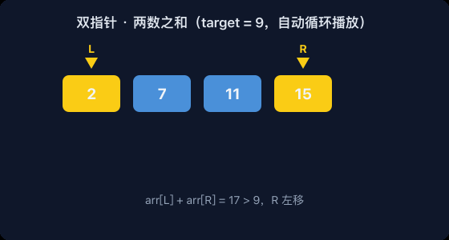

动画演示数组专题里双指针的典型过程；每个方案在「TypeScript 解题方案」一节还配了专属动画与专属流程图。

### 主解法流程图（真实控制流）

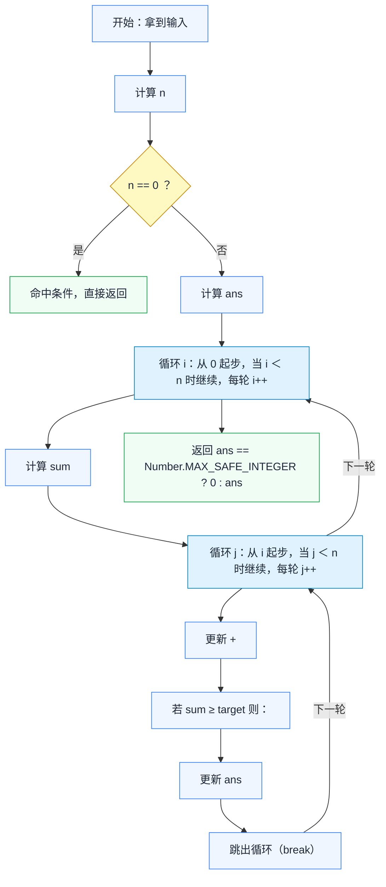

## TypeScript 解题方案（4 个方案逐个讲）

> **运行与提交**：每个方案都是自包含文件（内嵌用例自测，输出 PASS），整块复制到 `.ts` 文件后 `node 文件名` 即可运行。提交 LeetCode 时，把 `demo` 内的算法函数与辅助类型/函数整体取出、置于文件顶层即可。涉及交互/特殊接口的题以题面给定签名为准。

### 方案 1：暴力枚举

**分析与思路**：核心做法是「暴力枚举」。代码里依次做这些事：双重循环遍历。

**运行方式**：`node 本文件`，内嵌用例全部通过会输出 PASS。

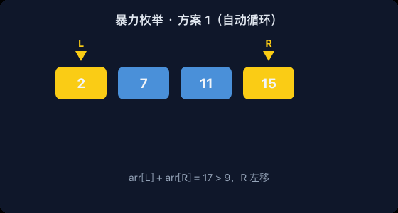

**方案专属流程图**（真实控制流）：

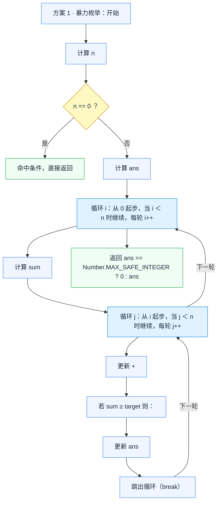

```typescript
/**
 ** LeetCode 209. 长度最小的子数组
 ** 方案1: 暴力枚举
 */

function minSubArrayLen(target: number, nums: number[]): number {
  // 定义函数/方法 minSubArrayLen
  const n = nums.length; // 把 数组.长度 存入 元素个数
  if (n === 0) return 0; // 若 元素个数 全等于 0，直接返回 0
  let ans = Number.MAX_SAFE_INTEGER; // 把 Number.MAX_SAFE_INTEGER 存入 答案
  for (let i = 0; i < n; i++) {
    // 让 下标 i 从 0 开始计数，下标 i 小于 元素个数 就继续
    let sum = 0; // 把 0 存入 累计和
    for (let j = i; j < n; j++) {
      // 让 下标 j 从 下标 i 开始计数，下标 j 小于 元素个数 就继续
      sum += nums[j]; // 累计和累加 数组[下标 j]
      if (sum >= target) {
        // 若 累计和 不低于 目标值
        ans = Math.min(ans, j - i + 1); // 把 Math.取较小值 答案, 下标 j 减 下标 i 加 1) 存入 答案
        break; // 跳出循环
      }
    }
  }
  return ans === Number.MAX_SAFE_INTEGER ? 0 : ans; // 返回 答案 全等于 Number.MAX_SAFE_INTEGER ? 0 : 答案
}

export function demo(): void {
  // 程序入口：跑内嵌自测用例
  const cases: { in: [number, number[]]; want: number }[] = [
    { in: [1, [1, 2, 3]], want: 1 },
    { in: [7, [2, 3, 1, 2, 4, 3]], want: 2 },
    { in: [11, [1, 1, 1, 1, 1, 1, 1, 1]], want: 0 },
    { in: [4, [1, 4, 4]], want: 1 },
  ];
  let fail = false; // 把 false 存入 fail
  for (const c of cases) {
    // for (const 字符 of cases) {
    const got = minSubArrayLen(c.in[0], c.in[1]); // 把 minSubArrayLen(字符.in[0], 字符.in[1]) 存入 got
    if (got !== c.want) {
      // 若 got 不等于 字符.want
      fail = true; // 把 true 存入 fail
      console.log(
        'FAIL minSubArrayLen(' +
          c.in[0] +
          ',' +
          JSON.stringify(c.in[1]) +
          ')=' +
          got +
          ' want ' +
          c.want,
      ); // 打印输出
    }
  }
  if (fail) throw new Error('FAILED'); // 若 fail) throw new Error(「FAILED」);
  console.log('PASS'); // 全部用例通过，输出 PASS
}
demo(); // demo();
```

### 方案 2：前缀和 + 二分查找

**分析与思路**：核心做法是「前缀和 + 二分查找」。代码里依次做这些事：二分收缩区间；双重循环遍历。

**运行方式**：`node 本文件`，内嵌用例全部通过会输出 PASS。


**方案专属流程图**（真实控制流）：

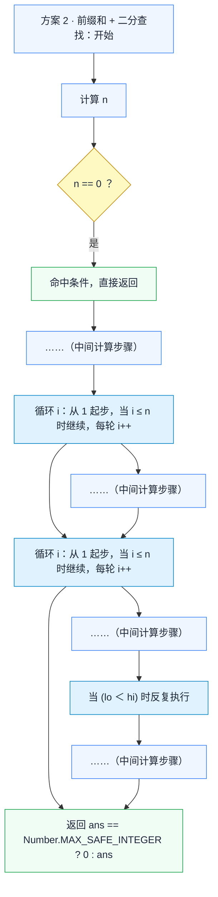

```typescript
/**
 ** LeetCode 209. 长度最小的子数组
 ** 方案2: 前缀和 + 二分查找
 */

function minSubArrayLen(target: number, nums: number[]): number {
  // 定义函数/方法 minSubArrayLen
  const n = nums.length; // 把 数组.长度 存入 元素个数
  if (n === 0) return 0; // 若 元素个数 全等于 0，直接返回 0
  let ans = Number.MAX_SAFE_INTEGER; // 把 Number.MAX_SAFE_INTEGER 存入 答案
  const sums: number[] = new Array(n + 1).fill(0); // 把 new Array(元素个数 加 1).fill(0); 写入 const sums: number[]
  for (let i = 1; i <= n; i++) {
    // 让 下标 i 从 1 开始计数，下标 i 不超过 元素个数 就继续
    sums[i] = sums[i - 1] + nums[i - 1]; // 把 sums[下标 i 减 1] 加 数组[下标 i 减 1]; 写入 sums[i]
  }
  for (let i = 1; i <= n; i++) {
    // 让 下标 i 从 1 开始计数，下标 i 不超过 元素个数 就继续
    const t = sums[i - 1] + target; // 把 sums[下标 i 减 1] 加 目标值 存入 另一字符串
    // bisect_left: 第一个满足 sums[idx] >= t 的下标
    let lo = 0,
      hi = n + 1; // 把 0, 右边界 赋值为 元素个数 加 1 存入 左边界
    while (lo < hi) {
      // 循环，直到不满足「左边界 小于 右边界」
      const mid = Math.floor((lo + hi) / 2); // 把 向下取整((左边界 加 右边界) 除以 2) 存入 中点
      if (sums[mid] < t) lo = mid + 1;
      else hi = mid; // 若 sums[中点] 小于 另一字符串) 左边界 赋值为 中点 加 1; else 右边界 赋值为 中点;
    }
    const bound = lo; // 把 左边界 存入 bound
    if (bound <= n) {
      // 若 bound 不超过 元素个数
      ans = Math.min(ans, bound - (i - 1)); // 把 Math.取较小值 答案, bound 减 (下标 i 减 1)) 存入 答案
    }
  }
  return ans === Number.MAX_SAFE_INTEGER ? 0 : ans; // 返回 答案 全等于 Number.MAX_SAFE_INTEGER ? 0 : 答案
}

export function demo(): void {
  // 程序入口：跑内嵌自测用例
  const cases: { in: [number, number[]]; want: number }[] = [
    { in: [1, [1, 2, 3]], want: 1 },
    { in: [7, [2, 3, 1, 2, 4, 3]], want: 2 },
    { in: [11, [1, 1, 1, 1, 1, 1, 1, 1]], want: 0 },
    { in: [4, [1, 4, 4]], want: 1 },
  ];
  let fail = false; // 把 false 存入 fail
  for (const c of cases) {
    // for (const 字符 of cases) {
    const got = minSubArrayLen(c.in[0], c.in[1]); // 把 minSubArrayLen(字符.in[0], 字符.in[1]) 存入 got
    if (got !== c.want) {
      // 若 got 不等于 字符.want
      fail = true; // 把 true 存入 fail
      console.log(
        'FAIL minSubArrayLen(' +
          c.in[0] +
          ',' +
          JSON.stringify(c.in[1]) +
          ')=' +
          got +
          ' want ' +
          c.want,
      ); // 打印输出
    }
  }
  if (fail) throw new Error('FAILED'); // 若 fail) throw new Error(「FAILED」);
  console.log('PASS'); // 全部用例通过，输出 PASS
}
demo(); // demo();
```

### 方案 3：单趟扫描

**分析与思路**：核心做法是「单趟扫描」。代码里依次做这些事：单循环线性扫描。

**运行方式**：`node 本文件`，内嵌用例全部通过会输出 PASS。


**方案专属流程图**（真实控制流）：

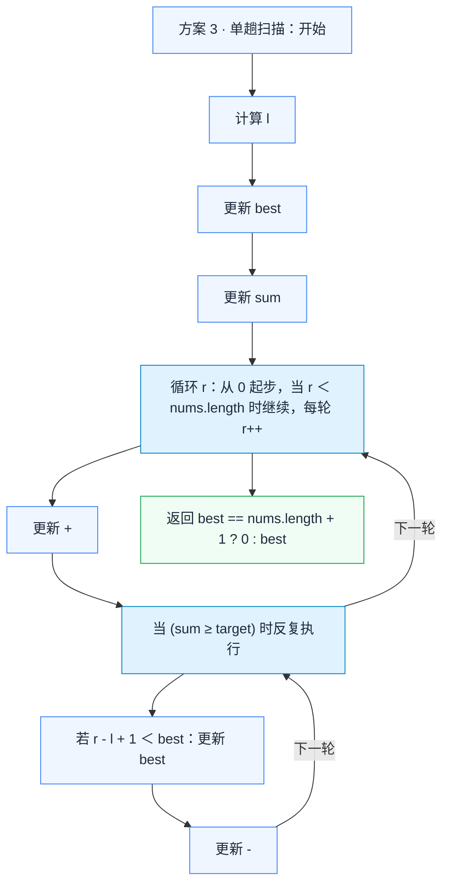

```typescript
export function demo(): void {
  // 程序入口：跑内嵌自测用例
  function minSubArrayLen(target: number, nums: number[]): number {
    // 定义函数/方法 minSubArrayLen
    let l = 0,
      best = nums.length + 1,
      sum = 0; // 把 0, 当前最优 赋值为 数组.长度 加 1, 累计和 赋值为 0 存入 左指针
    for (let r = 0; r < nums.length; r++) {
      // 让 右指针 从 0 开始计数，右指针 小于 数组.长度 就继续
      sum += nums[r]; // 累计和累加 数组[右指针]
      while (sum >= target) {
        // 循环，直到不满足「累计和 不低于 目标值」
        if (r - l + 1 < best) best = r - l + 1; // 若 右指针 减 左指针 加 1 小于 当前最优) 当前最优 赋值为 右指针 减 左指针 加 1;
        sum -= nums[l++]; // 累计和累减 数组[左指针 加一 ]
      }
    }
    return best === nums.length + 1 ? 0 : best; // 返回 当前最优 全等于 数组.长度 加 1 ? 0 : 当前最优
  }
  const cases = [
    { t: 7, nums: [2, 3, 1, 2, 4, 3], want: 2 },
    { t: 4, nums: [1, 4, 4], want: 1 },
    { t: 11, nums: [1, 1, 1, 1, 1, 1, 1, 1], want: 0 },
  ];
  let fail = false; // 把 false 存入 fail
  for (const c of cases) {
    // for (const 字符 of cases) {
    const got = minSubArrayLen(c.t, c.nums); // 把 minSubArrayLen(字符.另一字符串, 字符.数组) 存入 got
    if (got !== c.want) {
      fail = true;
      console.log('FAIL ' + got + ' want ' + c.want);
    }
  }
  if (fail) throw new Error('FAILED'); // 若 fail) throw new Error(「FAILED」);
  console.log('PASS'); // 全部用例通过，输出 PASS
}
demo(); // demo();
```

### 方案 4：滑动窗口

**分析与思路**：核心做法是「滑动窗口」。

**运行方式**：`node 本文件`，内嵌用例全部通过会输出 PASS。


**方案专属流程图**（真实控制流）：

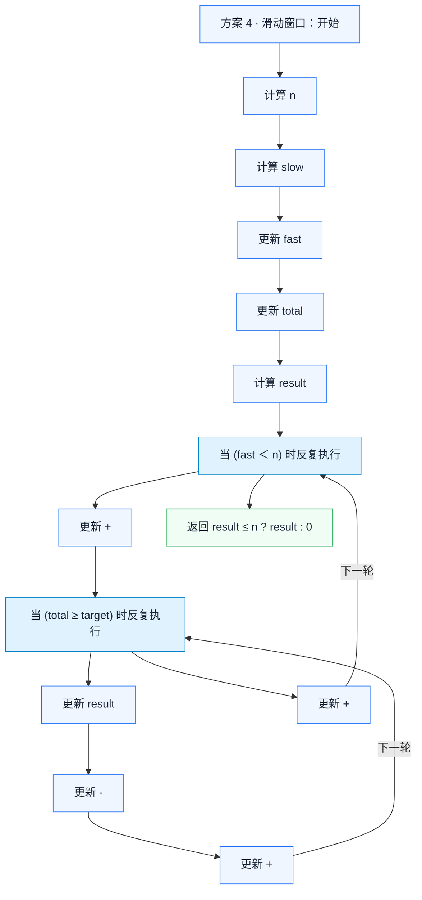

```typescript
/**
 ** LeetCode 209. 长度最小的子数组
 ** 方案4: 滑动窗口
 */

function minSubArrayLen(target: number, nums: number[]): number {
  // 定义函数/方法 minSubArrayLen
  const n = nums.length; // 把 数组.长度 存入 元素个数
  let slow = 0,
    fast = 0,
    total = 0; // 把 0, 快指针 赋值为 0, 总和 赋值为 0 存入 慢指针
  let result = n + 1; // 把 元素个数 加 1 存入 结果
  while (fast < n) {
    // 循环，直到不满足「快指针 小于 元素个数」
    total += nums[fast]; // 总和累加 数组[快指针]
    while (total >= target) {
      // 循环，直到不满足「总和 不低于 目标值」
      result = Math.min(result, fast - slow + 1); // 把 Math.取较小值 结果, 快指针 减 慢指针 加 1) 存入 结果
      total -= nums[slow]; // 总和累减 数组[慢指针]
      slow += 1; // 慢指针累加 1
    }
    fast += 1; // 快指针累加 1
  }
  return result <= n ? result : 0; // 返回 结果 不超过 元素个数 ? 结果 : 0
}

export function demo(): void {
  // 程序入口：跑内嵌自测用例
  const cases: { in: [number, number[]]; want: number }[] = [
    { in: [1, [1, 2, 3]], want: 1 },
    { in: [7, [2, 3, 1, 2, 4, 3]], want: 2 },
    { in: [11, [1, 1, 1, 1, 1, 1, 1, 1]], want: 0 },
    { in: [4, [1, 4, 4]], want: 1 },
  ];
  let fail = false; // 把 false 存入 fail
  for (const c of cases) {
    // for (const 字符 of cases) {
    const got = minSubArrayLen(c.in[0], c.in[1]); // 把 minSubArrayLen(字符.in[0], 字符.in[1]) 存入 got
    if (got !== c.want) {
      // 若 got 不等于 字符.want
      fail = true; // 把 true 存入 fail
      console.log(
        'FAIL minSubArrayLen(' +
          c.in[0] +
          ',' +
          JSON.stringify(c.in[1]) +
          ')=' +
          got +
          ' want ' +
          c.want,
      ); // 打印输出
    }
  }
  if (fail) throw new Error('FAILED'); // 若 fail) throw new Error(「FAILED」);
  console.log('PASS'); // 全部用例通过，输出 PASS
}
demo(); // demo();
```

## 逐步拆解与面试追问

**复杂度**：时间 O(n²)（两层嵌套扫描），空间 O(1) 到 O(n)

**为什么是这个量级**：外层定起点、内层扫终点，n 个起点各扫 n 次

**面试官可能会追问**：

- 能不能原地做（O(1) 空间）？
- 如果数组已有序，能优化到什么程度？
- 空数组、单元素怎么处理？

## 关键 API 速查（TS 主解法实际用到，附官方链接）

| API | 作用 | 使用要点 | 官方文档 |
|---|---|---|---|
| `JSON.stringify()` | 序列化为 JSON 字符串 | 常用于结构化比较（深度相等判定）；undefined/函数/循环引用会被丢弃或抛错 | [官方文档](https://developer.mozilla.org/zh-CN/docs/Web/JavaScript/Reference/Global_Objects/JSON/stringify) |
| `Math.min()` | 最小值 | 同 max；空参返回 Infinity | [官方文档](https://developer.mozilla.org/zh-CN/docs/Web/JavaScript/Reference/Global_Objects/Math/min) |

### 各语言官方文档导航

- **TypeScript / JS**：[MDN 中文参考](https://developer.mozilla.org/zh-CN/)
- **Python**：[Python 官方文档](https://docs.python.org/zh-cn/3/)
- **Go**：[Go 标准库](https://pkg.go.dev/std)
- **Java**：[JDK 17 API](https://docs.oracle.com/en/java/javase/17/docs/api/)
- **Rust**：[Rust 标准库](https://doc.rust-lang.org/std/)
- **Lua**：[Lua 5.4 手册](https://www.lua.org/manual/5.4/)
- **C**：[Cppreference C](https://zh.cppreference.com/w/c)
- **C++**：[Cppreference C++](https://zh.cppreference.com/w/cpp)
- **R**：[R 官方手册](https://stat.ethz.ch/R-manual/)
- **Zig**：[Zig 语言文档](https://ziglang.org/documentation/master/)
- **Dart**：[Dart API](https://api.dart.dev/)

## 附录：其他 10 种语言全部实现（每种语言列举其全部方案）

> TypeScript 的全部方案见「TypeScript 解题方案」一节；下面是其余 10 种语言的对应实现，每种语言的每个方案都带思路分析、代码走读与专属运行架构图。
> 每个方案都内嵌用例自测，可独立运行（老仓库 python/go 文件遵循「打印结果」约定）。
> 完整解法文件见 `dsa/<语言>/array/lc_209_长度最小的子数组/`。

### Python 实现（4 种方案）

Python 的全部方案如下，每个方案都内嵌用例自测，可独立运行（老仓库 python/go 文件遵循「打印结果」约定）：

#### 方案 1：暴力枚举

**思路与代码分析**：核心是「暴力枚举」。Python 版用切片与字典推导式简化操作，突出可读性。**走读**：方案 1 · 暴力枚举：开始 → 更新 n → 命中条件，直接返回 → 更新 ans → 循环 i：从 0 到 n 前 → 更新 s → 循环 j：从 i 到 n 前 → 更新 + → 若 s ≥ target：更新 ans → 更新 ans → 跳出循环（break） → 返回 ans if ans ≠ float(inf) else 0。

**运行架构**（真实控制流）：

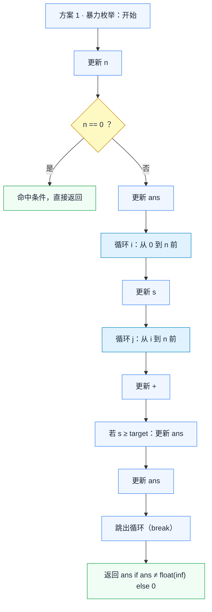

```python
import sys  # 提高递归深度上限（深输入防 RecursionError）

sys.setrecursionlimit(200000)  # 树/链表类题目节点数可达 1e4 量级

def minSubArrayLen(target, nums):  # 定义函数 minSubArrayLen（参数：目标值, 数组）
    n = len(nums)  # 把 长度(数组) 存入 元素个数
    if n == 0:  # 若 元素个数 等于 0
        return 0  # 返回 0
    ans = float("inf")  # 把 float('inf') 存入 答案
    for i in range(n):  # 让 下标 i 从 元素个数 遍历
        s = 0  # 把 0 存入 字符串
        for j in range(i, n):  # 让 下标 j 从 下标 i 到 元素个数 遍历
            s += nums[j]  # 字符串累加 数组[下标 j]
            if s >= target:  # 若 字符串 不低于 目标值
                ans = min(ans, j - i + 1)  # 把 取较小值 答案, 下标 j 减 下标 i 加 1) 存入 答案
                break  # 跳出循环
    return ans if ans != float("inf") else 0  # 返回 答案 if 答案 不等于 float('inf') else 0

if __name__ == "__main__":  # 若 __name__ 等于 '__main__'
    print(minSubArrayLen(1, [1, 2, 3]))  # 打印输出
```

#### 方案 2：前缀和 + 二分查找

**思路与代码分析**：核心是「前缀和 + 二分查找」。Python 版用切片与字典推导式简化操作，突出可读性。**走读**：方案 2 · 前缀和 + 二分查找：开始 → 更新 n → 命中条件，直接返回 → 更新 ans → 更新 sums → 循环 i：从 1 到 n + 1 前 → 更新 sums[i] → 循环 i：从 1 到 n + 1 前 → 更新 t → 更新 bound → 若 bound ≤ n：更新 ans → 更新 ans → 返回 ans if ans ≠ float(inf) else 0。

**运行架构**（真实控制流）：

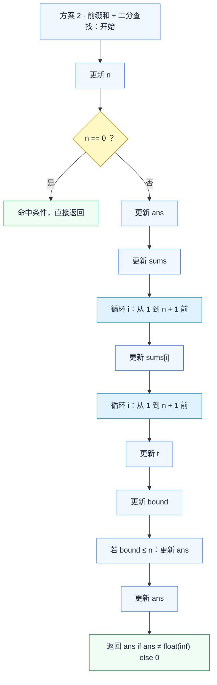

```python
import sys  # 提高递归深度上限（深输入防 RecursionError）

sys.setrecursionlimit(200000)  # 树/链表类题目节点数可达 1e4 量级

def minSubArrayLen(target, nums):  # 定义函数 minSubArrayLen（参数：目标值, 数组）
    import bisect  # 引入依赖

    n = len(nums)  # 把 长度(数组) 存入 元素个数
    if n == 0:  # 若 元素个数 等于 0
        return 0  # 返回 0
    ans = float("inf")  # 把 float('inf') 存入 答案
    sums = [0] * (n + 1)  # 把 [0] 乘 (元素个数 加 1) 存入 sums
    for i in range(1, n + 1):  # 让 下标 i 从 1 到 元素个数 加 1 遍历
        sums[i] = sums[i - 1] + nums[i - 1]  # 把 sums[下标 i 减 1] 加 数组[下标 i 减 1] 写入 sums[i]
    for i in range(1, n + 1):  # 让 下标 i 从 1 到 元素个数 加 1 遍历
        t = sums[i - 1] + target  # 把 sums[下标 i 减 1] 加 目标值 存入 另一字符串
        bound = bisect.bisect_left(sums, t)  # 把 bisect.bisect_left(sums, 另一字符串) 存入 bound
        if bound <= n:  # 若 bound 不超过 元素个数
            ans = min(ans, bound - (i - 1))  # 把 取较小值 答案, bound 减 (下标 i 减 1)) 存入 答案
    return ans if ans != float("inf") else 0  # 返回 答案 if 答案 不等于 float('inf') else 0

if __name__ == "__main__":  # 若 __name__ 等于 '__main__'
    print(minSubArrayLen(1, [1, 2, 3]))  # 打印输出
```

#### 方案 3：单趟扫描

**思路与代码分析**：核心是「单趟扫描」。Python 版用切片与字典推导式简化操作，突出可读性。**走读**：方案 3 · 单趟扫描：开始 → 更新 n → 命中条件，直接返回 → 更新 ans → 更新 start → 更新 total → 当 end ＜ n: 时反复执行 → 更新 + → 当 total ≥ target: 时反复执行 → 更新 ans → 更新 - → 更新 + → 更新 + → 返回 ans if ans ≠ float(inf) else 0。

**运行架构**（真实控制流）：

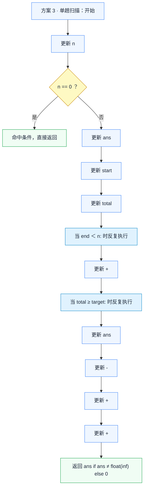

```python
import sys  # 提高递归深度上限（深输入防 RecursionError）

sys.setrecursionlimit(200000)  # 树/链表类题目节点数可达 1e4 量级

def minSubArrayLen(target, nums):  # 定义函数 minSubArrayLen（参数：目标值, 数组）
    n = len(nums)  # 把 长度(数组) 存入 元素个数
    if n == 0:  # 若 元素个数 等于 0
        return 0  # 返回 0
    ans = float("inf")  # 把 float('inf') 存入 答案
    start = end = 0  # 把 终点 赋值为 0 存入 起点
    total = 0  # 把 0 存入 总和
    while end < n:  # 循环，直到不满足「终点 小于 元素个数」
        total += nums[end]  # 总和累加 数组[终点]
        while total >= target:  # 循环，直到不满足「总和 不低于 目标值」
            ans = min(ans, end - start + 1)  # 把 取较小值 答案, 终点 减 起点 加 1) 存入 答案
            total -= nums[start]  # 总和累减 数组[起点]
            start += 1  # 起点累加 1
        end += 1  # 终点累加 1
    return ans if ans != float("inf") else 0  # 返回 答案 if 答案 不等于 float('inf') else 0

if __name__ == "__main__":  # 若 __name__ 等于 '__main__'
    print(minSubArrayLen(1, [1, 2, 3]))  # 打印输出
```

#### 方案 4：滑动窗口

**思路与代码分析**：核心是「滑动窗口」。Python 版用切片与字典推导式简化操作，突出可读性。**走读**：方案 4 · 滑动窗口：开始 → 更新 n → 更新 slow → 更新 total → 更新 result → 当 fast ＜ n: 时反复执行 → 更新 + → 当 total ≥ target: 时反复执行 → 更新 result → 更新 - → 更新 + → 更新 + → 返回 result if result ≤ n else 0。

**运行架构**（真实控制流）：

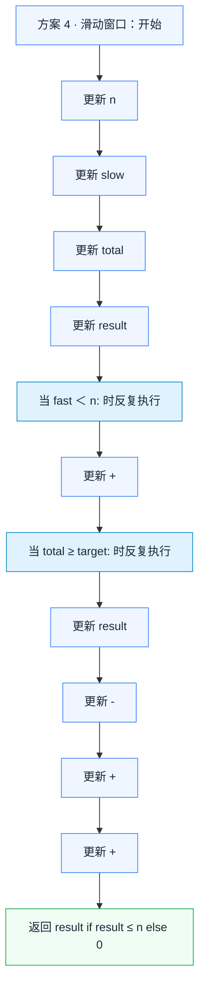

```python
import sys  # 提高递归深度上限（深输入防 RecursionError）

sys.setrecursionlimit(200000)  # 树/链表类题目节点数可达 1e4 量级

def minSubArrayLen(target, nums):  # 定义函数 minSubArrayLen（参数：目标值, 数组）
    n = len(nums)  # 把 长度(数组) 存入 元素个数
    slow = fast = 0  # 把 快指针 赋值为 0 存入 慢指针
    total = 0  # 把 0 存入 总和
    result = n + 1  # 把 元素个数 加 1 存入 结果
    while fast < n:  # 循环，直到不满足「快指针 小于 元素个数」
        total += nums[fast]  # 总和累加 数组[快指针]
        while total >= target:  # 循环，直到不满足「总和 不低于 目标值」
            result = min(result, fast - slow + 1)  # 把 取较小值 结果, 快指针 减 慢指针 加 1) 存入 结果
            total -= nums[slow]  # 总和累减 数组[慢指针]
            slow += 1  # 慢指针累加 1
        fast += 1  # 快指针累加 1
    return result if result <= n else 0  # 返回 结果 if 结果 不超过 元素个数 else 0

if __name__ == "__main__":  # 若 __name__ 等于 '__main__'
    print(minSubArrayLen(1, [1, 2, 3]))  # 打印输出
```

### Go 实现（4 种方案）

Go 的全部方案如下，每个方案都内嵌用例自测，可独立运行（老仓库 python/go 文件遵循「打印结果」约定）：

#### 方案 1：暴力枚举

**思路与代码分析**：核心是「暴力枚举」。Go 版用切片与多返回值惯用法，显式处理索引边界。**走读**：方案 1 · 暴力枚举：开始 → 更新 : → 处理 if n == 0 → 返回 0 → 更新 : → 遍历循环 → 更新 : → 遍历循环 → 更新 + → 处理 if s ≥ target → 处理 if j-i+1 ＜ ans → 更新 ans → 跳出循环（break） → 处理 if ans == int(^uint(0)＞＞1) → 返回 0 → 返回 ans。

**运行架构**（真实控制流）：

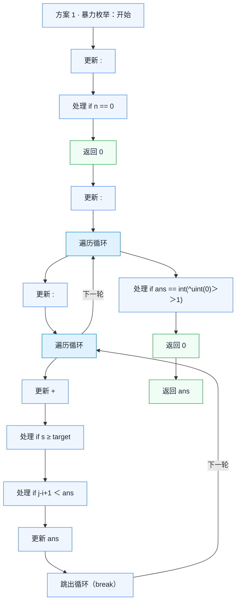

```go
package main // 引入依赖

import (
	"fmt"     // 「fmt」
	"os"      // 「os」
	"reflect" // 「reflect」
)

func minSubArrayLen(target int, nums []int) int { // 定义函数/方法 minSubArrayLen
	n := len(nums) // 把 长度(数组) 写入 n :
	if n == 0 {    // 若 元素个数 等于 0
		return 0 // 返回 0
	}
	ans := int(^uint(0) >> 1) // 把 int( 按位异或 uint(0) 超过 超过 1) 写入 ans :
	for i := 0; i < n; i++ {  // 让 下标 i 从 0 开始计数
		s := 0                   // 把 0 写入 s :
		for j := i; j < n; j++ { // 把 下标 i; 下标 j 小于 元素个数; 下标 j 加一 { 写入 for j :
			s += nums[j]     // 字符串累加 数组[下标 j]
			if s >= target { // 若 字符串 不低于 目标值
				if j-i+1 < ans { // 若 下标 j 减 下标 i 加 1 小于 答案
					ans = j - i + 1 // 把 下标 j 减 下标 i 加 1 写入 答案
				}
				break // 跳出循环
			}
		}
	}
	if ans == int(^uint(0)>>1) { // 若 答案 等于 int( 按位异或 uint(0) 超过 超过 1
		return 0 // 返回 0
	}
	return ans // 返回 答案
}

func main() { // 程序入口：跑内嵌自测用例
	type tc struct { // 定义类型
		target int   // 目标值 int
		nums   []int // 数组 []int
		want   int   // want int
	}
	cases := []tc{ // 把 []tc{ 写入 cases :
		{1, []int{1, 2, 3}, 1},
		{7, []int{2, 3, 1, 2, 4, 3}, 2},
		{11, []int{1, 2, 3, 4, 5}, 3},
		{15, []int{1, 2, 3, 4, 5}, 5},
		{100, []int{1, 2, 3}, 0},
	}
	ok := true                // 把 true 写入 ok :
	for _, c := range cases { // 同时取 _ 与 字符 遍历
		if got := minSubArrayLen(c.target, c.nums); got != c.want { // 若 got : 赋值为 minSubArrayLen(字符.目标值, 字符.数组); got 不等于 字符.want
			ok = false                                                                           // 把 false 写入 ok
			fmt.Printf("FAIL minSubArrayLen(%v,%v)=%v want %v\n", c.target, c.nums, got, c.want) // 打印输出
		}
	}
	_ = reflect.DeepEqual // 把 reflect.DeepEqual 写入 _
	if !ok {              // 若 取反 ok
		os.Exit(1) // os.Exit(1)
	}
	fmt.Println("PASS") // 全部用例通过，输出 PASS
}
```

#### 方案 2：前缀和 + 二分查找

**思路与代码分析**：核心是「前缀和 + 二分查找」。Go 版用切片与多返回值惯用法，显式处理索引边界。**走读**：方案 2 · 前缀和 + 二分查找：开始 → 更新 : → 返回 0 → 遍历循环 → 遍历循环 → 返回 0 → 返回 ans。

**运行架构**（真实控制流）：

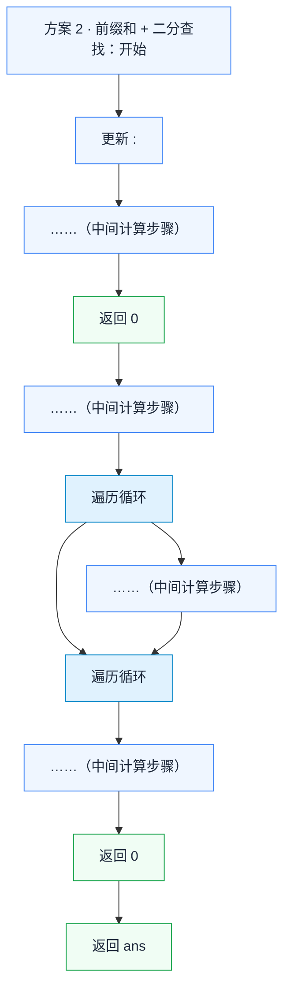

```go
package main // 引入依赖

import (
	"fmt"  // 「fmt」
	"os"   // 「os」
	"sort" // 「sort」
)

func bisectLeft(arr []int, x int) int { // 定义函数/方法 bisectLeft
	return sort.Search(len(arr), func(i int) bool { return arr[i] >= x })
}

func minSubArrayLen(target int, nums []int) int { // 定义函数/方法 minSubArrayLen
	n := len(nums) // 把 长度(数组) 写入 n :
	if n == 0 {    // 若 元素个数 等于 0
		return 0 // 返回 0
	}
	ans := int(^uint(0) >> 1) // 把 int( 按位异或 uint(0) 超过 超过 1) 写入 ans :
	sums := make([]int, n+1)  // 把 make([]int, 元素个数 加 1) 写入 sums :
	for i := 1; i <= n; i++ { // 让 下标 i 从 1 开始计数
		sums[i] = sums[i-1] + nums[i-1] // 把 sums[下标 i 减 1] 加 数组[下标 i 减 1] 写入 sums[i]
	}
	for i := 1; i <= n; i++ { // 让 下标 i 从 1 开始计数
		t := sums[i-1] + target      // 把 sums[下标 i 减 1] 加 目标值 写入 t :
		bound := bisectLeft(sums, t) // 把 bisectLeft(sums, 另一字符串) 写入 bound :
		if bound <= n {              // 若 bound 不超过 元素个数
			if bound-(i-1) < ans { // 若 bound 减 (下标 i 减 1) 小于 答案
				ans = bound - (i - 1) // 把 bound 减 (下标 i 减 1) 写入 答案
			}
		}
	}
	if ans == int(^uint(0)>>1) { // 若 答案 等于 int( 按位异或 uint(0) 超过 超过 1
		return 0 // 返回 0
	}
	return ans // 返回 答案
}

func main() { // 程序入口：跑内嵌自测用例
	type tc struct { // 定义类型
		target int   // 目标值 int
		nums   []int // 数组 []int
		want   int   // want int
	}
	cases := []tc{ // 把 []tc{ 写入 cases :
		{1, []int{1, 2, 3}, 1},
		{7, []int{2, 3, 1, 2, 4, 3}, 2},
		{11, []int{1, 2, 3, 4, 5}, 3},
		{15, []int{1, 2, 3, 4, 5}, 5},
		{100, []int{1, 2, 3}, 0},
	}
	ok := true                // 把 true 写入 ok :
	for _, c := range cases { // 同时取 _ 与 字符 遍历
		if got := minSubArrayLen(c.target, c.nums); got != c.want { // 若 got : 赋值为 minSubArrayLen(字符.目标值, 字符.数组); got 不等于 字符.want
			ok = false                                                                           // 把 false 写入 ok
			fmt.Printf("FAIL minSubArrayLen(%v,%v)=%v want %v\n", c.target, c.nums, got, c.want) // 打印输出
		}
	}
	if !ok { // 若 取反 ok
		os.Exit(1) // os.Exit(1)
	}
	fmt.Println("PASS") // 全部用例通过，输出 PASS
}
```

#### 方案 3：单趟扫描

**思路与代码分析**：核心是「单趟扫描」。Go 版用切片与多返回值惯用法，显式处理索引边界。**走读**：方案 3 · 单趟扫描：开始 → 更新 : → 遍历循环 → 更新 + → 遍历循环 → 处理 if r-l+1 ＜ best → 更新 best → 更新 - → 处理 l++ → 处理 if best == len(nums)+1 → 返回 0 → 返回 best。

**运行架构**（真实控制流）：

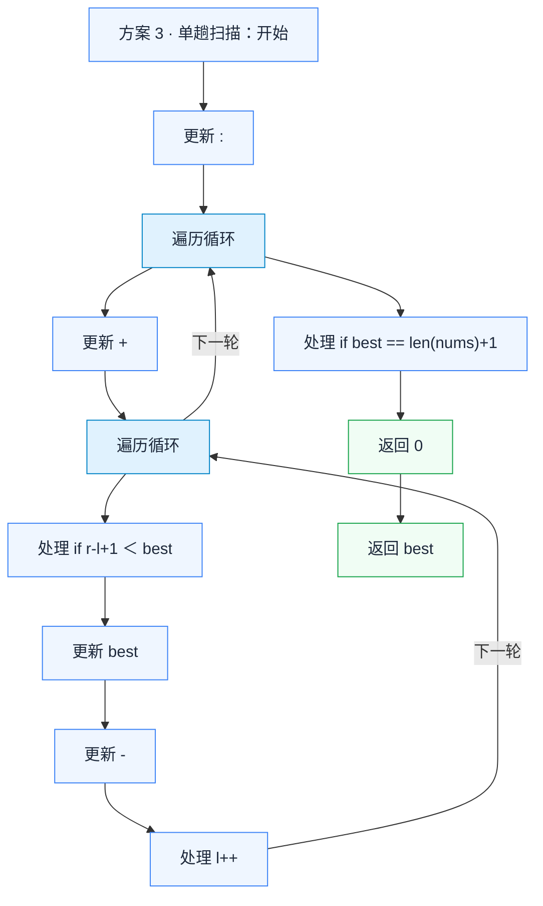

```go
package main // 引入依赖
import (
	"fmt"
	"os"
) // 引入依赖
func minSubArrayLen(target int, nums []int) int { // 定义函数/方法 minSubArrayLen
	l, best, sum := 0, len(nums)+1, 0 // 把 0, 长度(数组) 加 1, 0 写入 l, best, sum :
	for r := 0; r < len(nums); r++ {  // 让 右指针 从 0 开始计数
		sum += nums[r]      // 累计和累加 数组[右指针]
		for sum >= target { // 把 目标值 { 写入 for sum >
			if r-l+1 < best {
				best = r - l + 1
			} // 若 右指针 减 左指针 加 1 小于 当前最优 { 当前最优 赋值为 右指针 减 左指针 加 1 }
			sum -= nums[l]
			l++ // 把 数组[左指针]; 左指针 加一 写入 sum -
		}
	}
	if best == len(nums)+1 {
		return 0
	} // 若 当前最优 等于 长度(数组) 加 1 { return 0 }
	return best // 返回 当前最优
}
func main() { // 程序入口：跑内嵌自测用例
	cases := []struct {
		t    int
		nums []int
		want int
	}{ // 把 []struct{ 另一字符串 int; 数组 []int; want int }{ 写入 cases :
		{7, []int{2, 3, 1, 2, 4, 3}, 2}, {4, []int{1, 4, 4}, 1}, {11, []int{1, 1, 1, 1, 1, 1, 1, 1}, 0},
	}
	ok := true                // 把 true 写入 ok :
	for _, c := range cases { // 同时取 _ 与 字符 遍历
		if got := minSubArrayLen(c.t, c.nums); got != c.want {
			ok = false
			fmt.Printf("FAIL=%v want %v\n", got, c.want)
		}
	}
	if !ok {
		os.Exit(1)
	} // 若 取反 ok { os.Exit(1) }
	fmt.Println("PASS") // 全部用例通过，输出 PASS
}
```

#### 方案 4：滑动窗口

**思路与代码分析**：核心是「滑动窗口」。Go 版用切片与多返回值惯用法，显式处理索引边界。**走读**：方案 4 · 滑动窗口：开始 → 更新 : → 遍历循环 → 更新 + → 遍历循环 → 处理 if r-l+1 ＜ best → 更新 best → 更新 - → 处理 l++ → 处理 if best == len(nums)+1 → 返回 0 → 返回 best。

**运行架构**（真实控制流）：

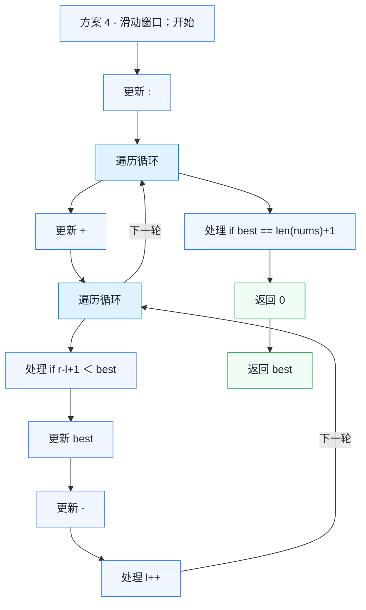

```go
package main // 引入依赖
import (
	"fmt"
	"os"
) // 引入依赖
func minSubArrayLen(target int, nums []int) int { // 定义函数/方法 minSubArrayLen
	l, best, sum := 0, len(nums)+1, 0 // 把 0, 长度(数组) 加 1, 0 写入 l, best, sum :
	for r := 0; r < len(nums); r++ {  // 让 右指针 从 0 开始计数
		sum += nums[r]      // 累计和累加 数组[右指针]
		for sum >= target { // 把 目标值 { 写入 for sum >
			if r-l+1 < best {
				best = r - l + 1
			} // 若 右指针 减 左指针 加 1 小于 当前最优 { 当前最优 赋值为 右指针 减 左指针 加 1 }
			sum -= nums[l]
			l++ // 把 数组[左指针]; 左指针 加一 写入 sum -
		}
	}
	if best == len(nums)+1 {
		return 0
	} // 若 当前最优 等于 长度(数组) 加 1 { return 0 }
	return best // 返回 当前最优
}
func main() { // 程序入口：跑内嵌自测用例
	cases := []struct {
		t    int
		nums []int
		want int
	}{ // 把 []struct{ 另一字符串 int; 数组 []int; want int }{ 写入 cases :
		{7, []int{2, 3, 1, 2, 4, 3}, 2}, {4, []int{1, 4, 4}, 1}, {11, []int{1, 1, 1, 1, 1, 1, 1, 1}, 0},
	}
	ok := true                // 把 true 写入 ok :
	for _, c := range cases { // 同时取 _ 与 字符 遍历
		if got := minSubArrayLen(c.t, c.nums); got != c.want {
			ok = false
			fmt.Printf("FAIL=%v want %v\n", got, c.want)
		}
	}
	if !ok {
		os.Exit(1)
	} // 若 取反 ok { os.Exit(1) }
	fmt.Println("PASS") // 全部用例通过，输出 PASS
}
```

### Java 实现（4 种方案）

Java 的全部方案如下，每个方案都内嵌用例自测，可独立运行（老仓库 python/go 文件遵循「打印结果」约定）：

#### 方案 1：暴力枚举

**思路与代码分析**：核心是「暴力枚举」。Java 版用类与静态方法组织，集合操作显式明了。代码里依次做这些事：双重循环遍历。**走读**：方案 1 · 暴力枚举：开始 → 更新 n → 命中条件，直接返回 → 更新 ans → 遍历循环 → 更新 sum → 遍历循环 → 更新 + → 若 sum ≥ target 则： → 更新 ans → 跳出循环（break） → 返回 ans == Integer.MAX_VALUE ? 0 : ans。

**运行架构**（真实控制流）：

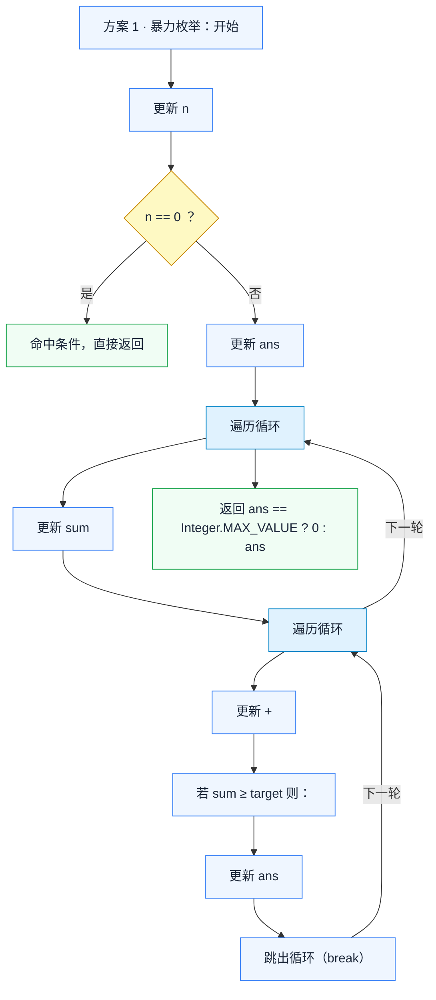

```java
package com.webfault.dsa; // 引入依赖

import java.util.*; // 引入依赖

class lc209_solution111 { // 定义类型
  public int minSubArrayLen(int target, int[] nums) { // 定义函数/方法 minSubArrayLen
    int n = nums.length; // 把 数组.长度 存入 元素个数
    if (n == 0) return 0; // 若 元素个数 等于 0，直接返回 0
    int ans = Integer.MAX_VALUE; // 把 Integer.MAX_VALUE 存入 答案
    for (int i = 0; i < n; i++) { // 让 下标 i 从 0 开始计数，下标 i 小于 元素个数 就继续
      int sum = 0; // 把 0 存入 累计和
      for (int j = i; j < n; j++) { // 让 下标 j 从 下标 i 开始计数，下标 j 小于 元素个数 就继续
        sum += nums[j]; // 累计和累加 数组[下标 j]
        if (sum >= target) { // 若 累计和 不低于 目标值
          ans = Math.min(ans, j - i + 1); // 把 Math.取较小值 答案, 下标 j 减 下标 i 加 1); 写入 答案
          break; // 跳出循环
        }
      }
    }
    return ans == Integer.MAX_VALUE ? 0 : ans; // 返回 答案 等于 Integer.MAX_VALUE ? 0 : 答案
  }

  public static void main(String[] args) { // public static void main(String[] args) {
    lc209_solution111 s =
        new lc209_solution111(); // 把 new lc209_solution111(); 写入 lc209_solution111 s
    int[] targets = {7, 11, 11, 4, 15, 0}; // 把 {7, 11, 11, 4, 15, 0}; 写入 int[] targets
    int[][] numsArr = { // 把 { 写入 int[][] numsArr
      {2, 3, 1, 2, 4, 3},
      {1, 2, 3, 4, 5},
      {1, 1, 1, 1, 1, 1, 1, 1},
      {1, 4, 4},
      {1, 2, 3, 4, 5, 6, 7, 8},
      {} // {}
    };
    int[] want = {2, 3, 0, 1, 2, 0}; // 把 {2, 3, 0, 1, 2, 0}; 写入 int[] want
    boolean ok = true; // 把 true; 写入 boolean ok
    for (int i = 0; i < want.length; i++) { // 让 下标 i 从 0 开始计数，下标 i 小于 want.长度 就继续
      int got =
          s.minSubArrayLen(
              targets[i], numsArr[i]); // 把 字符串.minSubArrayLen(targets[下标 i], numsArr[下标 i]) 存入 got
      if (got != want[i]) { // 若 got 不等于 want[下标 i]
        ok = false; // 把 false; 写入 ok
        System.out.println("FAIL case " + i + " got " + got + " want " + want[i]); // 打印输出
      }
    }
    if (!ok) throw new RuntimeException("FAILED"); // 若 取反 ok) throw new RuntimeException(「FAILED」);
    System.out.println("PASS"); // 全部用例通过，输出 PASS
  }
}
```

#### 方案 2：前缀和 + 二分查找

**思路与代码分析**：核心是「前缀和 + 二分查找」。Java 版用类与静态方法组织，集合操作显式明了。代码里依次做这些事：双重循环遍历。**走读**：方案 2 · 前缀和 + 二分查找：开始 → 更新 n → 命中条件，直接返回 → 更新 sums → 遍历循环 → 更新 sums[i] → 更新 ans → 遍历循环 → 更新 bound → 更新 j → 若 j ＜ 0：更新 j → 若 j ≤ n 则： → 更新 ans → 返回 ans == n + 1 ? 0 : ans。

**运行架构**（真实控制流）：

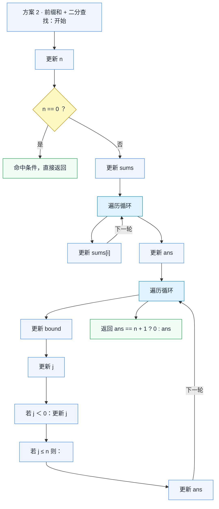

```java
package com.webfault.dsa; // 引入依赖

import java.util.*; // 引入依赖

class lc209_solution222 { // 定义类型
  public int minSubArrayLen(int target, int[] nums) { // 定义函数/方法 minSubArrayLen
    int n = nums.length; // 把 数组.长度 存入 元素个数
    if (n == 0) return 0; // 若 元素个数 等于 0，直接返回 0
    int[] sums = new int[n + 1]; // 把 new int[元素个数 加 1]; 写入 int[] sums
    for (int i = 1; i <= n; i++) { // 让 下标 i 从 1 开始计数，下标 i 不超过 元素个数 就继续
      sums[i] = sums[i - 1] + nums[i - 1]; // 把 sums[下标 i 减 1] 加 数组[下标 i 减 1]; 写入 sums[i]
    }
    int ans = n + 1; // 把 元素个数 加 1 存入 答案
    for (int left = 0; left < n; left++) { // 让 左边界 从 0 开始计数，左边界 小于 元素个数 就继续
      int bound = sums[left] + target; // 把 sums[左边界] 加 目标值 存入 bound
      int j = Arrays.binarySearch(sums, left + 1, n + 1, bound);
      if (j < 0) j = -j - 1; // 若 下标 j 小于 0) 下标 j 赋值为 减 下标 j 减 1;
      if (j <= n) { // 若 下标 j 不超过 元素个数
        ans = Math.min(ans, j - left); // 把 Math.取较小值 答案, 下标 j 减 左边界); 写入 答案
      }
    }
    return ans == n + 1 ? 0 : ans; // 返回 答案 等于 元素个数 加 1 ? 0 : 答案
  }

  public static void main(String[] args) { // public static void main(String[] args) {
    lc209_solution222 s =
        new lc209_solution222(); // 把 new lc209_solution222(); 写入 lc209_solution222 s
    int[] targets = {7, 11, 11, 4, 15, 0}; // 把 {7, 11, 11, 4, 15, 0}; 写入 int[] targets
    int[][] numsArr = { // 把 { 写入 int[][] numsArr
      {2, 3, 1, 2, 4, 3},
      {1, 2, 3, 4, 5},
      {1, 1, 1, 1, 1, 1, 1, 1},
      {1, 4, 4},
      {1, 2, 3, 4, 5, 6, 7, 8},
      {} // {}
    };
    int[] want = {2, 3, 0, 1, 2, 0}; // 把 {2, 3, 0, 1, 2, 0}; 写入 int[] want
    boolean ok = true; // 把 true; 写入 boolean ok
    for (int i = 0; i < want.length; i++) { // 让 下标 i 从 0 开始计数，下标 i 小于 want.长度 就继续
      int got =
          s.minSubArrayLen(
              targets[i], numsArr[i]); // 把 字符串.minSubArrayLen(targets[下标 i], numsArr[下标 i]) 存入 got
      if (got != want[i]) { // 若 got 不等于 want[下标 i]
        ok = false; // 把 false; 写入 ok
        System.out.println("FAIL case " + i + " got " + got + " want " + want[i]); // 打印输出
      }
    }
    if (!ok) throw new RuntimeException("FAILED"); // 若 取反 ok) throw new RuntimeException(「FAILED」);
    System.out.println("PASS"); // 全部用例通过，输出 PASS
  }
}
```

#### 方案 3：单趟扫描

**思路与代码分析**：核心是「单趟扫描」。Java 版用类与静态方法组织，集合操作显式明了。代码里依次做这些事：单循环线性扫描。**走读**：方案 3 · 单趟扫描：开始 → 更新 l → 遍历循环 → 更新 + → 当 (sum ≥ target) 时反复执行 → 若 r - l + 1 ＜ best：更新 best → 更新 - → 返回 best == nums.length + 1 ? 0 : best。

**运行架构**（真实控制流）：

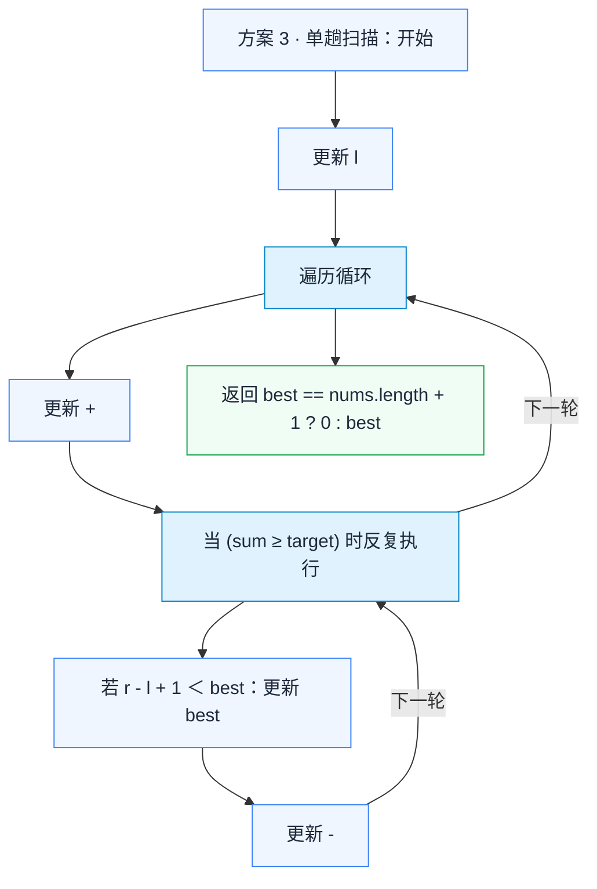

```java
package com.webfault.dsa; // 引入依赖

class Main { // 定义类型
  static int minSubArrayLen(int target, int[] nums) { // 定义函数/方法 minSubArrayLen
    int l = 0, best = nums.length + 1, sum = 0; // 把 0, 当前最优 赋值为 数组.长度 加 1, 累计和 赋值为 0 存入 左指针
    for (int r = 0; r < nums.length; r++) { // 让 右指针 从 0 开始计数，右指针 小于 数组.长度 就继续
      sum += nums[r]; // 累计和累加 数组[右指针]
      while (sum >= target) { // 循环，直到不满足「累计和 不低于 目标值」
        if (r - l + 1 < best) best = r - l + 1; // 若 右指针 减 左指针 加 1 小于 当前最优) 当前最优 赋值为 右指针 减 左指针 加 1;
        sum -= nums[l++]; // 累计和累减 数组[左指针 加一 ]
      }
    }
    return best == nums.length + 1 ? 0 : best; // 返回 当前最优 等于 数组.长度 加 1 ? 0 : 当前最优
  }

  public static void main(String[] args) { // public static void main(String[] args) {
    int[] t = {7, 4, 11};
    int[][] n = {{2, 3, 1, 2, 4, 3}, {1, 4, 4}, {1, 1, 1, 1, 1, 1, 1, 1}};
    int[] ws = {2, 1, 0};
    boolean ok = true; // 把 true; 写入 boolean ok
    for (int i = 0; i < t.length; i++) { // 让 下标 i 从 0 开始计数，下标 i 小于 另一字符串.长度 就继续
      int got = minSubArrayLen(t[i], n[i]); // 把 minSubArrayLen(另一字符串[下标 i], 元素个数[下标 i]) 存入 got
      if (got != ws[i]) {
        ok = false;
        System.out.println("FAIL " + got + " want " + ws[i]);
      }
    }
    if (!ok) throw new RuntimeException("FAILED"); // 若 取反 ok) throw new RuntimeException(「FAILED」);
    System.out.println("PASS"); // 全部用例通过，输出 PASS
  }
}
```

#### 方案 4：滑动窗口

**思路与代码分析**：核心是「滑动窗口」。Java 版用类与静态方法组织，集合操作显式明了。**走读**：方案 4 · 滑动窗口：开始 → 更新 len → 更新 slow → 更新 sum → 更新 result → 当 (fast ＜ len) 时反复执行 → 更新 + → 当 (sum ≥ target) 时反复执行 → 更新 subLen → 更新 result → 更新 - → 返回 result == len + 1 ? 0 : result。

**运行架构**（真实控制流）：

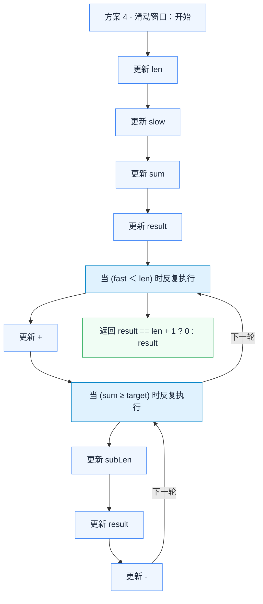

```java
package com.webfault.dsa; // 引入依赖

import java.util.*; // 引入依赖

class lc209_solution44 { // 定义类型
  public int minSubArrayLen(int target, int[] nums) { // 定义函数/方法 minSubArrayLen
    int len = nums.length; // 把 数组.长度 存入 长度
    int slow = 0, fast = 0; // 把 0, 快指针 赋值为 0 存入 慢指针
    int sum = 0; // 把 0 存入 累计和
    int result = len + 1; // 把 长度 加 1 存入 结果
    while (fast < len) { // 循环，直到不满足「快指针 小于 长度」
      sum += nums[fast++]; // 累计和累加 数组[快指针 加一 ]
      while (sum >= target) { // 循环，直到不满足「累计和 不低于 目标值」
        int subLen = fast - slow; // 把 快指针 减 慢指针 存入 subLen
        result = Math.min(result, subLen); // 把 Math.取较小值 结果, subLen); 写入 结果
        sum -= nums[slow++]; // 累计和累减 数组[慢指针 加一 ]
      }
    }
    return result == len + 1 ? 0 : result; // 返回 结果 等于 长度 加 1 ? 0 : 结果
  }

  public static void main(String[] args) { // public static void main(String[] args) {
    lc209_solution44 s = new lc209_solution44(); // 把 new lc209_solution44(); 写入 lc209_solution44 s
    int[] targets = {7, 11, 11, 4, 15, 0}; // 把 {7, 11, 11, 4, 15, 0}; 写入 int[] targets
    int[][] numsArr = { // 把 { 写入 int[][] numsArr
      {2, 3, 1, 2, 4, 3},
      {1, 2, 3, 4, 5},
      {1, 1, 1, 1, 1, 1, 1, 1},
      {1, 4, 4},
      {1, 2, 3, 4, 5, 6, 7, 8},
      {} // {}
    };
    int[] want = {2, 3, 0, 1, 2, 0}; // 把 {2, 3, 0, 1, 2, 0}; 写入 int[] want
    boolean ok = true; // 把 true; 写入 boolean ok
    for (int i = 0; i < want.length; i++) { // 让 下标 i 从 0 开始计数，下标 i 小于 want.长度 就继续
      int got =
          s.minSubArrayLen(
              targets[i], numsArr[i]); // 把 字符串.minSubArrayLen(targets[下标 i], numsArr[下标 i]) 存入 got
      if (got != want[i]) { // 若 got 不等于 want[下标 i]
        ok = false; // 把 false; 写入 ok
        System.out.println("FAIL case " + i + " got " + got + " want " + want[i]); // 打印输出
      }
    }
    if (!ok) throw new RuntimeException("FAILED"); // 若 取反 ok) throw new RuntimeException(「FAILED」);
    System.out.println("PASS"); // 全部用例通过，输出 PASS
  }
}
```

### Rust 实现（4 种方案）

Rust 的全部方案如下，每个方案都内嵌用例自测，可独立运行（老仓库 python/go 文件遵循「打印结果」约定）：

#### 方案 1：暴力枚举

**思路与代码分析**：核心是「暴力枚举」。Rust 版用所有权移动与切片借用改写同一逻辑，注意 Option 与引用边界。**走读**：方案 1 · 暴力枚举：开始 → 计算 let (mut l, mut sum, mut → 遍历 0..nums.len() 中的每个元素 r → 更新 + → 当 sum ≥ target as i64 时反复执行 → 更新 best → 更新 - → 更新 + → 处理 if best == i32::MAX → 处理 0 → 处理 best → 返回结果。

**运行架构**（真实控制流）：


```rust
// LeetCode 209. 长度最小的子数组 — Rust 版（方案1）
fn min_sub_array_len(target: i32, nums: Vec<i32>) -> i32 {
    // 定义函数/方法 min_sub_array_len
    let (mut l, mut sum, mut best) = (0usize, 0i64, i32::MAX);
    for r in 0..nums.len() {
        // 逐个取出 0 的元素（右指针）
        sum += nums[r] as i64; // 累计和累加 数组[右指针] as i64
        while sum >= target as i64 {
            // 把 目标值 as i64 { 写入 while sum >
            best = best.min((r - l + 1) as i32); // 把 当前最优.取较小值 (右指针 减 左指针 加 1) as i32); 写入 当前最优
            sum -= nums[l] as i64; // 累计和累减 数组[左指针] as i64
            l += 1; // 左指针累加 1
        }
    }
    if best == i32::MAX {
        0
    } else {
        best
    } // 若 当前最优 等于 i32::MAX { 0 } else { 当前最优 }
}
fn main() {
    assert_eq!(min_sub_array_len(7, vec![2, 3, 1, 2, 4, 3]), 2);
    assert_eq!(min_sub_array_len(4, vec![1, 4, 4]), 1);
    assert_eq!(min_sub_array_len(11, vec![1, 1, 1, 1, 1, 1, 1, 1]), 0);
    assert_eq!(min_sub_array_len(1, vec![1, 2, 3]), 1);
    println!("PASS");
} // 程序入口：跑内嵌自测用例
```

#### 方案 2：前缀和 + 二分查找

**思路与代码分析**：核心是「前缀和 + 二分查找」。Rust 版用所有权移动与切片借用改写同一逻辑，注意 Option 与引用边界。**走读**：方案 2 · 前缀和 + 二分查找：开始 → 计算 let (mut l, mut sum, mut → 遍历 0..nums.len() 中的每个元素 r → 更新 + → 当 sum ≥ target as i64 时反复执行 → 更新 best → 更新 - → 更新 + → 处理 if best == i32::MAX → 处理 0 → 处理 best → 返回结果。

**运行架构**（真实控制流）：

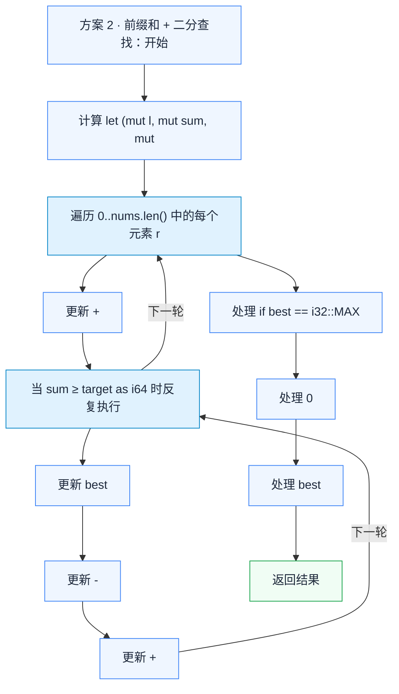

```rust
// LeetCode 209. 长度最小的子数组 — Rust 版（方案2）
fn min_sub_array_len(target: i32, nums: Vec<i32>) -> i32 {
    // 定义函数/方法 min_sub_array_len
    let (mut l, mut sum, mut best) = (0usize, 0i64, i32::MAX);
    for r in 0..nums.len() {
        // 逐个取出 0 的元素（右指针）
        sum += nums[r] as i64; // 累计和累加 数组[右指针] as i64
        while sum >= target as i64 {
            // 把 目标值 as i64 { 写入 while sum >
            best = best.min((r - l + 1) as i32); // 把 当前最优.取较小值 (右指针 减 左指针 加 1) as i32); 写入 当前最优
            sum -= nums[l] as i64; // 累计和累减 数组[左指针] as i64
            l += 1; // 左指针累加 1
        }
    }
    if best == i32::MAX {
        0
    } else {
        best
    } // 若 当前最优 等于 i32::MAX { 0 } else { 当前最优 }
}
fn main() {
    assert_eq!(min_sub_array_len(7, vec![2, 3, 1, 2, 4, 3]), 2);
    assert_eq!(min_sub_array_len(4, vec![1, 4, 4]), 1);
    assert_eq!(min_sub_array_len(11, vec![1, 1, 1, 1, 1, 1, 1, 1]), 0);
    assert_eq!(min_sub_array_len(1, vec![1, 2, 3]), 1);
    println!("PASS");
} // 程序入口：跑内嵌自测用例
```

#### 方案 3：单趟扫描

**思路与代码分析**：核心是「单趟扫描」。Rust 版用所有权移动与切片借用改写同一逻辑，注意 Option 与引用边界。**走读**：方案 3 · 单趟扫描：开始 → 计算 let (mut l, mut sum, mut → 遍历 0..nums.len() 中的每个元素 r → 更新 + → 当 sum ≥ target as i64 时反复执行 → 更新 best → 更新 - → 更新 + → 处理 if best == i32::MAX → 处理 0 → 处理 best → 返回结果。

**运行架构**（真实控制流）：

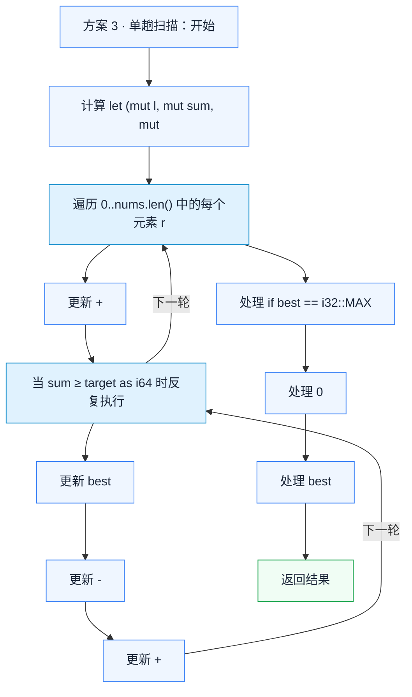

```rust
// LeetCode 209. 长度最小的子数组 — Rust 版（方案3）
fn min_sub_array_len(target: i32, nums: Vec<i32>) -> i32 {
    // 定义函数/方法 min_sub_array_len
    let (mut l, mut sum, mut best) = (0usize, 0i64, i32::MAX);
    for r in 0..nums.len() {
        // 逐个取出 0 的元素（右指针）
        sum += nums[r] as i64; // 累计和累加 数组[右指针] as i64
        while sum >= target as i64 {
            // 把 目标值 as i64 { 写入 while sum >
            best = best.min((r - l + 1) as i32); // 把 当前最优.取较小值 (右指针 减 左指针 加 1) as i32); 写入 当前最优
            sum -= nums[l] as i64; // 累计和累减 数组[左指针] as i64
            l += 1; // 左指针累加 1
        }
    }
    if best == i32::MAX {
        0
    } else {
        best
    } // 若 当前最优 等于 i32::MAX { 0 } else { 当前最优 }
}
fn main() {
    assert_eq!(min_sub_array_len(7, vec![2, 3, 1, 2, 4, 3]), 2);
    assert_eq!(min_sub_array_len(4, vec![1, 4, 4]), 1);
    assert_eq!(min_sub_array_len(11, vec![1, 1, 1, 1, 1, 1, 1, 1]), 0);
    assert_eq!(min_sub_array_len(1, vec![1, 2, 3]), 1);
    println!("PASS");
} // 程序入口：跑内嵌自测用例
```

#### 方案 4：滑动窗口

**思路与代码分析**：核心是「滑动窗口」。Rust 版用所有权移动与切片借用改写同一逻辑，注意 Option 与引用边界。**走读**：方案 4 · 滑动窗口：开始 → 计算 let (mut l, mut sum, mut → 遍历 0..nums.len() 中的每个元素 r → 更新 + → 当 sum ≥ target as i64 时反复执行 → 更新 best → 更新 - → 更新 + → 处理 if best == i32::MAX → 处理 0 → 处理 best → 返回结果。

**运行架构**（真实控制流）：

```mermaid
graph TD
    N0["方案 4 · 滑动窗口：开始"]
    N1["计算 let (mut l, mut sum, mut"]
    N2["遍历 0..nums.len() 中的每个元素 r"]
    N3["更新 +"]
    N4["当 sum ≥ target as i64 时反复执行"]
    N5["更新 best"]
    N6["更新 -"]
    N7["更新 +"]
    N8["处理 if best == i32::MAX"]
    N9["处理 0"]
    N10["处理 best"]
    N11["返回结果"]
    N0 --> N1
    N1 --> N2
    N2 --> N3
    N3 --> N4
    N4 --> N5
    N5 --> N6
    N6 --> N7
    N7 -- 下一轮 --> N4
    N4 -- 下一轮 --> N2
    N2 --> N8
    N8 --> N9
    N9 --> N10
    N10 --> N11
    classDef n fill:#eff6ff,stroke:#3b82f6,color:#1e293b;
    classDef lp fill:#e0f2fe,stroke:#0284c7,color:#1e293b;
    classDef dc fill:#fef9c3,stroke:#ca8a04,color:#1e293b;
    classDef tm fill:#f0fdf4,stroke:#16a34a,color:#1e293b;
    class N0,N1,N3,N5,N6,N7,N8,N9,N10 n;
    class N2,N4 lp;
    class N11 tm;
```

```rust
// LeetCode 209. 长度最小的子数组 — Rust 版（方案4）
fn min_sub_array_len(target: i32, nums: Vec<i32>) -> i32 {
    // 定义函数/方法 min_sub_array_len
    let (mut l, mut sum, mut best) = (0usize, 0i64, i32::MAX);
    for r in 0..nums.len() {
        // 逐个取出 0 的元素（右指针）
        sum += nums[r] as i64; // 累计和累加 数组[右指针] as i64
        while sum >= target as i64 {
            // 把 目标值 as i64 { 写入 while sum >
            best = best.min((r - l + 1) as i32); // 把 当前最优.取较小值 (右指针 减 左指针 加 1) as i32); 写入 当前最优
            sum -= nums[l] as i64; // 累计和累减 数组[左指针] as i64
            l += 1; // 左指针累加 1
        }
    }
    if best == i32::MAX {
        0
    } else {
        best
    } // 若 当前最优 等于 i32::MAX { 0 } else { 当前最优 }
}
fn main() {
    assert_eq!(min_sub_array_len(7, vec![2, 3, 1, 2, 4, 3]), 2);
    assert_eq!(min_sub_array_len(4, vec![1, 4, 4]), 1);
    assert_eq!(min_sub_array_len(11, vec![1, 1, 1, 1, 1, 1, 1, 1]), 0);
    assert_eq!(min_sub_array_len(1, vec![1, 2, 3]), 1);
    println!("PASS");
} // 程序入口：跑内嵌自测用例
```

### Lua 实现（4 种方案）

Lua 的全部方案如下，每个方案都内嵌用例自测，可独立运行（老仓库 python/go 文件遵循「打印结果」约定）：

#### 方案 1：暴力枚举

**思路与代码分析**：核心是「暴力枚举」。Lua 版用表与 ipairs 遍历，注意 ipairs 遇 nil 即停的语义。**走读**：方案 1 · 暴力枚举：开始 → 更新 best → 循环 r：从 1 到 #nums do → 更新 sum → 当 sum ≥ target do 时反复执行 → 处理 if r - l + 1 ＜ best then → 更新 best → 更新 sum → 更新 l → 处理 if best == math.huge then → 返回 0 → 返回 best。

**运行架构**（真实控制流）：

```mermaid
graph TD
    N0["方案 1 · 暴力枚举：开始"]
    N1["更新 best"]
    N2["循环 r：从 1 到 #nums do"]
    N3["更新 sum"]
    N4["当 sum ≥ target do 时反复执行"]
    N5["处理 if r - l + 1 ＜ best then"]
    N6["更新 best"]
    N7["更新 sum"]
    N8["更新 l"]
    N9["处理 if best == math.huge then"]
    N10["返回 0"]
    N11["返回 best"]
    N0 --> N1
    N1 --> N2
    N2 --> N3
    N3 --> N4
    N4 --> N5
    N5 --> N6
    N6 --> N7
    N7 --> N8
    N8 --> N9
    N9 --> N10
    N10 --> N11
    classDef n fill:#eff6ff,stroke:#3b82f6,color:#1e293b;
    classDef lp fill:#e0f2fe,stroke:#0284c7,color:#1e293b;
    classDef dc fill:#fef9c3,stroke:#ca8a04,color:#1e293b;
    classDef tm fill:#f0fdf4,stroke:#16a34a,color:#1e293b;
    class N0,N1,N3,N5,N6,N7,N8,N9 n;
    class N2,N4 lp;
    class N10,N11 tm;
```

```lua
-- LeetCode 209. 长度最小的子数组 — Lua 版（方案1）
local function min_sub_array_len(target, nums) -- local function min_sub_array_len(目标值, 数组)
	local l, sum, best = 1, 0, math.huge -- 把 1, 0, math.huge 写入 local l, sum, best
	for r = 1, #nums do -- 把 1, #数组 do 写入 for r
		sum = sum + nums[r] -- 把 累计和 加 数组[右指针] 存入 累计和
		while sum >= target do -- 把 目标值 do 写入 while sum >
			if r - l + 1 < best then
				best = r - l + 1
			end -- 若 右指针 减 左指针 加 1 小于 当前最优 then 当前最优 赋值为 右指针 减 左指针 加 1 终点
			sum = sum - nums[l] -- 把 累计和 减 数组[左指针] 存入 累计和
			l = l + 1 -- 把 左指针 加 1 存入 左指针
		end -- 终点
	end -- 终点
	if best == math.huge then
		return 0
	end -- 若 当前最优 等于 math.huge then return 0 终点
	return best -- 返回 当前最优
end -- 终点
assert(min_sub_array_len(7, { 2, 3, 1, 2, 4, 3 }) == 2) -- 断言校验
assert(min_sub_array_len(4, { 1, 4, 4 }) == 1) -- 断言校验
assert(min_sub_array_len(11, { 1, 1, 1, 1, 1, 1, 1, 1 }) == 0) -- 断言校验
assert(min_sub_array_len(1, { 1, 2, 3 }) == 1) -- 断言校验
print("PASS") -- 全部用例通过，输出 PASS
```

#### 方案 2：前缀和 + 二分查找

**思路与代码分析**：核心是「前缀和 + 二分查找」。Lua 版用表与 ipairs 遍历，注意 ipairs 遇 nil 即停的语义。**走读**：方案 2 · 前缀和 + 二分查找：开始 → 更新 best → 循环 r：从 1 到 #nums do → 更新 sum → 当 sum ≥ target do 时反复执行 → 处理 if r - l + 1 ＜ best then → 更新 best → 更新 sum → 更新 l → 处理 if best == math.huge then → 返回 0 → 返回 best。

**运行架构**（真实控制流）：

```mermaid
graph TD
    N0["方案 2 · 前缀和 + 二分查找：开始"]
    N1["更新 best"]
    N2["循环 r：从 1 到 #nums do"]
    N3["更新 sum"]
    N4["当 sum ≥ target do 时反复执行"]
    N5["处理 if r - l + 1 ＜ best then"]
    N6["更新 best"]
    N7["更新 sum"]
    N8["更新 l"]
    N9["处理 if best == math.huge then"]
    N10["返回 0"]
    N11["返回 best"]
    N0 --> N1
    N1 --> N2
    N2 --> N3
    N3 --> N4
    N4 --> N5
    N5 --> N6
    N6 --> N7
    N7 --> N8
    N8 --> N9
    N9 --> N10
    N10 --> N11
    classDef n fill:#eff6ff,stroke:#3b82f6,color:#1e293b;
    classDef lp fill:#e0f2fe,stroke:#0284c7,color:#1e293b;
    classDef dc fill:#fef9c3,stroke:#ca8a04,color:#1e293b;
    classDef tm fill:#f0fdf4,stroke:#16a34a,color:#1e293b;
    class N0,N1,N3,N5,N6,N7,N8,N9 n;
    class N2,N4 lp;
    class N10,N11 tm;
```

```lua
-- LeetCode 209. 长度最小的子数组 — Lua 版（方案2）
local function min_sub_array_len(target, nums) -- local function min_sub_array_len(目标值, 数组)
	local l, sum, best = 1, 0, math.huge -- 把 1, 0, math.huge 写入 local l, sum, best
	for r = 1, #nums do -- 把 1, #数组 do 写入 for r
		sum = sum + nums[r] -- 把 累计和 加 数组[右指针] 存入 累计和
		while sum >= target do -- 把 目标值 do 写入 while sum >
			if r - l + 1 < best then
				best = r - l + 1
			end -- 若 右指针 减 左指针 加 1 小于 当前最优 then 当前最优 赋值为 右指针 减 左指针 加 1 终点
			sum = sum - nums[l] -- 把 累计和 减 数组[左指针] 存入 累计和
			l = l + 1 -- 把 左指针 加 1 存入 左指针
		end -- 终点
	end -- 终点
	if best == math.huge then
		return 0
	end -- 若 当前最优 等于 math.huge then return 0 终点
	return best -- 返回 当前最优
end -- 终点
assert(min_sub_array_len(7, { 2, 3, 1, 2, 4, 3 }) == 2) -- 断言校验
assert(min_sub_array_len(4, { 1, 4, 4 }) == 1) -- 断言校验
assert(min_sub_array_len(11, { 1, 1, 1, 1, 1, 1, 1, 1 }) == 0) -- 断言校验
assert(min_sub_array_len(1, { 1, 2, 3 }) == 1) -- 断言校验
print("PASS") -- 全部用例通过，输出 PASS
```

#### 方案 3：单趟扫描

**思路与代码分析**：核心是「单趟扫描」。Lua 版用表与 ipairs 遍历，注意 ipairs 遇 nil 即停的语义。**走读**：方案 3 · 单趟扫描：开始 → 更新 best → 循环 r：从 1 到 #nums do → 更新 sum → 当 sum ≥ target do 时反复执行 → 处理 if r - l + 1 ＜ best then → 更新 best → 更新 sum → 更新 l → 处理 if best == math.huge then → 返回 0 → 返回 best。

**运行架构**（真实控制流）：

```mermaid
graph TD
    N0["方案 3 · 单趟扫描：开始"]
    N1["更新 best"]
    N2["循环 r：从 1 到 #nums do"]
    N3["更新 sum"]
    N4["当 sum ≥ target do 时反复执行"]
    N5["处理 if r - l + 1 ＜ best then"]
    N6["更新 best"]
    N7["更新 sum"]
    N8["更新 l"]
    N9["处理 if best == math.huge then"]
    N10["返回 0"]
    N11["返回 best"]
    N0 --> N1
    N1 --> N2
    N2 --> N3
    N3 --> N4
    N4 --> N5
    N5 --> N6
    N6 --> N7
    N7 --> N8
    N8 --> N9
    N9 --> N10
    N10 --> N11
    classDef n fill:#eff6ff,stroke:#3b82f6,color:#1e293b;
    classDef lp fill:#e0f2fe,stroke:#0284c7,color:#1e293b;
    classDef dc fill:#fef9c3,stroke:#ca8a04,color:#1e293b;
    classDef tm fill:#f0fdf4,stroke:#16a34a,color:#1e293b;
    class N0,N1,N3,N5,N6,N7,N8,N9 n;
    class N2,N4 lp;
    class N10,N11 tm;
```

```lua
-- LeetCode 209. 长度最小的子数组 — Lua 版（方案3）
local function min_sub_array_len(target, nums) -- local function min_sub_array_len(目标值, 数组)
	local l, sum, best = 1, 0, math.huge -- 把 1, 0, math.huge 写入 local l, sum, best
	for r = 1, #nums do -- 把 1, #数组 do 写入 for r
		sum = sum + nums[r] -- 把 累计和 加 数组[右指针] 存入 累计和
		while sum >= target do -- 把 目标值 do 写入 while sum >
			if r - l + 1 < best then
				best = r - l + 1
			end -- 若 右指针 减 左指针 加 1 小于 当前最优 then 当前最优 赋值为 右指针 减 左指针 加 1 终点
			sum = sum - nums[l] -- 把 累计和 减 数组[左指针] 存入 累计和
			l = l + 1 -- 把 左指针 加 1 存入 左指针
		end -- 终点
	end -- 终点
	if best == math.huge then
		return 0
	end -- 若 当前最优 等于 math.huge then return 0 终点
	return best -- 返回 当前最优
end -- 终点
assert(min_sub_array_len(7, { 2, 3, 1, 2, 4, 3 }) == 2) -- 断言校验
assert(min_sub_array_len(4, { 1, 4, 4 }) == 1) -- 断言校验
assert(min_sub_array_len(11, { 1, 1, 1, 1, 1, 1, 1, 1 }) == 0) -- 断言校验
assert(min_sub_array_len(1, { 1, 2, 3 }) == 1) -- 断言校验
print("PASS") -- 全部用例通过，输出 PASS
```

#### 方案 4：滑动窗口

**思路与代码分析**：核心是「滑动窗口」。Lua 版用表与 ipairs 遍历，注意 ipairs 遇 nil 即停的语义。**走读**：方案 4 · 滑动窗口：开始 → 更新 best → 循环 r：从 1 到 #nums do → 更新 sum → 当 sum ≥ target do 时反复执行 → 处理 if r - l + 1 ＜ best then → 更新 best → 更新 sum → 更新 l → 处理 if best == math.huge then → 返回 0 → 返回 best。

**运行架构**（真实控制流）：

```mermaid
graph TD
    N0["方案 4 · 滑动窗口：开始"]
    N1["更新 best"]
    N2["循环 r：从 1 到 #nums do"]
    N3["更新 sum"]
    N4["当 sum ≥ target do 时反复执行"]
    N5["处理 if r - l + 1 ＜ best then"]
    N6["更新 best"]
    N7["更新 sum"]
    N8["更新 l"]
    N9["处理 if best == math.huge then"]
    N10["返回 0"]
    N11["返回 best"]
    N0 --> N1
    N1 --> N2
    N2 --> N3
    N3 --> N4
    N4 --> N5
    N5 --> N6
    N6 --> N7
    N7 --> N8
    N8 --> N9
    N9 --> N10
    N10 --> N11
    classDef n fill:#eff6ff,stroke:#3b82f6,color:#1e293b;
    classDef lp fill:#e0f2fe,stroke:#0284c7,color:#1e293b;
    classDef dc fill:#fef9c3,stroke:#ca8a04,color:#1e293b;
    classDef tm fill:#f0fdf4,stroke:#16a34a,color:#1e293b;
    class N0,N1,N3,N5,N6,N7,N8,N9 n;
    class N2,N4 lp;
    class N10,N11 tm;
```

```lua
-- LeetCode 209. 长度最小的子数组 — Lua 版（方案4）
local function min_sub_array_len(target, nums) -- local function min_sub_array_len(目标值, 数组)
	local l, sum, best = 1, 0, math.huge -- 把 1, 0, math.huge 写入 local l, sum, best
	for r = 1, #nums do -- 把 1, #数组 do 写入 for r
		sum = sum + nums[r] -- 把 累计和 加 数组[右指针] 存入 累计和
		while sum >= target do -- 把 目标值 do 写入 while sum >
			if r - l + 1 < best then
				best = r - l + 1
			end -- 若 右指针 减 左指针 加 1 小于 当前最优 then 当前最优 赋值为 右指针 减 左指针 加 1 终点
			sum = sum - nums[l] -- 把 累计和 减 数组[左指针] 存入 累计和
			l = l + 1 -- 把 左指针 加 1 存入 左指针
		end -- 终点
	end -- 终点
	if best == math.huge then
		return 0
	end -- 若 当前最优 等于 math.huge then return 0 终点
	return best -- 返回 当前最优
end -- 终点
assert(min_sub_array_len(7, { 2, 3, 1, 2, 4, 3 }) == 2) -- 断言校验
assert(min_sub_array_len(4, { 1, 4, 4 }) == 1) -- 断言校验
assert(min_sub_array_len(11, { 1, 1, 1, 1, 1, 1, 1, 1 }) == 0) -- 断言校验
assert(min_sub_array_len(1, { 1, 2, 3 }) == 1) -- 断言校验
print("PASS") -- 全部用例通过，输出 PASS
```

### C 实现（4 种方案）

C 的全部方案如下，每个方案都内嵌用例自测，可独立运行（老仓库 python/go 文件遵循「打印结果」约定）：

#### 方案 1：暴力枚举

**思路与代码分析**：核心是「暴力枚举」。C 版手动管理下标与内存，循环边界全部显式写出。代码里依次做这些事：单循环线性扫描。**走读**：方案 1 · 暴力枚举：开始 → 更新 l → 更新 sum → 遍历循环 → 更新 + → 当 (sum ≥ target) 时反复执行 → 若 r - l + 1 ＜ best：更新 best → 更新 best → 处理 1 → 更新 - → 返回 best == (1 ＜＜ 30) ? 0 : best。

**运行架构**（真实控制流）：

```mermaid
graph TD
    N0["方案 1 · 暴力枚举：开始"]
    N1["更新 l"]
    N2["更新 sum"]
    N3["遍历循环"]
    N4["更新 +"]
    N5["当 (sum ≥ target) 时反复执行"]
    N6["若 r - l + 1 ＜ best：更新 best"]
    N7["更新 best"]
    N8["处理 1"]
    N9["更新 -"]
    N10["返回 best == (1 ＜＜ 30) ? 0 : best"]
    N0 --> N1
    N1 --> N2
    N2 --> N3
    N3 --> N4
    N4 --> N5
    N5 --> N6
    N6 --> N7
    N7 --> N8
    N8 --> N9
    N9 -- 下一轮 --> N5
    N5 -- 下一轮 --> N3
    N3 --> N10
    classDef n fill:#eff6ff,stroke:#3b82f6,color:#1e293b;
    classDef lp fill:#e0f2fe,stroke:#0284c7,color:#1e293b;
    classDef dc fill:#fef9c3,stroke:#ca8a04,color:#1e293b;
    classDef tm fill:#f0fdf4,stroke:#16a34a,color:#1e293b;
    class N0,N1,N2,N4,N6,N7,N8,N9 n;
    class N3,N5 lp;
    class N10 tm;
```

```c
/* LeetCode 209. 长度最小的子数组 — C 版（方案1） */
#include <stdio.h>                                                // 引入头文件
static int min_sub_array_len(int target, const int *n, int len) { // 定义函数/方法 min_sub_array_len
    int l = 0, best = 1 << 30;      // 把 0, 当前最优 赋值为 1 小于 小于 30 存入 左指针
    long sum = 0;                   // 把 0; 写入 long sum
    for (int r = 0; r < len; r++) { // 让 右指针 从 0 开始计数，右指针 小于 长度 就继续
        sum += n[r];                // 累计和累加 元素个数[右指针]
        while (sum >= target) {     // 循环，直到不满足「累计和 不低于 目标值」
            if (r - l + 1 < best)
                best = r - l +
                       1; // 若 右指针 减 左指针 加 1 小于 当前最优) 当前最优 赋值为 右指针 减 左指针 加 1;
            sum -= n[l++]; // 累计和累减 元素个数[左指针 加一 ]
        }
    }
    return best == (1 << 30) ? 0 : best; // 返回 当前最优 等于 (1 小于 小于 30) ? 0 : 当前最优
}
int main(void) { // 程序入口：跑内嵌自测用例
    if (min_sub_array_len(7, (int[]){2, 3, 1, 2, 4, 3}, 6) != 2) {
        printf("FAIL 1\n");
        return 1;
    }
    if (min_sub_array_len(4, (int[]){1, 4, 4}, 3) != 1) {
        printf("FAIL 2\n");
        return 1;
    }
    if (min_sub_array_len(11, (int[]){1, 1, 1, 1, 1, 1, 1, 1}, 8) != 0) {
        printf("FAIL 3\n");
        return 1;
    }
    if (min_sub_array_len(1, (int[]){1, 2, 3}, 3) != 1) {
        printf("FAIL 4\n");
        return 1;
    }
    printf("PASS\n");
    return 0;
} // 全部用例通过，输出 PASS
```

#### 方案 2：前缀和 + 二分查找

**思路与代码分析**：核心是「前缀和 + 二分查找」。C 版手动管理下标与内存，循环边界全部显式写出。代码里依次做这些事：单循环线性扫描。**走读**：方案 2 · 前缀和 + 二分查找：开始 → 更新 l → 更新 sum → 遍历循环 → 更新 + → 当 (sum ≥ target) 时反复执行 → 若 r - l + 1 ＜ best：更新 best → 更新 best → 处理 1 → 更新 - → 返回 best == (1 ＜＜ 30) ? 0 : best。

**运行架构**（真实控制流）：

```mermaid
graph TD
    N0["方案 2 · 前缀和 + 二分查找：开始"]
    N1["更新 l"]
    N2["更新 sum"]
    N3["遍历循环"]
    N4["更新 +"]
    N5["当 (sum ≥ target) 时反复执行"]
    N6["若 r - l + 1 ＜ best：更新 best"]
    N7["更新 best"]
    N8["处理 1"]
    N9["更新 -"]
    N10["返回 best == (1 ＜＜ 30) ? 0 : best"]
    N0 --> N1
    N1 --> N2
    N2 --> N3
    N3 --> N4
    N4 --> N5
    N5 --> N6
    N6 --> N7
    N7 --> N8
    N8 --> N9
    N9 -- 下一轮 --> N5
    N5 -- 下一轮 --> N3
    N3 --> N10
    classDef n fill:#eff6ff,stroke:#3b82f6,color:#1e293b;
    classDef lp fill:#e0f2fe,stroke:#0284c7,color:#1e293b;
    classDef dc fill:#fef9c3,stroke:#ca8a04,color:#1e293b;
    classDef tm fill:#f0fdf4,stroke:#16a34a,color:#1e293b;
    class N0,N1,N2,N4,N6,N7,N8,N9 n;
    class N3,N5 lp;
    class N10 tm;
```

```c
/* LeetCode 209. 长度最小的子数组 — C 版（方案2） */
#include <stdio.h>                                                // 引入头文件
static int min_sub_array_len(int target, const int *n, int len) { // 定义函数/方法 min_sub_array_len
    int l = 0, best = 1 << 30;      // 把 0, 当前最优 赋值为 1 小于 小于 30 存入 左指针
    long sum = 0;                   // 把 0; 写入 long sum
    for (int r = 0; r < len; r++) { // 让 右指针 从 0 开始计数，右指针 小于 长度 就继续
        sum += n[r];                // 累计和累加 元素个数[右指针]
        while (sum >= target) {     // 循环，直到不满足「累计和 不低于 目标值」
            if (r - l + 1 < best)
                best = r - l +
                       1; // 若 右指针 减 左指针 加 1 小于 当前最优) 当前最优 赋值为 右指针 减 左指针 加 1;
            sum -= n[l++]; // 累计和累减 元素个数[左指针 加一 ]
        }
    }
    return best == (1 << 30) ? 0 : best; // 返回 当前最优 等于 (1 小于 小于 30) ? 0 : 当前最优
}
int main(void) { // 程序入口：跑内嵌自测用例
    if (min_sub_array_len(7, (int[]){2, 3, 1, 2, 4, 3}, 6) != 2) {
        printf("FAIL 1\n");
        return 1;
    }
    if (min_sub_array_len(4, (int[]){1, 4, 4}, 3) != 1) {
        printf("FAIL 2\n");
        return 1;
    }
    if (min_sub_array_len(11, (int[]){1, 1, 1, 1, 1, 1, 1, 1}, 8) != 0) {
        printf("FAIL 3\n");
        return 1;
    }
    if (min_sub_array_len(1, (int[]){1, 2, 3}, 3) != 1) {
        printf("FAIL 4\n");
        return 1;
    }
    printf("PASS\n");
    return 0;
} // 全部用例通过，输出 PASS
```

#### 方案 3：单趟扫描

**思路与代码分析**：核心是「单趟扫描」。C 版手动管理下标与内存，循环边界全部显式写出。代码里依次做这些事：单循环线性扫描。**走读**：方案 3 · 单趟扫描：开始 → 更新 l → 更新 sum → 遍历循环 → 更新 + → 当 (sum ≥ target) 时反复执行 → 若 r - l + 1 ＜ best：更新 best → 更新 best → 处理 1 → 更新 - → 返回 best == (1 ＜＜ 30) ? 0 : best。

**运行架构**（真实控制流）：

```mermaid
graph TD
    N0["方案 3 · 单趟扫描：开始"]
    N1["更新 l"]
    N2["更新 sum"]
    N3["遍历循环"]
    N4["更新 +"]
    N5["当 (sum ≥ target) 时反复执行"]
    N6["若 r - l + 1 ＜ best：更新 best"]
    N7["更新 best"]
    N8["处理 1"]
    N9["更新 -"]
    N10["返回 best == (1 ＜＜ 30) ? 0 : best"]
    N0 --> N1
    N1 --> N2
    N2 --> N3
    N3 --> N4
    N4 --> N5
    N5 --> N6
    N6 --> N7
    N7 --> N8
    N8 --> N9
    N9 -- 下一轮 --> N5
    N5 -- 下一轮 --> N3
    N3 --> N10
    classDef n fill:#eff6ff,stroke:#3b82f6,color:#1e293b;
    classDef lp fill:#e0f2fe,stroke:#0284c7,color:#1e293b;
    classDef dc fill:#fef9c3,stroke:#ca8a04,color:#1e293b;
    classDef tm fill:#f0fdf4,stroke:#16a34a,color:#1e293b;
    class N0,N1,N2,N4,N6,N7,N8,N9 n;
    class N3,N5 lp;
    class N10 tm;
```

```c
/* LeetCode 209. 长度最小的子数组 — C 版（方案3） */
#include <stdio.h>                                                // 引入头文件
static int min_sub_array_len(int target, const int *n, int len) { // 定义函数/方法 min_sub_array_len
    int l = 0, best = 1 << 30;      // 把 0, 当前最优 赋值为 1 小于 小于 30 存入 左指针
    long sum = 0;                   // 把 0; 写入 long sum
    for (int r = 0; r < len; r++) { // 让 右指针 从 0 开始计数，右指针 小于 长度 就继续
        sum += n[r];                // 累计和累加 元素个数[右指针]
        while (sum >= target) {     // 循环，直到不满足「累计和 不低于 目标值」
            if (r - l + 1 < best)
                best = r - l +
                       1; // 若 右指针 减 左指针 加 1 小于 当前最优) 当前最优 赋值为 右指针 减 左指针 加 1;
            sum -= n[l++]; // 累计和累减 元素个数[左指针 加一 ]
        }
    }
    return best == (1 << 30) ? 0 : best; // 返回 当前最优 等于 (1 小于 小于 30) ? 0 : 当前最优
}
int main(void) { // 程序入口：跑内嵌自测用例
    if (min_sub_array_len(7, (int[]){2, 3, 1, 2, 4, 3}, 6) != 2) {
        printf("FAIL 1\n");
        return 1;
    }
    if (min_sub_array_len(4, (int[]){1, 4, 4}, 3) != 1) {
        printf("FAIL 2\n");
        return 1;
    }
    if (min_sub_array_len(11, (int[]){1, 1, 1, 1, 1, 1, 1, 1}, 8) != 0) {
        printf("FAIL 3\n");
        return 1;
    }
    if (min_sub_array_len(1, (int[]){1, 2, 3}, 3) != 1) {
        printf("FAIL 4\n");
        return 1;
    }
    printf("PASS\n");
    return 0;
} // 全部用例通过，输出 PASS
```

#### 方案 4：滑动窗口

**思路与代码分析**：核心是「滑动窗口」。C 版手动管理下标与内存，循环边界全部显式写出。代码里依次做这些事：单循环线性扫描。**走读**：方案 4 · 滑动窗口：开始 → 更新 l → 更新 sum → 遍历循环 → 更新 + → 当 (sum ≥ target) 时反复执行 → 若 r - l + 1 ＜ best：更新 best → 更新 best → 处理 1 → 更新 - → 返回 best == (1 ＜＜ 30) ? 0 : best。

**运行架构**（真实控制流）：

```mermaid
graph TD
    N0["方案 4 · 滑动窗口：开始"]
    N1["更新 l"]
    N2["更新 sum"]
    N3["遍历循环"]
    N4["更新 +"]
    N5["当 (sum ≥ target) 时反复执行"]
    N6["若 r - l + 1 ＜ best：更新 best"]
    N7["更新 best"]
    N8["处理 1"]
    N9["更新 -"]
    N10["返回 best == (1 ＜＜ 30) ? 0 : best"]
    N0 --> N1
    N1 --> N2
    N2 --> N3
    N3 --> N4
    N4 --> N5
    N5 --> N6
    N6 --> N7
    N7 --> N8
    N8 --> N9
    N9 -- 下一轮 --> N5
    N5 -- 下一轮 --> N3
    N3 --> N10
    classDef n fill:#eff6ff,stroke:#3b82f6,color:#1e293b;
    classDef lp fill:#e0f2fe,stroke:#0284c7,color:#1e293b;
    classDef dc fill:#fef9c3,stroke:#ca8a04,color:#1e293b;
    classDef tm fill:#f0fdf4,stroke:#16a34a,color:#1e293b;
    class N0,N1,N2,N4,N6,N7,N8,N9 n;
    class N3,N5 lp;
    class N10 tm;
```

```c
/* LeetCode 209. 长度最小的子数组 — C 版（方案4） */
#include <stdio.h>                                                // 引入头文件
static int min_sub_array_len(int target, const int *n, int len) { // 定义函数/方法 min_sub_array_len
    int l = 0, best = 1 << 30;      // 把 0, 当前最优 赋值为 1 小于 小于 30 存入 左指针
    long sum = 0;                   // 把 0; 写入 long sum
    for (int r = 0; r < len; r++) { // 让 右指针 从 0 开始计数，右指针 小于 长度 就继续
        sum += n[r];                // 累计和累加 元素个数[右指针]
        while (sum >= target) {     // 循环，直到不满足「累计和 不低于 目标值」
            if (r - l + 1 < best)
                best = r - l +
                       1; // 若 右指针 减 左指针 加 1 小于 当前最优) 当前最优 赋值为 右指针 减 左指针 加 1;
            sum -= n[l++]; // 累计和累减 元素个数[左指针 加一 ]
        }
    }
    return best == (1 << 30) ? 0 : best; // 返回 当前最优 等于 (1 小于 小于 30) ? 0 : 当前最优
}
int main(void) { // 程序入口：跑内嵌自测用例
    if (min_sub_array_len(7, (int[]){2, 3, 1, 2, 4, 3}, 6) != 2) {
        printf("FAIL 1\n");
        return 1;
    }
    if (min_sub_array_len(4, (int[]){1, 4, 4}, 3) != 1) {
        printf("FAIL 2\n");
        return 1;
    }
    if (min_sub_array_len(11, (int[]){1, 1, 1, 1, 1, 1, 1, 1}, 8) != 0) {
        printf("FAIL 3\n");
        return 1;
    }
    if (min_sub_array_len(1, (int[]){1, 2, 3}, 3) != 1) {
        printf("FAIL 4\n");
        return 1;
    }
    printf("PASS\n");
    return 0;
} // 全部用例通过，输出 PASS
```

### C++ 实现（4 种方案）

C++ 的全部方案如下，每个方案都内嵌用例自测，可独立运行（老仓库 python/go 文件遵循「打印结果」约定）：

#### 方案 1：暴力枚举

**思路与代码分析**：核心是「暴力枚举」。C++ 版用 STL 容器与迭代器，减少手写下标错误。代码里依次做这些事：单循环线性扫描。**走读**：方案 1 · 暴力枚举：开始 → 更新 l → 更新 sum → 更新 best → 遍历循环 → 更新 + → 当 (sum ≥ target) 时反复执行 → 更新 len → 处理 static_cast＜int＞(r - l + 1) → 若 best == -1 或 len ＜ best：更新 best → 更新 best → 更新 - → 返回 best == -1 ? 0 : best。

**运行架构**（真实控制流）：

```mermaid
graph TD
    N0["方案 1 · 暴力枚举：开始"]
    N1["更新 l"]
    N2["更新 sum"]
    N3["更新 best"]
    N4["遍历循环"]
    N5["更新 +"]
    N6["当 (sum ≥ target) 时反复执行"]
    N7["更新 len"]
    N8["处理 static_cast＜int＞(r - l + 1)"]
    N9["若 best == -1 或 len ＜ best：更新 best"]
    N10["更新 best"]
    N11["更新 -"]
    N12["返回 best == -1 ? 0 : best"]
    N0 --> N1
    N1 --> N2
    N2 --> N3
    N3 --> N4
    N4 --> N5
    N5 --> N6
    N6 --> N7
    N7 --> N8
    N8 --> N9
    N9 --> N10
    N10 --> N11
    N11 -- 下一轮 --> N6
    N6 -- 下一轮 --> N4
    N4 --> N12
    classDef n fill:#eff6ff,stroke:#3b82f6,color:#1e293b;
    classDef lp fill:#e0f2fe,stroke:#0284c7,color:#1e293b;
    classDef dc fill:#fef9c3,stroke:#ca8a04,color:#1e293b;
    classDef tm fill:#f0fdf4,stroke:#16a34a,color:#1e293b;
    class N0,N1,N2,N3,N5,N7,N8,N9,N10,N11 n;
    class N4,N6 lp;
    class N12 tm;
```

```cpp
// LeetCode 209. 长度最小的子数组 — C++ 版（方案1）
#include <cassert>                                                    // 引入头文件
#include <iostream>                                                   // 引入头文件
#include <vector>                                                     // 引入头文件
static int minSubArrayLen(int target, const std::vector<int> &nums) { // 定义函数/方法 minSubArrayLen
    size_t l = 0;                                                     // 把 0; 写入 size_t l
    long long sum = 0;                                                // 把 0 存入 累计和
    int best = -1;                                                    // 把 减 1 存入 当前最优
    for (size_t r = 0; r < nums.size(); ++r) { // 让 右指针 从 0 开始计数，右指针 小于 数组.大小() 就继续
        sum += nums[r];                        // 累计和累加 数组[右指针]
        while (sum >= target) { // 循环，直到不满足「累计和 不低于 目标值」
            int len =
                static_cast<int>(r - l + 1); // 把 static_cast 小于 int 超过 (右指针 减 左指针 加 1) 存入 长度
            if (best == -1 || len < best)
                best = len; // 若 当前最优 等于 减 1 或 长度 小于 当前最优) 当前最优 赋值为 长度;
            sum -= nums[l++]; // 累计和累减 数组[左指针 加一 ]
        }
    }
    return best == -1 ? 0 : best; // 返回 当前最优 等于 减 1 ? 0 : 当前最优
}
int main() {
    assert(minSubArrayLen(7, {2, 3, 1, 2, 4, 3}) == 2);
    assert(minSubArrayLen(4, {1, 4, 4}) == 1);
    assert(minSubArrayLen(11, {1, 1, 1, 1, 1, 1, 1, 1}) == 0);
    assert(minSubArrayLen(1, {1, 2, 3}) == 1);
    std::cout << "PASS" << std::endl;
} // 全部用例通过，输出 PASS
```

#### 方案 2：前缀和 + 二分查找

**思路与代码分析**：核心是「前缀和 + 二分查找」。C++ 版用 STL 容器与迭代器，减少手写下标错误。代码里依次做这些事：单循环线性扫描。**走读**：方案 2 · 前缀和 + 二分查找：开始 → 更新 l → 更新 sum → 更新 best → 遍历循环 → 更新 + → 当 (sum ≥ target) 时反复执行 → 更新 len → 处理 static_cast＜int＞(r - l + 1) → 若 best == -1 或 len ＜ best：更新 best → 更新 best → 更新 - → 返回 best == -1 ? 0 : best。

**运行架构**（真实控制流）：

```mermaid
graph TD
    N0["方案 2 · 前缀和 + 二分查找：开始"]
    N1["更新 l"]
    N2["更新 sum"]
    N3["更新 best"]
    N4["遍历循环"]
    N5["更新 +"]
    N6["当 (sum ≥ target) 时反复执行"]
    N7["更新 len"]
    N8["处理 static_cast＜int＞(r - l + 1)"]
    N9["若 best == -1 或 len ＜ best：更新 best"]
    N10["更新 best"]
    N11["更新 -"]
    N12["返回 best == -1 ? 0 : best"]
    N0 --> N1
    N1 --> N2
    N2 --> N3
    N3 --> N4
    N4 --> N5
    N5 --> N6
    N6 --> N7
    N7 --> N8
    N8 --> N9
    N9 --> N10
    N10 --> N11
    N11 -- 下一轮 --> N6
    N6 -- 下一轮 --> N4
    N4 --> N12
    classDef n fill:#eff6ff,stroke:#3b82f6,color:#1e293b;
    classDef lp fill:#e0f2fe,stroke:#0284c7,color:#1e293b;
    classDef dc fill:#fef9c3,stroke:#ca8a04,color:#1e293b;
    classDef tm fill:#f0fdf4,stroke:#16a34a,color:#1e293b;
    class N0,N1,N2,N3,N5,N7,N8,N9,N10,N11 n;
    class N4,N6 lp;
    class N12 tm;
```

```cpp
// LeetCode 209. 长度最小的子数组 — C++ 版（方案2）
#include <cassert>                                                    // 引入头文件
#include <iostream>                                                   // 引入头文件
#include <vector>                                                     // 引入头文件
static int minSubArrayLen(int target, const std::vector<int> &nums) { // 定义函数/方法 minSubArrayLen
    size_t l = 0;                                                     // 把 0; 写入 size_t l
    long long sum = 0;                                                // 把 0 存入 累计和
    int best = -1;                                                    // 把 减 1 存入 当前最优
    for (size_t r = 0; r < nums.size(); ++r) { // 让 右指针 从 0 开始计数，右指针 小于 数组.大小() 就继续
        sum += nums[r];                        // 累计和累加 数组[右指针]
        while (sum >= target) { // 循环，直到不满足「累计和 不低于 目标值」
            int len =
                static_cast<int>(r - l + 1); // 把 static_cast 小于 int 超过 (右指针 减 左指针 加 1) 存入 长度
            if (best == -1 || len < best)
                best = len; // 若 当前最优 等于 减 1 或 长度 小于 当前最优) 当前最优 赋值为 长度;
            sum -= nums[l++]; // 累计和累减 数组[左指针 加一 ]
        }
    }
    return best == -1 ? 0 : best; // 返回 当前最优 等于 减 1 ? 0 : 当前最优
}
int main() {
    assert(minSubArrayLen(7, {2, 3, 1, 2, 4, 3}) == 2);
    assert(minSubArrayLen(4, {1, 4, 4}) == 1);
    assert(minSubArrayLen(11, {1, 1, 1, 1, 1, 1, 1, 1}) == 0);
    assert(minSubArrayLen(1, {1, 2, 3}) == 1);
    std::cout << "PASS" << std::endl;
} // 全部用例通过，输出 PASS
```

#### 方案 3：单趟扫描

**思路与代码分析**：核心是「单趟扫描」。C++ 版用 STL 容器与迭代器，减少手写下标错误。代码里依次做这些事：单循环线性扫描。**走读**：方案 3 · 单趟扫描：开始 → 更新 l → 更新 sum → 更新 best → 遍历循环 → 更新 + → 当 (sum ≥ target) 时反复执行 → 更新 len → 处理 static_cast＜int＞(r - l + 1) → 若 best == -1 或 len ＜ best：更新 best → 更新 best → 更新 - → 返回 best == -1 ? 0 : best。

**运行架构**（真实控制流）：

```mermaid
graph TD
    N0["方案 3 · 单趟扫描：开始"]
    N1["更新 l"]
    N2["更新 sum"]
    N3["更新 best"]
    N4["遍历循环"]
    N5["更新 +"]
    N6["当 (sum ≥ target) 时反复执行"]
    N7["更新 len"]
    N8["处理 static_cast＜int＞(r - l + 1)"]
    N9["若 best == -1 或 len ＜ best：更新 best"]
    N10["更新 best"]
    N11["更新 -"]
    N12["返回 best == -1 ? 0 : best"]
    N0 --> N1
    N1 --> N2
    N2 --> N3
    N3 --> N4
    N4 --> N5
    N5 --> N6
    N6 --> N7
    N7 --> N8
    N8 --> N9
    N9 --> N10
    N10 --> N11
    N11 -- 下一轮 --> N6
    N6 -- 下一轮 --> N4
    N4 --> N12
    classDef n fill:#eff6ff,stroke:#3b82f6,color:#1e293b;
    classDef lp fill:#e0f2fe,stroke:#0284c7,color:#1e293b;
    classDef dc fill:#fef9c3,stroke:#ca8a04,color:#1e293b;
    classDef tm fill:#f0fdf4,stroke:#16a34a,color:#1e293b;
    class N0,N1,N2,N3,N5,N7,N8,N9,N10,N11 n;
    class N4,N6 lp;
    class N12 tm;
```

```cpp
// LeetCode 209. 长度最小的子数组 — C++ 版（方案3）
#include <cassert>                                                    // 引入头文件
#include <iostream>                                                   // 引入头文件
#include <vector>                                                     // 引入头文件
static int minSubArrayLen(int target, const std::vector<int> &nums) { // 定义函数/方法 minSubArrayLen
    size_t l = 0;                                                     // 把 0; 写入 size_t l
    long long sum = 0;                                                // 把 0 存入 累计和
    int best = -1;                                                    // 把 减 1 存入 当前最优
    for (size_t r = 0; r < nums.size(); ++r) { // 让 右指针 从 0 开始计数，右指针 小于 数组.大小() 就继续
        sum += nums[r];                        // 累计和累加 数组[右指针]
        while (sum >= target) { // 循环，直到不满足「累计和 不低于 目标值」
            int len =
                static_cast<int>(r - l + 1); // 把 static_cast 小于 int 超过 (右指针 减 左指针 加 1) 存入 长度
            if (best == -1 || len < best)
                best = len; // 若 当前最优 等于 减 1 或 长度 小于 当前最优) 当前最优 赋值为 长度;
            sum -= nums[l++]; // 累计和累减 数组[左指针 加一 ]
        }
    }
    return best == -1 ? 0 : best; // 返回 当前最优 等于 减 1 ? 0 : 当前最优
}
int main() {
    assert(minSubArrayLen(7, {2, 3, 1, 2, 4, 3}) == 2);
    assert(minSubArrayLen(4, {1, 4, 4}) == 1);
    assert(minSubArrayLen(11, {1, 1, 1, 1, 1, 1, 1, 1}) == 0);
    assert(minSubArrayLen(1, {1, 2, 3}) == 1);
    std::cout << "PASS" << std::endl;
} // 全部用例通过，输出 PASS
```

#### 方案 4：滑动窗口

**思路与代码分析**：核心是「滑动窗口」。C++ 版用 STL 容器与迭代器，减少手写下标错误。代码里依次做这些事：单循环线性扫描。**走读**：方案 4 · 滑动窗口：开始 → 更新 l → 更新 sum → 更新 best → 遍历循环 → 更新 + → 当 (sum ≥ target) 时反复执行 → 更新 len → 处理 static_cast＜int＞(r - l + 1) → 若 best == -1 或 len ＜ best：更新 best → 更新 best → 更新 - → 返回 best == -1 ? 0 : best。

**运行架构**（真实控制流）：

```mermaid
graph TD
    N0["方案 4 · 滑动窗口：开始"]
    N1["更新 l"]
    N2["更新 sum"]
    N3["更新 best"]
    N4["遍历循环"]
    N5["更新 +"]
    N6["当 (sum ≥ target) 时反复执行"]
    N7["更新 len"]
    N8["处理 static_cast＜int＞(r - l + 1)"]
    N9["若 best == -1 或 len ＜ best：更新 best"]
    N10["更新 best"]
    N11["更新 -"]
    N12["返回 best == -1 ? 0 : best"]
    N0 --> N1
    N1 --> N2
    N2 --> N3
    N3 --> N4
    N4 --> N5
    N5 --> N6
    N6 --> N7
    N7 --> N8
    N8 --> N9
    N9 --> N10
    N10 --> N11
    N11 -- 下一轮 --> N6
    N6 -- 下一轮 --> N4
    N4 --> N12
    classDef n fill:#eff6ff,stroke:#3b82f6,color:#1e293b;
    classDef lp fill:#e0f2fe,stroke:#0284c7,color:#1e293b;
    classDef dc fill:#fef9c3,stroke:#ca8a04,color:#1e293b;
    classDef tm fill:#f0fdf4,stroke:#16a34a,color:#1e293b;
    class N0,N1,N2,N3,N5,N7,N8,N9,N10,N11 n;
    class N4,N6 lp;
    class N12 tm;
```

```cpp
// LeetCode 209. 长度最小的子数组 — C++ 版（方案4）
#include <cassert>                                                    // 引入头文件
#include <iostream>                                                   // 引入头文件
#include <vector>                                                     // 引入头文件
static int minSubArrayLen(int target, const std::vector<int> &nums) { // 定义函数/方法 minSubArrayLen
    size_t l = 0;                                                     // 把 0; 写入 size_t l
    long long sum = 0;                                                // 把 0 存入 累计和
    int best = -1;                                                    // 把 减 1 存入 当前最优
    for (size_t r = 0; r < nums.size(); ++r) { // 让 右指针 从 0 开始计数，右指针 小于 数组.大小() 就继续
        sum += nums[r];                        // 累计和累加 数组[右指针]
        while (sum >= target) { // 循环，直到不满足「累计和 不低于 目标值」
            int len =
                static_cast<int>(r - l + 1); // 把 static_cast 小于 int 超过 (右指针 减 左指针 加 1) 存入 长度
            if (best == -1 || len < best)
                best = len; // 若 当前最优 等于 减 1 或 长度 小于 当前最优) 当前最优 赋值为 长度;
            sum -= nums[l++]; // 累计和累减 数组[左指针 加一 ]
        }
    }
    return best == -1 ? 0 : best; // 返回 当前最优 等于 减 1 ? 0 : 当前最优
}
int main() {
    assert(minSubArrayLen(7, {2, 3, 1, 2, 4, 3}) == 2);
    assert(minSubArrayLen(4, {1, 4, 4}) == 1);
    assert(minSubArrayLen(11, {1, 1, 1, 1, 1, 1, 1, 1}) == 0);
    assert(minSubArrayLen(1, {1, 2, 3}) == 1);
    std::cout << "PASS" << std::endl;
} // 全部用例通过，输出 PASS
```

### R 实现（4 种方案）

R 的全部方案如下，每个方案都内嵌用例自测，可独立运行（老仓库 python/go 文件遵循「打印结果」约定）：

#### 方案 1：暴力枚举

**思路与代码分析**：核心是「暴力枚举」。R 版用向量化思维与 1 起始下标，注意 1:n 的降序陷阱。代码里依次做这些事：单循环线性扫描。**走读**：方案 1 · 暴力枚举：开始 → 处理 l ＜- 1L → 处理 sum_ ＜- 0 → 处理 best ＜- .Machine$integer.max → 循环 r：遍历 seq_along(nums) → 处理 sum_ ＜- sum_ + nums[r] → 当 (sum_ ≥ target) 时反复执行 → 若 r - l + 1L ＜ best：处理 best ＜- r - l + 1L → 处理 best ＜- r - l + 1L → 处理 sum_ ＜- sum_ - nums[l] → 处理 l ＜- l + 1L → 若 best == .Machine$integer.max：处理 0L else best → 处理 0L else best → 返回结果。

**运行架构**（真实控制流）：

```mermaid
graph TD
    N0["方案 1 · 暴力枚举：开始"]
    N1["处理 l ＜- 1L"]
    N2["处理 sum_ ＜- 0"]
    N3["处理 best ＜- .Machine$integer.max"]
    N4["循环 r：遍历 seq_along(nums)"]
    N5["处理 sum_ ＜- sum_ + nums[r]"]
    N6["当 (sum_ ≥ target) 时反复执行"]
    N7["若 r - l + 1L ＜ best：处理 best ＜- r - l + 1L"]
    N8["处理 best ＜- r - l + 1L"]
    N9["处理 sum_ ＜- sum_ - nums[l]"]
    N10["处理 l ＜- l + 1L"]
    N11["若 best == .Machine$integer.max：处理 0L else best"]
    N12["处理 0L else best"]
    N13["返回结果"]
    N0 --> N1
    N1 --> N2
    N2 --> N3
    N3 --> N4
    N4 --> N5
    N5 --> N6
    N6 --> N7
    N7 --> N8
    N8 --> N9
    N9 --> N10
    N10 -- 下一轮 --> N6
    N6 -- 下一轮 --> N4
    N4 --> N11
    N11 --> N12
    N12 --> N13
    classDef n fill:#eff6ff,stroke:#3b82f6,color:#1e293b;
    classDef lp fill:#e0f2fe,stroke:#0284c7,color:#1e293b;
    classDef dc fill:#fef9c3,stroke:#ca8a04,color:#1e293b;
    classDef tm fill:#f0fdf4,stroke:#16a34a,color:#1e293b;
    class N0,N1,N2,N3,N5,N7,N8,N9,N10,N11,N12 n;
    class N4,N6 lp;
    class N13 tm;
```

```r
# 版（方案1） 定义函数 min_sub_array_len（参数：目标值, 数组）
min_sub_array_len <- function(target, nums) {
    l <- 1L
    sum_ <- 0
    best <- .Machine$integer.max  # 把 1L; sum_ 小于 减 0; 当前最优 小于 减 .Machine$integer.max 存入 左指针
    for (r in seq_along(nums)) {
        # for (右指针 in seq_along(数组)) {
        sum_ <- sum_ + nums[r]  # 把 sum_ 加 数组[右指针] 存入 sum_
        while (sum_ >= target) {
            # 循环，直到不满足「sum_ 不低于 目标值」
            if (r - l + 1L < best)
                best <- r - l + 1L  # 若 右指针 减 左指针 加 1L 小于 当前最优) 当前最优 小于 减 右指针 减 左指针 加 1L
            sum_ <- sum_ - nums[l]  # 把 sum_ 减 数组[左指针] 存入 sum_
            l <- l + 1L  # 把 左指针 加 1L 存入 左指针
        }
    }
    if (best == .Machine$integer.max)
        0L else best  # 若 当前最优 等于 .Machine$integer.max) 0L else 当前最优
}
stopifnot(min_sub_array_len(7, c(2, 3, 1, 2, 4, 3)) == 2)  # 断言校验
stopifnot(min_sub_array_len(4, c(1, 4, 4)) == 1)  # 断言校验
stopifnot(min_sub_array_len(11, c(1, 1, 1, 1, 1, 1, 1, 1)) == 0)  # 断言校验
stopifnot(min_sub_array_len(1, c(1, 2, 3)) == 1)  # 断言校验
cat("PASS\n")  # 全部用例通过，输出 PASS
```

#### 方案 2：前缀和 + 二分查找

**思路与代码分析**：核心是「前缀和 + 二分查找」。R 版用向量化思维与 1 起始下标，注意 1:n 的降序陷阱。代码里依次做这些事：单循环线性扫描。**走读**：方案 2 · 前缀和 + 二分查找：开始 → 处理 l ＜- 1L → 处理 sum_ ＜- 0 → 处理 best ＜- .Machine$integer.max → 循环 r：遍历 seq_along(nums) → 处理 sum_ ＜- sum_ + nums[r] → 当 (sum_ ≥ target) 时反复执行 → 若 r - l + 1L ＜ best：处理 best ＜- r - l + 1L → 处理 best ＜- r - l + 1L → 处理 sum_ ＜- sum_ - nums[l] → 处理 l ＜- l + 1L → 若 best == .Machine$integer.max：处理 0L else best → 处理 0L else best → 返回结果。

**运行架构**（真实控制流）：

```mermaid
graph TD
    N0["方案 2 · 前缀和 + 二分查找：开始"]
    N1["处理 l ＜- 1L"]
    N2["处理 sum_ ＜- 0"]
    N3["处理 best ＜- .Machine$integer.max"]
    N4["循环 r：遍历 seq_along(nums)"]
    N5["处理 sum_ ＜- sum_ + nums[r]"]
    N6["当 (sum_ ≥ target) 时反复执行"]
    N7["若 r - l + 1L ＜ best：处理 best ＜- r - l + 1L"]
    N8["处理 best ＜- r - l + 1L"]
    N9["处理 sum_ ＜- sum_ - nums[l]"]
    N10["处理 l ＜- l + 1L"]
    N11["若 best == .Machine$integer.max：处理 0L else best"]
    N12["处理 0L else best"]
    N13["返回结果"]
    N0 --> N1
    N1 --> N2
    N2 --> N3
    N3 --> N4
    N4 --> N5
    N5 --> N6
    N6 --> N7
    N7 --> N8
    N8 --> N9
    N9 --> N10
    N10 -- 下一轮 --> N6
    N6 -- 下一轮 --> N4
    N4 --> N11
    N11 --> N12
    N12 --> N13
    classDef n fill:#eff6ff,stroke:#3b82f6,color:#1e293b;
    classDef lp fill:#e0f2fe,stroke:#0284c7,color:#1e293b;
    classDef dc fill:#fef9c3,stroke:#ca8a04,color:#1e293b;
    classDef tm fill:#f0fdf4,stroke:#16a34a,color:#1e293b;
    class N0,N1,N2,N3,N5,N7,N8,N9,N10,N11,N12 n;
    class N4,N6 lp;
    class N13 tm;
```

```r
# 版（方案2） 定义函数 min_sub_array_len（参数：目标值, 数组）
min_sub_array_len <- function(target, nums) {
    l <- 1L
    sum_ <- 0
    best <- .Machine$integer.max  # 把 1L; sum_ 小于 减 0; 当前最优 小于 减 .Machine$integer.max 存入 左指针
    for (r in seq_along(nums)) {
        # for (右指针 in seq_along(数组)) {
        sum_ <- sum_ + nums[r]  # 把 sum_ 加 数组[右指针] 存入 sum_
        while (sum_ >= target) {
            # 循环，直到不满足「sum_ 不低于 目标值」
            if (r - l + 1L < best)
                best <- r - l + 1L  # 若 右指针 减 左指针 加 1L 小于 当前最优) 当前最优 小于 减 右指针 减 左指针 加 1L
            sum_ <- sum_ - nums[l]  # 把 sum_ 减 数组[左指针] 存入 sum_
            l <- l + 1L  # 把 左指针 加 1L 存入 左指针
        }
    }
    if (best == .Machine$integer.max)
        0L else best  # 若 当前最优 等于 .Machine$integer.max) 0L else 当前最优
}
stopifnot(min_sub_array_len(7, c(2, 3, 1, 2, 4, 3)) == 2)  # 断言校验
stopifnot(min_sub_array_len(4, c(1, 4, 4)) == 1)  # 断言校验
stopifnot(min_sub_array_len(11, c(1, 1, 1, 1, 1, 1, 1, 1)) == 0)  # 断言校验
stopifnot(min_sub_array_len(1, c(1, 2, 3)) == 1)  # 断言校验
cat("PASS\n")  # 全部用例通过，输出 PASS
```

#### 方案 3：单趟扫描

**思路与代码分析**：核心是「单趟扫描」。R 版用向量化思维与 1 起始下标，注意 1:n 的降序陷阱。代码里依次做这些事：单循环线性扫描。**走读**：方案 3 · 单趟扫描：开始 → 处理 l ＜- 1L → 处理 sum_ ＜- 0 → 处理 best ＜- .Machine$integer.max → 循环 r：遍历 seq_along(nums) → 处理 sum_ ＜- sum_ + nums[r] → 当 (sum_ ≥ target) 时反复执行 → 若 r - l + 1L ＜ best：处理 best ＜- r - l + 1L → 处理 best ＜- r - l + 1L → 处理 sum_ ＜- sum_ - nums[l] → 处理 l ＜- l + 1L → 若 best == .Machine$integer.max：处理 0L else best → 处理 0L else best → 返回结果。

**运行架构**（真实控制流）：

```mermaid
graph TD
    N0["方案 3 · 单趟扫描：开始"]
    N1["处理 l ＜- 1L"]
    N2["处理 sum_ ＜- 0"]
    N3["处理 best ＜- .Machine$integer.max"]
    N4["循环 r：遍历 seq_along(nums)"]
    N5["处理 sum_ ＜- sum_ + nums[r]"]
    N6["当 (sum_ ≥ target) 时反复执行"]
    N7["若 r - l + 1L ＜ best：处理 best ＜- r - l + 1L"]
    N8["处理 best ＜- r - l + 1L"]
    N9["处理 sum_ ＜- sum_ - nums[l]"]
    N10["处理 l ＜- l + 1L"]
    N11["若 best == .Machine$integer.max：处理 0L else best"]
    N12["处理 0L else best"]
    N13["返回结果"]
    N0 --> N1
    N1 --> N2
    N2 --> N3
    N3 --> N4
    N4 --> N5
    N5 --> N6
    N6 --> N7
    N7 --> N8
    N8 --> N9
    N9 --> N10
    N10 -- 下一轮 --> N6
    N6 -- 下一轮 --> N4
    N4 --> N11
    N11 --> N12
    N12 --> N13
    classDef n fill:#eff6ff,stroke:#3b82f6,color:#1e293b;
    classDef lp fill:#e0f2fe,stroke:#0284c7,color:#1e293b;
    classDef dc fill:#fef9c3,stroke:#ca8a04,color:#1e293b;
    classDef tm fill:#f0fdf4,stroke:#16a34a,color:#1e293b;
    class N0,N1,N2,N3,N5,N7,N8,N9,N10,N11,N12 n;
    class N4,N6 lp;
    class N13 tm;
```

```r
# 版（方案3） 定义函数 min_sub_array_len（参数：目标值, 数组）
min_sub_array_len <- function(target, nums) {
    l <- 1L
    sum_ <- 0
    best <- .Machine$integer.max  # 把 1L; sum_ 小于 减 0; 当前最优 小于 减 .Machine$integer.max 存入 左指针
    for (r in seq_along(nums)) {
        # for (右指针 in seq_along(数组)) {
        sum_ <- sum_ + nums[r]  # 把 sum_ 加 数组[右指针] 存入 sum_
        while (sum_ >= target) {
            # 循环，直到不满足「sum_ 不低于 目标值」
            if (r - l + 1L < best)
                best <- r - l + 1L  # 若 右指针 减 左指针 加 1L 小于 当前最优) 当前最优 小于 减 右指针 减 左指针 加 1L
            sum_ <- sum_ - nums[l]  # 把 sum_ 减 数组[左指针] 存入 sum_
            l <- l + 1L  # 把 左指针 加 1L 存入 左指针
        }
    }
    if (best == .Machine$integer.max)
        0L else best  # 若 当前最优 等于 .Machine$integer.max) 0L else 当前最优
}
stopifnot(min_sub_array_len(7, c(2, 3, 1, 2, 4, 3)) == 2)  # 断言校验
stopifnot(min_sub_array_len(4, c(1, 4, 4)) == 1)  # 断言校验
stopifnot(min_sub_array_len(11, c(1, 1, 1, 1, 1, 1, 1, 1)) == 0)  # 断言校验
stopifnot(min_sub_array_len(1, c(1, 2, 3)) == 1)  # 断言校验
cat("PASS\n")  # 全部用例通过，输出 PASS
```

#### 方案 4：滑动窗口

**思路与代码分析**：核心是「滑动窗口」。R 版用向量化思维与 1 起始下标，注意 1:n 的降序陷阱。代码里依次做这些事：单循环线性扫描。**走读**：方案 4 · 滑动窗口：开始 → 处理 l ＜- 1L → 处理 sum_ ＜- 0 → 处理 best ＜- .Machine$integer.max → 循环 r：遍历 seq_along(nums) → 处理 sum_ ＜- sum_ + nums[r] → 当 (sum_ ≥ target) 时反复执行 → 若 r - l + 1L ＜ best：处理 best ＜- r - l + 1L → 处理 best ＜- r - l + 1L → 处理 sum_ ＜- sum_ - nums[l] → 处理 l ＜- l + 1L → 若 best == .Machine$integer.max：处理 0L else best → 处理 0L else best → 返回结果。

**运行架构**（真实控制流）：

```mermaid
graph TD
    N0["方案 4 · 滑动窗口：开始"]
    N1["处理 l ＜- 1L"]
    N2["处理 sum_ ＜- 0"]
    N3["处理 best ＜- .Machine$integer.max"]
    N4["循环 r：遍历 seq_along(nums)"]
    N5["处理 sum_ ＜- sum_ + nums[r]"]
    N6["当 (sum_ ≥ target) 时反复执行"]
    N7["若 r - l + 1L ＜ best：处理 best ＜- r - l + 1L"]
    N8["处理 best ＜- r - l + 1L"]
    N9["处理 sum_ ＜- sum_ - nums[l]"]
    N10["处理 l ＜- l + 1L"]
    N11["若 best == .Machine$integer.max：处理 0L else best"]
    N12["处理 0L else best"]
    N13["返回结果"]
    N0 --> N1
    N1 --> N2
    N2 --> N3
    N3 --> N4
    N4 --> N5
    N5 --> N6
    N6 --> N7
    N7 --> N8
    N8 --> N9
    N9 --> N10
    N10 -- 下一轮 --> N6
    N6 -- 下一轮 --> N4
    N4 --> N11
    N11 --> N12
    N12 --> N13
    classDef n fill:#eff6ff,stroke:#3b82f6,color:#1e293b;
    classDef lp fill:#e0f2fe,stroke:#0284c7,color:#1e293b;
    classDef dc fill:#fef9c3,stroke:#ca8a04,color:#1e293b;
    classDef tm fill:#f0fdf4,stroke:#16a34a,color:#1e293b;
    class N0,N1,N2,N3,N5,N7,N8,N9,N10,N11,N12 n;
    class N4,N6 lp;
    class N13 tm;
```

```r
# 版（方案4） 定义函数 min_sub_array_len（参数：目标值, 数组）
min_sub_array_len <- function(target, nums) {
    l <- 1L
    sum_ <- 0
    best <- .Machine$integer.max  # 把 1L; sum_ 小于 减 0; 当前最优 小于 减 .Machine$integer.max 存入 左指针
    for (r in seq_along(nums)) {
        # for (右指针 in seq_along(数组)) {
        sum_ <- sum_ + nums[r]  # 把 sum_ 加 数组[右指针] 存入 sum_
        while (sum_ >= target) {
            # 循环，直到不满足「sum_ 不低于 目标值」
            if (r - l + 1L < best)
                best <- r - l + 1L  # 若 右指针 减 左指针 加 1L 小于 当前最优) 当前最优 小于 减 右指针 减 左指针 加 1L
            sum_ <- sum_ - nums[l]  # 把 sum_ 减 数组[左指针] 存入 sum_
            l <- l + 1L  # 把 左指针 加 1L 存入 左指针
        }
    }
    if (best == .Machine$integer.max)
        0L else best  # 若 当前最优 等于 .Machine$integer.max) 0L else 当前最优
}
stopifnot(min_sub_array_len(7, c(2, 3, 1, 2, 4, 3)) == 2)  # 断言校验
stopifnot(min_sub_array_len(4, c(1, 4, 4)) == 1)  # 断言校验
stopifnot(min_sub_array_len(11, c(1, 1, 1, 1, 1, 1, 1, 1)) == 0)  # 断言校验
stopifnot(min_sub_array_len(1, c(1, 2, 3)) == 1)  # 断言校验
cat("PASS\n")  # 全部用例通过，输出 PASS
```

### Zig 实现（4 种方案）

Zig 的全部方案如下，每个方案都内嵌用例自测，可独立运行（老仓库 python/go 文件遵循「打印结果」约定）：

#### 方案 1：暴力枚举

**思路与代码分析**：核心是「暴力枚举」。Zig 版显式分配与清零，整型边界处理严格。代码里依次做这些事：单循环线性扫描。**走读**：方案 1 · 暴力枚举：开始 → 计算 l → 计算 sum → 计算 best → 遍历集合元素 → 更新 + → 当 (sum ≥ target) 时反复执行 → 计算 len → 若 len ＜ best：更新 best → 更新 - → 更新 + → 返回 if (best == std.math.maxInt(i32)) 0 else best。

**运行架构**（真实控制流）：

```mermaid
graph TD
    N0["方案 1 · 暴力枚举：开始"]
    N1["计算 l"]
    N2["计算 sum"]
    N3["计算 best"]
    N4["遍历集合元素"]
    N5["更新 +"]
    N6["当 (sum ≥ target) 时反复执行"]
    N7["计算 len"]
    N8["若 len ＜ best：更新 best"]
    N9["更新 -"]
    N10["更新 +"]
    N11["返回 if (best == std.math.maxInt(i32)) 0 else best"]
    N0 --> N1
    N1 --> N2
    N2 --> N3
    N3 --> N4
    N4 --> N5
    N5 --> N6
    N6 --> N7
    N7 --> N8
    N8 --> N9
    N9 --> N10
    N10 -- 下一轮 --> N6
    N6 -- 下一轮 --> N4
    N4 --> N11
    classDef n fill:#eff6ff,stroke:#3b82f6,color:#1e293b;
    classDef lp fill:#e0f2fe,stroke:#0284c7,color:#1e293b;
    classDef dc fill:#fef9c3,stroke:#ca8a04,color:#1e293b;
    classDef tm fill:#f0fdf4,stroke:#16a34a,color:#1e293b;
    class N0,N1,N2,N3,N5,N7,N8,N9,N10 n;
    class N4,N6 lp;
    class N11 tm;
```

```zig
// LeetCode 209. 长度最小的子数组 — Zig 版（方案1）
const std = @import("std"); // 把 @import(「std」) 存入 std
fn minSubArrayLen(target: i32, nums: []const i32) i32 { // 定义函数/方法 minSubArrayLen
    var l: usize = 0; // 把 0; 写入 var l: usize
    var sum: i64 = 0; // 把 0; 写入 var sum: i64
    var best: i32 = std.math.maxInt(i32); // 把 std.math.maxInt(i32); 写入 var best: i32
    for (nums, 0..) |v, r| { // for (数组, 0..) 按位或 值, 右指针 按位或 {
        sum += v; // 累计和累加 值
        while (sum >= target) { // 循环，直到不满足「累计和 不低于 目标值」
            const len: i32 = @intCast(r - l + 1); // 把 @intCast(右指针 减 左指针 加 1); 写入 const len: i32
            if (len < best) best = len; // 若 长度 小于 当前最优) 当前最优 赋值为 长度;
            sum -= nums[l]; // 累计和累减 数组[左指针]
            l += 1; // 左指针累加 1
        }
    }
    return if (best == std.math.maxInt(i32)) 0 else best; // 返回 if (当前最优 等于 std.math.maxInt(i32)) 0 else 当前最优
}
pub fn main() !void { // 程序入口：跑内嵌自测用例
    if (minSubArrayLen(7, &[_]i32{ 2, 3, 1, 2, 4, 3 }) != 2) return error.TestFailed;
    if (minSubArrayLen(4, &[_]i32{ 1, 4, 4 }) != 1) return error.TestFailed;
    if (minSubArrayLen(11, &[_]i32{ 1, 1, 1, 1, 1, 1, 1, 1 }) != 0) return error.TestFailed;
    if (minSubArrayLen(1, &[_]i32{ 1, 2, 3 }) != 1) return error.TestFailed;
    std.debug.print("PASS\n", .{});
} // 全部用例通过，输出 PASS
```

#### 方案 2：前缀和 + 二分查找

**思路与代码分析**：核心是「前缀和 + 二分查找」。Zig 版显式分配与清零，整型边界处理严格。代码里依次做这些事：单循环线性扫描。**走读**：方案 2 · 前缀和 + 二分查找：开始 → 计算 l → 计算 sum → 计算 best → 遍历集合元素 → 更新 + → 当 (sum ≥ target) 时反复执行 → 计算 len → 若 len ＜ best：更新 best → 更新 - → 更新 + → 返回 if (best == std.math.maxInt(i32)) 0 else best。

**运行架构**（真实控制流）：

```mermaid
graph TD
    N0["方案 2 · 前缀和 + 二分查找：开始"]
    N1["计算 l"]
    N2["计算 sum"]
    N3["计算 best"]
    N4["遍历集合元素"]
    N5["更新 +"]
    N6["当 (sum ≥ target) 时反复执行"]
    N7["计算 len"]
    N8["若 len ＜ best：更新 best"]
    N9["更新 -"]
    N10["更新 +"]
    N11["返回 if (best == std.math.maxInt(i32)) 0 else best"]
    N0 --> N1
    N1 --> N2
    N2 --> N3
    N3 --> N4
    N4 --> N5
    N5 --> N6
    N6 --> N7
    N7 --> N8
    N8 --> N9
    N9 --> N10
    N10 -- 下一轮 --> N6
    N6 -- 下一轮 --> N4
    N4 --> N11
    classDef n fill:#eff6ff,stroke:#3b82f6,color:#1e293b;
    classDef lp fill:#e0f2fe,stroke:#0284c7,color:#1e293b;
    classDef dc fill:#fef9c3,stroke:#ca8a04,color:#1e293b;
    classDef tm fill:#f0fdf4,stroke:#16a34a,color:#1e293b;
    class N0,N1,N2,N3,N5,N7,N8,N9,N10 n;
    class N4,N6 lp;
    class N11 tm;
```

```zig
// LeetCode 209. 长度最小的子数组 — Zig 版（方案2）
const std = @import("std"); // 把 @import(「std」) 存入 std
fn minSubArrayLen(target: i32, nums: []const i32) i32 { // 定义函数/方法 minSubArrayLen
    var l: usize = 0; // 把 0; 写入 var l: usize
    var sum: i64 = 0; // 把 0; 写入 var sum: i64
    var best: i32 = std.math.maxInt(i32); // 把 std.math.maxInt(i32); 写入 var best: i32
    for (nums, 0..) |v, r| { // for (数组, 0..) 按位或 值, 右指针 按位或 {
        sum += v; // 累计和累加 值
        while (sum >= target) { // 循环，直到不满足「累计和 不低于 目标值」
            const len: i32 = @intCast(r - l + 1); // 把 @intCast(右指针 减 左指针 加 1); 写入 const len: i32
            if (len < best) best = len; // 若 长度 小于 当前最优) 当前最优 赋值为 长度;
            sum -= nums[l]; // 累计和累减 数组[左指针]
            l += 1; // 左指针累加 1
        }
    }
    return if (best == std.math.maxInt(i32)) 0 else best; // 返回 if (当前最优 等于 std.math.maxInt(i32)) 0 else 当前最优
}
pub fn main() !void { // 程序入口：跑内嵌自测用例
    if (minSubArrayLen(7, &[_]i32{ 2, 3, 1, 2, 4, 3 }) != 2) return error.TestFailed;
    if (minSubArrayLen(4, &[_]i32{ 1, 4, 4 }) != 1) return error.TestFailed;
    if (minSubArrayLen(11, &[_]i32{ 1, 1, 1, 1, 1, 1, 1, 1 }) != 0) return error.TestFailed;
    if (minSubArrayLen(1, &[_]i32{ 1, 2, 3 }) != 1) return error.TestFailed;
    std.debug.print("PASS\n", .{});
} // 全部用例通过，输出 PASS
```

#### 方案 3：单趟扫描

**思路与代码分析**：核心是「单趟扫描」。Zig 版显式分配与清零，整型边界处理严格。代码里依次做这些事：单循环线性扫描。**走读**：方案 3 · 单趟扫描：开始 → 计算 l → 计算 sum → 计算 best → 遍历集合元素 → 更新 + → 当 (sum ≥ target) 时反复执行 → 计算 len → 若 len ＜ best：更新 best → 更新 - → 更新 + → 返回 if (best == std.math.maxInt(i32)) 0 else best。

**运行架构**（真实控制流）：

```mermaid
graph TD
    N0["方案 3 · 单趟扫描：开始"]
    N1["计算 l"]
    N2["计算 sum"]
    N3["计算 best"]
    N4["遍历集合元素"]
    N5["更新 +"]
    N6["当 (sum ≥ target) 时反复执行"]
    N7["计算 len"]
    N8["若 len ＜ best：更新 best"]
    N9["更新 -"]
    N10["更新 +"]
    N11["返回 if (best == std.math.maxInt(i32)) 0 else best"]
    N0 --> N1
    N1 --> N2
    N2 --> N3
    N3 --> N4
    N4 --> N5
    N5 --> N6
    N6 --> N7
    N7 --> N8
    N8 --> N9
    N9 --> N10
    N10 -- 下一轮 --> N6
    N6 -- 下一轮 --> N4
    N4 --> N11
    classDef n fill:#eff6ff,stroke:#3b82f6,color:#1e293b;
    classDef lp fill:#e0f2fe,stroke:#0284c7,color:#1e293b;
    classDef dc fill:#fef9c3,stroke:#ca8a04,color:#1e293b;
    classDef tm fill:#f0fdf4,stroke:#16a34a,color:#1e293b;
    class N0,N1,N2,N3,N5,N7,N8,N9,N10 n;
    class N4,N6 lp;
    class N11 tm;
```

```zig
// LeetCode 209. 长度最小的子数组 — Zig 版（方案3）
const std = @import("std"); // 把 @import(「std」) 存入 std
fn minSubArrayLen(target: i32, nums: []const i32) i32 { // 定义函数/方法 minSubArrayLen
    var l: usize = 0; // 把 0; 写入 var l: usize
    var sum: i64 = 0; // 把 0; 写入 var sum: i64
    var best: i32 = std.math.maxInt(i32); // 把 std.math.maxInt(i32); 写入 var best: i32
    for (nums, 0..) |v, r| { // for (数组, 0..) 按位或 值, 右指针 按位或 {
        sum += v; // 累计和累加 值
        while (sum >= target) { // 循环，直到不满足「累计和 不低于 目标值」
            const len: i32 = @intCast(r - l + 1); // 把 @intCast(右指针 减 左指针 加 1); 写入 const len: i32
            if (len < best) best = len; // 若 长度 小于 当前最优) 当前最优 赋值为 长度;
            sum -= nums[l]; // 累计和累减 数组[左指针]
            l += 1; // 左指针累加 1
        }
    }
    return if (best == std.math.maxInt(i32)) 0 else best; // 返回 if (当前最优 等于 std.math.maxInt(i32)) 0 else 当前最优
}
pub fn main() !void { // 程序入口：跑内嵌自测用例
    if (minSubArrayLen(7, &[_]i32{ 2, 3, 1, 2, 4, 3 }) != 2) return error.TestFailed;
    if (minSubArrayLen(4, &[_]i32{ 1, 4, 4 }) != 1) return error.TestFailed;
    if (minSubArrayLen(11, &[_]i32{ 1, 1, 1, 1, 1, 1, 1, 1 }) != 0) return error.TestFailed;
    if (minSubArrayLen(1, &[_]i32{ 1, 2, 3 }) != 1) return error.TestFailed;
    std.debug.print("PASS\n", .{});
} // 全部用例通过，输出 PASS
```

#### 方案 4：滑动窗口

**思路与代码分析**：核心是「滑动窗口」。Zig 版显式分配与清零，整型边界处理严格。代码里依次做这些事：单循环线性扫描。**走读**：方案 4 · 滑动窗口：开始 → 计算 l → 计算 sum → 计算 best → 遍历集合元素 → 更新 + → 当 (sum ≥ target) 时反复执行 → 计算 len → 若 len ＜ best：更新 best → 更新 - → 更新 + → 返回 if (best == std.math.maxInt(i32)) 0 else best。

**运行架构**（真实控制流）：

```mermaid
graph TD
    N0["方案 4 · 滑动窗口：开始"]
    N1["计算 l"]
    N2["计算 sum"]
    N3["计算 best"]
    N4["遍历集合元素"]
    N5["更新 +"]
    N6["当 (sum ≥ target) 时反复执行"]
    N7["计算 len"]
    N8["若 len ＜ best：更新 best"]
    N9["更新 -"]
    N10["更新 +"]
    N11["返回 if (best == std.math.maxInt(i32)) 0 else best"]
    N0 --> N1
    N1 --> N2
    N2 --> N3
    N3 --> N4
    N4 --> N5
    N5 --> N6
    N6 --> N7
    N7 --> N8
    N8 --> N9
    N9 --> N10
    N10 -- 下一轮 --> N6
    N6 -- 下一轮 --> N4
    N4 --> N11
    classDef n fill:#eff6ff,stroke:#3b82f6,color:#1e293b;
    classDef lp fill:#e0f2fe,stroke:#0284c7,color:#1e293b;
    classDef dc fill:#fef9c3,stroke:#ca8a04,color:#1e293b;
    classDef tm fill:#f0fdf4,stroke:#16a34a,color:#1e293b;
    class N0,N1,N2,N3,N5,N7,N8,N9,N10 n;
    class N4,N6 lp;
    class N11 tm;
```

```zig
// LeetCode 209. 长度最小的子数组 — Zig 版（方案4）
const std = @import("std"); // 把 @import(「std」) 存入 std
fn minSubArrayLen(target: i32, nums: []const i32) i32 { // 定义函数/方法 minSubArrayLen
    var l: usize = 0; // 把 0; 写入 var l: usize
    var sum: i64 = 0; // 把 0; 写入 var sum: i64
    var best: i32 = std.math.maxInt(i32); // 把 std.math.maxInt(i32); 写入 var best: i32
    for (nums, 0..) |v, r| { // for (数组, 0..) 按位或 值, 右指针 按位或 {
        sum += v; // 累计和累加 值
        while (sum >= target) { // 循环，直到不满足「累计和 不低于 目标值」
            const len: i32 = @intCast(r - l + 1); // 把 @intCast(右指针 减 左指针 加 1); 写入 const len: i32
            if (len < best) best = len; // 若 长度 小于 当前最优) 当前最优 赋值为 长度;
            sum -= nums[l]; // 累计和累减 数组[左指针]
            l += 1; // 左指针累加 1
        }
    }
    return if (best == std.math.maxInt(i32)) 0 else best; // 返回 if (当前最优 等于 std.math.maxInt(i32)) 0 else 当前最优
}
pub fn main() !void { // 程序入口：跑内嵌自测用例
    if (minSubArrayLen(7, &[_]i32{ 2, 3, 1, 2, 4, 3 }) != 2) return error.TestFailed;
    if (minSubArrayLen(4, &[_]i32{ 1, 4, 4 }) != 1) return error.TestFailed;
    if (minSubArrayLen(11, &[_]i32{ 1, 1, 1, 1, 1, 1, 1, 1 }) != 0) return error.TestFailed;
    if (minSubArrayLen(1, &[_]i32{ 1, 2, 3 }) != 1) return error.TestFailed;
    std.debug.print("PASS\n", .{});
} // 全部用例通过，输出 PASS
```

### Dart 实现（4 种方案）

Dart 的全部方案如下，每个方案都内嵌用例自测，可独立运行（老仓库 python/go 文件遵循「打印结果」约定）：

#### 方案 1：暴力枚举

**思路与代码分析**：核心是「暴力枚举」。Dart 版用可空类型标注与集合方法，注意空安全。代码里依次做这些事：单循环线性扫描。**走读**：方案 1 · 暴力枚举：开始 → 计算 l → 遍历循环 → 更新 + → 当 (sum ≥ target) 时反复执行 → 更新 len → 若 best == -1 或 len ＜ best：更新 best → 更新 best → 更新 - → 返回 best == -1 ? 0 : best。

**运行架构**（真实控制流）：

```mermaid
graph TD
    N0["方案 1 · 暴力枚举：开始"]
    N1["计算 l"]
    N2["遍历循环"]
    N3["更新 +"]
    N4["当 (sum ≥ target) 时反复执行"]
    N5["更新 len"]
    N6["若 best == -1 或 len ＜ best：更新 best"]
    N7["更新 best"]
    N8["更新 -"]
    N9["返回 best == -1 ? 0 : best"]
    N0 --> N1
    N1 --> N2
    N2 --> N3
    N3 --> N4
    N4 --> N5
    N5 --> N6
    N6 --> N7
    N7 --> N8
    N8 -- 下一轮 --> N4
    N4 -- 下一轮 --> N2
    N2 --> N9
    classDef n fill:#eff6ff,stroke:#3b82f6,color:#1e293b;
    classDef lp fill:#e0f2fe,stroke:#0284c7,color:#1e293b;
    classDef dc fill:#fef9c3,stroke:#ca8a04,color:#1e293b;
    classDef tm fill:#f0fdf4,stroke:#16a34a,color:#1e293b;
    class N0,N1,N3,N5,N6,N7,N8 n;
    class N2,N4 lp;
    class N9 tm;
```

```dart
// LeetCode 209. 长度最小的子数组 — Dart 版（方案1）
int minSubArrayLen(int target, List<int> nums) {
  // 定义函数/方法 minSubArrayLen
  var l = 0, sum = 0, best = -1; // 把 0, 累计和 赋值为 0, 当前最优 赋值为 减 1 存入 左指针
  for (var r = 0; r < nums.length; r++) {
    // 让 右指针 从 0 开始计数，右指针 小于 数组.长度 就继续
    sum += nums[r]; // 累计和累加 数组[右指针]
    while (sum >= target) {
      // 循环，直到不满足「累计和 不低于 目标值」
      final len = r - l + 1; // 把 右指针 减 左指针 加 1 存入 长度
      if (best == -1 || len < best)
        best = len; // 若 当前最优 等于 减 1 或 长度 小于 当前最优) 当前最优 赋值为 长度;
      sum -= nums[l++]; // 累计和累减 数组[左指针 加一 ]
    }
  }
  return best == -1 ? 0 : best; // 返回 当前最优 等于 减 1 ? 0 : 当前最优
}

void main() {
  if (minSubArrayLen(7, [2, 3, 1, 2, 4, 3]) != 2) throw StateError('c1');
  if (minSubArrayLen(4, [1, 4, 4]) != 1) throw StateError('c2');
  if (minSubArrayLen(11, [1, 1, 1, 1, 1, 1, 1, 1]) != 0) throw StateError('c3');
  if (minSubArrayLen(1, [1, 2, 3]) != 1) throw StateError('c4');
  print('PASS');
} // 全部用例通过，输出 PASS
```

#### 方案 2：前缀和 + 二分查找

**思路与代码分析**：核心是「前缀和 + 二分查找」。Dart 版用可空类型标注与集合方法，注意空安全。代码里依次做这些事：单循环线性扫描。**走读**：方案 2 · 前缀和 + 二分查找：开始 → 计算 l → 遍历循环 → 更新 + → 当 (sum ≥ target) 时反复执行 → 更新 len → 若 best == -1 或 len ＜ best：更新 best → 更新 best → 更新 - → 返回 best == -1 ? 0 : best。

**运行架构**（真实控制流）：

```mermaid
graph TD
    N0["方案 2 · 前缀和 + 二分查找：开始"]
    N1["计算 l"]
    N2["遍历循环"]
    N3["更新 +"]
    N4["当 (sum ≥ target) 时反复执行"]
    N5["更新 len"]
    N6["若 best == -1 或 len ＜ best：更新 best"]
    N7["更新 best"]
    N8["更新 -"]
    N9["返回 best == -1 ? 0 : best"]
    N0 --> N1
    N1 --> N2
    N2 --> N3
    N3 --> N4
    N4 --> N5
    N5 --> N6
    N6 --> N7
    N7 --> N8
    N8 -- 下一轮 --> N4
    N4 -- 下一轮 --> N2
    N2 --> N9
    classDef n fill:#eff6ff,stroke:#3b82f6,color:#1e293b;
    classDef lp fill:#e0f2fe,stroke:#0284c7,color:#1e293b;
    classDef dc fill:#fef9c3,stroke:#ca8a04,color:#1e293b;
    classDef tm fill:#f0fdf4,stroke:#16a34a,color:#1e293b;
    class N0,N1,N3,N5,N6,N7,N8 n;
    class N2,N4 lp;
    class N9 tm;
```

```dart
// LeetCode 209. 长度最小的子数组 — Dart 版（方案2）
int minSubArrayLen(int target, List<int> nums) {
  // 定义函数/方法 minSubArrayLen
  var l = 0, sum = 0, best = -1; // 把 0, 累计和 赋值为 0, 当前最优 赋值为 减 1 存入 左指针
  for (var r = 0; r < nums.length; r++) {
    // 让 右指针 从 0 开始计数，右指针 小于 数组.长度 就继续
    sum += nums[r]; // 累计和累加 数组[右指针]
    while (sum >= target) {
      // 循环，直到不满足「累计和 不低于 目标值」
      final len = r - l + 1; // 把 右指针 减 左指针 加 1 存入 长度
      if (best == -1 || len < best)
        best = len; // 若 当前最优 等于 减 1 或 长度 小于 当前最优) 当前最优 赋值为 长度;
      sum -= nums[l++]; // 累计和累减 数组[左指针 加一 ]
    }
  }
  return best == -1 ? 0 : best; // 返回 当前最优 等于 减 1 ? 0 : 当前最优
}

void main() {
  if (minSubArrayLen(7, [2, 3, 1, 2, 4, 3]) != 2) throw StateError('c1');
  if (minSubArrayLen(4, [1, 4, 4]) != 1) throw StateError('c2');
  if (minSubArrayLen(11, [1, 1, 1, 1, 1, 1, 1, 1]) != 0) throw StateError('c3');
  if (minSubArrayLen(1, [1, 2, 3]) != 1) throw StateError('c4');
  print('PASS');
} // 全部用例通过，输出 PASS
```

#### 方案 3：单趟扫描

**思路与代码分析**：核心是「单趟扫描」。Dart 版用可空类型标注与集合方法，注意空安全。代码里依次做这些事：单循环线性扫描。**走读**：方案 3 · 单趟扫描：开始 → 计算 l → 遍历循环 → 更新 + → 当 (sum ≥ target) 时反复执行 → 更新 len → 若 best == -1 或 len ＜ best：更新 best → 更新 best → 更新 - → 返回 best == -1 ? 0 : best。

**运行架构**（真实控制流）：

```mermaid
graph TD
    N0["方案 3 · 单趟扫描：开始"]
    N1["计算 l"]
    N2["遍历循环"]
    N3["更新 +"]
    N4["当 (sum ≥ target) 时反复执行"]
    N5["更新 len"]
    N6["若 best == -1 或 len ＜ best：更新 best"]
    N7["更新 best"]
    N8["更新 -"]
    N9["返回 best == -1 ? 0 : best"]
    N0 --> N1
    N1 --> N2
    N2 --> N3
    N3 --> N4
    N4 --> N5
    N5 --> N6
    N6 --> N7
    N7 --> N8
    N8 -- 下一轮 --> N4
    N4 -- 下一轮 --> N2
    N2 --> N9
    classDef n fill:#eff6ff,stroke:#3b82f6,color:#1e293b;
    classDef lp fill:#e0f2fe,stroke:#0284c7,color:#1e293b;
    classDef dc fill:#fef9c3,stroke:#ca8a04,color:#1e293b;
    classDef tm fill:#f0fdf4,stroke:#16a34a,color:#1e293b;
    class N0,N1,N3,N5,N6,N7,N8 n;
    class N2,N4 lp;
    class N9 tm;
```

```dart
// LeetCode 209. 长度最小的子数组 — Dart 版（方案3）
int minSubArrayLen(int target, List<int> nums) {
  // 定义函数/方法 minSubArrayLen
  var l = 0, sum = 0, best = -1; // 把 0, 累计和 赋值为 0, 当前最优 赋值为 减 1 存入 左指针
  for (var r = 0; r < nums.length; r++) {
    // 让 右指针 从 0 开始计数，右指针 小于 数组.长度 就继续
    sum += nums[r]; // 累计和累加 数组[右指针]
    while (sum >= target) {
      // 循环，直到不满足「累计和 不低于 目标值」
      final len = r - l + 1; // 把 右指针 减 左指针 加 1 存入 长度
      if (best == -1 || len < best)
        best = len; // 若 当前最优 等于 减 1 或 长度 小于 当前最优) 当前最优 赋值为 长度;
      sum -= nums[l++]; // 累计和累减 数组[左指针 加一 ]
    }
  }
  return best == -1 ? 0 : best; // 返回 当前最优 等于 减 1 ? 0 : 当前最优
}

void main() {
  if (minSubArrayLen(7, [2, 3, 1, 2, 4, 3]) != 2) throw StateError('c1');
  if (minSubArrayLen(4, [1, 4, 4]) != 1) throw StateError('c2');
  if (minSubArrayLen(11, [1, 1, 1, 1, 1, 1, 1, 1]) != 0) throw StateError('c3');
  if (minSubArrayLen(1, [1, 2, 3]) != 1) throw StateError('c4');
  print('PASS');
} // 全部用例通过，输出 PASS
```

#### 方案 4：滑动窗口

**思路与代码分析**：核心是「滑动窗口」。Dart 版用可空类型标注与集合方法，注意空安全。代码里依次做这些事：单循环线性扫描。**走读**：方案 4 · 滑动窗口：开始 → 计算 l → 遍历循环 → 更新 + → 当 (sum ≥ target) 时反复执行 → 更新 len → 若 best == -1 或 len ＜ best：更新 best → 更新 best → 更新 - → 返回 best == -1 ? 0 : best。

**运行架构**（真实控制流）：

```mermaid
graph TD
    N0["方案 4 · 滑动窗口：开始"]
    N1["计算 l"]
    N2["遍历循环"]
    N3["更新 +"]
    N4["当 (sum ≥ target) 时反复执行"]
    N5["更新 len"]
    N6["若 best == -1 或 len ＜ best：更新 best"]
    N7["更新 best"]
    N8["更新 -"]
    N9["返回 best == -1 ? 0 : best"]
    N0 --> N1
    N1 --> N2
    N2 --> N3
    N3 --> N4
    N4 --> N5
    N5 --> N6
    N6 --> N7
    N7 --> N8
    N8 -- 下一轮 --> N4
    N4 -- 下一轮 --> N2
    N2 --> N9
    classDef n fill:#eff6ff,stroke:#3b82f6,color:#1e293b;
    classDef lp fill:#e0f2fe,stroke:#0284c7,color:#1e293b;
    classDef dc fill:#fef9c3,stroke:#ca8a04,color:#1e293b;
    classDef tm fill:#f0fdf4,stroke:#16a34a,color:#1e293b;
    class N0,N1,N3,N5,N6,N7,N8 n;
    class N2,N4 lp;
    class N9 tm;
```

```dart
// LeetCode 209. 长度最小的子数组 — Dart 版（方案4）
int minSubArrayLen(int target, List<int> nums) {
  // 定义函数/方法 minSubArrayLen
  var l = 0, sum = 0, best = -1; // 把 0, 累计和 赋值为 0, 当前最优 赋值为 减 1 存入 左指针
  for (var r = 0; r < nums.length; r++) {
    // 让 右指针 从 0 开始计数，右指针 小于 数组.长度 就继续
    sum += nums[r]; // 累计和累加 数组[右指针]
    while (sum >= target) {
      // 循环，直到不满足「累计和 不低于 目标值」
      final len = r - l + 1; // 把 右指针 减 左指针 加 1 存入 长度
      if (best == -1 || len < best)
        best = len; // 若 当前最优 等于 减 1 或 长度 小于 当前最优) 当前最优 赋值为 长度;
      sum -= nums[l++]; // 累计和累减 数组[左指针 加一 ]
    }
  }
  return best == -1 ? 0 : best; // 返回 当前最优 等于 减 1 ? 0 : 当前最优
}

void main() {
  if (minSubArrayLen(7, [2, 3, 1, 2, 4, 3]) != 2) throw StateError('c1');
  if (minSubArrayLen(4, [1, 4, 4]) != 1) throw StateError('c2');
  if (minSubArrayLen(11, [1, 1, 1, 1, 1, 1, 1, 1]) != 0) throw StateError('c3');
  if (minSubArrayLen(1, [1, 2, 3]) != 1) throw StateError('c4');
  print('PASS');
} // 全部用例通过，输出 PASS
```

---

## 内容总结

- **长度最小的子数组**（数组 · Medium）：共 4 个方案，主线思路「暴力枚举」；时间 O(n²)（两层嵌套扫描）；动画演示双指针过程，附录给出 11 种语言 × 全部方案的可运行实现。
- 来源博客：[https://blog.csdn.net/tyro_java/article/details/145116019](https://blog.csdn.net/tyro_java/article/details/145116019)
- 导航：[📋 总目录](../) ｜ [← 019 电话号码的字母组合](../019_电话号码的字母组合/) ｜ [021 用队列实现栈 →](../021_用队列实现栈/)
