# 021 · 用队列实现栈（第一阶段 · 线性结构入门 · Medium）

> **难度**：⭐⭐ Medium ｜ **专题**：栈
> **学习定位**：第一阶段 · 线性结构入门第 21 篇 ｜ **解法数**：2
> **内容总结**：**用队列实现栈**（栈 · Medium）：共 2 个方案，主线思路「直接实现」；时间 O(n) 量级；动画演示栈后进先出过程，附录给出 11 种语言 × 全部方案的可运行实现。

---

## 题目描述

请你仅使用两个队列实现一个后入先出（LIFO）的栈，并支持普通栈的全部四种操作（`push`、`top`、`pop` 和 `empty`）。

实现 `MyStack` 类：

 `void push(int x)` 将元素 x 压入栈顶。
 `int pop()` 移除并返回栈顶元素。
 `int top()` 返回栈顶元素。
 `boolean empty()` 如果栈是空的，返回 `true` ；否则，返回 `false` 。

注意：

 你只能使用队列的标准操作 ， 也就是 `push to back`、`peek/pop from front`、`size` 和 `is empty` 这些操作。
 你所使用的语言也许不支持队列。 你可以使用 list （列表）或者 deque（双端队列）来模拟一个队列，只要是标准的队列操作即可。

示例：

输入：
[「MyStack」, 「push」, 「push」, 「top」, 「pop」, 「empty」]
[[], [1], [2], [], [], []]
输出：
[null, null, null, 2, 2, false]

解释：
MyStack myStack = new MyStack();
myStack.push(1);
myStack.push(2);
myStack.top(); // 返回 2
myStack.pop(); // 返回 2
myStack.empty(); // 返回 False

提示：

 `1 
 最多调用`100` 次 `push`、`pop`、`top` 和 `empty`
 每次调用 `pop` 和 `top` 都保证栈不为空

- 主函数签名：`function assertEq(actual: any, expected: any, msg: string = ''): void`

> 题面与 [leetcode.cn 官方](https://leetcode.cn/problems/implement-stack-using-queues/)一致，示例配图取自官方题面。

**数据范围与注意事项**：

- `1 <= x <= 9`
- 最多调用`100` 次 `push`、`pop`、`top` 和 `empty`
- 每次调用 `pop` 和 `top` 都保证栈不为空
- 进阶：你能否仅用一个队列来实现栈。
- **易错点**：出栈前判空；「下一个更大元素」类问题栈里存下标比存值好用。

## 题目分析

**场景是什么**：后进先出结构天然适合「最近匹配」，对应真实开发里的括号校验、浏览历史、函数调用栈。本题就是该场景的 Medium 级练习，主线做法是「直接实现」。

**主线怎么解**：主解法结构简单：读入、处理、返回。

## 解题思路

**方案对比**（共 2 个方案，由浅入深）：

| 方案 | 时间复杂度 | 空间复杂度 |
|---|---|---|
| 方案 1 · 直接实现 | O(n) 量级 | O(n) |
| 方案 2 · 迭代指针处理 | O(n)（单趟线性扫描） | O(1) 到 O(n)（视辅助结构） |

**由浅入深的路径**：直接实现 → 迭代指针处理；每往右一步，都在补上一步的短板。

**方案间的取舍**：方案 1（直接实现）；方案 2（迭代指针处理）。数据规模小、可读性优先时选靠前的方案；规模大、性能优先时选靠后的方案。

**怎么读这一篇**：

- 🐣 **新手路线**：把「题目描述」的示例 1 在纸上手推一遍 → 读方案 1（最直观的写法）与它的代码走读 → 按「运行方式」本地跑通看 PASS → 回头对比方案 2 之后的写法差在哪
- 🦅 **大佬路线**：直接锁定最优方案 1（直接实现，O(n) 量级）→ 跳读该方案代码与走读 → 用「逐步拆解与面试追问」补齐复杂度推导与边界追问

### 动态算法图（栈后进先出，GIF 自动循环）


动画演示栈专题里栈后进先出的典型过程；每个方案在「TypeScript 解题方案」一节还配了专属动画与专属流程图。

### 主解法流程图（真实控制流）

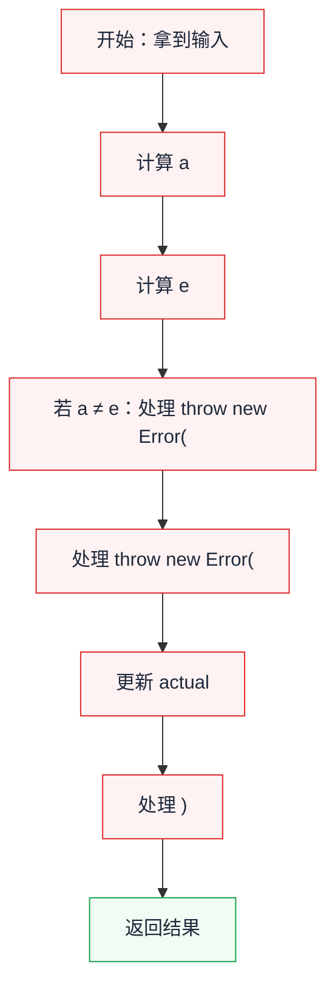

## TypeScript 解题方案（2 个方案逐个讲）

> **运行与提交**：每个方案都是自包含文件（内嵌用例自测，输出 PASS），整块复制到 `.ts` 文件后 `node 文件名` 即可运行。提交 LeetCode 时，把 `demo` 内的算法函数与辅助类型/函数整体取出、置于文件顶层即可。涉及交互/特殊接口的题以题面给定签名为准。

### 方案 1：直接实现

**分析与思路**：核心做法是「直接实现」。

**运行方式**：`node 本文件`，内嵌用例全部通过会输出 PASS。

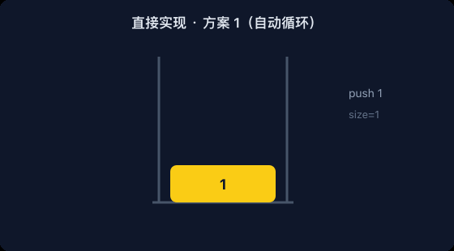

**方案专属流程图**（真实控制流）：

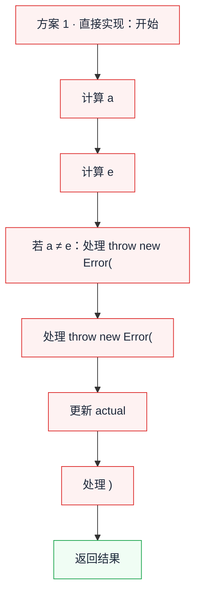

```typescript
function assertEq(actual: any, expected: any, msg: string = ''): void {
  // 定义函数/方法 assertEq
  const a = JSON.stringify(actual);
  const e = JSON.stringify(expected);
  if (a !== e)
    throw new Error(
      'ASSERT FAILED ' + msg + ' :: actual=' + a + ' expected=' + e,
    );
}

class MyStack {
  // 定义类型
  q1: number[];
  q2: number[]; // q1: number[]; q2: number[];
  constructor() {
    this.q1 = [];
    this.q2 = [];
  } // 把 []; this.q2 赋值为 []; } 写入 constructor() { this.q1
  push(x: number): void {
    this.q2.push(x);
    while (this.q1.length) this.q2.push(this.q1.shift()!);
    const t = this.q1;
    this.q1 = this.q2;
    this.q2 = t;
  } // 把 x 压入栈/数组尾部
  pop(): number {
    return this.q1.shift()!;
  } // 取出队首元素
  top(): number {
    return this.q1[0];
  } // top(): number { return this.q1[0]; }
  empty(): boolean {
    return this.q1.length === 0;
  } // 把 等于 0; } 写入 长度
}
export function demo(): void {
  // 程序入口：跑内嵌自测用例
  const obj = new MyStack(); // 把 new MyStack() 存入 obj
  obj.push(1);
  obj.push(2); // 把 1 压入栈/数组尾部
  assertEq(obj.top(), 2, 'top'); // 断言校验
  assertEq(obj.pop(), 2, 'pop'); // 断言校验
  assertEq(obj.empty(), false, 'empty'); // 断言校验
  console.log('PASS'); // 全部用例通过，输出 PASS
}
demo(); // demo();
```

### 方案 2：迭代指针处理

**分析与思路**：核心做法是「迭代指针处理」。代码里依次做这些事：队列或堆的调度。

**运行方式**：`node 本文件`，内嵌用例全部通过会输出 PASS。


**方案专属流程图**（真实控制流）：

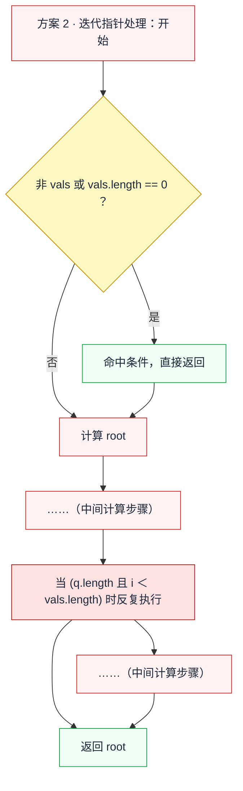

```typescript
class TreeNode {
  // 定义类型
  val: any;
  left: any;
  right: any; // 值: any; 左边界: any; 右边界: any;
  constructor(val?: any, left?: any, right?: any) {
    // constructor(值?: any, 左边界?: any, 右边界?: any) {
    this.val = val === undefined ? 0 : val; // 把 (值 全等于 undefined ? 0 : 值); 写入 值
    this.left = left === undefined ? null : left; // 把 (左边界 全等于 undefined ? null : 左边界); 写入 左边界
    this.right = right === undefined ? null : right; // 把 (右边界 全等于 undefined ? null : 右边界); 写入 右边界
  }
}
function buildTree(vals: any): any {
  // 定义函数/方法 buildTree
  if (!vals || vals.length === 0) return null; // 若 取反 vals 或 vals.长度 全等于 0，直接返回 null
  const root = new TreeNode(vals[0]);
  const q: any[] = [root];
  let i = 1;
  while (q.length && i < vals.length) {
    // 循环，直到不满足「节点.长度 且 下标 i 小于 vals.长度」
    const node = q.shift(); // 把 节点.shift() 存入 节点
    if (vals[i] !== null && vals[i] !== undefined) {
      node.left = new TreeNode(vals[i]);
      q.push(node.left);
    }
    i++; // 下标 i 加一
    if (i < vals.length && vals[i] !== null && vals[i] !== undefined) {
      node.right = new TreeNode(vals[i]);
      q.push(node.right);
    }
    i++; // 下标 i 加一
  }
  return root; // 返回 根节点
}
function treeToLevel(root: any): any[] {
  // 定义函数/方法 treeToLevel
  if (!root) return []; // 若 取反 根节点，直接返回 []
  const out: any[] = [];
  const q: any[] = [root]; // 把 []; const 节点: any[] 赋值为 [根节点]; 写入 const out: any[]
  while (q.length) {
    // 循环，直到不满足「节点.长度」
    const n = q.shift(); // 把 节点.shift() 存入 元素个数
    if (n === null || n === undefined) {
      out.push(null);
      continue;
    }
    out.push(n.val);
    q.push(n.left);
    q.push(n.right); // 把 元素个数.值 压入栈/数组尾部
  }
  while (out.length && out[out.length - 1] === null) out.pop(); // 循环，直到不满足「out.长度 且 out[out.长度 减 1] 全等于 null) out 弹出 );」
  return out; // 返回 out
}
class ListNode {
  // 定义类型
  val: any;
  next: any; // 值: any; 下一个: any;
  constructor(val?: any, next?: any) {
    this.val = val === undefined ? 0 : val;
    this.next = next === undefined ? null : next;
  }
}
function buildList(vals: any): any {
  // 定义函数/方法 buildList
  const dummy = new ListNode(0);
  let cur = dummy; // 把 new ListNode(0); let 当前值 赋值为 哨兵节点 存入 哨兵节点
  for (const v of vals) {
    cur.next = new ListNode(v);
    cur = cur.next;
  } // 把 new ListNode(值); 当前值 赋值为 当前值.下一个; } 写入 下一个
  return dummy.next; // 返回 哨兵节点.下一个
}
function listToArray(head: any): any[] {
  // 定义函数/方法 listToArray
  const out: any[] = [];
  let p = head; // 把 []; let 节点 赋值为 头节点; 写入 const out: any[]
  while (p) {
    out.push(p.val);
    p = p.next;
  } // 循环，直到不满足「节点) { out 追加 节点.值); 节点 赋值为 节点.下一个; }」
  return out; // 返回 out
}
// python-runtime shims
function pyLen(a: any): number {
  // 定义函数/方法 pyLen
  if (a === null || a === undefined) return 0; // 若 数组 全等于 null 或 数组 全等于 undefined，直接返回 0
  if (
    typeof a === 'string' ||
    Array.isArray(a) ||
    a instanceof Set ||
    a instanceof Map
  )
    return a.length ?? a.size;
  if (typeof a === 'object') return Object.keys(a).length; // 若 typeof 数组 全等于 'object'，直接返回 Object.keys(数组).长度
  return 0; // 返回 0
}
function pySlice(a: any, i: any, j: any, step?: any): any {
  // 定义函数/方法 pySlice
  if (typeof a === 'string') {
    const r = [...a].slice(i ?? 0, j ?? a.length);
    return step ? r.reverse().join('') : r.join('');
  }
  const arr = Array.isArray(a) ? a : [...a]; // 把 Array.isArray(数组) ? 数组 : 复制的 数组 存入 数组
  return arr.slice(i ?? 0, j ?? arr.length); // 返回 数组 截取 下标 i ?? 0, 下标 j ?? 数组.长度)
}
function pyRange(a: any, b?: any, step?: any): any[] {
  // 定义函数/方法 pyRange
  let s = 0,
    e = a,
    st = 1; // 把 0, e 赋值为 数组, st 赋值为 1 存入 字符串
  if (b !== undefined) {
    s = a;
    e = b;
  } // 若 b 不等于 undefined) { 字符串 赋值为 数组; e 赋值为 b; }
  if (step !== undefined) st = step; // 若 步数 不等于 undefined) st 赋值为 步数;
  const out: any[] = []; // 把 []; 写入 const out: any[]
  if (st > 0) for (let i = s; i < e; i += st) out.push(i);
  else for (let i = s; i > e; i += st) out.push(i); // 否则
  return out; // 返回 out
}
function pyIn(x: any, coll: any): boolean {
  // 定义函数/方法 pyIn
  if (coll === null || coll === undefined) return false; // 若 coll 全等于 null 或 coll 全等于 undefined，直接返回 false
  if (Array.isArray(coll)) return coll.includes(x); // 若 Array.isArray(coll)，直接返回 coll 是否包含 x)
  if (coll instanceof Set || coll instanceof Map) return coll.has(x); // 若 coll instanceof Set 或 coll instanceof Map，直接返回 coll.has(x)
  if (typeof coll === 'object') return x in coll; // 若 typeof coll 全等于 'object'，直接返回 x in coll
  if (typeof coll === 'string') return coll.indexOf(x) >= 0; // 若 typeof coll 全等于 'string'，直接返回 coll 查找 x) 不低于 0
  return false; // 返回 false
}
function pySorted(a: any): any[] {
  // 定义函数/方法 pySorted
  const arr = typeof a === 'string' ? [...a] : [...a]; // 把 (typeof 数组 全等于 'string') ? 复制的 数组 : 复制的 数组 存入 数组
  return arr.sort((x: any, y: any) => (x < y ? -1 : x > y ? 1 : 0));
}
function pyMin(a: any, b?: any): any {
  if (b !== undefined) return Math.min(a, b);
  if (Array.isArray(a) || a instanceof Set) return Math.min(...a);
  return Math.min(a);
} // 定义函数/方法 pyMin
function pyMax(a: any, b?: any): any {
  if (b !== undefined) return Math.max(a, b);
  if (Array.isArray(a) || a instanceof Set) return Math.max(...a);
  return Math.max(a);
} // 定义函数/方法 pyMax
function pySum(a: any): number {
  let s = 0;
  for (const v of a) s += v;
  return s;
} // 定义函数/方法 pySum
function pyAbs(x: any): number {
  return Math.abs(x);
} // 定义函数/方法 pyAbs
function pyEnumerate(a: any): any[] {
  const out: any[] = [];
  let i = 0;
  for (const v of a) {
    out.push([i, v]);
    i++;
  }
  return out;
} // 定义函数/方法 pyEnumerate
function pyZip(a: any, b: any): any[] {
  const n = Math.min(a.length, b.length);
  const out: any[] = [];
  for (let i = 0; i < n; i++) out.push([a[i], b[i]]);
  return out;
} // 定义函数/方法 pyZip
function pyDictGet(d: any, k: any, def?: any): any {
  return k in d ? d[k] : def === undefined ? null : def;
} // 定义函数/方法 pyDictGet
function pyPrint(...args: any[]): void {
  console.log(
    args
      .map((a) => (typeof a === 'object' && a !== null ? JSON.stringify(a) : a))
      .join(' '),
  );
} // 定义函数/方法 pyPrint
// collections / heapq
function heapPush(h: any[], x: any): void {
  h.push(x);
  let i = h.length - 1;
  while (i > 0) {
    const p = (i - 1) >> 1;
    if (h[p] <= h[i]) break;
    [h[p], h[i]] = [h[i], h[p]];
    i = p;
  }
} // 定义函数/方法 heapPush
function heapPop(h: any[]): any {
  const top = h[0];
  const last = h.pop();
  if (h.length) {
    h[0] = last;
    let i = 0;
    const n = h.length;
    while (true) {
      let l = 2 * i + 1,
        r = 2 * i + 2,
        s = i;
      if (l < n && h[l] < h[s]) s = l;
      if (r < n && h[r] < h[s]) s = r;
      if (s === i) break;
      [h[s], h[i]] = [h[i], h[s]];
      i = s;
    }
  }
  return top;
} // 定义函数/方法 heapPop
class Deque {
  private a: any[] = [];
  push(x: any) {
    this.a.push(x);
  }
  pushLeft(x: any) {
    this.a.unshift(x);
  }
  pop() {
    return this.a.pop();
  }
  popLeft() {
    return this.a.shift();
  }
  get length() {
    return this.a.length;
  }
  toArray() {
    return this.a.slice();
  }
} // 定义类型
function Counter(iter: any): any {
  const m: any = {};
  for (const v of iter) m[v] = (m[v] || 0) + 1;
  return m;
} // 定义函数/方法 Counter
function gcd(a: any, b: any): any {
  while (b) {
    [a, b] = [b, a % b];
  }
  return a;
} // 定义函数/方法 gcd
function pyInf(): number {
  return Infinity;
} // 定义函数/方法 pyInf

function norm(x: any): any {
  // 定义函数/方法 norm
  if (x === null || x === undefined) return null; // 若 x 全等于 null 或 x 全等于 undefined，直接返回 null
  if (typeof x === 'object') {
    // 若 typeof x 全等于 'object'
    if (x instanceof Deque) return x.toArray(); // 若 x instanceof Deque，直接返回 x.toArray()
    if (Array.isArray(x)) return x.map(norm); // 若 Array.isArray(x)，直接返回 x.映射表(norm)
    if (
      typeof x.val === 'number' &&
      (typeof x.left !== 'undefined' || typeof x.right !== 'undefined')
    )
      return treeToLevel(x);
    if (typeof x.next !== 'undefined' && typeof x.val === 'number')
      return listToArray(x);
    if (x instanceof Set) return [...x].sort(); // 若 x instanceof Set，直接返回 复制的 x 排序 )
    if (x instanceof Map) return Object.fromEntries(x); // 若 x instanceof Map，直接返回 Object.fromEntries(x)
    const o: any = {};
    for (const k of Object.keys(x)) o[k] = norm(x[k]);
    return o;
  }
  return x; // 返回 x
}
function eq(a: any, b: any): boolean {
  // 定义函数/方法 eq
  const x = norm(a),
    y = norm(b); // 把 norm(数组), y 赋值为 norm(b) 存入 x
  if (x === y) return true; // 若 x 全等于 y，直接返回 true
  if (x === null || y === null) return x === y; // 若 x 全等于 null 或 y 全等于 null，直接返回 x 全等于 y
  if (Array.isArray(x) && Array.isArray(y)) {
    // 若 Array.isArray(x) 且 Array.isArray(y
    if (x.length !== y.length) return false; // 若 x.长度 不等于 y.长度，直接返回 false
    for (let i = 0; i < x.length; i++) if (!eq(x[i], y[i])) return false; // 让 下标 i 从 0 开始计数，下标 i 小于 x.长度 就继续
    return true; // 返回 true
  }
  if (typeof x === 'object' && typeof y === 'object') {
    // 若 typeof x 全等于 'object' 且 typeof y 全等于 'object'
    const kx = Object.keys(x),
      ky = Object.keys(y); // 把 Object.keys(x), ky 赋值为 Object.keys(y) 存入 kx
    if (kx.length !== ky.length) return false; // 若 kx.长度 不等于 ky.长度，直接返回 false
    for (const k of kx) if (!eq(x[k], y[k])) return false;
    return true; // 返回 true
  }
  return x === y; // 返回 x 全等于 y
}

class MyStack {
  // 定义类型
  q: any[]; // 节点: any[];
  constructor() {
    this.q = [];
  } // 把 []; } 写入 节点
  push(x) {
    this.q.push(x);
  } // 把 x 压入栈/数组尾部
  pop() {
    return this.q.pop();
  } // 弹出栈顶元素
  top() {
    return this.q[this.q.length - 1];
  } // top() { return this.节点[this.节点.长度 减 1]; }
  empty() {
    return this.q.length === 0;
  } // 把 等于 0; } 写入 长度
}
export function demo(): void {
  // 程序入口：跑内嵌自测用例
  const s = new MyStack(); // 把 new MyStack() 存入 字符串
  s.push(1);
  s.push(2); // 把 1 压入栈/数组尾部
  const cases = [
    { got: s.top(), want: 2 },
    { got: s.pop(), want: 2 },
    { got: s.top(), want: 1 },
    { got: s.empty(), want: false },
  ];
  let fail = false; // 把 false 存入 fail
  for (const c of cases)
    if (!eq(c.got, c.want)) {
      fail = true;
      console.log('FAIL', c);
    } // 打印输出
  if (fail) throw new Error('FAILED'); // 若 fail) throw new Error(「FAILED」);
  console.log('PASS'); // 全部用例通过，输出 PASS
}
demo(); // demo();
```

## 逐步拆解与面试追问

**复杂度**：时间 O(n) 量级，空间 O(n)

**为什么是这个量级**：整体只对数据做有限趟处理

**面试官可能会追问**：

- 什么时候用单调栈（求下一个更大或更小）？
- 栈里存值还是存下标？
- 能否用 O(1) 额外空间？

## 关键 API 速查（TS 主解法实际用到，附官方链接）

| API | 作用 | 使用要点 | 官方文档 |
|---|---|---|---|
| `Array.prototype.push()` | 尾部追加 | 返回新长度；可一次多个；均摊 O(1)；会改变原数组 | [官方文档](https://developer.mozilla.org/zh-CN/docs/Web/JavaScript/Reference/Global_Objects/Array/push) |
| `Array.prototype.pop()` | 尾部弹出 | 返回被删元素（空数组返回 undefined）；O(1) | [官方文档](https://developer.mozilla.org/zh-CN/docs/Web/JavaScript/Reference/Global_Objects/Array/pop) |
| `Array.prototype.shift()` | 头部取出 | O(n)（后续元素整体前移）；大量头部操作请用链表或双端结构 | [官方文档](https://developer.mozilla.org/zh-CN/docs/Web/JavaScript/Reference/Global_Objects/Array/shift) |
| `JSON.stringify()` | 序列化为 JSON 字符串 | 常用于结构化比较（深度相等判定）；undefined/函数/循环引用会被丢弃或抛错 | [官方文档](https://developer.mozilla.org/zh-CN/docs/Web/JavaScript/Reference/Global_Objects/JSON/stringify) |

### 各语言官方文档导航

- **TypeScript / JS**：[MDN 中文参考](https://developer.mozilla.org/zh-CN/)
- **Python**：[Python 官方文档](https://docs.python.org/zh-cn/3/)
- **Go**：[Go 标准库](https://pkg.go.dev/std)
- **Java**：[JDK 17 API](https://docs.oracle.com/en/java/javase/17/docs/api/)
- **Rust**：[Rust 标准库](https://doc.rust-lang.org/std/)
- **Lua**：[Lua 5.4 手册](https://www.lua.org/manual/5.4/)
- **C**：[Cppreference C](https://zh.cppreference.com/w/c)
- **C++**：[Cppreference C++](https://zh.cppreference.com/w/cpp)
- **R**：[R 官方手册](https://stat.ethz.ch/R-manual/)
- **Zig**：[Zig 语言文档](https://ziglang.org/documentation/master/)
- **Dart**：[Dart API](https://api.dart.dev/)

## 附录：其他 10 种语言全部实现（每种语言列举其全部方案）

> TypeScript 的全部方案见「TypeScript 解题方案」一节；下面是其余 10 种语言的对应实现，每种语言的每个方案都带思路分析、代码走读与专属运行架构图。
> 每个方案都内嵌用例自测，可独立运行（老仓库 python/go 文件遵循「打印结果」约定）。
> 完整解法文件见 `dsa/<语言>/stack/lc_225_用队列实现栈/`。

### Python 实现（2 种方案）

Python 的全部方案如下，每个方案都内嵌用例自测，可独立运行（老仓库 python/go 文件遵循「打印结果」约定）：

#### 方案 1：直接实现

**思路与代码分析**：核心是「直接实现」。Python 版用切片与字典推导式简化操作，突出可读性。代码里依次做这些事：栈的后进先出操作；队列或堆的调度。

**运行架构**（真实控制流）：

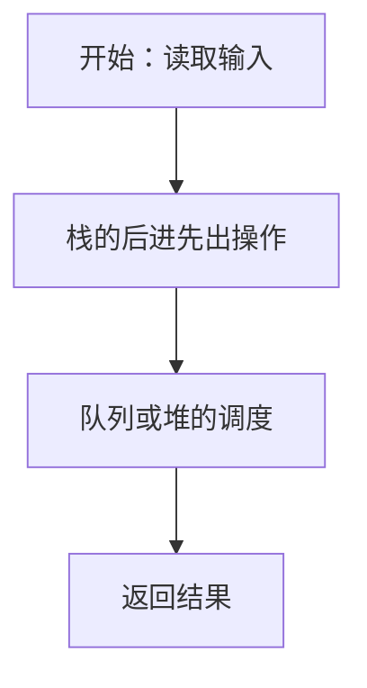

```python
from collections import deque  # from collections import deque

class MyStack:  # 定义类
    def __init__(self):  # 构造函数：初始化成员
        self.queue1 = deque()  # 把 deque() 写入 self.queue1
        self.queue2 = deque()  # 把 deque() 写入 self.queue2

    def push(self, x: int) -> None:  # 定义函数 push（参数：self, x: int）
        self.queue2.append(x)  # 把 x 追加到列表尾部
        while self.queue1:  # 循环，直到不满足「self.queue1」
            self.queue2.append(self.queue1.popleft())  # 把 self.queue1.popleft( 追加到列表尾部
        self.queue1, self.queue2 = (
            self.queue2,
            self.queue1,
        )  # 把 self.queue2, self.queue1 写入 self.queue1, self.queue2

    def pop(self) -> int:  # 定义函数 pop（参数：self）
        return self.queue1.popleft()  # 返回 self.queue1.popleft()

    def top(self) -> int:  # 定义函数 top（参数：self）
        return self.queue1[0]  # 返回 self.queue1[0]

    def empty(self) -> bool:  # 定义函数 empty（参数：self）
        return len(self.queue1) == 0  # 返回 长度(self.queue1) 等于 0

if __name__ == "__main__":  # 若 __name__ 等于 '__main__'
    obj = MyStack()  # 把 MyStack() 存入 obj
    obj.push(1)  # 把 1 压入栈/数组尾部
    obj.push(2)  # 把 2 压入栈/数组尾部
    print(obj.top())  # 2
    print(obj.pop())  # 2
    print(obj.empty())  # False
```

#### 方案 2：迭代指针处理

**思路与代码分析**：核心是「迭代指针处理」。Python 版用切片与字典推导式简化操作，突出可读性。代码里依次做这些事：栈的后进先出操作；队列或堆的调度。

**运行架构**：与方案 1 的控制流相同（同算法在该语言的等价实现），图见上。

```python
from collections import deque  # from collections import deque

class MyStack:  # 定义类
    def __init__(self):  # 构造函数：初始化成员
        self.queue = deque()  # 把 deque() 写入 队列

    def push(self, x: int) -> None:  # 定义函数 push（参数：self, x: int）
        n = len(self.queue)  # 把 长度(self.队列) 存入 元素个数
        self.queue.append(x)  # 把 x 追加到列表尾部
        for _ in range(n):  # 让 _ 从 元素个数 遍历
            self.queue.append(self.queue.popleft())  # 把 self.队列.popleft( 追加到列表尾部

    def pop(self) -> int:  # 定义函数 pop（参数：self）
        return self.queue.popleft()  # 返回 self.队列.popleft()

    def top(self) -> int:  # 定义函数 top（参数：self）
        return self.queue[0]  # 返回 self.队列[0]

    def empty(self) -> bool:  # 定义函数 empty（参数：self）
        return len(self.queue) == 0  # 返回 长度(self.队列) 等于 0

if __name__ == "__main__":  # 若 __name__ 等于 '__main__'
    obj = MyStack()  # 把 MyStack() 存入 obj
    obj.push(1)  # 把 1 压入栈/数组尾部
    obj.push(2)  # 把 2 压入栈/数组尾部
    print(obj.top())  # 2
    print(obj.pop())  # 2
    print(obj.empty())  # False
```

### Go 实现（2 种方案）

Go 的全部方案如下，每个方案都内嵌用例自测，可独立运行（老仓库 python/go 文件遵循「打印结果」约定）：

#### 方案 1：直接实现

**思路与代码分析**：核心是「直接实现」。Go 版用切片与多返回值惯用法，显式处理索引边界。**走读**：方案 1 · 直接实现：开始 → 返回 &MyStack。

**运行架构**（真实控制流）：

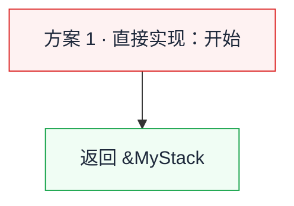

```go
package main // 引入依赖

import (
	"fmt" // 「fmt」
	"os"  // 「os」
)

type MyStack struct { // 定义类型
	queue1 []int // queue1 []int
	queue2 []int // queue2 []int
}

func NewMyStack() *MyStack { // 定义函数/方法 NewMyStack
	return &MyStack{} // 返回 按位与 MyStack{}
}

func (s *MyStack) push(x int) { // 定义函数/方法 push
	s.queue2 = append(s.queue2, x) // 把 append(字符串.queue2, x) 写入 s.queue2
	for len(s.queue1) > 0 {        // for 长度(字符串.queue1) 超过 0 {
		s.queue2 = append(s.queue2, s.queue1[0]) // 把 append(字符串.queue2, 字符串.queue1[0]) 写入 s.queue2
		s.queue1 = s.queue1[1:]                  // 把 字符串.queue1[1:] 写入 s.queue1
	}
	s.queue1, s.queue2 = s.queue2, s.queue1 // 把 字符串.queue2, 字符串.queue1 写入 s.queue1, s.queue2
}

func (s *MyStack) pop() int { // 定义函数/方法 pop
	val := s.queue1[0]      // 把 字符串.queue1[0] 写入 val :
	s.queue1 = s.queue1[1:] // 把 字符串.queue1[1:] 写入 s.queue1
	return val              // 返回 值
}

func (s *MyStack) top() int { // 定义函数/方法 top
	return s.queue1[0] // 返回 字符串.queue1[0]
}

func (s *MyStack) empty() bool { // 定义函数/方法 empty
	return len(s.queue1) == 0 // 返回 长度(字符串.queue1) 等于 0
}

func main() { // 程序入口：跑内嵌自测用例
	ok := true                  // 把 true 写入 ok :
	obj := NewMyStack()         // 把 NewMyStack() 写入 obj :
	obj.push(1)                 // 把 1 压入栈/数组尾部
	obj.push(2)                 // 把 2 压入栈/数组尾部
	if v := obj.top(); v != 2 { // 若 值 : 赋值为 obj.top(); 值 不等于 2
		ok = false                            // 把 false 写入 ok
		fmt.Printf("FAIL top=%v want 2\n", v) // 打印输出
	}
	if v := obj.pop(); v != 2 { // 若 值 : 赋值为 obj 弹出 ); 值 不等于 2
		ok = false                            // 把 false 写入 ok
		fmt.Printf("FAIL pop=%v want 2\n", v) // 打印输出
	}
	if v := obj.empty(); v != false { // 若 值 : 赋值为 obj 是否为空; 值 不等于 false
		ok = false                                  // 把 false 写入 ok
		fmt.Printf("FAIL empty=%v want false\n", v) // 打印输出
	}
	if !ok { // 若 取反 ok
		os.Exit(1) // os.Exit(1)
	}
	fmt.Println("PASS") // 全部用例通过，输出 PASS
}
```

#### 方案 2：迭代指针处理

**思路与代码分析**：核心是「迭代指针处理」。Go 版用切片与多返回值惯用法，显式处理索引边界。**走读**：方案 2 · 迭代指针处理：开始 → 返回 &MyStack。

**运行架构**（真实控制流）：

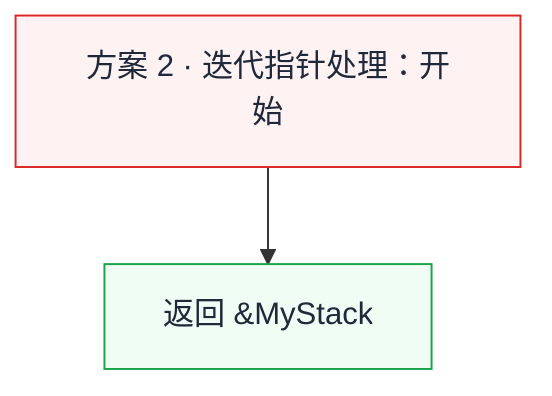

```go
package main // 引入依赖

import (
	"fmt" // 「fmt」
	"os"  // 「os」
)

type MyStack struct { // 定义类型
	queue []int // 队列 []int
}

func NewMyStack() *MyStack { // 定义函数/方法 NewMyStack
	return &MyStack{} // 返回 按位与 MyStack{}
}

func (s *MyStack) push(x int) { // 定义函数/方法 push
	n := len(s.queue)            // 把 长度(字符串.队列) 写入 n :
	s.queue = append(s.queue, x) // 把 append(字符串.队列, x) 写入 队列
	for i := 0; i < n; i++ {     // 让 下标 i 从 0 开始计数
		s.queue = append(s.queue, s.queue[0]) // 把 append(字符串.队列, 字符串.队列[0]) 写入 队列
		s.queue = s.queue[1:]                 // 把 字符串.队列[1:] 写入 队列
	}
}

func (s *MyStack) pop() int { // 定义函数/方法 pop
	val := s.queue[0]     // 把 字符串.队列[0] 写入 val :
	s.queue = s.queue[1:] // 把 字符串.队列[1:] 写入 队列
	return val            // 返回 值
}

func (s *MyStack) top() int { // 定义函数/方法 top
	return s.queue[0] // 返回 字符串.队列[0]
}

func (s *MyStack) empty() bool { // 定义函数/方法 empty
	return len(s.queue) == 0 // 返回 长度(字符串.队列) 等于 0
}

func main() { // 程序入口：跑内嵌自测用例
	ok := true                  // 把 true 写入 ok :
	obj := NewMyStack()         // 把 NewMyStack() 写入 obj :
	obj.push(1)                 // 把 1 压入栈/数组尾部
	obj.push(2)                 // 把 2 压入栈/数组尾部
	if v := obj.top(); v != 2 { // 若 值 : 赋值为 obj.top(); 值 不等于 2
		ok = false                            // 把 false 写入 ok
		fmt.Printf("FAIL top=%v want 2\n", v) // 打印输出
	}
	if v := obj.pop(); v != 2 { // 若 值 : 赋值为 obj 弹出 ); 值 不等于 2
		ok = false                            // 把 false 写入 ok
		fmt.Printf("FAIL pop=%v want 2\n", v) // 打印输出
	}
	if v := obj.empty(); v != false { // 若 值 : 赋值为 obj 是否为空; 值 不等于 false
		ok = false                                  // 把 false 写入 ok
		fmt.Printf("FAIL empty=%v want false\n", v) // 打印输出
	}
	if !ok { // 若 取反 ok
		os.Exit(1) // os.Exit(1)
	}
	fmt.Println("PASS") // 全部用例通过，输出 PASS
}
```

### Java 实现（2 种方案）

Java 的全部方案如下，每个方案都内嵌用例自测，可独立运行（老仓库 python/go 文件遵循「打印结果」约定）：

#### 方案 1：直接实现

**思路与代码分析**：核心是「直接实现」。Java 版用类与静态方法组织，集合操作显式明了。**走读**：方案 1 · 直接实现：开始 → 调用 q2.addLast(x) → 当 (非 q1.isEmpty()) 时反复执行 → 调用 q2.addLast(q1.removeFirst()) → 更新 t → 更新 q1 → 更新 q2 → 返回结果。

**运行架构**（真实控制流）：

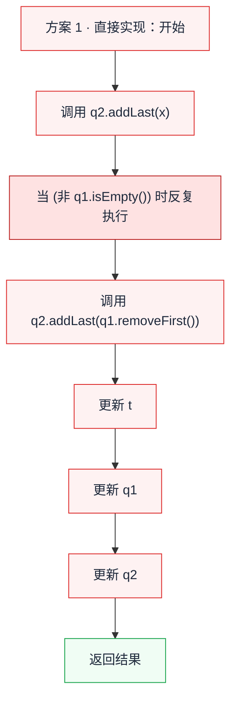

```java
package com.webfault.dsa; // 引入依赖

import java.util.*; // 引入依赖

class lc225_solution111 { // 定义类型
  static class MyStack { // static class MyStack {
    Deque<Integer> q1 = new ArrayDeque<>(); // 把 new ArrayDeque 小于 超过 (); 写入 Deque<Integer> q1
    Deque<Integer> q2 = new ArrayDeque<>(); // 把 new ArrayDeque 小于 超过 (); 写入 Deque<Integer> q2

    void push(int x) { // 定义函数/方法 push
      q2.addLast(x); // q2.addLast(x);
      while (!q1.isEmpty())
        q2.addLast(q1.removeFirst()); // 循环，直到不满足「取反 q1.isEmpty()) q2.addLast(q1.removeFirst());」
      Deque<Integer> t = q1;
      q1 = q2;
      q2 = t; // 把 q1; q1 赋值为 q2; q2 赋值为 另一字符串; 写入 Deque<Integer> t
    }

    int pop() {
      return q1.removeFirst();
    } // int pop() { return q1.removeFirst(); }

    int top() {
      return q1.peekFirst();
    } // int top() { return q1.peekFirst(); }

    boolean empty() {
      return q1.isEmpty();
    } // boolean empty() { return q1.isEmpty(); }
  }

  public static void main(String[] args) { // public static void main(String[] args) {
    MyStack o = new MyStack(); // 把 new MyStack(); 写入 MyStack o
    o.push(1);
    o.push(2); // 把 1 压入栈/数组尾部
    List<Object> out = new ArrayList<>(); // 把 new ArrayList 小于 超过 (); 写入 List<Object> out
    out.add(o.top()); // out 追加 o.top());
    out.add(o.pop()); // 弹出栈顶元素
    out.add(o.empty()); // out 追加 o 是否为空);
    List<Object> want =
        Arrays.asList(2, 2, false); // 把 Arrays.asList(2, 2, false); 写入 List<Object> want
    if (!out.equals(want)) throw new RuntimeException("FAILED " + out);
    System.out.println("PASS"); // 全部用例通过，输出 PASS
  }
}
```

#### 方案 2：迭代指针处理

**思路与代码分析**：核心是「迭代指针处理」。Java 版用类与静态方法组织，集合操作显式明了。代码里依次做这些事：单循环线性扫描。**走读**：方案 2 · 迭代指针处理：开始 → 更新 n → 调用 q.addLast(x) → 遍历循环 → 返回结果。

**运行架构**（真实控制流）：

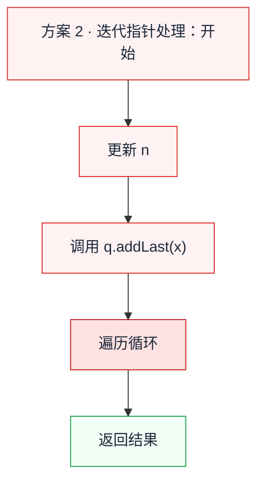

```java
package com.webfault.dsa; // 引入依赖

import java.util.*; // 引入依赖

class lc225_solution222 { // 定义类型
  static class MyStack { // static class MyStack {
    Deque<Integer> q = new ArrayDeque<>(); // 把 new ArrayDeque 小于 超过 (); 写入 Deque<Integer> q

    void push(int x) { // 定义函数/方法 push
      int n = q.size(); // 把 节点.大小() 存入 元素个数
      q.addLast(x); // 节点.addLast(x);
      for (int i = 0; i < n; i++) q.addLast(q.removeFirst()); // 让 下标 i 从 0 开始计数，下标 i 小于 元素个数 就继续
    }

    int pop() {
      return q.removeFirst();
    } // int pop() { return 节点.removeFirst(); }

    int top() {
      return q.peekFirst();
    } // int top() { return 节点.peekFirst(); }

    boolean empty() {
      return q.isEmpty();
    } // boolean empty() { return 节点.isEmpty(); }
  }

  public static void main(String[] args) { // public static void main(String[] args) {
    MyStack o = new MyStack(); // 把 new MyStack(); 写入 MyStack o
    o.push(1);
    o.push(2); // 把 1 压入栈/数组尾部
    List<Object> out = new ArrayList<>(); // 把 new ArrayList 小于 超过 (); 写入 List<Object> out
    out.add(o.top()); // out 追加 o.top());
    out.add(o.pop()); // 弹出栈顶元素
    out.add(o.empty()); // out 追加 o 是否为空);
    List<Object> want =
        Arrays.asList(2, 2, false); // 把 Arrays.asList(2, 2, false); 写入 List<Object> want
    if (!out.equals(want)) throw new RuntimeException("FAILED " + out);
    System.out.println("PASS"); // 全部用例通过，输出 PASS
  }
}
```

### Rust 实现（2 种方案）

Rust 的全部方案如下，每个方案都内嵌用例自测，可独立运行（老仓库 python/go 文件遵循「打印结果」约定）：

#### 方案 1：直接实现

**思路与代码分析**：核心是「直接实现」。Rust 版用所有权移动与切片借用改写同一逻辑，注意 Option 与引用边界。**走读**：方案 1 · 直接实现：开始 → 计算 q1 → 计算 out → 遍历 ops 中的每个元素 op → 处理 match op → 更新 Op225::Push(v) → 调用 q1.insert(0, v) → 更新 Op225::Pop → 处理 if 非 q1.is_empty() → 向 out 追加记录 → 向 out 追加记录 → 向 out 追加记录 → 向 out 追加记录 → 处理 out → 返回结果。

**运行架构**（真实控制流）：

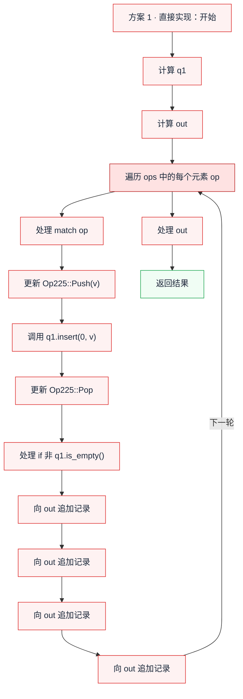

```rust
// LeetCode 225. 用队列实现栈 — Rust 版（方案1）
#[derive(Clone)]
enum Op225 {
    Push(i32),
    Pop,
    Top,
    Empty,
} // 定义类型
fn my_stack_run(ops: Vec<Op225>) -> Vec<i32> {
    // 定义函数/方法 my_stack_run
    let mut q1: Vec<i32> = Vec::new(); // 把 Vec::new(); 写入 let mut q1: Vec<i32>
    let mut out = Vec::new(); // 把 Vec::new(); 写入 let mut out
    for op in ops {
        // 逐个取出 ops 的元素（op）
        match op {
            // 按情况匹配处理
            Op225::Push(v) => {
                q1.insert(0, v); // q1 插入 0, 值);
            }
            Op225::Pop => {
                if !q1.is_empty() {
                    out.push(q1.remove(0));
                } else {
                    out.push(-1);
                }
            }
            Op225::Top => out.push(*q1.first().unwrap_or(&-1)),
            Op225::Empty => out.push(if q1.is_empty() { 1 } else { 0 }),
        }
    }
    out // out
}
fn main() {
    // 程序入口：跑内嵌自测用例
    let ops = vec![
        Op225::Push(1),
        Op225::Push(2),
        Op225::Top,
        Op225::Pop,
        Op225::Empty,
    ];
    assert_eq!(my_stack_run(ops), vec![2, 2, 0]); // 断言校验
    println!("PASS");
} // 全部用例通过，输出 PASS
```

#### 方案 2：迭代指针处理

**思路与代码分析**：核心是「迭代指针处理」。Rust 版用所有权移动与切片借用改写同一逻辑，注意 Option 与引用边界。**走读**：方案 2 · 迭代指针处理：开始 → 计算 q1 → 计算 out → 遍历 ops 中的每个元素 op → 处理 match op → 更新 Op225::Push(v) → 调用 q1.insert(0, v) → 更新 Op225::Pop → 处理 if 非 q1.is_empty() → 向 out 追加记录 → 向 out 追加记录 → 向 out 追加记录 → 向 out 追加记录 → 处理 out → 返回结果。

**运行架构**（真实控制流）：

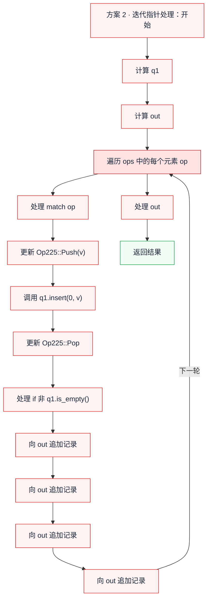

```rust
// LeetCode 225. 用队列实现栈 — Rust 版（方案2）
#[derive(Clone)]
enum Op225 {
    Push(i32),
    Pop,
    Top,
    Empty,
} // 定义类型
fn my_stack_run(ops: Vec<Op225>) -> Vec<i32> {
    // 定义函数/方法 my_stack_run
    let mut q1: Vec<i32> = Vec::new(); // 把 Vec::new(); 写入 let mut q1: Vec<i32>
    let mut out = Vec::new(); // 把 Vec::new(); 写入 let mut out
    for op in ops {
        // 逐个取出 ops 的元素（op）
        match op {
            // 按情况匹配处理
            Op225::Push(v) => {
                q1.insert(0, v); // q1 插入 0, 值);
            }
            Op225::Pop => {
                if !q1.is_empty() {
                    out.push(q1.remove(0));
                } else {
                    out.push(-1);
                }
            }
            Op225::Top => out.push(*q1.first().unwrap_or(&-1)),
            Op225::Empty => out.push(if q1.is_empty() { 1 } else { 0 }),
        }
    }
    out // out
}
fn main() {
    // 程序入口：跑内嵌自测用例
    let ops = vec![
        Op225::Push(1),
        Op225::Push(2),
        Op225::Top,
        Op225::Pop,
        Op225::Empty,
    ];
    assert_eq!(my_stack_run(ops), vec![2, 2, 0]); // 断言校验
    println!("PASS");
} // 全部用例通过，输出 PASS
```

### Lua 实现（2 种方案）

Lua 的全部方案如下，每个方案都内嵌用例自测，可独立运行（老仓库 python/go 文件遵循「打印结果」约定）：

#### 方案 1：直接实现

**思路与代码分析**：核心是「直接实现」。Lua 版用表与 ipairs 遍历，注意 ipairs 遇 nil 即停的语义。

**运行架构**（真实控制流）：

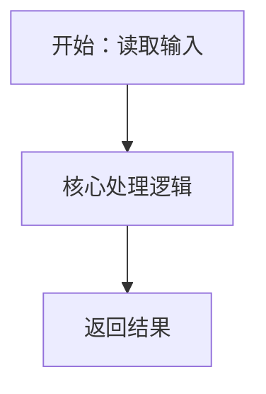

```lua
-- LeetCode 225. 用队列实现栈 — Lua 版（方案1）
local MyStack = {} -- 把 {} 写入 local MyStack
MyStack.__index = MyStack -- 把 MyStack 写入 MyStack.__index
function MyStack.new()
	return setmetatable({ q = {} }, MyStack)
end
function MyStack:push(x)
	table.insert(self.q, 1, x)
end -- function MyStack:push(x) table 插入 self.节点, 1, x) 终点
function MyStack:pop()
	return table.remove(self.q, 1)
end -- function MyStack:pop() return table 弹出 self.节点, 1) 终点
function MyStack:top()
	return self.q[1]
end -- function MyStack:top() return self.节点[1] 终点
function MyStack:empty()
	return #self.q == 0
end -- 把 赋值为 0 终点 写入 节点
local ms = MyStack.new() -- 把 MyStack.new() 写入 local ms
ms:push(1)
ms:push(2) -- ms:push(1); ms:push(2)
assert(ms:top() == 2) -- 断言校验
assert(ms:pop() == 2) -- 断言校验
assert(ms:empty() == false) -- 断言校验
print("PASS") -- 全部用例通过，输出 PASS
```

#### 方案 2：迭代指针处理

**思路与代码分析**：核心是「迭代指针处理」。Lua 版用表与 ipairs 遍历，注意 ipairs 遇 nil 即停的语义。

**运行架构**：与方案 1 的控制流相同（同算法在该语言的等价实现），图见上。

```lua
-- LeetCode 225. 用队列实现栈 — Lua 版（方案2）
local MyStack = {} -- 把 {} 写入 local MyStack
MyStack.__index = MyStack -- 把 MyStack 写入 MyStack.__index
function MyStack.new()
	return setmetatable({ q = {} }, MyStack)
end
function MyStack:push(x)
	table.insert(self.q, 1, x)
end -- function MyStack:push(x) table 插入 self.节点, 1, x) 终点
function MyStack:pop()
	return table.remove(self.q, 1)
end -- function MyStack:pop() return table 弹出 self.节点, 1) 终点
function MyStack:top()
	return self.q[1]
end -- function MyStack:top() return self.节点[1] 终点
function MyStack:empty()
	return #self.q == 0
end -- 把 赋值为 0 终点 写入 节点
local ms = MyStack.new() -- 把 MyStack.new() 写入 local ms
ms:push(1)
ms:push(2) -- ms:push(1); ms:push(2)
assert(ms:top() == 2) -- 断言校验
assert(ms:pop() == 2) -- 断言校验
assert(ms:empty() == false) -- 断言校验
print("PASS") -- 全部用例通过，输出 PASS
```

### C 实现（2 种方案）

C 的全部方案如下，每个方案都内嵌用例自测，可独立运行（老仓库 python/go 文件遵循「打印结果」约定）：

#### 方案 1：直接实现

**思路与代码分析**：核心是「直接实现」。C 版手动管理下标与内存，循环边界全部显式写出。**走读**：方案 1 · 直接实现：开始 → 更新 s->head → 更新 s->tail → 返回结果。

**运行架构**（真实控制流）：

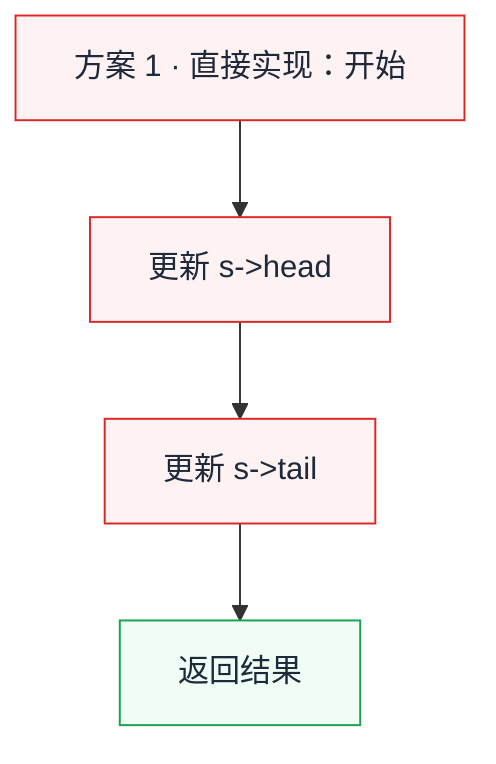

```c
/* LeetCode 225. 用队列实现栈 — C 版（方案1） */
#include <stdio.h> // 引入头文件
typedef struct {
    int q[4096];
    int head, tail;
} MyStack; // typedef struct { int 节点[4096]; int 头节点, 尾节点; } MyStack;
static void ms_init(MyStack *s) {
    s->head = 0;
    s->tail = 0;
}
static void ms_push(MyStack *s, int x) { s->q[s->head++] = x; }
static int ms_pop(MyStack *s) { return s->q[--s->head]; }
static int ms_top(MyStack *s) { return s->q[s->head - 1]; }
static int ms_empty(MyStack *s) { return s->head == s->tail; }
int main(void) { // 程序入口：跑内嵌自测用例
    MyStack s;   // MyStack 字符串;
    ms_init(&s); // ms_init( 按位与 字符串);
    ms_push(&s, 1);
    ms_push(&s, 2); // ms_push( 按位与 字符串, 1); ms_push( 按位与 字符串, 2);
    if (ms_top(&s) != 2) {
        printf("FAIL 1\n");
        return 1;
    } // 若 ms_top( 按位与 字符串) 不等于 2) { 输出「FAIL 1 」); return 1; }
    if (ms_pop(&s) != 2) {
        printf("FAIL 2\n");
        return 1;
    } // 若 ms_pop( 按位与 字符串) 不等于 2) { 输出「FAIL 2 」); return 1; }
    if (ms_empty(&s)) {
        printf("FAIL 3\n");
        return 1;
    } // 若 ms_empty( 按位与 字符串)) { 输出「FAIL 3 」); return 1; }
    printf("PASS\n");
    return 0;
} // 全部用例通过，输出 PASS
```

#### 方案 2：迭代指针处理

**思路与代码分析**：核心是「迭代指针处理」。C 版手动管理下标与内存，循环边界全部显式写出。**走读**：方案 2 · 迭代指针处理：开始 → 更新 s->head → 更新 s->tail → 返回结果。

**运行架构**（真实控制流）：

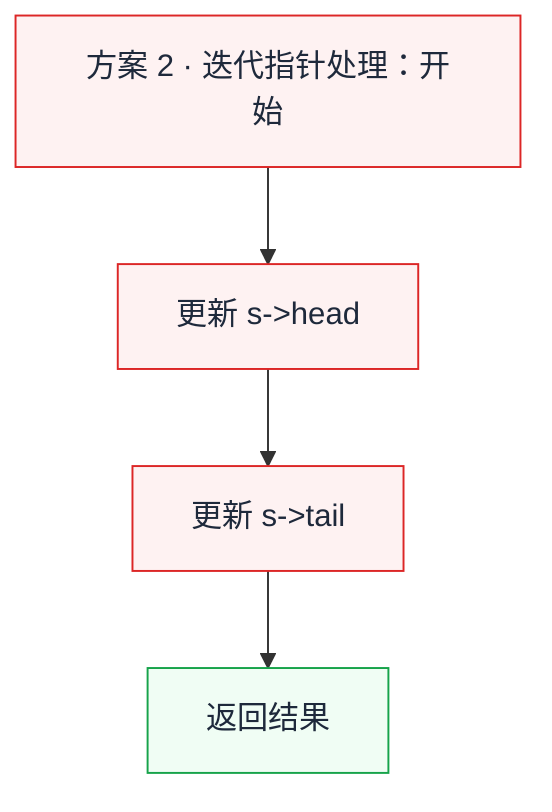

```c
/* LeetCode 225. 用队列实现栈 — C 版（方案2） */
#include <stdio.h> // 引入头文件
typedef struct {
    int q[4096];
    int head, tail;
} MyStack; // typedef struct { int 节点[4096]; int 头节点, 尾节点; } MyStack;
static void ms_init(MyStack *s) {
    s->head = 0;
    s->tail = 0;
}
static void ms_push(MyStack *s, int x) { s->q[s->head++] = x; }
static int ms_pop(MyStack *s) { return s->q[--s->head]; }
static int ms_top(MyStack *s) { return s->q[s->head - 1]; }
static int ms_empty(MyStack *s) { return s->head == s->tail; }
int main(void) { // 程序入口：跑内嵌自测用例
    MyStack s;   // MyStack 字符串;
    ms_init(&s); // ms_init( 按位与 字符串);
    ms_push(&s, 1);
    ms_push(&s, 2); // ms_push( 按位与 字符串, 1); ms_push( 按位与 字符串, 2);
    if (ms_top(&s) != 2) {
        printf("FAIL 1\n");
        return 1;
    } // 若 ms_top( 按位与 字符串) 不等于 2) { 输出「FAIL 1 」); return 1; }
    if (ms_pop(&s) != 2) {
        printf("FAIL 2\n");
        return 1;
    } // 若 ms_pop( 按位与 字符串) 不等于 2) { 输出「FAIL 2 」); return 1; }
    if (ms_empty(&s)) {
        printf("FAIL 3\n");
        return 1;
    } // 若 ms_empty( 按位与 字符串)) { 输出「FAIL 3 」); return 1; }
    printf("PASS\n");
    return 0;
} // 全部用例通过，输出 PASS
```

### C++ 实现（2 种方案）

C++ 的全部方案如下，每个方案都内嵌用例自测，可独立运行（老仓库 python/go 文件遵循「打印结果」约定）：

#### 方案 1：直接实现

**思路与代码分析**：核心是「直接实现」。C++ 版用 STL 容器与迭代器，减少手写下标错误。**走读**：方案 1 · 直接实现：开始 → 更新 v → 调用 q.pop_front() → 返回 v。

**运行架构**（真实控制流）：

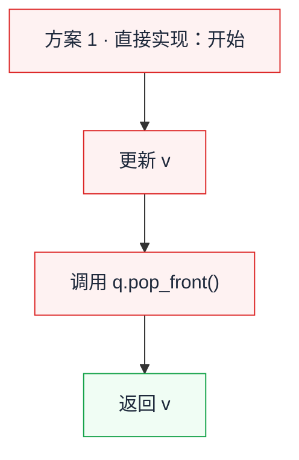

```cpp
// LeetCode 225. 用队列实现栈 — C++ 版（方案1）
#include <cassert>                        // 引入头文件
#include <deque>                          // 引入头文件
#include <iostream>                       // 引入头文件
struct MyStack {                          // 定义类型
    std::deque<int> q;                    // std::deque 小于 int 超过 节点;
    void push(int x) { q.push_front(x); } // void push(int x) { 节点.push_front(x); }
    int pop() {
        int v = q.front();
        q.pop_front();
        return v;
    }
    int top() { return q.front(); }    // int top() { return 节点.front(); }
    bool empty() { return q.empty(); } // bool empty() { return 节点 是否为空; }
};
int main() {              // 程序入口：跑内嵌自测用例
    MyStack s;            // MyStack 字符串;
    s.push(1);            // 把 1 压入栈/数组尾部
    s.push(2);            // 把 2 压入栈/数组尾部
    assert(s.top() == 2); // 断言校验
    assert(s.pop() == 2); // 断言校验
    assert(!s.empty());   // 断言校验
    std::cout << "PASS" << std::endl;
} // 全部用例通过，输出 PASS
```

#### 方案 2：迭代指针处理

**思路与代码分析**：核心是「迭代指针处理」。C++ 版用 STL 容器与迭代器，减少手写下标错误。**走读**：方案 2 · 迭代指针处理：开始 → 更新 v → 调用 q.pop_front() → 返回 v。

**运行架构**（真实控制流）：

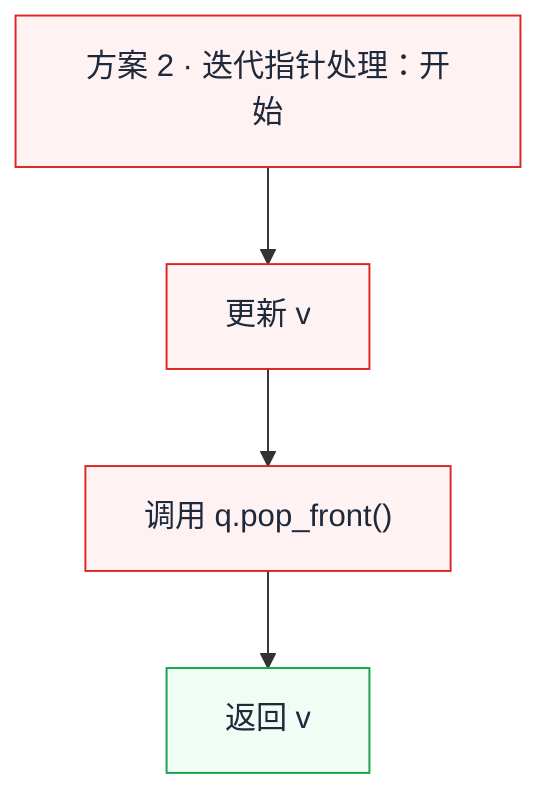

```cpp
// LeetCode 225. 用队列实现栈 — C++ 版（方案2）
#include <cassert>                        // 引入头文件
#include <deque>                          // 引入头文件
#include <iostream>                       // 引入头文件
struct MyStack {                          // 定义类型
    std::deque<int> q;                    // std::deque 小于 int 超过 节点;
    void push(int x) { q.push_front(x); } // void push(int x) { 节点.push_front(x); }
    int pop() {
        int v = q.front();
        q.pop_front();
        return v;
    }
    int top() { return q.front(); }    // int top() { return 节点.front(); }
    bool empty() { return q.empty(); } // bool empty() { return 节点 是否为空; }
};
int main() {              // 程序入口：跑内嵌自测用例
    MyStack s;            // MyStack 字符串;
    s.push(1);            // 把 1 压入栈/数组尾部
    s.push(2);            // 把 2 压入栈/数组尾部
    assert(s.top() == 2); // 断言校验
    assert(s.pop() == 2); // 断言校验
    assert(!s.empty());   // 断言校验
    std::cout << "PASS" << std::endl;
} // 全部用例通过，输出 PASS
```

### R 实现（2 种方案）

R 的全部方案如下，每个方案都内嵌用例自测，可独立运行（老仓库 python/go 文件遵循「打印结果」约定）：

#### 方案 1：直接实现

**思路与代码分析**：核心是「直接实现」。R 版用向量化思维与 1 起始下标，注意 1:n 的降序陷阱。**走读**：方案 1 · 直接实现：开始 → 更新 new.env(parent → 处理 e$q ＜- integer(0) → 处理 e$push ＜- function(x) e$q ＜＜ → 处理 e$pop ＜- function() → 处理 v ＜- e$q[1] → 处理 e$q ＜＜- e$q[-1] → 处理 v → 处理 e$top ＜- function() e$q[1] → 更新 = → 处理 e → 返回结果。

**运行架构**（真实控制流）：

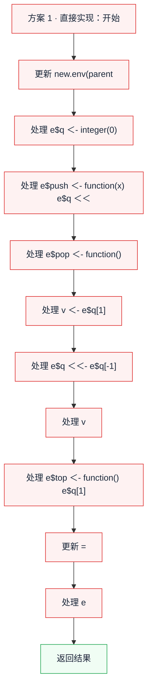

```r
# 版（方案1） 定义函数 MyStack（参数：无）
MyStack <- function() {
    e <- new.env(parent = emptyenv())  # 把 new.env(parent 赋值为 emptyenv()) 存入 e
    e$q <- integer(0)  # 把 integer(0) 存入 e$q
    e$push <- function(x) e$q <<- c(x, e$q)  # 把 function(x) e$节点 小于 小于 减 字符(x, e$节点) 存入 e$push
    e$pop <- function() {
        v <- e$q[1]
        e$q <<- e$q[-1]
        v
    }
    e$top <- function() e$q[1]  # 把 function() e$节点[1] 存入 e$top
    e$empty <- function() length(e$q) == 0  # 把 function() 长度(e$节点) 等于 0 存入 e$empty
    e
}
ms <- MyStack()  # 把 MyStack() 存入 ms
ms$push(1)
ms$push(2)  # ms$push(1); ms$push(2)
stopifnot(ms$top() == 2)  # 断言校验
stopifnot(ms$pop() == 2)  # 断言校验
stopifnot(!ms$empty())  # 断言校验
cat("PASS\n")  # 全部用例通过，输出 PASS
```

#### 方案 2：迭代指针处理

**思路与代码分析**：核心是「迭代指针处理」。R 版用向量化思维与 1 起始下标，注意 1:n 的降序陷阱。**走读**：方案 2 · 迭代指针处理：开始 → 更新 new.env(parent → 处理 e$q ＜- integer(0) → 处理 e$push ＜- function(x) e$q ＜＜ → 处理 e$pop ＜- function() → 处理 v ＜- e$q[1] → 处理 e$q ＜＜- e$q[-1] → 处理 v → 处理 e$top ＜- function() e$q[1] → 更新 = → 处理 e → 返回结果。

**运行架构**（真实控制流）：

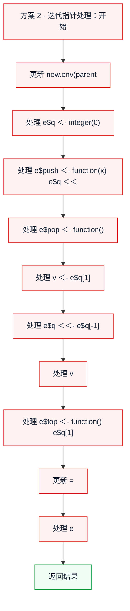

```r
# 版（方案2） 定义函数 MyStack（参数：无）
MyStack <- function() {
    e <- new.env(parent = emptyenv())  # 把 new.env(parent 赋值为 emptyenv()) 存入 e
    e$q <- integer(0)  # 把 integer(0) 存入 e$q
    e$push <- function(x) e$q <<- c(x, e$q)  # 把 function(x) e$节点 小于 小于 减 字符(x, e$节点) 存入 e$push
    e$pop <- function() {
        v <- e$q[1]
        e$q <<- e$q[-1]
        v
    }
    e$top <- function() e$q[1]  # 把 function() e$节点[1] 存入 e$top
    e$empty <- function() length(e$q) == 0  # 把 function() 长度(e$节点) 等于 0 存入 e$empty
    e
}
ms <- MyStack()  # 把 MyStack() 存入 ms
ms$push(1)
ms$push(2)  # ms$push(1); ms$push(2)
stopifnot(ms$top() == 2)  # 断言校验
stopifnot(ms$pop() == 2)  # 断言校验
stopifnot(!ms$empty())  # 断言校验
cat("PASS\n")  # 全部用例通过，输出 PASS
```

### Zig 实现（2 种方案）

Zig 的全部方案如下，每个方案都内嵌用例自测，可独立运行（老仓库 python/go 文件遵循「打印结果」约定）：

#### 方案 1：直接实现

**思路与代码分析**：核心是「直接实现」。Zig 版显式分配与清零，整型边界处理严格。**走读**：方案 1 · 直接实现：开始 → 返回 .。

**运行架构**（真实控制流）：

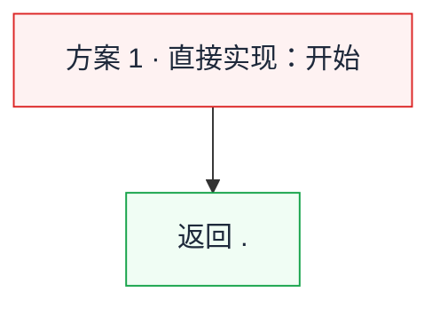

```zig
// LeetCode 225. 用队列实现栈 — Zig 版（方案1）
const std = @import("std"); // 把 @import(「std」) 存入 std
const MyStack = struct { // 把 struct { 存入 MyStack
    q: [4096]i32,
    head: usize,
    fn init() MyStack {
        return .{ .q = undefined, .head = 0 };
    } // 定义函数/方法 init
    fn push(self: *MyStack, x: i32) void { // 定义函数/方法 push
        var i: usize = self.head; // 把 self.头节点; 写入 var i: usize
        while (i > 0) : (i -= 1) self.q[i] = self.q[i - 1];
        self.q[0] = x; // 把 x; 写入 self.q[0]
        self.head += 1; // self.head累加 1
    }
    fn pop(self: *MyStack) i32 { // 定义函数/方法 pop
        const v = self.q[0]; // 把 self.节点[0] 存入 值
        var i: usize = 0; // 把 0; 写入 var i: usize
        while (i + 1 < self.head) : (i += 1) self.q[i] = self.q[i + 1];
        self.head -= 1; // self.head累减 1
        return v; // 返回 值
    }
    fn top(self: *MyStack) i32 {
        return self.q[0];
    } // 定义函数/方法 top
    fn empty(self: *MyStack) bool {
        return self.head == 0;
    } // 定义函数/方法 empty
};
pub fn main() !void { // 程序入口：跑内嵌自测用例
    var s = MyStack.init(); // 把 MyStack.init() 存入 字符串
    s.push(1); // 把 1 压入栈/数组尾部
    s.push(2); // 把 2 压入栈/数组尾部
    if (s.top() != 2) return error.TestFailed; // 若 字符串.top() 不等于 2，直接返回 error.TestFailed
    if (s.pop() != 2) return error.TestFailed; // 若 字符串 弹出 ) 不等于 2，直接返回 error.TestFailed
    if (s.empty()) return error.TestFailed; // 若 字符串 是否为空，直接返回 error.TestFailed
    std.debug.print("PASS\n", .{});
} // 全部用例通过，输出 PASS
```

#### 方案 2：迭代指针处理

**思路与代码分析**：核心是「迭代指针处理」。Zig 版显式分配与清零，整型边界处理严格。**走读**：方案 2 · 迭代指针处理：开始 → 返回 .。

**运行架构**（真实控制流）：

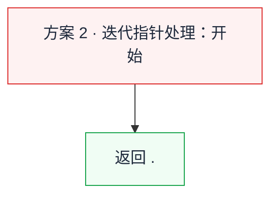

```zig
// LeetCode 225. 用队列实现栈 — Zig 版（方案2）
const std = @import("std"); // 把 @import(「std」) 存入 std
const MyStack = struct { // 把 struct { 存入 MyStack
    q: [4096]i32,
    head: usize,
    fn init() MyStack {
        return .{ .q = undefined, .head = 0 };
    } // 定义函数/方法 init
    fn push(self: *MyStack, x: i32) void { // 定义函数/方法 push
        var i: usize = self.head; // 把 self.头节点; 写入 var i: usize
        while (i > 0) : (i -= 1) self.q[i] = self.q[i - 1];
        self.q[0] = x; // 把 x; 写入 self.q[0]
        self.head += 1; // self.head累加 1
    }
    fn pop(self: *MyStack) i32 { // 定义函数/方法 pop
        const v = self.q[0]; // 把 self.节点[0] 存入 值
        var i: usize = 0; // 把 0; 写入 var i: usize
        while (i + 1 < self.head) : (i += 1) self.q[i] = self.q[i + 1];
        self.head -= 1; // self.head累减 1
        return v; // 返回 值
    }
    fn top(self: *MyStack) i32 {
        return self.q[0];
    } // 定义函数/方法 top
    fn empty(self: *MyStack) bool {
        return self.head == 0;
    } // 定义函数/方法 empty
};
pub fn main() !void { // 程序入口：跑内嵌自测用例
    var s = MyStack.init(); // 把 MyStack.init() 存入 字符串
    s.push(1); // 把 1 压入栈/数组尾部
    s.push(2); // 把 2 压入栈/数组尾部
    if (s.top() != 2) return error.TestFailed; // 若 字符串.top() 不等于 2，直接返回 error.TestFailed
    if (s.pop() != 2) return error.TestFailed; // 若 字符串 弹出 ) 不等于 2，直接返回 error.TestFailed
    if (s.empty()) return error.TestFailed; // 若 字符串 是否为空，直接返回 error.TestFailed
    std.debug.print("PASS\n", .{});
} // 全部用例通过，输出 PASS
```

### Dart 实现（2 种方案）

Dart 的全部方案如下，每个方案都内嵌用例自测，可独立运行（老仓库 python/go 文件遵循「打印结果」约定）：

#### 方案 1：直接实现

**思路与代码分析**：核心是「直接实现」。Dart 版用可空类型标注与集合方法，注意空安全。**走读**：方案 1 · 直接实现：开始 → 调用 q.insert(0, x) → 返回结果。

**运行架构**（真实控制流）：

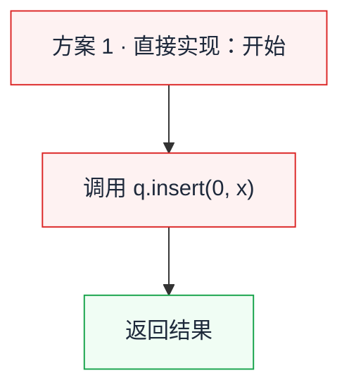

```dart
// LeetCode 225. 用队列实现栈 — Dart 版（方案1）
class MyStack {
  // 定义类型
  final List<int> q = []; // 把 []; 写入 final List<int> q
  void push(int x) {
    q.insert(0, x);
  } // void push(int x) { 节点 插入 0, x); }

  int pop() {
    final v = q.removeAt(0);
    return v;
  } // 把 节点.removeAt(0); return 值; } 写入 int pop() { final v

  int top() => q.first;
  bool empty() => q.isEmpty;
}

void main() {
  // 程序入口：跑内嵌自测用例
  final ms = MyStack(); // 把 MyStack() 存入 ms
  ms.push(1);
  ms.push(2); // 把 1 压入栈/数组尾部
  if (ms.top() != 2)
    throw StateError('c1'); // 若 ms.top() 不等于 2) throw StateError('c1');
  if (ms.pop() != 2)
    throw StateError('c2'); // 若 ms 弹出 ) 不等于 2) throw StateError('c2');
  if (ms.empty()) throw StateError('c3'); // 若 ms 是否为空) throw StateError('c3');
  print('PASS');
} // 全部用例通过，输出 PASS
```

#### 方案 2：迭代指针处理

**思路与代码分析**：核心是「迭代指针处理」。Dart 版用可空类型标注与集合方法，注意空安全。**走读**：方案 2 · 迭代指针处理：开始 → 调用 q.insert(0, x) → 返回结果。

**运行架构**（真实控制流）：

```mermaid
graph TD
    N0["方案 2 · 迭代指针处理：开始"]
    N1["调用 q.insert(0, x)"]
    N2["返回结果"]
    N0 --> N1
    N1 --> N2
    classDef n fill:#fef2f2,stroke:#dc2626,color:#1e293b;
    classDef lp fill:#fee2e2,stroke:#b91c1c,color:#1e293b;
    classDef dc fill:#fef9c3,stroke:#ca8a04,color:#1e293b;
    classDef tm fill:#f0fdf4,stroke:#16a34a,color:#1e293b;
    class N0,N1 n;
    class N2 tm;
```

```dart
// LeetCode 225. 用队列实现栈 — Dart 版（方案2）
class MyStack {
  // 定义类型
  final List<int> q = []; // 把 []; 写入 final List<int> q
  void push(int x) {
    q.insert(0, x);
  } // void push(int x) { 节点 插入 0, x); }

  int pop() {
    final v = q.removeAt(0);
    return v;
  } // 把 节点.removeAt(0); return 值; } 写入 int pop() { final v

  int top() => q.first;
  bool empty() => q.isEmpty;
}

void main() {
  // 程序入口：跑内嵌自测用例
  final ms = MyStack(); // 把 MyStack() 存入 ms
  ms.push(1);
  ms.push(2); // 把 1 压入栈/数组尾部
  if (ms.top() != 2)
    throw StateError('c1'); // 若 ms.top() 不等于 2) throw StateError('c1');
  if (ms.pop() != 2)
    throw StateError('c2'); // 若 ms 弹出 ) 不等于 2) throw StateError('c2');
  if (ms.empty()) throw StateError('c3'); // 若 ms 是否为空) throw StateError('c3');
  print('PASS');
} // 全部用例通过，输出 PASS
```

---

## 内容总结

- **用队列实现栈**（栈 · Medium）：共 2 个方案，主线思路「直接实现」；时间 O(n) 量级；动画演示栈后进先出过程，附录给出 11 种语言 × 全部方案的可运行实现。
- 来源博客：[https://blog.csdn.net/tyro_java/article/details/145113825](https://blog.csdn.net/tyro_java/article/details/145113825)
- 导航：[📋 总目录](../) ｜ [← 020 长度最小的子数组](../020_长度最小的子数组/) ｜ [022 用栈实现队列 →](../022_用栈实现队列/)
