# 022 · 用栈实现队列（第一阶段 · 线性结构入门 · Medium）

> **难度**：⭐⭐ Medium ｜ **专题**：栈
> **学习定位**：第一阶段 · 线性结构入门第 22 篇 ｜ **解法数**：1
> **内容总结**：**用栈实现队列**（栈 · Medium）：共 1 个方案，主线思路「栈辅助」；时间 O(n)（单趟线性扫描）；动画演示栈后进先出过程，附录给出 11 种语言 × 全部方案的可运行实现。

---

## 题目描述

请你仅使用两个栈实现先入先出队列。队列应当支持一般队列支持的所有操作（`push`、`pop`、`peek`、`empty`）：

实现 `MyQueue` 类：

 `void push(int x)` 将元素 x 推到队列的末尾
 `int pop()` 从队列的开头移除并返回元素
 `int peek()` 返回队列开头的元素
 `boolean empty()` 如果队列为空，返回 `true` ；否则，返回 `false`

**用例（来自原题）**：

**说明**

**示例 1**

```text
输入：
["MyQueue", "push", "push", "peek", "pop", "empty"]
[[], [1], [2], [], [], []]
输出：
[null, null, null, 1, 1, false]
```

解释：MyQueue myQueue = new MyQueue(); myQueue.push(1); // queue is: [1] myQueue.push(2); // queue is: [1, 2] (leftmost is front of the queue) myQueue.peek(); // return 1 myQueue.pop(); // return 1, queue is [2] myQueue.empty(); // return false
> 题面与 [leetcode.cn 官方](https://leetcode.cn/problems/implement-queue-using-stacks/)一致，示例配图取自官方题面。

**数据范围与注意事项**：

- `1 <= x <= 9`
- 最多调用 `100` 次 `push`、`pop`、`peek` 和 `empty`
- 假设所有操作都是有效的 （例如，一个空的队列不会调用 `pop` 或者 `peek` 操作）
- 你能否实现每个操作均摊时间复杂度为 `O(1)` 的队列？换句话说，执行 `n` 个操作的总时间复杂度为 `O(n)` ，即使其中一个操作可能花费较长时间。
- **易错点**：出栈前判空；「下一个更大元素」类问题栈里存下标比存值好用。

## 题目分析

**场景是什么**：后进先出结构天然适合「最近匹配」，对应真实开发里的括号校验、浏览历史、函数调用栈。本题就是该场景的 Medium 级练习，主线做法是「栈辅助」。

**主线怎么解**：把主解法从头到尾过一遍，它其实在依次做这几件事：单循环线性扫描 → 栈的后进先出操作。

## 解题思路

**方案对比**（共 1 个方案，由浅入深）：

| 方案 | 时间复杂度 | 空间复杂度 |
|---|---|---|
| 方案 1 · 栈辅助 | O(n)（单趟线性扫描） | O(1) 到 O(n)（视辅助结构） |

**怎么读这一篇**：

- 🐣 **新手路线**：把「题目描述」的示例 1 在纸上手推一遍 → 读方案 1（最直观的写法）与它的代码走读 → 按「运行方式」本地跑通看 PASS → 回头对比方案 2 之后的写法差在哪
- 🦅 **大佬路线**：直接锁定最优方案 1（栈辅助，O(n)（单趟线性扫描））→ 跳读该方案代码与走读 → 用「逐步拆解与面试追问」补齐复杂度推导与边界追问

### 动态算法图（栈后进先出，GIF 自动循环）


动画演示栈专题里栈后进先出的典型过程；每个方案在「TypeScript 解题方案」一节还配了专属动画与专属流程图。

### 主解法流程图（真实控制流）

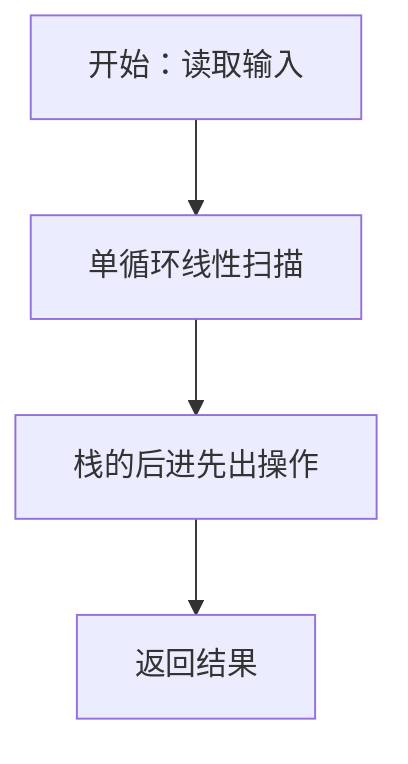

## TypeScript 解题方案（1 个方案逐个讲）

> **运行与提交**：每个方案都是自包含文件（内嵌用例自测，输出 PASS），整块复制到 `.ts` 文件后 `node 文件名` 即可运行。提交 LeetCode 时，把 `demo` 内的算法函数与辅助类型/函数整体取出、置于文件顶层即可。涉及交互/特殊接口的题以题面给定签名为准。

### 方案 1：栈辅助

**分析与思路**：核心做法是「栈辅助」。代码里依次做这些事：单循环线性扫描；栈的后进先出操作。

**运行方式**：`node 本文件`，内嵌用例全部通过会输出 PASS。


**方案专属流程图**（真实控制流）：


```typescript
// Faithful translation of python reference. Self-check via demo().
export function demo(): void {
  // 程序入口：跑内嵌自测用例
  class MyQueue {
    // 定义类型
    inStack: number[] = []; // 把 []; 写入 inStack: number[]
    outStack: number[] = []; // 把 []; 写入 outStack: number[]
    push(x: number): void {
      this.inStack.push(x);
    } // 把 x 压入栈/数组尾部
    pop(): number {
      // pop(): number {
      if (this.outStack.length === 0) this._in2out(); // 若 this.outStack.长度 全等于 0) this._in2out();
      return this.outStack.pop()!; // 返回 this.outStack 弹出 )取反
    }
    peek(): number {
      // peek(): number {
      if (this.outStack.length === 0) this._in2out(); // 若 this.outStack.长度 全等于 0) this._in2out();
      return this.outStack[this.outStack.length - 1]; // 返回 this.outStack[this.outStack.长度 减 1]
    }
    empty(): boolean {
      return this.outStack.length === 0 && this.inStack.length === 0;
    } // 把 等于 0 且 this.inStack.长度 全等于 0; } 写入 长度
    _in2out(): void {
      // _in2out(): void {
      while (this.inStack.length) this.outStack.push(this.inStack.pop()!);
    }
  }
  const q = new MyQueue(); // 把 new MyQueue() 存入 节点
  q.push(1);
  q.push(2); // 把 1 压入栈/数组尾部
  const got = [q.peek(), q.pop(), q.empty()]; // 把 [节点.peek(), 节点 弹出 ), 节点 是否为空] 存入 got
  q.push(3); // 把 3 压入栈/数组尾部
  got.push(q.pop());
  got.push(q.pop()); // 把 节点 弹出 压入栈/数组尾部
  const want = [1, 1, false, 2, 3]; // 把 [1, 1, false, 2, 3] 存入 want
  for (let i = 0; i < got.length; i++) {
    // 让 下标 i 从 0 开始计数，下标 i 小于 got.长度 就继续
    if (got[i] !== want[i])
      throw new Error('FAIL idx ' + i + ' got ' + got[i] + ' want ' + want[i]);
  }
  console.log('PASS'); // 全部用例通过，输出 PASS
}
demo(); // demo();
```

## 逐步拆解与面试追问

**复杂度**：时间 O(n)（单趟线性扫描），空间 O(1) 到 O(n)（视辅助结构）

**为什么是这个量级**：每个元素被常数次访问，辅助哈希或栈的开销与 n 同阶

**面试官可能会追问**：

- 什么时候用单调栈（求下一个更大或更小）？
- 栈里存值还是存下标？
- 能否用 O(1) 额外空间？

## 关键 API 速查（TS 主解法实际用到，附官方链接）

| API | 作用 | 使用要点 | 官方文档 |
|---|---|---|---|
| `Array.prototype.push()` | 尾部追加 | 返回新长度；可一次多个；均摊 O(1)；会改变原数组 | [官方文档](https://developer.mozilla.org/zh-CN/docs/Web/JavaScript/Reference/Global_Objects/Array/push) |
| `Array.prototype.pop()` | 尾部弹出 | 返回被删元素（空数组返回 undefined）；O(1) | [官方文档](https://developer.mozilla.org/zh-CN/docs/Web/JavaScript/Reference/Global_Objects/Array/pop) |

### 各语言官方文档导航

- **TypeScript / JS**：[MDN 中文参考](https://developer.mozilla.org/zh-CN/)
- **Python**：[Python 官方文档](https://docs.python.org/zh-cn/3/)
- **Go**：[Go 标准库](https://pkg.go.dev/std)
- **Java**：[JDK 17 API](https://docs.oracle.com/en/java/javase/17/docs/api/)
- **Rust**：[Rust 标准库](https://doc.rust-lang.org/std/)
- **Lua**：[Lua 5.4 手册](https://www.lua.org/manual/5.4/)
- **C**：[Cppreference C](https://zh.cppreference.com/w/c)
- **C++**：[Cppreference C++](https://zh.cppreference.com/w/cpp)
- **R**：[R 官方手册](https://stat.ethz.ch/R-manual/)
- **Zig**：[Zig 语言文档](https://ziglang.org/documentation/master/)
- **Dart**：[Dart API](https://api.dart.dev/)

## 附录：其他 10 种语言全部实现（每种语言列举其全部方案）

> TypeScript 的全部方案见「TypeScript 解题方案」一节；下面是其余 10 种语言的对应实现，每种语言的每个方案都带思路分析、代码走读与专属运行架构图。
> 每个方案都内嵌用例自测，可独立运行（老仓库 python/go 文件遵循「打印结果」约定）。
> 完整解法文件见 `dsa/<语言>/stack/lc_232_用栈实现队列/`。

### Python 实现（1 种方案）

Python 的全部方案如下，每个方案都内嵌用例自测，可独立运行（老仓库 python/go 文件遵循「打印结果」约定）：

#### 方案 1：栈辅助

**思路与代码分析**：核心是「栈辅助」。Python 版用切片与字典推导式简化操作，突出可读性。代码里依次做这些事：栈的后进先出操作。

**运行架构**（真实控制流）：

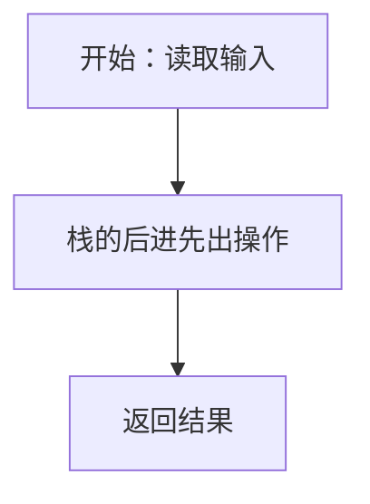

```python
class MyQueue:  # 定义类
    def __init__(self):  # 构造函数：初始化成员
        self.inStack = []  # 把 [] 写入 self.inStack
        self.outStack = []  # 把 [] 写入 self.outStack

    def push(self, x: int) -> None:  # 定义函数 push（参数：self, x: int）
        self.inStack.append(x)  # 把 x 追加到列表尾部

    def pop(self) -> int:  # 定义函数 pop（参数：self）
        if not self.outStack:  # 若 not self.outStack
            self._in2out()  # self._in2out()
        return self.outStack.pop()  # 返回 self.outStack 弹出 )

    def peek(self) -> int:  # 定义函数 peek（参数：self）
        if not self.outStack:  # 若 not self.outStack
            self._in2out()  # self._in2out()
        return self.outStack[-1]  # 返回 self.outStack[ 减 1]

    def empty(self) -> bool:  # 定义函数 empty（参数：self）
        return not self.outStack and not self.inStack  # 返回 not self.outStack and not self.inStack

    def _in2out(self) -> None:  # 定义函数 _in2out（参数：self）
        while self.inStack:  # 循环，直到不满足「self.inStack」
            self.outStack.append(self.inStack.pop())  # 把 self.inStack 弹出 追加到列表尾部

if __name__ == "__main__":  # 若 __name__ 等于 '__main__'
    q = MyQueue()  # 把 MyQueue() 存入 节点
    q.push(1)  # 把 1 压入栈/数组尾部
    q.push(2)  # 把 2 压入栈/数组尾部
    print(q.peek())  # 打印输出
    print(q.pop())  # 打印输出
    print(q.empty())  # 打印输出
    q.push(3)  # 把 3 压入栈/数组尾部
    print(q.pop())  # 打印输出
    print(q.pop())  # 打印输出
```

### Go 实现（1 种方案）

Go 的全部方案如下，每个方案都内嵌用例自测，可独立运行（老仓库 python/go 文件遵循「打印结果」约定）：

#### 方案 1：栈辅助

**思路与代码分析**：核心是「栈辅助」。Go 版用切片与多返回值惯用法，显式处理索引边界。**走读**：方案 1 · 栈辅助：开始 → 返回 &MyQueue。

**运行架构**（真实控制流）：

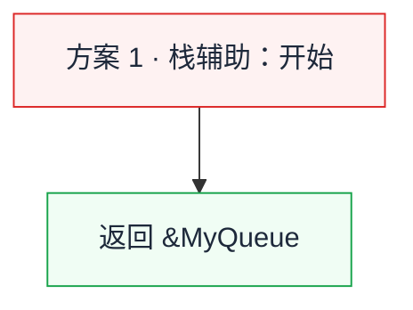

```go
package main // 引入依赖

import (
	"fmt" // 「fmt」
	"os"  // 「os」
)

type MyQueue struct { // 定义类型
	inStack  []int // inStack []int
	outStack []int // outStack []int
}

func NewMyQueue() *MyQueue { // 定义函数/方法 NewMyQueue
	return &MyQueue{} // 返回 按位与 MyQueue{}
}

func (q *MyQueue) push(x int) { // 定义函数/方法 push
	q.inStack = append(q.inStack, x) // 把 append(节点.inStack, x) 写入 q.inStack
}

func (q *MyQueue) pop() int { // 定义函数/方法 pop
	if len(q.outStack) == 0 { // 若 长度(节点.outStack) 等于 0
		q.in2out() // 节点.in2out()
	}
	val := q.outStack[len(q.outStack)-1]        // 把 节点.outStack[长度(节点.outStack) 减 1] 写入 val :
	q.outStack = q.outStack[:len(q.outStack)-1] // 把 节点.outStack[:长度(节点.outStack) 减 1] 写入 q.outStack
	return val                                  // 返回 值
}

func (q *MyQueue) peek() int { // 定义函数/方法 peek
	if len(q.outStack) == 0 { // 若 长度(节点.outStack) 等于 0
		q.in2out() // 节点.in2out()
	}
	return q.outStack[len(q.outStack)-1] // 返回 节点.outStack[长度(节点.outStack) 减 1]
}

func (q *MyQueue) empty() bool { // 定义函数/方法 empty
	return len(q.outStack) == 0 && len(q.inStack) == 0 // 返回 长度(节点.outStack) 等于 0 且 长度(节点.inStack) 等于 0
}

func (q *MyQueue) in2out() { // 定义函数/方法 in2out
	for len(q.inStack) > 0 { // for 长度(节点.inStack) 超过 0 {
		q.outStack = append(q.outStack, q.inStack[len(q.inStack)-1])
		q.inStack = q.inStack[:len(q.inStack)-1] // 把 节点.inStack[:长度(节点.inStack) 减 1] 写入 q.inStack
	}
}

func main() { // 程序入口：跑内嵌自测用例
	ok := true                 // 把 true 写入 ok :
	q := NewMyQueue()          // 把 NewMyQueue() 写入 q :
	q.push(1)                  // 把 1 压入栈/数组尾部
	q.push(2)                  // 把 2 压入栈/数组尾部
	if v := q.peek(); v != 1 { // 若 值 : 赋值为 节点.peek(); 值 不等于 1
		ok = false                             // 把 false 写入 ok
		fmt.Printf("FAIL peek=%v want 1\n", v) // 打印输出
	}
	if v := q.pop(); v != 1 { // 若 值 : 赋值为 节点 弹出 ); 值 不等于 1
		ok = false                            // 把 false 写入 ok
		fmt.Printf("FAIL pop=%v want 1\n", v) // 打印输出
	}
	if v := q.empty(); v != false { // 若 值 : 赋值为 节点 是否为空; 值 不等于 false
		ok = false                                  // 把 false 写入 ok
		fmt.Printf("FAIL empty=%v want false\n", v) // 打印输出
	}
	q.push(3)                 // 把 3 压入栈/数组尾部
	if v := q.pop(); v != 2 { // 若 值 : 赋值为 节点 弹出 ); 值 不等于 2
		ok = false                             // 把 false 写入 ok
		fmt.Printf("FAIL pop2=%v want 2\n", v) // 打印输出
	}
	if v := q.pop(); v != 3 { // 若 值 : 赋值为 节点 弹出 ); 值 不等于 3
		ok = false                             // 把 false 写入 ok
		fmt.Printf("FAIL pop3=%v want 3\n", v) // 打印输出
	}
	if !ok { // 若 取反 ok
		os.Exit(1) // os.Exit(1)
	}
	fmt.Println("PASS") // 全部用例通过，输出 PASS
}
```

### Java 实现（1 种方案）

Java 的全部方案如下，每个方案都内嵌用例自测，可独立运行（老仓库 python/go 文件遵循「打印结果」约定）：

#### 方案 1：栈辅助

**思路与代码分析**：核心是「栈辅助」。Java 版用类与静态方法组织，集合操作显式明了。**走读**：方案 1 · 栈辅助：开始 → 向 inStack 追加记录 → 返回结果。

**运行架构**（真实控制流）：

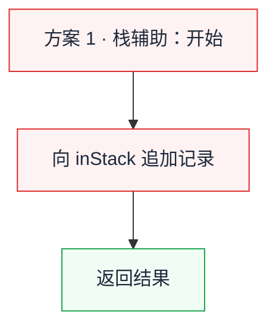

```java
package com.webfault.dsa; // 引入依赖

import java.util.*; // 引入依赖

class lc232_solution111 { // 定义类型
  static class MyQueue { // static class MyQueue {
    Deque<Integer> inStack =
        new ArrayDeque<>(); // 把 new ArrayDeque 小于 超过 (); 写入 Deque<Integer> inStack
    Deque<Integer> outStack =
        new ArrayDeque<>(); // 把 new ArrayDeque 小于 超过 (); 写入 Deque<Integer> outStack

    void push(int x) {
      inStack.push(x);
    } // 把 x 压入栈/数组尾部

    void in2out() {
      while (!inStack.isEmpty()) outStack.push(inStack.pop());
    } // 把 inStack 弹出 压入栈/数组尾部

    int pop() {
      if (outStack.isEmpty()) in2out();
      return outStack.pop();
    } // 弹出栈顶元素

    int peek() {
      if (outStack.isEmpty()) in2out();
      return outStack.peek();
    }

    boolean empty() {
      return inStack.isEmpty() && outStack.isEmpty();
    }
  }

  public static void main(String[] args) { // public static void main(String[] args) {
    MyQueue q = new MyQueue(); // 把 new MyQueue(); 写入 MyQueue q
    q.push(1);
    q.push(2); // 把 1 压入栈/数组尾部
    List<Object> out = new ArrayList<>(); // 把 new ArrayList 小于 超过 (); 写入 List<Object> out
    out.add(q.peek()); // out 追加 节点.peek());
    out.add(q.pop()); // 弹出栈顶元素
    out.add(q.empty()); // out 追加 节点 是否为空);
    q.push(3); // 把 3 压入栈/数组尾部
    out.add(q.pop()); // 弹出栈顶元素
    out.add(q.pop()); // 弹出栈顶元素
    List<Object> want =
        Arrays.asList(
            1, 1, false, 2, 3); // 把 Arrays.asList(1, 1, false, 2, 3); 写入 List<Object> want
    if (!out.equals(want)) throw new RuntimeException("FAILED " + out);
    System.out.println("PASS"); // 全部用例通过，输出 PASS
  }
}
```

### Rust 实现（1 种方案）

Rust 的全部方案如下，每个方案都内嵌用例自测，可独立运行（老仓库 python/go 文件遵循「打印结果」约定）：

#### 方案 1：栈辅助

**思路与代码分析**：核心是「栈辅助」。Rust 版用所有权移动与切片借用改写同一逻辑，注意 Option 与引用边界。代码里依次做这些事：栈的后进先出操作。**走读**：方案 1 · 栈辅助：开始 → 计算 in_stack → 遍历 ops 中的每个元素 op → 当 let Some(v) = in_stack.pop() 时反复执行 → 当 let Some(v) = in_stack.pop() 时反复执行 → 返回结果。

**运行架构**（真实控制流）：

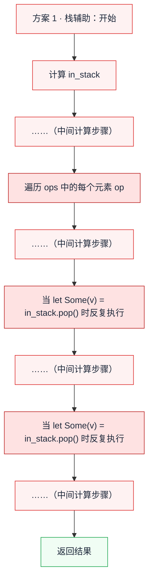

```rust
// LeetCode 232. 用栈实现队列 — Rust 版（方案1）
#[derive(Clone)]
enum Op232 {
    Push(i32),
    Pop,
    Peek,
    Empty,
} // 定义类型
fn my_queue_run(ops: Vec<Op232>) -> Vec<i32> {
    // 定义函数/方法 my_queue_run
    let mut in_stack: Vec<i32> = Vec::new(); // 把 Vec::new(); 写入 let mut in_stack: Vec<i32>
    let mut out_stack: Vec<i32> = Vec::new(); // 把 Vec::new(); 写入 let mut out_stack: Vec<i32>
    let mut out = Vec::new(); // 把 Vec::new(); 写入 let mut out
    for op in ops {
        // 逐个取出 ops 的元素（op）
        match op {
            // 按情况匹配处理
            Op232::Push(v) => in_stack.push(v),
            Op232::Pop => {
                if out_stack.is_empty() {
                    while let Some(v) = in_stack.pop() {
                        out_stack.push(v);
                    }
                }
                out.push(out_stack.pop().unwrap_or(-1)); // 把 out_stack 弹出 压入栈/数组尾部
            }
            Op232::Peek => {
                if out_stack.is_empty() {
                    while let Some(v) = in_stack.pop() {
                        out_stack.push(v);
                    }
                }
                out.push(*out_stack.last().unwrap_or(&-1)); // 把 乘 out_stack.last( 压入栈/数组尾部
            }
            Op232::Empty => out.push(if in_stack.is_empty() && out_stack.is_empty() {
                1
            } else {
                0
            }),
        }
    }
    out // out
}
fn main() {
    // 程序入口：跑内嵌自测用例
    let ops = vec![
        Op232::Push(1),
        Op232::Push(2),
        Op232::Peek,
        Op232::Pop,
        Op232::Empty,
    ];
    assert_eq!(my_queue_run(ops), vec![1, 1, 0]); // 断言校验
    println!("PASS");
} // 全部用例通过，输出 PASS
```

### Lua 实现（1 种方案）

Lua 的全部方案如下，每个方案都内嵌用例自测，可独立运行（老仓库 python/go 文件遵循「打印结果」约定）：

#### 方案 1：栈辅助

**思路与代码分析**：核心是「栈辅助」。Lua 版用表与 ipairs 遍历，注意 ipairs 遇 nil 即停的语义。

**运行架构**（真实控制流）：

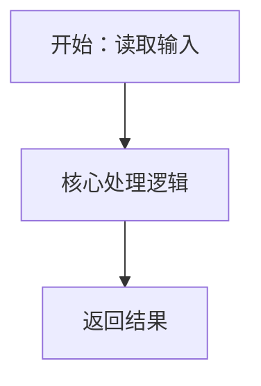

```lua
-- LeetCode 232. 用栈实现队列 — Lua 版（方案1）
local MyQueue = {} -- 把 {} 写入 local MyQueue
MyQueue.__index = MyQueue -- 把 MyQueue 写入 MyQueue.__index
function MyQueue.new()
	return setmetatable({ in_ = {}, out_ = {} }, MyQueue)
end
function MyQueue:in2out() -- function MyQueue:in2out()
	while #self.in_ > 0 do -- while #self.in_ 超过 0 do
		self.out_[#self.out_ + 1] = table.remove(self.in_) -- 把 table 弹出 self.in_) 写入 self.out_[#self.out_ + 1]
	end -- 终点
end -- 终点
function MyQueue:push(x)
	self.in_[#self.in_ + 1] = x
end -- 把 x 终点 写入 function MyQueue:push(x) self.in_[#self.in_ + 1]
function MyQueue:pop() -- function MyQueue:pop()
	if #self.out_ == 0 then
		self:in2out()
	end -- 若 #self.out_ 等于 0 then self:in2out() 终点
	return table.remove(self.out_) -- 返回 table 弹出 self.out_)
end -- 终点
function MyQueue:peek() -- function MyQueue:peek()
	if #self.out_ == 0 then
		self:in2out()
	end -- 若 #self.out_ 等于 0 then self:in2out() 终点
	return self.out_[#self.out_] -- 返回 self.out_[#self.out_]
end -- 终点
function MyQueue:empty()
	return #self.in_ == 0 and #self.out_ == 0
end
local mq = MyQueue.new() -- 把 MyQueue.new() 写入 local mq
mq:push(1)
mq:push(2) -- mq:push(1); mq:push(2)
assert(mq:peek() == 1) -- 断言校验
assert(mq:pop() == 1) -- 断言校验
assert(mq:empty() == false) -- 断言校验
print("PASS") -- 全部用例通过，输出 PASS
```

### C 实现（1 种方案）

C 的全部方案如下，每个方案都内嵌用例自测，可独立运行（老仓库 python/go 文件遵循「打印结果」约定）：

#### 方案 1：栈辅助

**思路与代码分析**：核心是「栈辅助」。C 版手动管理下标与内存，循环边界全部显式写出。**走读**：方案 1 · 栈辅助：开始 → 更新 q->in_n → 更新 q->out_n → 返回结果。

**运行架构**（真实控制流）：

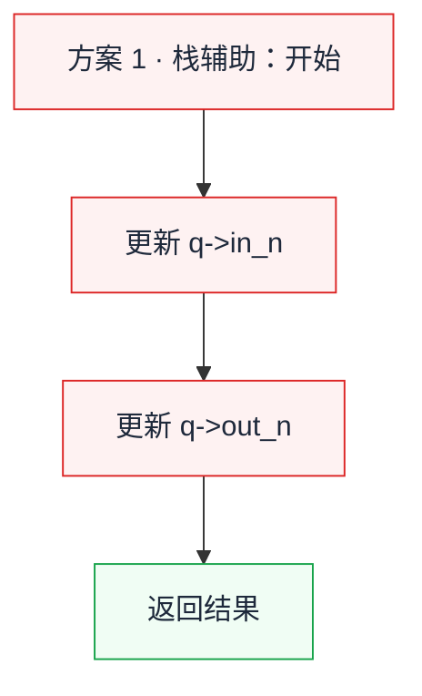

```c
/* LeetCode 232. 用栈实现队列 — C 版（方案1） */
#include <stdio.h> // 引入头文件
typedef struct {
    int in_[4096];
    int in_n;
    int out_[4096];
    int out_n;
} MyQueue;
static void mq_init(MyQueue *q) {
    q->in_n = 0;
    q->out_n = 0;
}
static void mq_in2out(MyQueue *q) { // 定义函数/方法 mq_in2out
    while (q->in_n > 0)
        q->out_[q->out_n++] = q->in_[--q->in_n];
}
static void mq_push(MyQueue *q, int x) { q->in_[q->in_n++] = x; }
static int mq_pop(MyQueue *q) { // 定义函数/方法 mq_pop
    if (q->out_n == 0)
        mq_in2out(q);           // 若 节点 减 超过 out_n 等于 0) mq_in2out(节点);
    return q->out_[--q->out_n]; // 返回 节点 减 超过 out_[ 减一 节点 减 超过 out_n]
}
static int mq_peek(MyQueue *q) { // 定义函数/方法 mq_peek
    if (q->out_n == 0)
        mq_in2out(q);             // 若 节点 减 超过 out_n 等于 0) mq_in2out(节点);
    return q->out_[q->out_n - 1]; // 返回 节点 减 超过 out_[节点 减 超过 out_n 减 1]
}
static int mq_empty(MyQueue *q) { return q->in_n == 0 && q->out_n == 0; }
int main(void) { // 程序入口：跑内嵌自测用例
    MyQueue q;   // MyQueue 节点;
    mq_init(&q); // mq_init( 按位与 节点);
    mq_push(&q, 1);
    mq_push(&q, 2); // mq_push( 按位与 节点, 1); mq_push( 按位与 节点, 2);
    if (mq_peek(&q) != 1) {
        printf("FAIL 1\n");
        return 1;
    } // 若 mq_peek( 按位与 节点) 不等于 1) { 输出「FAIL 1 」); return 1; }
    if (mq_pop(&q) != 1) {
        printf("FAIL 2\n");
        return 1;
    } // 若 mq_pop( 按位与 节点) 不等于 1) { 输出「FAIL 2 」); return 1; }
    if (mq_empty(&q)) {
        printf("FAIL 3\n");
        return 1;
    } // 若 mq_empty( 按位与 节点)) { 输出「FAIL 3 」); return 1; }
    printf("PASS\n");
    return 0;
} // 全部用例通过，输出 PASS
```

### C++ 实现（1 种方案）

C++ 的全部方案如下，每个方案都内嵌用例自测，可独立运行（老仓库 python/go 文件遵循「打印结果」约定）：

#### 方案 1：栈辅助

**思路与代码分析**：核心是「栈辅助」。C++ 版用 STL 容器与迭代器，减少手写下标错误。代码里依次做这些事：栈的后进先出操作。**走读**：方案 1 · 栈辅助：开始 → 当 (非 inSt.empty()) 时反复执行 → 向 outSt 追加记录 → 从 inSt 弹出 → 返回结果。

**运行架构**（真实控制流）：

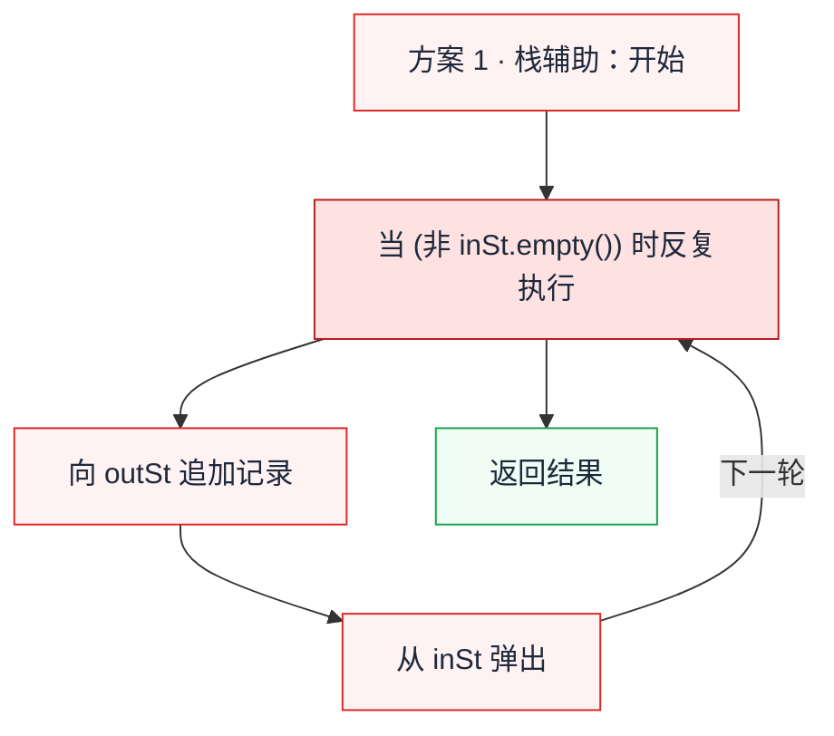

```cpp
// LeetCode 232. 用栈实现队列 — C++ 版（方案1）
#include <cassert>               // 引入头文件
#include <iostream>              // 引入头文件
#include <stack>                 // 引入头文件
struct MyQueue {                 // 定义类型
    std::stack<int> inSt, outSt; // std::栈 小于 int 超过 inSt, outSt;
    void in2out() {
        while (!inSt.empty()) {
            outSt.push(inSt.top());
            inSt.pop();
        }
    }                                  // 把 inSt.top( 压入栈/数组尾部
    void push(int x) { inSt.push(x); } // 把 x 压入栈/数组尾部
    int pop() {                        // 定义函数/方法 pop
        if (outSt.empty())
            in2out();        // 若 outSt 是否为空) in2out();
        int v = outSt.top(); // 把 outSt.top() 存入 值
        outSt.pop();         // 弹出栈顶元素
        return v;            // 返回 值
    }
    int peek() { // 定义函数/方法 peek
        if (outSt.empty())
            in2out();       // 若 outSt 是否为空) in2out();
        return outSt.top(); // 返回 outSt.top()
    }
    bool empty() {
        return inSt.empty() && outSt.empty();
    } // bool empty() { return inSt 是否为空 且 outSt 是否为空; }
};
int main() {               // 程序入口：跑内嵌自测用例
    MyQueue q;             // MyQueue 节点;
    q.push(1);             // 把 1 压入栈/数组尾部
    q.push(2);             // 把 2 压入栈/数组尾部
    assert(q.peek() == 1); // 断言校验
    assert(q.pop() == 1);  // 断言校验
    assert(!q.empty());    // 断言校验
    std::cout << "PASS" << std::endl;
} // 全部用例通过，输出 PASS
```

### R 实现（1 种方案）

R 的全部方案如下，每个方案都内嵌用例自测，可独立运行（老仓库 python/go 文件遵循「打印结果」约定）：

#### 方案 1：栈辅助

**思路与代码分析**：核心是「栈辅助」。R 版用向量化思维与 1 起始下标，注意 1:n 的降序陷阱。**走读**：方案 1 · 栈辅助：开始 → 更新 new.env(parent → 当 (length(e$in_) ＞ 0) 时反复执行 → 返回结果。

**运行架构**（真实控制流）：

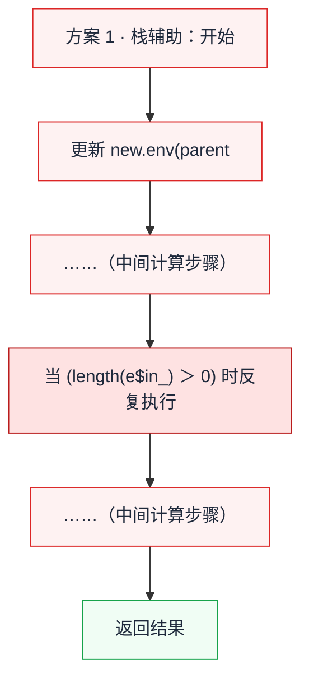

```r
# 版（方案1） 定义函数 MyQueue（参数：无）
MyQueue <- function() {
    e <- new.env(parent = emptyenv())  # 把 new.env(parent 赋值为 emptyenv()) 存入 e
    e$in_ <- integer(0)
    e$out_ <- integer(0)  # 把 integer(0); e$out_ 小于 减 integer(0) 存入 e$in_
    in2out <- function() {
        # 定义函数 in2out（参数：无） 循环，直到不满足「长度(e$in_) 超过 0」
        while (length(e$in_) > 0) {
            e$out_ <<- c(e$out_, e$in_[length(e$in_)])  # e$out_ 小于 小于 减 字符(e$out_, e$in_[长度(e$in_)])
            e$in_ <<- e$in_[-length(e$in_)]  # e$in_ 小于 小于 减 e$in_[ 减 长度(e$in_)]
        }
    }
    e$push <- function(x) e$in_ <<- c(e$in_, x)  # 把 function(x) e$in_ 小于 小于 减 字符(e$in_, x) 存入 e$push
    e$pop <- function() {
        # 把 function() { 存入 e$pop
        if (length(e$out_) == 0)
            in2out()  # 若 长度(e$out_) 等于 0) in2out(
        v <- e$out_[length(e$out_)]  # 把 e$out_[长度(e$out_)] 存入 值
        e$out_ <<- e$out_[-length(e$out_)]  # e$out_ 小于 小于 减 e$out_[ 减 长度(e$out_)]
        v
    }
    e$peek <- function() {
        # 把 function() { 存入 e$peek
        if (length(e$out_) == 0)
            in2out()  # 若 长度(e$out_) 等于 0) in2out(
        e$out_[length(e$out_)]  # e$out_[长度(e$out_)]
    }
    e$empty <- function() length(e$in_) == 0 && length(e$out_) == 0  # 把 function() 长度(e$in_) 等于 0 且 长度(e$out_) 等于 0 存入 e$empty
    e
}
mq <- MyQueue()  # 把 MyQueue() 存入 mq
mq$push(1)
mq$push(2)  # mq$push(1); mq$push(2)
stopifnot(mq$peek() == 1)  # 断言校验
stopifnot(mq$pop() == 1)  # 断言校验
stopifnot(!mq$empty())  # 断言校验
cat("PASS\n")  # 全部用例通过，输出 PASS
```

### Zig 实现（1 种方案）

Zig 的全部方案如下，每个方案都内嵌用例自测，可独立运行（老仓库 python/go 文件遵循「打印结果」约定）：

#### 方案 1：栈辅助

**思路与代码分析**：核心是「栈辅助」。Zig 版显式分配与清零，整型边界处理严格。**走读**：方案 1 · 栈辅助：开始 → 返回 .。

**运行架构**（真实控制流）：

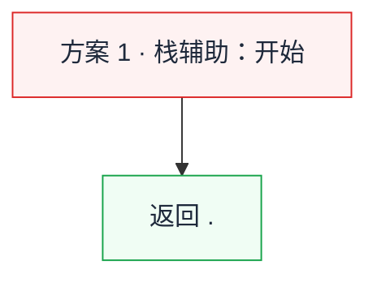

```zig
// LeetCode 232. 用栈实现队列 — Zig 版（方案1）
const std = @import("std"); // 把 @import(「std」) 存入 std
const MyQueue = struct { // 把 struct { 存入 MyQueue
    in_: [4096]i32,
    in_n: usize,
    out_: [4096]i32,
    out_n: usize,
    fn init() MyQueue {
        return .{ .in_ = undefined, .in_n = 0, .out_ = undefined, .out_n = 0 };
    } // 定义函数/方法 init
    fn in2out(self: *MyQueue) void { // 定义函数/方法 in2out
        while (self.in_n > 0) { // 循环，直到不满足「self.in_n 超过 0」
            self.in_n -= 1; // self.in_n累减 1
            self.out_[self.out_n] = self.in_[self.in_n]; // 把 self.in_[self.in_n]; 写入 self.out_[self.out_n]
            self.out_n += 1; // self.out_n累加 1
        }
    }
    fn push(self: *MyQueue, x: i32) void { // 定义函数/方法 push
        self.in_[self.in_n] = x; // 把 x; 写入 self.in_[self.in_n]
        self.in_n += 1; // self.in_n累加 1
    }
    fn pop(self: *MyQueue) i32 { // 定义函数/方法 pop
        if (self.out_n == 0) self.in2out(); // 若 self.out_n 等于 0) self.in2out();
        self.out_n -= 1; // self.out_n累减 1
        return self.out_[self.out_n]; // 返回 self.out_[self.out_n]
    }
    fn peek(self: *MyQueue) i32 { // 定义函数/方法 peek
        if (self.out_n == 0) self.in2out(); // 若 self.out_n 等于 0) self.in2out();
        return self.out_[self.out_n - 1]; // 返回 self.out_[self.out_n 减 1]
    }
    fn empty(self: *MyQueue) bool {
        return self.in_n == 0 and self.out_n == 0;
    } // 定义函数/方法 empty
};
pub fn main() !void { // 程序入口：跑内嵌自测用例
    var q = MyQueue.init(); // 把 MyQueue.init() 存入 节点
    q.push(1); // 把 1 压入栈/数组尾部
    q.push(2); // 把 2 压入栈/数组尾部
    if (q.peek() != 1) return error.TestFailed; // 若 节点.peek() 不等于 1，直接返回 error.TestFailed
    if (q.pop() != 1) return error.TestFailed; // 若 节点 弹出 ) 不等于 1，直接返回 error.TestFailed
    if (q.empty()) return error.TestFailed; // 若 节点 是否为空，直接返回 error.TestFailed
    std.debug.print("PASS\n", .{});
} // 全部用例通过，输出 PASS
```

### Dart 实现（1 种方案）

Dart 的全部方案如下，每个方案都内嵌用例自测，可独立运行（老仓库 python/go 文件遵循「打印结果」约定）：

#### 方案 1：栈辅助

**思路与代码分析**：核心是「栈辅助」。Dart 版用可空类型标注与集合方法，注意空安全。**走读**：方案 1 · 栈辅助：开始 → 当 (inStack.isNotEmpty) 时反复执行 → 调用 outStack.add(inStack.removeL → 返回结果。

**运行架构**（真实控制流）：

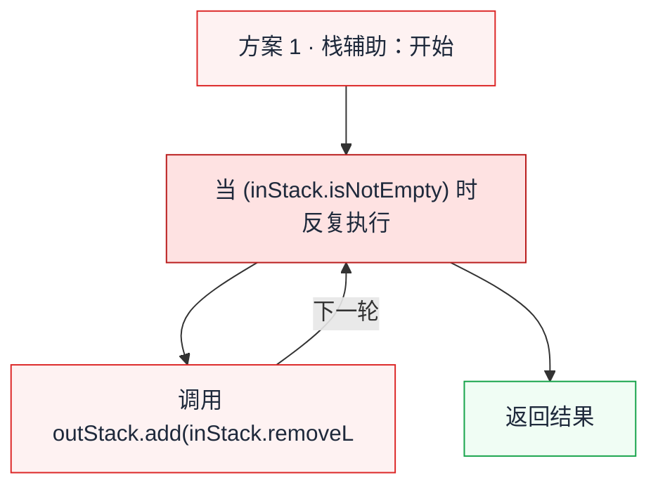

```dart
// LeetCode 232. 用栈实现队列 — Dart 版（方案1）
class MyQueue {
  // 定义类型
  final List<int> inStack = []; // 把 []; 写入 final List<int> inStack
  final List<int> outStack = []; // 把 []; 写入 final List<int> outStack
  void in2out() {
    // 定义函数/方法 in2out
    while (inStack.isNotEmpty) {
      outStack.add(inStack.removeLast());
    }
  }

  void push(int x) {
    inStack.add(x);
  } // void push(int x) { inStack 追加 x); }

  int pop() {
    // 定义函数/方法 pop
    if (outStack.isEmpty) in2out(); // 若 outStack.isEmpty) in2out();
    return outStack.removeLast(); // 返回 outStack.removeLast()
  }

  int peek() {
    // 定义函数/方法 peek
    if (outStack.isEmpty) in2out(); // 若 outStack.isEmpty) in2out();
    return outStack.last; // 返回 outStack.last
  }

  bool empty() => inStack.isEmpty && outStack.isEmpty;
}

void main() {
  // 程序入口：跑内嵌自测用例
  final mq = MyQueue(); // 把 MyQueue() 存入 mq
  mq.push(1);
  mq.push(2); // 把 1 压入栈/数组尾部
  if (mq.peek() != 1)
    throw StateError('c1'); // 若 mq.peek() 不等于 1) throw StateError('c1');
  if (mq.pop() != 1)
    throw StateError('c2'); // 若 mq 弹出 ) 不等于 1) throw StateError('c2');
  if (mq.empty()) throw StateError('c3'); // 若 mq 是否为空) throw StateError('c3');
  print('PASS');
} // 全部用例通过，输出 PASS
```

---

## 内容总结

- **用栈实现队列**（栈 · Medium）：共 1 个方案，主线思路「栈辅助」；时间 O(n)（单趟线性扫描）；动画演示栈后进先出过程，附录给出 11 种语言 × 全部方案的可运行实现。
- 来源博客：[https://blog.csdn.net/tyro_java/article/details/145114011](https://blog.csdn.net/tyro_java/article/details/145114011)
- 导航：[📋 总目录](../) ｜ [← 021 用队列实现栈](../021_用队列实现栈/) ｜ [023 除自身以外数组的乘积 →](../023_除自身以外数组的乘积/)
