# 023 · 除自身以外数组的乘积（第一阶段 · 线性结构入门 · Medium）

> **难度**：⭐⭐ Medium ｜ **专题**：数组
> **学习定位**：第一阶段 · 线性结构入门第 23 篇 ｜ **解法数**：1
> **内容总结**：**除自身以外数组的乘积**（数组 · Medium）：共 1 个方案，主线思路「双重循环枚举」；时间 O(n)（单趟线性扫描）；动画演示双指针过程，附录给出 11 种语言 × 全部方案的可运行实现。

---

## 题目描述

给你一个整数数组 `nums`，返回 数组 `answer` ，其中 `answer[i]` 等于 `nums` 中除了 `nums[i]` 之外其余各元素的乘积 。

题目数据 保证 数组 `nums`之中任意元素的全部前缀元素和后缀的乘积都在 32 位 整数范围内。

请 不要使用除法，且在 `O(n)` 时间复杂度内完成此题。

- 主函数签名：`function eqList(a: number[], b: number[]): boolean`

**用例（来自原题）**：

**示例 1**

```text
输入: nums = [1,2,3,4]
输出: [24,12,8,6]
```

**示例 2**

```text
输入: nums = [-1,1,0,-3,3]
输出: [0,0,9,0,0]
```
> ✅ **官方验证**：全部 TypeScript 解法已通过 leetcode.cn 官方示例用例验证（自动注入运行，全部 PASS）。题面与 [leetcode.cn 官方](https://leetcode.cn/problems/product-of-array-except-self/)一致，示例配图取自官方题面。

**数据范围与注意事项**：

- `2 <= nums.length <= 10^5`
- `-30 <= nums[i] <= 30`
- 输入 保证 数组 `answer[i]` 在 32 位 整数范围内
- 进阶：你可以在 `O(1)` 的额外空间复杂度内完成这个题目吗？（ 出于对空间复杂度分析的目的，输出数组 不被视为 额外空间。）
- **易错点**：边界最容易漏：空数组、只有一个元素、目标出现在头尾。

## 题目分析

**场景是什么**：数组是最常用的线性容器，这类题练的是下标操作与原地腾挪，对应真实开发里的缓冲区、列表整理。本题就是该场景的 Medium 级练习，主线做法是「双重循环枚举」。

**主线怎么解**：把主解法从头到尾过一遍，它其实在依次做这几件事：双重循环遍历。

## 解题思路

**方案对比**（共 1 个方案，由浅入深）：

| 方案 | 时间复杂度 | 空间复杂度 |
|---|---|---|
| 方案 1 · 双重循环枚举 | O(n)（单趟线性扫描） | O(1) 到 O(n)（视辅助结构） |

**怎么读这一篇**：

- 🐣 **新手路线**：把「题目描述」的示例 1 在纸上手推一遍 → 读方案 1（最直观的写法）与它的代码走读 → 按「运行方式」本地跑通看 PASS → 回头对比方案 2 之后的写法差在哪
- 🦅 **大佬路线**：直接锁定最优方案 1（双重循环枚举，O(n)（单趟线性扫描））→ 跳读该方案代码与走读 → 用「逐步拆解与面试追问」补齐复杂度推导与边界追问

### 动态算法图（双指针，GIF 自动循环）


动画演示数组专题里双指针的典型过程；每个方案在「TypeScript 解题方案」一节还配了专属动画与专属流程图。

### 主解法流程图（真实控制流）

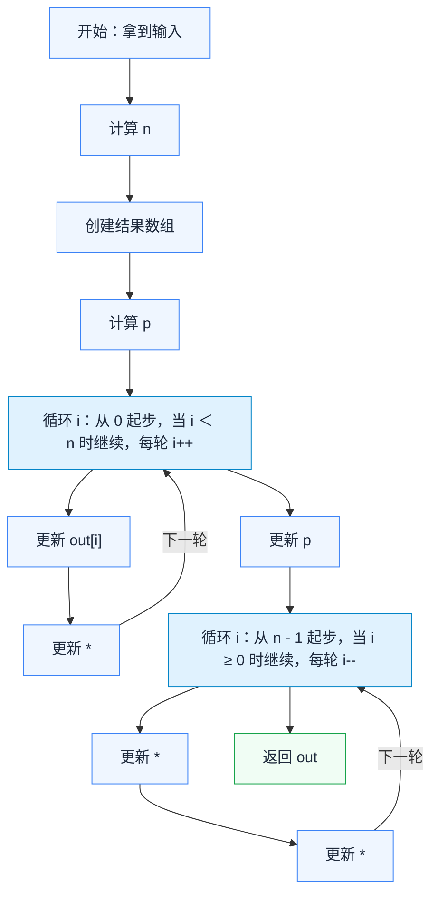

## TypeScript 解题方案（1 个方案逐个讲）

> **运行与提交**：每个方案都是自包含文件（内嵌用例自测，输出 PASS），整块复制到 `.ts` 文件后 `node 文件名` 即可运行。提交 LeetCode 时，把 `demo` 内的算法函数与辅助类型/函数整体取出、置于文件顶层即可。涉及交互/特殊接口的题以题面给定签名为准。

### 方案 1：双重循环枚举

**分析与思路**：核心做法是「双重循环枚举」。代码里依次做这些事：双重循环遍历。

**运行方式**：`node 本文件`，内嵌用例全部通过会输出 PASS。


**方案专属流程图**（真实控制流）：

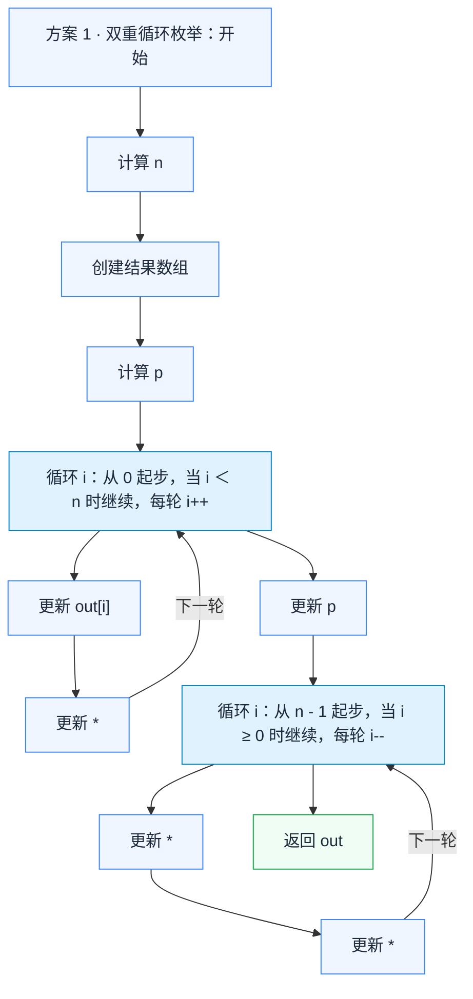

```typescript
/** 来源: LeetCode 238 除自身以外数组的乘积 */
export function productExceptSelf(nums: number[]): number[] {
  // 定义函数/方法 productExceptSelf
  const n = nums.length; // 把 数组.长度 存入 元素个数
  const out = new Array(n).fill(1); // 把 new Array(元素个数).fill(1) 存入 out
  let p = 1; // 把 1 存入 节点
  for (let i = 0; i < n; i++) {
    out[i] = p;
    p *= nums[i];
  } // 让 下标 i 从 0 开始计数，下标 i 小于 元素个数 就继续
  p = 1; // 把 1 存入 节点
  for (let i = n - 1; i >= 0; i--) {
    out[i] *= p;
    p *= nums[i];
  } // 让 下标 i 从 元素个数 减 1 开始计数，下标 i 不低于 0 就继续
  return out; // 返回 out
}

function eqList(a: number[], b: number[]): boolean {
  // 定义函数/方法 eqList
  if (a.length !== b.length) return false; // 若 数组.长度 不等于 b.长度，直接返回 false
  for (let i = 0; i < a.length; i++) if (a[i] !== b[i]) return false; // 让 下标 i 从 0 开始计数，下标 i 小于 数组.长度 就继续
  return true; // 返回 true
}

export function demo(): void {
  // 程序入口：跑内嵌自测用例
  const cases: [number[], number[]][] = [
    [
      [1, 2, 3, 4],
      [24, 12, 8, 6],
    ],
    [
      [0, 0],
      [0, 0],
    ],
    [
      [-1, 1, 0, -3, 3],
      [0, 0, 9, 0, 0],
    ],
  ];
  for (const [inp, want] of cases) {
    // for (const [inp, want] of cases) {
    const got = productExceptSelf(inp); // 把 productExceptSelf(inp) 存入 got
    if (!eqList(got, want))
      throw new Error(
        `FAIL in=${JSON.stringify(inp)} want=${JSON.stringify(want)} got=${JSON.stringify(got)}`,
      );
  }
  console.log('PASS'); // 全部用例通过，输出 PASS
}

demo(); // demo();
```

## 逐步拆解与面试追问

**复杂度**：时间 O(n)（单趟线性扫描），空间 O(1) 到 O(n)（视辅助结构）

**为什么是这个量级**：每个元素被常数次访问，辅助哈希或栈的开销与 n 同阶

**面试官可能会追问**：

- 能不能原地做（O(1) 空间）？
- 如果数组已有序，能优化到什么程度？
- 空数组、单元素怎么处理？

## 关键 API 速查（TS 主解法实际用到，附官方链接）

| API | 作用 | 使用要点 | 官方文档 |
|---|---|---|---|
| `JSON.stringify()` | 序列化为 JSON 字符串 | 常用于结构化比较（深度相等判定）；undefined/函数/循环引用会被丢弃或抛错 | [官方文档](https://developer.mozilla.org/zh-CN/docs/Web/JavaScript/Reference/Global_Objects/JSON/stringify) |

### 各语言官方文档导航

- **TypeScript / JS**：[MDN 中文参考](https://developer.mozilla.org/zh-CN/)
- **Python**：[Python 官方文档](https://docs.python.org/zh-cn/3/)
- **Go**：[Go 标准库](https://pkg.go.dev/std)
- **Java**：[JDK 17 API](https://docs.oracle.com/en/java/javase/17/docs/api/)
- **Rust**：[Rust 标准库](https://doc.rust-lang.org/std/)
- **Lua**：[Lua 5.4 手册](https://www.lua.org/manual/5.4/)
- **C**：[Cppreference C](https://zh.cppreference.com/w/c)
- **C++**：[Cppreference C++](https://zh.cppreference.com/w/cpp)
- **R**：[R 官方手册](https://stat.ethz.ch/R-manual/)
- **Zig**：[Zig 语言文档](https://ziglang.org/documentation/master/)
- **Dart**：[Dart API](https://api.dart.dev/)

## 附录：其他 10 种语言全部实现（每种语言列举其全部方案）

> TypeScript 的全部方案见「TypeScript 解题方案」一节；下面是其余 10 种语言的对应实现，每种语言的每个方案都带思路分析、代码走读与专属运行架构图。
> 每个方案都内嵌用例自测，可独立运行（老仓库 python/go 文件遵循「打印结果」约定）。
> 完整解法文件见 `dsa/<语言>/array/lc_238_除自身以外数组的乘积/`。

### Python 实现（1 种方案）

Python 的全部方案如下，每个方案都内嵌用例自测，可独立运行（老仓库 python/go 文件遵循「打印结果」约定）：

#### 方案 1：双重循环枚举

**思路与代码分析**：核心是「双重循环枚举」。Python 版用切片与字典推导式简化操作，突出可读性。**走读**：方案 1 · 双重循环枚举：开始 → 更新 n → 更新 out → 更新 p → 循环 i：从 0 到 n 前 → 更新 out[i] → 更新 * → 更新 p → 循环 i：从 n - 1 到 -1 前，步长 -1 → 更新 * → 更新 * → 返回 out。

**运行架构**（真实控制流）：

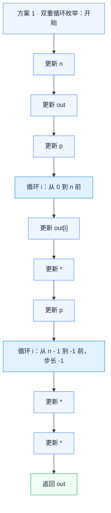

```python
import sys  # 提高递归深度上限（深输入防 RecursionError）

sys.setrecursionlimit(200000)  # 树/链表类题目节点数可达 1e4 量级

def product_except_self(nums):  # 定义函数 product_except_self（参数：数组）
    n = len(nums)  # 把 长度(数组) 存入 元素个数
    out = [1] * n  # 把 [1] 乘 元素个数 存入 out
    p = 1  # 把 1 存入 节点
    for i in range(n):  # 让 下标 i 从 元素个数 遍历
        out[i] = p  # 把 节点 写入 out[i]
        p *= nums[i]  # 把 数组[下标 i] 写入 p *
    p = 1  # 把 1 存入 节点
    for i in range(n - 1, -1, -1):  # 让 下标 i 从 元素个数 减 1 倒数回去（每步减 1）
        out[i] *= p  # 把 节点 写入 out[i] *
        p *= nums[i]  # 把 数组[下标 i] 写入 p *
    return out  # 返回 out

if __name__ == "__main__":  # 若 __name__ 等于 '__main__'
    cases = [
        ([1, 2, 3, 4], [24, 12, 8, 6]),
        ([0, 0], [0, 0]),
        ([-1, 1, 0, -3, 3], [0, 0, 9, 0, 0]),
    ]
    for inp, want in cases:  # for inp, want in cases:
        got = product_except_self(inp)  # 把 product_except_self(inp) 存入 got
        assert got == want, f"in={inp} want={want} got={got}"  # 断言校验
    print("PASS")  # 全部用例通过，输出 PASS
```

### Go 实现（1 种方案）

Go 的全部方案如下，每个方案都内嵌用例自测，可独立运行（老仓库 python/go 文件遵循「打印结果」约定）：

#### 方案 1：双重循环枚举

**思路与代码分析**：核心是「双重循环枚举」。Go 版用切片与多返回值惯用法，显式处理索引边界。**走读**：方案 1 · 双重循环枚举：开始 → 更新 : → 更新 : → 遍历 out 的下标与元素 i → 更新 out[i] → 更新 : → 遍历循环 → 更新 out[i] → 更新 * → 更新 p → 遍历循环 → 更新 * → 更新 * → 返回 out。

**运行架构**（真实控制流）：

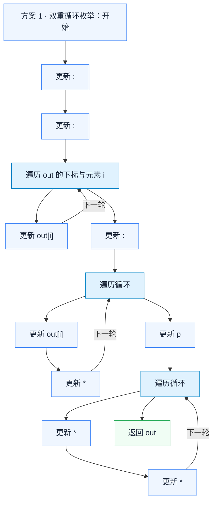

```go
package main // 引入依赖

import (
	"fmt" // 「fmt」
	"os"  // 「os」
)

func productExceptSelf(nums []int) []int { // 定义函数/方法 productExceptSelf
	n := len(nums)        // 把 长度(数组) 写入 n :
	out := make([]int, n) // 把 make([]int, 元素个数) 写入 out :
	for i := range out {  // 把 range out { 写入 for i :
		out[i] = 1 // 把 1 写入 out[i]
	}
	p := 1                   // 把 1 写入 p :
	for i := 0; i < n; i++ { // 让 下标 i 从 0 开始计数
		out[i] = p   // 把 节点 写入 out[i]
		p *= nums[i] // 把 数组[下标 i] 写入 p *
	}
	p = 1                         // 把 1 写入 节点
	for i := n - 1; i >= 0; i-- { // 把 元素个数 减 1; 下标 i 不低于 0; 下标 i 减一 { 写入 for i :
		out[i] *= p  // 把 节点 写入 out[i] *
		p *= nums[i] // 把 数组[下标 i] 写入 p *
	}
	return out // 返回 out
}

func eqIntSlice(a, b []int) bool { // 定义函数/方法 eqIntSlice
	if len(a) != len(b) { // 定义函数/方法 len
		return false // 返回 false
	}
	for i := range a { // 把 range 数组 { 写入 for i :
		if a[i] != b[i] { // 若 数组[下标 i] 不等于 b[下标 i]
			return false // 返回 false
		}
	}
	return true // 返回 true
}

func main() { // 程序入口：跑内嵌自测用例
	cases := []struct { // 把 []struct { 写入 cases :
		in   []int // in []int
		want []int // want []int
	}{ // }{
		{[]int{1, 2, 3, 4}, []int{24, 12, 8, 6}},
		{[]int{0, 0}, []int{0, 0}},
		{[]int{-1, 1, 0, -3, 3}, []int{0, 0, 9, 0, 0}},
	}
	ok := true                // 把 true 写入 ok :
	for _, c := range cases { // 同时取 _ 与 字符 遍历
		got := productExceptSelf(c.in) // 把 productExceptSelf(字符.in) 写入 got :
		if !eqIntSlice(got, c.want) {  // 若 取反 eqIntSlice(got, 字符.want
			fmt.Printf("FAIL in=%v want=%v got=%v\n", c.in, c.want, got) // 打印输出
			ok = false                                                   // 把 false 写入 ok
		}
	}
	if !ok { // 若 取反 ok
		fmt.Println("RESULT: FAIL") // 打印输出
		os.Exit(1)                  // os.Exit(1)
	}
	fmt.Println("PASS") // 全部用例通过，输出 PASS
}
```

### Java 实现（1 种方案）

Java 的全部方案如下，每个方案都内嵌用例自测，可独立运行（老仓库 python/go 文件遵循「打印结果」约定）：

#### 方案 1：双重循环枚举

**思路与代码分析**：核心是「双重循环枚举」。Java 版用类与静态方法组织，集合操作显式明了。代码里依次做这些事：双重循环遍历。**走读**：方案 1 · 双重循环枚举：开始 → 更新 n → 更新 out → 调用 Arrays.fill(out, 1) → 更新 p → 遍历循环 → 更新 out[i] → 更新 * → 更新 p → 遍历循环 → 更新 * → 更新 * → 更新 res → 遍历循环 → 返回 res。

**运行架构**（真实控制流）：

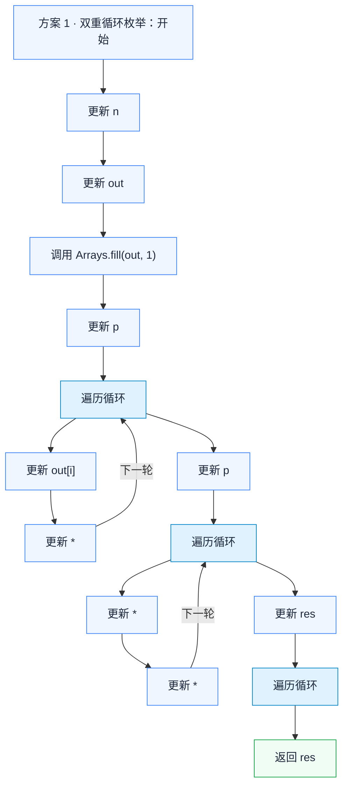

```java
package com.webfault.dsa; // 引入依赖

import java.util.*; // 引入依赖

class Solution { // 定义类型
  static List<Integer> productExceptSelf(int[] nums) { // 定义函数/方法 productExceptSelf
    int n = nums.length; // 把 数组.长度 存入 元素个数
    int[] out = new int[n]; // 把 new int[元素个数]; 写入 int[] out
    Arrays.fill(out, 1); // Arrays.fill(out, 1);
    int p = 1; // 把 1 存入 节点
    for (int i = 0; i < n; i++) {
      out[i] = p;
      p *= nums[i];
    } // 让 下标 i 从 0 开始计数，下标 i 小于 元素个数 就继续
    p = 1; // 把 1; 写入 节点
    for (int i = n - 1; i >= 0; i--) {
      out[i] *= p;
      p *= nums[i];
    } // 让 下标 i 从 元素个数 减 1 开始计数，下标 i 不低于 0 就继续
    List<Integer> res = new ArrayList<>(); // 把 new ArrayList 小于 超过 (); 写入 List<Integer> res
    for (int v : out) res.add(v); // for (int 值 : out) 结果 追加 值);
    return res; // 返回 结果
  }

  static boolean eqList(List<Integer> a, List<Integer> b) { // 定义函数/方法 eqList
    if (a.size() != b.size()) return false; // 若 数组.大小() 不等于 b.大小()，直接返回 false
    for (int i = 0; i < a.size(); i++)
      if (!a.get(i).equals(b.get(i))) return false; // 让 下标 i 从 0 开始计数，下标 i 小于 数组.大小() 就继续
    return true; // 返回 true
  }

  public static void main(String[] args) { // public static void main(String[] args) {
    int[][] ins = {
      {1, 2, 3, 4}, {0, 0}, {-1, 1, 0, -3, 3}
    }; // 把 {{1,2,3,4}, {0,0}, { 减 1,1,0, 减 3,3}}; 写入 int[][] ins
    int[][] wants = {
      {24, 12, 8, 6}, {0, 0}, {0, 0, 9, 0, 0}
    }; // 把 {{24,12,8,6}, {0,0}, {0,0,9,0,0}}; 写入 int[][] wants
    boolean ok = true; // 把 true; 写入 boolean ok
    for (int i = 0; i < ins.length; i++) { // 让 下标 i 从 0 开始计数，下标 i 小于 ins.长度 就继续
      List<Integer> got =
          productExceptSelf(ins[i]); // 把 productExceptSelf(ins[下标 i]); 写入 List<Integer> got
      List<Integer> want = new ArrayList<>(); // 把 new ArrayList 小于 超过 (); 写入 List<Integer> want
      for (int v : wants[i]) want.add(v); // for (int 值 : wants[下标 i]) want 追加 值);
      if (!eqList(got, want)) { // 若 取反 eqList(got, want
        System.out.println(
            "FAIL in=" + Arrays.toString(ins[i]) + " want=" + want + " got=" + got); // 打印输出
        ok = false; // 把 false; 写入 ok
      }
    }
    if (!ok) {
      System.out.println("RESULT: FAIL");
      System.exit(1);
    } // 若 取反 ok) { System.out.输出(「RESULT: FAIL」); System.exit(1); }
    System.out.println("PASS"); // 全部用例通过，输出 PASS
  }
}
```

### Rust 实现（1 种方案）

Rust 的全部方案如下，每个方案都内嵌用例自测，可独立运行（老仓库 python/go 文件遵循「打印结果」约定）：

#### 方案 1：双重循环枚举

**思路与代码分析**：核心是「双重循环枚举」。Rust 版用所有权移动与切片借用改写同一逻辑，注意 Option 与引用边界。**走读**：方案 1 · 双重循环枚举：开始 → 计算 n → 计算 out → 计算 left → 遍历 0..n 中的每个元素 i → 更新 out[i] → 更新 * → 计算 right → 遍历 (0..n).rev() 中的每个元素 i → 更新 * → 更新 * → 调用 out.into_iter().map(｜x｜ x as → 返回结果。

**运行架构**（真实控制流）：

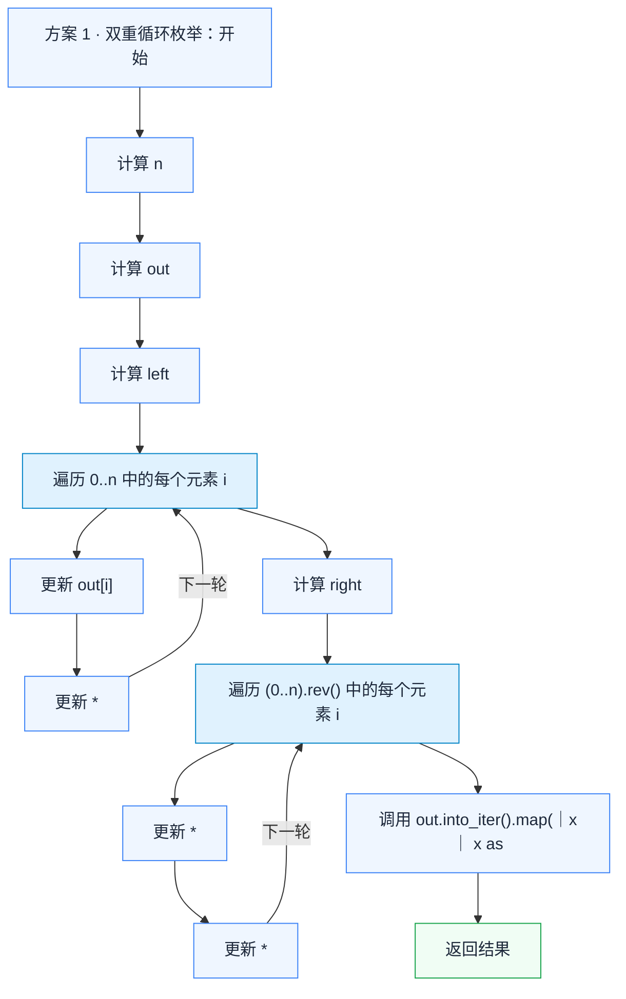

```rust
// LeetCode 238. 除自身以外数组的乘积 — Rust 版（方案1）
fn product_except_self(nums: Vec<i32>) -> Vec<i32> {
    // 定义函数/方法 product_except_self
    let n = nums.len(); // 把 数组.长度() 存入 元素个数
    let mut out = vec![1i64; n]; // 把 vec取反 [1i64; 元素个数]; 写入 let mut out
    let mut left = 1i64; // 把 1i64; 写入 let mut left
    for i in 0..n {
        out[i] = left;
        left *= nums[i] as i64;
    } // 逐个取出 0 的元素（下标 i）
    let mut right = 1i64; // 把 1i64; 写入 let mut right
    for i in (0..n).rev() {
        out[i] *= right;
        right *= nums[i] as i64;
    }
    out.into_iter().map(|x| x as i32).collect() // out.into_iter().映射表( 按位或 x 按位或 x as i32).collect()
}
fn main() {
    assert_eq!(product_except_self(vec![1, 2, 3, 4]), vec![24, 12, 8, 6]);
    assert_eq!(
        product_except_self(vec![-1, 1, 0, -3, 3]),
        vec![0, 0, 9, 0, 0]
    );
    println!("PASS");
} // 程序入口：跑内嵌自测用例
```

### Lua 实现（1 种方案）

Lua 的全部方案如下，每个方案都内嵌用例自测，可独立运行（老仓库 python/go 文件遵循「打印结果」约定）：

#### 方案 1：双重循环枚举

**思路与代码分析**：核心是「双重循环枚举」。Lua 版用表与 ipairs 遍历，注意 ipairs 遇 nil 即停的语义。**走读**：方案 1 · 双重循环枚举：开始 → 更新 n → 更新 out → 更新 left → 循环 i：从 1 到 n do → 更新 out[i] → 更新 left → 更新 right → 循环 i：从 n 到 1, -1 do → 更新 out[i] → 更新 right → 返回 out。

**运行架构**（真实控制流）：

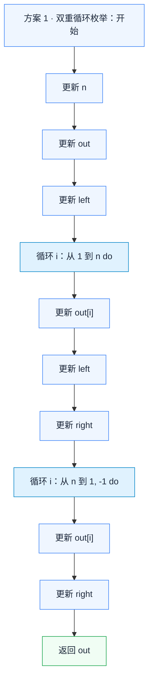

```lua
-- LeetCode 238. 除自身以外数组的乘积 — Lua 版（方案1）
local function product_except_self(nums) -- local function product_except_self(数组)
	local n = #nums -- 把 #数组 写入 local n
	local out = {} -- 把 {} 写入 local out
	local left = 1 -- 把 1 写入 local left
	for i = 1, n do
		out[i] = left
		left = left * nums[i]
	end -- 让 下标 i 从 1 走到 元素个数（Lua 1 基）
	local right = 1 -- 把 1 写入 local right
	for i = n, 1, -1 do
		out[i] = out[i] * right
		right = right * nums[i]
	end
	return out -- 返回 out
end -- 终点
assert(table.concat(product_except_self({ 1, 2, 3, 4 }), ",") == "24,12,8,6") -- 打印输出
assert(table.concat(product_except_self({ -1, 1, 0, -3, 3 }), ",") == "0,0,9,0,0") -- 打印输出
print("PASS") -- 全部用例通过，输出 PASS
```

### C 实现（1 种方案）

C 的全部方案如下，每个方案都内嵌用例自测，可独立运行（老仓库 python/go 文件遵循「打印结果」约定）：

#### 方案 1：双重循环枚举

**思路与代码分析**：核心是「双重循环枚举」。C 版手动管理下标与内存，循环边界全部显式写出。代码里依次做这些事：双重循环遍历。**走读**：方案 1 · 双重循环枚举：开始 → 更新 left → 遍历循环 → 更新 out[i] → 更新 * → 更新 right → 遍历循环 → 更新 out[i] → 更新 * → 返回结果。

**运行架构**（真实控制流）：

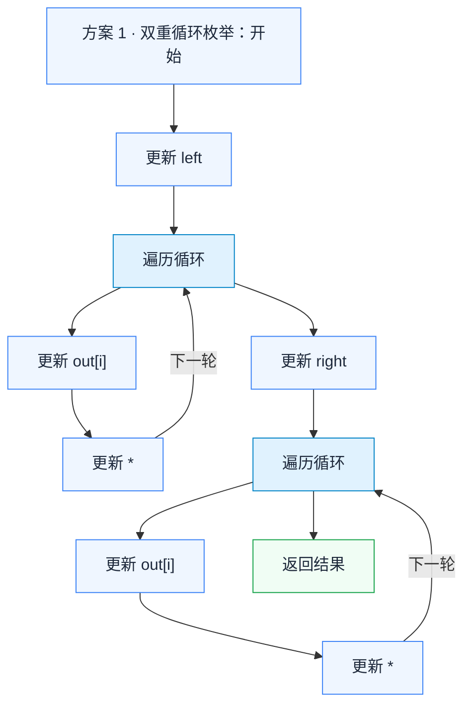

```c
/* LeetCode 238. 除自身以外数组的乘积 — C 版（方案1） */
#include <stdio.h>                                                  // 引入头文件
static void product_except_self(const int *n, int len, int out[]) { // 定义函数/方法 product_except_self
    long left = 1;                                                  // 把 1; 写入 long left
    for (int i = 0; i < len; i++) {
        out[i] = (int)left;
        left *= n[i];
    }               // 让 下标 i 从 0 开始计数，下标 i 小于 长度 就继续
    long right = 1; // 把 1; 写入 long right
    for (int i = len - 1; i >= 0; i--) {
        out[i] = (int)(out[i] * right);
        right *= n[i];
    } // 让 下标 i 从 长度 减 1 开始计数，下标 i 不低于 0 就继续
}
int main(void) {                                      // 程序入口：跑内嵌自测用例
    int out[8];                                       // int out[8];
    product_except_self((int[]){1, 2, 3, 4}, 4, out); // product_except_self((int[]){1,2,3,4}, 4, out);
    if (!(out[0] == 24 && out[1] == 12 && out[2] == 8 && out[3] == 6)) {
        printf("FAIL 1\n");
        return 1;
    }
    product_except_self((int[]){-1, 1, 0, -3, 3}, 5,
                        out); // product_except_self((int[]){ 减 1,1,0, 减 3,3}, 5, out);
    if (!(out[0] == 0 && out[2] == 9)) {
        printf("FAIL 2\n");
        return 1;
    }
    printf("PASS\n");
    return 0;
} // 全部用例通过，输出 PASS
```

### C++ 实现（1 种方案）

C++ 的全部方案如下，每个方案都内嵌用例自测，可独立运行（老仓库 python/go 文件遵循「打印结果」约定）：

#### 方案 1：双重循环枚举

**思路与代码分析**：核心是「双重循环枚举」。C++ 版用 STL 容器与迭代器，减少手写下标错误。代码里依次做这些事：双重循环遍历。**走读**：方案 1 · 双重循环枚举：开始 → 更新 n → 处理 std::vector＜long long＞ out(n → 更新 left → 遍历循环 → 更新 out[i] → 更新 * → 更新 right → 遍历循环 → 更新 * → 更新 * → 处理 std::vector＜int＞ res → 遍历循环 → 调用 res.push_back(static_cast＜in → 返回 res。

**运行架构**（真实控制流）：

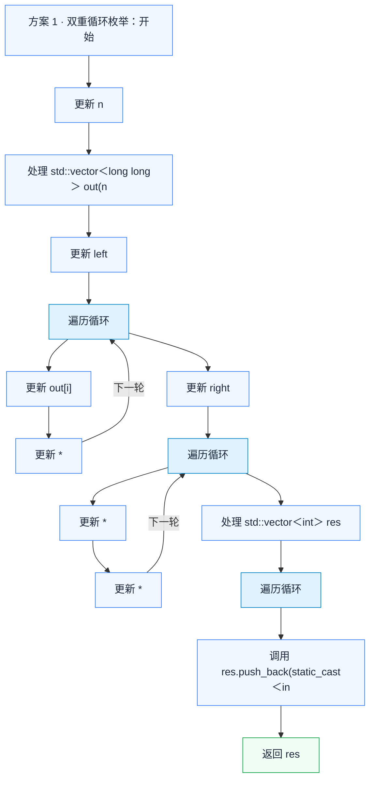

```cpp
// LeetCode 238. 除自身以外数组的乘积 — C++ 版（方案1）
#include <cassert>  // 引入头文件
#include <iostream> // 引入头文件
#include <vector>   // 引入头文件
static std::vector<int> productExceptSelf(const std::vector<int> &nums) {
    size_t n = nums.size();           // 把 数组.大小(); 写入 size_t n
    std::vector<long long> out(n, 1); // std::vector 小于 long long 超过 out(元素个数, 1);
    long long left = 1;               // 把 1 存入 左边界
    for (size_t i = 0; i < n; ++i) {
        out[i] = left;
        left *= nums[i];
    }                    // 让 下标 i 从 0 开始计数，下标 i 小于 元素个数 就继续
    long long right = 1; // 把 1 存入 右边界
    for (size_t i = n; i > 0; --i) {
        out[i - 1] *= right;
        right *= nums[i - 1];
    }                     // 让 下标 i 从 元素个数 开始计数，下标 i 超过 0 就继续
    std::vector<int> res; // std::vector 小于 int 超过 结果;
    for (auto v : out)
        res.push_back(static_cast<int>(v)); // 逐个取出 out 的元素（值）
    return res;                             // 返回 结果
}
int main() {
    assert((productExceptSelf({1, 2, 3, 4}) == std::vector<int>{24, 12, 8, 6}));
    assert((productExceptSelf({-1, 1, 0, -3, 3}) == std::vector<int>{0, 0, 9, 0, 0}));
    std::cout << "PASS" << std::endl;
} // 全部用例通过，输出 PASS
```

### R 实现（1 种方案）

R 的全部方案如下，每个方案都内嵌用例自测，可独立运行（老仓库 python/go 文件遵循「打印结果」约定）：

#### 方案 1：双重循环枚举

**思路与代码分析**：核心是「双重循环枚举」。R 版用向量化思维与 1 起始下标，注意 1:n 的降序陷阱。代码里依次做这些事：双重循环遍历。**走读**：方案 1 · 双重循环枚举：开始 → 处理 n ＜- length(nums) → 处理 out ＜- rep(1, n) → 处理 left ＜- 1 → 循环 i：遍历 seq_len(n) → 处理 out[i] ＜- left → 处理 left ＜- left * nums[i] → 处理 right ＜- 1 → 循环 i：遍历 n:1 → 处理 out[i] ＜- out[i] * right → 处理 right ＜- right * nums[i] → 处理 out → 返回结果。

**运行架构**（真实控制流）：

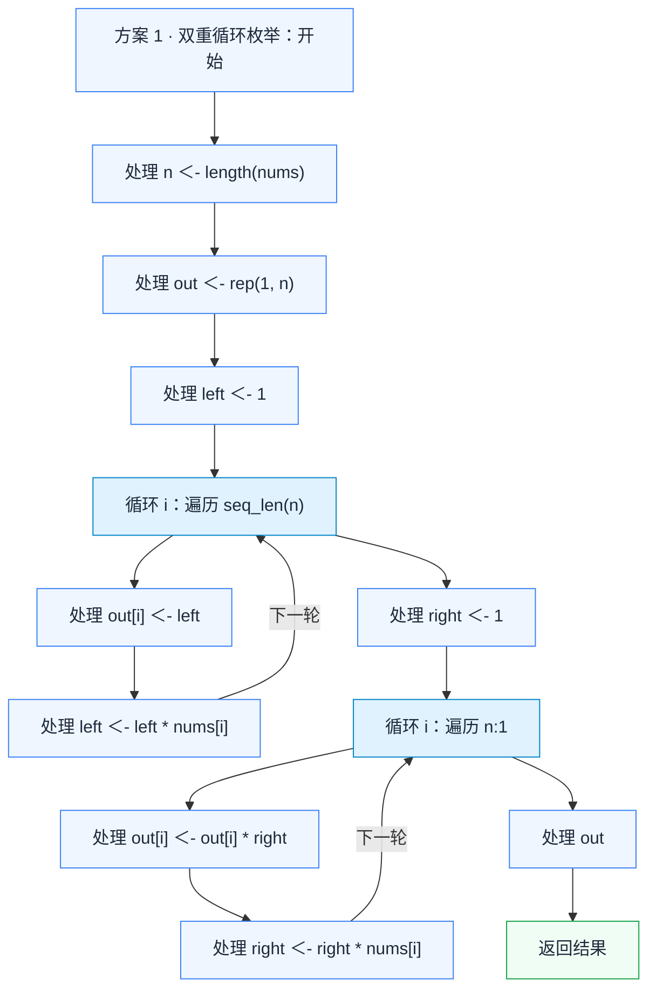

```r
# — R 版（方案1） 定义函数 product_except_self（参数：数组）
product_except_self <- function(nums) {
    n <- length(nums)  # 把 长度(数组) 存入 元素个数
    out <- rep(1, n)  # 把 rep(1, 元素个数) 存入 out
    left <- 1  # 把 1 存入 左边界
    for (i in seq_len(n)) {
        out[i] <- left
        left <- left * nums[i]
    }
    right <- 1  # 把 1 存入 右边界
    for (i in n:1) {
        out[i] <- out[i] * right
        right <- right * nums[i]
    }
    out  # out
}
stopifnot(identical(product_except_self(c(1, 2, 3, 4)), c(24, 12, 8, 6)))  # 断言校验
stopifnot(identical(product_except_self(c(-1, 1, 0, -3, 3)), c(0, 0, 9, 0, 0)))  # 断言校验
cat("PASS\n")  # 全部用例通过，输出 PASS
```

### Zig 实现（1 种方案）

Zig 的全部方案如下，每个方案都内嵌用例自测，可独立运行（老仓库 python/go 文件遵循「打印结果」约定）：

#### 方案 1：双重循环枚举

**思路与代码分析**：核心是「双重循环枚举」。Zig 版显式分配与清零，整型边界处理严格。代码里依次做这些事：单循环线性扫描。**走读**：方案 1 · 双重循环枚举：开始 → 计算 n → 计算 left → 遍历集合元素 → 更新 out[i] → 更新 * → 计算 right → 计算 i → 当 (i ＞ 0) 时反复执行 → 更新 - → 更新 out[i] → 更新 * → 返回结果。

**运行架构**（真实控制流）：

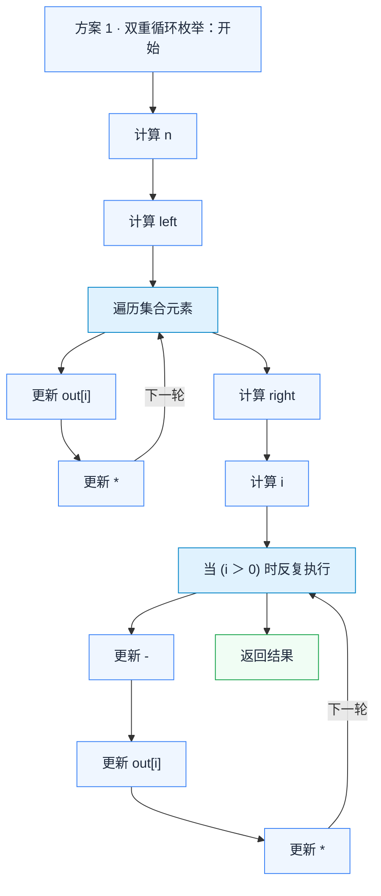

```zig
// LeetCode 238. 除自身以外数组的乘积 — Zig 版（方案1）
const std = @import("std"); // 把 @import(「std」) 存入 std
fn productExceptSelf(nums: []const i32, out: []i32) void { // 定义函数/方法 productExceptSelf
    const n = nums.len; // 把 数组.长度 存入 元素个数
    var left: i64 = 1; // 把 1; 写入 var left: i64
    for (0..n) |i| {
        out[i] = @intCast(left);
        left *= nums[i];
    } // 让 下标 i 从 0 走到 元素个数 减一
    var right: i64 = 1; // 把 1; 写入 var right: i64
    var i: usize = n; // 把 元素个数; 写入 var i: usize
    while (i > 0) {
        i -= 1;
        out[i] = @intCast(@as(i64, out[i]) * right);
        right *= nums[i];
    }
}
pub fn main() !void { // 程序入口：跑内嵌自测用例
    var out: [8]i32 = undefined; // 把 undefined; 写入 var out: [8]i32
    productExceptSelf(&[_]i32{ 1, 2, 3, 4 }, &out); // productExceptSelf( 按位与 [_]i32{ 1, 2, 3, 4 }, 按位与 out);
    if (out[0] != 24 or out[3] != 6) return error.TestFailed; // 若 out[0] 不等于 24 or out[3] 不等于 6，直接返回 error.TestFailed
    productExceptSelf(&[_]i32{ -1, 1, 0, -3, 3 }, &out);
    if (out[0] != 0 or out[2] != 9) return error.TestFailed; // 若 out[0] 不等于 0 or out[2] 不等于 9，直接返回 error.TestFailed
    std.debug.print("PASS\n", .{});
} // 全部用例通过，输出 PASS
```

### Dart 实现（1 种方案）

Dart 的全部方案如下，每个方案都内嵌用例自测，可独立运行（老仓库 python/go 文件遵循「打印结果」约定）：

#### 方案 1：双重循环枚举

**思路与代码分析**：核心是「双重循环枚举」。Dart 版用可空类型标注与集合方法，注意空安全。代码里依次做这些事：双重循环遍历。**走读**：方案 1 · 双重循环枚举：开始 → 更新 n → 更新 out → 处理 n, → 处理 1, → 处理 ) → 计算 left → 遍历循环 → 更新 out[i] → 更新 * → 计算 right → 遍历循环 → 更新 * → 更新 * → 返回 out。

**运行架构**（真实控制流）：

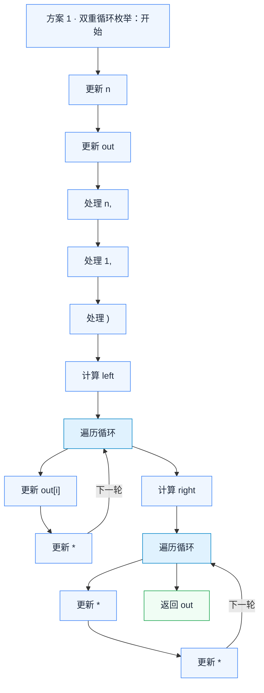

```dart
// LeetCode 238. 除自身以外数组的乘积 — Dart 版（方案1）
List<int> productExceptSelf(List<int> nums) {
  // 定义函数/方法 productExceptSelf
  final n = nums.length; // 把 数组.长度 存入 元素个数
  final out = List<int>.filled(
    n,
    1,
  ); // 把 List 小于 int 超过 .filled(元素个数, 1) 存入 out
  var left = 1; // 把 1 存入 左边界
  for (var i = 0; i < n; i++) {
    out[i] = left;
    left *= nums[i];
  } // 让 下标 i 从 0 开始计数，下标 i 小于 元素个数 就继续
  var right = 1; // 把 1 存入 右边界
  for (var i = n - 1; i >= 0; i--) {
    out[i] *= right;
    right *= nums[i];
  } // 让 下标 i 从 元素个数 减 1 开始计数，下标 i 不低于 0 就继续
  return out; // 返回 out
}

void main() {
  if (productExceptSelf([1, 2, 3, 4]).toString() != '[24, 12, 8, 6]')
    throw StateError('c1');
  if (productExceptSelf([-1, 1, 0, -3, 3]).toString() != '[0, 0, 9, 0, 0]')
    throw StateError('c2');
  print('PASS');
} // 全部用例通过，输出 PASS
```

---

## 内容总结

- **除自身以外数组的乘积**（数组 · Medium）：共 1 个方案，主线思路「双重循环枚举」；时间 O(n)（单趟线性扫描）；动画演示双指针过程，附录给出 11 种语言 × 全部方案的可运行实现。
- 来源博客：[]()
- 导航：[📋 总目录](../) ｜ [← 022 用栈实现队列](../022_用栈实现队列/) ｜ [024 下一个更大元素 iv →](../024_下一个更大元素_iv/)
