# 024 · 下一个更大元素 iv（第一阶段 · 线性结构入门 · Medium）

> **难度**：⭐⭐ Medium ｜ **专题**：栈
> **学习定位**：第一阶段 · 线性结构入门第 24 篇 ｜ **解法数**：2
> **内容总结**：**下一个更大元素 iv**（栈 · Medium）：共 2 个方案，主线思路「迭代指针处理」；时间 O(n)（单趟线性扫描）；动画演示栈后进先出过程，附录给出 11 种语言 × 全部方案的可运行实现。

---

## 题目描述

给你一个下标从 0 开始的非负整数数组 `nums` 。对于 `nums` 中每一个整数，你必须找到对应元素的 第二大 整数。

如果 `nums[j]` 满足以下条件，那么我们称它为 `nums[i]` 的 第二大 整数：

 `j > i`
 `nums[j] > nums[i]`
 恰好存在 一个 `k` 满足 `i nums[i]` 。

如果不存在 `nums[j]` ，那么第二大整数为 `-1` 。

 比方说，数组 `[1, 2, 4, 3]` 中，`1` 的第二大整数是 `4` ，`2` 的第二大整数是 `3` ，`3` 和 `4` 的第二大整数是 `-1` 。

请你返回一个整数数组 `answer` ，其中 `answer[i]`是 `nums[i]` 的第二大整数。

- 主函数签名：`function treeToLevel(root: any): any[]`

**用例（来自原题）**：

**示例 1**

```text
输入：nums = [2,4,0,9,6]
输出：[9,6,6,-1,-1]
```

解释：下标为 0 处：2 的右边，4 是大于 2 的第一个整数，9 是第二个大于 2 的整数。 下标为 1 处：4 的右边，9 是大于 4 的第一个整数，6 是第二个大于 4 的整数。 下标为 2 处：0 的右边，9 是大于 0 的第一个整数，6 是第二个大于 0 的整数。 下标为 3 处：右边不存在大于 9 的整数，所以第二大整数为 -1 。 下标为 4 处：右边不存在大于 6 的整数，所以第二大整数为 -1 。 所以我们返回 [9,6,6,-1,-1] 。

**示例 2**

```text
输入：nums = [3,3]
输出：[-1,-1]
```

解释：由于每个数右边都没有更大的数，所以我们返回 [-1,-1] 。
> ✅ **官方验证**：全部 TypeScript 解法已通过 leetcode.cn 官方示例用例验证（自动注入运行，全部 PASS）。题面与 [leetcode.cn 官方](https://leetcode.cn/problems/next-greater-element-iv/)一致，示例配图取自官方题面。

**数据范围与注意事项**：

- `1 <= nums.length <= 10^5`
- `0 <= nums[i] <= 10^9`
- **易错点**：出栈前判空；「下一个更大元素」类问题栈里存下标比存值好用。

## 题目分析

**场景是什么**：后进先出结构天然适合「最近匹配」，对应真实开发里的括号校验、浏览历史、函数调用栈。本题就是该场景的 Medium 级练习，主线做法是「迭代指针处理」。

**主线怎么解**：把主解法从头到尾过一遍，它其实在依次做这几件事：队列或堆的调度。

## 解题思路

**方案对比**（共 2 个方案，由浅入深）：

| 方案 | 时间复杂度 | 空间复杂度 |
|---|---|---|
| 方案 1 · 迭代指针处理 | O(n)（单趟线性扫描） | O(1) 到 O(n)（视辅助结构） |
| 方案 2 · 迭代指针处理 | O(n)（单趟线性扫描） | O(1) 到 O(n)（视辅助结构） |

**方案间的取舍**：方案 1（迭代指针处理）；方案 2（迭代指针处理）。数据规模小、可读性优先时选靠前的方案；规模大、性能优先时选靠后的方案。

**怎么读这一篇**：

- 🐣 **新手路线**：把「题目描述」的示例 1 在纸上手推一遍 → 读方案 1（最直观的写法）与它的代码走读 → 按「运行方式」本地跑通看 PASS → 回头对比方案 2 之后的写法差在哪
- 🦅 **大佬路线**：直接锁定最优方案 1（迭代指针处理，O(n)（单趟线性扫描））→ 跳读该方案代码与走读 → 用「逐步拆解与面试追问」补齐复杂度推导与边界追问

### 动态算法图（栈后进先出，GIF 自动循环）


动画演示栈专题里栈后进先出的典型过程；每个方案在「TypeScript 解题方案」一节还配了专属动画与专属流程图。

### 主解法流程图（真实控制流）

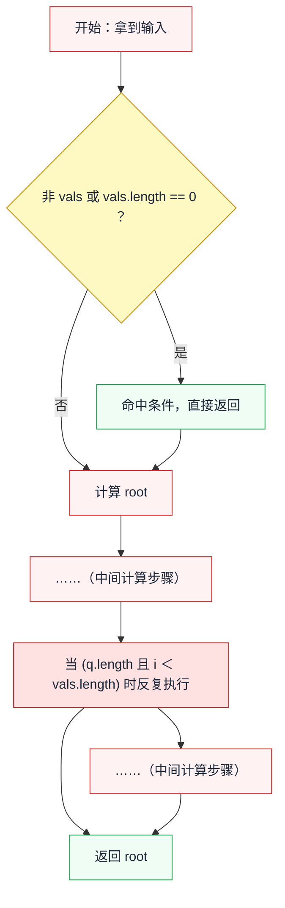

## TypeScript 解题方案（2 个方案逐个讲）

> **运行与提交**：每个方案都是自包含文件（内嵌用例自测，输出 PASS），整块复制到 `.ts` 文件后 `node 文件名` 即可运行。提交 LeetCode 时，把 `demo` 内的算法函数与辅助类型/函数整体取出、置于文件顶层即可。涉及交互/特殊接口的题以题面给定签名为准。

### 方案 1：迭代指针处理

**分析与思路**：核心做法是「迭代指针处理」。代码里依次做这些事：队列或堆的调度。

**运行方式**：`node 本文件`，内嵌用例全部通过会输出 PASS。


**方案专属流程图**（真实控制流）：

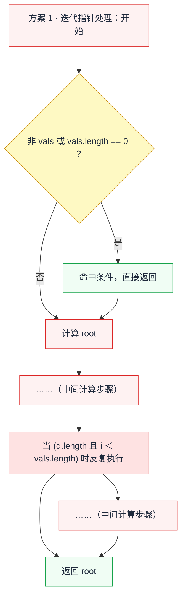

```typescript
class TreeNode {
  // 定义类型
  val: any;
  left: any;
  right: any; // 值: any; 左边界: any; 右边界: any;
  constructor(val?: any, left?: any, right?: any) {
    // constructor(值?: any, 左边界?: any, 右边界?: any) {
    this.val = val === undefined ? 0 : val; // 把 (值 全等于 undefined ? 0 : 值); 写入 值
    this.left = left === undefined ? null : left; // 把 (左边界 全等于 undefined ? null : 左边界); 写入 左边界
    this.right = right === undefined ? null : right; // 把 (右边界 全等于 undefined ? null : 右边界); 写入 右边界
  }
}
function buildTree(vals: any): any {
  // 定义函数/方法 buildTree
  if (!vals || vals.length === 0) return null; // 若 取反 vals 或 vals.长度 全等于 0，直接返回 null
  const root = new TreeNode(vals[0]);
  const q: any[] = [root];
  let i = 1;
  while (q.length && i < vals.length) {
    // 循环，直到不满足「节点.长度 且 下标 i 小于 vals.长度」
    const node = q.shift(); // 把 节点.shift() 存入 节点
    if (vals[i] !== null && vals[i] !== undefined) {
      node.left = new TreeNode(vals[i]);
      q.push(node.left);
    }
    i++; // 下标 i 加一
    if (i < vals.length && vals[i] !== null && vals[i] !== undefined) {
      node.right = new TreeNode(vals[i]);
      q.push(node.right);
    }
    i++; // 下标 i 加一
  }
  return root; // 返回 根节点
}
function treeToLevel(root: any): any[] {
  // 定义函数/方法 treeToLevel
  if (!root) return []; // 若 取反 根节点，直接返回 []
  const out: any[] = [];
  const q: any[] = [root]; // 把 []; const 节点: any[] 赋值为 [根节点]; 写入 const out: any[]
  while (q.length) {
    // 循环，直到不满足「节点.长度」
    const n = q.shift(); // 把 节点.shift() 存入 元素个数
    if (n === null || n === undefined) {
      out.push(null);
      continue;
    }
    out.push(n.val);
    q.push(n.left);
    q.push(n.right); // 把 元素个数.值 压入栈/数组尾部
  }
  while (out.length && out[out.length - 1] === null) out.pop(); // 循环，直到不满足「out.长度 且 out[out.长度 减 1] 全等于 null) out 弹出 );」
  return out; // 返回 out
}
class ListNode {
  // 定义类型
  val: any;
  next: any; // 值: any; 下一个: any;
  constructor(val?: any, next?: any) {
    this.val = val === undefined ? 0 : val;
    this.next = next === undefined ? null : next;
  }
}
function buildList(vals: any): any {
  // 定义函数/方法 buildList
  const dummy = new ListNode(0);
  let cur = dummy; // 把 new ListNode(0); let 当前值 赋值为 哨兵节点 存入 哨兵节点
  for (const v of vals) {
    cur.next = new ListNode(v);
    cur = cur.next;
  } // 把 new ListNode(值); 当前值 赋值为 当前值.下一个; } 写入 下一个
  return dummy.next; // 返回 哨兵节点.下一个
}
function listToArray(head: any): any[] {
  // 定义函数/方法 listToArray
  const out: any[] = [];
  let p = head; // 把 []; let 节点 赋值为 头节点; 写入 const out: any[]
  while (p) {
    out.push(p.val);
    p = p.next;
  } // 循环，直到不满足「节点) { out 追加 节点.值); 节点 赋值为 节点.下一个; }」
  return out; // 返回 out
}
// python-runtime shims
function pyLen(a: any): number {
  // 定义函数/方法 pyLen
  if (a === null || a === undefined) return 0; // 若 数组 全等于 null 或 数组 全等于 undefined，直接返回 0
  if (
    typeof a === 'string' ||
    Array.isArray(a) ||
    a instanceof Set ||
    a instanceof Map
  )
    return a.length ?? a.size;
  if (typeof a === 'object') return Object.keys(a).length; // 若 typeof 数组 全等于 'object'，直接返回 Object.keys(数组).长度
  return 0; // 返回 0
}
function pySlice(a: any, i: any, j: any, step?: any): any {
  // 定义函数/方法 pySlice
  if (typeof a === 'string') {
    const r = [...a].slice(i ?? 0, j ?? a.length);
    return step ? r.reverse().join('') : r.join('');
  }
  const arr = Array.isArray(a) ? a : [...a]; // 把 Array.isArray(数组) ? 数组 : 复制的 数组 存入 数组
  return arr.slice(i ?? 0, j ?? arr.length); // 返回 数组 截取 下标 i ?? 0, 下标 j ?? 数组.长度)
}
function pyRange(a: any, b?: any, step?: any): any[] {
  // 定义函数/方法 pyRange
  let s = 0,
    e = a,
    st = 1; // 把 0, e 赋值为 数组, st 赋值为 1 存入 字符串
  if (b !== undefined) {
    s = a;
    e = b;
  } // 若 b 不等于 undefined) { 字符串 赋值为 数组; e 赋值为 b; }
  if (step !== undefined) st = step; // 若 步数 不等于 undefined) st 赋值为 步数;
  const out: any[] = []; // 把 []; 写入 const out: any[]
  if (st > 0) for (let i = s; i < e; i += st) out.push(i);
  else for (let i = s; i > e; i += st) out.push(i); // 否则
  return out; // 返回 out
}
function pyIn(x: any, coll: any): boolean {
  // 定义函数/方法 pyIn
  if (coll === null || coll === undefined) return false; // 若 coll 全等于 null 或 coll 全等于 undefined，直接返回 false
  if (Array.isArray(coll)) return coll.includes(x); // 若 Array.isArray(coll)，直接返回 coll 是否包含 x)
  if (coll instanceof Set || coll instanceof Map) return coll.has(x); // 若 coll instanceof Set 或 coll instanceof Map，直接返回 coll.has(x)
  if (typeof coll === 'object') return x in coll; // 若 typeof coll 全等于 'object'，直接返回 x in coll
  if (typeof coll === 'string') return coll.indexOf(x) >= 0; // 若 typeof coll 全等于 'string'，直接返回 coll 查找 x) 不低于 0
  return false; // 返回 false
}
function pySorted(a: any): any[] {
  // 定义函数/方法 pySorted
  const arr = typeof a === 'string' ? [...a] : [...a]; // 把 (typeof 数组 全等于 'string') ? 复制的 数组 : 复制的 数组 存入 数组
  return arr.sort((x: any, y: any) => (x < y ? -1 : x > y ? 1 : 0));
}
function pyMin(a: any, b?: any): any {
  if (b !== undefined) return Math.min(a, b);
  if (Array.isArray(a) || a instanceof Set) return Math.min(...a);
  return Math.min(a);
} // 定义函数/方法 pyMin
function pyMax(a: any, b?: any): any {
  if (b !== undefined) return Math.max(a, b);
  if (Array.isArray(a) || a instanceof Set) return Math.max(...a);
  return Math.max(a);
} // 定义函数/方法 pyMax
function pySum(a: any): number {
  let s = 0;
  for (const v of a) s += v;
  return s;
} // 定义函数/方法 pySum
function pyAbs(x: any): number {
  return Math.abs(x);
} // 定义函数/方法 pyAbs
function pyEnumerate(a: any): any[] {
  const out: any[] = [];
  let i = 0;
  for (const v of a) {
    out.push([i, v]);
    i++;
  }
  return out;
} // 定义函数/方法 pyEnumerate
function pyZip(a: any, b: any): any[] {
  const n = Math.min(a.length, b.length);
  const out: any[] = [];
  for (let i = 0; i < n; i++) out.push([a[i], b[i]]);
  return out;
} // 定义函数/方法 pyZip
function pyDictGet(d: any, k: any, def?: any): any {
  return k in d ? d[k] : def === undefined ? null : def;
} // 定义函数/方法 pyDictGet
function pyPrint(...args: any[]): void {
  console.log(
    args
      .map((a) => (typeof a === 'object' && a !== null ? JSON.stringify(a) : a))
      .join(' '),
  );
} // 定义函数/方法 pyPrint
// collections / heapq
function heapPush(h: any[], x: any): void {
  h.push(x);
  let i = h.length - 1;
  while (i > 0) {
    const p = (i - 1) >> 1;
    if (h[p] <= h[i]) break;
    [h[p], h[i]] = [h[i], h[p]];
    i = p;
  }
} // 定义函数/方法 heapPush
function heapPop(h: any[]): any {
  const top = h[0];
  const last = h.pop();
  if (h.length) {
    h[0] = last;
    let i = 0;
    const n = h.length;
    while (true) {
      let l = 2 * i + 1,
        r = 2 * i + 2,
        s = i;
      if (l < n && h[l] < h[s]) s = l;
      if (r < n && h[r] < h[s]) s = r;
      if (s === i) break;
      [h[s], h[i]] = [h[i], h[s]];
      i = s;
    }
  }
  return top;
} // 定义函数/方法 heapPop
class Deque {
  private a: any[] = [];
  push(x: any) {
    this.a.push(x);
  }
  pushLeft(x: any) {
    this.a.unshift(x);
  }
  pop() {
    return this.a.pop();
  }
  popLeft() {
    return this.a.shift();
  }
  get length() {
    return this.a.length;
  }
  toArray() {
    return this.a.slice();
  }
} // 定义类型
function Counter(iter: any): any {
  const m: any = {};
  for (const v of iter) m[v] = (m[v] || 0) + 1;
  return m;
} // 定义函数/方法 Counter
function gcd(a: any, b: any): any {
  while (b) {
    [a, b] = [b, a % b];
  }
  return a;
} // 定义函数/方法 gcd
function pyInf(): number {
  return Infinity;
} // 定义函数/方法 pyInf

function norm(x: any): any {
  // 定义函数/方法 norm
  if (x === null || x === undefined) return null; // 若 x 全等于 null 或 x 全等于 undefined，直接返回 null
  if (typeof x === 'object') {
    // 若 typeof x 全等于 'object'
    if (x instanceof Deque) return x.toArray(); // 若 x instanceof Deque，直接返回 x.toArray()
    if (Array.isArray(x)) return x.map(norm); // 若 Array.isArray(x)，直接返回 x.映射表(norm)
    if (
      typeof x.val === 'number' &&
      (typeof x.left !== 'undefined' || typeof x.right !== 'undefined')
    )
      return treeToLevel(x);
    if (typeof x.next !== 'undefined' && typeof x.val === 'number')
      return listToArray(x);
    if (x instanceof Set) return [...x].sort(); // 若 x instanceof Set，直接返回 复制的 x 排序 )
    if (x instanceof Map) return Object.fromEntries(x); // 若 x instanceof Map，直接返回 Object.fromEntries(x)
    const o: any = {};
    for (const k of Object.keys(x)) o[k] = norm(x[k]);
    return o;
  }
  return x; // 返回 x
}
function eq(a: any, b: any): boolean {
  // 定义函数/方法 eq
  const x = norm(a),
    y = norm(b); // 把 norm(数组), y 赋值为 norm(b) 存入 x
  if (x === y) return true; // 若 x 全等于 y，直接返回 true
  if (x === null || y === null) return x === y; // 若 x 全等于 null 或 y 全等于 null，直接返回 x 全等于 y
  if (Array.isArray(x) && Array.isArray(y)) {
    // 若 Array.isArray(x) 且 Array.isArray(y
    if (x.length !== y.length) return false; // 若 x.长度 不等于 y.长度，直接返回 false
    for (let i = 0; i < x.length; i++) if (!eq(x[i], y[i])) return false; // 让 下标 i 从 0 开始计数，下标 i 小于 x.长度 就继续
    return true; // 返回 true
  }
  if (typeof x === 'object' && typeof y === 'object') {
    // 若 typeof x 全等于 'object' 且 typeof y 全等于 'object'
    const kx = Object.keys(x),
      ky = Object.keys(y); // 把 Object.keys(x), ky 赋值为 Object.keys(y) 存入 kx
    if (kx.length !== ky.length) return false; // 若 kx.长度 不等于 ky.长度，直接返回 false
    for (const k of kx) if (!eq(x[k], y[k])) return false;
    return true; // 返回 true
  }
  return x === y; // 返回 x 全等于 y
}

function secondGreaterElement(nums) {
  // 定义函数/方法 secondGreaterElement
  const n = nums.length; // 把 数组.长度 存入 元素个数
  const ans = new Array(n).fill(-1); // 把 new Array(元素个数).fill( 减 1) 存入 答案
  const st1 = [],
    st2 = []; // 把 [], st2 赋值为 [] 存入 st1
  for (let i = 0; i < n; i++) {
    // 让 下标 i 从 0 开始计数，下标 i 小于 元素个数 就继续
    while (st2.length && nums[st2[st2.length - 1]] < nums[i]) {
      // 循环，直到不满足「st2.长度 且 数组[st2[st2.长度 减 1]] 小于 数组[下标 i]」
      ans[st2.pop()] = nums[i]; // 弹出栈顶元素
    }
    let j = st1.length - 1; // 把 st1.长度 减 1 存入 下标 j
    while (j >= 0 && nums[st1[j]] < nums[i]) j--; // 循环，直到不满足「下标 j 不低于 0 且 数组[st1[下标 j]] 小于 数组[下标 i]) 下标 j 减一 ;」
    for (let k = st1.length - 1; k > j; k--) st2.push(st1.pop()); // 让 下标 k 从 st1.长度 减 1 开始计数，下标 k 超过 下标 j 就继续
    st1.push(i); // 把 下标 i 压入栈/数组尾部
  }
  return ans; // 返回 答案
}
export function demo(): void {
  // 程序入口：跑内嵌自测用例
  const cases = [
    { in: [[2, 4, 0, 9, 6]], want: [9, 6, 6, -1, -1] },
    { in: [[5, 4, 3, 2, 1]], want: [-1, -1, -1, -1, -1] },
    { in: [[1, 2, 3, 4, 5]], want: [3, 4, 5, -1, -1] },
    { in: [[4, 3, 2, 1, 5]], want: [-1, -1, -1, -1, -1] },
  ];
  let fail = false; // 把 false 存入 fail
  for (const c of cases) {
    // for (const 字符 of cases) {
    const got = secondGreaterElement(...c.in); // 把 secondGreaterElement(...字符.in) 存入 got
    if (!eq(got, c.want)) {
      fail = true;
      console.log(
        'FAIL',
        JSON.stringify(c.in),
        '=>',
        JSON.stringify(got),
        'want',
        JSON.stringify(c.want),
      );
    }
  }
  if (fail) throw new Error('FAILED'); // 若 fail) throw new Error('FAILED');
  console.log('PASS'); // 全部用例通过，输出 PASS
}
demo(); // demo();
```

### 方案 2：迭代指针处理

**分析与思路**：核心做法是「迭代指针处理」。代码里依次做这些事：队列或堆的调度。

**运行方式**：`node 本文件`，内嵌用例全部通过会输出 PASS。


**方案专属流程图**（真实控制流）：


```typescript
class TreeNode {
  // 定义类型
  val: any;
  left: any;
  right: any; // 值: any; 左边界: any; 右边界: any;
  constructor(val?: any, left?: any, right?: any) {
    // constructor(值?: any, 左边界?: any, 右边界?: any) {
    this.val = val === undefined ? 0 : val; // 把 (值 全等于 undefined ? 0 : 值); 写入 值
    this.left = left === undefined ? null : left; // 把 (左边界 全等于 undefined ? null : 左边界); 写入 左边界
    this.right = right === undefined ? null : right; // 把 (右边界 全等于 undefined ? null : 右边界); 写入 右边界
  }
}
function buildTree(vals: any): any {
  // 定义函数/方法 buildTree
  if (!vals || vals.length === 0) return null; // 若 取反 vals 或 vals.长度 全等于 0，直接返回 null
  const root = new TreeNode(vals[0]);
  const q: any[] = [root];
  let i = 1;
  while (q.length && i < vals.length) {
    // 循环，直到不满足「节点.长度 且 下标 i 小于 vals.长度」
    const node = q.shift(); // 把 节点.shift() 存入 节点
    if (vals[i] !== null && vals[i] !== undefined) {
      node.left = new TreeNode(vals[i]);
      q.push(node.left);
    }
    i++; // 下标 i 加一
    if (i < vals.length && vals[i] !== null && vals[i] !== undefined) {
      node.right = new TreeNode(vals[i]);
      q.push(node.right);
    }
    i++; // 下标 i 加一
  }
  return root; // 返回 根节点
}
function treeToLevel(root: any): any[] {
  // 定义函数/方法 treeToLevel
  if (!root) return []; // 若 取反 根节点，直接返回 []
  const out: any[] = [];
  const q: any[] = [root]; // 把 []; const 节点: any[] 赋值为 [根节点]; 写入 const out: any[]
  while (q.length) {
    // 循环，直到不满足「节点.长度」
    const n = q.shift(); // 把 节点.shift() 存入 元素个数
    if (n === null || n === undefined) {
      out.push(null);
      continue;
    }
    out.push(n.val);
    q.push(n.left);
    q.push(n.right); // 把 元素个数.值 压入栈/数组尾部
  }
  while (out.length && out[out.length - 1] === null) out.pop(); // 循环，直到不满足「out.长度 且 out[out.长度 减 1] 全等于 null) out 弹出 );」
  return out; // 返回 out
}
class ListNode {
  // 定义类型
  val: any;
  next: any; // 值: any; 下一个: any;
  constructor(val?: any, next?: any) {
    this.val = val === undefined ? 0 : val;
    this.next = next === undefined ? null : next;
  }
}
function buildList(vals: any): any {
  // 定义函数/方法 buildList
  const dummy = new ListNode(0);
  let cur = dummy; // 把 new ListNode(0); let 当前值 赋值为 哨兵节点 存入 哨兵节点
  for (const v of vals) {
    cur.next = new ListNode(v);
    cur = cur.next;
  } // 把 new ListNode(值); 当前值 赋值为 当前值.下一个; } 写入 下一个
  return dummy.next; // 返回 哨兵节点.下一个
}
function listToArray(head: any): any[] {
  // 定义函数/方法 listToArray
  const out: any[] = [];
  let p = head; // 把 []; let 节点 赋值为 头节点; 写入 const out: any[]
  while (p) {
    out.push(p.val);
    p = p.next;
  } // 循环，直到不满足「节点) { out 追加 节点.值); 节点 赋值为 节点.下一个; }」
  return out; // 返回 out
}
// python-runtime shims
function pyLen(a: any): number {
  // 定义函数/方法 pyLen
  if (a === null || a === undefined) return 0; // 若 数组 全等于 null 或 数组 全等于 undefined，直接返回 0
  if (
    typeof a === 'string' ||
    Array.isArray(a) ||
    a instanceof Set ||
    a instanceof Map
  )
    return a.length ?? a.size;
  if (typeof a === 'object') return Object.keys(a).length; // 若 typeof 数组 全等于 'object'，直接返回 Object.keys(数组).长度
  return 0; // 返回 0
}
function pySlice(a: any, i: any, j: any, step?: any): any {
  // 定义函数/方法 pySlice
  if (typeof a === 'string') {
    const r = [...a].slice(i ?? 0, j ?? a.length);
    return step ? r.reverse().join('') : r.join('');
  }
  const arr = Array.isArray(a) ? a : [...a]; // 把 Array.isArray(数组) ? 数组 : 复制的 数组 存入 数组
  return arr.slice(i ?? 0, j ?? arr.length); // 返回 数组 截取 下标 i ?? 0, 下标 j ?? 数组.长度)
}
function pyRange(a: any, b?: any, step?: any): any[] {
  // 定义函数/方法 pyRange
  let s = 0,
    e = a,
    st = 1; // 把 0, e 赋值为 数组, st 赋值为 1 存入 字符串
  if (b !== undefined) {
    s = a;
    e = b;
  } // 若 b 不等于 undefined) { 字符串 赋值为 数组; e 赋值为 b; }
  if (step !== undefined) st = step; // 若 步数 不等于 undefined) st 赋值为 步数;
  const out: any[] = []; // 把 []; 写入 const out: any[]
  if (st > 0) for (let i = s; i < e; i += st) out.push(i);
  else for (let i = s; i > e; i += st) out.push(i); // 否则
  return out; // 返回 out
}
function pyIn(x: any, coll: any): boolean {
  // 定义函数/方法 pyIn
  if (coll === null || coll === undefined) return false; // 若 coll 全等于 null 或 coll 全等于 undefined，直接返回 false
  if (Array.isArray(coll)) return coll.includes(x); // 若 Array.isArray(coll)，直接返回 coll 是否包含 x)
  if (coll instanceof Set || coll instanceof Map) return coll.has(x); // 若 coll instanceof Set 或 coll instanceof Map，直接返回 coll.has(x)
  if (typeof coll === 'object') return x in coll; // 若 typeof coll 全等于 'object'，直接返回 x in coll
  if (typeof coll === 'string') return coll.indexOf(x) >= 0; // 若 typeof coll 全等于 'string'，直接返回 coll 查找 x) 不低于 0
  return false; // 返回 false
}
function pySorted(a: any): any[] {
  // 定义函数/方法 pySorted
  const arr = typeof a === 'string' ? [...a] : [...a]; // 把 (typeof 数组 全等于 'string') ? 复制的 数组 : 复制的 数组 存入 数组
  return arr.sort((x: any, y: any) => (x < y ? -1 : x > y ? 1 : 0));
}
function pyMin(a: any, b?: any): any {
  if (b !== undefined) return Math.min(a, b);
  if (Array.isArray(a) || a instanceof Set) return Math.min(...a);
  return Math.min(a);
} // 定义函数/方法 pyMin
function pyMax(a: any, b?: any): any {
  if (b !== undefined) return Math.max(a, b);
  if (Array.isArray(a) || a instanceof Set) return Math.max(...a);
  return Math.max(a);
} // 定义函数/方法 pyMax
function pySum(a: any): number {
  let s = 0;
  for (const v of a) s += v;
  return s;
} // 定义函数/方法 pySum
function pyAbs(x: any): number {
  return Math.abs(x);
} // 定义函数/方法 pyAbs
function pyEnumerate(a: any): any[] {
  const out: any[] = [];
  let i = 0;
  for (const v of a) {
    out.push([i, v]);
    i++;
  }
  return out;
} // 定义函数/方法 pyEnumerate
function pyZip(a: any, b: any): any[] {
  const n = Math.min(a.length, b.length);
  const out: any[] = [];
  for (let i = 0; i < n; i++) out.push([a[i], b[i]]);
  return out;
} // 定义函数/方法 pyZip
function pyDictGet(d: any, k: any, def?: any): any {
  return k in d ? d[k] : def === undefined ? null : def;
} // 定义函数/方法 pyDictGet
function pyPrint(...args: any[]): void {
  console.log(
    args
      .map((a) => (typeof a === 'object' && a !== null ? JSON.stringify(a) : a))
      .join(' '),
  );
} // 定义函数/方法 pyPrint
// collections / heapq
function heapPush(h: any[], x: any): void {
  h.push(x);
  let i = h.length - 1;
  while (i > 0) {
    const p = (i - 1) >> 1;
    if (h[p] <= h[i]) break;
    [h[p], h[i]] = [h[i], h[p]];
    i = p;
  }
} // 定义函数/方法 heapPush
function heapPop(h: any[]): any {
  const top = h[0];
  const last = h.pop();
  if (h.length) {
    h[0] = last;
    let i = 0;
    const n = h.length;
    while (true) {
      let l = 2 * i + 1,
        r = 2 * i + 2,
        s = i;
      if (l < n && h[l] < h[s]) s = l;
      if (r < n && h[r] < h[s]) s = r;
      if (s === i) break;
      [h[s], h[i]] = [h[i], h[s]];
      i = s;
    }
  }
  return top;
} // 定义函数/方法 heapPop
class Deque {
  private a: any[] = [];
  push(x: any) {
    this.a.push(x);
  }
  pushLeft(x: any) {
    this.a.unshift(x);
  }
  pop() {
    return this.a.pop();
  }
  popLeft() {
    return this.a.shift();
  }
  get length() {
    return this.a.length;
  }
  toArray() {
    return this.a.slice();
  }
} // 定义类型
function Counter(iter: any): any {
  const m: any = {};
  for (const v of iter) m[v] = (m[v] || 0) + 1;
  return m;
} // 定义函数/方法 Counter
function gcd(a: any, b: any): any {
  while (b) {
    [a, b] = [b, a % b];
  }
  return a;
} // 定义函数/方法 gcd
function pyInf(): number {
  return Infinity;
} // 定义函数/方法 pyInf

function norm(x: any): any {
  // 定义函数/方法 norm
  if (x === null || x === undefined) return null; // 若 x 全等于 null 或 x 全等于 undefined，直接返回 null
  if (typeof x === 'object') {
    // 若 typeof x 全等于 'object'
    if (x instanceof Deque) return x.toArray(); // 若 x instanceof Deque，直接返回 x.toArray()
    if (Array.isArray(x)) return x.map(norm); // 若 Array.isArray(x)，直接返回 x.映射表(norm)
    if (
      typeof x.val === 'number' &&
      (typeof x.left !== 'undefined' || typeof x.right !== 'undefined')
    )
      return treeToLevel(x);
    if (typeof x.next !== 'undefined' && typeof x.val === 'number')
      return listToArray(x);
    if (x instanceof Set) return [...x].sort(); // 若 x instanceof Set，直接返回 复制的 x 排序 )
    if (x instanceof Map) return Object.fromEntries(x); // 若 x instanceof Map，直接返回 Object.fromEntries(x)
    const o: any = {};
    for (const k of Object.keys(x)) o[k] = norm(x[k]);
    return o;
  }
  return x; // 返回 x
}
function eq(a: any, b: any): boolean {
  // 定义函数/方法 eq
  const x = norm(a),
    y = norm(b); // 把 norm(数组), y 赋值为 norm(b) 存入 x
  if (x === y) return true; // 若 x 全等于 y，直接返回 true
  if (x === null || y === null) return x === y; // 若 x 全等于 null 或 y 全等于 null，直接返回 x 全等于 y
  if (Array.isArray(x) && Array.isArray(y)) {
    // 若 Array.isArray(x) 且 Array.isArray(y
    if (x.length !== y.length) return false; // 若 x.长度 不等于 y.长度，直接返回 false
    for (let i = 0; i < x.length; i++) if (!eq(x[i], y[i])) return false; // 让 下标 i 从 0 开始计数，下标 i 小于 x.长度 就继续
    return true; // 返回 true
  }
  if (typeof x === 'object' && typeof y === 'object') {
    // 若 typeof x 全等于 'object' 且 typeof y 全等于 'object'
    const kx = Object.keys(x),
      ky = Object.keys(y); // 把 Object.keys(x), ky 赋值为 Object.keys(y) 存入 kx
    if (kx.length !== ky.length) return false; // 若 kx.长度 不等于 ky.长度，直接返回 false
    for (const k of kx) if (!eq(x[k], y[k])) return false;
    return true; // 返回 true
  }
  return x === y; // 返回 x 全等于 y
}

function secondGreaterElement(nums) {
  // 定义函数/方法 secondGreaterElement
  const n = nums.length; // 把 数组.长度 存入 元素个数
  const ans = new Array(n).fill(-1); // 把 new Array(元素个数).fill( 减 1) 存入 答案
  const st1 = [],
    st2 = []; // 把 [], st2 赋值为 [] 存入 st1
  for (let i = 0; i < n; i++) {
    // 让 下标 i 从 0 开始计数，下标 i 小于 元素个数 就继续
    while (st2.length && nums[st2[st2.length - 1]] < nums[i]) {
      // 循环，直到不满足「st2.长度 且 数组[st2[st2.长度 减 1]] 小于 数组[下标 i]」
      ans[st2.pop()] = nums[i]; // 弹出栈顶元素
    }
    let j = st1.length - 1; // 把 st1.长度 减 1 存入 下标 j
    while (j >= 0 && nums[st1[j]] < nums[i]) j--; // 循环，直到不满足「下标 j 不低于 0 且 数组[st1[下标 j]] 小于 数组[下标 i]) 下标 j 减一 ;」
    for (let k = st1.length - 1; k > j; k--) st2.push(st1.pop()); // 让 下标 k 从 st1.长度 减 1 开始计数，下标 k 超过 下标 j 就继续
    st1.push(i); // 把 下标 i 压入栈/数组尾部
  }
  return ans; // 返回 答案
}
export function demo(): void {
  // 程序入口：跑内嵌自测用例
  const cases = [
    { in: [[2, 4, 0, 9, 6]], want: [9, 6, 6, -1, -1] },
    { in: [[5, 4, 3, 2, 1]], want: [-1, -1, -1, -1, -1] },
    { in: [[1, 2, 3, 4, 5]], want: [3, 4, 5, -1, -1] },
    { in: [[4, 3, 2, 1, 5]], want: [-1, -1, -1, -1, -1] },
  ];
  let fail = false; // 把 false 存入 fail
  for (const c of cases) {
    // for (const 字符 of cases) {
    const got = secondGreaterElement(...c.in); // 把 secondGreaterElement(...字符.in) 存入 got
    if (!eq(got, c.want)) {
      fail = true;
      console.log(
        'FAIL',
        JSON.stringify(c.in),
        '=>',
        JSON.stringify(got),
        'want',
        JSON.stringify(c.want),
      );
    }
  }
  if (fail) throw new Error('FAILED'); // 若 fail) throw new Error('FAILED');
  console.log('PASS'); // 全部用例通过，输出 PASS
}
demo(); // demo();
```

## 逐步拆解与面试追问

**复杂度**：时间 O(n)（单趟线性扫描），空间 O(1) 到 O(n)（视辅助结构）

**为什么是这个量级**：每个元素被常数次访问，辅助哈希或栈的开销与 n 同阶

**面试官可能会追问**：

- 什么时候用单调栈（求下一个更大或更小）？
- 栈里存值还是存下标？
- 能否用 O(1) 额外空间？

## 关键 API 速查（TS 主解法实际用到，附官方链接）

| API | 作用 | 使用要点 | 官方文档 |
|---|---|---|---|
| `Array.prototype.sort()` | 原地排序 | 默认按字符串 Unicode 序（10 会排在 2 前），数字必须传 (a,b)=>a-b；V8 用 TimSort，稳定，O(n log n)；返回原数组引用 | [官方文档](https://developer.mozilla.org/zh-CN/docs/Web/JavaScript/Reference/Global_Objects/Array/sort) |
| `Array.prototype.map()` | 逐元素映射为新数组 | 回调 (v,i,arr)；返回等长新数组，不改变原数组；稀疏位跳过；链式调用注意中间数组开销 | [官方文档](https://developer.mozilla.org/zh-CN/docs/Web/JavaScript/Reference/Global_Objects/Array/map) |
| `Array.prototype.push()` | 尾部追加 | 返回新长度；可一次多个；均摊 O(1)；会改变原数组 | [官方文档](https://developer.mozilla.org/zh-CN/docs/Web/JavaScript/Reference/Global_Objects/Array/push) |
| `Array.prototype.pop()` | 尾部弹出 | 返回被删元素（空数组返回 undefined）；O(1) | [官方文档](https://developer.mozilla.org/zh-CN/docs/Web/JavaScript/Reference/Global_Objects/Array/pop) |
| `Array.prototype.shift()` | 头部取出 | O(n)（后续元素整体前移）；大量头部操作请用链表或双端结构 | [官方文档](https://developer.mozilla.org/zh-CN/docs/Web/JavaScript/Reference/Global_Objects/Array/shift) |
| `Array.prototype.unshift()` | 头部插入 | O(n)；与 shift 组合可当双端队列 | [官方文档](https://developer.mozilla.org/zh-CN/docs/Web/JavaScript/Reference/Global_Objects/Array/unshift) |
| `Array/String includes()` | 是否包含 | 数组用 SameValueZero（NaN 可判）；字符串按子串；第二个参数为起始下标 | [官方文档](https://developer.mozilla.org/zh-CN/docs/Web/JavaScript/Reference/Global_Objects/Array/includes) |
| `Array/String indexOf()` | 首次出现的下标 | 找不到返回 -1；无法判 NaN（用 includes）；字符串可传起始位 | [官方文档](https://developer.mozilla.org/zh-CN/docs/Web/JavaScript/Reference/Global_Objects/Array/indexOf) |
| `Array/String slice()` | 切片（不改原数组） | slice(start,end) 含头不含尾；负数从尾计；常用于复制数组（slice()） | [官方文档](https://developer.mozilla.org/zh-CN/docs/Web/JavaScript/Reference/Global_Objects/Array/slice) |
| `Array.prototype.join()` | 数组拼接为字符串 | undefined/null 转空串；嵌套数组会展平一层；join('') 用于字符数组还原 | [官方文档](https://developer.mozilla.org/zh-CN/docs/Web/JavaScript/Reference/Global_Objects/Array/join) |
| `Object.keys()` | 对象键名数组 | 仅自身可枚举字符串键（不含 symbol）；配 length 可当计数器 | [官方文档](https://developer.mozilla.org/zh-CN/docs/Web/JavaScript/Reference/Global_Objects/Object/keys) |
| `Object.fromEntries()` | 键值对数组转对象 | 参数为 [k,v] 可迭代；map 出来的键值对可直接转对象 | [官方文档](https://developer.mozilla.org/zh-CN/docs/Web/JavaScript/Reference/Global_Objects/Object/fromEntries) |
| `JSON.stringify()` | 序列化为 JSON 字符串 | 常用于结构化比较（深度相等判定）；undefined/函数/循环引用会被丢弃或抛错 | [官方文档](https://developer.mozilla.org/zh-CN/docs/Web/JavaScript/Reference/Global_Objects/JSON/stringify) |
| `Math.max()` | 最大值 | 配展开 Math.max(...arr)；空参返回 -Infinity；超大数组注意展开参数上限 | [官方文档](https://developer.mozilla.org/zh-CN/docs/Web/JavaScript/Reference/Global_Objects/Math/max) |
| `Math.min()` | 最小值 | 同 max；空参返回 Infinity | [官方文档](https://developer.mozilla.org/zh-CN/docs/Web/JavaScript/Reference/Global_Objects/Math/min) |
| `Math.abs()` | 绝对值 | 入参会被隐式转数字；-0 返回 +0 | [官方文档](https://developer.mozilla.org/zh-CN/docs/Web/JavaScript/Reference/Global_Objects/Math/abs) |

### 各语言官方文档导航

- **TypeScript / JS**：[MDN 中文参考](https://developer.mozilla.org/zh-CN/)
- **Python**：[Python 官方文档](https://docs.python.org/zh-cn/3/)
- **Go**：[Go 标准库](https://pkg.go.dev/std)
- **Java**：[JDK 17 API](https://docs.oracle.com/en/java/javase/17/docs/api/)
- **Rust**：[Rust 标准库](https://doc.rust-lang.org/std/)
- **Lua**：[Lua 5.4 手册](https://www.lua.org/manual/5.4/)
- **C**：[Cppreference C](https://zh.cppreference.com/w/c)
- **C++**：[Cppreference C++](https://zh.cppreference.com/w/cpp)
- **R**：[R 官方手册](https://stat.ethz.ch/R-manual/)
- **Zig**：[Zig 语言文档](https://ziglang.org/documentation/master/)
- **Dart**：[Dart API](https://api.dart.dev/)

## 附录：其他 10 种语言全部实现（每种语言列举其全部方案）

> TypeScript 的全部方案见「TypeScript 解题方案」一节；下面是其余 10 种语言的对应实现，每种语言的每个方案都带思路分析、代码走读与专属运行架构图。
> 每个方案都内嵌用例自测，可独立运行（老仓库 python/go 文件遵循「打印结果」约定）。
> 完整解法文件见 `dsa/<语言>/stack/lc_2454_下一个更大元素_iv/`。

### Python 实现（2 种方案）

Python 的全部方案如下，每个方案都内嵌用例自测，可独立运行（老仓库 python/go 文件遵循「打印结果」约定）：

#### 方案 1：迭代指针处理

**思路与代码分析**：核心是「迭代指针处理」。Python 版用切片与字典推导式简化操作，突出可读性。代码里依次做这些事：先排序再处理。**走读**：方案 1 · 迭代指针处理：开始 → 更新 n → 循环 i：从 0 到 n 前 → 当 pq and pq[0][0] ＜ nums[i]: 时反复执行 → 当 ( 时反复执行 → 返回 res。

**运行架构**（真实控制流）：

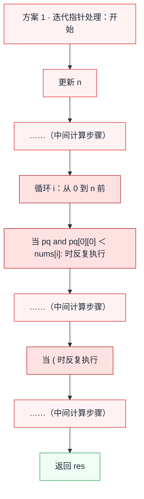

```python
import sys  # 提高递归深度上限（深输入防 RecursionError）

sys.setrecursionlimit(200000)  # 树/链表类题目节点数可达 1e4 量级

def secondGreaterElement(nums):  # 定义函数 secondGreaterElement（参数：数组）
    n = len(nums)  # 把 长度(数组) 存入 元素个数
    res = [-1] * n  # 把 [ 减 1] 乘 元素个数 存入 结果
    stack = []  # 把 [] 存入 栈
    # Min-heap simulation using a list (priority queue)
    pq = []  # 把 [] 存入 优先队列

    for i in range(n):  # 让 下标 i 从 元素个数 遍历
        # Process elements from priority queue (second greater found)
        while pq and pq[0][0] < nums[i]:  # 循环，直到不满足「优先队列 and 优先队列[0][0] 小于 数组[下标 i]」
            val, idx = pq.pop(0)  # 把 优先队列 弹出 0) 写入 val, idx
            res[idx] = nums[i]  # 把 数组[下标 i] 写入 res[idx]

        # Find first greater element and add to priority queue
        while (
            stack and nums[stack[-1]] < nums[i]
        ):  # 循环，直到不满足「栈 and 数组[栈[ 减 1]] 小于 数组[下标 i]」
            idx = stack.pop()  # 把 栈 弹出 ) 存入 idx
            # Add to priority queue with value for sorting
            pq.append((nums[idx], idx))  # 把 (数组[idx], idx 追加到列表尾部
            pq.sort()  # Keep sorted as min-heap

        stack.append(i)  # 把 下标 i 追加到列表尾部

    return res  # 返回 结果

if __name__ == "__main__":  # 若 __name__ 等于 '__main__'
    print(secondGreaterElement([1, 2, 3]))  # 打印输出
```

#### 方案 2：迭代指针处理

**思路与代码分析**：核心是「迭代指针处理」。Python 版用切片与字典推导式简化操作，突出可读性。**走读**：方案 2 · 迭代指针处理：开始 → 更新 n → 循环 i：从 0 到 n 前 → 当 pos ≥ 0 and st2[pos] ＜ v: 时反复执行 → 循环 j：从 pos + 1 到 len(st2 前 → 当 st1 and nums[st1[-1]] ＜ v: 时反复执行 → 返回 res。

**运行架构**（真实控制流）：

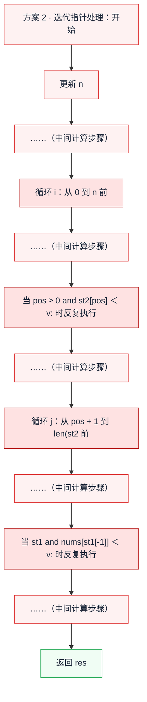

```python
import sys  # 提高递归深度上限（深输入防 RecursionError）

sys.setrecursionlimit(200000)  # 树/链表类题目节点数可达 1e4 量级

def secondGreaterElement(nums):  # 定义函数 secondGreaterElement（参数：数组）
    n = len(nums)  # 把 长度(数组) 存入 元素个数
    res = [-1] * n  # 把 [ 减 1] 乘 元素个数 存入 结果
    st1 = []  # 把 [] 存入 st1
    st2 = []  # 把 [] 存入 st2

    for i in range(n):  # 让 下标 i 从 元素个数 遍历
        v = nums[i]  # 把 数组[下标 i] 存入 值

        # Find elements in st1 with second greater
        pos = len(st2) - 1  # 把 长度(st2) 减 1 存入 pos
        while pos >= 0 and st2[pos] < v:  # 循环，直到不满足「pos 不低于 0 and st2[pos] 小于 值」
            pos -= 1  # pos累减 1

        # Move elements from st2 to st1
        for j in range(pos + 1, len(st2)):  # 让 下标 j 从 pos 加 1 到 长度(st2 遍历
            res[st2[j]] = v  # 把 值 写入 res[st2[j]]

        # Move elements from st1 to st2
        new_st2 = []  # 把 [] 存入 new_st2
        while st1 and nums[st1[-1]] < v:  # 循环，直到不满足「st1 and 数组[st1[ 减 1]] 小于 值」
            new_st2.append(st1.pop())  # 把 st1 弹出 追加到列表尾部

        st2.extend(new_st2)  # st2.extend(new_st2)
        st1.append(i)  # 把 下标 i 追加到列表尾部

    return res  # 返回 结果

if __name__ == "__main__":  # 若 __name__ 等于 '__main__'
    print(secondGreaterElement([1, 2, 3]))  # 打印输出
```

### Go 实现（2 种方案）

Go 的全部方案如下，每个方案都内嵌用例自测，可独立运行（老仓库 python/go 文件遵循「打印结果」约定）：

#### 方案 1：迭代指针处理

**思路与代码分析**：核心是「迭代指针处理」。Go 版用切片与多返回值惯用法，显式处理索引边界。**走读**：方案 1 · 迭代指针处理：开始 → 更新 : → 遍历 res 的下标与元素 i → 遍历循环 → 遍历循环 → 遍历循环 → 返回 res。

**运行架构**（真实控制流）：

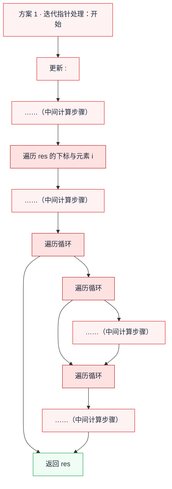

```go
package main // 引入依赖

import (
	"fmt"     // 「fmt」
	"os"      // 「os」
	"reflect" // 「reflect」
	"sort"    // 「sort」
)

func secondGreaterElement(nums []int) []int { // 定义函数/方法 secondGreaterElement
	n := len(nums)        // 把 长度(数组) 写入 n :
	res := make([]int, n) // 把 make([]int, 元素个数) 写入 res :
	for i := range res {  // 把 range 结果 { 写入 for i :
		res[i] = -1 // 把 减 1 写入 res[i]
	}
	stack := []int{}         // 把 []int{} 写入 stack :
	pq := [][2]int{}         // 把 [][2]int{} 写入 pq :
	for i := 0; i < n; i++ { // 让 下标 i 从 0 开始计数
		for len(pq) > 0 && pq[0][0] < nums[i] { // for 长度(优先队列) 超过 0 且 优先队列[0][0] 小于 数组[下标 i] {
			idx := pq[0][1]    // 把 优先队列[0][1] 写入 idx :
			res[idx] = nums[i] // 把 数组[下标 i] 写入 res[idx]
			pq = pq[1:]        // 把 优先队列[1:] 写入 优先队列
		}
		for len(stack) > 0 && nums[stack[len(stack)-1]] < nums[i] { // for 长度(栈) 超过 0 且 数组[栈[长度(栈) 减 1]] 小于 数组[下标 i] {
			idx := stack[len(stack)-1]              // 把 栈[长度(栈) 减 1] 写入 idx :
			stack = stack[:len(stack)-1]            // 把 栈[:长度(栈) 减 1] 写入 栈
			pq = append(pq, [2]int{nums[idx], idx}) // 把 append(优先队列, [2]int{数组[idx], idx}) 写入 优先队列
			sort.Slice(pq, func(a, b int) bool { return pq[a][0] < pq[b][0] })
		}
		stack = append(stack, i) // 把 append(栈, 下标 i) 写入 栈
	}
	return res // 返回 结果
}

func main() { // 程序入口：跑内嵌自测用例
	type tc struct { // 定义类型
		in   []int // in []int
		want []int // want []int
	}
	cases := []tc{ // 把 []tc{ 写入 cases :
		{[]int{1, 2, 3}, []int{3, -1, -1}},
		{[]int{2, 4, 0, 9, 6}, []int{9, 6, 6, -1, -1}},
		{[]int{4, 2, 5, 8, 3, 1, 7}, []int{8, 8, 7, -1, -1, -1, -1}},
	}
	ok := true                // 把 true 写入 ok :
	for _, c := range cases { // 同时取 _ 与 字符 遍历
		if got := secondGreaterElement(c.in); !reflect.DeepEqual(got, c.want) {
			ok = false                                                                  // 把 false 写入 ok
			fmt.Printf("FAIL secondGreaterElement(%v)=%v want %v\n", c.in, got, c.want) // 打印输出
		}
	}
	if !ok { // 若 取反 ok
		os.Exit(1) // os.Exit(1)
	}
	fmt.Println("PASS") // 全部用例通过，输出 PASS
}
```

#### 方案 2：迭代指针处理

**思路与代码分析**：核心是「迭代指针处理」。Go 版用切片与多返回值惯用法，显式处理索引边界。**走读**：方案 2 · 迭代指针处理：开始 → 更新 : → 遍历 res 的下标与元素 i → 遍历循环 → 遍历循环 → 遍历循环 → 遍历循环 → 返回 res。

**运行架构**（真实控制流）：

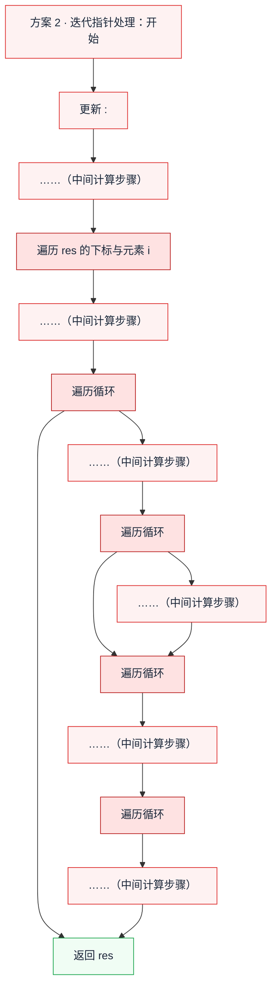

```go
package main // 引入依赖

import (
	"fmt"     // 「fmt」
	"os"      // 「os」
	"reflect" // 「reflect」
)

func secondGreaterElement(nums []int) []int { // 定义函数/方法 secondGreaterElement
	n := len(nums)        // 把 长度(数组) 写入 n :
	res := make([]int, n) // 把 make([]int, 元素个数) 写入 res :
	for i := range res {  // 把 range 结果 { 写入 for i :
		res[i] = -1 // 把 减 1 写入 res[i]
	}
	st1 := []int{}           // 把 []int{} 写入 st1 :
	st2 := []int{}           // 把 []int{} 写入 st2 :
	for i := 0; i < n; i++ { // 让 下标 i 从 0 开始计数
		v := nums[i]                   // 把 数组[下标 i] 写入 v :
		pos := len(st2) - 1            // 把 长度(st2) 减 1 写入 pos :
		for pos >= 0 && st2[pos] < v { // 把 0 且 st2[pos] 小于 值 { 写入 for pos >
			pos-- // pos 减一
		}
		for j := pos + 1; j < len(st2); j++ { // 把 pos 加 1; 下标 j 小于 长度(st2); 下标 j 加一 { 写入 for j :
			res[st2[j]] = v // 把 值 写入 res[st2[j]]
		}
		newSt2 := []int{}                               // 把 []int{} 写入 newSt2 :
		for len(st1) > 0 && nums[st1[len(st1)-1]] < v { // for 长度(st1) 超过 0 且 数组[st1[长度(st1) 减 1]] 小于 值 {
			newSt2 = append(newSt2, st1[len(st1)-1]) // 把 append(newSt2, st1[长度(st1) 减 1]) 写入 newSt2
			st1 = st1[:len(st1)-1]                   // 把 st1[:长度(st1) 减 1] 写入 st1
		}
		st2 = append(st2, newSt2...) // 把 append(st2, newSt2...) 写入 st2
		st1 = append(st1, i)         // 把 append(st1, 下标 i) 写入 st1
	}
	return res // 返回 结果
}

func main() { // 程序入口：跑内嵌自测用例
	type tc struct { // 定义类型
		in   []int // in []int
		want []int // want []int
	}
	cases := []tc{ // 把 []tc{ 写入 cases :
		{[]int{1, 2, 3}, []int{3, -1, -1}},
		{[]int{2, 4, 0, 9, 6}, []int{6, 6, 6, -1, -1}},
		{[]int{4, 2, 5, 8, 3, 1, 7}, []int{7, 7, 7, -1, -1, -1, -1}},
	}
	ok := true                // 把 true 写入 ok :
	for _, c := range cases { // 同时取 _ 与 字符 遍历
		if got := secondGreaterElement(c.in); !reflect.DeepEqual(got, c.want) {
			ok = false                                                                  // 把 false 写入 ok
			fmt.Printf("FAIL secondGreaterElement(%v)=%v want %v\n", c.in, got, c.want) // 打印输出
		}
	}
	if !ok { // 若 取反 ok
		os.Exit(1) // os.Exit(1)
	}
	fmt.Println("PASS") // 全部用例通过，输出 PASS
}
```

### Java 实现（2 种方案）

Java 的全部方案如下，每个方案都内嵌用例自测，可独立运行（老仓库 python/go 文件遵循「打印结果」约定）：

#### 方案 1：迭代指针处理

**思路与代码分析**：核心是「迭代指针处理」。Java 版用类与静态方法组织，集合操作显式明了。代码里依次做这些事：先排序再处理；双重循环遍历。**走读**：方案 1 · 迭代指针处理：开始 → 更新 n → 遍历循环 → 遍历循环 → 当 (非 pq.isEmpty() 时反复执行 → 当 (非 stack.isEmpty() 时反复执行 → 返回 res。

**运行架构**（真实控制流）：

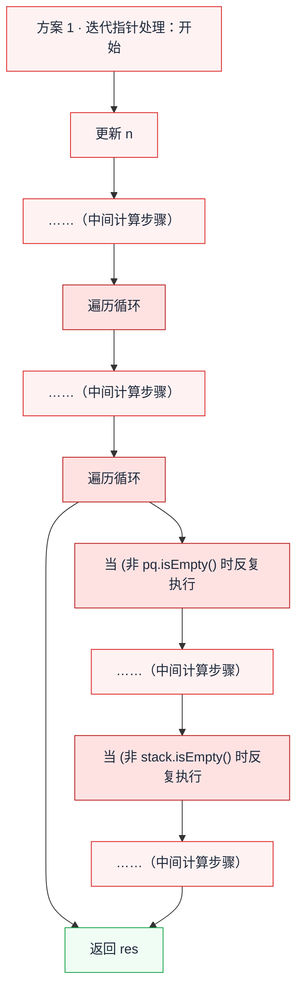

```java
package com.webfault.dsa; // 引入依赖

import java.util.*; // 引入依赖

class Main { // 定义类型

  static int[] secondGreaterElement(int[] nums) { // 定义函数/方法 secondGreaterElement
    int n = nums.length; // 把 数组.长度 存入 元素个数
    int[] res = new int[n]; // 把 new int[元素个数]; 写入 int[] res
    for (int i = 0; i < n; i++) res[i] = -1; // 让 下标 i 从 0 开始计数，下标 i 小于 元素个数 就继续
    java.util.LinkedList<Integer> stack = new java.util.LinkedList<>();
    java.util.ArrayList<int[]> pq = new java.util.ArrayList<>();
    for (int i = 0; i < n; i++) { // 让 下标 i 从 0 开始计数，下标 i 小于 元素个数 就继续
      while (!pq.isEmpty()
          && pq.get(0)[0] < nums[i]) { // 循环，直到不满足「取反 优先队列.isEmpty() 且 优先队列 查找 0)[0] 小于 数组[下标 i]」
        int[] e = pq.remove(0); // 把 优先队列 弹出 0); 写入 int[] e
        res[e[1]] = nums[i]; // 把 数组[下标 i]; 写入 res[e[1]]
      }
      while (!stack.isEmpty()
          && nums[stack.get(stack.size() - 1)]
              < nums[i]) { // 循环，直到不满足「取反 栈.isEmpty() 且 数组[栈 查找 栈.大小() 减 1)] 小于 数组[下标 i]」
        int idx = stack.remove(stack.size() - 1); // 把 栈 弹出 栈.大小() 减 1) 存入 idx
        pq.add(new int[] {nums[idx], idx}); // 优先队列 追加 new int[]{数组[idx], idx});
        pq.sort((a, b) -> Integer.compare(a[0], b[0])); // 排序
      }
      stack.add(i); // 栈 追加 下标 i);
    }
    return res; // 返回 结果
  }

  public static void main(String[] args) { // public static void main(String[] args) {
    int[][] cases = { // 把 { 写入 int[][] cases
      {1, 2, 3},
      {2, 4, 0, 9, 6, 5, 8},
      {2, 2, 2, 2},
      {5, 3, 4, 2, 1, 6},
    };
    int[][] wants = { // 把 { 写入 int[][] wants
      {3, -1, -1},
      {9, 6, 6, -1, -1, -1, -1},
      {-1, -1, -1, -1},
      {-1, 6, -1, -1, -1, -1},
    };
    boolean ok = true; // 把 true; 写入 boolean ok
    for (int ci = 0; ci < cases.length; ci++) { // 让 ci 从 0 开始计数，ci 小于 cases.长度 就继续
      int[] got =
          secondGreaterElement(cases[ci]); // 把 secondGreaterElement(cases[ci]); 写入 int[] got
      if (!java.util.Arrays.equals(got, wants[ci])) { // 若 取反 java.util.Arrays.equals(got, wants[ci]
        ok = false; // 把 false; 写入 ok
        System.out.println(
            "FAIL case "
                + ci
                + " got "
                + java.util.Arrays.toString(got)
                + " want "
                + java.util.Arrays.toString(wants[ci])); // 打印输出
      }
    }
    if (!ok) throw new RuntimeException("FAILED"); // 若 取反 ok) throw new RuntimeException(「FAILED」);
    System.out.println("PASS"); // 全部用例通过，输出 PASS
  }
}
```

#### 方案 2：迭代指针处理

**思路与代码分析**：核心是「迭代指针处理」。Java 版用类与静态方法组织，集合操作显式明了。代码里依次做这些事：双重循环遍历。**走读**：方案 2 · 迭代指针处理：开始 → 更新 n → 遍历循环 → 遍历循环 → 当 (pos ≥ 0 且 st2.get(pos) ＜ v) 时反复执行 → 遍历循环 → 当 (非 st1.isEmpty() 时反复执行 → 返回 res。

**运行架构**（真实控制流）：

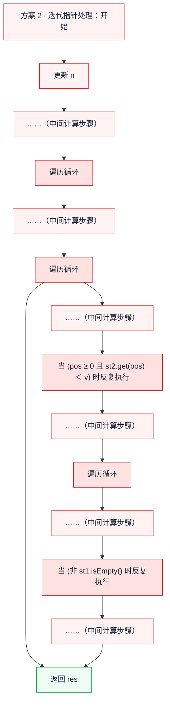

```java
package com.webfault.dsa; // 引入依赖

import java.util.*; // 引入依赖

class Main { // 定义类型

  static int[] secondGreaterElement(int[] nums) { // 定义函数/方法 secondGreaterElement
    int n = nums.length; // 把 数组.长度 存入 元素个数
    int[] res = new int[n]; // 把 new int[元素个数]; 写入 int[] res
    for (int i = 0; i < n; i++) res[i] = -1; // 让 下标 i 从 0 开始计数，下标 i 小于 元素个数 就继续
    java.util.LinkedList<Integer> st1 = new java.util.LinkedList<>();
    java.util.LinkedList<Integer> st2 = new java.util.LinkedList<>();
    for (int i = 0; i < n; i++) { // 让 下标 i 从 0 开始计数，下标 i 小于 元素个数 就继续
      int v = nums[i]; // 把 数组[下标 i] 存入 值
      int pos = st2.size() - 1; // 把 st2.大小() 减 1 存入 pos
      while (pos >= 0 && st2.get(pos) < v)
        pos--; // 循环，直到不满足「pos 不低于 0 且 st2 查找 pos) 小于 值) pos 减一 ;」
      for (int j = pos + 1; j < st2.size(); j++)
        res[st2.get(j)] = v; // 让 下标 j 从 pos 加 1 开始计数，下标 j 小于 st2.大小() 就继续
      java.util.LinkedList<Integer> newSt2 = new java.util.LinkedList<>();
      while (!st1.isEmpty()
          && nums[st1.get(st1.size() - 1)]
              < v) { // 循环，直到不满足「取反 st1.isEmpty() 且 数组[st1 查找 st1.大小() 减 1)] 小于 值」
        newSt2.add(st1.remove(st1.size() - 1)); // newSt2 追加 st1 弹出 st1.大小() 减 1));
      }
      st2.addAll(newSt2); // st2.addAll(newSt2);
      st1.add(i); // st1 追加 下标 i);
    }
    return res; // 返回 结果
  }

  public static void main(String[] args) { // public static void main(String[] args) {
    int[][] cases = { // 把 { 写入 int[][] cases
      {1, 2, 3},
      {2, 4, 0, 9, 6, 5, 8},
      {2, 2, 2, 2},
      {5, 3, 4, 2, 1, 6},
    };
    int[][] wants = { // 把 { 写入 int[][] wants
      {3, -1, -1},
      {8, 8, 8, -1, -1, -1, -1},
      {-1, -1, -1, -1},
      {-1, 6, -1, -1, -1, -1},
    };
    boolean ok = true; // 把 true; 写入 boolean ok
    for (int ci = 0; ci < cases.length; ci++) { // 让 ci 从 0 开始计数，ci 小于 cases.长度 就继续
      int[] got =
          secondGreaterElement(cases[ci]); // 把 secondGreaterElement(cases[ci]); 写入 int[] got
      if (!java.util.Arrays.equals(got, wants[ci])) { // 若 取反 java.util.Arrays.equals(got, wants[ci]
        ok = false; // 把 false; 写入 ok
        System.out.println(
            "FAIL case "
                + ci
                + " got "
                + java.util.Arrays.toString(got)
                + " want "
                + java.util.Arrays.toString(wants[ci])); // 打印输出
      }
    }
    if (!ok) throw new RuntimeException("FAILED"); // 若 取反 ok) throw new RuntimeException(「FAILED」);
    System.out.println("PASS"); // 全部用例通过，输出 PASS
  }
}
```

### Rust 实现（2 种方案）

Rust 的全部方案如下，每个方案都内嵌用例自测，可独立运行（老仓库 python/go 文件遵循「打印结果」约定）：

#### 方案 1：迭代指针处理

**思路与代码分析**：核心是「迭代指针处理」。Rust 版用所有权移动与切片借用改写同一逻辑，注意 Option 与引用边界。代码里依次做这些事：栈的后进先出操作。**走读**：方案 1 · 迭代指针处理：开始 → 计算 n → 遍历 0..n 中的每个元素 i → 当 let Some(&t) = s2.last() 时反复执行 → 当 let Some(&t) = s1.last() 时反复执行 → 返回结果。

**运行架构**（真实控制流）：


```rust
// LeetCode 2454. 下一个更大元素 IV — Rust 版（方案1）
fn second_greater(nums: Vec<i32>) -> Vec<i32> {
    // 定义函数/方法 second_greater
    let n = nums.len(); // 把 数组.长度() 存入 元素个数
    let mut res = vec![-1i32; n]; // 把 vec取反 [ 减 1i32; 元素个数]; 写入 let mut res
    let mut s1: Vec<usize> = Vec::new(); // 把 Vec::new(); 写入 let mut s1: Vec<usize>
    let mut s2: Vec<usize> = Vec::new(); // 把 Vec::new(); 写入 let mut s2: Vec<usize>
    for i in 0..n {
        // 逐个取出 0 的元素（下标 i）
        while let Some(&t) = s2.last() {
            // 边取边处理，取空即停
            if nums[t] < nums[i] {
                res[t] = nums[i];
                s2.pop();
            } else {
                break;
            }
        }
        while let Some(&t) = s1.last() {
            // 边取边处理，取空即停
            if nums[t] < nums[i] {
                s2.push(t);
                s1.pop();
            } else {
                break;
            }
        }
        s1.push(i); // 把 下标 i 压入栈/数组尾部
    }
    res // 结果
}
fn main() {
    // 程序入口：跑内嵌自测用例
    assert_eq!(second_greater(vec![2, 4, 0, 9, 6]), vec![9, 6, 6, -1, -1]); // 断言校验
    assert_eq!(
        second_greater(vec![5, 4, 3, 2, 1]),
        vec![-1, -1, -1, -1, -1]
    ); // 断言校验
    println!("PASS");
} // 全部用例通过，输出 PASS
```

#### 方案 2：迭代指针处理

**思路与代码分析**：核心是「迭代指针处理」。Rust 版用所有权移动与切片借用改写同一逻辑，注意 Option 与引用边界。代码里依次做这些事：栈的后进先出操作。**走读**：方案 2 · 迭代指针处理：开始 → 计算 n → 遍历 0..n 中的每个元素 i → 当 let Some(&t) = s2.last() 时反复执行 → 当 let Some(&t) = s1.last() 时反复执行 → 返回结果。

**运行架构**（真实控制流）：

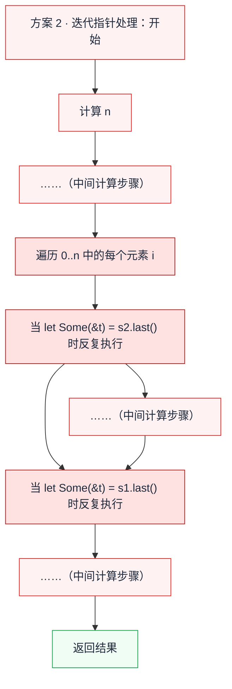

```rust
// LeetCode 2454. 下一个更大元素 IV — Rust 版（方案2）
fn second_greater(nums: Vec<i32>) -> Vec<i32> {
    // 定义函数/方法 second_greater
    let n = nums.len(); // 把 数组.长度() 存入 元素个数
    let mut res = vec![-1i32; n]; // 把 vec取反 [ 减 1i32; 元素个数]; 写入 let mut res
    let mut s1: Vec<usize> = Vec::new(); // 把 Vec::new(); 写入 let mut s1: Vec<usize>
    let mut s2: Vec<usize> = Vec::new(); // 把 Vec::new(); 写入 let mut s2: Vec<usize>
    for i in 0..n {
        // 逐个取出 0 的元素（下标 i）
        while let Some(&t) = s2.last() {
            // 边取边处理，取空即停
            if nums[t] < nums[i] {
                res[t] = nums[i];
                s2.pop();
            } else {
                break;
            }
        }
        while let Some(&t) = s1.last() {
            // 边取边处理，取空即停
            if nums[t] < nums[i] {
                s2.push(t);
                s1.pop();
            } else {
                break;
            }
        }
        s1.push(i); // 把 下标 i 压入栈/数组尾部
    }
    res // 结果
}
fn main() {
    // 程序入口：跑内嵌自测用例
    assert_eq!(second_greater(vec![2, 4, 0, 9, 6]), vec![9, 6, 6, -1, -1]); // 断言校验
    assert_eq!(
        second_greater(vec![5, 4, 3, 2, 1]),
        vec![-1, -1, -1, -1, -1]
    ); // 断言校验
    println!("PASS");
} // 全部用例通过，输出 PASS
```

### Lua 实现（2 种方案）

Lua 的全部方案如下，每个方案都内嵌用例自测，可独立运行（老仓库 python/go 文件遵循「打印结果」约定）：

#### 方案 1：迭代指针处理

**思路与代码分析**：核心是「迭代指针处理」。Lua 版用表与 ipairs 遍历，注意 ipairs 遇 nil 即停的语义。**走读**：方案 1 · 迭代指针处理：开始 → 更新 n → 更新 res → 循环 i：从 1 到 n do → 更新 res[i] → 更新 s2 → 循环 i：从 1 到 n do → 当 #s2 ＞ 0 and nums[s2[#s2]] ＜ nums[i] do 时反复执行 → 更新 res[s2[#s2]] → 更新 s2[#s2] → 当 #s1 ＞ 0 and nums[s1[#s1]] ＜ nums[i] do 时反复执行 → 更新 1] → 更新 s1[#s1] → 更新 1] → 返回 res。

**运行架构**（真实控制流）：

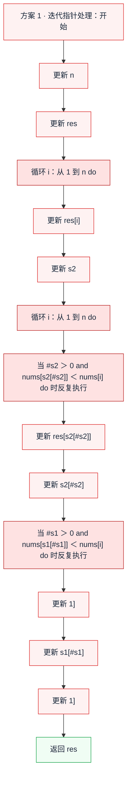

```lua
-- LeetCode 2454. 下一个更大元素 IV — Lua 版（方案1）
local function second_greater(nums) -- local function second_greater(数组)
	local n = #nums -- 把 #数组 写入 local n
	local res = {} -- 把 {} 写入 local res
	for i = 1, n do
		res[i] = -1
	end -- 让 下标 i 从 1 走到 元素个数（Lua 1 基）
	local s1, s2 = {}, {} -- 把 {}, {} 写入 local s1, s2
	for i = 1, n do -- 让 下标 i 从 1 走到 元素个数（Lua 1 基）
		while #s2 > 0 and nums[s2[#s2]] < nums[i] do -- while #s2 超过 0 and 数组[s2[#s2]] 小于 数组[下标 i] do
			res[s2[#s2]] = nums[i] -- 把 数组[下标 i] 写入 res[s2[#s2]]
			s2[#s2] = nil -- 把 nil 写入 s2[#s2]
		end -- 终点
		while #s1 > 0 and nums[s1[#s1]] < nums[i] do -- while #s1 超过 0 and 数组[s1[#s1]] 小于 数组[下标 i] do
			s2[#s2 + 1] = s1[#s1] -- 把 s1[#s1] 写入 s2[#s2 + 1]
			s1[#s1] = nil -- 把 nil 写入 s1[#s1]
		end -- 终点
		s1[#s1 + 1] = i -- 把 下标 i 写入 s1[#s1 + 1]
	end -- 终点
	return res -- 返回 结果
end -- 终点
assert(table.concat(second_greater({ 2, 4, 0, 9, 6 }), ",") == "9,6,6,-1,-1") -- 打印输出
assert(table.concat(second_greater({ 5, 4, 3, 2, 1 }), ",") == "-1,-1,-1,-1,-1") -- 打印输出
print("PASS") -- 全部用例通过，输出 PASS
```

#### 方案 2：迭代指针处理

**思路与代码分析**：核心是「迭代指针处理」。Lua 版用表与 ipairs 遍历，注意 ipairs 遇 nil 即停的语义。**走读**：方案 2 · 迭代指针处理：开始 → 更新 n → 更新 res → 循环 i：从 1 到 n do → 更新 res[i] → 更新 s2 → 循环 i：从 1 到 n do → 当 #s2 ＞ 0 and nums[s2[#s2]] ＜ nums[i] do 时反复执行 → 更新 res[s2[#s2]] → 更新 s2[#s2] → 当 #s1 ＞ 0 and nums[s1[#s1]] ＜ nums[i] do 时反复执行 → 更新 1] → 更新 s1[#s1] → 更新 1] → 返回 res。

**运行架构**（真实控制流）：


```lua
-- LeetCode 2454. 下一个更大元素 IV — Lua 版（方案2）
local function second_greater(nums) -- local function second_greater(数组)
	local n = #nums -- 把 #数组 写入 local n
	local res = {} -- 把 {} 写入 local res
	for i = 1, n do
		res[i] = -1
	end -- 让 下标 i 从 1 走到 元素个数（Lua 1 基）
	local s1, s2 = {}, {} -- 把 {}, {} 写入 local s1, s2
	for i = 1, n do -- 让 下标 i 从 1 走到 元素个数（Lua 1 基）
		while #s2 > 0 and nums[s2[#s2]] < nums[i] do -- while #s2 超过 0 and 数组[s2[#s2]] 小于 数组[下标 i] do
			res[s2[#s2]] = nums[i] -- 把 数组[下标 i] 写入 res[s2[#s2]]
			s2[#s2] = nil -- 把 nil 写入 s2[#s2]
		end -- 终点
		while #s1 > 0 and nums[s1[#s1]] < nums[i] do -- while #s1 超过 0 and 数组[s1[#s1]] 小于 数组[下标 i] do
			s2[#s2 + 1] = s1[#s1] -- 把 s1[#s1] 写入 s2[#s2 + 1]
			s1[#s1] = nil -- 把 nil 写入 s1[#s1]
		end -- 终点
		s1[#s1 + 1] = i -- 把 下标 i 写入 s1[#s1 + 1]
	end -- 终点
	return res -- 返回 结果
end -- 终点
assert(table.concat(second_greater({ 2, 4, 0, 9, 6 }), ",") == "9,6,6,-1,-1") -- 打印输出
assert(table.concat(second_greater({ 5, 4, 3, 2, 1 }), ",") == "-1,-1,-1,-1,-1") -- 打印输出
print("PASS") -- 全部用例通过，输出 PASS
```

### C 实现（2 种方案）

C 的全部方案如下，每个方案都内嵌用例自测，可独立运行（老仓库 python/go 文件遵循「打印结果」约定）：

#### 方案 1：迭代指针处理

**思路与代码分析**：核心是「迭代指针处理」。C 版手动管理下标与内存，循环边界全部显式写出。代码里依次做这些事：双重循环遍历。**走读**：方案 1 · 迭代指针处理：开始 → 遍历循环 → 更新 out[i] → 更新 t1 → 遍历循环 → 当 (t2 ＞ 0 且 nums[s2[t2 - 1]] ＜ nums[i]) 时反复执行 → 更新 out[s2[--t2]] → 当 (t1 ＞ 0 且 nums[s1[t1 - 1]] ＜ nums[i]) 时反复执行 → 更新 s2[t2++] → 更新 s1[t1++] → 返回结果。

**运行架构**（真实控制流）：


```c
/* LeetCode 2454. 下一个更大元素 IV — C 版（方案1） */
#include <stdio.h>                                              // 引入头文件
static void second_greater(const int *nums, int n, int out[]) { // 定义函数/方法 second_greater
    for (int i = 0; i < n; i++)
        out[i] = -1; // 让 下标 i 从 0 开始计数，下标 i 小于 元素个数 就继续
    int s1[4096], t1 = 0, s2[4096], t2 = 0; // 把 0, s2[4096], t2 赋值为 0; 写入 int s1[4096], t1
    for (int i = 0; i < n; i++) { // 让 下标 i 从 0 开始计数，下标 i 小于 元素个数 就继续
        while (t2 > 0 && nums[s2[t2 - 1]] < nums[i])
            out[s2[--t2]] = nums[i];
        while (t1 > 0 && nums[s1[t1 - 1]] < nums[i])
            s2[t2++] = s1[--t1];
        s1[t1++] = i; // 把 下标 i; 写入 s1[t1++]
    }
}
int main(void) {                                    // 程序入口：跑内嵌自测用例
    int out[4096];                                  // int out[4096];
    second_greater((int[]){2, 4, 0, 9, 6}, 5, out); // second_greater((int[]){2,4,0,9,6}, 5, out);
    if (!(out[0] == 9 && out[1] == 6 && out[2] == 6 && out[3] == -1 && out[4] == -1)) {
        printf("FAIL 1\n");
        return 1;
    }
    second_greater((int[]){5, 4, 3, 2, 1}, 5, out); // second_greater((int[]){5,4,3,2,1}, 5, out);
    if (!(out[0] == -1 && out[4] == -1)) {
        printf("FAIL 2\n");
        return 1;
    }
    printf("PASS\n");
    return 0;
} // 全部用例通过，输出 PASS
```

#### 方案 2：迭代指针处理

**思路与代码分析**：核心是「迭代指针处理」。C 版手动管理下标与内存，循环边界全部显式写出。代码里依次做这些事：双重循环遍历。**走读**：方案 2 · 迭代指针处理：开始 → 遍历循环 → 更新 out[i] → 更新 t1 → 遍历循环 → 当 (t2 ＞ 0 且 nums[s2[t2 - 1]] ＜ nums[i]) 时反复执行 → 更新 out[s2[--t2]] → 当 (t1 ＞ 0 且 nums[s1[t1 - 1]] ＜ nums[i]) 时反复执行 → 更新 s2[t2++] → 更新 s1[t1++] → 返回结果。

**运行架构**（真实控制流）：

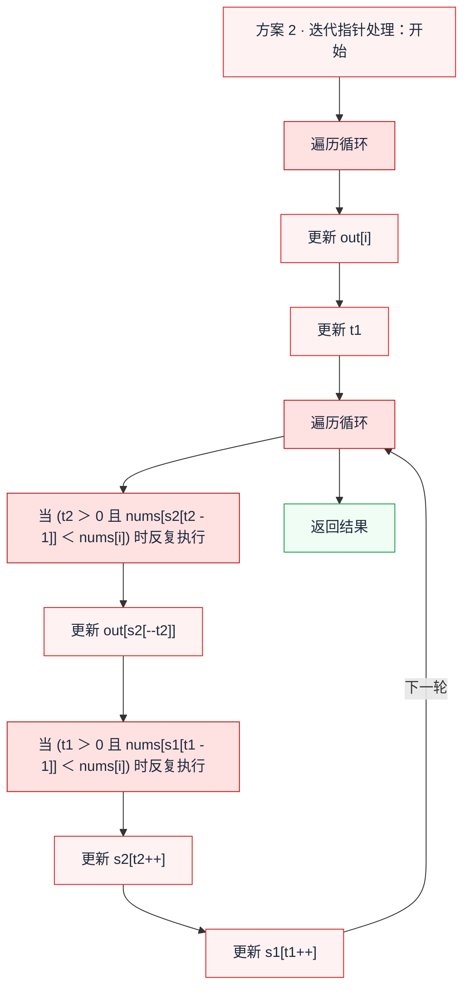

```c
/* LeetCode 2454. 下一个更大元素 IV — C 版（方案2） */
#include <stdio.h>                                              // 引入头文件
static void second_greater(const int *nums, int n, int out[]) { // 定义函数/方法 second_greater
    for (int i = 0; i < n; i++)
        out[i] = -1; // 让 下标 i 从 0 开始计数，下标 i 小于 元素个数 就继续
    int s1[4096], t1 = 0, s2[4096], t2 = 0; // 把 0, s2[4096], t2 赋值为 0; 写入 int s1[4096], t1
    for (int i = 0; i < n; i++) { // 让 下标 i 从 0 开始计数，下标 i 小于 元素个数 就继续
        while (t2 > 0 && nums[s2[t2 - 1]] < nums[i])
            out[s2[--t2]] = nums[i];
        while (t1 > 0 && nums[s1[t1 - 1]] < nums[i])
            s2[t2++] = s1[--t1];
        s1[t1++] = i; // 把 下标 i; 写入 s1[t1++]
    }
}
int main(void) {                                    // 程序入口：跑内嵌自测用例
    int out[4096];                                  // int out[4096];
    second_greater((int[]){2, 4, 0, 9, 6}, 5, out); // second_greater((int[]){2,4,0,9,6}, 5, out);
    if (!(out[0] == 9 && out[1] == 6 && out[2] == 6 && out[3] == -1 && out[4] == -1)) {
        printf("FAIL 1\n");
        return 1;
    }
    second_greater((int[]){5, 4, 3, 2, 1}, 5, out); // second_greater((int[]){5,4,3,2,1}, 5, out);
    if (!(out[0] == -1 && out[4] == -1)) {
        printf("FAIL 2\n");
        return 1;
    }
    printf("PASS\n");
    return 0;
} // 全部用例通过，输出 PASS
```

### C++ 实现（2 种方案）

C++ 的全部方案如下，每个方案都内嵌用例自测，可独立运行（老仓库 python/go 文件遵循「打印结果」约定）：

#### 方案 1：迭代指针处理

**思路与代码分析**：核心是「迭代指针处理」。C++ 版用 STL 容器与迭代器，减少手写下标错误。代码里依次做这些事：单循环线性扫描。**走读**：方案 1 · 迭代指针处理：开始 → 更新 n → 处理 std::vector＜int＞ res(n, -1) → 处理 std::vector＜size_t＞ s1, s2 → 遍历循环 → 当 (非 s2.empty() 且 nums[s2.back()] ＜ nums[i]) 时反复执行 → 更新 res[s2.back()] → 当 (非 s1.empty() 且 nums[s1.back()] ＜ nums[i]) 时反复执行 → 调用 s2.push_back(s1.back()), s1. → 调用 s1.push_back(i) → 返回 res。

**运行架构**（真实控制流）：

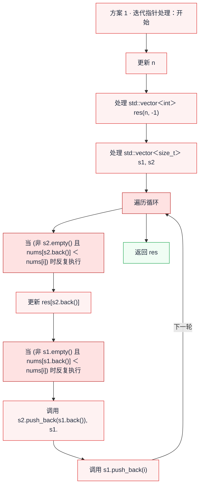

```cpp
// LeetCode 2454. 下一个更大元素 IV — C++ 版（方案1）
#include <cassert>  // 引入头文件
#include <iostream> // 引入头文件
#include <vector>   // 引入头文件
static std::vector<int> secondGreater(const std::vector<int> &nums) {
    size_t n = nums.size();          // 把 数组.大小(); 写入 size_t n
    std::vector<int> res(n, -1);     // std::vector 小于 int 超过 结果(元素个数, 减 1);
    std::vector<size_t> s1, s2;      // std::vector 小于 size_t 超过 s1, s2;
    for (size_t i = 0; i < n; ++i) { // 让 下标 i 从 0 开始计数，下标 i 小于 元素个数 就继续
        while (!s2.empty() && nums[s2.back()] < nums[i])
            res[s2.back()] = nums[i], s2.pop_back();
        while (!s1.empty() && nums[s1.back()] < nums[i])
            s2.push_back(s1.back()), s1.pop_back();
        s1.push_back(i); // s1 追加 下标 i);
    }
    return res; // 返回 结果
}
int main() {
    assert((secondGreater({2, 4, 0, 9, 6}) == std::vector<int>{9, 6, 6, -1, -1}));
    assert((secondGreater({5, 4, 3, 2, 1}) == std::vector<int>{-1, -1, -1, -1, -1}));
    std::cout << "PASS" << std::endl;
} // 全部用例通过，输出 PASS
```

#### 方案 2：迭代指针处理

**思路与代码分析**：核心是「迭代指针处理」。C++ 版用 STL 容器与迭代器，减少手写下标错误。代码里依次做这些事：单循环线性扫描。**走读**：方案 2 · 迭代指针处理：开始 → 更新 n → 处理 std::vector＜int＞ res(n, -1) → 处理 std::vector＜size_t＞ s1, s2 → 遍历循环 → 当 (非 s2.empty() 且 nums[s2.back()] ＜ nums[i]) 时反复执行 → 更新 res[s2.back()] → 当 (非 s1.empty() 且 nums[s1.back()] ＜ nums[i]) 时反复执行 → 调用 s2.push_back(s1.back()), s1. → 调用 s1.push_back(i) → 返回 res。

**运行架构**（真实控制流）：


```cpp
// LeetCode 2454. 下一个更大元素 IV — C++ 版（方案2）
#include <cassert>  // 引入头文件
#include <iostream> // 引入头文件
#include <vector>   // 引入头文件
static std::vector<int> secondGreater(const std::vector<int> &nums) {
    size_t n = nums.size();          // 把 数组.大小(); 写入 size_t n
    std::vector<int> res(n, -1);     // std::vector 小于 int 超过 结果(元素个数, 减 1);
    std::vector<size_t> s1, s2;      // std::vector 小于 size_t 超过 s1, s2;
    for (size_t i = 0; i < n; ++i) { // 让 下标 i 从 0 开始计数，下标 i 小于 元素个数 就继续
        while (!s2.empty() && nums[s2.back()] < nums[i])
            res[s2.back()] = nums[i], s2.pop_back();
        while (!s1.empty() && nums[s1.back()] < nums[i])
            s2.push_back(s1.back()), s1.pop_back();
        s1.push_back(i); // s1 追加 下标 i);
    }
    return res; // 返回 结果
}
int main() {
    assert((secondGreater({2, 4, 0, 9, 6}) == std::vector<int>{9, 6, 6, -1, -1}));
    assert((secondGreater({5, 4, 3, 2, 1}) == std::vector<int>{-1, -1, -1, -1, -1}));
    std::cout << "PASS" << std::endl;
} // 全部用例通过，输出 PASS
```

### R 实现（2 种方案）

R 的全部方案如下，每个方案都内嵌用例自测，可独立运行（老仓库 python/go 文件遵循「打印结果」约定）：

#### 方案 1：迭代指针处理

**思路与代码分析**：核心是「迭代指针处理」。R 版用向量化思维与 1 起始下标，注意 1:n 的降序陷阱。代码里依次做这些事：单循环线性扫描。**走读**：方案 1 · 迭代指针处理：开始 → 处理 n ＜- length(nums) → 处理 res ＜- rep(-1L, n) → 处理 s1 ＜- integer(0) → 处理 s2 ＜- integer(0) → 循环 i：遍历 seq_len(n) → 当 (length(s2) ＞ 0 且 nums[s2[length(s2)]] ＜ nums[i]) 时反复执行 → 处理 res[s2[length(s2)]] ＜- nums[ → 处理 s2 ＜- s2[-length(s2)] → 当 (length(s1) ＞ 0 且 nums[s1[length(s1)]] ＜ nums[i]) 时反复执行 → 处理 s2 ＜- c(s2, s1[length(s1)]) → 处理 s1 ＜- s1[-length(s1)] → 处理 s1 ＜- c(s1, i) → 处理 res → 返回结果。

**运行架构**（真实控制流）：


```r
# R 版（方案1） 定义函数 second_greater（参数：数组）
second_greater <- function(nums) {
    n <- length(nums)  # 把 长度(数组) 存入 元素个数
    res <- rep(-1L, n)  # 把 rep( 减 1L, 元素个数) 存入 结果
    s1 <- integer(0)
    s2 <- integer(0)  # 把 integer(0); s2 小于 减 integer(0) 存入 s1
    for (i in seq_len(n)) {
        # for (下标 i in seq_len(元素个数)) { 循环，直到不满足「长度(s2) 超过 0 且 数组[s2[长度(s2)]] 小于
        # 数组[下标 i]」
        while (length(s2) > 0 && nums[s2[length(s2)]] < nums[i]) {
            res[s2[length(s2)]] <- nums[i]  # 把 数组[下标 i] 存入 res[s2[length(s2)]]
            s2 <- s2[-length(s2)]  # 把 s2[ 减 长度(s2)] 存入 s2
        }
        while (length(s1) > 0 && nums[s1[length(s1)]] < nums[i]) {
            # 循环，直到不满足「长度(s1) 超过 0 且 数组[s1[长度(s1)]] 小于 数组[下标 i]」
            s2 <- c(s2, s1[length(s1)])  # 把 字符(s2, s1[长度(s1)]) 存入 s2
            s1 <- s1[-length(s1)]  # 把 s1[ 减 长度(s1)] 存入 s1
        }
        s1 <- c(s1, i)  # 把 字符(s1, 下标 i) 存入 s1
    }
    res  # 结果
}
stopifnot(identical(as.integer(second_greater(c(2, 4, 0, 9, 6))), c(9L, 6L, 6L, -1L, -1L)))  # 断言校验
stopifnot(identical(as.integer(second_greater(c(5, 4, 3, 2, 1))), rep(-1L, 5)))  # 断言校验
cat("PASS\n")  # 全部用例通过，输出 PASS
```

#### 方案 2：迭代指针处理

**思路与代码分析**：核心是「迭代指针处理」。R 版用向量化思维与 1 起始下标，注意 1:n 的降序陷阱。代码里依次做这些事：单循环线性扫描。**走读**：方案 2 · 迭代指针处理：开始 → 处理 n ＜- length(nums) → 处理 res ＜- rep(-1L, n) → 处理 s1 ＜- integer(0) → 处理 s2 ＜- integer(0) → 循环 i：遍历 seq_len(n) → 当 (length(s2) ＞ 0 且 nums[s2[length(s2)]] ＜ nums[i]) 时反复执行 → 处理 res[s2[length(s2)]] ＜- nums[ → 处理 s2 ＜- s2[-length(s2)] → 当 (length(s1) ＞ 0 且 nums[s1[length(s1)]] ＜ nums[i]) 时反复执行 → 处理 s2 ＜- c(s2, s1[length(s1)]) → 处理 s1 ＜- s1[-length(s1)] → 处理 s1 ＜- c(s1, i) → 处理 res → 返回结果。

**运行架构**（真实控制流）：

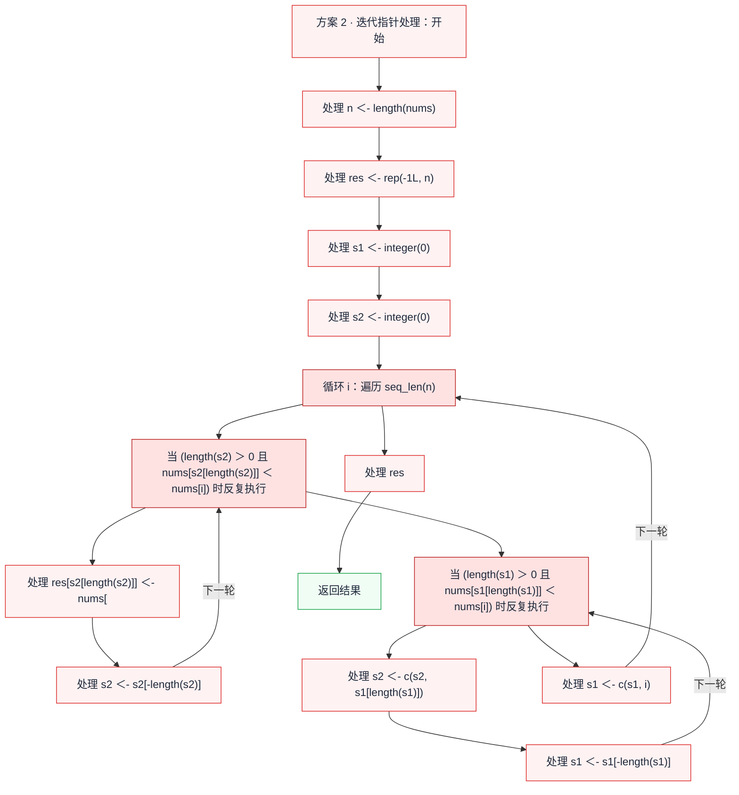

```r
# R 版（方案2） 定义函数 second_greater（参数：数组）
second_greater <- function(nums) {
    n <- length(nums)  # 把 长度(数组) 存入 元素个数
    res <- rep(-1L, n)  # 把 rep( 减 1L, 元素个数) 存入 结果
    s1 <- integer(0)
    s2 <- integer(0)  # 把 integer(0); s2 小于 减 integer(0) 存入 s1
    for (i in seq_len(n)) {
        # for (下标 i in seq_len(元素个数)) { 循环，直到不满足「长度(s2) 超过 0 且 数组[s2[长度(s2)]] 小于
        # 数组[下标 i]」
        while (length(s2) > 0 && nums[s2[length(s2)]] < nums[i]) {
            res[s2[length(s2)]] <- nums[i]  # 把 数组[下标 i] 存入 res[s2[length(s2)]]
            s2 <- s2[-length(s2)]  # 把 s2[ 减 长度(s2)] 存入 s2
        }
        while (length(s1) > 0 && nums[s1[length(s1)]] < nums[i]) {
            # 循环，直到不满足「长度(s1) 超过 0 且 数组[s1[长度(s1)]] 小于 数组[下标 i]」
            s2 <- c(s2, s1[length(s1)])  # 把 字符(s2, s1[长度(s1)]) 存入 s2
            s1 <- s1[-length(s1)]  # 把 s1[ 减 长度(s1)] 存入 s1
        }
        s1 <- c(s1, i)  # 把 字符(s1, 下标 i) 存入 s1
    }
    res  # 结果
}
stopifnot(identical(as.integer(second_greater(c(2, 4, 0, 9, 6))), c(9L, 6L, 6L, -1L, -1L)))  # 断言校验
stopifnot(identical(as.integer(second_greater(c(5, 4, 3, 2, 1))), rep(-1L, 5)))  # 断言校验
cat("PASS\n")  # 全部用例通过，输出 PASS
```

### Zig 实现（2 种方案）

Zig 的全部方案如下，每个方案都内嵌用例自测，可独立运行（老仓库 python/go 文件遵循「打印结果」约定）：

#### 方案 1：迭代指针处理

**思路与代码分析**：核心是「迭代指针处理」。Zig 版显式分配与清零，整型边界处理严格。代码里依次做这些事：双重循环遍历。**走读**：方案 1 · 迭代指针处理：开始 → 计算 n → 遍历集合元素 → 遍历集合元素 → 当 (t2 ＞ 0 and nums[s2[t2 - 1]] ＜ nums[i]) 时反复执行 → 当 (t1 ＞ 0 and nums[s1[t1 - 1]] ＜ nums[i]) 时反复执行 → 返回结果。

**运行架构**（真实控制流）：

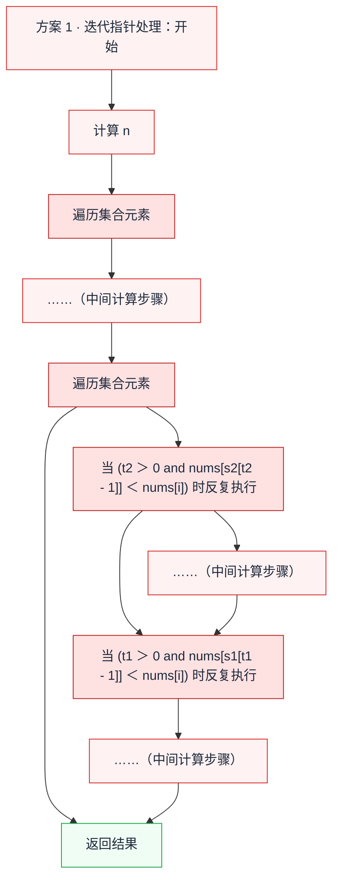

```zig
// LeetCode 2454. 下一个更大元素 IV — Zig 版（方案1）
const std = @import("std"); // 把 @import(「std」) 存入 std
fn secondGreater(nums: []const i32, out: []i32) void { // 定义函数/方法 secondGreater
    const n = nums.len; // 把 数组.长度 存入 元素个数
    for (0..n) |i| out[i] = -1; // 让 下标 i 从 0 走到 元素个数 减一
    var s1: [4096]usize = undefined; // 把 undefined; 写入 var s1: [4096]usize
    var t1: usize = 0; // 把 0; 写入 var t1: usize
    var s2: [4096]usize = undefined; // 把 undefined; 写入 var s2: [4096]usize
    var t2: usize = 0; // 把 0; 写入 var t2: usize
    for (0..n) |i| { // 让 下标 i 从 0 走到 元素个数 减一
        while (t2 > 0 and nums[s2[t2 - 1]] < nums[i]) { // 循环，直到不满足「t2 超过 0 and 数组[s2[t2 减 1]] 小于 数组[下标 i]」
            t2 -= 1; // t2累减 1
            out[s2[t2]] = nums[i]; // 把 数组[下标 i]; 写入 out[s2[t2]]
        }
        while (t1 > 0 and nums[s1[t1 - 1]] < nums[i]) { // 循环，直到不满足「t1 超过 0 and 数组[s1[t1 减 1]] 小于 数组[下标 i]」
            t1 -= 1; // t1累减 1
            s2[t2] = s1[t1]; // 把 s1[t1]; 写入 s2[t2]
            t2 += 1; // t2累加 1
        }
        s1[t1] = i; // 把 下标 i; 写入 s1[t1]
        t1 += 1; // t1累加 1
    }
}
pub fn main() !void { // 程序入口：跑内嵌自测用例
    var out: [8]i32 = undefined; // 把 undefined; 写入 var out: [8]i32
    secondGreater(&[_]i32{ 2, 4, 0, 9, 6 }, &out); // secondGreater( 按位与 [_]i32{ 2, 4, 0, 9, 6 }, 按位与 out);
    if (out[0] != 9 or out[2] != 6 or out[4] != -1) return error.TestFailed;
    secondGreater(&[_]i32{ 5, 4, 3, 2, 1 }, &out); // secondGreater( 按位与 [_]i32{ 5, 4, 3, 2, 1 }, 按位与 out);
    if (out[0] != -1) return error.TestFailed; // 若 out[0] 不等于 减 1，直接返回 error.TestFailed
    std.debug.print("PASS\n", .{});
} // 全部用例通过，输出 PASS
```

#### 方案 2：迭代指针处理

**思路与代码分析**：核心是「迭代指针处理」。Zig 版显式分配与清零，整型边界处理严格。代码里依次做这些事：双重循环遍历。**走读**：方案 2 · 迭代指针处理：开始 → 计算 n → 遍历集合元素 → 遍历集合元素 → 当 (t2 ＞ 0 and nums[s2[t2 - 1]] ＜ nums[i]) 时反复执行 → 当 (t1 ＞ 0 and nums[s1[t1 - 1]] ＜ nums[i]) 时反复执行 → 返回结果。

**运行架构**（真实控制流）：

```mermaid
graph TD
    N0["方案 2 · 迭代指针处理：开始"]
    N1["计算 n"]
    N2["遍历集合元素"]
    D1["……（中间计算步骤）"]
    N7["遍历集合元素"]
    N8["当 (t2 ＞ 0 and nums[s2[t2 - 1]] ＜ nums[i]) 时反复执行"]
    D2["……（中间计算步骤）"]
    N11["当 (t1 ＞ 0 and nums[s1[t1 - 1]] ＜ nums[i]) 时反复执行"]
    D3["……（中间计算步骤）"]
    N17["返回结果"]
    N0 --> N1
    N1 --> N2
    N7 --> N8
    N8 --> N11
    N7 --> N17
    N2 --> D1
    D1 --> N7
    N8 --> D2
    D2 --> N11
    N11 --> D3
    D3 --> N17
    classDef n fill:#fef2f2,stroke:#dc2626,color:#1e293b;
    classDef lp fill:#fee2e2,stroke:#b91c1c,color:#1e293b;
    classDef dc fill:#fef9c3,stroke:#ca8a04,color:#1e293b;
    classDef tm fill:#f0fdf4,stroke:#16a34a,color:#1e293b;
    class N0,N1,D1,D2,D3 n;
    class N2,N7,N8,N11 lp;
    class N17 tm;
```

```zig
// LeetCode 2454. 下一个更大元素 IV — Zig 版（方案2）
const std = @import("std"); // 把 @import(「std」) 存入 std
fn secondGreater(nums: []const i32, out: []i32) void { // 定义函数/方法 secondGreater
    const n = nums.len; // 把 数组.长度 存入 元素个数
    for (0..n) |i| out[i] = -1; // 让 下标 i 从 0 走到 元素个数 减一
    var s1: [4096]usize = undefined; // 把 undefined; 写入 var s1: [4096]usize
    var t1: usize = 0; // 把 0; 写入 var t1: usize
    var s2: [4096]usize = undefined; // 把 undefined; 写入 var s2: [4096]usize
    var t2: usize = 0; // 把 0; 写入 var t2: usize
    for (0..n) |i| { // 让 下标 i 从 0 走到 元素个数 减一
        while (t2 > 0 and nums[s2[t2 - 1]] < nums[i]) { // 循环，直到不满足「t2 超过 0 and 数组[s2[t2 减 1]] 小于 数组[下标 i]」
            t2 -= 1; // t2累减 1
            out[s2[t2]] = nums[i]; // 把 数组[下标 i]; 写入 out[s2[t2]]
        }
        while (t1 > 0 and nums[s1[t1 - 1]] < nums[i]) { // 循环，直到不满足「t1 超过 0 and 数组[s1[t1 减 1]] 小于 数组[下标 i]」
            t1 -= 1; // t1累减 1
            s2[t2] = s1[t1]; // 把 s1[t1]; 写入 s2[t2]
            t2 += 1; // t2累加 1
        }
        s1[t1] = i; // 把 下标 i; 写入 s1[t1]
        t1 += 1; // t1累加 1
    }
}
pub fn main() !void { // 程序入口：跑内嵌自测用例
    var out: [8]i32 = undefined; // 把 undefined; 写入 var out: [8]i32
    secondGreater(&[_]i32{ 2, 4, 0, 9, 6 }, &out); // secondGreater( 按位与 [_]i32{ 2, 4, 0, 9, 6 }, 按位与 out);
    if (out[0] != 9 or out[2] != 6 or out[4] != -1) return error.TestFailed;
    secondGreater(&[_]i32{ 5, 4, 3, 2, 1 }, &out); // secondGreater( 按位与 [_]i32{ 5, 4, 3, 2, 1 }, 按位与 out);
    if (out[0] != -1) return error.TestFailed; // 若 out[0] 不等于 减 1，直接返回 error.TestFailed
    std.debug.print("PASS\n", .{});
} // 全部用例通过，输出 PASS
```

### Dart 实现（2 种方案）

Dart 的全部方案如下，每个方案都内嵌用例自测，可独立运行（老仓库 python/go 文件遵循「打印结果」约定）：

#### 方案 1：迭代指针处理

**思路与代码分析**：核心是「迭代指针处理」。Dart 版用可空类型标注与集合方法，注意空安全。代码里依次做这些事：单循环线性扫描。**走读**：方案 1 · 迭代指针处理：开始 → 更新 n → 更新 res → 处理 n, → 处理 -1, → 处理 ) → 更新 s1 → 更新 s2 → 遍历循环 → 当 (s2.isNotEmpty 且 nums[s2.last] ＜ nums[i]) 时反复执行 → 更新 res[s2.removeLast()] → 当 (s1.isNotEmpty 且 nums[s1.last] ＜ nums[i]) 时反复执行 → 调用 s2.add(s1.removeLast()) → 调用 s1.add(i) → 返回 res。

**运行架构**（真实控制流）：

```mermaid
graph TD
    N0["方案 1 · 迭代指针处理：开始"]
    N1["更新 n"]
    N2["更新 res"]
    N3["处理 n,"]
    N4["处理 -1,"]
    N5["处理 )"]
    N6["更新 s1"]
    N7["更新 s2"]
    N8["遍历循环"]
    N9["当 (s2.isNotEmpty 且 nums[s2.last] ＜ nums[i]) 时反复执行"]
    N10["更新 res[s2.removeLast()]"]
    N11["当 (s1.isNotEmpty 且 nums[s1.last] ＜ nums[i]) 时反复执行"]
    N12["调用 s2.add(s1.removeLast())"]
    N13["调用 s1.add(i)"]
    N14["返回 res"]
    N0 --> N1
    N1 --> N2
    N2 --> N3
    N3 --> N4
    N4 --> N5
    N5 --> N6
    N6 --> N7
    N7 --> N8
    N8 --> N9
    N9 --> N10
    N10 -- 下一轮 --> N9
    N9 --> N11
    N11 --> N12
    N12 -- 下一轮 --> N11
    N11 --> N13
    N13 -- 下一轮 --> N8
    N8 --> N14
    classDef n fill:#fef2f2,stroke:#dc2626,color:#1e293b;
    classDef lp fill:#fee2e2,stroke:#b91c1c,color:#1e293b;
    classDef dc fill:#fef9c3,stroke:#ca8a04,color:#1e293b;
    classDef tm fill:#f0fdf4,stroke:#16a34a,color:#1e293b;
    class N0,N1,N2,N3,N4,N5,N6,N7,N10,N12,N13 n;
    class N8,N9,N11 lp;
    class N14 tm;
```

```dart
// LeetCode 2454. 下一个更大元素 IV — Dart 版（方案1）
List<int> secondGreater(List<int> nums) {
  // 定义函数/方法 secondGreater
  final n = nums.length; // 把 数组.长度 存入 元素个数
  final res = List<int>.filled(
    n,
    -1,
  ); // 把 List 小于 int 超过 .filled(元素个数, 减 1) 存入 结果
  final s1 = <int>[]; // 把 小于 int 超过 [] 存入 s1
  final s2 = <int>[]; // 把 小于 int 超过 [] 存入 s2
  for (var i = 0; i < n; i++) {
    // 让 下标 i 从 0 开始计数，下标 i 小于 元素个数 就继续
    while (s2.isNotEmpty && nums[s2.last] < nums[i]) {
      // 循环，直到不满足「s2.isNotEmpty 且 数组[s2.last] 小于 数组[下标 i]」
      res[s2.removeLast()] = nums[i]; // 把 数组[下标 i]; 写入 res[s2.removeLast()]
    }
    while (s1.isNotEmpty && nums[s1.last] < nums[i]) {
      // 循环，直到不满足「s1.isNotEmpty 且 数组[s1.last] 小于 数组[下标 i]」
      s2.add(s1.removeLast()); // s2 追加 s1.removeLast());
    }
    s1.add(i); // s1 追加 下标 i);
  }
  return res; // 返回 结果
}

void main() {
  if (secondGreater([2, 4, 0, 9, 6]).toString() != '[9, 6, 6, -1, -1]')
    throw StateError('c1');
  if (secondGreater([5, 4, 3, 2, 1]).toString() != '[-1, -1, -1, -1, -1]')
    throw StateError('c2');
  print('PASS');
} // 全部用例通过，输出 PASS
```

#### 方案 2：迭代指针处理

**思路与代码分析**：核心是「迭代指针处理」。Dart 版用可空类型标注与集合方法，注意空安全。代码里依次做这些事：单循环线性扫描。**走读**：方案 2 · 迭代指针处理：开始 → 更新 n → 更新 res → 处理 n, → 处理 -1, → 处理 ) → 更新 s1 → 更新 s2 → 遍历循环 → 当 (s2.isNotEmpty 且 nums[s2.last] ＜ nums[i]) 时反复执行 → 更新 res[s2.removeLast()] → 当 (s1.isNotEmpty 且 nums[s1.last] ＜ nums[i]) 时反复执行 → 调用 s2.add(s1.removeLast()) → 调用 s1.add(i) → 返回 res。

**运行架构**（真实控制流）：

```mermaid
graph TD
    N0["方案 2 · 迭代指针处理：开始"]
    N1["更新 n"]
    N2["更新 res"]
    N3["处理 n,"]
    N4["处理 -1,"]
    N5["处理 )"]
    N6["更新 s1"]
    N7["更新 s2"]
    N8["遍历循环"]
    N9["当 (s2.isNotEmpty 且 nums[s2.last] ＜ nums[i]) 时反复执行"]
    N10["更新 res[s2.removeLast()]"]
    N11["当 (s1.isNotEmpty 且 nums[s1.last] ＜ nums[i]) 时反复执行"]
    N12["调用 s2.add(s1.removeLast())"]
    N13["调用 s1.add(i)"]
    N14["返回 res"]
    N0 --> N1
    N1 --> N2
    N2 --> N3
    N3 --> N4
    N4 --> N5
    N5 --> N6
    N6 --> N7
    N7 --> N8
    N8 --> N9
    N9 --> N10
    N10 -- 下一轮 --> N9
    N9 --> N11
    N11 --> N12
    N12 -- 下一轮 --> N11
    N11 --> N13
    N13 -- 下一轮 --> N8
    N8 --> N14
    classDef n fill:#fef2f2,stroke:#dc2626,color:#1e293b;
    classDef lp fill:#fee2e2,stroke:#b91c1c,color:#1e293b;
    classDef dc fill:#fef9c3,stroke:#ca8a04,color:#1e293b;
    classDef tm fill:#f0fdf4,stroke:#16a34a,color:#1e293b;
    class N0,N1,N2,N3,N4,N5,N6,N7,N10,N12,N13 n;
    class N8,N9,N11 lp;
    class N14 tm;
```

```dart
// LeetCode 2454. 下一个更大元素 IV — Dart 版（方案2）
List<int> secondGreater(List<int> nums) {
  // 定义函数/方法 secondGreater
  final n = nums.length; // 把 数组.长度 存入 元素个数
  final res = List<int>.filled(
    n,
    -1,
  ); // 把 List 小于 int 超过 .filled(元素个数, 减 1) 存入 结果
  final s1 = <int>[]; // 把 小于 int 超过 [] 存入 s1
  final s2 = <int>[]; // 把 小于 int 超过 [] 存入 s2
  for (var i = 0; i < n; i++) {
    // 让 下标 i 从 0 开始计数，下标 i 小于 元素个数 就继续
    while (s2.isNotEmpty && nums[s2.last] < nums[i]) {
      // 循环，直到不满足「s2.isNotEmpty 且 数组[s2.last] 小于 数组[下标 i]」
      res[s2.removeLast()] = nums[i]; // 把 数组[下标 i]; 写入 res[s2.removeLast()]
    }
    while (s1.isNotEmpty && nums[s1.last] < nums[i]) {
      // 循环，直到不满足「s1.isNotEmpty 且 数组[s1.last] 小于 数组[下标 i]」
      s2.add(s1.removeLast()); // s2 追加 s1.removeLast());
    }
    s1.add(i); // s1 追加 下标 i);
  }
  return res; // 返回 结果
}

void main() {
  if (secondGreater([2, 4, 0, 9, 6]).toString() != '[9, 6, 6, -1, -1]')
    throw StateError('c1');
  if (secondGreater([5, 4, 3, 2, 1]).toString() != '[-1, -1, -1, -1, -1]')
    throw StateError('c2');
  print('PASS');
} // 全部用例通过，输出 PASS
```

---

## 内容总结

- **下一个更大元素 iv**（栈 · Medium）：共 2 个方案，主线思路「迭代指针处理」；时间 O(n)（单趟线性扫描）；动画演示栈后进先出过程，附录给出 11 种语言 × 全部方案的可运行实现。
- 来源博客：[https://blog.csdn.net/tyro_java/article/details/145397916](https://blog.csdn.net/tyro_java/article/details/145397916)
- 导航：[📋 总目录](../) ｜ [← 023 除自身以外数组的乘积](../023_除自身以外数组的乘积/) ｜ [025 丢失的数字 →](../025_丢失的数字/)
