# 025 · 丢失的数字（第一阶段 · 线性结构入门 · Medium）

> **难度**：⭐⭐ Medium ｜ **专题**：数组
> **学习定位**：第一阶段 · 线性结构入门第 25 篇 ｜ **解法数**：1
> **内容总结**：**丢失的数字**（数组 · Medium）：共 1 个方案，主线思路「单趟扫描」；时间 O(n)（单趟线性扫描）；动画演示双指针过程，附录给出 11 种语言 × 全部方案的可运行实现。

---

## 题目描述

给定一个包含 `[0, n]` 中 `n` 个数的数组 `nums` ，找出 `[0, n]` 这个范围内没有出现在数组中的那个数。

- 主函数签名：`function missingNumber(nums: number[]): number`

**用例（来自原题）**：

**示例 1**

**示例 2**

**示例 3**
> 题面与 [leetcode.cn 官方](https://leetcode.cn/problems/missing-number/)一致，示例配图取自官方题面。

**数据范围与注意事项**：

- `n == nums.length`
- `1 <= n <= 10^4`
- `0 <= nums[i] <= n`
- `nums` 中的所有数字都 独一无二
- 进阶：你能否实现线性时间复杂度、仅使用额外常数空间的算法解决此问题？
- **易错点**：边界最容易漏：空数组、只有一个元素、目标出现在头尾。

## 题目分析

**场景是什么**：数组是最常用的线性容器，这类题练的是下标操作与原地腾挪，对应真实开发里的缓冲区、列表整理。本题就是该场景的 Medium 级练习，主线做法是「单趟扫描」。

**主线怎么解**：把主解法从头到尾过一遍，它其实在依次做这几件事：单循环线性扫描。

## 解题思路

**方案对比**（共 1 个方案，由浅入深）：

| 方案 | 时间复杂度 | 空间复杂度 |
|---|---|---|
| 方案 1 · 单趟扫描 | O(n)（单趟线性扫描） | O(1) 到 O(n)（视辅助结构） |

**怎么读这一篇**：

- 🐣 **新手路线**：把「题目描述」的示例 1 在纸上手推一遍 → 读方案 1（最直观的写法）与它的代码走读 → 按「运行方式」本地跑通看 PASS → 回头对比方案 2 之后的写法差在哪
- 🦅 **大佬路线**：直接锁定最优方案 1（单趟扫描，O(n)（单趟线性扫描））→ 跳读该方案代码与走读 → 用「逐步拆解与面试追问」补齐复杂度推导与边界追问

### 动态算法图（双指针，GIF 自动循环）


动画演示数组专题里双指针的典型过程；每个方案在「TypeScript 解题方案」一节还配了专属动画与专属流程图。

### 主解法流程图（真实控制流）

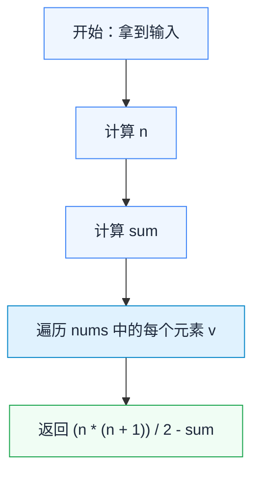

## TypeScript 解题方案（1 个方案逐个讲）

> **运行与提交**：每个方案都是自包含文件（内嵌用例自测，输出 PASS），整块复制到 `.ts` 文件后 `node 文件名` 即可运行。提交 LeetCode 时，把 `demo` 内的算法函数与辅助类型/函数整体取出、置于文件顶层即可。涉及交互/特殊接口的题以题面给定签名为准。

### 方案 1：单趟扫描

**分析与思路**：核心做法是「单趟扫描」。代码里依次做这些事：单循环线性扫描。

**运行方式**：`node 本文件`，内嵌用例全部通过会输出 PASS。


**方案专属流程图**（真实控制流）：

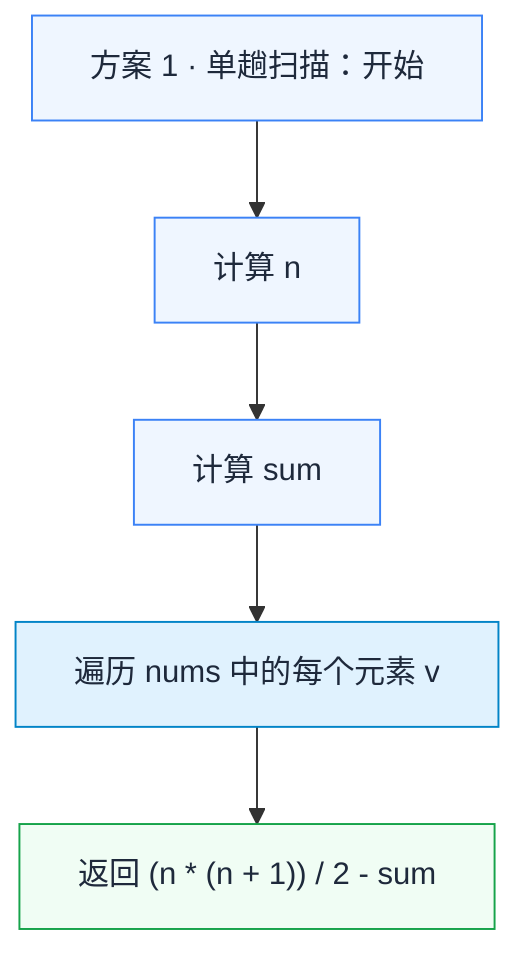

```typescript
// 丢失的数字：高斯求和 - 总和差值
// 忠实翻译 Python ref_missingNumber: n*(n+1)//2 - sum(nums)

function missingNumber(nums: number[]): number {
  // 定义函数/方法 missingNumber
  const n = nums.length; // 把 数组.长度 存入 元素个数
  let sum = 0; // 把 0 存入 累计和
  for (const v of nums) sum += v; // 把 值; 写入 for (const v of nums) sum +
  return (n * (n + 1)) / 2 - sum; // 返回 (元素个数 乘 (元素个数 加 1)) 除以 2 减 累计和
}

// 自检用例：(nums, 期望)
const cases: [number[], number][] = [
  [[3, 0, 1], 2],
  [[0, 1], 2],
  [[9, 6, 4, 2, 3, 5, 7, 0, 1], 8],
];

export function demo(): void {
  // 程序入口：跑内嵌自测用例
  for (const [nums, want] of cases) {
    // for (const [数组, want] of cases) {
    const got = missingNumber(nums); // 把 missingNumber(数组) 存入 got
    if (got !== want) {
      // 若 got 不等于 want
      throw new Error(
        `FAIL: missingNumber(${JSON.stringify(nums)})=${got} want ${want}`,
      );
    }
  }
  console.log('PASS'); // 全部用例通过，输出 PASS
}

demo(); // demo();
```

## 逐步拆解与面试追问

**复杂度**：时间 O(n)（单趟线性扫描），空间 O(1) 到 O(n)（视辅助结构）

**为什么是这个量级**：每个元素被常数次访问，辅助哈希或栈的开销与 n 同阶

**面试官可能会追问**：

- 能不能原地做（O(1) 空间）？
- 如果数组已有序，能优化到什么程度？
- 空数组、单元素怎么处理？

## 关键 API 速查（TS 主解法实际用到，附官方链接）

| API | 作用 | 使用要点 | 官方文档 |
|---|---|---|---|
| `JSON.stringify()` | 序列化为 JSON 字符串 | 常用于结构化比较（深度相等判定）；undefined/函数/循环引用会被丢弃或抛错 | [官方文档](https://developer.mozilla.org/zh-CN/docs/Web/JavaScript/Reference/Global_Objects/JSON/stringify) |

### 各语言官方文档导航

- **TypeScript / JS**：[MDN 中文参考](https://developer.mozilla.org/zh-CN/)
- **Python**：[Python 官方文档](https://docs.python.org/zh-cn/3/)
- **Go**：[Go 标准库](https://pkg.go.dev/std)
- **Java**：[JDK 17 API](https://docs.oracle.com/en/java/javase/17/docs/api/)
- **Rust**：[Rust 标准库](https://doc.rust-lang.org/std/)
- **Lua**：[Lua 5.4 手册](https://www.lua.org/manual/5.4/)
- **C**：[Cppreference C](https://zh.cppreference.com/w/c)
- **C++**：[Cppreference C++](https://zh.cppreference.com/w/cpp)
- **R**：[R 官方手册](https://stat.ethz.ch/R-manual/)
- **Zig**：[Zig 语言文档](https://ziglang.org/documentation/master/)
- **Dart**：[Dart API](https://api.dart.dev/)

## 附录：其他 10 种语言全部实现（每种语言列举其全部方案）

> TypeScript 的全部方案见「TypeScript 解题方案」一节；下面是其余 10 种语言的对应实现，每种语言的每个方案都带思路分析、代码走读与专属运行架构图。
> 每个方案都内嵌用例自测，可独立运行（老仓库 python/go 文件遵循「打印结果」约定）。
> 完整解法文件见 `dsa/<语言>/array/lc_268_丢失的数字/`。

### Python 实现（1 种方案）

Python 的全部方案如下，每个方案都内嵌用例自测，可独立运行（老仓库 python/go 文件遵循「打印结果」约定）：

#### 方案 1：单趟扫描

**思路与代码分析**：核心是「单趟扫描」。Python 版用切片与字典推导式简化操作，突出可读性。**走读**：方案 1 · 单趟扫描：开始 → 更新 n → 返回 n * (n + 1) // 2 - sum(nums)。

**运行架构**（真实控制流）：

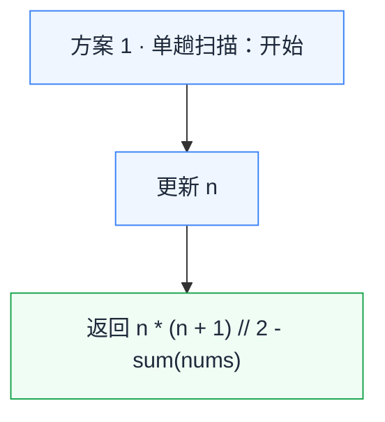

```python
import sys  # 提高递归深度上限（深输入防 RecursionError）

sys.setrecursionlimit(200000)  # 树/链表类题目节点数可达 1e4 量级

def missing_number(nums):  # 定义函数 missing_number（参数：数组）
    n = len(nums)  # 把 长度(数组) 存入 元素个数
    return n * (n + 1) // 2 - sum(nums)  # 返回 元素个数 乘 (元素个数 加 1) 除以 除以 2 减 累计和(数组)

if __name__ == "__main__":  # 若 __name__ 等于 '__main__'
    cases = [
        ([3, 0, 1], 2),
        ([0, 1], 2),
        ([9, 6, 4, 2, 3, 5, 7, 0, 1], 8),
    ]
    for nums, want in cases:  # for 数组, want in cases:
        got = missing_number(nums)  # 把 missing_number(数组) 存入 got
        assert got == want, f"missingNumber({nums})={got} want {want}"  # 断言校验
    print("PASS")  # 全部用例通过，输出 PASS
```

### Go 实现（1 种方案）

Go 的全部方案如下，每个方案都内嵌用例自测，可独立运行（老仓库 python/go 文件遵循「打印结果」约定）：

#### 方案 1：单趟扫描

**思路与代码分析**：核心是「单趟扫描」。Go 版用切片与多返回值惯用法，显式处理索引边界。**走读**：方案 1 · 单趟扫描：开始 → 更新 : → 更新 : → 遍历 nums 的下标与元素 v → 更新 + → 返回 n*(n+1)/2 - sum。

**运行架构**（真实控制流）：

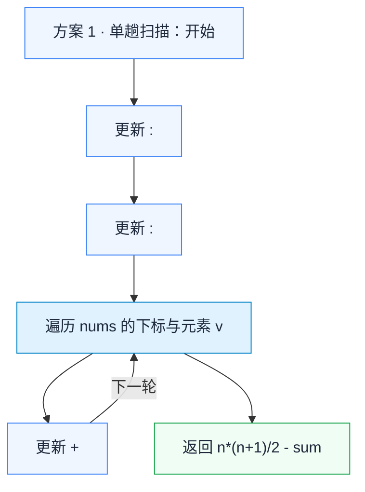

```go
package main // 引入依赖

import (
	"fmt" // 「fmt」
	"os"  // 「os」
)

// 丢失的数字：高斯求和 - 总和差值
// 忠实翻译 Python ref_missingNumber: n*(n+1)//2 - sum(nums)
func missingNumber(nums []int) int { // 定义函数/方法 missingNumber
	n := len(nums)           // 把 长度(数组) 写入 n :
	sum := 0                 // 把 0 写入 sum :
	for _, v := range nums { // 同时取 _ 与 值 遍历
		sum += v // 累计和累加 值
	}
	return n*(n+1)/2 - sum // 返回 元素个数 乘 (元素个数 加 1) 除以 2 减 累计和
}

func main() { // 程序入口：跑内嵌自测用例
	type tc struct { // 定义类型
		nums []int // 数组 []int
		want int   // want int
	}
	cases := []tc{ // 把 []tc{ 写入 cases :
		{[]int{3, 0, 1}, 2},
		{[]int{0, 1}, 2},
		{[]int{9, 6, 4, 2, 3, 5, 7, 0, 1}, 8},
	}
	ok := true                // 把 true 写入 ok :
	for _, c := range cases { // 同时取 _ 与 字符 遍历
		got := missingNumber(c.nums) // 把 missingNumber(字符.数组) 写入 got :
		if got != c.want {           // 若 got 不等于 字符.want
			fmt.Printf("FAIL: missingNumber(%v)=%d want %d\n", c.nums, got, c.want) // 打印输出
			ok = false                                                              // 把 false 写入 ok
		}
	}
	if !ok { // 若 取反 ok
		fmt.Println("FAIL") // 打印输出
		os.Exit(1)          // os.Exit(1)
	}
	fmt.Println("PASS") // 全部用例通过，输出 PASS
}
```

### Java 实现（1 种方案）

Java 的全部方案如下，每个方案都内嵌用例自测，可独立运行（老仓库 python/go 文件遵循「打印结果」约定）：

#### 方案 1：单趟扫描

**思路与代码分析**：核心是「单趟扫描」。Java 版用类与静态方法组织，集合操作显式明了。代码里依次做这些事：单循环线性扫描。**走读**：方案 1 · 单趟扫描：开始 → 更新 n → 更新 sum → 遍历循环 → 返回 n * (n + 1) / 2 - sum。

**运行架构**（真实控制流）：

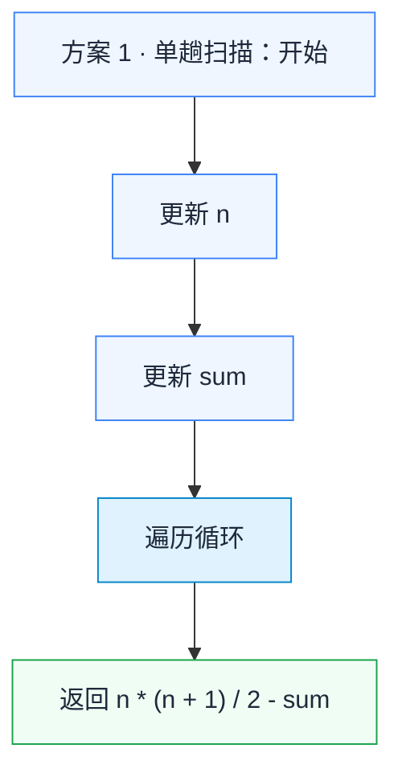

```java
package com.webfault.dsa; // 引入依赖

class lc268_solution1 { // 定义类型
  // 丢失的数字：高斯求和 - 总和差值
  // 忠实翻译 Python ref_missingNumber: n*(n+1)//2 - sum(nums)
  static int missingNumber(int[] nums) { // 定义函数/方法 missingNumber
    int n = nums.length; // 把 数组.长度 存入 元素个数
    int sum = 0; // 把 0 存入 累计和
    for (int v : nums) sum += v; // 把 值; 写入 for (int v : nums) sum +
    return n * (n + 1) / 2 - sum; // 返回 元素个数 乘 (元素个数 加 1) 除以 2 减 累计和
  }

  public static void main(String[] args) { // public static void main(String[] args) {
    int[][] inputs = {{3, 0, 1}, {0, 1}, {9, 6, 4, 2, 3, 5, 7, 0, 1}};
    int[] wants = {2, 2, 8}; // 把 {2, 2, 8}; 写入 int[] wants
    for (int i = 0; i < inputs.length; i++) { // 让 下标 i 从 0 开始计数，下标 i 小于 inputs.长度 就继续
      int got = missingNumber(inputs[i]); // 把 missingNumber(inputs[下标 i]) 存入 got
      if (got != wants[i]) { // 若 got 不等于 wants[下标 i]
        System.out.println(
            "FAIL: missingNumber("
                + java.util.Arrays.toString(inputs[i])
                + ")="
                + got
                + " want "
                + wants[i]); // 打印输出
        System.exit(1); // System.exit(1);
      }
    }
    System.out.println("PASS"); // 全部用例通过，输出 PASS
  }
}
```

### Rust 实现（1 种方案）

Rust 的全部方案如下，每个方案都内嵌用例自测，可独立运行（老仓库 python/go 文件遵循「打印结果」约定）：

#### 方案 1：单趟扫描

**思路与代码分析**：核心是「单趟扫描」。Rust 版用所有权移动与切片借用改写同一逻辑，注意 Option 与引用边界。**走读**：方案 1 · 单趟扫描：开始 → 计算 n → 计算 sum → 处理 (n * (n + 1) / 2 - sum) as i → 返回结果。

**运行架构**（真实控制流）：

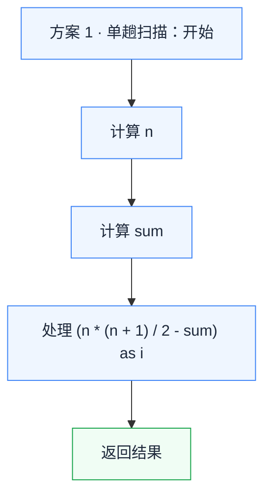

```rust
// LeetCode 268. 丢失的数字 — Rust 版（方案1）
fn missing_number(nums: Vec<i32>) -> i32 {
    // 定义函数/方法 missing_number
    let n = nums.len() as i64; // 把 数组.长度() as i64 存入 元素个数
    let sum: i64 = nums.iter().map(|&x| x as i64).sum();
    (n * (n + 1) / 2 - sum) as i32 // (元素个数 乘 (元素个数 加 1) 除以 2 减 累计和) as i32
}
fn main() {
    assert_eq!(missing_number(vec![3, 0, 1]), 2);
    assert_eq!(missing_number(vec![0, 1]), 2);
    assert_eq!(missing_number(vec![9, 6, 4, 2, 3, 5, 7, 0, 1]), 8);
    println!("PASS");
} // 程序入口：跑内嵌自测用例
```

### Lua 实现（1 种方案）

Lua 的全部方案如下，每个方案都内嵌用例自测，可独立运行（老仓库 python/go 文件遵循「打印结果」约定）：

#### 方案 1：单趟扫描

**思路与代码分析**：核心是「单趟扫描」。Lua 版用表与 ipairs 遍历，注意 ipairs 遇 nil 即停的语义。**走读**：方案 1 · 单趟扫描：开始 → 更新 n → 更新 sum → 遍历 ipairs(nums) do 中的每个元素 v → 更新 sum → 返回 n * (n + 1) // 2 - sum。

**运行架构**（真实控制流）：

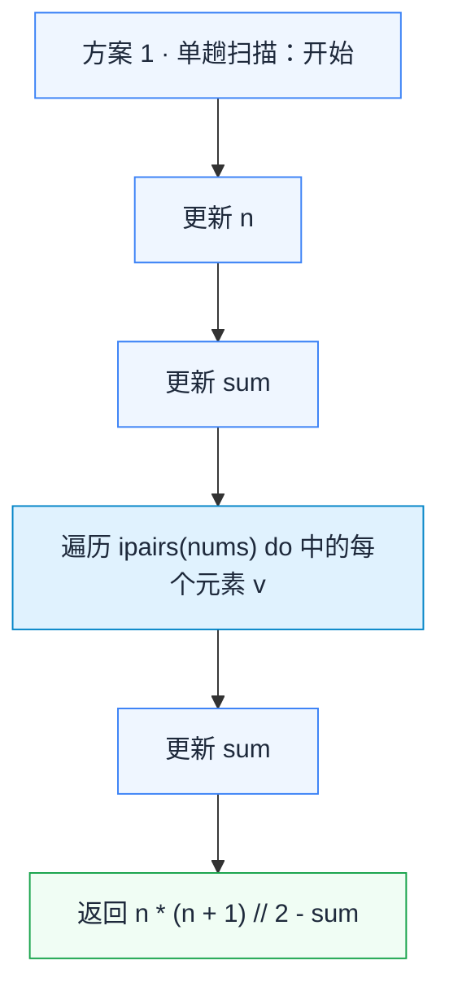

```lua
-- LeetCode 268. 丢失的数字 — Lua 版（方案1）
local function missing_number(nums) -- local function missing_number(数组)
	local n = #nums -- 把 #数组 写入 local n
	local sum = 0 -- 把 0 写入 local sum
	for _, v in ipairs(nums) do
		sum = sum + v
	end -- 遍历取 值
	return n * (n + 1) // 2 - sum -- 返回 元素个数 乘 (元素个数 加 1)
end -- 终点
assert(missing_number({ 3, 0, 1 }) == 2) -- 断言校验
assert(missing_number({ 0, 1 }) == 2) -- 断言校验
assert(missing_number({ 9, 6, 4, 2, 3, 5, 7, 0, 1 }) == 8) -- 断言校验
print("PASS") -- 全部用例通过，输出 PASS
```

### C 实现（1 种方案）

C 的全部方案如下，每个方案都内嵌用例自测，可独立运行（老仓库 python/go 文件遵循「打印结果」约定）：

#### 方案 1：单趟扫描

**思路与代码分析**：核心是「单趟扫描」。C 版手动管理下标与内存，循环边界全部显式写出。代码里依次做这些事：单循环线性扫描。**走读**：方案 1 · 单趟扫描：开始 → 更新 sum → 遍历循环 → 更新 + → 更新 m → 返回 (int)(m * (m + 1) / 2 - sum)。

**运行架构**（真实控制流）：

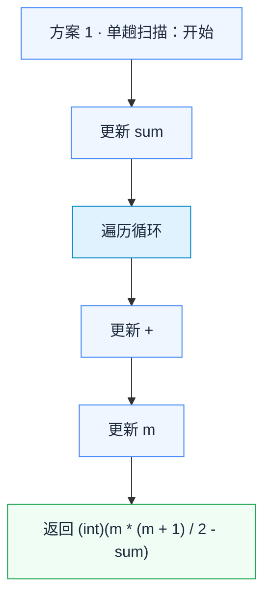

```c
/* LeetCode 268. 丢失的数字 — C 版（方案1） */
#include <stdio.h>                                 // 引入头文件
static int missing_number(const int *n, int len) { // 定义函数/方法 missing_number
    long sum = 0;                                  // 把 0; 写入 long sum
    for (int i = 0; i < len; i++)
        sum += n[i];                     // 让 下标 i 从 0 开始计数，下标 i 小于 长度 就继续
    long m = len;                        // 把 长度; 写入 long m
    return (int)(m * (m + 1) / 2 - sum); // 返回 (int)(映射表 乘 (映射表 加 1) 除以 2 减 累计和)
}
int main(void) { // 程序入口：跑内嵌自测用例
    if (missing_number((int[]){3, 0, 1}, 3) != 2) {
        printf("FAIL 1\n");
        return 1;
    }
    if (missing_number((int[]){0, 1}, 2) != 2) {
        printf("FAIL 2\n");
        return 1;
    }
    if (missing_number((int[]){9, 6, 4, 2, 3, 5, 7, 0, 1}, 9) != 8) {
        printf("FAIL 3\n");
        return 1;
    }
    printf("PASS\n");
    return 0;
} // 全部用例通过，输出 PASS
```

### C++ 实现（1 种方案）

C++ 的全部方案如下，每个方案都内嵌用例自测，可独立运行（老仓库 python/go 文件遵循「打印结果」约定）：

#### 方案 1：单趟扫描

**思路与代码分析**：核心是「单趟扫描」。C++ 版用 STL 容器与迭代器，减少手写下标错误。**走读**：方案 1 · 单趟扫描：开始 → 更新 n → 处理 static_cast＜long long＞(nums. → 更新 sum → 处理 0LL) → 返回 static_cast＜int＞( → 处理 n * (n + 1) / 2 - → 处理 sum)。

**运行架构**（真实控制流）：

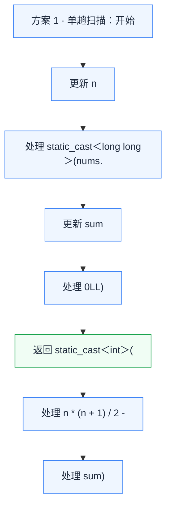

```cpp
// LeetCode 268. 丢失的数字 — C++ 版（方案1）
#include <cassert>                                       // 引入头文件
#include <iostream>                                      // 引入头文件
#include <numeric>                                       // 引入头文件
#include <vector>                                        // 引入头文件
static int missingNumber(const std::vector<int> &nums) { // 定义函数/方法 missingNumber
    long long n =
        static_cast<long long>(nums.size()); // 把 static_cast 小于 long long 超过 (数组.大小()) 存入 元素个数
    long long sum = std::accumulate(nums.begin(), nums.end(),
                                    0LL); // 把 std::accumulate(数组 迭代位置 , 数组.终点(), 0LL) 存入 累计和
    return static_cast<int>(
        n * (n + 1) / 2 -
        sum); // 返回 static_cast 小于 int 超过 (元素个数 乘 (元素个数 加 1) 除以 2 减 累计和)
}
int main() {
    assert(missingNumber({3, 0, 1}) == 2);
    assert(missingNumber({0, 1}) == 2);
    assert(missingNumber({9, 6, 4, 2, 3, 5, 7, 0, 1}) == 8);
    std::cout << "PASS" << std::endl;
} // 全部用例通过，输出 PASS
```

### R 实现（1 种方案）

R 的全部方案如下，每个方案都内嵌用例自测，可独立运行（老仓库 python/go 文件遵循「打印结果」约定）：

#### 方案 1：单趟扫描

**思路与代码分析**：核心是「单趟扫描」。R 版用向量化思维与 1 起始下标，注意 1:n 的降序陷阱。**走读**：方案 1 · 单趟扫描：开始 → 处理 n ＜- length(nums) → 调用 as.integer((n * (n + 1L))%/% → 返回结果。

**运行架构**（真实控制流）：

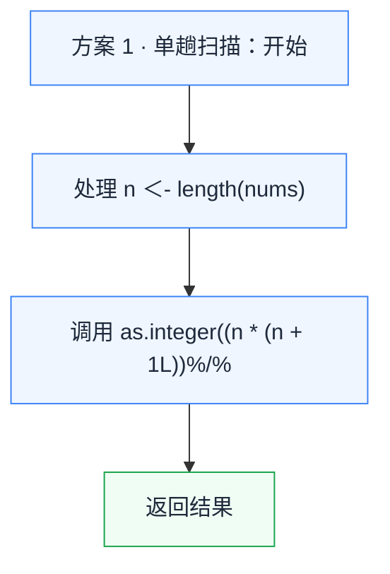

```r
# 版（方案1） 定义函数 missing_number（参数：数组）
missing_number <- function(nums) {
    n <- length(nums)  # 把 长度(数组) 存入 元素个数
    as.integer((n * (n + 1L))%/%2L - sum(nums))  # as.integer((元素个数 乘 (元素个数 加 1L)) 对…取模 除以 对…取模 2L 减 累计和(数组))
}
stopifnot(missing_number(c(3, 0, 1)) == 2)  # 断言校验
stopifnot(missing_number(c(0, 1)) == 2)  # 断言校验
stopifnot(missing_number(c(9, 6, 4, 2, 3, 5, 7, 0, 1)) == 8)  # 断言校验
cat("PASS\n")  # 全部用例通过，输出 PASS
```

### Zig 实现（1 种方案）

Zig 的全部方案如下，每个方案都内嵌用例自测，可独立运行（老仓库 python/go 文件遵循「打印结果」约定）：

#### 方案 1：单趟扫描

**思路与代码分析**：核心是「单趟扫描」。Zig 版显式分配与清零，整型边界处理严格。代码里依次做这些事：单循环线性扫描。**走读**：方案 1 · 单趟扫描：开始 → 计算 n → 计算 sum → 遍历集合元素 → 返回 @intCast(@divTrunc(n * (n + 1), 2) - sum)。

**运行架构**（真实控制流）：

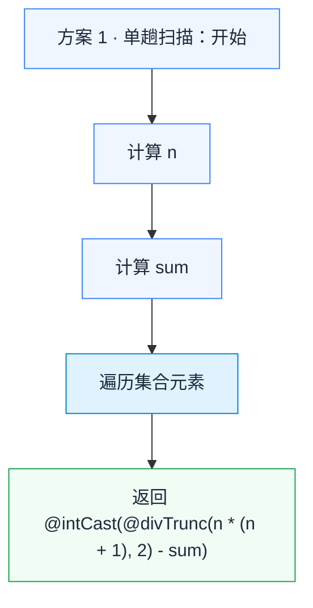

```zig
// LeetCode 268. 丢失的数字 — Zig 版（方案1）
const std = @import("std"); // 把 @import(「std」) 存入 std
fn missingNumber(nums: []const i32) i32 { // 定义函数/方法 missingNumber
    const n: i64 = @intCast(nums.len); // 把 @intCast(数组.长度); 写入 const n: i64
    var sum: i64 = 0; // 把 0; 写入 var sum: i64
    for (nums) |v| sum += v; // 逐个取出 数组 的元素（值）
    return @intCast(@divTrunc(n * (n + 1), 2) - sum); // 返回 @intCast(@divTrunc(元素个数 乘 (元素个数 加 1), 2) 减 累计和)
}
pub fn main() !void { // 程序入口：跑内嵌自测用例
    if (missingNumber(&[_]i32{ 3, 0, 1 }) != 2) return error.TestFailed;
    if (missingNumber(&[_]i32{ 0, 1 }) != 2) return error.TestFailed;
    if (missingNumber(&[_]i32{ 9, 6, 4, 2, 3, 5, 7, 0, 1 }) != 8) return error.TestFailed;
    std.debug.print("PASS\n", .{});
} // 全部用例通过，输出 PASS
```

### Dart 实现（1 种方案）

Dart 的全部方案如下，每个方案都内嵌用例自测，可独立运行（老仓库 python/go 文件遵循「打印结果」约定）：

#### 方案 1：单趟扫描

**思路与代码分析**：核心是「单趟扫描」。Dart 版用可空类型标注与集合方法，注意空安全。代码里依次做这些事：单循环线性扫描。**走读**：方案 1 · 单趟扫描：开始 → 更新 n → 计算 sum → 遍历循环 → 更新 + → 返回 n * (n + 1) ~/ 2 - sum。

**运行架构**（真实控制流）：

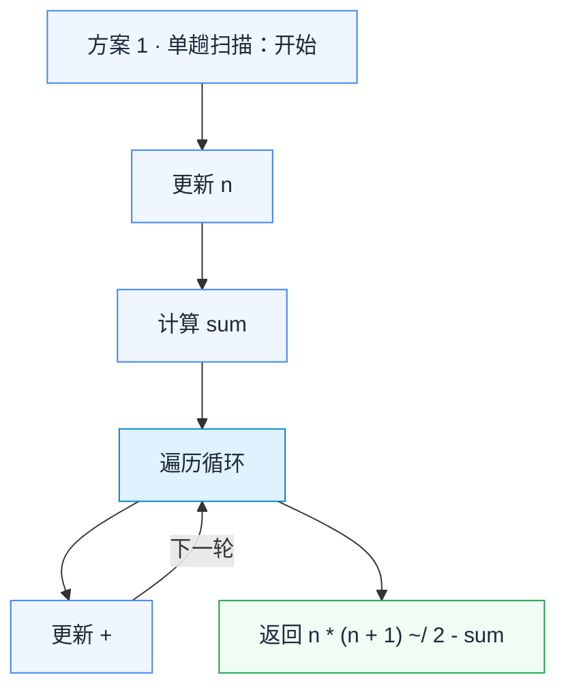

```dart
// LeetCode 268. 丢失的数字 — Dart 版（方案1）
int missingNumber(List<int> nums) {
  // 定义函数/方法 missingNumber
  final n = nums.length; // 把 数组.长度 存入 元素个数
  var sum = 0; // 把 0 存入 累计和
  for (final v in nums) {
    sum += v;
  } // 把 值; } 写入 for (final v in nums) { sum +
  return n * (n + 1) ~/ 2 - sum; // 返回 元素个数 乘 (元素个数 加 1) ~ 除以 2 减 累计和
}

void main() {
  if (missingNumber([3, 0, 1]) != 2) throw StateError('c1');
  if (missingNumber([0, 1]) != 2) throw StateError('c2');
  if (missingNumber([9, 6, 4, 2, 3, 5, 7, 0, 1]) != 8) throw StateError('c3');
  print('PASS');
} // 全部用例通过，输出 PASS
```

---

## 内容总结

- **丢失的数字**（数组 · Medium）：共 1 个方案，主线思路「单趟扫描」；时间 O(n)（单趟线性扫描）；动画演示双指针过程，附录给出 11 种语言 × 全部方案的可运行实现。
- 来源博客：[]()
- 导航：[📋 总目录](../) ｜ [← 024 下一个更大元素 iv](../024_下一个更大元素_iv/) ｜ [026 移动零 →](../026_移动零/)
