# 026 · 移动零（第一阶段 · 线性结构入门 · Medium）

> **难度**：⭐⭐ Medium ｜ **专题**：数组
> **学习定位**：第一阶段 · 线性结构入门第 26 篇 ｜ **解法数**：1
> **内容总结**：**移动零**（数组 · Medium）：共 1 个方案，主线思路「双指针」；时间 O(n)（单趟线性扫描）；动画演示双指针过程，附录给出 11 种语言 × 全部方案的可运行实现。

---

## 题目描述

给定一个数组 `nums`，编写一个函数将所有 `0` 移动到数组的末尾，同时保持非零元素的相对顺序。

请注意 ，必须在不复制数组的情况下原地对数组进行操作。

- 主函数签名：`function moveZeroes(nums: number[]): number[]`

**用例（来自原题）**：

**示例 1**

```text
输入: nums = [0,1,0,3,12]
输出: [1,3,12,0,0]
```

**示例 2**

```text
输入: nums = [0]
输出: [0]
```
> ✅ **官方验证**：全部 TypeScript 解法已通过 leetcode.cn 官方示例用例验证（自动注入运行，全部 PASS）。题面与 [leetcode.cn 官方](https://leetcode.cn/problems/move-zeroes/)一致，示例配图取自官方题面。

**数据范围与注意事项**：

- `1 <= nums.length <= 10^4`
- `-2312^{31} <= nums[i] <= 2312^{31} - 1`
- 进阶：你能尽量减少完成的操作次数吗？
- **易错点**：边界最容易漏：空数组、只有一个元素、目标出现在头尾。

## 题目分析

**场景是什么**：数组是最常用的线性容器，这类题练的是下标操作与原地腾挪，对应真实开发里的缓冲区、列表整理。本题就是该场景的 Medium 级练习，主线做法是「双指针」。

**主线怎么解**：把主解法从头到尾过一遍，它其实在依次做这几件事：单循环线性扫描。

## 解题思路

**方案对比**（共 1 个方案，由浅入深）：

| 方案 | 时间复杂度 | 空间复杂度 |
|---|---|---|
| 方案 1 · 双指针 | O(n)（单趟线性扫描） | O(1) 到 O(n)（视辅助结构） |

**怎么读这一篇**：

- 🐣 **新手路线**：把「题目描述」的示例 1 在纸上手推一遍 → 读方案 1（最直观的写法）与它的代码走读 → 按「运行方式」本地跑通看 PASS → 回头对比方案 2 之后的写法差在哪
- 🦅 **大佬路线**：直接锁定最优方案 1（双指针，O(n)（单趟线性扫描））→ 跳读该方案代码与走读 → 用「逐步拆解与面试追问」补齐复杂度推导与边界追问

### 动态算法图（双指针，GIF 自动循环）


动画演示数组专题里双指针的典型过程；每个方案在「TypeScript 解题方案」一节还配了专属动画与专属流程图。

### 主解法流程图（真实控制流）

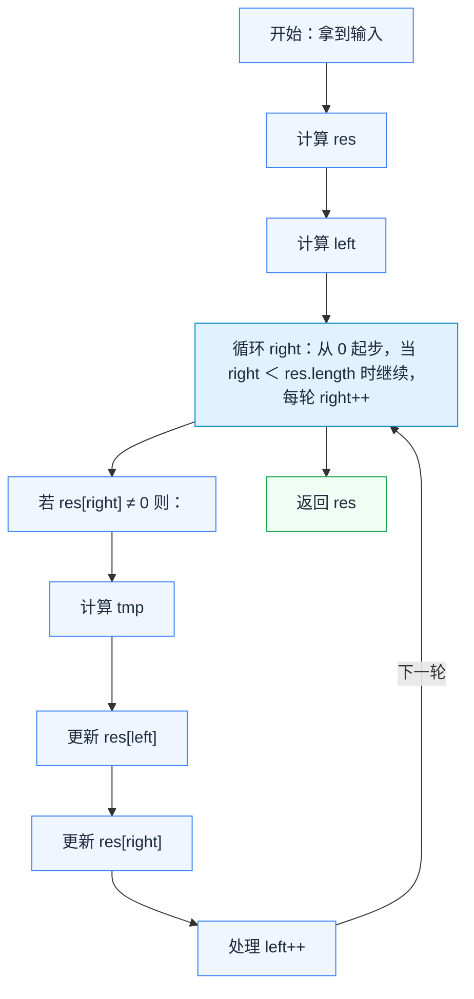

## TypeScript 解题方案（1 个方案逐个讲）

> **运行与提交**：每个方案都是自包含文件（内嵌用例自测，输出 PASS），整块复制到 `.ts` 文件后 `node 文件名` 即可运行。提交 LeetCode 时，把 `demo` 内的算法函数与辅助类型/函数整体取出、置于文件顶层即可。涉及交互/特殊接口的题以题面给定签名为准。

### 方案 1：双指针

**分析与思路**：核心做法是「双指针」。代码里依次做这些事：单循环线性扫描。

**运行方式**：`node 本文件`，内嵌用例全部通过会输出 PASS。

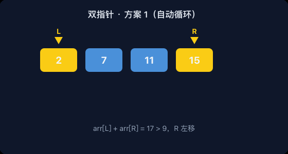

**方案专属流程图**（真实控制流）：

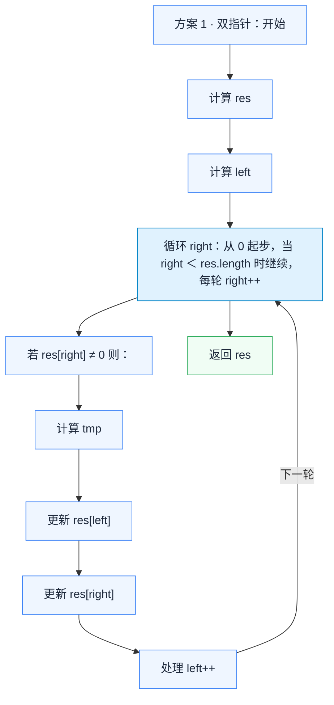

```typescript
/**
 ** LeetCode 283. 移动零
 ** 方案：1 ) 方案1: 双指针
 ** 来源：https://blog.csdn.net/tyro_java/article/details/145116601
 */

// 双指针原地交换，把 0 移到末尾，保持非零元素相对顺序。
// 忠实翻译自 Python 参考实现，返回结果数组。
function moveZeroes(nums: number[]): number[] {
  // 定义函数/方法 moveZeroes
  const res = nums.slice(); // 把 数组 截取 ) 存入 结果
  let left = 0; // 把 0 存入 左边界
  for (let right = 0; right < res.length; right++) {
    // 让 右边界 从 0 开始计数，右边界 小于 结果.长度 就继续
    if (res[right] !== 0) {
      // 若 结果[右边界] 不等于 0
      const tmp = res[left]; // 把 结果[左边界] 存入 临时变量
      res[left] = res[right]; // 把 结果[右边界]; 写入 res[left]
      res[right] = tmp; // 把 临时变量; 写入 res[right]
      left++; // 左边界 加一
    }
  }
  return res; // 返回 结果
}

function eqArray(a: number[], b: number[]): boolean {
  // 定义函数/方法 eqArray
  if (a.length !== b.length) return false; // 若 数组.长度 不等于 b.长度，直接返回 false
  for (let i = 0; i < a.length; i++) {
    // 让 下标 i 从 0 开始计数，下标 i 小于 数组.长度 就继续
    if (a[i] !== b[i]) return false; // 若 数组[下标 i] 不等于 b[下标 i]，直接返回 false
  }
  return true; // 返回 true
}

// 自检入口：遍历 cases 逐一比对，任一不符则 throw（非 0 退出）。
export function demo(): void {
  // 程序入口：跑内嵌自测用例
  // (args, expected) 取自 _tools/correctness_check.py 的 lc_283_移动零 cases
  const cases: Array<{ name: string; in: number[]; want: number[] }> = [
    { name: 'case1', in: [0, 1, 0, 3, 12], want: [1, 3, 12, 0, 0] },
    { name: 'case2', in: [0], want: [0] },
    { name: 'case3', in: [1, 2, 3], want: [1, 2, 3] },
  ];
  for (const c of cases) {
    // for (const 字符 of cases) {
    const got = moveZeroes(c.in); // 把 moveZeroes(字符.in) 存入 got
    if (!eqArray(got, c.want)) {
      // 若 取反 eqArray(got, 字符.want
      throw new Error(
        `FAIL ${c.name}: got ${JSON.stringify(got)} want ${JSON.stringify(c.want)}`,
      );
    }
  }
  console.log('PASS'); // 全部用例通过，输出 PASS
}

demo(); // demo();
```

## 逐步拆解与面试追问

**复杂度**：时间 O(n)（单趟线性扫描），空间 O(1) 到 O(n)（视辅助结构）

**为什么是这个量级**：每个元素被常数次访问，辅助哈希或栈的开销与 n 同阶

**面试官可能会追问**：

- 能不能原地做（O(1) 空间）？
- 如果数组已有序，能优化到什么程度？
- 空数组、单元素怎么处理？

## 关键 API 速查（TS 主解法实际用到，附官方链接）

| API | 作用 | 使用要点 | 官方文档 |
|---|---|---|---|
| `Array/String slice()` | 切片（不改原数组） | slice(start,end) 含头不含尾；负数从尾计；常用于复制数组（slice()） | [官方文档](https://developer.mozilla.org/zh-CN/docs/Web/JavaScript/Reference/Global_Objects/Array/slice) |
| `JSON.stringify()` | 序列化为 JSON 字符串 | 常用于结构化比较（深度相等判定）；undefined/函数/循环引用会被丢弃或抛错 | [官方文档](https://developer.mozilla.org/zh-CN/docs/Web/JavaScript/Reference/Global_Objects/JSON/stringify) |

### 各语言官方文档导航

- **TypeScript / JS**：[MDN 中文参考](https://developer.mozilla.org/zh-CN/)
- **Python**：[Python 官方文档](https://docs.python.org/zh-cn/3/)
- **Go**：[Go 标准库](https://pkg.go.dev/std)
- **Java**：[JDK 17 API](https://docs.oracle.com/en/java/javase/17/docs/api/)
- **Rust**：[Rust 标准库](https://doc.rust-lang.org/std/)
- **Lua**：[Lua 5.4 手册](https://www.lua.org/manual/5.4/)
- **C**：[Cppreference C](https://zh.cppreference.com/w/c)
- **C++**：[Cppreference C++](https://zh.cppreference.com/w/cpp)
- **R**：[R 官方手册](https://stat.ethz.ch/R-manual/)
- **Zig**：[Zig 语言文档](https://ziglang.org/documentation/master/)
- **Dart**：[Dart API](https://api.dart.dev/)

## 附录：其他 10 种语言全部实现（每种语言列举其全部方案）

> TypeScript 的全部方案见「TypeScript 解题方案」一节；下面是其余 10 种语言的对应实现，每种语言的每个方案都带思路分析、代码走读与专属运行架构图。
> 每个方案都内嵌用例自测，可独立运行（老仓库 python/go 文件遵循「打印结果」约定）。
> 完整解法文件见 `dsa/<语言>/array/lc_283_移动零/`。

### Python 实现（1 种方案）

Python 的全部方案如下，每个方案都内嵌用例自测，可独立运行（老仓库 python/go 文件遵循「打印结果」约定）：

#### 方案 1：双指针

**思路与代码分析**：核心是「双指针」。Python 版用切片与字典推导式简化操作，突出可读性。**走读**：方案 1 · 双指针：开始 → 更新 left → 循环 right：从 0 到 len(nums 前 → 若 nums[right] ≠ 0：更新 nums[right] → 更新 nums[right] → 处理 nums[right], → 处理 nums[left], → 处理 ) → 更新 + → 返回结果。

**运行架构**（真实控制流）：

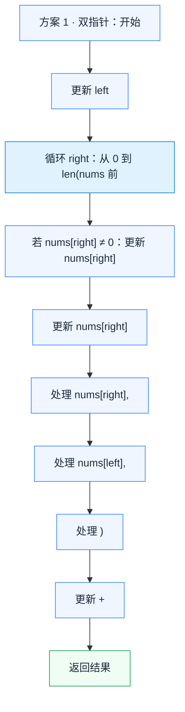

```python
import sys  # 提高递归深度上限（深输入防 RecursionError）

sys.setrecursionlimit(200000)  # 树/链表类题目节点数可达 1e4 量级

def moveZeroes(nums):  # 定义函数 moveZeroes（参数：数组）
    left = 0  # 把 0 存入 左边界
    for right in range(len(nums)):  # 让 右边界 从 长度(数组 遍历
        if nums[right] != 0:  # 若 数组[右边界] 不等于 0
            nums[left], nums[right] = (
                nums[right],
                nums[left],
            )  # 把 数组[右边界], 数组[左边界] 写入 nums[left], nums[right]
            left += 1  # 左边界累加 1

if __name__ == "__main__":  # 若 __name__ 等于 '__main__'
    print(moveZeroes([1, 2, 3]))  # 打印输出
```

### Go 实现（1 种方案）

Go 的全部方案如下，每个方案都内嵌用例自测，可独立运行（老仓库 python/go 文件遵循「打印结果」约定）：

#### 方案 1：双指针

**思路与代码分析**：核心是「双指针」。Go 版用切片与多返回值惯用法，显式处理索引边界。**走读**：方案 1 · 双指针：开始 → 更新 : → 处理 name string → 处理 in []int → 处理 want []int → 更新 : → 遍历 cases 的下标与元素 c → 更新 : → 处理 if 非 eqIntSlice(got, c.want) → 更新 ok → 调用 fmt.Printf(FAIL %s: got %v → 返回 ok。

**运行架构**（真实控制流）：

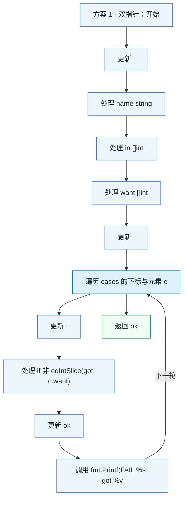

```go
package main // 引入依赖

import (
	"fmt" // 「fmt」
	"os"  // 「os」
)

// moveZeroes 把数组中的 0 移到末尾，保持非零元素的相对顺序。
// 忠实翻译自 Python 参考实现：双指针原地交换，返回结果切片。
func moveZeroes(nums []int) []int { // 定义函数/方法 moveZeroes
	res := make([]int, len(nums))               // 把 make([]int, 长度(数组)) 写入 res :
	copy(res, nums)                             // copy(结果, 数组)
	left := 0                                   // 把 0 写入 left :
	for right := 0; right < len(res); right++ { // 让 右边界 从 0 开始计数
		if res[right] != 0 { // 若 结果[右边界] 不等于 0
			res[left], res[right] = res[right], res[left] // 把 结果[右边界], 结果[左边界] 写入 res[left], res[right]
			left++                                        // 左边界 加一
		}
	}
	return res // 返回 结果
}

func eqIntSlice(a, b []int) bool { // 定义函数/方法 eqIntSlice
	if len(a) != len(b) { // 定义函数/方法 len
		return false // 返回 false
	}
	for i := range a { // 把 range 数组 { 写入 for i :
		if a[i] != b[i] { // 若 数组[下标 i] 不等于 b[下标 i]
			return false // 返回 false
		}
	}
	return true // 返回 true
}

func selfCheck() bool { // 定义函数/方法 selfCheck
	// (args, expected) 取自 _tools/correctness_check.py 的 lc_283_移动零 cases
	cases := []struct { // 把 []struct { 写入 cases :
		name string // name string
		in   []int  // in []int
		want []int  // want []int
	}{ // }{
		{"case1", []int{0, 1, 0, 3, 12}, []int{1, 3, 12, 0, 0}},
		{"case2", []int{0}, []int{0}},
		{"case3", []int{1, 2, 3}, []int{1, 2, 3}},
	}
	ok := true                // 把 true 写入 ok :
	for _, c := range cases { // 同时取 _ 与 字符 遍历
		got := moveZeroes(c.in)       // 把 moveZeroes(字符.in) 写入 got :
		if !eqIntSlice(got, c.want) { // 若 取反 eqIntSlice(got, 字符.want
			ok = false                                                   // 把 false 写入 ok
			fmt.Printf("FAIL %s: got %v want %v\n", c.name, got, c.want) // 打印输出
		}
	}
	return ok // 返回 ok
}

func main() { // 程序入口：跑内嵌自测用例
	if !selfCheck() { // 若 取反 selfCheck(
		fmt.Println("FAIL") // 打印输出
		os.Exit(1)          // os.Exit(1)
	}
	fmt.Println("PASS") // 全部用例通过，输出 PASS
}
```

### Java 实现（1 种方案）

Java 的全部方案如下，每个方案都内嵌用例自测，可独立运行（老仓库 python/go 文件遵循「打印结果」约定）：

#### 方案 1：双指针

**思路与代码分析**：核心是「双指针」。Java 版用类与静态方法组织，集合操作显式明了。代码里依次做这些事：单循环线性扫描。**走读**：方案 1 · 双指针：开始 → 更新 cases → 更新 ok → 遍历循环 → 更新 got → 若 非 eqIntArray(got, cases[k][1]) 则： → 更新 ok → 处理 System.out.println( → 处理 FAIL case → 处理 + (k + 1) → 处理 + : got → 处理 + Arrays.toString(got) → 处理 + want → 处理 + Arrays.toString(cases[k][1 → 返回 ok。

**运行架构**（真实控制流）：

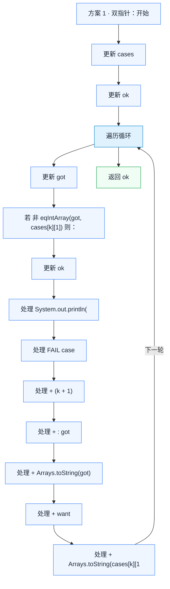

```java
package com.webfault.dsa; // 引入依赖

import java.util.Arrays; // 引入依赖

// 移动零：双指针原地交换，把 0 移到末尾，保持非零元素相对顺序。
// 忠实翻译自 Python 参考实现。
class lc283_solution111 { // 定义类型
  static int[] moveZeroes(int[] nums) { // 定义函数/方法 moveZeroes
    int[] res = nums.clone(); // 把 数组.clone(); 写入 int[] res
    int left = 0; // 把 0 存入 左边界
    for (int right = 0; right < res.length; right++) { // 让 右边界 从 0 开始计数，右边界 小于 结果.长度 就继续
      if (res[right] != 0) { // 若 结果[右边界] 不等于 0
        int tmp = res[left]; // 把 结果[左边界] 存入 临时变量
        res[left] = res[right]; // 把 结果[右边界]; 写入 res[left]
        res[right] = tmp; // 把 临时变量; 写入 res[right]
        left++; // 左边界 加一
      }
    }
    return res; // 返回 结果
  }

  static boolean eqIntArray(int[] a, int[] b) { // 定义函数/方法 eqIntArray
    if (a.length != b.length) return false; // 若 数组.长度 不等于 b.长度，直接返回 false
    for (int i = 0; i < a.length; i++) { // 让 下标 i 从 0 开始计数，下标 i 小于 数组.长度 就继续
      if (a[i] != b[i]) return false; // 若 数组[下标 i] 不等于 b[下标 i]，直接返回 false
    }
    return true; // 返回 true
  }

  static boolean selfCheck() { // 定义函数/方法 selfCheck
    // (args, expected) 取自 _tools/correctness_check.py 的 lc_283_移动零 cases
    int[][][] cases = { // 把 { 写入 int[][][] cases
      {{0, 1, 0, 3, 12}, {1, 3, 12, 0, 0}},
      {{0}, {0}},
      {{1, 2, 3}, {1, 2, 3}},
    };
    boolean ok = true; // 把 true; 写入 boolean ok
    for (int k = 0; k < cases.length; k++) { // 让 下标 k 从 0 开始计数，下标 k 小于 cases.长度 就继续
      int[] got = moveZeroes(cases[k][0]); // 把 moveZeroes(cases[下标 k][0]); 写入 int[] got
      if (!eqIntArray(got, cases[k][1])) { // 若 取反 eqIntArray(got, cases[下标 k][1]
        ok = false; // 把 false; 写入 ok
        System.out.println(
            "FAIL case"
                + (k + 1)
                + ": got "
                + Arrays.toString(got) // 打印输出
                + " want "
                + Arrays.toString(cases[k][1])); // 加 「 want 」 加 Arrays.toString(cases[下标 k][1]));
      }
    }
    return ok; // 返回 ok
  }

  public static void main(String[] args) { // public static void main(String[] args) {
    if (!selfCheck()) { // 若 取反 selfCheck(
      System.out.println("FAIL"); // 打印输出
      System.exit(1); // System.exit(1);
    }
    System.out.println("PASS"); // 全部用例通过，输出 PASS
  }
}
```

### Rust 实现（1 种方案）

Rust 的全部方案如下，每个方案都内嵌用例自测，可独立运行（老仓库 python/go 文件遵循「打印结果」约定）：

#### 方案 1：双指针

**思路与代码分析**：核心是「双指针」。Rust 版用所有权移动与切片借用改写同一逻辑，注意 Option 与引用边界。**走读**：方案 1 · 双指针：开始 → 计算 pos → 遍历 0..nums.len() 中的每个元素 i → 处理 if nums[i] ≠ 0 → 调用 nums.swap(pos, i) → 更新 + → 返回结果。

**运行架构**（真实控制流）：

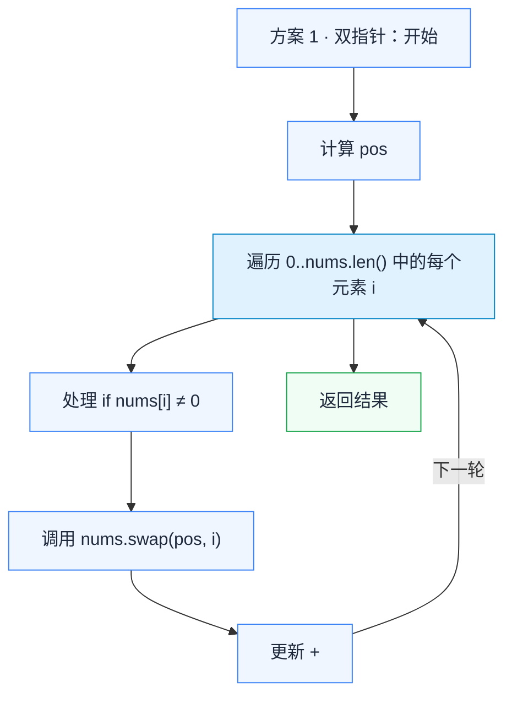

```rust
// LeetCode 283. 移动零 — Rust 版（方案1）
fn move_zeroes(nums: &mut Vec<i32>) {
    // 定义函数/方法 move_zeroes
    let mut pos = 0usize; // 把 0usize; 写入 let mut pos
    for i in 0..nums.len() {
        // 逐个取出 0 的元素（下标 i）
        if nums[i] != 0 {
            nums.swap(pos, i);
            pos += 1;
        } // 若 数组[下标 i] 不等于 0 { 数组.交换 pos, 下标 i); pos 累加 1; }
    }
}
fn main() {
    // 程序入口：跑内嵌自测用例
    let mut v = vec![0, 1, 0, 3, 12];
    move_zeroes(&mut v);
    assert_eq!(v, vec![1, 3, 12, 0, 0]); // 断言校验
    let mut v2 = vec![0];
    move_zeroes(&mut v2);
    assert_eq!(v2, vec![0]); // 断言校验
    println!("PASS");
} // 全部用例通过，输出 PASS
```

### Lua 实现（1 种方案）

Lua 的全部方案如下，每个方案都内嵌用例自测，可独立运行（老仓库 python/go 文件遵循「打印结果」约定）：

#### 方案 1：双指针

**思路与代码分析**：核心是「双指针」。Lua 版用表与 ipairs 遍历，注意 ipairs 遇 nil 即停的语义。**走读**：方案 1 · 双指针：开始 → 更新 pos → 循环 i：从 1 到 #nums do → 处理 if nums[i] ~= 0 then → 更新 nums[i] → 更新 pos → 返回 nums。

**运行架构**（真实控制流）：

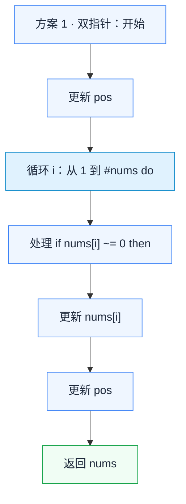

```lua
-- LeetCode 283. 移动零 — Lua 版（方案1）
local function move_zeroes(nums) -- local function move_zeroes(数组)
	local pos = 1 -- 把 1 写入 local pos
	for i = 1, #nums do -- 把 1, #数组 do 写入 for i
		if nums[i] ~= 0 then -- 若 数组[下标 i] ~ 赋值为 0 then
			nums[pos], nums[i] = nums[i], nums[pos] -- 把 数组[下标 i], 数组[pos] 写入 nums[pos], nums[i]
			pos = pos + 1 -- 把 pos 加 1 存入 pos
		end -- 终点
	end -- 终点
	return nums -- 返回 数组
end -- 终点
assert(table.concat(move_zeroes({ 0, 1, 0, 3, 12 }), ",") == "1,3,12,0,0") -- 打印输出
assert(table.concat(move_zeroes({ 0 }), ",") == "0") -- 打印输出
print("PASS") -- 全部用例通过，输出 PASS
```

### C 实现（1 种方案）

C 的全部方案如下，每个方案都内嵌用例自测，可独立运行（老仓库 python/go 文件遵循「打印结果」约定）：

#### 方案 1：双指针

**思路与代码分析**：核心是「双指针」。C 版手动管理下标与内存，循环边界全部显式写出。代码里依次做这些事：单循环线性扫描。**走读**：方案 1 · 双指针：开始 → 更新 pos → 遍历循环 → 若 n[i] ≠ 0 则： → 更新 t → 更新 n[pos] → 更新 n[i] → 处理 pos++ → 返回结果。

**运行架构**（真实控制流）：

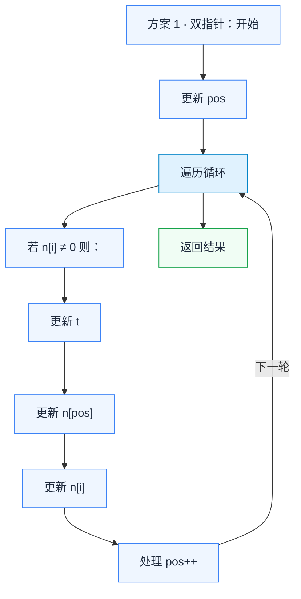

```c
/* LeetCode 283. 移动零 — C 版（方案1） */
#include <stdio.h>                          // 引入头文件
static void move_zeroes(int n[], int len) { // 定义函数/方法 move_zeroes
    int pos = 0;                            // 把 0 存入 pos
    for (int i = 0; i < len; i++) { // 让 下标 i 从 0 开始计数，下标 i 小于 长度 就继续
        if (n[i] != 0) {
            int t = n[pos];
            n[pos] = n[i];
            n[i] = t;
            pos++;
        }
    }
}
int main(void) {                 // 程序入口：跑内嵌自测用例
    int v1[] = {0, 1, 0, 3, 12}; // 把 {0,1,0,3,12}; 写入 int v1[]
    move_zeroes(v1, 5);          // move_zeroes(v1, 5);
    if (!(v1[0] == 1 && v1[1] == 3 && v1[2] == 12 && v1[3] == 0 && v1[4] == 0)) {
        printf("FAIL 1\n");
        return 1;
    }
    int v2[] = {0};     // 把 {0}; 写入 int v2[]
    move_zeroes(v2, 1); // move_zeroes(v2, 1);
    if (v2[0] != 0) {
        printf("FAIL 2\n");
        return 1;
    } // 若 v2[0] 不等于 0) { 输出「FAIL 2 」); return 1; }
    printf("PASS\n");
    return 0;
} // 全部用例通过，输出 PASS
```

### C++ 实现（1 种方案）

C++ 的全部方案如下，每个方案都内嵌用例自测，可独立运行（老仓库 python/go 文件遵循「打印结果」约定）：

#### 方案 1：双指针

**思路与代码分析**：核心是「双指针」。C++ 版用 STL 容器与迭代器，减少手写下标错误。代码里依次做这些事：单循环线性扫描。**走读**：方案 1 · 双指针：开始 → 更新 pos → 遍历循环 → 若 nums[i] ≠ 0 则： → 处理 std::swap(nums[pos], nums[i] → 处理 ++pos → 返回结果。

**运行架构**（真实控制流）：

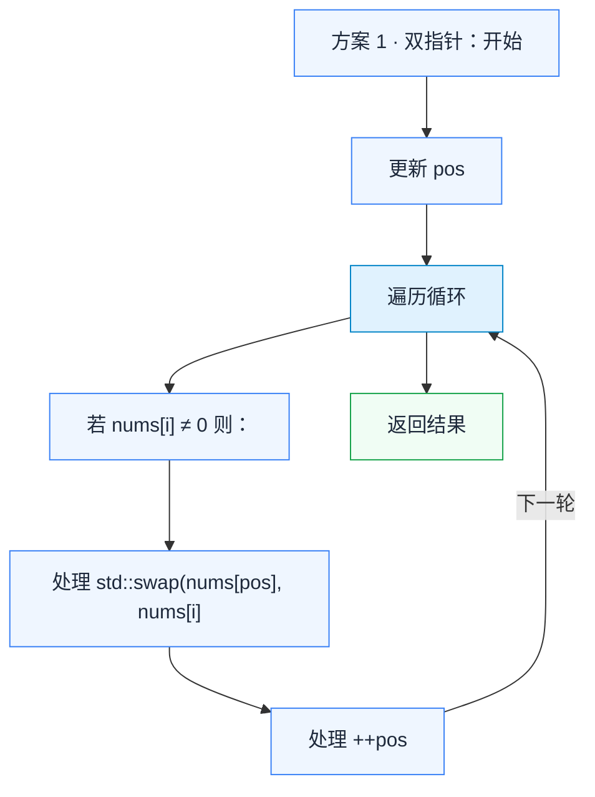

```cpp
// LeetCode 283. 移动零 — C++ 版（方案1）
#include <cassert>                               // 引入头文件
#include <iostream>                              // 引入头文件
#include <vector>                                // 引入头文件
static void moveZeroes(std::vector<int> &nums) { // 定义函数/方法 moveZeroes
    size_t pos = 0;                              // 把 0; 写入 size_t pos
    for (size_t i = 0; i < nums.size(); ++i) { // 让 下标 i 从 0 开始计数，下标 i 小于 数组.大小() 就继续
        if (nums[i] != 0) {
            std::swap(nums[pos], nums[i]);
            ++pos;
        } // 若 数组[下标 i] 不等于 0) { std::交换 数组[pos], 数组[下标 i]); 加一 pos; }
    }
}
int main() {                                         // 程序入口：跑内嵌自测用例
    std::vector<int> v = {0, 1, 0, 3, 12};           // 把 {0, 1, 0, 3, 12}; 写入 std::vector<int> v
    moveZeroes(v);                                   // moveZeroes(值);
    assert((v == std::vector<int>{1, 3, 12, 0, 0})); // 断言校验
    std::vector<int> v2 = {0};                       // 把 {0}; 写入 std::vector<int> v2
    moveZeroes(v2);                                  // moveZeroes(v2);
    assert((v2 == std::vector<int>{0}));             // 断言校验
    std::cout << "PASS" << std::endl;
} // 全部用例通过，输出 PASS
```

### R 实现（1 种方案）

R 的全部方案如下，每个方案都内嵌用例自测，可独立运行（老仓库 python/go 文件遵循「打印结果」约定）：

#### 方案 1：双指针

**思路与代码分析**：核心是「双指针」。R 版用向量化思维与 1 起始下标，注意 1:n 的降序陷阱。**走读**：方案 1 · 双指针：开始 → 更新 ! → 调用 c(nz, rep(0, length(nums) - → 返回结果。

**运行架构**（真实控制流）：

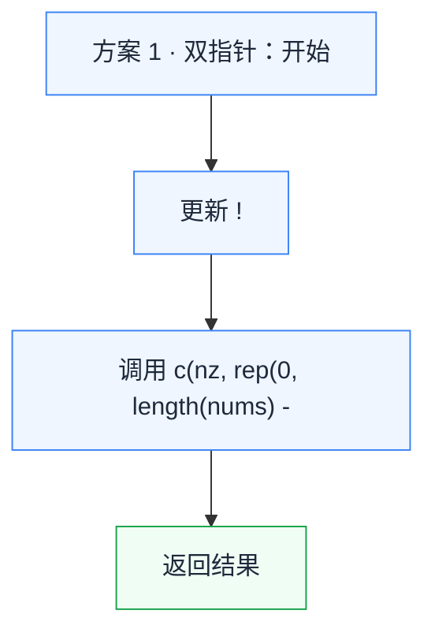

```r
# 版（方案1） 定义函数 move_zeroes（参数：数组）
move_zeroes <- function(nums) {
    nz <- nums[nums != 0]  # 把 数组[数组 不等于 0] 存入 nz
    c(nz, rep(0, length(nums) - length(nz)))  # 字符(nz, rep(0, 长度(数组) 减 长度(nz)))
}
stopifnot(identical(move_zeroes(c(0, 1, 0, 3, 12)), c(1, 3, 12, 0, 0)))  # 断言校验
stopifnot(identical(move_zeroes(c(0)), c(0)))  # 断言校验
cat("PASS\n")  # 全部用例通过，输出 PASS
```

### Zig 实现（1 种方案）

Zig 的全部方案如下，每个方案都内嵌用例自测，可独立运行（老仓库 python/go 文件遵循「打印结果」约定）：

#### 方案 1：双指针

**思路与代码分析**：核心是「双指针」。Zig 版显式分配与清零，整型边界处理严格。代码里依次做这些事：单循环线性扫描。**走读**：方案 1 · 双指针：开始 → 计算 pos → 遍历集合元素 → 若 v ≠ 0 则： → 计算 t → 更新 nums[pos] → 更新 nums[i] → 更新 + → 返回结果。

**运行架构**（真实控制流）：

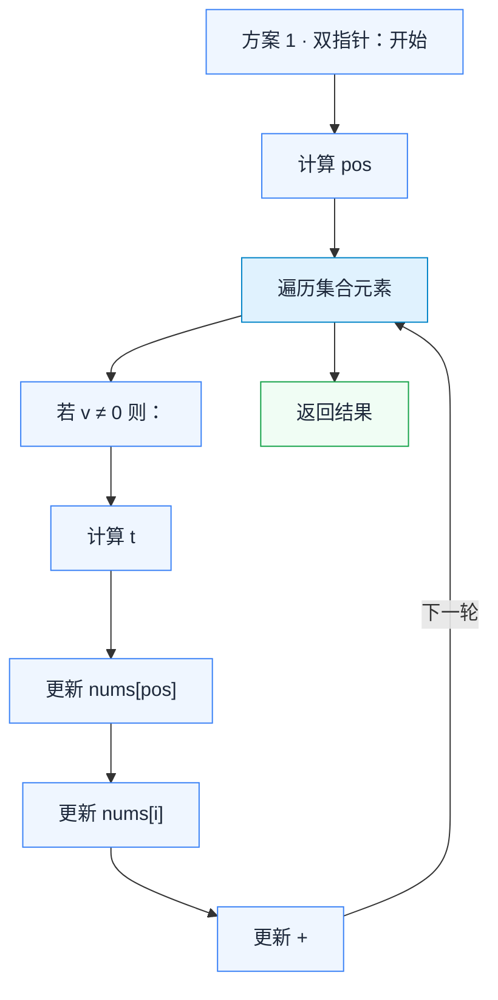

```zig
// LeetCode 283. 移动零 — Zig 版（方案1）
const std = @import("std"); // 把 @import(「std」) 存入 std
fn moveZeroes(nums: []i32) void { // 定义函数/方法 moveZeroes
    var pos: usize = 0; // 把 0; 写入 var pos: usize
    for (nums, 0..) |v, i| { // for (数组, 0..) 按位或 值, 下标 i 按位或 {
        if (v != 0) { // 若 值 不等于 0
            const t = nums[pos]; // 把 数组[pos] 存入 另一字符串
            nums[pos] = nums[i]; // 把 数组[下标 i]; 写入 nums[pos]
            nums[i] = t; // 把 另一字符串; 写入 nums[i]
            pos += 1; // pos累加 1
        }
    }
}
pub fn main() !void { // 程序入口：跑内嵌自测用例
    var v1 = [_]i32{ 0, 1, 0, 3, 12 }; // 把 [_]i32{ 0, 1, 0, 3, 12 } 存入 v1
    moveZeroes(&v1); // moveZeroes( 按位与 v1);
    if (v1[0] != 1 or v1[2] != 12 or v1[4] != 0) return error.TestFailed;
    var v2 = [_]i32{0}; // 把 [_]i32{0} 存入 v2
    moveZeroes(&v2); // moveZeroes( 按位与 v2);
    if (v2[0] != 0) return error.TestFailed; // 若 v2[0] 不等于 0，直接返回 error.TestFailed
    std.debug.print("PASS\n", .{});
} // 全部用例通过，输出 PASS
```

### Dart 实现（1 种方案）

Dart 的全部方案如下，每个方案都内嵌用例自测，可独立运行（老仓库 python/go 文件遵循「打印结果」约定）：

#### 方案 1：双指针

**思路与代码分析**：核心是「双指针」。Dart 版用可空类型标注与集合方法，注意空安全。代码里依次做这些事：单循环线性扫描。**走读**：方案 1 · 双指针：开始 → 计算 pos → 遍历循环 → 若 nums[i] ≠ 0 则： → 更新 t → 更新 nums[pos] → 更新 nums[i] → 处理 pos++ → 返回结果。

**运行架构**（真实控制流）：

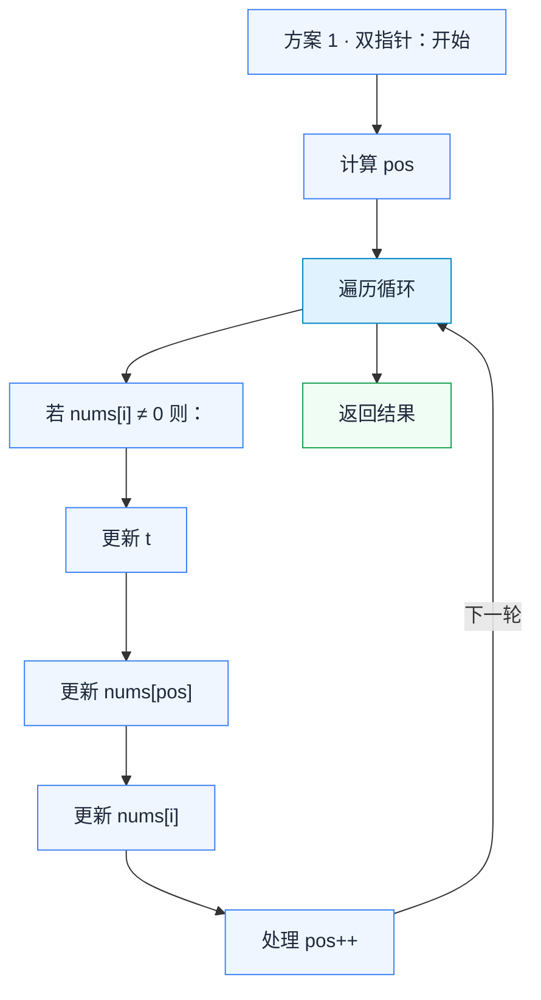

```dart
// LeetCode 283. 移动零 — Dart 版（方案1）
void moveZeroes(List<int> nums) {
  // 定义函数/方法 moveZeroes
  var pos = 0; // 把 0 存入 pos
  for (var i = 0; i < nums.length; i++) {
    // 让 下标 i 从 0 开始计数，下标 i 小于 数组.长度 就继续
    if (nums[i] != 0) {
      // 若 数组[下标 i] 不等于 0
      final t = nums[pos]; // 把 数组[pos] 存入 另一字符串
      nums[pos] = nums[i]; // 把 数组[下标 i]; 写入 nums[pos]
      nums[i] = t; // 把 另一字符串; 写入 nums[i]
      pos++; // pos 加一
    }
  }
}

void main() {
  // 程序入口：跑内嵌自测用例
  final v = [0, 1, 0, 3, 12]; // 把 [0, 1, 0, 3, 12] 存入 值
  moveZeroes(v); // moveZeroes(值);
  if (v.toString() != '[1, 3, 12, 0, 0]') throw StateError('c1');
  final v2 = [0]; // 把 [0] 存入 v2
  moveZeroes(v2); // moveZeroes(v2);
  if (v2.toString() != '[0]')
    throw StateError(
      'c2',
    ); // 若 v2.toString() 不等于 '[0]') throw StateError('c2');
  print('PASS');
} // 全部用例通过，输出 PASS
```

---

## 内容总结

- **移动零**（数组 · Medium）：共 1 个方案，主线思路「双指针」；时间 O(n)（单趟线性扫描）；动画演示双指针过程，附录给出 11 种语言 × 全部方案的可运行实现。
- 来源博客：[https://blog.csdn.net/tyro_java/article/details/145116601](https://blog.csdn.net/tyro_java/article/details/145116601)
- 导航：[📋 总目录](../) ｜ [← 025 丢失的数字](../025_丢失的数字/) ｜ [027 换水问题 ii →](../027_换水问题_ii/)
