# 028 · 扁平化嵌套列表迭代器（第一阶段 · 线性结构入门 · Medium）

> **难度**：⭐⭐ Medium ｜ **专题**：栈
> **学习定位**：第一阶段 · 线性结构入门第 28 篇 ｜ **解法数**：3
> **内容总结**：**扁平化嵌套列表迭代器**（栈 · Medium）：共 3 个方案，主线思路「单趟扫描」；时间 O(n)（单趟线性扫描）；动画演示栈后进先出过程，附录给出 11 种语言 × 全部方案的可运行实现。

---

## 题目描述

给你一个嵌套的整数列表 `nestedList` 。每个元素要么是一个整数，要么是一个列表；该列表的元素也可能是整数或者是其他列表。请你实现一个迭代器将其扁平化，使之能够遍历这个列表中的所有整数。

实现扁平迭代器类 `NestedIterator` ：

 `NestedIterator(List nestedList)` 用嵌套列表 `nestedList` 初始化迭代器。
 `int next()` 返回嵌套列表的下一个整数。
 `boolean hasNext()` 如果仍然存在待迭代的整数，返回 `true` ；否则，返回 `false` 。

你的代码将会用下述伪代码检测：

initialize iterator with nestedList
res = []
while iterator.hasNext()
 append iterator.next() to the end of res
return res

如果 `res` 与预期的扁平化列表匹配，那么你的代码将会被判为正确。

**用例（来自原题）**：

**示例 1**

```text
输入：nestedList = [[1,1],2,[1,1]]
输出：[1,1,2,1,1]
```

解释：通过重复调用 next 直到 hasNext 返回 false，next 返回的元素的顺序应该是: [1,1,2,1,1]。

**示例 2**

```text
输入：nestedList = [1,[4,[6]]]
输出：[1,4,6]
```

解释：通过重复调用 next 直到 hasNext 返回 false，next 返回的元素的顺序应该是: [1,4,6]。
> 题面与 [leetcode.cn 官方](https://leetcode.cn/problems/flatten-nested-list-iterator/)一致，示例配图取自官方题面。

**数据范围与注意事项**：

- `1 <= nestedList.length <= 500`
- `嵌套列表中的整数值在范围 `[-10^6, 10^6]` 内`
- **易错点**：出栈前判空；「下一个更大元素」类问题栈里存下标比存值好用。

## 题目分析

**场景是什么**：后进先出结构天然适合「最近匹配」，对应真实开发里的括号校验、浏览历史、函数调用栈。本题就是该场景的 Medium 级练习，主线做法是「单趟扫描」。

**主线怎么解**：把主解法从头到尾过一遍，它其实在依次做这几件事：单循环线性扫描。

## 解题思路

**方案对比**（共 3 个方案，由浅入深）：

| 方案 | 时间复杂度 | 空间复杂度 |
|---|---|---|
| 方案 1 · 单趟扫描 | O(n)（单趟线性扫描） | O(1) 到 O(n)（视辅助结构） |
| 方案 2 · 单趟扫描 | O(n)（单趟线性扫描） | O(1) 到 O(n)（视辅助结构） |
| 方案 3 · 栈辅助 | O(n)（单趟线性扫描） | O(1) 到 O(n)（视辅助结构） |

**由浅入深的路径**：单趟扫描 → 栈辅助；每往右一步，都在补上一步的短板。

**方案间的取舍**：方案 1（单趟扫描）；方案 2（单趟扫描）；方案 3（栈辅助）。数据规模小、可读性优先时选靠前的方案；规模大、性能优先时选靠后的方案。

**怎么读这一篇**：

- 🐣 **新手路线**：把「题目描述」的示例 1 在纸上手推一遍 → 读方案 1（最直观的写法）与它的代码走读 → 按「运行方式」本地跑通看 PASS → 回头对比方案 2 之后的写法差在哪
- 🦅 **大佬路线**：直接锁定最优方案 1（单趟扫描，O(n)（单趟线性扫描））→ 跳读该方案代码与走读 → 用「逐步拆解与面试追问」补齐复杂度推导与边界追问

### 动态算法图（栈后进先出，GIF 自动循环）


动画演示栈专题里栈后进先出的典型过程；每个方案在「TypeScript 解题方案」一节还配了专属动画与专属流程图。

### 主解法流程图（真实控制流）

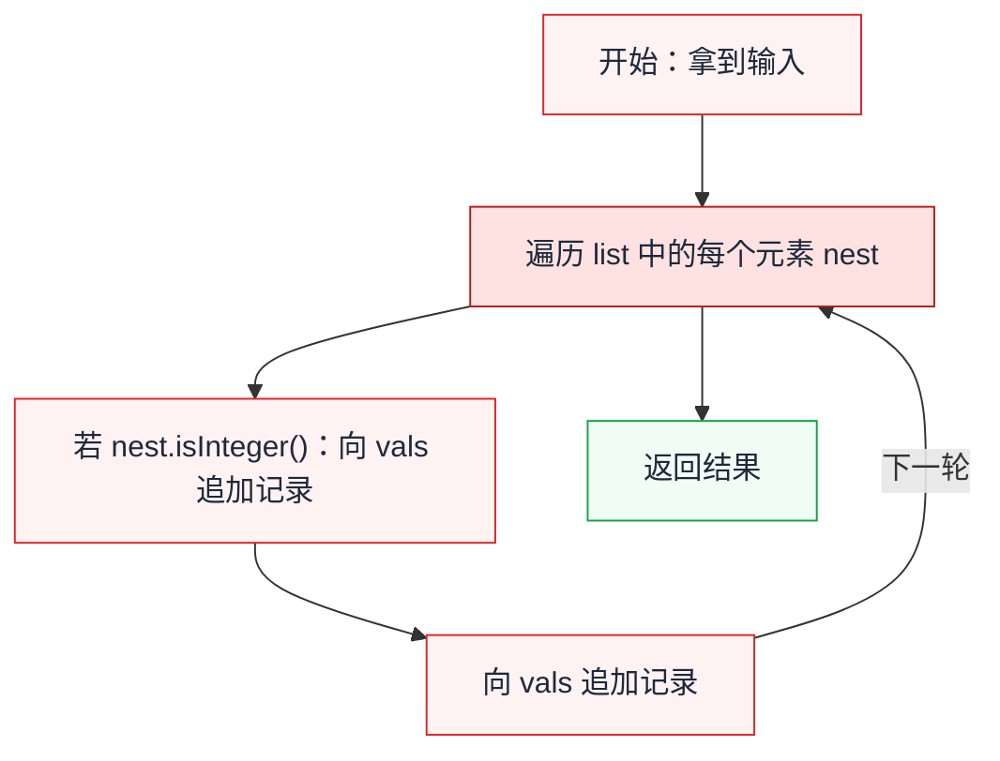

## TypeScript 解题方案（3 个方案逐个讲）

> **运行与提交**：每个方案都是自包含文件（内嵌用例自测，输出 PASS），整块复制到 `.ts` 文件后 `node 文件名` 即可运行。提交 LeetCode 时，把 `demo` 内的算法函数与辅助类型/函数整体取出、置于文件顶层即可。**提交备注**：迭代器接口题：按题面 NestedIterator 的 hasNext/next 签名提交。

### 方案 1：单趟扫描

**分析与思路**：核心做法是「单趟扫描」。代码里依次做这些事：单循环线性扫描。

**运行方式**：`node 本文件`，内嵌用例全部通过会输出 PASS。


**方案专属流程图**（真实控制流）：

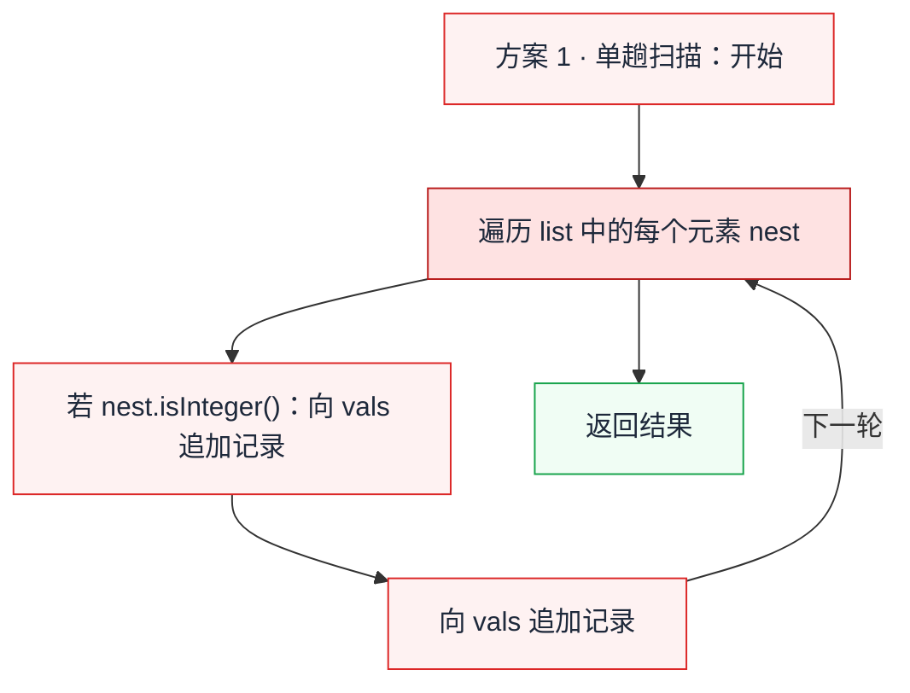

```typescript
export function demo(): void {
  // 程序入口：跑内嵌自测用例
  class NestedInteger {
    // 定义类型
    private _int: number | null = null; // 把 null; 写入 private _int: number | null
    private _list: NestedInteger[] | null = null; // 把 null; 写入 private _list: NestedInteger[] | null
    constructor(value?: any) {
      // constructor(value?: any) {
      if (value === undefined || value === null) {
        // 若 value 全等于 undefined 或 value 全等于 null
        this._list = []; // 把 []; 写入 this._list
      } else if (Array.isArray(value)) {
        // 否则，若 Array.isArray(value
        this._list = value.map((v: any) => new NestedInteger(v));
      } else {
        // 否则
        this._int = value; // 把 value; 写入 this._int
      }
    }
    isInteger(): boolean {
      return this._int !== null;
    } // 把 赋值为 null; } 写入 isInteger(): boolean { return this._int !
    getInteger(): number {
      return this._int as number;
    } // getInteger(): number { return this._int as number; }
    getList(): NestedInteger[] {
      return this._list as NestedInteger[];
    }
  }
  class NestedIterator {
    // 定义类型
    private vals: number[] = []; // 把 []; 写入 private vals: number[]
    constructor(nestedList: NestedInteger[]) {
      // constructor(nestedList: NestedInteger[]) {
      const dfs = (list: NestedInteger[]) => {
        for (const nest of list) {
          // for (const nest of 列表) {
          if (nest.isInteger())
            this.vals.push(nest.getInteger()); // 若 nest.isInteger()) this.vals 追加 nest.getInteger());
          else dfs(nest.getList()); // 否则
        }
      };
      dfs(nestedList); // dfs(nestedList);
    }
    hasNext(): boolean {
      return this.vals.length > 0;
    } // hasNext(): boolean { return this.vals.长度 超过 0; }
    next(): number {
      return this.vals.shift() as number;
    } // 取出队首元素
  }
  function eqArr(a: number[], b: number[]): boolean {
    // 定义函数/方法 eqArr
    if (a.length !== b.length) return false; // 若 数组.长度 不等于 b.长度，直接返回 false
    for (let i = 0; i < a.length; i++) if (a[i] !== b[i]) return false; // 让 下标 i 从 0 开始计数，下标 i 小于 数组.长度 就继续
    return true; // 返回 true
  }
  const cases = [
    { inp: [1, [2, 3]], want: [1, 2, 3] },
    { inp: [[1], 2, [3, [4]]], want: [1, 2, 3, 4] },
  ];
  let fail = false; // 把 false 存入 fail
  for (const c of cases) {
    // for (const 字符 of cases) {
    const nested = new NestedInteger(c.inp).getList(); // 把 new NestedInteger(字符.inp).getList() 存入 nested
    const it = new NestedIterator(nested); // 把 new NestedIterator(nested) 存入 it
    const out: number[] = []; // 把 []; 写入 const out: number[]
    while (it.hasNext()) out.push(it.next()); // 循环，直到不满足「it.hasNext()) out 追加 it.下一个());」
    if (!eqArr(out, c.want)) {
      fail = true;
      console.log('FAIL', c, 'got', out);
    }
  }
  if (fail) throw new Error('FAILED'); // 若 fail) throw new Error(「FAILED」);
  console.log('PASS'); // 全部用例通过，输出 PASS
}
demo(); // demo();
```

### 方案 2：单趟扫描

**分析与思路**：核心做法是「单趟扫描」。代码里依次做这些事：单循环线性扫描。

**运行方式**：`node 本文件`，内嵌用例全部通过会输出 PASS。


**方案专属流程图**（真实控制流）：

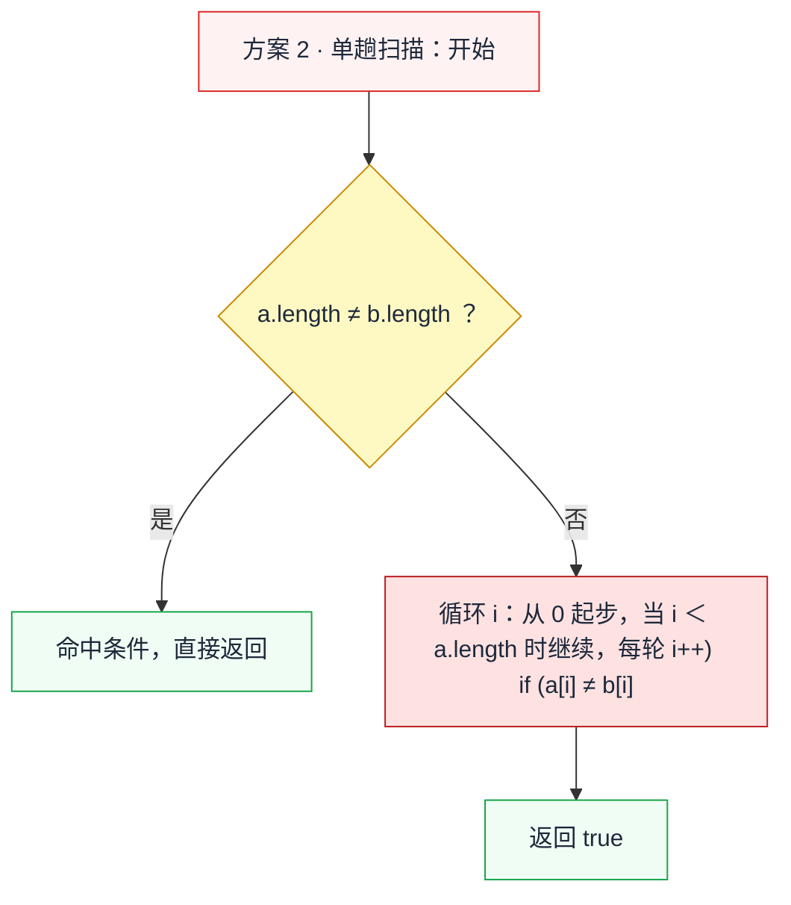

```typescript
export function demo(): void {
  // 程序入口：跑内嵌自测用例
  class NestedInteger {
    // 定义类型
    private _int: number | null = null; // 把 null; 写入 private _int: number | null
    private _list: NestedInteger[] | null = null; // 把 null; 写入 private _list: NestedInteger[] | null
    constructor(value?: any) {
      // constructor(value?: any) {
      if (value === undefined || value === null) {
        // 若 value 全等于 undefined 或 value 全等于 null
        this._list = []; // 把 []; 写入 this._list
      } else if (Array.isArray(value)) {
        // 否则，若 Array.isArray(value
        this._list = value.map((v: any) => new NestedInteger(v));
      } else {
        // 否则
        this._int = value; // 把 value; 写入 this._int
      }
    }
    isInteger(): boolean {
      return this._int !== null;
    } // 把 赋值为 null; } 写入 isInteger(): boolean { return this._int !
    getInteger(): number {
      return this._int as number;
    } // getInteger(): number { return this._int as number; }
    getList(): NestedInteger[] {
      return this._list as NestedInteger[];
    }
  }
  class NestedIterator {
    // 定义类型
    private stack: NestedInteger[] = []; // 把 []; 写入 private stack: NestedInteger[]
    constructor(nestedList: NestedInteger[]) {
      // constructor(nestedList: NestedInteger[]) {
      this.stack = nestedList.slice(); // 把 nestedList 截取 ); 写入 栈
    }
    hasNext(): boolean {
      // hasNext(): boolean {
      while (this.stack.length > 0) {
        // 循环，直到不满足「this.栈.长度 超过 0」
        if (this.stack[0].isInteger())
          return true; // 若 this.栈[0].isInteger()，直接返回 true
        else {
          // 否则
          const cur = this.stack[0].getList(); // 把 this.栈[0].getList() 存入 当前值
          this.stack.shift(); // 取出队首元素
          this.stack.unshift(...cur); // this.栈.unshift(...当前值);
        }
      }
      return false; // 返回 false
    }
    next(): number {
      return this.stack.shift()!.getInteger();
    } // 取出队首元素
  }
  function eqArr(a: number[], b: number[]): boolean {
    // 定义函数/方法 eqArr
    if (a.length !== b.length) return false; // 若 数组.长度 不等于 b.长度，直接返回 false
    for (let i = 0; i < a.length; i++) if (a[i] !== b[i]) return false; // 让 下标 i 从 0 开始计数，下标 i 小于 数组.长度 就继续
    return true; // 返回 true
  }
  const cases = [
    { inp: [1, [2, 3]], want: [1, 2, 3] },
    { inp: [[1], 2, [3, [4]]], want: [1, 2, 3, 4] },
  ];
  let fail = false; // 把 false 存入 fail
  for (const c of cases) {
    // for (const 字符 of cases) {
    const nested = new NestedInteger(c.inp).getList(); // 把 new NestedInteger(字符.inp).getList() 存入 nested
    const it = new NestedIterator(nested); // 把 new NestedIterator(nested) 存入 it
    const out: number[] = []; // 把 []; 写入 const out: number[]
    while (it.hasNext()) out.push(it.next()); // 循环，直到不满足「it.hasNext()) out 追加 it.下一个());」
    if (!eqArr(out, c.want)) {
      fail = true;
      console.log('FAIL', c, 'got', out);
    }
  }
  if (fail) throw new Error('FAILED'); // 若 fail) throw new Error(「FAILED」);
  console.log('PASS'); // 全部用例通过，输出 PASS
}
demo(); // demo();
```

### 方案 3：栈辅助

**分析与思路**：核心做法是「栈辅助」。代码里依次做这些事：栈的后进先出操作。

**运行方式**：`node 本文件`，内嵌用例全部通过会输出 PASS。

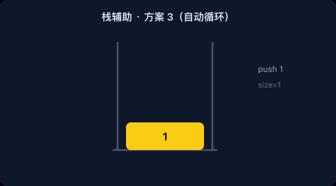

**方案专属流程图**（真实控制流）：

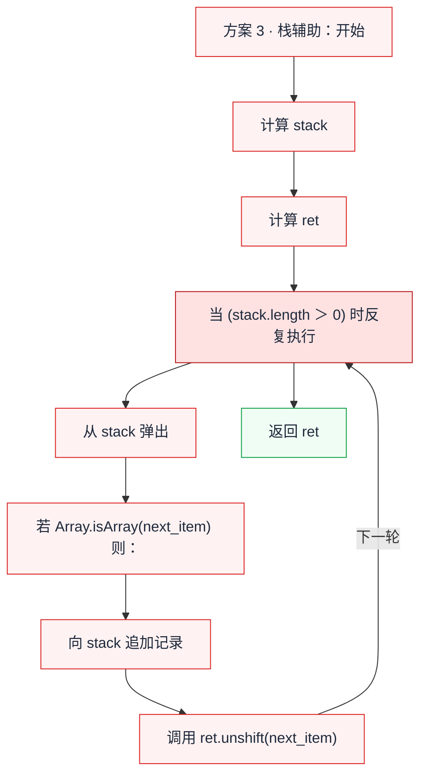

```typescript
export function demo(): void {
  // 程序入口：跑内嵌自测用例
  function flatArray(arr: any[]): number[] {
    // 定义函数/方法 flatArray
    const stack: any[] = arr.slice(); // 把 数组 截取 ); 写入 const stack: any[]
    const ret: number[] = []; // 把 []; 写入 const ret: number[]
    while (stack.length > 0) {
      // 循环，直到不满足「栈.长度 超过 0」
      const next_item = stack.pop(); // 把 栈 弹出 ) 存入 next_item
      if (Array.isArray(next_item)) {
        // 若 Array.isArray(next_item
        stack.push(...next_item); // 把 next_item 压入栈/数组尾部
      } else {
        // 否则
        ret.unshift(next_item); // ret.unshift(next_item);
      }
    }
    return ret; // 返回 ret
  }
  function eqArr(a: number[], b: number[]): boolean {
    // 定义函数/方法 eqArr
    if (a.length !== b.length) return false; // 若 数组.长度 不等于 b.长度，直接返回 false
    for (let i = 0; i < a.length; i++) if (a[i] !== b[i]) return false; // 让 下标 i 从 0 开始计数，下标 i 小于 数组.长度 就继续
    return true; // 返回 true
  }
  const cases = [
    { inp: [1, 2, 3], want: [1, 2, 3] },
    { inp: [[1, [2]], 3], want: [1, 2, 3] },
    { inp: [1, [4, [6]]], want: [1, 4, 6] },
  ];
  let fail = false; // 把 false 存入 fail
  for (const c of cases) {
    // for (const 字符 of cases) {
    const got = flatArray(c.inp); // 把 flatArray(字符.inp) 存入 got
    if (!eqArr(got, c.want)) {
      fail = true;
      console.log('FAIL', c, 'got', got);
    }
  }
  if (fail) throw new Error('FAILED'); // 若 fail) throw new Error(「FAILED」);
  console.log('PASS'); // 全部用例通过，输出 PASS
}
demo(); // demo();
```

## 逐步拆解与面试追问

**复杂度**：时间 O(n)（单趟线性扫描），空间 O(1) 到 O(n)（视辅助结构）

**为什么是这个量级**：每个元素被常数次访问，辅助哈希或栈的开销与 n 同阶

**面试官可能会追问**：

- 什么时候用单调栈（求下一个更大或更小）？
- 栈里存值还是存下标？
- 能否用 O(1) 额外空间？

## 关键 API 速查（TS 主解法实际用到，附官方链接）

| API | 作用 | 使用要点 | 官方文档 |
|---|---|---|---|
| `Array.prototype.map()` | 逐元素映射为新数组 | 回调 (v,i,arr)；返回等长新数组，不改变原数组；稀疏位跳过；链式调用注意中间数组开销 | [官方文档](https://developer.mozilla.org/zh-CN/docs/Web/JavaScript/Reference/Global_Objects/Array/map) |
| `Array.prototype.push()` | 尾部追加 | 返回新长度；可一次多个；均摊 O(1)；会改变原数组 | [官方文档](https://developer.mozilla.org/zh-CN/docs/Web/JavaScript/Reference/Global_Objects/Array/push) |
| `Array.prototype.shift()` | 头部取出 | O(n)（后续元素整体前移）；大量头部操作请用链表或双端结构 | [官方文档](https://developer.mozilla.org/zh-CN/docs/Web/JavaScript/Reference/Global_Objects/Array/shift) |

### 各语言官方文档导航

- **TypeScript / JS**：[MDN 中文参考](https://developer.mozilla.org/zh-CN/)
- **Python**：[Python 官方文档](https://docs.python.org/zh-cn/3/)
- **Go**：[Go 标准库](https://pkg.go.dev/std)
- **Java**：[JDK 17 API](https://docs.oracle.com/en/java/javase/17/docs/api/)
- **Rust**：[Rust 标准库](https://doc.rust-lang.org/std/)
- **Lua**：[Lua 5.4 手册](https://www.lua.org/manual/5.4/)
- **C**：[Cppreference C](https://zh.cppreference.com/w/c)
- **C++**：[Cppreference C++](https://zh.cppreference.com/w/cpp)
- **R**：[R 官方手册](https://stat.ethz.ch/R-manual/)
- **Zig**：[Zig 语言文档](https://ziglang.org/documentation/master/)
- **Dart**：[Dart API](https://api.dart.dev/)

## 附录：其他 10 种语言全部实现（每种语言列举其全部方案）

> TypeScript 的全部方案见「TypeScript 解题方案」一节；下面是其余 10 种语言的对应实现，每种语言的每个方案都带思路分析、代码走读与专属运行架构图。
> 每个方案都内嵌用例自测，可独立运行（老仓库 python/go 文件遵循「打印结果」约定）。
> 完整解法文件见 `dsa/<语言>/stack/lc_341_扁平化嵌套列表迭代器/`。

### Python 实现（3 种方案）

Python 的全部方案如下，每个方案都内嵌用例自测，可独立运行（老仓库 python/go 文件遵循「打印结果」约定）：

#### 方案 1：单趟扫描

**思路与代码分析**：核心是「单趟扫描」。Python 版用切片与字典推导式简化操作，突出可读性。

**运行架构**（真实控制流）：

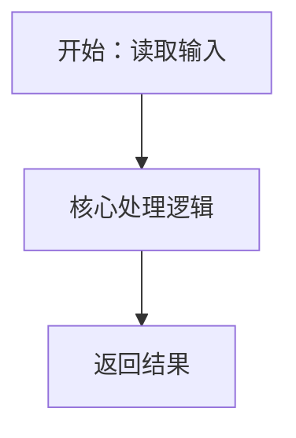

```python
import sys  # 提高递归深度上限（深输入防 RecursionError）

sys.setrecursionlimit(200000)  # 树/链表类题目节点数可达 1e4 量级

class NestedInteger:  # 定义类
    def __init__(self, value=None):  # 构造函数：初始化成员
        if value is None:  # 若 value is None
            self._list = []  # 把 [] 写入 self._list
            self._is_int = False  # 把 False 写入 self._is_int
            self._int = None  # 把 None 写入 self._int
        elif isinstance(value, list):  # 否则，若 isinstance(value, 列表
            self._list = [
                NestedInteger(v) for v in value
            ]  # 把 [NestedInteger(值) for 值 in value] 写入 self._list
            self._is_int = False  # 把 False 写入 self._is_int
            self._int = None  # 把 None 写入 self._int
        else:  # 否则
            self._int = value  # 把 value 写入 self._int
            self._is_int = True  # 把 True 写入 self._is_int
            self._list = None  # 把 None 写入 self._list

    def isInteger(self):  # 定义函数 isInteger（参数：self）
        return self._is_int  # 返回 self._is_int

    def getInteger(self):  # 定义函数 getInteger（参数：self）
        return self._int  # 返回 self._int

    def getList(self):  # 定义函数 getList（参数：self）
        return self._list  # 返回 self._list

class NestedIterator:  # 定义类
    def __init__(self, nestedList):  # 构造函数：初始化成员
        self.vals = []  # 把 [] 写入 self.vals
        self._dfs(nestedList)  # self._dfs(nestedList)

    def _dfs(self, nestedList):  # 定义函数 _dfs（参数：self, nestedList）
        for nest in nestedList:  # 逐个取出 nestedList 的元素（nest）
            if nest.isInteger():  # 若 nest.isInteger(
                self.vals.append(nest.getInteger())  # 把 nest.getInteger( 追加到列表尾部
            else:  # 否则
                self._dfs(nest.getList())  # self._dfs(nest.getList())

    def next(self):  # 定义函数 next（参数：self）
        return self.vals.pop(0)  # 返回 self.vals 弹出 0)

    def hasNext(self):  # 定义函数 hasNext（参数：self）
        return len(self.vals) > 0  # 返回 长度(self.vals) 超过 0

if __name__ == "__main__":  # 若 __name__ 等于 '__main__'
    nested = NestedInteger([1, [2, 3]]).getList()  # 把 NestedInteger([1, [2, 3]]).getList() 存入 nested
    it = NestedIterator(nested)  # 把 NestedIterator(nested) 存入 it
    out = []  # 把 [] 存入 out
    while it.hasNext():  # 循环，直到不满足「it.hasNext(」
        out.append(it.next())  # 把 it.下一个( 追加到列表尾部
    print(out)  # 打印输出
```

#### 方案 2：单趟扫描

**思路与代码分析**：核心是「单趟扫描」。Python 版用切片与字典推导式简化操作，突出可读性。

**运行架构**：与方案 1 的控制流相同（同算法在该语言的等价实现），图见上。

```python
import sys  # 提高递归深度上限（深输入防 RecursionError）

sys.setrecursionlimit(200000)  # 树/链表类题目节点数可达 1e4 量级

class NestedInteger:  # 定义类
    def __init__(self, value=None):  # 构造函数：初始化成员
        if value is None:  # 若 value is None
            self._list = []  # 把 [] 写入 self._list
            self._is_int = False  # 把 False 写入 self._is_int
            self._int = None  # 把 None 写入 self._int
        elif isinstance(value, list):  # 否则，若 isinstance(value, 列表
            self._list = [
                NestedInteger(v) for v in value
            ]  # 把 [NestedInteger(值) for 值 in value] 写入 self._list
            self._is_int = False  # 把 False 写入 self._is_int
            self._int = None  # 把 None 写入 self._int
        else:  # 否则
            self._int = value  # 把 value 写入 self._int
            self._is_int = True  # 把 True 写入 self._is_int
            self._list = None  # 把 None 写入 self._list

    def isInteger(self):  # 定义函数 isInteger（参数：self）
        return self._is_int  # 返回 self._is_int

    def getInteger(self):  # 定义函数 getInteger（参数：self）
        return self._int  # 返回 self._int

    def getList(self):  # 定义函数 getList（参数：self）
        return self._list  # 返回 self._list

class NestedIterator:  # 定义类
    def __init__(self, nestedList):  # 构造函数：初始化成员
        self.stack = nestedList  # 把 nestedList 写入 栈

    def hasNext(self):  # 定义函数 hasNext（参数：self）
        while self.stack:  # 循环，直到不满足「self.栈」
            if self.stack[0].isInteger():  # 若 self.栈[0].isInteger(
                return True  # 返回 True
            else:  # 否则
                cur = self.stack[0].getList()  # 把 self.栈[0].getList() 存入 当前值
                self.stack.pop(0)  # self.栈 弹出 0)
                self.stack[:0] = cur  # 把 当前值 写入 self.stack[:0]
        return False  # 返回 False

    def next(self):  # 定义函数 next（参数：self）
        return self.stack.pop(0).getInteger()  # 返回 self.栈 弹出 0).getInteger()

if __name__ == "__main__":  # 若 __name__ 等于 '__main__'
    nested = NestedInteger([1, [2, 3]]).getList()  # 把 NestedInteger([1, [2, 3]]).getList() 存入 nested
    it = NestedIterator(nested)  # 把 NestedIterator(nested) 存入 it
    out = []  # 把 [] 存入 out
    while it.hasNext():  # 循环，直到不满足「it.hasNext(」
        out.append(it.next())  # 把 it.下一个( 追加到列表尾部
    print(out)  # 打印输出
```

#### 方案 3：栈辅助

**思路与代码分析**：核心是「栈辅助」。Python 版用切片与字典推导式简化操作，突出可读性。**走读**：方案 3 · 栈辅助：开始 → 更新 stack → 更新 ret → 当 stack: 时反复执行 → 从 stack 弹出 → 若 isinstance(next_item, list)：调用 stack.extend(next_item) → 调用 stack.extend(next_item) → 调用 ret.insert(0, next_item) → 返回 ret。

**运行架构**（真实控制流）：

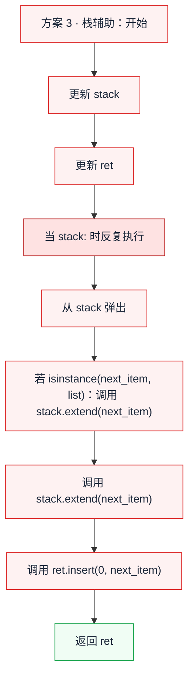

```python
import sys  # 提高递归深度上限（深输入防 RecursionError）

sys.setrecursionlimit(200000)  # 树/链表类题目节点数可达 1e4 量级

def flatArray(arr):  # 定义函数 flatArray（参数：数组）
    stack = list(arr)  # 把 列表(数组) 存入 栈
    ret = []  # 把 [] 存入 ret
    while stack:  # 循环，直到不满足「栈」
        next_item = stack.pop()  # 把 栈 弹出 ) 存入 next_item
        if isinstance(next_item, list):  # 若 isinstance(next_item, 列表
            stack.extend(next_item)  # 栈.extend(next_item)
        else:  # 否则
            ret.insert(0, next_item)  # ret 插入 0, next_item)
    return ret  # 返回 ret

if __name__ == "__main__":  # 若 __name__ 等于 '__main__'
    print(flatArray([1, 2, 3]))  # 打印输出
```

### Go 实现（3 种方案）

Go 的全部方案如下，每个方案都内嵌用例自测，可独立运行（老仓库 python/go 文件遵循「打印结果」约定）：

#### 方案 1：单趟扫描

**思路与代码分析**：核心是「单趟扫描」。Go 版用切片与多返回值惯用法，显式处理索引边界。**走读**：方案 1 · 单趟扫描：开始 → 返回 NestedInteger。

**运行架构**（真实控制流）：


```go
package main // 引入依赖
import (
	"fmt"
	"os"
	"reflect"
) // 引入依赖

type NestedInteger struct { // 定义类型
	isInt  bool            // isInt bool
	intVal int             // intVal int
	list   []NestedInteger // 列表 []NestedInteger
}

func NewInt(v int) NestedInteger                  { return NestedInteger{isInt: true, intVal: v} } // 定义函数/方法 NewInt
func NewList(items []NestedInteger) NestedInteger { return NestedInteger{list: items} }            // 定义函数/方法 NewList
func (n NestedInteger) IsInteger() bool           { return n.isInt }                               // 定义函数/方法 IsInteger
func (n NestedInteger) GetInteger() int           { return n.intVal }                              // 定义函数/方法 GetInteger
func (n NestedInteger) GetList() []NestedInteger  { return n.list }                                // 定义函数/方法 GetList

func flatten(nestedList []NestedInteger) []int { // 定义函数/方法 flatten
	res := []int{}                  // 把 []int{} 写入 res :
	var dfs func([]NestedInteger)   // var dfs func([]NestedInteger)
	dfs = func(l []NestedInteger) { // 把 func(左指针 []NestedInteger) { 写入 dfs
		for _, nest := range l { // 同时取 _ 与 nest 遍历
			if nest.IsInteger() {
				res = append(res, nest.GetInteger())
			} else {
				dfs(nest.GetList())
			}
		}
	}
	dfs(nestedList) // dfs(nestedList)
	return res      // 返回 结果
}

func main() { // 程序入口：跑内嵌自测用例
	in1 := []NestedInteger{NewList([]NestedInteger{NewInt(1), NewList([]NestedInteger{NewInt(2), NewInt(3)})})}
	in2 := []NestedInteger{NewList([]NestedInteger{NewInt(1), NewInt(1)}), NewInt(2), NewList([]NestedInteger{NewInt(1), NewInt(1)})}
	ok := true // 把 true 写入 ok :
	if got := flatten(in1); !reflect.DeepEqual(got, []int{1, 2, 3}) {
		ok = false
		fmt.Printf("FAIL flatten1=%v\n", got)
	}
	if got := flatten(in2); !reflect.DeepEqual(got, []int{1, 1, 2, 1, 1}) {
		ok = false
		fmt.Printf("FAIL flatten2=%v\n", got)
	}
	if !ok {
		os.Exit(1)
	} // 若 取反 ok { os.Exit(1) }
	fmt.Println("PASS") // 全部用例通过，输出 PASS
}
```

#### 方案 2：单趟扫描

**思路与代码分析**：核心是「单趟扫描」。Go 版用切片与多返回值惯用法，显式处理索引边界。**走读**：方案 2 · 单趟扫描：开始 → 返回 NestedInteger。

**运行架构**（真实控制流）：

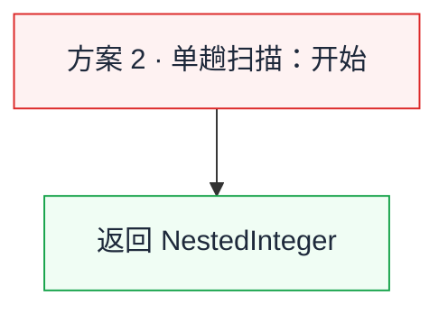

```go
package main // 引入依赖
import (
	"fmt"
	"os"
	"reflect"
) // 引入依赖

type NestedInteger struct { // 定义类型
	isInt  bool            // isInt bool
	intVal int             // intVal int
	list   []NestedInteger // 列表 []NestedInteger
}

func NewInt(v int) NestedInteger                  { return NestedInteger{isInt: true, intVal: v} } // 定义函数/方法 NewInt
func NewList(items []NestedInteger) NestedInteger { return NestedInteger{list: items} }            // 定义函数/方法 NewList
func (n NestedInteger) IsInteger() bool           { return n.isInt }                               // 定义函数/方法 IsInteger
func (n NestedInteger) GetInteger() int           { return n.intVal }                              // 定义函数/方法 GetInteger
func (n NestedInteger) GetList() []NestedInteger  { return n.list }                                // 定义函数/方法 GetList

func flatten(nestedList []NestedInteger) []int { // 定义函数/方法 flatten
	res := []int{}                  // 把 []int{} 写入 res :
	var dfs func([]NestedInteger)   // var dfs func([]NestedInteger)
	dfs = func(l []NestedInteger) { // 把 func(左指针 []NestedInteger) { 写入 dfs
		for _, nest := range l { // 同时取 _ 与 nest 遍历
			if nest.IsInteger() {
				res = append(res, nest.GetInteger())
			} else {
				dfs(nest.GetList())
			}
		}
	}
	dfs(nestedList) // dfs(nestedList)
	return res      // 返回 结果
}

func main() { // 程序入口：跑内嵌自测用例
	in1 := []NestedInteger{NewList([]NestedInteger{NewInt(1), NewList([]NestedInteger{NewInt(2), NewInt(3)})})}
	in2 := []NestedInteger{NewList([]NestedInteger{NewInt(1), NewInt(1)}), NewInt(2), NewList([]NestedInteger{NewInt(1), NewInt(1)})}
	ok := true // 把 true 写入 ok :
	if got := flatten(in1); !reflect.DeepEqual(got, []int{1, 2, 3}) {
		ok = false
		fmt.Printf("FAIL flatten1=%v\n", got)
	}
	if got := flatten(in2); !reflect.DeepEqual(got, []int{1, 1, 2, 1, 1}) {
		ok = false
		fmt.Printf("FAIL flatten2=%v\n", got)
	}
	if !ok {
		os.Exit(1)
	} // 若 取反 ok { os.Exit(1) }
	fmt.Println("PASS") // 全部用例通过，输出 PASS
}
```

#### 方案 3：栈辅助

**思路与代码分析**：核心是「栈辅助」。Go 版用切片与多返回值惯用法，显式处理索引边界。**走读**：方案 3 · 栈辅助：开始 → 返回 NestedInteger。

**运行架构**（真实控制流）：

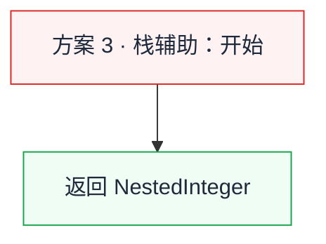

```go
package main // 引入依赖
import (
	"fmt"
	"os"
	"reflect"
) // 引入依赖

type NestedInteger struct { // 定义类型
	isInt  bool            // isInt bool
	intVal int             // intVal int
	list   []NestedInteger // 列表 []NestedInteger
}

func NewInt(v int) NestedInteger                  { return NestedInteger{isInt: true, intVal: v} } // 定义函数/方法 NewInt
func NewList(items []NestedInteger) NestedInteger { return NestedInteger{list: items} }            // 定义函数/方法 NewList
func (n NestedInteger) IsInteger() bool           { return n.isInt }                               // 定义函数/方法 IsInteger
func (n NestedInteger) GetInteger() int           { return n.intVal }                              // 定义函数/方法 GetInteger
func (n NestedInteger) GetList() []NestedInteger  { return n.list }                                // 定义函数/方法 GetList

func flatten(nestedList []NestedInteger) []int { // 定义函数/方法 flatten
	res := []int{}                  // 把 []int{} 写入 res :
	var dfs func([]NestedInteger)   // var dfs func([]NestedInteger)
	dfs = func(l []NestedInteger) { // 把 func(左指针 []NestedInteger) { 写入 dfs
		for _, nest := range l { // 同时取 _ 与 nest 遍历
			if nest.IsInteger() {
				res = append(res, nest.GetInteger())
			} else {
				dfs(nest.GetList())
			}
		}
	}
	dfs(nestedList) // dfs(nestedList)
	return res      // 返回 结果
}

func main() { // 程序入口：跑内嵌自测用例
	in1 := []NestedInteger{NewList([]NestedInteger{NewInt(1), NewList([]NestedInteger{NewInt(2), NewInt(3)})})}
	in2 := []NestedInteger{NewList([]NestedInteger{NewInt(1), NewInt(1)}), NewInt(2), NewList([]NestedInteger{NewInt(1), NewInt(1)})}
	ok := true // 把 true 写入 ok :
	if got := flatten(in1); !reflect.DeepEqual(got, []int{1, 2, 3}) {
		ok = false
		fmt.Printf("FAIL flatten1=%v\n", got)
	}
	if got := flatten(in2); !reflect.DeepEqual(got, []int{1, 1, 2, 1, 1}) {
		ok = false
		fmt.Printf("FAIL flatten2=%v\n", got)
	}
	if !ok {
		os.Exit(1)
	} // 若 取反 ok { os.Exit(1) }
	fmt.Println("PASS") // 全部用例通过，输出 PASS
}
```

### Java 实现（3 种方案）

Java 的全部方案如下，每个方案都内嵌用例自测，可独立运行（老仓库 python/go 文件遵循「打印结果」约定）：

#### 方案 1：单趟扫描

**思路与代码分析**：核心是「单趟扫描」。Java 版用类与静态方法组织，集合操作显式明了。**走读**：方案 1 · 单趟扫描：开始 → 更新 _int → 更新 _list → 返回结果。

**运行架构**（真实控制流）：

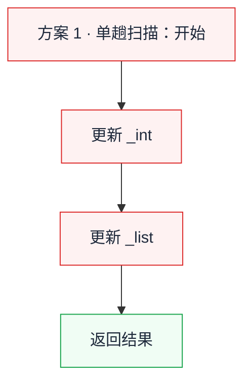

```java
package com.webfault.dsa; // 引入依赖

import java.util.*; // 引入依赖

class lc341_solution211 { // 定义类型
  static class NestedInteger { // static class NestedInteger {
    Integer _int; // Integer _int;
    List<NestedInteger> _list; // List 小于 NestedInteger 超过 _list;

    NestedInteger(Integer v) {
      _int = v;
      _list = null;
    } // 把 值; _list 赋值为 null; } 写入 NestedInteger(Integer v) { _int

    NestedInteger(List<NestedInteger> l) {
      _list = l;
      _int = null;
    }

    boolean isInteger() {
      return _int != null;
    } // 把 null; } 写入 boolean isInteger() { return _int !

    int getInteger() {
      return _int;
    } // int getInteger() { return _int; }

    List<NestedInteger> getList() {
      return _list;
    } // List 小于 NestedInteger 超过 getList() { return _list; }
  }

  static class NestedIterator { // static class NestedIterator {
    List<Integer> vals = new ArrayList<>(); // 把 new ArrayList 小于 超过 (); 写入 List<Integer> vals

    void dfs(List<NestedInteger> nl) { // 定义函数/方法 dfs
      for (NestedInteger n : nl) { // for (NestedInteger 元素个数 : nl) {
        if (n.isInteger())
          vals.add(n.getInteger()); // 若 元素个数.isInteger()) vals 追加 元素个数.getInteger());
        else dfs(n.getList()); // 否则
      }
    }

    NestedIterator(List<NestedInteger> nl) {
      dfs(nl);
    } // NestedIterator(List 小于 NestedInteger 超过 nl) { dfs(nl); }

    int next() {
      return vals.remove(0);
    } // int 下一个() { return vals 弹出 0); }

    boolean hasNext() {
      return !vals.isEmpty();
    } // boolean hasNext() { return 取反 vals.isEmpty(); }
  }

  public static void main(String[] args) { // public static void main(String[] args) {
    List<NestedInteger> nested =
        new ArrayList<>(); // 把 new ArrayList 小于 超过 (); 写入 List<NestedInteger> nested
    nested.add(new NestedInteger(1)); // nested 追加 new NestedInteger(1));
    List<NestedInteger> inner =
        new ArrayList<>(); // 把 new ArrayList 小于 超过 (); 写入 List<NestedInteger> inner
    inner.add(new NestedInteger(2)); // inner 追加 new NestedInteger(2));
    inner.add(new NestedInteger(3)); // inner 追加 new NestedInteger(3));
    nested.add(new NestedInteger(inner)); // nested 追加 new NestedInteger(inner));
    NestedIterator it =
        new NestedIterator(nested); // 把 new NestedIterator(nested); 写入 NestedIterator it
    List<Integer> out = new ArrayList<>(); // 把 new ArrayList 小于 超过 (); 写入 List<Integer> out
    while (it.hasNext()) out.add(it.next()); // 循环，直到不满足「it.hasNext()) out 追加 it.下一个());」
    List<Integer> want = Arrays.asList(1, 2, 3); // 把 Arrays.asList(1, 2, 3); 写入 List<Integer> want
    if (!out.equals(want)) throw new RuntimeException("FAILED " + out);
    System.out.println("PASS"); // 全部用例通过，输出 PASS
  }
}
```

#### 方案 2：单趟扫描

**思路与代码分析**：核心是「单趟扫描」。Java 版用类与静态方法组织，集合操作显式明了。**走读**：方案 2 · 单趟扫描：开始 → 更新 _int → 更新 _list → 返回结果。

**运行架构**（真实控制流）：


```java
package com.webfault.dsa; // 引入依赖

import java.util.*; // 引入依赖

class lc341_solution322 { // 定义类型
  static class NestedInteger { // static class NestedInteger {
    Integer _int; // Integer _int;
    List<NestedInteger> _list; // List 小于 NestedInteger 超过 _list;

    NestedInteger(Integer v) {
      _int = v;
      _list = null;
    } // 把 值; _list 赋值为 null; } 写入 NestedInteger(Integer v) { _int

    NestedInteger(List<NestedInteger> l) {
      _list = l;
      _int = null;
    }

    boolean isInteger() {
      return _int != null;
    } // 把 null; } 写入 boolean isInteger() { return _int !

    int getInteger() {
      return _int;
    } // int getInteger() { return _int; }

    List<NestedInteger> getList() {
      return _list;
    } // List 小于 NestedInteger 超过 getList() { return _list; }
  }

  static class NestedIterator { // static class NestedIterator {
    Deque<NestedInteger> stack =
        new ArrayDeque<>(); // 把 new ArrayDeque 小于 超过 (); 写入 Deque<NestedInteger> stack

    NestedIterator(List<NestedInteger> nl) { // NestedIterator(List 小于 NestedInteger 超过 nl) {
      for (int i = nl.size() - 1; i >= 0; i--)
        stack.push(nl.get(i)); // 让 下标 i 从 nl.大小() 减 1 开始计数，下标 i 不低于 0 就继续
    }

    boolean hasNext() { // 定义函数/方法 hasNext
      while (!stack.isEmpty()) { // 循环，直到不满足「取反 栈.isEmpty(」
        if (stack.peek().isInteger()) return true; // 若 栈.peek().isInteger()，直接返回 true
        List<NestedInteger> cur = stack.pop().getList(); // 弹出栈顶元素
        for (int i = cur.size() - 1; i >= 0; i--)
          stack.push(cur.get(i)); // 让 下标 i 从 当前值.大小() 减 1 开始计数，下标 i 不低于 0 就继续
      }
      return false; // 返回 false
    }

    int next() {
      return stack.pop().getInteger();
    } // 弹出栈顶元素
  }

  public static void main(String[] args) { // public static void main(String[] args) {
    List<NestedInteger> nested =
        new ArrayList<>(); // 把 new ArrayList 小于 超过 (); 写入 List<NestedInteger> nested
    nested.add(new NestedInteger(1)); // nested 追加 new NestedInteger(1));
    List<NestedInteger> inner =
        new ArrayList<>(); // 把 new ArrayList 小于 超过 (); 写入 List<NestedInteger> inner
    inner.add(new NestedInteger(2)); // inner 追加 new NestedInteger(2));
    inner.add(new NestedInteger(3)); // inner 追加 new NestedInteger(3));
    nested.add(new NestedInteger(inner)); // nested 追加 new NestedInteger(inner));
    NestedIterator it =
        new NestedIterator(nested); // 把 new NestedIterator(nested); 写入 NestedIterator it
    List<Integer> out = new ArrayList<>(); // 把 new ArrayList 小于 超过 (); 写入 List<Integer> out
    while (it.hasNext()) out.add(it.next()); // 循环，直到不满足「it.hasNext()) out 追加 it.下一个());」
    List<Integer> want = Arrays.asList(1, 2, 3); // 把 Arrays.asList(1, 2, 3); 写入 List<Integer> want
    if (!out.equals(want)) throw new RuntimeException("FAILED " + out);
    System.out.println("PASS"); // 全部用例通过，输出 PASS
  }
}
```

#### 方案 3：栈辅助

**思路与代码分析**：核心是「栈辅助」。Java 版用类与静态方法组织，集合操作显式明了。代码里依次做这些事：单循环线性扫描；栈的后进先出操作。**走读**：方案 3 · 栈辅助：开始 → 更新 stack → 遍历循环 → 向 stack 追加记录 → 更新 ret → 当 (非 stack.isEmpty()) ret.add(stack.pop()) 时反复执行 → 返回 ret。

**运行架构**（真实控制流）：

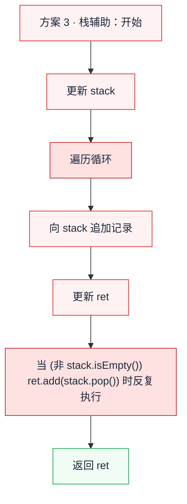

```java
package com.webfault.dsa; // 引入依赖

import java.util.*; // 引入依赖

class lc341_solution433 { // 定义类型
  static List<Integer> flatArray(List<Integer> arr) { // 定义函数/方法 flatArray
    Deque<Integer> stack = new ArrayDeque<>(); // 把 new ArrayDeque 小于 超过 (); 写入 Deque<Integer> stack
    for (int i = arr.size() - 1; i >= 0; i--)
      stack.push(arr.get(i)); // 让 下标 i 从 数组.大小() 减 1 开始计数，下标 i 不低于 0 就继续
    List<Integer> ret = new ArrayList<>(); // 把 new ArrayList 小于 超过 (); 写入 List<Integer> ret
    while (!stack.isEmpty()) ret.add(stack.pop()); // 循环，直到不满足「取反 栈.isEmpty()) ret 追加 栈 弹出 ));」
    return ret; // 返回 ret
  }

  public static void main(String[] args) { // public static void main(String[] args) {
    List<Integer> out =
        flatArray(
            Arrays.asList(1, 2, 3)); // 把 flatArray(Arrays.asList(1, 2, 3)); 写入 List<Integer> out
    if (!out.equals(Arrays.asList(1, 2, 3))) throw new RuntimeException("FAILED " + out);
    System.out.println("PASS"); // 全部用例通过，输出 PASS
  }
}
```

### Rust 实现（3 种方案）

Rust 的全部方案如下，每个方案都内嵌用例自测，可独立运行（老仓库 python/go 文件遵循「打印结果」约定）：

#### 方案 1：单趟扫描

**思路与代码分析**：核心是「单趟扫描」。Rust 版用所有权移动与切片借用改写同一逻辑，注意 Option 与引用边界。**走读**：方案 1 · 单趟扫描：开始 → 计算 out → 遍历 items 中的每个元素 it → 处理 match it → 向 out 追加记录 → 更新 NI::List(l) → 调用 go(&nested, &mut out) → 处理 out → 返回结果。

**运行架构**（真实控制流）：


```rust
// LeetCode 341. 扁平化嵌套列表迭代器 — Rust 版（方案2）
// NestedInteger 用枚举模拟
#[derive(Clone, Debug)]
enum NI {
    Int(i32),
    List(Vec<NI>),
} // 定义类型
fn flatten(nested: Vec<NI>) -> Vec<i32> {
    // 定义函数/方法 flatten
    let mut out = Vec::new(); // 把 Vec::new(); 写入 let mut out
    fn go(items: &[NI], out: &mut Vec<i32>) {
        // 定义函数/方法 go
        for it in items {
            // 逐个取出 items 的元素（it）
            match it {
                // 按情况匹配处理
                NI::Int(v) => out.push(*v),
                NI::List(l) => go(l, out),
            }
        }
    }
    go(&nested, &mut out); // go( 按位与 nested, 按位与 mut out);
    out // out
}
fn main() {
    // 程序入口：跑内嵌自测用例
    let nested = vec![
        NI::Int(1),
        NI::List(vec![NI::Int(2), NI::List(vec![NI::Int(3), NI::Int(4)])]),
    ];
    assert_eq!(flatten(nested), vec![1, 2, 3, 4]); // 断言校验
    println!("PASS");
} // 全部用例通过，输出 PASS
```

#### 方案 2：单趟扫描

**思路与代码分析**：核心是「单趟扫描」。Rust 版用所有权移动与切片借用改写同一逻辑，注意 Option 与引用边界。**走读**：方案 2 · 单趟扫描：开始 → 计算 out → 遍历 items 中的每个元素 it → 处理 match it → 向 out 追加记录 → 更新 NI::List(l) → 调用 go(&nested, &mut out) → 处理 out → 返回结果。

**运行架构**（真实控制流）：

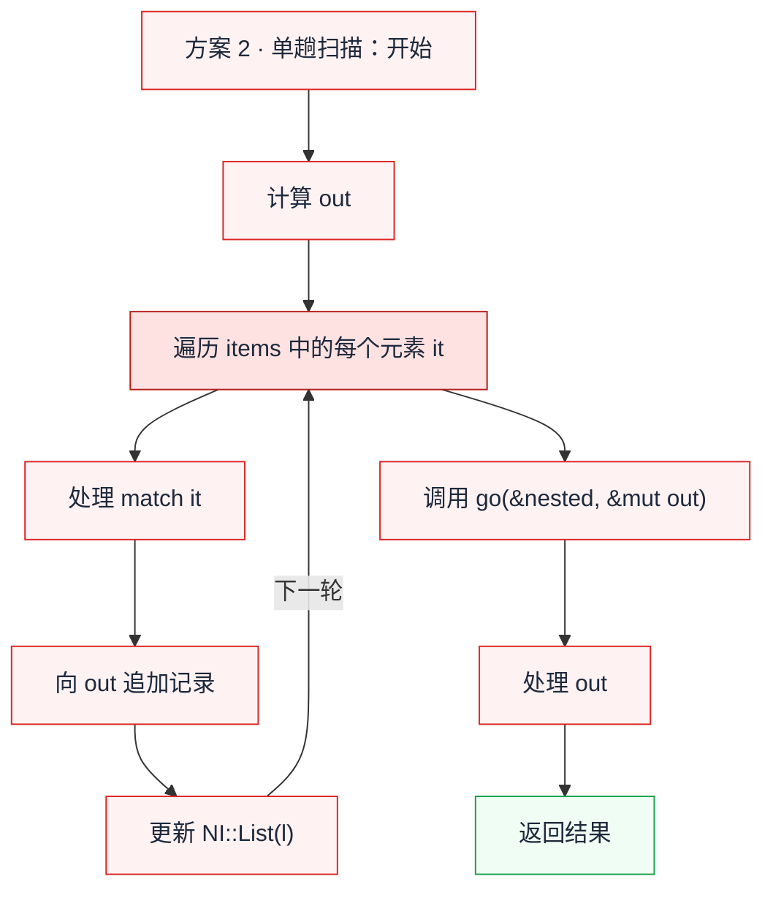

```rust
// LeetCode 341. 扁平化嵌套列表迭代器 — Rust 版（方案3）
// NestedInteger 用枚举模拟
#[derive(Clone, Debug)]
enum NI {
    Int(i32),
    List(Vec<NI>),
} // 定义类型
fn flatten(nested: Vec<NI>) -> Vec<i32> {
    // 定义函数/方法 flatten
    let mut out = Vec::new(); // 把 Vec::new(); 写入 let mut out
    fn go(items: &[NI], out: &mut Vec<i32>) {
        // 定义函数/方法 go
        for it in items {
            // 逐个取出 items 的元素（it）
            match it {
                // 按情况匹配处理
                NI::Int(v) => out.push(*v),
                NI::List(l) => go(l, out),
            }
        }
    }
    go(&nested, &mut out); // go( 按位与 nested, 按位与 mut out);
    out // out
}
fn main() {
    // 程序入口：跑内嵌自测用例
    let nested = vec![
        NI::Int(1),
        NI::List(vec![NI::Int(2), NI::List(vec![NI::Int(3), NI::Int(4)])]),
    ];
    assert_eq!(flatten(nested), vec![1, 2, 3, 4]); // 断言校验
    println!("PASS");
} // 全部用例通过，输出 PASS
```

#### 方案 3：栈辅助

**思路与代码分析**：核心是「栈辅助」。Rust 版用所有权移动与切片借用改写同一逻辑，注意 Option 与引用边界。**走读**：方案 3 · 栈辅助：开始 → 计算 out → 遍历 items 中的每个元素 it → 处理 match it → 向 out 追加记录 → 更新 NI::List(l) → 调用 go(&nested, &mut out) → 处理 out → 返回结果。

**运行架构**（真实控制流）：

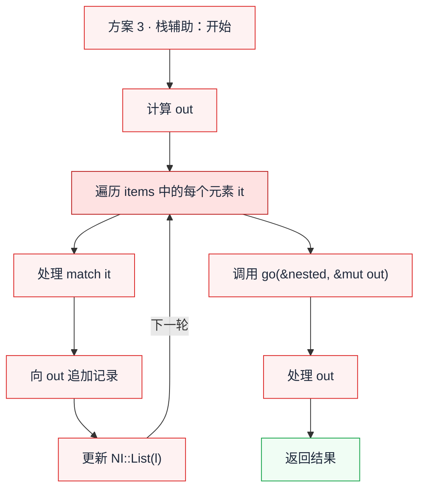

```rust
// LeetCode 341. 扁平化嵌套列表迭代器 — Rust 版（方案4）
// NestedInteger 用枚举模拟
#[derive(Clone, Debug)]
enum NI {
    Int(i32),
    List(Vec<NI>),
} // 定义类型
fn flatten(nested: Vec<NI>) -> Vec<i32> {
    // 定义函数/方法 flatten
    let mut out = Vec::new(); // 把 Vec::new(); 写入 let mut out
    fn go(items: &[NI], out: &mut Vec<i32>) {
        // 定义函数/方法 go
        for it in items {
            // 逐个取出 items 的元素（it）
            match it {
                // 按情况匹配处理
                NI::Int(v) => out.push(*v),
                NI::List(l) => go(l, out),
            }
        }
    }
    go(&nested, &mut out); // go( 按位与 nested, 按位与 mut out);
    out // out
}
fn main() {
    // 程序入口：跑内嵌自测用例
    let nested = vec![
        NI::Int(1),
        NI::List(vec![NI::Int(2), NI::List(vec![NI::Int(3), NI::Int(4)])]),
    ];
    assert_eq!(flatten(nested), vec![1, 2, 3, 4]); // 断言校验
    println!("PASS");
} // 全部用例通过，输出 PASS
```

### Lua 实现（3 种方案）

Lua 的全部方案如下，每个方案都内嵌用例自测，可独立运行（老仓库 python/go 文件遵循「打印结果」约定）：

#### 方案 1：单趟扫描

**思路与代码分析**：核心是「单趟扫描」。Lua 版用表与 ipairs 遍历，注意 ipairs 遇 nil 即停的语义。代码里依次做这些事：递归求解子问题。**走读**：方案 1 · 单趟扫描：开始 → 更新 out → 处理 local function go(items) → 遍历 ipairs(items) do 中的每个元素 it → 处理 if type(it) == number then → 更新 1] → 调用 go(it) → 调用 go(nested) → 返回 out。

**运行架构**（真实控制流）：


```lua
-- LeetCode 341. 扁平化嵌套列表迭代器 — Lua 版（方案2）
local function flatten(nested) -- local function flatten(nested)
	local out = {} -- 把 {} 写入 local out
	local function go(items) -- local function go(items)
		for _, it in ipairs(items) do -- 遍历取 it
			if type(it) == "number" then -- 若 type(it) 等于 「number」 then
				out[#out + 1] = it -- 把 it 写入 out[#out + 1]
			else -- 否则
				go(it) -- go(it)
			end -- 终点
		end -- 终点
	end -- 终点
	go(nested) -- go(nested)
	return out -- 返回 out
end -- 终点
assert(table.concat(flatten({ 1, { 2, { 3, 4 } } }), ",") == "1,2,3,4") -- 打印输出
assert(table.concat(flatten({ { 1, 1 }, 2, { 1, 1 } }), ",") == "1,1,2,1,1") -- 打印输出
print("PASS") -- 全部用例通过，输出 PASS
```

#### 方案 2：单趟扫描

**思路与代码分析**：核心是「单趟扫描」。Lua 版用表与 ipairs 遍历，注意 ipairs 遇 nil 即停的语义。代码里依次做这些事：递归求解子问题。**走读**：方案 2 · 单趟扫描：开始 → 更新 out → 处理 local function go(items) → 遍历 ipairs(items) do 中的每个元素 it → 处理 if type(it) == number then → 更新 1] → 调用 go(it) → 调用 go(nested) → 返回 out。

**运行架构**（真实控制流）：

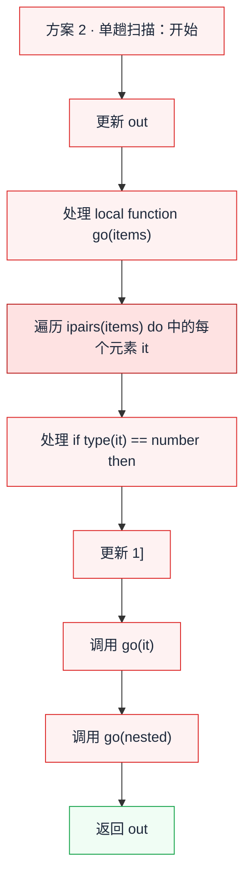

```lua
-- LeetCode 341. 扁平化嵌套列表迭代器 — Lua 版（方案3）
local function flatten(nested) -- local function flatten(nested)
	local out = {} -- 把 {} 写入 local out
	local function go(items) -- local function go(items)
		for _, it in ipairs(items) do -- 遍历取 it
			if type(it) == "number" then -- 若 type(it) 等于 「number」 then
				out[#out + 1] = it -- 把 it 写入 out[#out + 1]
			else -- 否则
				go(it) -- go(it)
			end -- 终点
		end -- 终点
	end -- 终点
	go(nested) -- go(nested)
	return out -- 返回 out
end -- 终点
assert(table.concat(flatten({ 1, { 2, { 3, 4 } } }), ",") == "1,2,3,4") -- 打印输出
assert(table.concat(flatten({ { 1, 1 }, 2, { 1, 1 } }), ",") == "1,1,2,1,1") -- 打印输出
print("PASS") -- 全部用例通过，输出 PASS
```

#### 方案 3：栈辅助

**思路与代码分析**：核心是「栈辅助」。Lua 版用表与 ipairs 遍历，注意 ipairs 遇 nil 即停的语义。代码里依次做这些事：递归求解子问题。**走读**：方案 3 · 栈辅助：开始 → 更新 out → 处理 local function go(items) → 遍历 ipairs(items) do 中的每个元素 it → 处理 if type(it) == number then → 更新 1] → 调用 go(it) → 调用 go(nested) → 返回 out。

**运行架构**（真实控制流）：

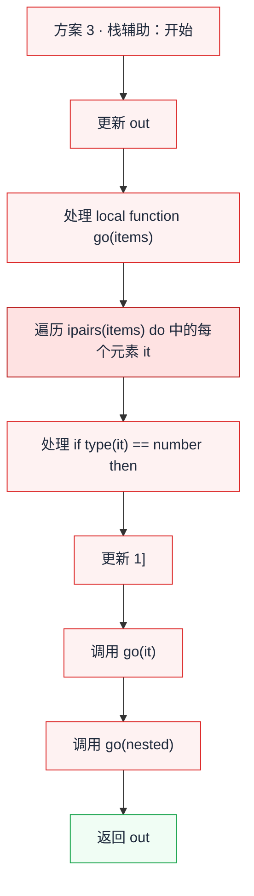

```lua
-- LeetCode 341. 扁平化嵌套列表迭代器 — Lua 版（方案4）
local function flatten(nested) -- local function flatten(nested)
	local out = {} -- 把 {} 写入 local out
	local function go(items) -- local function go(items)
		for _, it in ipairs(items) do -- 遍历取 it
			if type(it) == "number" then -- 若 type(it) 等于 「number」 then
				out[#out + 1] = it -- 把 it 写入 out[#out + 1]
			else -- 否则
				go(it) -- go(it)
			end -- 终点
		end -- 终点
	end -- 终点
	go(nested) -- go(nested)
	return out -- 返回 out
end -- 终点
assert(table.concat(flatten({ 1, { 2, { 3, 4 } } }), ",") == "1,2,3,4") -- 打印输出
assert(table.concat(flatten({ { 1, 1 }, 2, { 1, 1 } }), ",") == "1,1,2,1,1") -- 打印输出
print("PASS") -- 全部用例通过，输出 PASS
```

### C 实现（3 种方案）

C 的全部方案如下，每个方案都内嵌用例自测，可独立运行（老仓库 python/go 文件遵循「打印结果」约定）：

#### 方案 1：单趟扫描

**思路与代码分析**：核心是「单趟扫描」。C 版手动管理下标与内存，循环边界全部显式写出。代码里依次做这些事：单循环线性扫描。**走读**：方案 1 · 单趟扫描：开始 → 若 ni-＞is_int 则： → 更新 out[(*cnt)++] → 返回  → 遍历循环 → 调用 flatten(ni-＞items[i], out, c。

**运行架构**（真实控制流）：

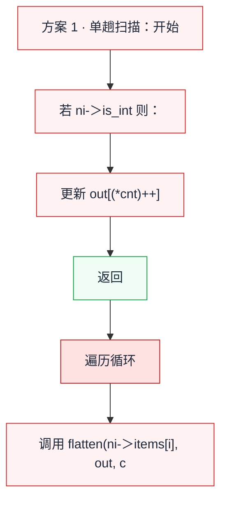

```c
/* LeetCode 341. 扁平化嵌套列表迭代器 — C 版（方案2） */
#include <stdio.h> // 引入头文件
/* 用 tagged union 模拟嵌套列表 */
typedef struct NI {
    int is_int;
    int int_val;
    struct NI **items;
    int n_items;
} NI;
static void flatten(NI *ni, int out[], int *cnt) { // 定义函数/方法 flatten
    if (ni->is_int) {
        out[(*cnt)++] = ni->int_val;
        return;
    }
    for (int i = 0; i < ni->n_items; i++)
        flatten(ni->items[i], out, cnt); // 让 下标 i 从 0 开始计数，下标 i 小于 ni 减 超过 n_items 就继续
}
int main(void) {                                     // 程序入口：跑内嵌自测用例
    NI i1 = {1, 1, NULL, 0};                         // 把 {1, 1, NULL, 0}; 写入 NI i1
    NI i2 = {1, 2, NULL, 0};                         // 把 {1, 2, NULL, 0}; 写入 NI i2
    NI i3 = {1, 3, NULL, 0};                         // 把 {1, 3, NULL, 0}; 写入 NI i3
    NI i4 = {1, 4, NULL, 0};                         // 把 {1, 4, NULL, 0}; 写入 NI i4
    NI inner2[2] = {i3, i4};                         // 把 {i3, i4}; 写入 NI inner2[2]
    NI l2 = {0, 0, (NI *[]){inner2, inner2 + 2}, 0}; /* 数组指针模拟 */
    /* 简化：直接构造嵌套 */
    NI *inner_items[] = {&i3, &i4};    // 把 { 按位与 i3, 按位与 i4}; 写入 NI *inner_items[]
    NI list2 = {0, 0, inner_items, 2}; // 把 {0, 0, inner_items, 2}; 写入 NI list2
    NI *top_items[] = {&i1, &i2, &list2}; // 把 { 按位与 i1, 按位与 i2, 按位与 list2}; 写入 NI *top_items[]
    NI top = {0, 0, top_items, 3}; // 把 {0, 0, top_items, 3}; 写入 NI top
    int out[64], cnt = 0;          // 把 0; 写入 int out[64], cnt
    flatten(&top, out, &cnt);      // flatten( 按位与 top, out, 按位与 计数);
    if (cnt != 4 || !(out[0] == 1 && out[1] == 2 && out[2] == 3 && out[3] == 4)) {
        printf("FAIL cnt=%d\n", cnt);
        return 1;
    }
    printf("PASS\n");
    return 0;
} // 全部用例通过，输出 PASS
```

#### 方案 2：单趟扫描

**思路与代码分析**：核心是「单趟扫描」。C 版手动管理下标与内存，循环边界全部显式写出。代码里依次做这些事：单循环线性扫描。**走读**：方案 2 · 单趟扫描：开始 → 若 ni-＞is_int 则： → 更新 out[(*cnt)++] → 返回  → 遍历循环 → 调用 flatten(ni-＞items[i], out, c。

**运行架构**（真实控制流）：

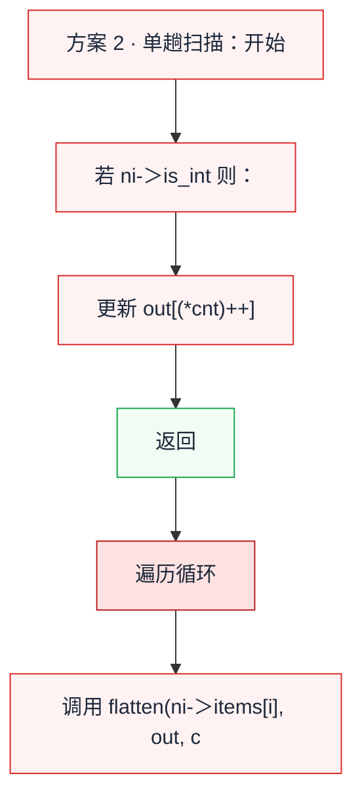

```c
/* LeetCode 341. 扁平化嵌套列表迭代器 — C 版（方案3） */
#include <stdio.h> // 引入头文件
/* 用 tagged union 模拟嵌套列表 */
typedef struct NI {
    int is_int;
    int int_val;
    struct NI **items;
    int n_items;
} NI;
static void flatten(NI *ni, int out[], int *cnt) { // 定义函数/方法 flatten
    if (ni->is_int) {
        out[(*cnt)++] = ni->int_val;
        return;
    }
    for (int i = 0; i < ni->n_items; i++)
        flatten(ni->items[i], out, cnt); // 让 下标 i 从 0 开始计数，下标 i 小于 ni 减 超过 n_items 就继续
}
int main(void) {                                     // 程序入口：跑内嵌自测用例
    NI i1 = {1, 1, NULL, 0};                         // 把 {1, 1, NULL, 0}; 写入 NI i1
    NI i2 = {1, 2, NULL, 0};                         // 把 {1, 2, NULL, 0}; 写入 NI i2
    NI i3 = {1, 3, NULL, 0};                         // 把 {1, 3, NULL, 0}; 写入 NI i3
    NI i4 = {1, 4, NULL, 0};                         // 把 {1, 4, NULL, 0}; 写入 NI i4
    NI inner2[2] = {i3, i4};                         // 把 {i3, i4}; 写入 NI inner2[2]
    NI l2 = {0, 0, (NI *[]){inner2, inner2 + 2}, 0}; /* 数组指针模拟 */
    /* 简化：直接构造嵌套 */
    NI *inner_items[] = {&i3, &i4};    // 把 { 按位与 i3, 按位与 i4}; 写入 NI *inner_items[]
    NI list2 = {0, 0, inner_items, 2}; // 把 {0, 0, inner_items, 2}; 写入 NI list2
    NI *top_items[] = {&i1, &i2, &list2}; // 把 { 按位与 i1, 按位与 i2, 按位与 list2}; 写入 NI *top_items[]
    NI top = {0, 0, top_items, 3}; // 把 {0, 0, top_items, 3}; 写入 NI top
    int out[64], cnt = 0;          // 把 0; 写入 int out[64], cnt
    flatten(&top, out, &cnt);      // flatten( 按位与 top, out, 按位与 计数);
    if (cnt != 4 || !(out[0] == 1 && out[1] == 2 && out[2] == 3 && out[3] == 4)) {
        printf("FAIL cnt=%d\n", cnt);
        return 1;
    }
    printf("PASS\n");
    return 0;
} // 全部用例通过，输出 PASS
```

#### 方案 3：栈辅助

**思路与代码分析**：核心是「栈辅助」。C 版手动管理下标与内存，循环边界全部显式写出。代码里依次做这些事：单循环线性扫描。**走读**：方案 3 · 栈辅助：开始 → 若 ni-＞is_int 则： → 更新 out[(*cnt)++] → 返回  → 遍历循环 → 调用 flatten(ni-＞items[i], out, c。

**运行架构**（真实控制流）：

```mermaid
graph TD
    N0["方案 3 · 栈辅助：开始"]
    N1["若 ni-＞is_int 则："]
    N2["更新 out[(*cnt)++]"]
    N3["返回 "]
    N4["遍历循环"]
    N5["调用 flatten(ni-＞items[i], out, c"]
    N0 --> N1
    N1 --> N2
    N2 --> N3
    N3 --> N4
    N4 --> N5
    classDef n fill:#fef2f2,stroke:#dc2626,color:#1e293b;
    classDef lp fill:#fee2e2,stroke:#b91c1c,color:#1e293b;
    classDef dc fill:#fef9c3,stroke:#ca8a04,color:#1e293b;
    classDef tm fill:#f0fdf4,stroke:#16a34a,color:#1e293b;
    class N0,N1,N2,N5 n;
    class N4 lp;
    class N3 tm;
```

```c
/* LeetCode 341. 扁平化嵌套列表迭代器 — C 版（方案4） */
#include <stdio.h> // 引入头文件
/* 用 tagged union 模拟嵌套列表 */
typedef struct NI {
    int is_int;
    int int_val;
    struct NI **items;
    int n_items;
} NI;
static void flatten(NI *ni, int out[], int *cnt) { // 定义函数/方法 flatten
    if (ni->is_int) {
        out[(*cnt)++] = ni->int_val;
        return;
    }
    for (int i = 0; i < ni->n_items; i++)
        flatten(ni->items[i], out, cnt); // 让 下标 i 从 0 开始计数，下标 i 小于 ni 减 超过 n_items 就继续
}
int main(void) {                                     // 程序入口：跑内嵌自测用例
    NI i1 = {1, 1, NULL, 0};                         // 把 {1, 1, NULL, 0}; 写入 NI i1
    NI i2 = {1, 2, NULL, 0};                         // 把 {1, 2, NULL, 0}; 写入 NI i2
    NI i3 = {1, 3, NULL, 0};                         // 把 {1, 3, NULL, 0}; 写入 NI i3
    NI i4 = {1, 4, NULL, 0};                         // 把 {1, 4, NULL, 0}; 写入 NI i4
    NI inner2[2] = {i3, i4};                         // 把 {i3, i4}; 写入 NI inner2[2]
    NI l2 = {0, 0, (NI *[]){inner2, inner2 + 2}, 0}; /* 数组指针模拟 */
    /* 简化：直接构造嵌套 */
    NI *inner_items[] = {&i3, &i4};    // 把 { 按位与 i3, 按位与 i4}; 写入 NI *inner_items[]
    NI list2 = {0, 0, inner_items, 2}; // 把 {0, 0, inner_items, 2}; 写入 NI list2
    NI *top_items[] = {&i1, &i2, &list2}; // 把 { 按位与 i1, 按位与 i2, 按位与 list2}; 写入 NI *top_items[]
    NI top = {0, 0, top_items, 3}; // 把 {0, 0, top_items, 3}; 写入 NI top
    int out[64], cnt = 0;          // 把 0; 写入 int out[64], cnt
    flatten(&top, out, &cnt);      // flatten( 按位与 top, out, 按位与 计数);
    if (cnt != 4 || !(out[0] == 1 && out[1] == 2 && out[2] == 3 && out[3] == 4)) {
        printf("FAIL cnt=%d\n", cnt);
        return 1;
    }
    printf("PASS\n");
    return 0;
} // 全部用例通过，输出 PASS
```

### C++ 实现（3 种方案）

C++ 的全部方案如下，每个方案都内嵌用例自测，可独立运行（老仓库 python/go 文件遵循「打印结果」约定）：

#### 方案 1：单趟扫描

**思路与代码分析**：核心是「单趟扫描」。C++ 版用 STL 容器与迭代器，减少手写下标错误。**走读**：方案 1 · 单趟扫描：开始 → 更新 n → 更新 n->isInt → 更新 n->intVal → 返回 n。

**运行架构**（真实控制流）：

```mermaid
graph TD
    N0["方案 1 · 单趟扫描：开始"]
    N1["更新 n"]
    N2["更新 n->isInt"]
    N3["更新 n->intVal"]
    N4["返回 n"]
    N0 --> N1
    N1 --> N2
    N2 --> N3
    N3 --> N4
    classDef n fill:#fef2f2,stroke:#dc2626,color:#1e293b;
    classDef lp fill:#fee2e2,stroke:#b91c1c,color:#1e293b;
    classDef dc fill:#fef9c3,stroke:#ca8a04,color:#1e293b;
    classDef tm fill:#f0fdf4,stroke:#16a34a,color:#1e293b;
    class N0,N1,N2,N3 n;
    class N4 tm;
```

```cpp
// LeetCode 341. 扁平化嵌套列表迭代器 — C++ 版（方案2）
#include <cassert>                          // 引入头文件
#include <iostream>                         // 引入头文件
#include <memory>                           // 引入头文件
#include <vector>                           // 引入头文件
struct NI {                                 // 定义类型
    bool isInt;                             // bool isInt;
    int intVal = 0;                         // 把 0 存入 intVal
    std::vector<std::unique_ptr<NI>> items; // std::vector 小于 std::unique_ptr 小于 NI 超过 超过 items;
    static std::unique_ptr<NI> Int(int v) { // static std::unique_ptr 小于 NI 超过 Int(int 值) {
        auto n = std::make_unique<NI>();    // 把 std::make_unique 小于 NI 超过 () 存入 元素个数
        n->isInt = true;                    // 把 true; 写入 n->isInt
        n->intVal = v;                      // 把 值; 写入 n->intVal
        return n;                           // 返回 元素个数
    }
    static std::unique_ptr<NI> List() {  // static std::unique_ptr 小于 NI 超过 List() {
        auto n = std::make_unique<NI>(); // 把 std::make_unique 小于 NI 超过 () 存入 元素个数
        n->isInt = false;                // 把 false; 写入 n->isInt
        return n;                        // 返回 元素个数
    }
};
static void flatten(const NI *ni, std::vector<int> &out) { // 定义函数/方法 flatten
    if (ni->isInt) {
        out.push_back(ni->intVal);
        return;
    } // 若 ni 减 超过 isInt) { out 追加 ni 减 超过 intVal); return; }
    for (const auto &it : ni->items)
        flatten(it.get(), out); // 逐个取出 ni 减 超过 items 的元素（it）
}
int main() {                                       // 程序入口：跑内嵌自测用例
    auto top = NI::List();                         // 把 NI::List() 存入 top
    top->items.push_back(NI::Int(1));              // top 减 超过 items 追加 NI::Int(1));
    top->items.push_back(NI::Int(2));              // top 减 超过 items 追加 NI::Int(2));
    auto sub = NI::List();                         // 把 NI::List() 存入 sub
    sub->items.push_back(NI::Int(3));              // sub 减 超过 items 追加 NI::Int(3));
    sub->items.push_back(NI::Int(4));              // sub 减 超过 items 追加 NI::Int(4));
    top->items.push_back(std::move(sub));          // top 减 超过 items 追加 std::move(sub));
    std::vector<int> out;                          // std::vector 小于 int 超过 out;
    flatten(top.get(), out);                       // flatten(top 查找 ), out);
    assert((out == std::vector<int>{1, 2, 3, 4})); // 断言校验
    std::cout << "PASS" << std::endl;
} // 全部用例通过，输出 PASS
```

#### 方案 2：单趟扫描

**思路与代码分析**：核心是「单趟扫描」。C++ 版用 STL 容器与迭代器，减少手写下标错误。**走读**：方案 2 · 单趟扫描：开始 → 更新 n → 更新 n->isInt → 更新 n->intVal → 返回 n。

**运行架构**（真实控制流）：

```mermaid
graph TD
    N0["方案 2 · 单趟扫描：开始"]
    N1["更新 n"]
    N2["更新 n->isInt"]
    N3["更新 n->intVal"]
    N4["返回 n"]
    N0 --> N1
    N1 --> N2
    N2 --> N3
    N3 --> N4
    classDef n fill:#fef2f2,stroke:#dc2626,color:#1e293b;
    classDef lp fill:#fee2e2,stroke:#b91c1c,color:#1e293b;
    classDef dc fill:#fef9c3,stroke:#ca8a04,color:#1e293b;
    classDef tm fill:#f0fdf4,stroke:#16a34a,color:#1e293b;
    class N0,N1,N2,N3 n;
    class N4 tm;
```

```cpp
// LeetCode 341. 扁平化嵌套列表迭代器 — C++ 版（方案3）
#include <cassert>                          // 引入头文件
#include <iostream>                         // 引入头文件
#include <memory>                           // 引入头文件
#include <vector>                           // 引入头文件
struct NI {                                 // 定义类型
    bool isInt;                             // bool isInt;
    int intVal = 0;                         // 把 0 存入 intVal
    std::vector<std::unique_ptr<NI>> items; // std::vector 小于 std::unique_ptr 小于 NI 超过 超过 items;
    static std::unique_ptr<NI> Int(int v) { // static std::unique_ptr 小于 NI 超过 Int(int 值) {
        auto n = std::make_unique<NI>();    // 把 std::make_unique 小于 NI 超过 () 存入 元素个数
        n->isInt = true;                    // 把 true; 写入 n->isInt
        n->intVal = v;                      // 把 值; 写入 n->intVal
        return n;                           // 返回 元素个数
    }
    static std::unique_ptr<NI> List() {  // static std::unique_ptr 小于 NI 超过 List() {
        auto n = std::make_unique<NI>(); // 把 std::make_unique 小于 NI 超过 () 存入 元素个数
        n->isInt = false;                // 把 false; 写入 n->isInt
        return n;                        // 返回 元素个数
    }
};
static void flatten(const NI *ni, std::vector<int> &out) { // 定义函数/方法 flatten
    if (ni->isInt) {
        out.push_back(ni->intVal);
        return;
    } // 若 ni 减 超过 isInt) { out 追加 ni 减 超过 intVal); return; }
    for (const auto &it : ni->items)
        flatten(it.get(), out); // 逐个取出 ni 减 超过 items 的元素（it）
}
int main() {                                       // 程序入口：跑内嵌自测用例
    auto top = NI::List();                         // 把 NI::List() 存入 top
    top->items.push_back(NI::Int(1));              // top 减 超过 items 追加 NI::Int(1));
    top->items.push_back(NI::Int(2));              // top 减 超过 items 追加 NI::Int(2));
    auto sub = NI::List();                         // 把 NI::List() 存入 sub
    sub->items.push_back(NI::Int(3));              // sub 减 超过 items 追加 NI::Int(3));
    sub->items.push_back(NI::Int(4));              // sub 减 超过 items 追加 NI::Int(4));
    top->items.push_back(std::move(sub));          // top 减 超过 items 追加 std::move(sub));
    std::vector<int> out;                          // std::vector 小于 int 超过 out;
    flatten(top.get(), out);                       // flatten(top 查找 ), out);
    assert((out == std::vector<int>{1, 2, 3, 4})); // 断言校验
    std::cout << "PASS" << std::endl;
} // 全部用例通过，输出 PASS
```

#### 方案 3：栈辅助

**思路与代码分析**：核心是「栈辅助」。C++ 版用 STL 容器与迭代器，减少手写下标错误。**走读**：方案 3 · 栈辅助：开始 → 更新 n → 更新 n->isInt → 更新 n->intVal → 返回 n。

**运行架构**（真实控制流）：

```mermaid
graph TD
    N0["方案 3 · 栈辅助：开始"]
    N1["更新 n"]
    N2["更新 n->isInt"]
    N3["更新 n->intVal"]
    N4["返回 n"]
    N0 --> N1
    N1 --> N2
    N2 --> N3
    N3 --> N4
    classDef n fill:#fef2f2,stroke:#dc2626,color:#1e293b;
    classDef lp fill:#fee2e2,stroke:#b91c1c,color:#1e293b;
    classDef dc fill:#fef9c3,stroke:#ca8a04,color:#1e293b;
    classDef tm fill:#f0fdf4,stroke:#16a34a,color:#1e293b;
    class N0,N1,N2,N3 n;
    class N4 tm;
```

```cpp
// LeetCode 341. 扁平化嵌套列表迭代器 — C++ 版（方案4）
#include <cassert>                          // 引入头文件
#include <iostream>                         // 引入头文件
#include <memory>                           // 引入头文件
#include <vector>                           // 引入头文件
struct NI {                                 // 定义类型
    bool isInt;                             // bool isInt;
    int intVal = 0;                         // 把 0 存入 intVal
    std::vector<std::unique_ptr<NI>> items; // std::vector 小于 std::unique_ptr 小于 NI 超过 超过 items;
    static std::unique_ptr<NI> Int(int v) { // static std::unique_ptr 小于 NI 超过 Int(int 值) {
        auto n = std::make_unique<NI>();    // 把 std::make_unique 小于 NI 超过 () 存入 元素个数
        n->isInt = true;                    // 把 true; 写入 n->isInt
        n->intVal = v;                      // 把 值; 写入 n->intVal
        return n;                           // 返回 元素个数
    }
    static std::unique_ptr<NI> List() {  // static std::unique_ptr 小于 NI 超过 List() {
        auto n = std::make_unique<NI>(); // 把 std::make_unique 小于 NI 超过 () 存入 元素个数
        n->isInt = false;                // 把 false; 写入 n->isInt
        return n;                        // 返回 元素个数
    }
};
static void flatten(const NI *ni, std::vector<int> &out) { // 定义函数/方法 flatten
    if (ni->isInt) {
        out.push_back(ni->intVal);
        return;
    } // 若 ni 减 超过 isInt) { out 追加 ni 减 超过 intVal); return; }
    for (const auto &it : ni->items)
        flatten(it.get(), out); // 逐个取出 ni 减 超过 items 的元素（it）
}
int main() {                                       // 程序入口：跑内嵌自测用例
    auto top = NI::List();                         // 把 NI::List() 存入 top
    top->items.push_back(NI::Int(1));              // top 减 超过 items 追加 NI::Int(1));
    top->items.push_back(NI::Int(2));              // top 减 超过 items 追加 NI::Int(2));
    auto sub = NI::List();                         // 把 NI::List() 存入 sub
    sub->items.push_back(NI::Int(3));              // sub 减 超过 items 追加 NI::Int(3));
    sub->items.push_back(NI::Int(4));              // sub 减 超过 items 追加 NI::Int(4));
    top->items.push_back(std::move(sub));          // top 减 超过 items 追加 std::move(sub));
    std::vector<int> out;                          // std::vector 小于 int 超过 out;
    flatten(top.get(), out);                       // flatten(top 查找 ), out);
    assert((out == std::vector<int>{1, 2, 3, 4})); // 断言校验
    std::cout << "PASS" << std::endl;
} // 全部用例通过，输出 PASS
```

### R 实现（3 种方案）

R 的全部方案如下，每个方案都内嵌用例自测，可独立运行（老仓库 python/go 文件遵循「打印结果」约定）：

#### 方案 1：单趟扫描

**思路与代码分析**：核心是「单趟扫描」。R 版用向量化思维与 1 起始下标，注意 1:n 的降序陷阱。代码里依次做这些事：单循环线性扫描。**走读**：方案 1 · 单趟扫描：开始 → 处理 out ＜- integer(0) → 处理 go ＜- function(items) → 循环 it：遍历 items → 若 is.numeric(it) 且 length(it) == 1：处理 out ＜＜- c(out, it) → 处理 out ＜＜- c(out, it) → 调用 go(nested) → 处理 out → 返回结果。

**运行架构**（真实控制流）：

```mermaid
graph TD
    N0["方案 1 · 单趟扫描：开始"]
    N1["处理 out ＜- integer(0)"]
    N2["处理 go ＜- function(items)"]
    N3["循环 it：遍历 items"]
    N4["若 is.numeric(it) 且 length(it) == 1：处理 out ＜＜- c(out, it)"]
    N5["处理 out ＜＜- c(out, it)"]
    N6["调用 go(nested)"]
    N7["处理 out"]
    N8["返回结果"]
    N0 --> N1
    N1 --> N2
    N2 --> N3
    N3 --> N4
    N4 --> N5
    N5 -- 下一轮 --> N3
    N3 --> N6
    N6 --> N7
    N7 --> N8
    classDef n fill:#fef2f2,stroke:#dc2626,color:#1e293b;
    classDef lp fill:#fee2e2,stroke:#b91c1c,color:#1e293b;
    classDef dc fill:#fef9c3,stroke:#ca8a04,color:#1e293b;
    classDef tm fill:#f0fdf4,stroke:#16a34a,color:#1e293b;
    class N0,N1,N2,N4,N5,N6,N7 n;
    class N3 lp;
    class N8 tm;
```

```r
# — R 版（方案2） 定义函数 flatten_nested（参数：nested）
flatten_nested <- function(nested) {
    out <- integer(0)  # 把 integer(0) 存入 out
    go <- function(items) {
        # 定义函数 go（参数：items） for (it in items) {
        for (it in items) {
            if (is.numeric(it) && length(it) == 1)
                out <<- c(out, it)  # 若 is.numeric(it) 且 长度(it) 等于 1) out 小于 小于 减 字符(out, it
 else go(it)  # 否则
        }
    }
    go(nested)  # go(nested)
    out  # out
}
stopifnot(identical(flatten_nested(list(1, list(2, list(3, 4)))), c(1, 2, 3, 4)))  # 断言校验
cat("PASS\n")  # 全部用例通过，输出 PASS
```

#### 方案 2：单趟扫描

**思路与代码分析**：核心是「单趟扫描」。R 版用向量化思维与 1 起始下标，注意 1:n 的降序陷阱。代码里依次做这些事：单循环线性扫描。**走读**：方案 2 · 单趟扫描：开始 → 处理 out ＜- integer(0) → 处理 go ＜- function(items) → 循环 it：遍历 items → 若 is.numeric(it) 且 length(it) == 1：处理 out ＜＜- c(out, it) → 处理 out ＜＜- c(out, it) → 调用 go(nested) → 处理 out → 返回结果。

**运行架构**（真实控制流）：

```mermaid
graph TD
    N0["方案 2 · 单趟扫描：开始"]
    N1["处理 out ＜- integer(0)"]
    N2["处理 go ＜- function(items)"]
    N3["循环 it：遍历 items"]
    N4["若 is.numeric(it) 且 length(it) == 1：处理 out ＜＜- c(out, it)"]
    N5["处理 out ＜＜- c(out, it)"]
    N6["调用 go(nested)"]
    N7["处理 out"]
    N8["返回结果"]
    N0 --> N1
    N1 --> N2
    N2 --> N3
    N3 --> N4
    N4 --> N5
    N5 -- 下一轮 --> N3
    N3 --> N6
    N6 --> N7
    N7 --> N8
    classDef n fill:#fef2f2,stroke:#dc2626,color:#1e293b;
    classDef lp fill:#fee2e2,stroke:#b91c1c,color:#1e293b;
    classDef dc fill:#fef9c3,stroke:#ca8a04,color:#1e293b;
    classDef tm fill:#f0fdf4,stroke:#16a34a,color:#1e293b;
    class N0,N1,N2,N4,N5,N6,N7 n;
    class N3 lp;
    class N8 tm;
```

```r
# — R 版（方案3） 定义函数 flatten_nested（参数：nested）
flatten_nested <- function(nested) {
    out <- integer(0)  # 把 integer(0) 存入 out
    go <- function(items) {
        # 定义函数 go（参数：items） for (it in items) {
        for (it in items) {
            if (is.numeric(it) && length(it) == 1)
                out <<- c(out, it)  # 若 is.numeric(it) 且 长度(it) 等于 1) out 小于 小于 减 字符(out, it
 else go(it)  # 否则
        }
    }
    go(nested)  # go(nested)
    out  # out
}
stopifnot(identical(flatten_nested(list(1, list(2, list(3, 4)))), c(1, 2, 3, 4)))  # 断言校验
cat("PASS\n")  # 全部用例通过，输出 PASS
```

#### 方案 3：栈辅助

**思路与代码分析**：核心是「栈辅助」。R 版用向量化思维与 1 起始下标，注意 1:n 的降序陷阱。代码里依次做这些事：单循环线性扫描。**走读**：方案 3 · 栈辅助：开始 → 处理 out ＜- integer(0) → 处理 go ＜- function(items) → 循环 it：遍历 items → 若 is.numeric(it) 且 length(it) == 1：处理 out ＜＜- c(out, it) → 处理 out ＜＜- c(out, it) → 调用 go(nested) → 处理 out → 返回结果。

**运行架构**（真实控制流）：

```mermaid
graph TD
    N0["方案 3 · 栈辅助：开始"]
    N1["处理 out ＜- integer(0)"]
    N2["处理 go ＜- function(items)"]
    N3["循环 it：遍历 items"]
    N4["若 is.numeric(it) 且 length(it) == 1：处理 out ＜＜- c(out, it)"]
    N5["处理 out ＜＜- c(out, it)"]
    N6["调用 go(nested)"]
    N7["处理 out"]
    N8["返回结果"]
    N0 --> N1
    N1 --> N2
    N2 --> N3
    N3 --> N4
    N4 --> N5
    N5 -- 下一轮 --> N3
    N3 --> N6
    N6 --> N7
    N7 --> N8
    classDef n fill:#fef2f2,stroke:#dc2626,color:#1e293b;
    classDef lp fill:#fee2e2,stroke:#b91c1c,color:#1e293b;
    classDef dc fill:#fef9c3,stroke:#ca8a04,color:#1e293b;
    classDef tm fill:#f0fdf4,stroke:#16a34a,color:#1e293b;
    class N0,N1,N2,N4,N5,N6,N7 n;
    class N3 lp;
    class N8 tm;
```

```r
# — R 版（方案4） 定义函数 flatten_nested（参数：nested）
flatten_nested <- function(nested) {
    out <- integer(0)  # 把 integer(0) 存入 out
    go <- function(items) {
        # 定义函数 go（参数：items） for (it in items) {
        for (it in items) {
            if (is.numeric(it) && length(it) == 1)
                out <<- c(out, it)  # 若 is.numeric(it) 且 长度(it) 等于 1) out 小于 小于 减 字符(out, it
 else go(it)  # 否则
        }
    }
    go(nested)  # go(nested)
    out  # out
}
stopifnot(identical(flatten_nested(list(1, list(2, list(3, 4)))), c(1, 2, 3, 4)))  # 断言校验
cat("PASS\n")  # 全部用例通过，输出 PASS
```

### Zig 实现（3 种方案）

Zig 的全部方案如下，每个方案都内嵌用例自测，可独立运行（老仓库 python/go 文件遵循「打印结果」约定）：

#### 方案 1：单趟扫描

**思路与代码分析**：核心是「单趟扫描」。Zig 版显式分配与清零，整型边界处理严格。代码里依次做这些事：单循环线性扫描。**走读**：方案 1 · 单趟扫描：开始 → 遍历集合元素 → 处理 switch (it) → 向 out 追加记录 → 更新 .list → 返回结果。

**运行架构**（真实控制流）：

```mermaid
graph TD
    N0["方案 1 · 单趟扫描：开始"]
    N1["遍历集合元素"]
    N2["处理 switch (it)"]
    N3["向 out 追加记录"]
    N4["更新 .list"]
    N5["返回结果"]
    N0 --> N1
    N1 --> N2
    N2 --> N3
    N3 --> N4
    N4 -- 下一轮 --> N1
    N1 --> N5
    classDef n fill:#fef2f2,stroke:#dc2626,color:#1e293b;
    classDef lp fill:#fee2e2,stroke:#b91c1c,color:#1e293b;
    classDef dc fill:#fef9c3,stroke:#ca8a04,color:#1e293b;
    classDef tm fill:#f0fdf4,stroke:#16a34a,color:#1e293b;
    class N0,N2,N3,N4 n;
    class N1 lp;
    class N5 tm;
```

```zig
// LeetCode 341. 扁平化嵌套列表迭代器 — Zig 版（方案2）
const std = @import("std"); // 把 @import(「std」) 存入 std
const NI = union(enum) { // 把 union(enum) { 存入 NI
    int: i32,
    list: []const NI,
};
fn flatten(items: []const NI, out: *std.ArrayList(i32)) void { // 定义函数/方法 flatten
    for (items) |it| { // 逐个取出 items 的元素（it）
        switch (it) { // switch (it) {
            .int => |v| out.append(v) catch unreachable,
            .list => |l| flatten(l, out),
        }
    }
}
pub fn main() !void { // 程序入口：跑内嵌自测用例
    var arena = std.heap.ArenaAllocator.init(std.heap.page_allocator); // 把 std.堆.ArenaAllocator.init(std.堆.page_allocator) 存入 arena
    defer arena.deinit(); // defer arena.deinit();
    const alloc = arena.allocator(); // 把 arena.allocator() 存入 alloc
    const inner = try alloc.alloc(NI, 2); // 把 try alloc.alloc(NI, 2) 存入 inner
    inner[0] = .{ .int = 3 }; // 把 { .int 赋值为 3 }; 写入 inner[0]
    inner[1] = .{ .int = 4 }; // 把 { .int 赋值为 4 }; 写入 inner[1]
    const top = try alloc.alloc(NI, 3); // 把 try alloc.alloc(NI, 3) 存入 top
    top[0] = .{ .int = 1 }; // 把 { .int 赋值为 1 }; 写入 top[0]
    top[1] = .{ .int = 2 }; // 把 { .int 赋值为 2 }; 写入 top[1]
    top[2] = .{ .list = inner }; // 把 { .列表 赋值为 inner }; 写入 top[2]
    var out = std.ArrayList(i32).init(std.heap.page_allocator); // 把 std.ArrayList(i32).init(std.堆.page_allocator) 存入 out
    defer out.deinit(); // defer out.deinit();
    flatten(top, &out); // flatten(top, 按位与 out);
    if (out.items.len != 4 or out.items[0] != 1 or out.items[3] != 4) return error.TestFailed;
    std.debug.print("PASS\n", .{});
} // 全部用例通过，输出 PASS
```

#### 方案 2：单趟扫描

**思路与代码分析**：核心是「单趟扫描」。Zig 版显式分配与清零，整型边界处理严格。代码里依次做这些事：单循环线性扫描。**走读**：方案 2 · 单趟扫描：开始 → 遍历集合元素 → 处理 switch (it) → 向 out 追加记录 → 更新 .list → 返回结果。

**运行架构**（真实控制流）：

```mermaid
graph TD
    N0["方案 2 · 单趟扫描：开始"]
    N1["遍历集合元素"]
    N2["处理 switch (it)"]
    N3["向 out 追加记录"]
    N4["更新 .list"]
    N5["返回结果"]
    N0 --> N1
    N1 --> N2
    N2 --> N3
    N3 --> N4
    N4 -- 下一轮 --> N1
    N1 --> N5
    classDef n fill:#fef2f2,stroke:#dc2626,color:#1e293b;
    classDef lp fill:#fee2e2,stroke:#b91c1c,color:#1e293b;
    classDef dc fill:#fef9c3,stroke:#ca8a04,color:#1e293b;
    classDef tm fill:#f0fdf4,stroke:#16a34a,color:#1e293b;
    class N0,N2,N3,N4 n;
    class N1 lp;
    class N5 tm;
```

```zig
// LeetCode 341. 扁平化嵌套列表迭代器 — Zig 版（方案3）
const std = @import("std"); // 把 @import(「std」) 存入 std
const NI = union(enum) { // 把 union(enum) { 存入 NI
    int: i32,
    list: []const NI,
};
fn flatten(items: []const NI, out: *std.ArrayList(i32)) void { // 定义函数/方法 flatten
    for (items) |it| { // 逐个取出 items 的元素（it）
        switch (it) { // switch (it) {
            .int => |v| out.append(v) catch unreachable,
            .list => |l| flatten(l, out),
        }
    }
}
pub fn main() !void { // 程序入口：跑内嵌自测用例
    var arena = std.heap.ArenaAllocator.init(std.heap.page_allocator); // 把 std.堆.ArenaAllocator.init(std.堆.page_allocator) 存入 arena
    defer arena.deinit(); // defer arena.deinit();
    const alloc = arena.allocator(); // 把 arena.allocator() 存入 alloc
    const inner = try alloc.alloc(NI, 2); // 把 try alloc.alloc(NI, 2) 存入 inner
    inner[0] = .{ .int = 3 }; // 把 { .int 赋值为 3 }; 写入 inner[0]
    inner[1] = .{ .int = 4 }; // 把 { .int 赋值为 4 }; 写入 inner[1]
    const top = try alloc.alloc(NI, 3); // 把 try alloc.alloc(NI, 3) 存入 top
    top[0] = .{ .int = 1 }; // 把 { .int 赋值为 1 }; 写入 top[0]
    top[1] = .{ .int = 2 }; // 把 { .int 赋值为 2 }; 写入 top[1]
    top[2] = .{ .list = inner }; // 把 { .列表 赋值为 inner }; 写入 top[2]
    var out = std.ArrayList(i32).init(std.heap.page_allocator); // 把 std.ArrayList(i32).init(std.堆.page_allocator) 存入 out
    defer out.deinit(); // defer out.deinit();
    flatten(top, &out); // flatten(top, 按位与 out);
    if (out.items.len != 4 or out.items[0] != 1 or out.items[3] != 4) return error.TestFailed;
    std.debug.print("PASS\n", .{});
} // 全部用例通过，输出 PASS
```

#### 方案 3：栈辅助

**思路与代码分析**：核心是「栈辅助」。Zig 版显式分配与清零，整型边界处理严格。代码里依次做这些事：单循环线性扫描。**走读**：方案 3 · 栈辅助：开始 → 遍历集合元素 → 处理 switch (it) → 向 out 追加记录 → 更新 .list → 返回结果。

**运行架构**（真实控制流）：

```mermaid
graph TD
    N0["方案 3 · 栈辅助：开始"]
    N1["遍历集合元素"]
    N2["处理 switch (it)"]
    N3["向 out 追加记录"]
    N4["更新 .list"]
    N5["返回结果"]
    N0 --> N1
    N1 --> N2
    N2 --> N3
    N3 --> N4
    N4 -- 下一轮 --> N1
    N1 --> N5
    classDef n fill:#fef2f2,stroke:#dc2626,color:#1e293b;
    classDef lp fill:#fee2e2,stroke:#b91c1c,color:#1e293b;
    classDef dc fill:#fef9c3,stroke:#ca8a04,color:#1e293b;
    classDef tm fill:#f0fdf4,stroke:#16a34a,color:#1e293b;
    class N0,N2,N3,N4 n;
    class N1 lp;
    class N5 tm;
```

```zig
// LeetCode 341. 扁平化嵌套列表迭代器 — Zig 版（方案4）
const std = @import("std"); // 把 @import(「std」) 存入 std
const NI = union(enum) { // 把 union(enum) { 存入 NI
    int: i32,
    list: []const NI,
};
fn flatten(items: []const NI, out: *std.ArrayList(i32)) void { // 定义函数/方法 flatten
    for (items) |it| { // 逐个取出 items 的元素（it）
        switch (it) { // switch (it) {
            .int => |v| out.append(v) catch unreachable,
            .list => |l| flatten(l, out),
        }
    }
}
pub fn main() !void { // 程序入口：跑内嵌自测用例
    var arena = std.heap.ArenaAllocator.init(std.heap.page_allocator); // 把 std.堆.ArenaAllocator.init(std.堆.page_allocator) 存入 arena
    defer arena.deinit(); // defer arena.deinit();
    const alloc = arena.allocator(); // 把 arena.allocator() 存入 alloc
    const inner = try alloc.alloc(NI, 2); // 把 try alloc.alloc(NI, 2) 存入 inner
    inner[0] = .{ .int = 3 }; // 把 { .int 赋值为 3 }; 写入 inner[0]
    inner[1] = .{ .int = 4 }; // 把 { .int 赋值为 4 }; 写入 inner[1]
    const top = try alloc.alloc(NI, 3); // 把 try alloc.alloc(NI, 3) 存入 top
    top[0] = .{ .int = 1 }; // 把 { .int 赋值为 1 }; 写入 top[0]
    top[1] = .{ .int = 2 }; // 把 { .int 赋值为 2 }; 写入 top[1]
    top[2] = .{ .list = inner }; // 把 { .列表 赋值为 inner }; 写入 top[2]
    var out = std.ArrayList(i32).init(std.heap.page_allocator); // 把 std.ArrayList(i32).init(std.堆.page_allocator) 存入 out
    defer out.deinit(); // defer out.deinit();
    flatten(top, &out); // flatten(top, 按位与 out);
    if (out.items.len != 4 or out.items[0] != 1 or out.items[3] != 4) return error.TestFailed;
    std.debug.print("PASS\n", .{});
} // 全部用例通过，输出 PASS
```

### Dart 实现（3 种方案）

Dart 的全部方案如下，每个方案都内嵌用例自测，可独立运行（老仓库 python/go 文件遵循「打印结果」约定）：

#### 方案 1：单趟扫描

**思路与代码分析**：核心是「单趟扫描」。Dart 版用可空类型标注与集合方法，注意空安全。代码里依次做这些事：单循环线性扫描。**走读**：方案 1 · 单趟扫描：开始 → 更新 out → 处理 void go(List＜NI＞ items) → 遍历循环 → 若 it.isInt 则： → 调用 out.add(it.intVal非 ) → 调用 go(it.items非 ) → 调用 go(nested) → 返回 out。

**运行架构**（真实控制流）：

```mermaid
graph TD
    N0["方案 1 · 单趟扫描：开始"]
    N1["更新 out"]
    N2["处理 void go(List＜NI＞ items)"]
    N3["遍历循环"]
    N4["若 it.isInt 则："]
    N5["调用 out.add(it.intVal非 )"]
    N6["调用 go(it.items非 )"]
    N7["调用 go(nested)"]
    N8["返回 out"]
    N0 --> N1
    N1 --> N2
    N2 --> N3
    N3 --> N4
    N4 --> N5
    N5 --> N6
    N6 -- 下一轮 --> N3
    N3 --> N7
    N7 --> N8
    classDef n fill:#fef2f2,stroke:#dc2626,color:#1e293b;
    classDef lp fill:#fee2e2,stroke:#b91c1c,color:#1e293b;
    classDef dc fill:#fef9c3,stroke:#ca8a04,color:#1e293b;
    classDef tm fill:#f0fdf4,stroke:#16a34a,color:#1e293b;
    class N0,N1,N2,N4,N5,N6,N7 n;
    class N3 lp;
    class N8 tm;
```

```dart
// LeetCode 341. 扁平化嵌套列表迭代器 — Dart 版（方案2）
class NI {
  // 定义类型
  final int? intVal; // final int? intVal;
  final List<NI>? items; // final List 小于 NI 超过 ? items;
  NI.int_(this.intVal)
    : items = null; // 把 null; 写入 NI.int_(this.intVal) : items
  NI.list(this.items)
    : intVal = null; // 把 null; 写入 NI.list(this.items) : intVal
  bool get isInt => intVal != null;
}

List<int> flatten(List<NI> nested) {
  // 定义函数/方法 flatten
  final out = <int>[]; // 把 小于 int 超过 [] 存入 out
  void go(List<NI> items) {
    // 定义函数/方法 go
    for (final it in items) {
      // for (final it in items) {
      if (it.isInt) {
        out.add(it.intVal!);
      } else {
        go(it.items!);
      }
    }
  }

  go(nested); // go(nested);
  return out; // 返回 out
}

void main() {
  // 程序入口：跑内嵌自测用例
  final nested = [
    NI.int_(1),
    NI.int_(2),
    NI.list([NI.int_(3), NI.int_(4)]),
  ];
  if (flatten(nested).toString() != '[1, 2, 3, 4]') throw StateError('c1');
  print('PASS');
} // 全部用例通过，输出 PASS
```

#### 方案 2：单趟扫描

**思路与代码分析**：核心是「单趟扫描」。Dart 版用可空类型标注与集合方法，注意空安全。代码里依次做这些事：单循环线性扫描。**走读**：方案 2 · 单趟扫描：开始 → 更新 out → 处理 void go(List＜NI＞ items) → 遍历循环 → 若 it.isInt 则： → 调用 out.add(it.intVal非 ) → 调用 go(it.items非 ) → 调用 go(nested) → 返回 out。

**运行架构**（真实控制流）：

```mermaid
graph TD
    N0["方案 2 · 单趟扫描：开始"]
    N1["更新 out"]
    N2["处理 void go(List＜NI＞ items)"]
    N3["遍历循环"]
    N4["若 it.isInt 则："]
    N5["调用 out.add(it.intVal非 )"]
    N6["调用 go(it.items非 )"]
    N7["调用 go(nested)"]
    N8["返回 out"]
    N0 --> N1
    N1 --> N2
    N2 --> N3
    N3 --> N4
    N4 --> N5
    N5 --> N6
    N6 -- 下一轮 --> N3
    N3 --> N7
    N7 --> N8
    classDef n fill:#fef2f2,stroke:#dc2626,color:#1e293b;
    classDef lp fill:#fee2e2,stroke:#b91c1c,color:#1e293b;
    classDef dc fill:#fef9c3,stroke:#ca8a04,color:#1e293b;
    classDef tm fill:#f0fdf4,stroke:#16a34a,color:#1e293b;
    class N0,N1,N2,N4,N5,N6,N7 n;
    class N3 lp;
    class N8 tm;
```

```dart
// LeetCode 341. 扁平化嵌套列表迭代器 — Dart 版（方案3）
class NI {
  // 定义类型
  final int? intVal; // final int? intVal;
  final List<NI>? items; // final List 小于 NI 超过 ? items;
  NI.int_(this.intVal)
    : items = null; // 把 null; 写入 NI.int_(this.intVal) : items
  NI.list(this.items)
    : intVal = null; // 把 null; 写入 NI.list(this.items) : intVal
  bool get isInt => intVal != null;
}

List<int> flatten(List<NI> nested) {
  // 定义函数/方法 flatten
  final out = <int>[]; // 把 小于 int 超过 [] 存入 out
  void go(List<NI> items) {
    // 定义函数/方法 go
    for (final it in items) {
      // for (final it in items) {
      if (it.isInt) {
        out.add(it.intVal!);
      } else {
        go(it.items!);
      }
    }
  }

  go(nested); // go(nested);
  return out; // 返回 out
}

void main() {
  // 程序入口：跑内嵌自测用例
  final nested = [
    NI.int_(1),
    NI.int_(2),
    NI.list([NI.int_(3), NI.int_(4)]),
  ];
  if (flatten(nested).toString() != '[1, 2, 3, 4]') throw StateError('c1');
  print('PASS');
} // 全部用例通过，输出 PASS
```

#### 方案 3：栈辅助

**思路与代码分析**：核心是「栈辅助」。Dart 版用可空类型标注与集合方法，注意空安全。代码里依次做这些事：单循环线性扫描。**走读**：方案 3 · 栈辅助：开始 → 更新 out → 处理 void go(List＜NI＞ items) → 遍历循环 → 若 it.isInt 则： → 调用 out.add(it.intVal非 ) → 调用 go(it.items非 ) → 调用 go(nested) → 返回 out。

**运行架构**（真实控制流）：

```mermaid
graph TD
    N0["方案 3 · 栈辅助：开始"]
    N1["更新 out"]
    N2["处理 void go(List＜NI＞ items)"]
    N3["遍历循环"]
    N4["若 it.isInt 则："]
    N5["调用 out.add(it.intVal非 )"]
    N6["调用 go(it.items非 )"]
    N7["调用 go(nested)"]
    N8["返回 out"]
    N0 --> N1
    N1 --> N2
    N2 --> N3
    N3 --> N4
    N4 --> N5
    N5 --> N6
    N6 -- 下一轮 --> N3
    N3 --> N7
    N7 --> N8
    classDef n fill:#fef2f2,stroke:#dc2626,color:#1e293b;
    classDef lp fill:#fee2e2,stroke:#b91c1c,color:#1e293b;
    classDef dc fill:#fef9c3,stroke:#ca8a04,color:#1e293b;
    classDef tm fill:#f0fdf4,stroke:#16a34a,color:#1e293b;
    class N0,N1,N2,N4,N5,N6,N7 n;
    class N3 lp;
    class N8 tm;
```

```dart
// LeetCode 341. 扁平化嵌套列表迭代器 — Dart 版（方案4）
class NI {
  // 定义类型
  final int? intVal; // final int? intVal;
  final List<NI>? items; // final List 小于 NI 超过 ? items;
  NI.int_(this.intVal)
    : items = null; // 把 null; 写入 NI.int_(this.intVal) : items
  NI.list(this.items)
    : intVal = null; // 把 null; 写入 NI.list(this.items) : intVal
  bool get isInt => intVal != null;
}

List<int> flatten(List<NI> nested) {
  // 定义函数/方法 flatten
  final out = <int>[]; // 把 小于 int 超过 [] 存入 out
  void go(List<NI> items) {
    // 定义函数/方法 go
    for (final it in items) {
      // for (final it in items) {
      if (it.isInt) {
        out.add(it.intVal!);
      } else {
        go(it.items!);
      }
    }
  }

  go(nested); // go(nested);
  return out; // 返回 out
}

void main() {
  // 程序入口：跑内嵌自测用例
  final nested = [
    NI.int_(1),
    NI.int_(2),
    NI.list([NI.int_(3), NI.int_(4)]),
  ];
  if (flatten(nested).toString() != '[1, 2, 3, 4]') throw StateError('c1');
  print('PASS');
} // 全部用例通过，输出 PASS
```

---

## 内容总结

- **扁平化嵌套列表迭代器**（栈 · Medium）：共 3 个方案，主线思路「单趟扫描」；时间 O(n)（单趟线性扫描）；动画演示栈后进先出过程，附录给出 11 种语言 × 全部方案的可运行实现。
- 来源博客：[https://blog.csdn.net/tyro_java/article/details/145345560](https://blog.csdn.net/tyro_java/article/details/145345560)
- 导航：[📋 总目录](../) ｜ [← 027 换水问题 ii](../027_换水问题_ii/) ｜ [029 两个数组的交集 →](../029_两个数组的交集/)
