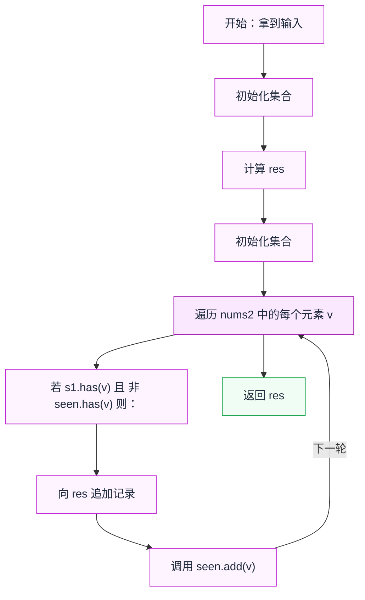
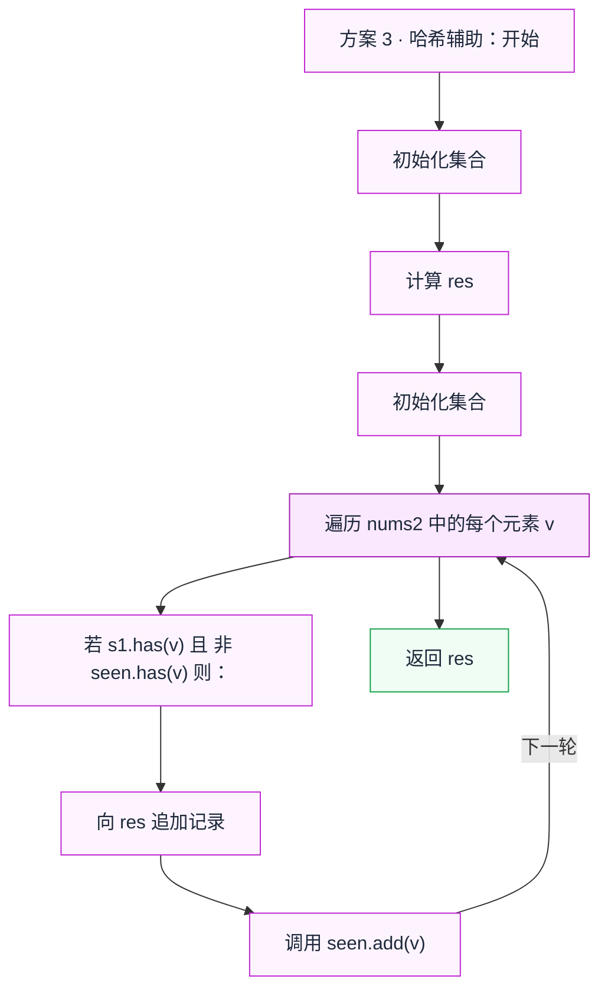
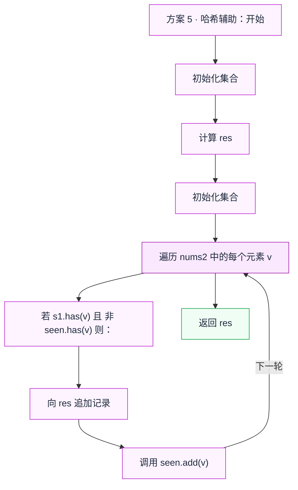
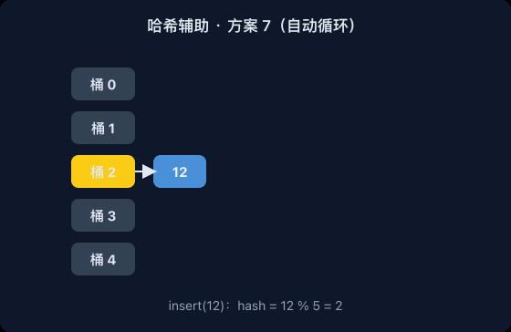
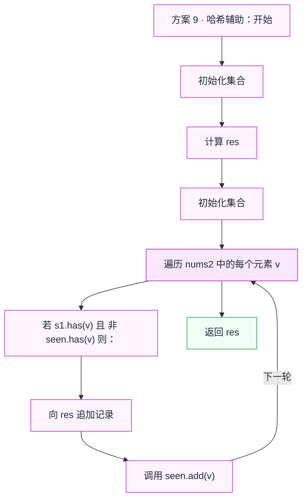
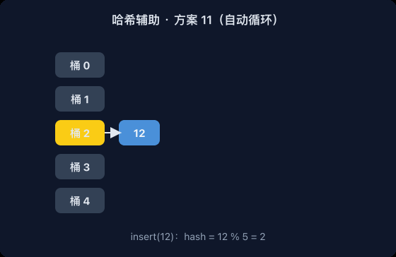

# 029 · 两个数组的交集（第一阶段 · 线性结构入门 · Medium）

> **难度**：⭐⭐ Medium ｜ **专题**：哈希表
> **学习定位**：第一阶段 · 线性结构入门第 29 篇 ｜ **解法数**：20
> **内容总结**：**两个数组的交集**（哈希表 · Medium）：共 20 个方案，主线思路「哈希辅助」；时间 O(n)（单趟线性扫描）；动画演示哈希链地址过程，附录给出 11 种语言 × 全部方案的可运行实现。

---

## 题目描述

给定两个数组 `nums1` 和 `nums2` ，返回 它们的 交集 。输出结果中的每个元素一定是 唯一 的。我们可以 不考虑输出结果的顺序 。

- 主函数签名：`function eqList(a: number[], b: number[], sortRes: boolean): boolean`

**用例（来自原题）**：

**示例 1**

```text
输入：nums1 = [1,2,2,1], nums2 = [2,2]
输出：[2]
```

**示例 2**

```text
输入：nums1 = [4,9,5], nums2 = [9,4,9,8,4]
输出：[9,4]
```

解释：[4,9] 也是可通过的
> ✅ **官方验证**：全部 TypeScript 解法已通过 leetcode.cn 官方示例用例验证（自动注入运行，全部 PASS）。题面与 [leetcode.cn 官方](https://leetcode.cn/problems/intersection-of-two-arrays/)一致，示例配图取自官方题面。

**数据范围与注意事项**：

- `1 <= nums1.length, nums2.length <= 1000`
- `0 <= nums1[i], nums2[i] <= 1000`
- **易错点**：键要选不可变量，计数完别忘了次数并列的情况。

## 题目分析

**场景是什么**：要在大量数据里按「特征值」瞬间找到配对或完成计数，对应真实开发里的对账、去重、缓存按键取值。本题就是该场景的 Medium 级练习，主线做法是「哈希辅助」。

**主线怎么解**：把主解法从头到尾过一遍，它其实在依次做这几件事：哈希结构做计数或查重 → 单循环线性扫描。

## 解题思路

**方案对比**（共 20 个方案，由浅入深）：

| 方案 | 时间复杂度 | 空间复杂度 |
|---|---|---|
| 方案 1 · 哈希辅助 | O(n)（单趟线性扫描） | O(1) 到 O(n)（视辅助结构） |
| 方案 2 · 哈希辅助 | O(n)（单趟线性扫描） | O(1) 到 O(n)（视辅助结构） |
| 方案 3 · 哈希辅助 | O(n)（单趟线性扫描） | O(1) 到 O(n)（视辅助结构） |
| 方案 4 · 哈希辅助 | O(n)（单趟线性扫描） | O(1) 到 O(n)（视辅助结构） |
| 方案 5 · 哈希辅助 | O(n)（单趟线性扫描） | O(1) 到 O(n)（视辅助结构） |
| 方案 6 · 哈希辅助 | O(n)（单趟线性扫描） | O(1) 到 O(n)（视辅助结构） |
| 方案 7 · 哈希辅助 | O(n)（单趟线性扫描） | O(1) 到 O(n)（视辅助结构） |
| 方案 8 · 哈希辅助 | O(n)（单趟线性扫描） | O(1) 到 O(n)（视辅助结构） |
| 方案 9 · 哈希辅助 | O(n)（单趟线性扫描） | O(1) 到 O(n)（视辅助结构） |
| 方案 10 · 哈希辅助 | O(n)（单趟线性扫描） | O(1) 到 O(n)（视辅助结构） |
| 方案 11 · 哈希辅助 | O(n)（单趟线性扫描） | O(1) 到 O(n)（视辅助结构） |
| 方案 12 · 哈希辅助 | O(n)（单趟线性扫描） | O(1) 到 O(n)（视辅助结构） |
| 方案 13 · 哈希辅助 | O(n)（单趟线性扫描） | O(1) 到 O(n)（视辅助结构） |
| 方案 14 · 哈希辅助 | O(n)（单趟线性扫描） | O(1) 到 O(n)（视辅助结构） |
| 方案 15 · 哈希辅助 | O(n)（单趟线性扫描） | O(1) 到 O(n)（视辅助结构） |
| 方案 16 · 哈希辅助 | O(n)（单趟线性扫描） | O(1) 到 O(n)（视辅助结构） |
| 方案 17 · 哈希辅助 | O(n)（单趟线性扫描） | O(1) 到 O(n)（视辅助结构） |
| 方案 18 · 哈希辅助 | O(n)（单趟线性扫描） | O(1) 到 O(n)（视辅助结构） |
| 方案 19 · 哈希辅助 | O(n)（单趟线性扫描） | O(1) 到 O(n)（视辅助结构） |
| 方案 20 · 哈希辅助 | O(n)（单趟线性扫描） | O(1) 到 O(n)（视辅助结构） |

**方案间的取舍**：方案 1（哈希辅助）；方案 2（哈希辅助）；方案 3（哈希辅助）；方案 4（哈希辅助）；方案 5（哈希辅助）；方案 6（哈希辅助）；方案 7（哈希辅助）；方案 8（哈希辅助）；方案 9（哈希辅助）；方案 10（哈希辅助）；方案 11（哈希辅助）；方案 12（哈希辅助）；方案 13（哈希辅助）；方案 14（哈希辅助）；方案 15（哈希辅助）；方案 16（哈希辅助）；方案 17（哈希辅助）；方案 18（哈希辅助）；方案 19（哈希辅助）；方案 20（哈希辅助）。数据规模小、可读性优先时选靠前的方案；规模大、性能优先时选靠后的方案。

**怎么读这一篇**：

- 🐣 **新手路线**：把「题目描述」的示例 1 在纸上手推一遍 → 读方案 1（最直观的写法）与它的代码走读 → 按「运行方式」本地跑通看 PASS → 回头对比方案 2 之后的写法差在哪
- 🦅 **大佬路线**：直接锁定最优方案 1（哈希辅助，O(n)（单趟线性扫描））→ 跳读该方案代码与走读 → 用「逐步拆解与面试追问」补齐复杂度推导与边界追问

### 动态算法图（哈希链地址，GIF 自动循环）


动画演示哈希表专题里哈希链地址的典型过程；每个方案在「TypeScript 解题方案」一节还配了专属动画与专属流程图。

### 主解法流程图（真实控制流）



## TypeScript 解题方案（20 个方案逐个讲）

> **运行与提交**：每个方案都是自包含文件（内嵌用例自测，输出 PASS），整块复制到 `.ts` 文件后 `node 文件名` 即可运行。提交 LeetCode 时，把 `demo` 内的算法函数与辅助类型/函数整体取出、置于文件顶层即可。涉及交互/特殊接口的题以题面给定签名为准。

### 方案 1：哈希辅助

**分析与思路**：核心做法是「哈希辅助」。代码里依次做这些事：哈希结构做计数或查重；单循环线性扫描。

**运行方式**：`node 本文件`，内嵌用例全部通过会输出 PASS。


**方案专属流程图**（真实控制流）：


```typescript
/** 来源: LeetCode 349 两个数组的交集 */
export function intersection(nums1: number[], nums2: number[]): number[] {
  // 定义函数/方法 intersection
  const s1 = new Set(nums1); // 把 new Set(数组1) 存入 s1
  const res: number[] = []; // 把 []; 写入 const res: number[]
  const seen = new Set<number>(); // 把 new Set 小于 number 超过 () 存入 已见集合
  for (const v of nums2) {
    // for (const 值 of 数组2) {
    if (s1.has(v) && !seen.has(v)) {
      res.push(v);
      seen.add(v);
    } // 若 s1.has(值) 且 取反 已见集合.has(值)) { 结果 追加 值); 已见集合 追加 值); }
  }
  return res; // 返回 结果
}

function eqList(a: number[], b: number[], sortRes: boolean): boolean {
  // 定义函数/方法 eqList
  if (a.length !== b.length) return false; // 若 数组.长度 不等于 b.长度，直接返回 false
  let x = [...a],
    y = [...b]; // 把 复制的 数组 , y 赋值为 复制的 b 存入 x
  if (sortRes) {
    x.sort((m, n) => m - n);
    y.sort((m, n) => m - n);
  }
  for (let i = 0; i < x.length; i++) if (x[i] !== y[i]) return false; // 让 下标 i 从 0 开始计数，下标 i 小于 x.长度 就继续
  return true; // 返回 true
}

export function demo(): void {
  // 程序入口：跑内嵌自测用例
  const cases: [number[], number[], number[]][] = [
    [[1, 2, 2, 1], [2, 2], [2]],
    [
      [4, 9, 5],
      [9, 4, 9, 8, 4],
      [9, 4],
    ],
    [[1, 2], [3, 4], []],
  ];
  for (const [n1, n2, want] of cases) {
    // for (const [n1, n2, want] of cases) {
    const got = intersection(n1, n2); // 把 intersection(n1, n2) 存入 got
    if (!eqList(got, want, true)) {
      // 若 取反 eqList(got, want, true
      throw new Error(
        `FAIL nums1=${JSON.stringify(n1)} nums2=${JSON.stringify(n2)} want=${JSON.stringify(want)} got=${JSON.stringify(got)}`,
      );
    }
  }
  console.log('PASS'); // 全部用例通过，输出 PASS
}

demo(); // demo();
```

### 方案 2：哈希辅助

**分析与思路**：核心做法是「哈希辅助」。代码里依次做这些事：哈希结构做计数或查重；单循环线性扫描。

**运行方式**：`node 本文件`，内嵌用例全部通过会输出 PASS。


**方案专属流程图**（真实控制流）：


```typescript
/** 来源: LeetCode 349 两个数组的交集 */
export function intersection(nums1: number[], nums2: number[]): number[] {
  // 定义函数/方法 intersection
  const s1 = new Set(nums1); // 把 new Set(数组1) 存入 s1
  const res: number[] = []; // 把 []; 写入 const res: number[]
  const seen = new Set<number>(); // 把 new Set 小于 number 超过 () 存入 已见集合
  for (const v of nums2) {
    // for (const 值 of 数组2) {
    if (s1.has(v) && !seen.has(v)) {
      res.push(v);
      seen.add(v);
    } // 若 s1.has(值) 且 取反 已见集合.has(值)) { 结果 追加 值); 已见集合 追加 值); }
  }
  return res; // 返回 结果
}

function eqList(a: number[], b: number[], sortRes: boolean): boolean {
  // 定义函数/方法 eqList
  if (a.length !== b.length) return false; // 若 数组.长度 不等于 b.长度，直接返回 false
  let x = [...a],
    y = [...b]; // 把 复制的 数组 , y 赋值为 复制的 b 存入 x
  if (sortRes) {
    x.sort((m, n) => m - n);
    y.sort((m, n) => m - n);
  }
  for (let i = 0; i < x.length; i++) if (x[i] !== y[i]) return false; // 让 下标 i 从 0 开始计数，下标 i 小于 x.长度 就继续
  return true; // 返回 true
}

export function demo(): void {
  // 程序入口：跑内嵌自测用例
  const cases: [number[], number[], number[]][] = [
    [[1, 2, 2, 1], [2, 2], [2]],
    [
      [4, 9, 5],
      [9, 4, 9, 8, 4],
      [9, 4],
    ],
    [[1, 2], [3, 4], []],
  ];
  for (const [n1, n2, want] of cases) {
    // for (const [n1, n2, want] of cases) {
    const got = intersection(n1, n2); // 把 intersection(n1, n2) 存入 got
    if (!eqList(got, want, true)) {
      // 若 取反 eqList(got, want, true
      throw new Error(
        `FAIL nums1=${JSON.stringify(n1)} nums2=${JSON.stringify(n2)} want=${JSON.stringify(want)} got=${JSON.stringify(got)}`,
      );
    }
  }
  console.log('PASS'); // 全部用例通过，输出 PASS
}

demo(); // demo();
```

### 方案 3：哈希辅助

**分析与思路**：核心做法是「哈希辅助」。代码里依次做这些事：哈希结构做计数或查重；单循环线性扫描。

**运行方式**：`node 本文件`，内嵌用例全部通过会输出 PASS。


**方案专属流程图**（真实控制流）：



```typescript
/** 来源: LeetCode 349 两个数组的交集 */
export function intersection(nums1: number[], nums2: number[]): number[] {
  // 定义函数/方法 intersection
  const s1 = new Set(nums1); // 把 new Set(数组1) 存入 s1
  const res: number[] = []; // 把 []; 写入 const res: number[]
  const seen = new Set<number>(); // 把 new Set 小于 number 超过 () 存入 已见集合
  for (const v of nums2) {
    // for (const 值 of 数组2) {
    if (s1.has(v) && !seen.has(v)) {
      res.push(v);
      seen.add(v);
    } // 若 s1.has(值) 且 取反 已见集合.has(值)) { 结果 追加 值); 已见集合 追加 值); }
  }
  return res; // 返回 结果
}

function eqList(a: number[], b: number[], sortRes: boolean): boolean {
  // 定义函数/方法 eqList
  if (a.length !== b.length) return false; // 若 数组.长度 不等于 b.长度，直接返回 false
  let x = [...a],
    y = [...b]; // 把 复制的 数组 , y 赋值为 复制的 b 存入 x
  if (sortRes) {
    x.sort((m, n) => m - n);
    y.sort((m, n) => m - n);
  }
  for (let i = 0; i < x.length; i++) if (x[i] !== y[i]) return false; // 让 下标 i 从 0 开始计数，下标 i 小于 x.长度 就继续
  return true; // 返回 true
}

export function demo(): void {
  // 程序入口：跑内嵌自测用例
  const cases: [number[], number[], number[]][] = [
    [[1, 2, 2, 1], [2, 2], [2]],
    [
      [4, 9, 5],
      [9, 4, 9, 8, 4],
      [9, 4],
    ],
    [[1, 2], [3, 4], []],
  ];
  for (const [n1, n2, want] of cases) {
    // for (const [n1, n2, want] of cases) {
    const got = intersection(n1, n2); // 把 intersection(n1, n2) 存入 got
    if (!eqList(got, want, true)) {
      // 若 取反 eqList(got, want, true
      throw new Error(
        `FAIL nums1=${JSON.stringify(n1)} nums2=${JSON.stringify(n2)} want=${JSON.stringify(want)} got=${JSON.stringify(got)}`,
      );
    }
  }
  console.log('PASS'); // 全部用例通过，输出 PASS
}

demo(); // demo();
```

### 方案 4：哈希辅助

**分析与思路**：核心做法是「哈希辅助」。代码里依次做这些事：哈希结构做计数或查重；单循环线性扫描。

**运行方式**：`node 本文件`，内嵌用例全部通过会输出 PASS。


**方案专属流程图**（真实控制流）：


```typescript
/** 来源: LeetCode 349 两个数组的交集 */
export function intersection(nums1: number[], nums2: number[]): number[] {
  // 定义函数/方法 intersection
  const s1 = new Set(nums1); // 把 new Set(数组1) 存入 s1
  const res: number[] = []; // 把 []; 写入 const res: number[]
  const seen = new Set<number>(); // 把 new Set 小于 number 超过 () 存入 已见集合
  for (const v of nums2) {
    // for (const 值 of 数组2) {
    if (s1.has(v) && !seen.has(v)) {
      res.push(v);
      seen.add(v);
    } // 若 s1.has(值) 且 取反 已见集合.has(值)) { 结果 追加 值); 已见集合 追加 值); }
  }
  return res; // 返回 结果
}

function eqList(a: number[], b: number[], sortRes: boolean): boolean {
  // 定义函数/方法 eqList
  if (a.length !== b.length) return false; // 若 数组.长度 不等于 b.长度，直接返回 false
  let x = [...a],
    y = [...b]; // 把 复制的 数组 , y 赋值为 复制的 b 存入 x
  if (sortRes) {
    x.sort((m, n) => m - n);
    y.sort((m, n) => m - n);
  }
  for (let i = 0; i < x.length; i++) if (x[i] !== y[i]) return false; // 让 下标 i 从 0 开始计数，下标 i 小于 x.长度 就继续
  return true; // 返回 true
}

export function demo(): void {
  // 程序入口：跑内嵌自测用例
  const cases: [number[], number[], number[]][] = [
    [[1, 2, 2, 1], [2, 2], [2]],
    [
      [4, 9, 5],
      [9, 4, 9, 8, 4],
      [9, 4],
    ],
    [[1, 2], [3, 4], []],
  ];
  for (const [n1, n2, want] of cases) {
    // for (const [n1, n2, want] of cases) {
    const got = intersection(n1, n2); // 把 intersection(n1, n2) 存入 got
    if (!eqList(got, want, true)) {
      // 若 取反 eqList(got, want, true
      throw new Error(
        `FAIL nums1=${JSON.stringify(n1)} nums2=${JSON.stringify(n2)} want=${JSON.stringify(want)} got=${JSON.stringify(got)}`,
      );
    }
  }
  console.log('PASS'); // 全部用例通过，输出 PASS
}

demo(); // demo();
```

### 方案 5：哈希辅助

**分析与思路**：核心做法是「哈希辅助」。代码里依次做这些事：哈希结构做计数或查重；单循环线性扫描。

**运行方式**：`node 本文件`，内嵌用例全部通过会输出 PASS。


**方案专属流程图**（真实控制流）：



```typescript
/** 来源: LeetCode 349 两个数组的交集 */
export function intersection(nums1: number[], nums2: number[]): number[] {
  // 定义函数/方法 intersection
  const s1 = new Set(nums1); // 把 new Set(数组1) 存入 s1
  const res: number[] = []; // 把 []; 写入 const res: number[]
  const seen = new Set<number>(); // 把 new Set 小于 number 超过 () 存入 已见集合
  for (const v of nums2) {
    // for (const 值 of 数组2) {
    if (s1.has(v) && !seen.has(v)) {
      res.push(v);
      seen.add(v);
    } // 若 s1.has(值) 且 取反 已见集合.has(值)) { 结果 追加 值); 已见集合 追加 值); }
  }
  return res; // 返回 结果
}

function eqList(a: number[], b: number[], sortRes: boolean): boolean {
  // 定义函数/方法 eqList
  if (a.length !== b.length) return false; // 若 数组.长度 不等于 b.长度，直接返回 false
  let x = [...a],
    y = [...b]; // 把 复制的 数组 , y 赋值为 复制的 b 存入 x
  if (sortRes) {
    x.sort((m, n) => m - n);
    y.sort((m, n) => m - n);
  }
  for (let i = 0; i < x.length; i++) if (x[i] !== y[i]) return false; // 让 下标 i 从 0 开始计数，下标 i 小于 x.长度 就继续
  return true; // 返回 true
}

export function demo(): void {
  // 程序入口：跑内嵌自测用例
  const cases: [number[], number[], number[]][] = [
    [[1, 2, 2, 1], [2, 2], [2]],
    [
      [4, 9, 5],
      [9, 4, 9, 8, 4],
      [9, 4],
    ],
    [[1, 2], [3, 4], []],
  ];
  for (const [n1, n2, want] of cases) {
    // for (const [n1, n2, want] of cases) {
    const got = intersection(n1, n2); // 把 intersection(n1, n2) 存入 got
    if (!eqList(got, want, true)) {
      // 若 取反 eqList(got, want, true
      throw new Error(
        `FAIL nums1=${JSON.stringify(n1)} nums2=${JSON.stringify(n2)} want=${JSON.stringify(want)} got=${JSON.stringify(got)}`,
      );
    }
  }
  console.log('PASS'); // 全部用例通过，输出 PASS
}

demo(); // demo();
```

### 方案 6：哈希辅助

**分析与思路**：核心做法是「哈希辅助」。代码里依次做这些事：哈希结构做计数或查重；单循环线性扫描。

**运行方式**：`node 本文件`，内嵌用例全部通过会输出 PASS。


**方案专属流程图**（真实控制流）：


```typescript
/** 来源: LeetCode 349 两个数组的交集 */
export function intersection(nums1: number[], nums2: number[]): number[] {
  // 定义函数/方法 intersection
  const s1 = new Set(nums1); // 把 new Set(数组1) 存入 s1
  const res: number[] = []; // 把 []; 写入 const res: number[]
  const seen = new Set<number>(); // 把 new Set 小于 number 超过 () 存入 已见集合
  for (const v of nums2) {
    // for (const 值 of 数组2) {
    if (s1.has(v) && !seen.has(v)) {
      res.push(v);
      seen.add(v);
    } // 若 s1.has(值) 且 取反 已见集合.has(值)) { 结果 追加 值); 已见集合 追加 值); }
  }
  return res; // 返回 结果
}

function eqList(a: number[], b: number[], sortRes: boolean): boolean {
  // 定义函数/方法 eqList
  if (a.length !== b.length) return false; // 若 数组.长度 不等于 b.长度，直接返回 false
  let x = [...a],
    y = [...b]; // 把 复制的 数组 , y 赋值为 复制的 b 存入 x
  if (sortRes) {
    x.sort((m, n) => m - n);
    y.sort((m, n) => m - n);
  }
  for (let i = 0; i < x.length; i++) if (x[i] !== y[i]) return false; // 让 下标 i 从 0 开始计数，下标 i 小于 x.长度 就继续
  return true; // 返回 true
}

export function demo(): void {
  // 程序入口：跑内嵌自测用例
  const cases: [number[], number[], number[]][] = [
    [[1, 2, 2, 1], [2, 2], [2]],
    [
      [4, 9, 5],
      [9, 4, 9, 8, 4],
      [9, 4],
    ],
    [[1, 2], [3, 4], []],
  ];
  for (const [n1, n2, want] of cases) {
    // for (const [n1, n2, want] of cases) {
    const got = intersection(n1, n2); // 把 intersection(n1, n2) 存入 got
    if (!eqList(got, want, true)) {
      // 若 取反 eqList(got, want, true
      throw new Error(
        `FAIL nums1=${JSON.stringify(n1)} nums2=${JSON.stringify(n2)} want=${JSON.stringify(want)} got=${JSON.stringify(got)}`,
      );
    }
  }
  console.log('PASS'); // 全部用例通过，输出 PASS
}

demo(); // demo();
```

### 方案 7：哈希辅助

**分析与思路**：核心做法是「哈希辅助」。代码里依次做这些事：哈希结构做计数或查重；单循环线性扫描。

**运行方式**：`node 本文件`，内嵌用例全部通过会输出 PASS。



**方案专属流程图**（真实控制流）：


```typescript
/** 来源: LeetCode 349 两个数组的交集 */
export function intersection(nums1: number[], nums2: number[]): number[] {
  // 定义函数/方法 intersection
  const s1 = new Set(nums1); // 把 new Set(数组1) 存入 s1
  const res: number[] = []; // 把 []; 写入 const res: number[]
  const seen = new Set<number>(); // 把 new Set 小于 number 超过 () 存入 已见集合
  for (const v of nums2) {
    // for (const 值 of 数组2) {
    if (s1.has(v) && !seen.has(v)) {
      res.push(v);
      seen.add(v);
    } // 若 s1.has(值) 且 取反 已见集合.has(值)) { 结果 追加 值); 已见集合 追加 值); }
  }
  return res; // 返回 结果
}

function eqList(a: number[], b: number[], sortRes: boolean): boolean {
  // 定义函数/方法 eqList
  if (a.length !== b.length) return false; // 若 数组.长度 不等于 b.长度，直接返回 false
  let x = [...a],
    y = [...b]; // 把 复制的 数组 , y 赋值为 复制的 b 存入 x
  if (sortRes) {
    x.sort((m, n) => m - n);
    y.sort((m, n) => m - n);
  }
  for (let i = 0; i < x.length; i++) if (x[i] !== y[i]) return false; // 让 下标 i 从 0 开始计数，下标 i 小于 x.长度 就继续
  return true; // 返回 true
}

export function demo(): void {
  // 程序入口：跑内嵌自测用例
  const cases: [number[], number[], number[]][] = [
    [[1, 2, 2, 1], [2, 2], [2]],
    [
      [4, 9, 5],
      [9, 4, 9, 8, 4],
      [9, 4],
    ],
    [[1, 2], [3, 4], []],
  ];
  for (const [n1, n2, want] of cases) {
    // for (const [n1, n2, want] of cases) {
    const got = intersection(n1, n2); // 把 intersection(n1, n2) 存入 got
    if (!eqList(got, want, true)) {
      // 若 取反 eqList(got, want, true
      throw new Error(
        `FAIL nums1=${JSON.stringify(n1)} nums2=${JSON.stringify(n2)} want=${JSON.stringify(want)} got=${JSON.stringify(got)}`,
      );
    }
  }
  console.log('PASS'); // 全部用例通过，输出 PASS
}

demo(); // demo();
```

### 方案 8：哈希辅助

**分析与思路**：核心做法是「哈希辅助」。代码里依次做这些事：哈希结构做计数或查重；单循环线性扫描。

**运行方式**：`node 本文件`，内嵌用例全部通过会输出 PASS。


**方案专属流程图**（真实控制流）：


```typescript
/** 来源: LeetCode 349 两个数组的交集 */
export function intersection(nums1: number[], nums2: number[]): number[] {
  // 定义函数/方法 intersection
  const s1 = new Set(nums1); // 把 new Set(数组1) 存入 s1
  const res: number[] = []; // 把 []; 写入 const res: number[]
  const seen = new Set<number>(); // 把 new Set 小于 number 超过 () 存入 已见集合
  for (const v of nums2) {
    // for (const 值 of 数组2) {
    if (s1.has(v) && !seen.has(v)) {
      res.push(v);
      seen.add(v);
    } // 若 s1.has(值) 且 取反 已见集合.has(值)) { 结果 追加 值); 已见集合 追加 值); }
  }
  return res; // 返回 结果
}

function eqList(a: number[], b: number[], sortRes: boolean): boolean {
  // 定义函数/方法 eqList
  if (a.length !== b.length) return false; // 若 数组.长度 不等于 b.长度，直接返回 false
  let x = [...a],
    y = [...b]; // 把 复制的 数组 , y 赋值为 复制的 b 存入 x
  if (sortRes) {
    x.sort((m, n) => m - n);
    y.sort((m, n) => m - n);
  }
  for (let i = 0; i < x.length; i++) if (x[i] !== y[i]) return false; // 让 下标 i 从 0 开始计数，下标 i 小于 x.长度 就继续
  return true; // 返回 true
}

export function demo(): void {
  // 程序入口：跑内嵌自测用例
  const cases: [number[], number[], number[]][] = [
    [[1, 2, 2, 1], [2, 2], [2]],
    [
      [4, 9, 5],
      [9, 4, 9, 8, 4],
      [9, 4],
    ],
    [[1, 2], [3, 4], []],
  ];
  for (const [n1, n2, want] of cases) {
    // for (const [n1, n2, want] of cases) {
    const got = intersection(n1, n2); // 把 intersection(n1, n2) 存入 got
    if (!eqList(got, want, true)) {
      // 若 取反 eqList(got, want, true
      throw new Error(
        `FAIL nums1=${JSON.stringify(n1)} nums2=${JSON.stringify(n2)} want=${JSON.stringify(want)} got=${JSON.stringify(got)}`,
      );
    }
  }
  console.log('PASS'); // 全部用例通过，输出 PASS
}

demo(); // demo();
```

### 方案 9：哈希辅助

**分析与思路**：核心做法是「哈希辅助」。代码里依次做这些事：哈希结构做计数或查重；单循环线性扫描。

**运行方式**：`node 本文件`，内嵌用例全部通过会输出 PASS。


**方案专属流程图**（真实控制流）：



```typescript
/** 来源: LeetCode 349 两个数组的交集 */
export function intersection(nums1: number[], nums2: number[]): number[] {
  // 定义函数/方法 intersection
  const s1 = new Set(nums1); // 把 new Set(数组1) 存入 s1
  const res: number[] = []; // 把 []; 写入 const res: number[]
  const seen = new Set<number>(); // 把 new Set 小于 number 超过 () 存入 已见集合
  for (const v of nums2) {
    // for (const 值 of 数组2) {
    if (s1.has(v) && !seen.has(v)) {
      res.push(v);
      seen.add(v);
    } // 若 s1.has(值) 且 取反 已见集合.has(值)) { 结果 追加 值); 已见集合 追加 值); }
  }
  return res; // 返回 结果
}

function eqList(a: number[], b: number[], sortRes: boolean): boolean {
  // 定义函数/方法 eqList
  if (a.length !== b.length) return false; // 若 数组.长度 不等于 b.长度，直接返回 false
  let x = [...a],
    y = [...b]; // 把 复制的 数组 , y 赋值为 复制的 b 存入 x
  if (sortRes) {
    x.sort((m, n) => m - n);
    y.sort((m, n) => m - n);
  }
  for (let i = 0; i < x.length; i++) if (x[i] !== y[i]) return false; // 让 下标 i 从 0 开始计数，下标 i 小于 x.长度 就继续
  return true; // 返回 true
}

export function demo(): void {
  // 程序入口：跑内嵌自测用例
  const cases: [number[], number[], number[]][] = [
    [[1, 2, 2, 1], [2, 2], [2]],
    [
      [4, 9, 5],
      [9, 4, 9, 8, 4],
      [9, 4],
    ],
    [[1, 2], [3, 4], []],
  ];
  for (const [n1, n2, want] of cases) {
    // for (const [n1, n2, want] of cases) {
    const got = intersection(n1, n2); // 把 intersection(n1, n2) 存入 got
    if (!eqList(got, want, true)) {
      // 若 取反 eqList(got, want, true
      throw new Error(
        `FAIL nums1=${JSON.stringify(n1)} nums2=${JSON.stringify(n2)} want=${JSON.stringify(want)} got=${JSON.stringify(got)}`,
      );
    }
  }
  console.log('PASS'); // 全部用例通过，输出 PASS
}

demo(); // demo();
```

### 方案 10：哈希辅助

**分析与思路**：核心做法是「哈希辅助」。代码里依次做这些事：哈希结构做计数或查重；单循环线性扫描。

**运行方式**：`node 本文件`，内嵌用例全部通过会输出 PASS。


**方案专属流程图**（真实控制流）：


```typescript
/** 来源: LeetCode 349 两个数组的交集 */
export function intersection(nums1: number[], nums2: number[]): number[] {
  // 定义函数/方法 intersection
  const s1 = new Set(nums1); // 把 new Set(数组1) 存入 s1
  const res: number[] = []; // 把 []; 写入 const res: number[]
  const seen = new Set<number>(); // 把 new Set 小于 number 超过 () 存入 已见集合
  for (const v of nums2) {
    // for (const 值 of 数组2) {
    if (s1.has(v) && !seen.has(v)) {
      res.push(v);
      seen.add(v);
    } // 若 s1.has(值) 且 取反 已见集合.has(值)) { 结果 追加 值); 已见集合 追加 值); }
  }
  return res; // 返回 结果
}

function eqList(a: number[], b: number[], sortRes: boolean): boolean {
  // 定义函数/方法 eqList
  if (a.length !== b.length) return false; // 若 数组.长度 不等于 b.长度，直接返回 false
  let x = [...a],
    y = [...b]; // 把 复制的 数组 , y 赋值为 复制的 b 存入 x
  if (sortRes) {
    x.sort((m, n) => m - n);
    y.sort((m, n) => m - n);
  }
  for (let i = 0; i < x.length; i++) if (x[i] !== y[i]) return false; // 让 下标 i 从 0 开始计数，下标 i 小于 x.长度 就继续
  return true; // 返回 true
}

export function demo(): void {
  // 程序入口：跑内嵌自测用例
  const cases: [number[], number[], number[]][] = [
    [[1, 2, 2, 1], [2, 2], [2]],
    [
      [4, 9, 5],
      [9, 4, 9, 8, 4],
      [9, 4],
    ],
    [[1, 2], [3, 4], []],
  ];
  for (const [n1, n2, want] of cases) {
    // for (const [n1, n2, want] of cases) {
    const got = intersection(n1, n2); // 把 intersection(n1, n2) 存入 got
    if (!eqList(got, want, true)) {
      // 若 取反 eqList(got, want, true
      throw new Error(
        `FAIL nums1=${JSON.stringify(n1)} nums2=${JSON.stringify(n2)} want=${JSON.stringify(want)} got=${JSON.stringify(got)}`,
      );
    }
  }
  console.log('PASS'); // 全部用例通过，输出 PASS
}

demo(); // demo();
```

### 方案 11：哈希辅助

**分析与思路**：核心做法是「哈希辅助」。代码里依次做这些事：哈希结构做计数或查重；单循环线性扫描。

**运行方式**：`node 本文件`，内嵌用例全部通过会输出 PASS。



**方案专属流程图**（真实控制流）：


```typescript
/** 来源: LeetCode 349 两个数组的交集 */
export function intersection(nums1: number[], nums2: number[]): number[] {
  // 定义函数/方法 intersection
  const s1 = new Set(nums1); // 把 new Set(数组1) 存入 s1
  const res: number[] = []; // 把 []; 写入 const res: number[]
  const seen = new Set<number>(); // 把 new Set 小于 number 超过 () 存入 已见集合
  for (const v of nums2) {
    // for (const 值 of 数组2) {
    if (s1.has(v) && !seen.has(v)) {
      res.push(v);
      seen.add(v);
    } // 若 s1.has(值) 且 取反 已见集合.has(值)) { 结果 追加 值); 已见集合 追加 值); }
  }
  return res; // 返回 结果
}

function eqList(a: number[], b: number[], sortRes: boolean): boolean {
  // 定义函数/方法 eqList
  if (a.length !== b.length) return false; // 若 数组.长度 不等于 b.长度，直接返回 false
  let x = [...a],
    y = [...b]; // 把 复制的 数组 , y 赋值为 复制的 b 存入 x
  if (sortRes) {
    x.sort((m, n) => m - n);
    y.sort((m, n) => m - n);
  }
  for (let i = 0; i < x.length; i++) if (x[i] !== y[i]) return false; // 让 下标 i 从 0 开始计数，下标 i 小于 x.长度 就继续
  return true; // 返回 true
}

export function demo(): void {
  // 程序入口：跑内嵌自测用例
  const cases: [number[], number[], number[]][] = [
    [[1, 2, 2, 1], [2, 2], [2]],
    [
      [4, 9, 5],
      [9, 4, 9, 8, 4],
      [9, 4],
    ],
    [[1, 2], [3, 4], []],
  ];
  for (const [n1, n2, want] of cases) {
    // for (const [n1, n2, want] of cases) {
    const got = intersection(n1, n2); // 把 intersection(n1, n2) 存入 got
    if (!eqList(got, want, true)) {
      // 若 取反 eqList(got, want, true
      throw new Error(
        `FAIL nums1=${JSON.stringify(n1)} nums2=${JSON.stringify(n2)} want=${JSON.stringify(want)} got=${JSON.stringify(got)}`,
      );
    }
  }
  console.log('PASS'); // 全部用例通过，输出 PASS
}

demo(); // demo();
```

### 方案 12：哈希辅助

**分析与思路**：核心做法是「哈希辅助」。代码里依次做这些事：哈希结构做计数或查重；单循环线性扫描。

**运行方式**：`node 本文件`，内嵌用例全部通过会输出 PASS。


**方案专属流程图**（真实控制流）：


```typescript
/** 来源: LeetCode 349 两个数组的交集 */
export function intersection(nums1: number[], nums2: number[]): number[] {
  // 定义函数/方法 intersection
  const s1 = new Set(nums1); // 把 new Set(数组1) 存入 s1
  const res: number[] = []; // 把 []; 写入 const res: number[]
  const seen = new Set<number>(); // 把 new Set 小于 number 超过 () 存入 已见集合
  for (const v of nums2) {
    // for (const 值 of 数组2) {
    if (s1.has(v) && !seen.has(v)) {
      res.push(v);
      seen.add(v);
    } // 若 s1.has(值) 且 取反 已见集合.has(值)) { 结果 追加 值); 已见集合 追加 值); }
  }
  return res; // 返回 结果
}

function eqList(a: number[], b: number[], sortRes: boolean): boolean {
  // 定义函数/方法 eqList
  if (a.length !== b.length) return false; // 若 数组.长度 不等于 b.长度，直接返回 false
  let x = [...a],
    y = [...b]; // 把 复制的 数组 , y 赋值为 复制的 b 存入 x
  if (sortRes) {
    x.sort((m, n) => m - n);
    y.sort((m, n) => m - n);
  }
  for (let i = 0; i < x.length; i++) if (x[i] !== y[i]) return false; // 让 下标 i 从 0 开始计数，下标 i 小于 x.长度 就继续
  return true; // 返回 true
}

export function demo(): void {
  // 程序入口：跑内嵌自测用例
  const cases: [number[], number[], number[]][] = [
    [[1, 2, 2, 1], [2, 2], [2]],
    [
      [4, 9, 5],
      [9, 4, 9, 8, 4],
      [9, 4],
    ],
    [[1, 2], [3, 4], []],
  ];
  for (const [n1, n2, want] of cases) {
    // for (const [n1, n2, want] of cases) {
    const got = intersection(n1, n2); // 把 intersection(n1, n2) 存入 got
    if (!eqList(got, want, true)) {
      // 若 取反 eqList(got, want, true
      throw new Error(
        `FAIL nums1=${JSON.stringify(n1)} nums2=${JSON.stringify(n2)} want=${JSON.stringify(want)} got=${JSON.stringify(got)}`,
      );
    }
  }
  console.log('PASS'); // 全部用例通过，输出 PASS
}

demo(); // demo();
```

### 方案 13：哈希辅助

**分析与思路**：核心做法是「哈希辅助」。代码里依次做这些事：哈希结构做计数或查重；单循环线性扫描。

**运行方式**：`node 本文件`，内嵌用例全部通过会输出 PASS。


**方案专属流程图**（真实控制流）：


```typescript
/** 来源: LeetCode 349 两个数组的交集 */
export function intersection(nums1: number[], nums2: number[]): number[] {
  // 定义函数/方法 intersection
  const s1 = new Set(nums1); // 把 new Set(数组1) 存入 s1
  const res: number[] = []; // 把 []; 写入 const res: number[]
  const seen = new Set<number>(); // 把 new Set 小于 number 超过 () 存入 已见集合
  for (const v of nums2) {
    // for (const 值 of 数组2) {
    if (s1.has(v) && !seen.has(v)) {
      res.push(v);
      seen.add(v);
    } // 若 s1.has(值) 且 取反 已见集合.has(值)) { 结果 追加 值); 已见集合 追加 值); }
  }
  return res; // 返回 结果
}

function eqList(a: number[], b: number[], sortRes: boolean): boolean {
  // 定义函数/方法 eqList
  if (a.length !== b.length) return false; // 若 数组.长度 不等于 b.长度，直接返回 false
  let x = [...a],
    y = [...b]; // 把 复制的 数组 , y 赋值为 复制的 b 存入 x
  if (sortRes) {
    x.sort((m, n) => m - n);
    y.sort((m, n) => m - n);
  }
  for (let i = 0; i < x.length; i++) if (x[i] !== y[i]) return false; // 让 下标 i 从 0 开始计数，下标 i 小于 x.长度 就继续
  return true; // 返回 true
}

export function demo(): void {
  // 程序入口：跑内嵌自测用例
  const cases: [number[], number[], number[]][] = [
    [[1, 2, 2, 1], [2, 2], [2]],
    [
      [4, 9, 5],
      [9, 4, 9, 8, 4],
      [9, 4],
    ],
    [[1, 2], [3, 4], []],
  ];
  for (const [n1, n2, want] of cases) {
    // for (const [n1, n2, want] of cases) {
    const got = intersection(n1, n2); // 把 intersection(n1, n2) 存入 got
    if (!eqList(got, want, true)) {
      // 若 取反 eqList(got, want, true
      throw new Error(
        `FAIL nums1=${JSON.stringify(n1)} nums2=${JSON.stringify(n2)} want=${JSON.stringify(want)} got=${JSON.stringify(got)}`,
      );
    }
  }
  console.log('PASS'); // 全部用例通过，输出 PASS
}

demo(); // demo();
```

### 方案 14：哈希辅助

**分析与思路**：核心做法是「哈希辅助」。代码里依次做这些事：哈希结构做计数或查重；单循环线性扫描。

**运行方式**：`node 本文件`，内嵌用例全部通过会输出 PASS。


**方案专属流程图**（真实控制流）：


```typescript
/** 来源: LeetCode 349 两个数组的交集 */
export function intersection(nums1: number[], nums2: number[]): number[] {
  // 定义函数/方法 intersection
  const s1 = new Set(nums1); // 把 new Set(数组1) 存入 s1
  const res: number[] = []; // 把 []; 写入 const res: number[]
  const seen = new Set<number>(); // 把 new Set 小于 number 超过 () 存入 已见集合
  for (const v of nums2) {
    // for (const 值 of 数组2) {
    if (s1.has(v) && !seen.has(v)) {
      res.push(v);
      seen.add(v);
    } // 若 s1.has(值) 且 取反 已见集合.has(值)) { 结果 追加 值); 已见集合 追加 值); }
  }
  return res; // 返回 结果
}

function eqList(a: number[], b: number[], sortRes: boolean): boolean {
  // 定义函数/方法 eqList
  if (a.length !== b.length) return false; // 若 数组.长度 不等于 b.长度，直接返回 false
  let x = [...a],
    y = [...b]; // 把 复制的 数组 , y 赋值为 复制的 b 存入 x
  if (sortRes) {
    x.sort((m, n) => m - n);
    y.sort((m, n) => m - n);
  }
  for (let i = 0; i < x.length; i++) if (x[i] !== y[i]) return false; // 让 下标 i 从 0 开始计数，下标 i 小于 x.长度 就继续
  return true; // 返回 true
}

export function demo(): void {
  // 程序入口：跑内嵌自测用例
  const cases: [number[], number[], number[]][] = [
    [[1, 2, 2, 1], [2, 2], [2]],
    [
      [4, 9, 5],
      [9, 4, 9, 8, 4],
      [9, 4],
    ],
    [[1, 2], [3, 4], []],
  ];
  for (const [n1, n2, want] of cases) {
    // for (const [n1, n2, want] of cases) {
    const got = intersection(n1, n2); // 把 intersection(n1, n2) 存入 got
    if (!eqList(got, want, true)) {
      // 若 取反 eqList(got, want, true
      throw new Error(
        `FAIL nums1=${JSON.stringify(n1)} nums2=${JSON.stringify(n2)} want=${JSON.stringify(want)} got=${JSON.stringify(got)}`,
      );
    }
  }
  console.log('PASS'); // 全部用例通过，输出 PASS
}

demo(); // demo();
```

### 方案 15：哈希辅助

**分析与思路**：核心做法是「哈希辅助」。代码里依次做这些事：哈希结构做计数或查重；单循环线性扫描。

**运行方式**：`node 本文件`，内嵌用例全部通过会输出 PASS。


**方案专属流程图**（真实控制流）：


```typescript
/** 来源: LeetCode 349 两个数组的交集 */
export function intersection(nums1: number[], nums2: number[]): number[] {
  // 定义函数/方法 intersection
  const s1 = new Set(nums1); // 把 new Set(数组1) 存入 s1
  const res: number[] = []; // 把 []; 写入 const res: number[]
  const seen = new Set<number>(); // 把 new Set 小于 number 超过 () 存入 已见集合
  for (const v of nums2) {
    // for (const 值 of 数组2) {
    if (s1.has(v) && !seen.has(v)) {
      res.push(v);
      seen.add(v);
    } // 若 s1.has(值) 且 取反 已见集合.has(值)) { 结果 追加 值); 已见集合 追加 值); }
  }
  return res; // 返回 结果
}

function eqList(a: number[], b: number[], sortRes: boolean): boolean {
  // 定义函数/方法 eqList
  if (a.length !== b.length) return false; // 若 数组.长度 不等于 b.长度，直接返回 false
  let x = [...a],
    y = [...b]; // 把 复制的 数组 , y 赋值为 复制的 b 存入 x
  if (sortRes) {
    x.sort((m, n) => m - n);
    y.sort((m, n) => m - n);
  }
  for (let i = 0; i < x.length; i++) if (x[i] !== y[i]) return false; // 让 下标 i 从 0 开始计数，下标 i 小于 x.长度 就继续
  return true; // 返回 true
}

export function demo(): void {
  // 程序入口：跑内嵌自测用例
  const cases: [number[], number[], number[]][] = [
    [[1, 2, 2, 1], [2, 2], [2]],
    [
      [4, 9, 5],
      [9, 4, 9, 8, 4],
      [9, 4],
    ],
    [[1, 2], [3, 4], []],
  ];
  for (const [n1, n2, want] of cases) {
    // for (const [n1, n2, want] of cases) {
    const got = intersection(n1, n2); // 把 intersection(n1, n2) 存入 got
    if (!eqList(got, want, true)) {
      // 若 取反 eqList(got, want, true
      throw new Error(
        `FAIL nums1=${JSON.stringify(n1)} nums2=${JSON.stringify(n2)} want=${JSON.stringify(want)} got=${JSON.stringify(got)}`,
      );
    }
  }
  console.log('PASS'); // 全部用例通过，输出 PASS
}

demo(); // demo();
```

### 方案 16：哈希辅助

**分析与思路**：核心做法是「哈希辅助」。代码里依次做这些事：哈希结构做计数或查重；单循环线性扫描。

**运行方式**：`node 本文件`，内嵌用例全部通过会输出 PASS。


**方案专属流程图**（真实控制流）：


```typescript
/** 来源: LeetCode 349 两个数组的交集 */
export function intersection(nums1: number[], nums2: number[]): number[] {
  // 定义函数/方法 intersection
  const s1 = new Set(nums1); // 把 new Set(数组1) 存入 s1
  const res: number[] = []; // 把 []; 写入 const res: number[]
  const seen = new Set<number>(); // 把 new Set 小于 number 超过 () 存入 已见集合
  for (const v of nums2) {
    // for (const 值 of 数组2) {
    if (s1.has(v) && !seen.has(v)) {
      res.push(v);
      seen.add(v);
    } // 若 s1.has(值) 且 取反 已见集合.has(值)) { 结果 追加 值); 已见集合 追加 值); }
  }
  return res; // 返回 结果
}

function eqList(a: number[], b: number[], sortRes: boolean): boolean {
  // 定义函数/方法 eqList
  if (a.length !== b.length) return false; // 若 数组.长度 不等于 b.长度，直接返回 false
  let x = [...a],
    y = [...b]; // 把 复制的 数组 , y 赋值为 复制的 b 存入 x
  if (sortRes) {
    x.sort((m, n) => m - n);
    y.sort((m, n) => m - n);
  }
  for (let i = 0; i < x.length; i++) if (x[i] !== y[i]) return false; // 让 下标 i 从 0 开始计数，下标 i 小于 x.长度 就继续
  return true; // 返回 true
}

export function demo(): void {
  // 程序入口：跑内嵌自测用例
  const cases: [number[], number[], number[]][] = [
    [[1, 2, 2, 1], [2, 2], [2]],
    [
      [4, 9, 5],
      [9, 4, 9, 8, 4],
      [9, 4],
    ],
    [[1, 2], [3, 4], []],
  ];
  for (const [n1, n2, want] of cases) {
    // for (const [n1, n2, want] of cases) {
    const got = intersection(n1, n2); // 把 intersection(n1, n2) 存入 got
    if (!eqList(got, want, true)) {
      // 若 取反 eqList(got, want, true
      throw new Error(
        `FAIL nums1=${JSON.stringify(n1)} nums2=${JSON.stringify(n2)} want=${JSON.stringify(want)} got=${JSON.stringify(got)}`,
      );
    }
  }
  console.log('PASS'); // 全部用例通过，输出 PASS
}

demo(); // demo();
```

### 方案 17：哈希辅助

**分析与思路**：核心做法是「哈希辅助」。代码里依次做这些事：哈希结构做计数或查重；单循环线性扫描。

**运行方式**：`node 本文件`，内嵌用例全部通过会输出 PASS。


**方案专属流程图**（真实控制流）：


```typescript
/** 来源: LeetCode 349 两个数组的交集 */
export function intersection(nums1: number[], nums2: number[]): number[] {
  // 定义函数/方法 intersection
  const s1 = new Set(nums1); // 把 new Set(数组1) 存入 s1
  const res: number[] = []; // 把 []; 写入 const res: number[]
  const seen = new Set<number>(); // 把 new Set 小于 number 超过 () 存入 已见集合
  for (const v of nums2) {
    // for (const 值 of 数组2) {
    if (s1.has(v) && !seen.has(v)) {
      res.push(v);
      seen.add(v);
    } // 若 s1.has(值) 且 取反 已见集合.has(值)) { 结果 追加 值); 已见集合 追加 值); }
  }
  return res; // 返回 结果
}

function eqList(a: number[], b: number[], sortRes: boolean): boolean {
  // 定义函数/方法 eqList
  if (a.length !== b.length) return false; // 若 数组.长度 不等于 b.长度，直接返回 false
  let x = [...a],
    y = [...b]; // 把 复制的 数组 , y 赋值为 复制的 b 存入 x
  if (sortRes) {
    x.sort((m, n) => m - n);
    y.sort((m, n) => m - n);
  }
  for (let i = 0; i < x.length; i++) if (x[i] !== y[i]) return false; // 让 下标 i 从 0 开始计数，下标 i 小于 x.长度 就继续
  return true; // 返回 true
}

export function demo(): void {
  // 程序入口：跑内嵌自测用例
  const cases: [number[], number[], number[]][] = [
    [[1, 2, 2, 1], [2, 2], [2]],
    [
      [4, 9, 5],
      [9, 4, 9, 8, 4],
      [9, 4],
    ],
    [[1, 2], [3, 4], []],
  ];
  for (const [n1, n2, want] of cases) {
    // for (const [n1, n2, want] of cases) {
    const got = intersection(n1, n2); // 把 intersection(n1, n2) 存入 got
    if (!eqList(got, want, true)) {
      // 若 取反 eqList(got, want, true
      throw new Error(
        `FAIL nums1=${JSON.stringify(n1)} nums2=${JSON.stringify(n2)} want=${JSON.stringify(want)} got=${JSON.stringify(got)}`,
      );
    }
  }
  console.log('PASS'); // 全部用例通过，输出 PASS
}

demo(); // demo();
```

### 方案 18：哈希辅助

**分析与思路**：核心做法是「哈希辅助」。代码里依次做这些事：哈希结构做计数或查重；单循环线性扫描。

**运行方式**：`node 本文件`，内嵌用例全部通过会输出 PASS。


**方案专属流程图**（真实控制流）：


```typescript
/** 来源: LeetCode 349 两个数组的交集 */
export function intersection(nums1: number[], nums2: number[]): number[] {
  // 定义函数/方法 intersection
  const s1 = new Set(nums1); // 把 new Set(数组1) 存入 s1
  const res: number[] = []; // 把 []; 写入 const res: number[]
  const seen = new Set<number>(); // 把 new Set 小于 number 超过 () 存入 已见集合
  for (const v of nums2) {
    // for (const 值 of 数组2) {
    if (s1.has(v) && !seen.has(v)) {
      res.push(v);
      seen.add(v);
    } // 若 s1.has(值) 且 取反 已见集合.has(值)) { 结果 追加 值); 已见集合 追加 值); }
  }
  return res; // 返回 结果
}

function eqList(a: number[], b: number[], sortRes: boolean): boolean {
  // 定义函数/方法 eqList
  if (a.length !== b.length) return false; // 若 数组.长度 不等于 b.长度，直接返回 false
  let x = [...a],
    y = [...b]; // 把 复制的 数组 , y 赋值为 复制的 b 存入 x
  if (sortRes) {
    x.sort((m, n) => m - n);
    y.sort((m, n) => m - n);
  }
  for (let i = 0; i < x.length; i++) if (x[i] !== y[i]) return false; // 让 下标 i 从 0 开始计数，下标 i 小于 x.长度 就继续
  return true; // 返回 true
}

export function demo(): void {
  // 程序入口：跑内嵌自测用例
  const cases: [number[], number[], number[]][] = [
    [[1, 2, 2, 1], [2, 2], [2]],
    [
      [4, 9, 5],
      [9, 4, 9, 8, 4],
      [9, 4],
    ],
    [[1, 2], [3, 4], []],
  ];
  for (const [n1, n2, want] of cases) {
    // for (const [n1, n2, want] of cases) {
    const got = intersection(n1, n2); // 把 intersection(n1, n2) 存入 got
    if (!eqList(got, want, true)) {
      // 若 取反 eqList(got, want, true
      throw new Error(
        `FAIL nums1=${JSON.stringify(n1)} nums2=${JSON.stringify(n2)} want=${JSON.stringify(want)} got=${JSON.stringify(got)}`,
      );
    }
  }
  console.log('PASS'); // 全部用例通过，输出 PASS
}

demo(); // demo();
```

### 方案 19：哈希辅助

**分析与思路**：核心做法是「哈希辅助」。代码里依次做这些事：哈希结构做计数或查重；单循环线性扫描。

**运行方式**：`node 本文件`，内嵌用例全部通过会输出 PASS。


**方案专属流程图**（真实控制流）：


```typescript
/** 来源: LeetCode 349 两个数组的交集 */
export function intersection(nums1: number[], nums2: number[]): number[] {
  // 定义函数/方法 intersection
  const s1 = new Set(nums1); // 把 new Set(数组1) 存入 s1
  const res: number[] = []; // 把 []; 写入 const res: number[]
  const seen = new Set<number>(); // 把 new Set 小于 number 超过 () 存入 已见集合
  for (const v of nums2) {
    // for (const 值 of 数组2) {
    if (s1.has(v) && !seen.has(v)) {
      res.push(v);
      seen.add(v);
    } // 若 s1.has(值) 且 取反 已见集合.has(值)) { 结果 追加 值); 已见集合 追加 值); }
  }
  return res; // 返回 结果
}

function eqList(a: number[], b: number[], sortRes: boolean): boolean {
  // 定义函数/方法 eqList
  if (a.length !== b.length) return false; // 若 数组.长度 不等于 b.长度，直接返回 false
  let x = [...a],
    y = [...b]; // 把 复制的 数组 , y 赋值为 复制的 b 存入 x
  if (sortRes) {
    x.sort((m, n) => m - n);
    y.sort((m, n) => m - n);
  }
  for (let i = 0; i < x.length; i++) if (x[i] !== y[i]) return false; // 让 下标 i 从 0 开始计数，下标 i 小于 x.长度 就继续
  return true; // 返回 true
}

export function demo(): void {
  // 程序入口：跑内嵌自测用例
  const cases: [number[], number[], number[]][] = [
    [[1, 2, 2, 1], [2, 2], [2]],
    [
      [4, 9, 5],
      [9, 4, 9, 8, 4],
      [9, 4],
    ],
    [[1, 2], [3, 4], []],
  ];
  for (const [n1, n2, want] of cases) {
    // for (const [n1, n2, want] of cases) {
    const got = intersection(n1, n2); // 把 intersection(n1, n2) 存入 got
    if (!eqList(got, want, true)) {
      // 若 取反 eqList(got, want, true
      throw new Error(
        `FAIL nums1=${JSON.stringify(n1)} nums2=${JSON.stringify(n2)} want=${JSON.stringify(want)} got=${JSON.stringify(got)}`,
      );
    }
  }
  console.log('PASS'); // 全部用例通过，输出 PASS
}

demo(); // demo();
```

### 方案 20：哈希辅助

**分析与思路**：核心做法是「哈希辅助」。代码里依次做这些事：哈希结构做计数或查重；单循环线性扫描。

**运行方式**：`node 本文件`，内嵌用例全部通过会输出 PASS。


**方案专属流程图**（真实控制流）：

```mermaid
graph TD
    N0["方案 20 · 哈希辅助：开始"]
    N1["初始化集合"]
    N2["计算 res"]
    N3["初始化集合"]
    N4["遍历 nums2 中的每个元素 v"]
    N5["若 s1.has(v) 且 非 seen.has(v) 则："]
    N6["向 res 追加记录"]
    N7["调用 seen.add(v)"]
    N8["返回 res"]
    N0 --> N1
    N1 --> N2
    N2 --> N3
    N3 --> N4
    N4 --> N5
    N5 --> N6
    N6 --> N7
    N7 -- 下一轮 --> N4
    N4 --> N8
    classDef n fill:#fdf4ff,stroke:#c026d3,color:#1e293b;
    classDef lp fill:#fae8ff,stroke:#a21caf,color:#1e293b;
    classDef dc fill:#fef9c3,stroke:#ca8a04,color:#1e293b;
    classDef tm fill:#f0fdf4,stroke:#16a34a,color:#1e293b;
    class N0,N1,N2,N3,N5,N6,N7 n;
    class N4 lp;
    class N8 tm;
```

```typescript
/** 来源: LeetCode 349 两个数组的交集 */
export function intersection(nums1: number[], nums2: number[]): number[] {
  // 定义函数/方法 intersection
  const s1 = new Set(nums1); // 把 new Set(数组1) 存入 s1
  const res: number[] = []; // 把 []; 写入 const res: number[]
  const seen = new Set<number>(); // 把 new Set 小于 number 超过 () 存入 已见集合
  for (const v of nums2) {
    // for (const 值 of 数组2) {
    if (s1.has(v) && !seen.has(v)) {
      res.push(v);
      seen.add(v);
    } // 若 s1.has(值) 且 取反 已见集合.has(值)) { 结果 追加 值); 已见集合 追加 值); }
  }
  return res; // 返回 结果
}

function eqList(a: number[], b: number[], sortRes: boolean): boolean {
  // 定义函数/方法 eqList
  if (a.length !== b.length) return false; // 若 数组.长度 不等于 b.长度，直接返回 false
  let x = [...a],
    y = [...b]; // 把 复制的 数组 , y 赋值为 复制的 b 存入 x
  if (sortRes) {
    x.sort((m, n) => m - n);
    y.sort((m, n) => m - n);
  }
  for (let i = 0; i < x.length; i++) if (x[i] !== y[i]) return false; // 让 下标 i 从 0 开始计数，下标 i 小于 x.长度 就继续
  return true; // 返回 true
}

export function demo(): void {
  // 程序入口：跑内嵌自测用例
  const cases: [number[], number[], number[]][] = [
    [[1, 2, 2, 1], [2, 2], [2]],
    [
      [4, 9, 5],
      [9, 4, 9, 8, 4],
      [9, 4],
    ],
    [[1, 2], [3, 4], []],
  ];
  for (const [n1, n2, want] of cases) {
    // for (const [n1, n2, want] of cases) {
    const got = intersection(n1, n2); // 把 intersection(n1, n2) 存入 got
    if (!eqList(got, want, true)) {
      // 若 取反 eqList(got, want, true
      throw new Error(
        `FAIL nums1=${JSON.stringify(n1)} nums2=${JSON.stringify(n2)} want=${JSON.stringify(want)} got=${JSON.stringify(got)}`,
      );
    }
  }
  console.log('PASS'); // 全部用例通过，输出 PASS
}

demo(); // demo();
```

## 逐步拆解与面试追问

**复杂度**：时间 O(n)（单趟线性扫描），空间 O(1) 到 O(n)（视辅助结构）

**为什么是这个量级**：每个元素被常数次访问，辅助哈希或栈的开销与 n 同阶

**面试官可能会追问**：

- 哈希冲突了怎么办？
- 键的选择有什么讲究？
- 值域有限时能否用数组代替哈希？

## 关键 API 速查（TS 主解法实际用到，附官方链接）

| API | 作用 | 使用要点 | 官方文档 |
|---|---|---|---|
| `Set` | 集合：元素唯一 | add/add.has/delete；has 均摊 O(1)；NaN 视为相同；去重常用 [...new Set(arr)] | [官方文档](https://developer.mozilla.org/zh-CN/docs/Web/JavaScript/Reference/Global_Objects/Set) |
| `Array.prototype.sort()` | 原地排序 | 默认按字符串 Unicode 序（10 会排在 2 前），数字必须传 (a,b)=>a-b；V8 用 TimSort，稳定，O(n log n)；返回原数组引用 | [官方文档](https://developer.mozilla.org/zh-CN/docs/Web/JavaScript/Reference/Global_Objects/Array/sort) |
| `Array.prototype.push()` | 尾部追加 | 返回新长度；可一次多个；均摊 O(1)；会改变原数组 | [官方文档](https://developer.mozilla.org/zh-CN/docs/Web/JavaScript/Reference/Global_Objects/Array/push) |
| `JSON.stringify()` | 序列化为 JSON 字符串 | 常用于结构化比较（深度相等判定）；undefined/函数/循环引用会被丢弃或抛错 | [官方文档](https://developer.mozilla.org/zh-CN/docs/Web/JavaScript/Reference/Global_Objects/JSON/stringify) |

### 各语言官方文档导航

- **TypeScript / JS**：[MDN 中文参考](https://developer.mozilla.org/zh-CN/)
- **Python**：[Python 官方文档](https://docs.python.org/zh-cn/3/)
- **Go**：[Go 标准库](https://pkg.go.dev/std)
- **Java**：[JDK 17 API](https://docs.oracle.com/en/java/javase/17/docs/api/)
- **Rust**：[Rust 标准库](https://doc.rust-lang.org/std/)
- **Lua**：[Lua 5.4 手册](https://www.lua.org/manual/5.4/)
- **C**：[Cppreference C](https://zh.cppreference.com/w/c)
- **C++**：[Cppreference C++](https://zh.cppreference.com/w/cpp)
- **R**：[R 官方手册](https://stat.ethz.ch/R-manual/)
- **Zig**：[Zig 语言文档](https://ziglang.org/documentation/master/)
- **Dart**：[Dart API](https://api.dart.dev/)

## 附录：其他 10 种语言全部实现（每种语言列举其全部方案）

> TypeScript 的全部方案见「TypeScript 解题方案」一节；下面是其余 10 种语言的对应实现，每种语言的每个方案都带思路分析、代码走读与专属运行架构图。
> 每个方案都内嵌用例自测，可独立运行（老仓库 python/go 文件遵循「打印结果」约定）。
> 完整解法文件见 `dsa/<语言>/hash/lc_349_两个数组的交集/`。

### Python 实现（20 种方案）

Python 的全部方案如下，每个方案都内嵌用例自测，可独立运行（老仓库 python/go 文件遵循「打印结果」约定）：

#### 方案 1：哈希辅助

**思路与代码分析**：核心是「哈希辅助」。Python 版用切片与字典推导式简化操作，突出可读性。**走读**：方案 1 · 哈希辅助：开始 → 返回 list(set(nums1) & set(nums2))。

**运行架构**（真实控制流）：

```mermaid
graph TD
    N0["方案 1 · 哈希辅助：开始"]
    N1["返回 list(set(nums1) & set(nums2))"]
    N0 --> N1
    classDef n fill:#fdf4ff,stroke:#c026d3,color:#1e293b;
    classDef lp fill:#fae8ff,stroke:#a21caf,color:#1e293b;
    classDef dc fill:#fef9c3,stroke:#ca8a04,color:#1e293b;
    classDef tm fill:#f0fdf4,stroke:#16a34a,color:#1e293b;
    class N0 n;
    class N1 tm;
```

```python
import sys  # 提高递归深度上限（深输入防 RecursionError）

sys.setrecursionlimit(200000)  # 树/链表类题目节点数可达 1e4 量级

def intersection(nums1, nums2):  # 定义函数 intersection（参数：数组1, 数组2）
    return list(set(nums1) & set(nums2))  # 返回 列表(set(数组1) 按位与 set(数组2))

if __name__ == "__main__":  # 若 __name__ 等于 '__main__'
    print(intersection([1, 2, 2, 1], [2, 2]))  # 打印输出
```

#### 方案 2：哈希辅助

**思路与代码分析**：核心是「哈希辅助」。Python 版用切片与字典推导式简化操作，突出可读性。**走读**：方案 2 · 哈希辅助：开始 → 返回 list(set(nums1) & set(nums2))。

**运行架构**（真实控制流）：

```mermaid
graph TD
    N0["方案 2 · 哈希辅助：开始"]
    N1["返回 list(set(nums1) & set(nums2))"]
    N0 --> N1
    classDef n fill:#fdf4ff,stroke:#c026d3,color:#1e293b;
    classDef lp fill:#fae8ff,stroke:#a21caf,color:#1e293b;
    classDef dc fill:#fef9c3,stroke:#ca8a04,color:#1e293b;
    classDef tm fill:#f0fdf4,stroke:#16a34a,color:#1e293b;
    class N0 n;
    class N1 tm;
```

```python
import sys  # 提高递归深度上限（深输入防 RecursionError）

sys.setrecursionlimit(200000)  # 树/链表类题目节点数可达 1e4 量级

def intersection(nums1, nums2):  # 定义函数 intersection（参数：数组1, 数组2）
    return list(set(nums1) & set(nums2))  # 返回 列表(set(数组1) 按位与 set(数组2))

if __name__ == "__main__":  # 若 __name__ 等于 '__main__'
    print(intersection([1, 2, 2, 1], [2, 2]))  # 打印输出
```

#### 方案 3：哈希辅助

**思路与代码分析**：核心是「哈希辅助」。Python 版用切片与字典推导式简化操作，突出可读性。**走读**：方案 3 · 哈希辅助：开始 → 返回 list(set(nums1) & set(nums2))。

**运行架构**（真实控制流）：

```mermaid
graph TD
    N0["方案 3 · 哈希辅助：开始"]
    N1["返回 list(set(nums1) & set(nums2))"]
    N0 --> N1
    classDef n fill:#fdf4ff,stroke:#c026d3,color:#1e293b;
    classDef lp fill:#fae8ff,stroke:#a21caf,color:#1e293b;
    classDef dc fill:#fef9c3,stroke:#ca8a04,color:#1e293b;
    classDef tm fill:#f0fdf4,stroke:#16a34a,color:#1e293b;
    class N0 n;
    class N1 tm;
```

```python
import sys  # 提高递归深度上限（深输入防 RecursionError）

sys.setrecursionlimit(200000)  # 树/链表类题目节点数可达 1e4 量级

def intersection(nums1, nums2):  # 定义函数 intersection（参数：数组1, 数组2）
    return list(set(nums1) & set(nums2))  # 返回 列表(set(数组1) 按位与 set(数组2))

if __name__ == "__main__":  # 若 __name__ 等于 '__main__'
    print(intersection([1, 2, 2, 1], [2, 2]))  # 打印输出
```

#### 方案 4：哈希辅助

**思路与代码分析**：核心是「哈希辅助」。Python 版用切片与字典推导式简化操作，突出可读性。**走读**：方案 4 · 哈希辅助：开始 → 返回 list(set(nums1) & set(nums2))。

**运行架构**（真实控制流）：

```mermaid
graph TD
    N0["方案 4 · 哈希辅助：开始"]
    N1["返回 list(set(nums1) & set(nums2))"]
    N0 --> N1
    classDef n fill:#fdf4ff,stroke:#c026d3,color:#1e293b;
    classDef lp fill:#fae8ff,stroke:#a21caf,color:#1e293b;
    classDef dc fill:#fef9c3,stroke:#ca8a04,color:#1e293b;
    classDef tm fill:#f0fdf4,stroke:#16a34a,color:#1e293b;
    class N0 n;
    class N1 tm;
```

```python
import sys  # 提高递归深度上限（深输入防 RecursionError）

sys.setrecursionlimit(200000)  # 树/链表类题目节点数可达 1e4 量级

def intersection(nums1, nums2):  # 定义函数 intersection（参数：数组1, 数组2）
    return list(set(nums1) & set(nums2))  # 返回 列表(set(数组1) 按位与 set(数组2))

if __name__ == "__main__":  # 若 __name__ 等于 '__main__'
    print(intersection([1, 2, 2, 1], [2, 2]))  # 打印输出
```

#### 方案 5：哈希辅助

**思路与代码分析**：核心是「哈希辅助」。Python 版用切片与字典推导式简化操作，突出可读性。**走读**：方案 5 · 哈希辅助：开始 → 返回 list(set(nums1) & set(nums2))。

**运行架构**（真实控制流）：

```mermaid
graph TD
    N0["方案 5 · 哈希辅助：开始"]
    N1["返回 list(set(nums1) & set(nums2))"]
    N0 --> N1
    classDef n fill:#fdf4ff,stroke:#c026d3,color:#1e293b;
    classDef lp fill:#fae8ff,stroke:#a21caf,color:#1e293b;
    classDef dc fill:#fef9c3,stroke:#ca8a04,color:#1e293b;
    classDef tm fill:#f0fdf4,stroke:#16a34a,color:#1e293b;
    class N0 n;
    class N1 tm;
```

```python
import sys  # 提高递归深度上限（深输入防 RecursionError）

sys.setrecursionlimit(200000)  # 树/链表类题目节点数可达 1e4 量级

def intersection(nums1, nums2):  # 定义函数 intersection（参数：数组1, 数组2）
    return list(set(nums1) & set(nums2))  # 返回 列表(set(数组1) 按位与 set(数组2))

if __name__ == "__main__":  # 若 __name__ 等于 '__main__'
    print(intersection([1, 2, 2, 1], [2, 2]))  # 打印输出
```

#### 方案 6：哈希辅助

**思路与代码分析**：核心是「哈希辅助」。Python 版用切片与字典推导式简化操作，突出可读性。代码里依次做这些事：先排序再处理。**走读**：方案 6 · 哈希辅助：开始 → 排序整理 → 当 ( 时反复执行 → 返回 result。

**运行架构**（真实控制流）：

```mermaid
graph TD
    N0["方案 6 · 哈希辅助：开始"]
    N1["排序整理"]
    D1["……（中间计算步骤）"]
    N6["当 ( 时反复执行"]
    D2["……（中间计算步骤）"]
    N18["返回 result"]
    N0 --> N1
    N1 --> D1
    D1 --> N6
    N6 --> D2
    D2 --> N18
    classDef n fill:#fdf4ff,stroke:#c026d3,color:#1e293b;
    classDef lp fill:#fae8ff,stroke:#a21caf,color:#1e293b;
    classDef dc fill:#fef9c3,stroke:#ca8a04,color:#1e293b;
    classDef tm fill:#f0fdf4,stroke:#16a34a,color:#1e293b;
    class N0,N1,D1,D2 n;
    class N6 lp;
    class N18 tm;
```

```python
import sys  # 提高递归深度上限（深输入防 RecursionError）

sys.setrecursionlimit(200000)  # 树/链表类题目节点数可达 1e4 量级

def intersection(nums1, nums2):  # 定义函数 intersection（参数：数组1, 数组2）
    nums1.sort()  # 排序
    nums2.sort()  # 排序
    length1, length2 = len(nums1), len(nums2)  # 把 长度(数组1), 长度(数组2) 写入 length1, length2
    index1 = index2 = 0  # 把 index2 赋值为 0 存入 index1
    result = []  # 把 [] 存入 结果
    while (
        index1 < length1 and index2 < length2
    ):  # 循环，直到不满足「index1 小于 length1 and index2 小于 length2」
        num1, num2 = nums1[index1], nums2[index2]  # 把 数组1[index1], 数组2[index2] 写入 num1, num2
        if num1 == num2:  # 若 num1 等于 num2
            if not result or num1 != result[-1]:  # 若 not 结果 or num1 不等于 结果[ 减 1]
                result.append(num1)  # 把 num1 追加到列表尾部
            index1 += 1  # index1累加 1
            index2 += 1  # index2累加 1
        elif num1 < num2:  # 否则，若 num1 小于 num2
            index1 += 1  # index1累加 1
        else:  # 否则
            index2 += 1  # index2累加 1
    return result  # 返回 结果

if __name__ == "__main__":  # 若 __name__ 等于 '__main__'
    print(intersection([1, 2, 2, 1], [2, 2]))  # 打印输出
    print(intersection([4, 9, 5], [9, 4, 9, 8, 4]))  # 打印输出
```

#### 方案 7：哈希辅助

**思路与代码分析**：核心是「哈希辅助」。Python 版用切片与字典推导式简化操作，突出可读性。代码里依次做这些事：先排序再处理。**走读**：方案 7 · 哈希辅助：开始 → 排序整理 → 当 ( 时反复执行 → 返回 result。

**运行架构**（真实控制流）：

```mermaid
graph TD
    N0["方案 7 · 哈希辅助：开始"]
    N1["排序整理"]
    D1["……（中间计算步骤）"]
    N6["当 ( 时反复执行"]
    D2["……（中间计算步骤）"]
    N18["返回 result"]
    N0 --> N1
    N1 --> D1
    D1 --> N6
    N6 --> D2
    D2 --> N18
    classDef n fill:#fdf4ff,stroke:#c026d3,color:#1e293b;
    classDef lp fill:#fae8ff,stroke:#a21caf,color:#1e293b;
    classDef dc fill:#fef9c3,stroke:#ca8a04,color:#1e293b;
    classDef tm fill:#f0fdf4,stroke:#16a34a,color:#1e293b;
    class N0,N1,D1,D2 n;
    class N6 lp;
    class N18 tm;
```

```python
import sys  # 提高递归深度上限（深输入防 RecursionError）

sys.setrecursionlimit(200000)  # 树/链表类题目节点数可达 1e4 量级

def intersection(nums1, nums2):  # 定义函数 intersection（参数：数组1, 数组2）
    nums1.sort()  # 排序
    nums2.sort()  # 排序
    length1, length2 = len(nums1), len(nums2)  # 把 长度(数组1), 长度(数组2) 写入 length1, length2
    index1 = index2 = 0  # 把 index2 赋值为 0 存入 index1
    result = []  # 把 [] 存入 结果
    while (
        index1 < length1 and index2 < length2
    ):  # 循环，直到不满足「index1 小于 length1 and index2 小于 length2」
        num1, num2 = nums1[index1], nums2[index2]  # 把 数组1[index1], 数组2[index2] 写入 num1, num2
        if num1 == num2:  # 若 num1 等于 num2
            if not result or num1 != result[-1]:  # 若 not 结果 or num1 不等于 结果[ 减 1]
                result.append(num1)  # 把 num1 追加到列表尾部
            index1 += 1  # index1累加 1
            index2 += 1  # index2累加 1
        elif num1 < num2:  # 否则，若 num1 小于 num2
            index1 += 1  # index1累加 1
        else:  # 否则
            index2 += 1  # index2累加 1
    return result  # 返回 结果

if __name__ == "__main__":  # 若 __name__ 等于 '__main__'
    print(intersection([1, 2, 2, 1], [2, 2]))  # 打印输出
    print(intersection([4, 9, 5], [9, 4, 9, 8, 4]))  # 打印输出
```

#### 方案 8：哈希辅助

**思路与代码分析**：核心是「哈希辅助」。Python 版用切片与字典推导式简化操作，突出可读性。**走读**：方案 8 · 哈希辅助：开始 → 返回 list(set(nums1) & set(nums2))。

**运行架构**（真实控制流）：

```mermaid
graph TD
    N0["方案 8 · 哈希辅助：开始"]
    N1["返回 list(set(nums1) & set(nums2))"]
    N0 --> N1
    classDef n fill:#fdf4ff,stroke:#c026d3,color:#1e293b;
    classDef lp fill:#fae8ff,stroke:#a21caf,color:#1e293b;
    classDef dc fill:#fef9c3,stroke:#ca8a04,color:#1e293b;
    classDef tm fill:#f0fdf4,stroke:#16a34a,color:#1e293b;
    class N0 n;
    class N1 tm;
```

```python
import sys  # 提高递归深度上限（深输入防 RecursionError）

sys.setrecursionlimit(200000)  # 树/链表类题目节点数可达 1e4 量级

def intersection(nums1, nums2):  # 定义函数 intersection（参数：数组1, 数组2）
    return list(set(nums1) & set(nums2))  # 返回 列表(set(数组1) 按位与 set(数组2))

if __name__ == "__main__":  # 若 __name__ 等于 '__main__'
    print(intersection([1, 2, 2, 1], [2, 2]))  # 打印输出
    print(intersection([4, 9, 5], [9, 4, 9, 8, 4]))  # 打印输出
```

#### 方案 9：哈希辅助

**思路与代码分析**：核心是「哈希辅助」。Python 版用切片与字典推导式简化操作，突出可读性。代码里依次做这些事：先排序再处理。**走读**：方案 9 · 哈希辅助：开始 → 排序整理 → 当 ( 时反复执行 → 返回 result。

**运行架构**（真实控制流）：

```mermaid
graph TD
    N0["方案 9 · 哈希辅助：开始"]
    N1["排序整理"]
    D1["……（中间计算步骤）"]
    N6["当 ( 时反复执行"]
    D2["……（中间计算步骤）"]
    N18["返回 result"]
    N0 --> N1
    N1 --> D1
    D1 --> N6
    N6 --> D2
    D2 --> N18
    classDef n fill:#fdf4ff,stroke:#c026d3,color:#1e293b;
    classDef lp fill:#fae8ff,stroke:#a21caf,color:#1e293b;
    classDef dc fill:#fef9c3,stroke:#ca8a04,color:#1e293b;
    classDef tm fill:#f0fdf4,stroke:#16a34a,color:#1e293b;
    class N0,N1,D1,D2 n;
    class N6 lp;
    class N18 tm;
```

```python
import sys  # 提高递归深度上限（深输入防 RecursionError）

sys.setrecursionlimit(200000)  # 树/链表类题目节点数可达 1e4 量级

def intersection(nums1, nums2):  # 定义函数 intersection（参数：数组1, 数组2）
    nums1.sort()  # 排序
    nums2.sort()  # 排序
    length1, length2 = len(nums1), len(nums2)  # 把 长度(数组1), 长度(数组2) 写入 length1, length2
    index1 = index2 = 0  # 把 index2 赋值为 0 存入 index1
    result = []  # 把 [] 存入 结果
    while (
        index1 < length1 and index2 < length2
    ):  # 循环，直到不满足「index1 小于 length1 and index2 小于 length2」
        num1, num2 = nums1[index1], nums2[index2]  # 把 数组1[index1], 数组2[index2] 写入 num1, num2
        if num1 == num2:  # 若 num1 等于 num2
            if not result or num1 != result[-1]:  # 若 not 结果 or num1 不等于 结果[ 减 1]
                result.append(num1)  # 把 num1 追加到列表尾部
            index1 += 1  # index1累加 1
            index2 += 1  # index2累加 1
        elif num1 < num2:  # 否则，若 num1 小于 num2
            index1 += 1  # index1累加 1
        else:  # 否则
            index2 += 1  # index2累加 1
    return result  # 返回 结果

if __name__ == "__main__":  # 若 __name__ 等于 '__main__'
    print(intersection([1, 2, 2, 1], [2, 2]))  # 打印输出
    print(intersection([4, 9, 5], [9, 4, 9, 8, 4]))  # 打印输出
```

#### 方案 10：哈希辅助

**思路与代码分析**：核心是「哈希辅助」。Python 版用切片与字典推导式简化操作，突出可读性。代码里依次做这些事：先排序再处理。**走读**：方案 10 · 哈希辅助：开始 → 排序整理 → 当 ( 时反复执行 → 返回 result。

**运行架构**（真实控制流）：

```mermaid
graph TD
    N0["方案 10 · 哈希辅助：开始"]
    N1["排序整理"]
    D1["……（中间计算步骤）"]
    N6["当 ( 时反复执行"]
    D2["……（中间计算步骤）"]
    N18["返回 result"]
    N0 --> N1
    N1 --> D1
    D1 --> N6
    N6 --> D2
    D2 --> N18
    classDef n fill:#fdf4ff,stroke:#c026d3,color:#1e293b;
    classDef lp fill:#fae8ff,stroke:#a21caf,color:#1e293b;
    classDef dc fill:#fef9c3,stroke:#ca8a04,color:#1e293b;
    classDef tm fill:#f0fdf4,stroke:#16a34a,color:#1e293b;
    class N0,N1,D1,D2 n;
    class N6 lp;
    class N18 tm;
```

```python
import sys  # 提高递归深度上限（深输入防 RecursionError）

sys.setrecursionlimit(200000)  # 树/链表类题目节点数可达 1e4 量级

def intersection(nums1, nums2):  # 定义函数 intersection（参数：数组1, 数组2）
    nums1.sort()  # 排序
    nums2.sort()  # 排序
    length1, length2 = len(nums1), len(nums2)  # 把 长度(数组1), 长度(数组2) 写入 length1, length2
    index1 = index2 = 0  # 把 index2 赋值为 0 存入 index1
    result = []  # 把 [] 存入 结果
    while (
        index1 < length1 and index2 < length2
    ):  # 循环，直到不满足「index1 小于 length1 and index2 小于 length2」
        num1, num2 = nums1[index1], nums2[index2]  # 把 数组1[index1], 数组2[index2] 写入 num1, num2
        if num1 == num2:  # 若 num1 等于 num2
            if not result or num1 != result[-1]:  # 若 not 结果 or num1 不等于 结果[ 减 1]
                result.append(num1)  # 把 num1 追加到列表尾部
            index1 += 1  # index1累加 1
            index2 += 1  # index2累加 1
        elif num1 < num2:  # 否则，若 num1 小于 num2
            index1 += 1  # index1累加 1
        else:  # 否则
            index2 += 1  # index2累加 1
    return result  # 返回 结果

if __name__ == "__main__":  # 若 __name__ 等于 '__main__'
    print(intersection([1, 2, 2, 1], [2, 2]))  # 打印输出
    print(intersection([4, 9, 5], [9, 4, 9, 8, 4]))  # 打印输出
```

#### 方案 11：哈希辅助

**思路与代码分析**：核心是「哈希辅助」。Python 版用切片与字典推导式简化操作，突出可读性。代码里依次做这些事：先排序再处理。**走读**：方案 11 · 哈希辅助：开始 → 排序整理 → 当 ( 时反复执行 → 返回 result。

**运行架构**（真实控制流）：

```mermaid
graph TD
    N0["方案 11 · 哈希辅助：开始"]
    N1["排序整理"]
    D1["……（中间计算步骤）"]
    N6["当 ( 时反复执行"]
    D2["……（中间计算步骤）"]
    N18["返回 result"]
    N0 --> N1
    N1 --> D1
    D1 --> N6
    N6 --> D2
    D2 --> N18
    classDef n fill:#fdf4ff,stroke:#c026d3,color:#1e293b;
    classDef lp fill:#fae8ff,stroke:#a21caf,color:#1e293b;
    classDef dc fill:#fef9c3,stroke:#ca8a04,color:#1e293b;
    classDef tm fill:#f0fdf4,stroke:#16a34a,color:#1e293b;
    class N0,N1,D1,D2 n;
    class N6 lp;
    class N18 tm;
```

```python
import sys  # 提高递归深度上限（深输入防 RecursionError）

sys.setrecursionlimit(200000)  # 树/链表类题目节点数可达 1e4 量级

def intersection(nums1, nums2):  # 定义函数 intersection（参数：数组1, 数组2）
    nums1.sort()  # 排序
    nums2.sort()  # 排序
    length1, length2 = len(nums1), len(nums2)  # 把 长度(数组1), 长度(数组2) 写入 length1, length2
    index1 = index2 = 0  # 把 index2 赋值为 0 存入 index1
    result = []  # 把 [] 存入 结果
    while (
        index1 < length1 and index2 < length2
    ):  # 循环，直到不满足「index1 小于 length1 and index2 小于 length2」
        num1, num2 = nums1[index1], nums2[index2]  # 把 数组1[index1], 数组2[index2] 写入 num1, num2
        if num1 == num2:  # 若 num1 等于 num2
            if not result or num1 != result[-1]:  # 若 not 结果 or num1 不等于 结果[ 减 1]
                result.append(num1)  # 把 num1 追加到列表尾部
            index1 += 1  # index1累加 1
            index2 += 1  # index2累加 1
        elif num1 < num2:  # 否则，若 num1 小于 num2
            index1 += 1  # index1累加 1
        else:  # 否则
            index2 += 1  # index2累加 1
    return result  # 返回 结果

if __name__ == "__main__":  # 若 __name__ 等于 '__main__'
    print(intersection([1, 2, 2, 1], [2, 2]))  # 打印输出
    print(intersection([4, 9, 5], [9, 4, 9, 8, 4]))  # 打印输出
```

#### 方案 12：哈希辅助

**思路与代码分析**：核心是「哈希辅助」。Python 版用切片与字典推导式简化操作，突出可读性。代码里依次做这些事：先排序再处理。**走读**：方案 12 · 哈希辅助：开始 → 排序整理 → 当 i ＜ len(nums1) and j ＜ len( 时反复执行 → 返回 res。

**运行架构**（真实控制流）：

```mermaid
graph TD
    N0["方案 12 · 哈希辅助：开始"]
    N1["排序整理"]
    D1["……（中间计算步骤）"]
    N5["当 i ＜ len(nums1) and j ＜ len( 时反复执行"]
    D2["……（中间计算步骤）"]
    N16["返回 res"]
    N0 --> N1
    N1 --> D1
    D1 --> N5
    N5 --> D2
    D2 --> N16
    classDef n fill:#fdf4ff,stroke:#c026d3,color:#1e293b;
    classDef lp fill:#fae8ff,stroke:#a21caf,color:#1e293b;
    classDef dc fill:#fef9c3,stroke:#ca8a04,color:#1e293b;
    classDef tm fill:#f0fdf4,stroke:#16a34a,color:#1e293b;
    class N0,N1,D1,D2 n;
    class N5 lp;
    class N16 tm;
```

```python
import sys  # 提高递归深度上限（深输入防 RecursionError）

sys.setrecursionlimit(200000)  # 树/链表类题目节点数可达 1e4 量级

def intersection(nums1, nums2):  # 定义函数 intersection（参数：数组1, 数组2）
    nums1.sort()  # 排序
    nums2.sort()  # 排序
    res = []  # 把 [] 存入 结果
    i = j = 0  # 把 下标 j 赋值为 0 存入 下标 i
    while i < len(nums1) and j < len(
        nums2
    ):  # 循环，直到不满足「下标 i 小于 长度(数组1) and 下标 j 小于 长度(数组2」
        if nums1[i] == nums2[j]:  # 若 数组1[下标 i] 等于 数组2[下标 j]
            if not res or nums1[i] != res[-1]:  # 若 not 结果 or 数组1[下标 i] 不等于 结果[ 减 1]
                res.append(nums1[i])  # 把 数组1[下标 i] 追加到列表尾部
            i += 1  # 下标 i累加 1
            j += 1  # 下标 j累加 1
        elif nums1[i] < nums2[j]:  # 否则，若 数组1[下标 i] 小于 数组2[下标 j]
            i += 1  # 下标 i累加 1
        else:  # 否则
            j += 1  # 下标 j累加 1
    return res  # 返回 结果

if __name__ == "__main__":  # 若 __name__ 等于 '__main__'
    print(intersection([1, 2, 2, 1], [2, 2]))  # 打印输出
    print(intersection([4, 9, 5], [9, 4, 9, 8, 4]))  # 打印输出
```

#### 方案 13：哈希辅助

**思路与代码分析**：核心是「哈希辅助」。Python 版用切片与字典推导式简化操作，突出可读性。代码里依次做这些事：先排序再处理。**走读**：方案 13 · 哈希辅助：开始 → 排序整理 → 当 i ＜ len(nums1) and j ＜ len( 时反复执行 → 返回 res。

**运行架构**（真实控制流）：

```mermaid
graph TD
    N0["方案 13 · 哈希辅助：开始"]
    N1["排序整理"]
    D1["……（中间计算步骤）"]
    N5["当 i ＜ len(nums1) and j ＜ len( 时反复执行"]
    D2["……（中间计算步骤）"]
    N16["返回 res"]
    N0 --> N1
    N1 --> D1
    D1 --> N5
    N5 --> D2
    D2 --> N16
    classDef n fill:#fdf4ff,stroke:#c026d3,color:#1e293b;
    classDef lp fill:#fae8ff,stroke:#a21caf,color:#1e293b;
    classDef dc fill:#fef9c3,stroke:#ca8a04,color:#1e293b;
    classDef tm fill:#f0fdf4,stroke:#16a34a,color:#1e293b;
    class N0,N1,D1,D2 n;
    class N5 lp;
    class N16 tm;
```

```python
import sys  # 提高递归深度上限（深输入防 RecursionError）

sys.setrecursionlimit(200000)  # 树/链表类题目节点数可达 1e4 量级

def intersection(nums1, nums2):  # 定义函数 intersection（参数：数组1, 数组2）
    nums1.sort()  # 排序
    nums2.sort()  # 排序
    res = []  # 把 [] 存入 结果
    i = j = 0  # 把 下标 j 赋值为 0 存入 下标 i
    while i < len(nums1) and j < len(
        nums2
    ):  # 循环，直到不满足「下标 i 小于 长度(数组1) and 下标 j 小于 长度(数组2」
        if nums1[i] == nums2[j]:  # 若 数组1[下标 i] 等于 数组2[下标 j]
            if not res or nums1[i] != res[-1]:  # 若 not 结果 or 数组1[下标 i] 不等于 结果[ 减 1]
                res.append(nums1[i])  # 把 数组1[下标 i] 追加到列表尾部
            i += 1  # 下标 i累加 1
            j += 1  # 下标 j累加 1
        elif nums1[i] < nums2[j]:  # 否则，若 数组1[下标 i] 小于 数组2[下标 j]
            i += 1  # 下标 i累加 1
        else:  # 否则
            j += 1  # 下标 j累加 1
    return res  # 返回 结果

if __name__ == "__main__":  # 若 __name__ 等于 '__main__'
    print(intersection([1, 2, 2, 1], [2, 2]))  # 打印输出
    print(intersection([4, 9, 5], [9, 4, 9, 8, 4]))  # 打印输出
```

#### 方案 14：哈希辅助

**思路与代码分析**：核心是「哈希辅助」。Python 版用切片与字典推导式简化操作，突出可读性。代码里依次做这些事：先排序再处理。**走读**：方案 14 · 哈希辅助：开始 → 排序整理 → 当 i ＜ len(nums1) and j ＜ len( 时反复执行 → 返回 res。

**运行架构**（真实控制流）：

```mermaid
graph TD
    N0["方案 14 · 哈希辅助：开始"]
    N1["排序整理"]
    D1["……（中间计算步骤）"]
    N5["当 i ＜ len(nums1) and j ＜ len( 时反复执行"]
    D2["……（中间计算步骤）"]
    N16["返回 res"]
    N0 --> N1
    N1 --> D1
    D1 --> N5
    N5 --> D2
    D2 --> N16
    classDef n fill:#fdf4ff,stroke:#c026d3,color:#1e293b;
    classDef lp fill:#fae8ff,stroke:#a21caf,color:#1e293b;
    classDef dc fill:#fef9c3,stroke:#ca8a04,color:#1e293b;
    classDef tm fill:#f0fdf4,stroke:#16a34a,color:#1e293b;
    class N0,N1,D1,D2 n;
    class N5 lp;
    class N16 tm;
```

```python
import sys  # 提高递归深度上限（深输入防 RecursionError）

sys.setrecursionlimit(200000)  # 树/链表类题目节点数可达 1e4 量级

def intersection(nums1, nums2):  # 定义函数 intersection（参数：数组1, 数组2）
    nums1.sort()  # 排序
    nums2.sort()  # 排序
    res = []  # 把 [] 存入 结果
    i = j = 0  # 把 下标 j 赋值为 0 存入 下标 i
    while i < len(nums1) and j < len(
        nums2
    ):  # 循环，直到不满足「下标 i 小于 长度(数组1) and 下标 j 小于 长度(数组2」
        if nums1[i] == nums2[j]:  # 若 数组1[下标 i] 等于 数组2[下标 j]
            if not res or nums1[i] != res[-1]:  # 若 not 结果 or 数组1[下标 i] 不等于 结果[ 减 1]
                res.append(nums1[i])  # 把 数组1[下标 i] 追加到列表尾部
            i += 1  # 下标 i累加 1
            j += 1  # 下标 j累加 1
        elif nums1[i] < nums2[j]:  # 否则，若 数组1[下标 i] 小于 数组2[下标 j]
            i += 1  # 下标 i累加 1
        else:  # 否则
            j += 1  # 下标 j累加 1
    return res  # 返回 结果

if __name__ == "__main__":  # 若 __name__ 等于 '__main__'
    print(intersection([1, 2, 2, 1], [2, 2]))  # 打印输出
    print(intersection([4, 9, 5], [9, 4, 9, 8, 4]))  # 打印输出
```

#### 方案 15：哈希辅助

**思路与代码分析**：核心是「哈希辅助」。Python 版用切片与字典推导式简化操作，突出可读性。代码里依次做这些事：先排序再处理。**走读**：方案 15 · 哈希辅助：开始 → 排序整理 → 当 i ＜ len(nums1) and j ＜ len( 时反复执行 → 返回 res。

**运行架构**（真实控制流）：

```mermaid
graph TD
    N0["方案 15 · 哈希辅助：开始"]
    N1["排序整理"]
    D1["……（中间计算步骤）"]
    N5["当 i ＜ len(nums1) and j ＜ len( 时反复执行"]
    D2["……（中间计算步骤）"]
    N16["返回 res"]
    N0 --> N1
    N1 --> D1
    D1 --> N5
    N5 --> D2
    D2 --> N16
    classDef n fill:#fdf4ff,stroke:#c026d3,color:#1e293b;
    classDef lp fill:#fae8ff,stroke:#a21caf,color:#1e293b;
    classDef dc fill:#fef9c3,stroke:#ca8a04,color:#1e293b;
    classDef tm fill:#f0fdf4,stroke:#16a34a,color:#1e293b;
    class N0,N1,D1,D2 n;
    class N5 lp;
    class N16 tm;
```

```python
import sys  # 提高递归深度上限（深输入防 RecursionError）

sys.setrecursionlimit(200000)  # 树/链表类题目节点数可达 1e4 量级

def intersection(nums1, nums2):  # 定义函数 intersection（参数：数组1, 数组2）
    nums1.sort()  # 排序
    nums2.sort()  # 排序
    res = []  # 把 [] 存入 结果
    i = j = 0  # 把 下标 j 赋值为 0 存入 下标 i
    while i < len(nums1) and j < len(
        nums2
    ):  # 循环，直到不满足「下标 i 小于 长度(数组1) and 下标 j 小于 长度(数组2」
        if nums1[i] == nums2[j]:  # 若 数组1[下标 i] 等于 数组2[下标 j]
            if not res or nums1[i] != res[-1]:  # 若 not 结果 or 数组1[下标 i] 不等于 结果[ 减 1]
                res.append(nums1[i])  # 把 数组1[下标 i] 追加到列表尾部
            i += 1  # 下标 i累加 1
            j += 1  # 下标 j累加 1
        elif nums1[i] < nums2[j]:  # 否则，若 数组1[下标 i] 小于 数组2[下标 j]
            i += 1  # 下标 i累加 1
        else:  # 否则
            j += 1  # 下标 j累加 1
    return res  # 返回 结果

if __name__ == "__main__":  # 若 __name__ 等于 '__main__'
    print(intersection([1, 2, 2, 1], [2, 2]))  # 打印输出
    print(intersection([4, 9, 5], [9, 4, 9, 8, 4]))  # 打印输出
```

#### 方案 16：哈希辅助

**思路与代码分析**：核心是「哈希辅助」。Python 版用切片与字典推导式简化操作，突出可读性。代码里依次做这些事：先排序再处理。**走读**：方案 16 · 哈希辅助：开始 → 排序整理 → 当 ( 时反复执行 → 返回 result。

**运行架构**（真实控制流）：

```mermaid
graph TD
    N0["方案 16 · 哈希辅助：开始"]
    N1["排序整理"]
    D1["……（中间计算步骤）"]
    N6["当 ( 时反复执行"]
    D2["……（中间计算步骤）"]
    N18["返回 result"]
    N0 --> N1
    N1 --> D1
    D1 --> N6
    N6 --> D2
    D2 --> N18
    classDef n fill:#fdf4ff,stroke:#c026d3,color:#1e293b;
    classDef lp fill:#fae8ff,stroke:#a21caf,color:#1e293b;
    classDef dc fill:#fef9c3,stroke:#ca8a04,color:#1e293b;
    classDef tm fill:#f0fdf4,stroke:#16a34a,color:#1e293b;
    class N0,N1,D1,D2 n;
    class N6 lp;
    class N18 tm;
```

```python
import sys  # 提高递归深度上限（深输入防 RecursionError）

sys.setrecursionlimit(200000)  # 树/链表类题目节点数可达 1e4 量级

def intersection(nums1, nums2):  # 定义函数 intersection（参数：数组1, 数组2）
    nums1.sort()  # 排序
    nums2.sort()  # 排序
    length1, length2 = len(nums1), len(nums2)  # 把 长度(数组1), 长度(数组2) 写入 length1, length2
    index1 = index2 = 0  # 把 index2 赋值为 0 存入 index1
    result = []  # 把 [] 存入 结果
    while (
        index1 < length1 and index2 < length2
    ):  # 循环，直到不满足「index1 小于 length1 and index2 小于 length2」
        num1, num2 = nums1[index1], nums2[index2]  # 把 数组1[index1], 数组2[index2] 写入 num1, num2
        if num1 == num2:  # 若 num1 等于 num2
            if not result or num1 != result[-1]:  # 若 not 结果 or num1 不等于 结果[ 减 1]
                result.append(num1)  # 把 num1 追加到列表尾部
            index1 += 1  # index1累加 1
            index2 += 1  # index2累加 1
        elif num1 < num2:  # 否则，若 num1 小于 num2
            index1 += 1  # index1累加 1
        else:  # 否则
            index2 += 1  # index2累加 1
    return result  # 返回 结果

if __name__ == "__main__":  # 若 __name__ 等于 '__main__'
    print(intersection([1, 2, 2, 1], [2, 2]))  # 打印输出
    print(intersection([4, 9, 5], [9, 4, 9, 8, 4]))  # 打印输出
```

#### 方案 17：哈希辅助

**思路与代码分析**：核心是「哈希辅助」。Python 版用切片与字典推导式简化操作，突出可读性。代码里依次做这些事：先排序再处理。**走读**：方案 17 · 哈希辅助：开始 → 排序整理 → 当 ( 时反复执行 → 返回 result。

**运行架构**（真实控制流）：

```mermaid
graph TD
    N0["方案 17 · 哈希辅助：开始"]
    N1["排序整理"]
    D1["……（中间计算步骤）"]
    N6["当 ( 时反复执行"]
    D2["……（中间计算步骤）"]
    N18["返回 result"]
    N0 --> N1
    N1 --> D1
    D1 --> N6
    N6 --> D2
    D2 --> N18
    classDef n fill:#fdf4ff,stroke:#c026d3,color:#1e293b;
    classDef lp fill:#fae8ff,stroke:#a21caf,color:#1e293b;
    classDef dc fill:#fef9c3,stroke:#ca8a04,color:#1e293b;
    classDef tm fill:#f0fdf4,stroke:#16a34a,color:#1e293b;
    class N0,N1,D1,D2 n;
    class N6 lp;
    class N18 tm;
```

```python
import sys  # 提高递归深度上限（深输入防 RecursionError）

sys.setrecursionlimit(200000)  # 树/链表类题目节点数可达 1e4 量级

def intersection(nums1, nums2):  # 定义函数 intersection（参数：数组1, 数组2）
    nums1.sort()  # 排序
    nums2.sort()  # 排序
    length1, length2 = len(nums1), len(nums2)  # 把 长度(数组1), 长度(数组2) 写入 length1, length2
    index1 = index2 = 0  # 把 index2 赋值为 0 存入 index1
    result = []  # 把 [] 存入 结果
    while (
        index1 < length1 and index2 < length2
    ):  # 循环，直到不满足「index1 小于 length1 and index2 小于 length2」
        num1, num2 = nums1[index1], nums2[index2]  # 把 数组1[index1], 数组2[index2] 写入 num1, num2
        if num1 == num2:  # 若 num1 等于 num2
            if not result or num1 != result[-1]:  # 若 not 结果 or num1 不等于 结果[ 减 1]
                result.append(num1)  # 把 num1 追加到列表尾部
            index1 += 1  # index1累加 1
            index2 += 1  # index2累加 1
        elif num1 < num2:  # 否则，若 num1 小于 num2
            index1 += 1  # index1累加 1
        else:  # 否则
            index2 += 1  # index2累加 1
    return result  # 返回 结果

if __name__ == "__main__":  # 若 __name__ 等于 '__main__'
    print(intersection([1, 2, 2, 1], [2, 2]))  # 打印输出
    print(intersection([4, 9, 5], [9, 4, 9, 8, 4]))  # 打印输出
```

#### 方案 18：哈希辅助

**思路与代码分析**：核心是「哈希辅助」。Python 版用切片与字典推导式简化操作，突出可读性。代码里依次做这些事：先排序再处理。**走读**：方案 18 · 哈希辅助：开始 → 排序整理 → 当 i ＜ len(nums1) and j ＜ len( 时反复执行 → 返回 res。

**运行架构**（真实控制流）：

```mermaid
graph TD
    N0["方案 18 · 哈希辅助：开始"]
    N1["排序整理"]
    D1["……（中间计算步骤）"]
    N5["当 i ＜ len(nums1) and j ＜ len( 时反复执行"]
    D2["……（中间计算步骤）"]
    N16["返回 res"]
    N0 --> N1
    N1 --> D1
    D1 --> N5
    N5 --> D2
    D2 --> N16
    classDef n fill:#fdf4ff,stroke:#c026d3,color:#1e293b;
    classDef lp fill:#fae8ff,stroke:#a21caf,color:#1e293b;
    classDef dc fill:#fef9c3,stroke:#ca8a04,color:#1e293b;
    classDef tm fill:#f0fdf4,stroke:#16a34a,color:#1e293b;
    class N0,N1,D1,D2 n;
    class N5 lp;
    class N16 tm;
```

```python
import sys  # 提高递归深度上限（深输入防 RecursionError）

sys.setrecursionlimit(200000)  # 树/链表类题目节点数可达 1e4 量级

def intersection(nums1, nums2):  # 定义函数 intersection（参数：数组1, 数组2）
    nums1.sort()  # 排序
    nums2.sort()  # 排序
    res = []  # 把 [] 存入 结果
    i = j = 0  # 把 下标 j 赋值为 0 存入 下标 i
    while i < len(nums1) and j < len(
        nums2
    ):  # 循环，直到不满足「下标 i 小于 长度(数组1) and 下标 j 小于 长度(数组2」
        if nums1[i] == nums2[j]:  # 若 数组1[下标 i] 等于 数组2[下标 j]
            if not res or nums1[i] != res[-1]:  # 若 not 结果 or 数组1[下标 i] 不等于 结果[ 减 1]
                res.append(nums1[i])  # 把 数组1[下标 i] 追加到列表尾部
            i += 1  # 下标 i累加 1
            j += 1  # 下标 j累加 1
        elif nums1[i] < nums2[j]:  # 否则，若 数组1[下标 i] 小于 数组2[下标 j]
            i += 1  # 下标 i累加 1
        else:  # 否则
            j += 1  # 下标 j累加 1
    return res  # 返回 结果

if __name__ == "__main__":  # 若 __name__ 等于 '__main__'
    print(intersection([1, 2, 2, 1], [2, 2]))  # 打印输出
    print(intersection([4, 9, 5], [9, 4, 9, 8, 4]))  # 打印输出
```

#### 方案 19：哈希辅助

**思路与代码分析**：核心是「哈希辅助」。Python 版用切片与字典推导式简化操作，突出可读性。代码里依次做这些事：先排序再处理。**走读**：方案 19 · 哈希辅助：开始 → 排序整理 → 当 ( 时反复执行 → 返回 result。

**运行架构**（真实控制流）：

```mermaid
graph TD
    N0["方案 19 · 哈希辅助：开始"]
    N1["排序整理"]
    D1["……（中间计算步骤）"]
    N6["当 ( 时反复执行"]
    D2["……（中间计算步骤）"]
    N18["返回 result"]
    N0 --> N1
    N1 --> D1
    D1 --> N6
    N6 --> D2
    D2 --> N18
    classDef n fill:#fdf4ff,stroke:#c026d3,color:#1e293b;
    classDef lp fill:#fae8ff,stroke:#a21caf,color:#1e293b;
    classDef dc fill:#fef9c3,stroke:#ca8a04,color:#1e293b;
    classDef tm fill:#f0fdf4,stroke:#16a34a,color:#1e293b;
    class N0,N1,D1,D2 n;
    class N6 lp;
    class N18 tm;
```

```python
import sys  # 提高递归深度上限（深输入防 RecursionError）

sys.setrecursionlimit(200000)  # 树/链表类题目节点数可达 1e4 量级

def intersection(nums1, nums2):  # 定义函数 intersection（参数：数组1, 数组2）
    nums1.sort()  # 排序
    nums2.sort()  # 排序
    length1, length2 = len(nums1), len(nums2)  # 把 长度(数组1), 长度(数组2) 写入 length1, length2
    index1 = index2 = 0  # 把 index2 赋值为 0 存入 index1
    result = []  # 把 [] 存入 结果
    while (
        index1 < length1 and index2 < length2
    ):  # 循环，直到不满足「index1 小于 length1 and index2 小于 length2」
        num1, num2 = nums1[index1], nums2[index2]  # 把 数组1[index1], 数组2[index2] 写入 num1, num2
        if num1 == num2:  # 若 num1 等于 num2
            if not result or num1 != result[-1]:  # 若 not 结果 or num1 不等于 结果[ 减 1]
                result.append(num1)  # 把 num1 追加到列表尾部
            index1 += 1  # index1累加 1
            index2 += 1  # index2累加 1
        elif num1 < num2:  # 否则，若 num1 小于 num2
            index1 += 1  # index1累加 1
        else:  # 否则
            index2 += 1  # index2累加 1
    return result  # 返回 结果

if __name__ == "__main__":  # 若 __name__ 等于 '__main__'
    print(intersection([1, 2, 2, 1], [2, 2]))  # 打印输出
    print(intersection([4, 9, 5], [9, 4, 9, 8, 4]))  # 打印输出
```

#### 方案 20：哈希辅助

**思路与代码分析**：核心是「哈希辅助」。Python 版用切片与字典推导式简化操作，突出可读性。代码里依次做这些事：先排序再处理。**走读**：方案 20 · 哈希辅助：开始 → 排序整理 → 当 ( 时反复执行 → 返回 result。

**运行架构**（真实控制流）：

```mermaid
graph TD
    N0["方案 20 · 哈希辅助：开始"]
    N1["排序整理"]
    D1["……（中间计算步骤）"]
    N6["当 ( 时反复执行"]
    D2["……（中间计算步骤）"]
    N18["返回 result"]
    N0 --> N1
    N1 --> D1
    D1 --> N6
    N6 --> D2
    D2 --> N18
    classDef n fill:#fdf4ff,stroke:#c026d3,color:#1e293b;
    classDef lp fill:#fae8ff,stroke:#a21caf,color:#1e293b;
    classDef dc fill:#fef9c3,stroke:#ca8a04,color:#1e293b;
    classDef tm fill:#f0fdf4,stroke:#16a34a,color:#1e293b;
    class N0,N1,D1,D2 n;
    class N6 lp;
    class N18 tm;
```

```python
import sys  # 提高递归深度上限（深输入防 RecursionError）

sys.setrecursionlimit(200000)  # 树/链表类题目节点数可达 1e4 量级

def intersection(nums1, nums2):  # 定义函数 intersection（参数：数组1, 数组2）
    nums1.sort()  # 排序
    nums2.sort()  # 排序
    length1, length2 = len(nums1), len(nums2)  # 把 长度(数组1), 长度(数组2) 写入 length1, length2
    index1 = index2 = 0  # 把 index2 赋值为 0 存入 index1
    result = []  # 把 [] 存入 结果
    while (
        index1 < length1 and index2 < length2
    ):  # 循环，直到不满足「index1 小于 length1 and index2 小于 length2」
        num1, num2 = nums1[index1], nums2[index2]  # 把 数组1[index1], 数组2[index2] 写入 num1, num2
        if num1 == num2:  # 若 num1 等于 num2
            if not result or num1 != result[-1]:  # 若 not 结果 or num1 不等于 结果[ 减 1]
                result.append(num1)  # 把 num1 追加到列表尾部
            index1 += 1  # index1累加 1
            index2 += 1  # index2累加 1
        elif num1 < num2:  # 否则，若 num1 小于 num2
            index1 += 1  # index1累加 1
        else:  # 否则
            index2 += 1  # index2累加 1
    return result  # 返回 结果

if __name__ == "__main__":  # 若 __name__ 等于 '__main__'
    print(intersection([1, 2, 2, 1], [2, 2]))  # 打印输出
    print(intersection([4, 9, 5], [9, 4, 9, 8, 4]))  # 打印输出
```

### Go 实现（20 种方案）

Go 的全部方案如下，每个方案都内嵌用例自测，可独立运行（老仓库 python/go 文件遵循「打印结果」约定）：

#### 方案 1：哈希辅助

**思路与代码分析**：核心是「哈希辅助」。Go 版用切片与多返回值惯用法，显式处理索引边界。代码里依次做这些事：哈希结构做计数或查重。**走读**：方案 1 · 哈希辅助：开始 → 更新 : → 遍历 nums1 的下标与元素 v → 更新 s1[v] → 计算 res → 更新 : → 遍历 nums2 的下标与元素 v → 处理 if s1[v] 且 非 seen[v] → 更新 res → 更新 seen[v] → 返回 res。

**运行架构**（真实控制流）：

```mermaid
graph TD
    N0["方案 1 · 哈希辅助：开始"]
    N1["更新 :"]
    N2["遍历 nums1 的下标与元素 v"]
    N3["更新 s1[v]"]
    N4["计算 res"]
    N5["更新 :"]
    N6["遍历 nums2 的下标与元素 v"]
    N7["处理 if s1[v] 且 非 seen[v]"]
    N8["更新 res"]
    N9["更新 seen[v]"]
    N10["返回 res"]
    N0 --> N1
    N1 --> N2
    N2 --> N3
    N3 -- 下一轮 --> N2
    N2 --> N4
    N4 --> N5
    N5 --> N6
    N6 --> N7
    N7 --> N8
    N8 --> N9
    N9 -- 下一轮 --> N6
    N6 --> N10
    classDef n fill:#fdf4ff,stroke:#c026d3,color:#1e293b;
    classDef lp fill:#fae8ff,stroke:#a21caf,color:#1e293b;
    classDef dc fill:#fef9c3,stroke:#ca8a04,color:#1e293b;
    classDef tm fill:#f0fdf4,stroke:#16a34a,color:#1e293b;
    class N0,N1,N3,N4,N5,N7,N8,N9 n;
    class N2,N6 lp;
    class N10 tm;
```

```go
package main // 引入依赖

import (
	"fmt"  // 「fmt」
	"os"   // 「os」
	"sort" // 「sort」
)

func intersection(nums1, nums2 []int) []int { // 定义函数/方法 intersection
	s1 := make(map[int]bool)  // 把 make(映射表[int]bool) 写入 s1 :
	for _, v := range nums1 { // 同时取 _ 与 值 遍历
		s1[v] = true // 把 true 写入 s1[v]
	}
	var res []int              // var 结果 []int
	seen := make(map[int]bool) // 把 make(映射表[int]bool) 写入 seen :
	for _, v := range nums2 {  // 同时取 _ 与 值 遍历
		if s1[v] && !seen[v] { // 若 s1[值] 且 取反 已见集合[值]
			res = append(res, v) // 把 append(结果, 值) 写入 结果
			seen[v] = true       // 把 true 写入 seen[v]
		}
	}
	return res // 返回 结果
}

func eqIntSlice(a, b []int, sortRes bool) bool { // 定义函数/方法 eqIntSlice
	if len(a) != len(b) { // 定义函数/方法 len
		return false // 返回 false
	}
	if sortRes { // 若 sortRes
		sa := append([]int{}, a...) // 把 append([]int{}, 数组...) 写入 sa :
		sb := append([]int{}, b...) // 把 append([]int{}, b...) 写入 sb :
		sort.Ints(sa)               // sort.Ints(sa)
		sort.Ints(sb)               // sort.Ints(sb)
		a, b = sa, sb               // 把 sa, sb 写入 a, b
	}
	for i := range a { // 把 range 数组 { 写入 for i :
		if a[i] != b[i] { // 若 数组[下标 i] 不等于 b[下标 i]
			return false // 返回 false
		}
	}
	return true // 返回 true
}

func main() { // 程序入口：跑内嵌自测用例
	cases := []struct { // 把 []struct { 写入 cases :
		nums1 []int // 数组1 []int
		nums2 []int // 数组2 []int
		want  []int // want []int
	}{ // }{
		{[]int{1, 2, 2, 1}, []int{2, 2}, []int{2}},
		{[]int{4, 9, 5}, []int{9, 4, 9, 8, 4}, []int{9, 4}},
		{[]int{1, 2}, []int{3, 4}, []int{}},
	}
	ok := true                // 把 true 写入 ok :
	for _, c := range cases { // 同时取 _ 与 字符 遍历
		got := intersection(c.nums1, c.nums2) // 把 intersection(字符.数组1, 字符.数组2) 写入 got :
		if !eqIntSlice(got, c.want, true) {   // 若 取反 eqIntSlice(got, 字符.want, true
			fmt.Printf("FAIL nums1=%v nums2=%v want=%v got=%v\n", c.nums1, c.nums2, c.want, got) // 打印输出
			ok = false                                                                           // 把 false 写入 ok
		}
	}
	if !ok { // 若 取反 ok
		fmt.Println("RESULT: FAIL") // 打印输出
		os.Exit(1)                  // os.Exit(1)
	}
	fmt.Println("PASS") // 全部用例通过，输出 PASS
}
```

#### 方案 2：哈希辅助

**思路与代码分析**：核心是「哈希辅助」。Go 版用切片与多返回值惯用法，显式处理索引边界。代码里依次做这些事：哈希结构做计数或查重。**走读**：方案 2 · 哈希辅助：开始 → 更新 : → 遍历 nums1 的下标与元素 v → 更新 s1[v] → 计算 res → 更新 : → 遍历 nums2 的下标与元素 v → 处理 if s1[v] 且 非 seen[v] → 更新 res → 更新 seen[v] → 返回 res。

**运行架构**（真实控制流）：

```mermaid
graph TD
    N0["方案 2 · 哈希辅助：开始"]
    N1["更新 :"]
    N2["遍历 nums1 的下标与元素 v"]
    N3["更新 s1[v]"]
    N4["计算 res"]
    N5["更新 :"]
    N6["遍历 nums2 的下标与元素 v"]
    N7["处理 if s1[v] 且 非 seen[v]"]
    N8["更新 res"]
    N9["更新 seen[v]"]
    N10["返回 res"]
    N0 --> N1
    N1 --> N2
    N2 --> N3
    N3 -- 下一轮 --> N2
    N2 --> N4
    N4 --> N5
    N5 --> N6
    N6 --> N7
    N7 --> N8
    N8 --> N9
    N9 -- 下一轮 --> N6
    N6 --> N10
    classDef n fill:#fdf4ff,stroke:#c026d3,color:#1e293b;
    classDef lp fill:#fae8ff,stroke:#a21caf,color:#1e293b;
    classDef dc fill:#fef9c3,stroke:#ca8a04,color:#1e293b;
    classDef tm fill:#f0fdf4,stroke:#16a34a,color:#1e293b;
    class N0,N1,N3,N4,N5,N7,N8,N9 n;
    class N2,N6 lp;
    class N10 tm;
```

```go
package main // 引入依赖

import (
	"fmt"  // 「fmt」
	"os"   // 「os」
	"sort" // 「sort」
)

func intersection(nums1, nums2 []int) []int { // 定义函数/方法 intersection
	s1 := make(map[int]bool)  // 把 make(映射表[int]bool) 写入 s1 :
	for _, v := range nums1 { // 同时取 _ 与 值 遍历
		s1[v] = true // 把 true 写入 s1[v]
	}
	var res []int              // var 结果 []int
	seen := make(map[int]bool) // 把 make(映射表[int]bool) 写入 seen :
	for _, v := range nums2 {  // 同时取 _ 与 值 遍历
		if s1[v] && !seen[v] { // 若 s1[值] 且 取反 已见集合[值]
			res = append(res, v) // 把 append(结果, 值) 写入 结果
			seen[v] = true       // 把 true 写入 seen[v]
		}
	}
	return res // 返回 结果
}

func eqIntSlice(a, b []int, sortRes bool) bool { // 定义函数/方法 eqIntSlice
	if len(a) != len(b) { // 定义函数/方法 len
		return false // 返回 false
	}
	if sortRes { // 若 sortRes
		sa := append([]int{}, a...) // 把 append([]int{}, 数组...) 写入 sa :
		sb := append([]int{}, b...) // 把 append([]int{}, b...) 写入 sb :
		sort.Ints(sa)               // sort.Ints(sa)
		sort.Ints(sb)               // sort.Ints(sb)
		a, b = sa, sb               // 把 sa, sb 写入 a, b
	}
	for i := range a { // 把 range 数组 { 写入 for i :
		if a[i] != b[i] { // 若 数组[下标 i] 不等于 b[下标 i]
			return false // 返回 false
		}
	}
	return true // 返回 true
}

func main() { // 程序入口：跑内嵌自测用例
	cases := []struct { // 把 []struct { 写入 cases :
		nums1 []int // 数组1 []int
		nums2 []int // 数组2 []int
		want  []int // want []int
	}{ // }{
		{[]int{1, 2, 2, 1}, []int{2, 2}, []int{2}},
		{[]int{4, 9, 5}, []int{9, 4, 9, 8, 4}, []int{9, 4}},
		{[]int{1, 2}, []int{3, 4}, []int{}},
	}
	ok := true                // 把 true 写入 ok :
	for _, c := range cases { // 同时取 _ 与 字符 遍历
		got := intersection(c.nums1, c.nums2) // 把 intersection(字符.数组1, 字符.数组2) 写入 got :
		if !eqIntSlice(got, c.want, true) {   // 若 取反 eqIntSlice(got, 字符.want, true
			fmt.Printf("FAIL nums1=%v nums2=%v want=%v got=%v\n", c.nums1, c.nums2, c.want, got) // 打印输出
			ok = false                                                                           // 把 false 写入 ok
		}
	}
	if !ok { // 若 取反 ok
		fmt.Println("RESULT: FAIL") // 打印输出
		os.Exit(1)                  // os.Exit(1)
	}
	fmt.Println("PASS") // 全部用例通过，输出 PASS
}
```

#### 方案 3：哈希辅助

**思路与代码分析**：核心是「哈希辅助」。Go 版用切片与多返回值惯用法，显式处理索引边界。代码里依次做这些事：哈希结构做计数或查重。**走读**：方案 3 · 哈希辅助：开始 → 更新 : → 遍历 nums1 的下标与元素 v → 更新 s1[v] → 计算 res → 更新 : → 遍历 nums2 的下标与元素 v → 处理 if s1[v] 且 非 seen[v] → 更新 res → 更新 seen[v] → 返回 res。

**运行架构**（真实控制流）：

```mermaid
graph TD
    N0["方案 3 · 哈希辅助：开始"]
    N1["更新 :"]
    N2["遍历 nums1 的下标与元素 v"]
    N3["更新 s1[v]"]
    N4["计算 res"]
    N5["更新 :"]
    N6["遍历 nums2 的下标与元素 v"]
    N7["处理 if s1[v] 且 非 seen[v]"]
    N8["更新 res"]
    N9["更新 seen[v]"]
    N10["返回 res"]
    N0 --> N1
    N1 --> N2
    N2 --> N3
    N3 -- 下一轮 --> N2
    N2 --> N4
    N4 --> N5
    N5 --> N6
    N6 --> N7
    N7 --> N8
    N8 --> N9
    N9 -- 下一轮 --> N6
    N6 --> N10
    classDef n fill:#fdf4ff,stroke:#c026d3,color:#1e293b;
    classDef lp fill:#fae8ff,stroke:#a21caf,color:#1e293b;
    classDef dc fill:#fef9c3,stroke:#ca8a04,color:#1e293b;
    classDef tm fill:#f0fdf4,stroke:#16a34a,color:#1e293b;
    class N0,N1,N3,N4,N5,N7,N8,N9 n;
    class N2,N6 lp;
    class N10 tm;
```

```go
package main // 引入依赖

import (
	"fmt"  // 「fmt」
	"os"   // 「os」
	"sort" // 「sort」
)

func intersection(nums1, nums2 []int) []int { // 定义函数/方法 intersection
	s1 := make(map[int]bool)  // 把 make(映射表[int]bool) 写入 s1 :
	for _, v := range nums1 { // 同时取 _ 与 值 遍历
		s1[v] = true // 把 true 写入 s1[v]
	}
	var res []int              // var 结果 []int
	seen := make(map[int]bool) // 把 make(映射表[int]bool) 写入 seen :
	for _, v := range nums2 {  // 同时取 _ 与 值 遍历
		if s1[v] && !seen[v] { // 若 s1[值] 且 取反 已见集合[值]
			res = append(res, v) // 把 append(结果, 值) 写入 结果
			seen[v] = true       // 把 true 写入 seen[v]
		}
	}
	return res // 返回 结果
}

func eqIntSlice(a, b []int, sortRes bool) bool { // 定义函数/方法 eqIntSlice
	if len(a) != len(b) { // 定义函数/方法 len
		return false // 返回 false
	}
	if sortRes { // 若 sortRes
		sa := append([]int{}, a...) // 把 append([]int{}, 数组...) 写入 sa :
		sb := append([]int{}, b...) // 把 append([]int{}, b...) 写入 sb :
		sort.Ints(sa)               // sort.Ints(sa)
		sort.Ints(sb)               // sort.Ints(sb)
		a, b = sa, sb               // 把 sa, sb 写入 a, b
	}
	for i := range a { // 把 range 数组 { 写入 for i :
		if a[i] != b[i] { // 若 数组[下标 i] 不等于 b[下标 i]
			return false // 返回 false
		}
	}
	return true // 返回 true
}

func main() { // 程序入口：跑内嵌自测用例
	cases := []struct { // 把 []struct { 写入 cases :
		nums1 []int // 数组1 []int
		nums2 []int // 数组2 []int
		want  []int // want []int
	}{ // }{
		{[]int{1, 2, 2, 1}, []int{2, 2}, []int{2}},
		{[]int{4, 9, 5}, []int{9, 4, 9, 8, 4}, []int{9, 4}},
		{[]int{1, 2}, []int{3, 4}, []int{}},
	}
	ok := true                // 把 true 写入 ok :
	for _, c := range cases { // 同时取 _ 与 字符 遍历
		got := intersection(c.nums1, c.nums2) // 把 intersection(字符.数组1, 字符.数组2) 写入 got :
		if !eqIntSlice(got, c.want, true) {   // 若 取反 eqIntSlice(got, 字符.want, true
			fmt.Printf("FAIL nums1=%v nums2=%v want=%v got=%v\n", c.nums1, c.nums2, c.want, got) // 打印输出
			ok = false                                                                           // 把 false 写入 ok
		}
	}
	if !ok { // 若 取反 ok
		fmt.Println("RESULT: FAIL") // 打印输出
		os.Exit(1)                  // os.Exit(1)
	}
	fmt.Println("PASS") // 全部用例通过，输出 PASS
}
```

#### 方案 4：哈希辅助

**思路与代码分析**：核心是「哈希辅助」。Go 版用切片与多返回值惯用法，显式处理索引边界。代码里依次做这些事：哈希结构做计数或查重。**走读**：方案 4 · 哈希辅助：开始 → 更新 : → 遍历 nums1 的下标与元素 v → 更新 s1[v] → 计算 res → 更新 : → 遍历 nums2 的下标与元素 v → 处理 if s1[v] 且 非 seen[v] → 更新 res → 更新 seen[v] → 返回 res。

**运行架构**（真实控制流）：

```mermaid
graph TD
    N0["方案 4 · 哈希辅助：开始"]
    N1["更新 :"]
    N2["遍历 nums1 的下标与元素 v"]
    N3["更新 s1[v]"]
    N4["计算 res"]
    N5["更新 :"]
    N6["遍历 nums2 的下标与元素 v"]
    N7["处理 if s1[v] 且 非 seen[v]"]
    N8["更新 res"]
    N9["更新 seen[v]"]
    N10["返回 res"]
    N0 --> N1
    N1 --> N2
    N2 --> N3
    N3 -- 下一轮 --> N2
    N2 --> N4
    N4 --> N5
    N5 --> N6
    N6 --> N7
    N7 --> N8
    N8 --> N9
    N9 -- 下一轮 --> N6
    N6 --> N10
    classDef n fill:#fdf4ff,stroke:#c026d3,color:#1e293b;
    classDef lp fill:#fae8ff,stroke:#a21caf,color:#1e293b;
    classDef dc fill:#fef9c3,stroke:#ca8a04,color:#1e293b;
    classDef tm fill:#f0fdf4,stroke:#16a34a,color:#1e293b;
    class N0,N1,N3,N4,N5,N7,N8,N9 n;
    class N2,N6 lp;
    class N10 tm;
```

```go
package main // 引入依赖

import (
	"fmt"  // 「fmt」
	"os"   // 「os」
	"sort" // 「sort」
)

func intersection(nums1, nums2 []int) []int { // 定义函数/方法 intersection
	s1 := make(map[int]bool)  // 把 make(映射表[int]bool) 写入 s1 :
	for _, v := range nums1 { // 同时取 _ 与 值 遍历
		s1[v] = true // 把 true 写入 s1[v]
	}
	var res []int              // var 结果 []int
	seen := make(map[int]bool) // 把 make(映射表[int]bool) 写入 seen :
	for _, v := range nums2 {  // 同时取 _ 与 值 遍历
		if s1[v] && !seen[v] { // 若 s1[值] 且 取反 已见集合[值]
			res = append(res, v) // 把 append(结果, 值) 写入 结果
			seen[v] = true       // 把 true 写入 seen[v]
		}
	}
	return res // 返回 结果
}

func eqIntSlice(a, b []int, sortRes bool) bool { // 定义函数/方法 eqIntSlice
	if len(a) != len(b) { // 定义函数/方法 len
		return false // 返回 false
	}
	if sortRes { // 若 sortRes
		sa := append([]int{}, a...) // 把 append([]int{}, 数组...) 写入 sa :
		sb := append([]int{}, b...) // 把 append([]int{}, b...) 写入 sb :
		sort.Ints(sa)               // sort.Ints(sa)
		sort.Ints(sb)               // sort.Ints(sb)
		a, b = sa, sb               // 把 sa, sb 写入 a, b
	}
	for i := range a { // 把 range 数组 { 写入 for i :
		if a[i] != b[i] { // 若 数组[下标 i] 不等于 b[下标 i]
			return false // 返回 false
		}
	}
	return true // 返回 true
}

func main() { // 程序入口：跑内嵌自测用例
	cases := []struct { // 把 []struct { 写入 cases :
		nums1 []int // 数组1 []int
		nums2 []int // 数组2 []int
		want  []int // want []int
	}{ // }{
		{[]int{1, 2, 2, 1}, []int{2, 2}, []int{2}},
		{[]int{4, 9, 5}, []int{9, 4, 9, 8, 4}, []int{9, 4}},
		{[]int{1, 2}, []int{3, 4}, []int{}},
	}
	ok := true                // 把 true 写入 ok :
	for _, c := range cases { // 同时取 _ 与 字符 遍历
		got := intersection(c.nums1, c.nums2) // 把 intersection(字符.数组1, 字符.数组2) 写入 got :
		if !eqIntSlice(got, c.want, true) {   // 若 取反 eqIntSlice(got, 字符.want, true
			fmt.Printf("FAIL nums1=%v nums2=%v want=%v got=%v\n", c.nums1, c.nums2, c.want, got) // 打印输出
			ok = false                                                                           // 把 false 写入 ok
		}
	}
	if !ok { // 若 取反 ok
		fmt.Println("RESULT: FAIL") // 打印输出
		os.Exit(1)                  // os.Exit(1)
	}
	fmt.Println("PASS") // 全部用例通过，输出 PASS
}
```

#### 方案 5：哈希辅助

**思路与代码分析**：核心是「哈希辅助」。Go 版用切片与多返回值惯用法，显式处理索引边界。代码里依次做这些事：哈希结构做计数或查重。**走读**：方案 5 · 哈希辅助：开始 → 更新 : → 遍历 nums1 的下标与元素 v → 更新 s1[v] → 计算 res → 更新 : → 遍历 nums2 的下标与元素 v → 处理 if s1[v] 且 非 seen[v] → 更新 res → 更新 seen[v] → 返回 res。

**运行架构**（真实控制流）：

```mermaid
graph TD
    N0["方案 5 · 哈希辅助：开始"]
    N1["更新 :"]
    N2["遍历 nums1 的下标与元素 v"]
    N3["更新 s1[v]"]
    N4["计算 res"]
    N5["更新 :"]
    N6["遍历 nums2 的下标与元素 v"]
    N7["处理 if s1[v] 且 非 seen[v]"]
    N8["更新 res"]
    N9["更新 seen[v]"]
    N10["返回 res"]
    N0 --> N1
    N1 --> N2
    N2 --> N3
    N3 -- 下一轮 --> N2
    N2 --> N4
    N4 --> N5
    N5 --> N6
    N6 --> N7
    N7 --> N8
    N8 --> N9
    N9 -- 下一轮 --> N6
    N6 --> N10
    classDef n fill:#fdf4ff,stroke:#c026d3,color:#1e293b;
    classDef lp fill:#fae8ff,stroke:#a21caf,color:#1e293b;
    classDef dc fill:#fef9c3,stroke:#ca8a04,color:#1e293b;
    classDef tm fill:#f0fdf4,stroke:#16a34a,color:#1e293b;
    class N0,N1,N3,N4,N5,N7,N8,N9 n;
    class N2,N6 lp;
    class N10 tm;
```

```go
package main // 引入依赖

import (
	"fmt"  // 「fmt」
	"os"   // 「os」
	"sort" // 「sort」
)

func intersection(nums1, nums2 []int) []int { // 定义函数/方法 intersection
	s1 := make(map[int]bool)  // 把 make(映射表[int]bool) 写入 s1 :
	for _, v := range nums1 { // 同时取 _ 与 值 遍历
		s1[v] = true // 把 true 写入 s1[v]
	}
	var res []int              // var 结果 []int
	seen := make(map[int]bool) // 把 make(映射表[int]bool) 写入 seen :
	for _, v := range nums2 {  // 同时取 _ 与 值 遍历
		if s1[v] && !seen[v] { // 若 s1[值] 且 取反 已见集合[值]
			res = append(res, v) // 把 append(结果, 值) 写入 结果
			seen[v] = true       // 把 true 写入 seen[v]
		}
	}
	return res // 返回 结果
}

func eqIntSlice(a, b []int, sortRes bool) bool { // 定义函数/方法 eqIntSlice
	if len(a) != len(b) { // 定义函数/方法 len
		return false // 返回 false
	}
	if sortRes { // 若 sortRes
		sa := append([]int{}, a...) // 把 append([]int{}, 数组...) 写入 sa :
		sb := append([]int{}, b...) // 把 append([]int{}, b...) 写入 sb :
		sort.Ints(sa)               // sort.Ints(sa)
		sort.Ints(sb)               // sort.Ints(sb)
		a, b = sa, sb               // 把 sa, sb 写入 a, b
	}
	for i := range a { // 把 range 数组 { 写入 for i :
		if a[i] != b[i] { // 若 数组[下标 i] 不等于 b[下标 i]
			return false // 返回 false
		}
	}
	return true // 返回 true
}

func main() { // 程序入口：跑内嵌自测用例
	cases := []struct { // 把 []struct { 写入 cases :
		nums1 []int // 数组1 []int
		nums2 []int // 数组2 []int
		want  []int // want []int
	}{ // }{
		{[]int{1, 2, 2, 1}, []int{2, 2}, []int{2}},
		{[]int{4, 9, 5}, []int{9, 4, 9, 8, 4}, []int{9, 4}},
		{[]int{1, 2}, []int{3, 4}, []int{}},
	}
	ok := true                // 把 true 写入 ok :
	for _, c := range cases { // 同时取 _ 与 字符 遍历
		got := intersection(c.nums1, c.nums2) // 把 intersection(字符.数组1, 字符.数组2) 写入 got :
		if !eqIntSlice(got, c.want, true) {   // 若 取反 eqIntSlice(got, 字符.want, true
			fmt.Printf("FAIL nums1=%v nums2=%v want=%v got=%v\n", c.nums1, c.nums2, c.want, got) // 打印输出
			ok = false                                                                           // 把 false 写入 ok
		}
	}
	if !ok { // 若 取反 ok
		fmt.Println("RESULT: FAIL") // 打印输出
		os.Exit(1)                  // os.Exit(1)
	}
	fmt.Println("PASS") // 全部用例通过，输出 PASS
}
```

#### 方案 6：哈希辅助

**思路与代码分析**：核心是「哈希辅助」。Go 版用切片与多返回值惯用法，显式处理索引边界。代码里依次做这些事：哈希结构做计数或查重。**走读**：方案 6 · 哈希辅助：开始 → 更新 : → 遍历 nums1 的下标与元素 v → 更新 s1[v] → 计算 res → 更新 : → 遍历 nums2 的下标与元素 v → 处理 if s1[v] 且 非 seen[v] → 更新 res → 更新 seen[v] → 返回 res。

**运行架构**（真实控制流）：

```mermaid
graph TD
    N0["方案 6 · 哈希辅助：开始"]
    N1["更新 :"]
    N2["遍历 nums1 的下标与元素 v"]
    N3["更新 s1[v]"]
    N4["计算 res"]
    N5["更新 :"]
    N6["遍历 nums2 的下标与元素 v"]
    N7["处理 if s1[v] 且 非 seen[v]"]
    N8["更新 res"]
    N9["更新 seen[v]"]
    N10["返回 res"]
    N0 --> N1
    N1 --> N2
    N2 --> N3
    N3 -- 下一轮 --> N2
    N2 --> N4
    N4 --> N5
    N5 --> N6
    N6 --> N7
    N7 --> N8
    N8 --> N9
    N9 -- 下一轮 --> N6
    N6 --> N10
    classDef n fill:#fdf4ff,stroke:#c026d3,color:#1e293b;
    classDef lp fill:#fae8ff,stroke:#a21caf,color:#1e293b;
    classDef dc fill:#fef9c3,stroke:#ca8a04,color:#1e293b;
    classDef tm fill:#f0fdf4,stroke:#16a34a,color:#1e293b;
    class N0,N1,N3,N4,N5,N7,N8,N9 n;
    class N2,N6 lp;
    class N10 tm;
```

```go
package main // 引入依赖

import (
	"fmt"  // 「fmt」
	"os"   // 「os」
	"sort" // 「sort」
)

func intersection(nums1, nums2 []int) []int { // 定义函数/方法 intersection
	s1 := make(map[int]bool)  // 把 make(映射表[int]bool) 写入 s1 :
	for _, v := range nums1 { // 同时取 _ 与 值 遍历
		s1[v] = true // 把 true 写入 s1[v]
	}
	var res []int              // var 结果 []int
	seen := make(map[int]bool) // 把 make(映射表[int]bool) 写入 seen :
	for _, v := range nums2 {  // 同时取 _ 与 值 遍历
		if s1[v] && !seen[v] { // 若 s1[值] 且 取反 已见集合[值]
			res = append(res, v) // 把 append(结果, 值) 写入 结果
			seen[v] = true       // 把 true 写入 seen[v]
		}
	}
	return res // 返回 结果
}

func eqIntSlice(a, b []int, sortRes bool) bool { // 定义函数/方法 eqIntSlice
	if len(a) != len(b) { // 定义函数/方法 len
		return false // 返回 false
	}
	if sortRes { // 若 sortRes
		sa := append([]int{}, a...) // 把 append([]int{}, 数组...) 写入 sa :
		sb := append([]int{}, b...) // 把 append([]int{}, b...) 写入 sb :
		sort.Ints(sa)               // sort.Ints(sa)
		sort.Ints(sb)               // sort.Ints(sb)
		a, b = sa, sb               // 把 sa, sb 写入 a, b
	}
	for i := range a { // 把 range 数组 { 写入 for i :
		if a[i] != b[i] { // 若 数组[下标 i] 不等于 b[下标 i]
			return false // 返回 false
		}
	}
	return true // 返回 true
}

func main() { // 程序入口：跑内嵌自测用例
	cases := []struct { // 把 []struct { 写入 cases :
		nums1 []int // 数组1 []int
		nums2 []int // 数组2 []int
		want  []int // want []int
	}{ // }{
		{[]int{1, 2, 2, 1}, []int{2, 2}, []int{2}},
		{[]int{4, 9, 5}, []int{9, 4, 9, 8, 4}, []int{9, 4}},
		{[]int{1, 2}, []int{3, 4}, []int{}},
	}
	ok := true                // 把 true 写入 ok :
	for _, c := range cases { // 同时取 _ 与 字符 遍历
		got := intersection(c.nums1, c.nums2) // 把 intersection(字符.数组1, 字符.数组2) 写入 got :
		if !eqIntSlice(got, c.want, true) {   // 若 取反 eqIntSlice(got, 字符.want, true
			fmt.Printf("FAIL nums1=%v nums2=%v want=%v got=%v\n", c.nums1, c.nums2, c.want, got) // 打印输出
			ok = false                                                                           // 把 false 写入 ok
		}
	}
	if !ok { // 若 取反 ok
		fmt.Println("RESULT: FAIL") // 打印输出
		os.Exit(1)                  // os.Exit(1)
	}
	fmt.Println("PASS") // 全部用例通过，输出 PASS
}
```

#### 方案 7：哈希辅助

**思路与代码分析**：核心是「哈希辅助」。Go 版用切片与多返回值惯用法，显式处理索引边界。代码里依次做这些事：哈希结构做计数或查重。**走读**：方案 7 · 哈希辅助：开始 → 更新 : → 遍历 nums1 的下标与元素 v → 更新 s1[v] → 计算 res → 更新 : → 遍历 nums2 的下标与元素 v → 处理 if s1[v] 且 非 seen[v] → 更新 res → 更新 seen[v] → 返回 res。

**运行架构**（真实控制流）：

```mermaid
graph TD
    N0["方案 7 · 哈希辅助：开始"]
    N1["更新 :"]
    N2["遍历 nums1 的下标与元素 v"]
    N3["更新 s1[v]"]
    N4["计算 res"]
    N5["更新 :"]
    N6["遍历 nums2 的下标与元素 v"]
    N7["处理 if s1[v] 且 非 seen[v]"]
    N8["更新 res"]
    N9["更新 seen[v]"]
    N10["返回 res"]
    N0 --> N1
    N1 --> N2
    N2 --> N3
    N3 -- 下一轮 --> N2
    N2 --> N4
    N4 --> N5
    N5 --> N6
    N6 --> N7
    N7 --> N8
    N8 --> N9
    N9 -- 下一轮 --> N6
    N6 --> N10
    classDef n fill:#fdf4ff,stroke:#c026d3,color:#1e293b;
    classDef lp fill:#fae8ff,stroke:#a21caf,color:#1e293b;
    classDef dc fill:#fef9c3,stroke:#ca8a04,color:#1e293b;
    classDef tm fill:#f0fdf4,stroke:#16a34a,color:#1e293b;
    class N0,N1,N3,N4,N5,N7,N8,N9 n;
    class N2,N6 lp;
    class N10 tm;
```

```go
package main // 引入依赖

import (
	"fmt"  // 「fmt」
	"os"   // 「os」
	"sort" // 「sort」
)

func intersection(nums1, nums2 []int) []int { // 定义函数/方法 intersection
	s1 := make(map[int]bool)  // 把 make(映射表[int]bool) 写入 s1 :
	for _, v := range nums1 { // 同时取 _ 与 值 遍历
		s1[v] = true // 把 true 写入 s1[v]
	}
	var res []int              // var 结果 []int
	seen := make(map[int]bool) // 把 make(映射表[int]bool) 写入 seen :
	for _, v := range nums2 {  // 同时取 _ 与 值 遍历
		if s1[v] && !seen[v] { // 若 s1[值] 且 取反 已见集合[值]
			res = append(res, v) // 把 append(结果, 值) 写入 结果
			seen[v] = true       // 把 true 写入 seen[v]
		}
	}
	return res // 返回 结果
}

func eqIntSlice(a, b []int, sortRes bool) bool { // 定义函数/方法 eqIntSlice
	if len(a) != len(b) { // 定义函数/方法 len
		return false // 返回 false
	}
	if sortRes { // 若 sortRes
		sa := append([]int{}, a...) // 把 append([]int{}, 数组...) 写入 sa :
		sb := append([]int{}, b...) // 把 append([]int{}, b...) 写入 sb :
		sort.Ints(sa)               // sort.Ints(sa)
		sort.Ints(sb)               // sort.Ints(sb)
		a, b = sa, sb               // 把 sa, sb 写入 a, b
	}
	for i := range a { // 把 range 数组 { 写入 for i :
		if a[i] != b[i] { // 若 数组[下标 i] 不等于 b[下标 i]
			return false // 返回 false
		}
	}
	return true // 返回 true
}

func main() { // 程序入口：跑内嵌自测用例
	cases := []struct { // 把 []struct { 写入 cases :
		nums1 []int // 数组1 []int
		nums2 []int // 数组2 []int
		want  []int // want []int
	}{ // }{
		{[]int{1, 2, 2, 1}, []int{2, 2}, []int{2}},
		{[]int{4, 9, 5}, []int{9, 4, 9, 8, 4}, []int{9, 4}},
		{[]int{1, 2}, []int{3, 4}, []int{}},
	}
	ok := true                // 把 true 写入 ok :
	for _, c := range cases { // 同时取 _ 与 字符 遍历
		got := intersection(c.nums1, c.nums2) // 把 intersection(字符.数组1, 字符.数组2) 写入 got :
		if !eqIntSlice(got, c.want, true) {   // 若 取反 eqIntSlice(got, 字符.want, true
			fmt.Printf("FAIL nums1=%v nums2=%v want=%v got=%v\n", c.nums1, c.nums2, c.want, got) // 打印输出
			ok = false                                                                           // 把 false 写入 ok
		}
	}
	if !ok { // 若 取反 ok
		fmt.Println("RESULT: FAIL") // 打印输出
		os.Exit(1)                  // os.Exit(1)
	}
	fmt.Println("PASS") // 全部用例通过，输出 PASS
}
```

#### 方案 8：哈希辅助

**思路与代码分析**：核心是「哈希辅助」。Go 版用切片与多返回值惯用法，显式处理索引边界。代码里依次做这些事：哈希结构做计数或查重。**走读**：方案 8 · 哈希辅助：开始 → 更新 : → 遍历 nums1 的下标与元素 v → 更新 s1[v] → 计算 res → 更新 : → 遍历 nums2 的下标与元素 v → 处理 if s1[v] 且 非 seen[v] → 更新 res → 更新 seen[v] → 返回 res。

**运行架构**（真实控制流）：

```mermaid
graph TD
    N0["方案 8 · 哈希辅助：开始"]
    N1["更新 :"]
    N2["遍历 nums1 的下标与元素 v"]
    N3["更新 s1[v]"]
    N4["计算 res"]
    N5["更新 :"]
    N6["遍历 nums2 的下标与元素 v"]
    N7["处理 if s1[v] 且 非 seen[v]"]
    N8["更新 res"]
    N9["更新 seen[v]"]
    N10["返回 res"]
    N0 --> N1
    N1 --> N2
    N2 --> N3
    N3 -- 下一轮 --> N2
    N2 --> N4
    N4 --> N5
    N5 --> N6
    N6 --> N7
    N7 --> N8
    N8 --> N9
    N9 -- 下一轮 --> N6
    N6 --> N10
    classDef n fill:#fdf4ff,stroke:#c026d3,color:#1e293b;
    classDef lp fill:#fae8ff,stroke:#a21caf,color:#1e293b;
    classDef dc fill:#fef9c3,stroke:#ca8a04,color:#1e293b;
    classDef tm fill:#f0fdf4,stroke:#16a34a,color:#1e293b;
    class N0,N1,N3,N4,N5,N7,N8,N9 n;
    class N2,N6 lp;
    class N10 tm;
```

```go
package main // 引入依赖

import (
	"fmt"  // 「fmt」
	"os"   // 「os」
	"sort" // 「sort」
)

func intersection(nums1, nums2 []int) []int { // 定义函数/方法 intersection
	s1 := make(map[int]bool)  // 把 make(映射表[int]bool) 写入 s1 :
	for _, v := range nums1 { // 同时取 _ 与 值 遍历
		s1[v] = true // 把 true 写入 s1[v]
	}
	var res []int              // var 结果 []int
	seen := make(map[int]bool) // 把 make(映射表[int]bool) 写入 seen :
	for _, v := range nums2 {  // 同时取 _ 与 值 遍历
		if s1[v] && !seen[v] { // 若 s1[值] 且 取反 已见集合[值]
			res = append(res, v) // 把 append(结果, 值) 写入 结果
			seen[v] = true       // 把 true 写入 seen[v]
		}
	}
	return res // 返回 结果
}

func eqIntSlice(a, b []int, sortRes bool) bool { // 定义函数/方法 eqIntSlice
	if len(a) != len(b) { // 定义函数/方法 len
		return false // 返回 false
	}
	if sortRes { // 若 sortRes
		sa := append([]int{}, a...) // 把 append([]int{}, 数组...) 写入 sa :
		sb := append([]int{}, b...) // 把 append([]int{}, b...) 写入 sb :
		sort.Ints(sa)               // sort.Ints(sa)
		sort.Ints(sb)               // sort.Ints(sb)
		a, b = sa, sb               // 把 sa, sb 写入 a, b
	}
	for i := range a { // 把 range 数组 { 写入 for i :
		if a[i] != b[i] { // 若 数组[下标 i] 不等于 b[下标 i]
			return false // 返回 false
		}
	}
	return true // 返回 true
}

func main() { // 程序入口：跑内嵌自测用例
	cases := []struct { // 把 []struct { 写入 cases :
		nums1 []int // 数组1 []int
		nums2 []int // 数组2 []int
		want  []int // want []int
	}{ // }{
		{[]int{1, 2, 2, 1}, []int{2, 2}, []int{2}},
		{[]int{4, 9, 5}, []int{9, 4, 9, 8, 4}, []int{9, 4}},
		{[]int{1, 2}, []int{3, 4}, []int{}},
	}
	ok := true                // 把 true 写入 ok :
	for _, c := range cases { // 同时取 _ 与 字符 遍历
		got := intersection(c.nums1, c.nums2) // 把 intersection(字符.数组1, 字符.数组2) 写入 got :
		if !eqIntSlice(got, c.want, true) {   // 若 取反 eqIntSlice(got, 字符.want, true
			fmt.Printf("FAIL nums1=%v nums2=%v want=%v got=%v\n", c.nums1, c.nums2, c.want, got) // 打印输出
			ok = false                                                                           // 把 false 写入 ok
		}
	}
	if !ok { // 若 取反 ok
		fmt.Println("RESULT: FAIL") // 打印输出
		os.Exit(1)                  // os.Exit(1)
	}
	fmt.Println("PASS") // 全部用例通过，输出 PASS
}
```

#### 方案 9：哈希辅助

**思路与代码分析**：核心是「哈希辅助」。Go 版用切片与多返回值惯用法，显式处理索引边界。代码里依次做这些事：哈希结构做计数或查重。**走读**：方案 9 · 哈希辅助：开始 → 更新 : → 遍历 nums1 的下标与元素 v → 更新 s1[v] → 计算 res → 更新 : → 遍历 nums2 的下标与元素 v → 处理 if s1[v] 且 非 seen[v] → 更新 res → 更新 seen[v] → 返回 res。

**运行架构**（真实控制流）：

```mermaid
graph TD
    N0["方案 9 · 哈希辅助：开始"]
    N1["更新 :"]
    N2["遍历 nums1 的下标与元素 v"]
    N3["更新 s1[v]"]
    N4["计算 res"]
    N5["更新 :"]
    N6["遍历 nums2 的下标与元素 v"]
    N7["处理 if s1[v] 且 非 seen[v]"]
    N8["更新 res"]
    N9["更新 seen[v]"]
    N10["返回 res"]
    N0 --> N1
    N1 --> N2
    N2 --> N3
    N3 -- 下一轮 --> N2
    N2 --> N4
    N4 --> N5
    N5 --> N6
    N6 --> N7
    N7 --> N8
    N8 --> N9
    N9 -- 下一轮 --> N6
    N6 --> N10
    classDef n fill:#fdf4ff,stroke:#c026d3,color:#1e293b;
    classDef lp fill:#fae8ff,stroke:#a21caf,color:#1e293b;
    classDef dc fill:#fef9c3,stroke:#ca8a04,color:#1e293b;
    classDef tm fill:#f0fdf4,stroke:#16a34a,color:#1e293b;
    class N0,N1,N3,N4,N5,N7,N8,N9 n;
    class N2,N6 lp;
    class N10 tm;
```

```go
package main // 引入依赖

import (
	"fmt"  // 「fmt」
	"os"   // 「os」
	"sort" // 「sort」
)

func intersection(nums1, nums2 []int) []int { // 定义函数/方法 intersection
	s1 := make(map[int]bool)  // 把 make(映射表[int]bool) 写入 s1 :
	for _, v := range nums1 { // 同时取 _ 与 值 遍历
		s1[v] = true // 把 true 写入 s1[v]
	}
	var res []int              // var 结果 []int
	seen := make(map[int]bool) // 把 make(映射表[int]bool) 写入 seen :
	for _, v := range nums2 {  // 同时取 _ 与 值 遍历
		if s1[v] && !seen[v] { // 若 s1[值] 且 取反 已见集合[值]
			res = append(res, v) // 把 append(结果, 值) 写入 结果
			seen[v] = true       // 把 true 写入 seen[v]
		}
	}
	return res // 返回 结果
}

func eqIntSlice(a, b []int, sortRes bool) bool { // 定义函数/方法 eqIntSlice
	if len(a) != len(b) { // 定义函数/方法 len
		return false // 返回 false
	}
	if sortRes { // 若 sortRes
		sa := append([]int{}, a...) // 把 append([]int{}, 数组...) 写入 sa :
		sb := append([]int{}, b...) // 把 append([]int{}, b...) 写入 sb :
		sort.Ints(sa)               // sort.Ints(sa)
		sort.Ints(sb)               // sort.Ints(sb)
		a, b = sa, sb               // 把 sa, sb 写入 a, b
	}
	for i := range a { // 把 range 数组 { 写入 for i :
		if a[i] != b[i] { // 若 数组[下标 i] 不等于 b[下标 i]
			return false // 返回 false
		}
	}
	return true // 返回 true
}

func main() { // 程序入口：跑内嵌自测用例
	cases := []struct { // 把 []struct { 写入 cases :
		nums1 []int // 数组1 []int
		nums2 []int // 数组2 []int
		want  []int // want []int
	}{ // }{
		{[]int{1, 2, 2, 1}, []int{2, 2}, []int{2}},
		{[]int{4, 9, 5}, []int{9, 4, 9, 8, 4}, []int{9, 4}},
		{[]int{1, 2}, []int{3, 4}, []int{}},
	}
	ok := true                // 把 true 写入 ok :
	for _, c := range cases { // 同时取 _ 与 字符 遍历
		got := intersection(c.nums1, c.nums2) // 把 intersection(字符.数组1, 字符.数组2) 写入 got :
		if !eqIntSlice(got, c.want, true) {   // 若 取反 eqIntSlice(got, 字符.want, true
			fmt.Printf("FAIL nums1=%v nums2=%v want=%v got=%v\n", c.nums1, c.nums2, c.want, got) // 打印输出
			ok = false                                                                           // 把 false 写入 ok
		}
	}
	if !ok { // 若 取反 ok
		fmt.Println("RESULT: FAIL") // 打印输出
		os.Exit(1)                  // os.Exit(1)
	}
	fmt.Println("PASS") // 全部用例通过，输出 PASS
}
```

#### 方案 10：哈希辅助

**思路与代码分析**：核心是「哈希辅助」。Go 版用切片与多返回值惯用法，显式处理索引边界。代码里依次做这些事：哈希结构做计数或查重。**走读**：方案 10 · 哈希辅助：开始 → 更新 : → 遍历 nums1 的下标与元素 v → 更新 s1[v] → 计算 res → 更新 : → 遍历 nums2 的下标与元素 v → 处理 if s1[v] 且 非 seen[v] → 更新 res → 更新 seen[v] → 返回 res。

**运行架构**（真实控制流）：

```mermaid
graph TD
    N0["方案 10 · 哈希辅助：开始"]
    N1["更新 :"]
    N2["遍历 nums1 的下标与元素 v"]
    N3["更新 s1[v]"]
    N4["计算 res"]
    N5["更新 :"]
    N6["遍历 nums2 的下标与元素 v"]
    N7["处理 if s1[v] 且 非 seen[v]"]
    N8["更新 res"]
    N9["更新 seen[v]"]
    N10["返回 res"]
    N0 --> N1
    N1 --> N2
    N2 --> N3
    N3 -- 下一轮 --> N2
    N2 --> N4
    N4 --> N5
    N5 --> N6
    N6 --> N7
    N7 --> N8
    N8 --> N9
    N9 -- 下一轮 --> N6
    N6 --> N10
    classDef n fill:#fdf4ff,stroke:#c026d3,color:#1e293b;
    classDef lp fill:#fae8ff,stroke:#a21caf,color:#1e293b;
    classDef dc fill:#fef9c3,stroke:#ca8a04,color:#1e293b;
    classDef tm fill:#f0fdf4,stroke:#16a34a,color:#1e293b;
    class N0,N1,N3,N4,N5,N7,N8,N9 n;
    class N2,N6 lp;
    class N10 tm;
```

```go
package main // 引入依赖

import (
	"fmt"  // 「fmt」
	"os"   // 「os」
	"sort" // 「sort」
)

func intersection(nums1, nums2 []int) []int { // 定义函数/方法 intersection
	s1 := make(map[int]bool)  // 把 make(映射表[int]bool) 写入 s1 :
	for _, v := range nums1 { // 同时取 _ 与 值 遍历
		s1[v] = true // 把 true 写入 s1[v]
	}
	var res []int              // var 结果 []int
	seen := make(map[int]bool) // 把 make(映射表[int]bool) 写入 seen :
	for _, v := range nums2 {  // 同时取 _ 与 值 遍历
		if s1[v] && !seen[v] { // 若 s1[值] 且 取反 已见集合[值]
			res = append(res, v) // 把 append(结果, 值) 写入 结果
			seen[v] = true       // 把 true 写入 seen[v]
		}
	}
	return res // 返回 结果
}

func eqIntSlice(a, b []int, sortRes bool) bool { // 定义函数/方法 eqIntSlice
	if len(a) != len(b) { // 定义函数/方法 len
		return false // 返回 false
	}
	if sortRes { // 若 sortRes
		sa := append([]int{}, a...) // 把 append([]int{}, 数组...) 写入 sa :
		sb := append([]int{}, b...) // 把 append([]int{}, b...) 写入 sb :
		sort.Ints(sa)               // sort.Ints(sa)
		sort.Ints(sb)               // sort.Ints(sb)
		a, b = sa, sb               // 把 sa, sb 写入 a, b
	}
	for i := range a { // 把 range 数组 { 写入 for i :
		if a[i] != b[i] { // 若 数组[下标 i] 不等于 b[下标 i]
			return false // 返回 false
		}
	}
	return true // 返回 true
}

func main() { // 程序入口：跑内嵌自测用例
	cases := []struct { // 把 []struct { 写入 cases :
		nums1 []int // 数组1 []int
		nums2 []int // 数组2 []int
		want  []int // want []int
	}{ // }{
		{[]int{1, 2, 2, 1}, []int{2, 2}, []int{2}},
		{[]int{4, 9, 5}, []int{9, 4, 9, 8, 4}, []int{9, 4}},
		{[]int{1, 2}, []int{3, 4}, []int{}},
	}
	ok := true                // 把 true 写入 ok :
	for _, c := range cases { // 同时取 _ 与 字符 遍历
		got := intersection(c.nums1, c.nums2) // 把 intersection(字符.数组1, 字符.数组2) 写入 got :
		if !eqIntSlice(got, c.want, true) {   // 若 取反 eqIntSlice(got, 字符.want, true
			fmt.Printf("FAIL nums1=%v nums2=%v want=%v got=%v\n", c.nums1, c.nums2, c.want, got) // 打印输出
			ok = false                                                                           // 把 false 写入 ok
		}
	}
	if !ok { // 若 取反 ok
		fmt.Println("RESULT: FAIL") // 打印输出
		os.Exit(1)                  // os.Exit(1)
	}
	fmt.Println("PASS") // 全部用例通过，输出 PASS
}
```

#### 方案 11：哈希辅助

**思路与代码分析**：核心是「哈希辅助」。Go 版用切片与多返回值惯用法，显式处理索引边界。代码里依次做这些事：哈希结构做计数或查重。**走读**：方案 11 · 哈希辅助：开始 → 更新 : → 遍历 nums1 的下标与元素 v → 更新 s1[v] → 计算 res → 更新 : → 遍历 nums2 的下标与元素 v → 处理 if s1[v] 且 非 seen[v] → 更新 res → 更新 seen[v] → 返回 res。

**运行架构**（真实控制流）：

```mermaid
graph TD
    N0["方案 11 · 哈希辅助：开始"]
    N1["更新 :"]
    N2["遍历 nums1 的下标与元素 v"]
    N3["更新 s1[v]"]
    N4["计算 res"]
    N5["更新 :"]
    N6["遍历 nums2 的下标与元素 v"]
    N7["处理 if s1[v] 且 非 seen[v]"]
    N8["更新 res"]
    N9["更新 seen[v]"]
    N10["返回 res"]
    N0 --> N1
    N1 --> N2
    N2 --> N3
    N3 -- 下一轮 --> N2
    N2 --> N4
    N4 --> N5
    N5 --> N6
    N6 --> N7
    N7 --> N8
    N8 --> N9
    N9 -- 下一轮 --> N6
    N6 --> N10
    classDef n fill:#fdf4ff,stroke:#c026d3,color:#1e293b;
    classDef lp fill:#fae8ff,stroke:#a21caf,color:#1e293b;
    classDef dc fill:#fef9c3,stroke:#ca8a04,color:#1e293b;
    classDef tm fill:#f0fdf4,stroke:#16a34a,color:#1e293b;
    class N0,N1,N3,N4,N5,N7,N8,N9 n;
    class N2,N6 lp;
    class N10 tm;
```

```go
package main // 引入依赖

import (
	"fmt"  // 「fmt」
	"os"   // 「os」
	"sort" // 「sort」
)

func intersection(nums1, nums2 []int) []int { // 定义函数/方法 intersection
	s1 := make(map[int]bool)  // 把 make(映射表[int]bool) 写入 s1 :
	for _, v := range nums1 { // 同时取 _ 与 值 遍历
		s1[v] = true // 把 true 写入 s1[v]
	}
	var res []int              // var 结果 []int
	seen := make(map[int]bool) // 把 make(映射表[int]bool) 写入 seen :
	for _, v := range nums2 {  // 同时取 _ 与 值 遍历
		if s1[v] && !seen[v] { // 若 s1[值] 且 取反 已见集合[值]
			res = append(res, v) // 把 append(结果, 值) 写入 结果
			seen[v] = true       // 把 true 写入 seen[v]
		}
	}
	return res // 返回 结果
}

func eqIntSlice(a, b []int, sortRes bool) bool { // 定义函数/方法 eqIntSlice
	if len(a) != len(b) { // 定义函数/方法 len
		return false // 返回 false
	}
	if sortRes { // 若 sortRes
		sa := append([]int{}, a...) // 把 append([]int{}, 数组...) 写入 sa :
		sb := append([]int{}, b...) // 把 append([]int{}, b...) 写入 sb :
		sort.Ints(sa)               // sort.Ints(sa)
		sort.Ints(sb)               // sort.Ints(sb)
		a, b = sa, sb               // 把 sa, sb 写入 a, b
	}
	for i := range a { // 把 range 数组 { 写入 for i :
		if a[i] != b[i] { // 若 数组[下标 i] 不等于 b[下标 i]
			return false // 返回 false
		}
	}
	return true // 返回 true
}

func main() { // 程序入口：跑内嵌自测用例
	cases := []struct { // 把 []struct { 写入 cases :
		nums1 []int // 数组1 []int
		nums2 []int // 数组2 []int
		want  []int // want []int
	}{ // }{
		{[]int{1, 2, 2, 1}, []int{2, 2}, []int{2}},
		{[]int{4, 9, 5}, []int{9, 4, 9, 8, 4}, []int{9, 4}},
		{[]int{1, 2}, []int{3, 4}, []int{}},
	}
	ok := true                // 把 true 写入 ok :
	for _, c := range cases { // 同时取 _ 与 字符 遍历
		got := intersection(c.nums1, c.nums2) // 把 intersection(字符.数组1, 字符.数组2) 写入 got :
		if !eqIntSlice(got, c.want, true) {   // 若 取反 eqIntSlice(got, 字符.want, true
			fmt.Printf("FAIL nums1=%v nums2=%v want=%v got=%v\n", c.nums1, c.nums2, c.want, got) // 打印输出
			ok = false                                                                           // 把 false 写入 ok
		}
	}
	if !ok { // 若 取反 ok
		fmt.Println("RESULT: FAIL") // 打印输出
		os.Exit(1)                  // os.Exit(1)
	}
	fmt.Println("PASS") // 全部用例通过，输出 PASS
}
```

#### 方案 12：哈希辅助

**思路与代码分析**：核心是「哈希辅助」。Go 版用切片与多返回值惯用法，显式处理索引边界。代码里依次做这些事：哈希结构做计数或查重。**走读**：方案 12 · 哈希辅助：开始 → 更新 : → 遍历 nums1 的下标与元素 v → 更新 s1[v] → 计算 res → 更新 : → 遍历 nums2 的下标与元素 v → 处理 if s1[v] 且 非 seen[v] → 更新 res → 更新 seen[v] → 返回 res。

**运行架构**（真实控制流）：

```mermaid
graph TD
    N0["方案 12 · 哈希辅助：开始"]
    N1["更新 :"]
    N2["遍历 nums1 的下标与元素 v"]
    N3["更新 s1[v]"]
    N4["计算 res"]
    N5["更新 :"]
    N6["遍历 nums2 的下标与元素 v"]
    N7["处理 if s1[v] 且 非 seen[v]"]
    N8["更新 res"]
    N9["更新 seen[v]"]
    N10["返回 res"]
    N0 --> N1
    N1 --> N2
    N2 --> N3
    N3 -- 下一轮 --> N2
    N2 --> N4
    N4 --> N5
    N5 --> N6
    N6 --> N7
    N7 --> N8
    N8 --> N9
    N9 -- 下一轮 --> N6
    N6 --> N10
    classDef n fill:#fdf4ff,stroke:#c026d3,color:#1e293b;
    classDef lp fill:#fae8ff,stroke:#a21caf,color:#1e293b;
    classDef dc fill:#fef9c3,stroke:#ca8a04,color:#1e293b;
    classDef tm fill:#f0fdf4,stroke:#16a34a,color:#1e293b;
    class N0,N1,N3,N4,N5,N7,N8,N9 n;
    class N2,N6 lp;
    class N10 tm;
```

```go
package main // 引入依赖

import (
	"fmt"  // 「fmt」
	"os"   // 「os」
	"sort" // 「sort」
)

func intersection(nums1, nums2 []int) []int { // 定义函数/方法 intersection
	s1 := make(map[int]bool)  // 把 make(映射表[int]bool) 写入 s1 :
	for _, v := range nums1 { // 同时取 _ 与 值 遍历
		s1[v] = true // 把 true 写入 s1[v]
	}
	var res []int              // var 结果 []int
	seen := make(map[int]bool) // 把 make(映射表[int]bool) 写入 seen :
	for _, v := range nums2 {  // 同时取 _ 与 值 遍历
		if s1[v] && !seen[v] { // 若 s1[值] 且 取反 已见集合[值]
			res = append(res, v) // 把 append(结果, 值) 写入 结果
			seen[v] = true       // 把 true 写入 seen[v]
		}
	}
	return res // 返回 结果
}

func eqIntSlice(a, b []int, sortRes bool) bool { // 定义函数/方法 eqIntSlice
	if len(a) != len(b) { // 定义函数/方法 len
		return false // 返回 false
	}
	if sortRes { // 若 sortRes
		sa := append([]int{}, a...) // 把 append([]int{}, 数组...) 写入 sa :
		sb := append([]int{}, b...) // 把 append([]int{}, b...) 写入 sb :
		sort.Ints(sa)               // sort.Ints(sa)
		sort.Ints(sb)               // sort.Ints(sb)
		a, b = sa, sb               // 把 sa, sb 写入 a, b
	}
	for i := range a { // 把 range 数组 { 写入 for i :
		if a[i] != b[i] { // 若 数组[下标 i] 不等于 b[下标 i]
			return false // 返回 false
		}
	}
	return true // 返回 true
}

func main() { // 程序入口：跑内嵌自测用例
	cases := []struct { // 把 []struct { 写入 cases :
		nums1 []int // 数组1 []int
		nums2 []int // 数组2 []int
		want  []int // want []int
	}{ // }{
		{[]int{1, 2, 2, 1}, []int{2, 2}, []int{2}},
		{[]int{4, 9, 5}, []int{9, 4, 9, 8, 4}, []int{9, 4}},
		{[]int{1, 2}, []int{3, 4}, []int{}},
	}
	ok := true                // 把 true 写入 ok :
	for _, c := range cases { // 同时取 _ 与 字符 遍历
		got := intersection(c.nums1, c.nums2) // 把 intersection(字符.数组1, 字符.数组2) 写入 got :
		if !eqIntSlice(got, c.want, true) {   // 若 取反 eqIntSlice(got, 字符.want, true
			fmt.Printf("FAIL nums1=%v nums2=%v want=%v got=%v\n", c.nums1, c.nums2, c.want, got) // 打印输出
			ok = false                                                                           // 把 false 写入 ok
		}
	}
	if !ok { // 若 取反 ok
		fmt.Println("RESULT: FAIL") // 打印输出
		os.Exit(1)                  // os.Exit(1)
	}
	fmt.Println("PASS") // 全部用例通过，输出 PASS
}
```

#### 方案 13：哈希辅助

**思路与代码分析**：核心是「哈希辅助」。Go 版用切片与多返回值惯用法，显式处理索引边界。代码里依次做这些事：哈希结构做计数或查重。**走读**：方案 13 · 哈希辅助：开始 → 更新 : → 遍历 nums1 的下标与元素 v → 更新 s1[v] → 计算 res → 更新 : → 遍历 nums2 的下标与元素 v → 处理 if s1[v] 且 非 seen[v] → 更新 res → 更新 seen[v] → 返回 res。

**运行架构**（真实控制流）：

```mermaid
graph TD
    N0["方案 13 · 哈希辅助：开始"]
    N1["更新 :"]
    N2["遍历 nums1 的下标与元素 v"]
    N3["更新 s1[v]"]
    N4["计算 res"]
    N5["更新 :"]
    N6["遍历 nums2 的下标与元素 v"]
    N7["处理 if s1[v] 且 非 seen[v]"]
    N8["更新 res"]
    N9["更新 seen[v]"]
    N10["返回 res"]
    N0 --> N1
    N1 --> N2
    N2 --> N3
    N3 -- 下一轮 --> N2
    N2 --> N4
    N4 --> N5
    N5 --> N6
    N6 --> N7
    N7 --> N8
    N8 --> N9
    N9 -- 下一轮 --> N6
    N6 --> N10
    classDef n fill:#fdf4ff,stroke:#c026d3,color:#1e293b;
    classDef lp fill:#fae8ff,stroke:#a21caf,color:#1e293b;
    classDef dc fill:#fef9c3,stroke:#ca8a04,color:#1e293b;
    classDef tm fill:#f0fdf4,stroke:#16a34a,color:#1e293b;
    class N0,N1,N3,N4,N5,N7,N8,N9 n;
    class N2,N6 lp;
    class N10 tm;
```

```go
package main // 引入依赖

import (
	"fmt"  // 「fmt」
	"os"   // 「os」
	"sort" // 「sort」
)

func intersection(nums1, nums2 []int) []int { // 定义函数/方法 intersection
	s1 := make(map[int]bool)  // 把 make(映射表[int]bool) 写入 s1 :
	for _, v := range nums1 { // 同时取 _ 与 值 遍历
		s1[v] = true // 把 true 写入 s1[v]
	}
	var res []int              // var 结果 []int
	seen := make(map[int]bool) // 把 make(映射表[int]bool) 写入 seen :
	for _, v := range nums2 {  // 同时取 _ 与 值 遍历
		if s1[v] && !seen[v] { // 若 s1[值] 且 取反 已见集合[值]
			res = append(res, v) // 把 append(结果, 值) 写入 结果
			seen[v] = true       // 把 true 写入 seen[v]
		}
	}
	return res // 返回 结果
}

func eqIntSlice(a, b []int, sortRes bool) bool { // 定义函数/方法 eqIntSlice
	if len(a) != len(b) { // 定义函数/方法 len
		return false // 返回 false
	}
	if sortRes { // 若 sortRes
		sa := append([]int{}, a...) // 把 append([]int{}, 数组...) 写入 sa :
		sb := append([]int{}, b...) // 把 append([]int{}, b...) 写入 sb :
		sort.Ints(sa)               // sort.Ints(sa)
		sort.Ints(sb)               // sort.Ints(sb)
		a, b = sa, sb               // 把 sa, sb 写入 a, b
	}
	for i := range a { // 把 range 数组 { 写入 for i :
		if a[i] != b[i] { // 若 数组[下标 i] 不等于 b[下标 i]
			return false // 返回 false
		}
	}
	return true // 返回 true
}

func main() { // 程序入口：跑内嵌自测用例
	cases := []struct { // 把 []struct { 写入 cases :
		nums1 []int // 数组1 []int
		nums2 []int // 数组2 []int
		want  []int // want []int
	}{ // }{
		{[]int{1, 2, 2, 1}, []int{2, 2}, []int{2}},
		{[]int{4, 9, 5}, []int{9, 4, 9, 8, 4}, []int{9, 4}},
		{[]int{1, 2}, []int{3, 4}, []int{}},
	}
	ok := true                // 把 true 写入 ok :
	for _, c := range cases { // 同时取 _ 与 字符 遍历
		got := intersection(c.nums1, c.nums2) // 把 intersection(字符.数组1, 字符.数组2) 写入 got :
		if !eqIntSlice(got, c.want, true) {   // 若 取反 eqIntSlice(got, 字符.want, true
			fmt.Printf("FAIL nums1=%v nums2=%v want=%v got=%v\n", c.nums1, c.nums2, c.want, got) // 打印输出
			ok = false                                                                           // 把 false 写入 ok
		}
	}
	if !ok { // 若 取反 ok
		fmt.Println("RESULT: FAIL") // 打印输出
		os.Exit(1)                  // os.Exit(1)
	}
	fmt.Println("PASS") // 全部用例通过，输出 PASS
}
```

#### 方案 14：哈希辅助

**思路与代码分析**：核心是「哈希辅助」。Go 版用切片与多返回值惯用法，显式处理索引边界。代码里依次做这些事：哈希结构做计数或查重。**走读**：方案 14 · 哈希辅助：开始 → 更新 : → 遍历 nums1 的下标与元素 v → 更新 s1[v] → 计算 res → 更新 : → 遍历 nums2 的下标与元素 v → 处理 if s1[v] 且 非 seen[v] → 更新 res → 更新 seen[v] → 返回 res。

**运行架构**（真实控制流）：

```mermaid
graph TD
    N0["方案 14 · 哈希辅助：开始"]
    N1["更新 :"]
    N2["遍历 nums1 的下标与元素 v"]
    N3["更新 s1[v]"]
    N4["计算 res"]
    N5["更新 :"]
    N6["遍历 nums2 的下标与元素 v"]
    N7["处理 if s1[v] 且 非 seen[v]"]
    N8["更新 res"]
    N9["更新 seen[v]"]
    N10["返回 res"]
    N0 --> N1
    N1 --> N2
    N2 --> N3
    N3 -- 下一轮 --> N2
    N2 --> N4
    N4 --> N5
    N5 --> N6
    N6 --> N7
    N7 --> N8
    N8 --> N9
    N9 -- 下一轮 --> N6
    N6 --> N10
    classDef n fill:#fdf4ff,stroke:#c026d3,color:#1e293b;
    classDef lp fill:#fae8ff,stroke:#a21caf,color:#1e293b;
    classDef dc fill:#fef9c3,stroke:#ca8a04,color:#1e293b;
    classDef tm fill:#f0fdf4,stroke:#16a34a,color:#1e293b;
    class N0,N1,N3,N4,N5,N7,N8,N9 n;
    class N2,N6 lp;
    class N10 tm;
```

```go
package main // 引入依赖

import (
	"fmt"  // 「fmt」
	"os"   // 「os」
	"sort" // 「sort」
)

func intersection(nums1, nums2 []int) []int { // 定义函数/方法 intersection
	s1 := make(map[int]bool)  // 把 make(映射表[int]bool) 写入 s1 :
	for _, v := range nums1 { // 同时取 _ 与 值 遍历
		s1[v] = true // 把 true 写入 s1[v]
	}
	var res []int              // var 结果 []int
	seen := make(map[int]bool) // 把 make(映射表[int]bool) 写入 seen :
	for _, v := range nums2 {  // 同时取 _ 与 值 遍历
		if s1[v] && !seen[v] { // 若 s1[值] 且 取反 已见集合[值]
			res = append(res, v) // 把 append(结果, 值) 写入 结果
			seen[v] = true       // 把 true 写入 seen[v]
		}
	}
	return res // 返回 结果
}

func eqIntSlice(a, b []int, sortRes bool) bool { // 定义函数/方法 eqIntSlice
	if len(a) != len(b) { // 定义函数/方法 len
		return false // 返回 false
	}
	if sortRes { // 若 sortRes
		sa := append([]int{}, a...) // 把 append([]int{}, 数组...) 写入 sa :
		sb := append([]int{}, b...) // 把 append([]int{}, b...) 写入 sb :
		sort.Ints(sa)               // sort.Ints(sa)
		sort.Ints(sb)               // sort.Ints(sb)
		a, b = sa, sb               // 把 sa, sb 写入 a, b
	}
	for i := range a { // 把 range 数组 { 写入 for i :
		if a[i] != b[i] { // 若 数组[下标 i] 不等于 b[下标 i]
			return false // 返回 false
		}
	}
	return true // 返回 true
}

func main() { // 程序入口：跑内嵌自测用例
	cases := []struct { // 把 []struct { 写入 cases :
		nums1 []int // 数组1 []int
		nums2 []int // 数组2 []int
		want  []int // want []int
	}{ // }{
		{[]int{1, 2, 2, 1}, []int{2, 2}, []int{2}},
		{[]int{4, 9, 5}, []int{9, 4, 9, 8, 4}, []int{9, 4}},
		{[]int{1, 2}, []int{3, 4}, []int{}},
	}
	ok := true                // 把 true 写入 ok :
	for _, c := range cases { // 同时取 _ 与 字符 遍历
		got := intersection(c.nums1, c.nums2) // 把 intersection(字符.数组1, 字符.数组2) 写入 got :
		if !eqIntSlice(got, c.want, true) {   // 若 取反 eqIntSlice(got, 字符.want, true
			fmt.Printf("FAIL nums1=%v nums2=%v want=%v got=%v\n", c.nums1, c.nums2, c.want, got) // 打印输出
			ok = false                                                                           // 把 false 写入 ok
		}
	}
	if !ok { // 若 取反 ok
		fmt.Println("RESULT: FAIL") // 打印输出
		os.Exit(1)                  // os.Exit(1)
	}
	fmt.Println("PASS") // 全部用例通过，输出 PASS
}
```

#### 方案 15：哈希辅助

**思路与代码分析**：核心是「哈希辅助」。Go 版用切片与多返回值惯用法，显式处理索引边界。代码里依次做这些事：哈希结构做计数或查重。**走读**：方案 15 · 哈希辅助：开始 → 更新 : → 遍历 nums1 的下标与元素 v → 更新 s1[v] → 计算 res → 更新 : → 遍历 nums2 的下标与元素 v → 处理 if s1[v] 且 非 seen[v] → 更新 res → 更新 seen[v] → 返回 res。

**运行架构**（真实控制流）：

```mermaid
graph TD
    N0["方案 15 · 哈希辅助：开始"]
    N1["更新 :"]
    N2["遍历 nums1 的下标与元素 v"]
    N3["更新 s1[v]"]
    N4["计算 res"]
    N5["更新 :"]
    N6["遍历 nums2 的下标与元素 v"]
    N7["处理 if s1[v] 且 非 seen[v]"]
    N8["更新 res"]
    N9["更新 seen[v]"]
    N10["返回 res"]
    N0 --> N1
    N1 --> N2
    N2 --> N3
    N3 -- 下一轮 --> N2
    N2 --> N4
    N4 --> N5
    N5 --> N6
    N6 --> N7
    N7 --> N8
    N8 --> N9
    N9 -- 下一轮 --> N6
    N6 --> N10
    classDef n fill:#fdf4ff,stroke:#c026d3,color:#1e293b;
    classDef lp fill:#fae8ff,stroke:#a21caf,color:#1e293b;
    classDef dc fill:#fef9c3,stroke:#ca8a04,color:#1e293b;
    classDef tm fill:#f0fdf4,stroke:#16a34a,color:#1e293b;
    class N0,N1,N3,N4,N5,N7,N8,N9 n;
    class N2,N6 lp;
    class N10 tm;
```

```go
package main // 引入依赖

import (
	"fmt"  // 「fmt」
	"os"   // 「os」
	"sort" // 「sort」
)

func intersection(nums1, nums2 []int) []int { // 定义函数/方法 intersection
	s1 := make(map[int]bool)  // 把 make(映射表[int]bool) 写入 s1 :
	for _, v := range nums1 { // 同时取 _ 与 值 遍历
		s1[v] = true // 把 true 写入 s1[v]
	}
	var res []int              // var 结果 []int
	seen := make(map[int]bool) // 把 make(映射表[int]bool) 写入 seen :
	for _, v := range nums2 {  // 同时取 _ 与 值 遍历
		if s1[v] && !seen[v] { // 若 s1[值] 且 取反 已见集合[值]
			res = append(res, v) // 把 append(结果, 值) 写入 结果
			seen[v] = true       // 把 true 写入 seen[v]
		}
	}
	return res // 返回 结果
}

func eqIntSlice(a, b []int, sortRes bool) bool { // 定义函数/方法 eqIntSlice
	if len(a) != len(b) { // 定义函数/方法 len
		return false // 返回 false
	}
	if sortRes { // 若 sortRes
		sa := append([]int{}, a...) // 把 append([]int{}, 数组...) 写入 sa :
		sb := append([]int{}, b...) // 把 append([]int{}, b...) 写入 sb :
		sort.Ints(sa)               // sort.Ints(sa)
		sort.Ints(sb)               // sort.Ints(sb)
		a, b = sa, sb               // 把 sa, sb 写入 a, b
	}
	for i := range a { // 把 range 数组 { 写入 for i :
		if a[i] != b[i] { // 若 数组[下标 i] 不等于 b[下标 i]
			return false // 返回 false
		}
	}
	return true // 返回 true
}

func main() { // 程序入口：跑内嵌自测用例
	cases := []struct { // 把 []struct { 写入 cases :
		nums1 []int // 数组1 []int
		nums2 []int // 数组2 []int
		want  []int // want []int
	}{ // }{
		{[]int{1, 2, 2, 1}, []int{2, 2}, []int{2}},
		{[]int{4, 9, 5}, []int{9, 4, 9, 8, 4}, []int{9, 4}},
		{[]int{1, 2}, []int{3, 4}, []int{}},
	}
	ok := true                // 把 true 写入 ok :
	for _, c := range cases { // 同时取 _ 与 字符 遍历
		got := intersection(c.nums1, c.nums2) // 把 intersection(字符.数组1, 字符.数组2) 写入 got :
		if !eqIntSlice(got, c.want, true) {   // 若 取反 eqIntSlice(got, 字符.want, true
			fmt.Printf("FAIL nums1=%v nums2=%v want=%v got=%v\n", c.nums1, c.nums2, c.want, got) // 打印输出
			ok = false                                                                           // 把 false 写入 ok
		}
	}
	if !ok { // 若 取反 ok
		fmt.Println("RESULT: FAIL") // 打印输出
		os.Exit(1)                  // os.Exit(1)
	}
	fmt.Println("PASS") // 全部用例通过，输出 PASS
}
```

#### 方案 16：哈希辅助

**思路与代码分析**：核心是「哈希辅助」。Go 版用切片与多返回值惯用法，显式处理索引边界。代码里依次做这些事：哈希结构做计数或查重。**走读**：方案 16 · 哈希辅助：开始 → 更新 : → 遍历 nums1 的下标与元素 v → 更新 s1[v] → 计算 res → 更新 : → 遍历 nums2 的下标与元素 v → 处理 if s1[v] 且 非 seen[v] → 更新 res → 更新 seen[v] → 返回 res。

**运行架构**（真实控制流）：

```mermaid
graph TD
    N0["方案 16 · 哈希辅助：开始"]
    N1["更新 :"]
    N2["遍历 nums1 的下标与元素 v"]
    N3["更新 s1[v]"]
    N4["计算 res"]
    N5["更新 :"]
    N6["遍历 nums2 的下标与元素 v"]
    N7["处理 if s1[v] 且 非 seen[v]"]
    N8["更新 res"]
    N9["更新 seen[v]"]
    N10["返回 res"]
    N0 --> N1
    N1 --> N2
    N2 --> N3
    N3 -- 下一轮 --> N2
    N2 --> N4
    N4 --> N5
    N5 --> N6
    N6 --> N7
    N7 --> N8
    N8 --> N9
    N9 -- 下一轮 --> N6
    N6 --> N10
    classDef n fill:#fdf4ff,stroke:#c026d3,color:#1e293b;
    classDef lp fill:#fae8ff,stroke:#a21caf,color:#1e293b;
    classDef dc fill:#fef9c3,stroke:#ca8a04,color:#1e293b;
    classDef tm fill:#f0fdf4,stroke:#16a34a,color:#1e293b;
    class N0,N1,N3,N4,N5,N7,N8,N9 n;
    class N2,N6 lp;
    class N10 tm;
```

```go
package main // 引入依赖

import (
	"fmt"  // 「fmt」
	"os"   // 「os」
	"sort" // 「sort」
)

func intersection(nums1, nums2 []int) []int { // 定义函数/方法 intersection
	s1 := make(map[int]bool)  // 把 make(映射表[int]bool) 写入 s1 :
	for _, v := range nums1 { // 同时取 _ 与 值 遍历
		s1[v] = true // 把 true 写入 s1[v]
	}
	var res []int              // var 结果 []int
	seen := make(map[int]bool) // 把 make(映射表[int]bool) 写入 seen :
	for _, v := range nums2 {  // 同时取 _ 与 值 遍历
		if s1[v] && !seen[v] { // 若 s1[值] 且 取反 已见集合[值]
			res = append(res, v) // 把 append(结果, 值) 写入 结果
			seen[v] = true       // 把 true 写入 seen[v]
		}
	}
	return res // 返回 结果
}

func eqIntSlice(a, b []int, sortRes bool) bool { // 定义函数/方法 eqIntSlice
	if len(a) != len(b) { // 定义函数/方法 len
		return false // 返回 false
	}
	if sortRes { // 若 sortRes
		sa := append([]int{}, a...) // 把 append([]int{}, 数组...) 写入 sa :
		sb := append([]int{}, b...) // 把 append([]int{}, b...) 写入 sb :
		sort.Ints(sa)               // sort.Ints(sa)
		sort.Ints(sb)               // sort.Ints(sb)
		a, b = sa, sb               // 把 sa, sb 写入 a, b
	}
	for i := range a { // 把 range 数组 { 写入 for i :
		if a[i] != b[i] { // 若 数组[下标 i] 不等于 b[下标 i]
			return false // 返回 false
		}
	}
	return true // 返回 true
}

func main() { // 程序入口：跑内嵌自测用例
	cases := []struct { // 把 []struct { 写入 cases :
		nums1 []int // 数组1 []int
		nums2 []int // 数组2 []int
		want  []int // want []int
	}{ // }{
		{[]int{1, 2, 2, 1}, []int{2, 2}, []int{2}},
		{[]int{4, 9, 5}, []int{9, 4, 9, 8, 4}, []int{9, 4}},
		{[]int{1, 2}, []int{3, 4}, []int{}},
	}
	ok := true                // 把 true 写入 ok :
	for _, c := range cases { // 同时取 _ 与 字符 遍历
		got := intersection(c.nums1, c.nums2) // 把 intersection(字符.数组1, 字符.数组2) 写入 got :
		if !eqIntSlice(got, c.want, true) {   // 若 取反 eqIntSlice(got, 字符.want, true
			fmt.Printf("FAIL nums1=%v nums2=%v want=%v got=%v\n", c.nums1, c.nums2, c.want, got) // 打印输出
			ok = false                                                                           // 把 false 写入 ok
		}
	}
	if !ok { // 若 取反 ok
		fmt.Println("RESULT: FAIL") // 打印输出
		os.Exit(1)                  // os.Exit(1)
	}
	fmt.Println("PASS") // 全部用例通过，输出 PASS
}
```

#### 方案 17：哈希辅助

**思路与代码分析**：核心是「哈希辅助」。Go 版用切片与多返回值惯用法，显式处理索引边界。代码里依次做这些事：哈希结构做计数或查重。**走读**：方案 17 · 哈希辅助：开始 → 更新 : → 遍历 nums1 的下标与元素 v → 更新 s1[v] → 计算 res → 更新 : → 遍历 nums2 的下标与元素 v → 处理 if s1[v] 且 非 seen[v] → 更新 res → 更新 seen[v] → 返回 res。

**运行架构**（真实控制流）：

```mermaid
graph TD
    N0["方案 17 · 哈希辅助：开始"]
    N1["更新 :"]
    N2["遍历 nums1 的下标与元素 v"]
    N3["更新 s1[v]"]
    N4["计算 res"]
    N5["更新 :"]
    N6["遍历 nums2 的下标与元素 v"]
    N7["处理 if s1[v] 且 非 seen[v]"]
    N8["更新 res"]
    N9["更新 seen[v]"]
    N10["返回 res"]
    N0 --> N1
    N1 --> N2
    N2 --> N3
    N3 -- 下一轮 --> N2
    N2 --> N4
    N4 --> N5
    N5 --> N6
    N6 --> N7
    N7 --> N8
    N8 --> N9
    N9 -- 下一轮 --> N6
    N6 --> N10
    classDef n fill:#fdf4ff,stroke:#c026d3,color:#1e293b;
    classDef lp fill:#fae8ff,stroke:#a21caf,color:#1e293b;
    classDef dc fill:#fef9c3,stroke:#ca8a04,color:#1e293b;
    classDef tm fill:#f0fdf4,stroke:#16a34a,color:#1e293b;
    class N0,N1,N3,N4,N5,N7,N8,N9 n;
    class N2,N6 lp;
    class N10 tm;
```

```go
package main // 引入依赖

import (
	"fmt"  // 「fmt」
	"os"   // 「os」
	"sort" // 「sort」
)

func intersection(nums1, nums2 []int) []int { // 定义函数/方法 intersection
	s1 := make(map[int]bool)  // 把 make(映射表[int]bool) 写入 s1 :
	for _, v := range nums1 { // 同时取 _ 与 值 遍历
		s1[v] = true // 把 true 写入 s1[v]
	}
	var res []int              // var 结果 []int
	seen := make(map[int]bool) // 把 make(映射表[int]bool) 写入 seen :
	for _, v := range nums2 {  // 同时取 _ 与 值 遍历
		if s1[v] && !seen[v] { // 若 s1[值] 且 取反 已见集合[值]
			res = append(res, v) // 把 append(结果, 值) 写入 结果
			seen[v] = true       // 把 true 写入 seen[v]
		}
	}
	return res // 返回 结果
}

func eqIntSlice(a, b []int, sortRes bool) bool { // 定义函数/方法 eqIntSlice
	if len(a) != len(b) { // 定义函数/方法 len
		return false // 返回 false
	}
	if sortRes { // 若 sortRes
		sa := append([]int{}, a...) // 把 append([]int{}, 数组...) 写入 sa :
		sb := append([]int{}, b...) // 把 append([]int{}, b...) 写入 sb :
		sort.Ints(sa)               // sort.Ints(sa)
		sort.Ints(sb)               // sort.Ints(sb)
		a, b = sa, sb               // 把 sa, sb 写入 a, b
	}
	for i := range a { // 把 range 数组 { 写入 for i :
		if a[i] != b[i] { // 若 数组[下标 i] 不等于 b[下标 i]
			return false // 返回 false
		}
	}
	return true // 返回 true
}

func main() { // 程序入口：跑内嵌自测用例
	cases := []struct { // 把 []struct { 写入 cases :
		nums1 []int // 数组1 []int
		nums2 []int // 数组2 []int
		want  []int // want []int
	}{ // }{
		{[]int{1, 2, 2, 1}, []int{2, 2}, []int{2}},
		{[]int{4, 9, 5}, []int{9, 4, 9, 8, 4}, []int{9, 4}},
		{[]int{1, 2}, []int{3, 4}, []int{}},
	}
	ok := true                // 把 true 写入 ok :
	for _, c := range cases { // 同时取 _ 与 字符 遍历
		got := intersection(c.nums1, c.nums2) // 把 intersection(字符.数组1, 字符.数组2) 写入 got :
		if !eqIntSlice(got, c.want, true) {   // 若 取反 eqIntSlice(got, 字符.want, true
			fmt.Printf("FAIL nums1=%v nums2=%v want=%v got=%v\n", c.nums1, c.nums2, c.want, got) // 打印输出
			ok = false                                                                           // 把 false 写入 ok
		}
	}
	if !ok { // 若 取反 ok
		fmt.Println("RESULT: FAIL") // 打印输出
		os.Exit(1)                  // os.Exit(1)
	}
	fmt.Println("PASS") // 全部用例通过，输出 PASS
}
```

#### 方案 18：哈希辅助

**思路与代码分析**：核心是「哈希辅助」。Go 版用切片与多返回值惯用法，显式处理索引边界。代码里依次做这些事：哈希结构做计数或查重。**走读**：方案 18 · 哈希辅助：开始 → 更新 : → 遍历 nums1 的下标与元素 v → 更新 s1[v] → 计算 res → 更新 : → 遍历 nums2 的下标与元素 v → 处理 if s1[v] 且 非 seen[v] → 更新 res → 更新 seen[v] → 返回 res。

**运行架构**（真实控制流）：

```mermaid
graph TD
    N0["方案 18 · 哈希辅助：开始"]
    N1["更新 :"]
    N2["遍历 nums1 的下标与元素 v"]
    N3["更新 s1[v]"]
    N4["计算 res"]
    N5["更新 :"]
    N6["遍历 nums2 的下标与元素 v"]
    N7["处理 if s1[v] 且 非 seen[v]"]
    N8["更新 res"]
    N9["更新 seen[v]"]
    N10["返回 res"]
    N0 --> N1
    N1 --> N2
    N2 --> N3
    N3 -- 下一轮 --> N2
    N2 --> N4
    N4 --> N5
    N5 --> N6
    N6 --> N7
    N7 --> N8
    N8 --> N9
    N9 -- 下一轮 --> N6
    N6 --> N10
    classDef n fill:#fdf4ff,stroke:#c026d3,color:#1e293b;
    classDef lp fill:#fae8ff,stroke:#a21caf,color:#1e293b;
    classDef dc fill:#fef9c3,stroke:#ca8a04,color:#1e293b;
    classDef tm fill:#f0fdf4,stroke:#16a34a,color:#1e293b;
    class N0,N1,N3,N4,N5,N7,N8,N9 n;
    class N2,N6 lp;
    class N10 tm;
```

```go
package main // 引入依赖

import (
	"fmt"  // 「fmt」
	"os"   // 「os」
	"sort" // 「sort」
)

func intersection(nums1, nums2 []int) []int { // 定义函数/方法 intersection
	s1 := make(map[int]bool)  // 把 make(映射表[int]bool) 写入 s1 :
	for _, v := range nums1 { // 同时取 _ 与 值 遍历
		s1[v] = true // 把 true 写入 s1[v]
	}
	var res []int              // var 结果 []int
	seen := make(map[int]bool) // 把 make(映射表[int]bool) 写入 seen :
	for _, v := range nums2 {  // 同时取 _ 与 值 遍历
		if s1[v] && !seen[v] { // 若 s1[值] 且 取反 已见集合[值]
			res = append(res, v) // 把 append(结果, 值) 写入 结果
			seen[v] = true       // 把 true 写入 seen[v]
		}
	}
	return res // 返回 结果
}

func eqIntSlice(a, b []int, sortRes bool) bool { // 定义函数/方法 eqIntSlice
	if len(a) != len(b) { // 定义函数/方法 len
		return false // 返回 false
	}
	if sortRes { // 若 sortRes
		sa := append([]int{}, a...) // 把 append([]int{}, 数组...) 写入 sa :
		sb := append([]int{}, b...) // 把 append([]int{}, b...) 写入 sb :
		sort.Ints(sa)               // sort.Ints(sa)
		sort.Ints(sb)               // sort.Ints(sb)
		a, b = sa, sb               // 把 sa, sb 写入 a, b
	}
	for i := range a { // 把 range 数组 { 写入 for i :
		if a[i] != b[i] { // 若 数组[下标 i] 不等于 b[下标 i]
			return false // 返回 false
		}
	}
	return true // 返回 true
}

func main() { // 程序入口：跑内嵌自测用例
	cases := []struct { // 把 []struct { 写入 cases :
		nums1 []int // 数组1 []int
		nums2 []int // 数组2 []int
		want  []int // want []int
	}{ // }{
		{[]int{1, 2, 2, 1}, []int{2, 2}, []int{2}},
		{[]int{4, 9, 5}, []int{9, 4, 9, 8, 4}, []int{9, 4}},
		{[]int{1, 2}, []int{3, 4}, []int{}},
	}
	ok := true                // 把 true 写入 ok :
	for _, c := range cases { // 同时取 _ 与 字符 遍历
		got := intersection(c.nums1, c.nums2) // 把 intersection(字符.数组1, 字符.数组2) 写入 got :
		if !eqIntSlice(got, c.want, true) {   // 若 取反 eqIntSlice(got, 字符.want, true
			fmt.Printf("FAIL nums1=%v nums2=%v want=%v got=%v\n", c.nums1, c.nums2, c.want, got) // 打印输出
			ok = false                                                                           // 把 false 写入 ok
		}
	}
	if !ok { // 若 取反 ok
		fmt.Println("RESULT: FAIL") // 打印输出
		os.Exit(1)                  // os.Exit(1)
	}
	fmt.Println("PASS") // 全部用例通过，输出 PASS
}
```

#### 方案 19：哈希辅助

**思路与代码分析**：核心是「哈希辅助」。Go 版用切片与多返回值惯用法，显式处理索引边界。代码里依次做这些事：哈希结构做计数或查重。**走读**：方案 19 · 哈希辅助：开始 → 更新 : → 遍历 nums1 的下标与元素 v → 更新 s1[v] → 计算 res → 更新 : → 遍历 nums2 的下标与元素 v → 处理 if s1[v] 且 非 seen[v] → 更新 res → 更新 seen[v] → 返回 res。

**运行架构**（真实控制流）：

```mermaid
graph TD
    N0["方案 19 · 哈希辅助：开始"]
    N1["更新 :"]
    N2["遍历 nums1 的下标与元素 v"]
    N3["更新 s1[v]"]
    N4["计算 res"]
    N5["更新 :"]
    N6["遍历 nums2 的下标与元素 v"]
    N7["处理 if s1[v] 且 非 seen[v]"]
    N8["更新 res"]
    N9["更新 seen[v]"]
    N10["返回 res"]
    N0 --> N1
    N1 --> N2
    N2 --> N3
    N3 -- 下一轮 --> N2
    N2 --> N4
    N4 --> N5
    N5 --> N6
    N6 --> N7
    N7 --> N8
    N8 --> N9
    N9 -- 下一轮 --> N6
    N6 --> N10
    classDef n fill:#fdf4ff,stroke:#c026d3,color:#1e293b;
    classDef lp fill:#fae8ff,stroke:#a21caf,color:#1e293b;
    classDef dc fill:#fef9c3,stroke:#ca8a04,color:#1e293b;
    classDef tm fill:#f0fdf4,stroke:#16a34a,color:#1e293b;
    class N0,N1,N3,N4,N5,N7,N8,N9 n;
    class N2,N6 lp;
    class N10 tm;
```

```go
package main // 引入依赖

import (
	"fmt"  // 「fmt」
	"os"   // 「os」
	"sort" // 「sort」
)

func intersection(nums1, nums2 []int) []int { // 定义函数/方法 intersection
	s1 := make(map[int]bool)  // 把 make(映射表[int]bool) 写入 s1 :
	for _, v := range nums1 { // 同时取 _ 与 值 遍历
		s1[v] = true // 把 true 写入 s1[v]
	}
	var res []int              // var 结果 []int
	seen := make(map[int]bool) // 把 make(映射表[int]bool) 写入 seen :
	for _, v := range nums2 {  // 同时取 _ 与 值 遍历
		if s1[v] && !seen[v] { // 若 s1[值] 且 取反 已见集合[值]
			res = append(res, v) // 把 append(结果, 值) 写入 结果
			seen[v] = true       // 把 true 写入 seen[v]
		}
	}
	return res // 返回 结果
}

func eqIntSlice(a, b []int, sortRes bool) bool { // 定义函数/方法 eqIntSlice
	if len(a) != len(b) { // 定义函数/方法 len
		return false // 返回 false
	}
	if sortRes { // 若 sortRes
		sa := append([]int{}, a...) // 把 append([]int{}, 数组...) 写入 sa :
		sb := append([]int{}, b...) // 把 append([]int{}, b...) 写入 sb :
		sort.Ints(sa)               // sort.Ints(sa)
		sort.Ints(sb)               // sort.Ints(sb)
		a, b = sa, sb               // 把 sa, sb 写入 a, b
	}
	for i := range a { // 把 range 数组 { 写入 for i :
		if a[i] != b[i] { // 若 数组[下标 i] 不等于 b[下标 i]
			return false // 返回 false
		}
	}
	return true // 返回 true
}

func main() { // 程序入口：跑内嵌自测用例
	cases := []struct { // 把 []struct { 写入 cases :
		nums1 []int // 数组1 []int
		nums2 []int // 数组2 []int
		want  []int // want []int
	}{ // }{
		{[]int{1, 2, 2, 1}, []int{2, 2}, []int{2}},
		{[]int{4, 9, 5}, []int{9, 4, 9, 8, 4}, []int{9, 4}},
		{[]int{1, 2}, []int{3, 4}, []int{}},
	}
	ok := true                // 把 true 写入 ok :
	for _, c := range cases { // 同时取 _ 与 字符 遍历
		got := intersection(c.nums1, c.nums2) // 把 intersection(字符.数组1, 字符.数组2) 写入 got :
		if !eqIntSlice(got, c.want, true) {   // 若 取反 eqIntSlice(got, 字符.want, true
			fmt.Printf("FAIL nums1=%v nums2=%v want=%v got=%v\n", c.nums1, c.nums2, c.want, got) // 打印输出
			ok = false                                                                           // 把 false 写入 ok
		}
	}
	if !ok { // 若 取反 ok
		fmt.Println("RESULT: FAIL") // 打印输出
		os.Exit(1)                  // os.Exit(1)
	}
	fmt.Println("PASS") // 全部用例通过，输出 PASS
}
```

#### 方案 20：哈希辅助

**思路与代码分析**：核心是「哈希辅助」。Go 版用切片与多返回值惯用法，显式处理索引边界。代码里依次做这些事：哈希结构做计数或查重。**走读**：方案 20 · 哈希辅助：开始 → 更新 : → 遍历 nums1 的下标与元素 v → 更新 s1[v] → 计算 res → 更新 : → 遍历 nums2 的下标与元素 v → 处理 if s1[v] 且 非 seen[v] → 更新 res → 更新 seen[v] → 返回 res。

**运行架构**（真实控制流）：

```mermaid
graph TD
    N0["方案 20 · 哈希辅助：开始"]
    N1["更新 :"]
    N2["遍历 nums1 的下标与元素 v"]
    N3["更新 s1[v]"]
    N4["计算 res"]
    N5["更新 :"]
    N6["遍历 nums2 的下标与元素 v"]
    N7["处理 if s1[v] 且 非 seen[v]"]
    N8["更新 res"]
    N9["更新 seen[v]"]
    N10["返回 res"]
    N0 --> N1
    N1 --> N2
    N2 --> N3
    N3 -- 下一轮 --> N2
    N2 --> N4
    N4 --> N5
    N5 --> N6
    N6 --> N7
    N7 --> N8
    N8 --> N9
    N9 -- 下一轮 --> N6
    N6 --> N10
    classDef n fill:#fdf4ff,stroke:#c026d3,color:#1e293b;
    classDef lp fill:#fae8ff,stroke:#a21caf,color:#1e293b;
    classDef dc fill:#fef9c3,stroke:#ca8a04,color:#1e293b;
    classDef tm fill:#f0fdf4,stroke:#16a34a,color:#1e293b;
    class N0,N1,N3,N4,N5,N7,N8,N9 n;
    class N2,N6 lp;
    class N10 tm;
```

```go
package main // 引入依赖

import (
	"fmt"  // 「fmt」
	"os"   // 「os」
	"sort" // 「sort」
)

func intersection(nums1, nums2 []int) []int { // 定义函数/方法 intersection
	s1 := make(map[int]bool)  // 把 make(映射表[int]bool) 写入 s1 :
	for _, v := range nums1 { // 同时取 _ 与 值 遍历
		s1[v] = true // 把 true 写入 s1[v]
	}
	var res []int              // var 结果 []int
	seen := make(map[int]bool) // 把 make(映射表[int]bool) 写入 seen :
	for _, v := range nums2 {  // 同时取 _ 与 值 遍历
		if s1[v] && !seen[v] { // 若 s1[值] 且 取反 已见集合[值]
			res = append(res, v) // 把 append(结果, 值) 写入 结果
			seen[v] = true       // 把 true 写入 seen[v]
		}
	}
	return res // 返回 结果
}

func eqIntSlice(a, b []int, sortRes bool) bool { // 定义函数/方法 eqIntSlice
	if len(a) != len(b) { // 定义函数/方法 len
		return false // 返回 false
	}
	if sortRes { // 若 sortRes
		sa := append([]int{}, a...) // 把 append([]int{}, 数组...) 写入 sa :
		sb := append([]int{}, b...) // 把 append([]int{}, b...) 写入 sb :
		sort.Ints(sa)               // sort.Ints(sa)
		sort.Ints(sb)               // sort.Ints(sb)
		a, b = sa, sb               // 把 sa, sb 写入 a, b
	}
	for i := range a { // 把 range 数组 { 写入 for i :
		if a[i] != b[i] { // 若 数组[下标 i] 不等于 b[下标 i]
			return false // 返回 false
		}
	}
	return true // 返回 true
}

func main() { // 程序入口：跑内嵌自测用例
	cases := []struct { // 把 []struct { 写入 cases :
		nums1 []int // 数组1 []int
		nums2 []int // 数组2 []int
		want  []int // want []int
	}{ // }{
		{[]int{1, 2, 2, 1}, []int{2, 2}, []int{2}},
		{[]int{4, 9, 5}, []int{9, 4, 9, 8, 4}, []int{9, 4}},
		{[]int{1, 2}, []int{3, 4}, []int{}},
	}
	ok := true                // 把 true 写入 ok :
	for _, c := range cases { // 同时取 _ 与 字符 遍历
		got := intersection(c.nums1, c.nums2) // 把 intersection(字符.数组1, 字符.数组2) 写入 got :
		if !eqIntSlice(got, c.want, true) {   // 若 取反 eqIntSlice(got, 字符.want, true
			fmt.Printf("FAIL nums1=%v nums2=%v want=%v got=%v\n", c.nums1, c.nums2, c.want, got) // 打印输出
			ok = false                                                                           // 把 false 写入 ok
		}
	}
	if !ok { // 若 取反 ok
		fmt.Println("RESULT: FAIL") // 打印输出
		os.Exit(1)                  // os.Exit(1)
	}
	fmt.Println("PASS") // 全部用例通过，输出 PASS
}
```

### Java 实现（20 种方案）

Java 的全部方案如下，每个方案都内嵌用例自测，可独立运行（老仓库 python/go 文件遵循「打印结果」约定）：

#### 方案 1：哈希辅助

**思路与代码分析**：核心是「哈希辅助」。Java 版用类与静态方法组织，集合操作显式明了。代码里依次做这些事：双重循环遍历。**走读**：方案 1 · 哈希辅助：开始 → 更新 s1 → 遍历循环 → 更新 res → 遍历循环 → 命中条件，直接返回。

**运行架构**（真实控制流）：

```mermaid
graph TD
    N0["方案 1 · 哈希辅助：开始"]
    N1["更新 s1"]
    N2["遍历循环"]
    N3["更新 res"]
    N4["遍历循环"]
    N5{"s1.contains(v)) res.add(v ？"}
    N6["命中条件，直接返回"]
    N0 --> N1
    N1 --> N2
    N2 --> N3
    N3 --> N4
    N4 --> N5
    N5 -- 是 --> N6
    classDef n fill:#fdf4ff,stroke:#c026d3,color:#1e293b;
    classDef lp fill:#fae8ff,stroke:#a21caf,color:#1e293b;
    classDef dc fill:#fef9c3,stroke:#ca8a04,color:#1e293b;
    classDef tm fill:#f0fdf4,stroke:#16a34a,color:#1e293b;
    class N0,N1,N3 n;
    class N2,N4 lp;
    class N5 dc;
    class N6 tm;
```

```java
package com.webfault.dsa; // 引入依赖

import java.util.*; // 引入依赖

class Solution { // 定义类型
  static List<Integer> intersection(int[] nums1, int[] nums2) { // 定义函数/方法 intersection
    Set<Integer> s1 = new HashSet<>(); // 把 new HashSet 小于 超过 (); 写入 Set<Integer> s1
    for (int v : nums1) s1.add(v); // for (int 值 : 数组1) s1 追加 值);
    Set<Integer> res = new LinkedHashSet<>(); // 把 new LinkedHashSet 小于 超过 (); 写入 Set<Integer> res
    for (int v : nums2)
      if (s1.contains(v)) res.add(v); // for (int 值 : 数组2) if (s1 是否包含 值)) 结果 追加 值);
    return new ArrayList<>(res); // 返回 new ArrayList 小于 超过 (结果)
  }

  static boolean eqList(List<Integer> a, List<Integer> b, boolean sortRes) { // 定义函数/方法 eqList
    if (a.size() != b.size()) return false; // 若 数组.大小() 不等于 b.大小()，直接返回 false
    List<Integer> x = new ArrayList<>(a), y = new ArrayList<>(b);
    if (sortRes) {
      Collections.sort(x);
      Collections.sort(y);
    } // 若 sortRes) { Collections 排序 x); Collections 排序 y); }
    for (int i = 0; i < x.size(); i++)
      if (!x.get(i).equals(y.get(i))) return false; // 让 下标 i 从 0 开始计数，下标 i 小于 x.大小() 就继续
    return true; // 返回 true
  }

  public static void main(String[] args) { // public static void main(String[] args) {
    int[][][] data = {{{1, 2, 2, 1}, {2, 2}}, {{4, 9, 5}, {9, 4, 9, 8, 4}}, {{1, 2}, {3, 4}}};
    int[][] wants = {{2}, {9, 4}, {}}; // 把 {{2}, {9,4}, {}}; 写入 int[][] wants
    boolean ok = true; // 把 true; 写入 boolean ok
    for (int i = 0; i < data.length; i++) { // 让 下标 i 从 0 开始计数，下标 i 小于 data.长度 就继续
      List<Integer> got = intersection(data[i][0], data[i][1]);
      List<Integer> want = new ArrayList<>(); // 把 new ArrayList 小于 超过 (); 写入 List<Integer> want
      for (int v : wants[i]) want.add(v); // for (int 值 : wants[下标 i]) want 追加 值);
      if (!eqList(got, want, true)) { // 若 取反 eqList(got, want, true
        System.out.println(
            "FAIL nums1="
                + Arrays.toString(data[i][0])
                + " nums2="
                + Arrays.toString(data[i][1])
                + " want="
                + want
                + " got="
                + got); // 打印输出
        ok = false; // 把 false; 写入 ok
      }
    }
    if (!ok) {
      System.out.println("RESULT: FAIL");
      System.exit(1);
    } // 若 取反 ok) { System.out.输出(「RESULT: FAIL」); System.exit(1); }
    System.out.println("PASS"); // 全部用例通过，输出 PASS
  }
}
```

#### 方案 2：哈希辅助

**思路与代码分析**：核心是「哈希辅助」。Java 版用类与静态方法组织，集合操作显式明了。代码里依次做这些事：双重循环遍历。**走读**：方案 2 · 哈希辅助：开始 → 更新 s1 → 遍历循环 → 更新 res → 遍历循环 → 命中条件，直接返回。

**运行架构**（真实控制流）：

```mermaid
graph TD
    N0["方案 2 · 哈希辅助：开始"]
    N1["更新 s1"]
    N2["遍历循环"]
    N3["更新 res"]
    N4["遍历循环"]
    N5{"s1.contains(v)) res.add(v ？"}
    N6["命中条件，直接返回"]
    N0 --> N1
    N1 --> N2
    N2 --> N3
    N3 --> N4
    N4 --> N5
    N5 -- 是 --> N6
    classDef n fill:#fdf4ff,stroke:#c026d3,color:#1e293b;
    classDef lp fill:#fae8ff,stroke:#a21caf,color:#1e293b;
    classDef dc fill:#fef9c3,stroke:#ca8a04,color:#1e293b;
    classDef tm fill:#f0fdf4,stroke:#16a34a,color:#1e293b;
    class N0,N1,N3 n;
    class N2,N4 lp;
    class N5 dc;
    class N6 tm;
```

```java
package com.webfault.dsa; // 引入依赖

import java.util.*; // 引入依赖

class Solution { // 定义类型
  static List<Integer> intersection(int[] nums1, int[] nums2) { // 定义函数/方法 intersection
    Set<Integer> s1 = new HashSet<>(); // 把 new HashSet 小于 超过 (); 写入 Set<Integer> s1
    for (int v : nums1) s1.add(v); // for (int 值 : 数组1) s1 追加 值);
    Set<Integer> res = new LinkedHashSet<>(); // 把 new LinkedHashSet 小于 超过 (); 写入 Set<Integer> res
    for (int v : nums2)
      if (s1.contains(v)) res.add(v); // for (int 值 : 数组2) if (s1 是否包含 值)) 结果 追加 值);
    return new ArrayList<>(res); // 返回 new ArrayList 小于 超过 (结果)
  }

  static boolean eqList(List<Integer> a, List<Integer> b, boolean sortRes) { // 定义函数/方法 eqList
    if (a.size() != b.size()) return false; // 若 数组.大小() 不等于 b.大小()，直接返回 false
    List<Integer> x = new ArrayList<>(a), y = new ArrayList<>(b);
    if (sortRes) {
      Collections.sort(x);
      Collections.sort(y);
    } // 若 sortRes) { Collections 排序 x); Collections 排序 y); }
    for (int i = 0; i < x.size(); i++)
      if (!x.get(i).equals(y.get(i))) return false; // 让 下标 i 从 0 开始计数，下标 i 小于 x.大小() 就继续
    return true; // 返回 true
  }

  public static void main(String[] args) { // public static void main(String[] args) {
    int[][][] data = {{{1, 2, 2, 1}, {2, 2}}, {{4, 9, 5}, {9, 4, 9, 8, 4}}, {{1, 2}, {3, 4}}};
    int[][] wants = {{2}, {9, 4}, {}}; // 把 {{2}, {9,4}, {}}; 写入 int[][] wants
    boolean ok = true; // 把 true; 写入 boolean ok
    for (int i = 0; i < data.length; i++) { // 让 下标 i 从 0 开始计数，下标 i 小于 data.长度 就继续
      List<Integer> got = intersection(data[i][0], data[i][1]);
      List<Integer> want = new ArrayList<>(); // 把 new ArrayList 小于 超过 (); 写入 List<Integer> want
      for (int v : wants[i]) want.add(v); // for (int 值 : wants[下标 i]) want 追加 值);
      if (!eqList(got, want, true)) { // 若 取反 eqList(got, want, true
        System.out.println(
            "FAIL nums1="
                + Arrays.toString(data[i][0])
                + " nums2="
                + Arrays.toString(data[i][1])
                + " want="
                + want
                + " got="
                + got); // 打印输出
        ok = false; // 把 false; 写入 ok
      }
    }
    if (!ok) {
      System.out.println("RESULT: FAIL");
      System.exit(1);
    } // 若 取反 ok) { System.out.输出(「RESULT: FAIL」); System.exit(1); }
    System.out.println("PASS"); // 全部用例通过，输出 PASS
  }
}
```

#### 方案 3：哈希辅助

**思路与代码分析**：核心是「哈希辅助」。Java 版用类与静态方法组织，集合操作显式明了。代码里依次做这些事：双重循环遍历。**走读**：方案 3 · 哈希辅助：开始 → 更新 s1 → 遍历循环 → 更新 res → 遍历循环 → 命中条件，直接返回。

**运行架构**（真实控制流）：

```mermaid
graph TD
    N0["方案 3 · 哈希辅助：开始"]
    N1["更新 s1"]
    N2["遍历循环"]
    N3["更新 res"]
    N4["遍历循环"]
    N5{"s1.contains(v)) res.add(v ？"}
    N6["命中条件，直接返回"]
    N0 --> N1
    N1 --> N2
    N2 --> N3
    N3 --> N4
    N4 --> N5
    N5 -- 是 --> N6
    classDef n fill:#fdf4ff,stroke:#c026d3,color:#1e293b;
    classDef lp fill:#fae8ff,stroke:#a21caf,color:#1e293b;
    classDef dc fill:#fef9c3,stroke:#ca8a04,color:#1e293b;
    classDef tm fill:#f0fdf4,stroke:#16a34a,color:#1e293b;
    class N0,N1,N3 n;
    class N2,N4 lp;
    class N5 dc;
    class N6 tm;
```

```java
package com.webfault.dsa; // 引入依赖

import java.util.*; // 引入依赖

class Solution { // 定义类型
  static List<Integer> intersection(int[] nums1, int[] nums2) { // 定义函数/方法 intersection
    Set<Integer> s1 = new HashSet<>(); // 把 new HashSet 小于 超过 (); 写入 Set<Integer> s1
    for (int v : nums1) s1.add(v); // for (int 值 : 数组1) s1 追加 值);
    Set<Integer> res = new LinkedHashSet<>(); // 把 new LinkedHashSet 小于 超过 (); 写入 Set<Integer> res
    for (int v : nums2)
      if (s1.contains(v)) res.add(v); // for (int 值 : 数组2) if (s1 是否包含 值)) 结果 追加 值);
    return new ArrayList<>(res); // 返回 new ArrayList 小于 超过 (结果)
  }

  static boolean eqList(List<Integer> a, List<Integer> b, boolean sortRes) { // 定义函数/方法 eqList
    if (a.size() != b.size()) return false; // 若 数组.大小() 不等于 b.大小()，直接返回 false
    List<Integer> x = new ArrayList<>(a), y = new ArrayList<>(b);
    if (sortRes) {
      Collections.sort(x);
      Collections.sort(y);
    } // 若 sortRes) { Collections 排序 x); Collections 排序 y); }
    for (int i = 0; i < x.size(); i++)
      if (!x.get(i).equals(y.get(i))) return false; // 让 下标 i 从 0 开始计数，下标 i 小于 x.大小() 就继续
    return true; // 返回 true
  }

  public static void main(String[] args) { // public static void main(String[] args) {
    int[][][] data = {{{1, 2, 2, 1}, {2, 2}}, {{4, 9, 5}, {9, 4, 9, 8, 4}}, {{1, 2}, {3, 4}}};
    int[][] wants = {{2}, {9, 4}, {}}; // 把 {{2}, {9,4}, {}}; 写入 int[][] wants
    boolean ok = true; // 把 true; 写入 boolean ok
    for (int i = 0; i < data.length; i++) { // 让 下标 i 从 0 开始计数，下标 i 小于 data.长度 就继续
      List<Integer> got = intersection(data[i][0], data[i][1]);
      List<Integer> want = new ArrayList<>(); // 把 new ArrayList 小于 超过 (); 写入 List<Integer> want
      for (int v : wants[i]) want.add(v); // for (int 值 : wants[下标 i]) want 追加 值);
      if (!eqList(got, want, true)) { // 若 取反 eqList(got, want, true
        System.out.println(
            "FAIL nums1="
                + Arrays.toString(data[i][0])
                + " nums2="
                + Arrays.toString(data[i][1])
                + " want="
                + want
                + " got="
                + got); // 打印输出
        ok = false; // 把 false; 写入 ok
      }
    }
    if (!ok) {
      System.out.println("RESULT: FAIL");
      System.exit(1);
    } // 若 取反 ok) { System.out.输出(「RESULT: FAIL」); System.exit(1); }
    System.out.println("PASS"); // 全部用例通过，输出 PASS
  }
}
```

#### 方案 4：哈希辅助

**思路与代码分析**：核心是「哈希辅助」。Java 版用类与静态方法组织，集合操作显式明了。代码里依次做这些事：双重循环遍历。**走读**：方案 4 · 哈希辅助：开始 → 更新 s1 → 遍历循环 → 更新 res → 遍历循环 → 命中条件，直接返回。

**运行架构**（真实控制流）：

```mermaid
graph TD
    N0["方案 4 · 哈希辅助：开始"]
    N1["更新 s1"]
    N2["遍历循环"]
    N3["更新 res"]
    N4["遍历循环"]
    N5{"s1.contains(v)) res.add(v ？"}
    N6["命中条件，直接返回"]
    N0 --> N1
    N1 --> N2
    N2 --> N3
    N3 --> N4
    N4 --> N5
    N5 -- 是 --> N6
    classDef n fill:#fdf4ff,stroke:#c026d3,color:#1e293b;
    classDef lp fill:#fae8ff,stroke:#a21caf,color:#1e293b;
    classDef dc fill:#fef9c3,stroke:#ca8a04,color:#1e293b;
    classDef tm fill:#f0fdf4,stroke:#16a34a,color:#1e293b;
    class N0,N1,N3 n;
    class N2,N4 lp;
    class N5 dc;
    class N6 tm;
```

```java
package com.webfault.dsa; // 引入依赖

import java.util.*; // 引入依赖

class Solution { // 定义类型
  static List<Integer> intersection(int[] nums1, int[] nums2) { // 定义函数/方法 intersection
    Set<Integer> s1 = new HashSet<>(); // 把 new HashSet 小于 超过 (); 写入 Set<Integer> s1
    for (int v : nums1) s1.add(v); // for (int 值 : 数组1) s1 追加 值);
    Set<Integer> res = new LinkedHashSet<>(); // 把 new LinkedHashSet 小于 超过 (); 写入 Set<Integer> res
    for (int v : nums2)
      if (s1.contains(v)) res.add(v); // for (int 值 : 数组2) if (s1 是否包含 值)) 结果 追加 值);
    return new ArrayList<>(res); // 返回 new ArrayList 小于 超过 (结果)
  }

  static boolean eqList(List<Integer> a, List<Integer> b, boolean sortRes) { // 定义函数/方法 eqList
    if (a.size() != b.size()) return false; // 若 数组.大小() 不等于 b.大小()，直接返回 false
    List<Integer> x = new ArrayList<>(a), y = new ArrayList<>(b);
    if (sortRes) {
      Collections.sort(x);
      Collections.sort(y);
    } // 若 sortRes) { Collections 排序 x); Collections 排序 y); }
    for (int i = 0; i < x.size(); i++)
      if (!x.get(i).equals(y.get(i))) return false; // 让 下标 i 从 0 开始计数，下标 i 小于 x.大小() 就继续
    return true; // 返回 true
  }

  public static void main(String[] args) { // public static void main(String[] args) {
    int[][][] data = {{{1, 2, 2, 1}, {2, 2}}, {{4, 9, 5}, {9, 4, 9, 8, 4}}, {{1, 2}, {3, 4}}};
    int[][] wants = {{2}, {9, 4}, {}}; // 把 {{2}, {9,4}, {}}; 写入 int[][] wants
    boolean ok = true; // 把 true; 写入 boolean ok
    for (int i = 0; i < data.length; i++) { // 让 下标 i 从 0 开始计数，下标 i 小于 data.长度 就继续
      List<Integer> got = intersection(data[i][0], data[i][1]);
      List<Integer> want = new ArrayList<>(); // 把 new ArrayList 小于 超过 (); 写入 List<Integer> want
      for (int v : wants[i]) want.add(v); // for (int 值 : wants[下标 i]) want 追加 值);
      if (!eqList(got, want, true)) { // 若 取反 eqList(got, want, true
        System.out.println(
            "FAIL nums1="
                + Arrays.toString(data[i][0])
                + " nums2="
                + Arrays.toString(data[i][1])
                + " want="
                + want
                + " got="
                + got); // 打印输出
        ok = false; // 把 false; 写入 ok
      }
    }
    if (!ok) {
      System.out.println("RESULT: FAIL");
      System.exit(1);
    } // 若 取反 ok) { System.out.输出(「RESULT: FAIL」); System.exit(1); }
    System.out.println("PASS"); // 全部用例通过，输出 PASS
  }
}
```

#### 方案 5：哈希辅助

**思路与代码分析**：核心是「哈希辅助」。Java 版用类与静态方法组织，集合操作显式明了。代码里依次做这些事：双重循环遍历。**走读**：方案 5 · 哈希辅助：开始 → 更新 s1 → 遍历循环 → 更新 res → 遍历循环 → 命中条件，直接返回。

**运行架构**（真实控制流）：

```mermaid
graph TD
    N0["方案 5 · 哈希辅助：开始"]
    N1["更新 s1"]
    N2["遍历循环"]
    N3["更新 res"]
    N4["遍历循环"]
    N5{"s1.contains(v)) res.add(v ？"}
    N6["命中条件，直接返回"]
    N0 --> N1
    N1 --> N2
    N2 --> N3
    N3 --> N4
    N4 --> N5
    N5 -- 是 --> N6
    classDef n fill:#fdf4ff,stroke:#c026d3,color:#1e293b;
    classDef lp fill:#fae8ff,stroke:#a21caf,color:#1e293b;
    classDef dc fill:#fef9c3,stroke:#ca8a04,color:#1e293b;
    classDef tm fill:#f0fdf4,stroke:#16a34a,color:#1e293b;
    class N0,N1,N3 n;
    class N2,N4 lp;
    class N5 dc;
    class N6 tm;
```

```java
package com.webfault.dsa; // 引入依赖

import java.util.*; // 引入依赖

class Solution { // 定义类型
  static List<Integer> intersection(int[] nums1, int[] nums2) { // 定义函数/方法 intersection
    Set<Integer> s1 = new HashSet<>(); // 把 new HashSet 小于 超过 (); 写入 Set<Integer> s1
    for (int v : nums1) s1.add(v); // for (int 值 : 数组1) s1 追加 值);
    Set<Integer> res = new LinkedHashSet<>(); // 把 new LinkedHashSet 小于 超过 (); 写入 Set<Integer> res
    for (int v : nums2)
      if (s1.contains(v)) res.add(v); // for (int 值 : 数组2) if (s1 是否包含 值)) 结果 追加 值);
    return new ArrayList<>(res); // 返回 new ArrayList 小于 超过 (结果)
  }

  static boolean eqList(List<Integer> a, List<Integer> b, boolean sortRes) { // 定义函数/方法 eqList
    if (a.size() != b.size()) return false; // 若 数组.大小() 不等于 b.大小()，直接返回 false
    List<Integer> x = new ArrayList<>(a), y = new ArrayList<>(b);
    if (sortRes) {
      Collections.sort(x);
      Collections.sort(y);
    } // 若 sortRes) { Collections 排序 x); Collections 排序 y); }
    for (int i = 0; i < x.size(); i++)
      if (!x.get(i).equals(y.get(i))) return false; // 让 下标 i 从 0 开始计数，下标 i 小于 x.大小() 就继续
    return true; // 返回 true
  }

  public static void main(String[] args) { // public static void main(String[] args) {
    int[][][] data = {{{1, 2, 2, 1}, {2, 2}}, {{4, 9, 5}, {9, 4, 9, 8, 4}}, {{1, 2}, {3, 4}}};
    int[][] wants = {{2}, {9, 4}, {}}; // 把 {{2}, {9,4}, {}}; 写入 int[][] wants
    boolean ok = true; // 把 true; 写入 boolean ok
    for (int i = 0; i < data.length; i++) { // 让 下标 i 从 0 开始计数，下标 i 小于 data.长度 就继续
      List<Integer> got = intersection(data[i][0], data[i][1]);
      List<Integer> want = new ArrayList<>(); // 把 new ArrayList 小于 超过 (); 写入 List<Integer> want
      for (int v : wants[i]) want.add(v); // for (int 值 : wants[下标 i]) want 追加 值);
      if (!eqList(got, want, true)) { // 若 取反 eqList(got, want, true
        System.out.println(
            "FAIL nums1="
                + Arrays.toString(data[i][0])
                + " nums2="
                + Arrays.toString(data[i][1])
                + " want="
                + want
                + " got="
                + got); // 打印输出
        ok = false; // 把 false; 写入 ok
      }
    }
    if (!ok) {
      System.out.println("RESULT: FAIL");
      System.exit(1);
    } // 若 取反 ok) { System.out.输出(「RESULT: FAIL」); System.exit(1); }
    System.out.println("PASS"); // 全部用例通过，输出 PASS
  }
}
```

#### 方案 6：哈希辅助

**思路与代码分析**：核心是「哈希辅助」。Java 版用类与静态方法组织，集合操作显式明了。代码里依次做这些事：双重循环遍历。**走读**：方案 6 · 哈希辅助：开始 → 更新 s1 → 遍历循环 → 更新 res → 遍历循环 → 命中条件，直接返回。

**运行架构**（真实控制流）：

```mermaid
graph TD
    N0["方案 6 · 哈希辅助：开始"]
    N1["更新 s1"]
    N2["遍历循环"]
    N3["更新 res"]
    N4["遍历循环"]
    N5{"s1.contains(v)) res.add(v ？"}
    N6["命中条件，直接返回"]
    N0 --> N1
    N1 --> N2
    N2 --> N3
    N3 --> N4
    N4 --> N5
    N5 -- 是 --> N6
    classDef n fill:#fdf4ff,stroke:#c026d3,color:#1e293b;
    classDef lp fill:#fae8ff,stroke:#a21caf,color:#1e293b;
    classDef dc fill:#fef9c3,stroke:#ca8a04,color:#1e293b;
    classDef tm fill:#f0fdf4,stroke:#16a34a,color:#1e293b;
    class N0,N1,N3 n;
    class N2,N4 lp;
    class N5 dc;
    class N6 tm;
```

```java
package com.webfault.dsa; // 引入依赖

import java.util.*; // 引入依赖

class Solution { // 定义类型
  static List<Integer> intersection(int[] nums1, int[] nums2) { // 定义函数/方法 intersection
    Set<Integer> s1 = new HashSet<>(); // 把 new HashSet 小于 超过 (); 写入 Set<Integer> s1
    for (int v : nums1) s1.add(v); // for (int 值 : 数组1) s1 追加 值);
    Set<Integer> res = new LinkedHashSet<>(); // 把 new LinkedHashSet 小于 超过 (); 写入 Set<Integer> res
    for (int v : nums2)
      if (s1.contains(v)) res.add(v); // for (int 值 : 数组2) if (s1 是否包含 值)) 结果 追加 值);
    return new ArrayList<>(res); // 返回 new ArrayList 小于 超过 (结果)
  }

  static boolean eqList(List<Integer> a, List<Integer> b, boolean sortRes) { // 定义函数/方法 eqList
    if (a.size() != b.size()) return false; // 若 数组.大小() 不等于 b.大小()，直接返回 false
    List<Integer> x = new ArrayList<>(a), y = new ArrayList<>(b);
    if (sortRes) {
      Collections.sort(x);
      Collections.sort(y);
    } // 若 sortRes) { Collections 排序 x); Collections 排序 y); }
    for (int i = 0; i < x.size(); i++)
      if (!x.get(i).equals(y.get(i))) return false; // 让 下标 i 从 0 开始计数，下标 i 小于 x.大小() 就继续
    return true; // 返回 true
  }

  public static void main(String[] args) { // public static void main(String[] args) {
    int[][][] data = {{{1, 2, 2, 1}, {2, 2}}, {{4, 9, 5}, {9, 4, 9, 8, 4}}, {{1, 2}, {3, 4}}};
    int[][] wants = {{2}, {9, 4}, {}}; // 把 {{2}, {9,4}, {}}; 写入 int[][] wants
    boolean ok = true; // 把 true; 写入 boolean ok
    for (int i = 0; i < data.length; i++) { // 让 下标 i 从 0 开始计数，下标 i 小于 data.长度 就继续
      List<Integer> got = intersection(data[i][0], data[i][1]);
      List<Integer> want = new ArrayList<>(); // 把 new ArrayList 小于 超过 (); 写入 List<Integer> want
      for (int v : wants[i]) want.add(v); // for (int 值 : wants[下标 i]) want 追加 值);
      if (!eqList(got, want, true)) { // 若 取反 eqList(got, want, true
        System.out.println(
            "FAIL nums1="
                + Arrays.toString(data[i][0])
                + " nums2="
                + Arrays.toString(data[i][1])
                + " want="
                + want
                + " got="
                + got); // 打印输出
        ok = false; // 把 false; 写入 ok
      }
    }
    if (!ok) {
      System.out.println("RESULT: FAIL");
      System.exit(1);
    } // 若 取反 ok) { System.out.输出(「RESULT: FAIL」); System.exit(1); }
    System.out.println("PASS"); // 全部用例通过，输出 PASS
  }
}
```

#### 方案 7：哈希辅助

**思路与代码分析**：核心是「哈希辅助」。Java 版用类与静态方法组织，集合操作显式明了。代码里依次做这些事：双重循环遍历。**走读**：方案 7 · 哈希辅助：开始 → 更新 s1 → 遍历循环 → 更新 res → 遍历循环 → 命中条件，直接返回。

**运行架构**（真实控制流）：

```mermaid
graph TD
    N0["方案 7 · 哈希辅助：开始"]
    N1["更新 s1"]
    N2["遍历循环"]
    N3["更新 res"]
    N4["遍历循环"]
    N5{"s1.contains(v)) res.add(v ？"}
    N6["命中条件，直接返回"]
    N0 --> N1
    N1 --> N2
    N2 --> N3
    N3 --> N4
    N4 --> N5
    N5 -- 是 --> N6
    classDef n fill:#fdf4ff,stroke:#c026d3,color:#1e293b;
    classDef lp fill:#fae8ff,stroke:#a21caf,color:#1e293b;
    classDef dc fill:#fef9c3,stroke:#ca8a04,color:#1e293b;
    classDef tm fill:#f0fdf4,stroke:#16a34a,color:#1e293b;
    class N0,N1,N3 n;
    class N2,N4 lp;
    class N5 dc;
    class N6 tm;
```

```java
package com.webfault.dsa; // 引入依赖

import java.util.*; // 引入依赖

class Solution { // 定义类型
  static List<Integer> intersection(int[] nums1, int[] nums2) { // 定义函数/方法 intersection
    Set<Integer> s1 = new HashSet<>(); // 把 new HashSet 小于 超过 (); 写入 Set<Integer> s1
    for (int v : nums1) s1.add(v); // for (int 值 : 数组1) s1 追加 值);
    Set<Integer> res = new LinkedHashSet<>(); // 把 new LinkedHashSet 小于 超过 (); 写入 Set<Integer> res
    for (int v : nums2)
      if (s1.contains(v)) res.add(v); // for (int 值 : 数组2) if (s1 是否包含 值)) 结果 追加 值);
    return new ArrayList<>(res); // 返回 new ArrayList 小于 超过 (结果)
  }

  static boolean eqList(List<Integer> a, List<Integer> b, boolean sortRes) { // 定义函数/方法 eqList
    if (a.size() != b.size()) return false; // 若 数组.大小() 不等于 b.大小()，直接返回 false
    List<Integer> x = new ArrayList<>(a), y = new ArrayList<>(b);
    if (sortRes) {
      Collections.sort(x);
      Collections.sort(y);
    } // 若 sortRes) { Collections 排序 x); Collections 排序 y); }
    for (int i = 0; i < x.size(); i++)
      if (!x.get(i).equals(y.get(i))) return false; // 让 下标 i 从 0 开始计数，下标 i 小于 x.大小() 就继续
    return true; // 返回 true
  }

  public static void main(String[] args) { // public static void main(String[] args) {
    int[][][] data = {{{1, 2, 2, 1}, {2, 2}}, {{4, 9, 5}, {9, 4, 9, 8, 4}}, {{1, 2}, {3, 4}}};
    int[][] wants = {{2}, {9, 4}, {}}; // 把 {{2}, {9,4}, {}}; 写入 int[][] wants
    boolean ok = true; // 把 true; 写入 boolean ok
    for (int i = 0; i < data.length; i++) { // 让 下标 i 从 0 开始计数，下标 i 小于 data.长度 就继续
      List<Integer> got = intersection(data[i][0], data[i][1]);
      List<Integer> want = new ArrayList<>(); // 把 new ArrayList 小于 超过 (); 写入 List<Integer> want
      for (int v : wants[i]) want.add(v); // for (int 值 : wants[下标 i]) want 追加 值);
      if (!eqList(got, want, true)) { // 若 取反 eqList(got, want, true
        System.out.println(
            "FAIL nums1="
                + Arrays.toString(data[i][0])
                + " nums2="
                + Arrays.toString(data[i][1])
                + " want="
                + want
                + " got="
                + got); // 打印输出
        ok = false; // 把 false; 写入 ok
      }
    }
    if (!ok) {
      System.out.println("RESULT: FAIL");
      System.exit(1);
    } // 若 取反 ok) { System.out.输出(「RESULT: FAIL」); System.exit(1); }
    System.out.println("PASS"); // 全部用例通过，输出 PASS
  }
}
```

#### 方案 8：哈希辅助

**思路与代码分析**：核心是「哈希辅助」。Java 版用类与静态方法组织，集合操作显式明了。代码里依次做这些事：双重循环遍历。**走读**：方案 8 · 哈希辅助：开始 → 更新 s1 → 遍历循环 → 更新 res → 遍历循环 → 命中条件，直接返回。

**运行架构**（真实控制流）：

```mermaid
graph TD
    N0["方案 8 · 哈希辅助：开始"]
    N1["更新 s1"]
    N2["遍历循环"]
    N3["更新 res"]
    N4["遍历循环"]
    N5{"s1.contains(v)) res.add(v ？"}
    N6["命中条件，直接返回"]
    N0 --> N1
    N1 --> N2
    N2 --> N3
    N3 --> N4
    N4 --> N5
    N5 -- 是 --> N6
    classDef n fill:#fdf4ff,stroke:#c026d3,color:#1e293b;
    classDef lp fill:#fae8ff,stroke:#a21caf,color:#1e293b;
    classDef dc fill:#fef9c3,stroke:#ca8a04,color:#1e293b;
    classDef tm fill:#f0fdf4,stroke:#16a34a,color:#1e293b;
    class N0,N1,N3 n;
    class N2,N4 lp;
    class N5 dc;
    class N6 tm;
```

```java
package com.webfault.dsa; // 引入依赖

import java.util.*; // 引入依赖

class Solution { // 定义类型
  static List<Integer> intersection(int[] nums1, int[] nums2) { // 定义函数/方法 intersection
    Set<Integer> s1 = new HashSet<>(); // 把 new HashSet 小于 超过 (); 写入 Set<Integer> s1
    for (int v : nums1) s1.add(v); // for (int 值 : 数组1) s1 追加 值);
    Set<Integer> res = new LinkedHashSet<>(); // 把 new LinkedHashSet 小于 超过 (); 写入 Set<Integer> res
    for (int v : nums2)
      if (s1.contains(v)) res.add(v); // for (int 值 : 数组2) if (s1 是否包含 值)) 结果 追加 值);
    return new ArrayList<>(res); // 返回 new ArrayList 小于 超过 (结果)
  }

  static boolean eqList(List<Integer> a, List<Integer> b, boolean sortRes) { // 定义函数/方法 eqList
    if (a.size() != b.size()) return false; // 若 数组.大小() 不等于 b.大小()，直接返回 false
    List<Integer> x = new ArrayList<>(a), y = new ArrayList<>(b);
    if (sortRes) {
      Collections.sort(x);
      Collections.sort(y);
    } // 若 sortRes) { Collections 排序 x); Collections 排序 y); }
    for (int i = 0; i < x.size(); i++)
      if (!x.get(i).equals(y.get(i))) return false; // 让 下标 i 从 0 开始计数，下标 i 小于 x.大小() 就继续
    return true; // 返回 true
  }

  public static void main(String[] args) { // public static void main(String[] args) {
    int[][][] data = {{{1, 2, 2, 1}, {2, 2}}, {{4, 9, 5}, {9, 4, 9, 8, 4}}, {{1, 2}, {3, 4}}};
    int[][] wants = {{2}, {9, 4}, {}}; // 把 {{2}, {9,4}, {}}; 写入 int[][] wants
    boolean ok = true; // 把 true; 写入 boolean ok
    for (int i = 0; i < data.length; i++) { // 让 下标 i 从 0 开始计数，下标 i 小于 data.长度 就继续
      List<Integer> got = intersection(data[i][0], data[i][1]);
      List<Integer> want = new ArrayList<>(); // 把 new ArrayList 小于 超过 (); 写入 List<Integer> want
      for (int v : wants[i]) want.add(v); // for (int 值 : wants[下标 i]) want 追加 值);
      if (!eqList(got, want, true)) { // 若 取反 eqList(got, want, true
        System.out.println(
            "FAIL nums1="
                + Arrays.toString(data[i][0])
                + " nums2="
                + Arrays.toString(data[i][1])
                + " want="
                + want
                + " got="
                + got); // 打印输出
        ok = false; // 把 false; 写入 ok
      }
    }
    if (!ok) {
      System.out.println("RESULT: FAIL");
      System.exit(1);
    } // 若 取反 ok) { System.out.输出(「RESULT: FAIL」); System.exit(1); }
    System.out.println("PASS"); // 全部用例通过，输出 PASS
  }
}
```

#### 方案 9：哈希辅助

**思路与代码分析**：核心是「哈希辅助」。Java 版用类与静态方法组织，集合操作显式明了。代码里依次做这些事：双重循环遍历。**走读**：方案 9 · 哈希辅助：开始 → 更新 s1 → 遍历循环 → 更新 res → 遍历循环 → 命中条件，直接返回。

**运行架构**（真实控制流）：

```mermaid
graph TD
    N0["方案 9 · 哈希辅助：开始"]
    N1["更新 s1"]
    N2["遍历循环"]
    N3["更新 res"]
    N4["遍历循环"]
    N5{"s1.contains(v)) res.add(v ？"}
    N6["命中条件，直接返回"]
    N0 --> N1
    N1 --> N2
    N2 --> N3
    N3 --> N4
    N4 --> N5
    N5 -- 是 --> N6
    classDef n fill:#fdf4ff,stroke:#c026d3,color:#1e293b;
    classDef lp fill:#fae8ff,stroke:#a21caf,color:#1e293b;
    classDef dc fill:#fef9c3,stroke:#ca8a04,color:#1e293b;
    classDef tm fill:#f0fdf4,stroke:#16a34a,color:#1e293b;
    class N0,N1,N3 n;
    class N2,N4 lp;
    class N5 dc;
    class N6 tm;
```

```java
package com.webfault.dsa; // 引入依赖

import java.util.*; // 引入依赖

class Solution { // 定义类型
  static List<Integer> intersection(int[] nums1, int[] nums2) { // 定义函数/方法 intersection
    Set<Integer> s1 = new HashSet<>(); // 把 new HashSet 小于 超过 (); 写入 Set<Integer> s1
    for (int v : nums1) s1.add(v); // for (int 值 : 数组1) s1 追加 值);
    Set<Integer> res = new LinkedHashSet<>(); // 把 new LinkedHashSet 小于 超过 (); 写入 Set<Integer> res
    for (int v : nums2)
      if (s1.contains(v)) res.add(v); // for (int 值 : 数组2) if (s1 是否包含 值)) 结果 追加 值);
    return new ArrayList<>(res); // 返回 new ArrayList 小于 超过 (结果)
  }

  static boolean eqList(List<Integer> a, List<Integer> b, boolean sortRes) { // 定义函数/方法 eqList
    if (a.size() != b.size()) return false; // 若 数组.大小() 不等于 b.大小()，直接返回 false
    List<Integer> x = new ArrayList<>(a), y = new ArrayList<>(b);
    if (sortRes) {
      Collections.sort(x);
      Collections.sort(y);
    } // 若 sortRes) { Collections 排序 x); Collections 排序 y); }
    for (int i = 0; i < x.size(); i++)
      if (!x.get(i).equals(y.get(i))) return false; // 让 下标 i 从 0 开始计数，下标 i 小于 x.大小() 就继续
    return true; // 返回 true
  }

  public static void main(String[] args) { // public static void main(String[] args) {
    int[][][] data = {{{1, 2, 2, 1}, {2, 2}}, {{4, 9, 5}, {9, 4, 9, 8, 4}}, {{1, 2}, {3, 4}}};
    int[][] wants = {{2}, {9, 4}, {}}; // 把 {{2}, {9,4}, {}}; 写入 int[][] wants
    boolean ok = true; // 把 true; 写入 boolean ok
    for (int i = 0; i < data.length; i++) { // 让 下标 i 从 0 开始计数，下标 i 小于 data.长度 就继续
      List<Integer> got = intersection(data[i][0], data[i][1]);
      List<Integer> want = new ArrayList<>(); // 把 new ArrayList 小于 超过 (); 写入 List<Integer> want
      for (int v : wants[i]) want.add(v); // for (int 值 : wants[下标 i]) want 追加 值);
      if (!eqList(got, want, true)) { // 若 取反 eqList(got, want, true
        System.out.println(
            "FAIL nums1="
                + Arrays.toString(data[i][0])
                + " nums2="
                + Arrays.toString(data[i][1])
                + " want="
                + want
                + " got="
                + got); // 打印输出
        ok = false; // 把 false; 写入 ok
      }
    }
    if (!ok) {
      System.out.println("RESULT: FAIL");
      System.exit(1);
    } // 若 取反 ok) { System.out.输出(「RESULT: FAIL」); System.exit(1); }
    System.out.println("PASS"); // 全部用例通过，输出 PASS
  }
}
```

#### 方案 10：哈希辅助

**思路与代码分析**：核心是「哈希辅助」。Java 版用类与静态方法组织，集合操作显式明了。代码里依次做这些事：双重循环遍历。**走读**：方案 10 · 哈希辅助：开始 → 更新 s1 → 遍历循环 → 更新 res → 遍历循环 → 命中条件，直接返回。

**运行架构**（真实控制流）：

```mermaid
graph TD
    N0["方案 10 · 哈希辅助：开始"]
    N1["更新 s1"]
    N2["遍历循环"]
    N3["更新 res"]
    N4["遍历循环"]
    N5{"s1.contains(v)) res.add(v ？"}
    N6["命中条件，直接返回"]
    N0 --> N1
    N1 --> N2
    N2 --> N3
    N3 --> N4
    N4 --> N5
    N5 -- 是 --> N6
    classDef n fill:#fdf4ff,stroke:#c026d3,color:#1e293b;
    classDef lp fill:#fae8ff,stroke:#a21caf,color:#1e293b;
    classDef dc fill:#fef9c3,stroke:#ca8a04,color:#1e293b;
    classDef tm fill:#f0fdf4,stroke:#16a34a,color:#1e293b;
    class N0,N1,N3 n;
    class N2,N4 lp;
    class N5 dc;
    class N6 tm;
```

```java
package com.webfault.dsa; // 引入依赖

import java.util.*; // 引入依赖

class Solution { // 定义类型
  static List<Integer> intersection(int[] nums1, int[] nums2) { // 定义函数/方法 intersection
    Set<Integer> s1 = new HashSet<>(); // 把 new HashSet 小于 超过 (); 写入 Set<Integer> s1
    for (int v : nums1) s1.add(v); // for (int 值 : 数组1) s1 追加 值);
    Set<Integer> res = new LinkedHashSet<>(); // 把 new LinkedHashSet 小于 超过 (); 写入 Set<Integer> res
    for (int v : nums2)
      if (s1.contains(v)) res.add(v); // for (int 值 : 数组2) if (s1 是否包含 值)) 结果 追加 值);
    return new ArrayList<>(res); // 返回 new ArrayList 小于 超过 (结果)
  }

  static boolean eqList(List<Integer> a, List<Integer> b, boolean sortRes) { // 定义函数/方法 eqList
    if (a.size() != b.size()) return false; // 若 数组.大小() 不等于 b.大小()，直接返回 false
    List<Integer> x = new ArrayList<>(a), y = new ArrayList<>(b);
    if (sortRes) {
      Collections.sort(x);
      Collections.sort(y);
    } // 若 sortRes) { Collections 排序 x); Collections 排序 y); }
    for (int i = 0; i < x.size(); i++)
      if (!x.get(i).equals(y.get(i))) return false; // 让 下标 i 从 0 开始计数，下标 i 小于 x.大小() 就继续
    return true; // 返回 true
  }

  public static void main(String[] args) { // public static void main(String[] args) {
    int[][][] data = {{{1, 2, 2, 1}, {2, 2}}, {{4, 9, 5}, {9, 4, 9, 8, 4}}, {{1, 2}, {3, 4}}};
    int[][] wants = {{2}, {9, 4}, {}}; // 把 {{2}, {9,4}, {}}; 写入 int[][] wants
    boolean ok = true; // 把 true; 写入 boolean ok
    for (int i = 0; i < data.length; i++) { // 让 下标 i 从 0 开始计数，下标 i 小于 data.长度 就继续
      List<Integer> got = intersection(data[i][0], data[i][1]);
      List<Integer> want = new ArrayList<>(); // 把 new ArrayList 小于 超过 (); 写入 List<Integer> want
      for (int v : wants[i]) want.add(v); // for (int 值 : wants[下标 i]) want 追加 值);
      if (!eqList(got, want, true)) { // 若 取反 eqList(got, want, true
        System.out.println(
            "FAIL nums1="
                + Arrays.toString(data[i][0])
                + " nums2="
                + Arrays.toString(data[i][1])
                + " want="
                + want
                + " got="
                + got); // 打印输出
        ok = false; // 把 false; 写入 ok
      }
    }
    if (!ok) {
      System.out.println("RESULT: FAIL");
      System.exit(1);
    } // 若 取反 ok) { System.out.输出(「RESULT: FAIL」); System.exit(1); }
    System.out.println("PASS"); // 全部用例通过，输出 PASS
  }
}
```

#### 方案 11：哈希辅助

**思路与代码分析**：核心是「哈希辅助」。Java 版用类与静态方法组织，集合操作显式明了。代码里依次做这些事：双重循环遍历。**走读**：方案 11 · 哈希辅助：开始 → 更新 s1 → 遍历循环 → 更新 res → 遍历循环 → 命中条件，直接返回。

**运行架构**（真实控制流）：

```mermaid
graph TD
    N0["方案 11 · 哈希辅助：开始"]
    N1["更新 s1"]
    N2["遍历循环"]
    N3["更新 res"]
    N4["遍历循环"]
    N5{"s1.contains(v)) res.add(v ？"}
    N6["命中条件，直接返回"]
    N0 --> N1
    N1 --> N2
    N2 --> N3
    N3 --> N4
    N4 --> N5
    N5 -- 是 --> N6
    classDef n fill:#fdf4ff,stroke:#c026d3,color:#1e293b;
    classDef lp fill:#fae8ff,stroke:#a21caf,color:#1e293b;
    classDef dc fill:#fef9c3,stroke:#ca8a04,color:#1e293b;
    classDef tm fill:#f0fdf4,stroke:#16a34a,color:#1e293b;
    class N0,N1,N3 n;
    class N2,N4 lp;
    class N5 dc;
    class N6 tm;
```

```java
package com.webfault.dsa; // 引入依赖

import java.util.*; // 引入依赖

class Solution { // 定义类型
  static List<Integer> intersection(int[] nums1, int[] nums2) { // 定义函数/方法 intersection
    Set<Integer> s1 = new HashSet<>(); // 把 new HashSet 小于 超过 (); 写入 Set<Integer> s1
    for (int v : nums1) s1.add(v); // for (int 值 : 数组1) s1 追加 值);
    Set<Integer> res = new LinkedHashSet<>(); // 把 new LinkedHashSet 小于 超过 (); 写入 Set<Integer> res
    for (int v : nums2)
      if (s1.contains(v)) res.add(v); // for (int 值 : 数组2) if (s1 是否包含 值)) 结果 追加 值);
    return new ArrayList<>(res); // 返回 new ArrayList 小于 超过 (结果)
  }

  static boolean eqList(List<Integer> a, List<Integer> b, boolean sortRes) { // 定义函数/方法 eqList
    if (a.size() != b.size()) return false; // 若 数组.大小() 不等于 b.大小()，直接返回 false
    List<Integer> x = new ArrayList<>(a), y = new ArrayList<>(b);
    if (sortRes) {
      Collections.sort(x);
      Collections.sort(y);
    } // 若 sortRes) { Collections 排序 x); Collections 排序 y); }
    for (int i = 0; i < x.size(); i++)
      if (!x.get(i).equals(y.get(i))) return false; // 让 下标 i 从 0 开始计数，下标 i 小于 x.大小() 就继续
    return true; // 返回 true
  }

  public static void main(String[] args) { // public static void main(String[] args) {
    int[][][] data = {{{1, 2, 2, 1}, {2, 2}}, {{4, 9, 5}, {9, 4, 9, 8, 4}}, {{1, 2}, {3, 4}}};
    int[][] wants = {{2}, {9, 4}, {}}; // 把 {{2}, {9,4}, {}}; 写入 int[][] wants
    boolean ok = true; // 把 true; 写入 boolean ok
    for (int i = 0; i < data.length; i++) { // 让 下标 i 从 0 开始计数，下标 i 小于 data.长度 就继续
      List<Integer> got = intersection(data[i][0], data[i][1]);
      List<Integer> want = new ArrayList<>(); // 把 new ArrayList 小于 超过 (); 写入 List<Integer> want
      for (int v : wants[i]) want.add(v); // for (int 值 : wants[下标 i]) want 追加 值);
      if (!eqList(got, want, true)) { // 若 取反 eqList(got, want, true
        System.out.println(
            "FAIL nums1="
                + Arrays.toString(data[i][0])
                + " nums2="
                + Arrays.toString(data[i][1])
                + " want="
                + want
                + " got="
                + got); // 打印输出
        ok = false; // 把 false; 写入 ok
      }
    }
    if (!ok) {
      System.out.println("RESULT: FAIL");
      System.exit(1);
    } // 若 取反 ok) { System.out.输出(「RESULT: FAIL」); System.exit(1); }
    System.out.println("PASS"); // 全部用例通过，输出 PASS
  }
}
```

#### 方案 12：哈希辅助

**思路与代码分析**：核心是「哈希辅助」。Java 版用类与静态方法组织，集合操作显式明了。代码里依次做这些事：双重循环遍历。**走读**：方案 12 · 哈希辅助：开始 → 更新 s1 → 遍历循环 → 更新 res → 遍历循环 → 命中条件，直接返回。

**运行架构**（真实控制流）：

```mermaid
graph TD
    N0["方案 12 · 哈希辅助：开始"]
    N1["更新 s1"]
    N2["遍历循环"]
    N3["更新 res"]
    N4["遍历循环"]
    N5{"s1.contains(v)) res.add(v ？"}
    N6["命中条件，直接返回"]
    N0 --> N1
    N1 --> N2
    N2 --> N3
    N3 --> N4
    N4 --> N5
    N5 -- 是 --> N6
    classDef n fill:#fdf4ff,stroke:#c026d3,color:#1e293b;
    classDef lp fill:#fae8ff,stroke:#a21caf,color:#1e293b;
    classDef dc fill:#fef9c3,stroke:#ca8a04,color:#1e293b;
    classDef tm fill:#f0fdf4,stroke:#16a34a,color:#1e293b;
    class N0,N1,N3 n;
    class N2,N4 lp;
    class N5 dc;
    class N6 tm;
```

```java
package com.webfault.dsa; // 引入依赖

import java.util.*; // 引入依赖

class Solution { // 定义类型
  static List<Integer> intersection(int[] nums1, int[] nums2) { // 定义函数/方法 intersection
    Set<Integer> s1 = new HashSet<>(); // 把 new HashSet 小于 超过 (); 写入 Set<Integer> s1
    for (int v : nums1) s1.add(v); // for (int 值 : 数组1) s1 追加 值);
    Set<Integer> res = new LinkedHashSet<>(); // 把 new LinkedHashSet 小于 超过 (); 写入 Set<Integer> res
    for (int v : nums2)
      if (s1.contains(v)) res.add(v); // for (int 值 : 数组2) if (s1 是否包含 值)) 结果 追加 值);
    return new ArrayList<>(res); // 返回 new ArrayList 小于 超过 (结果)
  }

  static boolean eqList(List<Integer> a, List<Integer> b, boolean sortRes) { // 定义函数/方法 eqList
    if (a.size() != b.size()) return false; // 若 数组.大小() 不等于 b.大小()，直接返回 false
    List<Integer> x = new ArrayList<>(a), y = new ArrayList<>(b);
    if (sortRes) {
      Collections.sort(x);
      Collections.sort(y);
    } // 若 sortRes) { Collections 排序 x); Collections 排序 y); }
    for (int i = 0; i < x.size(); i++)
      if (!x.get(i).equals(y.get(i))) return false; // 让 下标 i 从 0 开始计数，下标 i 小于 x.大小() 就继续
    return true; // 返回 true
  }

  public static void main(String[] args) { // public static void main(String[] args) {
    int[][][] data = {{{1, 2, 2, 1}, {2, 2}}, {{4, 9, 5}, {9, 4, 9, 8, 4}}, {{1, 2}, {3, 4}}};
    int[][] wants = {{2}, {9, 4}, {}}; // 把 {{2}, {9,4}, {}}; 写入 int[][] wants
    boolean ok = true; // 把 true; 写入 boolean ok
    for (int i = 0; i < data.length; i++) { // 让 下标 i 从 0 开始计数，下标 i 小于 data.长度 就继续
      List<Integer> got = intersection(data[i][0], data[i][1]);
      List<Integer> want = new ArrayList<>(); // 把 new ArrayList 小于 超过 (); 写入 List<Integer> want
      for (int v : wants[i]) want.add(v); // for (int 值 : wants[下标 i]) want 追加 值);
      if (!eqList(got, want, true)) { // 若 取反 eqList(got, want, true
        System.out.println(
            "FAIL nums1="
                + Arrays.toString(data[i][0])
                + " nums2="
                + Arrays.toString(data[i][1])
                + " want="
                + want
                + " got="
                + got); // 打印输出
        ok = false; // 把 false; 写入 ok
      }
    }
    if (!ok) {
      System.out.println("RESULT: FAIL");
      System.exit(1);
    } // 若 取反 ok) { System.out.输出(「RESULT: FAIL」); System.exit(1); }
    System.out.println("PASS"); // 全部用例通过，输出 PASS
  }
}
```

#### 方案 13：哈希辅助

**思路与代码分析**：核心是「哈希辅助」。Java 版用类与静态方法组织，集合操作显式明了。代码里依次做这些事：双重循环遍历。**走读**：方案 13 · 哈希辅助：开始 → 更新 s1 → 遍历循环 → 更新 res → 遍历循环 → 命中条件，直接返回。

**运行架构**（真实控制流）：

```mermaid
graph TD
    N0["方案 13 · 哈希辅助：开始"]
    N1["更新 s1"]
    N2["遍历循环"]
    N3["更新 res"]
    N4["遍历循环"]
    N5{"s1.contains(v)) res.add(v ？"}
    N6["命中条件，直接返回"]
    N0 --> N1
    N1 --> N2
    N2 --> N3
    N3 --> N4
    N4 --> N5
    N5 -- 是 --> N6
    classDef n fill:#fdf4ff,stroke:#c026d3,color:#1e293b;
    classDef lp fill:#fae8ff,stroke:#a21caf,color:#1e293b;
    classDef dc fill:#fef9c3,stroke:#ca8a04,color:#1e293b;
    classDef tm fill:#f0fdf4,stroke:#16a34a,color:#1e293b;
    class N0,N1,N3 n;
    class N2,N4 lp;
    class N5 dc;
    class N6 tm;
```

```java
package com.webfault.dsa; // 引入依赖

import java.util.*; // 引入依赖

class Solution { // 定义类型
  static List<Integer> intersection(int[] nums1, int[] nums2) { // 定义函数/方法 intersection
    Set<Integer> s1 = new HashSet<>(); // 把 new HashSet 小于 超过 (); 写入 Set<Integer> s1
    for (int v : nums1) s1.add(v); // for (int 值 : 数组1) s1 追加 值);
    Set<Integer> res = new LinkedHashSet<>(); // 把 new LinkedHashSet 小于 超过 (); 写入 Set<Integer> res
    for (int v : nums2)
      if (s1.contains(v)) res.add(v); // for (int 值 : 数组2) if (s1 是否包含 值)) 结果 追加 值);
    return new ArrayList<>(res); // 返回 new ArrayList 小于 超过 (结果)
  }

  static boolean eqList(List<Integer> a, List<Integer> b, boolean sortRes) { // 定义函数/方法 eqList
    if (a.size() != b.size()) return false; // 若 数组.大小() 不等于 b.大小()，直接返回 false
    List<Integer> x = new ArrayList<>(a), y = new ArrayList<>(b);
    if (sortRes) {
      Collections.sort(x);
      Collections.sort(y);
    } // 若 sortRes) { Collections 排序 x); Collections 排序 y); }
    for (int i = 0; i < x.size(); i++)
      if (!x.get(i).equals(y.get(i))) return false; // 让 下标 i 从 0 开始计数，下标 i 小于 x.大小() 就继续
    return true; // 返回 true
  }

  public static void main(String[] args) { // public static void main(String[] args) {
    int[][][] data = {{{1, 2, 2, 1}, {2, 2}}, {{4, 9, 5}, {9, 4, 9, 8, 4}}, {{1, 2}, {3, 4}}};
    int[][] wants = {{2}, {9, 4}, {}}; // 把 {{2}, {9,4}, {}}; 写入 int[][] wants
    boolean ok = true; // 把 true; 写入 boolean ok
    for (int i = 0; i < data.length; i++) { // 让 下标 i 从 0 开始计数，下标 i 小于 data.长度 就继续
      List<Integer> got = intersection(data[i][0], data[i][1]);
      List<Integer> want = new ArrayList<>(); // 把 new ArrayList 小于 超过 (); 写入 List<Integer> want
      for (int v : wants[i]) want.add(v); // for (int 值 : wants[下标 i]) want 追加 值);
      if (!eqList(got, want, true)) { // 若 取反 eqList(got, want, true
        System.out.println(
            "FAIL nums1="
                + Arrays.toString(data[i][0])
                + " nums2="
                + Arrays.toString(data[i][1])
                + " want="
                + want
                + " got="
                + got); // 打印输出
        ok = false; // 把 false; 写入 ok
      }
    }
    if (!ok) {
      System.out.println("RESULT: FAIL");
      System.exit(1);
    } // 若 取反 ok) { System.out.输出(「RESULT: FAIL」); System.exit(1); }
    System.out.println("PASS"); // 全部用例通过，输出 PASS
  }
}
```

#### 方案 14：哈希辅助

**思路与代码分析**：核心是「哈希辅助」。Java 版用类与静态方法组织，集合操作显式明了。代码里依次做这些事：双重循环遍历。**走读**：方案 14 · 哈希辅助：开始 → 更新 s1 → 遍历循环 → 更新 res → 遍历循环 → 命中条件，直接返回。

**运行架构**（真实控制流）：

```mermaid
graph TD
    N0["方案 14 · 哈希辅助：开始"]
    N1["更新 s1"]
    N2["遍历循环"]
    N3["更新 res"]
    N4["遍历循环"]
    N5{"s1.contains(v)) res.add(v ？"}
    N6["命中条件，直接返回"]
    N0 --> N1
    N1 --> N2
    N2 --> N3
    N3 --> N4
    N4 --> N5
    N5 -- 是 --> N6
    classDef n fill:#fdf4ff,stroke:#c026d3,color:#1e293b;
    classDef lp fill:#fae8ff,stroke:#a21caf,color:#1e293b;
    classDef dc fill:#fef9c3,stroke:#ca8a04,color:#1e293b;
    classDef tm fill:#f0fdf4,stroke:#16a34a,color:#1e293b;
    class N0,N1,N3 n;
    class N2,N4 lp;
    class N5 dc;
    class N6 tm;
```

```java
package com.webfault.dsa; // 引入依赖

import java.util.*; // 引入依赖

class Solution { // 定义类型
  static List<Integer> intersection(int[] nums1, int[] nums2) { // 定义函数/方法 intersection
    Set<Integer> s1 = new HashSet<>(); // 把 new HashSet 小于 超过 (); 写入 Set<Integer> s1
    for (int v : nums1) s1.add(v); // for (int 值 : 数组1) s1 追加 值);
    Set<Integer> res = new LinkedHashSet<>(); // 把 new LinkedHashSet 小于 超过 (); 写入 Set<Integer> res
    for (int v : nums2)
      if (s1.contains(v)) res.add(v); // for (int 值 : 数组2) if (s1 是否包含 值)) 结果 追加 值);
    return new ArrayList<>(res); // 返回 new ArrayList 小于 超过 (结果)
  }

  static boolean eqList(List<Integer> a, List<Integer> b, boolean sortRes) { // 定义函数/方法 eqList
    if (a.size() != b.size()) return false; // 若 数组.大小() 不等于 b.大小()，直接返回 false
    List<Integer> x = new ArrayList<>(a), y = new ArrayList<>(b);
    if (sortRes) {
      Collections.sort(x);
      Collections.sort(y);
    } // 若 sortRes) { Collections 排序 x); Collections 排序 y); }
    for (int i = 0; i < x.size(); i++)
      if (!x.get(i).equals(y.get(i))) return false; // 让 下标 i 从 0 开始计数，下标 i 小于 x.大小() 就继续
    return true; // 返回 true
  }

  public static void main(String[] args) { // public static void main(String[] args) {
    int[][][] data = {{{1, 2, 2, 1}, {2, 2}}, {{4, 9, 5}, {9, 4, 9, 8, 4}}, {{1, 2}, {3, 4}}};
    int[][] wants = {{2}, {9, 4}, {}}; // 把 {{2}, {9,4}, {}}; 写入 int[][] wants
    boolean ok = true; // 把 true; 写入 boolean ok
    for (int i = 0; i < data.length; i++) { // 让 下标 i 从 0 开始计数，下标 i 小于 data.长度 就继续
      List<Integer> got = intersection(data[i][0], data[i][1]);
      List<Integer> want = new ArrayList<>(); // 把 new ArrayList 小于 超过 (); 写入 List<Integer> want
      for (int v : wants[i]) want.add(v); // for (int 值 : wants[下标 i]) want 追加 值);
      if (!eqList(got, want, true)) { // 若 取反 eqList(got, want, true
        System.out.println(
            "FAIL nums1="
                + Arrays.toString(data[i][0])
                + " nums2="
                + Arrays.toString(data[i][1])
                + " want="
                + want
                + " got="
                + got); // 打印输出
        ok = false; // 把 false; 写入 ok
      }
    }
    if (!ok) {
      System.out.println("RESULT: FAIL");
      System.exit(1);
    } // 若 取反 ok) { System.out.输出(「RESULT: FAIL」); System.exit(1); }
    System.out.println("PASS"); // 全部用例通过，输出 PASS
  }
}
```

#### 方案 15：哈希辅助

**思路与代码分析**：核心是「哈希辅助」。Java 版用类与静态方法组织，集合操作显式明了。代码里依次做这些事：双重循环遍历。**走读**：方案 15 · 哈希辅助：开始 → 更新 s1 → 遍历循环 → 更新 res → 遍历循环 → 命中条件，直接返回。

**运行架构**（真实控制流）：

```mermaid
graph TD
    N0["方案 15 · 哈希辅助：开始"]
    N1["更新 s1"]
    N2["遍历循环"]
    N3["更新 res"]
    N4["遍历循环"]
    N5{"s1.contains(v)) res.add(v ？"}
    N6["命中条件，直接返回"]
    N0 --> N1
    N1 --> N2
    N2 --> N3
    N3 --> N4
    N4 --> N5
    N5 -- 是 --> N6
    classDef n fill:#fdf4ff,stroke:#c026d3,color:#1e293b;
    classDef lp fill:#fae8ff,stroke:#a21caf,color:#1e293b;
    classDef dc fill:#fef9c3,stroke:#ca8a04,color:#1e293b;
    classDef tm fill:#f0fdf4,stroke:#16a34a,color:#1e293b;
    class N0,N1,N3 n;
    class N2,N4 lp;
    class N5 dc;
    class N6 tm;
```

```java
package com.webfault.dsa; // 引入依赖

import java.util.*; // 引入依赖

class Solution { // 定义类型
  static List<Integer> intersection(int[] nums1, int[] nums2) { // 定义函数/方法 intersection
    Set<Integer> s1 = new HashSet<>(); // 把 new HashSet 小于 超过 (); 写入 Set<Integer> s1
    for (int v : nums1) s1.add(v); // for (int 值 : 数组1) s1 追加 值);
    Set<Integer> res = new LinkedHashSet<>(); // 把 new LinkedHashSet 小于 超过 (); 写入 Set<Integer> res
    for (int v : nums2)
      if (s1.contains(v)) res.add(v); // for (int 值 : 数组2) if (s1 是否包含 值)) 结果 追加 值);
    return new ArrayList<>(res); // 返回 new ArrayList 小于 超过 (结果)
  }

  static boolean eqList(List<Integer> a, List<Integer> b, boolean sortRes) { // 定义函数/方法 eqList
    if (a.size() != b.size()) return false; // 若 数组.大小() 不等于 b.大小()，直接返回 false
    List<Integer> x = new ArrayList<>(a), y = new ArrayList<>(b);
    if (sortRes) {
      Collections.sort(x);
      Collections.sort(y);
    } // 若 sortRes) { Collections 排序 x); Collections 排序 y); }
    for (int i = 0; i < x.size(); i++)
      if (!x.get(i).equals(y.get(i))) return false; // 让 下标 i 从 0 开始计数，下标 i 小于 x.大小() 就继续
    return true; // 返回 true
  }

  public static void main(String[] args) { // public static void main(String[] args) {
    int[][][] data = {{{1, 2, 2, 1}, {2, 2}}, {{4, 9, 5}, {9, 4, 9, 8, 4}}, {{1, 2}, {3, 4}}};
    int[][] wants = {{2}, {9, 4}, {}}; // 把 {{2}, {9,4}, {}}; 写入 int[][] wants
    boolean ok = true; // 把 true; 写入 boolean ok
    for (int i = 0; i < data.length; i++) { // 让 下标 i 从 0 开始计数，下标 i 小于 data.长度 就继续
      List<Integer> got = intersection(data[i][0], data[i][1]);
      List<Integer> want = new ArrayList<>(); // 把 new ArrayList 小于 超过 (); 写入 List<Integer> want
      for (int v : wants[i]) want.add(v); // for (int 值 : wants[下标 i]) want 追加 值);
      if (!eqList(got, want, true)) { // 若 取反 eqList(got, want, true
        System.out.println(
            "FAIL nums1="
                + Arrays.toString(data[i][0])
                + " nums2="
                + Arrays.toString(data[i][1])
                + " want="
                + want
                + " got="
                + got); // 打印输出
        ok = false; // 把 false; 写入 ok
      }
    }
    if (!ok) {
      System.out.println("RESULT: FAIL");
      System.exit(1);
    } // 若 取反 ok) { System.out.输出(「RESULT: FAIL」); System.exit(1); }
    System.out.println("PASS"); // 全部用例通过，输出 PASS
  }
}
```

#### 方案 16：哈希辅助

**思路与代码分析**：核心是「哈希辅助」。Java 版用类与静态方法组织，集合操作显式明了。代码里依次做这些事：双重循环遍历。**走读**：方案 16 · 哈希辅助：开始 → 更新 s1 → 遍历循环 → 更新 res → 遍历循环 → 命中条件，直接返回。

**运行架构**（真实控制流）：

```mermaid
graph TD
    N0["方案 16 · 哈希辅助：开始"]
    N1["更新 s1"]
    N2["遍历循环"]
    N3["更新 res"]
    N4["遍历循环"]
    N5{"s1.contains(v)) res.add(v ？"}
    N6["命中条件，直接返回"]
    N0 --> N1
    N1 --> N2
    N2 --> N3
    N3 --> N4
    N4 --> N5
    N5 -- 是 --> N6
    classDef n fill:#fdf4ff,stroke:#c026d3,color:#1e293b;
    classDef lp fill:#fae8ff,stroke:#a21caf,color:#1e293b;
    classDef dc fill:#fef9c3,stroke:#ca8a04,color:#1e293b;
    classDef tm fill:#f0fdf4,stroke:#16a34a,color:#1e293b;
    class N0,N1,N3 n;
    class N2,N4 lp;
    class N5 dc;
    class N6 tm;
```

```java
package com.webfault.dsa; // 引入依赖

import java.util.*; // 引入依赖

class Solution { // 定义类型
  static List<Integer> intersection(int[] nums1, int[] nums2) { // 定义函数/方法 intersection
    Set<Integer> s1 = new HashSet<>(); // 把 new HashSet 小于 超过 (); 写入 Set<Integer> s1
    for (int v : nums1) s1.add(v); // for (int 值 : 数组1) s1 追加 值);
    Set<Integer> res = new LinkedHashSet<>(); // 把 new LinkedHashSet 小于 超过 (); 写入 Set<Integer> res
    for (int v : nums2)
      if (s1.contains(v)) res.add(v); // for (int 值 : 数组2) if (s1 是否包含 值)) 结果 追加 值);
    return new ArrayList<>(res); // 返回 new ArrayList 小于 超过 (结果)
  }

  static boolean eqList(List<Integer> a, List<Integer> b, boolean sortRes) { // 定义函数/方法 eqList
    if (a.size() != b.size()) return false; // 若 数组.大小() 不等于 b.大小()，直接返回 false
    List<Integer> x = new ArrayList<>(a), y = new ArrayList<>(b);
    if (sortRes) {
      Collections.sort(x);
      Collections.sort(y);
    } // 若 sortRes) { Collections 排序 x); Collections 排序 y); }
    for (int i = 0; i < x.size(); i++)
      if (!x.get(i).equals(y.get(i))) return false; // 让 下标 i 从 0 开始计数，下标 i 小于 x.大小() 就继续
    return true; // 返回 true
  }

  public static void main(String[] args) { // public static void main(String[] args) {
    int[][][] data = {{{1, 2, 2, 1}, {2, 2}}, {{4, 9, 5}, {9, 4, 9, 8, 4}}, {{1, 2}, {3, 4}}};
    int[][] wants = {{2}, {9, 4}, {}}; // 把 {{2}, {9,4}, {}}; 写入 int[][] wants
    boolean ok = true; // 把 true; 写入 boolean ok
    for (int i = 0; i < data.length; i++) { // 让 下标 i 从 0 开始计数，下标 i 小于 data.长度 就继续
      List<Integer> got = intersection(data[i][0], data[i][1]);
      List<Integer> want = new ArrayList<>(); // 把 new ArrayList 小于 超过 (); 写入 List<Integer> want
      for (int v : wants[i]) want.add(v); // for (int 值 : wants[下标 i]) want 追加 值);
      if (!eqList(got, want, true)) { // 若 取反 eqList(got, want, true
        System.out.println(
            "FAIL nums1="
                + Arrays.toString(data[i][0])
                + " nums2="
                + Arrays.toString(data[i][1])
                + " want="
                + want
                + " got="
                + got); // 打印输出
        ok = false; // 把 false; 写入 ok
      }
    }
    if (!ok) {
      System.out.println("RESULT: FAIL");
      System.exit(1);
    } // 若 取反 ok) { System.out.输出(「RESULT: FAIL」); System.exit(1); }
    System.out.println("PASS"); // 全部用例通过，输出 PASS
  }
}
```

#### 方案 17：哈希辅助

**思路与代码分析**：核心是「哈希辅助」。Java 版用类与静态方法组织，集合操作显式明了。代码里依次做这些事：双重循环遍历。**走读**：方案 17 · 哈希辅助：开始 → 更新 s1 → 遍历循环 → 更新 res → 遍历循环 → 命中条件，直接返回。

**运行架构**（真实控制流）：

```mermaid
graph TD
    N0["方案 17 · 哈希辅助：开始"]
    N1["更新 s1"]
    N2["遍历循环"]
    N3["更新 res"]
    N4["遍历循环"]
    N5{"s1.contains(v)) res.add(v ？"}
    N6["命中条件，直接返回"]
    N0 --> N1
    N1 --> N2
    N2 --> N3
    N3 --> N4
    N4 --> N5
    N5 -- 是 --> N6
    classDef n fill:#fdf4ff,stroke:#c026d3,color:#1e293b;
    classDef lp fill:#fae8ff,stroke:#a21caf,color:#1e293b;
    classDef dc fill:#fef9c3,stroke:#ca8a04,color:#1e293b;
    classDef tm fill:#f0fdf4,stroke:#16a34a,color:#1e293b;
    class N0,N1,N3 n;
    class N2,N4 lp;
    class N5 dc;
    class N6 tm;
```

```java
package com.webfault.dsa; // 引入依赖

import java.util.*; // 引入依赖

class Solution { // 定义类型
  static List<Integer> intersection(int[] nums1, int[] nums2) { // 定义函数/方法 intersection
    Set<Integer> s1 = new HashSet<>(); // 把 new HashSet 小于 超过 (); 写入 Set<Integer> s1
    for (int v : nums1) s1.add(v); // for (int 值 : 数组1) s1 追加 值);
    Set<Integer> res = new LinkedHashSet<>(); // 把 new LinkedHashSet 小于 超过 (); 写入 Set<Integer> res
    for (int v : nums2)
      if (s1.contains(v)) res.add(v); // for (int 值 : 数组2) if (s1 是否包含 值)) 结果 追加 值);
    return new ArrayList<>(res); // 返回 new ArrayList 小于 超过 (结果)
  }

  static boolean eqList(List<Integer> a, List<Integer> b, boolean sortRes) { // 定义函数/方法 eqList
    if (a.size() != b.size()) return false; // 若 数组.大小() 不等于 b.大小()，直接返回 false
    List<Integer> x = new ArrayList<>(a), y = new ArrayList<>(b);
    if (sortRes) {
      Collections.sort(x);
      Collections.sort(y);
    } // 若 sortRes) { Collections 排序 x); Collections 排序 y); }
    for (int i = 0; i < x.size(); i++)
      if (!x.get(i).equals(y.get(i))) return false; // 让 下标 i 从 0 开始计数，下标 i 小于 x.大小() 就继续
    return true; // 返回 true
  }

  public static void main(String[] args) { // public static void main(String[] args) {
    int[][][] data = {{{1, 2, 2, 1}, {2, 2}}, {{4, 9, 5}, {9, 4, 9, 8, 4}}, {{1, 2}, {3, 4}}};
    int[][] wants = {{2}, {9, 4}, {}}; // 把 {{2}, {9,4}, {}}; 写入 int[][] wants
    boolean ok = true; // 把 true; 写入 boolean ok
    for (int i = 0; i < data.length; i++) { // 让 下标 i 从 0 开始计数，下标 i 小于 data.长度 就继续
      List<Integer> got = intersection(data[i][0], data[i][1]);
      List<Integer> want = new ArrayList<>(); // 把 new ArrayList 小于 超过 (); 写入 List<Integer> want
      for (int v : wants[i]) want.add(v); // for (int 值 : wants[下标 i]) want 追加 值);
      if (!eqList(got, want, true)) { // 若 取反 eqList(got, want, true
        System.out.println(
            "FAIL nums1="
                + Arrays.toString(data[i][0])
                + " nums2="
                + Arrays.toString(data[i][1])
                + " want="
                + want
                + " got="
                + got); // 打印输出
        ok = false; // 把 false; 写入 ok
      }
    }
    if (!ok) {
      System.out.println("RESULT: FAIL");
      System.exit(1);
    } // 若 取反 ok) { System.out.输出(「RESULT: FAIL」); System.exit(1); }
    System.out.println("PASS"); // 全部用例通过，输出 PASS
  }
}
```

#### 方案 18：哈希辅助

**思路与代码分析**：核心是「哈希辅助」。Java 版用类与静态方法组织，集合操作显式明了。代码里依次做这些事：双重循环遍历。**走读**：方案 18 · 哈希辅助：开始 → 更新 s1 → 遍历循环 → 更新 res → 遍历循环 → 命中条件，直接返回。

**运行架构**（真实控制流）：

```mermaid
graph TD
    N0["方案 18 · 哈希辅助：开始"]
    N1["更新 s1"]
    N2["遍历循环"]
    N3["更新 res"]
    N4["遍历循环"]
    N5{"s1.contains(v)) res.add(v ？"}
    N6["命中条件，直接返回"]
    N0 --> N1
    N1 --> N2
    N2 --> N3
    N3 --> N4
    N4 --> N5
    N5 -- 是 --> N6
    classDef n fill:#fdf4ff,stroke:#c026d3,color:#1e293b;
    classDef lp fill:#fae8ff,stroke:#a21caf,color:#1e293b;
    classDef dc fill:#fef9c3,stroke:#ca8a04,color:#1e293b;
    classDef tm fill:#f0fdf4,stroke:#16a34a,color:#1e293b;
    class N0,N1,N3 n;
    class N2,N4 lp;
    class N5 dc;
    class N6 tm;
```

```java
package com.webfault.dsa; // 引入依赖

import java.util.*; // 引入依赖

class Solution { // 定义类型
  static List<Integer> intersection(int[] nums1, int[] nums2) { // 定义函数/方法 intersection
    Set<Integer> s1 = new HashSet<>(); // 把 new HashSet 小于 超过 (); 写入 Set<Integer> s1
    for (int v : nums1) s1.add(v); // for (int 值 : 数组1) s1 追加 值);
    Set<Integer> res = new LinkedHashSet<>(); // 把 new LinkedHashSet 小于 超过 (); 写入 Set<Integer> res
    for (int v : nums2)
      if (s1.contains(v)) res.add(v); // for (int 值 : 数组2) if (s1 是否包含 值)) 结果 追加 值);
    return new ArrayList<>(res); // 返回 new ArrayList 小于 超过 (结果)
  }

  static boolean eqList(List<Integer> a, List<Integer> b, boolean sortRes) { // 定义函数/方法 eqList
    if (a.size() != b.size()) return false; // 若 数组.大小() 不等于 b.大小()，直接返回 false
    List<Integer> x = new ArrayList<>(a), y = new ArrayList<>(b);
    if (sortRes) {
      Collections.sort(x);
      Collections.sort(y);
    } // 若 sortRes) { Collections 排序 x); Collections 排序 y); }
    for (int i = 0; i < x.size(); i++)
      if (!x.get(i).equals(y.get(i))) return false; // 让 下标 i 从 0 开始计数，下标 i 小于 x.大小() 就继续
    return true; // 返回 true
  }

  public static void main(String[] args) { // public static void main(String[] args) {
    int[][][] data = {{{1, 2, 2, 1}, {2, 2}}, {{4, 9, 5}, {9, 4, 9, 8, 4}}, {{1, 2}, {3, 4}}};
    int[][] wants = {{2}, {9, 4}, {}}; // 把 {{2}, {9,4}, {}}; 写入 int[][] wants
    boolean ok = true; // 把 true; 写入 boolean ok
    for (int i = 0; i < data.length; i++) { // 让 下标 i 从 0 开始计数，下标 i 小于 data.长度 就继续
      List<Integer> got = intersection(data[i][0], data[i][1]);
      List<Integer> want = new ArrayList<>(); // 把 new ArrayList 小于 超过 (); 写入 List<Integer> want
      for (int v : wants[i]) want.add(v); // for (int 值 : wants[下标 i]) want 追加 值);
      if (!eqList(got, want, true)) { // 若 取反 eqList(got, want, true
        System.out.println(
            "FAIL nums1="
                + Arrays.toString(data[i][0])
                + " nums2="
                + Arrays.toString(data[i][1])
                + " want="
                + want
                + " got="
                + got); // 打印输出
        ok = false; // 把 false; 写入 ok
      }
    }
    if (!ok) {
      System.out.println("RESULT: FAIL");
      System.exit(1);
    } // 若 取反 ok) { System.out.输出(「RESULT: FAIL」); System.exit(1); }
    System.out.println("PASS"); // 全部用例通过，输出 PASS
  }
}
```

#### 方案 19：哈希辅助

**思路与代码分析**：核心是「哈希辅助」。Java 版用类与静态方法组织，集合操作显式明了。代码里依次做这些事：双重循环遍历。**走读**：方案 19 · 哈希辅助：开始 → 更新 s1 → 遍历循环 → 更新 res → 遍历循环 → 命中条件，直接返回。

**运行架构**（真实控制流）：

```mermaid
graph TD
    N0["方案 19 · 哈希辅助：开始"]
    N1["更新 s1"]
    N2["遍历循环"]
    N3["更新 res"]
    N4["遍历循环"]
    N5{"s1.contains(v)) res.add(v ？"}
    N6["命中条件，直接返回"]
    N0 --> N1
    N1 --> N2
    N2 --> N3
    N3 --> N4
    N4 --> N5
    N5 -- 是 --> N6
    classDef n fill:#fdf4ff,stroke:#c026d3,color:#1e293b;
    classDef lp fill:#fae8ff,stroke:#a21caf,color:#1e293b;
    classDef dc fill:#fef9c3,stroke:#ca8a04,color:#1e293b;
    classDef tm fill:#f0fdf4,stroke:#16a34a,color:#1e293b;
    class N0,N1,N3 n;
    class N2,N4 lp;
    class N5 dc;
    class N6 tm;
```

```java
package com.webfault.dsa; // 引入依赖

import java.util.*; // 引入依赖

class Solution { // 定义类型
  static List<Integer> intersection(int[] nums1, int[] nums2) { // 定义函数/方法 intersection
    Set<Integer> s1 = new HashSet<>(); // 把 new HashSet 小于 超过 (); 写入 Set<Integer> s1
    for (int v : nums1) s1.add(v); // for (int 值 : 数组1) s1 追加 值);
    Set<Integer> res = new LinkedHashSet<>(); // 把 new LinkedHashSet 小于 超过 (); 写入 Set<Integer> res
    for (int v : nums2)
      if (s1.contains(v)) res.add(v); // for (int 值 : 数组2) if (s1 是否包含 值)) 结果 追加 值);
    return new ArrayList<>(res); // 返回 new ArrayList 小于 超过 (结果)
  }

  static boolean eqList(List<Integer> a, List<Integer> b, boolean sortRes) { // 定义函数/方法 eqList
    if (a.size() != b.size()) return false; // 若 数组.大小() 不等于 b.大小()，直接返回 false
    List<Integer> x = new ArrayList<>(a), y = new ArrayList<>(b);
    if (sortRes) {
      Collections.sort(x);
      Collections.sort(y);
    } // 若 sortRes) { Collections 排序 x); Collections 排序 y); }
    for (int i = 0; i < x.size(); i++)
      if (!x.get(i).equals(y.get(i))) return false; // 让 下标 i 从 0 开始计数，下标 i 小于 x.大小() 就继续
    return true; // 返回 true
  }

  public static void main(String[] args) { // public static void main(String[] args) {
    int[][][] data = {{{1, 2, 2, 1}, {2, 2}}, {{4, 9, 5}, {9, 4, 9, 8, 4}}, {{1, 2}, {3, 4}}};
    int[][] wants = {{2}, {9, 4}, {}}; // 把 {{2}, {9,4}, {}}; 写入 int[][] wants
    boolean ok = true; // 把 true; 写入 boolean ok
    for (int i = 0; i < data.length; i++) { // 让 下标 i 从 0 开始计数，下标 i 小于 data.长度 就继续
      List<Integer> got = intersection(data[i][0], data[i][1]);
      List<Integer> want = new ArrayList<>(); // 把 new ArrayList 小于 超过 (); 写入 List<Integer> want
      for (int v : wants[i]) want.add(v); // for (int 值 : wants[下标 i]) want 追加 值);
      if (!eqList(got, want, true)) { // 若 取反 eqList(got, want, true
        System.out.println(
            "FAIL nums1="
                + Arrays.toString(data[i][0])
                + " nums2="
                + Arrays.toString(data[i][1])
                + " want="
                + want
                + " got="
                + got); // 打印输出
        ok = false; // 把 false; 写入 ok
      }
    }
    if (!ok) {
      System.out.println("RESULT: FAIL");
      System.exit(1);
    } // 若 取反 ok) { System.out.输出(「RESULT: FAIL」); System.exit(1); }
    System.out.println("PASS"); // 全部用例通过，输出 PASS
  }
}
```

#### 方案 20：哈希辅助

**思路与代码分析**：核心是「哈希辅助」。Java 版用类与静态方法组织，集合操作显式明了。代码里依次做这些事：双重循环遍历。**走读**：方案 20 · 哈希辅助：开始 → 更新 s1 → 遍历循环 → 更新 res → 遍历循环 → 命中条件，直接返回。

**运行架构**（真实控制流）：

```mermaid
graph TD
    N0["方案 20 · 哈希辅助：开始"]
    N1["更新 s1"]
    N2["遍历循环"]
    N3["更新 res"]
    N4["遍历循环"]
    N5{"s1.contains(v)) res.add(v ？"}
    N6["命中条件，直接返回"]
    N0 --> N1
    N1 --> N2
    N2 --> N3
    N3 --> N4
    N4 --> N5
    N5 -- 是 --> N6
    classDef n fill:#fdf4ff,stroke:#c026d3,color:#1e293b;
    classDef lp fill:#fae8ff,stroke:#a21caf,color:#1e293b;
    classDef dc fill:#fef9c3,stroke:#ca8a04,color:#1e293b;
    classDef tm fill:#f0fdf4,stroke:#16a34a,color:#1e293b;
    class N0,N1,N3 n;
    class N2,N4 lp;
    class N5 dc;
    class N6 tm;
```

```java
package com.webfault.dsa; // 引入依赖

import java.util.*; // 引入依赖

class Solution { // 定义类型
  static List<Integer> intersection(int[] nums1, int[] nums2) { // 定义函数/方法 intersection
    Set<Integer> s1 = new HashSet<>(); // 把 new HashSet 小于 超过 (); 写入 Set<Integer> s1
    for (int v : nums1) s1.add(v); // for (int 值 : 数组1) s1 追加 值);
    Set<Integer> res = new LinkedHashSet<>(); // 把 new LinkedHashSet 小于 超过 (); 写入 Set<Integer> res
    for (int v : nums2)
      if (s1.contains(v)) res.add(v); // for (int 值 : 数组2) if (s1 是否包含 值)) 结果 追加 值);
    return new ArrayList<>(res); // 返回 new ArrayList 小于 超过 (结果)
  }

  static boolean eqList(List<Integer> a, List<Integer> b, boolean sortRes) { // 定义函数/方法 eqList
    if (a.size() != b.size()) return false; // 若 数组.大小() 不等于 b.大小()，直接返回 false
    List<Integer> x = new ArrayList<>(a), y = new ArrayList<>(b);
    if (sortRes) {
      Collections.sort(x);
      Collections.sort(y);
    } // 若 sortRes) { Collections 排序 x); Collections 排序 y); }
    for (int i = 0; i < x.size(); i++)
      if (!x.get(i).equals(y.get(i))) return false; // 让 下标 i 从 0 开始计数，下标 i 小于 x.大小() 就继续
    return true; // 返回 true
  }

  public static void main(String[] args) { // public static void main(String[] args) {
    int[][][] data = {{{1, 2, 2, 1}, {2, 2}}, {{4, 9, 5}, {9, 4, 9, 8, 4}}, {{1, 2}, {3, 4}}};
    int[][] wants = {{2}, {9, 4}, {}}; // 把 {{2}, {9,4}, {}}; 写入 int[][] wants
    boolean ok = true; // 把 true; 写入 boolean ok
    for (int i = 0; i < data.length; i++) { // 让 下标 i 从 0 开始计数，下标 i 小于 data.长度 就继续
      List<Integer> got = intersection(data[i][0], data[i][1]);
      List<Integer> want = new ArrayList<>(); // 把 new ArrayList 小于 超过 (); 写入 List<Integer> want
      for (int v : wants[i]) want.add(v); // for (int 值 : wants[下标 i]) want 追加 值);
      if (!eqList(got, want, true)) { // 若 取反 eqList(got, want, true
        System.out.println(
            "FAIL nums1="
                + Arrays.toString(data[i][0])
                + " nums2="
                + Arrays.toString(data[i][1])
                + " want="
                + want
                + " got="
                + got); // 打印输出
        ok = false; // 把 false; 写入 ok
      }
    }
    if (!ok) {
      System.out.println("RESULT: FAIL");
      System.exit(1);
    } // 若 取反 ok) { System.out.输出(「RESULT: FAIL」); System.exit(1); }
    System.out.println("PASS"); // 全部用例通过，输出 PASS
  }
}
```

### Rust 实现（20 种方案）

Rust 的全部方案如下，每个方案都内嵌用例自测，可独立运行（老仓库 python/go 文件遵循「打印结果」约定）：

#### 方案 1：哈希辅助

**思路与代码分析**：核心是「哈希辅助」。Rust 版用所有权移动与切片借用改写同一逻辑，注意 Option 与引用边界。**走读**：方案 1 · 哈希辅助：开始 → 计算 s1 → 计算 seen → 计算 res → 遍历 nums2 中的每个元素 v → 处理 if s1.contains(&v) 且 非 seen. → 向 res 追加记录 → 调用 seen.insert(v) → 处理 res → 返回结果。

**运行架构**（真实控制流）：

```mermaid
graph TD
    N0["方案 1 · 哈希辅助：开始"]
    N1["计算 s1"]
    N2["计算 seen"]
    N3["计算 res"]
    N4["遍历 nums2 中的每个元素 v"]
    N5["处理 if s1.contains(&v) 且 非 seen."]
    N6["向 res 追加记录"]
    N7["调用 seen.insert(v)"]
    N8["处理 res"]
    N9["返回结果"]
    N0 --> N1
    N1 --> N2
    N2 --> N3
    N3 --> N4
    N4 --> N5
    N5 --> N6
    N6 --> N7
    N7 -- 下一轮 --> N4
    N4 --> N8
    N8 --> N9
    classDef n fill:#fdf4ff,stroke:#c026d3,color:#1e293b;
    classDef lp fill:#fae8ff,stroke:#a21caf,color:#1e293b;
    classDef dc fill:#fef9c3,stroke:#ca8a04,color:#1e293b;
    classDef tm fill:#f0fdf4,stroke:#16a34a,color:#1e293b;
    class N0,N1,N2,N3,N5,N6,N7,N8 n;
    class N4 lp;
    class N9 tm;
```

```rust
// LeetCode 349. 两个数组的交集 — Rust 版（方案1）
use std::collections::HashSet; // 引入依赖
fn intersection(nums1: &[i32], nums2: &[i32]) -> Vec<i32> {
    // 定义函数/方法 intersection
    let s1: HashSet<i32> = nums1.iter().cloned().collect(); // 把 数组1.iter().cloned().collect(); 写入 let s1: HashSet<i32>
    let mut seen: HashSet<i32> = HashSet::new(); // 把 HashSet::new(); 写入 let mut seen: HashSet<i32>
    let mut res = Vec::new(); // 把 Vec::new(); 写入 let mut res
    for &v in nums2 {
        // for 按位与 值 in 数组2 {
        if s1.contains(&v) && !seen.contains(&v) {
            // 若 s1 是否包含 按位与 值) 且 取反 已见集合 是否包含 按位与 值
            res.push(v); // 把 值 压入栈/数组尾部
            seen.insert(v); // 已见集合 插入 值);
        }
    }
    res // 结果
}
fn main() {
    // 程序入口：跑内嵌自测用例
    assert_eq!(intersection(&[1, 2, 2, 1], &[2, 2]), vec![2]); // 断言校验
    assert_eq!(intersection(&[4, 9, 5], &[9, 4, 9, 8, 4]), vec![9, 4]); // 断言校验
    println!("PASS"); // 全部用例通过，输出 PASS
}
```

#### 方案 2：哈希辅助

**思路与代码分析**：核心是「哈希辅助」。Rust 版用所有权移动与切片借用改写同一逻辑，注意 Option 与引用边界。**走读**：方案 2 · 哈希辅助：开始 → 计算 s1 → 计算 seen → 计算 res → 遍历 nums2 中的每个元素 v → 处理 if s1.contains(&v) 且 非 seen. → 向 res 追加记录 → 调用 seen.insert(v) → 处理 res → 返回结果。

**运行架构**（真实控制流）：

```mermaid
graph TD
    N0["方案 2 · 哈希辅助：开始"]
    N1["计算 s1"]
    N2["计算 seen"]
    N3["计算 res"]
    N4["遍历 nums2 中的每个元素 v"]
    N5["处理 if s1.contains(&v) 且 非 seen."]
    N6["向 res 追加记录"]
    N7["调用 seen.insert(v)"]
    N8["处理 res"]
    N9["返回结果"]
    N0 --> N1
    N1 --> N2
    N2 --> N3
    N3 --> N4
    N4 --> N5
    N5 --> N6
    N6 --> N7
    N7 -- 下一轮 --> N4
    N4 --> N8
    N8 --> N9
    classDef n fill:#fdf4ff,stroke:#c026d3,color:#1e293b;
    classDef lp fill:#fae8ff,stroke:#a21caf,color:#1e293b;
    classDef dc fill:#fef9c3,stroke:#ca8a04,color:#1e293b;
    classDef tm fill:#f0fdf4,stroke:#16a34a,color:#1e293b;
    class N0,N1,N2,N3,N5,N6,N7,N8 n;
    class N4 lp;
    class N9 tm;
```

```rust
// LeetCode 349. 两个数组的交集 — Rust 版（方案2）
use std::collections::HashSet; // 引入依赖
fn intersection(nums1: &[i32], nums2: &[i32]) -> Vec<i32> {
    // 定义函数/方法 intersection
    let s1: HashSet<i32> = nums1.iter().cloned().collect(); // 把 数组1.iter().cloned().collect(); 写入 let s1: HashSet<i32>
    let mut seen: HashSet<i32> = HashSet::new(); // 把 HashSet::new(); 写入 let mut seen: HashSet<i32>
    let mut res = Vec::new(); // 把 Vec::new(); 写入 let mut res
    for &v in nums2 {
        // for 按位与 值 in 数组2 {
        if s1.contains(&v) && !seen.contains(&v) {
            // 若 s1 是否包含 按位与 值) 且 取反 已见集合 是否包含 按位与 值
            res.push(v); // 把 值 压入栈/数组尾部
            seen.insert(v); // 已见集合 插入 值);
        }
    }
    res // 结果
}
fn main() {
    // 程序入口：跑内嵌自测用例
    assert_eq!(intersection(&[1, 2, 2, 1], &[2, 2]), vec![2]); // 断言校验
    assert_eq!(intersection(&[4, 9, 5], &[9, 4, 9, 8, 4]), vec![9, 4]); // 断言校验
    println!("PASS"); // 全部用例通过，输出 PASS
}
```

#### 方案 3：哈希辅助

**思路与代码分析**：核心是「哈希辅助」。Rust 版用所有权移动与切片借用改写同一逻辑，注意 Option 与引用边界。**走读**：方案 3 · 哈希辅助：开始 → 计算 s1 → 计算 seen → 计算 res → 遍历 nums2 中的每个元素 v → 处理 if s1.contains(&v) 且 非 seen. → 向 res 追加记录 → 调用 seen.insert(v) → 处理 res → 返回结果。

**运行架构**（真实控制流）：

```mermaid
graph TD
    N0["方案 3 · 哈希辅助：开始"]
    N1["计算 s1"]
    N2["计算 seen"]
    N3["计算 res"]
    N4["遍历 nums2 中的每个元素 v"]
    N5["处理 if s1.contains(&v) 且 非 seen."]
    N6["向 res 追加记录"]
    N7["调用 seen.insert(v)"]
    N8["处理 res"]
    N9["返回结果"]
    N0 --> N1
    N1 --> N2
    N2 --> N3
    N3 --> N4
    N4 --> N5
    N5 --> N6
    N6 --> N7
    N7 -- 下一轮 --> N4
    N4 --> N8
    N8 --> N9
    classDef n fill:#fdf4ff,stroke:#c026d3,color:#1e293b;
    classDef lp fill:#fae8ff,stroke:#a21caf,color:#1e293b;
    classDef dc fill:#fef9c3,stroke:#ca8a04,color:#1e293b;
    classDef tm fill:#f0fdf4,stroke:#16a34a,color:#1e293b;
    class N0,N1,N2,N3,N5,N6,N7,N8 n;
    class N4 lp;
    class N9 tm;
```

```rust
// LeetCode 349. 两个数组的交集 — Rust 版（方案3）
use std::collections::HashSet; // 引入依赖
fn intersection(nums1: &[i32], nums2: &[i32]) -> Vec<i32> {
    // 定义函数/方法 intersection
    let s1: HashSet<i32> = nums1.iter().cloned().collect(); // 把 数组1.iter().cloned().collect(); 写入 let s1: HashSet<i32>
    let mut seen: HashSet<i32> = HashSet::new(); // 把 HashSet::new(); 写入 let mut seen: HashSet<i32>
    let mut res = Vec::new(); // 把 Vec::new(); 写入 let mut res
    for &v in nums2 {
        // for 按位与 值 in 数组2 {
        if s1.contains(&v) && !seen.contains(&v) {
            // 若 s1 是否包含 按位与 值) 且 取反 已见集合 是否包含 按位与 值
            res.push(v); // 把 值 压入栈/数组尾部
            seen.insert(v); // 已见集合 插入 值);
        }
    }
    res // 结果
}
fn main() {
    // 程序入口：跑内嵌自测用例
    assert_eq!(intersection(&[1, 2, 2, 1], &[2, 2]), vec![2]); // 断言校验
    assert_eq!(intersection(&[4, 9, 5], &[9, 4, 9, 8, 4]), vec![9, 4]); // 断言校验
    println!("PASS"); // 全部用例通过，输出 PASS
}
```

#### 方案 4：哈希辅助

**思路与代码分析**：核心是「哈希辅助」。Rust 版用所有权移动与切片借用改写同一逻辑，注意 Option 与引用边界。**走读**：方案 4 · 哈希辅助：开始 → 计算 s1 → 计算 seen → 计算 res → 遍历 nums2 中的每个元素 v → 处理 if s1.contains(&v) 且 非 seen. → 向 res 追加记录 → 调用 seen.insert(v) → 处理 res → 返回结果。

**运行架构**（真实控制流）：

```mermaid
graph TD
    N0["方案 4 · 哈希辅助：开始"]
    N1["计算 s1"]
    N2["计算 seen"]
    N3["计算 res"]
    N4["遍历 nums2 中的每个元素 v"]
    N5["处理 if s1.contains(&v) 且 非 seen."]
    N6["向 res 追加记录"]
    N7["调用 seen.insert(v)"]
    N8["处理 res"]
    N9["返回结果"]
    N0 --> N1
    N1 --> N2
    N2 --> N3
    N3 --> N4
    N4 --> N5
    N5 --> N6
    N6 --> N7
    N7 -- 下一轮 --> N4
    N4 --> N8
    N8 --> N9
    classDef n fill:#fdf4ff,stroke:#c026d3,color:#1e293b;
    classDef lp fill:#fae8ff,stroke:#a21caf,color:#1e293b;
    classDef dc fill:#fef9c3,stroke:#ca8a04,color:#1e293b;
    classDef tm fill:#f0fdf4,stroke:#16a34a,color:#1e293b;
    class N0,N1,N2,N3,N5,N6,N7,N8 n;
    class N4 lp;
    class N9 tm;
```

```rust
// LeetCode 349. 两个数组的交集 — Rust 版（方案4）
use std::collections::HashSet; // 引入依赖
fn intersection(nums1: &[i32], nums2: &[i32]) -> Vec<i32> {
    // 定义函数/方法 intersection
    let s1: HashSet<i32> = nums1.iter().cloned().collect(); // 把 数组1.iter().cloned().collect(); 写入 let s1: HashSet<i32>
    let mut seen: HashSet<i32> = HashSet::new(); // 把 HashSet::new(); 写入 let mut seen: HashSet<i32>
    let mut res = Vec::new(); // 把 Vec::new(); 写入 let mut res
    for &v in nums2 {
        // for 按位与 值 in 数组2 {
        if s1.contains(&v) && !seen.contains(&v) {
            // 若 s1 是否包含 按位与 值) 且 取反 已见集合 是否包含 按位与 值
            res.push(v); // 把 值 压入栈/数组尾部
            seen.insert(v); // 已见集合 插入 值);
        }
    }
    res // 结果
}
fn main() {
    // 程序入口：跑内嵌自测用例
    assert_eq!(intersection(&[1, 2, 2, 1], &[2, 2]), vec![2]); // 断言校验
    assert_eq!(intersection(&[4, 9, 5], &[9, 4, 9, 8, 4]), vec![9, 4]); // 断言校验
    println!("PASS"); // 全部用例通过，输出 PASS
}
```

#### 方案 5：哈希辅助

**思路与代码分析**：核心是「哈希辅助」。Rust 版用所有权移动与切片借用改写同一逻辑，注意 Option 与引用边界。**走读**：方案 5 · 哈希辅助：开始 → 计算 s1 → 计算 seen → 计算 res → 遍历 nums2 中的每个元素 v → 处理 if s1.contains(&v) 且 非 seen. → 向 res 追加记录 → 调用 seen.insert(v) → 处理 res → 返回结果。

**运行架构**（真实控制流）：

```mermaid
graph TD
    N0["方案 5 · 哈希辅助：开始"]
    N1["计算 s1"]
    N2["计算 seen"]
    N3["计算 res"]
    N4["遍历 nums2 中的每个元素 v"]
    N5["处理 if s1.contains(&v) 且 非 seen."]
    N6["向 res 追加记录"]
    N7["调用 seen.insert(v)"]
    N8["处理 res"]
    N9["返回结果"]
    N0 --> N1
    N1 --> N2
    N2 --> N3
    N3 --> N4
    N4 --> N5
    N5 --> N6
    N6 --> N7
    N7 -- 下一轮 --> N4
    N4 --> N8
    N8 --> N9
    classDef n fill:#fdf4ff,stroke:#c026d3,color:#1e293b;
    classDef lp fill:#fae8ff,stroke:#a21caf,color:#1e293b;
    classDef dc fill:#fef9c3,stroke:#ca8a04,color:#1e293b;
    classDef tm fill:#f0fdf4,stroke:#16a34a,color:#1e293b;
    class N0,N1,N2,N3,N5,N6,N7,N8 n;
    class N4 lp;
    class N9 tm;
```

```rust
// LeetCode 349. 两个数组的交集 — Rust 版（方案5）
use std::collections::HashSet; // 引入依赖
fn intersection(nums1: &[i32], nums2: &[i32]) -> Vec<i32> {
    // 定义函数/方法 intersection
    let s1: HashSet<i32> = nums1.iter().cloned().collect(); // 把 数组1.iter().cloned().collect(); 写入 let s1: HashSet<i32>
    let mut seen: HashSet<i32> = HashSet::new(); // 把 HashSet::new(); 写入 let mut seen: HashSet<i32>
    let mut res = Vec::new(); // 把 Vec::new(); 写入 let mut res
    for &v in nums2 {
        // for 按位与 值 in 数组2 {
        if s1.contains(&v) && !seen.contains(&v) {
            // 若 s1 是否包含 按位与 值) 且 取反 已见集合 是否包含 按位与 值
            res.push(v); // 把 值 压入栈/数组尾部
            seen.insert(v); // 已见集合 插入 值);
        }
    }
    res // 结果
}
fn main() {
    // 程序入口：跑内嵌自测用例
    assert_eq!(intersection(&[1, 2, 2, 1], &[2, 2]), vec![2]); // 断言校验
    assert_eq!(intersection(&[4, 9, 5], &[9, 4, 9, 8, 4]), vec![9, 4]); // 断言校验
    println!("PASS"); // 全部用例通过，输出 PASS
}
```

#### 方案 6：哈希辅助

**思路与代码分析**：核心是「哈希辅助」。Rust 版用所有权移动与切片借用改写同一逻辑，注意 Option 与引用边界。**走读**：方案 6 · 哈希辅助：开始 → 计算 s1 → 计算 seen → 计算 res → 遍历 nums2 中的每个元素 v → 处理 if s1.contains(&v) 且 非 seen. → 向 res 追加记录 → 调用 seen.insert(v) → 处理 res → 返回结果。

**运行架构**（真实控制流）：

```mermaid
graph TD
    N0["方案 6 · 哈希辅助：开始"]
    N1["计算 s1"]
    N2["计算 seen"]
    N3["计算 res"]
    N4["遍历 nums2 中的每个元素 v"]
    N5["处理 if s1.contains(&v) 且 非 seen."]
    N6["向 res 追加记录"]
    N7["调用 seen.insert(v)"]
    N8["处理 res"]
    N9["返回结果"]
    N0 --> N1
    N1 --> N2
    N2 --> N3
    N3 --> N4
    N4 --> N5
    N5 --> N6
    N6 --> N7
    N7 -- 下一轮 --> N4
    N4 --> N8
    N8 --> N9
    classDef n fill:#fdf4ff,stroke:#c026d3,color:#1e293b;
    classDef lp fill:#fae8ff,stroke:#a21caf,color:#1e293b;
    classDef dc fill:#fef9c3,stroke:#ca8a04,color:#1e293b;
    classDef tm fill:#f0fdf4,stroke:#16a34a,color:#1e293b;
    class N0,N1,N2,N3,N5,N6,N7,N8 n;
    class N4 lp;
    class N9 tm;
```

```rust
// LeetCode 349. 两个数组的交集 — Rust 版（方案6）
use std::collections::HashSet; // 引入依赖
fn intersection(nums1: &[i32], nums2: &[i32]) -> Vec<i32> {
    // 定义函数/方法 intersection
    let s1: HashSet<i32> = nums1.iter().cloned().collect(); // 把 数组1.iter().cloned().collect(); 写入 let s1: HashSet<i32>
    let mut seen: HashSet<i32> = HashSet::new(); // 把 HashSet::new(); 写入 let mut seen: HashSet<i32>
    let mut res = Vec::new(); // 把 Vec::new(); 写入 let mut res
    for &v in nums2 {
        // for 按位与 值 in 数组2 {
        if s1.contains(&v) && !seen.contains(&v) {
            // 若 s1 是否包含 按位与 值) 且 取反 已见集合 是否包含 按位与 值
            res.push(v); // 把 值 压入栈/数组尾部
            seen.insert(v); // 已见集合 插入 值);
        }
    }
    res // 结果
}
fn main() {
    // 程序入口：跑内嵌自测用例
    assert_eq!(intersection(&[1, 2, 2, 1], &[2, 2]), vec![2]); // 断言校验
    assert_eq!(intersection(&[4, 9, 5], &[9, 4, 9, 8, 4]), vec![9, 4]); // 断言校验
    println!("PASS"); // 全部用例通过，输出 PASS
}
```

#### 方案 7：哈希辅助

**思路与代码分析**：核心是「哈希辅助」。Rust 版用所有权移动与切片借用改写同一逻辑，注意 Option 与引用边界。**走读**：方案 7 · 哈希辅助：开始 → 计算 s1 → 计算 seen → 计算 res → 遍历 nums2 中的每个元素 v → 处理 if s1.contains(&v) 且 非 seen. → 向 res 追加记录 → 调用 seen.insert(v) → 处理 res → 返回结果。

**运行架构**（真实控制流）：

```mermaid
graph TD
    N0["方案 7 · 哈希辅助：开始"]
    N1["计算 s1"]
    N2["计算 seen"]
    N3["计算 res"]
    N4["遍历 nums2 中的每个元素 v"]
    N5["处理 if s1.contains(&v) 且 非 seen."]
    N6["向 res 追加记录"]
    N7["调用 seen.insert(v)"]
    N8["处理 res"]
    N9["返回结果"]
    N0 --> N1
    N1 --> N2
    N2 --> N3
    N3 --> N4
    N4 --> N5
    N5 --> N6
    N6 --> N7
    N7 -- 下一轮 --> N4
    N4 --> N8
    N8 --> N9
    classDef n fill:#fdf4ff,stroke:#c026d3,color:#1e293b;
    classDef lp fill:#fae8ff,stroke:#a21caf,color:#1e293b;
    classDef dc fill:#fef9c3,stroke:#ca8a04,color:#1e293b;
    classDef tm fill:#f0fdf4,stroke:#16a34a,color:#1e293b;
    class N0,N1,N2,N3,N5,N6,N7,N8 n;
    class N4 lp;
    class N9 tm;
```

```rust
// LeetCode 349. 两个数组的交集 — Rust 版（方案7）
use std::collections::HashSet; // 引入依赖
fn intersection(nums1: &[i32], nums2: &[i32]) -> Vec<i32> {
    // 定义函数/方法 intersection
    let s1: HashSet<i32> = nums1.iter().cloned().collect(); // 把 数组1.iter().cloned().collect(); 写入 let s1: HashSet<i32>
    let mut seen: HashSet<i32> = HashSet::new(); // 把 HashSet::new(); 写入 let mut seen: HashSet<i32>
    let mut res = Vec::new(); // 把 Vec::new(); 写入 let mut res
    for &v in nums2 {
        // for 按位与 值 in 数组2 {
        if s1.contains(&v) && !seen.contains(&v) {
            // 若 s1 是否包含 按位与 值) 且 取反 已见集合 是否包含 按位与 值
            res.push(v); // 把 值 压入栈/数组尾部
            seen.insert(v); // 已见集合 插入 值);
        }
    }
    res // 结果
}
fn main() {
    // 程序入口：跑内嵌自测用例
    assert_eq!(intersection(&[1, 2, 2, 1], &[2, 2]), vec![2]); // 断言校验
    assert_eq!(intersection(&[4, 9, 5], &[9, 4, 9, 8, 4]), vec![9, 4]); // 断言校验
    println!("PASS"); // 全部用例通过，输出 PASS
}
```

#### 方案 8：哈希辅助

**思路与代码分析**：核心是「哈希辅助」。Rust 版用所有权移动与切片借用改写同一逻辑，注意 Option 与引用边界。**走读**：方案 8 · 哈希辅助：开始 → 计算 s1 → 计算 seen → 计算 res → 遍历 nums2 中的每个元素 v → 处理 if s1.contains(&v) 且 非 seen. → 向 res 追加记录 → 调用 seen.insert(v) → 处理 res → 返回结果。

**运行架构**（真实控制流）：

```mermaid
graph TD
    N0["方案 8 · 哈希辅助：开始"]
    N1["计算 s1"]
    N2["计算 seen"]
    N3["计算 res"]
    N4["遍历 nums2 中的每个元素 v"]
    N5["处理 if s1.contains(&v) 且 非 seen."]
    N6["向 res 追加记录"]
    N7["调用 seen.insert(v)"]
    N8["处理 res"]
    N9["返回结果"]
    N0 --> N1
    N1 --> N2
    N2 --> N3
    N3 --> N4
    N4 --> N5
    N5 --> N6
    N6 --> N7
    N7 -- 下一轮 --> N4
    N4 --> N8
    N8 --> N9
    classDef n fill:#fdf4ff,stroke:#c026d3,color:#1e293b;
    classDef lp fill:#fae8ff,stroke:#a21caf,color:#1e293b;
    classDef dc fill:#fef9c3,stroke:#ca8a04,color:#1e293b;
    classDef tm fill:#f0fdf4,stroke:#16a34a,color:#1e293b;
    class N0,N1,N2,N3,N5,N6,N7,N8 n;
    class N4 lp;
    class N9 tm;
```

```rust
// LeetCode 349. 两个数组的交集 — Rust 版（方案8）
use std::collections::HashSet; // 引入依赖
fn intersection(nums1: &[i32], nums2: &[i32]) -> Vec<i32> {
    // 定义函数/方法 intersection
    let s1: HashSet<i32> = nums1.iter().cloned().collect(); // 把 数组1.iter().cloned().collect(); 写入 let s1: HashSet<i32>
    let mut seen: HashSet<i32> = HashSet::new(); // 把 HashSet::new(); 写入 let mut seen: HashSet<i32>
    let mut res = Vec::new(); // 把 Vec::new(); 写入 let mut res
    for &v in nums2 {
        // for 按位与 值 in 数组2 {
        if s1.contains(&v) && !seen.contains(&v) {
            // 若 s1 是否包含 按位与 值) 且 取反 已见集合 是否包含 按位与 值
            res.push(v); // 把 值 压入栈/数组尾部
            seen.insert(v); // 已见集合 插入 值);
        }
    }
    res // 结果
}
fn main() {
    // 程序入口：跑内嵌自测用例
    assert_eq!(intersection(&[1, 2, 2, 1], &[2, 2]), vec![2]); // 断言校验
    assert_eq!(intersection(&[4, 9, 5], &[9, 4, 9, 8, 4]), vec![9, 4]); // 断言校验
    println!("PASS"); // 全部用例通过，输出 PASS
}
```

#### 方案 9：哈希辅助

**思路与代码分析**：核心是「哈希辅助」。Rust 版用所有权移动与切片借用改写同一逻辑，注意 Option 与引用边界。**走读**：方案 9 · 哈希辅助：开始 → 计算 s1 → 计算 seen → 计算 res → 遍历 nums2 中的每个元素 v → 处理 if s1.contains(&v) 且 非 seen. → 向 res 追加记录 → 调用 seen.insert(v) → 处理 res → 返回结果。

**运行架构**（真实控制流）：

```mermaid
graph TD
    N0["方案 9 · 哈希辅助：开始"]
    N1["计算 s1"]
    N2["计算 seen"]
    N3["计算 res"]
    N4["遍历 nums2 中的每个元素 v"]
    N5["处理 if s1.contains(&v) 且 非 seen."]
    N6["向 res 追加记录"]
    N7["调用 seen.insert(v)"]
    N8["处理 res"]
    N9["返回结果"]
    N0 --> N1
    N1 --> N2
    N2 --> N3
    N3 --> N4
    N4 --> N5
    N5 --> N6
    N6 --> N7
    N7 -- 下一轮 --> N4
    N4 --> N8
    N8 --> N9
    classDef n fill:#fdf4ff,stroke:#c026d3,color:#1e293b;
    classDef lp fill:#fae8ff,stroke:#a21caf,color:#1e293b;
    classDef dc fill:#fef9c3,stroke:#ca8a04,color:#1e293b;
    classDef tm fill:#f0fdf4,stroke:#16a34a,color:#1e293b;
    class N0,N1,N2,N3,N5,N6,N7,N8 n;
    class N4 lp;
    class N9 tm;
```

```rust
// LeetCode 349. 两个数组的交集 — Rust 版（方案9）
use std::collections::HashSet; // 引入依赖
fn intersection(nums1: &[i32], nums2: &[i32]) -> Vec<i32> {
    // 定义函数/方法 intersection
    let s1: HashSet<i32> = nums1.iter().cloned().collect(); // 把 数组1.iter().cloned().collect(); 写入 let s1: HashSet<i32>
    let mut seen: HashSet<i32> = HashSet::new(); // 把 HashSet::new(); 写入 let mut seen: HashSet<i32>
    let mut res = Vec::new(); // 把 Vec::new(); 写入 let mut res
    for &v in nums2 {
        // for 按位与 值 in 数组2 {
        if s1.contains(&v) && !seen.contains(&v) {
            // 若 s1 是否包含 按位与 值) 且 取反 已见集合 是否包含 按位与 值
            res.push(v); // 把 值 压入栈/数组尾部
            seen.insert(v); // 已见集合 插入 值);
        }
    }
    res // 结果
}
fn main() {
    // 程序入口：跑内嵌自测用例
    assert_eq!(intersection(&[1, 2, 2, 1], &[2, 2]), vec![2]); // 断言校验
    assert_eq!(intersection(&[4, 9, 5], &[9, 4, 9, 8, 4]), vec![9, 4]); // 断言校验
    println!("PASS"); // 全部用例通过，输出 PASS
}
```

#### 方案 10：哈希辅助

**思路与代码分析**：核心是「哈希辅助」。Rust 版用所有权移动与切片借用改写同一逻辑，注意 Option 与引用边界。**走读**：方案 10 · 哈希辅助：开始 → 计算 s1 → 计算 seen → 计算 res → 遍历 nums2 中的每个元素 v → 处理 if s1.contains(&v) 且 非 seen. → 向 res 追加记录 → 调用 seen.insert(v) → 处理 res → 返回结果。

**运行架构**（真实控制流）：

```mermaid
graph TD
    N0["方案 10 · 哈希辅助：开始"]
    N1["计算 s1"]
    N2["计算 seen"]
    N3["计算 res"]
    N4["遍历 nums2 中的每个元素 v"]
    N5["处理 if s1.contains(&v) 且 非 seen."]
    N6["向 res 追加记录"]
    N7["调用 seen.insert(v)"]
    N8["处理 res"]
    N9["返回结果"]
    N0 --> N1
    N1 --> N2
    N2 --> N3
    N3 --> N4
    N4 --> N5
    N5 --> N6
    N6 --> N7
    N7 -- 下一轮 --> N4
    N4 --> N8
    N8 --> N9
    classDef n fill:#fdf4ff,stroke:#c026d3,color:#1e293b;
    classDef lp fill:#fae8ff,stroke:#a21caf,color:#1e293b;
    classDef dc fill:#fef9c3,stroke:#ca8a04,color:#1e293b;
    classDef tm fill:#f0fdf4,stroke:#16a34a,color:#1e293b;
    class N0,N1,N2,N3,N5,N6,N7,N8 n;
    class N4 lp;
    class N9 tm;
```

```rust
// LeetCode 349. 两个数组的交集 — Rust 版（方案10）
use std::collections::HashSet; // 引入依赖
fn intersection(nums1: &[i32], nums2: &[i32]) -> Vec<i32> {
    // 定义函数/方法 intersection
    let s1: HashSet<i32> = nums1.iter().cloned().collect(); // 把 数组1.iter().cloned().collect(); 写入 let s1: HashSet<i32>
    let mut seen: HashSet<i32> = HashSet::new(); // 把 HashSet::new(); 写入 let mut seen: HashSet<i32>
    let mut res = Vec::new(); // 把 Vec::new(); 写入 let mut res
    for &v in nums2 {
        // for 按位与 值 in 数组2 {
        if s1.contains(&v) && !seen.contains(&v) {
            // 若 s1 是否包含 按位与 值) 且 取反 已见集合 是否包含 按位与 值
            res.push(v); // 把 值 压入栈/数组尾部
            seen.insert(v); // 已见集合 插入 值);
        }
    }
    res // 结果
}
fn main() {
    // 程序入口：跑内嵌自测用例
    assert_eq!(intersection(&[1, 2, 2, 1], &[2, 2]), vec![2]); // 断言校验
    assert_eq!(intersection(&[4, 9, 5], &[9, 4, 9, 8, 4]), vec![9, 4]); // 断言校验
    println!("PASS"); // 全部用例通过，输出 PASS
}
```

#### 方案 11：哈希辅助

**思路与代码分析**：核心是「哈希辅助」。Rust 版用所有权移动与切片借用改写同一逻辑，注意 Option 与引用边界。**走读**：方案 11 · 哈希辅助：开始 → 计算 s1 → 计算 seen → 计算 res → 遍历 nums2 中的每个元素 v → 处理 if s1.contains(&v) 且 非 seen. → 向 res 追加记录 → 调用 seen.insert(v) → 处理 res → 返回结果。

**运行架构**（真实控制流）：

```mermaid
graph TD
    N0["方案 11 · 哈希辅助：开始"]
    N1["计算 s1"]
    N2["计算 seen"]
    N3["计算 res"]
    N4["遍历 nums2 中的每个元素 v"]
    N5["处理 if s1.contains(&v) 且 非 seen."]
    N6["向 res 追加记录"]
    N7["调用 seen.insert(v)"]
    N8["处理 res"]
    N9["返回结果"]
    N0 --> N1
    N1 --> N2
    N2 --> N3
    N3 --> N4
    N4 --> N5
    N5 --> N6
    N6 --> N7
    N7 -- 下一轮 --> N4
    N4 --> N8
    N8 --> N9
    classDef n fill:#fdf4ff,stroke:#c026d3,color:#1e293b;
    classDef lp fill:#fae8ff,stroke:#a21caf,color:#1e293b;
    classDef dc fill:#fef9c3,stroke:#ca8a04,color:#1e293b;
    classDef tm fill:#f0fdf4,stroke:#16a34a,color:#1e293b;
    class N0,N1,N2,N3,N5,N6,N7,N8 n;
    class N4 lp;
    class N9 tm;
```

```rust
// LeetCode 349. 两个数组的交集 — Rust 版（方案11）
use std::collections::HashSet; // 引入依赖
fn intersection(nums1: &[i32], nums2: &[i32]) -> Vec<i32> {
    // 定义函数/方法 intersection
    let s1: HashSet<i32> = nums1.iter().cloned().collect(); // 把 数组1.iter().cloned().collect(); 写入 let s1: HashSet<i32>
    let mut seen: HashSet<i32> = HashSet::new(); // 把 HashSet::new(); 写入 let mut seen: HashSet<i32>
    let mut res = Vec::new(); // 把 Vec::new(); 写入 let mut res
    for &v in nums2 {
        // for 按位与 值 in 数组2 {
        if s1.contains(&v) && !seen.contains(&v) {
            // 若 s1 是否包含 按位与 值) 且 取反 已见集合 是否包含 按位与 值
            res.push(v); // 把 值 压入栈/数组尾部
            seen.insert(v); // 已见集合 插入 值);
        }
    }
    res // 结果
}
fn main() {
    // 程序入口：跑内嵌自测用例
    assert_eq!(intersection(&[1, 2, 2, 1], &[2, 2]), vec![2]); // 断言校验
    assert_eq!(intersection(&[4, 9, 5], &[9, 4, 9, 8, 4]), vec![9, 4]); // 断言校验
    println!("PASS"); // 全部用例通过，输出 PASS
}
```

#### 方案 12：哈希辅助

**思路与代码分析**：核心是「哈希辅助」。Rust 版用所有权移动与切片借用改写同一逻辑，注意 Option 与引用边界。**走读**：方案 12 · 哈希辅助：开始 → 计算 s1 → 计算 seen → 计算 res → 遍历 nums2 中的每个元素 v → 处理 if s1.contains(&v) 且 非 seen. → 向 res 追加记录 → 调用 seen.insert(v) → 处理 res → 返回结果。

**运行架构**（真实控制流）：

```mermaid
graph TD
    N0["方案 12 · 哈希辅助：开始"]
    N1["计算 s1"]
    N2["计算 seen"]
    N3["计算 res"]
    N4["遍历 nums2 中的每个元素 v"]
    N5["处理 if s1.contains(&v) 且 非 seen."]
    N6["向 res 追加记录"]
    N7["调用 seen.insert(v)"]
    N8["处理 res"]
    N9["返回结果"]
    N0 --> N1
    N1 --> N2
    N2 --> N3
    N3 --> N4
    N4 --> N5
    N5 --> N6
    N6 --> N7
    N7 -- 下一轮 --> N4
    N4 --> N8
    N8 --> N9
    classDef n fill:#fdf4ff,stroke:#c026d3,color:#1e293b;
    classDef lp fill:#fae8ff,stroke:#a21caf,color:#1e293b;
    classDef dc fill:#fef9c3,stroke:#ca8a04,color:#1e293b;
    classDef tm fill:#f0fdf4,stroke:#16a34a,color:#1e293b;
    class N0,N1,N2,N3,N5,N6,N7,N8 n;
    class N4 lp;
    class N9 tm;
```

```rust
// LeetCode 349. 两个数组的交集 — Rust 版（方案12）
use std::collections::HashSet; // 引入依赖
fn intersection(nums1: &[i32], nums2: &[i32]) -> Vec<i32> {
    // 定义函数/方法 intersection
    let s1: HashSet<i32> = nums1.iter().cloned().collect(); // 把 数组1.iter().cloned().collect(); 写入 let s1: HashSet<i32>
    let mut seen: HashSet<i32> = HashSet::new(); // 把 HashSet::new(); 写入 let mut seen: HashSet<i32>
    let mut res = Vec::new(); // 把 Vec::new(); 写入 let mut res
    for &v in nums2 {
        // for 按位与 值 in 数组2 {
        if s1.contains(&v) && !seen.contains(&v) {
            // 若 s1 是否包含 按位与 值) 且 取反 已见集合 是否包含 按位与 值
            res.push(v); // 把 值 压入栈/数组尾部
            seen.insert(v); // 已见集合 插入 值);
        }
    }
    res // 结果
}
fn main() {
    // 程序入口：跑内嵌自测用例
    assert_eq!(intersection(&[1, 2, 2, 1], &[2, 2]), vec![2]); // 断言校验
    assert_eq!(intersection(&[4, 9, 5], &[9, 4, 9, 8, 4]), vec![9, 4]); // 断言校验
    println!("PASS"); // 全部用例通过，输出 PASS
}
```

#### 方案 13：哈希辅助

**思路与代码分析**：核心是「哈希辅助」。Rust 版用所有权移动与切片借用改写同一逻辑，注意 Option 与引用边界。**走读**：方案 13 · 哈希辅助：开始 → 计算 s1 → 计算 seen → 计算 res → 遍历 nums2 中的每个元素 v → 处理 if s1.contains(&v) 且 非 seen. → 向 res 追加记录 → 调用 seen.insert(v) → 处理 res → 返回结果。

**运行架构**（真实控制流）：

```mermaid
graph TD
    N0["方案 13 · 哈希辅助：开始"]
    N1["计算 s1"]
    N2["计算 seen"]
    N3["计算 res"]
    N4["遍历 nums2 中的每个元素 v"]
    N5["处理 if s1.contains(&v) 且 非 seen."]
    N6["向 res 追加记录"]
    N7["调用 seen.insert(v)"]
    N8["处理 res"]
    N9["返回结果"]
    N0 --> N1
    N1 --> N2
    N2 --> N3
    N3 --> N4
    N4 --> N5
    N5 --> N6
    N6 --> N7
    N7 -- 下一轮 --> N4
    N4 --> N8
    N8 --> N9
    classDef n fill:#fdf4ff,stroke:#c026d3,color:#1e293b;
    classDef lp fill:#fae8ff,stroke:#a21caf,color:#1e293b;
    classDef dc fill:#fef9c3,stroke:#ca8a04,color:#1e293b;
    classDef tm fill:#f0fdf4,stroke:#16a34a,color:#1e293b;
    class N0,N1,N2,N3,N5,N6,N7,N8 n;
    class N4 lp;
    class N9 tm;
```

```rust
// LeetCode 349. 两个数组的交集 — Rust 版（方案13）
use std::collections::HashSet; // 引入依赖
fn intersection(nums1: &[i32], nums2: &[i32]) -> Vec<i32> {
    // 定义函数/方法 intersection
    let s1: HashSet<i32> = nums1.iter().cloned().collect(); // 把 数组1.iter().cloned().collect(); 写入 let s1: HashSet<i32>
    let mut seen: HashSet<i32> = HashSet::new(); // 把 HashSet::new(); 写入 let mut seen: HashSet<i32>
    let mut res = Vec::new(); // 把 Vec::new(); 写入 let mut res
    for &v in nums2 {
        // for 按位与 值 in 数组2 {
        if s1.contains(&v) && !seen.contains(&v) {
            // 若 s1 是否包含 按位与 值) 且 取反 已见集合 是否包含 按位与 值
            res.push(v); // 把 值 压入栈/数组尾部
            seen.insert(v); // 已见集合 插入 值);
        }
    }
    res // 结果
}
fn main() {
    // 程序入口：跑内嵌自测用例
    assert_eq!(intersection(&[1, 2, 2, 1], &[2, 2]), vec![2]); // 断言校验
    assert_eq!(intersection(&[4, 9, 5], &[9, 4, 9, 8, 4]), vec![9, 4]); // 断言校验
    println!("PASS"); // 全部用例通过，输出 PASS
}
```

#### 方案 14：哈希辅助

**思路与代码分析**：核心是「哈希辅助」。Rust 版用所有权移动与切片借用改写同一逻辑，注意 Option 与引用边界。**走读**：方案 14 · 哈希辅助：开始 → 计算 s1 → 计算 seen → 计算 res → 遍历 nums2 中的每个元素 v → 处理 if s1.contains(&v) 且 非 seen. → 向 res 追加记录 → 调用 seen.insert(v) → 处理 res → 返回结果。

**运行架构**（真实控制流）：

```mermaid
graph TD
    N0["方案 14 · 哈希辅助：开始"]
    N1["计算 s1"]
    N2["计算 seen"]
    N3["计算 res"]
    N4["遍历 nums2 中的每个元素 v"]
    N5["处理 if s1.contains(&v) 且 非 seen."]
    N6["向 res 追加记录"]
    N7["调用 seen.insert(v)"]
    N8["处理 res"]
    N9["返回结果"]
    N0 --> N1
    N1 --> N2
    N2 --> N3
    N3 --> N4
    N4 --> N5
    N5 --> N6
    N6 --> N7
    N7 -- 下一轮 --> N4
    N4 --> N8
    N8 --> N9
    classDef n fill:#fdf4ff,stroke:#c026d3,color:#1e293b;
    classDef lp fill:#fae8ff,stroke:#a21caf,color:#1e293b;
    classDef dc fill:#fef9c3,stroke:#ca8a04,color:#1e293b;
    classDef tm fill:#f0fdf4,stroke:#16a34a,color:#1e293b;
    class N0,N1,N2,N3,N5,N6,N7,N8 n;
    class N4 lp;
    class N9 tm;
```

```rust
// LeetCode 349. 两个数组的交集 — Rust 版（方案14）
use std::collections::HashSet; // 引入依赖
fn intersection(nums1: &[i32], nums2: &[i32]) -> Vec<i32> {
    // 定义函数/方法 intersection
    let s1: HashSet<i32> = nums1.iter().cloned().collect(); // 把 数组1.iter().cloned().collect(); 写入 let s1: HashSet<i32>
    let mut seen: HashSet<i32> = HashSet::new(); // 把 HashSet::new(); 写入 let mut seen: HashSet<i32>
    let mut res = Vec::new(); // 把 Vec::new(); 写入 let mut res
    for &v in nums2 {
        // for 按位与 值 in 数组2 {
        if s1.contains(&v) && !seen.contains(&v) {
            // 若 s1 是否包含 按位与 值) 且 取反 已见集合 是否包含 按位与 值
            res.push(v); // 把 值 压入栈/数组尾部
            seen.insert(v); // 已见集合 插入 值);
        }
    }
    res // 结果
}
fn main() {
    // 程序入口：跑内嵌自测用例
    assert_eq!(intersection(&[1, 2, 2, 1], &[2, 2]), vec![2]); // 断言校验
    assert_eq!(intersection(&[4, 9, 5], &[9, 4, 9, 8, 4]), vec![9, 4]); // 断言校验
    println!("PASS"); // 全部用例通过，输出 PASS
}
```

#### 方案 15：哈希辅助

**思路与代码分析**：核心是「哈希辅助」。Rust 版用所有权移动与切片借用改写同一逻辑，注意 Option 与引用边界。**走读**：方案 15 · 哈希辅助：开始 → 计算 s1 → 计算 seen → 计算 res → 遍历 nums2 中的每个元素 v → 处理 if s1.contains(&v) 且 非 seen. → 向 res 追加记录 → 调用 seen.insert(v) → 处理 res → 返回结果。

**运行架构**（真实控制流）：

```mermaid
graph TD
    N0["方案 15 · 哈希辅助：开始"]
    N1["计算 s1"]
    N2["计算 seen"]
    N3["计算 res"]
    N4["遍历 nums2 中的每个元素 v"]
    N5["处理 if s1.contains(&v) 且 非 seen."]
    N6["向 res 追加记录"]
    N7["调用 seen.insert(v)"]
    N8["处理 res"]
    N9["返回结果"]
    N0 --> N1
    N1 --> N2
    N2 --> N3
    N3 --> N4
    N4 --> N5
    N5 --> N6
    N6 --> N7
    N7 -- 下一轮 --> N4
    N4 --> N8
    N8 --> N9
    classDef n fill:#fdf4ff,stroke:#c026d3,color:#1e293b;
    classDef lp fill:#fae8ff,stroke:#a21caf,color:#1e293b;
    classDef dc fill:#fef9c3,stroke:#ca8a04,color:#1e293b;
    classDef tm fill:#f0fdf4,stroke:#16a34a,color:#1e293b;
    class N0,N1,N2,N3,N5,N6,N7,N8 n;
    class N4 lp;
    class N9 tm;
```

```rust
// LeetCode 349. 两个数组的交集 — Rust 版（方案15）
use std::collections::HashSet; // 引入依赖
fn intersection(nums1: &[i32], nums2: &[i32]) -> Vec<i32> {
    // 定义函数/方法 intersection
    let s1: HashSet<i32> = nums1.iter().cloned().collect(); // 把 数组1.iter().cloned().collect(); 写入 let s1: HashSet<i32>
    let mut seen: HashSet<i32> = HashSet::new(); // 把 HashSet::new(); 写入 let mut seen: HashSet<i32>
    let mut res = Vec::new(); // 把 Vec::new(); 写入 let mut res
    for &v in nums2 {
        // for 按位与 值 in 数组2 {
        if s1.contains(&v) && !seen.contains(&v) {
            // 若 s1 是否包含 按位与 值) 且 取反 已见集合 是否包含 按位与 值
            res.push(v); // 把 值 压入栈/数组尾部
            seen.insert(v); // 已见集合 插入 值);
        }
    }
    res // 结果
}
fn main() {
    // 程序入口：跑内嵌自测用例
    assert_eq!(intersection(&[1, 2, 2, 1], &[2, 2]), vec![2]); // 断言校验
    assert_eq!(intersection(&[4, 9, 5], &[9, 4, 9, 8, 4]), vec![9, 4]); // 断言校验
    println!("PASS"); // 全部用例通过，输出 PASS
}
```

#### 方案 16：哈希辅助

**思路与代码分析**：核心是「哈希辅助」。Rust 版用所有权移动与切片借用改写同一逻辑，注意 Option 与引用边界。**走读**：方案 16 · 哈希辅助：开始 → 计算 s1 → 计算 seen → 计算 res → 遍历 nums2 中的每个元素 v → 处理 if s1.contains(&v) 且 非 seen. → 向 res 追加记录 → 调用 seen.insert(v) → 处理 res → 返回结果。

**运行架构**（真实控制流）：

```mermaid
graph TD
    N0["方案 16 · 哈希辅助：开始"]
    N1["计算 s1"]
    N2["计算 seen"]
    N3["计算 res"]
    N4["遍历 nums2 中的每个元素 v"]
    N5["处理 if s1.contains(&v) 且 非 seen."]
    N6["向 res 追加记录"]
    N7["调用 seen.insert(v)"]
    N8["处理 res"]
    N9["返回结果"]
    N0 --> N1
    N1 --> N2
    N2 --> N3
    N3 --> N4
    N4 --> N5
    N5 --> N6
    N6 --> N7
    N7 -- 下一轮 --> N4
    N4 --> N8
    N8 --> N9
    classDef n fill:#fdf4ff,stroke:#c026d3,color:#1e293b;
    classDef lp fill:#fae8ff,stroke:#a21caf,color:#1e293b;
    classDef dc fill:#fef9c3,stroke:#ca8a04,color:#1e293b;
    classDef tm fill:#f0fdf4,stroke:#16a34a,color:#1e293b;
    class N0,N1,N2,N3,N5,N6,N7,N8 n;
    class N4 lp;
    class N9 tm;
```

```rust
// LeetCode 349. 两个数组的交集 — Rust 版（方案16）
use std::collections::HashSet; // 引入依赖
fn intersection(nums1: &[i32], nums2: &[i32]) -> Vec<i32> {
    // 定义函数/方法 intersection
    let s1: HashSet<i32> = nums1.iter().cloned().collect(); // 把 数组1.iter().cloned().collect(); 写入 let s1: HashSet<i32>
    let mut seen: HashSet<i32> = HashSet::new(); // 把 HashSet::new(); 写入 let mut seen: HashSet<i32>
    let mut res = Vec::new(); // 把 Vec::new(); 写入 let mut res
    for &v in nums2 {
        // for 按位与 值 in 数组2 {
        if s1.contains(&v) && !seen.contains(&v) {
            // 若 s1 是否包含 按位与 值) 且 取反 已见集合 是否包含 按位与 值
            res.push(v); // 把 值 压入栈/数组尾部
            seen.insert(v); // 已见集合 插入 值);
        }
    }
    res // 结果
}
fn main() {
    // 程序入口：跑内嵌自测用例
    assert_eq!(intersection(&[1, 2, 2, 1], &[2, 2]), vec![2]); // 断言校验
    assert_eq!(intersection(&[4, 9, 5], &[9, 4, 9, 8, 4]), vec![9, 4]); // 断言校验
    println!("PASS"); // 全部用例通过，输出 PASS
}
```

#### 方案 17：哈希辅助

**思路与代码分析**：核心是「哈希辅助」。Rust 版用所有权移动与切片借用改写同一逻辑，注意 Option 与引用边界。**走读**：方案 17 · 哈希辅助：开始 → 计算 s1 → 计算 seen → 计算 res → 遍历 nums2 中的每个元素 v → 处理 if s1.contains(&v) 且 非 seen. → 向 res 追加记录 → 调用 seen.insert(v) → 处理 res → 返回结果。

**运行架构**（真实控制流）：

```mermaid
graph TD
    N0["方案 17 · 哈希辅助：开始"]
    N1["计算 s1"]
    N2["计算 seen"]
    N3["计算 res"]
    N4["遍历 nums2 中的每个元素 v"]
    N5["处理 if s1.contains(&v) 且 非 seen."]
    N6["向 res 追加记录"]
    N7["调用 seen.insert(v)"]
    N8["处理 res"]
    N9["返回结果"]
    N0 --> N1
    N1 --> N2
    N2 --> N3
    N3 --> N4
    N4 --> N5
    N5 --> N6
    N6 --> N7
    N7 -- 下一轮 --> N4
    N4 --> N8
    N8 --> N9
    classDef n fill:#fdf4ff,stroke:#c026d3,color:#1e293b;
    classDef lp fill:#fae8ff,stroke:#a21caf,color:#1e293b;
    classDef dc fill:#fef9c3,stroke:#ca8a04,color:#1e293b;
    classDef tm fill:#f0fdf4,stroke:#16a34a,color:#1e293b;
    class N0,N1,N2,N3,N5,N6,N7,N8 n;
    class N4 lp;
    class N9 tm;
```

```rust
// LeetCode 349. 两个数组的交集 — Rust 版（方案17）
use std::collections::HashSet; // 引入依赖
fn intersection(nums1: &[i32], nums2: &[i32]) -> Vec<i32> {
    // 定义函数/方法 intersection
    let s1: HashSet<i32> = nums1.iter().cloned().collect(); // 把 数组1.iter().cloned().collect(); 写入 let s1: HashSet<i32>
    let mut seen: HashSet<i32> = HashSet::new(); // 把 HashSet::new(); 写入 let mut seen: HashSet<i32>
    let mut res = Vec::new(); // 把 Vec::new(); 写入 let mut res
    for &v in nums2 {
        // for 按位与 值 in 数组2 {
        if s1.contains(&v) && !seen.contains(&v) {
            // 若 s1 是否包含 按位与 值) 且 取反 已见集合 是否包含 按位与 值
            res.push(v); // 把 值 压入栈/数组尾部
            seen.insert(v); // 已见集合 插入 值);
        }
    }
    res // 结果
}
fn main() {
    // 程序入口：跑内嵌自测用例
    assert_eq!(intersection(&[1, 2, 2, 1], &[2, 2]), vec![2]); // 断言校验
    assert_eq!(intersection(&[4, 9, 5], &[9, 4, 9, 8, 4]), vec![9, 4]); // 断言校验
    println!("PASS"); // 全部用例通过，输出 PASS
}
```

#### 方案 18：哈希辅助

**思路与代码分析**：核心是「哈希辅助」。Rust 版用所有权移动与切片借用改写同一逻辑，注意 Option 与引用边界。**走读**：方案 18 · 哈希辅助：开始 → 计算 s1 → 计算 seen → 计算 res → 遍历 nums2 中的每个元素 v → 处理 if s1.contains(&v) 且 非 seen. → 向 res 追加记录 → 调用 seen.insert(v) → 处理 res → 返回结果。

**运行架构**（真实控制流）：

```mermaid
graph TD
    N0["方案 18 · 哈希辅助：开始"]
    N1["计算 s1"]
    N2["计算 seen"]
    N3["计算 res"]
    N4["遍历 nums2 中的每个元素 v"]
    N5["处理 if s1.contains(&v) 且 非 seen."]
    N6["向 res 追加记录"]
    N7["调用 seen.insert(v)"]
    N8["处理 res"]
    N9["返回结果"]
    N0 --> N1
    N1 --> N2
    N2 --> N3
    N3 --> N4
    N4 --> N5
    N5 --> N6
    N6 --> N7
    N7 -- 下一轮 --> N4
    N4 --> N8
    N8 --> N9
    classDef n fill:#fdf4ff,stroke:#c026d3,color:#1e293b;
    classDef lp fill:#fae8ff,stroke:#a21caf,color:#1e293b;
    classDef dc fill:#fef9c3,stroke:#ca8a04,color:#1e293b;
    classDef tm fill:#f0fdf4,stroke:#16a34a,color:#1e293b;
    class N0,N1,N2,N3,N5,N6,N7,N8 n;
    class N4 lp;
    class N9 tm;
```

```rust
// LeetCode 349. 两个数组的交集 — Rust 版（方案18）
use std::collections::HashSet; // 引入依赖
fn intersection(nums1: &[i32], nums2: &[i32]) -> Vec<i32> {
    // 定义函数/方法 intersection
    let s1: HashSet<i32> = nums1.iter().cloned().collect(); // 把 数组1.iter().cloned().collect(); 写入 let s1: HashSet<i32>
    let mut seen: HashSet<i32> = HashSet::new(); // 把 HashSet::new(); 写入 let mut seen: HashSet<i32>
    let mut res = Vec::new(); // 把 Vec::new(); 写入 let mut res
    for &v in nums2 {
        // for 按位与 值 in 数组2 {
        if s1.contains(&v) && !seen.contains(&v) {
            // 若 s1 是否包含 按位与 值) 且 取反 已见集合 是否包含 按位与 值
            res.push(v); // 把 值 压入栈/数组尾部
            seen.insert(v); // 已见集合 插入 值);
        }
    }
    res // 结果
}
fn main() {
    // 程序入口：跑内嵌自测用例
    assert_eq!(intersection(&[1, 2, 2, 1], &[2, 2]), vec![2]); // 断言校验
    assert_eq!(intersection(&[4, 9, 5], &[9, 4, 9, 8, 4]), vec![9, 4]); // 断言校验
    println!("PASS"); // 全部用例通过，输出 PASS
}
```

#### 方案 19：哈希辅助

**思路与代码分析**：核心是「哈希辅助」。Rust 版用所有权移动与切片借用改写同一逻辑，注意 Option 与引用边界。**走读**：方案 19 · 哈希辅助：开始 → 计算 s1 → 计算 seen → 计算 res → 遍历 nums2 中的每个元素 v → 处理 if s1.contains(&v) 且 非 seen. → 向 res 追加记录 → 调用 seen.insert(v) → 处理 res → 返回结果。

**运行架构**（真实控制流）：

```mermaid
graph TD
    N0["方案 19 · 哈希辅助：开始"]
    N1["计算 s1"]
    N2["计算 seen"]
    N3["计算 res"]
    N4["遍历 nums2 中的每个元素 v"]
    N5["处理 if s1.contains(&v) 且 非 seen."]
    N6["向 res 追加记录"]
    N7["调用 seen.insert(v)"]
    N8["处理 res"]
    N9["返回结果"]
    N0 --> N1
    N1 --> N2
    N2 --> N3
    N3 --> N4
    N4 --> N5
    N5 --> N6
    N6 --> N7
    N7 -- 下一轮 --> N4
    N4 --> N8
    N8 --> N9
    classDef n fill:#fdf4ff,stroke:#c026d3,color:#1e293b;
    classDef lp fill:#fae8ff,stroke:#a21caf,color:#1e293b;
    classDef dc fill:#fef9c3,stroke:#ca8a04,color:#1e293b;
    classDef tm fill:#f0fdf4,stroke:#16a34a,color:#1e293b;
    class N0,N1,N2,N3,N5,N6,N7,N8 n;
    class N4 lp;
    class N9 tm;
```

```rust
// LeetCode 349. 两个数组的交集 — Rust 版（方案19）
use std::collections::HashSet; // 引入依赖
fn intersection(nums1: &[i32], nums2: &[i32]) -> Vec<i32> {
    // 定义函数/方法 intersection
    let s1: HashSet<i32> = nums1.iter().cloned().collect(); // 把 数组1.iter().cloned().collect(); 写入 let s1: HashSet<i32>
    let mut seen: HashSet<i32> = HashSet::new(); // 把 HashSet::new(); 写入 let mut seen: HashSet<i32>
    let mut res = Vec::new(); // 把 Vec::new(); 写入 let mut res
    for &v in nums2 {
        // for 按位与 值 in 数组2 {
        if s1.contains(&v) && !seen.contains(&v) {
            // 若 s1 是否包含 按位与 值) 且 取反 已见集合 是否包含 按位与 值
            res.push(v); // 把 值 压入栈/数组尾部
            seen.insert(v); // 已见集合 插入 值);
        }
    }
    res // 结果
}
fn main() {
    // 程序入口：跑内嵌自测用例
    assert_eq!(intersection(&[1, 2, 2, 1], &[2, 2]), vec![2]); // 断言校验
    assert_eq!(intersection(&[4, 9, 5], &[9, 4, 9, 8, 4]), vec![9, 4]); // 断言校验
    println!("PASS"); // 全部用例通过，输出 PASS
}
```

#### 方案 20：哈希辅助

**思路与代码分析**：核心是「哈希辅助」。Rust 版用所有权移动与切片借用改写同一逻辑，注意 Option 与引用边界。**走读**：方案 20 · 哈希辅助：开始 → 计算 s1 → 计算 seen → 计算 res → 遍历 nums2 中的每个元素 v → 处理 if s1.contains(&v) 且 非 seen. → 向 res 追加记录 → 调用 seen.insert(v) → 处理 res → 返回结果。

**运行架构**（真实控制流）：

```mermaid
graph TD
    N0["方案 20 · 哈希辅助：开始"]
    N1["计算 s1"]
    N2["计算 seen"]
    N3["计算 res"]
    N4["遍历 nums2 中的每个元素 v"]
    N5["处理 if s1.contains(&v) 且 非 seen."]
    N6["向 res 追加记录"]
    N7["调用 seen.insert(v)"]
    N8["处理 res"]
    N9["返回结果"]
    N0 --> N1
    N1 --> N2
    N2 --> N3
    N3 --> N4
    N4 --> N5
    N5 --> N6
    N6 --> N7
    N7 -- 下一轮 --> N4
    N4 --> N8
    N8 --> N9
    classDef n fill:#fdf4ff,stroke:#c026d3,color:#1e293b;
    classDef lp fill:#fae8ff,stroke:#a21caf,color:#1e293b;
    classDef dc fill:#fef9c3,stroke:#ca8a04,color:#1e293b;
    classDef tm fill:#f0fdf4,stroke:#16a34a,color:#1e293b;
    class N0,N1,N2,N3,N5,N6,N7,N8 n;
    class N4 lp;
    class N9 tm;
```

```rust
// LeetCode 349. 两个数组的交集 — Rust 版（方案20）
use std::collections::HashSet; // 引入依赖
fn intersection(nums1: &[i32], nums2: &[i32]) -> Vec<i32> {
    // 定义函数/方法 intersection
    let s1: HashSet<i32> = nums1.iter().cloned().collect(); // 把 数组1.iter().cloned().collect(); 写入 let s1: HashSet<i32>
    let mut seen: HashSet<i32> = HashSet::new(); // 把 HashSet::new(); 写入 let mut seen: HashSet<i32>
    let mut res = Vec::new(); // 把 Vec::new(); 写入 let mut res
    for &v in nums2 {
        // for 按位与 值 in 数组2 {
        if s1.contains(&v) && !seen.contains(&v) {
            // 若 s1 是否包含 按位与 值) 且 取反 已见集合 是否包含 按位与 值
            res.push(v); // 把 值 压入栈/数组尾部
            seen.insert(v); // 已见集合 插入 值);
        }
    }
    res // 结果
}
fn main() {
    // 程序入口：跑内嵌自测用例
    assert_eq!(intersection(&[1, 2, 2, 1], &[2, 2]), vec![2]); // 断言校验
    assert_eq!(intersection(&[4, 9, 5], &[9, 4, 9, 8, 4]), vec![9, 4]); // 断言校验
    println!("PASS"); // 全部用例通过，输出 PASS
}
```

### Lua 实现（20 种方案）

Lua 的全部方案如下，每个方案都内嵌用例自测，可独立运行（老仓库 python/go 文件遵循「打印结果」约定）：

#### 方案 1：哈希辅助

**思路与代码分析**：核心是「哈希辅助」。Lua 版用表与 ipairs 遍历，注意 ipairs 遇 nil 即停的语义。**走读**：方案 1 · 哈希辅助：开始 → 更新 s1 → 遍历 ipairs(nums1) do 中的每个元素 v → 更新 s1[v] → 更新 seen → 更新 res → 遍历 ipairs(nums2) do 中的每个元素 v → 处理 if s1[v] and not seen[v] the → 更新 1] → 更新 seen[v] → 返回 res。

**运行架构**（真实控制流）：

```mermaid
graph TD
    N0["方案 1 · 哈希辅助：开始"]
    N1["更新 s1"]
    N2["遍历 ipairs(nums1) do 中的每个元素 v"]
    N3["更新 s1[v]"]
    N4["更新 seen"]
    N5["更新 res"]
    N6["遍历 ipairs(nums2) do 中的每个元素 v"]
    N7["处理 if s1[v] and not seen[v] the"]
    N8["更新 1]"]
    N9["更新 seen[v]"]
    N10["返回 res"]
    N0 --> N1
    N1 --> N2
    N2 --> N3
    N3 --> N4
    N4 --> N5
    N5 --> N6
    N6 --> N7
    N7 --> N8
    N8 --> N9
    N9 --> N10
    classDef n fill:#fdf4ff,stroke:#c026d3,color:#1e293b;
    classDef lp fill:#fae8ff,stroke:#a21caf,color:#1e293b;
    classDef dc fill:#fef9c3,stroke:#ca8a04,color:#1e293b;
    classDef tm fill:#f0fdf4,stroke:#16a34a,color:#1e293b;
    class N0,N1,N3,N4,N5,N7,N8,N9 n;
    class N2,N6 lp;
    class N10 tm;
```

```lua
-- LeetCode 349. 两个数组的交集 — Lua 版（方案1）
local function intersection(nums1, nums2) -- local function intersection(数组1, 数组2)
	local s1 = {} -- 把 {} 写入 local s1
	for _, v in ipairs(nums1) do
		s1[v] = true
	end -- 遍历取 值
	local seen = {} -- 把 {} 写入 local seen
	local res = {} -- 把 {} 写入 local res
	for _, v in ipairs(nums2) do -- 遍历取 值
		if s1[v] and not seen[v] then -- 若 s1[值] and not 已见集合[值] then
			res[#res + 1] = v -- 把 值 写入 res[#res + 1]
			seen[v] = true -- 把 true 写入 seen[v]
		end -- 终点
	end -- 终点
	return res -- 返回 结果
end -- 终点
local function eq(a, b) -- local function eq(数组, b)
	if #a ~= #b then
		return false
	end -- 若 #数组 ~ 赋值为 #b then return false 终点
	for i = 1, #a do
		if a[i] ~= b[i] then
			return false
		end
	end
	return true -- 返回 true
end -- 终点
assert(eq(intersection({ 1, 2, 2, 1 }, { 2, 2 }), { 2 })) -- 断言校验
assert(eq(intersection({ 4, 9, 5 }, { 9, 4, 9, 8, 4 }), { 9, 4 })) -- 断言校验
print("PASS") -- 全部用例通过，输出 PASS
```

#### 方案 2：哈希辅助

**思路与代码分析**：核心是「哈希辅助」。Lua 版用表与 ipairs 遍历，注意 ipairs 遇 nil 即停的语义。**走读**：方案 2 · 哈希辅助：开始 → 更新 s1 → 遍历 ipairs(nums1) do 中的每个元素 v → 更新 s1[v] → 更新 seen → 更新 res → 遍历 ipairs(nums2) do 中的每个元素 v → 处理 if s1[v] and not seen[v] the → 更新 1] → 更新 seen[v] → 返回 res。

**运行架构**（真实控制流）：

```mermaid
graph TD
    N0["方案 2 · 哈希辅助：开始"]
    N1["更新 s1"]
    N2["遍历 ipairs(nums1) do 中的每个元素 v"]
    N3["更新 s1[v]"]
    N4["更新 seen"]
    N5["更新 res"]
    N6["遍历 ipairs(nums2) do 中的每个元素 v"]
    N7["处理 if s1[v] and not seen[v] the"]
    N8["更新 1]"]
    N9["更新 seen[v]"]
    N10["返回 res"]
    N0 --> N1
    N1 --> N2
    N2 --> N3
    N3 --> N4
    N4 --> N5
    N5 --> N6
    N6 --> N7
    N7 --> N8
    N8 --> N9
    N9 --> N10
    classDef n fill:#fdf4ff,stroke:#c026d3,color:#1e293b;
    classDef lp fill:#fae8ff,stroke:#a21caf,color:#1e293b;
    classDef dc fill:#fef9c3,stroke:#ca8a04,color:#1e293b;
    classDef tm fill:#f0fdf4,stroke:#16a34a,color:#1e293b;
    class N0,N1,N3,N4,N5,N7,N8,N9 n;
    class N2,N6 lp;
    class N10 tm;
```

```lua
-- LeetCode 349. 两个数组的交集 — Lua 版（方案2）
local function intersection(nums1, nums2) -- local function intersection(数组1, 数组2)
	local s1 = {} -- 把 {} 写入 local s1
	for _, v in ipairs(nums1) do
		s1[v] = true
	end -- 遍历取 值
	local seen = {} -- 把 {} 写入 local seen
	local res = {} -- 把 {} 写入 local res
	for _, v in ipairs(nums2) do -- 遍历取 值
		if s1[v] and not seen[v] then -- 若 s1[值] and not 已见集合[值] then
			res[#res + 1] = v -- 把 值 写入 res[#res + 1]
			seen[v] = true -- 把 true 写入 seen[v]
		end -- 终点
	end -- 终点
	return res -- 返回 结果
end -- 终点
local function eq(a, b) -- local function eq(数组, b)
	if #a ~= #b then
		return false
	end -- 若 #数组 ~ 赋值为 #b then return false 终点
	for i = 1, #a do
		if a[i] ~= b[i] then
			return false
		end
	end
	return true -- 返回 true
end -- 终点
assert(eq(intersection({ 1, 2, 2, 1 }, { 2, 2 }), { 2 })) -- 断言校验
assert(eq(intersection({ 4, 9, 5 }, { 9, 4, 9, 8, 4 }), { 9, 4 })) -- 断言校验
print("PASS") -- 全部用例通过，输出 PASS
```

#### 方案 3：哈希辅助

**思路与代码分析**：核心是「哈希辅助」。Lua 版用表与 ipairs 遍历，注意 ipairs 遇 nil 即停的语义。**走读**：方案 3 · 哈希辅助：开始 → 更新 s1 → 遍历 ipairs(nums1) do 中的每个元素 v → 更新 s1[v] → 更新 seen → 更新 res → 遍历 ipairs(nums2) do 中的每个元素 v → 处理 if s1[v] and not seen[v] the → 更新 1] → 更新 seen[v] → 返回 res。

**运行架构**（真实控制流）：

```mermaid
graph TD
    N0["方案 3 · 哈希辅助：开始"]
    N1["更新 s1"]
    N2["遍历 ipairs(nums1) do 中的每个元素 v"]
    N3["更新 s1[v]"]
    N4["更新 seen"]
    N5["更新 res"]
    N6["遍历 ipairs(nums2) do 中的每个元素 v"]
    N7["处理 if s1[v] and not seen[v] the"]
    N8["更新 1]"]
    N9["更新 seen[v]"]
    N10["返回 res"]
    N0 --> N1
    N1 --> N2
    N2 --> N3
    N3 --> N4
    N4 --> N5
    N5 --> N6
    N6 --> N7
    N7 --> N8
    N8 --> N9
    N9 --> N10
    classDef n fill:#fdf4ff,stroke:#c026d3,color:#1e293b;
    classDef lp fill:#fae8ff,stroke:#a21caf,color:#1e293b;
    classDef dc fill:#fef9c3,stroke:#ca8a04,color:#1e293b;
    classDef tm fill:#f0fdf4,stroke:#16a34a,color:#1e293b;
    class N0,N1,N3,N4,N5,N7,N8,N9 n;
    class N2,N6 lp;
    class N10 tm;
```

```lua
-- LeetCode 349. 两个数组的交集 — Lua 版（方案3）
local function intersection(nums1, nums2) -- local function intersection(数组1, 数组2)
	local s1 = {} -- 把 {} 写入 local s1
	for _, v in ipairs(nums1) do
		s1[v] = true
	end -- 遍历取 值
	local seen = {} -- 把 {} 写入 local seen
	local res = {} -- 把 {} 写入 local res
	for _, v in ipairs(nums2) do -- 遍历取 值
		if s1[v] and not seen[v] then -- 若 s1[值] and not 已见集合[值] then
			res[#res + 1] = v -- 把 值 写入 res[#res + 1]
			seen[v] = true -- 把 true 写入 seen[v]
		end -- 终点
	end -- 终点
	return res -- 返回 结果
end -- 终点
local function eq(a, b) -- local function eq(数组, b)
	if #a ~= #b then
		return false
	end -- 若 #数组 ~ 赋值为 #b then return false 终点
	for i = 1, #a do
		if a[i] ~= b[i] then
			return false
		end
	end
	return true -- 返回 true
end -- 终点
assert(eq(intersection({ 1, 2, 2, 1 }, { 2, 2 }), { 2 })) -- 断言校验
assert(eq(intersection({ 4, 9, 5 }, { 9, 4, 9, 8, 4 }), { 9, 4 })) -- 断言校验
print("PASS") -- 全部用例通过，输出 PASS
```

#### 方案 4：哈希辅助

**思路与代码分析**：核心是「哈希辅助」。Lua 版用表与 ipairs 遍历，注意 ipairs 遇 nil 即停的语义。**走读**：方案 4 · 哈希辅助：开始 → 更新 s1 → 遍历 ipairs(nums1) do 中的每个元素 v → 更新 s1[v] → 更新 seen → 更新 res → 遍历 ipairs(nums2) do 中的每个元素 v → 处理 if s1[v] and not seen[v] the → 更新 1] → 更新 seen[v] → 返回 res。

**运行架构**（真实控制流）：

```mermaid
graph TD
    N0["方案 4 · 哈希辅助：开始"]
    N1["更新 s1"]
    N2["遍历 ipairs(nums1) do 中的每个元素 v"]
    N3["更新 s1[v]"]
    N4["更新 seen"]
    N5["更新 res"]
    N6["遍历 ipairs(nums2) do 中的每个元素 v"]
    N7["处理 if s1[v] and not seen[v] the"]
    N8["更新 1]"]
    N9["更新 seen[v]"]
    N10["返回 res"]
    N0 --> N1
    N1 --> N2
    N2 --> N3
    N3 --> N4
    N4 --> N5
    N5 --> N6
    N6 --> N7
    N7 --> N8
    N8 --> N9
    N9 --> N10
    classDef n fill:#fdf4ff,stroke:#c026d3,color:#1e293b;
    classDef lp fill:#fae8ff,stroke:#a21caf,color:#1e293b;
    classDef dc fill:#fef9c3,stroke:#ca8a04,color:#1e293b;
    classDef tm fill:#f0fdf4,stroke:#16a34a,color:#1e293b;
    class N0,N1,N3,N4,N5,N7,N8,N9 n;
    class N2,N6 lp;
    class N10 tm;
```

```lua
-- LeetCode 349. 两个数组的交集 — Lua 版（方案4）
local function intersection(nums1, nums2) -- local function intersection(数组1, 数组2)
	local s1 = {} -- 把 {} 写入 local s1
	for _, v in ipairs(nums1) do
		s1[v] = true
	end -- 遍历取 值
	local seen = {} -- 把 {} 写入 local seen
	local res = {} -- 把 {} 写入 local res
	for _, v in ipairs(nums2) do -- 遍历取 值
		if s1[v] and not seen[v] then -- 若 s1[值] and not 已见集合[值] then
			res[#res + 1] = v -- 把 值 写入 res[#res + 1]
			seen[v] = true -- 把 true 写入 seen[v]
		end -- 终点
	end -- 终点
	return res -- 返回 结果
end -- 终点
local function eq(a, b) -- local function eq(数组, b)
	if #a ~= #b then
		return false
	end -- 若 #数组 ~ 赋值为 #b then return false 终点
	for i = 1, #a do
		if a[i] ~= b[i] then
			return false
		end
	end
	return true -- 返回 true
end -- 终点
assert(eq(intersection({ 1, 2, 2, 1 }, { 2, 2 }), { 2 })) -- 断言校验
assert(eq(intersection({ 4, 9, 5 }, { 9, 4, 9, 8, 4 }), { 9, 4 })) -- 断言校验
print("PASS") -- 全部用例通过，输出 PASS
```

#### 方案 5：哈希辅助

**思路与代码分析**：核心是「哈希辅助」。Lua 版用表与 ipairs 遍历，注意 ipairs 遇 nil 即停的语义。**走读**：方案 5 · 哈希辅助：开始 → 更新 s1 → 遍历 ipairs(nums1) do 中的每个元素 v → 更新 s1[v] → 更新 seen → 更新 res → 遍历 ipairs(nums2) do 中的每个元素 v → 处理 if s1[v] and not seen[v] the → 更新 1] → 更新 seen[v] → 返回 res。

**运行架构**（真实控制流）：

```mermaid
graph TD
    N0["方案 5 · 哈希辅助：开始"]
    N1["更新 s1"]
    N2["遍历 ipairs(nums1) do 中的每个元素 v"]
    N3["更新 s1[v]"]
    N4["更新 seen"]
    N5["更新 res"]
    N6["遍历 ipairs(nums2) do 中的每个元素 v"]
    N7["处理 if s1[v] and not seen[v] the"]
    N8["更新 1]"]
    N9["更新 seen[v]"]
    N10["返回 res"]
    N0 --> N1
    N1 --> N2
    N2 --> N3
    N3 --> N4
    N4 --> N5
    N5 --> N6
    N6 --> N7
    N7 --> N8
    N8 --> N9
    N9 --> N10
    classDef n fill:#fdf4ff,stroke:#c026d3,color:#1e293b;
    classDef lp fill:#fae8ff,stroke:#a21caf,color:#1e293b;
    classDef dc fill:#fef9c3,stroke:#ca8a04,color:#1e293b;
    classDef tm fill:#f0fdf4,stroke:#16a34a,color:#1e293b;
    class N0,N1,N3,N4,N5,N7,N8,N9 n;
    class N2,N6 lp;
    class N10 tm;
```

```lua
-- LeetCode 349. 两个数组的交集 — Lua 版（方案5）
local function intersection(nums1, nums2) -- local function intersection(数组1, 数组2)
	local s1 = {} -- 把 {} 写入 local s1
	for _, v in ipairs(nums1) do
		s1[v] = true
	end -- 遍历取 值
	local seen = {} -- 把 {} 写入 local seen
	local res = {} -- 把 {} 写入 local res
	for _, v in ipairs(nums2) do -- 遍历取 值
		if s1[v] and not seen[v] then -- 若 s1[值] and not 已见集合[值] then
			res[#res + 1] = v -- 把 值 写入 res[#res + 1]
			seen[v] = true -- 把 true 写入 seen[v]
		end -- 终点
	end -- 终点
	return res -- 返回 结果
end -- 终点
local function eq(a, b) -- local function eq(数组, b)
	if #a ~= #b then
		return false
	end -- 若 #数组 ~ 赋值为 #b then return false 终点
	for i = 1, #a do
		if a[i] ~= b[i] then
			return false
		end
	end
	return true -- 返回 true
end -- 终点
assert(eq(intersection({ 1, 2, 2, 1 }, { 2, 2 }), { 2 })) -- 断言校验
assert(eq(intersection({ 4, 9, 5 }, { 9, 4, 9, 8, 4 }), { 9, 4 })) -- 断言校验
print("PASS") -- 全部用例通过，输出 PASS
```

#### 方案 6：哈希辅助

**思路与代码分析**：核心是「哈希辅助」。Lua 版用表与 ipairs 遍历，注意 ipairs 遇 nil 即停的语义。**走读**：方案 6 · 哈希辅助：开始 → 更新 s1 → 遍历 ipairs(nums1) do 中的每个元素 v → 更新 s1[v] → 更新 seen → 更新 res → 遍历 ipairs(nums2) do 中的每个元素 v → 处理 if s1[v] and not seen[v] the → 更新 1] → 更新 seen[v] → 返回 res。

**运行架构**（真实控制流）：

```mermaid
graph TD
    N0["方案 6 · 哈希辅助：开始"]
    N1["更新 s1"]
    N2["遍历 ipairs(nums1) do 中的每个元素 v"]
    N3["更新 s1[v]"]
    N4["更新 seen"]
    N5["更新 res"]
    N6["遍历 ipairs(nums2) do 中的每个元素 v"]
    N7["处理 if s1[v] and not seen[v] the"]
    N8["更新 1]"]
    N9["更新 seen[v]"]
    N10["返回 res"]
    N0 --> N1
    N1 --> N2
    N2 --> N3
    N3 --> N4
    N4 --> N5
    N5 --> N6
    N6 --> N7
    N7 --> N8
    N8 --> N9
    N9 --> N10
    classDef n fill:#fdf4ff,stroke:#c026d3,color:#1e293b;
    classDef lp fill:#fae8ff,stroke:#a21caf,color:#1e293b;
    classDef dc fill:#fef9c3,stroke:#ca8a04,color:#1e293b;
    classDef tm fill:#f0fdf4,stroke:#16a34a,color:#1e293b;
    class N0,N1,N3,N4,N5,N7,N8,N9 n;
    class N2,N6 lp;
    class N10 tm;
```

```lua
-- LeetCode 349. 两个数组的交集 — Lua 版（方案6）
local function intersection(nums1, nums2) -- local function intersection(数组1, 数组2)
	local s1 = {} -- 把 {} 写入 local s1
	for _, v in ipairs(nums1) do
		s1[v] = true
	end -- 遍历取 值
	local seen = {} -- 把 {} 写入 local seen
	local res = {} -- 把 {} 写入 local res
	for _, v in ipairs(nums2) do -- 遍历取 值
		if s1[v] and not seen[v] then -- 若 s1[值] and not 已见集合[值] then
			res[#res + 1] = v -- 把 值 写入 res[#res + 1]
			seen[v] = true -- 把 true 写入 seen[v]
		end -- 终点
	end -- 终点
	return res -- 返回 结果
end -- 终点
local function eq(a, b) -- local function eq(数组, b)
	if #a ~= #b then
		return false
	end -- 若 #数组 ~ 赋值为 #b then return false 终点
	for i = 1, #a do
		if a[i] ~= b[i] then
			return false
		end
	end
	return true -- 返回 true
end -- 终点
assert(eq(intersection({ 1, 2, 2, 1 }, { 2, 2 }), { 2 })) -- 断言校验
assert(eq(intersection({ 4, 9, 5 }, { 9, 4, 9, 8, 4 }), { 9, 4 })) -- 断言校验
print("PASS") -- 全部用例通过，输出 PASS
```

#### 方案 7：哈希辅助

**思路与代码分析**：核心是「哈希辅助」。Lua 版用表与 ipairs 遍历，注意 ipairs 遇 nil 即停的语义。**走读**：方案 7 · 哈希辅助：开始 → 更新 s1 → 遍历 ipairs(nums1) do 中的每个元素 v → 更新 s1[v] → 更新 seen → 更新 res → 遍历 ipairs(nums2) do 中的每个元素 v → 处理 if s1[v] and not seen[v] the → 更新 1] → 更新 seen[v] → 返回 res。

**运行架构**（真实控制流）：

```mermaid
graph TD
    N0["方案 7 · 哈希辅助：开始"]
    N1["更新 s1"]
    N2["遍历 ipairs(nums1) do 中的每个元素 v"]
    N3["更新 s1[v]"]
    N4["更新 seen"]
    N5["更新 res"]
    N6["遍历 ipairs(nums2) do 中的每个元素 v"]
    N7["处理 if s1[v] and not seen[v] the"]
    N8["更新 1]"]
    N9["更新 seen[v]"]
    N10["返回 res"]
    N0 --> N1
    N1 --> N2
    N2 --> N3
    N3 --> N4
    N4 --> N5
    N5 --> N6
    N6 --> N7
    N7 --> N8
    N8 --> N9
    N9 --> N10
    classDef n fill:#fdf4ff,stroke:#c026d3,color:#1e293b;
    classDef lp fill:#fae8ff,stroke:#a21caf,color:#1e293b;
    classDef dc fill:#fef9c3,stroke:#ca8a04,color:#1e293b;
    classDef tm fill:#f0fdf4,stroke:#16a34a,color:#1e293b;
    class N0,N1,N3,N4,N5,N7,N8,N9 n;
    class N2,N6 lp;
    class N10 tm;
```

```lua
-- LeetCode 349. 两个数组的交集 — Lua 版（方案7）
local function intersection(nums1, nums2) -- local function intersection(数组1, 数组2)
	local s1 = {} -- 把 {} 写入 local s1
	for _, v in ipairs(nums1) do
		s1[v] = true
	end -- 遍历取 值
	local seen = {} -- 把 {} 写入 local seen
	local res = {} -- 把 {} 写入 local res
	for _, v in ipairs(nums2) do -- 遍历取 值
		if s1[v] and not seen[v] then -- 若 s1[值] and not 已见集合[值] then
			res[#res + 1] = v -- 把 值 写入 res[#res + 1]
			seen[v] = true -- 把 true 写入 seen[v]
		end -- 终点
	end -- 终点
	return res -- 返回 结果
end -- 终点
local function eq(a, b) -- local function eq(数组, b)
	if #a ~= #b then
		return false
	end -- 若 #数组 ~ 赋值为 #b then return false 终点
	for i = 1, #a do
		if a[i] ~= b[i] then
			return false
		end
	end
	return true -- 返回 true
end -- 终点
assert(eq(intersection({ 1, 2, 2, 1 }, { 2, 2 }), { 2 })) -- 断言校验
assert(eq(intersection({ 4, 9, 5 }, { 9, 4, 9, 8, 4 }), { 9, 4 })) -- 断言校验
print("PASS") -- 全部用例通过，输出 PASS
```

#### 方案 8：哈希辅助

**思路与代码分析**：核心是「哈希辅助」。Lua 版用表与 ipairs 遍历，注意 ipairs 遇 nil 即停的语义。**走读**：方案 8 · 哈希辅助：开始 → 更新 s1 → 遍历 ipairs(nums1) do 中的每个元素 v → 更新 s1[v] → 更新 seen → 更新 res → 遍历 ipairs(nums2) do 中的每个元素 v → 处理 if s1[v] and not seen[v] the → 更新 1] → 更新 seen[v] → 返回 res。

**运行架构**（真实控制流）：

```mermaid
graph TD
    N0["方案 8 · 哈希辅助：开始"]
    N1["更新 s1"]
    N2["遍历 ipairs(nums1) do 中的每个元素 v"]
    N3["更新 s1[v]"]
    N4["更新 seen"]
    N5["更新 res"]
    N6["遍历 ipairs(nums2) do 中的每个元素 v"]
    N7["处理 if s1[v] and not seen[v] the"]
    N8["更新 1]"]
    N9["更新 seen[v]"]
    N10["返回 res"]
    N0 --> N1
    N1 --> N2
    N2 --> N3
    N3 --> N4
    N4 --> N5
    N5 --> N6
    N6 --> N7
    N7 --> N8
    N8 --> N9
    N9 --> N10
    classDef n fill:#fdf4ff,stroke:#c026d3,color:#1e293b;
    classDef lp fill:#fae8ff,stroke:#a21caf,color:#1e293b;
    classDef dc fill:#fef9c3,stroke:#ca8a04,color:#1e293b;
    classDef tm fill:#f0fdf4,stroke:#16a34a,color:#1e293b;
    class N0,N1,N3,N4,N5,N7,N8,N9 n;
    class N2,N6 lp;
    class N10 tm;
```

```lua
-- LeetCode 349. 两个数组的交集 — Lua 版（方案8）
local function intersection(nums1, nums2) -- local function intersection(数组1, 数组2)
	local s1 = {} -- 把 {} 写入 local s1
	for _, v in ipairs(nums1) do
		s1[v] = true
	end -- 遍历取 值
	local seen = {} -- 把 {} 写入 local seen
	local res = {} -- 把 {} 写入 local res
	for _, v in ipairs(nums2) do -- 遍历取 值
		if s1[v] and not seen[v] then -- 若 s1[值] and not 已见集合[值] then
			res[#res + 1] = v -- 把 值 写入 res[#res + 1]
			seen[v] = true -- 把 true 写入 seen[v]
		end -- 终点
	end -- 终点
	return res -- 返回 结果
end -- 终点
local function eq(a, b) -- local function eq(数组, b)
	if #a ~= #b then
		return false
	end -- 若 #数组 ~ 赋值为 #b then return false 终点
	for i = 1, #a do
		if a[i] ~= b[i] then
			return false
		end
	end
	return true -- 返回 true
end -- 终点
assert(eq(intersection({ 1, 2, 2, 1 }, { 2, 2 }), { 2 })) -- 断言校验
assert(eq(intersection({ 4, 9, 5 }, { 9, 4, 9, 8, 4 }), { 9, 4 })) -- 断言校验
print("PASS") -- 全部用例通过，输出 PASS
```

#### 方案 9：哈希辅助

**思路与代码分析**：核心是「哈希辅助」。Lua 版用表与 ipairs 遍历，注意 ipairs 遇 nil 即停的语义。**走读**：方案 9 · 哈希辅助：开始 → 更新 s1 → 遍历 ipairs(nums1) do 中的每个元素 v → 更新 s1[v] → 更新 seen → 更新 res → 遍历 ipairs(nums2) do 中的每个元素 v → 处理 if s1[v] and not seen[v] the → 更新 1] → 更新 seen[v] → 返回 res。

**运行架构**（真实控制流）：

```mermaid
graph TD
    N0["方案 9 · 哈希辅助：开始"]
    N1["更新 s1"]
    N2["遍历 ipairs(nums1) do 中的每个元素 v"]
    N3["更新 s1[v]"]
    N4["更新 seen"]
    N5["更新 res"]
    N6["遍历 ipairs(nums2) do 中的每个元素 v"]
    N7["处理 if s1[v] and not seen[v] the"]
    N8["更新 1]"]
    N9["更新 seen[v]"]
    N10["返回 res"]
    N0 --> N1
    N1 --> N2
    N2 --> N3
    N3 --> N4
    N4 --> N5
    N5 --> N6
    N6 --> N7
    N7 --> N8
    N8 --> N9
    N9 --> N10
    classDef n fill:#fdf4ff,stroke:#c026d3,color:#1e293b;
    classDef lp fill:#fae8ff,stroke:#a21caf,color:#1e293b;
    classDef dc fill:#fef9c3,stroke:#ca8a04,color:#1e293b;
    classDef tm fill:#f0fdf4,stroke:#16a34a,color:#1e293b;
    class N0,N1,N3,N4,N5,N7,N8,N9 n;
    class N2,N6 lp;
    class N10 tm;
```

```lua
-- LeetCode 349. 两个数组的交集 — Lua 版（方案9）
local function intersection(nums1, nums2) -- local function intersection(数组1, 数组2)
	local s1 = {} -- 把 {} 写入 local s1
	for _, v in ipairs(nums1) do
		s1[v] = true
	end -- 遍历取 值
	local seen = {} -- 把 {} 写入 local seen
	local res = {} -- 把 {} 写入 local res
	for _, v in ipairs(nums2) do -- 遍历取 值
		if s1[v] and not seen[v] then -- 若 s1[值] and not 已见集合[值] then
			res[#res + 1] = v -- 把 值 写入 res[#res + 1]
			seen[v] = true -- 把 true 写入 seen[v]
		end -- 终点
	end -- 终点
	return res -- 返回 结果
end -- 终点
local function eq(a, b) -- local function eq(数组, b)
	if #a ~= #b then
		return false
	end -- 若 #数组 ~ 赋值为 #b then return false 终点
	for i = 1, #a do
		if a[i] ~= b[i] then
			return false
		end
	end
	return true -- 返回 true
end -- 终点
assert(eq(intersection({ 1, 2, 2, 1 }, { 2, 2 }), { 2 })) -- 断言校验
assert(eq(intersection({ 4, 9, 5 }, { 9, 4, 9, 8, 4 }), { 9, 4 })) -- 断言校验
print("PASS") -- 全部用例通过，输出 PASS
```

#### 方案 10：哈希辅助

**思路与代码分析**：核心是「哈希辅助」。Lua 版用表与 ipairs 遍历，注意 ipairs 遇 nil 即停的语义。**走读**：方案 10 · 哈希辅助：开始 → 更新 s1 → 遍历 ipairs(nums1) do 中的每个元素 v → 更新 s1[v] → 更新 seen → 更新 res → 遍历 ipairs(nums2) do 中的每个元素 v → 处理 if s1[v] and not seen[v] the → 更新 1] → 更新 seen[v] → 返回 res。

**运行架构**（真实控制流）：

```mermaid
graph TD
    N0["方案 10 · 哈希辅助：开始"]
    N1["更新 s1"]
    N2["遍历 ipairs(nums1) do 中的每个元素 v"]
    N3["更新 s1[v]"]
    N4["更新 seen"]
    N5["更新 res"]
    N6["遍历 ipairs(nums2) do 中的每个元素 v"]
    N7["处理 if s1[v] and not seen[v] the"]
    N8["更新 1]"]
    N9["更新 seen[v]"]
    N10["返回 res"]
    N0 --> N1
    N1 --> N2
    N2 --> N3
    N3 --> N4
    N4 --> N5
    N5 --> N6
    N6 --> N7
    N7 --> N8
    N8 --> N9
    N9 --> N10
    classDef n fill:#fdf4ff,stroke:#c026d3,color:#1e293b;
    classDef lp fill:#fae8ff,stroke:#a21caf,color:#1e293b;
    classDef dc fill:#fef9c3,stroke:#ca8a04,color:#1e293b;
    classDef tm fill:#f0fdf4,stroke:#16a34a,color:#1e293b;
    class N0,N1,N3,N4,N5,N7,N8,N9 n;
    class N2,N6 lp;
    class N10 tm;
```

```lua
-- LeetCode 349. 两个数组的交集 — Lua 版（方案10）
local function intersection(nums1, nums2) -- local function intersection(数组1, 数组2)
	local s1 = {} -- 把 {} 写入 local s1
	for _, v in ipairs(nums1) do
		s1[v] = true
	end -- 遍历取 值
	local seen = {} -- 把 {} 写入 local seen
	local res = {} -- 把 {} 写入 local res
	for _, v in ipairs(nums2) do -- 遍历取 值
		if s1[v] and not seen[v] then -- 若 s1[值] and not 已见集合[值] then
			res[#res + 1] = v -- 把 值 写入 res[#res + 1]
			seen[v] = true -- 把 true 写入 seen[v]
		end -- 终点
	end -- 终点
	return res -- 返回 结果
end -- 终点
local function eq(a, b) -- local function eq(数组, b)
	if #a ~= #b then
		return false
	end -- 若 #数组 ~ 赋值为 #b then return false 终点
	for i = 1, #a do
		if a[i] ~= b[i] then
			return false
		end
	end
	return true -- 返回 true
end -- 终点
assert(eq(intersection({ 1, 2, 2, 1 }, { 2, 2 }), { 2 })) -- 断言校验
assert(eq(intersection({ 4, 9, 5 }, { 9, 4, 9, 8, 4 }), { 9, 4 })) -- 断言校验
print("PASS") -- 全部用例通过，输出 PASS
```

#### 方案 11：哈希辅助

**思路与代码分析**：核心是「哈希辅助」。Lua 版用表与 ipairs 遍历，注意 ipairs 遇 nil 即停的语义。**走读**：方案 11 · 哈希辅助：开始 → 更新 s1 → 遍历 ipairs(nums1) do 中的每个元素 v → 更新 s1[v] → 更新 seen → 更新 res → 遍历 ipairs(nums2) do 中的每个元素 v → 处理 if s1[v] and not seen[v] the → 更新 1] → 更新 seen[v] → 返回 res。

**运行架构**（真实控制流）：

```mermaid
graph TD
    N0["方案 11 · 哈希辅助：开始"]
    N1["更新 s1"]
    N2["遍历 ipairs(nums1) do 中的每个元素 v"]
    N3["更新 s1[v]"]
    N4["更新 seen"]
    N5["更新 res"]
    N6["遍历 ipairs(nums2) do 中的每个元素 v"]
    N7["处理 if s1[v] and not seen[v] the"]
    N8["更新 1]"]
    N9["更新 seen[v]"]
    N10["返回 res"]
    N0 --> N1
    N1 --> N2
    N2 --> N3
    N3 --> N4
    N4 --> N5
    N5 --> N6
    N6 --> N7
    N7 --> N8
    N8 --> N9
    N9 --> N10
    classDef n fill:#fdf4ff,stroke:#c026d3,color:#1e293b;
    classDef lp fill:#fae8ff,stroke:#a21caf,color:#1e293b;
    classDef dc fill:#fef9c3,stroke:#ca8a04,color:#1e293b;
    classDef tm fill:#f0fdf4,stroke:#16a34a,color:#1e293b;
    class N0,N1,N3,N4,N5,N7,N8,N9 n;
    class N2,N6 lp;
    class N10 tm;
```

```lua
-- LeetCode 349. 两个数组的交集 — Lua 版（方案11）
local function intersection(nums1, nums2) -- local function intersection(数组1, 数组2)
	local s1 = {} -- 把 {} 写入 local s1
	for _, v in ipairs(nums1) do
		s1[v] = true
	end -- 遍历取 值
	local seen = {} -- 把 {} 写入 local seen
	local res = {} -- 把 {} 写入 local res
	for _, v in ipairs(nums2) do -- 遍历取 值
		if s1[v] and not seen[v] then -- 若 s1[值] and not 已见集合[值] then
			res[#res + 1] = v -- 把 值 写入 res[#res + 1]
			seen[v] = true -- 把 true 写入 seen[v]
		end -- 终点
	end -- 终点
	return res -- 返回 结果
end -- 终点
local function eq(a, b) -- local function eq(数组, b)
	if #a ~= #b then
		return false
	end -- 若 #数组 ~ 赋值为 #b then return false 终点
	for i = 1, #a do
		if a[i] ~= b[i] then
			return false
		end
	end
	return true -- 返回 true
end -- 终点
assert(eq(intersection({ 1, 2, 2, 1 }, { 2, 2 }), { 2 })) -- 断言校验
assert(eq(intersection({ 4, 9, 5 }, { 9, 4, 9, 8, 4 }), { 9, 4 })) -- 断言校验
print("PASS") -- 全部用例通过，输出 PASS
```

#### 方案 12：哈希辅助

**思路与代码分析**：核心是「哈希辅助」。Lua 版用表与 ipairs 遍历，注意 ipairs 遇 nil 即停的语义。**走读**：方案 12 · 哈希辅助：开始 → 更新 s1 → 遍历 ipairs(nums1) do 中的每个元素 v → 更新 s1[v] → 更新 seen → 更新 res → 遍历 ipairs(nums2) do 中的每个元素 v → 处理 if s1[v] and not seen[v] the → 更新 1] → 更新 seen[v] → 返回 res。

**运行架构**（真实控制流）：

```mermaid
graph TD
    N0["方案 12 · 哈希辅助：开始"]
    N1["更新 s1"]
    N2["遍历 ipairs(nums1) do 中的每个元素 v"]
    N3["更新 s1[v]"]
    N4["更新 seen"]
    N5["更新 res"]
    N6["遍历 ipairs(nums2) do 中的每个元素 v"]
    N7["处理 if s1[v] and not seen[v] the"]
    N8["更新 1]"]
    N9["更新 seen[v]"]
    N10["返回 res"]
    N0 --> N1
    N1 --> N2
    N2 --> N3
    N3 --> N4
    N4 --> N5
    N5 --> N6
    N6 --> N7
    N7 --> N8
    N8 --> N9
    N9 --> N10
    classDef n fill:#fdf4ff,stroke:#c026d3,color:#1e293b;
    classDef lp fill:#fae8ff,stroke:#a21caf,color:#1e293b;
    classDef dc fill:#fef9c3,stroke:#ca8a04,color:#1e293b;
    classDef tm fill:#f0fdf4,stroke:#16a34a,color:#1e293b;
    class N0,N1,N3,N4,N5,N7,N8,N9 n;
    class N2,N6 lp;
    class N10 tm;
```

```lua
-- LeetCode 349. 两个数组的交集 — Lua 版（方案12）
local function intersection(nums1, nums2) -- local function intersection(数组1, 数组2)
	local s1 = {} -- 把 {} 写入 local s1
	for _, v in ipairs(nums1) do
		s1[v] = true
	end -- 遍历取 值
	local seen = {} -- 把 {} 写入 local seen
	local res = {} -- 把 {} 写入 local res
	for _, v in ipairs(nums2) do -- 遍历取 值
		if s1[v] and not seen[v] then -- 若 s1[值] and not 已见集合[值] then
			res[#res + 1] = v -- 把 值 写入 res[#res + 1]
			seen[v] = true -- 把 true 写入 seen[v]
		end -- 终点
	end -- 终点
	return res -- 返回 结果
end -- 终点
local function eq(a, b) -- local function eq(数组, b)
	if #a ~= #b then
		return false
	end -- 若 #数组 ~ 赋值为 #b then return false 终点
	for i = 1, #a do
		if a[i] ~= b[i] then
			return false
		end
	end
	return true -- 返回 true
end -- 终点
assert(eq(intersection({ 1, 2, 2, 1 }, { 2, 2 }), { 2 })) -- 断言校验
assert(eq(intersection({ 4, 9, 5 }, { 9, 4, 9, 8, 4 }), { 9, 4 })) -- 断言校验
print("PASS") -- 全部用例通过，输出 PASS
```

#### 方案 13：哈希辅助

**思路与代码分析**：核心是「哈希辅助」。Lua 版用表与 ipairs 遍历，注意 ipairs 遇 nil 即停的语义。**走读**：方案 13 · 哈希辅助：开始 → 更新 s1 → 遍历 ipairs(nums1) do 中的每个元素 v → 更新 s1[v] → 更新 seen → 更新 res → 遍历 ipairs(nums2) do 中的每个元素 v → 处理 if s1[v] and not seen[v] the → 更新 1] → 更新 seen[v] → 返回 res。

**运行架构**（真实控制流）：

```mermaid
graph TD
    N0["方案 13 · 哈希辅助：开始"]
    N1["更新 s1"]
    N2["遍历 ipairs(nums1) do 中的每个元素 v"]
    N3["更新 s1[v]"]
    N4["更新 seen"]
    N5["更新 res"]
    N6["遍历 ipairs(nums2) do 中的每个元素 v"]
    N7["处理 if s1[v] and not seen[v] the"]
    N8["更新 1]"]
    N9["更新 seen[v]"]
    N10["返回 res"]
    N0 --> N1
    N1 --> N2
    N2 --> N3
    N3 --> N4
    N4 --> N5
    N5 --> N6
    N6 --> N7
    N7 --> N8
    N8 --> N9
    N9 --> N10
    classDef n fill:#fdf4ff,stroke:#c026d3,color:#1e293b;
    classDef lp fill:#fae8ff,stroke:#a21caf,color:#1e293b;
    classDef dc fill:#fef9c3,stroke:#ca8a04,color:#1e293b;
    classDef tm fill:#f0fdf4,stroke:#16a34a,color:#1e293b;
    class N0,N1,N3,N4,N5,N7,N8,N9 n;
    class N2,N6 lp;
    class N10 tm;
```

```lua
-- LeetCode 349. 两个数组的交集 — Lua 版（方案13）
local function intersection(nums1, nums2) -- local function intersection(数组1, 数组2)
	local s1 = {} -- 把 {} 写入 local s1
	for _, v in ipairs(nums1) do
		s1[v] = true
	end -- 遍历取 值
	local seen = {} -- 把 {} 写入 local seen
	local res = {} -- 把 {} 写入 local res
	for _, v in ipairs(nums2) do -- 遍历取 值
		if s1[v] and not seen[v] then -- 若 s1[值] and not 已见集合[值] then
			res[#res + 1] = v -- 把 值 写入 res[#res + 1]
			seen[v] = true -- 把 true 写入 seen[v]
		end -- 终点
	end -- 终点
	return res -- 返回 结果
end -- 终点
local function eq(a, b) -- local function eq(数组, b)
	if #a ~= #b then
		return false
	end -- 若 #数组 ~ 赋值为 #b then return false 终点
	for i = 1, #a do
		if a[i] ~= b[i] then
			return false
		end
	end
	return true -- 返回 true
end -- 终点
assert(eq(intersection({ 1, 2, 2, 1 }, { 2, 2 }), { 2 })) -- 断言校验
assert(eq(intersection({ 4, 9, 5 }, { 9, 4, 9, 8, 4 }), { 9, 4 })) -- 断言校验
print("PASS") -- 全部用例通过，输出 PASS
```

#### 方案 14：哈希辅助

**思路与代码分析**：核心是「哈希辅助」。Lua 版用表与 ipairs 遍历，注意 ipairs 遇 nil 即停的语义。**走读**：方案 14 · 哈希辅助：开始 → 更新 s1 → 遍历 ipairs(nums1) do 中的每个元素 v → 更新 s1[v] → 更新 seen → 更新 res → 遍历 ipairs(nums2) do 中的每个元素 v → 处理 if s1[v] and not seen[v] the → 更新 1] → 更新 seen[v] → 返回 res。

**运行架构**（真实控制流）：

```mermaid
graph TD
    N0["方案 14 · 哈希辅助：开始"]
    N1["更新 s1"]
    N2["遍历 ipairs(nums1) do 中的每个元素 v"]
    N3["更新 s1[v]"]
    N4["更新 seen"]
    N5["更新 res"]
    N6["遍历 ipairs(nums2) do 中的每个元素 v"]
    N7["处理 if s1[v] and not seen[v] the"]
    N8["更新 1]"]
    N9["更新 seen[v]"]
    N10["返回 res"]
    N0 --> N1
    N1 --> N2
    N2 --> N3
    N3 --> N4
    N4 --> N5
    N5 --> N6
    N6 --> N7
    N7 --> N8
    N8 --> N9
    N9 --> N10
    classDef n fill:#fdf4ff,stroke:#c026d3,color:#1e293b;
    classDef lp fill:#fae8ff,stroke:#a21caf,color:#1e293b;
    classDef dc fill:#fef9c3,stroke:#ca8a04,color:#1e293b;
    classDef tm fill:#f0fdf4,stroke:#16a34a,color:#1e293b;
    class N0,N1,N3,N4,N5,N7,N8,N9 n;
    class N2,N6 lp;
    class N10 tm;
```

```lua
-- LeetCode 349. 两个数组的交集 — Lua 版（方案14）
local function intersection(nums1, nums2) -- local function intersection(数组1, 数组2)
	local s1 = {} -- 把 {} 写入 local s1
	for _, v in ipairs(nums1) do
		s1[v] = true
	end -- 遍历取 值
	local seen = {} -- 把 {} 写入 local seen
	local res = {} -- 把 {} 写入 local res
	for _, v in ipairs(nums2) do -- 遍历取 值
		if s1[v] and not seen[v] then -- 若 s1[值] and not 已见集合[值] then
			res[#res + 1] = v -- 把 值 写入 res[#res + 1]
			seen[v] = true -- 把 true 写入 seen[v]
		end -- 终点
	end -- 终点
	return res -- 返回 结果
end -- 终点
local function eq(a, b) -- local function eq(数组, b)
	if #a ~= #b then
		return false
	end -- 若 #数组 ~ 赋值为 #b then return false 终点
	for i = 1, #a do
		if a[i] ~= b[i] then
			return false
		end
	end
	return true -- 返回 true
end -- 终点
assert(eq(intersection({ 1, 2, 2, 1 }, { 2, 2 }), { 2 })) -- 断言校验
assert(eq(intersection({ 4, 9, 5 }, { 9, 4, 9, 8, 4 }), { 9, 4 })) -- 断言校验
print("PASS") -- 全部用例通过，输出 PASS
```

#### 方案 15：哈希辅助

**思路与代码分析**：核心是「哈希辅助」。Lua 版用表与 ipairs 遍历，注意 ipairs 遇 nil 即停的语义。**走读**：方案 15 · 哈希辅助：开始 → 更新 s1 → 遍历 ipairs(nums1) do 中的每个元素 v → 更新 s1[v] → 更新 seen → 更新 res → 遍历 ipairs(nums2) do 中的每个元素 v → 处理 if s1[v] and not seen[v] the → 更新 1] → 更新 seen[v] → 返回 res。

**运行架构**（真实控制流）：

```mermaid
graph TD
    N0["方案 15 · 哈希辅助：开始"]
    N1["更新 s1"]
    N2["遍历 ipairs(nums1) do 中的每个元素 v"]
    N3["更新 s1[v]"]
    N4["更新 seen"]
    N5["更新 res"]
    N6["遍历 ipairs(nums2) do 中的每个元素 v"]
    N7["处理 if s1[v] and not seen[v] the"]
    N8["更新 1]"]
    N9["更新 seen[v]"]
    N10["返回 res"]
    N0 --> N1
    N1 --> N2
    N2 --> N3
    N3 --> N4
    N4 --> N5
    N5 --> N6
    N6 --> N7
    N7 --> N8
    N8 --> N9
    N9 --> N10
    classDef n fill:#fdf4ff,stroke:#c026d3,color:#1e293b;
    classDef lp fill:#fae8ff,stroke:#a21caf,color:#1e293b;
    classDef dc fill:#fef9c3,stroke:#ca8a04,color:#1e293b;
    classDef tm fill:#f0fdf4,stroke:#16a34a,color:#1e293b;
    class N0,N1,N3,N4,N5,N7,N8,N9 n;
    class N2,N6 lp;
    class N10 tm;
```

```lua
-- LeetCode 349. 两个数组的交集 — Lua 版（方案15）
local function intersection(nums1, nums2) -- local function intersection(数组1, 数组2)
	local s1 = {} -- 把 {} 写入 local s1
	for _, v in ipairs(nums1) do
		s1[v] = true
	end -- 遍历取 值
	local seen = {} -- 把 {} 写入 local seen
	local res = {} -- 把 {} 写入 local res
	for _, v in ipairs(nums2) do -- 遍历取 值
		if s1[v] and not seen[v] then -- 若 s1[值] and not 已见集合[值] then
			res[#res + 1] = v -- 把 值 写入 res[#res + 1]
			seen[v] = true -- 把 true 写入 seen[v]
		end -- 终点
	end -- 终点
	return res -- 返回 结果
end -- 终点
local function eq(a, b) -- local function eq(数组, b)
	if #a ~= #b then
		return false
	end -- 若 #数组 ~ 赋值为 #b then return false 终点
	for i = 1, #a do
		if a[i] ~= b[i] then
			return false
		end
	end
	return true -- 返回 true
end -- 终点
assert(eq(intersection({ 1, 2, 2, 1 }, { 2, 2 }), { 2 })) -- 断言校验
assert(eq(intersection({ 4, 9, 5 }, { 9, 4, 9, 8, 4 }), { 9, 4 })) -- 断言校验
print("PASS") -- 全部用例通过，输出 PASS
```

#### 方案 16：哈希辅助

**思路与代码分析**：核心是「哈希辅助」。Lua 版用表与 ipairs 遍历，注意 ipairs 遇 nil 即停的语义。**走读**：方案 16 · 哈希辅助：开始 → 更新 s1 → 遍历 ipairs(nums1) do 中的每个元素 v → 更新 s1[v] → 更新 seen → 更新 res → 遍历 ipairs(nums2) do 中的每个元素 v → 处理 if s1[v] and not seen[v] the → 更新 1] → 更新 seen[v] → 返回 res。

**运行架构**（真实控制流）：

```mermaid
graph TD
    N0["方案 16 · 哈希辅助：开始"]
    N1["更新 s1"]
    N2["遍历 ipairs(nums1) do 中的每个元素 v"]
    N3["更新 s1[v]"]
    N4["更新 seen"]
    N5["更新 res"]
    N6["遍历 ipairs(nums2) do 中的每个元素 v"]
    N7["处理 if s1[v] and not seen[v] the"]
    N8["更新 1]"]
    N9["更新 seen[v]"]
    N10["返回 res"]
    N0 --> N1
    N1 --> N2
    N2 --> N3
    N3 --> N4
    N4 --> N5
    N5 --> N6
    N6 --> N7
    N7 --> N8
    N8 --> N9
    N9 --> N10
    classDef n fill:#fdf4ff,stroke:#c026d3,color:#1e293b;
    classDef lp fill:#fae8ff,stroke:#a21caf,color:#1e293b;
    classDef dc fill:#fef9c3,stroke:#ca8a04,color:#1e293b;
    classDef tm fill:#f0fdf4,stroke:#16a34a,color:#1e293b;
    class N0,N1,N3,N4,N5,N7,N8,N9 n;
    class N2,N6 lp;
    class N10 tm;
```

```lua
-- LeetCode 349. 两个数组的交集 — Lua 版（方案16）
local function intersection(nums1, nums2) -- local function intersection(数组1, 数组2)
	local s1 = {} -- 把 {} 写入 local s1
	for _, v in ipairs(nums1) do
		s1[v] = true
	end -- 遍历取 值
	local seen = {} -- 把 {} 写入 local seen
	local res = {} -- 把 {} 写入 local res
	for _, v in ipairs(nums2) do -- 遍历取 值
		if s1[v] and not seen[v] then -- 若 s1[值] and not 已见集合[值] then
			res[#res + 1] = v -- 把 值 写入 res[#res + 1]
			seen[v] = true -- 把 true 写入 seen[v]
		end -- 终点
	end -- 终点
	return res -- 返回 结果
end -- 终点
local function eq(a, b) -- local function eq(数组, b)
	if #a ~= #b then
		return false
	end -- 若 #数组 ~ 赋值为 #b then return false 终点
	for i = 1, #a do
		if a[i] ~= b[i] then
			return false
		end
	end
	return true -- 返回 true
end -- 终点
assert(eq(intersection({ 1, 2, 2, 1 }, { 2, 2 }), { 2 })) -- 断言校验
assert(eq(intersection({ 4, 9, 5 }, { 9, 4, 9, 8, 4 }), { 9, 4 })) -- 断言校验
print("PASS") -- 全部用例通过，输出 PASS
```

#### 方案 17：哈希辅助

**思路与代码分析**：核心是「哈希辅助」。Lua 版用表与 ipairs 遍历，注意 ipairs 遇 nil 即停的语义。**走读**：方案 17 · 哈希辅助：开始 → 更新 s1 → 遍历 ipairs(nums1) do 中的每个元素 v → 更新 s1[v] → 更新 seen → 更新 res → 遍历 ipairs(nums2) do 中的每个元素 v → 处理 if s1[v] and not seen[v] the → 更新 1] → 更新 seen[v] → 返回 res。

**运行架构**（真实控制流）：

```mermaid
graph TD
    N0["方案 17 · 哈希辅助：开始"]
    N1["更新 s1"]
    N2["遍历 ipairs(nums1) do 中的每个元素 v"]
    N3["更新 s1[v]"]
    N4["更新 seen"]
    N5["更新 res"]
    N6["遍历 ipairs(nums2) do 中的每个元素 v"]
    N7["处理 if s1[v] and not seen[v] the"]
    N8["更新 1]"]
    N9["更新 seen[v]"]
    N10["返回 res"]
    N0 --> N1
    N1 --> N2
    N2 --> N3
    N3 --> N4
    N4 --> N5
    N5 --> N6
    N6 --> N7
    N7 --> N8
    N8 --> N9
    N9 --> N10
    classDef n fill:#fdf4ff,stroke:#c026d3,color:#1e293b;
    classDef lp fill:#fae8ff,stroke:#a21caf,color:#1e293b;
    classDef dc fill:#fef9c3,stroke:#ca8a04,color:#1e293b;
    classDef tm fill:#f0fdf4,stroke:#16a34a,color:#1e293b;
    class N0,N1,N3,N4,N5,N7,N8,N9 n;
    class N2,N6 lp;
    class N10 tm;
```

```lua
-- LeetCode 349. 两个数组的交集 — Lua 版（方案17）
local function intersection(nums1, nums2) -- local function intersection(数组1, 数组2)
	local s1 = {} -- 把 {} 写入 local s1
	for _, v in ipairs(nums1) do
		s1[v] = true
	end -- 遍历取 值
	local seen = {} -- 把 {} 写入 local seen
	local res = {} -- 把 {} 写入 local res
	for _, v in ipairs(nums2) do -- 遍历取 值
		if s1[v] and not seen[v] then -- 若 s1[值] and not 已见集合[值] then
			res[#res + 1] = v -- 把 值 写入 res[#res + 1]
			seen[v] = true -- 把 true 写入 seen[v]
		end -- 终点
	end -- 终点
	return res -- 返回 结果
end -- 终点
local function eq(a, b) -- local function eq(数组, b)
	if #a ~= #b then
		return false
	end -- 若 #数组 ~ 赋值为 #b then return false 终点
	for i = 1, #a do
		if a[i] ~= b[i] then
			return false
		end
	end
	return true -- 返回 true
end -- 终点
assert(eq(intersection({ 1, 2, 2, 1 }, { 2, 2 }), { 2 })) -- 断言校验
assert(eq(intersection({ 4, 9, 5 }, { 9, 4, 9, 8, 4 }), { 9, 4 })) -- 断言校验
print("PASS") -- 全部用例通过，输出 PASS
```

#### 方案 18：哈希辅助

**思路与代码分析**：核心是「哈希辅助」。Lua 版用表与 ipairs 遍历，注意 ipairs 遇 nil 即停的语义。**走读**：方案 18 · 哈希辅助：开始 → 更新 s1 → 遍历 ipairs(nums1) do 中的每个元素 v → 更新 s1[v] → 更新 seen → 更新 res → 遍历 ipairs(nums2) do 中的每个元素 v → 处理 if s1[v] and not seen[v] the → 更新 1] → 更新 seen[v] → 返回 res。

**运行架构**（真实控制流）：

```mermaid
graph TD
    N0["方案 18 · 哈希辅助：开始"]
    N1["更新 s1"]
    N2["遍历 ipairs(nums1) do 中的每个元素 v"]
    N3["更新 s1[v]"]
    N4["更新 seen"]
    N5["更新 res"]
    N6["遍历 ipairs(nums2) do 中的每个元素 v"]
    N7["处理 if s1[v] and not seen[v] the"]
    N8["更新 1]"]
    N9["更新 seen[v]"]
    N10["返回 res"]
    N0 --> N1
    N1 --> N2
    N2 --> N3
    N3 --> N4
    N4 --> N5
    N5 --> N6
    N6 --> N7
    N7 --> N8
    N8 --> N9
    N9 --> N10
    classDef n fill:#fdf4ff,stroke:#c026d3,color:#1e293b;
    classDef lp fill:#fae8ff,stroke:#a21caf,color:#1e293b;
    classDef dc fill:#fef9c3,stroke:#ca8a04,color:#1e293b;
    classDef tm fill:#f0fdf4,stroke:#16a34a,color:#1e293b;
    class N0,N1,N3,N4,N5,N7,N8,N9 n;
    class N2,N6 lp;
    class N10 tm;
```

```lua
-- LeetCode 349. 两个数组的交集 — Lua 版（方案18）
local function intersection(nums1, nums2) -- local function intersection(数组1, 数组2)
	local s1 = {} -- 把 {} 写入 local s1
	for _, v in ipairs(nums1) do
		s1[v] = true
	end -- 遍历取 值
	local seen = {} -- 把 {} 写入 local seen
	local res = {} -- 把 {} 写入 local res
	for _, v in ipairs(nums2) do -- 遍历取 值
		if s1[v] and not seen[v] then -- 若 s1[值] and not 已见集合[值] then
			res[#res + 1] = v -- 把 值 写入 res[#res + 1]
			seen[v] = true -- 把 true 写入 seen[v]
		end -- 终点
	end -- 终点
	return res -- 返回 结果
end -- 终点
local function eq(a, b) -- local function eq(数组, b)
	if #a ~= #b then
		return false
	end -- 若 #数组 ~ 赋值为 #b then return false 终点
	for i = 1, #a do
		if a[i] ~= b[i] then
			return false
		end
	end
	return true -- 返回 true
end -- 终点
assert(eq(intersection({ 1, 2, 2, 1 }, { 2, 2 }), { 2 })) -- 断言校验
assert(eq(intersection({ 4, 9, 5 }, { 9, 4, 9, 8, 4 }), { 9, 4 })) -- 断言校验
print("PASS") -- 全部用例通过，输出 PASS
```

#### 方案 19：哈希辅助

**思路与代码分析**：核心是「哈希辅助」。Lua 版用表与 ipairs 遍历，注意 ipairs 遇 nil 即停的语义。**走读**：方案 19 · 哈希辅助：开始 → 更新 s1 → 遍历 ipairs(nums1) do 中的每个元素 v → 更新 s1[v] → 更新 seen → 更新 res → 遍历 ipairs(nums2) do 中的每个元素 v → 处理 if s1[v] and not seen[v] the → 更新 1] → 更新 seen[v] → 返回 res。

**运行架构**（真实控制流）：

```mermaid
graph TD
    N0["方案 19 · 哈希辅助：开始"]
    N1["更新 s1"]
    N2["遍历 ipairs(nums1) do 中的每个元素 v"]
    N3["更新 s1[v]"]
    N4["更新 seen"]
    N5["更新 res"]
    N6["遍历 ipairs(nums2) do 中的每个元素 v"]
    N7["处理 if s1[v] and not seen[v] the"]
    N8["更新 1]"]
    N9["更新 seen[v]"]
    N10["返回 res"]
    N0 --> N1
    N1 --> N2
    N2 --> N3
    N3 --> N4
    N4 --> N5
    N5 --> N6
    N6 --> N7
    N7 --> N8
    N8 --> N9
    N9 --> N10
    classDef n fill:#fdf4ff,stroke:#c026d3,color:#1e293b;
    classDef lp fill:#fae8ff,stroke:#a21caf,color:#1e293b;
    classDef dc fill:#fef9c3,stroke:#ca8a04,color:#1e293b;
    classDef tm fill:#f0fdf4,stroke:#16a34a,color:#1e293b;
    class N0,N1,N3,N4,N5,N7,N8,N9 n;
    class N2,N6 lp;
    class N10 tm;
```

```lua
-- LeetCode 349. 两个数组的交集 — Lua 版（方案19）
local function intersection(nums1, nums2) -- local function intersection(数组1, 数组2)
	local s1 = {} -- 把 {} 写入 local s1
	for _, v in ipairs(nums1) do
		s1[v] = true
	end -- 遍历取 值
	local seen = {} -- 把 {} 写入 local seen
	local res = {} -- 把 {} 写入 local res
	for _, v in ipairs(nums2) do -- 遍历取 值
		if s1[v] and not seen[v] then -- 若 s1[值] and not 已见集合[值] then
			res[#res + 1] = v -- 把 值 写入 res[#res + 1]
			seen[v] = true -- 把 true 写入 seen[v]
		end -- 终点
	end -- 终点
	return res -- 返回 结果
end -- 终点
local function eq(a, b) -- local function eq(数组, b)
	if #a ~= #b then
		return false
	end -- 若 #数组 ~ 赋值为 #b then return false 终点
	for i = 1, #a do
		if a[i] ~= b[i] then
			return false
		end
	end
	return true -- 返回 true
end -- 终点
assert(eq(intersection({ 1, 2, 2, 1 }, { 2, 2 }), { 2 })) -- 断言校验
assert(eq(intersection({ 4, 9, 5 }, { 9, 4, 9, 8, 4 }), { 9, 4 })) -- 断言校验
print("PASS") -- 全部用例通过，输出 PASS
```

#### 方案 20：哈希辅助

**思路与代码分析**：核心是「哈希辅助」。Lua 版用表与 ipairs 遍历，注意 ipairs 遇 nil 即停的语义。**走读**：方案 20 · 哈希辅助：开始 → 更新 s1 → 遍历 ipairs(nums1) do 中的每个元素 v → 更新 s1[v] → 更新 seen → 更新 res → 遍历 ipairs(nums2) do 中的每个元素 v → 处理 if s1[v] and not seen[v] the → 更新 1] → 更新 seen[v] → 返回 res。

**运行架构**（真实控制流）：

```mermaid
graph TD
    N0["方案 20 · 哈希辅助：开始"]
    N1["更新 s1"]
    N2["遍历 ipairs(nums1) do 中的每个元素 v"]
    N3["更新 s1[v]"]
    N4["更新 seen"]
    N5["更新 res"]
    N6["遍历 ipairs(nums2) do 中的每个元素 v"]
    N7["处理 if s1[v] and not seen[v] the"]
    N8["更新 1]"]
    N9["更新 seen[v]"]
    N10["返回 res"]
    N0 --> N1
    N1 --> N2
    N2 --> N3
    N3 --> N4
    N4 --> N5
    N5 --> N6
    N6 --> N7
    N7 --> N8
    N8 --> N9
    N9 --> N10
    classDef n fill:#fdf4ff,stroke:#c026d3,color:#1e293b;
    classDef lp fill:#fae8ff,stroke:#a21caf,color:#1e293b;
    classDef dc fill:#fef9c3,stroke:#ca8a04,color:#1e293b;
    classDef tm fill:#f0fdf4,stroke:#16a34a,color:#1e293b;
    class N0,N1,N3,N4,N5,N7,N8,N9 n;
    class N2,N6 lp;
    class N10 tm;
```

```lua
-- LeetCode 349. 两个数组的交集 — Lua 版（方案20）
local function intersection(nums1, nums2) -- local function intersection(数组1, 数组2)
	local s1 = {} -- 把 {} 写入 local s1
	for _, v in ipairs(nums1) do
		s1[v] = true
	end -- 遍历取 值
	local seen = {} -- 把 {} 写入 local seen
	local res = {} -- 把 {} 写入 local res
	for _, v in ipairs(nums2) do -- 遍历取 值
		if s1[v] and not seen[v] then -- 若 s1[值] and not 已见集合[值] then
			res[#res + 1] = v -- 把 值 写入 res[#res + 1]
			seen[v] = true -- 把 true 写入 seen[v]
		end -- 终点
	end -- 终点
	return res -- 返回 结果
end -- 终点
local function eq(a, b) -- local function eq(数组, b)
	if #a ~= #b then
		return false
	end -- 若 #数组 ~ 赋值为 #b then return false 终点
	for i = 1, #a do
		if a[i] ~= b[i] then
			return false
		end
	end
	return true -- 返回 true
end -- 终点
assert(eq(intersection({ 1, 2, 2, 1 }, { 2, 2 }), { 2 })) -- 断言校验
assert(eq(intersection({ 4, 9, 5 }, { 9, 4, 9, 8, 4 }), { 9, 4 })) -- 断言校验
print("PASS") -- 全部用例通过，输出 PASS
```

### C 实现（20 种方案）

C 的全部方案如下，每个方案都内嵌用例自测，可独立运行（老仓库 python/go 文件遵循「打印结果」约定）：

#### 方案 1：哈希辅助

**思路与代码分析**：核心是「哈希辅助」。C 版手动管理下标与内存，循环边界全部显式写出。代码里依次做这些事：双重循环遍历。**走读**：方案 1 · 哈希辅助：开始 → 更新 cnt → 遍历循环 → 更新 in_a → 遍历循环 → 若 a[k] == b[i] 则： → 更新 in_a → 跳出循环（break） → 若 非 in_a：处理 continue → 遍历循环 → 若 out[k] == b[i] 则： → 更新 dup → 跳出循环（break） → 若 非 dup：更新 out[cnt++] → 更新 out[cnt++] → 返回 cnt。

**运行架构**（真实控制流）：

```mermaid
graph TD
    N0["方案 1 · 哈希辅助：开始"]
    N1["更新 cnt"]
    N2["遍历循环"]
    N3["更新 in_a"]
    N4["遍历循环"]
    N5["若 a[k] == b[i] 则："]
    N6["更新 in_a"]
    N7["跳出循环（break）"]
    N8["若 非 in_a：处理 continue"]
    N9["遍历循环"]
    N10["若 out[k] == b[i] 则："]
    N11["更新 dup"]
    N12["跳出循环（break）"]
    N13["若 非 dup：更新 out[cnt++]"]
    N14["更新 out[cnt++]"]
    N15["返回 cnt"]
    N0 --> N1
    N1 --> N2
    N2 --> N3
    N3 --> N4
    N4 --> N5
    N5 --> N6
    N6 --> N7
    N7 --> N8
    N8 --> N9
    N9 --> N10
    N10 --> N11
    N11 --> N12
    N12 --> N13
    N13 --> N14
    N14 -- 下一轮 --> N2
    N2 --> N15
    classDef n fill:#fdf4ff,stroke:#c026d3,color:#1e293b;
    classDef lp fill:#fae8ff,stroke:#a21caf,color:#1e293b;
    classDef dc fill:#fef9c3,stroke:#ca8a04,color:#1e293b;
    classDef tm fill:#f0fdf4,stroke:#16a34a,color:#1e293b;
    class N0,N1,N3,N5,N6,N7,N8,N10,N11,N12,N13,N14 n;
    class N2,N4,N9 lp;
    class N15 tm;
```

```c
/* LeetCode 349. 两个数组的交集 — C 版（方案1） */
#include <stdio.h>                                                               // 引入头文件
static int intersection(const int *a, int na, const int *b, int nb, int out[]) { // 定义函数/方法 intersection
    int cnt = 0;                                                                 // 把 0 存入 计数
    for (int i = 0; i < nb; i++) { // 让 下标 i 从 0 开始计数，下标 i 小于 nb 就继续
        int in_a = 0, dup = 0;     // 把 0, dup 赋值为 0 存入 in_a
        for (int k = 0; k < na; k++)
            if (a[k] == b[i]) {
                in_a = 1;
                break;
            } // 让 下标 k 从 0 开始计数，下标 k 小于 na 就继续
        if (!in_a)
            continue; // 若 取反 in_a) continue;
        for (int k = 0; k < cnt; k++)
            if (out[k] == b[i]) {
                dup = 1;
                break;
            } // 让 下标 k 从 0 开始计数，下标 k 小于 计数 就继续
        if (!dup)
            out[cnt++] = b[i]; // 若 取反 dup) out[计数 加一 ] 赋值为 b[下标 i];
    }
    return cnt; // 返回 计数
}
int main(void) {    // 程序入口：跑内嵌自测用例
    int out[64], n; // int out[64], 元素个数;
    n = intersection((int[]){1, 2, 2, 1}, 4, (int[]){2, 2}, 2, out);
    if (n != 1 || out[0] != 2) {
        printf("FAIL 1\n");
        return 1;
    } // 若 元素个数 不等于 1 或 out[0] 不等于 2) { 输出「FAIL 1 」); return 1; }
    n = intersection((int[]){4, 9, 5}, 3, (int[]){9, 4, 9, 8, 4}, 5, out);
    if (n != 2 || out[0] != 9 || out[1] != 4) {
        printf("FAIL 2\n");
        return 1;
    }
    printf("PASS\n"); // 全部用例通过，输出 PASS
    return 0;         // 返回 0
}
```

#### 方案 2：哈希辅助

**思路与代码分析**：核心是「哈希辅助」。C 版手动管理下标与内存，循环边界全部显式写出。代码里依次做这些事：双重循环遍历。**走读**：方案 2 · 哈希辅助：开始 → 更新 cnt → 遍历循环 → 更新 in_a → 遍历循环 → 若 a[k] == b[i] 则： → 更新 in_a → 跳出循环（break） → 若 非 in_a：处理 continue → 遍历循环 → 若 out[k] == b[i] 则： → 更新 dup → 跳出循环（break） → 若 非 dup：更新 out[cnt++] → 更新 out[cnt++] → 返回 cnt。

**运行架构**（真实控制流）：

```mermaid
graph TD
    N0["方案 2 · 哈希辅助：开始"]
    N1["更新 cnt"]
    N2["遍历循环"]
    N3["更新 in_a"]
    N4["遍历循环"]
    N5["若 a[k] == b[i] 则："]
    N6["更新 in_a"]
    N7["跳出循环（break）"]
    N8["若 非 in_a：处理 continue"]
    N9["遍历循环"]
    N10["若 out[k] == b[i] 则："]
    N11["更新 dup"]
    N12["跳出循环（break）"]
    N13["若 非 dup：更新 out[cnt++]"]
    N14["更新 out[cnt++]"]
    N15["返回 cnt"]
    N0 --> N1
    N1 --> N2
    N2 --> N3
    N3 --> N4
    N4 --> N5
    N5 --> N6
    N6 --> N7
    N7 --> N8
    N8 --> N9
    N9 --> N10
    N10 --> N11
    N11 --> N12
    N12 --> N13
    N13 --> N14
    N14 -- 下一轮 --> N2
    N2 --> N15
    classDef n fill:#fdf4ff,stroke:#c026d3,color:#1e293b;
    classDef lp fill:#fae8ff,stroke:#a21caf,color:#1e293b;
    classDef dc fill:#fef9c3,stroke:#ca8a04,color:#1e293b;
    classDef tm fill:#f0fdf4,stroke:#16a34a,color:#1e293b;
    class N0,N1,N3,N5,N6,N7,N8,N10,N11,N12,N13,N14 n;
    class N2,N4,N9 lp;
    class N15 tm;
```

```c
/* LeetCode 349. 两个数组的交集 — C 版（方案2） */
#include <stdio.h>                                                               // 引入头文件
static int intersection(const int *a, int na, const int *b, int nb, int out[]) { // 定义函数/方法 intersection
    int cnt = 0;                                                                 // 把 0 存入 计数
    for (int i = 0; i < nb; i++) { // 让 下标 i 从 0 开始计数，下标 i 小于 nb 就继续
        int in_a = 0, dup = 0;     // 把 0, dup 赋值为 0 存入 in_a
        for (int k = 0; k < na; k++)
            if (a[k] == b[i]) {
                in_a = 1;
                break;
            } // 让 下标 k 从 0 开始计数，下标 k 小于 na 就继续
        if (!in_a)
            continue; // 若 取反 in_a) continue;
        for (int k = 0; k < cnt; k++)
            if (out[k] == b[i]) {
                dup = 1;
                break;
            } // 让 下标 k 从 0 开始计数，下标 k 小于 计数 就继续
        if (!dup)
            out[cnt++] = b[i]; // 若 取反 dup) out[计数 加一 ] 赋值为 b[下标 i];
    }
    return cnt; // 返回 计数
}
int main(void) {    // 程序入口：跑内嵌自测用例
    int out[64], n; // int out[64], 元素个数;
    n = intersection((int[]){1, 2, 2, 1}, 4, (int[]){2, 2}, 2, out);
    if (n != 1 || out[0] != 2) {
        printf("FAIL 1\n");
        return 1;
    } // 若 元素个数 不等于 1 或 out[0] 不等于 2) { 输出「FAIL 1 」); return 1; }
    n = intersection((int[]){4, 9, 5}, 3, (int[]){9, 4, 9, 8, 4}, 5, out);
    if (n != 2 || out[0] != 9 || out[1] != 4) {
        printf("FAIL 2\n");
        return 1;
    }
    printf("PASS\n"); // 全部用例通过，输出 PASS
    return 0;         // 返回 0
}
```

#### 方案 3：哈希辅助

**思路与代码分析**：核心是「哈希辅助」。C 版手动管理下标与内存，循环边界全部显式写出。代码里依次做这些事：双重循环遍历。**走读**：方案 3 · 哈希辅助：开始 → 更新 cnt → 遍历循环 → 更新 in_a → 遍历循环 → 若 a[k] == b[i] 则： → 更新 in_a → 跳出循环（break） → 若 非 in_a：处理 continue → 遍历循环 → 若 out[k] == b[i] 则： → 更新 dup → 跳出循环（break） → 若 非 dup：更新 out[cnt++] → 更新 out[cnt++] → 返回 cnt。

**运行架构**（真实控制流）：

```mermaid
graph TD
    N0["方案 3 · 哈希辅助：开始"]
    N1["更新 cnt"]
    N2["遍历循环"]
    N3["更新 in_a"]
    N4["遍历循环"]
    N5["若 a[k] == b[i] 则："]
    N6["更新 in_a"]
    N7["跳出循环（break）"]
    N8["若 非 in_a：处理 continue"]
    N9["遍历循环"]
    N10["若 out[k] == b[i] 则："]
    N11["更新 dup"]
    N12["跳出循环（break）"]
    N13["若 非 dup：更新 out[cnt++]"]
    N14["更新 out[cnt++]"]
    N15["返回 cnt"]
    N0 --> N1
    N1 --> N2
    N2 --> N3
    N3 --> N4
    N4 --> N5
    N5 --> N6
    N6 --> N7
    N7 --> N8
    N8 --> N9
    N9 --> N10
    N10 --> N11
    N11 --> N12
    N12 --> N13
    N13 --> N14
    N14 -- 下一轮 --> N2
    N2 --> N15
    classDef n fill:#fdf4ff,stroke:#c026d3,color:#1e293b;
    classDef lp fill:#fae8ff,stroke:#a21caf,color:#1e293b;
    classDef dc fill:#fef9c3,stroke:#ca8a04,color:#1e293b;
    classDef tm fill:#f0fdf4,stroke:#16a34a,color:#1e293b;
    class N0,N1,N3,N5,N6,N7,N8,N10,N11,N12,N13,N14 n;
    class N2,N4,N9 lp;
    class N15 tm;
```

```c
/* LeetCode 349. 两个数组的交集 — C 版（方案3） */
#include <stdio.h>                                                               // 引入头文件
static int intersection(const int *a, int na, const int *b, int nb, int out[]) { // 定义函数/方法 intersection
    int cnt = 0;                                                                 // 把 0 存入 计数
    for (int i = 0; i < nb; i++) { // 让 下标 i 从 0 开始计数，下标 i 小于 nb 就继续
        int in_a = 0, dup = 0;     // 把 0, dup 赋值为 0 存入 in_a
        for (int k = 0; k < na; k++)
            if (a[k] == b[i]) {
                in_a = 1;
                break;
            } // 让 下标 k 从 0 开始计数，下标 k 小于 na 就继续
        if (!in_a)
            continue; // 若 取反 in_a) continue;
        for (int k = 0; k < cnt; k++)
            if (out[k] == b[i]) {
                dup = 1;
                break;
            } // 让 下标 k 从 0 开始计数，下标 k 小于 计数 就继续
        if (!dup)
            out[cnt++] = b[i]; // 若 取反 dup) out[计数 加一 ] 赋值为 b[下标 i];
    }
    return cnt; // 返回 计数
}
int main(void) {    // 程序入口：跑内嵌自测用例
    int out[64], n; // int out[64], 元素个数;
    n = intersection((int[]){1, 2, 2, 1}, 4, (int[]){2, 2}, 2, out);
    if (n != 1 || out[0] != 2) {
        printf("FAIL 1\n");
        return 1;
    } // 若 元素个数 不等于 1 或 out[0] 不等于 2) { 输出「FAIL 1 」); return 1; }
    n = intersection((int[]){4, 9, 5}, 3, (int[]){9, 4, 9, 8, 4}, 5, out);
    if (n != 2 || out[0] != 9 || out[1] != 4) {
        printf("FAIL 2\n");
        return 1;
    }
    printf("PASS\n"); // 全部用例通过，输出 PASS
    return 0;         // 返回 0
}
```

#### 方案 4：哈希辅助

**思路与代码分析**：核心是「哈希辅助」。C 版手动管理下标与内存，循环边界全部显式写出。代码里依次做这些事：双重循环遍历。**走读**：方案 4 · 哈希辅助：开始 → 更新 cnt → 遍历循环 → 更新 in_a → 遍历循环 → 若 a[k] == b[i] 则： → 更新 in_a → 跳出循环（break） → 若 非 in_a：处理 continue → 遍历循环 → 若 out[k] == b[i] 则： → 更新 dup → 跳出循环（break） → 若 非 dup：更新 out[cnt++] → 更新 out[cnt++] → 返回 cnt。

**运行架构**（真实控制流）：

```mermaid
graph TD
    N0["方案 4 · 哈希辅助：开始"]
    N1["更新 cnt"]
    N2["遍历循环"]
    N3["更新 in_a"]
    N4["遍历循环"]
    N5["若 a[k] == b[i] 则："]
    N6["更新 in_a"]
    N7["跳出循环（break）"]
    N8["若 非 in_a：处理 continue"]
    N9["遍历循环"]
    N10["若 out[k] == b[i] 则："]
    N11["更新 dup"]
    N12["跳出循环（break）"]
    N13["若 非 dup：更新 out[cnt++]"]
    N14["更新 out[cnt++]"]
    N15["返回 cnt"]
    N0 --> N1
    N1 --> N2
    N2 --> N3
    N3 --> N4
    N4 --> N5
    N5 --> N6
    N6 --> N7
    N7 --> N8
    N8 --> N9
    N9 --> N10
    N10 --> N11
    N11 --> N12
    N12 --> N13
    N13 --> N14
    N14 -- 下一轮 --> N2
    N2 --> N15
    classDef n fill:#fdf4ff,stroke:#c026d3,color:#1e293b;
    classDef lp fill:#fae8ff,stroke:#a21caf,color:#1e293b;
    classDef dc fill:#fef9c3,stroke:#ca8a04,color:#1e293b;
    classDef tm fill:#f0fdf4,stroke:#16a34a,color:#1e293b;
    class N0,N1,N3,N5,N6,N7,N8,N10,N11,N12,N13,N14 n;
    class N2,N4,N9 lp;
    class N15 tm;
```

```c
/* LeetCode 349. 两个数组的交集 — C 版（方案4） */
#include <stdio.h>                                                               // 引入头文件
static int intersection(const int *a, int na, const int *b, int nb, int out[]) { // 定义函数/方法 intersection
    int cnt = 0;                                                                 // 把 0 存入 计数
    for (int i = 0; i < nb; i++) { // 让 下标 i 从 0 开始计数，下标 i 小于 nb 就继续
        int in_a = 0, dup = 0;     // 把 0, dup 赋值为 0 存入 in_a
        for (int k = 0; k < na; k++)
            if (a[k] == b[i]) {
                in_a = 1;
                break;
            } // 让 下标 k 从 0 开始计数，下标 k 小于 na 就继续
        if (!in_a)
            continue; // 若 取反 in_a) continue;
        for (int k = 0; k < cnt; k++)
            if (out[k] == b[i]) {
                dup = 1;
                break;
            } // 让 下标 k 从 0 开始计数，下标 k 小于 计数 就继续
        if (!dup)
            out[cnt++] = b[i]; // 若 取反 dup) out[计数 加一 ] 赋值为 b[下标 i];
    }
    return cnt; // 返回 计数
}
int main(void) {    // 程序入口：跑内嵌自测用例
    int out[64], n; // int out[64], 元素个数;
    n = intersection((int[]){1, 2, 2, 1}, 4, (int[]){2, 2}, 2, out);
    if (n != 1 || out[0] != 2) {
        printf("FAIL 1\n");
        return 1;
    } // 若 元素个数 不等于 1 或 out[0] 不等于 2) { 输出「FAIL 1 」); return 1; }
    n = intersection((int[]){4, 9, 5}, 3, (int[]){9, 4, 9, 8, 4}, 5, out);
    if (n != 2 || out[0] != 9 || out[1] != 4) {
        printf("FAIL 2\n");
        return 1;
    }
    printf("PASS\n"); // 全部用例通过，输出 PASS
    return 0;         // 返回 0
}
```

#### 方案 5：哈希辅助

**思路与代码分析**：核心是「哈希辅助」。C 版手动管理下标与内存，循环边界全部显式写出。代码里依次做这些事：双重循环遍历。**走读**：方案 5 · 哈希辅助：开始 → 更新 cnt → 遍历循环 → 更新 in_a → 遍历循环 → 若 a[k] == b[i] 则： → 更新 in_a → 跳出循环（break） → 若 非 in_a：处理 continue → 遍历循环 → 若 out[k] == b[i] 则： → 更新 dup → 跳出循环（break） → 若 非 dup：更新 out[cnt++] → 更新 out[cnt++] → 返回 cnt。

**运行架构**（真实控制流）：

```mermaid
graph TD
    N0["方案 5 · 哈希辅助：开始"]
    N1["更新 cnt"]
    N2["遍历循环"]
    N3["更新 in_a"]
    N4["遍历循环"]
    N5["若 a[k] == b[i] 则："]
    N6["更新 in_a"]
    N7["跳出循环（break）"]
    N8["若 非 in_a：处理 continue"]
    N9["遍历循环"]
    N10["若 out[k] == b[i] 则："]
    N11["更新 dup"]
    N12["跳出循环（break）"]
    N13["若 非 dup：更新 out[cnt++]"]
    N14["更新 out[cnt++]"]
    N15["返回 cnt"]
    N0 --> N1
    N1 --> N2
    N2 --> N3
    N3 --> N4
    N4 --> N5
    N5 --> N6
    N6 --> N7
    N7 --> N8
    N8 --> N9
    N9 --> N10
    N10 --> N11
    N11 --> N12
    N12 --> N13
    N13 --> N14
    N14 -- 下一轮 --> N2
    N2 --> N15
    classDef n fill:#fdf4ff,stroke:#c026d3,color:#1e293b;
    classDef lp fill:#fae8ff,stroke:#a21caf,color:#1e293b;
    classDef dc fill:#fef9c3,stroke:#ca8a04,color:#1e293b;
    classDef tm fill:#f0fdf4,stroke:#16a34a,color:#1e293b;
    class N0,N1,N3,N5,N6,N7,N8,N10,N11,N12,N13,N14 n;
    class N2,N4,N9 lp;
    class N15 tm;
```

```c
/* LeetCode 349. 两个数组的交集 — C 版（方案5） */
#include <stdio.h>                                                               // 引入头文件
static int intersection(const int *a, int na, const int *b, int nb, int out[]) { // 定义函数/方法 intersection
    int cnt = 0;                                                                 // 把 0 存入 计数
    for (int i = 0; i < nb; i++) { // 让 下标 i 从 0 开始计数，下标 i 小于 nb 就继续
        int in_a = 0, dup = 0;     // 把 0, dup 赋值为 0 存入 in_a
        for (int k = 0; k < na; k++)
            if (a[k] == b[i]) {
                in_a = 1;
                break;
            } // 让 下标 k 从 0 开始计数，下标 k 小于 na 就继续
        if (!in_a)
            continue; // 若 取反 in_a) continue;
        for (int k = 0; k < cnt; k++)
            if (out[k] == b[i]) {
                dup = 1;
                break;
            } // 让 下标 k 从 0 开始计数，下标 k 小于 计数 就继续
        if (!dup)
            out[cnt++] = b[i]; // 若 取反 dup) out[计数 加一 ] 赋值为 b[下标 i];
    }
    return cnt; // 返回 计数
}
int main(void) {    // 程序入口：跑内嵌自测用例
    int out[64], n; // int out[64], 元素个数;
    n = intersection((int[]){1, 2, 2, 1}, 4, (int[]){2, 2}, 2, out);
    if (n != 1 || out[0] != 2) {
        printf("FAIL 1\n");
        return 1;
    } // 若 元素个数 不等于 1 或 out[0] 不等于 2) { 输出「FAIL 1 」); return 1; }
    n = intersection((int[]){4, 9, 5}, 3, (int[]){9, 4, 9, 8, 4}, 5, out);
    if (n != 2 || out[0] != 9 || out[1] != 4) {
        printf("FAIL 2\n");
        return 1;
    }
    printf("PASS\n"); // 全部用例通过，输出 PASS
    return 0;         // 返回 0
}
```

#### 方案 6：哈希辅助

**思路与代码分析**：核心是「哈希辅助」。C 版手动管理下标与内存，循环边界全部显式写出。代码里依次做这些事：双重循环遍历。**走读**：方案 6 · 哈希辅助：开始 → 更新 cnt → 遍历循环 → 更新 in_a → 遍历循环 → 若 a[k] == b[i] 则： → 更新 in_a → 跳出循环（break） → 若 非 in_a：处理 continue → 遍历循环 → 若 out[k] == b[i] 则： → 更新 dup → 跳出循环（break） → 若 非 dup：更新 out[cnt++] → 更新 out[cnt++] → 返回 cnt。

**运行架构**（真实控制流）：

```mermaid
graph TD
    N0["方案 6 · 哈希辅助：开始"]
    N1["更新 cnt"]
    N2["遍历循环"]
    N3["更新 in_a"]
    N4["遍历循环"]
    N5["若 a[k] == b[i] 则："]
    N6["更新 in_a"]
    N7["跳出循环（break）"]
    N8["若 非 in_a：处理 continue"]
    N9["遍历循环"]
    N10["若 out[k] == b[i] 则："]
    N11["更新 dup"]
    N12["跳出循环（break）"]
    N13["若 非 dup：更新 out[cnt++]"]
    N14["更新 out[cnt++]"]
    N15["返回 cnt"]
    N0 --> N1
    N1 --> N2
    N2 --> N3
    N3 --> N4
    N4 --> N5
    N5 --> N6
    N6 --> N7
    N7 --> N8
    N8 --> N9
    N9 --> N10
    N10 --> N11
    N11 --> N12
    N12 --> N13
    N13 --> N14
    N14 -- 下一轮 --> N2
    N2 --> N15
    classDef n fill:#fdf4ff,stroke:#c026d3,color:#1e293b;
    classDef lp fill:#fae8ff,stroke:#a21caf,color:#1e293b;
    classDef dc fill:#fef9c3,stroke:#ca8a04,color:#1e293b;
    classDef tm fill:#f0fdf4,stroke:#16a34a,color:#1e293b;
    class N0,N1,N3,N5,N6,N7,N8,N10,N11,N12,N13,N14 n;
    class N2,N4,N9 lp;
    class N15 tm;
```

```c
/* LeetCode 349. 两个数组的交集 — C 版（方案6） */
#include <stdio.h>                                                               // 引入头文件
static int intersection(const int *a, int na, const int *b, int nb, int out[]) { // 定义函数/方法 intersection
    int cnt = 0;                                                                 // 把 0 存入 计数
    for (int i = 0; i < nb; i++) { // 让 下标 i 从 0 开始计数，下标 i 小于 nb 就继续
        int in_a = 0, dup = 0;     // 把 0, dup 赋值为 0 存入 in_a
        for (int k = 0; k < na; k++)
            if (a[k] == b[i]) {
                in_a = 1;
                break;
            } // 让 下标 k 从 0 开始计数，下标 k 小于 na 就继续
        if (!in_a)
            continue; // 若 取反 in_a) continue;
        for (int k = 0; k < cnt; k++)
            if (out[k] == b[i]) {
                dup = 1;
                break;
            } // 让 下标 k 从 0 开始计数，下标 k 小于 计数 就继续
        if (!dup)
            out[cnt++] = b[i]; // 若 取反 dup) out[计数 加一 ] 赋值为 b[下标 i];
    }
    return cnt; // 返回 计数
}
int main(void) {    // 程序入口：跑内嵌自测用例
    int out[64], n; // int out[64], 元素个数;
    n = intersection((int[]){1, 2, 2, 1}, 4, (int[]){2, 2}, 2, out);
    if (n != 1 || out[0] != 2) {
        printf("FAIL 1\n");
        return 1;
    } // 若 元素个数 不等于 1 或 out[0] 不等于 2) { 输出「FAIL 1 」); return 1; }
    n = intersection((int[]){4, 9, 5}, 3, (int[]){9, 4, 9, 8, 4}, 5, out);
    if (n != 2 || out[0] != 9 || out[1] != 4) {
        printf("FAIL 2\n");
        return 1;
    }
    printf("PASS\n"); // 全部用例通过，输出 PASS
    return 0;         // 返回 0
}
```

#### 方案 7：哈希辅助

**思路与代码分析**：核心是「哈希辅助」。C 版手动管理下标与内存，循环边界全部显式写出。代码里依次做这些事：双重循环遍历。**走读**：方案 7 · 哈希辅助：开始 → 更新 cnt → 遍历循环 → 更新 in_a → 遍历循环 → 若 a[k] == b[i] 则： → 更新 in_a → 跳出循环（break） → 若 非 in_a：处理 continue → 遍历循环 → 若 out[k] == b[i] 则： → 更新 dup → 跳出循环（break） → 若 非 dup：更新 out[cnt++] → 更新 out[cnt++] → 返回 cnt。

**运行架构**（真实控制流）：

```mermaid
graph TD
    N0["方案 7 · 哈希辅助：开始"]
    N1["更新 cnt"]
    N2["遍历循环"]
    N3["更新 in_a"]
    N4["遍历循环"]
    N5["若 a[k] == b[i] 则："]
    N6["更新 in_a"]
    N7["跳出循环（break）"]
    N8["若 非 in_a：处理 continue"]
    N9["遍历循环"]
    N10["若 out[k] == b[i] 则："]
    N11["更新 dup"]
    N12["跳出循环（break）"]
    N13["若 非 dup：更新 out[cnt++]"]
    N14["更新 out[cnt++]"]
    N15["返回 cnt"]
    N0 --> N1
    N1 --> N2
    N2 --> N3
    N3 --> N4
    N4 --> N5
    N5 --> N6
    N6 --> N7
    N7 --> N8
    N8 --> N9
    N9 --> N10
    N10 --> N11
    N11 --> N12
    N12 --> N13
    N13 --> N14
    N14 -- 下一轮 --> N2
    N2 --> N15
    classDef n fill:#fdf4ff,stroke:#c026d3,color:#1e293b;
    classDef lp fill:#fae8ff,stroke:#a21caf,color:#1e293b;
    classDef dc fill:#fef9c3,stroke:#ca8a04,color:#1e293b;
    classDef tm fill:#f0fdf4,stroke:#16a34a,color:#1e293b;
    class N0,N1,N3,N5,N6,N7,N8,N10,N11,N12,N13,N14 n;
    class N2,N4,N9 lp;
    class N15 tm;
```

```c
/* LeetCode 349. 两个数组的交集 — C 版（方案7） */
#include <stdio.h>                                                               // 引入头文件
static int intersection(const int *a, int na, const int *b, int nb, int out[]) { // 定义函数/方法 intersection
    int cnt = 0;                                                                 // 把 0 存入 计数
    for (int i = 0; i < nb; i++) { // 让 下标 i 从 0 开始计数，下标 i 小于 nb 就继续
        int in_a = 0, dup = 0;     // 把 0, dup 赋值为 0 存入 in_a
        for (int k = 0; k < na; k++)
            if (a[k] == b[i]) {
                in_a = 1;
                break;
            } // 让 下标 k 从 0 开始计数，下标 k 小于 na 就继续
        if (!in_a)
            continue; // 若 取反 in_a) continue;
        for (int k = 0; k < cnt; k++)
            if (out[k] == b[i]) {
                dup = 1;
                break;
            } // 让 下标 k 从 0 开始计数，下标 k 小于 计数 就继续
        if (!dup)
            out[cnt++] = b[i]; // 若 取反 dup) out[计数 加一 ] 赋值为 b[下标 i];
    }
    return cnt; // 返回 计数
}
int main(void) {    // 程序入口：跑内嵌自测用例
    int out[64], n; // int out[64], 元素个数;
    n = intersection((int[]){1, 2, 2, 1}, 4, (int[]){2, 2}, 2, out);
    if (n != 1 || out[0] != 2) {
        printf("FAIL 1\n");
        return 1;
    } // 若 元素个数 不等于 1 或 out[0] 不等于 2) { 输出「FAIL 1 」); return 1; }
    n = intersection((int[]){4, 9, 5}, 3, (int[]){9, 4, 9, 8, 4}, 5, out);
    if (n != 2 || out[0] != 9 || out[1] != 4) {
        printf("FAIL 2\n");
        return 1;
    }
    printf("PASS\n"); // 全部用例通过，输出 PASS
    return 0;         // 返回 0
}
```

#### 方案 8：哈希辅助

**思路与代码分析**：核心是「哈希辅助」。C 版手动管理下标与内存，循环边界全部显式写出。代码里依次做这些事：双重循环遍历。**走读**：方案 8 · 哈希辅助：开始 → 更新 cnt → 遍历循环 → 更新 in_a → 遍历循环 → 若 a[k] == b[i] 则： → 更新 in_a → 跳出循环（break） → 若 非 in_a：处理 continue → 遍历循环 → 若 out[k] == b[i] 则： → 更新 dup → 跳出循环（break） → 若 非 dup：更新 out[cnt++] → 更新 out[cnt++] → 返回 cnt。

**运行架构**（真实控制流）：

```mermaid
graph TD
    N0["方案 8 · 哈希辅助：开始"]
    N1["更新 cnt"]
    N2["遍历循环"]
    N3["更新 in_a"]
    N4["遍历循环"]
    N5["若 a[k] == b[i] 则："]
    N6["更新 in_a"]
    N7["跳出循环（break）"]
    N8["若 非 in_a：处理 continue"]
    N9["遍历循环"]
    N10["若 out[k] == b[i] 则："]
    N11["更新 dup"]
    N12["跳出循环（break）"]
    N13["若 非 dup：更新 out[cnt++]"]
    N14["更新 out[cnt++]"]
    N15["返回 cnt"]
    N0 --> N1
    N1 --> N2
    N2 --> N3
    N3 --> N4
    N4 --> N5
    N5 --> N6
    N6 --> N7
    N7 --> N8
    N8 --> N9
    N9 --> N10
    N10 --> N11
    N11 --> N12
    N12 --> N13
    N13 --> N14
    N14 -- 下一轮 --> N2
    N2 --> N15
    classDef n fill:#fdf4ff,stroke:#c026d3,color:#1e293b;
    classDef lp fill:#fae8ff,stroke:#a21caf,color:#1e293b;
    classDef dc fill:#fef9c3,stroke:#ca8a04,color:#1e293b;
    classDef tm fill:#f0fdf4,stroke:#16a34a,color:#1e293b;
    class N0,N1,N3,N5,N6,N7,N8,N10,N11,N12,N13,N14 n;
    class N2,N4,N9 lp;
    class N15 tm;
```

```c
/* LeetCode 349. 两个数组的交集 — C 版（方案8） */
#include <stdio.h>                                                               // 引入头文件
static int intersection(const int *a, int na, const int *b, int nb, int out[]) { // 定义函数/方法 intersection
    int cnt = 0;                                                                 // 把 0 存入 计数
    for (int i = 0; i < nb; i++) { // 让 下标 i 从 0 开始计数，下标 i 小于 nb 就继续
        int in_a = 0, dup = 0;     // 把 0, dup 赋值为 0 存入 in_a
        for (int k = 0; k < na; k++)
            if (a[k] == b[i]) {
                in_a = 1;
                break;
            } // 让 下标 k 从 0 开始计数，下标 k 小于 na 就继续
        if (!in_a)
            continue; // 若 取反 in_a) continue;
        for (int k = 0; k < cnt; k++)
            if (out[k] == b[i]) {
                dup = 1;
                break;
            } // 让 下标 k 从 0 开始计数，下标 k 小于 计数 就继续
        if (!dup)
            out[cnt++] = b[i]; // 若 取反 dup) out[计数 加一 ] 赋值为 b[下标 i];
    }
    return cnt; // 返回 计数
}
int main(void) {    // 程序入口：跑内嵌自测用例
    int out[64], n; // int out[64], 元素个数;
    n = intersection((int[]){1, 2, 2, 1}, 4, (int[]){2, 2}, 2, out);
    if (n != 1 || out[0] != 2) {
        printf("FAIL 1\n");
        return 1;
    } // 若 元素个数 不等于 1 或 out[0] 不等于 2) { 输出「FAIL 1 」); return 1; }
    n = intersection((int[]){4, 9, 5}, 3, (int[]){9, 4, 9, 8, 4}, 5, out);
    if (n != 2 || out[0] != 9 || out[1] != 4) {
        printf("FAIL 2\n");
        return 1;
    }
    printf("PASS\n"); // 全部用例通过，输出 PASS
    return 0;         // 返回 0
}
```

#### 方案 9：哈希辅助

**思路与代码分析**：核心是「哈希辅助」。C 版手动管理下标与内存，循环边界全部显式写出。代码里依次做这些事：双重循环遍历。**走读**：方案 9 · 哈希辅助：开始 → 更新 cnt → 遍历循环 → 更新 in_a → 遍历循环 → 若 a[k] == b[i] 则： → 更新 in_a → 跳出循环（break） → 若 非 in_a：处理 continue → 遍历循环 → 若 out[k] == b[i] 则： → 更新 dup → 跳出循环（break） → 若 非 dup：更新 out[cnt++] → 更新 out[cnt++] → 返回 cnt。

**运行架构**（真实控制流）：

```mermaid
graph TD
    N0["方案 9 · 哈希辅助：开始"]
    N1["更新 cnt"]
    N2["遍历循环"]
    N3["更新 in_a"]
    N4["遍历循环"]
    N5["若 a[k] == b[i] 则："]
    N6["更新 in_a"]
    N7["跳出循环（break）"]
    N8["若 非 in_a：处理 continue"]
    N9["遍历循环"]
    N10["若 out[k] == b[i] 则："]
    N11["更新 dup"]
    N12["跳出循环（break）"]
    N13["若 非 dup：更新 out[cnt++]"]
    N14["更新 out[cnt++]"]
    N15["返回 cnt"]
    N0 --> N1
    N1 --> N2
    N2 --> N3
    N3 --> N4
    N4 --> N5
    N5 --> N6
    N6 --> N7
    N7 --> N8
    N8 --> N9
    N9 --> N10
    N10 --> N11
    N11 --> N12
    N12 --> N13
    N13 --> N14
    N14 -- 下一轮 --> N2
    N2 --> N15
    classDef n fill:#fdf4ff,stroke:#c026d3,color:#1e293b;
    classDef lp fill:#fae8ff,stroke:#a21caf,color:#1e293b;
    classDef dc fill:#fef9c3,stroke:#ca8a04,color:#1e293b;
    classDef tm fill:#f0fdf4,stroke:#16a34a,color:#1e293b;
    class N0,N1,N3,N5,N6,N7,N8,N10,N11,N12,N13,N14 n;
    class N2,N4,N9 lp;
    class N15 tm;
```

```c
/* LeetCode 349. 两个数组的交集 — C 版（方案9） */
#include <stdio.h>                                                               // 引入头文件
static int intersection(const int *a, int na, const int *b, int nb, int out[]) { // 定义函数/方法 intersection
    int cnt = 0;                                                                 // 把 0 存入 计数
    for (int i = 0; i < nb; i++) { // 让 下标 i 从 0 开始计数，下标 i 小于 nb 就继续
        int in_a = 0, dup = 0;     // 把 0, dup 赋值为 0 存入 in_a
        for (int k = 0; k < na; k++)
            if (a[k] == b[i]) {
                in_a = 1;
                break;
            } // 让 下标 k 从 0 开始计数，下标 k 小于 na 就继续
        if (!in_a)
            continue; // 若 取反 in_a) continue;
        for (int k = 0; k < cnt; k++)
            if (out[k] == b[i]) {
                dup = 1;
                break;
            } // 让 下标 k 从 0 开始计数，下标 k 小于 计数 就继续
        if (!dup)
            out[cnt++] = b[i]; // 若 取反 dup) out[计数 加一 ] 赋值为 b[下标 i];
    }
    return cnt; // 返回 计数
}
int main(void) {    // 程序入口：跑内嵌自测用例
    int out[64], n; // int out[64], 元素个数;
    n = intersection((int[]){1, 2, 2, 1}, 4, (int[]){2, 2}, 2, out);
    if (n != 1 || out[0] != 2) {
        printf("FAIL 1\n");
        return 1;
    } // 若 元素个数 不等于 1 或 out[0] 不等于 2) { 输出「FAIL 1 」); return 1; }
    n = intersection((int[]){4, 9, 5}, 3, (int[]){9, 4, 9, 8, 4}, 5, out);
    if (n != 2 || out[0] != 9 || out[1] != 4) {
        printf("FAIL 2\n");
        return 1;
    }
    printf("PASS\n"); // 全部用例通过，输出 PASS
    return 0;         // 返回 0
}
```

#### 方案 10：哈希辅助

**思路与代码分析**：核心是「哈希辅助」。C 版手动管理下标与内存，循环边界全部显式写出。代码里依次做这些事：双重循环遍历。**走读**：方案 10 · 哈希辅助：开始 → 更新 cnt → 遍历循环 → 更新 in_a → 遍历循环 → 若 a[k] == b[i] 则： → 更新 in_a → 跳出循环（break） → 若 非 in_a：处理 continue → 遍历循环 → 若 out[k] == b[i] 则： → 更新 dup → 跳出循环（break） → 若 非 dup：更新 out[cnt++] → 更新 out[cnt++] → 返回 cnt。

**运行架构**（真实控制流）：

```mermaid
graph TD
    N0["方案 10 · 哈希辅助：开始"]
    N1["更新 cnt"]
    N2["遍历循环"]
    N3["更新 in_a"]
    N4["遍历循环"]
    N5["若 a[k] == b[i] 则："]
    N6["更新 in_a"]
    N7["跳出循环（break）"]
    N8["若 非 in_a：处理 continue"]
    N9["遍历循环"]
    N10["若 out[k] == b[i] 则："]
    N11["更新 dup"]
    N12["跳出循环（break）"]
    N13["若 非 dup：更新 out[cnt++]"]
    N14["更新 out[cnt++]"]
    N15["返回 cnt"]
    N0 --> N1
    N1 --> N2
    N2 --> N3
    N3 --> N4
    N4 --> N5
    N5 --> N6
    N6 --> N7
    N7 --> N8
    N8 --> N9
    N9 --> N10
    N10 --> N11
    N11 --> N12
    N12 --> N13
    N13 --> N14
    N14 -- 下一轮 --> N2
    N2 --> N15
    classDef n fill:#fdf4ff,stroke:#c026d3,color:#1e293b;
    classDef lp fill:#fae8ff,stroke:#a21caf,color:#1e293b;
    classDef dc fill:#fef9c3,stroke:#ca8a04,color:#1e293b;
    classDef tm fill:#f0fdf4,stroke:#16a34a,color:#1e293b;
    class N0,N1,N3,N5,N6,N7,N8,N10,N11,N12,N13,N14 n;
    class N2,N4,N9 lp;
    class N15 tm;
```

```c
/* LeetCode 349. 两个数组的交集 — C 版（方案10） */
#include <stdio.h>                                                               // 引入头文件
static int intersection(const int *a, int na, const int *b, int nb, int out[]) { // 定义函数/方法 intersection
    int cnt = 0;                                                                 // 把 0 存入 计数
    for (int i = 0; i < nb; i++) { // 让 下标 i 从 0 开始计数，下标 i 小于 nb 就继续
        int in_a = 0, dup = 0;     // 把 0, dup 赋值为 0 存入 in_a
        for (int k = 0; k < na; k++)
            if (a[k] == b[i]) {
                in_a = 1;
                break;
            } // 让 下标 k 从 0 开始计数，下标 k 小于 na 就继续
        if (!in_a)
            continue; // 若 取反 in_a) continue;
        for (int k = 0; k < cnt; k++)
            if (out[k] == b[i]) {
                dup = 1;
                break;
            } // 让 下标 k 从 0 开始计数，下标 k 小于 计数 就继续
        if (!dup)
            out[cnt++] = b[i]; // 若 取反 dup) out[计数 加一 ] 赋值为 b[下标 i];
    }
    return cnt; // 返回 计数
}
int main(void) {    // 程序入口：跑内嵌自测用例
    int out[64], n; // int out[64], 元素个数;
    n = intersection((int[]){1, 2, 2, 1}, 4, (int[]){2, 2}, 2, out);
    if (n != 1 || out[0] != 2) {
        printf("FAIL 1\n");
        return 1;
    } // 若 元素个数 不等于 1 或 out[0] 不等于 2) { 输出「FAIL 1 」); return 1; }
    n = intersection((int[]){4, 9, 5}, 3, (int[]){9, 4, 9, 8, 4}, 5, out);
    if (n != 2 || out[0] != 9 || out[1] != 4) {
        printf("FAIL 2\n");
        return 1;
    }
    printf("PASS\n"); // 全部用例通过，输出 PASS
    return 0;         // 返回 0
}
```

#### 方案 11：哈希辅助

**思路与代码分析**：核心是「哈希辅助」。C 版手动管理下标与内存，循环边界全部显式写出。代码里依次做这些事：双重循环遍历。**走读**：方案 11 · 哈希辅助：开始 → 更新 cnt → 遍历循环 → 更新 in_a → 遍历循环 → 若 a[k] == b[i] 则： → 更新 in_a → 跳出循环（break） → 若 非 in_a：处理 continue → 遍历循环 → 若 out[k] == b[i] 则： → 更新 dup → 跳出循环（break） → 若 非 dup：更新 out[cnt++] → 更新 out[cnt++] → 返回 cnt。

**运行架构**（真实控制流）：

```mermaid
graph TD
    N0["方案 11 · 哈希辅助：开始"]
    N1["更新 cnt"]
    N2["遍历循环"]
    N3["更新 in_a"]
    N4["遍历循环"]
    N5["若 a[k] == b[i] 则："]
    N6["更新 in_a"]
    N7["跳出循环（break）"]
    N8["若 非 in_a：处理 continue"]
    N9["遍历循环"]
    N10["若 out[k] == b[i] 则："]
    N11["更新 dup"]
    N12["跳出循环（break）"]
    N13["若 非 dup：更新 out[cnt++]"]
    N14["更新 out[cnt++]"]
    N15["返回 cnt"]
    N0 --> N1
    N1 --> N2
    N2 --> N3
    N3 --> N4
    N4 --> N5
    N5 --> N6
    N6 --> N7
    N7 --> N8
    N8 --> N9
    N9 --> N10
    N10 --> N11
    N11 --> N12
    N12 --> N13
    N13 --> N14
    N14 -- 下一轮 --> N2
    N2 --> N15
    classDef n fill:#fdf4ff,stroke:#c026d3,color:#1e293b;
    classDef lp fill:#fae8ff,stroke:#a21caf,color:#1e293b;
    classDef dc fill:#fef9c3,stroke:#ca8a04,color:#1e293b;
    classDef tm fill:#f0fdf4,stroke:#16a34a,color:#1e293b;
    class N0,N1,N3,N5,N6,N7,N8,N10,N11,N12,N13,N14 n;
    class N2,N4,N9 lp;
    class N15 tm;
```

```c
/* LeetCode 349. 两个数组的交集 — C 版（方案11） */
#include <stdio.h>                                                               // 引入头文件
static int intersection(const int *a, int na, const int *b, int nb, int out[]) { // 定义函数/方法 intersection
    int cnt = 0;                                                                 // 把 0 存入 计数
    for (int i = 0; i < nb; i++) { // 让 下标 i 从 0 开始计数，下标 i 小于 nb 就继续
        int in_a = 0, dup = 0;     // 把 0, dup 赋值为 0 存入 in_a
        for (int k = 0; k < na; k++)
            if (a[k] == b[i]) {
                in_a = 1;
                break;
            } // 让 下标 k 从 0 开始计数，下标 k 小于 na 就继续
        if (!in_a)
            continue; // 若 取反 in_a) continue;
        for (int k = 0; k < cnt; k++)
            if (out[k] == b[i]) {
                dup = 1;
                break;
            } // 让 下标 k 从 0 开始计数，下标 k 小于 计数 就继续
        if (!dup)
            out[cnt++] = b[i]; // 若 取反 dup) out[计数 加一 ] 赋值为 b[下标 i];
    }
    return cnt; // 返回 计数
}
int main(void) {    // 程序入口：跑内嵌自测用例
    int out[64], n; // int out[64], 元素个数;
    n = intersection((int[]){1, 2, 2, 1}, 4, (int[]){2, 2}, 2, out);
    if (n != 1 || out[0] != 2) {
        printf("FAIL 1\n");
        return 1;
    } // 若 元素个数 不等于 1 或 out[0] 不等于 2) { 输出「FAIL 1 」); return 1; }
    n = intersection((int[]){4, 9, 5}, 3, (int[]){9, 4, 9, 8, 4}, 5, out);
    if (n != 2 || out[0] != 9 || out[1] != 4) {
        printf("FAIL 2\n");
        return 1;
    }
    printf("PASS\n"); // 全部用例通过，输出 PASS
    return 0;         // 返回 0
}
```

#### 方案 12：哈希辅助

**思路与代码分析**：核心是「哈希辅助」。C 版手动管理下标与内存，循环边界全部显式写出。代码里依次做这些事：双重循环遍历。**走读**：方案 12 · 哈希辅助：开始 → 更新 cnt → 遍历循环 → 更新 in_a → 遍历循环 → 若 a[k] == b[i] 则： → 更新 in_a → 跳出循环（break） → 若 非 in_a：处理 continue → 遍历循环 → 若 out[k] == b[i] 则： → 更新 dup → 跳出循环（break） → 若 非 dup：更新 out[cnt++] → 更新 out[cnt++] → 返回 cnt。

**运行架构**（真实控制流）：

```mermaid
graph TD
    N0["方案 12 · 哈希辅助：开始"]
    N1["更新 cnt"]
    N2["遍历循环"]
    N3["更新 in_a"]
    N4["遍历循环"]
    N5["若 a[k] == b[i] 则："]
    N6["更新 in_a"]
    N7["跳出循环（break）"]
    N8["若 非 in_a：处理 continue"]
    N9["遍历循环"]
    N10["若 out[k] == b[i] 则："]
    N11["更新 dup"]
    N12["跳出循环（break）"]
    N13["若 非 dup：更新 out[cnt++]"]
    N14["更新 out[cnt++]"]
    N15["返回 cnt"]
    N0 --> N1
    N1 --> N2
    N2 --> N3
    N3 --> N4
    N4 --> N5
    N5 --> N6
    N6 --> N7
    N7 --> N8
    N8 --> N9
    N9 --> N10
    N10 --> N11
    N11 --> N12
    N12 --> N13
    N13 --> N14
    N14 -- 下一轮 --> N2
    N2 --> N15
    classDef n fill:#fdf4ff,stroke:#c026d3,color:#1e293b;
    classDef lp fill:#fae8ff,stroke:#a21caf,color:#1e293b;
    classDef dc fill:#fef9c3,stroke:#ca8a04,color:#1e293b;
    classDef tm fill:#f0fdf4,stroke:#16a34a,color:#1e293b;
    class N0,N1,N3,N5,N6,N7,N8,N10,N11,N12,N13,N14 n;
    class N2,N4,N9 lp;
    class N15 tm;
```

```c
/* LeetCode 349. 两个数组的交集 — C 版（方案12） */
#include <stdio.h>                                                               // 引入头文件
static int intersection(const int *a, int na, const int *b, int nb, int out[]) { // 定义函数/方法 intersection
    int cnt = 0;                                                                 // 把 0 存入 计数
    for (int i = 0; i < nb; i++) { // 让 下标 i 从 0 开始计数，下标 i 小于 nb 就继续
        int in_a = 0, dup = 0;     // 把 0, dup 赋值为 0 存入 in_a
        for (int k = 0; k < na; k++)
            if (a[k] == b[i]) {
                in_a = 1;
                break;
            } // 让 下标 k 从 0 开始计数，下标 k 小于 na 就继续
        if (!in_a)
            continue; // 若 取反 in_a) continue;
        for (int k = 0; k < cnt; k++)
            if (out[k] == b[i]) {
                dup = 1;
                break;
            } // 让 下标 k 从 0 开始计数，下标 k 小于 计数 就继续
        if (!dup)
            out[cnt++] = b[i]; // 若 取反 dup) out[计数 加一 ] 赋值为 b[下标 i];
    }
    return cnt; // 返回 计数
}
int main(void) {    // 程序入口：跑内嵌自测用例
    int out[64], n; // int out[64], 元素个数;
    n = intersection((int[]){1, 2, 2, 1}, 4, (int[]){2, 2}, 2, out);
    if (n != 1 || out[0] != 2) {
        printf("FAIL 1\n");
        return 1;
    } // 若 元素个数 不等于 1 或 out[0] 不等于 2) { 输出「FAIL 1 」); return 1; }
    n = intersection((int[]){4, 9, 5}, 3, (int[]){9, 4, 9, 8, 4}, 5, out);
    if (n != 2 || out[0] != 9 || out[1] != 4) {
        printf("FAIL 2\n");
        return 1;
    }
    printf("PASS\n"); // 全部用例通过，输出 PASS
    return 0;         // 返回 0
}
```

#### 方案 13：哈希辅助

**思路与代码分析**：核心是「哈希辅助」。C 版手动管理下标与内存，循环边界全部显式写出。代码里依次做这些事：双重循环遍历。**走读**：方案 13 · 哈希辅助：开始 → 更新 cnt → 遍历循环 → 更新 in_a → 遍历循环 → 若 a[k] == b[i] 则： → 更新 in_a → 跳出循环（break） → 若 非 in_a：处理 continue → 遍历循环 → 若 out[k] == b[i] 则： → 更新 dup → 跳出循环（break） → 若 非 dup：更新 out[cnt++] → 更新 out[cnt++] → 返回 cnt。

**运行架构**（真实控制流）：

```mermaid
graph TD
    N0["方案 13 · 哈希辅助：开始"]
    N1["更新 cnt"]
    N2["遍历循环"]
    N3["更新 in_a"]
    N4["遍历循环"]
    N5["若 a[k] == b[i] 则："]
    N6["更新 in_a"]
    N7["跳出循环（break）"]
    N8["若 非 in_a：处理 continue"]
    N9["遍历循环"]
    N10["若 out[k] == b[i] 则："]
    N11["更新 dup"]
    N12["跳出循环（break）"]
    N13["若 非 dup：更新 out[cnt++]"]
    N14["更新 out[cnt++]"]
    N15["返回 cnt"]
    N0 --> N1
    N1 --> N2
    N2 --> N3
    N3 --> N4
    N4 --> N5
    N5 --> N6
    N6 --> N7
    N7 --> N8
    N8 --> N9
    N9 --> N10
    N10 --> N11
    N11 --> N12
    N12 --> N13
    N13 --> N14
    N14 -- 下一轮 --> N2
    N2 --> N15
    classDef n fill:#fdf4ff,stroke:#c026d3,color:#1e293b;
    classDef lp fill:#fae8ff,stroke:#a21caf,color:#1e293b;
    classDef dc fill:#fef9c3,stroke:#ca8a04,color:#1e293b;
    classDef tm fill:#f0fdf4,stroke:#16a34a,color:#1e293b;
    class N0,N1,N3,N5,N6,N7,N8,N10,N11,N12,N13,N14 n;
    class N2,N4,N9 lp;
    class N15 tm;
```

```c
/* LeetCode 349. 两个数组的交集 — C 版（方案13） */
#include <stdio.h>                                                               // 引入头文件
static int intersection(const int *a, int na, const int *b, int nb, int out[]) { // 定义函数/方法 intersection
    int cnt = 0;                                                                 // 把 0 存入 计数
    for (int i = 0; i < nb; i++) { // 让 下标 i 从 0 开始计数，下标 i 小于 nb 就继续
        int in_a = 0, dup = 0;     // 把 0, dup 赋值为 0 存入 in_a
        for (int k = 0; k < na; k++)
            if (a[k] == b[i]) {
                in_a = 1;
                break;
            } // 让 下标 k 从 0 开始计数，下标 k 小于 na 就继续
        if (!in_a)
            continue; // 若 取反 in_a) continue;
        for (int k = 0; k < cnt; k++)
            if (out[k] == b[i]) {
                dup = 1;
                break;
            } // 让 下标 k 从 0 开始计数，下标 k 小于 计数 就继续
        if (!dup)
            out[cnt++] = b[i]; // 若 取反 dup) out[计数 加一 ] 赋值为 b[下标 i];
    }
    return cnt; // 返回 计数
}
int main(void) {    // 程序入口：跑内嵌自测用例
    int out[64], n; // int out[64], 元素个数;
    n = intersection((int[]){1, 2, 2, 1}, 4, (int[]){2, 2}, 2, out);
    if (n != 1 || out[0] != 2) {
        printf("FAIL 1\n");
        return 1;
    } // 若 元素个数 不等于 1 或 out[0] 不等于 2) { 输出「FAIL 1 」); return 1; }
    n = intersection((int[]){4, 9, 5}, 3, (int[]){9, 4, 9, 8, 4}, 5, out);
    if (n != 2 || out[0] != 9 || out[1] != 4) {
        printf("FAIL 2\n");
        return 1;
    }
    printf("PASS\n"); // 全部用例通过，输出 PASS
    return 0;         // 返回 0
}
```

#### 方案 14：哈希辅助

**思路与代码分析**：核心是「哈希辅助」。C 版手动管理下标与内存，循环边界全部显式写出。代码里依次做这些事：双重循环遍历。**走读**：方案 14 · 哈希辅助：开始 → 更新 cnt → 遍历循环 → 更新 in_a → 遍历循环 → 若 a[k] == b[i] 则： → 更新 in_a → 跳出循环（break） → 若 非 in_a：处理 continue → 遍历循环 → 若 out[k] == b[i] 则： → 更新 dup → 跳出循环（break） → 若 非 dup：更新 out[cnt++] → 更新 out[cnt++] → 返回 cnt。

**运行架构**（真实控制流）：

```mermaid
graph TD
    N0["方案 14 · 哈希辅助：开始"]
    N1["更新 cnt"]
    N2["遍历循环"]
    N3["更新 in_a"]
    N4["遍历循环"]
    N5["若 a[k] == b[i] 则："]
    N6["更新 in_a"]
    N7["跳出循环（break）"]
    N8["若 非 in_a：处理 continue"]
    N9["遍历循环"]
    N10["若 out[k] == b[i] 则："]
    N11["更新 dup"]
    N12["跳出循环（break）"]
    N13["若 非 dup：更新 out[cnt++]"]
    N14["更新 out[cnt++]"]
    N15["返回 cnt"]
    N0 --> N1
    N1 --> N2
    N2 --> N3
    N3 --> N4
    N4 --> N5
    N5 --> N6
    N6 --> N7
    N7 --> N8
    N8 --> N9
    N9 --> N10
    N10 --> N11
    N11 --> N12
    N12 --> N13
    N13 --> N14
    N14 -- 下一轮 --> N2
    N2 --> N15
    classDef n fill:#fdf4ff,stroke:#c026d3,color:#1e293b;
    classDef lp fill:#fae8ff,stroke:#a21caf,color:#1e293b;
    classDef dc fill:#fef9c3,stroke:#ca8a04,color:#1e293b;
    classDef tm fill:#f0fdf4,stroke:#16a34a,color:#1e293b;
    class N0,N1,N3,N5,N6,N7,N8,N10,N11,N12,N13,N14 n;
    class N2,N4,N9 lp;
    class N15 tm;
```

```c
/* LeetCode 349. 两个数组的交集 — C 版（方案14） */
#include <stdio.h>                                                               // 引入头文件
static int intersection(const int *a, int na, const int *b, int nb, int out[]) { // 定义函数/方法 intersection
    int cnt = 0;                                                                 // 把 0 存入 计数
    for (int i = 0; i < nb; i++) { // 让 下标 i 从 0 开始计数，下标 i 小于 nb 就继续
        int in_a = 0, dup = 0;     // 把 0, dup 赋值为 0 存入 in_a
        for (int k = 0; k < na; k++)
            if (a[k] == b[i]) {
                in_a = 1;
                break;
            } // 让 下标 k 从 0 开始计数，下标 k 小于 na 就继续
        if (!in_a)
            continue; // 若 取反 in_a) continue;
        for (int k = 0; k < cnt; k++)
            if (out[k] == b[i]) {
                dup = 1;
                break;
            } // 让 下标 k 从 0 开始计数，下标 k 小于 计数 就继续
        if (!dup)
            out[cnt++] = b[i]; // 若 取反 dup) out[计数 加一 ] 赋值为 b[下标 i];
    }
    return cnt; // 返回 计数
}
int main(void) {    // 程序入口：跑内嵌自测用例
    int out[64], n; // int out[64], 元素个数;
    n = intersection((int[]){1, 2, 2, 1}, 4, (int[]){2, 2}, 2, out);
    if (n != 1 || out[0] != 2) {
        printf("FAIL 1\n");
        return 1;
    } // 若 元素个数 不等于 1 或 out[0] 不等于 2) { 输出「FAIL 1 」); return 1; }
    n = intersection((int[]){4, 9, 5}, 3, (int[]){9, 4, 9, 8, 4}, 5, out);
    if (n != 2 || out[0] != 9 || out[1] != 4) {
        printf("FAIL 2\n");
        return 1;
    }
    printf("PASS\n"); // 全部用例通过，输出 PASS
    return 0;         // 返回 0
}
```

#### 方案 15：哈希辅助

**思路与代码分析**：核心是「哈希辅助」。C 版手动管理下标与内存，循环边界全部显式写出。代码里依次做这些事：双重循环遍历。**走读**：方案 15 · 哈希辅助：开始 → 更新 cnt → 遍历循环 → 更新 in_a → 遍历循环 → 若 a[k] == b[i] 则： → 更新 in_a → 跳出循环（break） → 若 非 in_a：处理 continue → 遍历循环 → 若 out[k] == b[i] 则： → 更新 dup → 跳出循环（break） → 若 非 dup：更新 out[cnt++] → 更新 out[cnt++] → 返回 cnt。

**运行架构**（真实控制流）：

```mermaid
graph TD
    N0["方案 15 · 哈希辅助：开始"]
    N1["更新 cnt"]
    N2["遍历循环"]
    N3["更新 in_a"]
    N4["遍历循环"]
    N5["若 a[k] == b[i] 则："]
    N6["更新 in_a"]
    N7["跳出循环（break）"]
    N8["若 非 in_a：处理 continue"]
    N9["遍历循环"]
    N10["若 out[k] == b[i] 则："]
    N11["更新 dup"]
    N12["跳出循环（break）"]
    N13["若 非 dup：更新 out[cnt++]"]
    N14["更新 out[cnt++]"]
    N15["返回 cnt"]
    N0 --> N1
    N1 --> N2
    N2 --> N3
    N3 --> N4
    N4 --> N5
    N5 --> N6
    N6 --> N7
    N7 --> N8
    N8 --> N9
    N9 --> N10
    N10 --> N11
    N11 --> N12
    N12 --> N13
    N13 --> N14
    N14 -- 下一轮 --> N2
    N2 --> N15
    classDef n fill:#fdf4ff,stroke:#c026d3,color:#1e293b;
    classDef lp fill:#fae8ff,stroke:#a21caf,color:#1e293b;
    classDef dc fill:#fef9c3,stroke:#ca8a04,color:#1e293b;
    classDef tm fill:#f0fdf4,stroke:#16a34a,color:#1e293b;
    class N0,N1,N3,N5,N6,N7,N8,N10,N11,N12,N13,N14 n;
    class N2,N4,N9 lp;
    class N15 tm;
```

```c
/* LeetCode 349. 两个数组的交集 — C 版（方案15） */
#include <stdio.h>                                                               // 引入头文件
static int intersection(const int *a, int na, const int *b, int nb, int out[]) { // 定义函数/方法 intersection
    int cnt = 0;                                                                 // 把 0 存入 计数
    for (int i = 0; i < nb; i++) { // 让 下标 i 从 0 开始计数，下标 i 小于 nb 就继续
        int in_a = 0, dup = 0;     // 把 0, dup 赋值为 0 存入 in_a
        for (int k = 0; k < na; k++)
            if (a[k] == b[i]) {
                in_a = 1;
                break;
            } // 让 下标 k 从 0 开始计数，下标 k 小于 na 就继续
        if (!in_a)
            continue; // 若 取反 in_a) continue;
        for (int k = 0; k < cnt; k++)
            if (out[k] == b[i]) {
                dup = 1;
                break;
            } // 让 下标 k 从 0 开始计数，下标 k 小于 计数 就继续
        if (!dup)
            out[cnt++] = b[i]; // 若 取反 dup) out[计数 加一 ] 赋值为 b[下标 i];
    }
    return cnt; // 返回 计数
}
int main(void) {    // 程序入口：跑内嵌自测用例
    int out[64], n; // int out[64], 元素个数;
    n = intersection((int[]){1, 2, 2, 1}, 4, (int[]){2, 2}, 2, out);
    if (n != 1 || out[0] != 2) {
        printf("FAIL 1\n");
        return 1;
    } // 若 元素个数 不等于 1 或 out[0] 不等于 2) { 输出「FAIL 1 」); return 1; }
    n = intersection((int[]){4, 9, 5}, 3, (int[]){9, 4, 9, 8, 4}, 5, out);
    if (n != 2 || out[0] != 9 || out[1] != 4) {
        printf("FAIL 2\n");
        return 1;
    }
    printf("PASS\n"); // 全部用例通过，输出 PASS
    return 0;         // 返回 0
}
```

#### 方案 16：哈希辅助

**思路与代码分析**：核心是「哈希辅助」。C 版手动管理下标与内存，循环边界全部显式写出。代码里依次做这些事：双重循环遍历。**走读**：方案 16 · 哈希辅助：开始 → 更新 cnt → 遍历循环 → 更新 in_a → 遍历循环 → 若 a[k] == b[i] 则： → 更新 in_a → 跳出循环（break） → 若 非 in_a：处理 continue → 遍历循环 → 若 out[k] == b[i] 则： → 更新 dup → 跳出循环（break） → 若 非 dup：更新 out[cnt++] → 更新 out[cnt++] → 返回 cnt。

**运行架构**（真实控制流）：

```mermaid
graph TD
    N0["方案 16 · 哈希辅助：开始"]
    N1["更新 cnt"]
    N2["遍历循环"]
    N3["更新 in_a"]
    N4["遍历循环"]
    N5["若 a[k] == b[i] 则："]
    N6["更新 in_a"]
    N7["跳出循环（break）"]
    N8["若 非 in_a：处理 continue"]
    N9["遍历循环"]
    N10["若 out[k] == b[i] 则："]
    N11["更新 dup"]
    N12["跳出循环（break）"]
    N13["若 非 dup：更新 out[cnt++]"]
    N14["更新 out[cnt++]"]
    N15["返回 cnt"]
    N0 --> N1
    N1 --> N2
    N2 --> N3
    N3 --> N4
    N4 --> N5
    N5 --> N6
    N6 --> N7
    N7 --> N8
    N8 --> N9
    N9 --> N10
    N10 --> N11
    N11 --> N12
    N12 --> N13
    N13 --> N14
    N14 -- 下一轮 --> N2
    N2 --> N15
    classDef n fill:#fdf4ff,stroke:#c026d3,color:#1e293b;
    classDef lp fill:#fae8ff,stroke:#a21caf,color:#1e293b;
    classDef dc fill:#fef9c3,stroke:#ca8a04,color:#1e293b;
    classDef tm fill:#f0fdf4,stroke:#16a34a,color:#1e293b;
    class N0,N1,N3,N5,N6,N7,N8,N10,N11,N12,N13,N14 n;
    class N2,N4,N9 lp;
    class N15 tm;
```

```c
/* LeetCode 349. 两个数组的交集 — C 版（方案16） */
#include <stdio.h>                                                               // 引入头文件
static int intersection(const int *a, int na, const int *b, int nb, int out[]) { // 定义函数/方法 intersection
    int cnt = 0;                                                                 // 把 0 存入 计数
    for (int i = 0; i < nb; i++) { // 让 下标 i 从 0 开始计数，下标 i 小于 nb 就继续
        int in_a = 0, dup = 0;     // 把 0, dup 赋值为 0 存入 in_a
        for (int k = 0; k < na; k++)
            if (a[k] == b[i]) {
                in_a = 1;
                break;
            } // 让 下标 k 从 0 开始计数，下标 k 小于 na 就继续
        if (!in_a)
            continue; // 若 取反 in_a) continue;
        for (int k = 0; k < cnt; k++)
            if (out[k] == b[i]) {
                dup = 1;
                break;
            } // 让 下标 k 从 0 开始计数，下标 k 小于 计数 就继续
        if (!dup)
            out[cnt++] = b[i]; // 若 取反 dup) out[计数 加一 ] 赋值为 b[下标 i];
    }
    return cnt; // 返回 计数
}
int main(void) {    // 程序入口：跑内嵌自测用例
    int out[64], n; // int out[64], 元素个数;
    n = intersection((int[]){1, 2, 2, 1}, 4, (int[]){2, 2}, 2, out);
    if (n != 1 || out[0] != 2) {
        printf("FAIL 1\n");
        return 1;
    } // 若 元素个数 不等于 1 或 out[0] 不等于 2) { 输出「FAIL 1 」); return 1; }
    n = intersection((int[]){4, 9, 5}, 3, (int[]){9, 4, 9, 8, 4}, 5, out);
    if (n != 2 || out[0] != 9 || out[1] != 4) {
        printf("FAIL 2\n");
        return 1;
    }
    printf("PASS\n"); // 全部用例通过，输出 PASS
    return 0;         // 返回 0
}
```

#### 方案 17：哈希辅助

**思路与代码分析**：核心是「哈希辅助」。C 版手动管理下标与内存，循环边界全部显式写出。代码里依次做这些事：双重循环遍历。**走读**：方案 17 · 哈希辅助：开始 → 更新 cnt → 遍历循环 → 更新 in_a → 遍历循环 → 若 a[k] == b[i] 则： → 更新 in_a → 跳出循环（break） → 若 非 in_a：处理 continue → 遍历循环 → 若 out[k] == b[i] 则： → 更新 dup → 跳出循环（break） → 若 非 dup：更新 out[cnt++] → 更新 out[cnt++] → 返回 cnt。

**运行架构**（真实控制流）：

```mermaid
graph TD
    N0["方案 17 · 哈希辅助：开始"]
    N1["更新 cnt"]
    N2["遍历循环"]
    N3["更新 in_a"]
    N4["遍历循环"]
    N5["若 a[k] == b[i] 则："]
    N6["更新 in_a"]
    N7["跳出循环（break）"]
    N8["若 非 in_a：处理 continue"]
    N9["遍历循环"]
    N10["若 out[k] == b[i] 则："]
    N11["更新 dup"]
    N12["跳出循环（break）"]
    N13["若 非 dup：更新 out[cnt++]"]
    N14["更新 out[cnt++]"]
    N15["返回 cnt"]
    N0 --> N1
    N1 --> N2
    N2 --> N3
    N3 --> N4
    N4 --> N5
    N5 --> N6
    N6 --> N7
    N7 --> N8
    N8 --> N9
    N9 --> N10
    N10 --> N11
    N11 --> N12
    N12 --> N13
    N13 --> N14
    N14 -- 下一轮 --> N2
    N2 --> N15
    classDef n fill:#fdf4ff,stroke:#c026d3,color:#1e293b;
    classDef lp fill:#fae8ff,stroke:#a21caf,color:#1e293b;
    classDef dc fill:#fef9c3,stroke:#ca8a04,color:#1e293b;
    classDef tm fill:#f0fdf4,stroke:#16a34a,color:#1e293b;
    class N0,N1,N3,N5,N6,N7,N8,N10,N11,N12,N13,N14 n;
    class N2,N4,N9 lp;
    class N15 tm;
```

```c
/* LeetCode 349. 两个数组的交集 — C 版（方案17） */
#include <stdio.h>                                                               // 引入头文件
static int intersection(const int *a, int na, const int *b, int nb, int out[]) { // 定义函数/方法 intersection
    int cnt = 0;                                                                 // 把 0 存入 计数
    for (int i = 0; i < nb; i++) { // 让 下标 i 从 0 开始计数，下标 i 小于 nb 就继续
        int in_a = 0, dup = 0;     // 把 0, dup 赋值为 0 存入 in_a
        for (int k = 0; k < na; k++)
            if (a[k] == b[i]) {
                in_a = 1;
                break;
            } // 让 下标 k 从 0 开始计数，下标 k 小于 na 就继续
        if (!in_a)
            continue; // 若 取反 in_a) continue;
        for (int k = 0; k < cnt; k++)
            if (out[k] == b[i]) {
                dup = 1;
                break;
            } // 让 下标 k 从 0 开始计数，下标 k 小于 计数 就继续
        if (!dup)
            out[cnt++] = b[i]; // 若 取反 dup) out[计数 加一 ] 赋值为 b[下标 i];
    }
    return cnt; // 返回 计数
}
int main(void) {    // 程序入口：跑内嵌自测用例
    int out[64], n; // int out[64], 元素个数;
    n = intersection((int[]){1, 2, 2, 1}, 4, (int[]){2, 2}, 2, out);
    if (n != 1 || out[0] != 2) {
        printf("FAIL 1\n");
        return 1;
    } // 若 元素个数 不等于 1 或 out[0] 不等于 2) { 输出「FAIL 1 」); return 1; }
    n = intersection((int[]){4, 9, 5}, 3, (int[]){9, 4, 9, 8, 4}, 5, out);
    if (n != 2 || out[0] != 9 || out[1] != 4) {
        printf("FAIL 2\n");
        return 1;
    }
    printf("PASS\n"); // 全部用例通过，输出 PASS
    return 0;         // 返回 0
}
```

#### 方案 18：哈希辅助

**思路与代码分析**：核心是「哈希辅助」。C 版手动管理下标与内存，循环边界全部显式写出。代码里依次做这些事：双重循环遍历。**走读**：方案 18 · 哈希辅助：开始 → 更新 cnt → 遍历循环 → 更新 in_a → 遍历循环 → 若 a[k] == b[i] 则： → 更新 in_a → 跳出循环（break） → 若 非 in_a：处理 continue → 遍历循环 → 若 out[k] == b[i] 则： → 更新 dup → 跳出循环（break） → 若 非 dup：更新 out[cnt++] → 更新 out[cnt++] → 返回 cnt。

**运行架构**（真实控制流）：

```mermaid
graph TD
    N0["方案 18 · 哈希辅助：开始"]
    N1["更新 cnt"]
    N2["遍历循环"]
    N3["更新 in_a"]
    N4["遍历循环"]
    N5["若 a[k] == b[i] 则："]
    N6["更新 in_a"]
    N7["跳出循环（break）"]
    N8["若 非 in_a：处理 continue"]
    N9["遍历循环"]
    N10["若 out[k] == b[i] 则："]
    N11["更新 dup"]
    N12["跳出循环（break）"]
    N13["若 非 dup：更新 out[cnt++]"]
    N14["更新 out[cnt++]"]
    N15["返回 cnt"]
    N0 --> N1
    N1 --> N2
    N2 --> N3
    N3 --> N4
    N4 --> N5
    N5 --> N6
    N6 --> N7
    N7 --> N8
    N8 --> N9
    N9 --> N10
    N10 --> N11
    N11 --> N12
    N12 --> N13
    N13 --> N14
    N14 -- 下一轮 --> N2
    N2 --> N15
    classDef n fill:#fdf4ff,stroke:#c026d3,color:#1e293b;
    classDef lp fill:#fae8ff,stroke:#a21caf,color:#1e293b;
    classDef dc fill:#fef9c3,stroke:#ca8a04,color:#1e293b;
    classDef tm fill:#f0fdf4,stroke:#16a34a,color:#1e293b;
    class N0,N1,N3,N5,N6,N7,N8,N10,N11,N12,N13,N14 n;
    class N2,N4,N9 lp;
    class N15 tm;
```

```c
/* LeetCode 349. 两个数组的交集 — C 版（方案18） */
#include <stdio.h>                                                               // 引入头文件
static int intersection(const int *a, int na, const int *b, int nb, int out[]) { // 定义函数/方法 intersection
    int cnt = 0;                                                                 // 把 0 存入 计数
    for (int i = 0; i < nb; i++) { // 让 下标 i 从 0 开始计数，下标 i 小于 nb 就继续
        int in_a = 0, dup = 0;     // 把 0, dup 赋值为 0 存入 in_a
        for (int k = 0; k < na; k++)
            if (a[k] == b[i]) {
                in_a = 1;
                break;
            } // 让 下标 k 从 0 开始计数，下标 k 小于 na 就继续
        if (!in_a)
            continue; // 若 取反 in_a) continue;
        for (int k = 0; k < cnt; k++)
            if (out[k] == b[i]) {
                dup = 1;
                break;
            } // 让 下标 k 从 0 开始计数，下标 k 小于 计数 就继续
        if (!dup)
            out[cnt++] = b[i]; // 若 取反 dup) out[计数 加一 ] 赋值为 b[下标 i];
    }
    return cnt; // 返回 计数
}
int main(void) {    // 程序入口：跑内嵌自测用例
    int out[64], n; // int out[64], 元素个数;
    n = intersection((int[]){1, 2, 2, 1}, 4, (int[]){2, 2}, 2, out);
    if (n != 1 || out[0] != 2) {
        printf("FAIL 1\n");
        return 1;
    } // 若 元素个数 不等于 1 或 out[0] 不等于 2) { 输出「FAIL 1 」); return 1; }
    n = intersection((int[]){4, 9, 5}, 3, (int[]){9, 4, 9, 8, 4}, 5, out);
    if (n != 2 || out[0] != 9 || out[1] != 4) {
        printf("FAIL 2\n");
        return 1;
    }
    printf("PASS\n"); // 全部用例通过，输出 PASS
    return 0;         // 返回 0
}
```

#### 方案 19：哈希辅助

**思路与代码分析**：核心是「哈希辅助」。C 版手动管理下标与内存，循环边界全部显式写出。代码里依次做这些事：双重循环遍历。**走读**：方案 19 · 哈希辅助：开始 → 更新 cnt → 遍历循环 → 更新 in_a → 遍历循环 → 若 a[k] == b[i] 则： → 更新 in_a → 跳出循环（break） → 若 非 in_a：处理 continue → 遍历循环 → 若 out[k] == b[i] 则： → 更新 dup → 跳出循环（break） → 若 非 dup：更新 out[cnt++] → 更新 out[cnt++] → 返回 cnt。

**运行架构**（真实控制流）：

```mermaid
graph TD
    N0["方案 19 · 哈希辅助：开始"]
    N1["更新 cnt"]
    N2["遍历循环"]
    N3["更新 in_a"]
    N4["遍历循环"]
    N5["若 a[k] == b[i] 则："]
    N6["更新 in_a"]
    N7["跳出循环（break）"]
    N8["若 非 in_a：处理 continue"]
    N9["遍历循环"]
    N10["若 out[k] == b[i] 则："]
    N11["更新 dup"]
    N12["跳出循环（break）"]
    N13["若 非 dup：更新 out[cnt++]"]
    N14["更新 out[cnt++]"]
    N15["返回 cnt"]
    N0 --> N1
    N1 --> N2
    N2 --> N3
    N3 --> N4
    N4 --> N5
    N5 --> N6
    N6 --> N7
    N7 --> N8
    N8 --> N9
    N9 --> N10
    N10 --> N11
    N11 --> N12
    N12 --> N13
    N13 --> N14
    N14 -- 下一轮 --> N2
    N2 --> N15
    classDef n fill:#fdf4ff,stroke:#c026d3,color:#1e293b;
    classDef lp fill:#fae8ff,stroke:#a21caf,color:#1e293b;
    classDef dc fill:#fef9c3,stroke:#ca8a04,color:#1e293b;
    classDef tm fill:#f0fdf4,stroke:#16a34a,color:#1e293b;
    class N0,N1,N3,N5,N6,N7,N8,N10,N11,N12,N13,N14 n;
    class N2,N4,N9 lp;
    class N15 tm;
```

```c
/* LeetCode 349. 两个数组的交集 — C 版（方案19） */
#include <stdio.h>                                                               // 引入头文件
static int intersection(const int *a, int na, const int *b, int nb, int out[]) { // 定义函数/方法 intersection
    int cnt = 0;                                                                 // 把 0 存入 计数
    for (int i = 0; i < nb; i++) { // 让 下标 i 从 0 开始计数，下标 i 小于 nb 就继续
        int in_a = 0, dup = 0;     // 把 0, dup 赋值为 0 存入 in_a
        for (int k = 0; k < na; k++)
            if (a[k] == b[i]) {
                in_a = 1;
                break;
            } // 让 下标 k 从 0 开始计数，下标 k 小于 na 就继续
        if (!in_a)
            continue; // 若 取反 in_a) continue;
        for (int k = 0; k < cnt; k++)
            if (out[k] == b[i]) {
                dup = 1;
                break;
            } // 让 下标 k 从 0 开始计数，下标 k 小于 计数 就继续
        if (!dup)
            out[cnt++] = b[i]; // 若 取反 dup) out[计数 加一 ] 赋值为 b[下标 i];
    }
    return cnt; // 返回 计数
}
int main(void) {    // 程序入口：跑内嵌自测用例
    int out[64], n; // int out[64], 元素个数;
    n = intersection((int[]){1, 2, 2, 1}, 4, (int[]){2, 2}, 2, out);
    if (n != 1 || out[0] != 2) {
        printf("FAIL 1\n");
        return 1;
    } // 若 元素个数 不等于 1 或 out[0] 不等于 2) { 输出「FAIL 1 」); return 1; }
    n = intersection((int[]){4, 9, 5}, 3, (int[]){9, 4, 9, 8, 4}, 5, out);
    if (n != 2 || out[0] != 9 || out[1] != 4) {
        printf("FAIL 2\n");
        return 1;
    }
    printf("PASS\n"); // 全部用例通过，输出 PASS
    return 0;         // 返回 0
}
```

#### 方案 20：哈希辅助

**思路与代码分析**：核心是「哈希辅助」。C 版手动管理下标与内存，循环边界全部显式写出。代码里依次做这些事：双重循环遍历。**走读**：方案 20 · 哈希辅助：开始 → 更新 cnt → 遍历循环 → 更新 in_a → 遍历循环 → 若 a[k] == b[i] 则： → 更新 in_a → 跳出循环（break） → 若 非 in_a：处理 continue → 遍历循环 → 若 out[k] == b[i] 则： → 更新 dup → 跳出循环（break） → 若 非 dup：更新 out[cnt++] → 更新 out[cnt++] → 返回 cnt。

**运行架构**（真实控制流）：

```mermaid
graph TD
    N0["方案 20 · 哈希辅助：开始"]
    N1["更新 cnt"]
    N2["遍历循环"]
    N3["更新 in_a"]
    N4["遍历循环"]
    N5["若 a[k] == b[i] 则："]
    N6["更新 in_a"]
    N7["跳出循环（break）"]
    N8["若 非 in_a：处理 continue"]
    N9["遍历循环"]
    N10["若 out[k] == b[i] 则："]
    N11["更新 dup"]
    N12["跳出循环（break）"]
    N13["若 非 dup：更新 out[cnt++]"]
    N14["更新 out[cnt++]"]
    N15["返回 cnt"]
    N0 --> N1
    N1 --> N2
    N2 --> N3
    N3 --> N4
    N4 --> N5
    N5 --> N6
    N6 --> N7
    N7 --> N8
    N8 --> N9
    N9 --> N10
    N10 --> N11
    N11 --> N12
    N12 --> N13
    N13 --> N14
    N14 -- 下一轮 --> N2
    N2 --> N15
    classDef n fill:#fdf4ff,stroke:#c026d3,color:#1e293b;
    classDef lp fill:#fae8ff,stroke:#a21caf,color:#1e293b;
    classDef dc fill:#fef9c3,stroke:#ca8a04,color:#1e293b;
    classDef tm fill:#f0fdf4,stroke:#16a34a,color:#1e293b;
    class N0,N1,N3,N5,N6,N7,N8,N10,N11,N12,N13,N14 n;
    class N2,N4,N9 lp;
    class N15 tm;
```

```c
/* LeetCode 349. 两个数组的交集 — C 版（方案20） */
#include <stdio.h>                                                               // 引入头文件
static int intersection(const int *a, int na, const int *b, int nb, int out[]) { // 定义函数/方法 intersection
    int cnt = 0;                                                                 // 把 0 存入 计数
    for (int i = 0; i < nb; i++) { // 让 下标 i 从 0 开始计数，下标 i 小于 nb 就继续
        int in_a = 0, dup = 0;     // 把 0, dup 赋值为 0 存入 in_a
        for (int k = 0; k < na; k++)
            if (a[k] == b[i]) {
                in_a = 1;
                break;
            } // 让 下标 k 从 0 开始计数，下标 k 小于 na 就继续
        if (!in_a)
            continue; // 若 取反 in_a) continue;
        for (int k = 0; k < cnt; k++)
            if (out[k] == b[i]) {
                dup = 1;
                break;
            } // 让 下标 k 从 0 开始计数，下标 k 小于 计数 就继续
        if (!dup)
            out[cnt++] = b[i]; // 若 取反 dup) out[计数 加一 ] 赋值为 b[下标 i];
    }
    return cnt; // 返回 计数
}
int main(void) {    // 程序入口：跑内嵌自测用例
    int out[64], n; // int out[64], 元素个数;
    n = intersection((int[]){1, 2, 2, 1}, 4, (int[]){2, 2}, 2, out);
    if (n != 1 || out[0] != 2) {
        printf("FAIL 1\n");
        return 1;
    } // 若 元素个数 不等于 1 或 out[0] 不等于 2) { 输出「FAIL 1 」); return 1; }
    n = intersection((int[]){4, 9, 5}, 3, (int[]){9, 4, 9, 8, 4}, 5, out);
    if (n != 2 || out[0] != 9 || out[1] != 4) {
        printf("FAIL 2\n");
        return 1;
    }
    printf("PASS\n"); // 全部用例通过，输出 PASS
    return 0;         // 返回 0
}
```

### C++ 实现（20 种方案）

C++ 的全部方案如下，每个方案都内嵌用例自测，可独立运行（老仓库 python/go 文件遵循「打印结果」约定）：

#### 方案 1：哈希辅助

**思路与代码分析**：核心是「哈希辅助」。C++ 版用 STL 容器与迭代器，减少手写下标错误。代码里依次做这些事：单循环线性扫描。**走读**：方案 1 · 哈希辅助：开始 → 处理 std::unordered_set＜int＞ s1( → 调用 nums1.begin(), nums1.end()) → 处理 std::unordered_set＜int＞ seen → 处理 std::vector＜int＞ res → 遍历循环 → 若 s1.count(v) 且 非 seen.count(v) 则： → 调用 res.push_back(v) → 调用 seen.insert(v) → 返回 res。

**运行架构**（真实控制流）：

```mermaid
graph TD
    N0["方案 1 · 哈希辅助：开始"]
    N1["处理 std::unordered_set＜int＞ s1("]
    N2["调用 nums1.begin(), nums1.end())"]
    N3["处理 std::unordered_set＜int＞ seen"]
    N4["处理 std::vector＜int＞ res"]
    N5["遍历循环"]
    N6["若 s1.count(v) 且 非 seen.count(v) 则："]
    N7["调用 res.push_back(v)"]
    N8["调用 seen.insert(v)"]
    N9["返回 res"]
    N0 --> N1
    N1 --> N2
    N2 --> N3
    N3 --> N4
    N4 --> N5
    N5 --> N6
    N6 --> N7
    N7 --> N8
    N8 -- 下一轮 --> N5
    N5 --> N9
    classDef n fill:#fdf4ff,stroke:#c026d3,color:#1e293b;
    classDef lp fill:#fae8ff,stroke:#a21caf,color:#1e293b;
    classDef dc fill:#fef9c3,stroke:#ca8a04,color:#1e293b;
    classDef tm fill:#f0fdf4,stroke:#16a34a,color:#1e293b;
    class N0,N1,N2,N3,N4,N6,N7,N8 n;
    class N5 lp;
    class N9 tm;
```

```cpp
// LeetCode 349. 两个数组的交集 — C++ 版（方案1）
#include <cassert>       // 引入头文件
#include <iostream>      // 引入头文件
#include <unordered_set> // 引入头文件
#include <vector>        // 引入头文件
static std::vector<int> intersection(const std::vector<int> &nums1, const std::vector<int> &nums2) {
    std::unordered_set<int> s1(
        nums1.begin(), nums1.end()); // std::unordered_set 小于 int 超过 s1(数组1 迭代位置 , 数组1.终点());
    std::unordered_set<int> seen; // std::unordered_set 小于 int 超过 已见集合;
    std::vector<int> res;         // std::vector 小于 int 超过 结果;
    for (int v : nums2) {         // for (int 值 : 数组2) {
        if (s1.count(v) && !seen.count(v)) {
            res.push_back(v);
            seen.insert(v);
        } // 若 s1.计数(值) 且 取反 已见集合.计数(值)) { 结果 追加 值); 已见集合 插入 值); }
    }
    return res; // 返回 结果
}
int main() { // 程序入口：跑内嵌自测用例
    assert((intersection({1, 2, 2, 1}, {2, 2}) == std::vector<int>{2}));          // 断言校验
    assert((intersection({4, 9, 5}, {9, 4, 9, 8, 4}) == std::vector<int>{9, 4})); // 断言校验
    std::cout << "PASS" << std::endl; // 全部用例通过，输出 PASS
    return 0;                         // 返回 0
}
```

#### 方案 2：哈希辅助

**思路与代码分析**：核心是「哈希辅助」。C++ 版用 STL 容器与迭代器，减少手写下标错误。代码里依次做这些事：单循环线性扫描。**走读**：方案 2 · 哈希辅助：开始 → 处理 std::unordered_set＜int＞ s1( → 调用 nums1.begin(), nums1.end()) → 处理 std::unordered_set＜int＞ seen → 处理 std::vector＜int＞ res → 遍历循环 → 若 s1.count(v) 且 非 seen.count(v) 则： → 调用 res.push_back(v) → 调用 seen.insert(v) → 返回 res。

**运行架构**（真实控制流）：

```mermaid
graph TD
    N0["方案 2 · 哈希辅助：开始"]
    N1["处理 std::unordered_set＜int＞ s1("]
    N2["调用 nums1.begin(), nums1.end())"]
    N3["处理 std::unordered_set＜int＞ seen"]
    N4["处理 std::vector＜int＞ res"]
    N5["遍历循环"]
    N6["若 s1.count(v) 且 非 seen.count(v) 则："]
    N7["调用 res.push_back(v)"]
    N8["调用 seen.insert(v)"]
    N9["返回 res"]
    N0 --> N1
    N1 --> N2
    N2 --> N3
    N3 --> N4
    N4 --> N5
    N5 --> N6
    N6 --> N7
    N7 --> N8
    N8 -- 下一轮 --> N5
    N5 --> N9
    classDef n fill:#fdf4ff,stroke:#c026d3,color:#1e293b;
    classDef lp fill:#fae8ff,stroke:#a21caf,color:#1e293b;
    classDef dc fill:#fef9c3,stroke:#ca8a04,color:#1e293b;
    classDef tm fill:#f0fdf4,stroke:#16a34a,color:#1e293b;
    class N0,N1,N2,N3,N4,N6,N7,N8 n;
    class N5 lp;
    class N9 tm;
```

```cpp
// LeetCode 349. 两个数组的交集 — C++ 版（方案2）
#include <cassert>       // 引入头文件
#include <iostream>      // 引入头文件
#include <unordered_set> // 引入头文件
#include <vector>        // 引入头文件
static std::vector<int> intersection(const std::vector<int> &nums1, const std::vector<int> &nums2) {
    std::unordered_set<int> s1(
        nums1.begin(), nums1.end()); // std::unordered_set 小于 int 超过 s1(数组1 迭代位置 , 数组1.终点());
    std::unordered_set<int> seen; // std::unordered_set 小于 int 超过 已见集合;
    std::vector<int> res;         // std::vector 小于 int 超过 结果;
    for (int v : nums2) {         // for (int 值 : 数组2) {
        if (s1.count(v) && !seen.count(v)) {
            res.push_back(v);
            seen.insert(v);
        } // 若 s1.计数(值) 且 取反 已见集合.计数(值)) { 结果 追加 值); 已见集合 插入 值); }
    }
    return res; // 返回 结果
}
int main() { // 程序入口：跑内嵌自测用例
    assert((intersection({1, 2, 2, 1}, {2, 2}) == std::vector<int>{2}));          // 断言校验
    assert((intersection({4, 9, 5}, {9, 4, 9, 8, 4}) == std::vector<int>{9, 4})); // 断言校验
    std::cout << "PASS" << std::endl; // 全部用例通过，输出 PASS
    return 0;                         // 返回 0
}
```

#### 方案 3：哈希辅助

**思路与代码分析**：核心是「哈希辅助」。C++ 版用 STL 容器与迭代器，减少手写下标错误。代码里依次做这些事：单循环线性扫描。**走读**：方案 3 · 哈希辅助：开始 → 处理 std::unordered_set＜int＞ s1( → 调用 nums1.begin(), nums1.end()) → 处理 std::unordered_set＜int＞ seen → 处理 std::vector＜int＞ res → 遍历循环 → 若 s1.count(v) 且 非 seen.count(v) 则： → 调用 res.push_back(v) → 调用 seen.insert(v) → 返回 res。

**运行架构**（真实控制流）：

```mermaid
graph TD
    N0["方案 3 · 哈希辅助：开始"]
    N1["处理 std::unordered_set＜int＞ s1("]
    N2["调用 nums1.begin(), nums1.end())"]
    N3["处理 std::unordered_set＜int＞ seen"]
    N4["处理 std::vector＜int＞ res"]
    N5["遍历循环"]
    N6["若 s1.count(v) 且 非 seen.count(v) 则："]
    N7["调用 res.push_back(v)"]
    N8["调用 seen.insert(v)"]
    N9["返回 res"]
    N0 --> N1
    N1 --> N2
    N2 --> N3
    N3 --> N4
    N4 --> N5
    N5 --> N6
    N6 --> N7
    N7 --> N8
    N8 -- 下一轮 --> N5
    N5 --> N9
    classDef n fill:#fdf4ff,stroke:#c026d3,color:#1e293b;
    classDef lp fill:#fae8ff,stroke:#a21caf,color:#1e293b;
    classDef dc fill:#fef9c3,stroke:#ca8a04,color:#1e293b;
    classDef tm fill:#f0fdf4,stroke:#16a34a,color:#1e293b;
    class N0,N1,N2,N3,N4,N6,N7,N8 n;
    class N5 lp;
    class N9 tm;
```

```cpp
// LeetCode 349. 两个数组的交集 — C++ 版（方案3）
#include <cassert>       // 引入头文件
#include <iostream>      // 引入头文件
#include <unordered_set> // 引入头文件
#include <vector>        // 引入头文件
static std::vector<int> intersection(const std::vector<int> &nums1, const std::vector<int> &nums2) {
    std::unordered_set<int> s1(
        nums1.begin(), nums1.end()); // std::unordered_set 小于 int 超过 s1(数组1 迭代位置 , 数组1.终点());
    std::unordered_set<int> seen; // std::unordered_set 小于 int 超过 已见集合;
    std::vector<int> res;         // std::vector 小于 int 超过 结果;
    for (int v : nums2) {         // for (int 值 : 数组2) {
        if (s1.count(v) && !seen.count(v)) {
            res.push_back(v);
            seen.insert(v);
        } // 若 s1.计数(值) 且 取反 已见集合.计数(值)) { 结果 追加 值); 已见集合 插入 值); }
    }
    return res; // 返回 结果
}
int main() { // 程序入口：跑内嵌自测用例
    assert((intersection({1, 2, 2, 1}, {2, 2}) == std::vector<int>{2}));          // 断言校验
    assert((intersection({4, 9, 5}, {9, 4, 9, 8, 4}) == std::vector<int>{9, 4})); // 断言校验
    std::cout << "PASS" << std::endl; // 全部用例通过，输出 PASS
    return 0;                         // 返回 0
}
```

#### 方案 4：哈希辅助

**思路与代码分析**：核心是「哈希辅助」。C++ 版用 STL 容器与迭代器，减少手写下标错误。代码里依次做这些事：单循环线性扫描。**走读**：方案 4 · 哈希辅助：开始 → 处理 std::unordered_set＜int＞ s1( → 调用 nums1.begin(), nums1.end()) → 处理 std::unordered_set＜int＞ seen → 处理 std::vector＜int＞ res → 遍历循环 → 若 s1.count(v) 且 非 seen.count(v) 则： → 调用 res.push_back(v) → 调用 seen.insert(v) → 返回 res。

**运行架构**（真实控制流）：

```mermaid
graph TD
    N0["方案 4 · 哈希辅助：开始"]
    N1["处理 std::unordered_set＜int＞ s1("]
    N2["调用 nums1.begin(), nums1.end())"]
    N3["处理 std::unordered_set＜int＞ seen"]
    N4["处理 std::vector＜int＞ res"]
    N5["遍历循环"]
    N6["若 s1.count(v) 且 非 seen.count(v) 则："]
    N7["调用 res.push_back(v)"]
    N8["调用 seen.insert(v)"]
    N9["返回 res"]
    N0 --> N1
    N1 --> N2
    N2 --> N3
    N3 --> N4
    N4 --> N5
    N5 --> N6
    N6 --> N7
    N7 --> N8
    N8 -- 下一轮 --> N5
    N5 --> N9
    classDef n fill:#fdf4ff,stroke:#c026d3,color:#1e293b;
    classDef lp fill:#fae8ff,stroke:#a21caf,color:#1e293b;
    classDef dc fill:#fef9c3,stroke:#ca8a04,color:#1e293b;
    classDef tm fill:#f0fdf4,stroke:#16a34a,color:#1e293b;
    class N0,N1,N2,N3,N4,N6,N7,N8 n;
    class N5 lp;
    class N9 tm;
```

```cpp
// LeetCode 349. 两个数组的交集 — C++ 版（方案4）
#include <cassert>       // 引入头文件
#include <iostream>      // 引入头文件
#include <unordered_set> // 引入头文件
#include <vector>        // 引入头文件
static std::vector<int> intersection(const std::vector<int> &nums1, const std::vector<int> &nums2) {
    std::unordered_set<int> s1(
        nums1.begin(), nums1.end()); // std::unordered_set 小于 int 超过 s1(数组1 迭代位置 , 数组1.终点());
    std::unordered_set<int> seen; // std::unordered_set 小于 int 超过 已见集合;
    std::vector<int> res;         // std::vector 小于 int 超过 结果;
    for (int v : nums2) {         // for (int 值 : 数组2) {
        if (s1.count(v) && !seen.count(v)) {
            res.push_back(v);
            seen.insert(v);
        } // 若 s1.计数(值) 且 取反 已见集合.计数(值)) { 结果 追加 值); 已见集合 插入 值); }
    }
    return res; // 返回 结果
}
int main() { // 程序入口：跑内嵌自测用例
    assert((intersection({1, 2, 2, 1}, {2, 2}) == std::vector<int>{2}));          // 断言校验
    assert((intersection({4, 9, 5}, {9, 4, 9, 8, 4}) == std::vector<int>{9, 4})); // 断言校验
    std::cout << "PASS" << std::endl; // 全部用例通过，输出 PASS
    return 0;                         // 返回 0
}
```

#### 方案 5：哈希辅助

**思路与代码分析**：核心是「哈希辅助」。C++ 版用 STL 容器与迭代器，减少手写下标错误。代码里依次做这些事：单循环线性扫描。**走读**：方案 5 · 哈希辅助：开始 → 处理 std::unordered_set＜int＞ s1( → 调用 nums1.begin(), nums1.end()) → 处理 std::unordered_set＜int＞ seen → 处理 std::vector＜int＞ res → 遍历循环 → 若 s1.count(v) 且 非 seen.count(v) 则： → 调用 res.push_back(v) → 调用 seen.insert(v) → 返回 res。

**运行架构**（真实控制流）：

```mermaid
graph TD
    N0["方案 5 · 哈希辅助：开始"]
    N1["处理 std::unordered_set＜int＞ s1("]
    N2["调用 nums1.begin(), nums1.end())"]
    N3["处理 std::unordered_set＜int＞ seen"]
    N4["处理 std::vector＜int＞ res"]
    N5["遍历循环"]
    N6["若 s1.count(v) 且 非 seen.count(v) 则："]
    N7["调用 res.push_back(v)"]
    N8["调用 seen.insert(v)"]
    N9["返回 res"]
    N0 --> N1
    N1 --> N2
    N2 --> N3
    N3 --> N4
    N4 --> N5
    N5 --> N6
    N6 --> N7
    N7 --> N8
    N8 -- 下一轮 --> N5
    N5 --> N9
    classDef n fill:#fdf4ff,stroke:#c026d3,color:#1e293b;
    classDef lp fill:#fae8ff,stroke:#a21caf,color:#1e293b;
    classDef dc fill:#fef9c3,stroke:#ca8a04,color:#1e293b;
    classDef tm fill:#f0fdf4,stroke:#16a34a,color:#1e293b;
    class N0,N1,N2,N3,N4,N6,N7,N8 n;
    class N5 lp;
    class N9 tm;
```

```cpp
// LeetCode 349. 两个数组的交集 — C++ 版（方案5）
#include <cassert>       // 引入头文件
#include <iostream>      // 引入头文件
#include <unordered_set> // 引入头文件
#include <vector>        // 引入头文件
static std::vector<int> intersection(const std::vector<int> &nums1, const std::vector<int> &nums2) {
    std::unordered_set<int> s1(
        nums1.begin(), nums1.end()); // std::unordered_set 小于 int 超过 s1(数组1 迭代位置 , 数组1.终点());
    std::unordered_set<int> seen; // std::unordered_set 小于 int 超过 已见集合;
    std::vector<int> res;         // std::vector 小于 int 超过 结果;
    for (int v : nums2) {         // for (int 值 : 数组2) {
        if (s1.count(v) && !seen.count(v)) {
            res.push_back(v);
            seen.insert(v);
        } // 若 s1.计数(值) 且 取反 已见集合.计数(值)) { 结果 追加 值); 已见集合 插入 值); }
    }
    return res; // 返回 结果
}
int main() { // 程序入口：跑内嵌自测用例
    assert((intersection({1, 2, 2, 1}, {2, 2}) == std::vector<int>{2}));          // 断言校验
    assert((intersection({4, 9, 5}, {9, 4, 9, 8, 4}) == std::vector<int>{9, 4})); // 断言校验
    std::cout << "PASS" << std::endl; // 全部用例通过，输出 PASS
    return 0;                         // 返回 0
}
```

#### 方案 6：哈希辅助

**思路与代码分析**：核心是「哈希辅助」。C++ 版用 STL 容器与迭代器，减少手写下标错误。代码里依次做这些事：单循环线性扫描。**走读**：方案 6 · 哈希辅助：开始 → 处理 std::unordered_set＜int＞ s1( → 调用 nums1.begin(), nums1.end()) → 处理 std::unordered_set＜int＞ seen → 处理 std::vector＜int＞ res → 遍历循环 → 若 s1.count(v) 且 非 seen.count(v) 则： → 调用 res.push_back(v) → 调用 seen.insert(v) → 返回 res。

**运行架构**（真实控制流）：

```mermaid
graph TD
    N0["方案 6 · 哈希辅助：开始"]
    N1["处理 std::unordered_set＜int＞ s1("]
    N2["调用 nums1.begin(), nums1.end())"]
    N3["处理 std::unordered_set＜int＞ seen"]
    N4["处理 std::vector＜int＞ res"]
    N5["遍历循环"]
    N6["若 s1.count(v) 且 非 seen.count(v) 则："]
    N7["调用 res.push_back(v)"]
    N8["调用 seen.insert(v)"]
    N9["返回 res"]
    N0 --> N1
    N1 --> N2
    N2 --> N3
    N3 --> N4
    N4 --> N5
    N5 --> N6
    N6 --> N7
    N7 --> N8
    N8 -- 下一轮 --> N5
    N5 --> N9
    classDef n fill:#fdf4ff,stroke:#c026d3,color:#1e293b;
    classDef lp fill:#fae8ff,stroke:#a21caf,color:#1e293b;
    classDef dc fill:#fef9c3,stroke:#ca8a04,color:#1e293b;
    classDef tm fill:#f0fdf4,stroke:#16a34a,color:#1e293b;
    class N0,N1,N2,N3,N4,N6,N7,N8 n;
    class N5 lp;
    class N9 tm;
```

```cpp
// LeetCode 349. 两个数组的交集 — C++ 版（方案6）
#include <cassert>       // 引入头文件
#include <iostream>      // 引入头文件
#include <unordered_set> // 引入头文件
#include <vector>        // 引入头文件
static std::vector<int> intersection(const std::vector<int> &nums1, const std::vector<int> &nums2) {
    std::unordered_set<int> s1(
        nums1.begin(), nums1.end()); // std::unordered_set 小于 int 超过 s1(数组1 迭代位置 , 数组1.终点());
    std::unordered_set<int> seen; // std::unordered_set 小于 int 超过 已见集合;
    std::vector<int> res;         // std::vector 小于 int 超过 结果;
    for (int v : nums2) {         // for (int 值 : 数组2) {
        if (s1.count(v) && !seen.count(v)) {
            res.push_back(v);
            seen.insert(v);
        } // 若 s1.计数(值) 且 取反 已见集合.计数(值)) { 结果 追加 值); 已见集合 插入 值); }
    }
    return res; // 返回 结果
}
int main() { // 程序入口：跑内嵌自测用例
    assert((intersection({1, 2, 2, 1}, {2, 2}) == std::vector<int>{2}));          // 断言校验
    assert((intersection({4, 9, 5}, {9, 4, 9, 8, 4}) == std::vector<int>{9, 4})); // 断言校验
    std::cout << "PASS" << std::endl; // 全部用例通过，输出 PASS
    return 0;                         // 返回 0
}
```

#### 方案 7：哈希辅助

**思路与代码分析**：核心是「哈希辅助」。C++ 版用 STL 容器与迭代器，减少手写下标错误。代码里依次做这些事：单循环线性扫描。**走读**：方案 7 · 哈希辅助：开始 → 处理 std::unordered_set＜int＞ s1( → 调用 nums1.begin(), nums1.end()) → 处理 std::unordered_set＜int＞ seen → 处理 std::vector＜int＞ res → 遍历循环 → 若 s1.count(v) 且 非 seen.count(v) 则： → 调用 res.push_back(v) → 调用 seen.insert(v) → 返回 res。

**运行架构**（真实控制流）：

```mermaid
graph TD
    N0["方案 7 · 哈希辅助：开始"]
    N1["处理 std::unordered_set＜int＞ s1("]
    N2["调用 nums1.begin(), nums1.end())"]
    N3["处理 std::unordered_set＜int＞ seen"]
    N4["处理 std::vector＜int＞ res"]
    N5["遍历循环"]
    N6["若 s1.count(v) 且 非 seen.count(v) 则："]
    N7["调用 res.push_back(v)"]
    N8["调用 seen.insert(v)"]
    N9["返回 res"]
    N0 --> N1
    N1 --> N2
    N2 --> N3
    N3 --> N4
    N4 --> N5
    N5 --> N6
    N6 --> N7
    N7 --> N8
    N8 -- 下一轮 --> N5
    N5 --> N9
    classDef n fill:#fdf4ff,stroke:#c026d3,color:#1e293b;
    classDef lp fill:#fae8ff,stroke:#a21caf,color:#1e293b;
    classDef dc fill:#fef9c3,stroke:#ca8a04,color:#1e293b;
    classDef tm fill:#f0fdf4,stroke:#16a34a,color:#1e293b;
    class N0,N1,N2,N3,N4,N6,N7,N8 n;
    class N5 lp;
    class N9 tm;
```

```cpp
// LeetCode 349. 两个数组的交集 — C++ 版（方案7）
#include <cassert>       // 引入头文件
#include <iostream>      // 引入头文件
#include <unordered_set> // 引入头文件
#include <vector>        // 引入头文件
static std::vector<int> intersection(const std::vector<int> &nums1, const std::vector<int> &nums2) {
    std::unordered_set<int> s1(
        nums1.begin(), nums1.end()); // std::unordered_set 小于 int 超过 s1(数组1 迭代位置 , 数组1.终点());
    std::unordered_set<int> seen; // std::unordered_set 小于 int 超过 已见集合;
    std::vector<int> res;         // std::vector 小于 int 超过 结果;
    for (int v : nums2) {         // for (int 值 : 数组2) {
        if (s1.count(v) && !seen.count(v)) {
            res.push_back(v);
            seen.insert(v);
        } // 若 s1.计数(值) 且 取反 已见集合.计数(值)) { 结果 追加 值); 已见集合 插入 值); }
    }
    return res; // 返回 结果
}
int main() { // 程序入口：跑内嵌自测用例
    assert((intersection({1, 2, 2, 1}, {2, 2}) == std::vector<int>{2}));          // 断言校验
    assert((intersection({4, 9, 5}, {9, 4, 9, 8, 4}) == std::vector<int>{9, 4})); // 断言校验
    std::cout << "PASS" << std::endl; // 全部用例通过，输出 PASS
    return 0;                         // 返回 0
}
```

#### 方案 8：哈希辅助

**思路与代码分析**：核心是「哈希辅助」。C++ 版用 STL 容器与迭代器，减少手写下标错误。代码里依次做这些事：单循环线性扫描。**走读**：方案 8 · 哈希辅助：开始 → 处理 std::unordered_set＜int＞ s1( → 调用 nums1.begin(), nums1.end()) → 处理 std::unordered_set＜int＞ seen → 处理 std::vector＜int＞ res → 遍历循环 → 若 s1.count(v) 且 非 seen.count(v) 则： → 调用 res.push_back(v) → 调用 seen.insert(v) → 返回 res。

**运行架构**（真实控制流）：

```mermaid
graph TD
    N0["方案 8 · 哈希辅助：开始"]
    N1["处理 std::unordered_set＜int＞ s1("]
    N2["调用 nums1.begin(), nums1.end())"]
    N3["处理 std::unordered_set＜int＞ seen"]
    N4["处理 std::vector＜int＞ res"]
    N5["遍历循环"]
    N6["若 s1.count(v) 且 非 seen.count(v) 则："]
    N7["调用 res.push_back(v)"]
    N8["调用 seen.insert(v)"]
    N9["返回 res"]
    N0 --> N1
    N1 --> N2
    N2 --> N3
    N3 --> N4
    N4 --> N5
    N5 --> N6
    N6 --> N7
    N7 --> N8
    N8 -- 下一轮 --> N5
    N5 --> N9
    classDef n fill:#fdf4ff,stroke:#c026d3,color:#1e293b;
    classDef lp fill:#fae8ff,stroke:#a21caf,color:#1e293b;
    classDef dc fill:#fef9c3,stroke:#ca8a04,color:#1e293b;
    classDef tm fill:#f0fdf4,stroke:#16a34a,color:#1e293b;
    class N0,N1,N2,N3,N4,N6,N7,N8 n;
    class N5 lp;
    class N9 tm;
```

```cpp
// LeetCode 349. 两个数组的交集 — C++ 版（方案8）
#include <cassert>       // 引入头文件
#include <iostream>      // 引入头文件
#include <unordered_set> // 引入头文件
#include <vector>        // 引入头文件
static std::vector<int> intersection(const std::vector<int> &nums1, const std::vector<int> &nums2) {
    std::unordered_set<int> s1(
        nums1.begin(), nums1.end()); // std::unordered_set 小于 int 超过 s1(数组1 迭代位置 , 数组1.终点());
    std::unordered_set<int> seen; // std::unordered_set 小于 int 超过 已见集合;
    std::vector<int> res;         // std::vector 小于 int 超过 结果;
    for (int v : nums2) {         // for (int 值 : 数组2) {
        if (s1.count(v) && !seen.count(v)) {
            res.push_back(v);
            seen.insert(v);
        } // 若 s1.计数(值) 且 取反 已见集合.计数(值)) { 结果 追加 值); 已见集合 插入 值); }
    }
    return res; // 返回 结果
}
int main() { // 程序入口：跑内嵌自测用例
    assert((intersection({1, 2, 2, 1}, {2, 2}) == std::vector<int>{2}));          // 断言校验
    assert((intersection({4, 9, 5}, {9, 4, 9, 8, 4}) == std::vector<int>{9, 4})); // 断言校验
    std::cout << "PASS" << std::endl; // 全部用例通过，输出 PASS
    return 0;                         // 返回 0
}
```

#### 方案 9：哈希辅助

**思路与代码分析**：核心是「哈希辅助」。C++ 版用 STL 容器与迭代器，减少手写下标错误。代码里依次做这些事：单循环线性扫描。**走读**：方案 9 · 哈希辅助：开始 → 处理 std::unordered_set＜int＞ s1( → 调用 nums1.begin(), nums1.end()) → 处理 std::unordered_set＜int＞ seen → 处理 std::vector＜int＞ res → 遍历循环 → 若 s1.count(v) 且 非 seen.count(v) 则： → 调用 res.push_back(v) → 调用 seen.insert(v) → 返回 res。

**运行架构**（真实控制流）：

```mermaid
graph TD
    N0["方案 9 · 哈希辅助：开始"]
    N1["处理 std::unordered_set＜int＞ s1("]
    N2["调用 nums1.begin(), nums1.end())"]
    N3["处理 std::unordered_set＜int＞ seen"]
    N4["处理 std::vector＜int＞ res"]
    N5["遍历循环"]
    N6["若 s1.count(v) 且 非 seen.count(v) 则："]
    N7["调用 res.push_back(v)"]
    N8["调用 seen.insert(v)"]
    N9["返回 res"]
    N0 --> N1
    N1 --> N2
    N2 --> N3
    N3 --> N4
    N4 --> N5
    N5 --> N6
    N6 --> N7
    N7 --> N8
    N8 -- 下一轮 --> N5
    N5 --> N9
    classDef n fill:#fdf4ff,stroke:#c026d3,color:#1e293b;
    classDef lp fill:#fae8ff,stroke:#a21caf,color:#1e293b;
    classDef dc fill:#fef9c3,stroke:#ca8a04,color:#1e293b;
    classDef tm fill:#f0fdf4,stroke:#16a34a,color:#1e293b;
    class N0,N1,N2,N3,N4,N6,N7,N8 n;
    class N5 lp;
    class N9 tm;
```

```cpp
// LeetCode 349. 两个数组的交集 — C++ 版（方案9）
#include <cassert>       // 引入头文件
#include <iostream>      // 引入头文件
#include <unordered_set> // 引入头文件
#include <vector>        // 引入头文件
static std::vector<int> intersection(const std::vector<int> &nums1, const std::vector<int> &nums2) {
    std::unordered_set<int> s1(
        nums1.begin(), nums1.end()); // std::unordered_set 小于 int 超过 s1(数组1 迭代位置 , 数组1.终点());
    std::unordered_set<int> seen; // std::unordered_set 小于 int 超过 已见集合;
    std::vector<int> res;         // std::vector 小于 int 超过 结果;
    for (int v : nums2) {         // for (int 值 : 数组2) {
        if (s1.count(v) && !seen.count(v)) {
            res.push_back(v);
            seen.insert(v);
        } // 若 s1.计数(值) 且 取反 已见集合.计数(值)) { 结果 追加 值); 已见集合 插入 值); }
    }
    return res; // 返回 结果
}
int main() { // 程序入口：跑内嵌自测用例
    assert((intersection({1, 2, 2, 1}, {2, 2}) == std::vector<int>{2}));          // 断言校验
    assert((intersection({4, 9, 5}, {9, 4, 9, 8, 4}) == std::vector<int>{9, 4})); // 断言校验
    std::cout << "PASS" << std::endl; // 全部用例通过，输出 PASS
    return 0;                         // 返回 0
}
```

#### 方案 10：哈希辅助

**思路与代码分析**：核心是「哈希辅助」。C++ 版用 STL 容器与迭代器，减少手写下标错误。代码里依次做这些事：单循环线性扫描。**走读**：方案 10 · 哈希辅助：开始 → 处理 std::unordered_set＜int＞ s1( → 调用 nums1.begin(), nums1.end()) → 处理 std::unordered_set＜int＞ seen → 处理 std::vector＜int＞ res → 遍历循环 → 若 s1.count(v) 且 非 seen.count(v) 则： → 调用 res.push_back(v) → 调用 seen.insert(v) → 返回 res。

**运行架构**（真实控制流）：

```mermaid
graph TD
    N0["方案 10 · 哈希辅助：开始"]
    N1["处理 std::unordered_set＜int＞ s1("]
    N2["调用 nums1.begin(), nums1.end())"]
    N3["处理 std::unordered_set＜int＞ seen"]
    N4["处理 std::vector＜int＞ res"]
    N5["遍历循环"]
    N6["若 s1.count(v) 且 非 seen.count(v) 则："]
    N7["调用 res.push_back(v)"]
    N8["调用 seen.insert(v)"]
    N9["返回 res"]
    N0 --> N1
    N1 --> N2
    N2 --> N3
    N3 --> N4
    N4 --> N5
    N5 --> N6
    N6 --> N7
    N7 --> N8
    N8 -- 下一轮 --> N5
    N5 --> N9
    classDef n fill:#fdf4ff,stroke:#c026d3,color:#1e293b;
    classDef lp fill:#fae8ff,stroke:#a21caf,color:#1e293b;
    classDef dc fill:#fef9c3,stroke:#ca8a04,color:#1e293b;
    classDef tm fill:#f0fdf4,stroke:#16a34a,color:#1e293b;
    class N0,N1,N2,N3,N4,N6,N7,N8 n;
    class N5 lp;
    class N9 tm;
```

```cpp
// LeetCode 349. 两个数组的交集 — C++ 版（方案10）
#include <cassert>       // 引入头文件
#include <iostream>      // 引入头文件
#include <unordered_set> // 引入头文件
#include <vector>        // 引入头文件
static std::vector<int> intersection(const std::vector<int> &nums1, const std::vector<int> &nums2) {
    std::unordered_set<int> s1(
        nums1.begin(), nums1.end()); // std::unordered_set 小于 int 超过 s1(数组1 迭代位置 , 数组1.终点());
    std::unordered_set<int> seen; // std::unordered_set 小于 int 超过 已见集合;
    std::vector<int> res;         // std::vector 小于 int 超过 结果;
    for (int v : nums2) {         // for (int 值 : 数组2) {
        if (s1.count(v) && !seen.count(v)) {
            res.push_back(v);
            seen.insert(v);
        } // 若 s1.计数(值) 且 取反 已见集合.计数(值)) { 结果 追加 值); 已见集合 插入 值); }
    }
    return res; // 返回 结果
}
int main() { // 程序入口：跑内嵌自测用例
    assert((intersection({1, 2, 2, 1}, {2, 2}) == std::vector<int>{2}));          // 断言校验
    assert((intersection({4, 9, 5}, {9, 4, 9, 8, 4}) == std::vector<int>{9, 4})); // 断言校验
    std::cout << "PASS" << std::endl; // 全部用例通过，输出 PASS
    return 0;                         // 返回 0
}
```

#### 方案 11：哈希辅助

**思路与代码分析**：核心是「哈希辅助」。C++ 版用 STL 容器与迭代器，减少手写下标错误。代码里依次做这些事：单循环线性扫描。**走读**：方案 11 · 哈希辅助：开始 → 处理 std::unordered_set＜int＞ s1( → 调用 nums1.begin(), nums1.end()) → 处理 std::unordered_set＜int＞ seen → 处理 std::vector＜int＞ res → 遍历循环 → 若 s1.count(v) 且 非 seen.count(v) 则： → 调用 res.push_back(v) → 调用 seen.insert(v) → 返回 res。

**运行架构**（真实控制流）：

```mermaid
graph TD
    N0["方案 11 · 哈希辅助：开始"]
    N1["处理 std::unordered_set＜int＞ s1("]
    N2["调用 nums1.begin(), nums1.end())"]
    N3["处理 std::unordered_set＜int＞ seen"]
    N4["处理 std::vector＜int＞ res"]
    N5["遍历循环"]
    N6["若 s1.count(v) 且 非 seen.count(v) 则："]
    N7["调用 res.push_back(v)"]
    N8["调用 seen.insert(v)"]
    N9["返回 res"]
    N0 --> N1
    N1 --> N2
    N2 --> N3
    N3 --> N4
    N4 --> N5
    N5 --> N6
    N6 --> N7
    N7 --> N8
    N8 -- 下一轮 --> N5
    N5 --> N9
    classDef n fill:#fdf4ff,stroke:#c026d3,color:#1e293b;
    classDef lp fill:#fae8ff,stroke:#a21caf,color:#1e293b;
    classDef dc fill:#fef9c3,stroke:#ca8a04,color:#1e293b;
    classDef tm fill:#f0fdf4,stroke:#16a34a,color:#1e293b;
    class N0,N1,N2,N3,N4,N6,N7,N8 n;
    class N5 lp;
    class N9 tm;
```

```cpp
// LeetCode 349. 两个数组的交集 — C++ 版（方案11）
#include <cassert>       // 引入头文件
#include <iostream>      // 引入头文件
#include <unordered_set> // 引入头文件
#include <vector>        // 引入头文件
static std::vector<int> intersection(const std::vector<int> &nums1, const std::vector<int> &nums2) {
    std::unordered_set<int> s1(
        nums1.begin(), nums1.end()); // std::unordered_set 小于 int 超过 s1(数组1 迭代位置 , 数组1.终点());
    std::unordered_set<int> seen; // std::unordered_set 小于 int 超过 已见集合;
    std::vector<int> res;         // std::vector 小于 int 超过 结果;
    for (int v : nums2) {         // for (int 值 : 数组2) {
        if (s1.count(v) && !seen.count(v)) {
            res.push_back(v);
            seen.insert(v);
        } // 若 s1.计数(值) 且 取反 已见集合.计数(值)) { 结果 追加 值); 已见集合 插入 值); }
    }
    return res; // 返回 结果
}
int main() { // 程序入口：跑内嵌自测用例
    assert((intersection({1, 2, 2, 1}, {2, 2}) == std::vector<int>{2}));          // 断言校验
    assert((intersection({4, 9, 5}, {9, 4, 9, 8, 4}) == std::vector<int>{9, 4})); // 断言校验
    std::cout << "PASS" << std::endl; // 全部用例通过，输出 PASS
    return 0;                         // 返回 0
}
```

#### 方案 12：哈希辅助

**思路与代码分析**：核心是「哈希辅助」。C++ 版用 STL 容器与迭代器，减少手写下标错误。代码里依次做这些事：单循环线性扫描。**走读**：方案 12 · 哈希辅助：开始 → 处理 std::unordered_set＜int＞ s1( → 调用 nums1.begin(), nums1.end()) → 处理 std::unordered_set＜int＞ seen → 处理 std::vector＜int＞ res → 遍历循环 → 若 s1.count(v) 且 非 seen.count(v) 则： → 调用 res.push_back(v) → 调用 seen.insert(v) → 返回 res。

**运行架构**（真实控制流）：

```mermaid
graph TD
    N0["方案 12 · 哈希辅助：开始"]
    N1["处理 std::unordered_set＜int＞ s1("]
    N2["调用 nums1.begin(), nums1.end())"]
    N3["处理 std::unordered_set＜int＞ seen"]
    N4["处理 std::vector＜int＞ res"]
    N5["遍历循环"]
    N6["若 s1.count(v) 且 非 seen.count(v) 则："]
    N7["调用 res.push_back(v)"]
    N8["调用 seen.insert(v)"]
    N9["返回 res"]
    N0 --> N1
    N1 --> N2
    N2 --> N3
    N3 --> N4
    N4 --> N5
    N5 --> N6
    N6 --> N7
    N7 --> N8
    N8 -- 下一轮 --> N5
    N5 --> N9
    classDef n fill:#fdf4ff,stroke:#c026d3,color:#1e293b;
    classDef lp fill:#fae8ff,stroke:#a21caf,color:#1e293b;
    classDef dc fill:#fef9c3,stroke:#ca8a04,color:#1e293b;
    classDef tm fill:#f0fdf4,stroke:#16a34a,color:#1e293b;
    class N0,N1,N2,N3,N4,N6,N7,N8 n;
    class N5 lp;
    class N9 tm;
```

```cpp
// LeetCode 349. 两个数组的交集 — C++ 版（方案12）
#include <cassert>       // 引入头文件
#include <iostream>      // 引入头文件
#include <unordered_set> // 引入头文件
#include <vector>        // 引入头文件
static std::vector<int> intersection(const std::vector<int> &nums1, const std::vector<int> &nums2) {
    std::unordered_set<int> s1(
        nums1.begin(), nums1.end()); // std::unordered_set 小于 int 超过 s1(数组1 迭代位置 , 数组1.终点());
    std::unordered_set<int> seen; // std::unordered_set 小于 int 超过 已见集合;
    std::vector<int> res;         // std::vector 小于 int 超过 结果;
    for (int v : nums2) {         // for (int 值 : 数组2) {
        if (s1.count(v) && !seen.count(v)) {
            res.push_back(v);
            seen.insert(v);
        } // 若 s1.计数(值) 且 取反 已见集合.计数(值)) { 结果 追加 值); 已见集合 插入 值); }
    }
    return res; // 返回 结果
}
int main() { // 程序入口：跑内嵌自测用例
    assert((intersection({1, 2, 2, 1}, {2, 2}) == std::vector<int>{2}));          // 断言校验
    assert((intersection({4, 9, 5}, {9, 4, 9, 8, 4}) == std::vector<int>{9, 4})); // 断言校验
    std::cout << "PASS" << std::endl; // 全部用例通过，输出 PASS
    return 0;                         // 返回 0
}
```

#### 方案 13：哈希辅助

**思路与代码分析**：核心是「哈希辅助」。C++ 版用 STL 容器与迭代器，减少手写下标错误。代码里依次做这些事：单循环线性扫描。**走读**：方案 13 · 哈希辅助：开始 → 处理 std::unordered_set＜int＞ s1( → 调用 nums1.begin(), nums1.end()) → 处理 std::unordered_set＜int＞ seen → 处理 std::vector＜int＞ res → 遍历循环 → 若 s1.count(v) 且 非 seen.count(v) 则： → 调用 res.push_back(v) → 调用 seen.insert(v) → 返回 res。

**运行架构**（真实控制流）：

```mermaid
graph TD
    N0["方案 13 · 哈希辅助：开始"]
    N1["处理 std::unordered_set＜int＞ s1("]
    N2["调用 nums1.begin(), nums1.end())"]
    N3["处理 std::unordered_set＜int＞ seen"]
    N4["处理 std::vector＜int＞ res"]
    N5["遍历循环"]
    N6["若 s1.count(v) 且 非 seen.count(v) 则："]
    N7["调用 res.push_back(v)"]
    N8["调用 seen.insert(v)"]
    N9["返回 res"]
    N0 --> N1
    N1 --> N2
    N2 --> N3
    N3 --> N4
    N4 --> N5
    N5 --> N6
    N6 --> N7
    N7 --> N8
    N8 -- 下一轮 --> N5
    N5 --> N9
    classDef n fill:#fdf4ff,stroke:#c026d3,color:#1e293b;
    classDef lp fill:#fae8ff,stroke:#a21caf,color:#1e293b;
    classDef dc fill:#fef9c3,stroke:#ca8a04,color:#1e293b;
    classDef tm fill:#f0fdf4,stroke:#16a34a,color:#1e293b;
    class N0,N1,N2,N3,N4,N6,N7,N8 n;
    class N5 lp;
    class N9 tm;
```

```cpp
// LeetCode 349. 两个数组的交集 — C++ 版（方案13）
#include <cassert>       // 引入头文件
#include <iostream>      // 引入头文件
#include <unordered_set> // 引入头文件
#include <vector>        // 引入头文件
static std::vector<int> intersection(const std::vector<int> &nums1, const std::vector<int> &nums2) {
    std::unordered_set<int> s1(
        nums1.begin(), nums1.end()); // std::unordered_set 小于 int 超过 s1(数组1 迭代位置 , 数组1.终点());
    std::unordered_set<int> seen; // std::unordered_set 小于 int 超过 已见集合;
    std::vector<int> res;         // std::vector 小于 int 超过 结果;
    for (int v : nums2) {         // for (int 值 : 数组2) {
        if (s1.count(v) && !seen.count(v)) {
            res.push_back(v);
            seen.insert(v);
        } // 若 s1.计数(值) 且 取反 已见集合.计数(值)) { 结果 追加 值); 已见集合 插入 值); }
    }
    return res; // 返回 结果
}
int main() { // 程序入口：跑内嵌自测用例
    assert((intersection({1, 2, 2, 1}, {2, 2}) == std::vector<int>{2}));          // 断言校验
    assert((intersection({4, 9, 5}, {9, 4, 9, 8, 4}) == std::vector<int>{9, 4})); // 断言校验
    std::cout << "PASS" << std::endl; // 全部用例通过，输出 PASS
    return 0;                         // 返回 0
}
```

#### 方案 14：哈希辅助

**思路与代码分析**：核心是「哈希辅助」。C++ 版用 STL 容器与迭代器，减少手写下标错误。代码里依次做这些事：单循环线性扫描。**走读**：方案 14 · 哈希辅助：开始 → 处理 std::unordered_set＜int＞ s1( → 调用 nums1.begin(), nums1.end()) → 处理 std::unordered_set＜int＞ seen → 处理 std::vector＜int＞ res → 遍历循环 → 若 s1.count(v) 且 非 seen.count(v) 则： → 调用 res.push_back(v) → 调用 seen.insert(v) → 返回 res。

**运行架构**（真实控制流）：

```mermaid
graph TD
    N0["方案 14 · 哈希辅助：开始"]
    N1["处理 std::unordered_set＜int＞ s1("]
    N2["调用 nums1.begin(), nums1.end())"]
    N3["处理 std::unordered_set＜int＞ seen"]
    N4["处理 std::vector＜int＞ res"]
    N5["遍历循环"]
    N6["若 s1.count(v) 且 非 seen.count(v) 则："]
    N7["调用 res.push_back(v)"]
    N8["调用 seen.insert(v)"]
    N9["返回 res"]
    N0 --> N1
    N1 --> N2
    N2 --> N3
    N3 --> N4
    N4 --> N5
    N5 --> N6
    N6 --> N7
    N7 --> N8
    N8 -- 下一轮 --> N5
    N5 --> N9
    classDef n fill:#fdf4ff,stroke:#c026d3,color:#1e293b;
    classDef lp fill:#fae8ff,stroke:#a21caf,color:#1e293b;
    classDef dc fill:#fef9c3,stroke:#ca8a04,color:#1e293b;
    classDef tm fill:#f0fdf4,stroke:#16a34a,color:#1e293b;
    class N0,N1,N2,N3,N4,N6,N7,N8 n;
    class N5 lp;
    class N9 tm;
```

```cpp
// LeetCode 349. 两个数组的交集 — C++ 版（方案14）
#include <cassert>       // 引入头文件
#include <iostream>      // 引入头文件
#include <unordered_set> // 引入头文件
#include <vector>        // 引入头文件
static std::vector<int> intersection(const std::vector<int> &nums1, const std::vector<int> &nums2) {
    std::unordered_set<int> s1(
        nums1.begin(), nums1.end()); // std::unordered_set 小于 int 超过 s1(数组1 迭代位置 , 数组1.终点());
    std::unordered_set<int> seen; // std::unordered_set 小于 int 超过 已见集合;
    std::vector<int> res;         // std::vector 小于 int 超过 结果;
    for (int v : nums2) {         // for (int 值 : 数组2) {
        if (s1.count(v) && !seen.count(v)) {
            res.push_back(v);
            seen.insert(v);
        } // 若 s1.计数(值) 且 取反 已见集合.计数(值)) { 结果 追加 值); 已见集合 插入 值); }
    }
    return res; // 返回 结果
}
int main() { // 程序入口：跑内嵌自测用例
    assert((intersection({1, 2, 2, 1}, {2, 2}) == std::vector<int>{2}));          // 断言校验
    assert((intersection({4, 9, 5}, {9, 4, 9, 8, 4}) == std::vector<int>{9, 4})); // 断言校验
    std::cout << "PASS" << std::endl; // 全部用例通过，输出 PASS
    return 0;                         // 返回 0
}
```

#### 方案 15：哈希辅助

**思路与代码分析**：核心是「哈希辅助」。C++ 版用 STL 容器与迭代器，减少手写下标错误。代码里依次做这些事：单循环线性扫描。**走读**：方案 15 · 哈希辅助：开始 → 处理 std::unordered_set＜int＞ s1( → 调用 nums1.begin(), nums1.end()) → 处理 std::unordered_set＜int＞ seen → 处理 std::vector＜int＞ res → 遍历循环 → 若 s1.count(v) 且 非 seen.count(v) 则： → 调用 res.push_back(v) → 调用 seen.insert(v) → 返回 res。

**运行架构**（真实控制流）：

```mermaid
graph TD
    N0["方案 15 · 哈希辅助：开始"]
    N1["处理 std::unordered_set＜int＞ s1("]
    N2["调用 nums1.begin(), nums1.end())"]
    N3["处理 std::unordered_set＜int＞ seen"]
    N4["处理 std::vector＜int＞ res"]
    N5["遍历循环"]
    N6["若 s1.count(v) 且 非 seen.count(v) 则："]
    N7["调用 res.push_back(v)"]
    N8["调用 seen.insert(v)"]
    N9["返回 res"]
    N0 --> N1
    N1 --> N2
    N2 --> N3
    N3 --> N4
    N4 --> N5
    N5 --> N6
    N6 --> N7
    N7 --> N8
    N8 -- 下一轮 --> N5
    N5 --> N9
    classDef n fill:#fdf4ff,stroke:#c026d3,color:#1e293b;
    classDef lp fill:#fae8ff,stroke:#a21caf,color:#1e293b;
    classDef dc fill:#fef9c3,stroke:#ca8a04,color:#1e293b;
    classDef tm fill:#f0fdf4,stroke:#16a34a,color:#1e293b;
    class N0,N1,N2,N3,N4,N6,N7,N8 n;
    class N5 lp;
    class N9 tm;
```

```cpp
// LeetCode 349. 两个数组的交集 — C++ 版（方案15）
#include <cassert>       // 引入头文件
#include <iostream>      // 引入头文件
#include <unordered_set> // 引入头文件
#include <vector>        // 引入头文件
static std::vector<int> intersection(const std::vector<int> &nums1, const std::vector<int> &nums2) {
    std::unordered_set<int> s1(
        nums1.begin(), nums1.end()); // std::unordered_set 小于 int 超过 s1(数组1 迭代位置 , 数组1.终点());
    std::unordered_set<int> seen; // std::unordered_set 小于 int 超过 已见集合;
    std::vector<int> res;         // std::vector 小于 int 超过 结果;
    for (int v : nums2) {         // for (int 值 : 数组2) {
        if (s1.count(v) && !seen.count(v)) {
            res.push_back(v);
            seen.insert(v);
        } // 若 s1.计数(值) 且 取反 已见集合.计数(值)) { 结果 追加 值); 已见集合 插入 值); }
    }
    return res; // 返回 结果
}
int main() { // 程序入口：跑内嵌自测用例
    assert((intersection({1, 2, 2, 1}, {2, 2}) == std::vector<int>{2}));          // 断言校验
    assert((intersection({4, 9, 5}, {9, 4, 9, 8, 4}) == std::vector<int>{9, 4})); // 断言校验
    std::cout << "PASS" << std::endl; // 全部用例通过，输出 PASS
    return 0;                         // 返回 0
}
```

#### 方案 16：哈希辅助

**思路与代码分析**：核心是「哈希辅助」。C++ 版用 STL 容器与迭代器，减少手写下标错误。代码里依次做这些事：单循环线性扫描。**走读**：方案 16 · 哈希辅助：开始 → 处理 std::unordered_set＜int＞ s1( → 调用 nums1.begin(), nums1.end()) → 处理 std::unordered_set＜int＞ seen → 处理 std::vector＜int＞ res → 遍历循环 → 若 s1.count(v) 且 非 seen.count(v) 则： → 调用 res.push_back(v) → 调用 seen.insert(v) → 返回 res。

**运行架构**（真实控制流）：

```mermaid
graph TD
    N0["方案 16 · 哈希辅助：开始"]
    N1["处理 std::unordered_set＜int＞ s1("]
    N2["调用 nums1.begin(), nums1.end())"]
    N3["处理 std::unordered_set＜int＞ seen"]
    N4["处理 std::vector＜int＞ res"]
    N5["遍历循环"]
    N6["若 s1.count(v) 且 非 seen.count(v) 则："]
    N7["调用 res.push_back(v)"]
    N8["调用 seen.insert(v)"]
    N9["返回 res"]
    N0 --> N1
    N1 --> N2
    N2 --> N3
    N3 --> N4
    N4 --> N5
    N5 --> N6
    N6 --> N7
    N7 --> N8
    N8 -- 下一轮 --> N5
    N5 --> N9
    classDef n fill:#fdf4ff,stroke:#c026d3,color:#1e293b;
    classDef lp fill:#fae8ff,stroke:#a21caf,color:#1e293b;
    classDef dc fill:#fef9c3,stroke:#ca8a04,color:#1e293b;
    classDef tm fill:#f0fdf4,stroke:#16a34a,color:#1e293b;
    class N0,N1,N2,N3,N4,N6,N7,N8 n;
    class N5 lp;
    class N9 tm;
```

```cpp
// LeetCode 349. 两个数组的交集 — C++ 版（方案16）
#include <cassert>       // 引入头文件
#include <iostream>      // 引入头文件
#include <unordered_set> // 引入头文件
#include <vector>        // 引入头文件
static std::vector<int> intersection(const std::vector<int> &nums1, const std::vector<int> &nums2) {
    std::unordered_set<int> s1(
        nums1.begin(), nums1.end()); // std::unordered_set 小于 int 超过 s1(数组1 迭代位置 , 数组1.终点());
    std::unordered_set<int> seen; // std::unordered_set 小于 int 超过 已见集合;
    std::vector<int> res;         // std::vector 小于 int 超过 结果;
    for (int v : nums2) {         // for (int 值 : 数组2) {
        if (s1.count(v) && !seen.count(v)) {
            res.push_back(v);
            seen.insert(v);
        } // 若 s1.计数(值) 且 取反 已见集合.计数(值)) { 结果 追加 值); 已见集合 插入 值); }
    }
    return res; // 返回 结果
}
int main() { // 程序入口：跑内嵌自测用例
    assert((intersection({1, 2, 2, 1}, {2, 2}) == std::vector<int>{2}));          // 断言校验
    assert((intersection({4, 9, 5}, {9, 4, 9, 8, 4}) == std::vector<int>{9, 4})); // 断言校验
    std::cout << "PASS" << std::endl; // 全部用例通过，输出 PASS
    return 0;                         // 返回 0
}
```

#### 方案 17：哈希辅助

**思路与代码分析**：核心是「哈希辅助」。C++ 版用 STL 容器与迭代器，减少手写下标错误。代码里依次做这些事：单循环线性扫描。**走读**：方案 17 · 哈希辅助：开始 → 处理 std::unordered_set＜int＞ s1( → 调用 nums1.begin(), nums1.end()) → 处理 std::unordered_set＜int＞ seen → 处理 std::vector＜int＞ res → 遍历循环 → 若 s1.count(v) 且 非 seen.count(v) 则： → 调用 res.push_back(v) → 调用 seen.insert(v) → 返回 res。

**运行架构**（真实控制流）：

```mermaid
graph TD
    N0["方案 17 · 哈希辅助：开始"]
    N1["处理 std::unordered_set＜int＞ s1("]
    N2["调用 nums1.begin(), nums1.end())"]
    N3["处理 std::unordered_set＜int＞ seen"]
    N4["处理 std::vector＜int＞ res"]
    N5["遍历循环"]
    N6["若 s1.count(v) 且 非 seen.count(v) 则："]
    N7["调用 res.push_back(v)"]
    N8["调用 seen.insert(v)"]
    N9["返回 res"]
    N0 --> N1
    N1 --> N2
    N2 --> N3
    N3 --> N4
    N4 --> N5
    N5 --> N6
    N6 --> N7
    N7 --> N8
    N8 -- 下一轮 --> N5
    N5 --> N9
    classDef n fill:#fdf4ff,stroke:#c026d3,color:#1e293b;
    classDef lp fill:#fae8ff,stroke:#a21caf,color:#1e293b;
    classDef dc fill:#fef9c3,stroke:#ca8a04,color:#1e293b;
    classDef tm fill:#f0fdf4,stroke:#16a34a,color:#1e293b;
    class N0,N1,N2,N3,N4,N6,N7,N8 n;
    class N5 lp;
    class N9 tm;
```

```cpp
// LeetCode 349. 两个数组的交集 — C++ 版（方案17）
#include <cassert>       // 引入头文件
#include <iostream>      // 引入头文件
#include <unordered_set> // 引入头文件
#include <vector>        // 引入头文件
static std::vector<int> intersection(const std::vector<int> &nums1, const std::vector<int> &nums2) {
    std::unordered_set<int> s1(
        nums1.begin(), nums1.end()); // std::unordered_set 小于 int 超过 s1(数组1 迭代位置 , 数组1.终点());
    std::unordered_set<int> seen; // std::unordered_set 小于 int 超过 已见集合;
    std::vector<int> res;         // std::vector 小于 int 超过 结果;
    for (int v : nums2) {         // for (int 值 : 数组2) {
        if (s1.count(v) && !seen.count(v)) {
            res.push_back(v);
            seen.insert(v);
        } // 若 s1.计数(值) 且 取反 已见集合.计数(值)) { 结果 追加 值); 已见集合 插入 值); }
    }
    return res; // 返回 结果
}
int main() { // 程序入口：跑内嵌自测用例
    assert((intersection({1, 2, 2, 1}, {2, 2}) == std::vector<int>{2}));          // 断言校验
    assert((intersection({4, 9, 5}, {9, 4, 9, 8, 4}) == std::vector<int>{9, 4})); // 断言校验
    std::cout << "PASS" << std::endl; // 全部用例通过，输出 PASS
    return 0;                         // 返回 0
}
```

#### 方案 18：哈希辅助

**思路与代码分析**：核心是「哈希辅助」。C++ 版用 STL 容器与迭代器，减少手写下标错误。代码里依次做这些事：单循环线性扫描。**走读**：方案 18 · 哈希辅助：开始 → 处理 std::unordered_set＜int＞ s1( → 调用 nums1.begin(), nums1.end()) → 处理 std::unordered_set＜int＞ seen → 处理 std::vector＜int＞ res → 遍历循环 → 若 s1.count(v) 且 非 seen.count(v) 则： → 调用 res.push_back(v) → 调用 seen.insert(v) → 返回 res。

**运行架构**（真实控制流）：

```mermaid
graph TD
    N0["方案 18 · 哈希辅助：开始"]
    N1["处理 std::unordered_set＜int＞ s1("]
    N2["调用 nums1.begin(), nums1.end())"]
    N3["处理 std::unordered_set＜int＞ seen"]
    N4["处理 std::vector＜int＞ res"]
    N5["遍历循环"]
    N6["若 s1.count(v) 且 非 seen.count(v) 则："]
    N7["调用 res.push_back(v)"]
    N8["调用 seen.insert(v)"]
    N9["返回 res"]
    N0 --> N1
    N1 --> N2
    N2 --> N3
    N3 --> N4
    N4 --> N5
    N5 --> N6
    N6 --> N7
    N7 --> N8
    N8 -- 下一轮 --> N5
    N5 --> N9
    classDef n fill:#fdf4ff,stroke:#c026d3,color:#1e293b;
    classDef lp fill:#fae8ff,stroke:#a21caf,color:#1e293b;
    classDef dc fill:#fef9c3,stroke:#ca8a04,color:#1e293b;
    classDef tm fill:#f0fdf4,stroke:#16a34a,color:#1e293b;
    class N0,N1,N2,N3,N4,N6,N7,N8 n;
    class N5 lp;
    class N9 tm;
```

```cpp
// LeetCode 349. 两个数组的交集 — C++ 版（方案18）
#include <cassert>       // 引入头文件
#include <iostream>      // 引入头文件
#include <unordered_set> // 引入头文件
#include <vector>        // 引入头文件
static std::vector<int> intersection(const std::vector<int> &nums1, const std::vector<int> &nums2) {
    std::unordered_set<int> s1(
        nums1.begin(), nums1.end()); // std::unordered_set 小于 int 超过 s1(数组1 迭代位置 , 数组1.终点());
    std::unordered_set<int> seen; // std::unordered_set 小于 int 超过 已见集合;
    std::vector<int> res;         // std::vector 小于 int 超过 结果;
    for (int v : nums2) {         // for (int 值 : 数组2) {
        if (s1.count(v) && !seen.count(v)) {
            res.push_back(v);
            seen.insert(v);
        } // 若 s1.计数(值) 且 取反 已见集合.计数(值)) { 结果 追加 值); 已见集合 插入 值); }
    }
    return res; // 返回 结果
}
int main() { // 程序入口：跑内嵌自测用例
    assert((intersection({1, 2, 2, 1}, {2, 2}) == std::vector<int>{2}));          // 断言校验
    assert((intersection({4, 9, 5}, {9, 4, 9, 8, 4}) == std::vector<int>{9, 4})); // 断言校验
    std::cout << "PASS" << std::endl; // 全部用例通过，输出 PASS
    return 0;                         // 返回 0
}
```

#### 方案 19：哈希辅助

**思路与代码分析**：核心是「哈希辅助」。C++ 版用 STL 容器与迭代器，减少手写下标错误。代码里依次做这些事：单循环线性扫描。**走读**：方案 19 · 哈希辅助：开始 → 处理 std::unordered_set＜int＞ s1( → 调用 nums1.begin(), nums1.end()) → 处理 std::unordered_set＜int＞ seen → 处理 std::vector＜int＞ res → 遍历循环 → 若 s1.count(v) 且 非 seen.count(v) 则： → 调用 res.push_back(v) → 调用 seen.insert(v) → 返回 res。

**运行架构**（真实控制流）：

```mermaid
graph TD
    N0["方案 19 · 哈希辅助：开始"]
    N1["处理 std::unordered_set＜int＞ s1("]
    N2["调用 nums1.begin(), nums1.end())"]
    N3["处理 std::unordered_set＜int＞ seen"]
    N4["处理 std::vector＜int＞ res"]
    N5["遍历循环"]
    N6["若 s1.count(v) 且 非 seen.count(v) 则："]
    N7["调用 res.push_back(v)"]
    N8["调用 seen.insert(v)"]
    N9["返回 res"]
    N0 --> N1
    N1 --> N2
    N2 --> N3
    N3 --> N4
    N4 --> N5
    N5 --> N6
    N6 --> N7
    N7 --> N8
    N8 -- 下一轮 --> N5
    N5 --> N9
    classDef n fill:#fdf4ff,stroke:#c026d3,color:#1e293b;
    classDef lp fill:#fae8ff,stroke:#a21caf,color:#1e293b;
    classDef dc fill:#fef9c3,stroke:#ca8a04,color:#1e293b;
    classDef tm fill:#f0fdf4,stroke:#16a34a,color:#1e293b;
    class N0,N1,N2,N3,N4,N6,N7,N8 n;
    class N5 lp;
    class N9 tm;
```

```cpp
// LeetCode 349. 两个数组的交集 — C++ 版（方案19）
#include <cassert>       // 引入头文件
#include <iostream>      // 引入头文件
#include <unordered_set> // 引入头文件
#include <vector>        // 引入头文件
static std::vector<int> intersection(const std::vector<int> &nums1, const std::vector<int> &nums2) {
    std::unordered_set<int> s1(
        nums1.begin(), nums1.end()); // std::unordered_set 小于 int 超过 s1(数组1 迭代位置 , 数组1.终点());
    std::unordered_set<int> seen; // std::unordered_set 小于 int 超过 已见集合;
    std::vector<int> res;         // std::vector 小于 int 超过 结果;
    for (int v : nums2) {         // for (int 值 : 数组2) {
        if (s1.count(v) && !seen.count(v)) {
            res.push_back(v);
            seen.insert(v);
        } // 若 s1.计数(值) 且 取反 已见集合.计数(值)) { 结果 追加 值); 已见集合 插入 值); }
    }
    return res; // 返回 结果
}
int main() { // 程序入口：跑内嵌自测用例
    assert((intersection({1, 2, 2, 1}, {2, 2}) == std::vector<int>{2}));          // 断言校验
    assert((intersection({4, 9, 5}, {9, 4, 9, 8, 4}) == std::vector<int>{9, 4})); // 断言校验
    std::cout << "PASS" << std::endl; // 全部用例通过，输出 PASS
    return 0;                         // 返回 0
}
```

#### 方案 20：哈希辅助

**思路与代码分析**：核心是「哈希辅助」。C++ 版用 STL 容器与迭代器，减少手写下标错误。代码里依次做这些事：单循环线性扫描。**走读**：方案 20 · 哈希辅助：开始 → 处理 std::unordered_set＜int＞ s1( → 调用 nums1.begin(), nums1.end()) → 处理 std::unordered_set＜int＞ seen → 处理 std::vector＜int＞ res → 遍历循环 → 若 s1.count(v) 且 非 seen.count(v) 则： → 调用 res.push_back(v) → 调用 seen.insert(v) → 返回 res。

**运行架构**（真实控制流）：

```mermaid
graph TD
    N0["方案 20 · 哈希辅助：开始"]
    N1["处理 std::unordered_set＜int＞ s1("]
    N2["调用 nums1.begin(), nums1.end())"]
    N3["处理 std::unordered_set＜int＞ seen"]
    N4["处理 std::vector＜int＞ res"]
    N5["遍历循环"]
    N6["若 s1.count(v) 且 非 seen.count(v) 则："]
    N7["调用 res.push_back(v)"]
    N8["调用 seen.insert(v)"]
    N9["返回 res"]
    N0 --> N1
    N1 --> N2
    N2 --> N3
    N3 --> N4
    N4 --> N5
    N5 --> N6
    N6 --> N7
    N7 --> N8
    N8 -- 下一轮 --> N5
    N5 --> N9
    classDef n fill:#fdf4ff,stroke:#c026d3,color:#1e293b;
    classDef lp fill:#fae8ff,stroke:#a21caf,color:#1e293b;
    classDef dc fill:#fef9c3,stroke:#ca8a04,color:#1e293b;
    classDef tm fill:#f0fdf4,stroke:#16a34a,color:#1e293b;
    class N0,N1,N2,N3,N4,N6,N7,N8 n;
    class N5 lp;
    class N9 tm;
```

```cpp
// LeetCode 349. 两个数组的交集 — C++ 版（方案20）
#include <cassert>       // 引入头文件
#include <iostream>      // 引入头文件
#include <unordered_set> // 引入头文件
#include <vector>        // 引入头文件
static std::vector<int> intersection(const std::vector<int> &nums1, const std::vector<int> &nums2) {
    std::unordered_set<int> s1(
        nums1.begin(), nums1.end()); // std::unordered_set 小于 int 超过 s1(数组1 迭代位置 , 数组1.终点());
    std::unordered_set<int> seen; // std::unordered_set 小于 int 超过 已见集合;
    std::vector<int> res;         // std::vector 小于 int 超过 结果;
    for (int v : nums2) {         // for (int 值 : 数组2) {
        if (s1.count(v) && !seen.count(v)) {
            res.push_back(v);
            seen.insert(v);
        } // 若 s1.计数(值) 且 取反 已见集合.计数(值)) { 结果 追加 值); 已见集合 插入 值); }
    }
    return res; // 返回 结果
}
int main() { // 程序入口：跑内嵌自测用例
    assert((intersection({1, 2, 2, 1}, {2, 2}) == std::vector<int>{2}));          // 断言校验
    assert((intersection({4, 9, 5}, {9, 4, 9, 8, 4}) == std::vector<int>{9, 4})); // 断言校验
    std::cout << "PASS" << std::endl; // 全部用例通过，输出 PASS
    return 0;                         // 返回 0
}
```

### R 实现（20 种方案）

R 的全部方案如下，每个方案都内嵌用例自测，可独立运行（老仓库 python/go 文件遵循「打印结果」约定）：

#### 方案 1：哈希辅助

**思路与代码分析**：核心是「哈希辅助」。R 版用向量化思维与 1 起始下标，注意 1:n 的降序陷阱。代码里依次做这些事：单循环线性扫描。**走读**：方案 1 · 哈希辅助：开始 → 处理 seen ＜- integer(0) → 循环 v：遍历 nums2 → 若 v %in% nums1 且 非 (v %in% seen)：处理 seen ＜- c(seen, v) → 处理 seen ＜- c(seen, v) → 处理 seen → 返回结果。

**运行架构**（真实控制流）：

```mermaid
graph TD
    N0["方案 1 · 哈希辅助：开始"]
    N1["处理 seen ＜- integer(0)"]
    N2["循环 v：遍历 nums2"]
    N3["若 v %in% nums1 且 非 (v %in% seen)：处理 seen ＜- c(seen, v)"]
    N4["处理 seen ＜- c(seen, v)"]
    N5["处理 seen"]
    N6["返回结果"]
    N0 --> N1
    N1 --> N2
    N2 --> N3
    N3 --> N4
    N4 -- 下一轮 --> N2
    N2 --> N5
    N5 --> N6
    classDef n fill:#fdf4ff,stroke:#c026d3,color:#1e293b;
    classDef lp fill:#fae8ff,stroke:#a21caf,color:#1e293b;
    classDef dc fill:#fef9c3,stroke:#ca8a04,color:#1e293b;
    classDef tm fill:#f0fdf4,stroke:#16a34a,color:#1e293b;
    class N0,N1,N3,N4,N5 n;
    class N2 lp;
    class N6 tm;
```

```r
# 版（方案1） 定义函数 intersection_fn（参数：数组1, 数组2）
intersection_fn <- function(nums1, nums2) {
    seen <- integer(0)  # 把 integer(0) 存入 已见集合
    for (v in nums2) {
        # for (值 in 数组2) {
        if (v %in% nums1 && !(v %in% seen))
            seen <- c(seen, v)
    }
    seen  # 已见集合
}
stopifnot(identical(intersection_fn(c(1L, 2L, 2L, 1L), c(2L, 2L)), 2L))  # 断言校验
stopifnot(identical(intersection_fn(c(4L, 9L, 5L), c(9L, 4L, 9L, 8L, 4L)), c(9L, 4L)))  # 断言校验
cat("PASS\n")  # 全部用例通过，输出 PASS
```

#### 方案 2：哈希辅助

**思路与代码分析**：核心是「哈希辅助」。R 版用向量化思维与 1 起始下标，注意 1:n 的降序陷阱。代码里依次做这些事：单循环线性扫描。**走读**：方案 2 · 哈希辅助：开始 → 处理 seen ＜- integer(0) → 循环 v：遍历 nums2 → 若 v %in% nums1 且 非 (v %in% seen)：处理 seen ＜- c(seen, v) → 处理 seen ＜- c(seen, v) → 处理 seen → 返回结果。

**运行架构**（真实控制流）：

```mermaid
graph TD
    N0["方案 2 · 哈希辅助：开始"]
    N1["处理 seen ＜- integer(0)"]
    N2["循环 v：遍历 nums2"]
    N3["若 v %in% nums1 且 非 (v %in% seen)：处理 seen ＜- c(seen, v)"]
    N4["处理 seen ＜- c(seen, v)"]
    N5["处理 seen"]
    N6["返回结果"]
    N0 --> N1
    N1 --> N2
    N2 --> N3
    N3 --> N4
    N4 -- 下一轮 --> N2
    N2 --> N5
    N5 --> N6
    classDef n fill:#fdf4ff,stroke:#c026d3,color:#1e293b;
    classDef lp fill:#fae8ff,stroke:#a21caf,color:#1e293b;
    classDef dc fill:#fef9c3,stroke:#ca8a04,color:#1e293b;
    classDef tm fill:#f0fdf4,stroke:#16a34a,color:#1e293b;
    class N0,N1,N3,N4,N5 n;
    class N2 lp;
    class N6 tm;
```

```r
# 版（方案2） 定义函数 intersection_fn（参数：数组1, 数组2）
intersection_fn <- function(nums1, nums2) {
    seen <- integer(0)  # 把 integer(0) 存入 已见集合
    for (v in nums2) {
        # for (值 in 数组2) {
        if (v %in% nums1 && !(v %in% seen))
            seen <- c(seen, v)
    }
    seen  # 已见集合
}
stopifnot(identical(intersection_fn(c(1L, 2L, 2L, 1L), c(2L, 2L)), 2L))  # 断言校验
stopifnot(identical(intersection_fn(c(4L, 9L, 5L), c(9L, 4L, 9L, 8L, 4L)), c(9L, 4L)))  # 断言校验
cat("PASS\n")  # 全部用例通过，输出 PASS
```

#### 方案 3：哈希辅助

**思路与代码分析**：核心是「哈希辅助」。R 版用向量化思维与 1 起始下标，注意 1:n 的降序陷阱。代码里依次做这些事：单循环线性扫描。**走读**：方案 3 · 哈希辅助：开始 → 处理 seen ＜- integer(0) → 循环 v：遍历 nums2 → 若 v %in% nums1 且 非 (v %in% seen)：处理 seen ＜- c(seen, v) → 处理 seen ＜- c(seen, v) → 处理 seen → 返回结果。

**运行架构**（真实控制流）：

```mermaid
graph TD
    N0["方案 3 · 哈希辅助：开始"]
    N1["处理 seen ＜- integer(0)"]
    N2["循环 v：遍历 nums2"]
    N3["若 v %in% nums1 且 非 (v %in% seen)：处理 seen ＜- c(seen, v)"]
    N4["处理 seen ＜- c(seen, v)"]
    N5["处理 seen"]
    N6["返回结果"]
    N0 --> N1
    N1 --> N2
    N2 --> N3
    N3 --> N4
    N4 -- 下一轮 --> N2
    N2 --> N5
    N5 --> N6
    classDef n fill:#fdf4ff,stroke:#c026d3,color:#1e293b;
    classDef lp fill:#fae8ff,stroke:#a21caf,color:#1e293b;
    classDef dc fill:#fef9c3,stroke:#ca8a04,color:#1e293b;
    classDef tm fill:#f0fdf4,stroke:#16a34a,color:#1e293b;
    class N0,N1,N3,N4,N5 n;
    class N2 lp;
    class N6 tm;
```

```r
# 版（方案3） 定义函数 intersection_fn（参数：数组1, 数组2）
intersection_fn <- function(nums1, nums2) {
    seen <- integer(0)  # 把 integer(0) 存入 已见集合
    for (v in nums2) {
        # for (值 in 数组2) {
        if (v %in% nums1 && !(v %in% seen))
            seen <- c(seen, v)
    }
    seen  # 已见集合
}
stopifnot(identical(intersection_fn(c(1L, 2L, 2L, 1L), c(2L, 2L)), 2L))  # 断言校验
stopifnot(identical(intersection_fn(c(4L, 9L, 5L), c(9L, 4L, 9L, 8L, 4L)), c(9L, 4L)))  # 断言校验
cat("PASS\n")  # 全部用例通过，输出 PASS
```

#### 方案 4：哈希辅助

**思路与代码分析**：核心是「哈希辅助」。R 版用向量化思维与 1 起始下标，注意 1:n 的降序陷阱。代码里依次做这些事：单循环线性扫描。**走读**：方案 4 · 哈希辅助：开始 → 处理 seen ＜- integer(0) → 循环 v：遍历 nums2 → 若 v %in% nums1 且 非 (v %in% seen)：处理 seen ＜- c(seen, v) → 处理 seen ＜- c(seen, v) → 处理 seen → 返回结果。

**运行架构**（真实控制流）：

```mermaid
graph TD
    N0["方案 4 · 哈希辅助：开始"]
    N1["处理 seen ＜- integer(0)"]
    N2["循环 v：遍历 nums2"]
    N3["若 v %in% nums1 且 非 (v %in% seen)：处理 seen ＜- c(seen, v)"]
    N4["处理 seen ＜- c(seen, v)"]
    N5["处理 seen"]
    N6["返回结果"]
    N0 --> N1
    N1 --> N2
    N2 --> N3
    N3 --> N4
    N4 -- 下一轮 --> N2
    N2 --> N5
    N5 --> N6
    classDef n fill:#fdf4ff,stroke:#c026d3,color:#1e293b;
    classDef lp fill:#fae8ff,stroke:#a21caf,color:#1e293b;
    classDef dc fill:#fef9c3,stroke:#ca8a04,color:#1e293b;
    classDef tm fill:#f0fdf4,stroke:#16a34a,color:#1e293b;
    class N0,N1,N3,N4,N5 n;
    class N2 lp;
    class N6 tm;
```

```r
# 版（方案4） 定义函数 intersection_fn（参数：数组1, 数组2）
intersection_fn <- function(nums1, nums2) {
    seen <- integer(0)  # 把 integer(0) 存入 已见集合
    for (v in nums2) {
        # for (值 in 数组2) {
        if (v %in% nums1 && !(v %in% seen))
            seen <- c(seen, v)
    }
    seen  # 已见集合
}
stopifnot(identical(intersection_fn(c(1L, 2L, 2L, 1L), c(2L, 2L)), 2L))  # 断言校验
stopifnot(identical(intersection_fn(c(4L, 9L, 5L), c(9L, 4L, 9L, 8L, 4L)), c(9L, 4L)))  # 断言校验
cat("PASS\n")  # 全部用例通过，输出 PASS
```

#### 方案 5：哈希辅助

**思路与代码分析**：核心是「哈希辅助」。R 版用向量化思维与 1 起始下标，注意 1:n 的降序陷阱。代码里依次做这些事：单循环线性扫描。**走读**：方案 5 · 哈希辅助：开始 → 处理 seen ＜- integer(0) → 循环 v：遍历 nums2 → 若 v %in% nums1 且 非 (v %in% seen)：处理 seen ＜- c(seen, v) → 处理 seen ＜- c(seen, v) → 处理 seen → 返回结果。

**运行架构**（真实控制流）：

```mermaid
graph TD
    N0["方案 5 · 哈希辅助：开始"]
    N1["处理 seen ＜- integer(0)"]
    N2["循环 v：遍历 nums2"]
    N3["若 v %in% nums1 且 非 (v %in% seen)：处理 seen ＜- c(seen, v)"]
    N4["处理 seen ＜- c(seen, v)"]
    N5["处理 seen"]
    N6["返回结果"]
    N0 --> N1
    N1 --> N2
    N2 --> N3
    N3 --> N4
    N4 -- 下一轮 --> N2
    N2 --> N5
    N5 --> N6
    classDef n fill:#fdf4ff,stroke:#c026d3,color:#1e293b;
    classDef lp fill:#fae8ff,stroke:#a21caf,color:#1e293b;
    classDef dc fill:#fef9c3,stroke:#ca8a04,color:#1e293b;
    classDef tm fill:#f0fdf4,stroke:#16a34a,color:#1e293b;
    class N0,N1,N3,N4,N5 n;
    class N2 lp;
    class N6 tm;
```

```r
# 版（方案5） 定义函数 intersection_fn（参数：数组1, 数组2）
intersection_fn <- function(nums1, nums2) {
    seen <- integer(0)  # 把 integer(0) 存入 已见集合
    for (v in nums2) {
        # for (值 in 数组2) {
        if (v %in% nums1 && !(v %in% seen))
            seen <- c(seen, v)
    }
    seen  # 已见集合
}
stopifnot(identical(intersection_fn(c(1L, 2L, 2L, 1L), c(2L, 2L)), 2L))  # 断言校验
stopifnot(identical(intersection_fn(c(4L, 9L, 5L), c(9L, 4L, 9L, 8L, 4L)), c(9L, 4L)))  # 断言校验
cat("PASS\n")  # 全部用例通过，输出 PASS
```

#### 方案 6：哈希辅助

**思路与代码分析**：核心是「哈希辅助」。R 版用向量化思维与 1 起始下标，注意 1:n 的降序陷阱。代码里依次做这些事：单循环线性扫描。**走读**：方案 6 · 哈希辅助：开始 → 处理 seen ＜- integer(0) → 循环 v：遍历 nums2 → 若 v %in% nums1 且 非 (v %in% seen)：处理 seen ＜- c(seen, v) → 处理 seen ＜- c(seen, v) → 处理 seen → 返回结果。

**运行架构**（真实控制流）：

```mermaid
graph TD
    N0["方案 6 · 哈希辅助：开始"]
    N1["处理 seen ＜- integer(0)"]
    N2["循环 v：遍历 nums2"]
    N3["若 v %in% nums1 且 非 (v %in% seen)：处理 seen ＜- c(seen, v)"]
    N4["处理 seen ＜- c(seen, v)"]
    N5["处理 seen"]
    N6["返回结果"]
    N0 --> N1
    N1 --> N2
    N2 --> N3
    N3 --> N4
    N4 -- 下一轮 --> N2
    N2 --> N5
    N5 --> N6
    classDef n fill:#fdf4ff,stroke:#c026d3,color:#1e293b;
    classDef lp fill:#fae8ff,stroke:#a21caf,color:#1e293b;
    classDef dc fill:#fef9c3,stroke:#ca8a04,color:#1e293b;
    classDef tm fill:#f0fdf4,stroke:#16a34a,color:#1e293b;
    class N0,N1,N3,N4,N5 n;
    class N2 lp;
    class N6 tm;
```

```r
# 版（方案6） 定义函数 intersection_fn（参数：数组1, 数组2）
intersection_fn <- function(nums1, nums2) {
    seen <- integer(0)  # 把 integer(0) 存入 已见集合
    for (v in nums2) {
        # for (值 in 数组2) {
        if (v %in% nums1 && !(v %in% seen))
            seen <- c(seen, v)
    }
    seen  # 已见集合
}
stopifnot(identical(intersection_fn(c(1L, 2L, 2L, 1L), c(2L, 2L)), 2L))  # 断言校验
stopifnot(identical(intersection_fn(c(4L, 9L, 5L), c(9L, 4L, 9L, 8L, 4L)), c(9L, 4L)))  # 断言校验
cat("PASS\n")  # 全部用例通过，输出 PASS
```

#### 方案 7：哈希辅助

**思路与代码分析**：核心是「哈希辅助」。R 版用向量化思维与 1 起始下标，注意 1:n 的降序陷阱。代码里依次做这些事：单循环线性扫描。**走读**：方案 7 · 哈希辅助：开始 → 处理 seen ＜- integer(0) → 循环 v：遍历 nums2 → 若 v %in% nums1 且 非 (v %in% seen)：处理 seen ＜- c(seen, v) → 处理 seen ＜- c(seen, v) → 处理 seen → 返回结果。

**运行架构**（真实控制流）：

```mermaid
graph TD
    N0["方案 7 · 哈希辅助：开始"]
    N1["处理 seen ＜- integer(0)"]
    N2["循环 v：遍历 nums2"]
    N3["若 v %in% nums1 且 非 (v %in% seen)：处理 seen ＜- c(seen, v)"]
    N4["处理 seen ＜- c(seen, v)"]
    N5["处理 seen"]
    N6["返回结果"]
    N0 --> N1
    N1 --> N2
    N2 --> N3
    N3 --> N4
    N4 -- 下一轮 --> N2
    N2 --> N5
    N5 --> N6
    classDef n fill:#fdf4ff,stroke:#c026d3,color:#1e293b;
    classDef lp fill:#fae8ff,stroke:#a21caf,color:#1e293b;
    classDef dc fill:#fef9c3,stroke:#ca8a04,color:#1e293b;
    classDef tm fill:#f0fdf4,stroke:#16a34a,color:#1e293b;
    class N0,N1,N3,N4,N5 n;
    class N2 lp;
    class N6 tm;
```

```r
# 版（方案7） 定义函数 intersection_fn（参数：数组1, 数组2）
intersection_fn <- function(nums1, nums2) {
    seen <- integer(0)  # 把 integer(0) 存入 已见集合
    for (v in nums2) {
        # for (值 in 数组2) {
        if (v %in% nums1 && !(v %in% seen))
            seen <- c(seen, v)
    }
    seen  # 已见集合
}
stopifnot(identical(intersection_fn(c(1L, 2L, 2L, 1L), c(2L, 2L)), 2L))  # 断言校验
stopifnot(identical(intersection_fn(c(4L, 9L, 5L), c(9L, 4L, 9L, 8L, 4L)), c(9L, 4L)))  # 断言校验
cat("PASS\n")  # 全部用例通过，输出 PASS
```

#### 方案 8：哈希辅助

**思路与代码分析**：核心是「哈希辅助」。R 版用向量化思维与 1 起始下标，注意 1:n 的降序陷阱。代码里依次做这些事：单循环线性扫描。**走读**：方案 8 · 哈希辅助：开始 → 处理 seen ＜- integer(0) → 循环 v：遍历 nums2 → 若 v %in% nums1 且 非 (v %in% seen)：处理 seen ＜- c(seen, v) → 处理 seen ＜- c(seen, v) → 处理 seen → 返回结果。

**运行架构**（真实控制流）：

```mermaid
graph TD
    N0["方案 8 · 哈希辅助：开始"]
    N1["处理 seen ＜- integer(0)"]
    N2["循环 v：遍历 nums2"]
    N3["若 v %in% nums1 且 非 (v %in% seen)：处理 seen ＜- c(seen, v)"]
    N4["处理 seen ＜- c(seen, v)"]
    N5["处理 seen"]
    N6["返回结果"]
    N0 --> N1
    N1 --> N2
    N2 --> N3
    N3 --> N4
    N4 -- 下一轮 --> N2
    N2 --> N5
    N5 --> N6
    classDef n fill:#fdf4ff,stroke:#c026d3,color:#1e293b;
    classDef lp fill:#fae8ff,stroke:#a21caf,color:#1e293b;
    classDef dc fill:#fef9c3,stroke:#ca8a04,color:#1e293b;
    classDef tm fill:#f0fdf4,stroke:#16a34a,color:#1e293b;
    class N0,N1,N3,N4,N5 n;
    class N2 lp;
    class N6 tm;
```

```r
# 版（方案8） 定义函数 intersection_fn（参数：数组1, 数组2）
intersection_fn <- function(nums1, nums2) {
    seen <- integer(0)  # 把 integer(0) 存入 已见集合
    for (v in nums2) {
        # for (值 in 数组2) {
        if (v %in% nums1 && !(v %in% seen))
            seen <- c(seen, v)
    }
    seen  # 已见集合
}
stopifnot(identical(intersection_fn(c(1L, 2L, 2L, 1L), c(2L, 2L)), 2L))  # 断言校验
stopifnot(identical(intersection_fn(c(4L, 9L, 5L), c(9L, 4L, 9L, 8L, 4L)), c(9L, 4L)))  # 断言校验
cat("PASS\n")  # 全部用例通过，输出 PASS
```

#### 方案 9：哈希辅助

**思路与代码分析**：核心是「哈希辅助」。R 版用向量化思维与 1 起始下标，注意 1:n 的降序陷阱。代码里依次做这些事：单循环线性扫描。**走读**：方案 9 · 哈希辅助：开始 → 处理 seen ＜- integer(0) → 循环 v：遍历 nums2 → 若 v %in% nums1 且 非 (v %in% seen)：处理 seen ＜- c(seen, v) → 处理 seen ＜- c(seen, v) → 处理 seen → 返回结果。

**运行架构**（真实控制流）：

```mermaid
graph TD
    N0["方案 9 · 哈希辅助：开始"]
    N1["处理 seen ＜- integer(0)"]
    N2["循环 v：遍历 nums2"]
    N3["若 v %in% nums1 且 非 (v %in% seen)：处理 seen ＜- c(seen, v)"]
    N4["处理 seen ＜- c(seen, v)"]
    N5["处理 seen"]
    N6["返回结果"]
    N0 --> N1
    N1 --> N2
    N2 --> N3
    N3 --> N4
    N4 -- 下一轮 --> N2
    N2 --> N5
    N5 --> N6
    classDef n fill:#fdf4ff,stroke:#c026d3,color:#1e293b;
    classDef lp fill:#fae8ff,stroke:#a21caf,color:#1e293b;
    classDef dc fill:#fef9c3,stroke:#ca8a04,color:#1e293b;
    classDef tm fill:#f0fdf4,stroke:#16a34a,color:#1e293b;
    class N0,N1,N3,N4,N5 n;
    class N2 lp;
    class N6 tm;
```

```r
# 版（方案9） 定义函数 intersection_fn（参数：数组1, 数组2）
intersection_fn <- function(nums1, nums2) {
    seen <- integer(0)  # 把 integer(0) 存入 已见集合
    for (v in nums2) {
        # for (值 in 数组2) {
        if (v %in% nums1 && !(v %in% seen))
            seen <- c(seen, v)
    }
    seen  # 已见集合
}
stopifnot(identical(intersection_fn(c(1L, 2L, 2L, 1L), c(2L, 2L)), 2L))  # 断言校验
stopifnot(identical(intersection_fn(c(4L, 9L, 5L), c(9L, 4L, 9L, 8L, 4L)), c(9L, 4L)))  # 断言校验
cat("PASS\n")  # 全部用例通过，输出 PASS
```

#### 方案 10：哈希辅助

**思路与代码分析**：核心是「哈希辅助」。R 版用向量化思维与 1 起始下标，注意 1:n 的降序陷阱。代码里依次做这些事：单循环线性扫描。**走读**：方案 10 · 哈希辅助：开始 → 处理 seen ＜- integer(0) → 循环 v：遍历 nums2 → 若 v %in% nums1 且 非 (v %in% seen)：处理 seen ＜- c(seen, v) → 处理 seen ＜- c(seen, v) → 处理 seen → 返回结果。

**运行架构**（真实控制流）：

```mermaid
graph TD
    N0["方案 10 · 哈希辅助：开始"]
    N1["处理 seen ＜- integer(0)"]
    N2["循环 v：遍历 nums2"]
    N3["若 v %in% nums1 且 非 (v %in% seen)：处理 seen ＜- c(seen, v)"]
    N4["处理 seen ＜- c(seen, v)"]
    N5["处理 seen"]
    N6["返回结果"]
    N0 --> N1
    N1 --> N2
    N2 --> N3
    N3 --> N4
    N4 -- 下一轮 --> N2
    N2 --> N5
    N5 --> N6
    classDef n fill:#fdf4ff,stroke:#c026d3,color:#1e293b;
    classDef lp fill:#fae8ff,stroke:#a21caf,color:#1e293b;
    classDef dc fill:#fef9c3,stroke:#ca8a04,color:#1e293b;
    classDef tm fill:#f0fdf4,stroke:#16a34a,color:#1e293b;
    class N0,N1,N3,N4,N5 n;
    class N2 lp;
    class N6 tm;
```

```r
# 版（方案10） 定义函数 intersection_fn（参数：数组1, 数组2）
intersection_fn <- function(nums1, nums2) {
    seen <- integer(0)  # 把 integer(0) 存入 已见集合
    for (v in nums2) {
        # for (值 in 数组2) {
        if (v %in% nums1 && !(v %in% seen))
            seen <- c(seen, v)
    }
    seen  # 已见集合
}
stopifnot(identical(intersection_fn(c(1L, 2L, 2L, 1L), c(2L, 2L)), 2L))  # 断言校验
stopifnot(identical(intersection_fn(c(4L, 9L, 5L), c(9L, 4L, 9L, 8L, 4L)), c(9L, 4L)))  # 断言校验
cat("PASS\n")  # 全部用例通过，输出 PASS
```

#### 方案 11：哈希辅助

**思路与代码分析**：核心是「哈希辅助」。R 版用向量化思维与 1 起始下标，注意 1:n 的降序陷阱。代码里依次做这些事：单循环线性扫描。**走读**：方案 11 · 哈希辅助：开始 → 处理 seen ＜- integer(0) → 循环 v：遍历 nums2 → 若 v %in% nums1 且 非 (v %in% seen)：处理 seen ＜- c(seen, v) → 处理 seen ＜- c(seen, v) → 处理 seen → 返回结果。

**运行架构**（真实控制流）：

```mermaid
graph TD
    N0["方案 11 · 哈希辅助：开始"]
    N1["处理 seen ＜- integer(0)"]
    N2["循环 v：遍历 nums2"]
    N3["若 v %in% nums1 且 非 (v %in% seen)：处理 seen ＜- c(seen, v)"]
    N4["处理 seen ＜- c(seen, v)"]
    N5["处理 seen"]
    N6["返回结果"]
    N0 --> N1
    N1 --> N2
    N2 --> N3
    N3 --> N4
    N4 -- 下一轮 --> N2
    N2 --> N5
    N5 --> N6
    classDef n fill:#fdf4ff,stroke:#c026d3,color:#1e293b;
    classDef lp fill:#fae8ff,stroke:#a21caf,color:#1e293b;
    classDef dc fill:#fef9c3,stroke:#ca8a04,color:#1e293b;
    classDef tm fill:#f0fdf4,stroke:#16a34a,color:#1e293b;
    class N0,N1,N3,N4,N5 n;
    class N2 lp;
    class N6 tm;
```

```r
# 版（方案11） 定义函数 intersection_fn（参数：数组1, 数组2）
intersection_fn <- function(nums1, nums2) {
    seen <- integer(0)  # 把 integer(0) 存入 已见集合
    for (v in nums2) {
        # for (值 in 数组2) {
        if (v %in% nums1 && !(v %in% seen))
            seen <- c(seen, v)
    }
    seen  # 已见集合
}
stopifnot(identical(intersection_fn(c(1L, 2L, 2L, 1L), c(2L, 2L)), 2L))  # 断言校验
stopifnot(identical(intersection_fn(c(4L, 9L, 5L), c(9L, 4L, 9L, 8L, 4L)), c(9L, 4L)))  # 断言校验
cat("PASS\n")  # 全部用例通过，输出 PASS
```

#### 方案 12：哈希辅助

**思路与代码分析**：核心是「哈希辅助」。R 版用向量化思维与 1 起始下标，注意 1:n 的降序陷阱。代码里依次做这些事：单循环线性扫描。**走读**：方案 12 · 哈希辅助：开始 → 处理 seen ＜- integer(0) → 循环 v：遍历 nums2 → 若 v %in% nums1 且 非 (v %in% seen)：处理 seen ＜- c(seen, v) → 处理 seen ＜- c(seen, v) → 处理 seen → 返回结果。

**运行架构**（真实控制流）：

```mermaid
graph TD
    N0["方案 12 · 哈希辅助：开始"]
    N1["处理 seen ＜- integer(0)"]
    N2["循环 v：遍历 nums2"]
    N3["若 v %in% nums1 且 非 (v %in% seen)：处理 seen ＜- c(seen, v)"]
    N4["处理 seen ＜- c(seen, v)"]
    N5["处理 seen"]
    N6["返回结果"]
    N0 --> N1
    N1 --> N2
    N2 --> N3
    N3 --> N4
    N4 -- 下一轮 --> N2
    N2 --> N5
    N5 --> N6
    classDef n fill:#fdf4ff,stroke:#c026d3,color:#1e293b;
    classDef lp fill:#fae8ff,stroke:#a21caf,color:#1e293b;
    classDef dc fill:#fef9c3,stroke:#ca8a04,color:#1e293b;
    classDef tm fill:#f0fdf4,stroke:#16a34a,color:#1e293b;
    class N0,N1,N3,N4,N5 n;
    class N2 lp;
    class N6 tm;
```

```r
# 版（方案12） 定义函数 intersection_fn（参数：数组1, 数组2）
intersection_fn <- function(nums1, nums2) {
    seen <- integer(0)  # 把 integer(0) 存入 已见集合
    for (v in nums2) {
        # for (值 in 数组2) {
        if (v %in% nums1 && !(v %in% seen))
            seen <- c(seen, v)
    }
    seen  # 已见集合
}
stopifnot(identical(intersection_fn(c(1L, 2L, 2L, 1L), c(2L, 2L)), 2L))  # 断言校验
stopifnot(identical(intersection_fn(c(4L, 9L, 5L), c(9L, 4L, 9L, 8L, 4L)), c(9L, 4L)))  # 断言校验
cat("PASS\n")  # 全部用例通过，输出 PASS
```

#### 方案 13：哈希辅助

**思路与代码分析**：核心是「哈希辅助」。R 版用向量化思维与 1 起始下标，注意 1:n 的降序陷阱。代码里依次做这些事：单循环线性扫描。**走读**：方案 13 · 哈希辅助：开始 → 处理 seen ＜- integer(0) → 循环 v：遍历 nums2 → 若 v %in% nums1 且 非 (v %in% seen)：处理 seen ＜- c(seen, v) → 处理 seen ＜- c(seen, v) → 处理 seen → 返回结果。

**运行架构**（真实控制流）：

```mermaid
graph TD
    N0["方案 13 · 哈希辅助：开始"]
    N1["处理 seen ＜- integer(0)"]
    N2["循环 v：遍历 nums2"]
    N3["若 v %in% nums1 且 非 (v %in% seen)：处理 seen ＜- c(seen, v)"]
    N4["处理 seen ＜- c(seen, v)"]
    N5["处理 seen"]
    N6["返回结果"]
    N0 --> N1
    N1 --> N2
    N2 --> N3
    N3 --> N4
    N4 -- 下一轮 --> N2
    N2 --> N5
    N5 --> N6
    classDef n fill:#fdf4ff,stroke:#c026d3,color:#1e293b;
    classDef lp fill:#fae8ff,stroke:#a21caf,color:#1e293b;
    classDef dc fill:#fef9c3,stroke:#ca8a04,color:#1e293b;
    classDef tm fill:#f0fdf4,stroke:#16a34a,color:#1e293b;
    class N0,N1,N3,N4,N5 n;
    class N2 lp;
    class N6 tm;
```

```r
# 版（方案13） 定义函数 intersection_fn（参数：数组1, 数组2）
intersection_fn <- function(nums1, nums2) {
    seen <- integer(0)  # 把 integer(0) 存入 已见集合
    for (v in nums2) {
        # for (值 in 数组2) {
        if (v %in% nums1 && !(v %in% seen))
            seen <- c(seen, v)
    }
    seen  # 已见集合
}
stopifnot(identical(intersection_fn(c(1L, 2L, 2L, 1L), c(2L, 2L)), 2L))  # 断言校验
stopifnot(identical(intersection_fn(c(4L, 9L, 5L), c(9L, 4L, 9L, 8L, 4L)), c(9L, 4L)))  # 断言校验
cat("PASS\n")  # 全部用例通过，输出 PASS
```

#### 方案 14：哈希辅助

**思路与代码分析**：核心是「哈希辅助」。R 版用向量化思维与 1 起始下标，注意 1:n 的降序陷阱。代码里依次做这些事：单循环线性扫描。**走读**：方案 14 · 哈希辅助：开始 → 处理 seen ＜- integer(0) → 循环 v：遍历 nums2 → 若 v %in% nums1 且 非 (v %in% seen)：处理 seen ＜- c(seen, v) → 处理 seen ＜- c(seen, v) → 处理 seen → 返回结果。

**运行架构**（真实控制流）：

```mermaid
graph TD
    N0["方案 14 · 哈希辅助：开始"]
    N1["处理 seen ＜- integer(0)"]
    N2["循环 v：遍历 nums2"]
    N3["若 v %in% nums1 且 非 (v %in% seen)：处理 seen ＜- c(seen, v)"]
    N4["处理 seen ＜- c(seen, v)"]
    N5["处理 seen"]
    N6["返回结果"]
    N0 --> N1
    N1 --> N2
    N2 --> N3
    N3 --> N4
    N4 -- 下一轮 --> N2
    N2 --> N5
    N5 --> N6
    classDef n fill:#fdf4ff,stroke:#c026d3,color:#1e293b;
    classDef lp fill:#fae8ff,stroke:#a21caf,color:#1e293b;
    classDef dc fill:#fef9c3,stroke:#ca8a04,color:#1e293b;
    classDef tm fill:#f0fdf4,stroke:#16a34a,color:#1e293b;
    class N0,N1,N3,N4,N5 n;
    class N2 lp;
    class N6 tm;
```

```r
# 版（方案14） 定义函数 intersection_fn（参数：数组1, 数组2）
intersection_fn <- function(nums1, nums2) {
    seen <- integer(0)  # 把 integer(0) 存入 已见集合
    for (v in nums2) {
        # for (值 in 数组2) {
        if (v %in% nums1 && !(v %in% seen))
            seen <- c(seen, v)
    }
    seen  # 已见集合
}
stopifnot(identical(intersection_fn(c(1L, 2L, 2L, 1L), c(2L, 2L)), 2L))  # 断言校验
stopifnot(identical(intersection_fn(c(4L, 9L, 5L), c(9L, 4L, 9L, 8L, 4L)), c(9L, 4L)))  # 断言校验
cat("PASS\n")  # 全部用例通过，输出 PASS
```

#### 方案 15：哈希辅助

**思路与代码分析**：核心是「哈希辅助」。R 版用向量化思维与 1 起始下标，注意 1:n 的降序陷阱。代码里依次做这些事：单循环线性扫描。**走读**：方案 15 · 哈希辅助：开始 → 处理 seen ＜- integer(0) → 循环 v：遍历 nums2 → 若 v %in% nums1 且 非 (v %in% seen)：处理 seen ＜- c(seen, v) → 处理 seen ＜- c(seen, v) → 处理 seen → 返回结果。

**运行架构**（真实控制流）：

```mermaid
graph TD
    N0["方案 15 · 哈希辅助：开始"]
    N1["处理 seen ＜- integer(0)"]
    N2["循环 v：遍历 nums2"]
    N3["若 v %in% nums1 且 非 (v %in% seen)：处理 seen ＜- c(seen, v)"]
    N4["处理 seen ＜- c(seen, v)"]
    N5["处理 seen"]
    N6["返回结果"]
    N0 --> N1
    N1 --> N2
    N2 --> N3
    N3 --> N4
    N4 -- 下一轮 --> N2
    N2 --> N5
    N5 --> N6
    classDef n fill:#fdf4ff,stroke:#c026d3,color:#1e293b;
    classDef lp fill:#fae8ff,stroke:#a21caf,color:#1e293b;
    classDef dc fill:#fef9c3,stroke:#ca8a04,color:#1e293b;
    classDef tm fill:#f0fdf4,stroke:#16a34a,color:#1e293b;
    class N0,N1,N3,N4,N5 n;
    class N2 lp;
    class N6 tm;
```

```r
# 版（方案15） 定义函数 intersection_fn（参数：数组1, 数组2）
intersection_fn <- function(nums1, nums2) {
    seen <- integer(0)  # 把 integer(0) 存入 已见集合
    for (v in nums2) {
        # for (值 in 数组2) {
        if (v %in% nums1 && !(v %in% seen))
            seen <- c(seen, v)
    }
    seen  # 已见集合
}
stopifnot(identical(intersection_fn(c(1L, 2L, 2L, 1L), c(2L, 2L)), 2L))  # 断言校验
stopifnot(identical(intersection_fn(c(4L, 9L, 5L), c(9L, 4L, 9L, 8L, 4L)), c(9L, 4L)))  # 断言校验
cat("PASS\n")  # 全部用例通过，输出 PASS
```

#### 方案 16：哈希辅助

**思路与代码分析**：核心是「哈希辅助」。R 版用向量化思维与 1 起始下标，注意 1:n 的降序陷阱。代码里依次做这些事：单循环线性扫描。**走读**：方案 16 · 哈希辅助：开始 → 处理 seen ＜- integer(0) → 循环 v：遍历 nums2 → 若 v %in% nums1 且 非 (v %in% seen)：处理 seen ＜- c(seen, v) → 处理 seen ＜- c(seen, v) → 处理 seen → 返回结果。

**运行架构**（真实控制流）：

```mermaid
graph TD
    N0["方案 16 · 哈希辅助：开始"]
    N1["处理 seen ＜- integer(0)"]
    N2["循环 v：遍历 nums2"]
    N3["若 v %in% nums1 且 非 (v %in% seen)：处理 seen ＜- c(seen, v)"]
    N4["处理 seen ＜- c(seen, v)"]
    N5["处理 seen"]
    N6["返回结果"]
    N0 --> N1
    N1 --> N2
    N2 --> N3
    N3 --> N4
    N4 -- 下一轮 --> N2
    N2 --> N5
    N5 --> N6
    classDef n fill:#fdf4ff,stroke:#c026d3,color:#1e293b;
    classDef lp fill:#fae8ff,stroke:#a21caf,color:#1e293b;
    classDef dc fill:#fef9c3,stroke:#ca8a04,color:#1e293b;
    classDef tm fill:#f0fdf4,stroke:#16a34a,color:#1e293b;
    class N0,N1,N3,N4,N5 n;
    class N2 lp;
    class N6 tm;
```

```r
# 版（方案16） 定义函数 intersection_fn（参数：数组1, 数组2）
intersection_fn <- function(nums1, nums2) {
    seen <- integer(0)  # 把 integer(0) 存入 已见集合
    for (v in nums2) {
        # for (值 in 数组2) {
        if (v %in% nums1 && !(v %in% seen))
            seen <- c(seen, v)
    }
    seen  # 已见集合
}
stopifnot(identical(intersection_fn(c(1L, 2L, 2L, 1L), c(2L, 2L)), 2L))  # 断言校验
stopifnot(identical(intersection_fn(c(4L, 9L, 5L), c(9L, 4L, 9L, 8L, 4L)), c(9L, 4L)))  # 断言校验
cat("PASS\n")  # 全部用例通过，输出 PASS
```

#### 方案 17：哈希辅助

**思路与代码分析**：核心是「哈希辅助」。R 版用向量化思维与 1 起始下标，注意 1:n 的降序陷阱。代码里依次做这些事：单循环线性扫描。**走读**：方案 17 · 哈希辅助：开始 → 处理 seen ＜- integer(0) → 循环 v：遍历 nums2 → 若 v %in% nums1 且 非 (v %in% seen)：处理 seen ＜- c(seen, v) → 处理 seen ＜- c(seen, v) → 处理 seen → 返回结果。

**运行架构**（真实控制流）：

```mermaid
graph TD
    N0["方案 17 · 哈希辅助：开始"]
    N1["处理 seen ＜- integer(0)"]
    N2["循环 v：遍历 nums2"]
    N3["若 v %in% nums1 且 非 (v %in% seen)：处理 seen ＜- c(seen, v)"]
    N4["处理 seen ＜- c(seen, v)"]
    N5["处理 seen"]
    N6["返回结果"]
    N0 --> N1
    N1 --> N2
    N2 --> N3
    N3 --> N4
    N4 -- 下一轮 --> N2
    N2 --> N5
    N5 --> N6
    classDef n fill:#fdf4ff,stroke:#c026d3,color:#1e293b;
    classDef lp fill:#fae8ff,stroke:#a21caf,color:#1e293b;
    classDef dc fill:#fef9c3,stroke:#ca8a04,color:#1e293b;
    classDef tm fill:#f0fdf4,stroke:#16a34a,color:#1e293b;
    class N0,N1,N3,N4,N5 n;
    class N2 lp;
    class N6 tm;
```

```r
# 版（方案17） 定义函数 intersection_fn（参数：数组1, 数组2）
intersection_fn <- function(nums1, nums2) {
    seen <- integer(0)  # 把 integer(0) 存入 已见集合
    for (v in nums2) {
        # for (值 in 数组2) {
        if (v %in% nums1 && !(v %in% seen))
            seen <- c(seen, v)
    }
    seen  # 已见集合
}
stopifnot(identical(intersection_fn(c(1L, 2L, 2L, 1L), c(2L, 2L)), 2L))  # 断言校验
stopifnot(identical(intersection_fn(c(4L, 9L, 5L), c(9L, 4L, 9L, 8L, 4L)), c(9L, 4L)))  # 断言校验
cat("PASS\n")  # 全部用例通过，输出 PASS
```

#### 方案 18：哈希辅助

**思路与代码分析**：核心是「哈希辅助」。R 版用向量化思维与 1 起始下标，注意 1:n 的降序陷阱。代码里依次做这些事：单循环线性扫描。**走读**：方案 18 · 哈希辅助：开始 → 处理 seen ＜- integer(0) → 循环 v：遍历 nums2 → 若 v %in% nums1 且 非 (v %in% seen)：处理 seen ＜- c(seen, v) → 处理 seen ＜- c(seen, v) → 处理 seen → 返回结果。

**运行架构**（真实控制流）：

```mermaid
graph TD
    N0["方案 18 · 哈希辅助：开始"]
    N1["处理 seen ＜- integer(0)"]
    N2["循环 v：遍历 nums2"]
    N3["若 v %in% nums1 且 非 (v %in% seen)：处理 seen ＜- c(seen, v)"]
    N4["处理 seen ＜- c(seen, v)"]
    N5["处理 seen"]
    N6["返回结果"]
    N0 --> N1
    N1 --> N2
    N2 --> N3
    N3 --> N4
    N4 -- 下一轮 --> N2
    N2 --> N5
    N5 --> N6
    classDef n fill:#fdf4ff,stroke:#c026d3,color:#1e293b;
    classDef lp fill:#fae8ff,stroke:#a21caf,color:#1e293b;
    classDef dc fill:#fef9c3,stroke:#ca8a04,color:#1e293b;
    classDef tm fill:#f0fdf4,stroke:#16a34a,color:#1e293b;
    class N0,N1,N3,N4,N5 n;
    class N2 lp;
    class N6 tm;
```

```r
# 版（方案18） 定义函数 intersection_fn（参数：数组1, 数组2）
intersection_fn <- function(nums1, nums2) {
    seen <- integer(0)  # 把 integer(0) 存入 已见集合
    for (v in nums2) {
        # for (值 in 数组2) {
        if (v %in% nums1 && !(v %in% seen))
            seen <- c(seen, v)
    }
    seen  # 已见集合
}
stopifnot(identical(intersection_fn(c(1L, 2L, 2L, 1L), c(2L, 2L)), 2L))  # 断言校验
stopifnot(identical(intersection_fn(c(4L, 9L, 5L), c(9L, 4L, 9L, 8L, 4L)), c(9L, 4L)))  # 断言校验
cat("PASS\n")  # 全部用例通过，输出 PASS
```

#### 方案 19：哈希辅助

**思路与代码分析**：核心是「哈希辅助」。R 版用向量化思维与 1 起始下标，注意 1:n 的降序陷阱。代码里依次做这些事：单循环线性扫描。**走读**：方案 19 · 哈希辅助：开始 → 处理 seen ＜- integer(0) → 循环 v：遍历 nums2 → 若 v %in% nums1 且 非 (v %in% seen)：处理 seen ＜- c(seen, v) → 处理 seen ＜- c(seen, v) → 处理 seen → 返回结果。

**运行架构**（真实控制流）：

```mermaid
graph TD
    N0["方案 19 · 哈希辅助：开始"]
    N1["处理 seen ＜- integer(0)"]
    N2["循环 v：遍历 nums2"]
    N3["若 v %in% nums1 且 非 (v %in% seen)：处理 seen ＜- c(seen, v)"]
    N4["处理 seen ＜- c(seen, v)"]
    N5["处理 seen"]
    N6["返回结果"]
    N0 --> N1
    N1 --> N2
    N2 --> N3
    N3 --> N4
    N4 -- 下一轮 --> N2
    N2 --> N5
    N5 --> N6
    classDef n fill:#fdf4ff,stroke:#c026d3,color:#1e293b;
    classDef lp fill:#fae8ff,stroke:#a21caf,color:#1e293b;
    classDef dc fill:#fef9c3,stroke:#ca8a04,color:#1e293b;
    classDef tm fill:#f0fdf4,stroke:#16a34a,color:#1e293b;
    class N0,N1,N3,N4,N5 n;
    class N2 lp;
    class N6 tm;
```

```r
# 版（方案19） 定义函数 intersection_fn（参数：数组1, 数组2）
intersection_fn <- function(nums1, nums2) {
    seen <- integer(0)  # 把 integer(0) 存入 已见集合
    for (v in nums2) {
        # for (值 in 数组2) {
        if (v %in% nums1 && !(v %in% seen))
            seen <- c(seen, v)
    }
    seen  # 已见集合
}
stopifnot(identical(intersection_fn(c(1L, 2L, 2L, 1L), c(2L, 2L)), 2L))  # 断言校验
stopifnot(identical(intersection_fn(c(4L, 9L, 5L), c(9L, 4L, 9L, 8L, 4L)), c(9L, 4L)))  # 断言校验
cat("PASS\n")  # 全部用例通过，输出 PASS
```

#### 方案 20：哈希辅助

**思路与代码分析**：核心是「哈希辅助」。R 版用向量化思维与 1 起始下标，注意 1:n 的降序陷阱。代码里依次做这些事：单循环线性扫描。**走读**：方案 20 · 哈希辅助：开始 → 处理 seen ＜- integer(0) → 循环 v：遍历 nums2 → 若 v %in% nums1 且 非 (v %in% seen)：处理 seen ＜- c(seen, v) → 处理 seen ＜- c(seen, v) → 处理 seen → 返回结果。

**运行架构**（真实控制流）：

```mermaid
graph TD
    N0["方案 20 · 哈希辅助：开始"]
    N1["处理 seen ＜- integer(0)"]
    N2["循环 v：遍历 nums2"]
    N3["若 v %in% nums1 且 非 (v %in% seen)：处理 seen ＜- c(seen, v)"]
    N4["处理 seen ＜- c(seen, v)"]
    N5["处理 seen"]
    N6["返回结果"]
    N0 --> N1
    N1 --> N2
    N2 --> N3
    N3 --> N4
    N4 -- 下一轮 --> N2
    N2 --> N5
    N5 --> N6
    classDef n fill:#fdf4ff,stroke:#c026d3,color:#1e293b;
    classDef lp fill:#fae8ff,stroke:#a21caf,color:#1e293b;
    classDef dc fill:#fef9c3,stroke:#ca8a04,color:#1e293b;
    classDef tm fill:#f0fdf4,stroke:#16a34a,color:#1e293b;
    class N0,N1,N3,N4,N5 n;
    class N2 lp;
    class N6 tm;
```

```r
# 版（方案20） 定义函数 intersection_fn（参数：数组1, 数组2）
intersection_fn <- function(nums1, nums2) {
    seen <- integer(0)  # 把 integer(0) 存入 已见集合
    for (v in nums2) {
        # for (值 in 数组2) {
        if (v %in% nums1 && !(v %in% seen))
            seen <- c(seen, v)
    }
    seen  # 已见集合
}
stopifnot(identical(intersection_fn(c(1L, 2L, 2L, 1L), c(2L, 2L)), 2L))  # 断言校验
stopifnot(identical(intersection_fn(c(4L, 9L, 5L), c(9L, 4L, 9L, 8L, 4L)), c(9L, 4L)))  # 断言校验
cat("PASS\n")  # 全部用例通过，输出 PASS
```

### Zig 实现（20 种方案）

Zig 的全部方案如下，每个方案都内嵌用例自测，可独立运行（老仓库 python/go 文件遵循「打印结果」约定）：

#### 方案 1：哈希辅助

**思路与代码分析**：核心是「哈希辅助」。Zig 版显式分配与清零，整型边界处理严格。代码里依次做这些事：哈希结构做计数或查重；双重循环遍历。**走读**：方案 1 · 哈希辅助：开始 → 计算 s1 → 处理 defer s1.deinit() → 遍历集合元素 → 计算 seen → 处理 defer seen.deinit() → 遍历集合元素 → 若 s1.contains(v) and 非 seen.contains(v) 则： → 向 out 追加记录 → 调用 seen.put(v, → 返回结果。

**运行架构**（真实控制流）：

```mermaid
graph TD
    N0["方案 1 · 哈希辅助：开始"]
    N1["计算 s1"]
    N2["处理 defer s1.deinit()"]
    N3["遍历集合元素"]
    N4["计算 seen"]
    N5["处理 defer seen.deinit()"]
    N6["遍历集合元素"]
    N7["若 s1.contains(v) and 非 seen.contains(v) 则："]
    N8["向 out 追加记录"]
    N9["调用 seen.put(v,"]
    N10["返回结果"]
    N0 --> N1
    N1 --> N2
    N2 --> N3
    N3 --> N4
    N4 --> N5
    N5 --> N6
    N6 --> N7
    N7 --> N8
    N8 --> N9
    N9 -- 下一轮 --> N6
    N6 --> N10
    classDef n fill:#fdf4ff,stroke:#c026d3,color:#1e293b;
    classDef lp fill:#fae8ff,stroke:#a21caf,color:#1e293b;
    classDef dc fill:#fef9c3,stroke:#ca8a04,color:#1e293b;
    classDef tm fill:#f0fdf4,stroke:#16a34a,color:#1e293b;
    class N0,N1,N2,N4,N5,N7,N8,N9 n;
    class N3,N6 lp;
    class N10 tm;
```

```zig
// LeetCode 349. 两个数组的交集 — Zig 版（方案1）
const std = @import("std"); // 把 @import(「std」) 存入 std
fn intersection(a: []const i32, b: []const i32, alloc: std.mem.Allocator, out: *std.ArrayList(i32)) void { // 定义函数/方法 intersection
    var s1 = std.AutoHashMap(i32, void).init(alloc); // 把 std.AutoHashMap(i32, void).init(alloc) 存入 s1
    defer s1.deinit(); // defer s1.deinit();
    for (a) |v| s1.put(v, {}) catch unreachable; // 逐个取出 数组 的元素（值）
    var seen = std.AutoHashMap(i32, void).init(alloc); // 把 std.AutoHashMap(i32, void).init(alloc) 存入 已见集合
    defer seen.deinit(); // defer 已见集合.deinit();
    for (b) |v| { // 逐个取出 b 的元素（值）
        if (s1.contains(v) and !seen.contains(v)) { // 若 s1 是否包含 值) and 取反 已见集合 是否包含 值
            out.append(v) catch unreachable; // 把 值 追加到列表尾部
            seen.put(v, {}) catch unreachable; // 已见集合.put(值, {}) catch unreachable;
        }
    }
}
pub fn main() !void { // 程序入口：跑内嵌自测用例
    var arena = std.heap.ArenaAllocator.init(std.heap.page_allocator); // 把 std.堆.ArenaAllocator.init(std.堆.page_allocator) 存入 arena
    defer arena.deinit(); // defer arena.deinit();
    const alloc = arena.allocator(); // 把 arena.allocator() 存入 alloc
    var out = std.ArrayList(i32).init(std.heap.page_allocator); // 把 std.ArrayList(i32).init(std.堆.page_allocator) 存入 out
    defer out.deinit(); // defer out.deinit();
    intersection(&[_]i32{ 1, 2, 2, 1 }, &[_]i32{ 2, 2 }, alloc, &out);
    if (out.items.len != 1 or out.items[0] != 2) return error.TestFailed;
    out.clearRetainingCapacity(); // out.clearRetainingCapacity();
    intersection(&[_]i32{ 4, 9, 5 }, &[_]i32{ 9, 4, 9, 8, 4 }, alloc, &out);
    if (out.items.len != 2 or out.items[0] != 9 or out.items[1] != 4) return error.TestFailed;
    std.debug.print("PASS\n", .{}); // 全部用例通过，输出 PASS
}
```

#### 方案 2：哈希辅助

**思路与代码分析**：核心是「哈希辅助」。Zig 版显式分配与清零，整型边界处理严格。代码里依次做这些事：哈希结构做计数或查重；双重循环遍历。**走读**：方案 2 · 哈希辅助：开始 → 计算 s1 → 处理 defer s1.deinit() → 遍历集合元素 → 计算 seen → 处理 defer seen.deinit() → 遍历集合元素 → 若 s1.contains(v) and 非 seen.contains(v) 则： → 向 out 追加记录 → 调用 seen.put(v, → 返回结果。

**运行架构**（真实控制流）：

```mermaid
graph TD
    N0["方案 2 · 哈希辅助：开始"]
    N1["计算 s1"]
    N2["处理 defer s1.deinit()"]
    N3["遍历集合元素"]
    N4["计算 seen"]
    N5["处理 defer seen.deinit()"]
    N6["遍历集合元素"]
    N7["若 s1.contains(v) and 非 seen.contains(v) 则："]
    N8["向 out 追加记录"]
    N9["调用 seen.put(v,"]
    N10["返回结果"]
    N0 --> N1
    N1 --> N2
    N2 --> N3
    N3 --> N4
    N4 --> N5
    N5 --> N6
    N6 --> N7
    N7 --> N8
    N8 --> N9
    N9 -- 下一轮 --> N6
    N6 --> N10
    classDef n fill:#fdf4ff,stroke:#c026d3,color:#1e293b;
    classDef lp fill:#fae8ff,stroke:#a21caf,color:#1e293b;
    classDef dc fill:#fef9c3,stroke:#ca8a04,color:#1e293b;
    classDef tm fill:#f0fdf4,stroke:#16a34a,color:#1e293b;
    class N0,N1,N2,N4,N5,N7,N8,N9 n;
    class N3,N6 lp;
    class N10 tm;
```

```zig
// LeetCode 349. 两个数组的交集 — Zig 版（方案2）
const std = @import("std"); // 把 @import(「std」) 存入 std
fn intersection(a: []const i32, b: []const i32, alloc: std.mem.Allocator, out: *std.ArrayList(i32)) void { // 定义函数/方法 intersection
    var s1 = std.AutoHashMap(i32, void).init(alloc); // 把 std.AutoHashMap(i32, void).init(alloc) 存入 s1
    defer s1.deinit(); // defer s1.deinit();
    for (a) |v| s1.put(v, {}) catch unreachable; // 逐个取出 数组 的元素（值）
    var seen = std.AutoHashMap(i32, void).init(alloc); // 把 std.AutoHashMap(i32, void).init(alloc) 存入 已见集合
    defer seen.deinit(); // defer 已见集合.deinit();
    for (b) |v| { // 逐个取出 b 的元素（值）
        if (s1.contains(v) and !seen.contains(v)) { // 若 s1 是否包含 值) and 取反 已见集合 是否包含 值
            out.append(v) catch unreachable; // 把 值 追加到列表尾部
            seen.put(v, {}) catch unreachable; // 已见集合.put(值, {}) catch unreachable;
        }
    }
}
pub fn main() !void { // 程序入口：跑内嵌自测用例
    var arena = std.heap.ArenaAllocator.init(std.heap.page_allocator); // 把 std.堆.ArenaAllocator.init(std.堆.page_allocator) 存入 arena
    defer arena.deinit(); // defer arena.deinit();
    const alloc = arena.allocator(); // 把 arena.allocator() 存入 alloc
    var out = std.ArrayList(i32).init(std.heap.page_allocator); // 把 std.ArrayList(i32).init(std.堆.page_allocator) 存入 out
    defer out.deinit(); // defer out.deinit();
    intersection(&[_]i32{ 1, 2, 2, 1 }, &[_]i32{ 2, 2 }, alloc, &out);
    if (out.items.len != 1 or out.items[0] != 2) return error.TestFailed;
    out.clearRetainingCapacity(); // out.clearRetainingCapacity();
    intersection(&[_]i32{ 4, 9, 5 }, &[_]i32{ 9, 4, 9, 8, 4 }, alloc, &out);
    if (out.items.len != 2 or out.items[0] != 9 or out.items[1] != 4) return error.TestFailed;
    std.debug.print("PASS\n", .{}); // 全部用例通过，输出 PASS
}
```

#### 方案 3：哈希辅助

**思路与代码分析**：核心是「哈希辅助」。Zig 版显式分配与清零，整型边界处理严格。代码里依次做这些事：哈希结构做计数或查重；双重循环遍历。**走读**：方案 3 · 哈希辅助：开始 → 计算 s1 → 处理 defer s1.deinit() → 遍历集合元素 → 计算 seen → 处理 defer seen.deinit() → 遍历集合元素 → 若 s1.contains(v) and 非 seen.contains(v) 则： → 向 out 追加记录 → 调用 seen.put(v, → 返回结果。

**运行架构**（真实控制流）：

```mermaid
graph TD
    N0["方案 3 · 哈希辅助：开始"]
    N1["计算 s1"]
    N2["处理 defer s1.deinit()"]
    N3["遍历集合元素"]
    N4["计算 seen"]
    N5["处理 defer seen.deinit()"]
    N6["遍历集合元素"]
    N7["若 s1.contains(v) and 非 seen.contains(v) 则："]
    N8["向 out 追加记录"]
    N9["调用 seen.put(v,"]
    N10["返回结果"]
    N0 --> N1
    N1 --> N2
    N2 --> N3
    N3 --> N4
    N4 --> N5
    N5 --> N6
    N6 --> N7
    N7 --> N8
    N8 --> N9
    N9 -- 下一轮 --> N6
    N6 --> N10
    classDef n fill:#fdf4ff,stroke:#c026d3,color:#1e293b;
    classDef lp fill:#fae8ff,stroke:#a21caf,color:#1e293b;
    classDef dc fill:#fef9c3,stroke:#ca8a04,color:#1e293b;
    classDef tm fill:#f0fdf4,stroke:#16a34a,color:#1e293b;
    class N0,N1,N2,N4,N5,N7,N8,N9 n;
    class N3,N6 lp;
    class N10 tm;
```

```zig
// LeetCode 349. 两个数组的交集 — Zig 版（方案3）
const std = @import("std"); // 把 @import(「std」) 存入 std
fn intersection(a: []const i32, b: []const i32, alloc: std.mem.Allocator, out: *std.ArrayList(i32)) void { // 定义函数/方法 intersection
    var s1 = std.AutoHashMap(i32, void).init(alloc); // 把 std.AutoHashMap(i32, void).init(alloc) 存入 s1
    defer s1.deinit(); // defer s1.deinit();
    for (a) |v| s1.put(v, {}) catch unreachable; // 逐个取出 数组 的元素（值）
    var seen = std.AutoHashMap(i32, void).init(alloc); // 把 std.AutoHashMap(i32, void).init(alloc) 存入 已见集合
    defer seen.deinit(); // defer 已见集合.deinit();
    for (b) |v| { // 逐个取出 b 的元素（值）
        if (s1.contains(v) and !seen.contains(v)) { // 若 s1 是否包含 值) and 取反 已见集合 是否包含 值
            out.append(v) catch unreachable; // 把 值 追加到列表尾部
            seen.put(v, {}) catch unreachable; // 已见集合.put(值, {}) catch unreachable;
        }
    }
}
pub fn main() !void { // 程序入口：跑内嵌自测用例
    var arena = std.heap.ArenaAllocator.init(std.heap.page_allocator); // 把 std.堆.ArenaAllocator.init(std.堆.page_allocator) 存入 arena
    defer arena.deinit(); // defer arena.deinit();
    const alloc = arena.allocator(); // 把 arena.allocator() 存入 alloc
    var out = std.ArrayList(i32).init(std.heap.page_allocator); // 把 std.ArrayList(i32).init(std.堆.page_allocator) 存入 out
    defer out.deinit(); // defer out.deinit();
    intersection(&[_]i32{ 1, 2, 2, 1 }, &[_]i32{ 2, 2 }, alloc, &out);
    if (out.items.len != 1 or out.items[0] != 2) return error.TestFailed;
    out.clearRetainingCapacity(); // out.clearRetainingCapacity();
    intersection(&[_]i32{ 4, 9, 5 }, &[_]i32{ 9, 4, 9, 8, 4 }, alloc, &out);
    if (out.items.len != 2 or out.items[0] != 9 or out.items[1] != 4) return error.TestFailed;
    std.debug.print("PASS\n", .{}); // 全部用例通过，输出 PASS
}
```

#### 方案 4：哈希辅助

**思路与代码分析**：核心是「哈希辅助」。Zig 版显式分配与清零，整型边界处理严格。代码里依次做这些事：哈希结构做计数或查重；双重循环遍历。**走读**：方案 4 · 哈希辅助：开始 → 计算 s1 → 处理 defer s1.deinit() → 遍历集合元素 → 计算 seen → 处理 defer seen.deinit() → 遍历集合元素 → 若 s1.contains(v) and 非 seen.contains(v) 则： → 向 out 追加记录 → 调用 seen.put(v, → 返回结果。

**运行架构**（真实控制流）：

```mermaid
graph TD
    N0["方案 4 · 哈希辅助：开始"]
    N1["计算 s1"]
    N2["处理 defer s1.deinit()"]
    N3["遍历集合元素"]
    N4["计算 seen"]
    N5["处理 defer seen.deinit()"]
    N6["遍历集合元素"]
    N7["若 s1.contains(v) and 非 seen.contains(v) 则："]
    N8["向 out 追加记录"]
    N9["调用 seen.put(v,"]
    N10["返回结果"]
    N0 --> N1
    N1 --> N2
    N2 --> N3
    N3 --> N4
    N4 --> N5
    N5 --> N6
    N6 --> N7
    N7 --> N8
    N8 --> N9
    N9 -- 下一轮 --> N6
    N6 --> N10
    classDef n fill:#fdf4ff,stroke:#c026d3,color:#1e293b;
    classDef lp fill:#fae8ff,stroke:#a21caf,color:#1e293b;
    classDef dc fill:#fef9c3,stroke:#ca8a04,color:#1e293b;
    classDef tm fill:#f0fdf4,stroke:#16a34a,color:#1e293b;
    class N0,N1,N2,N4,N5,N7,N8,N9 n;
    class N3,N6 lp;
    class N10 tm;
```

```zig
// LeetCode 349. 两个数组的交集 — Zig 版（方案4）
const std = @import("std"); // 把 @import(「std」) 存入 std
fn intersection(a: []const i32, b: []const i32, alloc: std.mem.Allocator, out: *std.ArrayList(i32)) void { // 定义函数/方法 intersection
    var s1 = std.AutoHashMap(i32, void).init(alloc); // 把 std.AutoHashMap(i32, void).init(alloc) 存入 s1
    defer s1.deinit(); // defer s1.deinit();
    for (a) |v| s1.put(v, {}) catch unreachable; // 逐个取出 数组 的元素（值）
    var seen = std.AutoHashMap(i32, void).init(alloc); // 把 std.AutoHashMap(i32, void).init(alloc) 存入 已见集合
    defer seen.deinit(); // defer 已见集合.deinit();
    for (b) |v| { // 逐个取出 b 的元素（值）
        if (s1.contains(v) and !seen.contains(v)) { // 若 s1 是否包含 值) and 取反 已见集合 是否包含 值
            out.append(v) catch unreachable; // 把 值 追加到列表尾部
            seen.put(v, {}) catch unreachable; // 已见集合.put(值, {}) catch unreachable;
        }
    }
}
pub fn main() !void { // 程序入口：跑内嵌自测用例
    var arena = std.heap.ArenaAllocator.init(std.heap.page_allocator); // 把 std.堆.ArenaAllocator.init(std.堆.page_allocator) 存入 arena
    defer arena.deinit(); // defer arena.deinit();
    const alloc = arena.allocator(); // 把 arena.allocator() 存入 alloc
    var out = std.ArrayList(i32).init(std.heap.page_allocator); // 把 std.ArrayList(i32).init(std.堆.page_allocator) 存入 out
    defer out.deinit(); // defer out.deinit();
    intersection(&[_]i32{ 1, 2, 2, 1 }, &[_]i32{ 2, 2 }, alloc, &out);
    if (out.items.len != 1 or out.items[0] != 2) return error.TestFailed;
    out.clearRetainingCapacity(); // out.clearRetainingCapacity();
    intersection(&[_]i32{ 4, 9, 5 }, &[_]i32{ 9, 4, 9, 8, 4 }, alloc, &out);
    if (out.items.len != 2 or out.items[0] != 9 or out.items[1] != 4) return error.TestFailed;
    std.debug.print("PASS\n", .{}); // 全部用例通过，输出 PASS
}
```

#### 方案 5：哈希辅助

**思路与代码分析**：核心是「哈希辅助」。Zig 版显式分配与清零，整型边界处理严格。代码里依次做这些事：哈希结构做计数或查重；双重循环遍历。**走读**：方案 5 · 哈希辅助：开始 → 计算 s1 → 处理 defer s1.deinit() → 遍历集合元素 → 计算 seen → 处理 defer seen.deinit() → 遍历集合元素 → 若 s1.contains(v) and 非 seen.contains(v) 则： → 向 out 追加记录 → 调用 seen.put(v, → 返回结果。

**运行架构**（真实控制流）：

```mermaid
graph TD
    N0["方案 5 · 哈希辅助：开始"]
    N1["计算 s1"]
    N2["处理 defer s1.deinit()"]
    N3["遍历集合元素"]
    N4["计算 seen"]
    N5["处理 defer seen.deinit()"]
    N6["遍历集合元素"]
    N7["若 s1.contains(v) and 非 seen.contains(v) 则："]
    N8["向 out 追加记录"]
    N9["调用 seen.put(v,"]
    N10["返回结果"]
    N0 --> N1
    N1 --> N2
    N2 --> N3
    N3 --> N4
    N4 --> N5
    N5 --> N6
    N6 --> N7
    N7 --> N8
    N8 --> N9
    N9 -- 下一轮 --> N6
    N6 --> N10
    classDef n fill:#fdf4ff,stroke:#c026d3,color:#1e293b;
    classDef lp fill:#fae8ff,stroke:#a21caf,color:#1e293b;
    classDef dc fill:#fef9c3,stroke:#ca8a04,color:#1e293b;
    classDef tm fill:#f0fdf4,stroke:#16a34a,color:#1e293b;
    class N0,N1,N2,N4,N5,N7,N8,N9 n;
    class N3,N6 lp;
    class N10 tm;
```

```zig
// LeetCode 349. 两个数组的交集 — Zig 版（方案5）
const std = @import("std"); // 把 @import(「std」) 存入 std
fn intersection(a: []const i32, b: []const i32, alloc: std.mem.Allocator, out: *std.ArrayList(i32)) void { // 定义函数/方法 intersection
    var s1 = std.AutoHashMap(i32, void).init(alloc); // 把 std.AutoHashMap(i32, void).init(alloc) 存入 s1
    defer s1.deinit(); // defer s1.deinit();
    for (a) |v| s1.put(v, {}) catch unreachable; // 逐个取出 数组 的元素（值）
    var seen = std.AutoHashMap(i32, void).init(alloc); // 把 std.AutoHashMap(i32, void).init(alloc) 存入 已见集合
    defer seen.deinit(); // defer 已见集合.deinit();
    for (b) |v| { // 逐个取出 b 的元素（值）
        if (s1.contains(v) and !seen.contains(v)) { // 若 s1 是否包含 值) and 取反 已见集合 是否包含 值
            out.append(v) catch unreachable; // 把 值 追加到列表尾部
            seen.put(v, {}) catch unreachable; // 已见集合.put(值, {}) catch unreachable;
        }
    }
}
pub fn main() !void { // 程序入口：跑内嵌自测用例
    var arena = std.heap.ArenaAllocator.init(std.heap.page_allocator); // 把 std.堆.ArenaAllocator.init(std.堆.page_allocator) 存入 arena
    defer arena.deinit(); // defer arena.deinit();
    const alloc = arena.allocator(); // 把 arena.allocator() 存入 alloc
    var out = std.ArrayList(i32).init(std.heap.page_allocator); // 把 std.ArrayList(i32).init(std.堆.page_allocator) 存入 out
    defer out.deinit(); // defer out.deinit();
    intersection(&[_]i32{ 1, 2, 2, 1 }, &[_]i32{ 2, 2 }, alloc, &out);
    if (out.items.len != 1 or out.items[0] != 2) return error.TestFailed;
    out.clearRetainingCapacity(); // out.clearRetainingCapacity();
    intersection(&[_]i32{ 4, 9, 5 }, &[_]i32{ 9, 4, 9, 8, 4 }, alloc, &out);
    if (out.items.len != 2 or out.items[0] != 9 or out.items[1] != 4) return error.TestFailed;
    std.debug.print("PASS\n", .{}); // 全部用例通过，输出 PASS
}
```

#### 方案 6：哈希辅助

**思路与代码分析**：核心是「哈希辅助」。Zig 版显式分配与清零，整型边界处理严格。代码里依次做这些事：哈希结构做计数或查重；双重循环遍历。**走读**：方案 6 · 哈希辅助：开始 → 计算 s1 → 处理 defer s1.deinit() → 遍历集合元素 → 计算 seen → 处理 defer seen.deinit() → 遍历集合元素 → 若 s1.contains(v) and 非 seen.contains(v) 则： → 向 out 追加记录 → 调用 seen.put(v, → 返回结果。

**运行架构**（真实控制流）：

```mermaid
graph TD
    N0["方案 6 · 哈希辅助：开始"]
    N1["计算 s1"]
    N2["处理 defer s1.deinit()"]
    N3["遍历集合元素"]
    N4["计算 seen"]
    N5["处理 defer seen.deinit()"]
    N6["遍历集合元素"]
    N7["若 s1.contains(v) and 非 seen.contains(v) 则："]
    N8["向 out 追加记录"]
    N9["调用 seen.put(v,"]
    N10["返回结果"]
    N0 --> N1
    N1 --> N2
    N2 --> N3
    N3 --> N4
    N4 --> N5
    N5 --> N6
    N6 --> N7
    N7 --> N8
    N8 --> N9
    N9 -- 下一轮 --> N6
    N6 --> N10
    classDef n fill:#fdf4ff,stroke:#c026d3,color:#1e293b;
    classDef lp fill:#fae8ff,stroke:#a21caf,color:#1e293b;
    classDef dc fill:#fef9c3,stroke:#ca8a04,color:#1e293b;
    classDef tm fill:#f0fdf4,stroke:#16a34a,color:#1e293b;
    class N0,N1,N2,N4,N5,N7,N8,N9 n;
    class N3,N6 lp;
    class N10 tm;
```

```zig
// LeetCode 349. 两个数组的交集 — Zig 版（方案6）
const std = @import("std"); // 把 @import(「std」) 存入 std
fn intersection(a: []const i32, b: []const i32, alloc: std.mem.Allocator, out: *std.ArrayList(i32)) void { // 定义函数/方法 intersection
    var s1 = std.AutoHashMap(i32, void).init(alloc); // 把 std.AutoHashMap(i32, void).init(alloc) 存入 s1
    defer s1.deinit(); // defer s1.deinit();
    for (a) |v| s1.put(v, {}) catch unreachable; // 逐个取出 数组 的元素（值）
    var seen = std.AutoHashMap(i32, void).init(alloc); // 把 std.AutoHashMap(i32, void).init(alloc) 存入 已见集合
    defer seen.deinit(); // defer 已见集合.deinit();
    for (b) |v| { // 逐个取出 b 的元素（值）
        if (s1.contains(v) and !seen.contains(v)) { // 若 s1 是否包含 值) and 取反 已见集合 是否包含 值
            out.append(v) catch unreachable; // 把 值 追加到列表尾部
            seen.put(v, {}) catch unreachable; // 已见集合.put(值, {}) catch unreachable;
        }
    }
}
pub fn main() !void { // 程序入口：跑内嵌自测用例
    var arena = std.heap.ArenaAllocator.init(std.heap.page_allocator); // 把 std.堆.ArenaAllocator.init(std.堆.page_allocator) 存入 arena
    defer arena.deinit(); // defer arena.deinit();
    const alloc = arena.allocator(); // 把 arena.allocator() 存入 alloc
    var out = std.ArrayList(i32).init(std.heap.page_allocator); // 把 std.ArrayList(i32).init(std.堆.page_allocator) 存入 out
    defer out.deinit(); // defer out.deinit();
    intersection(&[_]i32{ 1, 2, 2, 1 }, &[_]i32{ 2, 2 }, alloc, &out);
    if (out.items.len != 1 or out.items[0] != 2) return error.TestFailed;
    out.clearRetainingCapacity(); // out.clearRetainingCapacity();
    intersection(&[_]i32{ 4, 9, 5 }, &[_]i32{ 9, 4, 9, 8, 4 }, alloc, &out);
    if (out.items.len != 2 or out.items[0] != 9 or out.items[1] != 4) return error.TestFailed;
    std.debug.print("PASS\n", .{}); // 全部用例通过，输出 PASS
}
```

#### 方案 7：哈希辅助

**思路与代码分析**：核心是「哈希辅助」。Zig 版显式分配与清零，整型边界处理严格。代码里依次做这些事：哈希结构做计数或查重；双重循环遍历。**走读**：方案 7 · 哈希辅助：开始 → 计算 s1 → 处理 defer s1.deinit() → 遍历集合元素 → 计算 seen → 处理 defer seen.deinit() → 遍历集合元素 → 若 s1.contains(v) and 非 seen.contains(v) 则： → 向 out 追加记录 → 调用 seen.put(v, → 返回结果。

**运行架构**（真实控制流）：

```mermaid
graph TD
    N0["方案 7 · 哈希辅助：开始"]
    N1["计算 s1"]
    N2["处理 defer s1.deinit()"]
    N3["遍历集合元素"]
    N4["计算 seen"]
    N5["处理 defer seen.deinit()"]
    N6["遍历集合元素"]
    N7["若 s1.contains(v) and 非 seen.contains(v) 则："]
    N8["向 out 追加记录"]
    N9["调用 seen.put(v,"]
    N10["返回结果"]
    N0 --> N1
    N1 --> N2
    N2 --> N3
    N3 --> N4
    N4 --> N5
    N5 --> N6
    N6 --> N7
    N7 --> N8
    N8 --> N9
    N9 -- 下一轮 --> N6
    N6 --> N10
    classDef n fill:#fdf4ff,stroke:#c026d3,color:#1e293b;
    classDef lp fill:#fae8ff,stroke:#a21caf,color:#1e293b;
    classDef dc fill:#fef9c3,stroke:#ca8a04,color:#1e293b;
    classDef tm fill:#f0fdf4,stroke:#16a34a,color:#1e293b;
    class N0,N1,N2,N4,N5,N7,N8,N9 n;
    class N3,N6 lp;
    class N10 tm;
```

```zig
// LeetCode 349. 两个数组的交集 — Zig 版（方案7）
const std = @import("std"); // 把 @import(「std」) 存入 std
fn intersection(a: []const i32, b: []const i32, alloc: std.mem.Allocator, out: *std.ArrayList(i32)) void { // 定义函数/方法 intersection
    var s1 = std.AutoHashMap(i32, void).init(alloc); // 把 std.AutoHashMap(i32, void).init(alloc) 存入 s1
    defer s1.deinit(); // defer s1.deinit();
    for (a) |v| s1.put(v, {}) catch unreachable; // 逐个取出 数组 的元素（值）
    var seen = std.AutoHashMap(i32, void).init(alloc); // 把 std.AutoHashMap(i32, void).init(alloc) 存入 已见集合
    defer seen.deinit(); // defer 已见集合.deinit();
    for (b) |v| { // 逐个取出 b 的元素（值）
        if (s1.contains(v) and !seen.contains(v)) { // 若 s1 是否包含 值) and 取反 已见集合 是否包含 值
            out.append(v) catch unreachable; // 把 值 追加到列表尾部
            seen.put(v, {}) catch unreachable; // 已见集合.put(值, {}) catch unreachable;
        }
    }
}
pub fn main() !void { // 程序入口：跑内嵌自测用例
    var arena = std.heap.ArenaAllocator.init(std.heap.page_allocator); // 把 std.堆.ArenaAllocator.init(std.堆.page_allocator) 存入 arena
    defer arena.deinit(); // defer arena.deinit();
    const alloc = arena.allocator(); // 把 arena.allocator() 存入 alloc
    var out = std.ArrayList(i32).init(std.heap.page_allocator); // 把 std.ArrayList(i32).init(std.堆.page_allocator) 存入 out
    defer out.deinit(); // defer out.deinit();
    intersection(&[_]i32{ 1, 2, 2, 1 }, &[_]i32{ 2, 2 }, alloc, &out);
    if (out.items.len != 1 or out.items[0] != 2) return error.TestFailed;
    out.clearRetainingCapacity(); // out.clearRetainingCapacity();
    intersection(&[_]i32{ 4, 9, 5 }, &[_]i32{ 9, 4, 9, 8, 4 }, alloc, &out);
    if (out.items.len != 2 or out.items[0] != 9 or out.items[1] != 4) return error.TestFailed;
    std.debug.print("PASS\n", .{}); // 全部用例通过，输出 PASS
}
```

#### 方案 8：哈希辅助

**思路与代码分析**：核心是「哈希辅助」。Zig 版显式分配与清零，整型边界处理严格。代码里依次做这些事：哈希结构做计数或查重；双重循环遍历。**走读**：方案 8 · 哈希辅助：开始 → 计算 s1 → 处理 defer s1.deinit() → 遍历集合元素 → 计算 seen → 处理 defer seen.deinit() → 遍历集合元素 → 若 s1.contains(v) and 非 seen.contains(v) 则： → 向 out 追加记录 → 调用 seen.put(v, → 返回结果。

**运行架构**（真实控制流）：

```mermaid
graph TD
    N0["方案 8 · 哈希辅助：开始"]
    N1["计算 s1"]
    N2["处理 defer s1.deinit()"]
    N3["遍历集合元素"]
    N4["计算 seen"]
    N5["处理 defer seen.deinit()"]
    N6["遍历集合元素"]
    N7["若 s1.contains(v) and 非 seen.contains(v) 则："]
    N8["向 out 追加记录"]
    N9["调用 seen.put(v,"]
    N10["返回结果"]
    N0 --> N1
    N1 --> N2
    N2 --> N3
    N3 --> N4
    N4 --> N5
    N5 --> N6
    N6 --> N7
    N7 --> N8
    N8 --> N9
    N9 -- 下一轮 --> N6
    N6 --> N10
    classDef n fill:#fdf4ff,stroke:#c026d3,color:#1e293b;
    classDef lp fill:#fae8ff,stroke:#a21caf,color:#1e293b;
    classDef dc fill:#fef9c3,stroke:#ca8a04,color:#1e293b;
    classDef tm fill:#f0fdf4,stroke:#16a34a,color:#1e293b;
    class N0,N1,N2,N4,N5,N7,N8,N9 n;
    class N3,N6 lp;
    class N10 tm;
```

```zig
// LeetCode 349. 两个数组的交集 — Zig 版（方案8）
const std = @import("std"); // 把 @import(「std」) 存入 std
fn intersection(a: []const i32, b: []const i32, alloc: std.mem.Allocator, out: *std.ArrayList(i32)) void { // 定义函数/方法 intersection
    var s1 = std.AutoHashMap(i32, void).init(alloc); // 把 std.AutoHashMap(i32, void).init(alloc) 存入 s1
    defer s1.deinit(); // defer s1.deinit();
    for (a) |v| s1.put(v, {}) catch unreachable; // 逐个取出 数组 的元素（值）
    var seen = std.AutoHashMap(i32, void).init(alloc); // 把 std.AutoHashMap(i32, void).init(alloc) 存入 已见集合
    defer seen.deinit(); // defer 已见集合.deinit();
    for (b) |v| { // 逐个取出 b 的元素（值）
        if (s1.contains(v) and !seen.contains(v)) { // 若 s1 是否包含 值) and 取反 已见集合 是否包含 值
            out.append(v) catch unreachable; // 把 值 追加到列表尾部
            seen.put(v, {}) catch unreachable; // 已见集合.put(值, {}) catch unreachable;
        }
    }
}
pub fn main() !void { // 程序入口：跑内嵌自测用例
    var arena = std.heap.ArenaAllocator.init(std.heap.page_allocator); // 把 std.堆.ArenaAllocator.init(std.堆.page_allocator) 存入 arena
    defer arena.deinit(); // defer arena.deinit();
    const alloc = arena.allocator(); // 把 arena.allocator() 存入 alloc
    var out = std.ArrayList(i32).init(std.heap.page_allocator); // 把 std.ArrayList(i32).init(std.堆.page_allocator) 存入 out
    defer out.deinit(); // defer out.deinit();
    intersection(&[_]i32{ 1, 2, 2, 1 }, &[_]i32{ 2, 2 }, alloc, &out);
    if (out.items.len != 1 or out.items[0] != 2) return error.TestFailed;
    out.clearRetainingCapacity(); // out.clearRetainingCapacity();
    intersection(&[_]i32{ 4, 9, 5 }, &[_]i32{ 9, 4, 9, 8, 4 }, alloc, &out);
    if (out.items.len != 2 or out.items[0] != 9 or out.items[1] != 4) return error.TestFailed;
    std.debug.print("PASS\n", .{}); // 全部用例通过，输出 PASS
}
```

#### 方案 9：哈希辅助

**思路与代码分析**：核心是「哈希辅助」。Zig 版显式分配与清零，整型边界处理严格。代码里依次做这些事：哈希结构做计数或查重；双重循环遍历。**走读**：方案 9 · 哈希辅助：开始 → 计算 s1 → 处理 defer s1.deinit() → 遍历集合元素 → 计算 seen → 处理 defer seen.deinit() → 遍历集合元素 → 若 s1.contains(v) and 非 seen.contains(v) 则： → 向 out 追加记录 → 调用 seen.put(v, → 返回结果。

**运行架构**（真实控制流）：

```mermaid
graph TD
    N0["方案 9 · 哈希辅助：开始"]
    N1["计算 s1"]
    N2["处理 defer s1.deinit()"]
    N3["遍历集合元素"]
    N4["计算 seen"]
    N5["处理 defer seen.deinit()"]
    N6["遍历集合元素"]
    N7["若 s1.contains(v) and 非 seen.contains(v) 则："]
    N8["向 out 追加记录"]
    N9["调用 seen.put(v,"]
    N10["返回结果"]
    N0 --> N1
    N1 --> N2
    N2 --> N3
    N3 --> N4
    N4 --> N5
    N5 --> N6
    N6 --> N7
    N7 --> N8
    N8 --> N9
    N9 -- 下一轮 --> N6
    N6 --> N10
    classDef n fill:#fdf4ff,stroke:#c026d3,color:#1e293b;
    classDef lp fill:#fae8ff,stroke:#a21caf,color:#1e293b;
    classDef dc fill:#fef9c3,stroke:#ca8a04,color:#1e293b;
    classDef tm fill:#f0fdf4,stroke:#16a34a,color:#1e293b;
    class N0,N1,N2,N4,N5,N7,N8,N9 n;
    class N3,N6 lp;
    class N10 tm;
```

```zig
// LeetCode 349. 两个数组的交集 — Zig 版（方案9）
const std = @import("std"); // 把 @import(「std」) 存入 std
fn intersection(a: []const i32, b: []const i32, alloc: std.mem.Allocator, out: *std.ArrayList(i32)) void { // 定义函数/方法 intersection
    var s1 = std.AutoHashMap(i32, void).init(alloc); // 把 std.AutoHashMap(i32, void).init(alloc) 存入 s1
    defer s1.deinit(); // defer s1.deinit();
    for (a) |v| s1.put(v, {}) catch unreachable; // 逐个取出 数组 的元素（值）
    var seen = std.AutoHashMap(i32, void).init(alloc); // 把 std.AutoHashMap(i32, void).init(alloc) 存入 已见集合
    defer seen.deinit(); // defer 已见集合.deinit();
    for (b) |v| { // 逐个取出 b 的元素（值）
        if (s1.contains(v) and !seen.contains(v)) { // 若 s1 是否包含 值) and 取反 已见集合 是否包含 值
            out.append(v) catch unreachable; // 把 值 追加到列表尾部
            seen.put(v, {}) catch unreachable; // 已见集合.put(值, {}) catch unreachable;
        }
    }
}
pub fn main() !void { // 程序入口：跑内嵌自测用例
    var arena = std.heap.ArenaAllocator.init(std.heap.page_allocator); // 把 std.堆.ArenaAllocator.init(std.堆.page_allocator) 存入 arena
    defer arena.deinit(); // defer arena.deinit();
    const alloc = arena.allocator(); // 把 arena.allocator() 存入 alloc
    var out = std.ArrayList(i32).init(std.heap.page_allocator); // 把 std.ArrayList(i32).init(std.堆.page_allocator) 存入 out
    defer out.deinit(); // defer out.deinit();
    intersection(&[_]i32{ 1, 2, 2, 1 }, &[_]i32{ 2, 2 }, alloc, &out);
    if (out.items.len != 1 or out.items[0] != 2) return error.TestFailed;
    out.clearRetainingCapacity(); // out.clearRetainingCapacity();
    intersection(&[_]i32{ 4, 9, 5 }, &[_]i32{ 9, 4, 9, 8, 4 }, alloc, &out);
    if (out.items.len != 2 or out.items[0] != 9 or out.items[1] != 4) return error.TestFailed;
    std.debug.print("PASS\n", .{}); // 全部用例通过，输出 PASS
}
```

#### 方案 10：哈希辅助

**思路与代码分析**：核心是「哈希辅助」。Zig 版显式分配与清零，整型边界处理严格。代码里依次做这些事：哈希结构做计数或查重；双重循环遍历。**走读**：方案 10 · 哈希辅助：开始 → 计算 s1 → 处理 defer s1.deinit() → 遍历集合元素 → 计算 seen → 处理 defer seen.deinit() → 遍历集合元素 → 若 s1.contains(v) and 非 seen.contains(v) 则： → 向 out 追加记录 → 调用 seen.put(v, → 返回结果。

**运行架构**（真实控制流）：

```mermaid
graph TD
    N0["方案 10 · 哈希辅助：开始"]
    N1["计算 s1"]
    N2["处理 defer s1.deinit()"]
    N3["遍历集合元素"]
    N4["计算 seen"]
    N5["处理 defer seen.deinit()"]
    N6["遍历集合元素"]
    N7["若 s1.contains(v) and 非 seen.contains(v) 则："]
    N8["向 out 追加记录"]
    N9["调用 seen.put(v,"]
    N10["返回结果"]
    N0 --> N1
    N1 --> N2
    N2 --> N3
    N3 --> N4
    N4 --> N5
    N5 --> N6
    N6 --> N7
    N7 --> N8
    N8 --> N9
    N9 -- 下一轮 --> N6
    N6 --> N10
    classDef n fill:#fdf4ff,stroke:#c026d3,color:#1e293b;
    classDef lp fill:#fae8ff,stroke:#a21caf,color:#1e293b;
    classDef dc fill:#fef9c3,stroke:#ca8a04,color:#1e293b;
    classDef tm fill:#f0fdf4,stroke:#16a34a,color:#1e293b;
    class N0,N1,N2,N4,N5,N7,N8,N9 n;
    class N3,N6 lp;
    class N10 tm;
```

```zig
// LeetCode 349. 两个数组的交集 — Zig 版（方案10）
const std = @import("std"); // 把 @import(「std」) 存入 std
fn intersection(a: []const i32, b: []const i32, alloc: std.mem.Allocator, out: *std.ArrayList(i32)) void { // 定义函数/方法 intersection
    var s1 = std.AutoHashMap(i32, void).init(alloc); // 把 std.AutoHashMap(i32, void).init(alloc) 存入 s1
    defer s1.deinit(); // defer s1.deinit();
    for (a) |v| s1.put(v, {}) catch unreachable; // 逐个取出 数组 的元素（值）
    var seen = std.AutoHashMap(i32, void).init(alloc); // 把 std.AutoHashMap(i32, void).init(alloc) 存入 已见集合
    defer seen.deinit(); // defer 已见集合.deinit();
    for (b) |v| { // 逐个取出 b 的元素（值）
        if (s1.contains(v) and !seen.contains(v)) { // 若 s1 是否包含 值) and 取反 已见集合 是否包含 值
            out.append(v) catch unreachable; // 把 值 追加到列表尾部
            seen.put(v, {}) catch unreachable; // 已见集合.put(值, {}) catch unreachable;
        }
    }
}
pub fn main() !void { // 程序入口：跑内嵌自测用例
    var arena = std.heap.ArenaAllocator.init(std.heap.page_allocator); // 把 std.堆.ArenaAllocator.init(std.堆.page_allocator) 存入 arena
    defer arena.deinit(); // defer arena.deinit();
    const alloc = arena.allocator(); // 把 arena.allocator() 存入 alloc
    var out = std.ArrayList(i32).init(std.heap.page_allocator); // 把 std.ArrayList(i32).init(std.堆.page_allocator) 存入 out
    defer out.deinit(); // defer out.deinit();
    intersection(&[_]i32{ 1, 2, 2, 1 }, &[_]i32{ 2, 2 }, alloc, &out);
    if (out.items.len != 1 or out.items[0] != 2) return error.TestFailed;
    out.clearRetainingCapacity(); // out.clearRetainingCapacity();
    intersection(&[_]i32{ 4, 9, 5 }, &[_]i32{ 9, 4, 9, 8, 4 }, alloc, &out);
    if (out.items.len != 2 or out.items[0] != 9 or out.items[1] != 4) return error.TestFailed;
    std.debug.print("PASS\n", .{}); // 全部用例通过，输出 PASS
}
```

#### 方案 11：哈希辅助

**思路与代码分析**：核心是「哈希辅助」。Zig 版显式分配与清零，整型边界处理严格。代码里依次做这些事：哈希结构做计数或查重；双重循环遍历。**走读**：方案 11 · 哈希辅助：开始 → 计算 s1 → 处理 defer s1.deinit() → 遍历集合元素 → 计算 seen → 处理 defer seen.deinit() → 遍历集合元素 → 若 s1.contains(v) and 非 seen.contains(v) 则： → 向 out 追加记录 → 调用 seen.put(v, → 返回结果。

**运行架构**（真实控制流）：

```mermaid
graph TD
    N0["方案 11 · 哈希辅助：开始"]
    N1["计算 s1"]
    N2["处理 defer s1.deinit()"]
    N3["遍历集合元素"]
    N4["计算 seen"]
    N5["处理 defer seen.deinit()"]
    N6["遍历集合元素"]
    N7["若 s1.contains(v) and 非 seen.contains(v) 则："]
    N8["向 out 追加记录"]
    N9["调用 seen.put(v,"]
    N10["返回结果"]
    N0 --> N1
    N1 --> N2
    N2 --> N3
    N3 --> N4
    N4 --> N5
    N5 --> N6
    N6 --> N7
    N7 --> N8
    N8 --> N9
    N9 -- 下一轮 --> N6
    N6 --> N10
    classDef n fill:#fdf4ff,stroke:#c026d3,color:#1e293b;
    classDef lp fill:#fae8ff,stroke:#a21caf,color:#1e293b;
    classDef dc fill:#fef9c3,stroke:#ca8a04,color:#1e293b;
    classDef tm fill:#f0fdf4,stroke:#16a34a,color:#1e293b;
    class N0,N1,N2,N4,N5,N7,N8,N9 n;
    class N3,N6 lp;
    class N10 tm;
```

```zig
// LeetCode 349. 两个数组的交集 — Zig 版（方案11）
const std = @import("std"); // 把 @import(「std」) 存入 std
fn intersection(a: []const i32, b: []const i32, alloc: std.mem.Allocator, out: *std.ArrayList(i32)) void { // 定义函数/方法 intersection
    var s1 = std.AutoHashMap(i32, void).init(alloc); // 把 std.AutoHashMap(i32, void).init(alloc) 存入 s1
    defer s1.deinit(); // defer s1.deinit();
    for (a) |v| s1.put(v, {}) catch unreachable; // 逐个取出 数组 的元素（值）
    var seen = std.AutoHashMap(i32, void).init(alloc); // 把 std.AutoHashMap(i32, void).init(alloc) 存入 已见集合
    defer seen.deinit(); // defer 已见集合.deinit();
    for (b) |v| { // 逐个取出 b 的元素（值）
        if (s1.contains(v) and !seen.contains(v)) { // 若 s1 是否包含 值) and 取反 已见集合 是否包含 值
            out.append(v) catch unreachable; // 把 值 追加到列表尾部
            seen.put(v, {}) catch unreachable; // 已见集合.put(值, {}) catch unreachable;
        }
    }
}
pub fn main() !void { // 程序入口：跑内嵌自测用例
    var arena = std.heap.ArenaAllocator.init(std.heap.page_allocator); // 把 std.堆.ArenaAllocator.init(std.堆.page_allocator) 存入 arena
    defer arena.deinit(); // defer arena.deinit();
    const alloc = arena.allocator(); // 把 arena.allocator() 存入 alloc
    var out = std.ArrayList(i32).init(std.heap.page_allocator); // 把 std.ArrayList(i32).init(std.堆.page_allocator) 存入 out
    defer out.deinit(); // defer out.deinit();
    intersection(&[_]i32{ 1, 2, 2, 1 }, &[_]i32{ 2, 2 }, alloc, &out);
    if (out.items.len != 1 or out.items[0] != 2) return error.TestFailed;
    out.clearRetainingCapacity(); // out.clearRetainingCapacity();
    intersection(&[_]i32{ 4, 9, 5 }, &[_]i32{ 9, 4, 9, 8, 4 }, alloc, &out);
    if (out.items.len != 2 or out.items[0] != 9 or out.items[1] != 4) return error.TestFailed;
    std.debug.print("PASS\n", .{}); // 全部用例通过，输出 PASS
}
```

#### 方案 12：哈希辅助

**思路与代码分析**：核心是「哈希辅助」。Zig 版显式分配与清零，整型边界处理严格。代码里依次做这些事：哈希结构做计数或查重；双重循环遍历。**走读**：方案 12 · 哈希辅助：开始 → 计算 s1 → 处理 defer s1.deinit() → 遍历集合元素 → 计算 seen → 处理 defer seen.deinit() → 遍历集合元素 → 若 s1.contains(v) and 非 seen.contains(v) 则： → 向 out 追加记录 → 调用 seen.put(v, → 返回结果。

**运行架构**（真实控制流）：

```mermaid
graph TD
    N0["方案 12 · 哈希辅助：开始"]
    N1["计算 s1"]
    N2["处理 defer s1.deinit()"]
    N3["遍历集合元素"]
    N4["计算 seen"]
    N5["处理 defer seen.deinit()"]
    N6["遍历集合元素"]
    N7["若 s1.contains(v) and 非 seen.contains(v) 则："]
    N8["向 out 追加记录"]
    N9["调用 seen.put(v,"]
    N10["返回结果"]
    N0 --> N1
    N1 --> N2
    N2 --> N3
    N3 --> N4
    N4 --> N5
    N5 --> N6
    N6 --> N7
    N7 --> N8
    N8 --> N9
    N9 -- 下一轮 --> N6
    N6 --> N10
    classDef n fill:#fdf4ff,stroke:#c026d3,color:#1e293b;
    classDef lp fill:#fae8ff,stroke:#a21caf,color:#1e293b;
    classDef dc fill:#fef9c3,stroke:#ca8a04,color:#1e293b;
    classDef tm fill:#f0fdf4,stroke:#16a34a,color:#1e293b;
    class N0,N1,N2,N4,N5,N7,N8,N9 n;
    class N3,N6 lp;
    class N10 tm;
```

```zig
// LeetCode 349. 两个数组的交集 — Zig 版（方案12）
const std = @import("std"); // 把 @import(「std」) 存入 std
fn intersection(a: []const i32, b: []const i32, alloc: std.mem.Allocator, out: *std.ArrayList(i32)) void { // 定义函数/方法 intersection
    var s1 = std.AutoHashMap(i32, void).init(alloc); // 把 std.AutoHashMap(i32, void).init(alloc) 存入 s1
    defer s1.deinit(); // defer s1.deinit();
    for (a) |v| s1.put(v, {}) catch unreachable; // 逐个取出 数组 的元素（值）
    var seen = std.AutoHashMap(i32, void).init(alloc); // 把 std.AutoHashMap(i32, void).init(alloc) 存入 已见集合
    defer seen.deinit(); // defer 已见集合.deinit();
    for (b) |v| { // 逐个取出 b 的元素（值）
        if (s1.contains(v) and !seen.contains(v)) { // 若 s1 是否包含 值) and 取反 已见集合 是否包含 值
            out.append(v) catch unreachable; // 把 值 追加到列表尾部
            seen.put(v, {}) catch unreachable; // 已见集合.put(值, {}) catch unreachable;
        }
    }
}
pub fn main() !void { // 程序入口：跑内嵌自测用例
    var arena = std.heap.ArenaAllocator.init(std.heap.page_allocator); // 把 std.堆.ArenaAllocator.init(std.堆.page_allocator) 存入 arena
    defer arena.deinit(); // defer arena.deinit();
    const alloc = arena.allocator(); // 把 arena.allocator() 存入 alloc
    var out = std.ArrayList(i32).init(std.heap.page_allocator); // 把 std.ArrayList(i32).init(std.堆.page_allocator) 存入 out
    defer out.deinit(); // defer out.deinit();
    intersection(&[_]i32{ 1, 2, 2, 1 }, &[_]i32{ 2, 2 }, alloc, &out);
    if (out.items.len != 1 or out.items[0] != 2) return error.TestFailed;
    out.clearRetainingCapacity(); // out.clearRetainingCapacity();
    intersection(&[_]i32{ 4, 9, 5 }, &[_]i32{ 9, 4, 9, 8, 4 }, alloc, &out);
    if (out.items.len != 2 or out.items[0] != 9 or out.items[1] != 4) return error.TestFailed;
    std.debug.print("PASS\n", .{}); // 全部用例通过，输出 PASS
}
```

#### 方案 13：哈希辅助

**思路与代码分析**：核心是「哈希辅助」。Zig 版显式分配与清零，整型边界处理严格。代码里依次做这些事：哈希结构做计数或查重；双重循环遍历。**走读**：方案 13 · 哈希辅助：开始 → 计算 s1 → 处理 defer s1.deinit() → 遍历集合元素 → 计算 seen → 处理 defer seen.deinit() → 遍历集合元素 → 若 s1.contains(v) and 非 seen.contains(v) 则： → 向 out 追加记录 → 调用 seen.put(v, → 返回结果。

**运行架构**（真实控制流）：

```mermaid
graph TD
    N0["方案 13 · 哈希辅助：开始"]
    N1["计算 s1"]
    N2["处理 defer s1.deinit()"]
    N3["遍历集合元素"]
    N4["计算 seen"]
    N5["处理 defer seen.deinit()"]
    N6["遍历集合元素"]
    N7["若 s1.contains(v) and 非 seen.contains(v) 则："]
    N8["向 out 追加记录"]
    N9["调用 seen.put(v,"]
    N10["返回结果"]
    N0 --> N1
    N1 --> N2
    N2 --> N3
    N3 --> N4
    N4 --> N5
    N5 --> N6
    N6 --> N7
    N7 --> N8
    N8 --> N9
    N9 -- 下一轮 --> N6
    N6 --> N10
    classDef n fill:#fdf4ff,stroke:#c026d3,color:#1e293b;
    classDef lp fill:#fae8ff,stroke:#a21caf,color:#1e293b;
    classDef dc fill:#fef9c3,stroke:#ca8a04,color:#1e293b;
    classDef tm fill:#f0fdf4,stroke:#16a34a,color:#1e293b;
    class N0,N1,N2,N4,N5,N7,N8,N9 n;
    class N3,N6 lp;
    class N10 tm;
```

```zig
// LeetCode 349. 两个数组的交集 — Zig 版（方案13）
const std = @import("std"); // 把 @import(「std」) 存入 std
fn intersection(a: []const i32, b: []const i32, alloc: std.mem.Allocator, out: *std.ArrayList(i32)) void { // 定义函数/方法 intersection
    var s1 = std.AutoHashMap(i32, void).init(alloc); // 把 std.AutoHashMap(i32, void).init(alloc) 存入 s1
    defer s1.deinit(); // defer s1.deinit();
    for (a) |v| s1.put(v, {}) catch unreachable; // 逐个取出 数组 的元素（值）
    var seen = std.AutoHashMap(i32, void).init(alloc); // 把 std.AutoHashMap(i32, void).init(alloc) 存入 已见集合
    defer seen.deinit(); // defer 已见集合.deinit();
    for (b) |v| { // 逐个取出 b 的元素（值）
        if (s1.contains(v) and !seen.contains(v)) { // 若 s1 是否包含 值) and 取反 已见集合 是否包含 值
            out.append(v) catch unreachable; // 把 值 追加到列表尾部
            seen.put(v, {}) catch unreachable; // 已见集合.put(值, {}) catch unreachable;
        }
    }
}
pub fn main() !void { // 程序入口：跑内嵌自测用例
    var arena = std.heap.ArenaAllocator.init(std.heap.page_allocator); // 把 std.堆.ArenaAllocator.init(std.堆.page_allocator) 存入 arena
    defer arena.deinit(); // defer arena.deinit();
    const alloc = arena.allocator(); // 把 arena.allocator() 存入 alloc
    var out = std.ArrayList(i32).init(std.heap.page_allocator); // 把 std.ArrayList(i32).init(std.堆.page_allocator) 存入 out
    defer out.deinit(); // defer out.deinit();
    intersection(&[_]i32{ 1, 2, 2, 1 }, &[_]i32{ 2, 2 }, alloc, &out);
    if (out.items.len != 1 or out.items[0] != 2) return error.TestFailed;
    out.clearRetainingCapacity(); // out.clearRetainingCapacity();
    intersection(&[_]i32{ 4, 9, 5 }, &[_]i32{ 9, 4, 9, 8, 4 }, alloc, &out);
    if (out.items.len != 2 or out.items[0] != 9 or out.items[1] != 4) return error.TestFailed;
    std.debug.print("PASS\n", .{}); // 全部用例通过，输出 PASS
}
```

#### 方案 14：哈希辅助

**思路与代码分析**：核心是「哈希辅助」。Zig 版显式分配与清零，整型边界处理严格。代码里依次做这些事：哈希结构做计数或查重；双重循环遍历。**走读**：方案 14 · 哈希辅助：开始 → 计算 s1 → 处理 defer s1.deinit() → 遍历集合元素 → 计算 seen → 处理 defer seen.deinit() → 遍历集合元素 → 若 s1.contains(v) and 非 seen.contains(v) 则： → 向 out 追加记录 → 调用 seen.put(v, → 返回结果。

**运行架构**（真实控制流）：

```mermaid
graph TD
    N0["方案 14 · 哈希辅助：开始"]
    N1["计算 s1"]
    N2["处理 defer s1.deinit()"]
    N3["遍历集合元素"]
    N4["计算 seen"]
    N5["处理 defer seen.deinit()"]
    N6["遍历集合元素"]
    N7["若 s1.contains(v) and 非 seen.contains(v) 则："]
    N8["向 out 追加记录"]
    N9["调用 seen.put(v,"]
    N10["返回结果"]
    N0 --> N1
    N1 --> N2
    N2 --> N3
    N3 --> N4
    N4 --> N5
    N5 --> N6
    N6 --> N7
    N7 --> N8
    N8 --> N9
    N9 -- 下一轮 --> N6
    N6 --> N10
    classDef n fill:#fdf4ff,stroke:#c026d3,color:#1e293b;
    classDef lp fill:#fae8ff,stroke:#a21caf,color:#1e293b;
    classDef dc fill:#fef9c3,stroke:#ca8a04,color:#1e293b;
    classDef tm fill:#f0fdf4,stroke:#16a34a,color:#1e293b;
    class N0,N1,N2,N4,N5,N7,N8,N9 n;
    class N3,N6 lp;
    class N10 tm;
```

```zig
// LeetCode 349. 两个数组的交集 — Zig 版（方案14）
const std = @import("std"); // 把 @import(「std」) 存入 std
fn intersection(a: []const i32, b: []const i32, alloc: std.mem.Allocator, out: *std.ArrayList(i32)) void { // 定义函数/方法 intersection
    var s1 = std.AutoHashMap(i32, void).init(alloc); // 把 std.AutoHashMap(i32, void).init(alloc) 存入 s1
    defer s1.deinit(); // defer s1.deinit();
    for (a) |v| s1.put(v, {}) catch unreachable; // 逐个取出 数组 的元素（值）
    var seen = std.AutoHashMap(i32, void).init(alloc); // 把 std.AutoHashMap(i32, void).init(alloc) 存入 已见集合
    defer seen.deinit(); // defer 已见集合.deinit();
    for (b) |v| { // 逐个取出 b 的元素（值）
        if (s1.contains(v) and !seen.contains(v)) { // 若 s1 是否包含 值) and 取反 已见集合 是否包含 值
            out.append(v) catch unreachable; // 把 值 追加到列表尾部
            seen.put(v, {}) catch unreachable; // 已见集合.put(值, {}) catch unreachable;
        }
    }
}
pub fn main() !void { // 程序入口：跑内嵌自测用例
    var arena = std.heap.ArenaAllocator.init(std.heap.page_allocator); // 把 std.堆.ArenaAllocator.init(std.堆.page_allocator) 存入 arena
    defer arena.deinit(); // defer arena.deinit();
    const alloc = arena.allocator(); // 把 arena.allocator() 存入 alloc
    var out = std.ArrayList(i32).init(std.heap.page_allocator); // 把 std.ArrayList(i32).init(std.堆.page_allocator) 存入 out
    defer out.deinit(); // defer out.deinit();
    intersection(&[_]i32{ 1, 2, 2, 1 }, &[_]i32{ 2, 2 }, alloc, &out);
    if (out.items.len != 1 or out.items[0] != 2) return error.TestFailed;
    out.clearRetainingCapacity(); // out.clearRetainingCapacity();
    intersection(&[_]i32{ 4, 9, 5 }, &[_]i32{ 9, 4, 9, 8, 4 }, alloc, &out);
    if (out.items.len != 2 or out.items[0] != 9 or out.items[1] != 4) return error.TestFailed;
    std.debug.print("PASS\n", .{}); // 全部用例通过，输出 PASS
}
```

#### 方案 15：哈希辅助

**思路与代码分析**：核心是「哈希辅助」。Zig 版显式分配与清零，整型边界处理严格。代码里依次做这些事：哈希结构做计数或查重；双重循环遍历。**走读**：方案 15 · 哈希辅助：开始 → 计算 s1 → 处理 defer s1.deinit() → 遍历集合元素 → 计算 seen → 处理 defer seen.deinit() → 遍历集合元素 → 若 s1.contains(v) and 非 seen.contains(v) 则： → 向 out 追加记录 → 调用 seen.put(v, → 返回结果。

**运行架构**（真实控制流）：

```mermaid
graph TD
    N0["方案 15 · 哈希辅助：开始"]
    N1["计算 s1"]
    N2["处理 defer s1.deinit()"]
    N3["遍历集合元素"]
    N4["计算 seen"]
    N5["处理 defer seen.deinit()"]
    N6["遍历集合元素"]
    N7["若 s1.contains(v) and 非 seen.contains(v) 则："]
    N8["向 out 追加记录"]
    N9["调用 seen.put(v,"]
    N10["返回结果"]
    N0 --> N1
    N1 --> N2
    N2 --> N3
    N3 --> N4
    N4 --> N5
    N5 --> N6
    N6 --> N7
    N7 --> N8
    N8 --> N9
    N9 -- 下一轮 --> N6
    N6 --> N10
    classDef n fill:#fdf4ff,stroke:#c026d3,color:#1e293b;
    classDef lp fill:#fae8ff,stroke:#a21caf,color:#1e293b;
    classDef dc fill:#fef9c3,stroke:#ca8a04,color:#1e293b;
    classDef tm fill:#f0fdf4,stroke:#16a34a,color:#1e293b;
    class N0,N1,N2,N4,N5,N7,N8,N9 n;
    class N3,N6 lp;
    class N10 tm;
```

```zig
// LeetCode 349. 两个数组的交集 — Zig 版（方案15）
const std = @import("std"); // 把 @import(「std」) 存入 std
fn intersection(a: []const i32, b: []const i32, alloc: std.mem.Allocator, out: *std.ArrayList(i32)) void { // 定义函数/方法 intersection
    var s1 = std.AutoHashMap(i32, void).init(alloc); // 把 std.AutoHashMap(i32, void).init(alloc) 存入 s1
    defer s1.deinit(); // defer s1.deinit();
    for (a) |v| s1.put(v, {}) catch unreachable; // 逐个取出 数组 的元素（值）
    var seen = std.AutoHashMap(i32, void).init(alloc); // 把 std.AutoHashMap(i32, void).init(alloc) 存入 已见集合
    defer seen.deinit(); // defer 已见集合.deinit();
    for (b) |v| { // 逐个取出 b 的元素（值）
        if (s1.contains(v) and !seen.contains(v)) { // 若 s1 是否包含 值) and 取反 已见集合 是否包含 值
            out.append(v) catch unreachable; // 把 值 追加到列表尾部
            seen.put(v, {}) catch unreachable; // 已见集合.put(值, {}) catch unreachable;
        }
    }
}
pub fn main() !void { // 程序入口：跑内嵌自测用例
    var arena = std.heap.ArenaAllocator.init(std.heap.page_allocator); // 把 std.堆.ArenaAllocator.init(std.堆.page_allocator) 存入 arena
    defer arena.deinit(); // defer arena.deinit();
    const alloc = arena.allocator(); // 把 arena.allocator() 存入 alloc
    var out = std.ArrayList(i32).init(std.heap.page_allocator); // 把 std.ArrayList(i32).init(std.堆.page_allocator) 存入 out
    defer out.deinit(); // defer out.deinit();
    intersection(&[_]i32{ 1, 2, 2, 1 }, &[_]i32{ 2, 2 }, alloc, &out);
    if (out.items.len != 1 or out.items[0] != 2) return error.TestFailed;
    out.clearRetainingCapacity(); // out.clearRetainingCapacity();
    intersection(&[_]i32{ 4, 9, 5 }, &[_]i32{ 9, 4, 9, 8, 4 }, alloc, &out);
    if (out.items.len != 2 or out.items[0] != 9 or out.items[1] != 4) return error.TestFailed;
    std.debug.print("PASS\n", .{}); // 全部用例通过，输出 PASS
}
```

#### 方案 16：哈希辅助

**思路与代码分析**：核心是「哈希辅助」。Zig 版显式分配与清零，整型边界处理严格。代码里依次做这些事：哈希结构做计数或查重；双重循环遍历。**走读**：方案 16 · 哈希辅助：开始 → 计算 s1 → 处理 defer s1.deinit() → 遍历集合元素 → 计算 seen → 处理 defer seen.deinit() → 遍历集合元素 → 若 s1.contains(v) and 非 seen.contains(v) 则： → 向 out 追加记录 → 调用 seen.put(v, → 返回结果。

**运行架构**（真实控制流）：

```mermaid
graph TD
    N0["方案 16 · 哈希辅助：开始"]
    N1["计算 s1"]
    N2["处理 defer s1.deinit()"]
    N3["遍历集合元素"]
    N4["计算 seen"]
    N5["处理 defer seen.deinit()"]
    N6["遍历集合元素"]
    N7["若 s1.contains(v) and 非 seen.contains(v) 则："]
    N8["向 out 追加记录"]
    N9["调用 seen.put(v,"]
    N10["返回结果"]
    N0 --> N1
    N1 --> N2
    N2 --> N3
    N3 --> N4
    N4 --> N5
    N5 --> N6
    N6 --> N7
    N7 --> N8
    N8 --> N9
    N9 -- 下一轮 --> N6
    N6 --> N10
    classDef n fill:#fdf4ff,stroke:#c026d3,color:#1e293b;
    classDef lp fill:#fae8ff,stroke:#a21caf,color:#1e293b;
    classDef dc fill:#fef9c3,stroke:#ca8a04,color:#1e293b;
    classDef tm fill:#f0fdf4,stroke:#16a34a,color:#1e293b;
    class N0,N1,N2,N4,N5,N7,N8,N9 n;
    class N3,N6 lp;
    class N10 tm;
```

```zig
// LeetCode 349. 两个数组的交集 — Zig 版（方案16）
const std = @import("std"); // 把 @import(「std」) 存入 std
fn intersection(a: []const i32, b: []const i32, alloc: std.mem.Allocator, out: *std.ArrayList(i32)) void { // 定义函数/方法 intersection
    var s1 = std.AutoHashMap(i32, void).init(alloc); // 把 std.AutoHashMap(i32, void).init(alloc) 存入 s1
    defer s1.deinit(); // defer s1.deinit();
    for (a) |v| s1.put(v, {}) catch unreachable; // 逐个取出 数组 的元素（值）
    var seen = std.AutoHashMap(i32, void).init(alloc); // 把 std.AutoHashMap(i32, void).init(alloc) 存入 已见集合
    defer seen.deinit(); // defer 已见集合.deinit();
    for (b) |v| { // 逐个取出 b 的元素（值）
        if (s1.contains(v) and !seen.contains(v)) { // 若 s1 是否包含 值) and 取反 已见集合 是否包含 值
            out.append(v) catch unreachable; // 把 值 追加到列表尾部
            seen.put(v, {}) catch unreachable; // 已见集合.put(值, {}) catch unreachable;
        }
    }
}
pub fn main() !void { // 程序入口：跑内嵌自测用例
    var arena = std.heap.ArenaAllocator.init(std.heap.page_allocator); // 把 std.堆.ArenaAllocator.init(std.堆.page_allocator) 存入 arena
    defer arena.deinit(); // defer arena.deinit();
    const alloc = arena.allocator(); // 把 arena.allocator() 存入 alloc
    var out = std.ArrayList(i32).init(std.heap.page_allocator); // 把 std.ArrayList(i32).init(std.堆.page_allocator) 存入 out
    defer out.deinit(); // defer out.deinit();
    intersection(&[_]i32{ 1, 2, 2, 1 }, &[_]i32{ 2, 2 }, alloc, &out);
    if (out.items.len != 1 or out.items[0] != 2) return error.TestFailed;
    out.clearRetainingCapacity(); // out.clearRetainingCapacity();
    intersection(&[_]i32{ 4, 9, 5 }, &[_]i32{ 9, 4, 9, 8, 4 }, alloc, &out);
    if (out.items.len != 2 or out.items[0] != 9 or out.items[1] != 4) return error.TestFailed;
    std.debug.print("PASS\n", .{}); // 全部用例通过，输出 PASS
}
```

#### 方案 17：哈希辅助

**思路与代码分析**：核心是「哈希辅助」。Zig 版显式分配与清零，整型边界处理严格。代码里依次做这些事：哈希结构做计数或查重；双重循环遍历。**走读**：方案 17 · 哈希辅助：开始 → 计算 s1 → 处理 defer s1.deinit() → 遍历集合元素 → 计算 seen → 处理 defer seen.deinit() → 遍历集合元素 → 若 s1.contains(v) and 非 seen.contains(v) 则： → 向 out 追加记录 → 调用 seen.put(v, → 返回结果。

**运行架构**（真实控制流）：

```mermaid
graph TD
    N0["方案 17 · 哈希辅助：开始"]
    N1["计算 s1"]
    N2["处理 defer s1.deinit()"]
    N3["遍历集合元素"]
    N4["计算 seen"]
    N5["处理 defer seen.deinit()"]
    N6["遍历集合元素"]
    N7["若 s1.contains(v) and 非 seen.contains(v) 则："]
    N8["向 out 追加记录"]
    N9["调用 seen.put(v,"]
    N10["返回结果"]
    N0 --> N1
    N1 --> N2
    N2 --> N3
    N3 --> N4
    N4 --> N5
    N5 --> N6
    N6 --> N7
    N7 --> N8
    N8 --> N9
    N9 -- 下一轮 --> N6
    N6 --> N10
    classDef n fill:#fdf4ff,stroke:#c026d3,color:#1e293b;
    classDef lp fill:#fae8ff,stroke:#a21caf,color:#1e293b;
    classDef dc fill:#fef9c3,stroke:#ca8a04,color:#1e293b;
    classDef tm fill:#f0fdf4,stroke:#16a34a,color:#1e293b;
    class N0,N1,N2,N4,N5,N7,N8,N9 n;
    class N3,N6 lp;
    class N10 tm;
```

```zig
// LeetCode 349. 两个数组的交集 — Zig 版（方案17）
const std = @import("std"); // 把 @import(「std」) 存入 std
fn intersection(a: []const i32, b: []const i32, alloc: std.mem.Allocator, out: *std.ArrayList(i32)) void { // 定义函数/方法 intersection
    var s1 = std.AutoHashMap(i32, void).init(alloc); // 把 std.AutoHashMap(i32, void).init(alloc) 存入 s1
    defer s1.deinit(); // defer s1.deinit();
    for (a) |v| s1.put(v, {}) catch unreachable; // 逐个取出 数组 的元素（值）
    var seen = std.AutoHashMap(i32, void).init(alloc); // 把 std.AutoHashMap(i32, void).init(alloc) 存入 已见集合
    defer seen.deinit(); // defer 已见集合.deinit();
    for (b) |v| { // 逐个取出 b 的元素（值）
        if (s1.contains(v) and !seen.contains(v)) { // 若 s1 是否包含 值) and 取反 已见集合 是否包含 值
            out.append(v) catch unreachable; // 把 值 追加到列表尾部
            seen.put(v, {}) catch unreachable; // 已见集合.put(值, {}) catch unreachable;
        }
    }
}
pub fn main() !void { // 程序入口：跑内嵌自测用例
    var arena = std.heap.ArenaAllocator.init(std.heap.page_allocator); // 把 std.堆.ArenaAllocator.init(std.堆.page_allocator) 存入 arena
    defer arena.deinit(); // defer arena.deinit();
    const alloc = arena.allocator(); // 把 arena.allocator() 存入 alloc
    var out = std.ArrayList(i32).init(std.heap.page_allocator); // 把 std.ArrayList(i32).init(std.堆.page_allocator) 存入 out
    defer out.deinit(); // defer out.deinit();
    intersection(&[_]i32{ 1, 2, 2, 1 }, &[_]i32{ 2, 2 }, alloc, &out);
    if (out.items.len != 1 or out.items[0] != 2) return error.TestFailed;
    out.clearRetainingCapacity(); // out.clearRetainingCapacity();
    intersection(&[_]i32{ 4, 9, 5 }, &[_]i32{ 9, 4, 9, 8, 4 }, alloc, &out);
    if (out.items.len != 2 or out.items[0] != 9 or out.items[1] != 4) return error.TestFailed;
    std.debug.print("PASS\n", .{}); // 全部用例通过，输出 PASS
}
```

#### 方案 18：哈希辅助

**思路与代码分析**：核心是「哈希辅助」。Zig 版显式分配与清零，整型边界处理严格。代码里依次做这些事：哈希结构做计数或查重；双重循环遍历。**走读**：方案 18 · 哈希辅助：开始 → 计算 s1 → 处理 defer s1.deinit() → 遍历集合元素 → 计算 seen → 处理 defer seen.deinit() → 遍历集合元素 → 若 s1.contains(v) and 非 seen.contains(v) 则： → 向 out 追加记录 → 调用 seen.put(v, → 返回结果。

**运行架构**（真实控制流）：

```mermaid
graph TD
    N0["方案 18 · 哈希辅助：开始"]
    N1["计算 s1"]
    N2["处理 defer s1.deinit()"]
    N3["遍历集合元素"]
    N4["计算 seen"]
    N5["处理 defer seen.deinit()"]
    N6["遍历集合元素"]
    N7["若 s1.contains(v) and 非 seen.contains(v) 则："]
    N8["向 out 追加记录"]
    N9["调用 seen.put(v,"]
    N10["返回结果"]
    N0 --> N1
    N1 --> N2
    N2 --> N3
    N3 --> N4
    N4 --> N5
    N5 --> N6
    N6 --> N7
    N7 --> N8
    N8 --> N9
    N9 -- 下一轮 --> N6
    N6 --> N10
    classDef n fill:#fdf4ff,stroke:#c026d3,color:#1e293b;
    classDef lp fill:#fae8ff,stroke:#a21caf,color:#1e293b;
    classDef dc fill:#fef9c3,stroke:#ca8a04,color:#1e293b;
    classDef tm fill:#f0fdf4,stroke:#16a34a,color:#1e293b;
    class N0,N1,N2,N4,N5,N7,N8,N9 n;
    class N3,N6 lp;
    class N10 tm;
```

```zig
// LeetCode 349. 两个数组的交集 — Zig 版（方案18）
const std = @import("std"); // 把 @import(「std」) 存入 std
fn intersection(a: []const i32, b: []const i32, alloc: std.mem.Allocator, out: *std.ArrayList(i32)) void { // 定义函数/方法 intersection
    var s1 = std.AutoHashMap(i32, void).init(alloc); // 把 std.AutoHashMap(i32, void).init(alloc) 存入 s1
    defer s1.deinit(); // defer s1.deinit();
    for (a) |v| s1.put(v, {}) catch unreachable; // 逐个取出 数组 的元素（值）
    var seen = std.AutoHashMap(i32, void).init(alloc); // 把 std.AutoHashMap(i32, void).init(alloc) 存入 已见集合
    defer seen.deinit(); // defer 已见集合.deinit();
    for (b) |v| { // 逐个取出 b 的元素（值）
        if (s1.contains(v) and !seen.contains(v)) { // 若 s1 是否包含 值) and 取反 已见集合 是否包含 值
            out.append(v) catch unreachable; // 把 值 追加到列表尾部
            seen.put(v, {}) catch unreachable; // 已见集合.put(值, {}) catch unreachable;
        }
    }
}
pub fn main() !void { // 程序入口：跑内嵌自测用例
    var arena = std.heap.ArenaAllocator.init(std.heap.page_allocator); // 把 std.堆.ArenaAllocator.init(std.堆.page_allocator) 存入 arena
    defer arena.deinit(); // defer arena.deinit();
    const alloc = arena.allocator(); // 把 arena.allocator() 存入 alloc
    var out = std.ArrayList(i32).init(std.heap.page_allocator); // 把 std.ArrayList(i32).init(std.堆.page_allocator) 存入 out
    defer out.deinit(); // defer out.deinit();
    intersection(&[_]i32{ 1, 2, 2, 1 }, &[_]i32{ 2, 2 }, alloc, &out);
    if (out.items.len != 1 or out.items[0] != 2) return error.TestFailed;
    out.clearRetainingCapacity(); // out.clearRetainingCapacity();
    intersection(&[_]i32{ 4, 9, 5 }, &[_]i32{ 9, 4, 9, 8, 4 }, alloc, &out);
    if (out.items.len != 2 or out.items[0] != 9 or out.items[1] != 4) return error.TestFailed;
    std.debug.print("PASS\n", .{}); // 全部用例通过，输出 PASS
}
```

#### 方案 19：哈希辅助

**思路与代码分析**：核心是「哈希辅助」。Zig 版显式分配与清零，整型边界处理严格。代码里依次做这些事：哈希结构做计数或查重；双重循环遍历。**走读**：方案 19 · 哈希辅助：开始 → 计算 s1 → 处理 defer s1.deinit() → 遍历集合元素 → 计算 seen → 处理 defer seen.deinit() → 遍历集合元素 → 若 s1.contains(v) and 非 seen.contains(v) 则： → 向 out 追加记录 → 调用 seen.put(v, → 返回结果。

**运行架构**（真实控制流）：

```mermaid
graph TD
    N0["方案 19 · 哈希辅助：开始"]
    N1["计算 s1"]
    N2["处理 defer s1.deinit()"]
    N3["遍历集合元素"]
    N4["计算 seen"]
    N5["处理 defer seen.deinit()"]
    N6["遍历集合元素"]
    N7["若 s1.contains(v) and 非 seen.contains(v) 则："]
    N8["向 out 追加记录"]
    N9["调用 seen.put(v,"]
    N10["返回结果"]
    N0 --> N1
    N1 --> N2
    N2 --> N3
    N3 --> N4
    N4 --> N5
    N5 --> N6
    N6 --> N7
    N7 --> N8
    N8 --> N9
    N9 -- 下一轮 --> N6
    N6 --> N10
    classDef n fill:#fdf4ff,stroke:#c026d3,color:#1e293b;
    classDef lp fill:#fae8ff,stroke:#a21caf,color:#1e293b;
    classDef dc fill:#fef9c3,stroke:#ca8a04,color:#1e293b;
    classDef tm fill:#f0fdf4,stroke:#16a34a,color:#1e293b;
    class N0,N1,N2,N4,N5,N7,N8,N9 n;
    class N3,N6 lp;
    class N10 tm;
```

```zig
// LeetCode 349. 两个数组的交集 — Zig 版（方案19）
const std = @import("std"); // 把 @import(「std」) 存入 std
fn intersection(a: []const i32, b: []const i32, alloc: std.mem.Allocator, out: *std.ArrayList(i32)) void { // 定义函数/方法 intersection
    var s1 = std.AutoHashMap(i32, void).init(alloc); // 把 std.AutoHashMap(i32, void).init(alloc) 存入 s1
    defer s1.deinit(); // defer s1.deinit();
    for (a) |v| s1.put(v, {}) catch unreachable; // 逐个取出 数组 的元素（值）
    var seen = std.AutoHashMap(i32, void).init(alloc); // 把 std.AutoHashMap(i32, void).init(alloc) 存入 已见集合
    defer seen.deinit(); // defer 已见集合.deinit();
    for (b) |v| { // 逐个取出 b 的元素（值）
        if (s1.contains(v) and !seen.contains(v)) { // 若 s1 是否包含 值) and 取反 已见集合 是否包含 值
            out.append(v) catch unreachable; // 把 值 追加到列表尾部
            seen.put(v, {}) catch unreachable; // 已见集合.put(值, {}) catch unreachable;
        }
    }
}
pub fn main() !void { // 程序入口：跑内嵌自测用例
    var arena = std.heap.ArenaAllocator.init(std.heap.page_allocator); // 把 std.堆.ArenaAllocator.init(std.堆.page_allocator) 存入 arena
    defer arena.deinit(); // defer arena.deinit();
    const alloc = arena.allocator(); // 把 arena.allocator() 存入 alloc
    var out = std.ArrayList(i32).init(std.heap.page_allocator); // 把 std.ArrayList(i32).init(std.堆.page_allocator) 存入 out
    defer out.deinit(); // defer out.deinit();
    intersection(&[_]i32{ 1, 2, 2, 1 }, &[_]i32{ 2, 2 }, alloc, &out);
    if (out.items.len != 1 or out.items[0] != 2) return error.TestFailed;
    out.clearRetainingCapacity(); // out.clearRetainingCapacity();
    intersection(&[_]i32{ 4, 9, 5 }, &[_]i32{ 9, 4, 9, 8, 4 }, alloc, &out);
    if (out.items.len != 2 or out.items[0] != 9 or out.items[1] != 4) return error.TestFailed;
    std.debug.print("PASS\n", .{}); // 全部用例通过，输出 PASS
}
```

#### 方案 20：哈希辅助

**思路与代码分析**：核心是「哈希辅助」。Zig 版显式分配与清零，整型边界处理严格。代码里依次做这些事：哈希结构做计数或查重；双重循环遍历。**走读**：方案 20 · 哈希辅助：开始 → 计算 s1 → 处理 defer s1.deinit() → 遍历集合元素 → 计算 seen → 处理 defer seen.deinit() → 遍历集合元素 → 若 s1.contains(v) and 非 seen.contains(v) 则： → 向 out 追加记录 → 调用 seen.put(v, → 返回结果。

**运行架构**（真实控制流）：

```mermaid
graph TD
    N0["方案 20 · 哈希辅助：开始"]
    N1["计算 s1"]
    N2["处理 defer s1.deinit()"]
    N3["遍历集合元素"]
    N4["计算 seen"]
    N5["处理 defer seen.deinit()"]
    N6["遍历集合元素"]
    N7["若 s1.contains(v) and 非 seen.contains(v) 则："]
    N8["向 out 追加记录"]
    N9["调用 seen.put(v,"]
    N10["返回结果"]
    N0 --> N1
    N1 --> N2
    N2 --> N3
    N3 --> N4
    N4 --> N5
    N5 --> N6
    N6 --> N7
    N7 --> N8
    N8 --> N9
    N9 -- 下一轮 --> N6
    N6 --> N10
    classDef n fill:#fdf4ff,stroke:#c026d3,color:#1e293b;
    classDef lp fill:#fae8ff,stroke:#a21caf,color:#1e293b;
    classDef dc fill:#fef9c3,stroke:#ca8a04,color:#1e293b;
    classDef tm fill:#f0fdf4,stroke:#16a34a,color:#1e293b;
    class N0,N1,N2,N4,N5,N7,N8,N9 n;
    class N3,N6 lp;
    class N10 tm;
```

```zig
// LeetCode 349. 两个数组的交集 — Zig 版（方案20）
const std = @import("std"); // 把 @import(「std」) 存入 std
fn intersection(a: []const i32, b: []const i32, alloc: std.mem.Allocator, out: *std.ArrayList(i32)) void { // 定义函数/方法 intersection
    var s1 = std.AutoHashMap(i32, void).init(alloc); // 把 std.AutoHashMap(i32, void).init(alloc) 存入 s1
    defer s1.deinit(); // defer s1.deinit();
    for (a) |v| s1.put(v, {}) catch unreachable; // 逐个取出 数组 的元素（值）
    var seen = std.AutoHashMap(i32, void).init(alloc); // 把 std.AutoHashMap(i32, void).init(alloc) 存入 已见集合
    defer seen.deinit(); // defer 已见集合.deinit();
    for (b) |v| { // 逐个取出 b 的元素（值）
        if (s1.contains(v) and !seen.contains(v)) { // 若 s1 是否包含 值) and 取反 已见集合 是否包含 值
            out.append(v) catch unreachable; // 把 值 追加到列表尾部
            seen.put(v, {}) catch unreachable; // 已见集合.put(值, {}) catch unreachable;
        }
    }
}
pub fn main() !void { // 程序入口：跑内嵌自测用例
    var arena = std.heap.ArenaAllocator.init(std.heap.page_allocator); // 把 std.堆.ArenaAllocator.init(std.堆.page_allocator) 存入 arena
    defer arena.deinit(); // defer arena.deinit();
    const alloc = arena.allocator(); // 把 arena.allocator() 存入 alloc
    var out = std.ArrayList(i32).init(std.heap.page_allocator); // 把 std.ArrayList(i32).init(std.堆.page_allocator) 存入 out
    defer out.deinit(); // defer out.deinit();
    intersection(&[_]i32{ 1, 2, 2, 1 }, &[_]i32{ 2, 2 }, alloc, &out);
    if (out.items.len != 1 or out.items[0] != 2) return error.TestFailed;
    out.clearRetainingCapacity(); // out.clearRetainingCapacity();
    intersection(&[_]i32{ 4, 9, 5 }, &[_]i32{ 9, 4, 9, 8, 4 }, alloc, &out);
    if (out.items.len != 2 or out.items[0] != 9 or out.items[1] != 4) return error.TestFailed;
    std.debug.print("PASS\n", .{}); // 全部用例通过，输出 PASS
}
```

### Dart 实现（20 种方案）

Dart 的全部方案如下，每个方案都内嵌用例自测，可独立运行（老仓库 python/go 文件遵循「打印结果」约定）：

#### 方案 1：哈希辅助

**思路与代码分析**：核心是「哈希辅助」。Dart 版用可空类型标注与集合方法，注意空安全。代码里依次做这些事：单循环线性扫描。**走读**：方案 1 · 哈希辅助：开始 → 更新 s1 → 更新 seen → 更新 res → 遍历循环 → 若 s1.contains(v) 且 非 seen.contains(v) 则： → 调用 res.add(v) → 调用 seen.add(v) → 返回 res。

**运行架构**（真实控制流）：

```mermaid
graph TD
    N0["方案 1 · 哈希辅助：开始"]
    N1["更新 s1"]
    N2["更新 seen"]
    N3["更新 res"]
    N4["遍历循环"]
    N5["若 s1.contains(v) 且 非 seen.contains(v) 则："]
    N6["调用 res.add(v)"]
    N7["调用 seen.add(v)"]
    N8["返回 res"]
    N0 --> N1
    N1 --> N2
    N2 --> N3
    N3 --> N4
    N4 --> N5
    N5 --> N6
    N6 --> N7
    N7 -- 下一轮 --> N4
    N4 --> N8
    classDef n fill:#fdf4ff,stroke:#c026d3,color:#1e293b;
    classDef lp fill:#fae8ff,stroke:#a21caf,color:#1e293b;
    classDef dc fill:#fef9c3,stroke:#ca8a04,color:#1e293b;
    classDef tm fill:#f0fdf4,stroke:#16a34a,color:#1e293b;
    class N0,N1,N2,N3,N5,N6,N7 n;
    class N4 lp;
    class N8 tm;
```

```dart
// LeetCode 349. 两个数组的交集 — Dart 版（方案1）
List<int> intersection(List<int> nums1, List<int> nums2) {
  // 定义函数/方法 intersection
  final s1 = nums1.toSet(); // 把 数组1.toSet() 存入 s1
  final seen = <int>{}; // 把 小于 int 超过 {} 存入 已见集合
  final res = <int>[]; // 把 小于 int 超过 [] 存入 结果
  for (final v in nums2) {
    // for (final 值 in 数组2) {
    if (s1.contains(v) && !seen.contains(v)) {
      // 若 s1 是否包含 值) 且 取反 已见集合 是否包含 值
      res.add(v); // 结果 追加 值);
      seen.add(v); // 已见集合 追加 值);
    }
  }
  return res; // 返回 结果
}

void main() {
  // 程序入口：跑内嵌自测用例
  if (intersection([1, 2, 2, 1], [2, 2]).toString() != '[2]')
    throw StateError('c1');
  if (intersection([4, 9, 5], [9, 4, 9, 8, 4]).toString() != '[9, 4]')
    throw StateError('c2');
  print('PASS'); // 全部用例通过，输出 PASS
}
```

#### 方案 2：哈希辅助

**思路与代码分析**：核心是「哈希辅助」。Dart 版用可空类型标注与集合方法，注意空安全。代码里依次做这些事：单循环线性扫描。**走读**：方案 2 · 哈希辅助：开始 → 更新 s1 → 更新 seen → 更新 res → 遍历循环 → 若 s1.contains(v) 且 非 seen.contains(v) 则： → 调用 res.add(v) → 调用 seen.add(v) → 返回 res。

**运行架构**（真实控制流）：

```mermaid
graph TD
    N0["方案 2 · 哈希辅助：开始"]
    N1["更新 s1"]
    N2["更新 seen"]
    N3["更新 res"]
    N4["遍历循环"]
    N5["若 s1.contains(v) 且 非 seen.contains(v) 则："]
    N6["调用 res.add(v)"]
    N7["调用 seen.add(v)"]
    N8["返回 res"]
    N0 --> N1
    N1 --> N2
    N2 --> N3
    N3 --> N4
    N4 --> N5
    N5 --> N6
    N6 --> N7
    N7 -- 下一轮 --> N4
    N4 --> N8
    classDef n fill:#fdf4ff,stroke:#c026d3,color:#1e293b;
    classDef lp fill:#fae8ff,stroke:#a21caf,color:#1e293b;
    classDef dc fill:#fef9c3,stroke:#ca8a04,color:#1e293b;
    classDef tm fill:#f0fdf4,stroke:#16a34a,color:#1e293b;
    class N0,N1,N2,N3,N5,N6,N7 n;
    class N4 lp;
    class N8 tm;
```

```dart
// LeetCode 349. 两个数组的交集 — Dart 版（方案2）
List<int> intersection(List<int> nums1, List<int> nums2) {
  // 定义函数/方法 intersection
  final s1 = nums1.toSet(); // 把 数组1.toSet() 存入 s1
  final seen = <int>{}; // 把 小于 int 超过 {} 存入 已见集合
  final res = <int>[]; // 把 小于 int 超过 [] 存入 结果
  for (final v in nums2) {
    // for (final 值 in 数组2) {
    if (s1.contains(v) && !seen.contains(v)) {
      // 若 s1 是否包含 值) 且 取反 已见集合 是否包含 值
      res.add(v); // 结果 追加 值);
      seen.add(v); // 已见集合 追加 值);
    }
  }
  return res; // 返回 结果
}

void main() {
  // 程序入口：跑内嵌自测用例
  if (intersection([1, 2, 2, 1], [2, 2]).toString() != '[2]')
    throw StateError('c1');
  if (intersection([4, 9, 5], [9, 4, 9, 8, 4]).toString() != '[9, 4]')
    throw StateError('c2');
  print('PASS'); // 全部用例通过，输出 PASS
}
```

#### 方案 3：哈希辅助

**思路与代码分析**：核心是「哈希辅助」。Dart 版用可空类型标注与集合方法，注意空安全。代码里依次做这些事：单循环线性扫描。**走读**：方案 3 · 哈希辅助：开始 → 更新 s1 → 更新 seen → 更新 res → 遍历循环 → 若 s1.contains(v) 且 非 seen.contains(v) 则： → 调用 res.add(v) → 调用 seen.add(v) → 返回 res。

**运行架构**（真实控制流）：

```mermaid
graph TD
    N0["方案 3 · 哈希辅助：开始"]
    N1["更新 s1"]
    N2["更新 seen"]
    N3["更新 res"]
    N4["遍历循环"]
    N5["若 s1.contains(v) 且 非 seen.contains(v) 则："]
    N6["调用 res.add(v)"]
    N7["调用 seen.add(v)"]
    N8["返回 res"]
    N0 --> N1
    N1 --> N2
    N2 --> N3
    N3 --> N4
    N4 --> N5
    N5 --> N6
    N6 --> N7
    N7 -- 下一轮 --> N4
    N4 --> N8
    classDef n fill:#fdf4ff,stroke:#c026d3,color:#1e293b;
    classDef lp fill:#fae8ff,stroke:#a21caf,color:#1e293b;
    classDef dc fill:#fef9c3,stroke:#ca8a04,color:#1e293b;
    classDef tm fill:#f0fdf4,stroke:#16a34a,color:#1e293b;
    class N0,N1,N2,N3,N5,N6,N7 n;
    class N4 lp;
    class N8 tm;
```

```dart
// LeetCode 349. 两个数组的交集 — Dart 版（方案3）
List<int> intersection(List<int> nums1, List<int> nums2) {
  // 定义函数/方法 intersection
  final s1 = nums1.toSet(); // 把 数组1.toSet() 存入 s1
  final seen = <int>{}; // 把 小于 int 超过 {} 存入 已见集合
  final res = <int>[]; // 把 小于 int 超过 [] 存入 结果
  for (final v in nums2) {
    // for (final 值 in 数组2) {
    if (s1.contains(v) && !seen.contains(v)) {
      // 若 s1 是否包含 值) 且 取反 已见集合 是否包含 值
      res.add(v); // 结果 追加 值);
      seen.add(v); // 已见集合 追加 值);
    }
  }
  return res; // 返回 结果
}

void main() {
  // 程序入口：跑内嵌自测用例
  if (intersection([1, 2, 2, 1], [2, 2]).toString() != '[2]')
    throw StateError('c1');
  if (intersection([4, 9, 5], [9, 4, 9, 8, 4]).toString() != '[9, 4]')
    throw StateError('c2');
  print('PASS'); // 全部用例通过，输出 PASS
}
```

#### 方案 4：哈希辅助

**思路与代码分析**：核心是「哈希辅助」。Dart 版用可空类型标注与集合方法，注意空安全。代码里依次做这些事：单循环线性扫描。**走读**：方案 4 · 哈希辅助：开始 → 更新 s1 → 更新 seen → 更新 res → 遍历循环 → 若 s1.contains(v) 且 非 seen.contains(v) 则： → 调用 res.add(v) → 调用 seen.add(v) → 返回 res。

**运行架构**（真实控制流）：

```mermaid
graph TD
    N0["方案 4 · 哈希辅助：开始"]
    N1["更新 s1"]
    N2["更新 seen"]
    N3["更新 res"]
    N4["遍历循环"]
    N5["若 s1.contains(v) 且 非 seen.contains(v) 则："]
    N6["调用 res.add(v)"]
    N7["调用 seen.add(v)"]
    N8["返回 res"]
    N0 --> N1
    N1 --> N2
    N2 --> N3
    N3 --> N4
    N4 --> N5
    N5 --> N6
    N6 --> N7
    N7 -- 下一轮 --> N4
    N4 --> N8
    classDef n fill:#fdf4ff,stroke:#c026d3,color:#1e293b;
    classDef lp fill:#fae8ff,stroke:#a21caf,color:#1e293b;
    classDef dc fill:#fef9c3,stroke:#ca8a04,color:#1e293b;
    classDef tm fill:#f0fdf4,stroke:#16a34a,color:#1e293b;
    class N0,N1,N2,N3,N5,N6,N7 n;
    class N4 lp;
    class N8 tm;
```

```dart
// LeetCode 349. 两个数组的交集 — Dart 版（方案4）
List<int> intersection(List<int> nums1, List<int> nums2) {
  // 定义函数/方法 intersection
  final s1 = nums1.toSet(); // 把 数组1.toSet() 存入 s1
  final seen = <int>{}; // 把 小于 int 超过 {} 存入 已见集合
  final res = <int>[]; // 把 小于 int 超过 [] 存入 结果
  for (final v in nums2) {
    // for (final 值 in 数组2) {
    if (s1.contains(v) && !seen.contains(v)) {
      // 若 s1 是否包含 值) 且 取反 已见集合 是否包含 值
      res.add(v); // 结果 追加 值);
      seen.add(v); // 已见集合 追加 值);
    }
  }
  return res; // 返回 结果
}

void main() {
  // 程序入口：跑内嵌自测用例
  if (intersection([1, 2, 2, 1], [2, 2]).toString() != '[2]')
    throw StateError('c1');
  if (intersection([4, 9, 5], [9, 4, 9, 8, 4]).toString() != '[9, 4]')
    throw StateError('c2');
  print('PASS'); // 全部用例通过，输出 PASS
}
```

#### 方案 5：哈希辅助

**思路与代码分析**：核心是「哈希辅助」。Dart 版用可空类型标注与集合方法，注意空安全。代码里依次做这些事：单循环线性扫描。**走读**：方案 5 · 哈希辅助：开始 → 更新 s1 → 更新 seen → 更新 res → 遍历循环 → 若 s1.contains(v) 且 非 seen.contains(v) 则： → 调用 res.add(v) → 调用 seen.add(v) → 返回 res。

**运行架构**（真实控制流）：

```mermaid
graph TD
    N0["方案 5 · 哈希辅助：开始"]
    N1["更新 s1"]
    N2["更新 seen"]
    N3["更新 res"]
    N4["遍历循环"]
    N5["若 s1.contains(v) 且 非 seen.contains(v) 则："]
    N6["调用 res.add(v)"]
    N7["调用 seen.add(v)"]
    N8["返回 res"]
    N0 --> N1
    N1 --> N2
    N2 --> N3
    N3 --> N4
    N4 --> N5
    N5 --> N6
    N6 --> N7
    N7 -- 下一轮 --> N4
    N4 --> N8
    classDef n fill:#fdf4ff,stroke:#c026d3,color:#1e293b;
    classDef lp fill:#fae8ff,stroke:#a21caf,color:#1e293b;
    classDef dc fill:#fef9c3,stroke:#ca8a04,color:#1e293b;
    classDef tm fill:#f0fdf4,stroke:#16a34a,color:#1e293b;
    class N0,N1,N2,N3,N5,N6,N7 n;
    class N4 lp;
    class N8 tm;
```

```dart
// LeetCode 349. 两个数组的交集 — Dart 版（方案5）
List<int> intersection(List<int> nums1, List<int> nums2) {
  // 定义函数/方法 intersection
  final s1 = nums1.toSet(); // 把 数组1.toSet() 存入 s1
  final seen = <int>{}; // 把 小于 int 超过 {} 存入 已见集合
  final res = <int>[]; // 把 小于 int 超过 [] 存入 结果
  for (final v in nums2) {
    // for (final 值 in 数组2) {
    if (s1.contains(v) && !seen.contains(v)) {
      // 若 s1 是否包含 值) 且 取反 已见集合 是否包含 值
      res.add(v); // 结果 追加 值);
      seen.add(v); // 已见集合 追加 值);
    }
  }
  return res; // 返回 结果
}

void main() {
  // 程序入口：跑内嵌自测用例
  if (intersection([1, 2, 2, 1], [2, 2]).toString() != '[2]')
    throw StateError('c1');
  if (intersection([4, 9, 5], [9, 4, 9, 8, 4]).toString() != '[9, 4]')
    throw StateError('c2');
  print('PASS'); // 全部用例通过，输出 PASS
}
```

#### 方案 6：哈希辅助

**思路与代码分析**：核心是「哈希辅助」。Dart 版用可空类型标注与集合方法，注意空安全。代码里依次做这些事：单循环线性扫描。**走读**：方案 6 · 哈希辅助：开始 → 更新 s1 → 更新 seen → 更新 res → 遍历循环 → 若 s1.contains(v) 且 非 seen.contains(v) 则： → 调用 res.add(v) → 调用 seen.add(v) → 返回 res。

**运行架构**（真实控制流）：

```mermaid
graph TD
    N0["方案 6 · 哈希辅助：开始"]
    N1["更新 s1"]
    N2["更新 seen"]
    N3["更新 res"]
    N4["遍历循环"]
    N5["若 s1.contains(v) 且 非 seen.contains(v) 则："]
    N6["调用 res.add(v)"]
    N7["调用 seen.add(v)"]
    N8["返回 res"]
    N0 --> N1
    N1 --> N2
    N2 --> N3
    N3 --> N4
    N4 --> N5
    N5 --> N6
    N6 --> N7
    N7 -- 下一轮 --> N4
    N4 --> N8
    classDef n fill:#fdf4ff,stroke:#c026d3,color:#1e293b;
    classDef lp fill:#fae8ff,stroke:#a21caf,color:#1e293b;
    classDef dc fill:#fef9c3,stroke:#ca8a04,color:#1e293b;
    classDef tm fill:#f0fdf4,stroke:#16a34a,color:#1e293b;
    class N0,N1,N2,N3,N5,N6,N7 n;
    class N4 lp;
    class N8 tm;
```

```dart
// LeetCode 349. 两个数组的交集 — Dart 版（方案6）
List<int> intersection(List<int> nums1, List<int> nums2) {
  // 定义函数/方法 intersection
  final s1 = nums1.toSet(); // 把 数组1.toSet() 存入 s1
  final seen = <int>{}; // 把 小于 int 超过 {} 存入 已见集合
  final res = <int>[]; // 把 小于 int 超过 [] 存入 结果
  for (final v in nums2) {
    // for (final 值 in 数组2) {
    if (s1.contains(v) && !seen.contains(v)) {
      // 若 s1 是否包含 值) 且 取反 已见集合 是否包含 值
      res.add(v); // 结果 追加 值);
      seen.add(v); // 已见集合 追加 值);
    }
  }
  return res; // 返回 结果
}

void main() {
  // 程序入口：跑内嵌自测用例
  if (intersection([1, 2, 2, 1], [2, 2]).toString() != '[2]')
    throw StateError('c1');
  if (intersection([4, 9, 5], [9, 4, 9, 8, 4]).toString() != '[9, 4]')
    throw StateError('c2');
  print('PASS'); // 全部用例通过，输出 PASS
}
```

#### 方案 7：哈希辅助

**思路与代码分析**：核心是「哈希辅助」。Dart 版用可空类型标注与集合方法，注意空安全。代码里依次做这些事：单循环线性扫描。**走读**：方案 7 · 哈希辅助：开始 → 更新 s1 → 更新 seen → 更新 res → 遍历循环 → 若 s1.contains(v) 且 非 seen.contains(v) 则： → 调用 res.add(v) → 调用 seen.add(v) → 返回 res。

**运行架构**（真实控制流）：

```mermaid
graph TD
    N0["方案 7 · 哈希辅助：开始"]
    N1["更新 s1"]
    N2["更新 seen"]
    N3["更新 res"]
    N4["遍历循环"]
    N5["若 s1.contains(v) 且 非 seen.contains(v) 则："]
    N6["调用 res.add(v)"]
    N7["调用 seen.add(v)"]
    N8["返回 res"]
    N0 --> N1
    N1 --> N2
    N2 --> N3
    N3 --> N4
    N4 --> N5
    N5 --> N6
    N6 --> N7
    N7 -- 下一轮 --> N4
    N4 --> N8
    classDef n fill:#fdf4ff,stroke:#c026d3,color:#1e293b;
    classDef lp fill:#fae8ff,stroke:#a21caf,color:#1e293b;
    classDef dc fill:#fef9c3,stroke:#ca8a04,color:#1e293b;
    classDef tm fill:#f0fdf4,stroke:#16a34a,color:#1e293b;
    class N0,N1,N2,N3,N5,N6,N7 n;
    class N4 lp;
    class N8 tm;
```

```dart
// LeetCode 349. 两个数组的交集 — Dart 版（方案7）
List<int> intersection(List<int> nums1, List<int> nums2) {
  // 定义函数/方法 intersection
  final s1 = nums1.toSet(); // 把 数组1.toSet() 存入 s1
  final seen = <int>{}; // 把 小于 int 超过 {} 存入 已见集合
  final res = <int>[]; // 把 小于 int 超过 [] 存入 结果
  for (final v in nums2) {
    // for (final 值 in 数组2) {
    if (s1.contains(v) && !seen.contains(v)) {
      // 若 s1 是否包含 值) 且 取反 已见集合 是否包含 值
      res.add(v); // 结果 追加 值);
      seen.add(v); // 已见集合 追加 值);
    }
  }
  return res; // 返回 结果
}

void main() {
  // 程序入口：跑内嵌自测用例
  if (intersection([1, 2, 2, 1], [2, 2]).toString() != '[2]')
    throw StateError('c1');
  if (intersection([4, 9, 5], [9, 4, 9, 8, 4]).toString() != '[9, 4]')
    throw StateError('c2');
  print('PASS'); // 全部用例通过，输出 PASS
}
```

#### 方案 8：哈希辅助

**思路与代码分析**：核心是「哈希辅助」。Dart 版用可空类型标注与集合方法，注意空安全。代码里依次做这些事：单循环线性扫描。**走读**：方案 8 · 哈希辅助：开始 → 更新 s1 → 更新 seen → 更新 res → 遍历循环 → 若 s1.contains(v) 且 非 seen.contains(v) 则： → 调用 res.add(v) → 调用 seen.add(v) → 返回 res。

**运行架构**（真实控制流）：

```mermaid
graph TD
    N0["方案 8 · 哈希辅助：开始"]
    N1["更新 s1"]
    N2["更新 seen"]
    N3["更新 res"]
    N4["遍历循环"]
    N5["若 s1.contains(v) 且 非 seen.contains(v) 则："]
    N6["调用 res.add(v)"]
    N7["调用 seen.add(v)"]
    N8["返回 res"]
    N0 --> N1
    N1 --> N2
    N2 --> N3
    N3 --> N4
    N4 --> N5
    N5 --> N6
    N6 --> N7
    N7 -- 下一轮 --> N4
    N4 --> N8
    classDef n fill:#fdf4ff,stroke:#c026d3,color:#1e293b;
    classDef lp fill:#fae8ff,stroke:#a21caf,color:#1e293b;
    classDef dc fill:#fef9c3,stroke:#ca8a04,color:#1e293b;
    classDef tm fill:#f0fdf4,stroke:#16a34a,color:#1e293b;
    class N0,N1,N2,N3,N5,N6,N7 n;
    class N4 lp;
    class N8 tm;
```

```dart
// LeetCode 349. 两个数组的交集 — Dart 版（方案8）
List<int> intersection(List<int> nums1, List<int> nums2) {
  // 定义函数/方法 intersection
  final s1 = nums1.toSet(); // 把 数组1.toSet() 存入 s1
  final seen = <int>{}; // 把 小于 int 超过 {} 存入 已见集合
  final res = <int>[]; // 把 小于 int 超过 [] 存入 结果
  for (final v in nums2) {
    // for (final 值 in 数组2) {
    if (s1.contains(v) && !seen.contains(v)) {
      // 若 s1 是否包含 值) 且 取反 已见集合 是否包含 值
      res.add(v); // 结果 追加 值);
      seen.add(v); // 已见集合 追加 值);
    }
  }
  return res; // 返回 结果
}

void main() {
  // 程序入口：跑内嵌自测用例
  if (intersection([1, 2, 2, 1], [2, 2]).toString() != '[2]')
    throw StateError('c1');
  if (intersection([4, 9, 5], [9, 4, 9, 8, 4]).toString() != '[9, 4]')
    throw StateError('c2');
  print('PASS'); // 全部用例通过，输出 PASS
}
```

#### 方案 9：哈希辅助

**思路与代码分析**：核心是「哈希辅助」。Dart 版用可空类型标注与集合方法，注意空安全。代码里依次做这些事：单循环线性扫描。**走读**：方案 9 · 哈希辅助：开始 → 更新 s1 → 更新 seen → 更新 res → 遍历循环 → 若 s1.contains(v) 且 非 seen.contains(v) 则： → 调用 res.add(v) → 调用 seen.add(v) → 返回 res。

**运行架构**（真实控制流）：

```mermaid
graph TD
    N0["方案 9 · 哈希辅助：开始"]
    N1["更新 s1"]
    N2["更新 seen"]
    N3["更新 res"]
    N4["遍历循环"]
    N5["若 s1.contains(v) 且 非 seen.contains(v) 则："]
    N6["调用 res.add(v)"]
    N7["调用 seen.add(v)"]
    N8["返回 res"]
    N0 --> N1
    N1 --> N2
    N2 --> N3
    N3 --> N4
    N4 --> N5
    N5 --> N6
    N6 --> N7
    N7 -- 下一轮 --> N4
    N4 --> N8
    classDef n fill:#fdf4ff,stroke:#c026d3,color:#1e293b;
    classDef lp fill:#fae8ff,stroke:#a21caf,color:#1e293b;
    classDef dc fill:#fef9c3,stroke:#ca8a04,color:#1e293b;
    classDef tm fill:#f0fdf4,stroke:#16a34a,color:#1e293b;
    class N0,N1,N2,N3,N5,N6,N7 n;
    class N4 lp;
    class N8 tm;
```

```dart
// LeetCode 349. 两个数组的交集 — Dart 版（方案9）
List<int> intersection(List<int> nums1, List<int> nums2) {
  // 定义函数/方法 intersection
  final s1 = nums1.toSet(); // 把 数组1.toSet() 存入 s1
  final seen = <int>{}; // 把 小于 int 超过 {} 存入 已见集合
  final res = <int>[]; // 把 小于 int 超过 [] 存入 结果
  for (final v in nums2) {
    // for (final 值 in 数组2) {
    if (s1.contains(v) && !seen.contains(v)) {
      // 若 s1 是否包含 值) 且 取反 已见集合 是否包含 值
      res.add(v); // 结果 追加 值);
      seen.add(v); // 已见集合 追加 值);
    }
  }
  return res; // 返回 结果
}

void main() {
  // 程序入口：跑内嵌自测用例
  if (intersection([1, 2, 2, 1], [2, 2]).toString() != '[2]')
    throw StateError('c1');
  if (intersection([4, 9, 5], [9, 4, 9, 8, 4]).toString() != '[9, 4]')
    throw StateError('c2');
  print('PASS'); // 全部用例通过，输出 PASS
}
```

#### 方案 10：哈希辅助

**思路与代码分析**：核心是「哈希辅助」。Dart 版用可空类型标注与集合方法，注意空安全。代码里依次做这些事：单循环线性扫描。**走读**：方案 10 · 哈希辅助：开始 → 更新 s1 → 更新 seen → 更新 res → 遍历循环 → 若 s1.contains(v) 且 非 seen.contains(v) 则： → 调用 res.add(v) → 调用 seen.add(v) → 返回 res。

**运行架构**（真实控制流）：

```mermaid
graph TD
    N0["方案 10 · 哈希辅助：开始"]
    N1["更新 s1"]
    N2["更新 seen"]
    N3["更新 res"]
    N4["遍历循环"]
    N5["若 s1.contains(v) 且 非 seen.contains(v) 则："]
    N6["调用 res.add(v)"]
    N7["调用 seen.add(v)"]
    N8["返回 res"]
    N0 --> N1
    N1 --> N2
    N2 --> N3
    N3 --> N4
    N4 --> N5
    N5 --> N6
    N6 --> N7
    N7 -- 下一轮 --> N4
    N4 --> N8
    classDef n fill:#fdf4ff,stroke:#c026d3,color:#1e293b;
    classDef lp fill:#fae8ff,stroke:#a21caf,color:#1e293b;
    classDef dc fill:#fef9c3,stroke:#ca8a04,color:#1e293b;
    classDef tm fill:#f0fdf4,stroke:#16a34a,color:#1e293b;
    class N0,N1,N2,N3,N5,N6,N7 n;
    class N4 lp;
    class N8 tm;
```

```dart
// LeetCode 349. 两个数组的交集 — Dart 版（方案10）
List<int> intersection(List<int> nums1, List<int> nums2) {
  // 定义函数/方法 intersection
  final s1 = nums1.toSet(); // 把 数组1.toSet() 存入 s1
  final seen = <int>{}; // 把 小于 int 超过 {} 存入 已见集合
  final res = <int>[]; // 把 小于 int 超过 [] 存入 结果
  for (final v in nums2) {
    // for (final 值 in 数组2) {
    if (s1.contains(v) && !seen.contains(v)) {
      // 若 s1 是否包含 值) 且 取反 已见集合 是否包含 值
      res.add(v); // 结果 追加 值);
      seen.add(v); // 已见集合 追加 值);
    }
  }
  return res; // 返回 结果
}

void main() {
  // 程序入口：跑内嵌自测用例
  if (intersection([1, 2, 2, 1], [2, 2]).toString() != '[2]')
    throw StateError('c1');
  if (intersection([4, 9, 5], [9, 4, 9, 8, 4]).toString() != '[9, 4]')
    throw StateError('c2');
  print('PASS'); // 全部用例通过，输出 PASS
}
```

#### 方案 11：哈希辅助

**思路与代码分析**：核心是「哈希辅助」。Dart 版用可空类型标注与集合方法，注意空安全。代码里依次做这些事：单循环线性扫描。**走读**：方案 11 · 哈希辅助：开始 → 更新 s1 → 更新 seen → 更新 res → 遍历循环 → 若 s1.contains(v) 且 非 seen.contains(v) 则： → 调用 res.add(v) → 调用 seen.add(v) → 返回 res。

**运行架构**（真实控制流）：

```mermaid
graph TD
    N0["方案 11 · 哈希辅助：开始"]
    N1["更新 s1"]
    N2["更新 seen"]
    N3["更新 res"]
    N4["遍历循环"]
    N5["若 s1.contains(v) 且 非 seen.contains(v) 则："]
    N6["调用 res.add(v)"]
    N7["调用 seen.add(v)"]
    N8["返回 res"]
    N0 --> N1
    N1 --> N2
    N2 --> N3
    N3 --> N4
    N4 --> N5
    N5 --> N6
    N6 --> N7
    N7 -- 下一轮 --> N4
    N4 --> N8
    classDef n fill:#fdf4ff,stroke:#c026d3,color:#1e293b;
    classDef lp fill:#fae8ff,stroke:#a21caf,color:#1e293b;
    classDef dc fill:#fef9c3,stroke:#ca8a04,color:#1e293b;
    classDef tm fill:#f0fdf4,stroke:#16a34a,color:#1e293b;
    class N0,N1,N2,N3,N5,N6,N7 n;
    class N4 lp;
    class N8 tm;
```

```dart
// LeetCode 349. 两个数组的交集 — Dart 版（方案11）
List<int> intersection(List<int> nums1, List<int> nums2) {
  // 定义函数/方法 intersection
  final s1 = nums1.toSet(); // 把 数组1.toSet() 存入 s1
  final seen = <int>{}; // 把 小于 int 超过 {} 存入 已见集合
  final res = <int>[]; // 把 小于 int 超过 [] 存入 结果
  for (final v in nums2) {
    // for (final 值 in 数组2) {
    if (s1.contains(v) && !seen.contains(v)) {
      // 若 s1 是否包含 值) 且 取反 已见集合 是否包含 值
      res.add(v); // 结果 追加 值);
      seen.add(v); // 已见集合 追加 值);
    }
  }
  return res; // 返回 结果
}

void main() {
  // 程序入口：跑内嵌自测用例
  if (intersection([1, 2, 2, 1], [2, 2]).toString() != '[2]')
    throw StateError('c1');
  if (intersection([4, 9, 5], [9, 4, 9, 8, 4]).toString() != '[9, 4]')
    throw StateError('c2');
  print('PASS'); // 全部用例通过，输出 PASS
}
```

#### 方案 12：哈希辅助

**思路与代码分析**：核心是「哈希辅助」。Dart 版用可空类型标注与集合方法，注意空安全。代码里依次做这些事：单循环线性扫描。**走读**：方案 12 · 哈希辅助：开始 → 更新 s1 → 更新 seen → 更新 res → 遍历循环 → 若 s1.contains(v) 且 非 seen.contains(v) 则： → 调用 res.add(v) → 调用 seen.add(v) → 返回 res。

**运行架构**（真实控制流）：

```mermaid
graph TD
    N0["方案 12 · 哈希辅助：开始"]
    N1["更新 s1"]
    N2["更新 seen"]
    N3["更新 res"]
    N4["遍历循环"]
    N5["若 s1.contains(v) 且 非 seen.contains(v) 则："]
    N6["调用 res.add(v)"]
    N7["调用 seen.add(v)"]
    N8["返回 res"]
    N0 --> N1
    N1 --> N2
    N2 --> N3
    N3 --> N4
    N4 --> N5
    N5 --> N6
    N6 --> N7
    N7 -- 下一轮 --> N4
    N4 --> N8
    classDef n fill:#fdf4ff,stroke:#c026d3,color:#1e293b;
    classDef lp fill:#fae8ff,stroke:#a21caf,color:#1e293b;
    classDef dc fill:#fef9c3,stroke:#ca8a04,color:#1e293b;
    classDef tm fill:#f0fdf4,stroke:#16a34a,color:#1e293b;
    class N0,N1,N2,N3,N5,N6,N7 n;
    class N4 lp;
    class N8 tm;
```

```dart
// LeetCode 349. 两个数组的交集 — Dart 版（方案12）
List<int> intersection(List<int> nums1, List<int> nums2) {
  // 定义函数/方法 intersection
  final s1 = nums1.toSet(); // 把 数组1.toSet() 存入 s1
  final seen = <int>{}; // 把 小于 int 超过 {} 存入 已见集合
  final res = <int>[]; // 把 小于 int 超过 [] 存入 结果
  for (final v in nums2) {
    // for (final 值 in 数组2) {
    if (s1.contains(v) && !seen.contains(v)) {
      // 若 s1 是否包含 值) 且 取反 已见集合 是否包含 值
      res.add(v); // 结果 追加 值);
      seen.add(v); // 已见集合 追加 值);
    }
  }
  return res; // 返回 结果
}

void main() {
  // 程序入口：跑内嵌自测用例
  if (intersection([1, 2, 2, 1], [2, 2]).toString() != '[2]')
    throw StateError('c1');
  if (intersection([4, 9, 5], [9, 4, 9, 8, 4]).toString() != '[9, 4]')
    throw StateError('c2');
  print('PASS'); // 全部用例通过，输出 PASS
}
```

#### 方案 13：哈希辅助

**思路与代码分析**：核心是「哈希辅助」。Dart 版用可空类型标注与集合方法，注意空安全。代码里依次做这些事：单循环线性扫描。**走读**：方案 13 · 哈希辅助：开始 → 更新 s1 → 更新 seen → 更新 res → 遍历循环 → 若 s1.contains(v) 且 非 seen.contains(v) 则： → 调用 res.add(v) → 调用 seen.add(v) → 返回 res。

**运行架构**（真实控制流）：

```mermaid
graph TD
    N0["方案 13 · 哈希辅助：开始"]
    N1["更新 s1"]
    N2["更新 seen"]
    N3["更新 res"]
    N4["遍历循环"]
    N5["若 s1.contains(v) 且 非 seen.contains(v) 则："]
    N6["调用 res.add(v)"]
    N7["调用 seen.add(v)"]
    N8["返回 res"]
    N0 --> N1
    N1 --> N2
    N2 --> N3
    N3 --> N4
    N4 --> N5
    N5 --> N6
    N6 --> N7
    N7 -- 下一轮 --> N4
    N4 --> N8
    classDef n fill:#fdf4ff,stroke:#c026d3,color:#1e293b;
    classDef lp fill:#fae8ff,stroke:#a21caf,color:#1e293b;
    classDef dc fill:#fef9c3,stroke:#ca8a04,color:#1e293b;
    classDef tm fill:#f0fdf4,stroke:#16a34a,color:#1e293b;
    class N0,N1,N2,N3,N5,N6,N7 n;
    class N4 lp;
    class N8 tm;
```

```dart
// LeetCode 349. 两个数组的交集 — Dart 版（方案13）
List<int> intersection(List<int> nums1, List<int> nums2) {
  // 定义函数/方法 intersection
  final s1 = nums1.toSet(); // 把 数组1.toSet() 存入 s1
  final seen = <int>{}; // 把 小于 int 超过 {} 存入 已见集合
  final res = <int>[]; // 把 小于 int 超过 [] 存入 结果
  for (final v in nums2) {
    // for (final 值 in 数组2) {
    if (s1.contains(v) && !seen.contains(v)) {
      // 若 s1 是否包含 值) 且 取反 已见集合 是否包含 值
      res.add(v); // 结果 追加 值);
      seen.add(v); // 已见集合 追加 值);
    }
  }
  return res; // 返回 结果
}

void main() {
  // 程序入口：跑内嵌自测用例
  if (intersection([1, 2, 2, 1], [2, 2]).toString() != '[2]')
    throw StateError('c1');
  if (intersection([4, 9, 5], [9, 4, 9, 8, 4]).toString() != '[9, 4]')
    throw StateError('c2');
  print('PASS'); // 全部用例通过，输出 PASS
}
```

#### 方案 14：哈希辅助

**思路与代码分析**：核心是「哈希辅助」。Dart 版用可空类型标注与集合方法，注意空安全。代码里依次做这些事：单循环线性扫描。**走读**：方案 14 · 哈希辅助：开始 → 更新 s1 → 更新 seen → 更新 res → 遍历循环 → 若 s1.contains(v) 且 非 seen.contains(v) 则： → 调用 res.add(v) → 调用 seen.add(v) → 返回 res。

**运行架构**（真实控制流）：

```mermaid
graph TD
    N0["方案 14 · 哈希辅助：开始"]
    N1["更新 s1"]
    N2["更新 seen"]
    N3["更新 res"]
    N4["遍历循环"]
    N5["若 s1.contains(v) 且 非 seen.contains(v) 则："]
    N6["调用 res.add(v)"]
    N7["调用 seen.add(v)"]
    N8["返回 res"]
    N0 --> N1
    N1 --> N2
    N2 --> N3
    N3 --> N4
    N4 --> N5
    N5 --> N6
    N6 --> N7
    N7 -- 下一轮 --> N4
    N4 --> N8
    classDef n fill:#fdf4ff,stroke:#c026d3,color:#1e293b;
    classDef lp fill:#fae8ff,stroke:#a21caf,color:#1e293b;
    classDef dc fill:#fef9c3,stroke:#ca8a04,color:#1e293b;
    classDef tm fill:#f0fdf4,stroke:#16a34a,color:#1e293b;
    class N0,N1,N2,N3,N5,N6,N7 n;
    class N4 lp;
    class N8 tm;
```

```dart
// LeetCode 349. 两个数组的交集 — Dart 版（方案14）
List<int> intersection(List<int> nums1, List<int> nums2) {
  // 定义函数/方法 intersection
  final s1 = nums1.toSet(); // 把 数组1.toSet() 存入 s1
  final seen = <int>{}; // 把 小于 int 超过 {} 存入 已见集合
  final res = <int>[]; // 把 小于 int 超过 [] 存入 结果
  for (final v in nums2) {
    // for (final 值 in 数组2) {
    if (s1.contains(v) && !seen.contains(v)) {
      // 若 s1 是否包含 值) 且 取反 已见集合 是否包含 值
      res.add(v); // 结果 追加 值);
      seen.add(v); // 已见集合 追加 值);
    }
  }
  return res; // 返回 结果
}

void main() {
  // 程序入口：跑内嵌自测用例
  if (intersection([1, 2, 2, 1], [2, 2]).toString() != '[2]')
    throw StateError('c1');
  if (intersection([4, 9, 5], [9, 4, 9, 8, 4]).toString() != '[9, 4]')
    throw StateError('c2');
  print('PASS'); // 全部用例通过，输出 PASS
}
```

#### 方案 15：哈希辅助

**思路与代码分析**：核心是「哈希辅助」。Dart 版用可空类型标注与集合方法，注意空安全。代码里依次做这些事：单循环线性扫描。**走读**：方案 15 · 哈希辅助：开始 → 更新 s1 → 更新 seen → 更新 res → 遍历循环 → 若 s1.contains(v) 且 非 seen.contains(v) 则： → 调用 res.add(v) → 调用 seen.add(v) → 返回 res。

**运行架构**（真实控制流）：

```mermaid
graph TD
    N0["方案 15 · 哈希辅助：开始"]
    N1["更新 s1"]
    N2["更新 seen"]
    N3["更新 res"]
    N4["遍历循环"]
    N5["若 s1.contains(v) 且 非 seen.contains(v) 则："]
    N6["调用 res.add(v)"]
    N7["调用 seen.add(v)"]
    N8["返回 res"]
    N0 --> N1
    N1 --> N2
    N2 --> N3
    N3 --> N4
    N4 --> N5
    N5 --> N6
    N6 --> N7
    N7 -- 下一轮 --> N4
    N4 --> N8
    classDef n fill:#fdf4ff,stroke:#c026d3,color:#1e293b;
    classDef lp fill:#fae8ff,stroke:#a21caf,color:#1e293b;
    classDef dc fill:#fef9c3,stroke:#ca8a04,color:#1e293b;
    classDef tm fill:#f0fdf4,stroke:#16a34a,color:#1e293b;
    class N0,N1,N2,N3,N5,N6,N7 n;
    class N4 lp;
    class N8 tm;
```

```dart
// LeetCode 349. 两个数组的交集 — Dart 版（方案15）
List<int> intersection(List<int> nums1, List<int> nums2) {
  // 定义函数/方法 intersection
  final s1 = nums1.toSet(); // 把 数组1.toSet() 存入 s1
  final seen = <int>{}; // 把 小于 int 超过 {} 存入 已见集合
  final res = <int>[]; // 把 小于 int 超过 [] 存入 结果
  for (final v in nums2) {
    // for (final 值 in 数组2) {
    if (s1.contains(v) && !seen.contains(v)) {
      // 若 s1 是否包含 值) 且 取反 已见集合 是否包含 值
      res.add(v); // 结果 追加 值);
      seen.add(v); // 已见集合 追加 值);
    }
  }
  return res; // 返回 结果
}

void main() {
  // 程序入口：跑内嵌自测用例
  if (intersection([1, 2, 2, 1], [2, 2]).toString() != '[2]')
    throw StateError('c1');
  if (intersection([4, 9, 5], [9, 4, 9, 8, 4]).toString() != '[9, 4]')
    throw StateError('c2');
  print('PASS'); // 全部用例通过，输出 PASS
}
```

#### 方案 16：哈希辅助

**思路与代码分析**：核心是「哈希辅助」。Dart 版用可空类型标注与集合方法，注意空安全。代码里依次做这些事：单循环线性扫描。**走读**：方案 16 · 哈希辅助：开始 → 更新 s1 → 更新 seen → 更新 res → 遍历循环 → 若 s1.contains(v) 且 非 seen.contains(v) 则： → 调用 res.add(v) → 调用 seen.add(v) → 返回 res。

**运行架构**（真实控制流）：

```mermaid
graph TD
    N0["方案 16 · 哈希辅助：开始"]
    N1["更新 s1"]
    N2["更新 seen"]
    N3["更新 res"]
    N4["遍历循环"]
    N5["若 s1.contains(v) 且 非 seen.contains(v) 则："]
    N6["调用 res.add(v)"]
    N7["调用 seen.add(v)"]
    N8["返回 res"]
    N0 --> N1
    N1 --> N2
    N2 --> N3
    N3 --> N4
    N4 --> N5
    N5 --> N6
    N6 --> N7
    N7 -- 下一轮 --> N4
    N4 --> N8
    classDef n fill:#fdf4ff,stroke:#c026d3,color:#1e293b;
    classDef lp fill:#fae8ff,stroke:#a21caf,color:#1e293b;
    classDef dc fill:#fef9c3,stroke:#ca8a04,color:#1e293b;
    classDef tm fill:#f0fdf4,stroke:#16a34a,color:#1e293b;
    class N0,N1,N2,N3,N5,N6,N7 n;
    class N4 lp;
    class N8 tm;
```

```dart
// LeetCode 349. 两个数组的交集 — Dart 版（方案16）
List<int> intersection(List<int> nums1, List<int> nums2) {
  // 定义函数/方法 intersection
  final s1 = nums1.toSet(); // 把 数组1.toSet() 存入 s1
  final seen = <int>{}; // 把 小于 int 超过 {} 存入 已见集合
  final res = <int>[]; // 把 小于 int 超过 [] 存入 结果
  for (final v in nums2) {
    // for (final 值 in 数组2) {
    if (s1.contains(v) && !seen.contains(v)) {
      // 若 s1 是否包含 值) 且 取反 已见集合 是否包含 值
      res.add(v); // 结果 追加 值);
      seen.add(v); // 已见集合 追加 值);
    }
  }
  return res; // 返回 结果
}

void main() {
  // 程序入口：跑内嵌自测用例
  if (intersection([1, 2, 2, 1], [2, 2]).toString() != '[2]')
    throw StateError('c1');
  if (intersection([4, 9, 5], [9, 4, 9, 8, 4]).toString() != '[9, 4]')
    throw StateError('c2');
  print('PASS'); // 全部用例通过，输出 PASS
}
```

#### 方案 17：哈希辅助

**思路与代码分析**：核心是「哈希辅助」。Dart 版用可空类型标注与集合方法，注意空安全。代码里依次做这些事：单循环线性扫描。**走读**：方案 17 · 哈希辅助：开始 → 更新 s1 → 更新 seen → 更新 res → 遍历循环 → 若 s1.contains(v) 且 非 seen.contains(v) 则： → 调用 res.add(v) → 调用 seen.add(v) → 返回 res。

**运行架构**（真实控制流）：

```mermaid
graph TD
    N0["方案 17 · 哈希辅助：开始"]
    N1["更新 s1"]
    N2["更新 seen"]
    N3["更新 res"]
    N4["遍历循环"]
    N5["若 s1.contains(v) 且 非 seen.contains(v) 则："]
    N6["调用 res.add(v)"]
    N7["调用 seen.add(v)"]
    N8["返回 res"]
    N0 --> N1
    N1 --> N2
    N2 --> N3
    N3 --> N4
    N4 --> N5
    N5 --> N6
    N6 --> N7
    N7 -- 下一轮 --> N4
    N4 --> N8
    classDef n fill:#fdf4ff,stroke:#c026d3,color:#1e293b;
    classDef lp fill:#fae8ff,stroke:#a21caf,color:#1e293b;
    classDef dc fill:#fef9c3,stroke:#ca8a04,color:#1e293b;
    classDef tm fill:#f0fdf4,stroke:#16a34a,color:#1e293b;
    class N0,N1,N2,N3,N5,N6,N7 n;
    class N4 lp;
    class N8 tm;
```

```dart
// LeetCode 349. 两个数组的交集 — Dart 版（方案17）
List<int> intersection(List<int> nums1, List<int> nums2) {
  // 定义函数/方法 intersection
  final s1 = nums1.toSet(); // 把 数组1.toSet() 存入 s1
  final seen = <int>{}; // 把 小于 int 超过 {} 存入 已见集合
  final res = <int>[]; // 把 小于 int 超过 [] 存入 结果
  for (final v in nums2) {
    // for (final 值 in 数组2) {
    if (s1.contains(v) && !seen.contains(v)) {
      // 若 s1 是否包含 值) 且 取反 已见集合 是否包含 值
      res.add(v); // 结果 追加 值);
      seen.add(v); // 已见集合 追加 值);
    }
  }
  return res; // 返回 结果
}

void main() {
  // 程序入口：跑内嵌自测用例
  if (intersection([1, 2, 2, 1], [2, 2]).toString() != '[2]')
    throw StateError('c1');
  if (intersection([4, 9, 5], [9, 4, 9, 8, 4]).toString() != '[9, 4]')
    throw StateError('c2');
  print('PASS'); // 全部用例通过，输出 PASS
}
```

#### 方案 18：哈希辅助

**思路与代码分析**：核心是「哈希辅助」。Dart 版用可空类型标注与集合方法，注意空安全。代码里依次做这些事：单循环线性扫描。**走读**：方案 18 · 哈希辅助：开始 → 更新 s1 → 更新 seen → 更新 res → 遍历循环 → 若 s1.contains(v) 且 非 seen.contains(v) 则： → 调用 res.add(v) → 调用 seen.add(v) → 返回 res。

**运行架构**（真实控制流）：

```mermaid
graph TD
    N0["方案 18 · 哈希辅助：开始"]
    N1["更新 s1"]
    N2["更新 seen"]
    N3["更新 res"]
    N4["遍历循环"]
    N5["若 s1.contains(v) 且 非 seen.contains(v) 则："]
    N6["调用 res.add(v)"]
    N7["调用 seen.add(v)"]
    N8["返回 res"]
    N0 --> N1
    N1 --> N2
    N2 --> N3
    N3 --> N4
    N4 --> N5
    N5 --> N6
    N6 --> N7
    N7 -- 下一轮 --> N4
    N4 --> N8
    classDef n fill:#fdf4ff,stroke:#c026d3,color:#1e293b;
    classDef lp fill:#fae8ff,stroke:#a21caf,color:#1e293b;
    classDef dc fill:#fef9c3,stroke:#ca8a04,color:#1e293b;
    classDef tm fill:#f0fdf4,stroke:#16a34a,color:#1e293b;
    class N0,N1,N2,N3,N5,N6,N7 n;
    class N4 lp;
    class N8 tm;
```

```dart
// LeetCode 349. 两个数组的交集 — Dart 版（方案18）
List<int> intersection(List<int> nums1, List<int> nums2) {
  // 定义函数/方法 intersection
  final s1 = nums1.toSet(); // 把 数组1.toSet() 存入 s1
  final seen = <int>{}; // 把 小于 int 超过 {} 存入 已见集合
  final res = <int>[]; // 把 小于 int 超过 [] 存入 结果
  for (final v in nums2) {
    // for (final 值 in 数组2) {
    if (s1.contains(v) && !seen.contains(v)) {
      // 若 s1 是否包含 值) 且 取反 已见集合 是否包含 值
      res.add(v); // 结果 追加 值);
      seen.add(v); // 已见集合 追加 值);
    }
  }
  return res; // 返回 结果
}

void main() {
  // 程序入口：跑内嵌自测用例
  if (intersection([1, 2, 2, 1], [2, 2]).toString() != '[2]')
    throw StateError('c1');
  if (intersection([4, 9, 5], [9, 4, 9, 8, 4]).toString() != '[9, 4]')
    throw StateError('c2');
  print('PASS'); // 全部用例通过，输出 PASS
}
```

#### 方案 19：哈希辅助

**思路与代码分析**：核心是「哈希辅助」。Dart 版用可空类型标注与集合方法，注意空安全。代码里依次做这些事：单循环线性扫描。**走读**：方案 19 · 哈希辅助：开始 → 更新 s1 → 更新 seen → 更新 res → 遍历循环 → 若 s1.contains(v) 且 非 seen.contains(v) 则： → 调用 res.add(v) → 调用 seen.add(v) → 返回 res。

**运行架构**（真实控制流）：

```mermaid
graph TD
    N0["方案 19 · 哈希辅助：开始"]
    N1["更新 s1"]
    N2["更新 seen"]
    N3["更新 res"]
    N4["遍历循环"]
    N5["若 s1.contains(v) 且 非 seen.contains(v) 则："]
    N6["调用 res.add(v)"]
    N7["调用 seen.add(v)"]
    N8["返回 res"]
    N0 --> N1
    N1 --> N2
    N2 --> N3
    N3 --> N4
    N4 --> N5
    N5 --> N6
    N6 --> N7
    N7 -- 下一轮 --> N4
    N4 --> N8
    classDef n fill:#fdf4ff,stroke:#c026d3,color:#1e293b;
    classDef lp fill:#fae8ff,stroke:#a21caf,color:#1e293b;
    classDef dc fill:#fef9c3,stroke:#ca8a04,color:#1e293b;
    classDef tm fill:#f0fdf4,stroke:#16a34a,color:#1e293b;
    class N0,N1,N2,N3,N5,N6,N7 n;
    class N4 lp;
    class N8 tm;
```

```dart
// LeetCode 349. 两个数组的交集 — Dart 版（方案19）
List<int> intersection(List<int> nums1, List<int> nums2) {
  // 定义函数/方法 intersection
  final s1 = nums1.toSet(); // 把 数组1.toSet() 存入 s1
  final seen = <int>{}; // 把 小于 int 超过 {} 存入 已见集合
  final res = <int>[]; // 把 小于 int 超过 [] 存入 结果
  for (final v in nums2) {
    // for (final 值 in 数组2) {
    if (s1.contains(v) && !seen.contains(v)) {
      // 若 s1 是否包含 值) 且 取反 已见集合 是否包含 值
      res.add(v); // 结果 追加 值);
      seen.add(v); // 已见集合 追加 值);
    }
  }
  return res; // 返回 结果
}

void main() {
  // 程序入口：跑内嵌自测用例
  if (intersection([1, 2, 2, 1], [2, 2]).toString() != '[2]')
    throw StateError('c1');
  if (intersection([4, 9, 5], [9, 4, 9, 8, 4]).toString() != '[9, 4]')
    throw StateError('c2');
  print('PASS'); // 全部用例通过，输出 PASS
}
```

#### 方案 20：哈希辅助

**思路与代码分析**：核心是「哈希辅助」。Dart 版用可空类型标注与集合方法，注意空安全。代码里依次做这些事：单循环线性扫描。**走读**：方案 20 · 哈希辅助：开始 → 更新 s1 → 更新 seen → 更新 res → 遍历循环 → 若 s1.contains(v) 且 非 seen.contains(v) 则： → 调用 res.add(v) → 调用 seen.add(v) → 返回 res。

**运行架构**（真实控制流）：

```mermaid
graph TD
    N0["方案 20 · 哈希辅助：开始"]
    N1["更新 s1"]
    N2["更新 seen"]
    N3["更新 res"]
    N4["遍历循环"]
    N5["若 s1.contains(v) 且 非 seen.contains(v) 则："]
    N6["调用 res.add(v)"]
    N7["调用 seen.add(v)"]
    N8["返回 res"]
    N0 --> N1
    N1 --> N2
    N2 --> N3
    N3 --> N4
    N4 --> N5
    N5 --> N6
    N6 --> N7
    N7 -- 下一轮 --> N4
    N4 --> N8
    classDef n fill:#fdf4ff,stroke:#c026d3,color:#1e293b;
    classDef lp fill:#fae8ff,stroke:#a21caf,color:#1e293b;
    classDef dc fill:#fef9c3,stroke:#ca8a04,color:#1e293b;
    classDef tm fill:#f0fdf4,stroke:#16a34a,color:#1e293b;
    class N0,N1,N2,N3,N5,N6,N7 n;
    class N4 lp;
    class N8 tm;
```

```dart
// LeetCode 349. 两个数组的交集 — Dart 版（方案20）
List<int> intersection(List<int> nums1, List<int> nums2) {
  // 定义函数/方法 intersection
  final s1 = nums1.toSet(); // 把 数组1.toSet() 存入 s1
  final seen = <int>{}; // 把 小于 int 超过 {} 存入 已见集合
  final res = <int>[]; // 把 小于 int 超过 [] 存入 结果
  for (final v in nums2) {
    // for (final 值 in 数组2) {
    if (s1.contains(v) && !seen.contains(v)) {
      // 若 s1 是否包含 值) 且 取反 已见集合 是否包含 值
      res.add(v); // 结果 追加 值);
      seen.add(v); // 已见集合 追加 值);
    }
  }
  return res; // 返回 结果
}

void main() {
  // 程序入口：跑内嵌自测用例
  if (intersection([1, 2, 2, 1], [2, 2]).toString() != '[2]')
    throw StateError('c1');
  if (intersection([4, 9, 5], [9, 4, 9, 8, 4]).toString() != '[9, 4]')
    throw StateError('c2');
  print('PASS'); // 全部用例通过，输出 PASS
}
```

---

## 内容总结

- **两个数组的交集**（哈希表 · Medium）：共 20 个方案，主线思路「哈希辅助」；时间 O(n)（单趟线性扫描）；动画演示哈希链地址过程，附录给出 11 种语言 × 全部方案的可运行实现。
- 来源博客：[https://blog.csdn.net/tyro_java/article/details/133279737](https://blog.csdn.net/tyro_java/article/details/133279737)
- 导航：[📋 总目录](../) ｜ [← 028 扁平化嵌套列表迭代器](../028_扁平化嵌套列表迭代器/) ｜ [030 两个数组的交集 ii →](../030_两个数组的交集_ii/)
