# 030 · 两个数组的交集 ii（第一阶段 · 线性结构入门 · Medium）

> **难度**：⭐⭐ Medium ｜ **专题**：哈希表
> **学习定位**：第一阶段 · 线性结构入门第 30 篇 ｜ **解法数**：2
> **内容总结**：**两个数组的交集 ii**（哈希表 · Medium）：共 2 个方案，主线思路「双重循环枚举」；时间 O(n²)（两层嵌套扫描）；动画演示哈希链地址过程，附录给出 11 种语言 × 全部方案的可运行实现。

---

## 题目描述

给你两个整数数组 `nums1` 和 `nums2` ，请你以数组形式返回两数组的交集。返回结果中每个元素出现的次数，应与元素在两个数组中都出现的次数一致（如果出现次数不一致，则考虑取较小值）。可以不考虑输出结果的顺序。

- 主函数签名：`function intersect(nums1: number[], nums2: number[]): number[]`

**用例（来自原题）**：

**示例 1**

```text
输入：nums1 = [1,2,2,1], nums2 = [2,2]
输出：[2,2]
```
> ✅ **官方验证**：全部 TypeScript 解法已通过 leetcode.cn 官方示例用例验证（自动注入运行，全部 PASS）。题面与 [leetcode.cn 官方](https://leetcode.cn/problems/intersection-of-two-arrays-ii/)一致，示例配图取自官方题面。

**数据范围与注意事项**：

- `1 <= nums1.length, nums2.length <= 1000`
- `0 <= nums1[i], nums2[i] <= 1000`
- 如果给定的数组已经排好序呢？你将如何优化你的算法？
- 如果 `nums1` 的大小比 `nums2` 小，哪种方法更优？
- 如果 `nums2` 的元素存储在磁盘上，内存是有限的，并且你不能一次加载所有的元素到内存中，你该怎么办？
- **易错点**：键要选不可变量，计数完别忘了次数并列的情况。

## 题目分析

**场景是什么**：要在大量数据里按「特征值」瞬间找到配对或完成计数，对应真实开发里的对账、去重、缓存按键取值。本题就是该场景的 Medium 级练习，主线做法是「双重循环枚举」。

**主线怎么解**：把主解法从头到尾过一遍，它其实在依次做这几件事：双重循环遍历。

## 解题思路

**方案对比**（共 2 个方案，由浅入深）：

| 方案 | 时间复杂度 | 空间复杂度 |
|---|---|---|
| 方案 1 · 双重循环枚举 | O(n²)（两层嵌套扫描） | O(1) 到 O(n) |
| 方案 2 · 排序预处理 | O(n)（单趟线性扫描） | O(1) 到 O(n)（视辅助结构） |

**由浅入深的路径**：双重循环枚举 → 排序预处理；每往右一步，都在补上一步的短板。

**方案间的取舍**：方案 1（双重循环枚举）；方案 2（排序预处理）。数据规模小、可读性优先时选靠前的方案；规模大、性能优先时选靠后的方案。

**怎么读这一篇**：

- 🐣 **新手路线**：把「题目描述」的示例 1 在纸上手推一遍 → 读方案 1（最直观的写法）与它的代码走读 → 按「运行方式」本地跑通看 PASS → 回头对比方案 2 之后的写法差在哪
- 🦅 **大佬路线**：直接锁定最优方案 2（排序预处理，O(n)（单趟线性扫描））→ 跳读该方案代码与走读 → 用「逐步拆解与面试追问」补齐复杂度推导与边界追问

### 动态算法图（哈希链地址，GIF 自动循环）


动画演示哈希表专题里哈希链地址的典型过程；每个方案在「TypeScript 解题方案」一节还配了专属动画与专属流程图。

### 主解法流程图（真实控制流）

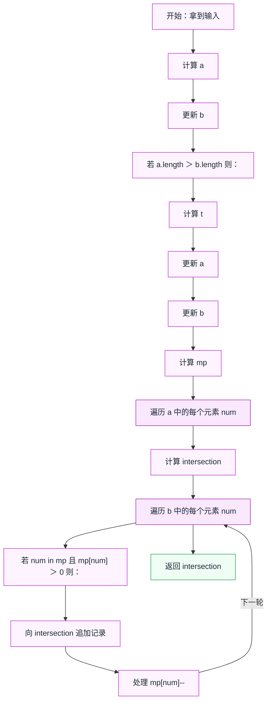

## TypeScript 解题方案（2 个方案逐个讲）

> **运行与提交**：每个方案都是自包含文件（内嵌用例自测，输出 PASS），整块复制到 `.ts` 文件后 `node 文件名` 即可运行。提交 LeetCode 时，把 `demo` 内的算法函数与辅助类型/函数整体取出、置于文件顶层即可。涉及交互/特殊接口的题以题面给定签名为准。

### 方案 1：双重循环枚举

**分析与思路**：核心做法是「双重循环枚举」。代码里依次做这些事：双重循环遍历。

**运行方式**：`node 本文件`，内嵌用例全部通过会输出 PASS。


**方案专属流程图**（真实控制流）：

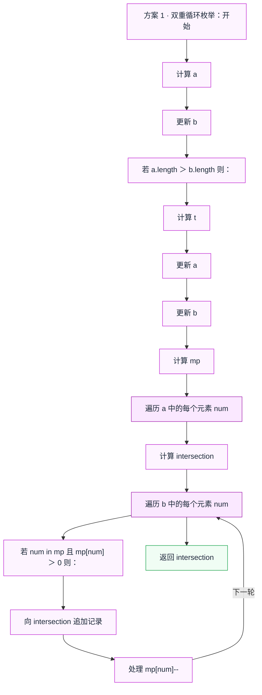

```typescript
// Faithful translation of python reference. Self-check via demo().
function intersect(nums1: number[], nums2: number[]): number[] {
  // 定义函数/方法 intersect
  let a = nums1,
    b = nums2; // 把 数组1, b 赋值为 数组2 存入 数组
  if (a.length > b.length) {
    const t = a;
    a = b;
    b = t;
  }
  const mp: { [k: number]: number } = {}; // 把 {}; 写入 const mp: {[k: number]: number}
  for (const num of a) mp[num] = (mp[num] || 0) + 1; // 把 (mp[num] 或 0) 加 1; 写入 for (const num of a) mp[num]
  const intersection: number[] = []; // 把 []; 写入 const intersection: number[]
  for (const num of b) {
    // for (const num of b) {
    if (num in mp && mp[num] > 0) {
      intersection.push(num);
      mp[num]--;
    }
  }
  return intersection; // 返回 intersection
}
export function demo(): void {
  // 程序入口：跑内嵌自测用例
  const cases = [
    [
      [1, 2, 2, 1],
      [2, 2],
    ],
    [
      [4, 9, 5],
      [9, 4, 9, 8, 4],
    ],
  ];
  const want = [
    [2, 2],
    [9, 4],
  ]; // 把 [[2, 2], [9, 4]] 存入 want
  for (let i = 0; i < cases.length; i++) {
    // 让 下标 i 从 0 开始计数，下标 i 小于 cases.长度 就继续
    const got = intersect(cases[i][0].slice(), cases[i][1].slice()); // 把 intersect(cases[下标 i][0] 截取 ), cases[下标 i][1] 截取 )) 存入 got
    if (got.length !== want[i].length)
      throw new Error('FAIL case ' + i + ' len mismatch');
    for (let j = 0; j < got.length; j++)
      if (got[j] !== want[i][j]) throw new Error('FAIL case ' + i); // 让 下标 j 从 0 开始计数，下标 j 小于 got.长度 就继续
  }
  console.log('PASS'); // 全部用例通过，输出 PASS
}
demo(); // demo();
```

### 方案 2：排序预处理

**分析与思路**：核心做法是「排序预处理」。代码里依次做这些事：先排序再处理。

**运行方式**：`node 本文件`，内嵌用例全部通过会输出 PASS。

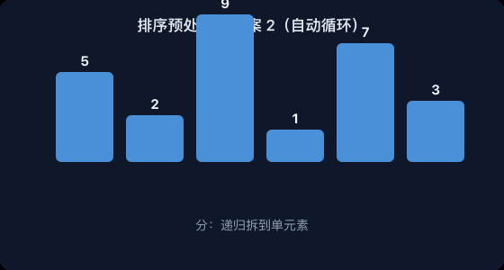

**方案专属流程图**（真实控制流）：

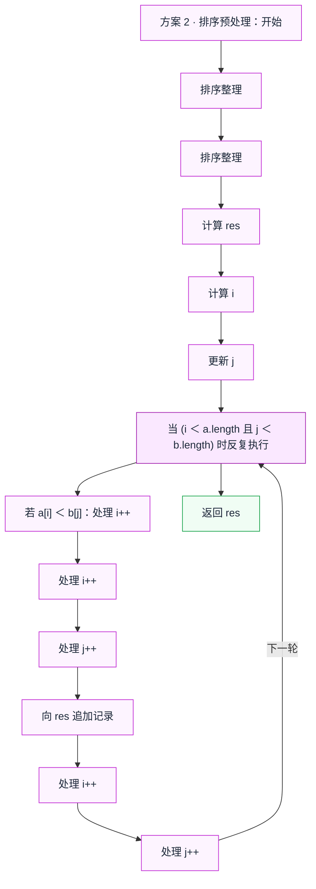

```typescript
// Faithful translation of python reference. Self-check via demo().
function intersect(nums1: number[], nums2: number[]): number[] {
  // 定义函数/方法 intersect
  const a = nums1.slice().sort((x, y) => x - y);
  const b = nums2.slice().sort((x, y) => x - y);
  const res: number[] = []; // 把 []; 写入 const res: number[]
  let i = 0,
    j = 0; // 把 0, 下标 j 赋值为 0 存入 下标 i
  while (i < a.length && j < b.length) {
    // 循环，直到不满足「下标 i 小于 数组.长度 且 下标 j 小于 b.长度」
    if (a[i] < b[j])
      i++; // 若 数组[下标 i] 小于 b[下标 j]) 下标 i 加一 ;
    else if (a[i] > b[j])
      j++; // 否则，若 数组[下标 i] 超过 b[下标 j]) 下标 j 加一 ;
    else {
      res.push(a[i]);
      i++;
      j++;
    } // 否则
  }
  return res; // 返回 结果
}
export function demo(): void {
  // 程序入口：跑内嵌自测用例
  const cases = [
    [
      [1, 2, 2, 1],
      [2, 2],
    ],
    [
      [4, 9, 5],
      [9, 4, 9, 8, 4],
    ],
  ];
  const want = [
    [2, 2],
    [4, 9],
  ]; // 把 [[2, 2], [4, 9]] 存入 want
  for (let i = 0; i < cases.length; i++) {
    // 让 下标 i 从 0 开始计数，下标 i 小于 cases.长度 就继续
    const got = intersect(cases[i][0].slice(), cases[i][1].slice()); // 把 intersect(cases[下标 i][0] 截取 ), cases[下标 i][1] 截取 )) 存入 got
    if (got.length !== want[i].length)
      throw new Error('FAIL case ' + i + ' len mismatch');
    for (let j = 0; j < got.length; j++)
      if (got[j] !== want[i][j]) throw new Error('FAIL case ' + i); // 让 下标 j 从 0 开始计数，下标 j 小于 got.长度 就继续
  }
  console.log('PASS'); // 全部用例通过，输出 PASS
}
demo(); // demo();
```

## 逐步拆解与面试追问

**复杂度**：时间 O(n²)（两层嵌套扫描），空间 O(1) 到 O(n)

**为什么是这个量级**：外层定起点、内层扫终点，n 个起点各扫 n 次

**面试官可能会追问**：

- 哈希冲突了怎么办？
- 键的选择有什么讲究？
- 值域有限时能否用数组代替哈希？

## 关键 API 速查（TS 主解法实际用到，附官方链接）

| API | 作用 | 使用要点 | 官方文档 |
|---|---|---|---|
| `Array.prototype.push()` | 尾部追加 | 返回新长度；可一次多个；均摊 O(1)；会改变原数组 | [官方文档](https://developer.mozilla.org/zh-CN/docs/Web/JavaScript/Reference/Global_Objects/Array/push) |
| `Array/String slice()` | 切片（不改原数组） | slice(start,end) 含头不含尾；负数从尾计；常用于复制数组（slice()） | [官方文档](https://developer.mozilla.org/zh-CN/docs/Web/JavaScript/Reference/Global_Objects/Array/slice) |

### 各语言官方文档导航

- **TypeScript / JS**：[MDN 中文参考](https://developer.mozilla.org/zh-CN/)
- **Python**：[Python 官方文档](https://docs.python.org/zh-cn/3/)
- **Go**：[Go 标准库](https://pkg.go.dev/std)
- **Java**：[JDK 17 API](https://docs.oracle.com/en/java/javase/17/docs/api/)
- **Rust**：[Rust 标准库](https://doc.rust-lang.org/std/)
- **Lua**：[Lua 5.4 手册](https://www.lua.org/manual/5.4/)
- **C**：[Cppreference C](https://zh.cppreference.com/w/c)
- **C++**：[Cppreference C++](https://zh.cppreference.com/w/cpp)
- **R**：[R 官方手册](https://stat.ethz.ch/R-manual/)
- **Zig**：[Zig 语言文档](https://ziglang.org/documentation/master/)
- **Dart**：[Dart API](https://api.dart.dev/)

## 附录：其他 10 种语言全部实现（每种语言列举其全部方案）

> TypeScript 的全部方案见「TypeScript 解题方案」一节；下面是其余 10 种语言的对应实现，每种语言的每个方案都带思路分析、代码走读与专属运行架构图。
> 每个方案都内嵌用例自测，可独立运行（老仓库 python/go 文件遵循「打印结果」约定）。
> 完整解法文件见 `dsa/<语言>/hash/lc_350_两个数组的交集_ii/`。

### Python 实现（2 种方案）

Python 的全部方案如下，每个方案都内嵌用例自测，可独立运行（老仓库 python/go 文件遵循「打印结果」约定）：

#### 方案 1：双重循环枚举

**思路与代码分析**：核心是「双重循环枚举」。Python 版用切片与字典推导式简化操作，突出可读性。**走读**：方案 1 · 双重循环枚举：开始 → 命中条件，直接返回 → 更新 mp → 遍历 nums1: 中的每个元素 num → 更新 mp[num] → 更新 intersection → 遍历 nums2: 中的每个元素 num → 若 num in mp and mp[num] ＞ 0：向 intersection 追加记录 → 向 intersection 追加记录 → 更新 - → 返回 intersection。

**运行架构**（真实控制流）：

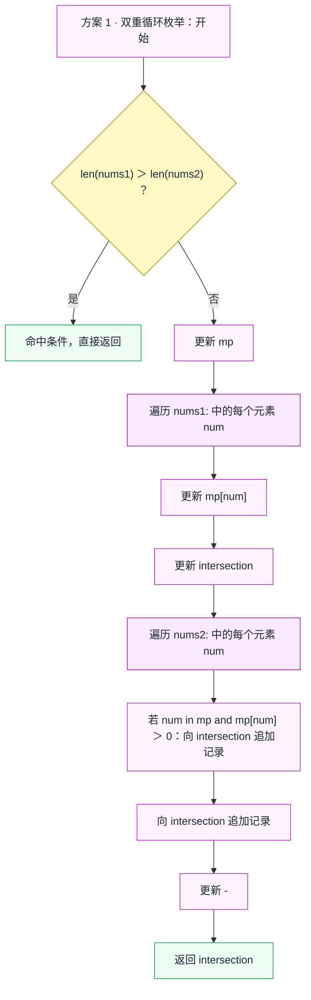

```python
import sys  # 提高递归深度上限（深输入防 RecursionError）

sys.setrecursionlimit(200000)  # 树/链表类题目节点数可达 1e4 量级

def intersect(nums1, nums2):  # 定义函数 intersect（参数：数组1, 数组2）
    if len(nums1) > len(nums2):  # 若 长度(数组1) 超过 长度(数组2
        return intersect(nums2, nums1)  # 返回 intersect(数组2, 数组1)
    mp = {}  # 把 {} 存入 mp
    for num in nums1:  # 逐个取出 数组1 的元素（num）
        mp[num] = mp.get(num, 0) + 1  # 把 mp 查找 num, 0) 加 1 写入 mp[num]
    intersection = []  # 把 [] 存入 intersection
    for num in nums2:  # 逐个取出 数组2 的元素（num）
        if num in mp and mp[num] > 0:  # 若 num in mp and mp[num] 超过 0
            intersection.append(num)  # 把 num 追加到列表尾部
            mp[num] -= 1  # mp[num]累减 1
    return intersection  # 返回 intersection

if __name__ == "__main__":  # 若 __name__ 等于 '__main__'
    print(intersect([1, 2, 2, 1], [2, 2]))  # 打印输出
```

#### 方案 2：排序预处理

**思路与代码分析**：核心是「排序预处理」。Python 版用切片与字典推导式简化操作，突出可读性。代码里依次做这些事：先排序再处理。**走读**：方案 2 · 排序预处理：开始 → 排序整理 → 排序整理 → 更新 res → 更新 i → 当 i ＜ len(nums1) and j ＜ len( 时反复执行 → 处理 nums2 → 处理 ): → 若 nums1[i] ＜ nums2[j]：更新 + → 更新 + → 处理 elif nums1[i] ＞ nums2[j]: → 更新 + → 向 res 追加记录 → 更新 + → 更新 + → 返回 res。

**运行架构**（真实控制流）：

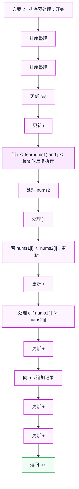

```python
import sys  # 提高递归深度上限（深输入防 RecursionError）

sys.setrecursionlimit(200000)  # 树/链表类题目节点数可达 1e4 量级

def intersect(nums1, nums2):  # 定义函数 intersect（参数：数组1, 数组2）
    nums1.sort()  # 排序
    nums2.sort()  # 排序
    res = []  # 把 [] 存入 结果
    i = j = 0  # 把 下标 j 赋值为 0 存入 下标 i
    while i < len(nums1) and j < len(
        nums2
    ):  # 循环，直到不满足「下标 i 小于 长度(数组1) and 下标 j 小于 长度(数组2」
        if nums1[i] < nums2[j]:  # 若 数组1[下标 i] 小于 数组2[下标 j]
            i += 1  # 下标 i累加 1
        elif nums1[i] > nums2[j]:  # 否则，若 数组1[下标 i] 超过 数组2[下标 j]
            j += 1  # 下标 j累加 1
        else:  # 否则
            res.append(nums1[i])  # 把 数组1[下标 i] 追加到列表尾部
            i += 1  # 下标 i累加 1
            j += 1  # 下标 j累加 1
    return res  # 返回 结果

if __name__ == "__main__":  # 若 __name__ 等于 '__main__'
    print(intersect([1, 2, 2, 1], [2, 2]))  # 打印输出
    print(intersect([4, 9, 5], [9, 4, 9, 8, 4]))  # 打印输出
```

### Go 实现（2 种方案）

Go 的全部方案如下，每个方案都内嵌用例自测，可独立运行（老仓库 python/go 文件遵循「打印结果」约定）：

#### 方案 1：双重循环枚举

**思路与代码分析**：核心是「双重循环枚举」。Go 版用切片与多返回值惯用法，显式处理索引边界。代码里依次做这些事：哈希结构做计数或查重。**走读**：方案 1 · 双重循环枚举：开始 → 处理 if len(nums1) ＞ len(nums2) → 返回 intersect(nums2, nums1) → 更新 : → 遍历 nums1 的下标与元素 num → 处理 mp[num]++ → 更新 : → 遍历 nums2 的下标与元素 num → 处理 if cnt, ok := mp[num]; ok 且 → 更新 res → 处理 mp[num]-- → 返回 res。

**运行架构**（真实控制流）：

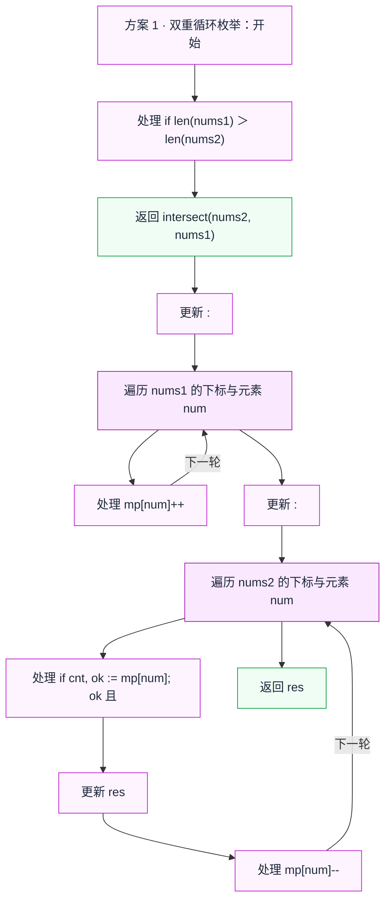

```go
package main // 引入依赖

import (
	"fmt"
	"os"
	"reflect"
) // 引入依赖

func intersect(nums1, nums2 []int) []int { // 定义函数/方法 intersect
	if len(nums1) > len(nums2) { // 定义函数/方法 len
		return intersect(nums2, nums1) // 定义函数/方法 intersect
	}
	mp := map[int]int{}         // 把 映射表[int]int{} 写入 mp :
	for _, num := range nums1 { // 同时取 _ 与 num 遍历
		mp[num]++ // mp[num] 加一
	}
	res := []int{}              // 把 []int{} 写入 res :
	for _, num := range nums2 { // 同时取 _ 与 num 遍历
		if cnt, ok := mp[num]; ok && cnt > 0 { // 若 计数, ok : 赋值为 mp[num]; ok 且 计数 超过 0
			res = append(res, num) // 把 append(结果, num) 写入 结果
			mp[num]--              // mp[num] 减一
		}
	}
	return res // 返回 结果
}

func main() { // 程序入口：跑内嵌自测用例
	type tc struct { // 定义类型
		a, b []int // 数组, b []int
		want []int // want []int
	}
	cases := []tc{ // 把 []tc{ 写入 cases :
		{[]int{1, 2, 2, 1}, []int{2, 2}, []int{2, 2}},
		{[]int{3, 1, 2}, []int{1, 1}, []int{1}},
	}
	ok := true                // 把 true 写入 ok :
	for _, c := range cases { // 同时取 _ 与 字符 遍历
		if got := intersect(c.a, c.b); !reflect.DeepEqual(got, c.want) {
			ok = false                                                              // 把 false 写入 ok
			fmt.Printf("FAIL intersect(%v,%v)=%v want %v\n", c.a, c.b, got, c.want) // 打印输出
		}
	}
	if !ok { // 若 取反 ok
		os.Exit(1) // os.Exit(1)
	}
	fmt.Println("PASS") // 全部用例通过，输出 PASS
}
```

#### 方案 2：排序预处理

**思路与代码分析**：核心是「排序预处理」。Go 版用切片与多返回值惯用法，显式处理索引边界。**走读**：方案 2 · 排序预处理：开始 → 调用 sort.Ints(nums1) → 调用 sort.Ints(nums2) → 更新 : → 更新 : → 遍历循环 → 处理 if nums1[i] ＜ nums2[j] → 处理 i++ → 处理 j++ → 更新 res → 处理 i++ → 处理 j++ → 返回 res。

**运行架构**（真实控制流）：

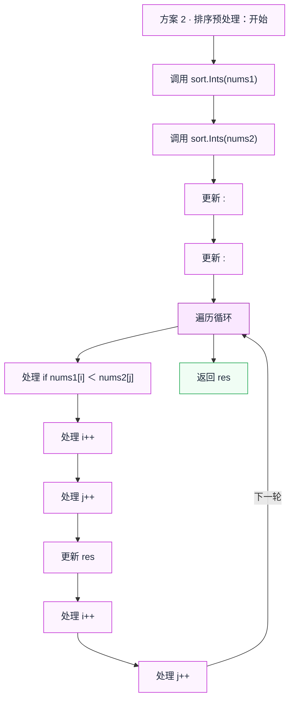

```go
package main // 引入依赖

import (
	"fmt"
	"os"
	"reflect"
	"sort"
) // 引入依赖

func intersect(nums1, nums2 []int) []int { // 定义函数/方法 intersect
	sort.Ints(nums1)                       // sort.Ints(数组1)
	sort.Ints(nums2)                       // sort.Ints(数组2)
	res := []int{}                         // 把 []int{} 写入 res :
	i, j := 0, 0                           // 把 0, 0 写入 i, j :
	for i < len(nums1) && j < len(nums2) { // for 下标 i 小于 长度(数组1) 且 下标 j 小于 长度(数组2) {
		if nums1[i] < nums2[j] { // 若 数组1[下标 i] 小于 数组2[下标 j]
			i++ // 下标 i 加一
		} else if nums1[i] > nums2[j] { // 否则，若 数组1[下标 i] 超过 数组2[下标 j]
			j++ // 下标 j 加一
		} else { // 否则
			res = append(res, nums1[i]) // 把 append(结果, 数组1[下标 i]) 写入 结果
			i++                         // 下标 i 加一
			j++                         // 下标 j 加一
		}
	}
	return res // 返回 结果
}

func main() { // 程序入口：跑内嵌自测用例
	type tc struct { // 定义类型
		a, b []int // 数组, b []int
		want []int // want []int
	}
	cases := []tc{ // 把 []tc{ 写入 cases :
		{[]int{1, 2, 2, 1}, []int{2, 2}, []int{2, 2}},
		{[]int{3, 1, 2}, []int{1, 1}, []int{1}},
	}
	ok := true                // 把 true 写入 ok :
	for _, c := range cases { // 同时取 _ 与 字符 遍历
		if got := intersect(c.a, c.b); !reflect.DeepEqual(got, c.want) {
			ok = false                                                              // 把 false 写入 ok
			fmt.Printf("FAIL intersect(%v,%v)=%v want %v\n", c.a, c.b, got, c.want) // 打印输出
		}
	}
	if !ok { // 若 取反 ok
		os.Exit(1) // os.Exit(1)
	}
	fmt.Println("PASS") // 全部用例通过，输出 PASS
}
```

### Java 实现（2 种方案）

Java 的全部方案如下，每个方案都内嵌用例自测，可独立运行（老仓库 python/go 文件遵循「打印结果」约定）：

#### 方案 1：双重循环枚举

**思路与代码分析**：核心是「双重循环枚举」。Java 版用类与静态方法组织，集合操作显式明了。代码里依次做这些事：哈希结构做计数或查重；双重循环遍历。**走读**：方案 1 · 双重循环枚举：开始 → 命中条件，直接返回 → 更新 mp → 处理 new HashMap＜＞() → 遍历循环 → 更新 intersection → 处理 new ArrayList＜＞() → 遍历循环 → 若 mp.containsKey(num) 且 mp.get(num) ＞ 0 则： → 调用 intersection.add(num) → 调用 mp.put(num, mp.get(num) - 1) → 返回 intersection。

**运行架构**（真实控制流）：

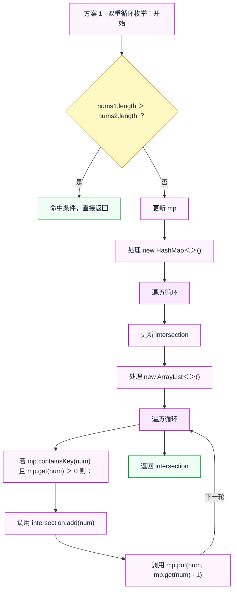

```java
package com.webfault.dsa; // 引入依赖

import java.util.*; // 引入依赖

class lc350_solution11 { // 定义类型
  static List<Integer> intersect(int[] nums1, int[] nums2) { // 定义函数/方法 intersect
    if (nums1.length > nums2.length)
      return intersect(nums2, nums1); // 若 数组1.长度 超过 数组2.长度，直接返回 intersect(数组2, 数组1)
    Map<Integer, Integer> mp =
        new HashMap<>(); // 把 new HashMap 小于 超过 (); 写入 Map<Integer, Integer> mp
    for (int num : nums1) mp.put(num, mp.getOrDefault(num, 0) + 1);
    List<Integer> intersection =
        new ArrayList<>(); // 把 new ArrayList 小于 超过 (); 写入 List<Integer> intersection
    for (int num : nums2) { // for (int num : 数组2) {
      if (mp.containsKey(num) && mp.get(num) > 0) { // 若 mp.containsKey(num) 且 mp 查找 num) 超过 0
        intersection.add(num); // intersection 追加 num);
        mp.put(num, mp.get(num) - 1); // mp.put(num, mp 查找 num) 减 1);
      }
    }
    return intersection; // 返回 intersection
  }

  public static void main(String[] args) { // public static void main(String[] args) {
    List<Integer> got = intersect(new int[] {1, 2, 2, 1}, new int[] {2, 2});
    if (!(got.size() == 2
        && got.get(0) == 2
        && got.get(1) == 2)) // 若 取反 (got.大小() 等于 2 且 got 查找 0) 等于 2 且 got 查找 1) 等于 2
    throw new RuntimeException("FAILED: " + got); // throw new RuntimeException(「FAILED: 」 加 got);
    System.out.println("PASS"); // 全部用例通过，输出 PASS
  }
}
```

#### 方案 2：排序预处理

**思路与代码分析**：核心是「排序预处理」。Java 版用类与静态方法组织，集合操作显式明了。代码里依次做这些事：先排序再处理；单循环线性扫描。**走读**：方案 2 · 排序预处理：开始 → 排序整理 → 排序整理 → 更新 res → 更新 i → 当 (i ＜ nums1.length 且 j ＜ nums2.length) 时反复执行 → 若 nums1[i] ＜ nums2[j]：处理 i++ → 调用 res.add(nums1[i]) → 处理 i++ → 处理 j++ → 更新 out → 遍历循环 → 返回 out。

**运行架构**（真实控制流）：

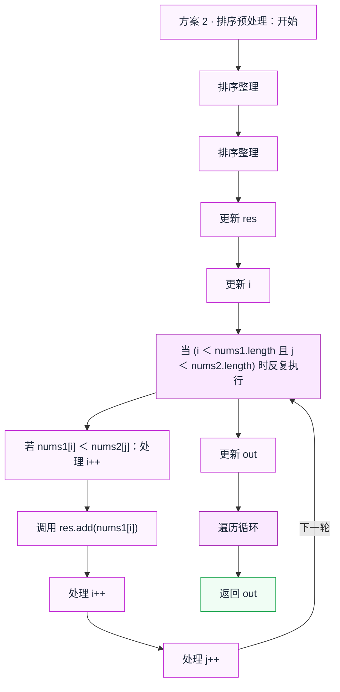

```java
package com.webfault.dsa; // 引入依赖

import java.util.*; // 引入依赖

class lc350_solution22 { // 定义类型
  static int[] intersect(int[] nums1, int[] nums2) { // 定义函数/方法 intersect
    Arrays.sort(nums1); // 排序
    Arrays.sort(nums2); // 排序
    List<Integer> res = new ArrayList<>(); // 把 new ArrayList 小于 超过 (); 写入 List<Integer> res
    int i = 0, j = 0; // 把 0, 下标 j 赋值为 0 存入 下标 i
    while (i < nums1.length && j < nums2.length) { // 循环，直到不满足「下标 i 小于 数组1.长度 且 下标 j 小于 数组2.长度」
      if (nums1[i] < nums2[j]) i++; // 若 数组1[下标 i] 小于 数组2[下标 j]) 下标 i 加一 ;
      else if (nums1[i] > nums2[j]) j++; // 否则，若 数组1[下标 i] 超过 数组2[下标 j]) 下标 j 加一 ;
      else { // 否则
        res.add(nums1[i]); // 结果 追加 数组1[下标 i]);
        i++; // 下标 i 加一
        j++; // 下标 j 加一
      }
    }
    int[] out = new int[res.size()]; // 把 new int[结果.大小()]; 写入 int[] out
    for (int k = 0; k < res.size(); k++) out[k] = res.get(k); // 让 下标 k 从 0 开始计数，下标 k 小于 结果.大小() 就继续
    return out; // 返回 out
  }

  public static void main(String[] args) { // public static void main(String[] args) {
    int[] a = intersect(new int[] {1, 2, 2, 1}, new int[] {2, 2});
    if (!(a.length == 2 && a[0] == 2 && a[1] == 2)) // 若 取反 (数组.长度 等于 2 且 数组[0] 等于 2 且 数组[1] 等于 2
    throw new RuntimeException("FAILED a: " + Arrays.toString(a));
    int[] b = intersect(new int[] {4, 9, 5}, new int[] {9, 4, 9, 8, 4});
    if (!(b.length == 2 && b[0] == 4 && b[1] == 9)) // 若 取反 (b.长度 等于 2 且 b[0] 等于 4 且 b[1] 等于 9
    throw new RuntimeException("FAILED b: " + Arrays.toString(b));
    System.out.println("PASS"); // 全部用例通过，输出 PASS
  }
}
```

### Rust 实现（2 种方案）

Rust 的全部方案如下，每个方案都内嵌用例自测，可独立运行（老仓库 python/go 文件遵循「打印结果」约定）：

#### 方案 1：双重循环枚举

**思路与代码分析**：核心是「双重循环枚举」。Rust 版用所有权移动与切片借用改写同一逻辑，注意 Option 与引用边界。代码里依次做这些事：哈希结构做计数或查重。**走读**：方案 1 · 双重循环枚举：开始 → 计算 let (a, b) = if nums1.le → 处理 (&nums1, &nums2) → 处理 (&nums2, &nums1) → 计算 mp → 遍历 a 中的每个元素 v → 计算 res → 遍历 b 中的每个元素 v → 处理 if let Some(c) = mp.get_mut( → 处理 if *c ＞ 0 → 向 res 追加记录 → 处理 res → 返回结果。

**运行架构**（真实控制流）：

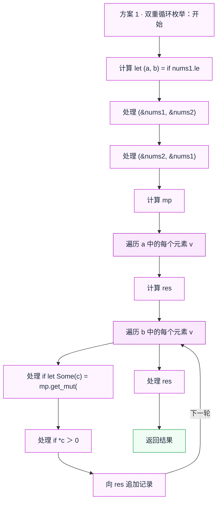

```rust
// LeetCode 350. 两个数组的交集 II — Rust 版（方案1）
use std::collections::HashMap; // 引入依赖
fn intersect(nums1: Vec<i32>, nums2: Vec<i32>) -> Vec<i32> {
    // 定义函数/方法 intersect
    let (a, b) = if nums1.len() <= nums2.len() {
        (&nums1, &nums2)
    } else {
        (&nums2, &nums1)
    };
    let mut mp: HashMap<i32, i32> = HashMap::new(); // 把 HashMap::new(); 写入 let mut mp: HashMap<i32, i32>
    for &v in a {
        *mp.entry(v).or_insert(0) += 1;
    } // 把 1; } 写入 for &v in a { *mp.entry(v).or_insert(0) +
    let mut res = Vec::new(); // 把 Vec::new(); 写入 let mut res
    for &v in b {
        // for 按位与 值 in b {
        if let Some(c) = mp.get_mut(&v) {
            // 若 let Some(字符) 赋值为 mp.get_mut( 按位与 值
            if *c > 0 {
                res.push(v);
                *c -= 1;
            } // 若 乘 字符 超过 0 { 结果 追加 值); 乘 字符 累减 1; }
        }
    }
    res // 结果
}
fn main() {
    // 程序入口：跑内嵌自测用例
    assert_eq!(intersect(vec![1, 2, 2, 1], vec![2, 2]), vec![2, 2]); // 断言校验
    assert_eq!(intersect(vec![4, 9, 5], vec![9, 4, 9, 8, 4]), vec![9, 4]); // 断言校验
    println!("PASS"); // 全部用例通过，输出 PASS
}
```

#### 方案 2：排序预处理

**思路与代码分析**：核心是「排序预处理」。Rust 版用所有权移动与切片借用改写同一逻辑，注意 Option 与引用边界。代码里依次做这些事：哈希结构做计数或查重。**走读**：方案 2 · 排序预处理：开始 → 计算 let (a, b) = if nums1.le → 处理 (&nums1, &nums2) → 处理 (&nums2, &nums1) → 计算 mp → 遍历 a 中的每个元素 v → 计算 res → 遍历 b 中的每个元素 v → 处理 if let Some(c) = mp.get_mut( → 处理 if *c ＞ 0 → 向 res 追加记录 → 处理 res → 返回结果。

**运行架构**（真实控制流）：

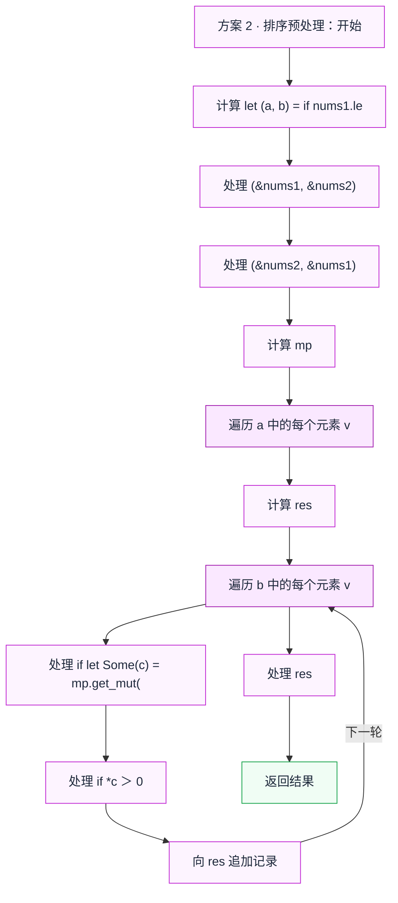

```rust
// LeetCode 350. 两个数组的交集 II — Rust 版（方案2）
use std::collections::HashMap; // 引入依赖
fn intersect(nums1: Vec<i32>, nums2: Vec<i32>) -> Vec<i32> {
    // 定义函数/方法 intersect
    let (a, b) = if nums1.len() <= nums2.len() {
        (&nums1, &nums2)
    } else {
        (&nums2, &nums1)
    };
    let mut mp: HashMap<i32, i32> = HashMap::new(); // 把 HashMap::new(); 写入 let mut mp: HashMap<i32, i32>
    for &v in a {
        *mp.entry(v).or_insert(0) += 1;
    } // 把 1; } 写入 for &v in a { *mp.entry(v).or_insert(0) +
    let mut res = Vec::new(); // 把 Vec::new(); 写入 let mut res
    for &v in b {
        // for 按位与 值 in b {
        if let Some(c) = mp.get_mut(&v) {
            // 若 let Some(字符) 赋值为 mp.get_mut( 按位与 值
            if *c > 0 {
                res.push(v);
                *c -= 1;
            } // 若 乘 字符 超过 0 { 结果 追加 值); 乘 字符 累减 1; }
        }
    }
    res // 结果
}
fn main() {
    // 程序入口：跑内嵌自测用例
    assert_eq!(intersect(vec![1, 2, 2, 1], vec![2, 2]), vec![2, 2]); // 断言校验
    assert_eq!(intersect(vec![4, 9, 5], vec![9, 4, 9, 8, 4]), vec![9, 4]); // 断言校验
    println!("PASS"); // 全部用例通过，输出 PASS
}
```

### Lua 实现（2 种方案）

Lua 的全部方案如下，每个方案都内嵌用例自测，可独立运行（老仓库 python/go 文件遵循「打印结果」约定）：

#### 方案 1：双重循环枚举

**思路与代码分析**：核心是「双重循环枚举」。Lua 版用表与 ipairs 遍历，注意 ipairs 遇 nil 即停的语义。**走读**：方案 1 · 双重循环枚举：开始 → 更新 b → 处理 if #a ＞ #b then → 更新 b → 更新 mp → 遍历 ipairs(a) do 中的每个元素 v → 更新 mp[v] → 更新 res → 遍历 ipairs(b) do 中的每个元素 v → 处理 if mp[v] and mp[v] ＞ 0 then → 更新 1] → 更新 mp[v] → 返回 res。

**运行架构**（真实控制流）：

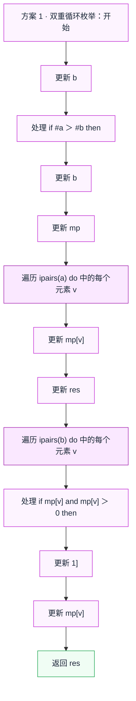

```lua
-- LeetCode 350. 两个数组的交集 II — Lua 版（方案1）
local function intersect(nums1, nums2) -- local function intersect(数组1, 数组2)
	local a, b = nums1, nums2 -- 把 数组1, 数组2 写入 local a, b
	if #a > #b then
		a, b = b, a
	end -- 若 #数组 超过 #b then 数组, b 赋值为 b, 数组 终点
	local mp = {} -- 把 {} 写入 local mp
	for _, v in ipairs(a) do
		mp[v] = (mp[v] or 0) + 1
	end -- 遍历取 值
	local res = {} -- 把 {} 写入 local res
	for _, v in ipairs(b) do -- 遍历取 值
		if mp[v] and mp[v] > 0 then -- 若 mp[值] and mp[值] 超过 0 then
			res[#res + 1] = v -- 把 值 写入 res[#res + 1]
			mp[v] = mp[v] - 1 -- 把 mp[值] 减 1 写入 mp[v]
		end -- 终点
	end -- 终点
	return res -- 返回 结果
end -- 终点
local function eq(a, b) -- local function eq(数组, b)
	if #a ~= #b then
		return false
	end -- 若 #数组 ~ 赋值为 #b then return false 终点
	for i = 1, #a do
		if a[i] ~= b[i] then
			return false
		end
	end
	return true -- 返回 true
end -- 终点
assert(eq(intersect({ 1, 2, 2, 1 }, { 2, 2 }), { 2, 2 })) -- 断言校验
assert(eq(intersect({ 4, 9, 5 }, { 9, 4, 9, 8, 4 }), { 9, 4 })) -- 断言校验
print("PASS") -- 全部用例通过，输出 PASS
```

#### 方案 2：排序预处理

**思路与代码分析**：核心是「排序预处理」。Lua 版用表与 ipairs 遍历，注意 ipairs 遇 nil 即停的语义。**走读**：方案 2 · 排序预处理：开始 → 更新 b → 处理 if #a ＞ #b then → 更新 b → 更新 mp → 遍历 ipairs(a) do 中的每个元素 v → 更新 mp[v] → 更新 res → 遍历 ipairs(b) do 中的每个元素 v → 处理 if mp[v] and mp[v] ＞ 0 then → 更新 1] → 更新 mp[v] → 返回 res。

**运行架构**（真实控制流）：

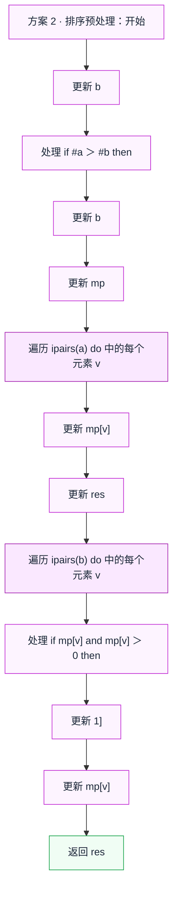

```lua
-- LeetCode 350. 两个数组的交集 II — Lua 版（方案2）
local function intersect(nums1, nums2) -- local function intersect(数组1, 数组2)
	local a, b = nums1, nums2 -- 把 数组1, 数组2 写入 local a, b
	if #a > #b then
		a, b = b, a
	end -- 若 #数组 超过 #b then 数组, b 赋值为 b, 数组 终点
	local mp = {} -- 把 {} 写入 local mp
	for _, v in ipairs(a) do
		mp[v] = (mp[v] or 0) + 1
	end -- 遍历取 值
	local res = {} -- 把 {} 写入 local res
	for _, v in ipairs(b) do -- 遍历取 值
		if mp[v] and mp[v] > 0 then -- 若 mp[值] and mp[值] 超过 0 then
			res[#res + 1] = v -- 把 值 写入 res[#res + 1]
			mp[v] = mp[v] - 1 -- 把 mp[值] 减 1 写入 mp[v]
		end -- 终点
	end -- 终点
	return res -- 返回 结果
end -- 终点
local function eq(a, b) -- local function eq(数组, b)
	if #a ~= #b then
		return false
	end -- 若 #数组 ~ 赋值为 #b then return false 终点
	for i = 1, #a do
		if a[i] ~= b[i] then
			return false
		end
	end
	return true -- 返回 true
end -- 终点
assert(eq(intersect({ 1, 2, 2, 1 }, { 2, 2 }), { 2, 2 })) -- 断言校验
assert(eq(intersect({ 4, 9, 5 }, { 9, 4, 9, 8, 4 }), { 9, 4 })) -- 断言校验
print("PASS") -- 全部用例通过，输出 PASS
```

### C 实现（2 种方案）

C 的全部方案如下，每个方案都内嵌用例自测，可独立运行（老仓库 python/go 文件遵循「打印结果」约定）：

#### 方案 1：双重循环枚举

**思路与代码分析**：核心是「双重循环枚举」。C 版手动管理下标与内存，循环边界全部显式写出。代码里依次做这些事：双重循环遍历。**走读**：方案 1 · 双重循环枚举：开始 → 更新 used[256] → 更新 cnt → 遍历循环 → 遍历循环 → 若 非 used[k] 且 a[k] == b[i] 则： → 更新 used[k] → 更新 out[cnt++] → 跳出循环（break） → 返回 cnt。

**运行架构**（真实控制流）：

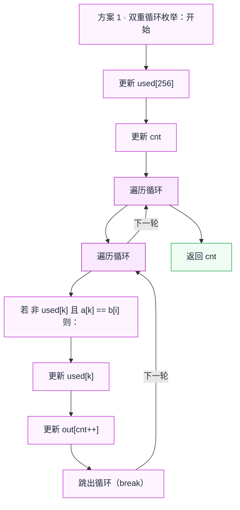

```c
/* LeetCode 350. 两个数组的交集 II — C 版（方案1） */
#include <stdio.h>                                                            // 引入头文件
static int intersect(const int *a, int na, const int *b, int nb, int out[]) { // 定义函数/方法 intersect
    int used[256] = {0};                                                      // 把 {0}; 写入 int used[256]
    int cnt = 0;                                                              // 把 0 存入 计数
    for (int i = 0; i < nb; i++) {     // 让 下标 i 从 0 开始计数，下标 i 小于 nb 就继续
        for (int k = 0; k < na; k++) { // 让 下标 k 从 0 开始计数，下标 k 小于 na 就继续
            if (!used[k] && a[k] == b[i]) {
                used[k] = 1;
                out[cnt++] = b[i];
                break;
            }
        }
    }
    return cnt; // 返回 计数
}
int main(void) {    // 程序入口：跑内嵌自测用例
    int out[64], n; // int out[64], 元素个数;
    n = intersect((int[]){1, 2, 2, 1}, 4, (int[]){2, 2}, 2, out);
    if (n != 2 || out[0] != 2 || out[1] != 2) {
        printf("FAIL 1\n");
        return 1;
    }
    n = intersect((int[]){4, 9, 5}, 3, (int[]){9, 4, 9, 8, 4}, 5, out);
    if (n != 2 || out[0] != 9 || out[1] != 4) {
        printf("FAIL 2\n");
        return 1;
    }
    printf("PASS\n"); // 全部用例通过，输出 PASS
    return 0;         // 返回 0
}
```

#### 方案 2：排序预处理

**思路与代码分析**：核心是「排序预处理」。C 版手动管理下标与内存，循环边界全部显式写出。代码里依次做这些事：双重循环遍历。**走读**：方案 2 · 排序预处理：开始 → 更新 used[256] → 更新 cnt → 遍历循环 → 遍历循环 → 若 非 used[k] 且 a[k] == b[i] 则： → 更新 used[k] → 更新 out[cnt++] → 跳出循环（break） → 返回 cnt。

**运行架构**（真实控制流）：

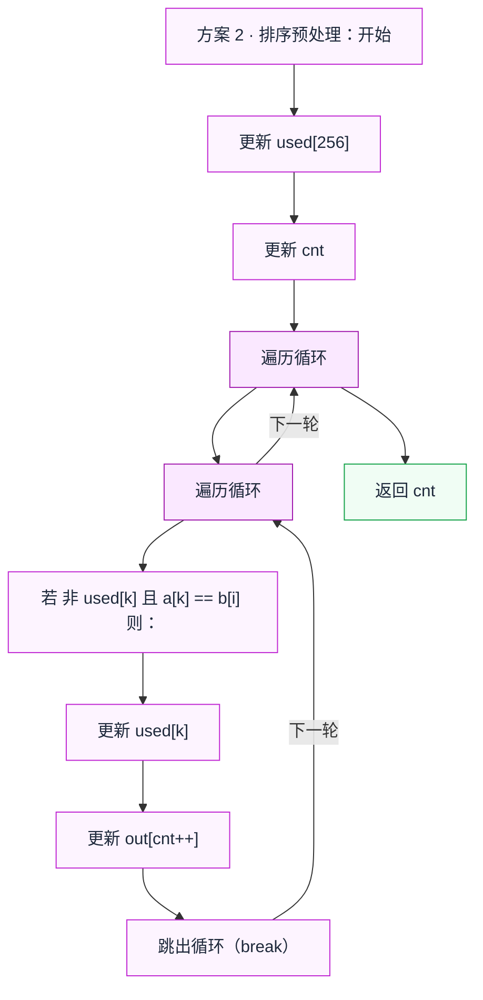

```c
/* LeetCode 350. 两个数组的交集 II — C 版（方案2） */
#include <stdio.h>                                                            // 引入头文件
static int intersect(const int *a, int na, const int *b, int nb, int out[]) { // 定义函数/方法 intersect
    int used[256] = {0};                                                      // 把 {0}; 写入 int used[256]
    int cnt = 0;                                                              // 把 0 存入 计数
    for (int i = 0; i < nb; i++) {     // 让 下标 i 从 0 开始计数，下标 i 小于 nb 就继续
        for (int k = 0; k < na; k++) { // 让 下标 k 从 0 开始计数，下标 k 小于 na 就继续
            if (!used[k] && a[k] == b[i]) {
                used[k] = 1;
                out[cnt++] = b[i];
                break;
            }
        }
    }
    return cnt; // 返回 计数
}
int main(void) {    // 程序入口：跑内嵌自测用例
    int out[64], n; // int out[64], 元素个数;
    n = intersect((int[]){1, 2, 2, 1}, 4, (int[]){2, 2}, 2, out);
    if (n != 2 || out[0] != 2 || out[1] != 2) {
        printf("FAIL 1\n");
        return 1;
    }
    n = intersect((int[]){4, 9, 5}, 3, (int[]){9, 4, 9, 8, 4}, 5, out);
    if (n != 2 || out[0] != 9 || out[1] != 4) {
        printf("FAIL 2\n");
        return 1;
    }
    printf("PASS\n"); // 全部用例通过，输出 PASS
    return 0;         // 返回 0
}
```

### C++ 实现（2 种方案）

C++ 的全部方案如下，每个方案都内嵌用例自测，可独立运行（老仓库 python/go 文件遵循「打印结果」约定）：

#### 方案 1：双重循环枚举

**思路与代码分析**：核心是「双重循环枚举」。C++ 版用 STL 容器与迭代器，减少手写下标错误。代码里依次做这些事：哈希结构做计数或查重；双重循环遍历。**走读**：方案 1 · 双重循环枚举：开始 → 计算 auto → 处理 ? nums1 → 处理 : nums2 → 计算 auto → 处理 ? nums2 → 处理 : nums1 → 处理 std::unordered_map＜int, int＞ → 遍历循环 → 处理 ++mp[v] → 处理 std::vector＜int＞ res → 遍历循环 → 若 mp[v] ＞ 0 则： → 调用 res.push_back(v) → 处理 --mp[v] → 返回 res。

**运行架构**（真实控制流）：

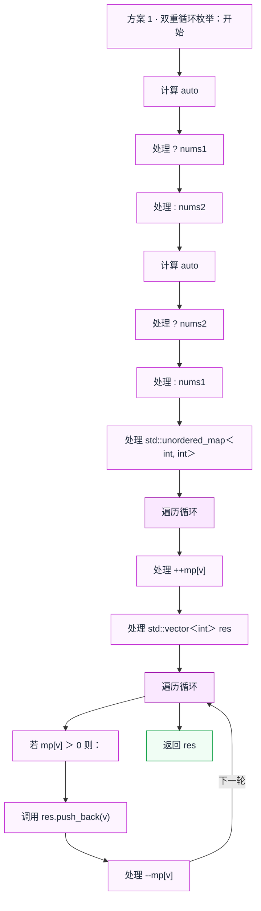

```cpp
// LeetCode 350. 两个数组的交集 II — C++ 版（方案1）
#include <cassert>       // 引入头文件
#include <iostream>      // 引入头文件
#include <unordered_map> // 引入头文件
#include <vector>        // 引入头文件
static std::vector<int> intersect(const std::vector<int> &nums1, const std::vector<int> &nums2) {
    const auto &a = nums1.size() <= nums2.size()
                        ? nums1
                        : nums2; // 把 数组1.大小() 不超过 数组2.大小() ? 数组1 : 数组2; 写入 const auto &a
    const auto &b = nums1.size() <= nums2.size()
                        ? nums2
                        : nums1; // 把 数组1.大小() 不超过 数组2.大小() ? 数组2 : 数组1; 写入 const auto &b
    std::unordered_map<int, int> mp; // std::unordered_map 小于 int, int 超过 mp;
    for (int v : a)
        ++mp[v];          // for (int 值 : 数组) 加一 mp[值];
    std::vector<int> res; // std::vector 小于 int 超过 结果;
    for (int v : b) {     // for (int 值 : b) {
        if (mp[v] > 0) {
            res.push_back(v);
            --mp[v];
        } // 若 mp[值] 超过 0) { 结果 追加 值); 减一 mp[值]; }
    }
    return res; // 返回 结果
}
int main() { // 程序入口：跑内嵌自测用例
    assert((intersect({1, 2, 2, 1}, {2, 2}) == std::vector<int>{2, 2}));       // 断言校验
    assert((intersect({4, 9, 5}, {9, 4, 9, 8, 4}) == std::vector<int>{9, 4})); // 断言校验
    std::cout << "PASS" << std::endl; // 全部用例通过，输出 PASS
    return 0;                         // 返回 0
}
```

#### 方案 2：排序预处理

**思路与代码分析**：核心是「排序预处理」。C++ 版用 STL 容器与迭代器，减少手写下标错误。代码里依次做这些事：哈希结构做计数或查重；双重循环遍历。**走读**：方案 2 · 排序预处理：开始 → 计算 auto → 处理 ? nums1 → 处理 : nums2 → 计算 auto → 处理 ? nums2 → 处理 : nums1 → 处理 std::unordered_map＜int, int＞ → 遍历循环 → 处理 ++mp[v] → 处理 std::vector＜int＞ res → 遍历循环 → 若 mp[v] ＞ 0 则： → 调用 res.push_back(v) → 处理 --mp[v] → 返回 res。

**运行架构**（真实控制流）：

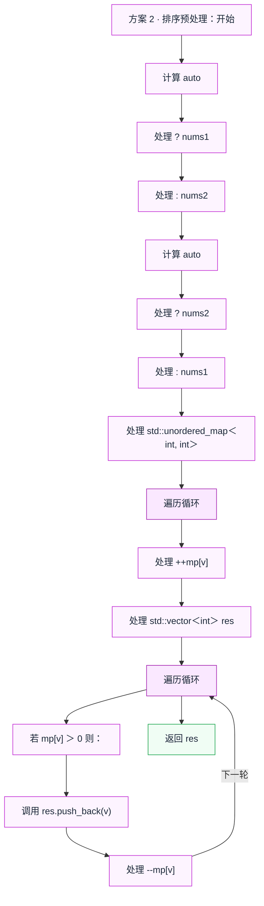

```cpp
// LeetCode 350. 两个数组的交集 II — C++ 版（方案2）
#include <cassert>       // 引入头文件
#include <iostream>      // 引入头文件
#include <unordered_map> // 引入头文件
#include <vector>        // 引入头文件
static std::vector<int> intersect(const std::vector<int> &nums1, const std::vector<int> &nums2) {
    const auto &a = nums1.size() <= nums2.size()
                        ? nums1
                        : nums2; // 把 数组1.大小() 不超过 数组2.大小() ? 数组1 : 数组2; 写入 const auto &a
    const auto &b = nums1.size() <= nums2.size()
                        ? nums2
                        : nums1; // 把 数组1.大小() 不超过 数组2.大小() ? 数组2 : 数组1; 写入 const auto &b
    std::unordered_map<int, int> mp; // std::unordered_map 小于 int, int 超过 mp;
    for (int v : a)
        ++mp[v];          // for (int 值 : 数组) 加一 mp[值];
    std::vector<int> res; // std::vector 小于 int 超过 结果;
    for (int v : b) {     // for (int 值 : b) {
        if (mp[v] > 0) {
            res.push_back(v);
            --mp[v];
        } // 若 mp[值] 超过 0) { 结果 追加 值); 减一 mp[值]; }
    }
    return res; // 返回 结果
}
int main() { // 程序入口：跑内嵌自测用例
    assert((intersect({1, 2, 2, 1}, {2, 2}) == std::vector<int>{2, 2}));       // 断言校验
    assert((intersect({4, 9, 5}, {9, 4, 9, 8, 4}) == std::vector<int>{9, 4})); // 断言校验
    std::cout << "PASS" << std::endl; // 全部用例通过，输出 PASS
    return 0;                         // 返回 0
}
```

### R 实现（2 种方案）

R 的全部方案如下，每个方案都内嵌用例自测，可独立运行（老仓库 python/go 文件遵循「打印结果」约定）：

#### 方案 1：双重循环枚举

**思路与代码分析**：核心是「双重循环枚举」。R 版用向量化思维与 1 起始下标，注意 1:n 的降序陷阱。代码里依次做这些事：双重循环遍历。**走读**：方案 1 · 双重循环枚举：开始 → 更新 < → 处理 nums1 else nums2 → 更新 < → 处理 nums2 else nums1 → 处理 used ＜- rep(FALSE, length(a) → 处理 res ＜- integer(0) → 循环 v：遍历 b → 循环 k：遍历 seq_along(a) → 若 非 used[k] 且 a[k] == v 则： → 处理 used[k] ＜- TRUE → 处理 res ＜- c(res, v) → 跳出循环（break） → 处理 res → 返回结果。

**运行架构**（真实控制流）：


```r
# 版（方案1） 定义函数 intersect_fn（参数：数组1, 数组2）
intersect_fn <- function(nums1, nums2) {
    a <- if (length(nums1) <= length(nums2))
        nums1 else nums2  # 把 if (长度(数组1) 不超过 长度(数组2)) 数组1 else 数组2 存入 数组
    b <- if (length(nums1) <= length(nums2))
        nums2 else nums1  # 把 if (长度(数组1) 不超过 长度(数组2)) 数组2 else 数组1 存入 b
    used <- rep(FALSE, length(a))  # 把 rep(FALSE, 长度(数组)) 存入 已用标记
    res <- integer(0)  # 把 integer(0) 存入 结果
    for (v in b) {
        # for (值 in b) { for (下标 k in seq_along(数组)) { 若 取反 已用标记[下标 k] 且 数组[下标 k] 等于 值
        for (k in seq_along(a)) {
            if (!used[k] && a[k] == v) {
                used[k] <- TRUE  # 把 TRUE 存入 used[k]
                res <- c(res, v)  # 把 字符(结果, 值) 存入 结果
                break  # 跳出循环
            }
        }
    }
    res  # 结果
}
stopifnot(identical(intersect_fn(c(1L, 2L, 2L, 1L), c(2L, 2L)), c(2L, 2L)))  # 断言校验
stopifnot(identical(intersect_fn(c(4L, 9L, 5L), c(9L, 4L, 9L, 8L, 4L)), c(9L, 4L)))  # 断言校验
cat("PASS\n")  # 全部用例通过，输出 PASS
```

#### 方案 2：排序预处理

**思路与代码分析**：核心是「排序预处理」。R 版用向量化思维与 1 起始下标，注意 1:n 的降序陷阱。代码里依次做这些事：双重循环遍历。**走读**：方案 2 · 排序预处理：开始 → 更新 < → 处理 nums1 else nums2 → 更新 < → 处理 nums2 else nums1 → 处理 used ＜- rep(FALSE, length(a) → 处理 res ＜- integer(0) → 循环 v：遍历 b → 循环 k：遍历 seq_along(a) → 若 非 used[k] 且 a[k] == v 则： → 处理 used[k] ＜- TRUE → 处理 res ＜- c(res, v) → 跳出循环（break） → 处理 res → 返回结果。

**运行架构**（真实控制流）：

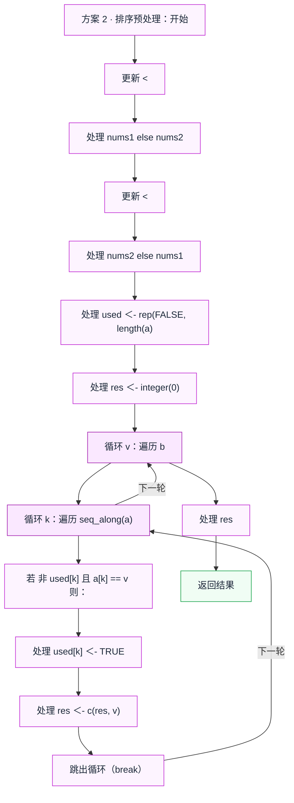

```r
# 版（方案2） 定义函数 intersect_fn（参数：数组1, 数组2）
intersect_fn <- function(nums1, nums2) {
    a <- if (length(nums1) <= length(nums2))
        nums1 else nums2  # 把 if (长度(数组1) 不超过 长度(数组2)) 数组1 else 数组2 存入 数组
    b <- if (length(nums1) <= length(nums2))
        nums2 else nums1  # 把 if (长度(数组1) 不超过 长度(数组2)) 数组2 else 数组1 存入 b
    used <- rep(FALSE, length(a))  # 把 rep(FALSE, 长度(数组)) 存入 已用标记
    res <- integer(0)  # 把 integer(0) 存入 结果
    for (v in b) {
        # for (值 in b) { for (下标 k in seq_along(数组)) { 若 取反 已用标记[下标 k] 且 数组[下标 k] 等于 值
        for (k in seq_along(a)) {
            if (!used[k] && a[k] == v) {
                used[k] <- TRUE  # 把 TRUE 存入 used[k]
                res <- c(res, v)  # 把 字符(结果, 值) 存入 结果
                break  # 跳出循环
            }
        }
    }
    res  # 结果
}
stopifnot(identical(intersect_fn(c(1L, 2L, 2L, 1L), c(2L, 2L)), c(2L, 2L)))  # 断言校验
stopifnot(identical(intersect_fn(c(4L, 9L, 5L), c(9L, 4L, 9L, 8L, 4L)), c(9L, 4L)))  # 断言校验
cat("PASS\n")  # 全部用例通过，输出 PASS
```

### Zig 实现（2 种方案）

Zig 的全部方案如下，每个方案都内嵌用例自测，可独立运行（老仓库 python/go 文件遵循「打印结果」约定）：

#### 方案 1：双重循环枚举

**思路与代码分析**：核心是「双重循环枚举」。Zig 版显式分配与清零，整型边界处理严格。代码里依次做这些事：哈希结构做计数或查重；双重循环遍历。**走读**：方案 1 · 双重循环枚举：开始 → 计算 mp → 处理 defer mp.deinit() → 遍历集合元素 → 计算 cur → 调用 mp.put(v, cur + 1) catch unr → 遍历集合元素 → 若 mp.get(v)：处理 ｜c｜ → 若 c ＞ 0 则： → 向 out 追加记录 → 调用 mp.put(v, c - 1) catch unrea → 返回结果。

**运行架构**（真实控制流）：

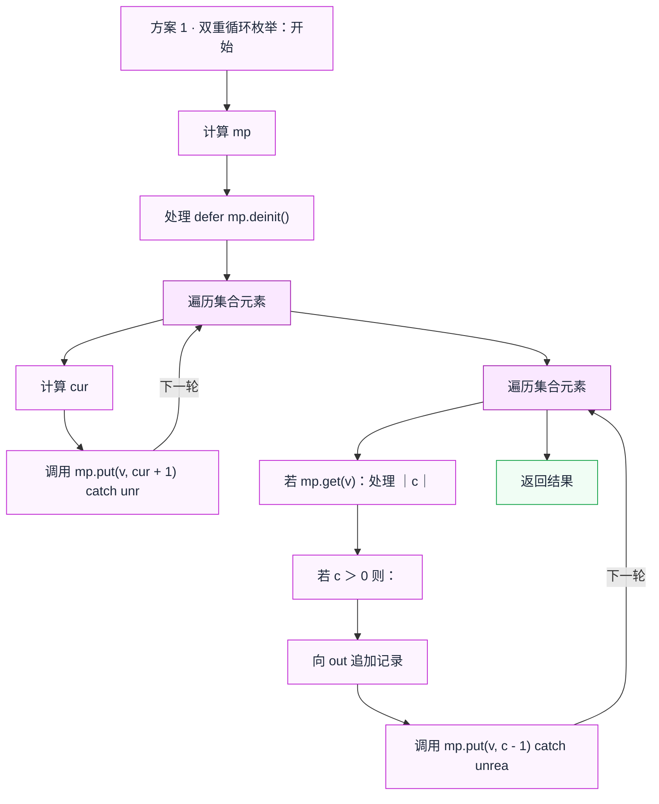

```zig
// LeetCode 350. 两个数组的交集 II — Zig 版（方案1）
const std = @import("std"); // 把 @import(「std」) 存入 std
fn intersect(a: []const i32, b: []const i32, alloc: std.mem.Allocator, out: *std.ArrayList(i32)) void { // 定义函数/方法 intersect
    var mp = std.AutoHashMap(i32, i32).init(alloc); // 把 std.AutoHashMap(i32, i32).init(alloc) 存入 mp
    defer mp.deinit(); // defer mp.deinit();
    for (a) |v| { // 逐个取出 数组 的元素（值）
        const cur = mp.get(v) orelse 0; // 把 mp 查找 值) orelse 0 存入 当前值
        mp.put(v, cur + 1) catch unreachable; // mp.put(值, 当前值 加 1) catch unreachable;
    }
    for (b) |v| { // 逐个取出 b 的元素（值）
        if (mp.get(v)) |c| { // 若 mp 查找 值)) 按位或 字符 按位或
            if (c > 0) { // 若 字符 超过 0
                out.append(v) catch unreachable; // 把 值 追加到列表尾部
                mp.put(v, c - 1) catch unreachable; // mp.put(值, 字符 减 1) catch unreachable;
            }
        }
    }
}
pub fn main() !void { // 程序入口：跑内嵌自测用例
    var arena = std.heap.ArenaAllocator.init(std.heap.page_allocator); // 把 std.堆.ArenaAllocator.init(std.堆.page_allocator) 存入 arena
    defer arena.deinit(); // defer arena.deinit();
    const alloc = arena.allocator(); // 把 arena.allocator() 存入 alloc
    var out = std.ArrayList(i32).init(std.heap.page_allocator); // 把 std.ArrayList(i32).init(std.堆.page_allocator) 存入 out
    defer out.deinit(); // defer out.deinit();
    intersect(&[_]i32{ 1, 2, 2, 1 }, &[_]i32{ 2, 2 }, alloc, &out);
    if (out.items.len != 2 or out.items[0] != 2 or out.items[1] != 2) return error.TestFailed;
    out.clearRetainingCapacity(); // out.clearRetainingCapacity();
    intersect(&[_]i32{ 4, 9, 5 }, &[_]i32{ 9, 4, 9, 8, 4 }, alloc, &out);
    if (out.items.len != 2 or out.items[0] != 9 or out.items[1] != 4) return error.TestFailed;
    std.debug.print("PASS\n", .{}); // 全部用例通过，输出 PASS
}
```

#### 方案 2：排序预处理

**思路与代码分析**：核心是「排序预处理」。Zig 版显式分配与清零，整型边界处理严格。代码里依次做这些事：哈希结构做计数或查重；双重循环遍历。**走读**：方案 2 · 排序预处理：开始 → 计算 mp → 处理 defer mp.deinit() → 遍历集合元素 → 计算 cur → 调用 mp.put(v, cur + 1) catch unr → 遍历集合元素 → 若 mp.get(v)：处理 ｜c｜ → 若 c ＞ 0 则： → 向 out 追加记录 → 调用 mp.put(v, c - 1) catch unrea → 返回结果。

**运行架构**（真实控制流）：

```mermaid
graph TD
    N0["方案 2 · 排序预处理：开始"]
    N1["计算 mp"]
    N2["处理 defer mp.deinit()"]
    N3["遍历集合元素"]
    N4["计算 cur"]
    N5["调用 mp.put(v, cur + 1) catch unr"]
    N6["遍历集合元素"]
    N7["若 mp.get(v)：处理 ｜c｜"]
    N8["若 c ＞ 0 则："]
    N9["向 out 追加记录"]
    N10["调用 mp.put(v, c - 1) catch unrea"]
    N11["返回结果"]
    N0 --> N1
    N1 --> N2
    N2 --> N3
    N3 --> N4
    N4 --> N5
    N5 -- 下一轮 --> N3
    N3 --> N6
    N6 --> N7
    N7 --> N8
    N8 --> N9
    N9 --> N10
    N10 -- 下一轮 --> N6
    N6 --> N11
    classDef n fill:#fdf4ff,stroke:#c026d3,color:#1e293b;
    classDef lp fill:#fae8ff,stroke:#a21caf,color:#1e293b;
    classDef dc fill:#fef9c3,stroke:#ca8a04,color:#1e293b;
    classDef tm fill:#f0fdf4,stroke:#16a34a,color:#1e293b;
    class N0,N1,N2,N4,N5,N7,N8,N9,N10 n;
    class N3,N6 lp;
    class N11 tm;
```

```zig
// LeetCode 350. 两个数组的交集 II — Zig 版（方案2）
const std = @import("std"); // 把 @import(「std」) 存入 std
fn intersect(a: []const i32, b: []const i32, alloc: std.mem.Allocator, out: *std.ArrayList(i32)) void { // 定义函数/方法 intersect
    var mp = std.AutoHashMap(i32, i32).init(alloc); // 把 std.AutoHashMap(i32, i32).init(alloc) 存入 mp
    defer mp.deinit(); // defer mp.deinit();
    for (a) |v| { // 逐个取出 数组 的元素（值）
        const cur = mp.get(v) orelse 0; // 把 mp 查找 值) orelse 0 存入 当前值
        mp.put(v, cur + 1) catch unreachable; // mp.put(值, 当前值 加 1) catch unreachable;
    }
    for (b) |v| { // 逐个取出 b 的元素（值）
        if (mp.get(v)) |c| { // 若 mp 查找 值)) 按位或 字符 按位或
            if (c > 0) { // 若 字符 超过 0
                out.append(v) catch unreachable; // 把 值 追加到列表尾部
                mp.put(v, c - 1) catch unreachable; // mp.put(值, 字符 减 1) catch unreachable;
            }
        }
    }
}
pub fn main() !void { // 程序入口：跑内嵌自测用例
    var arena = std.heap.ArenaAllocator.init(std.heap.page_allocator); // 把 std.堆.ArenaAllocator.init(std.堆.page_allocator) 存入 arena
    defer arena.deinit(); // defer arena.deinit();
    const alloc = arena.allocator(); // 把 arena.allocator() 存入 alloc
    var out = std.ArrayList(i32).init(std.heap.page_allocator); // 把 std.ArrayList(i32).init(std.堆.page_allocator) 存入 out
    defer out.deinit(); // defer out.deinit();
    intersect(&[_]i32{ 1, 2, 2, 1 }, &[_]i32{ 2, 2 }, alloc, &out);
    if (out.items.len != 2 or out.items[0] != 2 or out.items[1] != 2) return error.TestFailed;
    out.clearRetainingCapacity(); // out.clearRetainingCapacity();
    intersect(&[_]i32{ 4, 9, 5 }, &[_]i32{ 9, 4, 9, 8, 4 }, alloc, &out);
    if (out.items.len != 2 or out.items[0] != 9 or out.items[1] != 4) return error.TestFailed;
    std.debug.print("PASS\n", .{}); // 全部用例通过，输出 PASS
}
```

### Dart 实现（2 种方案）

Dart 的全部方案如下，每个方案都内嵌用例自测，可独立运行（老仓库 python/go 文件遵循「打印结果」约定）：

#### 方案 1：双重循环枚举

**思路与代码分析**：核心是「双重循环枚举」。Dart 版用可空类型标注与集合方法，注意空安全。代码里依次做这些事：双重循环遍历。**走读**：方案 1 · 双重循环枚举：开始 → 更新 a → 遍历循环 → 遍历循环 → 返回 res。

**运行架构**（真实控制流）：

```mermaid
graph TD
    N0["方案 1 · 双重循环枚举：开始"]
    N1["更新 a"]
    D1["……（中间计算步骤）"]
    N8["遍历循环"]
    D2["……（中间计算步骤）"]
    N11["遍历循环"]
    D3["……（中间计算步骤）"]
    N16["返回 res"]
    N0 --> N1
    N11 --> N16
    N1 --> D1
    D1 --> N8
    N8 --> D2
    D2 --> N11
    N11 --> D3
    D3 --> N16
    classDef n fill:#fdf4ff,stroke:#c026d3,color:#1e293b;
    classDef lp fill:#fae8ff,stroke:#a21caf,color:#1e293b;
    classDef dc fill:#fef9c3,stroke:#ca8a04,color:#1e293b;
    classDef tm fill:#f0fdf4,stroke:#16a34a,color:#1e293b;
    class N0,N1,D1,D2,D3 n;
    class N8,N11 lp;
    class N16 tm;
```

```dart
// LeetCode 350. 两个数组的交集 II — Dart 版（方案1）
List<int> intersect(List<int> nums1, List<int> nums2) {
  // 定义函数/方法 intersect
  final a = nums1.length <= nums2.length
      ? nums1
      : nums2; // 把 数组1.长度 不超过 数组2.长度 ? 数组1 : 数组2 存入 数组
  final b = nums1.length <= nums2.length
      ? nums2
      : nums1; // 把 数组1.长度 不超过 数组2.长度 ? 数组2 : 数组1 存入 b
  final mp = <int, int>{}; // 把 小于 int, int 超过 {} 存入 mp
  for (final v in a) {
    // for (final 值 in 数组) {
    mp[v] = (mp[v] ?? 0) + 1; // 把 (mp[值] ?? 0) 加 1; 写入 mp[v]
  }
  final res = <int>[]; // 把 小于 int 超过 [] 存入 结果
  for (final v in b) {
    // for (final 值 in b) {
    final c = mp[v] ?? 0; // 把 mp[值] ?? 0 存入 字符
    if (c > 0) {
      // 若 字符 超过 0
      res.add(v); // 结果 追加 值);
      mp[v] = c - 1; // 把 字符 减 1; 写入 mp[v]
    }
  }
  return res; // 返回 结果
}

void main() {
  // 程序入口：跑内嵌自测用例
  if (intersect([1, 2, 2, 1], [2, 2]).toString() != '[2, 2]')
    throw StateError('c1');
  if (intersect([4, 9, 5], [9, 4, 9, 8, 4]).toString() != '[9, 4]')
    throw StateError('c2');
  print('PASS'); // 全部用例通过，输出 PASS
}
```

#### 方案 2：排序预处理

**思路与代码分析**：核心是「排序预处理」。Dart 版用可空类型标注与集合方法，注意空安全。代码里依次做这些事：双重循环遍历。**走读**：方案 2 · 排序预处理：开始 → 更新 a → 遍历循环 → 遍历循环 → 返回 res。

**运行架构**（真实控制流）：

```mermaid
graph TD
    N0["方案 2 · 排序预处理：开始"]
    N1["更新 a"]
    D1["……（中间计算步骤）"]
    N8["遍历循环"]
    D2["……（中间计算步骤）"]
    N11["遍历循环"]
    D3["……（中间计算步骤）"]
    N16["返回 res"]
    N0 --> N1
    N11 --> N16
    N1 --> D1
    D1 --> N8
    N8 --> D2
    D2 --> N11
    N11 --> D3
    D3 --> N16
    classDef n fill:#fdf4ff,stroke:#c026d3,color:#1e293b;
    classDef lp fill:#fae8ff,stroke:#a21caf,color:#1e293b;
    classDef dc fill:#fef9c3,stroke:#ca8a04,color:#1e293b;
    classDef tm fill:#f0fdf4,stroke:#16a34a,color:#1e293b;
    class N0,N1,D1,D2,D3 n;
    class N8,N11 lp;
    class N16 tm;
```

```dart
// LeetCode 350. 两个数组的交集 II — Dart 版（方案2）
List<int> intersect(List<int> nums1, List<int> nums2) {
  // 定义函数/方法 intersect
  final a = nums1.length <= nums2.length
      ? nums1
      : nums2; // 把 数组1.长度 不超过 数组2.长度 ? 数组1 : 数组2 存入 数组
  final b = nums1.length <= nums2.length
      ? nums2
      : nums1; // 把 数组1.长度 不超过 数组2.长度 ? 数组2 : 数组1 存入 b
  final mp = <int, int>{}; // 把 小于 int, int 超过 {} 存入 mp
  for (final v in a) {
    // for (final 值 in 数组) {
    mp[v] = (mp[v] ?? 0) + 1; // 把 (mp[值] ?? 0) 加 1; 写入 mp[v]
  }
  final res = <int>[]; // 把 小于 int 超过 [] 存入 结果
  for (final v in b) {
    // for (final 值 in b) {
    final c = mp[v] ?? 0; // 把 mp[值] ?? 0 存入 字符
    if (c > 0) {
      // 若 字符 超过 0
      res.add(v); // 结果 追加 值);
      mp[v] = c - 1; // 把 字符 减 1; 写入 mp[v]
    }
  }
  return res; // 返回 结果
}

void main() {
  // 程序入口：跑内嵌自测用例
  if (intersect([1, 2, 2, 1], [2, 2]).toString() != '[2, 2]')
    throw StateError('c1');
  if (intersect([4, 9, 5], [9, 4, 9, 8, 4]).toString() != '[9, 4]')
    throw StateError('c2');
  print('PASS'); // 全部用例通过，输出 PASS
}
```

---

## 内容总结

- **两个数组的交集 ii**（哈希表 · Medium）：共 2 个方案，主线思路「双重循环枚举」；时间 O(n²)（两层嵌套扫描）；动画演示哈希链地址过程，附录给出 11 种语言 × 全部方案的可运行实现。
- 来源博客：[https://blog.csdn.net/tyro_java/article/details/145568435](https://blog.csdn.net/tyro_java/article/details/145568435)
- 导航：[📋 总目录](../) ｜ [← 029 两个数组的交集](../029_两个数组的交集/) ｜ [031 o(1) 时间插入、删除和获取随 →](../031_o%281%29_时间插入、删除和获取随机元素/)
