# 031 · o(1) 时间插入、删除和获取随机元素（第一阶段 · 线性结构入门 · Medium）

> **难度**：⭐⭐ Medium ｜ **专题**：数组
> **学习定位**：第一阶段 · 线性结构入门第 31 篇 ｜ **解法数**：1
> **内容总结**：**o(1) 时间插入、删除和获取随机元素**（数组 · Medium）：共 1 个方案，主线思路「变长数组 + 哈希表」；时间 O(n) 量级；动画演示双指针过程，附录给出 11 种语言 × 全部方案的可运行实现。

---

## 题目描述

实现`RandomizedSet` 类：

 `RandomizedSet()` 初始化 `RandomizedSet` 对象
 `bool insert(int val)` 当元素 `val` 不存在时，向集合中插入该项，并返回 `true` ；否则，返回 `false` 。
 `bool remove(int val)` 当元素 `val` 存在时，从集合中移除该项，并返回 `true` ；否则，返回 `false` 。
 `int getRandom()` 随机返回现有集合中的一项（测试用例保证调用此方法时集合中至少存在一个元素）。每个元素应该有 相同的概率 被返回。

你必须实现类的所有函数，并满足每个函数的 平均 时间复杂度为 `O(1)` 。

示例：

输入
[「RandomizedSet」, 「insert」, 「remove」, 「insert」, 「getRandom」, 「remove」, 「insert」, 「getRandom」]
[[], [1], [2], [2], [], [1], [2], []]
输出
[null, true, false, true, 2, true, false, 2]

解释
RandomizedSet randomizedSet = new RandomizedSet();
randomizedSet.insert(1); // 向集合中插入 1 。返回 true 表示 1 被成功地插入。
randomizedSet.remove(2); // 返回 false ，表示集合中不存在 2 。
randomizedSet.insert(2); // 向集合中插入 2 。返回 true 。集合现在包含 [1,2] 。
randomizedSet.getRandom(); // getRandom 应随机返回 1 或 2 。
randomizedSet.remove(1); // 从集合中移除 1 ，返回 true 。集合现在包含 [2] 。
randomizedSet.insert(2); // 2 已在集合中，所以返回 false 。
randomizedSet.getRandom(); // 由于 2 是集合中唯一的数字，getRandom 总是返回 2 。

提示：

 `-2^31 
 最多调用 `insert`、`remove` 和 `getRandom` 函数 `2  ``10^5` 次
 在调用 `getRandom` 方法时，数据结构中 至少存在一个 元素。

> 题面与 [leetcode.cn 官方](https://leetcode.cn/problems/insert-delete-getrandom-o1/)一致，示例配图取自官方题面。

**数据范围与注意事项**：

- `-2^31 <= val <= 2^31 - 1`
- `最多调用 `insert`、`remove` 和 `getRandom` 函数 `2  ``10^5` 次`
- 在调用 `getRandom` 方法时，数据结构中 至少存在一个 元素。
- **易错点**：边界最容易漏：空数组、只有一个元素、目标出现在头尾。

## 题目分析

**场景是什么**：数组是最常用的线性容器，这类题练的是下标操作与原地腾挪，对应真实开发里的缓冲区、列表整理。本题就是该场景的 Medium 级练习，主线做法是「变长数组 + 哈希表」。

**主线怎么解**：把主解法从头到尾过一遍，它其实在依次做这几件事：哈希结构做计数或查重 → 栈的后进先出操作。

## 解题思路

**方案对比**（共 1 个方案，由浅入深）：

| 方案 | 时间复杂度 | 空间复杂度 |
|---|---|---|
| 方案 1 · 变长数组 + 哈希表 | O(n) 量级 | O(n) |

**怎么读这一篇**：

- 🐣 **新手路线**：把「题目描述」的示例 1 在纸上手推一遍 → 读方案 1（最直观的写法）与它的代码走读 → 按「运行方式」本地跑通看 PASS → 回头对比方案 2 之后的写法差在哪
- 🦅 **大佬路线**：直接锁定最优方案 1（变长数组 + 哈希表，O(n) 量级）→ 跳读该方案代码与走读 → 用「逐步拆解与面试追问」补齐复杂度推导与边界追问

### 动态算法图（双指针，GIF 自动循环）


动画演示数组专题里双指针的典型过程；每个方案在「TypeScript 解题方案」一节还配了专属动画与专属流程图。

### 主解法流程图（真实控制流）

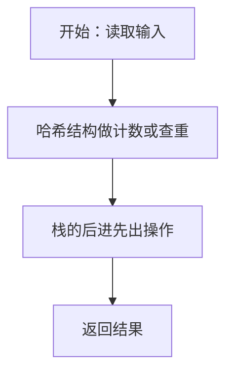

## TypeScript 解题方案（1 个方案逐个讲）

> **运行与提交**：每个方案都是自包含文件（内嵌用例自测，输出 PASS），整块复制到 `.ts` 文件后 `node 文件名` 即可运行。提交 LeetCode 时，把 `demo` 内的算法函数与辅助类型/函数整体取出、置于文件顶层即可。涉及交互/特殊接口的题以题面给定签名为准。

### 方案 1：变长数组 + 哈希表

**分析与思路**：核心做法是「变长数组 + 哈希表」。代码里依次做这些事：哈希结构做计数或查重；栈的后进先出操作。

**运行方式**：`node 本文件`，内嵌用例全部通过会输出 PASS。

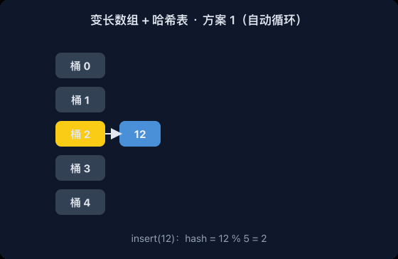

**方案专属流程图**（真实控制流）：


```typescript
/**
 ** LeetCode 380. O(1) 时间插入、删除和获取随机元素
 ** 方案1: 变长数组 + 哈希表
 */

class RandomizedSet {
  // 定义类型
  private vals: number[]; // private vals: number[];
  private valMap: Map<number, number>; // private valMap: Map 小于 number, number 超过 ;

  constructor() {
    // constructor() {
    this.vals = []; // 把 []; 写入 this.vals
    this.valMap = new Map(); // 把 new Map(); 写入 this.valMap
  }

  insert(val: number): boolean {
    // insert(值: number): boolean {
    if (this.valMap.has(val)) return false; // 若 this.valMap.has(值)，直接返回 false
    this.valMap.set(val, this.vals.length); // this.valMap.set(值, this.vals.长度);
    this.vals.push(val); // 把 值 压入栈/数组尾部
    return true; // 返回 true
  }

  remove(val: number): boolean {
    // remove(值: number): boolean {
    if (!this.valMap.has(val)) return false; // 若 取反 this.valMap.has(值)，直接返回 false
    const idx = this.valMap.get(val)!; // 把 this.valMap 查找 值)取反 存入 idx
    const last = this.vals[this.vals.length - 1]; // 把 this.vals[this.vals.长度 减 1] 存入 last
    this.vals[idx] = last; // 把 last; 写入 this.vals[idx]
    this.valMap.set(last, idx); // this.valMap.set(last, idx);
    this.vals.pop(); // 弹出栈顶元素
    this.valMap.delete(val); // this.valMap.delete(值);
    return true; // 返回 true
  }

  getRandom(): number {
    // getRandom(): number {
    return this.vals[Math.floor(Math.random() * this.vals.length)]; // 返回 this.vals[向下取整(Math.random() 乘 this.vals.长度)]
  }
}

export function demo(): void {
  // 程序入口：跑内嵌自测用例
  let fail = false; // 把 false 存入 fail
  const rs = new RandomizedSet(); // 把 new RandomizedSet() 存入 rs
  if (rs.insert(1) !== true) {
    fail = true;
    console.log('FAIL insert(1) should be true');
  }
  if (rs.remove(2) !== false) {
    fail = true;
    console.log('FAIL remove(2) should be false');
  }
  if (rs.insert(2) !== true) {
    fail = true;
    console.log('FAIL insert(2) should be true');
  }
  const r1 = rs.getRandom(); // 把 rs.getRandom() 存入 r1
  if (r1 !== 1 && r1 !== 2) {
    fail = true;
    console.log('FAIL getRandom=' + r1 + ' not in {1,2}');
  }
  if (rs.remove(1) !== true) {
    fail = true;
    console.log('FAIL remove(1) should be true');
  }
  if (rs.insert(2) !== false) {
    fail = true;
    console.log('FAIL insert(2) again should be false');
  }
  const r2 = rs.getRandom(); // 把 rs.getRandom() 存入 r2
  if (r2 !== 2) {
    fail = true;
    console.log('FAIL getRandom=' + r2 + ' want 2');
  }
  if (fail) throw new Error('FAILED'); // 若 fail) throw new Error(「FAILED」);
  console.log('PASS'); // 全部用例通过，输出 PASS
}
demo(); // demo();
```

## 逐步拆解与面试追问

**复杂度**：时间 O(n) 量级，空间 O(n)

**为什么是这个量级**：整体只对数据做有限趟处理

**面试官可能会追问**：

- 能不能原地做（O(1) 空间）？
- 如果数组已有序，能优化到什么程度？
- 空数组、单元素怎么处理？

## 关键 API 速查（TS 主解法实际用到，附官方链接）

| API | 作用 | 使用要点 | 官方文档 |
|---|---|---|---|
| `Map` | 哈希表：任意类型键值对 | set(k,v) 存、get(k) 取（不存在返回 undefined）、has(k) 判存在、delete(k) 删；增删查均摊 O(1)；键顺序为插入序；键必须用引用区分（对象键按身份） | [官方文档](https://developer.mozilla.org/zh-CN/docs/Web/JavaScript/Reference/Global_Objects/Map) |
| `Array.prototype.push()` | 尾部追加 | 返回新长度；可一次多个；均摊 O(1)；会改变原数组 | [官方文档](https://developer.mozilla.org/zh-CN/docs/Web/JavaScript/Reference/Global_Objects/Array/push) |
| `Array.prototype.pop()` | 尾部弹出 | 返回被删元素（空数组返回 undefined）；O(1) | [官方文档](https://developer.mozilla.org/zh-CN/docs/Web/JavaScript/Reference/Global_Objects/Array/pop) |
| `Math.floor()` | 向下取整 | 负数向负无穷（-1.5 → -2）；大数用位运算前注意 2^31 界 | [官方文档](https://developer.mozilla.org/zh-CN/docs/Web/JavaScript/Reference/Global_Objects/Math/floor) |

### 各语言官方文档导航

- **TypeScript / JS**：[MDN 中文参考](https://developer.mozilla.org/zh-CN/)
- **Python**：[Python 官方文档](https://docs.python.org/zh-cn/3/)
- **Go**：[Go 标准库](https://pkg.go.dev/std)
- **Java**：[JDK 17 API](https://docs.oracle.com/en/java/javase/17/docs/api/)
- **Rust**：[Rust 标准库](https://doc.rust-lang.org/std/)
- **Lua**：[Lua 5.4 手册](https://www.lua.org/manual/5.4/)
- **C**：[Cppreference C](https://zh.cppreference.com/w/c)
- **C++**：[Cppreference C++](https://zh.cppreference.com/w/cpp)
- **R**：[R 官方手册](https://stat.ethz.ch/R-manual/)
- **Zig**：[Zig 语言文档](https://ziglang.org/documentation/master/)
- **Dart**：[Dart API](https://api.dart.dev/)

## 附录：其他 10 种语言全部实现（每种语言列举其全部方案）

> TypeScript 的全部方案见「TypeScript 解题方案」一节；下面是其余 10 种语言的对应实现，每种语言的每个方案都带思路分析、代码走读与专属运行架构图。
> 每个方案都内嵌用例自测，可独立运行（老仓库 python/go 文件遵循「打印结果」约定）。
> 完整解法文件见 `dsa/<语言>/array/lc_380_o(1)_时间插入、删除和获取随机元素/`。

### Python 实现（1 种方案）

Python 的全部方案如下，每个方案都内嵌用例自测，可独立运行（老仓库 python/go 文件遵循「打印结果」约定）：

#### 方案 1：变长数组 + 哈希表

**思路与代码分析**：核心是「变长数组 + 哈希表」。Python 版用切片与字典推导式简化操作，突出可读性。

**运行架构**（真实控制流）：

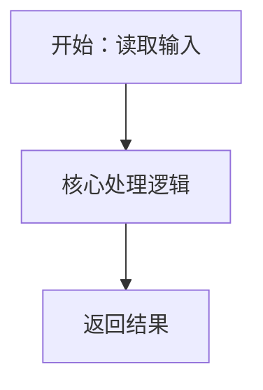

```python
import sys  # 提高递归深度上限（深输入防 RecursionError）

sys.setrecursionlimit(200000)  # 树/链表类题目节点数可达 1e4 量级
import random  # 引入依赖

class RandomizedSet:  # 定义类
    def __init__(self):  # 构造函数：初始化成员
        self.nums = []  # 把 [] 写入 数组
        self.indices = {}  # 把 {} 写入 self.indices

    def insert(self, val):  # 定义函数 insert（参数：self, 值）
        if val in self.indices:  # 若 值 in self.indices
            return False  # 返回 False
        index = len(self.nums)  # 把 长度(self.数组) 存入 index
        self.nums.append(val)  # 把 值 追加到列表尾部
        self.indices[val] = index  # 把 index 写入 self.indices[val]
        return True  # 返回 True

    def remove(self, val):  # 定义函数 remove（参数：self, 值）
        if val not in self.indices:  # 若 值 not in self.indices
            return False  # 返回 False
        idx = self.indices[val]  # 把 self.indices[值] 存入 idx
        last = self.nums[-1]  # 把 self.数组[ 减 1] 存入 last
        self.nums[idx] = last  # 把 last 写入 self.nums[idx]
        self.indices[last] = idx  # 把 idx 写入 self.indices[last]
        self.nums.pop()  # 弹出栈顶元素
        del self.indices[val]  # del self.indices[值]
        return True  # 返回 True

    def getRandom(self):  # 定义函数 getRandom（参数：self）
        return random.choice(self.nums)  # 返回 random.choice(self.数组)

if __name__ == "__main__":  # 若 __name__ 等于 '__main__'
    rs = RandomizedSet()  # 把 RandomizedSet() 存入 rs
    print(rs.insert(1))  # 打印输出
    print(rs.remove(2))  # 打印输出
    print(rs.insert(2))  # 打印输出
    print(rs.getRandom())  # 打印输出
    print(rs.remove(1))  # 打印输出
    print(rs.insert(2))  # 打印输出
    print(rs.getRandom())  # 打印输出
```

### Go 实现（1 种方案）

Go 的全部方案如下，每个方案都内嵌用例自测，可独立运行（老仓库 python/go 文件遵循「打印结果」约定）：

#### 方案 1：变长数组 + 哈希表

**思路与代码分析**：核心是「变长数组 + 哈希表」。Go 版用切片与多返回值惯用法，显式处理索引边界。代码里依次做这些事：哈希结构做计数或查重。**走读**：方案 1 · 变长数组 + 哈希表：开始 → 返回 &RandomizedSet。

**运行架构**（真实控制流）：

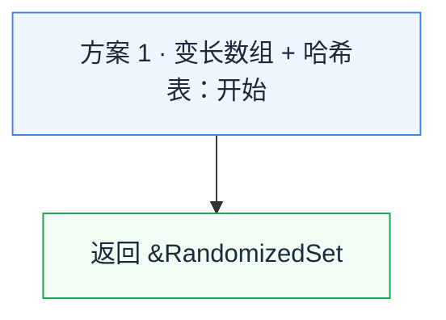

```go
package main // 引入依赖

import (
	"fmt"       // 「fmt」
	"math/rand" // 「math 除以 rand」
	"os"        // 「os」
)

type RandomizedSet struct { // 定义类型
	nums    []int       // 数组 []int
	indices map[int]int // indices 映射表[int]int
}

func NewRandomizedSet() *RandomizedSet { // 定义函数/方法 NewRandomizedSet
	return &RandomizedSet{indices: map[int]int{}} // 返回 按位与 RandomizedSet{indices: 映射表[int]int{}}
}

func (r *RandomizedSet) insert(val int) bool { // 定义函数/方法 insert
	if _, ok := r.indices[val]; ok { // 若 _, ok : 赋值为 右指针.indices[值]; ok
		return false // 返回 false
	}
	r.indices[val] = len(r.nums) // 把 长度(右指针.数组) 写入 r.indices[val]
	r.nums = append(r.nums, val) // 把 append(右指针.数组, 值) 写入 数组
	return true                  // 返回 true
}

func (r *RandomizedSet) remove(val int) bool { // 定义函数/方法 remove
	if _, ok := r.indices[val]; !ok { // 若 _, ok : 赋值为 右指针.indices[值]; 取反 ok
		return false // 返回 false
	}
	idx := r.indices[val]           // 把 右指针.indices[值] 写入 idx :
	last := r.nums[len(r.nums)-1]   // 把 右指针.数组[长度(右指针.数组) 减 1] 写入 last :
	r.nums[idx] = last              // 把 last 写入 r.nums[idx]
	r.indices[last] = idx           // 把 idx 写入 r.indices[last]
	r.nums = r.nums[:len(r.nums)-1] // 把 右指针.数组[:长度(右指针.数组) 减 1] 写入 数组
	delete(r.indices, val)          // delete(右指针.indices, 值)
	return true                     // 返回 true
}

func (r *RandomizedSet) getRandom() int { // 定义函数/方法 getRandom
	return r.nums[rand.Intn(len(r.nums))] // 返回 右指针.数组[rand.Intn(长度(右指针.数组))]
}

func main() { // 程序入口：跑内嵌自测用例
	rs := NewRandomizedSet() // 把 NewRandomizedSet() 写入 rs :
	ok := true               // 把 true 写入 ok :
	if !rs.insert(1) {       // 若 取反 rs 插入 1
		ok = false                                  // 把 false 写入 ok
		fmt.Println("FAIL insert(1) expected true") // 打印输出
	}
	if rs.remove(2) { // 若 rs 弹出 2
		ok = false                                   // 把 false 写入 ok
		fmt.Println("FAIL remove(2) expected false") // 打印输出
	}
	if !rs.insert(2) { // 若 取反 rs 插入 2
		ok = false                                  // 把 false 写入 ok
		fmt.Println("FAIL insert(2) expected true") // 打印输出
	}
	g := rs.getRandom()   // 把 rs.getRandom() 写入 g :
	if g != 1 && g != 2 { // 若 g 不等于 1 且 g 不等于 2
		ok = false                                             // 把 false 写入 ok
		fmt.Printf("FAIL getRandom()=%v expected 1 or 2\n", g) // 打印输出
	}
	if !rs.remove(1) { // 若 取反 rs 弹出 1
		ok = false                                  // 把 false 写入 ok
		fmt.Println("FAIL remove(1) expected true") // 打印输出
	}
	if rs.insert(2) { // 若 rs 插入 2
		ok = false                                                     // 把 false 写入 ok
		fmt.Println("FAIL insert(2) expected false (already present)") // 打印输出
	}
	if rs.getRandom() != 2 { // 若 rs.getRandom() 不等于 2
		ok = false                                                 // 把 false 写入 ok
		fmt.Printf("FAIL getRandom() expected 2 (only element)\n") // 打印输出
	}
	if !ok { // 若 取反 ok
		os.Exit(1) // os.Exit(1)
	}
	fmt.Println("PASS") // 全部用例通过，输出 PASS
}
```

### Java 实现（1 种方案）

Java 的全部方案如下，每个方案都内嵌用例自测，可独立运行（老仓库 python/go 文件遵循「打印结果」约定）：

#### 方案 1：变长数组 + 哈希表

**思路与代码分析**：核心是「变长数组 + 哈希表」。Java 版用类与静态方法组织，集合操作显式明了。代码里依次做这些事：哈希结构做计数或查重。**走读**：方案 1 · 变长数组 + 哈希表：开始 → 更新 nums → 更新 idx → 更新 rnd → 返回结果。

**运行架构**（真实控制流）：

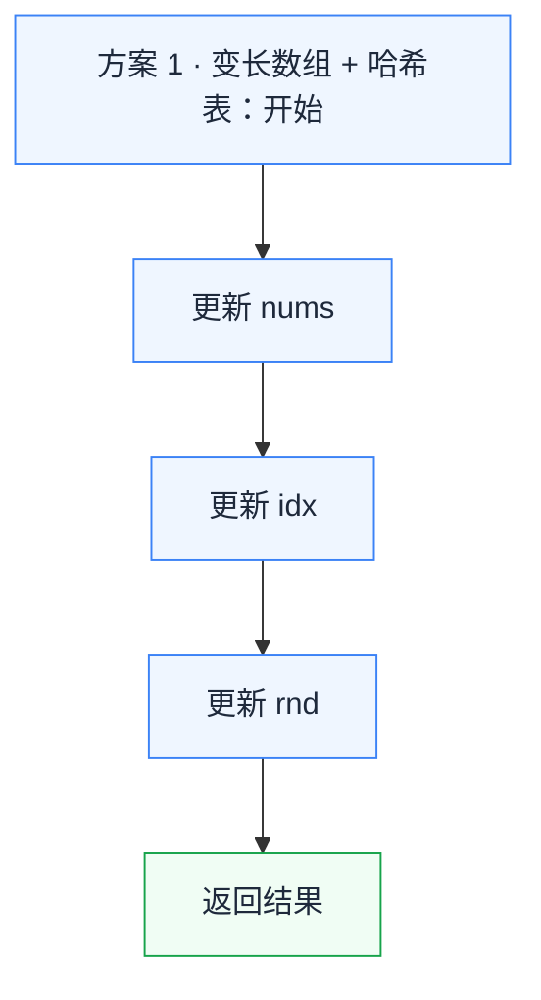

```java
package com.webfault.dsa; // 引入依赖

import java.util.*; // 引入依赖

class lc380_solution111 { // 定义类型
  private List<Integer> nums; // private List 小于 Integer 超过 数组;
  private Map<Integer, Integer> idx; // private Map 小于 Integer, Integer 超过 idx;
  private Random rnd; // private Random rnd;

  public lc380_solution111() { // 定义函数/方法 lc380_solution111
    nums = new ArrayList<>(); // 把 new ArrayList 小于 超过 (); 写入 数组
    idx = new HashMap<>(); // 把 new HashMap 小于 超过 (); 写入 idx
    rnd = new Random(); // 把 new Random(); 写入 rnd
  }

  public boolean insert(int val) { // 定义函数/方法 insert
    if (idx.containsKey(val)) return false; // 若 idx.containsKey(值)，直接返回 false
    idx.put(val, nums.size()); // idx.put(值, 数组.大小());
    nums.add(val); // 数组 追加 值);
    return true; // 返回 true
  }

  public boolean remove(int val) { // 定义函数/方法 remove
    if (!idx.containsKey(val)) return false; // 若 取反 idx.containsKey(值)，直接返回 false
    int i = idx.get(val); // 把 idx 查找 值) 存入 下标 i
    int last = nums.get(nums.size() - 1); // 把 数组 查找 数组.大小() 减 1) 存入 last
    nums.set(i, last); // 数组.set(下标 i, last);
    idx.put(last, i); // idx.put(last, 下标 i);
    nums.remove(nums.size() - 1); // 数组 弹出 数组.大小() 减 1);
    idx.remove(val); // idx 弹出 值);
    return true; // 返回 true
  }

  public int getRandom() { // 定义函数/方法 getRandom
    return nums.get(rnd.nextInt(nums.size())); // 返回 数组 查找 rnd.nextInt(数组.大小()))
  }

  public static void main(String[] args) { // public static void main(String[] args) {
    lc380_solution111 rs =
        new lc380_solution111(); // 把 new lc380_solution111(); 写入 lc380_solution111 rs
    if (!rs.insert(1))
      throw new RuntimeException(
          "FAILED insert1"); // 若 取反 rs 插入 1)) throw new RuntimeException(「FAILED insert1」);
    if (rs.remove(2))
      throw new RuntimeException(
          "FAILED remove2"); // 若 rs 弹出 2)) throw new RuntimeException(「FAILED remove2」);
    if (!rs.insert(2))
      throw new RuntimeException(
          "FAILED insert2"); // 若 取反 rs 插入 2)) throw new RuntimeException(「FAILED insert2」);
    int g = rs.getRandom(); // 把 rs.getRandom() 存入 g
    if (g != 1 && g != 2) throw new RuntimeException("FAILED getRandom");
    if (!rs.remove(1))
      throw new RuntimeException(
          "FAILED remove1"); // 若 取反 rs 弹出 1)) throw new RuntimeException(「FAILED remove1」);
    if (rs.insert(2))
      throw new RuntimeException(
          "FAILED insert2b"); // 若 rs 插入 2)) throw new RuntimeException(「FAILED insert2b」);
    if (rs.getRandom() != 2) throw new RuntimeException("FAILED getRandom2");
    System.out.println("PASS"); // 全部用例通过，输出 PASS
  }
}
```

### Rust 实现（1 种方案）

Rust 的全部方案如下，每个方案都内嵌用例自测，可独立运行（老仓库 python/go 文件遵循「打印结果」约定）：

#### 方案 1：变长数组 + 哈希表

**思路与代码分析**：核心是「变长数组 + 哈希表」。Rust 版用所有权移动与切片借用改写同一逻辑，注意 Option 与引用边界。代码里依次做这些事：哈希结构做计数或查重。**走读**：方案 1 · 变长数组 + 哈希表：开始 → 处理 RandomizedSet → 处理 vals: Vec::new(), → 处理 pos: HashMap::new(), → 返回结果。

**运行架构**（真实控制流）：

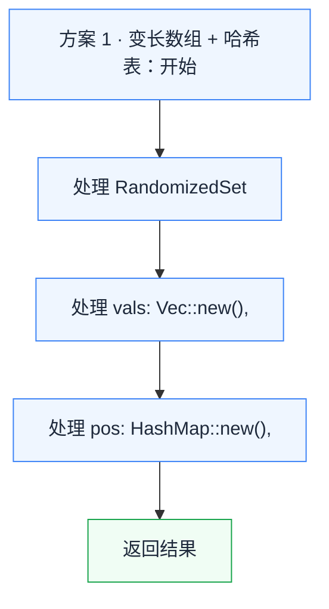

```rust
// LeetCode 380. O(1)时间插入删除和获取随机元素 — Rust 版（方案1）
use std::collections::HashMap; // 引入依赖
struct RandomizedSet {
    vals: Vec<i32>,
    pos: HashMap<i32, usize>,
} // 定义类型
impl RandomizedSet {
    // 实现块
    fn new() -> Self {
        RandomizedSet {
            vals: Vec::new(),
            pos: HashMap::new(),
        }
    } // 定义函数/方法 new
    fn insert(&mut self, val: i32) -> bool {
        // 定义函数/方法 insert
        if self.pos.contains_key(&val) {
            return false;
        } // 若 self.pos.contains_key( 按位与 值) { return false; }
        self.pos.insert(val, self.vals.len()); // self.pos 插入 值, self.vals.长度());
        self.vals.push(val); // 把 值 压入栈/数组尾部
        true // true
    }
    fn remove(&mut self, val: i32) -> bool {
        // 定义函数/方法 remove
        if let Some(&idx) = self.pos.get(&val) {
            // 若 let Some( 按位与 idx) 赋值为 self.pos 查找 按位与 值
            let last = *self.vals.last().unwrap(); // 把 乘 self.vals.last().unwrap() 存入 last
            self.vals[idx] = last; // 把 last; 写入 self.vals[idx]
            self.pos.insert(last, idx); // self.pos 插入 last, idx);
            self.vals.pop(); // 弹出栈顶元素
            self.pos.remove(&val); // self.pos 弹出 按位与 值);
            true // true
        } else {
            false
        } // 否则
    }
    fn get_random(&self) -> i32 {
        self.vals[self.vals.len() % self.vals.len()]
    } // 定义函数/方法 get_random
}
fn main() {
    // 程序入口：跑内嵌自测用例
    let mut s = RandomizedSet::new(); // 把 RandomizedSet::new(); 写入 let mut s
    assert!(s.insert(1)); // 断言校验
    assert!(s.remove(2) == false); // 断言校验
    assert!(s.insert(2)); // 断言校验
    let r = s.get_random(); // 把 字符串.get_random() 存入 右指针
    assert!(r == 1 || r == 2); // 断言校验
    assert!(s.remove(1)); // 断言校验
    assert!(s.insert(2) == false); // 断言校验
    let r2 = s.get_random(); // 把 字符串.get_random() 存入 r2
    assert!(r2 == 2); // 断言校验
    println!("PASS");
} // 全部用例通过，输出 PASS
```

### Lua 实现（1 种方案）

Lua 的全部方案如下，每个方案都内嵌用例自测，可独立运行（老仓库 python/go 文件遵循「打印结果」约定）：

#### 方案 1：变长数组 + 哈希表

**思路与代码分析**：核心是「变长数组 + 哈希表」。Lua 版用表与 ipairs 遍历，注意 ipairs 遇 nil 即停的语义。

**运行架构**（真实控制流）：


```lua
-- LeetCode 380. O(1)时间插入删除和获取随机元素 — Lua 版（方案1）
local RandomizedSet = {} -- 把 {} 写入 local RandomizedSet
RandomizedSet.__index = RandomizedSet -- 把 RandomizedSet 写入 RandomizedSet.__index
function RandomizedSet.new()
	return setmetatable({ vals = {}, pos = {} }, RandomizedSet)
end
function RandomizedSet:insert(val) -- function RandomizedSet:insert(值)
	if self.pos[val] then
		return false
	end -- 若 self.pos[值] then return false 终点
	self.pos[val] = #self.vals + 1 -- 把 #self.vals 加 1 写入 self.pos[val]
	self.vals[#self.vals + 1] = val -- 把 值 写入 self.vals[#self.vals + 1]
	return true -- 返回 true
end -- 终点
function RandomizedSet:remove(val) -- function RandomizedSet:remove(值)
	local idx = self.pos[val] -- 把 self.pos[值] 写入 local idx
	if not idx then
		return false
	end -- 若 not idx then return false 终点
	local last = self.vals[#self.vals] -- 把 self.vals[#self.vals] 写入 local last
	self.vals[idx] = last -- 把 last 写入 self.vals[idx]
	self.pos[last] = idx -- 把 idx 写入 self.pos[last]
	self.vals[#self.vals] = nil -- 把 nil 写入 self.vals[#self.vals]
	self.pos[val] = nil -- 把 nil 写入 self.pos[val]
	return true -- 返回 true
end -- 终点
function RandomizedSet:get_random() -- function RandomizedSet:get_random()
	return self.vals[math.random(#self.vals)] -- 返回 self.vals[math.random(#self.vals)]
end -- 终点
math.randomseed(42) -- math.randomseed(42)
local s = RandomizedSet.new() -- 把 RandomizedSet.new() 写入 local s
assert(s:insert(1) == true) -- 断言校验
assert(s:remove(2) == false) -- 断言校验
assert(s:insert(2) == true) -- 断言校验
local r = s:get_random() -- 把 字符串:get_random() 写入 local r
assert(r == 1 or r == 2) -- 断言校验
assert(s:remove(1) == true) -- 断言校验
assert(s:insert(2) == false) -- 断言校验
assert(s:get_random() == 2) -- 断言校验
print("PASS") -- 全部用例通过，输出 PASS
```

### C 实现（1 种方案）

C 的全部方案如下，每个方案都内嵌用例自测，可独立运行（老仓库 python/go 文件遵循「打印结果」约定）：

#### 方案 1：变长数组 + 哈希表

**思路与代码分析**：核心是「变长数组 + 哈希表」。C 版手动管理下标与内存，循环边界全部显式写出。代码里依次做这些事：单循环线性扫描。**走读**：方案 1 · 变长数组 + 哈希表：开始 → 更新 s->n → 遍历循环 → 更新 s->pos[i] → 返回结果。

**运行架构**（真实控制流）：

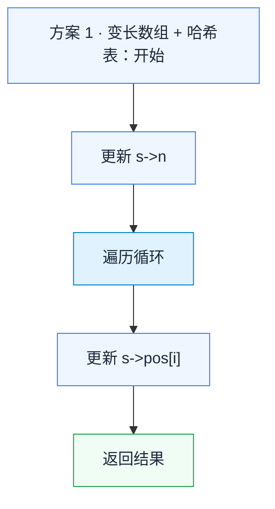

```c
/* LeetCode 380. O(1)时间插入删除和获取随机元素 — C 版（方案1） */
#include <stdio.h> // 引入头文件
typedef struct {
    int vals[4096];
    int pos[65536];
    int n;
} RandomizedSet;
static void rs_init(RandomizedSet *s) {
    s->n = 0;
    for (int i = 0; i < 65536; i++)
        s->pos[i] = -1;
}
static int rs_insert(RandomizedSet *s, int val) { // 定义函数/方法 rs_insert
    int idx = val + 32768;                        // 把 值 加 32768 存入 idx
    if (s->pos[idx] >= 0)
        return 0;          // 若 字符串 减 超过 pos[idx] 不低于 0，直接返回 0
    s->pos[idx] = s->n;    // 把 字符串 减 超过 元素个数; 写入 s->pos[idx]
    s->vals[s->n++] = val; // 把 值; 写入 s->vals[s->n++]
    return 1;              // 返回 1
}
static int rs_remove(RandomizedSet *s, int val) { // 定义函数/方法 rs_remove
    int idx = val + 32768;                        // 把 值 加 32768 存入 idx
    if (s->pos[idx] < 0)
        return 0;                 // 若 字符串 减 超过 pos[idx] 小于 0，直接返回 0
    int i = s->pos[idx];          // 把 字符串 减 超过 pos[idx] 存入 下标 i
    int last = s->vals[s->n - 1]; // 把 字符串 减 超过 vals[字符串 减 超过 元素个数 减 1] 存入 last
    s->vals[i] = last;            // 把 last; 写入 s->vals[i]
    s->pos[last + 32768] = i; // 把 下标 i; 写入 s->pos[last + 32768]
    s->n--;                   // 字符串 减 超过 元素个数 减一 ;
    s->pos[idx] = -1;         // 把 减 1; 写入 s->pos[idx]
    return 1;                 // 返回 1
}
static int rs_get_random(RandomizedSet *s) { return s->vals[s->n % s->n]; }
int main(void) {     // 程序入口：跑内嵌自测用例
    RandomizedSet s; // RandomizedSet 字符串;
    rs_init(&s);     // rs_init( 按位与 字符串);
    if (!rs_insert(&s, 1)) {
        printf("FAIL 1\n");
        return 1;
    } // 若 取反 rs_insert( 按位与 字符串, 1)) { 输出「FAIL 1 」); return 1; }
    if (rs_remove(&s, 2)) {
        printf("FAIL 2\n");
        return 1;
    } // 若 rs_remove( 按位与 字符串, 2)) { 输出「FAIL 2 」); return 1; }
    if (!rs_insert(&s, 2)) {
        printf("FAIL 3\n");
        return 1;
    } // 若 取反 rs_insert( 按位与 字符串, 2)) { 输出「FAIL 3 」); return 1; }
    int r = rs_get_random(&s); // 把 rs_get_random( 按位与 字符串) 存入 右指针
    if (r != 1 && r != 2) {
        printf("FAIL 4\n");
        return 1;
    } // 若 右指针 不等于 1 且 右指针 不等于 2) { 输出「FAIL 4 」); return 1; }
    if (!rs_remove(&s, 1)) {
        printf("FAIL 5\n");
        return 1;
    } // 若 取反 rs_remove( 按位与 字符串, 1)) { 输出「FAIL 5 」); return 1; }
    if (rs_insert(&s, 2)) {
        printf("FAIL 6\n");
        return 1;
    } // 若 rs_insert( 按位与 字符串, 2)) { 输出「FAIL 6 」); return 1; }
    if (rs_get_random(&s) != 2) {
        printf("FAIL 7\n");
        return 1;
    } // 若 rs_get_random( 按位与 字符串) 不等于 2) { 输出「FAIL 7 」); return 1; }
    printf("PASS\n");
    return 0;
} // 全部用例通过，输出 PASS
```

### C++ 实现（1 种方案）

C++ 的全部方案如下，每个方案都内嵌用例自测，可独立运行（老仓库 python/go 文件遵循「打印结果」约定）：

#### 方案 1：变长数组 + 哈希表

**思路与代码分析**：核心是「变长数组 + 哈希表」。C++ 版用 STL 容器与迭代器，减少手写下标错误。**走读**：方案 1 · 变长数组 + 哈希表：开始 → 命中条件，直接返回 → 更新 pos[val] → 调用 vals.push_back(val) → 返回 true。

**运行架构**（真实控制流）：

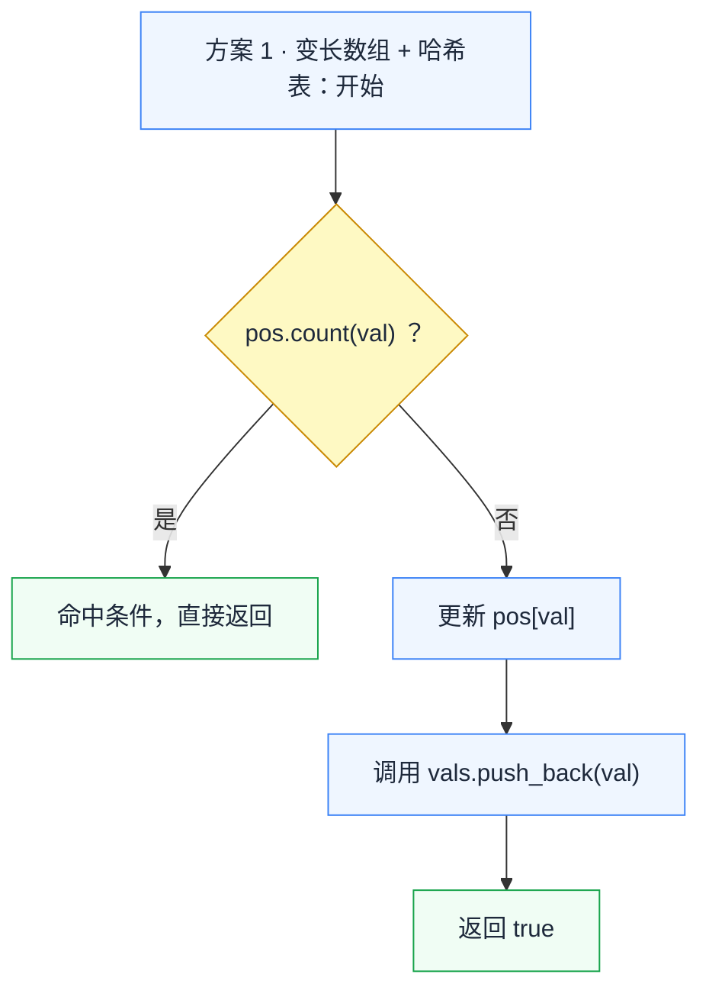

```cpp
// LeetCode 380. O(1)时间插入删除和获取随机元素 — C++ 版（方案1）
#include <cassert>                       // 引入头文件
#include <iostream>                      // 引入头文件
#include <unordered_map>                 // 引入头文件
#include <vector>                        // 引入头文件
struct RandomizedSet {                   // 定义类型
    std::vector<int> vals;               // std::vector 小于 int 超过 vals;
    std::unordered_map<int, size_t> pos; // std::unordered_map 小于 int, size_t 超过 pos;
    bool insert(int val) {               // 定义函数/方法 insert
        if (pos.count(val))
            return false;       // 若 pos.计数(值)，直接返回 false
        pos[val] = vals.size(); // 把 vals.大小(); 写入 pos[val]
        vals.push_back(val);    // vals 追加 值);
        return true;            // 返回 true
    }
    bool remove(int val) {       // 定义函数/方法 remove
        auto it = pos.find(val); // 把 pos 查找 值) 存入 it
        if (it == pos.end())
            return false;        // 若 it 等于 pos.终点()，直接返回 false
        size_t idx = it->second; // 把 it 减 超过 second; 写入 size_t idx
        int last = vals.back();  // 把 vals.back() 存入 last
        vals[idx] = last;        // 把 last; 写入 vals[idx]
        pos[last] = idx;         // 把 idx; 写入 pos[last]
        vals.pop_back();         // 弹出栈顶元素
        pos.erase(it);           // pos 删除 it);
        return true;             // 返回 true
    }
    int getRandom() { return vals[0]; } // int getRandom() { return vals[0]; }
};
int main() {                    // 程序入口：跑内嵌自测用例
    RandomizedSet s;            // RandomizedSet 字符串;
    assert(s.insert(1));        // 断言校验
    assert(!s.remove(2));       // 断言校验
    assert(s.insert(2));        // 断言校验
    int r = s.getRandom();      // 把 字符串.getRandom() 存入 右指针
    assert(r == 1 || r == 2);   // 断言校验
    assert(s.remove(1));        // 断言校验
    assert(!s.insert(2));       // 断言校验
    assert(s.getRandom() == 2); // 断言校验
    std::cout << "PASS" << std::endl;
} // 全部用例通过，输出 PASS
```

### R 实现（1 种方案）

R 的全部方案如下，每个方案都内嵌用例自测，可独立运行（老仓库 python/go 文件遵循「打印结果」约定）：

#### 方案 1：变长数组 + 哈希表

**思路与代码分析**：核心是「变长数组 + 哈希表」。R 版用向量化思维与 1 起始下标，注意 1:n 的降序陷阱。**走读**：方案 1 · 变长数组 + 哈希表：开始 → 更新 new.env(parent → 命中条件，直接返回 → 命中条件，直接返回。

**运行架构**（真实控制流）：

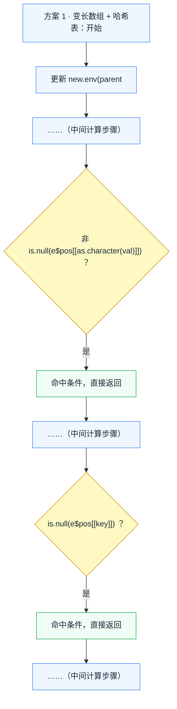

```r
# O(1)时间插入删除和获取随机元素 — R 版（方案1） 定义函数 RandomizedSet（参数：无）
RandomizedSet <- function() {
    e <- new.env(parent = emptyenv())  # 把 new.env(parent 赋值为 emptyenv()) 存入 e
    e$vals <- integer(0)
    e$pos <- new.env(parent = emptyenv())
    e$insert <- function(val) {
        # 把 function(值) { 存入 e$insert
        if (!is.null(e$pos[[as.character(val)]]))
            return(FALSE)  # 若 取反 is.null(e$pos[[as.character(值)]])) return(FALSE
        e$pos[[as.character(val)]] <<- length(e$vals) + 1L  # e$pos[[as.character(值)]] 小于 小于 减 长度(e$vals) 加 1L
        e$vals <<- c(e$vals, val)  # e$vals 小于 小于 减 字符(e$vals, 值)
        TRUE  # TRUE
    }
    e$remove <- function(val) {
        # 把 function(值) { 存入 e$remove
        key <- as.character(val)  # 把 as.character(值) 存入 key
        if (is.null(e$pos[[key]]))
            return(FALSE)  # 若 is.null(e$pos[[key]])) return(FALSE
        idx <- e$pos[[key]]  # 把 e$pos[[key]] 存入 idx
        last <- e$vals[length(e$vals)]  # 把 e$vals[长度(e$vals)] 存入 last
        e$vals[idx] <<- last  # e$vals[idx] 小于 小于 减 last
        e$pos[[as.character(last)]] <<- idx  # e$pos[[as.character(last)]] 小于 小于 减 idx
        e$vals <<- e$vals[-length(e$vals)]  # e$vals 小于 小于 减 e$vals[ 减 长度(e$vals)]
        e$pos[[key]] <<- NULL  # e$pos[[key]] 小于 小于 减 NULL
        TRUE  # TRUE
    }
    e$get_random <- function() e$vals[sample(length(e$vals), 1L)]  # 把 function() e$vals[sample(长度(e$vals), 1L)] 存入 e$get_random
    e
}
set.seed(42)  # set.seed(42)
s <- RandomizedSet()  # 把 RandomizedSet() 存入 字符串
stopifnot(s$insert(1))  # 断言校验
stopifnot(!s$remove(2))  # 断言校验
stopifnot(s$insert(2))  # 断言校验
r <- s$get_random()  # 把 字符串$get_random() 存入 右指针
stopifnot(r == 1 || r == 2)  # 断言校验
stopifnot(s$remove(1))  # 断言校验
stopifnot(!s$insert(2))  # 断言校验
stopifnot(s$get_random() == 2)  # 断言校验
cat("PASS\n")  # 全部用例通过，输出 PASS
```

### Zig 实现（1 种方案）

Zig 的全部方案如下，每个方案都内嵌用例自测，可独立运行（老仓库 python/go 文件遵循「打印结果」约定）：

#### 方案 1：变长数组 + 哈希表

**思路与代码分析**：核心是「变长数组 + 哈希表」。Zig 版显式分配与清零，整型边界处理严格。代码里依次做这些事：哈希结构做计数或查重。**走读**：方案 1 · 变长数组 + 哈希表：开始 → 返回 .。

**运行架构**（真实控制流）：

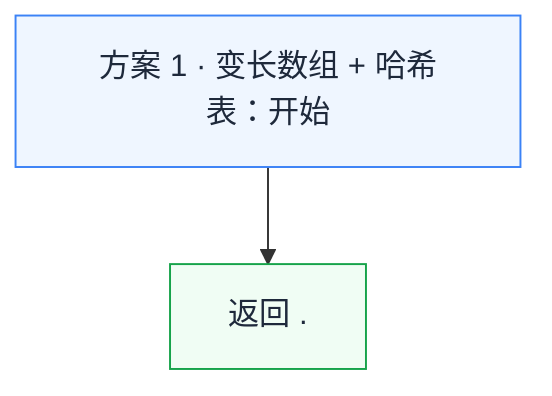

```zig
// LeetCode 380. O(1)时间插入删除和获取随机元素 — Zig 版（方案1）
const std = @import("std"); // 把 @import(「std」) 存入 std
const RandomizedSet = struct { // 把 struct { 存入 RandomizedSet
    vals: std.ArrayList(i32),
    pos: std.AutoHashMap(i32, usize),
    fn init(alloc: std.mem.Allocator) RandomizedSet { // 定义函数/方法 init
        return .{ .vals = std.ArrayList(i32).init(alloc), .pos = std.AutoHashMap(i32, usize).init(alloc) };
    }
    fn insert(self: *RandomizedSet, val: i32) bool { // 定义函数/方法 insert
        if (self.pos.contains(val)) return false; // 若 self.pos 是否包含 值)，直接返回 false
        self.pos.put(val, self.vals.items.len) catch unreachable; // self.pos.put(值, self.vals.items.长度) catch unreachable;
        self.vals.append(val) catch unreachable; // 把 值 追加到列表尾部
        return true; // 返回 true
    }
    fn remove(self: *RandomizedSet, val: i32) bool { // 定义函数/方法 remove
        const idx = self.pos.get(val) orelse return false; // 把 self.pos 查找 值) orelse return false 存入 idx
        const last = self.vals.items[self.vals.items.len - 1]; // 把 self.vals.items[self.vals.items.长度 减 1] 存入 last
        self.vals.items[idx] = last; // 把 last; 写入 self.vals.items[idx]
        self.pos.put(last, idx) catch unreachable; // self.pos.put(last, idx) catch unreachable;
        _ = self.vals.pop(); // 弹出栈顶元素
        _ = self.pos.remove(val); // 把 self.pos 弹出 值); 写入 _
        return true; // 返回 true
    }
    fn getRandom(self: *RandomizedSet) i32 { // 定义函数/方法 getRandom
        return self.vals.items[0]; // 返回 self.vals.items[0]
    }
};
pub fn main() !void { // 程序入口：跑内嵌自测用例
    var arena = std.heap.ArenaAllocator.init(std.heap.page_allocator); // 把 std.堆.ArenaAllocator.init(std.堆.page_allocator) 存入 arena
    defer arena.deinit(); // defer arena.deinit();
    var s = RandomizedSet.init(arena.allocator()); // 把 RandomizedSet.init(arena.allocator()) 存入 字符串
    if (!s.insert(1)) return error.TestFailed; // 若 取反 字符串 插入 1)，直接返回 error.TestFailed
    if (s.remove(2)) return error.TestFailed; // 若 字符串 弹出 2)，直接返回 error.TestFailed
    if (!s.insert(2)) return error.TestFailed; // 若 取反 字符串 插入 2)，直接返回 error.TestFailed
    const r = s.getRandom(); // 把 字符串.getRandom() 存入 右指针
    if (r != 1 and r != 2) return error.TestFailed; // 若 右指针 不等于 1 and 右指针 不等于 2，直接返回 error.TestFailed
    if (!s.remove(1)) return error.TestFailed; // 若 取反 字符串 弹出 1)，直接返回 error.TestFailed
    if (s.insert(2)) return error.TestFailed; // 若 字符串 插入 2)，直接返回 error.TestFailed
    if (s.getRandom() != 2) return error.TestFailed; // 若 字符串.getRandom() 不等于 2，直接返回 error.TestFailed
    std.debug.print("PASS\n", .{});
} // 全部用例通过，输出 PASS
```

### Dart 实现（1 种方案）

Dart 的全部方案如下，每个方案都内嵌用例自测，可独立运行（老仓库 python/go 文件遵循「打印结果」约定）：

#### 方案 1：变长数组 + 哈希表

**思路与代码分析**：核心是「变长数组 + 哈希表」。Dart 版用可空类型标注与集合方法，注意空安全。**走读**：方案 1 · 变长数组 + 哈希表：开始 → 命中条件，直接返回 → 更新 pos[val] → 调用 vals.add(val) → 返回 true。

**运行架构**（真实控制流）：

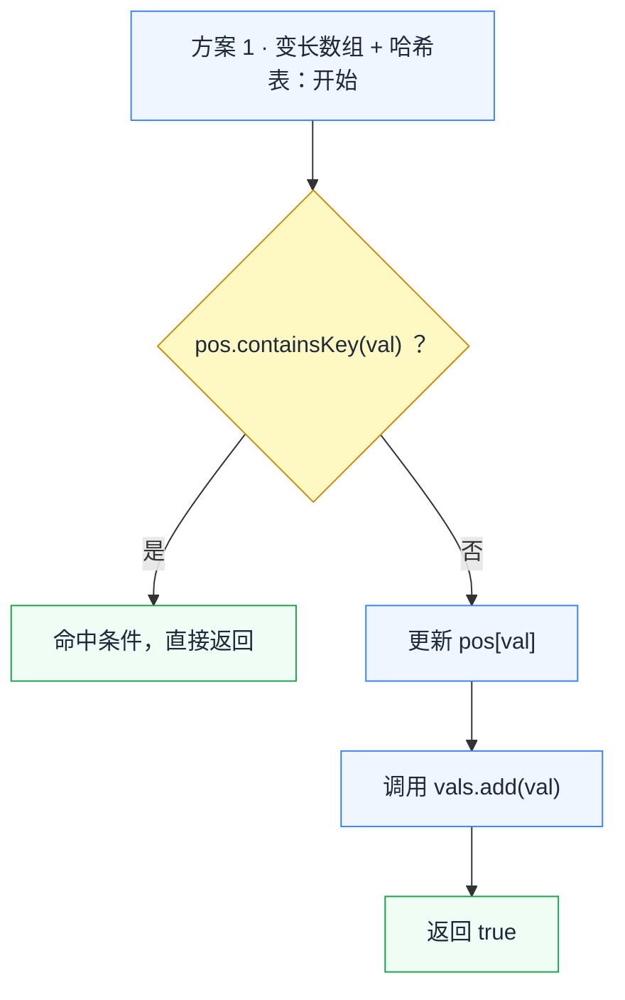

```dart
// LeetCode 380. O(1)时间插入删除和获取随机元素 — Dart 版（方案1）
import 'dart:math'; // 引入依赖

class RandomizedSet {
  // 定义类型
  final List<int> vals = []; // 把 []; 写入 final List<int> vals
  final Map<int, int> pos = {}; // 把 {}; 写入 final Map<int, int> pos
  bool insert(int val) {
    // 定义函数/方法 insert
    if (pos.containsKey(val)) return false; // 若 pos.containsKey(值)，直接返回 false
    pos[val] = vals.length; // 把 vals.长度; 写入 pos[val]
    vals.add(val); // vals 追加 值);
    return true; // 返回 true
  }

  bool remove(int val) {
    // 定义函数/方法 remove
    final idx = pos[val]; // 把 pos[值] 存入 idx
    if (idx == null) return false; // 若 idx 等于 null，直接返回 false
    final last = vals.last; // 把 vals.last 存入 last
    vals[idx] = last; // 把 last; 写入 vals[idx]
    pos[last] = idx; // 把 idx; 写入 pos[last]
    vals.removeLast(); // vals.removeLast();
    pos.remove(val); // pos 弹出 值);
    return true; // 返回 true
  }

  int getRandom() => vals[Random().nextInt(vals.length)];
}

void main() {
  // 程序入口：跑内嵌自测用例
  final s = RandomizedSet(); // 把 RandomizedSet() 存入 字符串
  if (!s.insert(1))
    throw StateError('c1'); // 若 取反 字符串 插入 1)) throw StateError('c1');
  if (s.remove(2))
    throw StateError('c2'); // 若 字符串 弹出 2)) throw StateError('c2');
  if (!s.insert(2))
    throw StateError('c3'); // 若 取反 字符串 插入 2)) throw StateError('c3');
  final r = s.getRandom(); // 把 字符串.getRandom() 存入 右指针
  if (r != 1 && r != 2)
    throw StateError('c4'); // 若 右指针 不等于 1 且 右指针 不等于 2) throw StateError('c4');
  if (!s.remove(1))
    throw StateError('c5'); // 若 取反 字符串 弹出 1)) throw StateError('c5');
  if (s.insert(2))
    throw StateError('c6'); // 若 字符串 插入 2)) throw StateError('c6');
  if (s.getRandom() != 2)
    throw StateError('c7'); // 若 字符串.getRandom() 不等于 2) throw StateError('c7');
  print('PASS');
} // 全部用例通过，输出 PASS
```

---

## 内容总结

- **o(1) 时间插入、删除和获取随机元素**（数组 · Medium）：共 1 个方案，主线思路「变长数组 + 哈希表」；时间 O(n) 量级；动画演示双指针过程，附录给出 11 种语言 × 全部方案的可运行实现。
- 来源博客：[https://blog.csdn.net/tyro_java/article/details/145345735](https://blog.csdn.net/tyro_java/article/details/145345735)
- 导航：[📋 总目录](../) ｜ [← 030 两个数组的交集 ii](../030_两个数组的交集_ii/) ｜ [032 赎金信 →](../032_赎金信/)
