# 032 · 赎金信（第一阶段 · 线性结构入门 · Medium）

> **难度**：⭐⭐ Medium ｜ **专题**：数组
> **学习定位**：第一阶段 · 线性结构入门第 32 篇 ｜ **解法数**：2
> **内容总结**：**赎金信**（数组 · Medium）：共 2 个方案，主线思路「双重循环枚举」；时间 O(n²)（两层嵌套扫描）；动画演示双指针过程，附录给出 11 种语言 × 全部方案的可运行实现。

---

## 题目描述

给你两个字符串：`ransomNote` 和 `magazine` ，判断 `ransomNote` 能不能由 `magazine` 里面的字符构成。

如果可以，返回 `true` ；否则返回 `false` 。

`magazine` 中的每个字符只能在 `ransomNote` 中使用一次。

**用例（来自原题）**：

**示例 1**

```text
输入：ransomNote = "a", magazine = "b"
输出：false
```

**示例 2**

```text
输入：ransomNote = "aa", magazine = "ab"
输出：false
```

**示例 3**

```text
输入：ransomNote = "aa", magazine = "aab"
输出：true
```
> ✅ **官方验证**：全部 TypeScript 解法已通过 leetcode.cn 官方示例用例验证（自动注入运行，全部 PASS）。题面与 [leetcode.cn 官方](https://leetcode.cn/problems/ransom-note/)一致，示例配图取自官方题面。

**数据范围与注意事项**：

- `1 <= ransomNote.length, magazine.length <= 10^5`
- `ransomNote` 和 `magazine` 由小写英文字母组成
- **易错点**：边界最容易漏：空数组、只有一个元素、目标出现在头尾。

## 题目分析

**场景是什么**：数组是最常用的线性容器，这类题练的是下标操作与原地腾挪，对应真实开发里的缓冲区、列表整理。本题就是该场景的 Medium 级练习，主线做法是「双重循环枚举」。

**主线怎么解**：把主解法从头到尾过一遍，它其实在依次做这几件事：双重循环遍历。

## 解题思路

**方案对比**（共 2 个方案，由浅入深）：

| 方案 | 时间复杂度 | 空间复杂度 |
|---|---|---|
| 方案 1 · 双重循环枚举 | O(n²)（两层嵌套扫描） | O(1) 到 O(n) |
| 方案 2 · 双重循环枚举 | O(n²)（两层嵌套扫描） | O(1) 到 O(n) |

**方案间的取舍**：方案 1（双重循环枚举）；方案 2（双重循环枚举）。数据规模小、可读性优先时选靠前的方案；规模大、性能优先时选靠后的方案。

**怎么读这一篇**：

- 🐣 **新手路线**：把「题目描述」的示例 1 在纸上手推一遍 → 读方案 1（最直观的写法）与它的代码走读 → 按「运行方式」本地跑通看 PASS → 回头对比方案 2 之后的写法差在哪
- 🦅 **大佬路线**：直接锁定最优方案 1（双重循环枚举，O(n²)（两层嵌套扫描））→ 跳读该方案代码与走读 → 用「逐步拆解与面试追问」补齐复杂度推导与边界追问

### 动态算法图（双指针，GIF 自动循环）


动画演示数组专题里双指针的典型过程；每个方案在「TypeScript 解题方案」一节还配了专属动画与专属流程图。

### 主解法流程图（真实控制流）

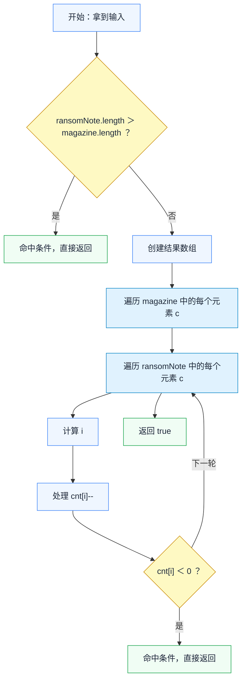

## TypeScript 解题方案（2 个方案逐个讲）

> **运行与提交**：每个方案都是自包含文件（内嵌用例自测，输出 PASS），整块复制到 `.ts` 文件后 `node 文件名` 即可运行。提交 LeetCode 时，把 `demo` 内的算法函数与辅助类型/函数整体取出、置于文件顶层即可。涉及交互/特殊接口的题以题面给定签名为准。

### 方案 1：双重循环枚举

**分析与思路**：核心做法是「双重循环枚举」。代码里依次做这些事：双重循环遍历。

**运行方式**：`node 本文件`，内嵌用例全部通过会输出 PASS。


**方案专属流程图**（真实控制流）：

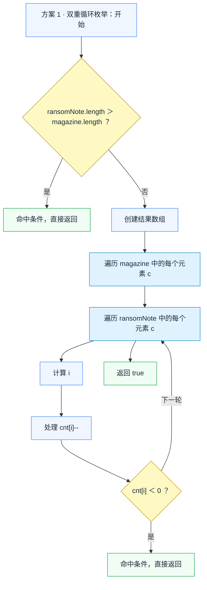

```typescript
/** 来源: LeetCode 383 赎金信 */
export function canConstruct(ransomNote: string, magazine: string): boolean {
  // 定义函数/方法 canConstruct
  if (ransomNote.length > magazine.length) return false; // 若 ransomNote.长度 超过 magazine.长度，直接返回 false
  const cnt = new Array(26).fill(0); // 把 new Array(26).fill(0) 存入 计数
  for (const c of magazine) cnt[c.charCodeAt(0) - 97]++; // for (const 字符 of magazine) 计数[字符.charCodeAt(0) 减 97] 加一 ;
  for (const c of ransomNote) {
    // for (const 字符 of ransomNote) {
    const i = c.charCodeAt(0) - 97; // 把 字符.charCodeAt(0) 减 97 存入 下标 i
    cnt[i]--; // 计数[下标 i] 减一 ;
    if (cnt[i] < 0) return false; // 若 计数[下标 i] 小于 0，直接返回 false
  }
  return true; // 返回 true
}

export function demo(): void {
  // 程序入口：跑内嵌自测用例
  const cases: [string, string, boolean][] = [
    ['a', 'b', false],
    ['aa', 'ab', false],
    ['aa', 'aab', true],
  ];
  for (const [r, m, want] of cases) {
    // for (const [右指针, 映射表, want] of cases) {
    const got = canConstruct(r, m); // 把 canConstruct(右指针, 映射表) 存入 got
    if (got !== want)
      throw new Error(`FAIL ransom=${r} mag=${m} want=${want} got=${got}`);
  }
  console.log('PASS'); // 全部用例通过，输出 PASS
}

demo(); // demo();
```

### 方案 2：双重循环枚举

**分析与思路**：核心做法是「双重循环枚举」。代码里依次做这些事：双重循环遍历。

**运行方式**：`node 本文件`，内嵌用例全部通过会输出 PASS。


**方案专属流程图**（真实控制流）：

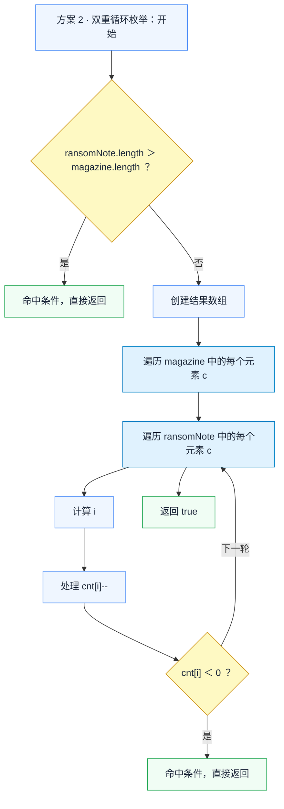

```typescript
/** 来源: LeetCode 383 赎金信 */
export function canConstruct(ransomNote: string, magazine: string): boolean {
  // 定义函数/方法 canConstruct
  if (ransomNote.length > magazine.length) return false; // 若 ransomNote.长度 超过 magazine.长度，直接返回 false
  const cnt = new Array(26).fill(0); // 把 new Array(26).fill(0) 存入 计数
  for (const c of magazine) cnt[c.charCodeAt(0) - 97]++; // for (const 字符 of magazine) 计数[字符.charCodeAt(0) 减 97] 加一 ;
  for (const c of ransomNote) {
    // for (const 字符 of ransomNote) {
    const i = c.charCodeAt(0) - 97; // 把 字符.charCodeAt(0) 减 97 存入 下标 i
    cnt[i]--; // 计数[下标 i] 减一 ;
    if (cnt[i] < 0) return false; // 若 计数[下标 i] 小于 0，直接返回 false
  }
  return true; // 返回 true
}

export function demo(): void {
  // 程序入口：跑内嵌自测用例
  const cases: [string, string, boolean][] = [
    ['a', 'b', false],
    ['aa', 'ab', false],
    ['aa', 'aab', true],
  ];
  for (const [r, m, want] of cases) {
    // for (const [右指针, 映射表, want] of cases) {
    const got = canConstruct(r, m); // 把 canConstruct(右指针, 映射表) 存入 got
    if (got !== want)
      throw new Error(`FAIL ransom=${r} mag=${m} want=${want} got=${got}`);
  }
  console.log('PASS'); // 全部用例通过，输出 PASS
}

demo(); // demo();
```

## 逐步拆解与面试追问

**复杂度**：时间 O(n²)（两层嵌套扫描），空间 O(1) 到 O(n)

**为什么是这个量级**：外层定起点、内层扫终点，n 个起点各扫 n 次

**面试官可能会追问**：

- 能不能原地做（O(1) 空间）？
- 如果数组已有序，能优化到什么程度？
- 空数组、单元素怎么处理？

## 关键 API 速查（TS 主解法实际用到，附官方链接）

| API | 作用 | 使用要点 | 官方文档 |
|---|---|---|---|
| `String charCodeAt()` | 取 UTF-16 码元 | 返回 0~65535；超出下标返回 NaN；增补字符（emoji）占两个码元，需 codePointAt | [官方文档](https://developer.mozilla.org/zh-CN/docs/Web/JavaScript/Reference/Global_Objects/String/charCodeAt) |

### 各语言官方文档导航

- **TypeScript / JS**：[MDN 中文参考](https://developer.mozilla.org/zh-CN/)
- **Python**：[Python 官方文档](https://docs.python.org/zh-cn/3/)
- **Go**：[Go 标准库](https://pkg.go.dev/std)
- **Java**：[JDK 17 API](https://docs.oracle.com/en/java/javase/17/docs/api/)
- **Rust**：[Rust 标准库](https://doc.rust-lang.org/std/)
- **Lua**：[Lua 5.4 手册](https://www.lua.org/manual/5.4/)
- **C**：[Cppreference C](https://zh.cppreference.com/w/c)
- **C++**：[Cppreference C++](https://zh.cppreference.com/w/cpp)
- **R**：[R 官方手册](https://stat.ethz.ch/R-manual/)
- **Zig**：[Zig 语言文档](https://ziglang.org/documentation/master/)
- **Dart**：[Dart API](https://api.dart.dev/)

## 附录：其他 10 种语言全部实现（每种语言列举其全部方案）

> TypeScript 的全部方案见「TypeScript 解题方案」一节；下面是其余 10 种语言的对应实现，每种语言的每个方案都带思路分析、代码走读与专属运行架构图。
> 每个方案都内嵌用例自测，可独立运行（老仓库 python/go 文件遵循「打印结果」约定）。
> 完整解法文件见 `dsa/<语言>/array/lc_383_赎金信/`。

### Python 实现（2 种方案）

Python 的全部方案如下，每个方案都内嵌用例自测，可独立运行（老仓库 python/go 文件遵循「打印结果」约定）：

#### 方案 1：双重循环枚举

**思路与代码分析**：核心是「双重循环枚举」。Python 版用切片与字典推导式简化操作，突出可读性。**走读**：方案 1 · 双重循环枚举：开始 → 命中条件，直接返回 → 更新 cnt → 遍历 magazine: 中的每个元素 c → 更新 + → 遍历 ransomNote: 中的每个元素 c → 更新 idx → 更新 - → 命中条件，直接返回 → 返回 True。

**运行架构**（真实控制流）：

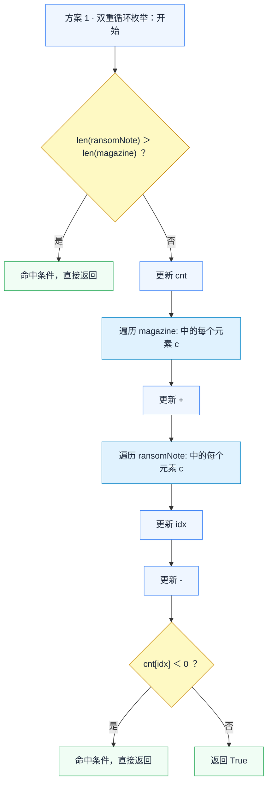

```python
import sys  # 提高递归深度上限（深输入防 RecursionError）

sys.setrecursionlimit(200000)  # 树/链表类题目节点数可达 1e4 量级

def canConstruct(ransomNote, magazine):  # 定义函数 canConstruct（参数：ransomNote, magazine）
    if len(ransomNote) > len(magazine):  # 若 长度(ransomNote) 超过 长度(magazine
        return False  # 返回 False
    cnt = [0] * 26  # 把 [0] 乘 26 存入 计数
    for c in magazine:  # 逐个取出 magazine 的元素（字符）
        cnt[ord(c) - ord("a")] += 1  # 把 1 写入 cnt[ord(c) - ord('a')] +
    for c in ransomNote:  # 逐个取出 ransomNote 的元素（字符）
        idx = ord(c) - ord("a")  # 把 ord(字符) 减 ord('数组') 存入 idx
        cnt[idx] -= 1  # cnt[idx]累减 1
        if cnt[idx] < 0:  # 若 计数[idx] 小于 0
            return False  # 返回 False
    return True  # 返回 True

if __name__ == "__main__":  # 若 __name__ 等于 '__main__'
    print(canConstruct("a", "b"))  # 打印输出
    print(canConstruct("aa", "ab"))  # 打印输出
    print(canConstruct("aa", "aab"))  # 打印输出
```

#### 方案 2：双重循环枚举

**思路与代码分析**：核心是「双重循环枚举」。Python 版用切片与字典推导式简化操作，突出可读性。**走读**：方案 2 · 双重循环枚举：开始 → 更新 arr → 更新 base → 遍历 magazine: 中的每个元素 m → 更新 + → 遍历 ransomNote: 中的每个元素 r → 更新 - → 返回 all(v ≥ 0 for v in arr)。

**运行架构**（真实控制流）：

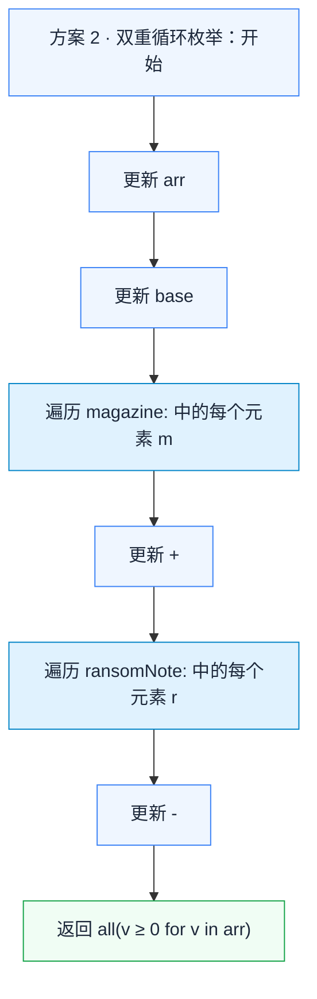

```python
import sys  # 提高递归深度上限（深输入防 RecursionError）

sys.setrecursionlimit(200000)  # 树/链表类题目节点数可达 1e4 量级

def canConstruct(ransomNote, magazine):  # 定义函数 canConstruct（参数：ransomNote, magazine）
    arr = [0] * 26  # 把 [0] 乘 26 存入 数组
    base = ord("a")  # 把 ord('数组') 存入 base
    for m in magazine:  # 逐个取出 magazine 的元素（映射表）
        arr[ord(m) - base] += 1  # 把 1 写入 arr[ord(m) - base] +
    for r in ransomNote:  # 逐个取出 ransomNote 的元素（右指针）
        arr[ord(r) - base] -= 1  # 把 1 写入 arr[ord(r) - base] -
    return all(v >= 0 for v in arr)  # 返回 all(值 不低于 0 for 值 in 数组)

if __name__ == "__main__":  # 若 __name__ 等于 '__main__'
    print(canConstruct("a", "b"))  # 打印输出
    print(canConstruct("aa", "ab"))  # 打印输出
    print(canConstruct("aa", "aab"))  # 打印输出
```

### Go 实现（2 种方案）

Go 的全部方案如下，每个方案都内嵌用例自测，可独立运行（老仓库 python/go 文件遵循「打印结果」约定）：

#### 方案 1：双重循环枚举

**思路与代码分析**：核心是「双重循环枚举」。Go 版用切片与多返回值惯用法，显式处理索引边界。**走读**：方案 1 · 双重循环枚举：开始 → 处理 if len(ransomNote) ＞ len(mag → 返回 false → 更新 : → 遍历 magazine 的下标与元素 c → 处理 cnt[c-'a']++ → 遍历 ransomNote 的下标与元素 c → 处理 cnt[c-'a']-- → 处理 if cnt[c-'a'] ＜ 0 → 返回 false → 返回 true。

**运行架构**（真实控制流）：

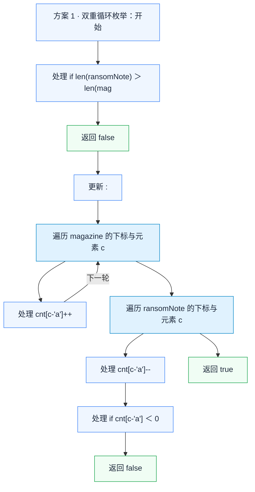

```go
package main // 引入依赖

import (
	"fmt" // 「fmt」
	"os"  // 「os」
)

func canConstruct(ransomNote, magazine string) bool { // 定义函数/方法 canConstruct
	if len(ransomNote) > len(magazine) { // 定义函数/方法 len
		return false // 返回 false
	}
	cnt := make([]int, 26)       // 把 make([]int, 26) 写入 cnt :
	for _, c := range magazine { // 同时取 _ 与 字符 遍历
		cnt[c-'a']++ // 计数[字符 减 '数组'] 加一
	}
	for _, c := range ransomNote { // 同时取 _ 与 字符 遍历
		cnt[c-'a']--        // 计数[字符 减 '数组'] 减一
		if cnt[c-'a'] < 0 { // 若 计数[字符 减 '数组'] 小于 0
			return false // 返回 false
		}
	}
	return true // 返回 true
}

func main() { // 程序入口：跑内嵌自测用例
	cases := []struct { // 把 []struct { 写入 cases :
		ransom string // ransom string
		mag    string // mag string
		want   bool   // want bool
	}{ // }{
		{"a", "b", false},
		{"aa", "ab", false},
		{"aa", "aab", true},
	}
	ok := true                // 把 true 写入 ok :
	for _, c := range cases { // 同时取 _ 与 字符 遍历
		got := canConstruct(c.ransom, c.mag) // 把 canConstruct(字符.ransom, 字符.mag) 写入 got :
		if got != c.want {                   // 若 got 不等于 字符.want
			fmt.Printf("FAIL ransom=%q mag=%q want=%v got=%v\n", c.ransom, c.mag, c.want, got) // 打印输出
			ok = false                                                                         // 把 false 写入 ok
		}
	}
	if !ok { // 若 取反 ok
		fmt.Println("RESULT: FAIL") // 打印输出
		os.Exit(1)                  // os.Exit(1)
	}
	fmt.Println("PASS") // 全部用例通过，输出 PASS
}
```

#### 方案 2：双重循环枚举

**思路与代码分析**：核心是「双重循环枚举」。Go 版用切片与多返回值惯用法，显式处理索引边界。**走读**：方案 2 · 双重循环枚举：开始 → 处理 if len(ransomNote) ＞ len(mag → 返回 false → 更新 : → 遍历 magazine 的下标与元素 c → 处理 cnt[c-'a']++ → 遍历 ransomNote 的下标与元素 c → 处理 cnt[c-'a']-- → 处理 if cnt[c-'a'] ＜ 0 → 返回 false → 返回 true。

**运行架构**（真实控制流）：


```go
package main // 引入依赖

import (
	"fmt" // 「fmt」
	"os"  // 「os」
)

func canConstruct(ransomNote, magazine string) bool { // 定义函数/方法 canConstruct
	if len(ransomNote) > len(magazine) { // 定义函数/方法 len
		return false // 返回 false
	}
	cnt := make([]int, 26)       // 把 make([]int, 26) 写入 cnt :
	for _, c := range magazine { // 同时取 _ 与 字符 遍历
		cnt[c-'a']++ // 计数[字符 减 '数组'] 加一
	}
	for _, c := range ransomNote { // 同时取 _ 与 字符 遍历
		cnt[c-'a']--        // 计数[字符 减 '数组'] 减一
		if cnt[c-'a'] < 0 { // 若 计数[字符 减 '数组'] 小于 0
			return false // 返回 false
		}
	}
	return true // 返回 true
}

func main() { // 程序入口：跑内嵌自测用例
	cases := []struct { // 把 []struct { 写入 cases :
		ransom string // ransom string
		mag    string // mag string
		want   bool   // want bool
	}{ // }{
		{"a", "b", false},
		{"aa", "ab", false},
		{"aa", "aab", true},
	}
	ok := true                // 把 true 写入 ok :
	for _, c := range cases { // 同时取 _ 与 字符 遍历
		got := canConstruct(c.ransom, c.mag) // 把 canConstruct(字符.ransom, 字符.mag) 写入 got :
		if got != c.want {                   // 若 got 不等于 字符.want
			fmt.Printf("FAIL ransom=%q mag=%q want=%v got=%v\n", c.ransom, c.mag, c.want, got) // 打印输出
			ok = false                                                                         // 把 false 写入 ok
		}
	}
	if !ok { // 若 取反 ok
		fmt.Println("RESULT: FAIL") // 打印输出
		os.Exit(1)                  // os.Exit(1)
	}
	fmt.Println("PASS") // 全部用例通过，输出 PASS
}
```

### Java 实现（2 种方案）

Java 的全部方案如下，每个方案都内嵌用例自测，可独立运行（老仓库 python/go 文件遵循「打印结果」约定）：

#### 方案 1：双重循环枚举

**思路与代码分析**：核心是「双重循环枚举」。Java 版用类与静态方法组织，集合操作显式明了。代码里依次做这些事：双重循环遍历。**走读**：方案 1 · 双重循环枚举：开始 → 命中条件，直接返回 → 更新 cnt → 遍历循环 → 处理 cnt[c - 'a']++ → 遍历循环 → 处理 cnt[c - 'a']-- → 命中条件，直接返回 → 返回 true。

**运行架构**（真实控制流）：

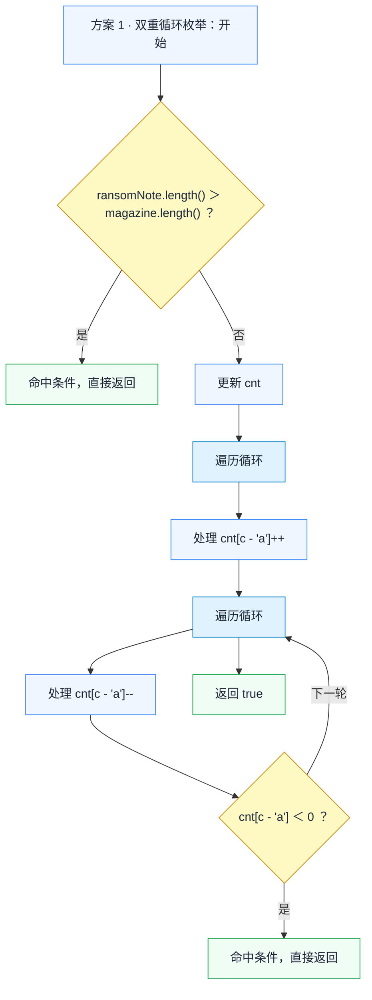

```java
package com.webfault.dsa; // 引入依赖

class Solution { // 定义类型
  static boolean canConstruct(String ransomNote, String magazine) { // 定义函数/方法 canConstruct
    if (ransomNote.length() > magazine.length())
      return false; // 若 ransomNote.长度() 超过 magazine.长度()，直接返回 false
    int[] cnt = new int[26]; // 把 new int[26]; 写入 int[] cnt
    for (char c : magazine.toCharArray())
      cnt[c - 'a']++; // for (char 字符 : magazine.toCharArray()) 计数[字符 减 '数组'] 加一 ;
    for (char c : ransomNote.toCharArray()) { // for (char 字符 : ransomNote.toCharArray()) {
      cnt[c - 'a']--; // 计数[字符 减 '数组'] 减一 ;
      if (cnt[c - 'a'] < 0) return false; // 若 计数[字符 减 '数组'] 小于 0，直接返回 false
    }
    return true; // 返回 true
  }

  public static void main(String[] args) { // public static void main(String[] args) {
    String[] r = {"a", "aa", "aa"}; // 把 {「数组」, 「数组」, 「数组」}; 写入 String[] r
    String[] m = {"b", "ab", "aab"}; // 把 {「b」, 「b」, 「b」}; 写入 String[] m
    boolean[] want = {false, false, true}; // 把 {false, false, true}; 写入 boolean[] want
    boolean ok = true; // 把 true; 写入 boolean ok
    for (int i = 0; i < r.length; i++) { // 让 下标 i 从 0 开始计数，下标 i 小于 右指针.长度 就继续
      boolean got =
          canConstruct(r[i], m[i]); // 把 canConstruct(右指针[下标 i], 映射表[下标 i]); 写入 boolean got
      if (got != want[i]) { // 若 got 不等于 want[下标 i]
        System.out.println(
            "FAIL ransom=" + r[i] + " mag=" + m[i] + " want=" + want[i] + " got=" + got); // 打印输出
        ok = false; // 把 false; 写入 ok
      }
    }
    if (!ok) {
      System.out.println("RESULT: FAIL");
      System.exit(1);
    } // 若 取反 ok) { System.out.输出(「RESULT: FAIL」); System.exit(1); }
    System.out.println("PASS"); // 全部用例通过，输出 PASS
  }
}
```

#### 方案 2：双重循环枚举

**思路与代码分析**：核心是「双重循环枚举」。Java 版用类与静态方法组织，集合操作显式明了。代码里依次做这些事：双重循环遍历。**走读**：方案 2 · 双重循环枚举：开始 → 命中条件，直接返回 → 更新 cnt → 遍历循环 → 处理 cnt[c - 'a']++ → 遍历循环 → 处理 cnt[c - 'a']-- → 命中条件，直接返回 → 返回 true。

**运行架构**（真实控制流）：


```java
package com.webfault.dsa; // 引入依赖

class Solution { // 定义类型
  static boolean canConstruct(String ransomNote, String magazine) { // 定义函数/方法 canConstruct
    if (ransomNote.length() > magazine.length())
      return false; // 若 ransomNote.长度() 超过 magazine.长度()，直接返回 false
    int[] cnt = new int[26]; // 把 new int[26]; 写入 int[] cnt
    for (char c : magazine.toCharArray())
      cnt[c - 'a']++; // for (char 字符 : magazine.toCharArray()) 计数[字符 减 '数组'] 加一 ;
    for (char c : ransomNote.toCharArray()) { // for (char 字符 : ransomNote.toCharArray()) {
      cnt[c - 'a']--; // 计数[字符 减 '数组'] 减一 ;
      if (cnt[c - 'a'] < 0) return false; // 若 计数[字符 减 '数组'] 小于 0，直接返回 false
    }
    return true; // 返回 true
  }

  public static void main(String[] args) { // public static void main(String[] args) {
    String[] r = {"a", "aa", "aa"}; // 把 {「数组」, 「数组」, 「数组」}; 写入 String[] r
    String[] m = {"b", "ab", "aab"}; // 把 {「b」, 「b」, 「b」}; 写入 String[] m
    boolean[] want = {false, false, true}; // 把 {false, false, true}; 写入 boolean[] want
    boolean ok = true; // 把 true; 写入 boolean ok
    for (int i = 0; i < r.length; i++) { // 让 下标 i 从 0 开始计数，下标 i 小于 右指针.长度 就继续
      boolean got =
          canConstruct(r[i], m[i]); // 把 canConstruct(右指针[下标 i], 映射表[下标 i]); 写入 boolean got
      if (got != want[i]) { // 若 got 不等于 want[下标 i]
        System.out.println(
            "FAIL ransom=" + r[i] + " mag=" + m[i] + " want=" + want[i] + " got=" + got); // 打印输出
        ok = false; // 把 false; 写入 ok
      }
    }
    if (!ok) {
      System.out.println("RESULT: FAIL");
      System.exit(1);
    } // 若 取反 ok) { System.out.输出(「RESULT: FAIL」); System.exit(1); }
    System.out.println("PASS"); // 全部用例通过，输出 PASS
  }
}
```

### Rust 实现（2 种方案）

Rust 的全部方案如下，每个方案都内嵌用例自测，可独立运行（老仓库 python/go 文件遵循「打印结果」约定）：

#### 方案 1：双重循环枚举

**思路与代码分析**：核心是「双重循环枚举」。Rust 版用所有权移动与切片借用改写同一逻辑，注意 Option 与引用边界。**走读**：方案 1 · 双重循环枚举：开始 → 计算 cnt → 遍历 magazine.bytes() 中的每个元素 b → 更新 + → 遍历 ransom.bytes() 中的每个元素 b → 计算 i → 更新 - → 处理 if cnt[i] ＜ 0 → 返回 false → 处理 true。

**运行架构**（真实控制流）：


```rust
// LeetCode 383. 赎金信 — Rust 版（方案1）
fn can_construct(ransom: String, magazine: String) -> bool {
    // 定义函数/方法 can_construct
    let mut cnt = [0i32; 26]; // 把 [0i32; 26]; 写入 let mut cnt
    for b in magazine.bytes() {
        cnt[(b - b'a') as usize] += 1;
    } // 逐个取出 magazine 的元素（b）
    for b in ransom.bytes() {
        // 逐个取出 ransom 的元素（b）
        let i = (b - b'a') as usize; // 把 (b 减 b'数组') as usize 存入 下标 i
        cnt[i] -= 1; // cnt[i]累减 1
        if cnt[i] < 0 {
            return false;
        } // 若 计数[下标 i] 小于 0 { return false; }
    }
    true // true
}
fn main() {
    assert!(!can_construct("a".into(), "b".into()));
    assert!(!can_construct("aa".into(), "ab".into()));
    assert!(can_construct("aa".into(), "aab".into()));
    println!("PASS");
} // 程序入口：跑内嵌自测用例
```

#### 方案 2：双重循环枚举

**思路与代码分析**：核心是「双重循环枚举」。Rust 版用所有权移动与切片借用改写同一逻辑，注意 Option 与引用边界。**走读**：方案 2 · 双重循环枚举：开始 → 计算 cnt → 遍历 magazine.bytes() 中的每个元素 b → 更新 + → 遍历 ransom.bytes() 中的每个元素 b → 计算 i → 更新 - → 处理 if cnt[i] ＜ 0 → 返回 false → 处理 true。

**运行架构**（真实控制流）：

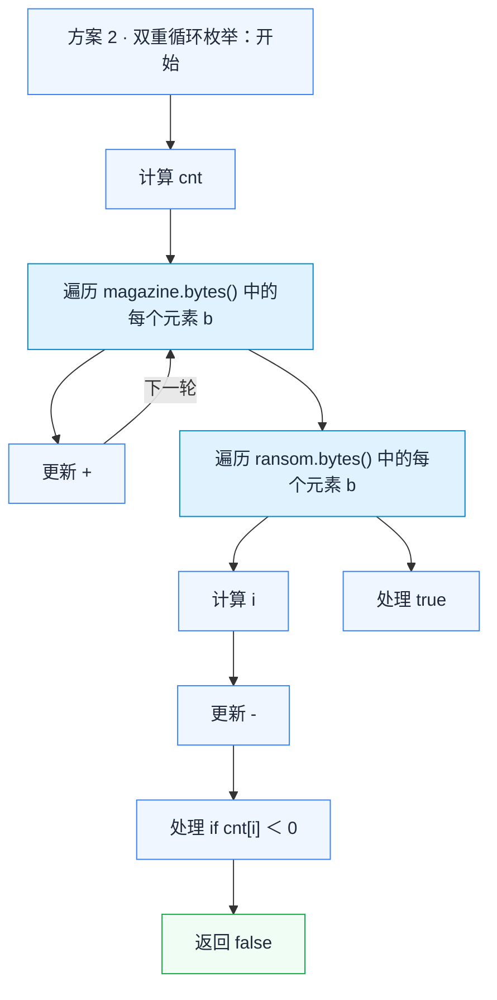

```rust
// LeetCode 383. 赎金信 — Rust 版（方案2）
fn can_construct(ransom: String, magazine: String) -> bool {
    // 定义函数/方法 can_construct
    let mut cnt = [0i32; 26]; // 把 [0i32; 26]; 写入 let mut cnt
    for b in magazine.bytes() {
        cnt[(b - b'a') as usize] += 1;
    } // 逐个取出 magazine 的元素（b）
    for b in ransom.bytes() {
        // 逐个取出 ransom 的元素（b）
        let i = (b - b'a') as usize; // 把 (b 减 b'数组') as usize 存入 下标 i
        cnt[i] -= 1; // cnt[i]累减 1
        if cnt[i] < 0 {
            return false;
        } // 若 计数[下标 i] 小于 0 { return false; }
    }
    true // true
}
fn main() {
    assert!(!can_construct("a".into(), "b".into()));
    assert!(!can_construct("aa".into(), "ab".into()));
    assert!(can_construct("aa".into(), "aab".into()));
    println!("PASS");
} // 程序入口：跑内嵌自测用例
```

### Lua 实现（2 种方案）

Lua 的全部方案如下，每个方案都内嵌用例自测，可独立运行（老仓库 python/go 文件遵循「打印结果」约定）：

#### 方案 1：双重循环枚举

**思路与代码分析**：核心是「双重循环枚举」。Lua 版用表与 ipairs 遍历，注意 ipairs 遇 nil 即停的语义。**走读**：方案 1 · 双重循环枚举：开始 → 更新 cnt → 遍历 magazine:gmatch('[%a]') do 中的每个元素 c → 更新 cnt[c] → 遍历 ransom:gmatch('[%a]') do 中的每个元素 c → 更新 cnt[c] → 处理 if cnt[c] ＜ 0 then → 返回 false → 返回 true。

**运行架构**（真实控制流）：

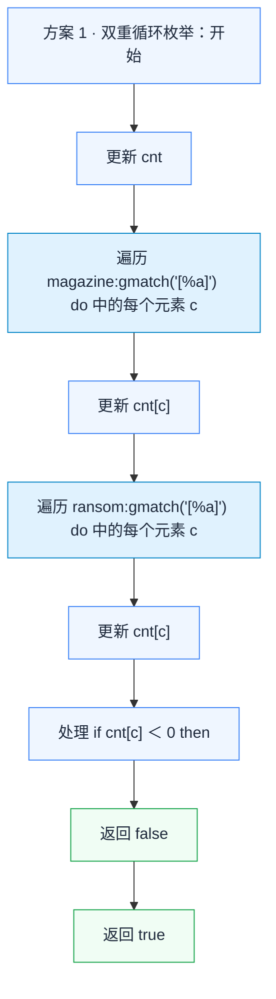

```lua
-- LeetCode 383. 赎金信 — Lua 版（方案1）
local function can_construct(ransom, magazine) -- local function can_construct(ransom, magazine)
	local cnt = {} -- 把 {} 写入 local cnt
	for c in magazine:gmatch("[%a]") do
		cnt[c] = (cnt[c] or 0) + 1
	end
	for c in ransom:gmatch("[%a]") do -- for 字符 in ransom:gmatch(「[ 对…取模 数组]」) do
		cnt[c] = (cnt[c] or 0) - 1 -- 把 (计数[字符] or 0) 减 1 写入 cnt[c]
		if cnt[c] < 0 then
			return false
		end -- 若 计数[字符] 小于 0 then return false 终点
	end -- 终点
	return true -- 返回 true
end -- 终点
assert(can_construct("a", "b") == false) -- 断言校验
assert(can_construct("aa", "ab") == false) -- 断言校验
assert(can_construct("aa", "aab") == true) -- 断言校验
print("PASS") -- 全部用例通过，输出 PASS
```

#### 方案 2：双重循环枚举

**思路与代码分析**：核心是「双重循环枚举」。Lua 版用表与 ipairs 遍历，注意 ipairs 遇 nil 即停的语义。**走读**：方案 2 · 双重循环枚举：开始 → 更新 cnt → 遍历 magazine:gmatch('[%a]') do 中的每个元素 c → 更新 cnt[c] → 遍历 ransom:gmatch('[%a]') do 中的每个元素 c → 更新 cnt[c] → 处理 if cnt[c] ＜ 0 then → 返回 false → 返回 true。

**运行架构**（真实控制流）：


```lua
-- LeetCode 383. 赎金信 — Lua 版（方案2）
local function can_construct(ransom, magazine) -- local function can_construct(ransom, magazine)
	local cnt = {} -- 把 {} 写入 local cnt
	for c in magazine:gmatch("[%a]") do
		cnt[c] = (cnt[c] or 0) + 1
	end
	for c in ransom:gmatch("[%a]") do -- for 字符 in ransom:gmatch(「[ 对…取模 数组]」) do
		cnt[c] = (cnt[c] or 0) - 1 -- 把 (计数[字符] or 0) 减 1 写入 cnt[c]
		if cnt[c] < 0 then
			return false
		end -- 若 计数[字符] 小于 0 then return false 终点
	end -- 终点
	return true -- 返回 true
end -- 终点
assert(can_construct("a", "b") == false) -- 断言校验
assert(can_construct("aa", "ab") == false) -- 断言校验
assert(can_construct("aa", "aab") == true) -- 断言校验
print("PASS") -- 全部用例通过，输出 PASS
```

### C 实现（2 种方案）

C 的全部方案如下，每个方案都内嵌用例自测，可独立运行（老仓库 python/go 文件遵循「打印结果」约定）：

#### 方案 1：双重循环枚举

**思路与代码分析**：核心是「双重循环枚举」。C 版手动管理下标与内存，循环边界全部显式写出。代码里依次做这些事：双重循环遍历。**走读**：方案 1 · 双重循环枚举：开始 → 更新 cnt[26] → 遍历循环 → 处理 cnt[*p - 'a']++ → 遍历循环 → 处理 cnt[*p - 'a']-- → 命中条件，直接返回 → 返回 1。

**运行架构**（真实控制流）：

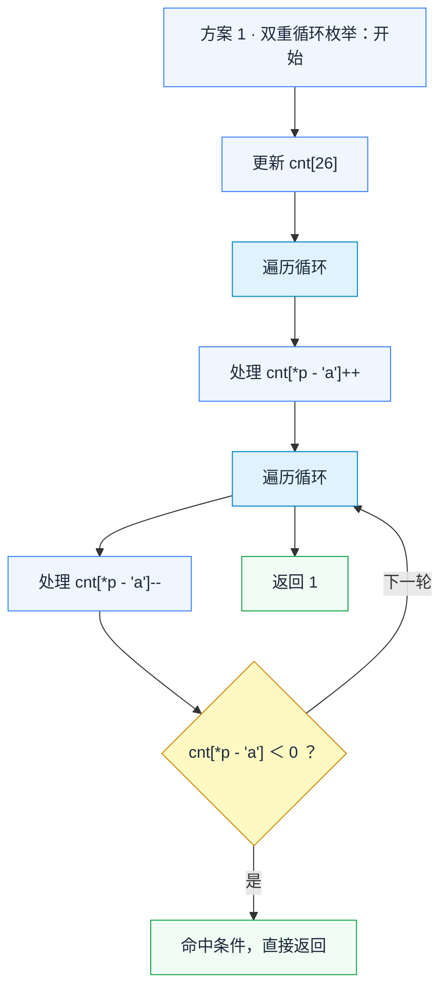

```c
/* LeetCode 383. 赎金信 — C 版（方案1） */
#include <stdio.h>                                       // 引入头文件
#include <string.h>                                      // 引入头文件
static int can_construct(const char *r, const char *m) { // 定义函数/方法 can_construct
    int cnt[26] = {0};                                   // 把 {0}; 写入 int cnt[26]
    for (const char *p = m; *p; p++)
        cnt[*p - 'a']++;
    for (const char *p = r; *p; p++) { // 把 右指针; 乘 节点; 节点 加一 ) { 写入 for (const char *p
        cnt[*p - 'a']--;               // 计数[ 乘 节点 减 '数组'] 减一 ;
        if (cnt[*p - 'a'] < 0)
            return 0; // 若 计数[ 乘 节点 减 '数组'] 小于 0，直接返回 0
    }
    return 1; // 返回 1
}
int main(void) { // 程序入口：跑内嵌自测用例
    if (can_construct("a", "b")) {
        printf("FAIL 1\n");
        return 1;
    } // 若 can_construct(「数组」, 「数组」)) { 输出「数组」); return 1; }
    if (can_construct("aa", "ab")) {
        printf("FAIL 2\n");
        return 1;
    } // 若 can_construct(「aa」, 「aa」)) { 输出「aa」); return 1; }
    if (!can_construct("aa", "aab")) {
        printf("FAIL 3\n");
        return 1;
    } // 若 取反 can_construct(「aa」, 「aa」)) { 输出「aa」); return 1; }
    printf("PASS\n");
    return 0;
} // 全部用例通过，输出 PASS
```

#### 方案 2：双重循环枚举

**思路与代码分析**：核心是「双重循环枚举」。C 版手动管理下标与内存，循环边界全部显式写出。代码里依次做这些事：双重循环遍历。**走读**：方案 2 · 双重循环枚举：开始 → 更新 cnt[26] → 遍历循环 → 处理 cnt[*p - 'a']++ → 遍历循环 → 处理 cnt[*p - 'a']-- → 命中条件，直接返回 → 返回 1。

**运行架构**（真实控制流）：


```c
/* LeetCode 383. 赎金信 — C 版（方案2） */
#include <stdio.h>                                       // 引入头文件
#include <string.h>                                      // 引入头文件
static int can_construct(const char *r, const char *m) { // 定义函数/方法 can_construct
    int cnt[26] = {0};                                   // 把 {0}; 写入 int cnt[26]
    for (const char *p = m; *p; p++)
        cnt[*p - 'a']++;
    for (const char *p = r; *p; p++) { // 把 右指针; 乘 节点; 节点 加一 ) { 写入 for (const char *p
        cnt[*p - 'a']--;               // 计数[ 乘 节点 减 '数组'] 减一 ;
        if (cnt[*p - 'a'] < 0)
            return 0; // 若 计数[ 乘 节点 减 '数组'] 小于 0，直接返回 0
    }
    return 1; // 返回 1
}
int main(void) { // 程序入口：跑内嵌自测用例
    if (can_construct("a", "b")) {
        printf("FAIL 1\n");
        return 1;
    } // 若 can_construct(「数组」, 「数组」)) { 输出「数组」); return 1; }
    if (can_construct("aa", "ab")) {
        printf("FAIL 2\n");
        return 1;
    } // 若 can_construct(「aa」, 「aa」)) { 输出「aa」); return 1; }
    if (!can_construct("aa", "aab")) {
        printf("FAIL 3\n");
        return 1;
    } // 若 取反 can_construct(「aa」, 「aa」)) { 输出「aa」); return 1; }
    printf("PASS\n");
    return 0;
} // 全部用例通过，输出 PASS
```

### C++ 实现（2 种方案）

C++ 的全部方案如下，每个方案都内嵌用例自测，可独立运行（老仓库 python/go 文件遵循「打印结果」约定）：

#### 方案 1：双重循环枚举

**思路与代码分析**：核心是「双重循环枚举」。C++ 版用 STL 容器与迭代器，减少手写下标错误。代码里依次做这些事：双重循环遍历。**走读**：方案 1 · 双重循环枚举：开始 → 更新 cnt[26] → 遍历循环 → 处理 ++cnt[c - 'a'] → 遍历循环 → 命中条件，直接返回 → 返回 true。

**运行架构**（真实控制流）：

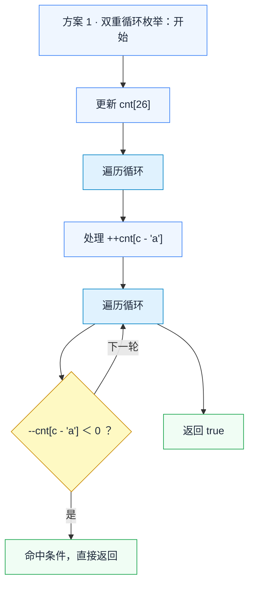

```cpp
// LeetCode 383. 赎金信 — C++ 版（方案1）
#include <cassert>  // 引入头文件
#include <iostream> // 引入头文件
#include <string>   // 引入头文件
static bool canConstruct(const std::string &ransom,
                         const std::string &magazine) { // 定义函数/方法 canConstruct
    int cnt[26] = {0};                                  // 把 {0}; 写入 int cnt[26]
    for (char c : magazine)
        ++cnt[c - 'a'];     // for (char 字符 : magazine) 加一 计数[字符 减 '数组'];
    for (char c : ransom) { // for (char 字符 : ransom) {
        if (--cnt[c - 'a'] < 0)
            return false; // 若 减一 计数[字符 减 '数组'] 小于 0，直接返回 false
    }
    return true; // 返回 true
}
int main() {
    assert(!canConstruct("a", "b"));
    assert(!canConstruct("aa", "ab"));
    assert(canConstruct("aa", "aab"));
    std::cout << "PASS" << std::endl;
} // 全部用例通过，输出 PASS
```

#### 方案 2：双重循环枚举

**思路与代码分析**：核心是「双重循环枚举」。C++ 版用 STL 容器与迭代器，减少手写下标错误。代码里依次做这些事：双重循环遍历。**走读**：方案 2 · 双重循环枚举：开始 → 更新 cnt[26] → 遍历循环 → 处理 ++cnt[c - 'a'] → 遍历循环 → 命中条件，直接返回 → 返回 true。

**运行架构**（真实控制流）：


```cpp
// LeetCode 383. 赎金信 — C++ 版（方案2）
#include <cassert>  // 引入头文件
#include <iostream> // 引入头文件
#include <string>   // 引入头文件
static bool canConstruct(const std::string &ransom,
                         const std::string &magazine) { // 定义函数/方法 canConstruct
    int cnt[26] = {0};                                  // 把 {0}; 写入 int cnt[26]
    for (char c : magazine)
        ++cnt[c - 'a'];     // for (char 字符 : magazine) 加一 计数[字符 减 '数组'];
    for (char c : ransom) { // for (char 字符 : ransom) {
        if (--cnt[c - 'a'] < 0)
            return false; // 若 减一 计数[字符 减 '数组'] 小于 0，直接返回 false
    }
    return true; // 返回 true
}
int main() {
    assert(!canConstruct("a", "b"));
    assert(!canConstruct("aa", "ab"));
    assert(canConstruct("aa", "aab"));
    std::cout << "PASS" << std::endl;
} // 全部用例通过，输出 PASS
```

### R 实现（2 种方案）

R 的全部方案如下，每个方案都内嵌用例自测，可独立运行（老仓库 python/go 文件遵循「打印结果」约定）：

#### 方案 1：双重循环枚举

**思路与代码分析**：核心是「双重循环枚举」。R 版用向量化思维与 1 起始下标，注意 1:n 的降序陷阱。代码里依次做这些事：单循环线性扫描。**走读**：方案 1 · 双重循环枚举：开始 → 处理 cr ＜- table(strsplit(ransom, → 处理 cm ＜- table(strsplit(magazin → 处理 ok ＜- TRUE → 循环 ch：遍历 names(cr) → 处理 need ＜- cr[[ch]] → 处理 have ＜- if (ch %in% names(cm → 处理 cm[[ch]] else 0L → 若 have ＜ need：处理对应分支 → 处理 ok ＜- FALSE → 跳出循环（break） → 处理 ok → 返回结果。

**运行架构**（真实控制流）：


```r
# 版（方案1） 定义函数 can_construct（参数：ransom, magazine）
can_construct <- function(ransom, magazine) {
    cr <- table(strsplit(ransom, "")[[1]])  # 把 table(strsplit(ransom, 「」)[[1]]) 存入 cr
    cm <- table(strsplit(magazine, "")[[1]])  # 把 table(strsplit(magazine, 「」)[[1]]) 存入 cm
    ok <- TRUE  # 把 TRUE 存入 ok
    for (ch in names(cr)) {
        # for (字符 in names(cr)) {
        need <- cr[[ch]]  # 把 cr[[字符]] 存入 need
        have <- if (ch %in% names(cm))
            cm[[ch]] else 0L  # 把 if (字符 对…取模 in 对…取模 names(cm)) cm[[字符]] else 0L 存入 have
        if (have < need)
            {
                ok <- FALSE
                break
            }  # 若 have 小于 need) { ok 小于 减 FALSE; break }
    }
    ok  # ok
}
stopifnot(!can_construct("a", "b"))  # 断言校验
stopifnot(!can_construct("aa", "ab"))  # 断言校验
stopifnot(can_construct("aa", "aab"))  # 断言校验
cat("PASS\n")  # 全部用例通过，输出 PASS
```

#### 方案 2：双重循环枚举

**思路与代码分析**：核心是「双重循环枚举」。R 版用向量化思维与 1 起始下标，注意 1:n 的降序陷阱。代码里依次做这些事：单循环线性扫描。**走读**：方案 2 · 双重循环枚举：开始 → 处理 cr ＜- table(strsplit(ransom, → 处理 cm ＜- table(strsplit(magazin → 处理 ok ＜- TRUE → 循环 ch：遍历 names(cr) → 处理 need ＜- cr[[ch]] → 处理 have ＜- if (ch %in% names(cm → 处理 cm[[ch]] else 0L → 若 have ＜ need：处理对应分支 → 处理 ok ＜- FALSE → 跳出循环（break） → 处理 ok → 返回结果。

**运行架构**（真实控制流）：

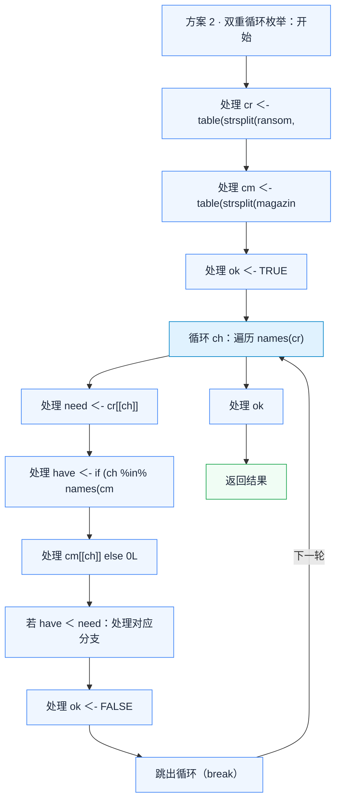

```r
# 版（方案2） 定义函数 can_construct（参数：ransom, magazine）
can_construct <- function(ransom, magazine) {
    cr <- table(strsplit(ransom, "")[[1]])  # 把 table(strsplit(ransom, 「」)[[1]]) 存入 cr
    cm <- table(strsplit(magazine, "")[[1]])  # 把 table(strsplit(magazine, 「」)[[1]]) 存入 cm
    ok <- TRUE  # 把 TRUE 存入 ok
    for (ch in names(cr)) {
        # for (字符 in names(cr)) {
        need <- cr[[ch]]  # 把 cr[[字符]] 存入 need
        have <- if (ch %in% names(cm))
            cm[[ch]] else 0L  # 把 if (字符 对…取模 in 对…取模 names(cm)) cm[[字符]] else 0L 存入 have
        if (have < need)
            {
                ok <- FALSE
                break
            }  # 若 have 小于 need) { ok 小于 减 FALSE; break }
    }
    ok  # ok
}
stopifnot(!can_construct("a", "b"))  # 断言校验
stopifnot(!can_construct("aa", "ab"))  # 断言校验
stopifnot(can_construct("aa", "aab"))  # 断言校验
cat("PASS\n")  # 全部用例通过，输出 PASS
```

### Zig 实现（2 种方案）

Zig 的全部方案如下，每个方案都内嵌用例自测，可独立运行（老仓库 python/go 文件遵循「打印结果」约定）：

#### 方案 1：双重循环枚举

**思路与代码分析**：核心是「双重循环枚举」。Zig 版显式分配与清零，整型边界处理严格。代码里依次做这些事：双重循环遍历。**走读**：方案 1 · 双重循环枚举：开始 → 计算 cnt → 遍历集合元素 → 遍历集合元素 → 更新 - → 命中条件，直接返回 → 返回 true。

**运行架构**（真实控制流）：

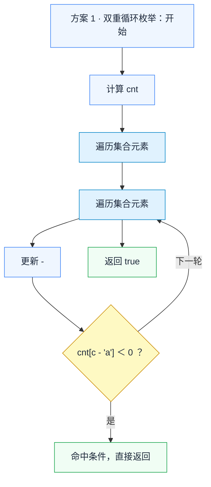

```zig
// LeetCode 383. 赎金信 — Zig 版（方案1）
const std = @import("std"); // 把 @import(「std」) 存入 std
fn canConstruct(ransom: []const u8, magazine: []const u8) bool { // 定义函数/方法 canConstruct
    var cnt = [_]i32{0} ** 26; // 把 [_]i32{0} 乘 乘 26 存入 计数
    for (magazine) |c| cnt[c - 'a'] += 1; // 逐个取出 magazine 的元素（字符）
    for (ransom) |c| { // 逐个取出 ransom 的元素（字符）
        cnt[c - 'a'] -= 1; // 把 1; 写入 cnt[c - 'a'] -
        if (cnt[c - 'a'] < 0) return false; // 若 计数[字符 减 '数组'] 小于 0，直接返回 false
    }
    return true; // 返回 true
}
pub fn main() !void { // 程序入口：跑内嵌自测用例
    if (canConstruct("a", "b")) return error.TestFailed; // 若 canConstruct(「数组」, 「数组」)，直接返回 error.TestFailed
    if (canConstruct("aa", "ab")) return error.TestFailed; // 若 canConstruct(「aa」, 「aa」)，直接返回 error.TestFailed
    if (!canConstruct("aa", "aab")) return error.TestFailed; // 若 取反 canConstruct(「aa」, 「aa」)，直接返回 error.TestFailed
    std.debug.print("PASS\n", .{});
} // 全部用例通过，输出 PASS
```

#### 方案 2：双重循环枚举

**思路与代码分析**：核心是「双重循环枚举」。Zig 版显式分配与清零，整型边界处理严格。代码里依次做这些事：双重循环遍历。**走读**：方案 2 · 双重循环枚举：开始 → 计算 cnt → 遍历集合元素 → 遍历集合元素 → 更新 - → 命中条件，直接返回 → 返回 true。

**运行架构**（真实控制流）：

```mermaid
graph TD
    N0["方案 2 · 双重循环枚举：开始"]
    N1["计算 cnt"]
    N2["遍历集合元素"]
    N3["遍历集合元素"]
    N4["更新 -"]
    N5{"cnt[c - 'a'] ＜ 0 ？"}
    N6["命中条件，直接返回"]
    N7["返回 true"]
    N0 --> N1
    N1 --> N2
    N2 --> N3
    N3 --> N4
    N4 --> N5
    N5 -- 是 --> N6
    N5 -- 下一轮 --> N3
    N3 --> N7
    classDef n fill:#eff6ff,stroke:#3b82f6,color:#1e293b;
    classDef lp fill:#e0f2fe,stroke:#0284c7,color:#1e293b;
    classDef dc fill:#fef9c3,stroke:#ca8a04,color:#1e293b;
    classDef tm fill:#f0fdf4,stroke:#16a34a,color:#1e293b;
    class N0,N1,N4 n;
    class N2,N3 lp;
    class N5 dc;
    class N6,N7 tm;
```

```zig
// LeetCode 383. 赎金信 — Zig 版（方案2）
const std = @import("std"); // 把 @import(「std」) 存入 std
fn canConstruct(ransom: []const u8, magazine: []const u8) bool { // 定义函数/方法 canConstruct
    var cnt = [_]i32{0} ** 26; // 把 [_]i32{0} 乘 乘 26 存入 计数
    for (magazine) |c| cnt[c - 'a'] += 1; // 逐个取出 magazine 的元素（字符）
    for (ransom) |c| { // 逐个取出 ransom 的元素（字符）
        cnt[c - 'a'] -= 1; // 把 1; 写入 cnt[c - 'a'] -
        if (cnt[c - 'a'] < 0) return false; // 若 计数[字符 减 '数组'] 小于 0，直接返回 false
    }
    return true; // 返回 true
}
pub fn main() !void { // 程序入口：跑内嵌自测用例
    if (canConstruct("a", "b")) return error.TestFailed; // 若 canConstruct(「数组」, 「数组」)，直接返回 error.TestFailed
    if (canConstruct("aa", "ab")) return error.TestFailed; // 若 canConstruct(「aa」, 「aa」)，直接返回 error.TestFailed
    if (!canConstruct("aa", "aab")) return error.TestFailed; // 若 取反 canConstruct(「aa」, 「aa」)，直接返回 error.TestFailed
    std.debug.print("PASS\n", .{});
} // 全部用例通过，输出 PASS
```

### Dart 实现（2 种方案）

Dart 的全部方案如下，每个方案都内嵌用例自测，可独立运行（老仓库 python/go 文件遵循「打印结果」约定）：

#### 方案 1：双重循环枚举

**思路与代码分析**：核心是「双重循环枚举」。Dart 版用可空类型标注与集合方法，注意空安全。代码里依次做这些事：双重循环遍历。**走读**：方案 1 · 双重循环枚举：开始 → 更新 cnt → 遍历循环 → 处理 cnt[c.codeUnitAt(0) - 97]++ → 遍历循环 → 更新 i → 处理 cnt[i]-- → 命中条件，直接返回 → 返回 true。

**运行架构**（真实控制流）：

```mermaid
graph TD
    N0["方案 1 · 双重循环枚举：开始"]
    N1["更新 cnt"]
    N2["遍历循环"]
    N3["处理 cnt[c.codeUnitAt(0) - 97]++"]
    N4["遍历循环"]
    N5["更新 i"]
    N6["处理 cnt[i]--"]
    N7{"cnt[i] ＜ 0 ？"}
    N8["命中条件，直接返回"]
    N9["返回 true"]
    N0 --> N1
    N1 --> N2
    N2 --> N3
    N3 -- 下一轮 --> N2
    N2 --> N4
    N4 --> N5
    N5 --> N6
    N6 --> N7
    N7 -- 是 --> N8
    N7 -- 下一轮 --> N4
    N4 --> N9
    classDef n fill:#eff6ff,stroke:#3b82f6,color:#1e293b;
    classDef lp fill:#e0f2fe,stroke:#0284c7,color:#1e293b;
    classDef dc fill:#fef9c3,stroke:#ca8a04,color:#1e293b;
    classDef tm fill:#f0fdf4,stroke:#16a34a,color:#1e293b;
    class N0,N1,N3,N5,N6 n;
    class N2,N4 lp;
    class N7 dc;
    class N8,N9 tm;
```

```dart
// LeetCode 383. 赎金信 — Dart 版（方案1）
bool canConstruct(String ransom, String magazine) {
  // 定义函数/方法 canConstruct
  final cnt = List<int>.filled(26, 0); // 把 List 小于 int 超过 .filled(26, 0) 存入 计数
  for (final c in magazine.split('')) {
    cnt[c.codeUnitAt(0) - 97]++;
  }
  for (final c in ransom.split('')) {
    // for (final 字符 in ransom.split('')) {
    final i = c.codeUnitAt(0) - 97; // 把 字符.codeUnitAt(0) 减 97 存入 下标 i
    cnt[i]--; // 计数[下标 i] 减一 ;
    if (cnt[i] < 0) return false; // 若 计数[下标 i] 小于 0，直接返回 false
  }
  return true; // 返回 true
}

void main() {
  if (canConstruct('a', 'b')) throw StateError('c1');
  if (canConstruct('aa', 'ab')) throw StateError('c2');
  if (!canConstruct('aa', 'aab')) throw StateError('c3');
  print('PASS');
} // 全部用例通过，输出 PASS
```

#### 方案 2：双重循环枚举

**思路与代码分析**：核心是「双重循环枚举」。Dart 版用可空类型标注与集合方法，注意空安全。代码里依次做这些事：双重循环遍历。**走读**：方案 2 · 双重循环枚举：开始 → 更新 cnt → 遍历循环 → 处理 cnt[c.codeUnitAt(0) - 97]++ → 遍历循环 → 更新 i → 处理 cnt[i]-- → 命中条件，直接返回 → 返回 true。

**运行架构**（真实控制流）：

```mermaid
graph TD
    N0["方案 2 · 双重循环枚举：开始"]
    N1["更新 cnt"]
    N2["遍历循环"]
    N3["处理 cnt[c.codeUnitAt(0) - 97]++"]
    N4["遍历循环"]
    N5["更新 i"]
    N6["处理 cnt[i]--"]
    N7{"cnt[i] ＜ 0 ？"}
    N8["命中条件，直接返回"]
    N9["返回 true"]
    N0 --> N1
    N1 --> N2
    N2 --> N3
    N3 -- 下一轮 --> N2
    N2 --> N4
    N4 --> N5
    N5 --> N6
    N6 --> N7
    N7 -- 是 --> N8
    N7 -- 下一轮 --> N4
    N4 --> N9
    classDef n fill:#eff6ff,stroke:#3b82f6,color:#1e293b;
    classDef lp fill:#e0f2fe,stroke:#0284c7,color:#1e293b;
    classDef dc fill:#fef9c3,stroke:#ca8a04,color:#1e293b;
    classDef tm fill:#f0fdf4,stroke:#16a34a,color:#1e293b;
    class N0,N1,N3,N5,N6 n;
    class N2,N4 lp;
    class N7 dc;
    class N8,N9 tm;
```

```dart
// LeetCode 383. 赎金信 — Dart 版（方案2）
bool canConstruct(String ransom, String magazine) {
  // 定义函数/方法 canConstruct
  final cnt = List<int>.filled(26, 0); // 把 List 小于 int 超过 .filled(26, 0) 存入 计数
  for (final c in magazine.split('')) {
    cnt[c.codeUnitAt(0) - 97]++;
  }
  for (final c in ransom.split('')) {
    // for (final 字符 in ransom.split('')) {
    final i = c.codeUnitAt(0) - 97; // 把 字符.codeUnitAt(0) 减 97 存入 下标 i
    cnt[i]--; // 计数[下标 i] 减一 ;
    if (cnt[i] < 0) return false; // 若 计数[下标 i] 小于 0，直接返回 false
  }
  return true; // 返回 true
}

void main() {
  if (canConstruct('a', 'b')) throw StateError('c1');
  if (canConstruct('aa', 'ab')) throw StateError('c2');
  if (!canConstruct('aa', 'aab')) throw StateError('c3');
  print('PASS');
} // 全部用例通过，输出 PASS
```

---

## 内容总结

- **赎金信**（数组 · Medium）：共 2 个方案，主线思路「双重循环枚举」；时间 O(n²)（两层嵌套扫描）；动画演示双指针过程，附录给出 11 种语言 × 全部方案的可运行实现。
- 来源博客：[https://blog.csdn.net/tyro_java/article/details/145355797](https://blog.csdn.net/tyro_java/article/details/145355797)
- 导航：[📋 总目录](../) ｜ [← 031 o(1) 时间插入、删除和获取随](../031_o%281%29_时间插入、删除和获取随机元素/) ｜ [033 打乱数组 →](../033_打乱数组/)
