# 033 · 打乱数组（第一阶段 · 线性结构入门 · Medium）

> **难度**：⭐⭐ Medium ｜ **专题**：数组
> **学习定位**：第一阶段 · 线性结构入门第 33 篇 ｜ **解法数**：2
> **内容总结**：**打乱数组**（数组 · Medium）：共 2 个方案，主线思路「Fisher-Yates（从后往前）」；时间 O(n)（单趟线性扫描）；动画演示双指针过程，附录给出 11 种语言 × 全部方案的可运行实现。

---

## 题目描述

给你一个整数数组 `nums` ，设计算法来打乱一个没有重复元素的数组。打乱后，数组的所有排列应该是 等可能 的。

实现 `Solution` class:

 `Solution(int[] nums)` 使用整数数组 `nums` 初始化对象
 `int[] reset()` 重设数组到它的初始状态并返回
 `int[] shuffle()` 返回数组随机打乱后的结果

**用例（来自原题）**：

**示例 1**

```text
输入
["Solution", "shuffle", "reset", "shuffle"]
[[[1, 2, 3]], [], [], []]
输出
[null, [3, 1, 2], [1, 2, 3], [1, 3, 2]]

解释
Solution solution = new Solution([1, 2, 3]);
solution.shuffle();    // 打乱数组 [1,2,3] 并返回结果。任何 [1,2,3]的排列返回的概率应该相同。例如，返回 [3, 1, 2]
solution.reset();      // 重设数组到它的初始状态 [1, 2, 3] 。返回 [1, 2, 3]
solution.shuffle();    // 随机返回数组 [1, 2, 3] 打乱后的结果。例如，返回 [1, 3, 2]
```
> 题面与 [leetcode.cn 官方](https://leetcode.cn/problems/shuffle-an-array/)一致，示例配图取自官方题面。

**数据范围与注意事项**：

- `1 <= nums.length <= 50`
- `-10^6 <= nums[i] <= 10^6`
- `nums` 中的所有元素都是 唯一的
- `最多可以调用 `10^4` 次 `reset` 和 `shuffle``
- **易错点**：边界最容易漏：空数组、只有一个元素、目标出现在头尾。

## 题目分析

**场景是什么**：数组是最常用的线性容器，这类题练的是下标操作与原地腾挪，对应真实开发里的缓冲区、列表整理。本题就是该场景的 Medium 级练习，主线做法是「Fisher-Yates（从后往前）」。

**主线怎么解**：把主解法从头到尾过一遍，它其实在依次做这几件事：先排序再处理 → 单循环线性扫描。

## 解题思路

**方案对比**（共 2 个方案，由浅入深）：

| 方案 | 时间复杂度 | 空间复杂度 |
|---|---|---|
| 方案 1 · Fisher-Yates（从后往前） | O(n)（单趟线性扫描） | O(1) 到 O(n)（视辅助结构） |
| 方案 2 · Fisher-Yates（从前往后） | O(n)（单趟线性扫描） | O(1) 到 O(n)（视辅助结构） |

**由浅入深的路径**：Fisher-Yates（从后往前） → Fisher-Yates（从前往后）；每往右一步，都在补上一步的短板。

**方案间的取舍**：方案 1（Fisher-Yates（从后往前））；方案 2（Fisher-Yates（从前往后））。数据规模小、可读性优先时选靠前的方案；规模大、性能优先时选靠后的方案。

**怎么读这一篇**：

- 🐣 **新手路线**：把「题目描述」的示例 1 在纸上手推一遍 → 读方案 1（最直观的写法）与它的代码走读 → 按「运行方式」本地跑通看 PASS → 回头对比方案 2 之后的写法差在哪
- 🦅 **大佬路线**：直接锁定最优方案 1（Fisher-Yates（从后往前），O(n)（单趟线性扫描））→ 跳读该方案代码与走读 → 用「逐步拆解与面试追问」补齐复杂度推导与边界追问

### 动态算法图（双指针，GIF 自动循环）


动画演示数组专题里双指针的典型过程；每个方案在「TypeScript 解题方案」一节还配了专属动画与专属流程图。

### 主解法流程图（真实控制流）

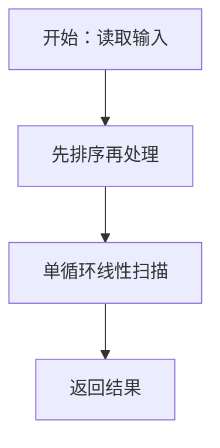

## TypeScript 解题方案（2 个方案逐个讲）

> **运行与提交**：每个方案都是自包含文件（内嵌用例自测，输出 PASS），整块复制到 `.ts` 文件后 `node 文件名` 即可运行。提交 LeetCode 时，把 `demo` 内的算法函数与辅助类型/函数整体取出、置于文件顶层即可。涉及交互/特殊接口的题以题面给定签名为准。

### 方案 1：Fisher-Yates（从后往前）

**分析与思路**：核心做法是「Fisher-Yates（从后往前）」。代码里依次做这些事：先排序再处理；单循环线性扫描。

**运行方式**：`node 本文件`，内嵌用例全部通过会输出 PASS。

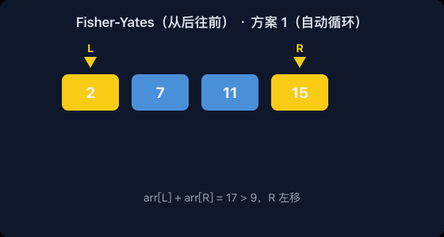

**方案专属流程图**（真实控制流）：


```typescript
/**
 ** LeetCode 384. 打乱数组
 ** 方案1: Fisher-Yates（从后往前）
 */

class Solution {
  // 定义类型
  private nums: number[]; // private 数组: number[];
  private original: number[]; // private original: number[];

  constructor(nums: number[]) {
    // constructor(数组: number[]) {
    this.nums = [...nums]; // 把 复制的 数组 ; 写入 数组
    this.original = [...nums]; // 把 复制的 数组 ; 写入 this.original
  }

  reset(): number[] {
    // reset(): number[] {
    this.nums = [...this.original]; // 把 [...this.original]; 写入 数组
    return this.nums; // 返回 this.数组
  }

  shuffle(): number[] {
    // shuffle(): number[] {
    const shuffled = [...this.nums]; // 把 [...this.数组] 存入 shuffled
    for (let i = shuffled.length - 1; i > 0; i--) {
      // 让 下标 i 从 shuffled.长度 减 1 开始计数，下标 i 超过 0 就继续
      const j = Math.floor(Math.random() * (i + 1)); // 把 向下取整(Math.random() 乘 (下标 i 加 1)) 存入 下标 j
      const tmp = shuffled[i]; // 把 shuffled[下标 i] 存入 临时变量
      shuffled[i] = shuffled[j]; // 把 shuffled[下标 j]; 写入 shuffled[i]
      shuffled[j] = tmp; // 把 临时变量; 写入 shuffled[j]
    }
    this.nums = shuffled; // 把 shuffled; 写入 数组
    return this.nums; // 返回 this.数组
  }
}

export function demo(): void {
  // 程序入口：跑内嵌自测用例
  let fail = false; // 把 false 存入 fail
  const sol = new Solution([1, 2, 3]); // 把 new Solution([1, 2, 3]) 存入 sol
  const sh = sol.shuffle(); // 把 sol.shuffle() 存入 sh
  const sorted = [...sh].sort((a, b) => a - b);
  if (JSON.stringify(sorted) !== JSON.stringify([1, 2, 3])) {
    // 若 JSON.stringify(sorted) 不等于 JSON.stringify([1, 2, 3]
    fail = true; // 把 true 存入 fail
    console.log('FAIL shuffle not a permutation: ' + JSON.stringify(sh)); // 打印输出
  }
  const rs = sol.reset(); // 把 sol.reset() 存入 rs
  if (JSON.stringify(rs) !== JSON.stringify([1, 2, 3])) {
    // 若 JSON.stringify(rs) 不等于 JSON.stringify([1, 2, 3]
    fail = true; // 把 true 存入 fail
    console.log('FAIL reset=' + JSON.stringify(rs)); // 打印输出
  }
  const sol2 = new Solution([5]); // 把 new Solution([5]) 存入 sol2
  if (JSON.stringify(sol2.shuffle()) !== JSON.stringify([5])) {
    // 若 JSON.stringify(sol2.shuffle()) 不等于 JSON.stringify([5]
    fail = true; // 把 true 存入 fail
    console.log('FAIL single-element shuffle'); // 打印输出
  }
  if (fail) throw new Error('FAILED'); // 若 fail) throw new Error(「FAILED」);
  console.log('PASS'); // 全部用例通过，输出 PASS
}
demo(); // demo();
```

### 方案 2：Fisher-Yates（从前往后）

**分析与思路**：核心做法是「Fisher-Yates（从前往后）」。代码里依次做这些事：先排序再处理；单循环线性扫描。

**运行方式**：`node 本文件`，内嵌用例全部通过会输出 PASS。


**方案专属流程图**（真实控制流）：


```typescript
/**
 ** LeetCode 384. 打乱数组
 ** 方案2: Fisher-Yates（从前往后）
 */

class Solution {
  // 定义类型
  private nums: number[]; // private 数组: number[];
  private original: number[]; // private original: number[];

  constructor(nums: number[]) {
    // constructor(数组: number[]) {
    this.nums = [...nums]; // 把 复制的 数组 ; 写入 数组
    this.original = [...nums]; // 把 复制的 数组 ; 写入 this.original
  }

  reset(): number[] {
    // reset(): number[] {
    this.nums = [...this.original]; // 把 [...this.original]; 写入 数组
    return this.nums; // 返回 this.数组
  }

  shuffle(): number[] {
    // shuffle(): number[] {
    const shuffled = [...this.nums]; // 把 [...this.数组] 存入 shuffled
    for (let i = 0; i < shuffled.length; i++) {
      // 让 下标 i 从 0 开始计数，下标 i 小于 shuffled.长度 就继续
      const j = i + Math.floor(Math.random() * (shuffled.length - i)); // 把 下标 i 加 向下取整(Math.random() 乘 (shuffled.长度 减 下标 i)) 存入 下标 j
      const tmp = shuffled[i]; // 把 shuffled[下标 i] 存入 临时变量
      shuffled[i] = shuffled[j]; // 把 shuffled[下标 j]; 写入 shuffled[i]
      shuffled[j] = tmp; // 把 临时变量; 写入 shuffled[j]
    }
    this.nums = shuffled; // 把 shuffled; 写入 数组
    return this.nums; // 返回 this.数组
  }
}

export function demo(): void {
  // 程序入口：跑内嵌自测用例
  let fail = false; // 把 false 存入 fail
  const sol = new Solution([1, 2, 3]); // 把 new Solution([1, 2, 3]) 存入 sol
  const sh = sol.shuffle(); // 把 sol.shuffle() 存入 sh
  const sorted = [...sh].sort((a, b) => a - b);
  if (JSON.stringify(sorted) !== JSON.stringify([1, 2, 3])) {
    // 若 JSON.stringify(sorted) 不等于 JSON.stringify([1, 2, 3]
    fail = true; // 把 true 存入 fail
    console.log('FAIL shuffle not a permutation: ' + JSON.stringify(sh)); // 打印输出
  }
  const rs = sol.reset(); // 把 sol.reset() 存入 rs
  if (JSON.stringify(rs) !== JSON.stringify([1, 2, 3])) {
    // 若 JSON.stringify(rs) 不等于 JSON.stringify([1, 2, 3]
    fail = true; // 把 true 存入 fail
    console.log('FAIL reset=' + JSON.stringify(rs)); // 打印输出
  }
  const sol2 = new Solution([5]); // 把 new Solution([5]) 存入 sol2
  if (JSON.stringify(sol2.shuffle()) !== JSON.stringify([5])) {
    // 若 JSON.stringify(sol2.shuffle()) 不等于 JSON.stringify([5]
    fail = true; // 把 true 存入 fail
    console.log('FAIL single-element shuffle'); // 打印输出
  }
  if (fail) throw new Error('FAILED'); // 若 fail) throw new Error(「FAILED」);
  console.log('PASS'); // 全部用例通过，输出 PASS
}
demo(); // demo();
```

## 逐步拆解与面试追问

**复杂度**：时间 O(n)（单趟线性扫描），空间 O(1) 到 O(n)（视辅助结构）

**为什么是这个量级**：每个元素被常数次访问，辅助哈希或栈的开销与 n 同阶

**面试官可能会追问**：

- 能不能原地做（O(1) 空间）？
- 如果数组已有序，能优化到什么程度？
- 空数组、单元素怎么处理？

## 关键 API 速查（TS 主解法实际用到，附官方链接）

| API | 作用 | 使用要点 | 官方文档 |
|---|---|---|---|
| `Array.prototype.sort()` | 原地排序 | 默认按字符串 Unicode 序（10 会排在 2 前），数字必须传 (a,b)=>a-b；V8 用 TimSort，稳定，O(n log n)；返回原数组引用 | [官方文档](https://developer.mozilla.org/zh-CN/docs/Web/JavaScript/Reference/Global_Objects/Array/sort) |
| `JSON.stringify()` | 序列化为 JSON 字符串 | 常用于结构化比较（深度相等判定）；undefined/函数/循环引用会被丢弃或抛错 | [官方文档](https://developer.mozilla.org/zh-CN/docs/Web/JavaScript/Reference/Global_Objects/JSON/stringify) |
| `Math.floor()` | 向下取整 | 负数向负无穷（-1.5 → -2）；大数用位运算前注意 2^31 界 | [官方文档](https://developer.mozilla.org/zh-CN/docs/Web/JavaScript/Reference/Global_Objects/Math/floor) |

### 各语言官方文档导航

- **TypeScript / JS**：[MDN 中文参考](https://developer.mozilla.org/zh-CN/)
- **Python**：[Python 官方文档](https://docs.python.org/zh-cn/3/)
- **Go**：[Go 标准库](https://pkg.go.dev/std)
- **Java**：[JDK 17 API](https://docs.oracle.com/en/java/javase/17/docs/api/)
- **Rust**：[Rust 标准库](https://doc.rust-lang.org/std/)
- **Lua**：[Lua 5.4 手册](https://www.lua.org/manual/5.4/)
- **C**：[Cppreference C](https://zh.cppreference.com/w/c)
- **C++**：[Cppreference C++](https://zh.cppreference.com/w/cpp)
- **R**：[R 官方手册](https://stat.ethz.ch/R-manual/)
- **Zig**：[Zig 语言文档](https://ziglang.org/documentation/master/)
- **Dart**：[Dart API](https://api.dart.dev/)

## 附录：其他 10 种语言全部实现（每种语言列举其全部方案）

> TypeScript 的全部方案见「TypeScript 解题方案」一节；下面是其余 10 种语言的对应实现，每种语言的每个方案都带思路分析、代码走读与专属运行架构图。
> 每个方案都内嵌用例自测，可独立运行（老仓库 python/go 文件遵循「打印结果」约定）。
> 完整解法文件见 `dsa/<语言>/array/lc_384_打乱数组/`。

### Python 实现（2 种方案）

Python 的全部方案如下，每个方案都内嵌用例自测，可独立运行（老仓库 python/go 文件遵循「打印结果」约定）：

#### 方案 1：Fisher-Yates（从后往前）

**思路与代码分析**：核心是「Fisher-Yates（从后往前）」。Python 版用切片与字典推导式简化操作，突出可读性。

**运行架构**（真实控制流）：

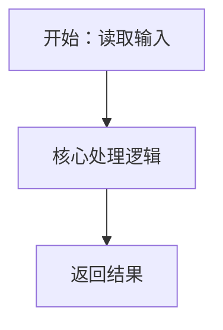

```python
import sys  # 提高递归深度上限（深输入防 RecursionError）

sys.setrecursionlimit(200000)  # 树/链表类题目节点数可达 1e4 量级
import random  # 引入依赖

class Solution:  # 定义类
    def __init__(self, nums):  # 构造函数：初始化成员
        self.nums = list(nums)  # 把 列表(数组) 写入 数组
        self.original = list(nums)  # 把 列表(数组) 写入 self.original

    def reset(self):  # 定义函数 reset（参数：self）
        self.nums = list(self.original)  # 把 列表(self.original) 写入 数组
        return self.nums  # 返回 self.数组

    def shuffle(self):  # 定义函数 shuffle（参数：self）
        shuffled = list(self.nums)  # 把 列表(self.数组) 存入 shuffled
        for i in range(len(shuffled) - 1, 0, -1):  # 让 下标 i 从 长度(shuffled) 减 1 倒数回去（每步减 1）
            j = random.randint(0, i)  # 把 random.randint(0, 下标 i) 存入 下标 j
            shuffled[i], shuffled[j] = (
                shuffled[j],
                shuffled[i],
            )  # 把 shuffled[下标 j], shuffled[下标 i] 写入 shuffled[i], shuffled[j]
        self.nums = shuffled  # 把 shuffled 写入 数组
        return self.nums  # 返回 self.数组

if __name__ == "__main__":  # 若 __name__ 等于 '__main__'
    s = Solution([1, 2, 3])  # 把 Solution([1, 2, 3]) 存入 字符串
    print("shuffle:", s.shuffle())  # 打印输出
    print("reset:", s.reset())  # 打印输出
```

#### 方案 2：Fisher-Yates（从前往后）

**思路与代码分析**：核心是「Fisher-Yates（从前往后）」。Python 版用切片与字典推导式简化操作，突出可读性。

**运行架构**：与方案 1 的控制流相同（同算法在该语言的等价实现），图见上。

```python
import sys  # 提高递归深度上限（深输入防 RecursionError）

sys.setrecursionlimit(200000)  # 树/链表类题目节点数可达 1e4 量级
import random  # 引入依赖

class Solution:  # 定义类
    def __init__(self, nums):  # 构造函数：初始化成员
        self.nums = list(nums)  # 把 列表(数组) 写入 数组
        self.original = list(nums)  # 把 列表(数组) 写入 self.original

    def reset(self):  # 定义函数 reset（参数：self）
        self.nums = list(self.original)  # 把 列表(self.original) 写入 数组
        return self.nums  # 返回 self.数组

    def shuffle(self):  # 定义函数 shuffle（参数：self）
        shuffled = list(self.nums)  # 把 列表(self.数组) 存入 shuffled
        for i in range(len(shuffled)):  # 让 下标 i 从 长度(shuffled 遍历
            j = random.randint(
                i, len(shuffled) - 1
            )  # 把 random.randint(下标 i, 长度(shuffled) 减 1) 存入 下标 j
            shuffled[i], shuffled[j] = (
                shuffled[j],
                shuffled[i],
            )  # 把 shuffled[下标 j], shuffled[下标 i] 写入 shuffled[i], shuffled[j]
        self.nums = shuffled  # 把 shuffled 写入 数组
        return self.nums  # 返回 self.数组

if __name__ == "__main__":  # 若 __name__ 等于 '__main__'
    s = Solution([1, 2, 3])  # 把 Solution([1, 2, 3]) 存入 字符串
    print("shuffle:", s.shuffle())  # 打印输出
    print("reset:", s.reset())  # 打印输出
```

### Go 实现（2 种方案）

Go 的全部方案如下，每个方案都内嵌用例自测，可独立运行（老仓库 python/go 文件遵循「打印结果」约定）：

#### 方案 1：Fisher-Yates（从后往前）

**思路与代码分析**：核心是「Fisher-Yates（从后往前）」。Go 版用切片与多返回值惯用法，显式处理索引边界。**走读**：方案 1 · Fisher-Yates（从后往前）：开始 → 更新 : → 处理 nums: make([]int, len(nu → 处理 original: make([]int, len(nu → 调用 copy(s.nums, nums) → 调用 copy(s.original, nums) → 返回 s。

**运行架构**（真实控制流）：

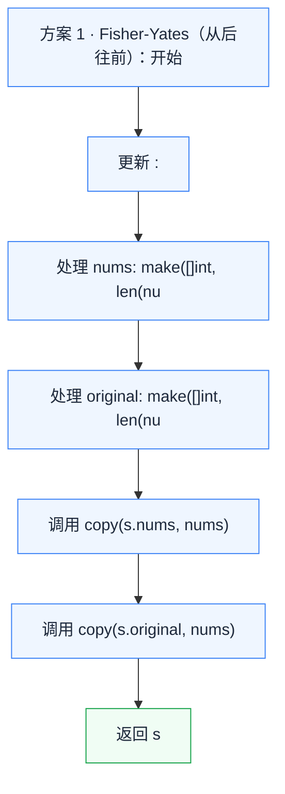

```go
package main // 引入依赖

import (
	"fmt"       // 「fmt」
	"math/rand" // 「math 除以 rand」
	"os"        // 「os」
	"reflect"   // 「reflect」
	"sort"      // 「sort」
)

type Solution struct { // 定义类型
	nums     []int // 数组 []int
	original []int // original []int
}

func Constructor(nums []int) *Solution { // 定义函数/方法 Constructor
	s := &Solution{ // 把 按位与 Solution{ 写入 s :
		nums:     make([]int, len(nums)),
		original: make([]int, len(nums)),
	}
	copy(s.nums, nums)     // copy(字符串.数组, 数组)
	copy(s.original, nums) // copy(字符串.original, 数组)
	return s               // 返回 字符串
}

func (this *Solution) Reset() []int { // 定义函数/方法 Reset
	copy(this.nums, this.original) // copy(this.数组, this.original)
	return this.nums               // 返回 this.数组
}

func (this *Solution) Shuffle() []int { // 定义函数/方法 Shuffle
	shuffled := make([]int, len(this.nums))  // 把 make([]int, 长度(this.数组)) 写入 shuffled :
	copy(shuffled, this.nums)                // copy(shuffled, this.数组)
	for i := len(shuffled) - 1; i > 0; i-- { // 把 长度(shuffled) 减 1; 下标 i 超过 0; 下标 i 减一 { 写入 for i :
		j := rand.Intn(i + 1)                               // 把 rand.Intn(下标 i 加 1) 写入 j :
		shuffled[i], shuffled[j] = shuffled[j], shuffled[i] // 把 shuffled[下标 j], shuffled[下标 i] 写入 shuffled[i], shuffled[j]
	}
	this.nums = shuffled // 把 shuffled 写入 数组
	return this.nums     // 返回 this.数组
}

func isPermutation(a, b []int) bool { // 定义判定函数 isPermutation
	if len(a) != len(b) { // 定义函数/方法 len
		return false // 返回 false
	}
	sa := append([]int{}, a...)      // 把 append([]int{}, 数组...) 写入 sa :
	sb := append([]int{}, b...)      // 把 append([]int{}, b...) 写入 sb :
	sort.Ints(sa)                    // sort.Ints(sa)
	sort.Ints(sb)                    // sort.Ints(sb)
	return reflect.DeepEqual(sa, sb) // 返回 reflect.DeepEqual(sa, sb)
}

func main() { // 程序入口：跑内嵌自测用例
	s := Constructor([]int{1, 2, 3})        // 把 Constructor([]int{1, 2, 3}) 写入 s :
	ok := true                              // 把 true 写入 ok :
	sh := s.Shuffle()                       // 把 字符串.Shuffle() 写入 sh :
	if !isPermutation(sh, []int{1, 2, 3}) { // 若 取反 isPermutation(sh, []int{1, 2, 3}
		ok = false                                                         // 把 false 写入 ok
		fmt.Printf("FAIL Shuffle()=%v not a permutation of [1 2 3]\n", sh) // 打印输出
	}
	r := s.Reset()                             // 把 字符串.Reset() 写入 r :
	if !reflect.DeepEqual(r, []int{1, 2, 3}) { // 若 取反 reflect.DeepEqual(右指针, []int{1, 2, 3}
		ok = false                                      // 把 false 写入 ok
		fmt.Printf("FAIL Reset()=%v want [1 2 3]\n", r) // 打印输出
	}
	if !ok { // 若 取反 ok
		os.Exit(1) // os.Exit(1)
	}
	fmt.Println("PASS") // 全部用例通过，输出 PASS
}
```

#### 方案 2：Fisher-Yates（从前往后）

**思路与代码分析**：核心是「Fisher-Yates（从前往后）」。Go 版用切片与多返回值惯用法，显式处理索引边界。**走读**：方案 2 · Fisher-Yates（从前往后）：开始 → 更新 : → 处理 nums: make([]int, len(nu → 处理 original: make([]int, len(nu → 调用 copy(s.nums, nums) → 调用 copy(s.original, nums) → 返回 s。

**运行架构**（真实控制流）：

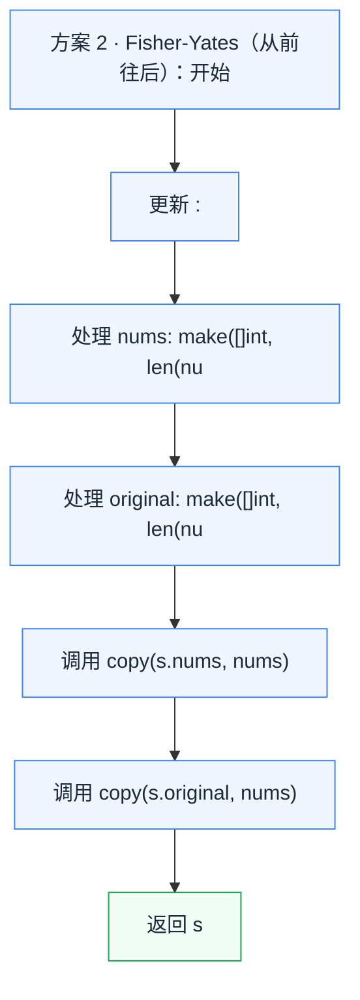

```go
package main // 引入依赖

import (
	"fmt"       // 「fmt」
	"math/rand" // 「math 除以 rand」
	"os"        // 「os」
	"reflect"   // 「reflect」
	"sort"      // 「sort」
)

type Solution struct { // 定义类型
	nums     []int // 数组 []int
	original []int // original []int
}

func Constructor(nums []int) *Solution { // 定义函数/方法 Constructor
	s := &Solution{ // 把 按位与 Solution{ 写入 s :
		nums:     make([]int, len(nums)),
		original: make([]int, len(nums)),
	}
	copy(s.nums, nums)     // copy(字符串.数组, 数组)
	copy(s.original, nums) // copy(字符串.original, 数组)
	return s               // 返回 字符串
}

func (this *Solution) Reset() []int { // 定义函数/方法 Reset
	copy(this.nums, this.original) // copy(this.数组, this.original)
	return this.nums               // 返回 this.数组
}

func (this *Solution) Shuffle() []int { // 定义函数/方法 Shuffle
	shuffled := make([]int, len(this.nums)) // 把 make([]int, 长度(this.数组)) 写入 shuffled :
	copy(shuffled, this.nums)               // copy(shuffled, this.数组)
	for i := 0; i < len(shuffled); i++ {    // 让 下标 i 从 0 开始计数
		j := i + rand.Intn(len(shuffled)-i)                 // 把 下标 i 加 rand.Intn(长度(shuffled) 减 下标 i) 写入 j :
		shuffled[i], shuffled[j] = shuffled[j], shuffled[i] // 把 shuffled[下标 j], shuffled[下标 i] 写入 shuffled[i], shuffled[j]
	}
	this.nums = shuffled // 把 shuffled 写入 数组
	return this.nums     // 返回 this.数组
}

func isPermutation(a, b []int) bool { // 定义判定函数 isPermutation
	if len(a) != len(b) { // 定义函数/方法 len
		return false // 返回 false
	}
	sa := append([]int{}, a...)      // 把 append([]int{}, 数组...) 写入 sa :
	sb := append([]int{}, b...)      // 把 append([]int{}, b...) 写入 sb :
	sort.Ints(sa)                    // sort.Ints(sa)
	sort.Ints(sb)                    // sort.Ints(sb)
	return reflect.DeepEqual(sa, sb) // 返回 reflect.DeepEqual(sa, sb)
}

func main() { // 程序入口：跑内嵌自测用例
	s := Constructor([]int{1, 2, 3})        // 把 Constructor([]int{1, 2, 3}) 写入 s :
	ok := true                              // 把 true 写入 ok :
	sh := s.Shuffle()                       // 把 字符串.Shuffle() 写入 sh :
	if !isPermutation(sh, []int{1, 2, 3}) { // 若 取反 isPermutation(sh, []int{1, 2, 3}
		ok = false                                                         // 把 false 写入 ok
		fmt.Printf("FAIL Shuffle()=%v not a permutation of [1 2 3]\n", sh) // 打印输出
	}
	r := s.Reset()                             // 把 字符串.Reset() 写入 r :
	if !reflect.DeepEqual(r, []int{1, 2, 3}) { // 若 取反 reflect.DeepEqual(右指针, []int{1, 2, 3}
		ok = false                                      // 把 false 写入 ok
		fmt.Printf("FAIL Reset()=%v want [1 2 3]\n", r) // 打印输出
	}
	if !ok { // 若 取反 ok
		os.Exit(1) // os.Exit(1)
	}
	fmt.Println("PASS") // 全部用例通过，输出 PASS
}
```

### Java 实现（2 种方案）

Java 的全部方案如下，每个方案都内嵌用例自测，可独立运行（老仓库 python/go 文件遵循「打印结果」约定）：

#### 方案 1：Fisher-Yates（从后往前）

**思路与代码分析**：核心是「Fisher-Yates（从后往前）」。Java 版用类与静态方法组织，集合操作显式明了。**走读**：方案 1 · Fisher-Yates（从后往前）：开始 → 更新 this.nums → 更新 this.original → 更新 rnd → 返回结果。

**运行架构**（真实控制流）：


```java
package com.webfault.dsa; // 引入依赖

import java.util.*; // 引入依赖

class lc384_solution111 { // 定义类型
  private int[] nums; // private int[] 数组;
  private int[] original; // private int[] original;
  private Random rnd; // private Random rnd;

  public lc384_solution111(int[] nums) { // 定义函数/方法 lc384_solution111
    this.nums = nums.clone(); // 把 数组.clone(); 写入 数组
    this.original = nums.clone(); // 把 数组.clone(); 写入 this.original
    rnd = new Random(); // 把 new Random(); 写入 rnd
  }

  public int[] reset() { // 定义函数/方法 reset
    this.nums = original.clone(); // 把 original.clone(); 写入 数组
    return this.nums; // 返回 this.数组
  }

  public int[] shuffle() { // 定义函数/方法 shuffle
    int[] a = this.nums.clone(); // 把 this.数组.clone(); 写入 int[] a
    for (int i = a.length - 1; i > 0; i--) { // 让 下标 i 从 数组.长度 减 1 开始计数，下标 i 超过 0 就继续
      int j = rnd.nextInt(i + 1); // 把 rnd.nextInt(下标 i 加 1) 存入 下标 j
      int t = a[i];
      a[i] = a[j];
      a[j] = t;
    }
    this.nums = a; // 把 数组; 写入 数组
    return this.nums; // 返回 this.数组
  }

  public static void main(String[] args) { // public static void main(String[] args) {
    lc384_solution111 s = new lc384_solution111(new int[] {1, 2, 3});
    int[] r = s.reset(); // 把 字符串.reset(); 写入 int[] r
    if (!(r[0] == 1 && r[1] == 2 && r[2] == 3)) throw new RuntimeException("FAILED reset");
    int[] sh = s.shuffle(); // 把 字符串.shuffle(); 写入 int[] sh
    int[] sorted = sh.clone(); // 把 sh.clone(); 写入 int[] sorted
    Arrays.sort(sorted); // 排序
    if (!(sorted[0] == 1 && sorted[1] == 2 && sorted[2] == 3))
      throw new RuntimeException("FAILED shuffle");
    int[] r2 = s.reset(); // 把 字符串.reset(); 写入 int[] r2
    if (!(r2[0] == 1 && r2[1] == 2 && r2[2] == 3)) throw new RuntimeException("FAILED reset2");
    System.out.println("PASS"); // 全部用例通过，输出 PASS
  }
}
```

#### 方案 2：Fisher-Yates（从前往后）

**思路与代码分析**：核心是「Fisher-Yates（从前往后）」。Java 版用类与静态方法组织，集合操作显式明了。**走读**：方案 2 · Fisher-Yates（从前往后）：开始 → 更新 this.nums → 更新 this.original → 更新 rnd → 返回结果。

**运行架构**（真实控制流）：

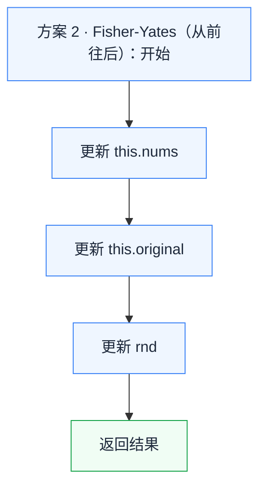

```java
package com.webfault.dsa; // 引入依赖

import java.util.*; // 引入依赖

class solution222FisherYates { // 定义类型
  private int[] nums; // private int[] 数组;
  private int[] original; // private int[] original;
  private Random rnd; // private Random rnd;

  public solution222FisherYates(int[] nums) { // 定义函数/方法 solution222FisherYates
    this.nums = nums.clone(); // 把 数组.clone(); 写入 数组
    this.original = nums.clone(); // 把 数组.clone(); 写入 this.original
    rnd = new Random(); // 把 new Random(); 写入 rnd
  }

  public int[] reset() { // 定义函数/方法 reset
    this.nums = original.clone(); // 把 original.clone(); 写入 数组
    return this.nums; // 返回 this.数组
  }

  public int[] shuffle() { // 定义函数/方法 shuffle
    int[] a = this.nums.clone(); // 把 this.数组.clone(); 写入 int[] a
    for (int i = 0; i < a.length; i++) { // 让 下标 i 从 0 开始计数，下标 i 小于 数组.长度 就继续
      int j = rnd.nextInt(a.length - i) + i; // 把 rnd.nextInt(数组.长度 减 下标 i) 加 下标 i 存入 下标 j
      int t = a[i];
      a[i] = a[j];
      a[j] = t;
    }
    this.nums = a; // 把 数组; 写入 数组
    return this.nums; // 返回 this.数组
  }

  public static void main(String[] args) { // public static void main(String[] args) {
    solution222FisherYates s = new solution222FisherYates(new int[] {1, 2, 3});
    int[] r = s.reset(); // 把 字符串.reset(); 写入 int[] r
    if (!(r[0] == 1 && r[1] == 2 && r[2] == 3)) throw new RuntimeException("FAILED reset");
    int[] sh = s.shuffle(); // 把 字符串.shuffle(); 写入 int[] sh
    int[] sorted = sh.clone(); // 把 sh.clone(); 写入 int[] sorted
    Arrays.sort(sorted); // 排序
    if (!(sorted[0] == 1 && sorted[1] == 2 && sorted[2] == 3))
      throw new RuntimeException("FAILED shuffle");
    System.out.println("PASS"); // 全部用例通过，输出 PASS
  }
}
```

### Rust 实现（2 种方案）

Rust 的全部方案如下，每个方案都内嵌用例自测，可独立运行（老仓库 python/go 文件遵循「打印结果」约定）：

#### 方案 1：Fisher-Yates（从后往前）

**思路与代码分析**：核心是「Fisher-Yates（从后往前）」。Rust 版用所有权移动与切片借用改写同一逻辑，注意 Option 与引用边界。**走读**：方案 1 · Fisher-Yates（从后往前）：开始 → 计算 v → 遍历 (1..v.len()).rev() 中的每个元素 i → 调用 v.swap(i, 0) → 处理 v → 返回结果。

**运行架构**（真实控制流）：

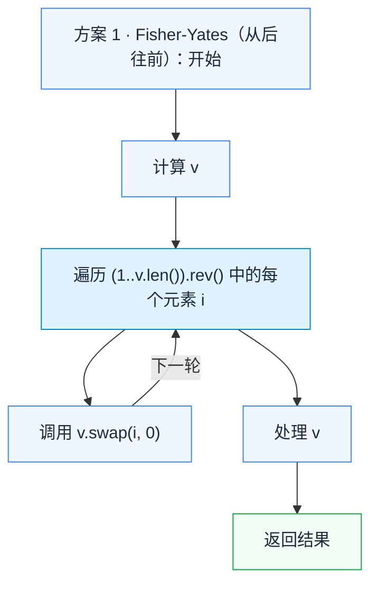

```rust
// LeetCode 384. 打乱数组 — Rust 版（方案1）
fn shuffle_deterministic(vals: &[i32]) -> Vec<i32> {
    // 定义函数/方法 shuffle_deterministic
    // Fisher-Yates（确定性：从后往前）
    let mut v = vals.to_vec(); // 把 vals.to_vec(); 写入 let mut v
    for i in (1..v.len()).rev() {
        // for 下标 i in (1..值.长度()).rev() {
        v.swap(i, 0); // 值.交换 下标 i, 0);
    }
    v
}
fn main() {
    // 程序入口：跑内嵌自测用例
    let orig = vec![1, 2, 3]; // 把 vec取反 [1, 2, 3] 存入 orig
    let shuffled = shuffle_deterministic(&orig); // 把 shuffle_deterministic( 按位与 orig) 存入 shuffled
    assert_eq!(orig.len(), shuffled.len()); // 断言校验
    let mut s = shuffled.clone(); // 把 shuffled.clone(); 写入 let mut s
    s.sort(); // 排序
    assert_eq!(s, orig); // 断言校验
    println!("PASS");
} // 全部用例通过，输出 PASS
```

#### 方案 2：Fisher-Yates（从前往后）

**思路与代码分析**：核心是「Fisher-Yates（从前往后）」。Rust 版用所有权移动与切片借用改写同一逻辑，注意 Option 与引用边界。**走读**：方案 2 · Fisher-Yates（从前往后）：开始 → 计算 v → 遍历 (1..v.len()).rev() 中的每个元素 i → 调用 v.swap(i, 0) → 处理 v → 返回结果。

**运行架构**（真实控制流）：


```rust
// LeetCode 384. 打乱数组 — Rust 版（方案2）
fn shuffle_deterministic(vals: &[i32]) -> Vec<i32> {
    // 定义函数/方法 shuffle_deterministic
    // Fisher-Yates（确定性：从后往前）
    let mut v = vals.to_vec(); // 把 vals.to_vec(); 写入 let mut v
    for i in (1..v.len()).rev() {
        // for 下标 i in (1..值.长度()).rev() {
        v.swap(i, 0); // 值.交换 下标 i, 0);
    }
    v
}
fn main() {
    // 程序入口：跑内嵌自测用例
    let orig = vec![1, 2, 3]; // 把 vec取反 [1, 2, 3] 存入 orig
    let shuffled = shuffle_deterministic(&orig); // 把 shuffle_deterministic( 按位与 orig) 存入 shuffled
    assert_eq!(orig.len(), shuffled.len()); // 断言校验
    let mut s = shuffled.clone(); // 把 shuffled.clone(); 写入 let mut s
    s.sort(); // 排序
    assert_eq!(s, orig); // 断言校验
    println!("PASS");
} // 全部用例通过，输出 PASS
```

### Lua 实现（2 种方案）

Lua 的全部方案如下，每个方案都内嵌用例自测，可独立运行（老仓库 python/go 文件遵循「打印结果」约定）：

#### 方案 1：Fisher-Yates（从后往前）

**思路与代码分析**：核心是「Fisher-Yates（从后往前）」。Lua 版用表与 ipairs 遍历，注意 ipairs 遇 nil 即停的语义。代码里依次做这些事：先排序再处理。

**运行架构**（真实控制流）：

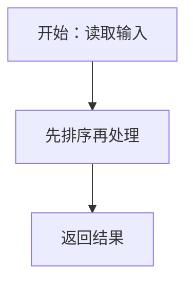

```lua
-- LeetCode 384. 打乱数组 — Lua 版（方案1）
local ShuffleArray = {} -- 把 {} 写入 local ShuffleArray
ShuffleArray.__index = ShuffleArray -- 把 ShuffleArray 写入 ShuffleArray.__index
function ShuffleArray.new(vals)
	return setmetatable({ orig = { table.unpack(vals) }, cur = { table.unpack(vals) } }, ShuffleArray)
end
function ShuffleArray:reset() -- function ShuffleArray:reset()
	self.cur = { table.unpack(self.orig) } -- 把 {table.unpack(self.orig)} 写入 当前值
	return self.cur -- 返回 self.当前值
end -- 终点
function ShuffleArray:shuffle() -- function ShuffleArray:shuffle()
	local n = #self.cur -- 把 #self.当前值 写入 local n
	for i = n, 2, -1 do -- 把 元素个数, 2, 减 1 do 写入 for i
		local j = math.random(i) -- 把 math.random(下标 i) 写入 local j
		self.cur[i], self.cur[j] = self.cur[j], self.cur[i] -- 把 self.当前值[下标 j], self.当前值[下标 i] 写入 self.cur[i], self.cur[j]
	end -- 终点
	return self.cur -- 返回 self.当前值
end -- 终点
math.randomseed(42) -- math.randomseed(42)
local sa = ShuffleArray.new({ 1, 2, 3 }) -- 把 ShuffleArray.new({1, 2, 3}) 写入 local sa
local sh = sa:shuffle() -- 把 sa:shuffle() 写入 local sh
table.sort(sh) -- 排序
assert(table.concat(sh, ",") == "1,2,3") -- 打印输出
local r = sa:reset() -- 把 sa:reset() 写入 local r
assert(table.concat(r, ",") == "1,2,3") -- 打印输出
print("PASS") -- 全部用例通过，输出 PASS
```

#### 方案 2：Fisher-Yates（从前往后）

**思路与代码分析**：核心是「Fisher-Yates（从前往后）」。Lua 版用表与 ipairs 遍历，注意 ipairs 遇 nil 即停的语义。代码里依次做这些事：先排序再处理。

**运行架构**：与方案 1 的控制流相同（同算法在该语言的等价实现），图见上。

```lua
-- LeetCode 384. 打乱数组 — Lua 版（方案2）
local ShuffleArray = {} -- 把 {} 写入 local ShuffleArray
ShuffleArray.__index = ShuffleArray -- 把 ShuffleArray 写入 ShuffleArray.__index
function ShuffleArray.new(vals)
	return setmetatable({ orig = { table.unpack(vals) }, cur = { table.unpack(vals) } }, ShuffleArray)
end
function ShuffleArray:reset() -- function ShuffleArray:reset()
	self.cur = { table.unpack(self.orig) } -- 把 {table.unpack(self.orig)} 写入 当前值
	return self.cur -- 返回 self.当前值
end -- 终点
function ShuffleArray:shuffle() -- function ShuffleArray:shuffle()
	local n = #self.cur -- 把 #self.当前值 写入 local n
	for i = n, 2, -1 do -- 把 元素个数, 2, 减 1 do 写入 for i
		local j = math.random(i) -- 把 math.random(下标 i) 写入 local j
		self.cur[i], self.cur[j] = self.cur[j], self.cur[i] -- 把 self.当前值[下标 j], self.当前值[下标 i] 写入 self.cur[i], self.cur[j]
	end -- 终点
	return self.cur -- 返回 self.当前值
end -- 终点
math.randomseed(42) -- math.randomseed(42)
local sa = ShuffleArray.new({ 1, 2, 3 }) -- 把 ShuffleArray.new({1, 2, 3}) 写入 local sa
local sh = sa:shuffle() -- 把 sa:shuffle() 写入 local sh
table.sort(sh) -- 排序
assert(table.concat(sh, ",") == "1,2,3") -- 打印输出
local r = sa:reset() -- 把 sa:reset() 写入 local r
assert(table.concat(r, ",") == "1,2,3") -- 打印输出
print("PASS") -- 全部用例通过，输出 PASS
```

### C 实现（2 种方案）

C 的全部方案如下，每个方案都内嵌用例自测，可独立运行（老仓库 python/go 文件遵循「打印结果」约定）：

#### 方案 1：Fisher-Yates（从后往前）

**思路与代码分析**：核心是「Fisher-Yates（从后往前）」。C 版手动管理下标与内存，循环边界全部显式写出。代码里依次做这些事：单循环线性扫描。**走读**：方案 1 · Fisher-Yates（从后往前）：开始 → 更新 s->n → 遍历循环 → 更新 s->orig[i] → 更新 s->cur[i] → 返回结果。

**运行架构**（真实控制流）：

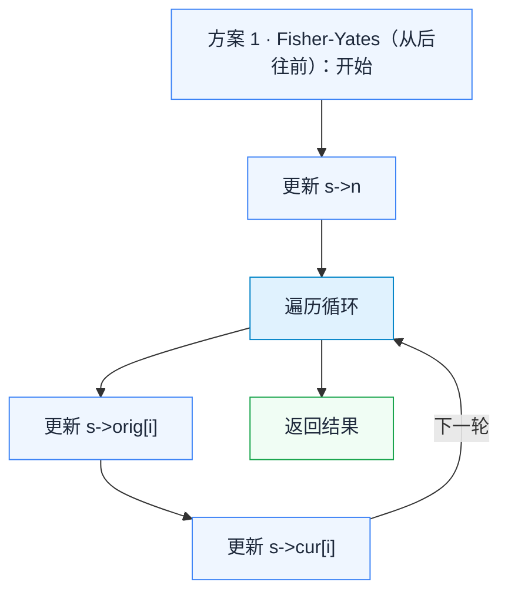

```c
/* LeetCode 384. 打乱数组 — C 版（方案1） */
#include <stdio.h>  // 引入头文件
#include <stdlib.h> // 引入头文件
typedef struct {
    int orig[4096];
    int cur[4096];
    int n;
} ShuffleArray;
static void sa_init(ShuffleArray *s, const int *vals, int n) { // 定义函数/方法 sa_init
    s->n = n;                                                  // 把 元素个数; 写入 s->n
    for (int i = 0; i < n; i++) {
        s->orig[i] = vals[i];
        s->cur[i] = vals[i];
    } // 让 下标 i 从 0 开始计数，下标 i 小于 元素个数 就继续
}
static int *sa_reset(ShuffleArray *s) { // static int 乘 sa_reset(ShuffleArray 乘 字符串) {
    for (int i = 0; i < s->n; i++)
        s->cur[i] = s->orig[i]; // 让 下标 i 从 0 开始计数，下标 i 小于 字符串 减 超过 元素个数 就继续
    return s->cur; // 返回 字符串 减 超过 当前值
}
static int *sa_shuffle(ShuffleArray *s) { // static int 乘 sa_shuffle(ShuffleArray 乘 字符串) {
    for (int i = s->n - 1; i > 0;
         i--) { // 让 下标 i 从 字符串 减 超过 元素个数 减 1 开始计数，下标 i 超过 0 就继续
        int j = 0; /* 确定性：j=0 */ // 把 0; 除以 乘 确定性：下标 j 赋值为 0 乘 除以 存入 下标 j
        int t = s->cur[i];
        s->cur[i] = s->cur[j];
        s->cur[j] = t;
    }
    return s->cur; // 返回 字符串 减 超过 当前值
}
static int is_perm(const int *a, const int *b, int n) { // 定义判定函数 is_perm
    int ca[4096], cb[4096];                             // int ca[4096], cb[4096];
    for (int i = 0; i < n; i++) {
        ca[i] = a[i];
        cb[i] = b[i];
    } // 让 下标 i 从 0 开始计数，下标 i 小于 元素个数 就继续
    for (int i = 0; i < n; i++)
        for (int j = i + 1; j < n; j++) { // 让 下标 i 从 0 开始计数，下标 i 小于 元素个数 就继续
            if (ca[i] > ca[j]) {
                int t = ca[i];
                ca[i] = ca[j];
                ca[j] = t;
            }
            if (cb[i] > cb[j]) {
                int t = cb[i];
                cb[i] = cb[j];
                cb[j] = t;
            }
        }
    for (int i = 0; i < n; i++)
        if (ca[i] != cb[i])
            return 0; // 让 下标 i 从 0 开始计数，下标 i 小于 元素个数 就继续
    return 1;         // 返回 1
}
int main(void) {                      // 程序入口：跑内嵌自测用例
    ShuffleArray s;                   // ShuffleArray 字符串;
    sa_init(&s, (int[]){1, 2, 3}, 3); // sa_init( 按位与 字符串, (int[]){1,2,3}, 3);
    int *sh = sa_shuffle(&s);         // 把 sa_shuffle( 按位与 字符串); 写入 int *sh
    if (!is_perm(sh, s.orig, 3)) {
        printf("FAIL 1\n");
        return 1;
    }                      // 若 取反 is_perm(sh, 字符串.orig, 3)) { 输出「FAIL 1 」); return 1; }
    int *r = sa_reset(&s); // 把 sa_reset( 按位与 字符串); 写入 int *r
    if (!(r[0] == 1 && r[1] == 2 && r[2] == 3)) {
        printf("FAIL 2\n");
        return 1;
    }
    printf("PASS\n");
    return 0;
} // 全部用例通过，输出 PASS
```

#### 方案 2：Fisher-Yates（从前往后）

**思路与代码分析**：核心是「Fisher-Yates（从前往后）」。C 版手动管理下标与内存，循环边界全部显式写出。代码里依次做这些事：单循环线性扫描。**走读**：方案 2 · Fisher-Yates（从前往后）：开始 → 更新 s->n → 遍历循环 → 更新 s->orig[i] → 更新 s->cur[i] → 返回结果。

**运行架构**（真实控制流）：


```c
/* LeetCode 384. 打乱数组 — C 版（方案2） */
#include <stdio.h>  // 引入头文件
#include <stdlib.h> // 引入头文件
typedef struct {
    int orig[4096];
    int cur[4096];
    int n;
} ShuffleArray;
static void sa_init(ShuffleArray *s, const int *vals, int n) { // 定义函数/方法 sa_init
    s->n = n;                                                  // 把 元素个数; 写入 s->n
    for (int i = 0; i < n; i++) {
        s->orig[i] = vals[i];
        s->cur[i] = vals[i];
    } // 让 下标 i 从 0 开始计数，下标 i 小于 元素个数 就继续
}
static int *sa_reset(ShuffleArray *s) { // static int 乘 sa_reset(ShuffleArray 乘 字符串) {
    for (int i = 0; i < s->n; i++)
        s->cur[i] = s->orig[i]; // 让 下标 i 从 0 开始计数，下标 i 小于 字符串 减 超过 元素个数 就继续
    return s->cur; // 返回 字符串 减 超过 当前值
}
static int *sa_shuffle(ShuffleArray *s) { // static int 乘 sa_shuffle(ShuffleArray 乘 字符串) {
    for (int i = s->n - 1; i > 0;
         i--) { // 让 下标 i 从 字符串 减 超过 元素个数 减 1 开始计数，下标 i 超过 0 就继续
        int j = 0; /* 确定性：j=0 */ // 把 0; 除以 乘 确定性：下标 j 赋值为 0 乘 除以 存入 下标 j
        int t = s->cur[i];
        s->cur[i] = s->cur[j];
        s->cur[j] = t;
    }
    return s->cur; // 返回 字符串 减 超过 当前值
}
static int is_perm(const int *a, const int *b, int n) { // 定义判定函数 is_perm
    int ca[4096], cb[4096];                             // int ca[4096], cb[4096];
    for (int i = 0; i < n; i++) {
        ca[i] = a[i];
        cb[i] = b[i];
    } // 让 下标 i 从 0 开始计数，下标 i 小于 元素个数 就继续
    for (int i = 0; i < n; i++)
        for (int j = i + 1; j < n; j++) { // 让 下标 i 从 0 开始计数，下标 i 小于 元素个数 就继续
            if (ca[i] > ca[j]) {
                int t = ca[i];
                ca[i] = ca[j];
                ca[j] = t;
            }
            if (cb[i] > cb[j]) {
                int t = cb[i];
                cb[i] = cb[j];
                cb[j] = t;
            }
        }
    for (int i = 0; i < n; i++)
        if (ca[i] != cb[i])
            return 0; // 让 下标 i 从 0 开始计数，下标 i 小于 元素个数 就继续
    return 1;         // 返回 1
}
int main(void) {                      // 程序入口：跑内嵌自测用例
    ShuffleArray s;                   // ShuffleArray 字符串;
    sa_init(&s, (int[]){1, 2, 3}, 3); // sa_init( 按位与 字符串, (int[]){1,2,3}, 3);
    int *sh = sa_shuffle(&s);         // 把 sa_shuffle( 按位与 字符串); 写入 int *sh
    if (!is_perm(sh, s.orig, 3)) {
        printf("FAIL 1\n");
        return 1;
    }                      // 若 取反 is_perm(sh, 字符串.orig, 3)) { 输出「FAIL 1 」); return 1; }
    int *r = sa_reset(&s); // 把 sa_reset( 按位与 字符串); 写入 int *r
    if (!(r[0] == 1 && r[1] == 2 && r[2] == 3)) {
        printf("FAIL 2\n");
        return 1;
    }
    printf("PASS\n");
    return 0;
} // 全部用例通过，输出 PASS
```

### C++ 实现（2 种方案）

C++ 的全部方案如下，每个方案都内嵌用例自测，可独立运行（老仓库 python/go 文件遵循「打印结果」约定）：

#### 方案 1：Fisher-Yates（从后往前）

**思路与代码分析**：核心是「Fisher-Yates（从后往前）」。C++ 版用 STL 容器与迭代器，减少手写下标错误。**走读**：方案 1 · Fisher-Yates（从后往前）：开始 → 更新 cur → 返回 cur。

**运行架构**（真实控制流）：


```cpp
// LeetCode 384. 打乱数组 — C++ 版（方案1）
#include <algorithm>            // 引入头文件
#include <cassert>              // 引入头文件
#include <iostream>             // 引入头文件
#include <vector>               // 引入头文件
struct ShuffleArray {           // 定义类型
    std::vector<int> orig, cur; // std::vector 小于 int 超过 orig, 当前值;
    explicit ShuffleArray(const std::vector<int> &vals) : orig(vals), cur(vals) {}
    std::vector<int> reset() {
        cur = orig;
        return cur;
    }                            // 把 orig; return 当前值; } 写入 std::vector<int> reset() { cur
    std::vector<int> shuffle() { // std::vector 小于 int 超过 shuffle() {
        for (size_t i = cur.size(); i > 1; --i) { // 让 下标 i 从 当前值.大小() 开始计数，下标 i 超过 1 就继续
            std::swap(cur[i - 1], cur[0]); // 交换 当前值[下标 i 减 1] 与 当前值[0]
        }
        return cur; // 返回 当前值
    }
};
int main() {                                         // 程序入口：跑内嵌自测用例
    ShuffleArray s({1, 2, 3});                       // ShuffleArray 字符串({1, 2, 3});
    auto sh = s.shuffle();                           // 把 字符串.shuffle() 存入 sh
    auto sortedSh = sh;                              // 把 sh 存入 sortedSh
    std::sort(sortedSh.begin(), sortedSh.end());     // std::sort(sortedSh 迭代位置 , sortedSh.终点());
    assert((sortedSh == std::vector<int>{1, 2, 3})); // 断言校验
    auto r = s.reset();                              // 把 字符串.reset() 存入 右指针
    assert((r == std::vector<int>{1, 2, 3}));        // 断言校验
    std::cout << "PASS" << std::endl;
} // 全部用例通过，输出 PASS
```

#### 方案 2：Fisher-Yates（从前往后）

**思路与代码分析**：核心是「Fisher-Yates（从前往后）」。C++ 版用 STL 容器与迭代器，减少手写下标错误。**走读**：方案 2 · Fisher-Yates（从前往后）：开始 → 更新 cur → 返回 cur。

**运行架构**（真实控制流）：

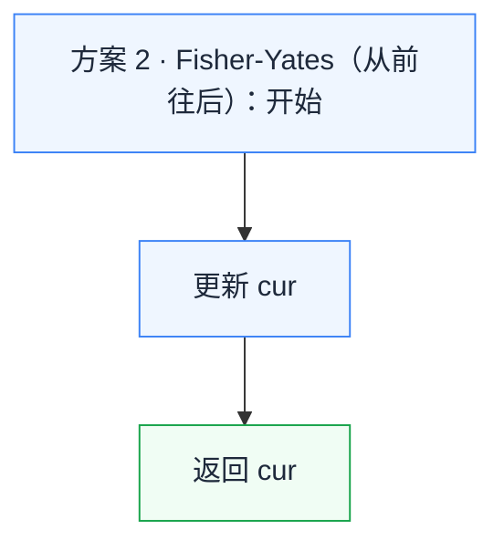

```cpp
// LeetCode 384. 打乱数组 — C++ 版（方案2）
#include <algorithm>            // 引入头文件
#include <cassert>              // 引入头文件
#include <iostream>             // 引入头文件
#include <vector>               // 引入头文件
struct ShuffleArray {           // 定义类型
    std::vector<int> orig, cur; // std::vector 小于 int 超过 orig, 当前值;
    explicit ShuffleArray(const std::vector<int> &vals) : orig(vals), cur(vals) {}
    std::vector<int> reset() {
        cur = orig;
        return cur;
    }                            // 把 orig; return 当前值; } 写入 std::vector<int> reset() { cur
    std::vector<int> shuffle() { // std::vector 小于 int 超过 shuffle() {
        for (size_t i = cur.size(); i > 1; --i) { // 让 下标 i 从 当前值.大小() 开始计数，下标 i 超过 1 就继续
            std::swap(cur[i - 1], cur[0]); // 交换 当前值[下标 i 减 1] 与 当前值[0]
        }
        return cur; // 返回 当前值
    }
};
int main() {                                         // 程序入口：跑内嵌自测用例
    ShuffleArray s({1, 2, 3});                       // ShuffleArray 字符串({1, 2, 3});
    auto sh = s.shuffle();                           // 把 字符串.shuffle() 存入 sh
    auto sortedSh = sh;                              // 把 sh 存入 sortedSh
    std::sort(sortedSh.begin(), sortedSh.end());     // std::sort(sortedSh 迭代位置 , sortedSh.终点());
    assert((sortedSh == std::vector<int>{1, 2, 3})); // 断言校验
    auto r = s.reset();                              // 把 字符串.reset() 存入 右指针
    assert((r == std::vector<int>{1, 2, 3}));        // 断言校验
    std::cout << "PASS" << std::endl;
} // 全部用例通过，输出 PASS
```

### R 实现（2 种方案）

R 的全部方案如下，每个方案都内嵌用例自测，可独立运行（老仓库 python/go 文件遵循「打印结果」约定）：

#### 方案 1：Fisher-Yates（从后往前）

**思路与代码分析**：核心是「Fisher-Yates（从后往前）」。R 版用向量化思维与 1 起始下标，注意 1:n 的降序陷阱。代码里依次做这些事：单循环线性扫描。**走读**：方案 1 · Fisher-Yates（从后往前）：开始 → 更新 new.env(parent → 循环 i：遍历 n:2 → 返回结果。

**运行架构**（真实控制流）：

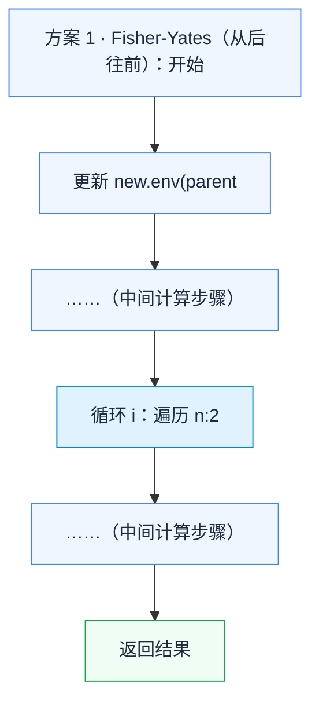

```r
# 版（方案1） 定义函数 ShuffleArray（参数：vals）
ShuffleArray <- function(vals) {
    e <- new.env(parent = emptyenv())  # 把 new.env(parent 赋值为 emptyenv()) 存入 e
    e$orig <- vals
    e$cur <- vals  # 把 vals; e$当前值 小于 减 vals 存入 e$orig
    e$reset <- function() {
        e$cur <<- e$orig
        e$cur
    }  # 把 function() { e$当前值 小于 小于 减 e$orig; e$当前值 } 存入 e$reset
    e$shuffle <- function() {
        # 把 function() { 存入 e$shuffle
        n <- length(e$cur)  # 把 长度(e$当前值) 存入 元素个数
        for (i in n:2) {
            # for (下标 i in 元素个数:2) {
            j <- sample(i, 1L)  # 把 sample(下标 i, 1L) 存入 下标 j
            t <- e$cur[i]
            e$cur[i] <- e$cur[j]
            e$cur[j] <- t
        }
        e$cur  # e$当前值
    }
    e
}
set.seed(42)  # set.seed(42)
sa <- ShuffleArray(c(1L, 2L, 3L))  # 把 ShuffleArray(字符(1L, 2L, 3L)) 存入 sa
sh <- sa$shuffle()  # 把 sa$shuffle() 存入 sh
stopifnot(identical(sort(sh), c(1L, 2L, 3L)))  # 断言校验
r <- sa$reset()  # 把 sa$reset() 存入 右指针
stopifnot(identical(r, c(1L, 2L, 3L)))  # 断言校验
cat("PASS\n")  # 全部用例通过，输出 PASS
```

#### 方案 2：Fisher-Yates（从前往后）

**思路与代码分析**：核心是「Fisher-Yates（从前往后）」。R 版用向量化思维与 1 起始下标，注意 1:n 的降序陷阱。代码里依次做这些事：单循环线性扫描。**走读**：方案 2 · Fisher-Yates（从前往后）：开始 → 更新 new.env(parent → 循环 i：遍历 n:2 → 返回结果。

**运行架构**（真实控制流）：

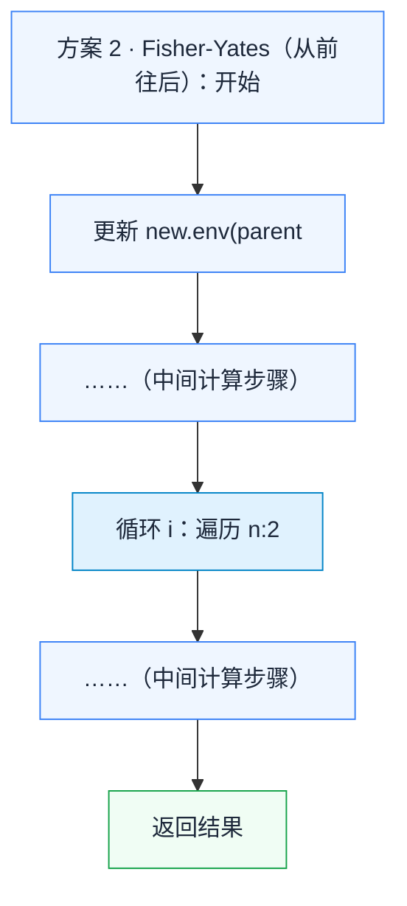

```r
# 版（方案2） 定义函数 ShuffleArray（参数：vals）
ShuffleArray <- function(vals) {
    e <- new.env(parent = emptyenv())  # 把 new.env(parent 赋值为 emptyenv()) 存入 e
    e$orig <- vals
    e$cur <- vals  # 把 vals; e$当前值 小于 减 vals 存入 e$orig
    e$reset <- function() {
        e$cur <<- e$orig
        e$cur
    }  # 把 function() { e$当前值 小于 小于 减 e$orig; e$当前值 } 存入 e$reset
    e$shuffle <- function() {
        # 把 function() { 存入 e$shuffle
        n <- length(e$cur)  # 把 长度(e$当前值) 存入 元素个数
        for (i in n:2) {
            # for (下标 i in 元素个数:2) {
            j <- sample(i, 1L)  # 把 sample(下标 i, 1L) 存入 下标 j
            t <- e$cur[i]
            e$cur[i] <- e$cur[j]
            e$cur[j] <- t
        }
        e$cur  # e$当前值
    }
    e
}
set.seed(42)  # set.seed(42)
sa <- ShuffleArray(c(1L, 2L, 3L))  # 把 ShuffleArray(字符(1L, 2L, 3L)) 存入 sa
sh <- sa$shuffle()  # 把 sa$shuffle() 存入 sh
stopifnot(identical(sort(sh), c(1L, 2L, 3L)))  # 断言校验
r <- sa$reset()  # 把 sa$reset() 存入 右指针
stopifnot(identical(r, c(1L, 2L, 3L)))  # 断言校验
cat("PASS\n")  # 全部用例通过，输出 PASS
```

### Zig 实现（2 种方案）

Zig 的全部方案如下，每个方案都内嵌用例自测，可独立运行（老仓库 python/go 文件遵循「打印结果」约定）：

#### 方案 1：Fisher-Yates（从后往前）

**思路与代码分析**：核心是「Fisher-Yates（从后往前）」。Zig 版显式分配与清零，整型边界处理严格。**走读**：方案 1 · Fisher-Yates（从后往前）：开始 → 返回 .。

**运行架构**（真实控制流）：

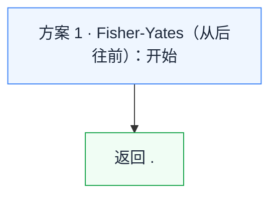

```zig
// LeetCode 384. 打乱数组 — Zig 版（方案1）
const std = @import("std"); // 把 @import(「std」) 存入 std
const ShuffleArray = struct { // 把 struct { 存入 ShuffleArray
    orig: []i32,
    cur: []i32,
    fn init(alloc: std.mem.Allocator, vals: []const i32) ShuffleArray { // 定义函数/方法 init
        return .{ .orig = alloc.dupe(i32, vals) catch unreachable, .cur = alloc.dupe(i32, vals) catch unreachable };
    }
    fn reset(self: *ShuffleArray) []i32 { // 定义函数/方法 reset
        @memcpy(self.cur, self.orig); // @memcpy(self.当前值, self.orig);
        return self.cur; // 返回 self.当前值
    }
    fn shuffle(self: *ShuffleArray) []i32 { // 定义函数/方法 shuffle
        var i: usize = self.cur.len; // 把 self.当前值.长度; 写入 var i: usize
        while (i > 1) { // 循环，直到不满足「下标 i 超过 1」
            i -= 1; // 下标 i累减 1
            const t = self.cur[i]; // 把 self.当前值[下标 i] 存入 另一字符串
            self.cur[i] = self.cur[0]; // 把 self.当前值[0]; 写入 self.cur[i]
            self.cur[0] = t; // 把 另一字符串; 写入 self.cur[0]
        }
        return self.cur; // 返回 self.当前值
    }
};
pub fn main() !void { // 程序入口：跑内嵌自测用例
    var arena = std.heap.ArenaAllocator.init(std.heap.page_allocator); // 把 std.堆.ArenaAllocator.init(std.堆.page_allocator) 存入 arena
    defer arena.deinit(); // defer arena.deinit();
    const alloc = arena.allocator(); // 把 arena.allocator() 存入 alloc
    var sa = ShuffleArray.init(alloc, &[_]i32{ 1, 2, 3 }); // 把 ShuffleArray.init(alloc, 按位与 [_]i32{ 1, 2, 3 }) 存入 sa
    const sh = sa.shuffle(); // 把 sa.shuffle() 存入 sh
    const sorted = alloc.dupe(i32, sh) catch unreachable; // 把 alloc.dupe(i32, sh) catch unreachable 存入 sorted
    std.sort.pdq(i32, sorted, {}, std.sort.asc(i32)); // std.sort.pdq(i32, sorted, {}, std.sort.asc(i32));
    if (sorted[0] != 1 or sorted[2] != 3) return error.TestFailed; // 若 sorted[0] 不等于 1 or sorted[2] 不等于 3，直接返回 error.TestFailed
    const r = sa.reset(); // 把 sa.reset() 存入 右指针
    if (r[0] != 1 or r[2] != 3) return error.TestFailed; // 若 右指针[0] 不等于 1 or 右指针[2] 不等于 3，直接返回 error.TestFailed
    std.debug.print("PASS\n", .{});
} // 全部用例通过，输出 PASS
```

#### 方案 2：Fisher-Yates（从前往后）

**思路与代码分析**：核心是「Fisher-Yates（从前往后）」。Zig 版显式分配与清零，整型边界处理严格。**走读**：方案 2 · Fisher-Yates（从前往后）：开始 → 返回 .。

**运行架构**（真实控制流）：


```zig
// LeetCode 384. 打乱数组 — Zig 版（方案2）
const std = @import("std"); // 把 @import(「std」) 存入 std
const ShuffleArray = struct { // 把 struct { 存入 ShuffleArray
    orig: []i32,
    cur: []i32,
    fn init(alloc: std.mem.Allocator, vals: []const i32) ShuffleArray { // 定义函数/方法 init
        return .{ .orig = alloc.dupe(i32, vals) catch unreachable, .cur = alloc.dupe(i32, vals) catch unreachable };
    }
    fn reset(self: *ShuffleArray) []i32 { // 定义函数/方法 reset
        @memcpy(self.cur, self.orig); // @memcpy(self.当前值, self.orig);
        return self.cur; // 返回 self.当前值
    }
    fn shuffle(self: *ShuffleArray) []i32 { // 定义函数/方法 shuffle
        var i: usize = self.cur.len; // 把 self.当前值.长度; 写入 var i: usize
        while (i > 1) { // 循环，直到不满足「下标 i 超过 1」
            i -= 1; // 下标 i累减 1
            const t = self.cur[i]; // 把 self.当前值[下标 i] 存入 另一字符串
            self.cur[i] = self.cur[0]; // 把 self.当前值[0]; 写入 self.cur[i]
            self.cur[0] = t; // 把 另一字符串; 写入 self.cur[0]
        }
        return self.cur; // 返回 self.当前值
    }
};
pub fn main() !void { // 程序入口：跑内嵌自测用例
    var arena = std.heap.ArenaAllocator.init(std.heap.page_allocator); // 把 std.堆.ArenaAllocator.init(std.堆.page_allocator) 存入 arena
    defer arena.deinit(); // defer arena.deinit();
    const alloc = arena.allocator(); // 把 arena.allocator() 存入 alloc
    var sa = ShuffleArray.init(alloc, &[_]i32{ 1, 2, 3 }); // 把 ShuffleArray.init(alloc, 按位与 [_]i32{ 1, 2, 3 }) 存入 sa
    const sh = sa.shuffle(); // 把 sa.shuffle() 存入 sh
    const sorted = alloc.dupe(i32, sh) catch unreachable; // 把 alloc.dupe(i32, sh) catch unreachable 存入 sorted
    std.sort.pdq(i32, sorted, {}, std.sort.asc(i32)); // std.sort.pdq(i32, sorted, {}, std.sort.asc(i32));
    if (sorted[0] != 1 or sorted[2] != 3) return error.TestFailed; // 若 sorted[0] 不等于 1 or sorted[2] 不等于 3，直接返回 error.TestFailed
    const r = sa.reset(); // 把 sa.reset() 存入 右指针
    if (r[0] != 1 or r[2] != 3) return error.TestFailed; // 若 右指针[0] 不等于 1 or 右指针[2] 不等于 3，直接返回 error.TestFailed
    std.debug.print("PASS\n", .{});
} // 全部用例通过，输出 PASS
```

### Dart 实现（2 种方案）

Dart 的全部方案如下，每个方案都内嵌用例自测，可独立运行（老仓库 python/go 文件遵循「打印结果」约定）：

#### 方案 1：Fisher-Yates（从后往前）

**思路与代码分析**：核心是「Fisher-Yates（从后往前）」。Dart 版用可空类型标注与集合方法，注意空安全。**走读**：方案 1 · Fisher-Yates（从后往前）：开始 → 更新 cur → 返回 cur。

**运行架构**（真实控制流）：


```dart
// LeetCode 384. 打乱数组 — Dart 版（方案1）
import 'dart:math'; // 引入依赖

class ShuffleArray {
  // 定义类型
  final List<int> orig; // final List 小于 int 超过 orig;
  List<int> cur; // List 小于 int 超过 当前值;
  ShuffleArray(this.orig) : cur = List<int>.from(orig);
  List<int> reset() {
    cur = List<int>.from(orig);
    return cur;
  }

  List<int> shuffle() {
    // 定义函数/方法 shuffle
    final n = cur.length; // 把 当前值.长度 存入 元素个数
    for (var i = n - 1; i > 0; i--) {
      // 让 下标 i 从 元素个数 减 1 开始计数，下标 i 超过 0 就继续
      final j = Random().nextInt(i + 1); // 把 Random().nextInt(下标 i 加 1) 存入 下标 j
      final t = cur[i]; // 把 当前值[下标 i] 存入 另一字符串
      cur[i] = cur[j]; // 把 当前值[下标 j]; 写入 cur[i]
      cur[j] = t; // 把 另一字符串; 写入 cur[j]
    }
    return cur; // 返回 当前值
  }
}

void main() {
  // 程序入口：跑内嵌自测用例
  final sa = ShuffleArray([1, 2, 3]); // 把 ShuffleArray([1, 2, 3]) 存入 sa
  final sh = sa.shuffle(); // 把 sa.shuffle() 存入 sh
  if (sh.length != 3)
    throw StateError('len'); // 若 sh.长度 不等于 3) throw StateError('长度');
  final sorted = List<int>.from(sh)
    ..sort(); // 把 List 小于 int 超过 .from(sh). 排序 ) 存入 sorted
  if (sorted.toString() != '[1, 2, 3]') throw StateError('perm');
  final r = sa.reset(); // 把 sa.reset() 存入 右指针
  if (r.toString() != '[1, 2, 3]')
    throw StateError(
      'reset',
    ); // 若 右指针.toString() 不等于 '[1, 2, 3]') throw StateError('reset');
  print('PASS');
} // 全部用例通过，输出 PASS
```

#### 方案 2：Fisher-Yates（从前往后）

**思路与代码分析**：核心是「Fisher-Yates（从前往后）」。Dart 版用可空类型标注与集合方法，注意空安全。**走读**：方案 2 · Fisher-Yates（从前往后）：开始 → 更新 cur → 返回 cur。

**运行架构**（真实控制流）：

```mermaid
graph TD
    N0["方案 2 · Fisher-Yates（从前往后）：开始"]
    N1["更新 cur"]
    N2["返回 cur"]
    N0 --> N1
    N1 --> N2
    classDef n fill:#eff6ff,stroke:#3b82f6,color:#1e293b;
    classDef lp fill:#e0f2fe,stroke:#0284c7,color:#1e293b;
    classDef dc fill:#fef9c3,stroke:#ca8a04,color:#1e293b;
    classDef tm fill:#f0fdf4,stroke:#16a34a,color:#1e293b;
    class N0,N1 n;
    class N2 tm;
```

```dart
// LeetCode 384. 打乱数组 — Dart 版（方案2）
import 'dart:math'; // 引入依赖

class ShuffleArray {
  // 定义类型
  final List<int> orig; // final List 小于 int 超过 orig;
  List<int> cur; // List 小于 int 超过 当前值;
  ShuffleArray(this.orig) : cur = List<int>.from(orig);
  List<int> reset() {
    cur = List<int>.from(orig);
    return cur;
  }

  List<int> shuffle() {
    // 定义函数/方法 shuffle
    final n = cur.length; // 把 当前值.长度 存入 元素个数
    for (var i = n - 1; i > 0; i--) {
      // 让 下标 i 从 元素个数 减 1 开始计数，下标 i 超过 0 就继续
      final j = Random().nextInt(i + 1); // 把 Random().nextInt(下标 i 加 1) 存入 下标 j
      final t = cur[i]; // 把 当前值[下标 i] 存入 另一字符串
      cur[i] = cur[j]; // 把 当前值[下标 j]; 写入 cur[i]
      cur[j] = t; // 把 另一字符串; 写入 cur[j]
    }
    return cur; // 返回 当前值
  }
}

void main() {
  // 程序入口：跑内嵌自测用例
  final sa = ShuffleArray([1, 2, 3]); // 把 ShuffleArray([1, 2, 3]) 存入 sa
  final sh = sa.shuffle(); // 把 sa.shuffle() 存入 sh
  if (sh.length != 3)
    throw StateError('len'); // 若 sh.长度 不等于 3) throw StateError('长度');
  final sorted = List<int>.from(sh)
    ..sort(); // 把 List 小于 int 超过 .from(sh). 排序 ) 存入 sorted
  if (sorted.toString() != '[1, 2, 3]') throw StateError('perm');
  final r = sa.reset(); // 把 sa.reset() 存入 右指针
  if (r.toString() != '[1, 2, 3]')
    throw StateError(
      'reset',
    ); // 若 右指针.toString() 不等于 '[1, 2, 3]') throw StateError('reset');
  print('PASS');
} // 全部用例通过，输出 PASS
```

---

## 内容总结

- **打乱数组**（数组 · Medium）：共 2 个方案，主线思路「Fisher-Yates（从后往前）」；时间 O(n)（单趟线性扫描）；动画演示双指针过程，附录给出 11 种语言 × 全部方案的可运行实现。
- 来源博客：[https://blog.csdn.net/tyro_java/article/details/145345965](https://blog.csdn.net/tyro_java/article/details/145345965)
- 导航：[📋 总目录](../) ｜ [← 032 赎金信](../032_赎金信/) ｜ [034 无重复字符的最长子串 →](../034_无重复字符的最长子串/)
