# 034 · 无重复字符的最长子串（第一阶段 · 线性结构入门 · Medium）

> **难度**：⭐⭐ Medium ｜ **专题**：哈希表
> **学习定位**：第一阶段 · 线性结构入门第 34 篇 ｜ **解法数**：6
> **内容总结**：**无重复字符的最长子串**（哈希表 · Medium）：共 6 个方案，主线思路「滑动窗口 + 集合」；时间 O(n²)（两层嵌套扫描）；动画演示哈希链地址过程，附录给出 11 种语言 × 全部方案的可运行实现。

---

## 题目描述

给定一个字符串 `s` ，请你找出其中不含有重复字符的 最长 子串 的长度。

示例 1:

输入: s = 「abcabcbb」
输出: 3 
解释：因为无重复字符的最长子串是 `「abc」`，所以其长度为 3。注意 「bca」 和 「cab」 也是正确答案。

**用例（来自原题）**：

**示例 2**

```text
输入: s = "bbbbb"
输出: 1
```

解释：因为无重复字符的最长子串是 「b」，所以其长度为 1。

**示例 3**

```text
输入: s = "pwwkew"
输出: 3
```

解释：因为无重复字符的最长子串是 「wke」，所以其长度为 3。 请注意，你的答案必须是 子串 的长度，「pwke」 是一个子序列，不是子串。
> ✅ **官方验证**：全部 TypeScript 解法已通过 leetcode.cn 官方示例用例验证（自动注入运行，全部 PASS）。题面与 [leetcode.cn 官方](https://leetcode.cn/problems/longest-substring-without-repeating-characters/)一致，示例配图取自官方题面。

**数据范围与注意事项**：

- `0 <= s.length <= 10^5`
- `s` 由英文字母、数字、符号和空格组成
- **易错点**：键要选不可变量，计数完别忘了次数并列的情况。

## 题目分析

**场景是什么**：要在大量数据里按「特征值」瞬间找到配对或完成计数，对应真实开发里的对账、去重、缓存按键取值。本题就是该场景的 Medium 级练习，主线做法是「滑动窗口 + 集合」。

**主线怎么解**：把主解法从头到尾过一遍，它其实在依次做这几件事：哈希结构做计数或查重 → 单循环线性扫描。

## 解题思路

**方案对比**（共 6 个方案，由浅入深）：

| 方案 | 时间复杂度 | 空间复杂度 |
|---|---|---|
| 方案 1 · 滑动窗口 + 集合 | O(n²)（两层嵌套扫描） | O(1) 到 O(n) |
| 方案 2 · 滑动窗口 + 集合 | O(n²)（两层嵌套扫描） | O(1) 到 O(n) |
| 方案 3 · 滑动窗口 + 字符末次位置哈希 | O(n)（单趟线性扫描） | O(1) 到 O(n)（视辅助结构） |
| 方案 4 · 滑动窗口 + 字符末次位置哈希 | O(n)（单趟线性扫描） | O(1) 到 O(n)（视辅助结构） |
| 方案 5 · 滑动窗口 + 字符末次位置哈希 | O(n)（单趟线性扫描） | O(1) 到 O(n)（视辅助结构） |
| 方案 6 · 滑动窗口 + 字符末次位置哈希 | O(n)（单趟线性扫描） | O(1) 到 O(n)（视辅助结构） |

**由浅入深的路径**：滑动窗口 + 集合 → 滑动窗口 + 字符末次位置哈希；每往右一步，都在补上一步的短板。

**方案间的取舍**：方案 1（滑动窗口 + 集合）；方案 2（滑动窗口 + 集合）；方案 3（滑动窗口 + 字符末次位置哈希）；方案 4（滑动窗口 + 字符末次位置哈希）；方案 5（滑动窗口 + 字符末次位置哈希）；方案 6（滑动窗口 + 字符末次位置哈希）。数据规模小、可读性优先时选靠前的方案；规模大、性能优先时选靠后的方案。

**怎么读这一篇**：

- 🐣 **新手路线**：把「题目描述」的示例 1 在纸上手推一遍 → 读方案 1（最直观的写法）与它的代码走读 → 按「运行方式」本地跑通看 PASS → 回头对比方案 2 之后的写法差在哪
- 🦅 **大佬路线**：直接锁定最优方案 3（滑动窗口 + 字符末次位置哈希，O(n)（单趟线性扫描））→ 跳读该方案代码与走读 → 用「逐步拆解与面试追问」补齐复杂度推导与边界追问

### 动态算法图（哈希链地址，GIF 自动循环）


动画演示哈希表专题里哈希链地址的典型过程；每个方案在「TypeScript 解题方案」一节还配了专属动画与专属流程图。

### 主解法流程图（真实控制流）

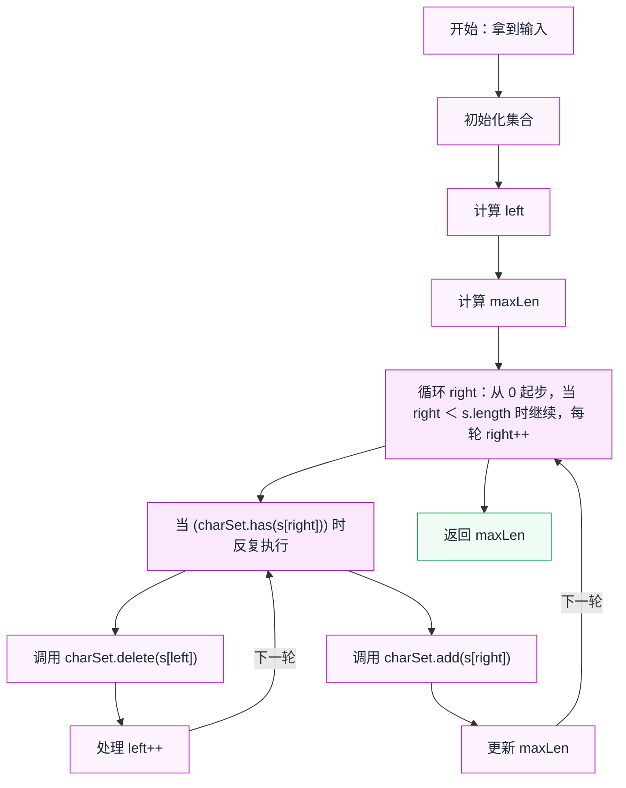

## TypeScript 解题方案（6 个方案逐个讲）

> **运行与提交**：每个方案都是自包含文件（内嵌用例自测，输出 PASS），整块复制到 `.ts` 文件后 `node 文件名` 即可运行。提交 LeetCode 时，把 `demo` 内的算法函数与辅助类型/函数整体取出、置于文件顶层即可。涉及交互/特殊接口的题以题面给定签名为准。

### 方案 1：滑动窗口 + 集合

**分析与思路**：核心做法是「滑动窗口 + 集合」。代码里依次做这些事：哈希结构做计数或查重；单循环线性扫描。

**运行方式**：`node 本文件`，内嵌用例全部通过会输出 PASS。


**方案专属流程图**（真实控制流）：

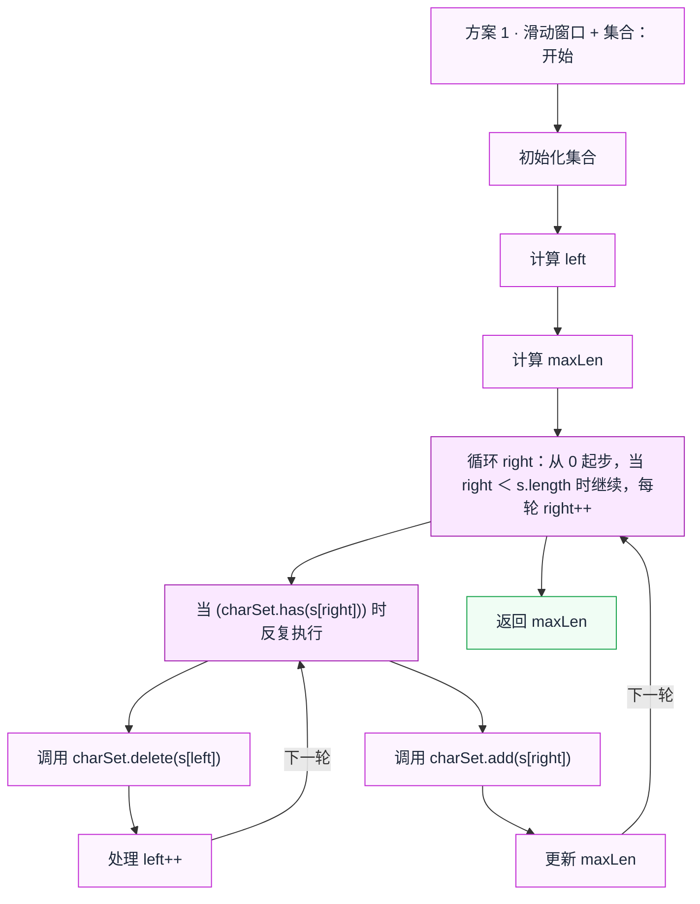

```typescript
/**
 ** LeetCode 3. 无重复字符的最长子串
 ** 方案：方案1：滑动窗口 + 集合
 ** 来源：https://blog.csdn.net/tyro_java/article/details/133461048
 */

export function lengthOfLongestSubstring(s: string): number {
  // 定义函数/方法 lengthOfLongestSubstring
  const charSet = new Set<string>(); // 把 new Set 小于 string 超过 () 存入 charSet
  let left = 0; // 把 0 存入 左边界
  let maxLen = 0; // 把 0 存入 maxLen
  for (let right = 0; right < s.length; right++) {
    // 让 右边界 从 0 开始计数，右边界 小于 字符串.长度 就继续
    while (charSet.has(s[right])) {
      // 循环，直到不满足「charSet.has(字符串[右边界]」
      charSet.delete(s[left]); // charSet.delete(字符串[左边界]);
      left++; // 左边界 加一
    }
    charSet.add(s[right]); // charSet 追加 字符串[右边界]);
    maxLen = Math.max(maxLen, right - left + 1); // 把 Math.取较大值 maxLen, 右边界 减 左边界 加 1) 存入 maxLen
  }
  return maxLen; // 返回 maxLen
}

export function demo(): void {
  // 程序入口：跑内嵌自测用例
  if (lengthOfLongestSubstring('abc') !== 3) throw new Error('FAILED abc');
  if (lengthOfLongestSubstring('abcabcbb') !== 3) throw new Error('FAILED 1');
  if (lengthOfLongestSubstring('bbbbb') !== 1) throw new Error('FAILED 2');
  if (lengthOfLongestSubstring('pwwkew') !== 3) throw new Error('FAILED 3');
  console.log('PASS'); // 全部用例通过，输出 PASS
}

demo(); // demo();
```

### 方案 2：滑动窗口 + 集合

**分析与思路**：核心做法是「滑动窗口 + 集合」。代码里依次做这些事：哈希结构做计数或查重；单循环线性扫描。

**运行方式**：`node 本文件`，内嵌用例全部通过会输出 PASS。

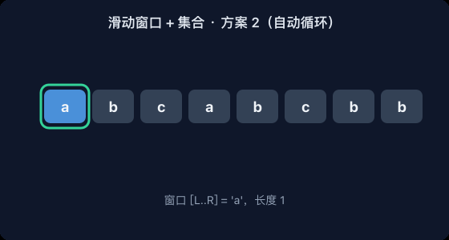

**方案专属流程图**（真实控制流）：


```typescript
/**
 ** LeetCode 3. 无重复字符的最长子串
 ** 方案：方案2：滑动窗口 + 集合
 ** 来源：https://blog.csdn.net/tyro_java/article/details/133461048
 */

export function lengthOfLongestSubstring(s: string): number {
  // 定义函数/方法 lengthOfLongestSubstring
  const charSet = new Set<string>(); // 把 new Set 小于 string 超过 () 存入 charSet
  let left = 0; // 把 0 存入 左边界
  let maxLen = 0; // 把 0 存入 maxLen
  for (let right = 0; right < s.length; right++) {
    // 让 右边界 从 0 开始计数，右边界 小于 字符串.长度 就继续
    while (charSet.has(s[right])) {
      // 循环，直到不满足「charSet.has(字符串[右边界]」
      charSet.delete(s[left]); // charSet.delete(字符串[左边界]);
      left++; // 左边界 加一
    }
    charSet.add(s[right]); // charSet 追加 字符串[右边界]);
    maxLen = Math.max(maxLen, right - left + 1); // 把 Math.取较大值 maxLen, 右边界 减 左边界 加 1) 存入 maxLen
  }
  return maxLen; // 返回 maxLen
}

export function demo(): void {
  // 程序入口：跑内嵌自测用例
  if (lengthOfLongestSubstring('abc') !== 3) throw new Error('FAILED abc');
  if (lengthOfLongestSubstring('abcabcbb') !== 3) throw new Error('FAILED 1');
  if (lengthOfLongestSubstring('bbbbb') !== 1) throw new Error('FAILED 2');
  if (lengthOfLongestSubstring('pwwkew') !== 3) throw new Error('FAILED 3');
  console.log('PASS'); // 全部用例通过，输出 PASS
}

demo(); // demo();
```

### 方案 3：滑动窗口 + 字符末次位置哈希

**分析与思路**：核心做法是「滑动窗口 + 字符末次位置哈希」。代码里依次做这些事：单循环线性扫描。

**运行方式**：`node 本文件`，内嵌用例全部通过会输出 PASS。


**方案专属流程图**（真实控制流）：

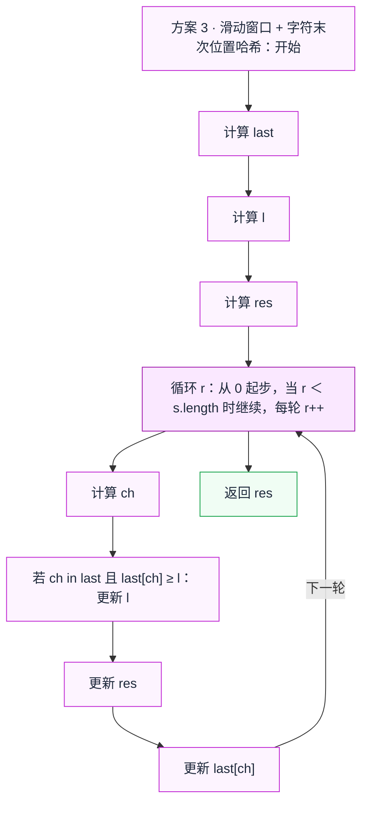

```typescript
/**
 ** LeetCode 3. 无重复字符的最长子串
 ** 方案：方案3：滑动窗口 + 字符末次位置哈希
 ** 来源：https://blog.csdn.net/tyro_java/article/details/133461048
 */

export function lengthOfLongestSubstring(s: string): number {
  // 定义函数/方法 lengthOfLongestSubstring
  const last: { [k: string]: number } = {}; // 把 {}; 写入 const last: { [k: string]: number }
  let l = 0; // 把 0 存入 左指针
  let res = 0; // 把 0 存入 结果
  for (let r = 0; r < s.length; r++) {
    // 让 右指针 从 0 开始计数，右指针 小于 字符串.长度 就继续
    const ch = s[r]; // 把 字符串[右指针] 存入 字符
    if (ch in last && last[ch] >= l) l = last[ch] + 1; // 若 字符 in last 且 last[字符] 不低于 左指针) 左指针 赋值为 last[字符] 加 1;
    res = Math.max(res, r - l + 1); // 把 Math.取较大值 结果, 右指针 减 左指针 加 1) 存入 结果
    last[ch] = r; // 把 右指针; 写入 last[ch]
  }
  return res; // 返回 结果
}

export function demo(): void {
  // 程序入口：跑内嵌自测用例
  if (lengthOfLongestSubstring('abcabcbb') !== 3) throw new Error('FAILED 1');
  if (lengthOfLongestSubstring('bbbbb') !== 1) throw new Error('FAILED 2');
  if (lengthOfLongestSubstring('pwwkew') !== 3) throw new Error('FAILED 3');
  console.log('PASS'); // 全部用例通过，输出 PASS
}

demo(); // demo();
```

### 方案 4：滑动窗口 + 字符末次位置哈希

**分析与思路**：核心做法是「滑动窗口 + 字符末次位置哈希」。代码里依次做这些事：单循环线性扫描。

**运行方式**：`node 本文件`，内嵌用例全部通过会输出 PASS。


**方案专属流程图**（真实控制流）：


```typescript
/**
 ** LeetCode 3. 无重复字符的最长子串
 ** 方案：方案4：滑动窗口 + 字符末次位置哈希
 ** 来源：https://blog.csdn.net/tyro_java/article/details/133461048
 */

export function lengthOfLongestSubstring(s: string): number {
  // 定义函数/方法 lengthOfLongestSubstring
  const last: { [k: string]: number } = {}; // 把 {}; 写入 const last: { [k: string]: number }
  let l = 0; // 把 0 存入 左指针
  let res = 0; // 把 0 存入 结果
  for (let r = 0; r < s.length; r++) {
    // 让 右指针 从 0 开始计数，右指针 小于 字符串.长度 就继续
    const ch = s[r]; // 把 字符串[右指针] 存入 字符
    if (ch in last && last[ch] >= l) l = last[ch] + 1; // 若 字符 in last 且 last[字符] 不低于 左指针) 左指针 赋值为 last[字符] 加 1;
    res = Math.max(res, r - l + 1); // 把 Math.取较大值 结果, 右指针 减 左指针 加 1) 存入 结果
    last[ch] = r; // 把 右指针; 写入 last[ch]
  }
  return res; // 返回 结果
}

export function demo(): void {
  // 程序入口：跑内嵌自测用例
  if (lengthOfLongestSubstring('abcabcbb') !== 3) throw new Error('FAILED 1');
  if (lengthOfLongestSubstring('bbbbb') !== 1) throw new Error('FAILED 2');
  if (lengthOfLongestSubstring('pwwkew') !== 3) throw new Error('FAILED 3');
  console.log('PASS'); // 全部用例通过，输出 PASS
}

demo(); // demo();
```

### 方案 5：滑动窗口 + 字符末次位置哈希

**分析与思路**：核心做法是「滑动窗口 + 字符末次位置哈希」。代码里依次做这些事：单循环线性扫描。

**运行方式**：`node 本文件`，内嵌用例全部通过会输出 PASS。

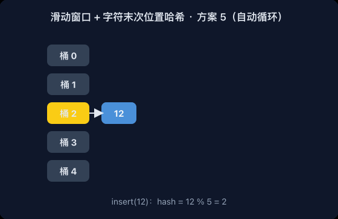

**方案专属流程图**（真实控制流）：


```typescript
/**
 ** LeetCode 3. 无重复字符的最长子串
 ** 方案：方案5：滑动窗口 + 字符末次位置哈希
 ** 来源：https://blog.csdn.net/tyro_java/article/details/133461048
 */

export function lengthOfLongestSubstring(s: string): number {
  // 定义函数/方法 lengthOfLongestSubstring
  const last: { [k: string]: number } = {}; // 把 {}; 写入 const last: { [k: string]: number }
  let l = 0; // 把 0 存入 左指针
  let res = 0; // 把 0 存入 结果
  for (let r = 0; r < s.length; r++) {
    // 让 右指针 从 0 开始计数，右指针 小于 字符串.长度 就继续
    const ch = s[r]; // 把 字符串[右指针] 存入 字符
    if (ch in last && last[ch] >= l) l = last[ch] + 1; // 若 字符 in last 且 last[字符] 不低于 左指针) 左指针 赋值为 last[字符] 加 1;
    res = Math.max(res, r - l + 1); // 把 Math.取较大值 结果, 右指针 减 左指针 加 1) 存入 结果
    last[ch] = r; // 把 右指针; 写入 last[ch]
  }
  return res; // 返回 结果
}

export function demo(): void {
  // 程序入口：跑内嵌自测用例
  if (lengthOfLongestSubstring('abcabcbb') !== 3) throw new Error('FAILED 1');
  if (lengthOfLongestSubstring('bbbbb') !== 1) throw new Error('FAILED 2');
  if (lengthOfLongestSubstring('pwwkew') !== 3) throw new Error('FAILED 3');
  console.log('PASS'); // 全部用例通过，输出 PASS
}

demo(); // demo();
```

### 方案 6：滑动窗口 + 字符末次位置哈希

**分析与思路**：核心做法是「滑动窗口 + 字符末次位置哈希」。代码里依次做这些事：单循环线性扫描。

**运行方式**：`node 本文件`，内嵌用例全部通过会输出 PASS。


**方案专属流程图**（真实控制流）：


```typescript
/**
 ** LeetCode 3. 无重复字符的最长子串
 ** 方案：方案6：滑动窗口 + 字符末次位置哈希
 ** 来源：https://blog.csdn.net/tyro_java/article/details/133461048
 */

export function lengthOfLongestSubstring(s: string): number {
  // 定义函数/方法 lengthOfLongestSubstring
  const last: { [k: string]: number } = {}; // 把 {}; 写入 const last: { [k: string]: number }
  let l = 0; // 把 0 存入 左指针
  let res = 0; // 把 0 存入 结果
  for (let r = 0; r < s.length; r++) {
    // 让 右指针 从 0 开始计数，右指针 小于 字符串.长度 就继续
    const ch = s[r]; // 把 字符串[右指针] 存入 字符
    if (ch in last && last[ch] >= l) l = last[ch] + 1; // 若 字符 in last 且 last[字符] 不低于 左指针) 左指针 赋值为 last[字符] 加 1;
    res = Math.max(res, r - l + 1); // 把 Math.取较大值 结果, 右指针 减 左指针 加 1) 存入 结果
    last[ch] = r; // 把 右指针; 写入 last[ch]
  }
  return res; // 返回 结果
}

export function demo(): void {
  // 程序入口：跑内嵌自测用例
  if (lengthOfLongestSubstring('abcabcbb') !== 3) throw new Error('FAILED 1');
  if (lengthOfLongestSubstring('bbbbb') !== 1) throw new Error('FAILED 2');
  if (lengthOfLongestSubstring('pwwkew') !== 3) throw new Error('FAILED 3');
  console.log('PASS'); // 全部用例通过，输出 PASS
}

demo(); // demo();
```

## 逐步拆解与面试追问

**复杂度**：时间 O(n²)（两层嵌套扫描），空间 O(1) 到 O(n)

**为什么是这个量级**：外层定起点、内层扫终点，n 个起点各扫 n 次

**面试官可能会追问**：

- 哈希冲突了怎么办？
- 键的选择有什么讲究？
- 值域有限时能否用数组代替哈希？

## 关键 API 速查（TS 主解法实际用到，附官方链接）

| API | 作用 | 使用要点 | 官方文档 |
|---|---|---|---|
| `Set` | 集合：元素唯一 | add/add.has/delete；has 均摊 O(1)；NaN 视为相同；去重常用 [...new Set(arr)] | [官方文档](https://developer.mozilla.org/zh-CN/docs/Web/JavaScript/Reference/Global_Objects/Set) |
| `Math.max()` | 最大值 | 配展开 Math.max(...arr)；空参返回 -Infinity；超大数组注意展开参数上限 | [官方文档](https://developer.mozilla.org/zh-CN/docs/Web/JavaScript/Reference/Global_Objects/Math/max) |

### 各语言官方文档导航

- **TypeScript / JS**：[MDN 中文参考](https://developer.mozilla.org/zh-CN/)
- **Python**：[Python 官方文档](https://docs.python.org/zh-cn/3/)
- **Go**：[Go 标准库](https://pkg.go.dev/std)
- **Java**：[JDK 17 API](https://docs.oracle.com/en/java/javase/17/docs/api/)
- **Rust**：[Rust 标准库](https://doc.rust-lang.org/std/)
- **Lua**：[Lua 5.4 手册](https://www.lua.org/manual/5.4/)
- **C**：[Cppreference C](https://zh.cppreference.com/w/c)
- **C++**：[Cppreference C++](https://zh.cppreference.com/w/cpp)
- **R**：[R 官方手册](https://stat.ethz.ch/R-manual/)
- **Zig**：[Zig 语言文档](https://ziglang.org/documentation/master/)
- **Dart**：[Dart API](https://api.dart.dev/)

## 附录：其他 10 种语言全部实现（每种语言列举其全部方案）

> TypeScript 的全部方案见「TypeScript 解题方案」一节；下面是其余 10 种语言的对应实现，每种语言的每个方案都带思路分析、代码走读与专属运行架构图。
> 每个方案都内嵌用例自测，可独立运行（老仓库 python/go 文件遵循「打印结果」约定）。
> 完整解法文件见 `dsa/<语言>/hash/lc_3_无重复字符的最长子串/`。

### Python 实现（6 种方案）

Python 的全部方案如下，每个方案都内嵌用例自测，可独立运行（老仓库 python/go 文件遵循「打印结果」约定）：

#### 方案 1：滑动窗口 + 集合

**思路与代码分析**：核心是「滑动窗口 + 集合」。Python 版用切片与字典推导式简化操作，突出可读性。**走读**：方案 1 · 滑动窗口 + 集合：开始 → 更新 char_set → 更新 left → 更新 max_len → 循环 right：从 0 到 len(s 前 → 当 s[right] in char_set: 时反复执行 → 调用 char_set.remove(s[left]) → 更新 + → 调用 char_set.add(s[right]) → 更新 max_len → 返回 max_len。

**运行架构**（真实控制流）：

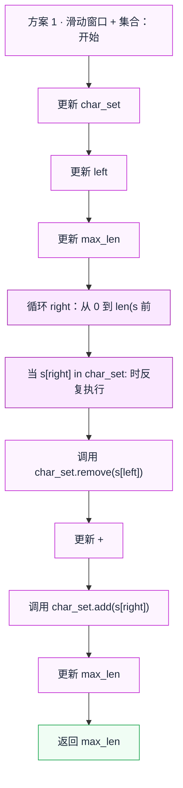

```python
import sys  # 提高递归深度上限（深输入防 RecursionError）

sys.setrecursionlimit(200000)  # 树/链表类题目节点数可达 1e4 量级

def lengthOfLongestSubstring(s):  # 定义函数 lengthOfLongestSubstring（参数：字符串）
    char_set = set()  # 把 set() 存入 char_set
    left = 0  # 把 0 存入 左边界
    max_len = 0  # 把 0 存入 max_len
    for right in range(len(s)):  # 让 右边界 从 长度(字符串 遍历
        while s[right] in char_set:  # 循环，直到不满足「字符串[右边界] in char_set」
            char_set.remove(s[left])  # char_set 弹出 字符串[左边界])
            left += 1  # 左边界累加 1
        char_set.add(s[right])  # char_set 追加 字符串[右边界])
        max_len = max(max_len, right - left + 1)  # 把 取较大值 max_len, 右边界 减 左边界 加 1) 存入 max_len
    return max_len  # 返回 max_len

if __name__ == "__main__":  # 若 __name__ 等于 '__main__'
    print(lengthOfLongestSubstring("abc"))  # 打印输出
```

#### 方案 2：滑动窗口 + 集合

**思路与代码分析**：核心是「滑动窗口 + 集合」。Python 版用切片与字典推导式简化操作，突出可读性。**走读**：方案 2 · 滑动窗口 + 集合：开始 → 更新 char_set → 更新 left → 更新 max_len → 循环 right：从 0 到 len(s 前 → 当 s[right] in char_set: 时反复执行 → 调用 char_set.remove(s[left]) → 更新 + → 调用 char_set.add(s[right]) → 更新 max_len → 返回 max_len。

**运行架构**（真实控制流）：

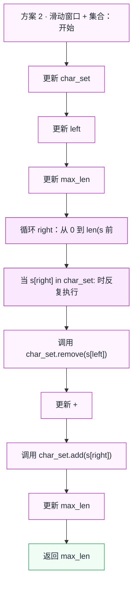

```python
import sys  # 提高递归深度上限（深输入防 RecursionError）

sys.setrecursionlimit(200000)  # 树/链表类题目节点数可达 1e4 量级

def lengthOfLongestSubstring(s):  # 定义函数 lengthOfLongestSubstring（参数：字符串）
    char_set = set()  # 把 set() 存入 char_set
    left = 0  # 把 0 存入 左边界
    max_len = 0  # 把 0 存入 max_len
    for right in range(len(s)):  # 让 右边界 从 长度(字符串 遍历
        while s[right] in char_set:  # 循环，直到不满足「字符串[右边界] in char_set」
            char_set.remove(s[left])  # char_set 弹出 字符串[左边界])
            left += 1  # 左边界累加 1
        char_set.add(s[right])  # char_set 追加 字符串[右边界])
        max_len = max(max_len, right - left + 1)  # 把 取较大值 max_len, 右边界 减 左边界 加 1) 存入 max_len
    return max_len  # 返回 max_len

if __name__ == "__main__":  # 若 __name__ 等于 '__main__'
    print(lengthOfLongestSubstring("abc"))  # 打印输出
```

#### 方案 3：滑动窗口 + 字符末次位置哈希

**思路与代码分析**：核心是「滑动窗口 + 字符末次位置哈希」。Python 版用切片与字典推导式简化操作，突出可读性。**走读**：方案 3 · 滑动窗口 + 字符末次位置哈希：开始 → 更新 last → 更新 l → 更新 res → 遍历 enumerate(s): 中的每个元素 ch → 若 ch in last and last[ch] ≥ l：更新 l → 更新 l → 更新 res → 更新 last[ch] → 返回 res。

**运行架构**（真实控制流）：


```python
import sys  # 提高递归深度上限（深输入防 RecursionError）

sys.setrecursionlimit(200000)  # 树/链表类题目节点数可达 1e4 量级

def lengthOfLongestSubstring(s):  # 定义函数 lengthOfLongestSubstring（参数：字符串）
    last = {}  # 把 {} 存入 last
    l = 0  # 把 0 存入 左指针
    res = 0  # 把 0 存入 结果
    for r, ch in enumerate(s):  # 同时取 右指针 与 字符 遍历
        if ch in last and last[ch] >= l:  # 若 字符 in last and last[字符] 不低于 左指针
            l = last[ch] + 1  # 把 last[字符] 加 1 存入 左指针
        res = max(res, r - l + 1)  # 把 取较大值 结果, 右指针 减 左指针 加 1) 存入 结果
        last[ch] = r  # 把 右指针 写入 last[ch]
    return res  # 返回 结果

if __name__ == "__main__":  # 若 __name__ 等于 '__main__'
    print(lengthOfLongestSubstring("abcabcbb"))  # 打印输出
    print(lengthOfLongestSubstring("bbbbb"))  # 打印输出
    print(lengthOfLongestSubstring("pwwkew"))  # 打印输出
```

#### 方案 4：滑动窗口 + 字符末次位置哈希

**思路与代码分析**：核心是「滑动窗口 + 字符末次位置哈希」。Python 版用切片与字典推导式简化操作，突出可读性。**走读**：方案 4 · 滑动窗口 + 字符末次位置哈希：开始 → 更新 last → 更新 l → 更新 res → 遍历 enumerate(s): 中的每个元素 ch → 若 ch in last and last[ch] ≥ l：更新 l → 更新 l → 更新 res → 更新 last[ch] → 返回 res。

**运行架构**（真实控制流）：

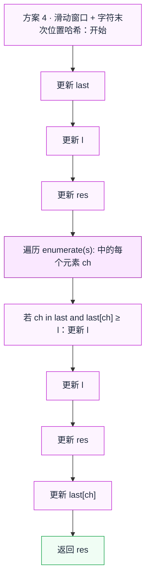

```python
import sys  # 提高递归深度上限（深输入防 RecursionError）

sys.setrecursionlimit(200000)  # 树/链表类题目节点数可达 1e4 量级

def lengthOfLongestSubstring(s):  # 定义函数 lengthOfLongestSubstring（参数：字符串）
    last = {}  # 把 {} 存入 last
    l = 0  # 把 0 存入 左指针
    res = 0  # 把 0 存入 结果
    for r, ch in enumerate(s):  # 同时取 右指针 与 字符 遍历
        if ch in last and last[ch] >= l:  # 若 字符 in last and last[字符] 不低于 左指针
            l = last[ch] + 1  # 把 last[字符] 加 1 存入 左指针
        res = max(res, r - l + 1)  # 把 取较大值 结果, 右指针 减 左指针 加 1) 存入 结果
        last[ch] = r  # 把 右指针 写入 last[ch]
    return res  # 返回 结果

if __name__ == "__main__":  # 若 __name__ 等于 '__main__'
    print(lengthOfLongestSubstring("abcabcbb"))  # 打印输出
    print(lengthOfLongestSubstring("bbbbb"))  # 打印输出
    print(lengthOfLongestSubstring("pwwkew"))  # 打印输出
```

#### 方案 5：滑动窗口 + 字符末次位置哈希

**思路与代码分析**：核心是「滑动窗口 + 字符末次位置哈希」。Python 版用切片与字典推导式简化操作，突出可读性。**走读**：方案 5 · 滑动窗口 + 字符末次位置哈希：开始 → 更新 last → 更新 l → 更新 res → 遍历 enumerate(s): 中的每个元素 ch → 若 ch in last and last[ch] ≥ l：更新 l → 更新 l → 更新 res → 更新 last[ch] → 返回 res。

**运行架构**（真实控制流）：

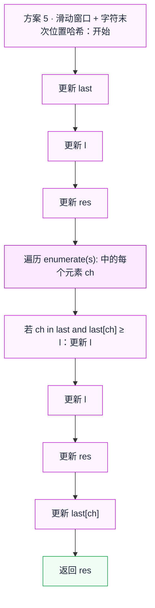

```python
import sys  # 提高递归深度上限（深输入防 RecursionError）

sys.setrecursionlimit(200000)  # 树/链表类题目节点数可达 1e4 量级

def lengthOfLongestSubstring(s):  # 定义函数 lengthOfLongestSubstring（参数：字符串）
    last = {}  # 把 {} 存入 last
    l = 0  # 把 0 存入 左指针
    res = 0  # 把 0 存入 结果
    for r, ch in enumerate(s):  # 同时取 右指针 与 字符 遍历
        if ch in last and last[ch] >= l:  # 若 字符 in last and last[字符] 不低于 左指针
            l = last[ch] + 1  # 把 last[字符] 加 1 存入 左指针
        res = max(res, r - l + 1)  # 把 取较大值 结果, 右指针 减 左指针 加 1) 存入 结果
        last[ch] = r  # 把 右指针 写入 last[ch]
    return res  # 返回 结果

if __name__ == "__main__":  # 若 __name__ 等于 '__main__'
    print(lengthOfLongestSubstring("abcabcbb"))  # 打印输出
    print(lengthOfLongestSubstring("bbbbb"))  # 打印输出
    print(lengthOfLongestSubstring("pwwkew"))  # 打印输出
```

#### 方案 6：滑动窗口 + 字符末次位置哈希

**思路与代码分析**：核心是「滑动窗口 + 字符末次位置哈希」。Python 版用切片与字典推导式简化操作，突出可读性。**走读**：方案 6 · 滑动窗口 + 字符末次位置哈希：开始 → 更新 last → 更新 l → 更新 res → 遍历 enumerate(s): 中的每个元素 ch → 若 ch in last and last[ch] ≥ l：更新 l → 更新 l → 更新 res → 更新 last[ch] → 返回 res。

**运行架构**（真实控制流）：


```python
import sys  # 提高递归深度上限（深输入防 RecursionError）

sys.setrecursionlimit(200000)  # 树/链表类题目节点数可达 1e4 量级

def lengthOfLongestSubstring(s):  # 定义函数 lengthOfLongestSubstring（参数：字符串）
    last = {}  # 把 {} 存入 last
    l = 0  # 把 0 存入 左指针
    res = 0  # 把 0 存入 结果
    for r, ch in enumerate(s):  # 同时取 右指针 与 字符 遍历
        if ch in last and last[ch] >= l:  # 若 字符 in last and last[字符] 不低于 左指针
            l = last[ch] + 1  # 把 last[字符] 加 1 存入 左指针
        res = max(res, r - l + 1)  # 把 取较大值 结果, 右指针 减 左指针 加 1) 存入 结果
        last[ch] = r  # 把 右指针 写入 last[ch]
    return res  # 返回 结果

if __name__ == "__main__":  # 若 __name__ 等于 '__main__'
    print(lengthOfLongestSubstring("abcabcbb"))  # 打印输出
    print(lengthOfLongestSubstring("bbbbb"))  # 打印输出
    print(lengthOfLongestSubstring("pwwkew"))  # 打印输出
```

### Go 实现（6 种方案）

Go 的全部方案如下，每个方案都内嵌用例自测，可独立运行（老仓库 python/go 文件遵循「打印结果」约定）：

#### 方案 1：滑动窗口 + 集合

**思路与代码分析**：核心是「滑动窗口 + 集合」。Go 版用切片与多返回值惯用法，显式处理索引边界。代码里依次做这些事：哈希结构做计数或查重。**走读**：方案 1 · 滑动窗口 + 集合：开始 → 更新 : → 更新 : → 更新 : → 遍历循环 → 更新 : → 遍历循环 → 调用 delete(seen, s[left]) → 处理 left++ → 更新 seen[ch] → 处理 if right-left+1 ＞ maxLen → 更新 maxLen → 返回 maxLen。

**运行架构**（真实控制流）：


```go
package main // 引入依赖

import (
	"fmt"
	"os"
) // 引入依赖

func lengthOfLongestSubstring(s string) int { // 定义函数/方法 lengthOfLongestSubstring
	seen := map[byte]bool{}                   // 把 映射表[byte]bool{} 写入 seen :
	left := 0                                 // 把 0 写入 left :
	maxLen := 0                               // 把 0 写入 maxLen :
	for right := 0; right < len(s); right++ { // 让 右边界 从 0 开始计数
		ch := s[right] // 把 字符串[右边界] 写入 ch :
		for seen[ch] { // for 已见集合[字符] {
			delete(seen, s[left]) // delete(已见集合, 字符串[左边界])
			left++                // 左边界 加一
		}
		seen[ch] = true            // 把 true 写入 seen[ch]
		if right-left+1 > maxLen { // 若 右边界 减 左边界 加 1 超过 maxLen
			maxLen = right - left + 1 // 把 右边界 减 左边界 加 1 写入 maxLen
		}
	}
	return maxLen // 返回 maxLen
}

func main() { // 程序入口：跑内嵌自测用例
	type tc struct { // 定义类型
		in   string // in string
		want int    // want int
	}
	cases := []tc{ // 把 []tc{ 写入 cases :
		{"abc", 3},
		{"bbbbb", 1},
	}
	ok := true                // 把 true 写入 ok :
	for _, c := range cases { // 同时取 _ 与 字符 遍历
		if got := lengthOfLongestSubstring(c.in); got != c.want { // 若 got : 赋值为 lengthOfLongestSubstring(字符.in); got 不等于 字符.want
			ok = false                                                                      // 把 false 写入 ok
			fmt.Printf("FAIL lengthOfLongestSubstring(%q)=%v want %v\n", c.in, got, c.want) // 打印输出
		}
	}
	if !ok { // 若 取反 ok
		os.Exit(1) // os.Exit(1)
	}
	fmt.Println("PASS") // 全部用例通过，输出 PASS
}
```

#### 方案 2：滑动窗口 + 集合

**思路与代码分析**：核心是「滑动窗口 + 集合」。Go 版用切片与多返回值惯用法，显式处理索引边界。代码里依次做这些事：哈希结构做计数或查重。**走读**：方案 2 · 滑动窗口 + 集合：开始 → 更新 : → 更新 : → 更新 : → 遍历循环 → 更新 : → 遍历循环 → 调用 delete(seen, s[left]) → 处理 left++ → 更新 seen[ch] → 处理 if right-left+1 ＞ maxLen → 更新 maxLen → 返回 maxLen。

**运行架构**（真实控制流）：

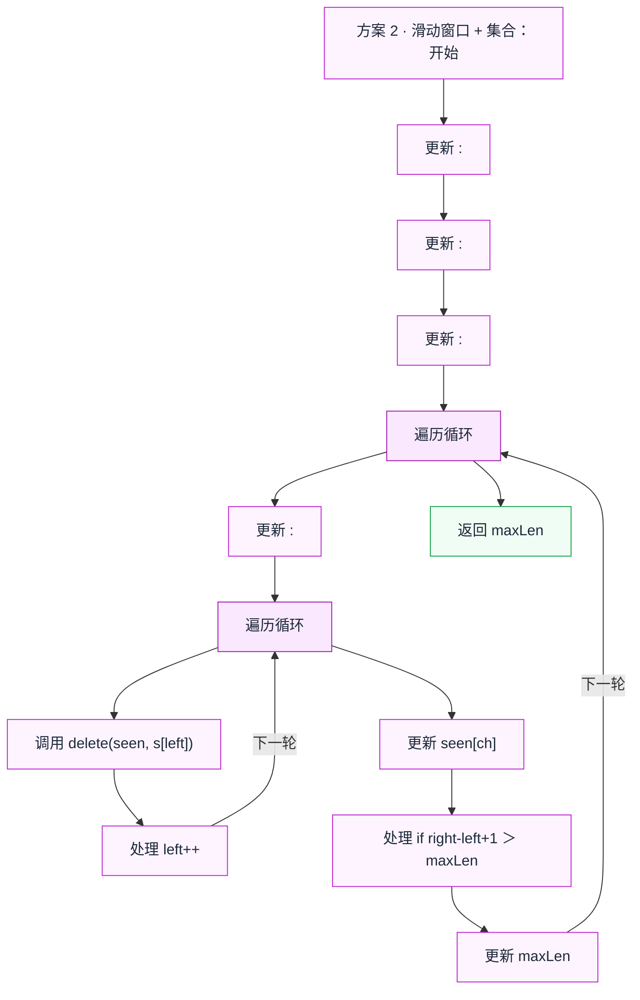

```go
package main // 引入依赖

import (
	"fmt"
	"os"
) // 引入依赖

func lengthOfLongestSubstring(s string) int { // 定义函数/方法 lengthOfLongestSubstring
	seen := map[byte]bool{}                   // 把 映射表[byte]bool{} 写入 seen :
	left := 0                                 // 把 0 写入 left :
	maxLen := 0                               // 把 0 写入 maxLen :
	for right := 0; right < len(s); right++ { // 让 右边界 从 0 开始计数
		ch := s[right] // 把 字符串[右边界] 写入 ch :
		for seen[ch] { // for 已见集合[字符] {
			delete(seen, s[left]) // delete(已见集合, 字符串[左边界])
			left++                // 左边界 加一
		}
		seen[ch] = true            // 把 true 写入 seen[ch]
		if right-left+1 > maxLen { // 若 右边界 减 左边界 加 1 超过 maxLen
			maxLen = right - left + 1 // 把 右边界 减 左边界 加 1 写入 maxLen
		}
	}
	return maxLen // 返回 maxLen
}

func main() { // 程序入口：跑内嵌自测用例
	type tc struct { // 定义类型
		in   string // in string
		want int    // want int
	}
	cases := []tc{ // 把 []tc{ 写入 cases :
		{"abc", 3},
		{"bbbbb", 1},
	}
	ok := true                // 把 true 写入 ok :
	for _, c := range cases { // 同时取 _ 与 字符 遍历
		if got := lengthOfLongestSubstring(c.in); got != c.want { // 若 got : 赋值为 lengthOfLongestSubstring(字符.in); got 不等于 字符.want
			ok = false                                                                      // 把 false 写入 ok
			fmt.Printf("FAIL lengthOfLongestSubstring(%q)=%v want %v\n", c.in, got, c.want) // 打印输出
		}
	}
	if !ok { // 若 取反 ok
		os.Exit(1) // os.Exit(1)
	}
	fmt.Println("PASS") // 全部用例通过，输出 PASS
}
```

#### 方案 3：滑动窗口 + 字符末次位置哈希

**思路与代码分析**：核心是「滑动窗口 + 字符末次位置哈希」。Go 版用切片与多返回值惯用法，显式处理索引边界。代码里依次做这些事：哈希结构做计数或查重。**走读**：方案 3 · 滑动窗口 + 字符末次位置哈希：开始 → 更新 : → 更新 : → 更新 : → 遍历循环 → 更新 : → 处理 if p, ok := last[ch]; ok 且 → 更新 l → 处理 if r-l+1 ＞ res → 更新 res → 更新 last[ch] → 返回 res。

**运行架构**（真实控制流）：


```go
package main // 引入依赖

import (
	"fmt"
	"os"
) // 引入依赖

func lengthOfLongestSubstring(s string) int { // 定义函数/方法 lengthOfLongestSubstring
	last := map[byte]int{}        // 把 映射表[byte]int{} 写入 last :
	l := 0                        // 把 0 写入 l :
	res := 0                      // 把 0 写入 res :
	for r := 0; r < len(s); r++ { // 让 右指针 从 0 开始计数
		ch := s[r]                           // 把 字符串[右指针] 写入 ch :
		if p, ok := last[ch]; ok && p >= l { // 若 节点, ok : 赋值为 last[字符]; ok 且 节点 不低于 左指针
			l = p + 1 // 把 节点 加 1 写入 左指针
		}
		if r-l+1 > res { // 若 右指针 减 左指针 加 1 超过 结果
			res = r - l + 1 // 把 右指针 减 左指针 加 1 写入 结果
		}
		last[ch] = r // 把 右指针 写入 last[ch]
	}
	return res // 返回 结果
}

func main() { // 程序入口：跑内嵌自测用例
	type tc struct { // 定义类型
		in   string // in string
		want int    // want int
	}
	cases := []tc{ // 把 []tc{ 写入 cases :
		{"abc", 3},
		{"bbbbb", 1},
	}
	ok := true                // 把 true 写入 ok :
	for _, c := range cases { // 同时取 _ 与 字符 遍历
		if got := lengthOfLongestSubstring(c.in); got != c.want { // 若 got : 赋值为 lengthOfLongestSubstring(字符.in); got 不等于 字符.want
			ok = false                                                                      // 把 false 写入 ok
			fmt.Printf("FAIL lengthOfLongestSubstring(%q)=%v want %v\n", c.in, got, c.want) // 打印输出
		}
	}
	if !ok { // 若 取反 ok
		os.Exit(1) // os.Exit(1)
	}
	fmt.Println("PASS") // 全部用例通过，输出 PASS
}
```

#### 方案 4：滑动窗口 + 字符末次位置哈希

**思路与代码分析**：核心是「滑动窗口 + 字符末次位置哈希」。Go 版用切片与多返回值惯用法，显式处理索引边界。代码里依次做这些事：哈希结构做计数或查重。**走读**：方案 4 · 滑动窗口 + 字符末次位置哈希：开始 → 更新 : → 更新 : → 更新 : → 遍历循环 → 更新 : → 处理 if p, ok := last[ch]; ok 且 → 更新 l → 处理 if r-l+1 ＞ res → 更新 res → 更新 last[ch] → 返回 res。

**运行架构**（真实控制流）：


```go
package main // 引入依赖

import (
	"fmt"
	"os"
) // 引入依赖

func lengthOfLongestSubstring(s string) int { // 定义函数/方法 lengthOfLongestSubstring
	last := map[byte]int{}        // 把 映射表[byte]int{} 写入 last :
	l := 0                        // 把 0 写入 l :
	res := 0                      // 把 0 写入 res :
	for r := 0; r < len(s); r++ { // 让 右指针 从 0 开始计数
		ch := s[r]                           // 把 字符串[右指针] 写入 ch :
		if p, ok := last[ch]; ok && p >= l { // 若 节点, ok : 赋值为 last[字符]; ok 且 节点 不低于 左指针
			l = p + 1 // 把 节点 加 1 写入 左指针
		}
		if r-l+1 > res { // 若 右指针 减 左指针 加 1 超过 结果
			res = r - l + 1 // 把 右指针 减 左指针 加 1 写入 结果
		}
		last[ch] = r // 把 右指针 写入 last[ch]
	}
	return res // 返回 结果
}

func main() { // 程序入口：跑内嵌自测用例
	type tc struct { // 定义类型
		in   string // in string
		want int    // want int
	}
	cases := []tc{ // 把 []tc{ 写入 cases :
		{"abc", 3},
		{"bbbbb", 1},
	}
	ok := true                // 把 true 写入 ok :
	for _, c := range cases { // 同时取 _ 与 字符 遍历
		if got := lengthOfLongestSubstring(c.in); got != c.want { // 若 got : 赋值为 lengthOfLongestSubstring(字符.in); got 不等于 字符.want
			ok = false                                                                      // 把 false 写入 ok
			fmt.Printf("FAIL lengthOfLongestSubstring(%q)=%v want %v\n", c.in, got, c.want) // 打印输出
		}
	}
	if !ok { // 若 取反 ok
		os.Exit(1) // os.Exit(1)
	}
	fmt.Println("PASS") // 全部用例通过，输出 PASS
}
```

#### 方案 5：滑动窗口 + 字符末次位置哈希

**思路与代码分析**：核心是「滑动窗口 + 字符末次位置哈希」。Go 版用切片与多返回值惯用法，显式处理索引边界。代码里依次做这些事：哈希结构做计数或查重。**走读**：方案 5 · 滑动窗口 + 字符末次位置哈希：开始 → 更新 : → 更新 : → 更新 : → 遍历循环 → 更新 : → 处理 if p, ok := last[ch]; ok 且 → 更新 l → 处理 if r-l+1 ＞ res → 更新 res → 更新 last[ch] → 返回 res。

**运行架构**（真实控制流）：

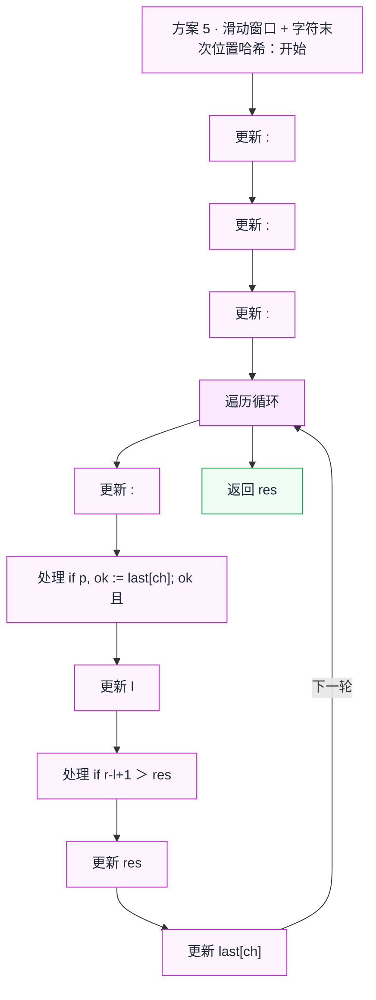

```go
package main // 引入依赖

import (
	"fmt"
	"os"
) // 引入依赖

func lengthOfLongestSubstring(s string) int { // 定义函数/方法 lengthOfLongestSubstring
	last := map[byte]int{}        // 把 映射表[byte]int{} 写入 last :
	l := 0                        // 把 0 写入 l :
	res := 0                      // 把 0 写入 res :
	for r := 0; r < len(s); r++ { // 让 右指针 从 0 开始计数
		ch := s[r]                           // 把 字符串[右指针] 写入 ch :
		if p, ok := last[ch]; ok && p >= l { // 若 节点, ok : 赋值为 last[字符]; ok 且 节点 不低于 左指针
			l = p + 1 // 把 节点 加 1 写入 左指针
		}
		if r-l+1 > res { // 若 右指针 减 左指针 加 1 超过 结果
			res = r - l + 1 // 把 右指针 减 左指针 加 1 写入 结果
		}
		last[ch] = r // 把 右指针 写入 last[ch]
	}
	return res // 返回 结果
}

func main() { // 程序入口：跑内嵌自测用例
	cases := []struct { // 把 []struct { 写入 cases :
		in   string // in string
		want int    // want int
	}{ // }{
		{"abcabcbb", 3},
		{"bbbbb", 1},
		{"pwwkew", 3},
		{"", 0},
		{"au", 2},
	}
	ok := true                // 把 true 写入 ok :
	for _, c := range cases { // 同时取 _ 与 字符 遍历
		if g := lengthOfLongestSubstring(c.in); g != c.want { // 若 g : 赋值为 lengthOfLongestSubstring(字符.in); g 不等于 字符.want
			ok = false                                          // 把 false 写入 ok
			fmt.Printf("FAIL %q=%v want %v\n", c.in, g, c.want) // 打印输出
		}
	}
	if !ok { // 若 取反 ok
		os.Exit(1) // os.Exit(1)
	}
	fmt.Println("PASS") // 全部用例通过，输出 PASS
}
```

#### 方案 6：滑动窗口 + 字符末次位置哈希

**思路与代码分析**：核心是「滑动窗口 + 字符末次位置哈希」。Go 版用切片与多返回值惯用法，显式处理索引边界。代码里依次做这些事：哈希结构做计数或查重。**走读**：方案 6 · 滑动窗口 + 字符末次位置哈希：开始 → 更新 : → 更新 : → 更新 : → 遍历循环 → 更新 : → 处理 if p, ok := last[ch]; ok 且 → 更新 l → 处理 if r-l+1 ＞ res → 更新 res → 更新 last[ch] → 返回 res。

**运行架构**（真实控制流）：


```go
package main // 引入依赖

import (
	"fmt"
	"os"
) // 引入依赖

func lengthOfLongestSubstring(s string) int { // 定义函数/方法 lengthOfLongestSubstring
	last := map[byte]int{}        // 把 映射表[byte]int{} 写入 last :
	l := 0                        // 把 0 写入 l :
	res := 0                      // 把 0 写入 res :
	for r := 0; r < len(s); r++ { // 让 右指针 从 0 开始计数
		ch := s[r]                           // 把 字符串[右指针] 写入 ch :
		if p, ok := last[ch]; ok && p >= l { // 若 节点, ok : 赋值为 last[字符]; ok 且 节点 不低于 左指针
			l = p + 1 // 把 节点 加 1 写入 左指针
		}
		if r-l+1 > res { // 若 右指针 减 左指针 加 1 超过 结果
			res = r - l + 1 // 把 右指针 减 左指针 加 1 写入 结果
		}
		last[ch] = r // 把 右指针 写入 last[ch]
	}
	return res // 返回 结果
}

func main() { // 程序入口：跑内嵌自测用例
	type tc struct { // 定义类型
		in   string // in string
		want int    // want int
	}
	cases := []tc{ // 把 []tc{ 写入 cases :
		{"abc", 3},
		{"bbbbb", 1},
	}
	ok := true                // 把 true 写入 ok :
	for _, c := range cases { // 同时取 _ 与 字符 遍历
		if got := lengthOfLongestSubstring(c.in); got != c.want { // 若 got : 赋值为 lengthOfLongestSubstring(字符.in); got 不等于 字符.want
			ok = false                                                                      // 把 false 写入 ok
			fmt.Printf("FAIL lengthOfLongestSubstring(%q)=%v want %v\n", c.in, got, c.want) // 打印输出
		}
	}
	if !ok { // 若 取反 ok
		os.Exit(1) // os.Exit(1)
	}
	fmt.Println("PASS") // 全部用例通过，输出 PASS
}
```

### Java 实现（6 种方案）

Java 的全部方案如下，每个方案都内嵌用例自测，可独立运行（老仓库 python/go 文件遵循「打印结果」约定）：

#### 方案 1：滑动窗口 + 集合

**思路与代码分析**：核心是「滑动窗口 + 集合」。Java 版用类与静态方法组织，集合操作显式明了。代码里依次做这些事：单循环线性扫描。**走读**：方案 1 · 滑动窗口 + 集合：开始 → 更新 charSet → 更新 left → 更新 maxLen → 遍历循环 → 更新 c → 当 (charSet.contains(c)) 时反复执行 → 调用 charSet.remove(s.charAt(left → 处理 left++ → 调用 charSet.add(c) → 更新 maxLen → 返回 maxLen。

**运行架构**（真实控制流）：

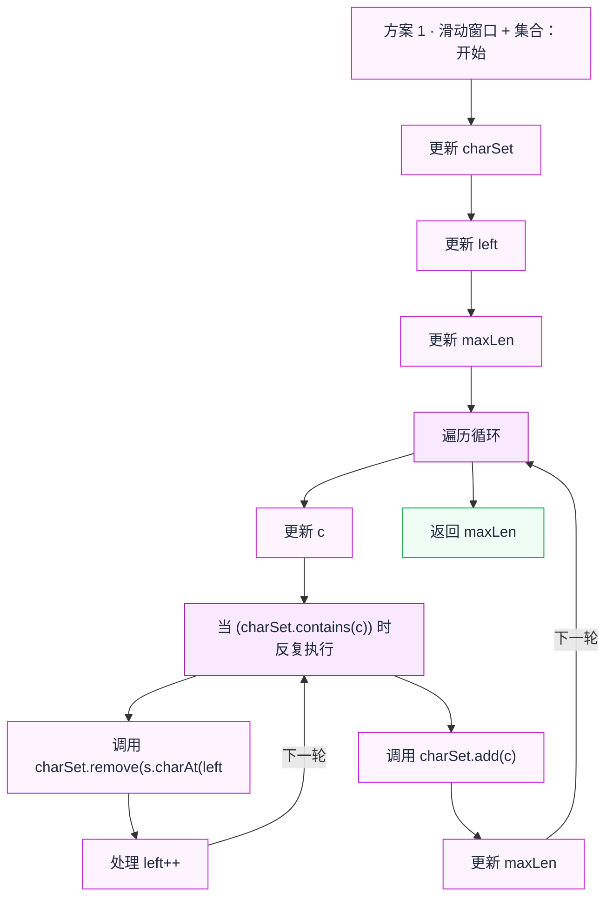

```java
package com.webfault.dsa; // 引入依赖

import java.util.HashSet; // 引入依赖
import java.util.Set; // 引入依赖

class lc3_solution11 { // 定义类型
  // lengthOfLongestSubstring 忠实翻译 python ref solution_1___1.py（set 滑窗）
  public int lengthOfLongestSubstring(String s) { // 定义函数/方法 lengthOfLongestSubstring
    Set<Character> charSet = new HashSet<>(); // 把 new HashSet 小于 超过 (); 写入 Set<Character> charSet
    int left = 0; // 把 0 存入 左边界
    int maxLen = 0; // 把 0 存入 maxLen
    for (int right = 0; right < s.length(); right++) { // 让 右边界 从 0 开始计数，右边界 小于 字符串.长度() 就继续
      char c = s.charAt(right); // 逐字符处理
      while (charSet.contains(c)) { // 循环，直到不满足「charSet 是否包含 字符」
        charSet.remove(s.charAt(left)); // 逐字符处理
        left++; // 左边界 加一
      }
      charSet.add(c); // charSet 追加 字符);
      maxLen = Math.max(maxLen, right - left + 1); // 把 Math.取较大值 maxLen, 右边界 减 左边界 加 1); 写入 maxLen
    }
    return maxLen; // 返回 maxLen
  }

  public static void main(String[] args) { // public static void main(String[] args) {
    lc3_solution11 s = new lc3_solution11(); // 把 new lc3_solution11(); 写入 lc3_solution11 s
    String[][] cases = { // 把 { 写入 String[][] cases
      {"abcabcbb", "3"},
      {"pwwkew", "3"},
      {"", "0"},
      {" ", "1"},
      {"dvdf", "3"},
      {"abba", "2"},
    };
    boolean ok = true; // 把 true; 写入 boolean ok
    for (String[] c : cases) { // for (String[] 字符 : cases) {
      int got = s.lengthOfLongestSubstring(c[0]); // 把 字符串.lengthOfLongestSubstring(字符[0]) 存入 got
      int want = Integer.parseInt(c[1]); // 把 Integer.转整数(字符[1]) 存入 want
      if (got != want) { // 若 got 不等于 want
        ok = false; // 把 false; 写入 ok
        System.out.println("FAIL solve(\"" + c[0] + "\")=" + got + " want " + want); // 打印输出
      }
    }
    if (!ok) { // 若 取反 ok
      throw new RuntimeException("FAILED"); // throw new RuntimeException(「FAILED」);
    }
    System.out.println("PASS"); // 全部用例通过，输出 PASS
  }
}
```

#### 方案 2：滑动窗口 + 集合

**思路与代码分析**：核心是「滑动窗口 + 集合」。Java 版用类与静态方法组织，集合操作显式明了。代码里依次做这些事：单循环线性扫描。**走读**：方案 2 · 滑动窗口 + 集合：开始 → 更新 charSet → 更新 left → 更新 maxLen → 遍历循环 → 更新 c → 当 (charSet.contains(c)) 时反复执行 → 调用 charSet.remove(s.charAt(left → 处理 left++ → 调用 charSet.add(c) → 更新 maxLen → 返回 maxLen。

**运行架构**（真实控制流）：

```mermaid
graph TD
    N0["方案 2 · 滑动窗口 + 集合：开始"]
    N1["更新 charSet"]
    N2["更新 left"]
    N3["更新 maxLen"]
    N4["遍历循环"]
    N5["更新 c"]
    N6["当 (charSet.contains(c)) 时反复执行"]
    N7["调用 charSet.remove(s.charAt(left"]
    N8["处理 left++"]
    N9["调用 charSet.add(c)"]
    N10["更新 maxLen"]
    N11["返回 maxLen"]
    N0 --> N1
    N1 --> N2
    N2 --> N3
    N3 --> N4
    N4 --> N5
    N5 --> N6
    N6 --> N7
    N7 --> N8
    N8 -- 下一轮 --> N6
    N6 --> N9
    N9 --> N10
    N10 -- 下一轮 --> N4
    N4 --> N11
    classDef n fill:#fdf4ff,stroke:#c026d3,color:#1e293b;
    classDef lp fill:#fae8ff,stroke:#a21caf,color:#1e293b;
    classDef dc fill:#fef9c3,stroke:#ca8a04,color:#1e293b;
    classDef tm fill:#f0fdf4,stroke:#16a34a,color:#1e293b;
    class N0,N1,N2,N3,N5,N7,N8,N9,N10 n;
    class N4,N6 lp;
    class N11 tm;
```

```java
package com.webfault.dsa; // 引入依赖

import java.util.HashSet; // 引入依赖
import java.util.Set; // 引入依赖

class lc3_solution22 { // 定义类型
  // lengthOfLongestSubstring 忠实翻译 python ref solution_2___2.py（set 滑窗）
  public int lengthOfLongestSubstring(String s) { // 定义函数/方法 lengthOfLongestSubstring
    Set<Character> charSet = new HashSet<>(); // 把 new HashSet 小于 超过 (); 写入 Set<Character> charSet
    int left = 0; // 把 0 存入 左边界
    int maxLen = 0; // 把 0 存入 maxLen
    for (int right = 0; right < s.length(); right++) { // 让 右边界 从 0 开始计数，右边界 小于 字符串.长度() 就继续
      char c = s.charAt(right); // 逐字符处理
      while (charSet.contains(c)) { // 循环，直到不满足「charSet 是否包含 字符」
        charSet.remove(s.charAt(left)); // 逐字符处理
        left++; // 左边界 加一
      }
      charSet.add(c); // charSet 追加 字符);
      maxLen = Math.max(maxLen, right - left + 1); // 把 Math.取较大值 maxLen, 右边界 减 左边界 加 1); 写入 maxLen
    }
    return maxLen; // 返回 maxLen
  }

  public static void main(String[] args) { // public static void main(String[] args) {
    lc3_solution22 s = new lc3_solution22(); // 把 new lc3_solution22(); 写入 lc3_solution22 s
    String[][] cases = { // 把 { 写入 String[][] cases
      {"abcabcbb", "3"},
      {"pwwkew", "3"},
      {"", "0"},
      {" ", "1"},
      {"dvdf", "3"},
      {"abba", "2"},
    };
    boolean ok = true; // 把 true; 写入 boolean ok
    for (String[] c : cases) { // for (String[] 字符 : cases) {
      int got = s.lengthOfLongestSubstring(c[0]); // 把 字符串.lengthOfLongestSubstring(字符[0]) 存入 got
      int want = Integer.parseInt(c[1]); // 把 Integer.转整数(字符[1]) 存入 want
      if (got != want) { // 若 got 不等于 want
        ok = false; // 把 false; 写入 ok
        System.out.println("FAIL solve(\"" + c[0] + "\")=" + got + " want " + want); // 打印输出
      }
    }
    if (!ok) { // 若 取反 ok
      throw new RuntimeException("FAILED"); // throw new RuntimeException(「FAILED」);
    }
    System.out.println("PASS"); // 全部用例通过，输出 PASS
  }
}
```

#### 方案 3：滑动窗口 + 字符末次位置哈希

**思路与代码分析**：核心是「滑动窗口 + 字符末次位置哈希」。Java 版用类与静态方法组织，集合操作显式明了。代码里依次做这些事：哈希结构做计数或查重；单循环线性扫描。**走读**：方案 3 · 滑动窗口 + 字符末次位置哈希：开始 → 更新 last → 处理 new HashMap＜＞() → 更新 l → 更新 res → 遍历循环 → 更新 ch → 更新 li → 若 li ≠ null 且 li ≥ l 则： → 更新 l → 更新 res → 调用 last.put(ch, r) → 返回 res。

**运行架构**（真实控制流）：

```mermaid
graph TD
    N0["方案 3 · 滑动窗口 + 字符末次位置哈希：开始"]
    N1["更新 last"]
    N2["处理 new HashMap＜＞()"]
    N3["更新 l"]
    N4["更新 res"]
    N5["遍历循环"]
    N6["更新 ch"]
    N7["更新 li"]
    N8["若 li ≠ null 且 li ≥ l 则："]
    N9["更新 l"]
    N10["更新 res"]
    N11["调用 last.put(ch, r)"]
    N12["返回 res"]
    N0 --> N1
    N1 --> N2
    N2 --> N3
    N3 --> N4
    N4 --> N5
    N5 --> N6
    N6 --> N7
    N7 --> N8
    N8 --> N9
    N9 --> N10
    N10 --> N11
    N11 -- 下一轮 --> N5
    N5 --> N12
    classDef n fill:#fdf4ff,stroke:#c026d3,color:#1e293b;
    classDef lp fill:#fae8ff,stroke:#a21caf,color:#1e293b;
    classDef dc fill:#fef9c3,stroke:#ca8a04,color:#1e293b;
    classDef tm fill:#f0fdf4,stroke:#16a34a,color:#1e293b;
    class N0,N1,N2,N3,N4,N6,N7,N8,N9,N10,N11 n;
    class N5 lp;
    class N12 tm;
```

```java
package com.webfault.dsa; // 引入依赖

import java.util.HashMap; // 引入依赖
import java.util.Map; // 引入依赖

class lc3_solution33 { // 定义类型
  // lengthOfLongestSubstring 忠实翻译 python ref solution_3___3.py（last 出现位置字典）
  public int lengthOfLongestSubstring(String s) { // 定义函数/方法 lengthOfLongestSubstring
    Map<Character, Integer> last =
        new HashMap<>(); // 把 new HashMap 小于 超过 (); 写入 Map<Character, Integer> last
    int l = 0; // 把 0 存入 左指针
    int res = 0; // 把 0 存入 结果
    for (int r = 0; r < s.length(); r++) { // 让 右指针 从 0 开始计数，右指针 小于 字符串.长度() 就继续
      char ch = s.charAt(r); // 逐字符处理
      Integer li = last.get(ch); // 把 last 查找 字符) 存入 li
      if (li != null && li >= l) { // 若 li 不等于 null 且 li 不低于 左指针
        l = li + 1; // 把 li 加 1; 写入 左指针
      }
      res = Math.max(res, r - l + 1); // 把 Math.取较大值 结果, 右指针 减 左指针 加 1); 写入 结果
      last.put(ch, r); // last.put(字符, 右指针);
    }
    return res; // 返回 结果
  }

  public static void main(String[] args) { // public static void main(String[] args) {
    lc3_solution33 s = new lc3_solution33(); // 把 new lc3_solution33(); 写入 lc3_solution33 s
    String[][] cases = { // 把 { 写入 String[][] cases
      {"abcabcbb", "3"},
      {"pwwkew", "3"},
      {"", "0"},
      {" ", "1"},
      {"dvdf", "3"},
      {"abba", "2"},
    };
    boolean ok = true; // 把 true; 写入 boolean ok
    for (String[] c : cases) { // for (String[] 字符 : cases) {
      int got = s.lengthOfLongestSubstring(c[0]); // 把 字符串.lengthOfLongestSubstring(字符[0]) 存入 got
      int want = Integer.parseInt(c[1]); // 把 Integer.转整数(字符[1]) 存入 want
      if (got != want) { // 若 got 不等于 want
        ok = false; // 把 false; 写入 ok
        System.out.println("FAIL solve(\"" + c[0] + "\")=" + got + " want " + want); // 打印输出
      }
    }
    if (!ok) { // 若 取反 ok
      throw new RuntimeException("FAILED"); // throw new RuntimeException(「FAILED」);
    }
    System.out.println("PASS"); // 全部用例通过，输出 PASS
  }
}
```

#### 方案 4：滑动窗口 + 字符末次位置哈希

**思路与代码分析**：核心是「滑动窗口 + 字符末次位置哈希」。Java 版用类与静态方法组织，集合操作显式明了。代码里依次做这些事：哈希结构做计数或查重；单循环线性扫描。**走读**：方案 4 · 滑动窗口 + 字符末次位置哈希：开始 → 更新 last → 处理 new HashMap＜＞() → 更新 l → 更新 res → 遍历循环 → 更新 ch → 更新 li → 若 li ≠ null 且 li ≥ l 则： → 更新 l → 更新 res → 调用 last.put(ch, r) → 返回 res。

**运行架构**（真实控制流）：

```mermaid
graph TD
    N0["方案 4 · 滑动窗口 + 字符末次位置哈希：开始"]
    N1["更新 last"]
    N2["处理 new HashMap＜＞()"]
    N3["更新 l"]
    N4["更新 res"]
    N5["遍历循环"]
    N6["更新 ch"]
    N7["更新 li"]
    N8["若 li ≠ null 且 li ≥ l 则："]
    N9["更新 l"]
    N10["更新 res"]
    N11["调用 last.put(ch, r)"]
    N12["返回 res"]
    N0 --> N1
    N1 --> N2
    N2 --> N3
    N3 --> N4
    N4 --> N5
    N5 --> N6
    N6 --> N7
    N7 --> N8
    N8 --> N9
    N9 --> N10
    N10 --> N11
    N11 -- 下一轮 --> N5
    N5 --> N12
    classDef n fill:#fdf4ff,stroke:#c026d3,color:#1e293b;
    classDef lp fill:#fae8ff,stroke:#a21caf,color:#1e293b;
    classDef dc fill:#fef9c3,stroke:#ca8a04,color:#1e293b;
    classDef tm fill:#f0fdf4,stroke:#16a34a,color:#1e293b;
    class N0,N1,N2,N3,N4,N6,N7,N8,N9,N10,N11 n;
    class N5 lp;
    class N12 tm;
```

```java
package com.webfault.dsa; // 引入依赖

import java.util.HashMap; // 引入依赖
import java.util.Map; // 引入依赖

class lc3_solution44 { // 定义类型
  // lengthOfLongestSubstring 忠实翻译 python ref solution_4___4.py（last 出现位置字典）
  public int lengthOfLongestSubstring(String s) { // 定义函数/方法 lengthOfLongestSubstring
    Map<Character, Integer> last =
        new HashMap<>(); // 把 new HashMap 小于 超过 (); 写入 Map<Character, Integer> last
    int l = 0; // 把 0 存入 左指针
    int res = 0; // 把 0 存入 结果
    for (int r = 0; r < s.length(); r++) { // 让 右指针 从 0 开始计数，右指针 小于 字符串.长度() 就继续
      char ch = s.charAt(r); // 逐字符处理
      Integer li = last.get(ch); // 把 last 查找 字符) 存入 li
      if (li != null && li >= l) { // 若 li 不等于 null 且 li 不低于 左指针
        l = li + 1; // 把 li 加 1; 写入 左指针
      }
      res = Math.max(res, r - l + 1); // 把 Math.取较大值 结果, 右指针 减 左指针 加 1); 写入 结果
      last.put(ch, r); // last.put(字符, 右指针);
    }
    return res; // 返回 结果
  }

  public static void main(String[] args) { // public static void main(String[] args) {
    lc3_solution44 s = new lc3_solution44(); // 把 new lc3_solution44(); 写入 lc3_solution44 s
    String[][] cases = { // 把 { 写入 String[][] cases
      {"abcabcbb", "3"},
      {"pwwkew", "3"},
      {"", "0"},
      {" ", "1"},
      {"dvdf", "3"},
      {"abba", "2"},
    };
    boolean ok = true; // 把 true; 写入 boolean ok
    for (String[] c : cases) { // for (String[] 字符 : cases) {
      int got = s.lengthOfLongestSubstring(c[0]); // 把 字符串.lengthOfLongestSubstring(字符[0]) 存入 got
      int want = Integer.parseInt(c[1]); // 把 Integer.转整数(字符[1]) 存入 want
      if (got != want) { // 若 got 不等于 want
        ok = false; // 把 false; 写入 ok
        System.out.println("FAIL solve(\"" + c[0] + "\")=" + got + " want " + want); // 打印输出
      }
    }
    if (!ok) { // 若 取反 ok
      throw new RuntimeException("FAILED"); // throw new RuntimeException(「FAILED」);
    }
    System.out.println("PASS"); // 全部用例通过，输出 PASS
  }
}
```

#### 方案 5：滑动窗口 + 字符末次位置哈希

**思路与代码分析**：核心是「滑动窗口 + 字符末次位置哈希」。Java 版用类与静态方法组织，集合操作显式明了。代码里依次做这些事：哈希结构做计数或查重；单循环线性扫描。**走读**：方案 5 · 滑动窗口 + 字符末次位置哈希：开始 → 更新 last → 处理 new HashMap＜＞() → 更新 l → 更新 res → 遍历循环 → 更新 ch → 更新 li → 若 li ≠ null 且 li ≥ l 则： → 更新 l → 更新 res → 调用 last.put(ch, r) → 返回 res。

**运行架构**（真实控制流）：

```mermaid
graph TD
    N0["方案 5 · 滑动窗口 + 字符末次位置哈希：开始"]
    N1["更新 last"]
    N2["处理 new HashMap＜＞()"]
    N3["更新 l"]
    N4["更新 res"]
    N5["遍历循环"]
    N6["更新 ch"]
    N7["更新 li"]
    N8["若 li ≠ null 且 li ≥ l 则："]
    N9["更新 l"]
    N10["更新 res"]
    N11["调用 last.put(ch, r)"]
    N12["返回 res"]
    N0 --> N1
    N1 --> N2
    N2 --> N3
    N3 --> N4
    N4 --> N5
    N5 --> N6
    N6 --> N7
    N7 --> N8
    N8 --> N9
    N9 --> N10
    N10 --> N11
    N11 -- 下一轮 --> N5
    N5 --> N12
    classDef n fill:#fdf4ff,stroke:#c026d3,color:#1e293b;
    classDef lp fill:#fae8ff,stroke:#a21caf,color:#1e293b;
    classDef dc fill:#fef9c3,stroke:#ca8a04,color:#1e293b;
    classDef tm fill:#f0fdf4,stroke:#16a34a,color:#1e293b;
    class N0,N1,N2,N3,N4,N6,N7,N8,N9,N10,N11 n;
    class N5 lp;
    class N12 tm;
```

```java
package com.webfault.dsa; // 引入依赖

import java.util.HashMap; // 引入依赖
import java.util.Map; // 引入依赖

class lc3_solution55 { // 定义类型
  // lengthOfLongestSubstring 忠实翻译 python ref solution_5___5.py（last 出现位置字典）
  public int lengthOfLongestSubstring(String s) { // 定义函数/方法 lengthOfLongestSubstring
    Map<Character, Integer> last =
        new HashMap<>(); // 把 new HashMap 小于 超过 (); 写入 Map<Character, Integer> last
    int l = 0; // 把 0 存入 左指针
    int res = 0; // 把 0 存入 结果
    for (int r = 0; r < s.length(); r++) { // 让 右指针 从 0 开始计数，右指针 小于 字符串.长度() 就继续
      char ch = s.charAt(r); // 逐字符处理
      Integer li = last.get(ch); // 把 last 查找 字符) 存入 li
      if (li != null && li >= l) { // 若 li 不等于 null 且 li 不低于 左指针
        l = li + 1; // 把 li 加 1; 写入 左指针
      }
      res = Math.max(res, r - l + 1); // 把 Math.取较大值 结果, 右指针 减 左指针 加 1); 写入 结果
      last.put(ch, r); // last.put(字符, 右指针);
    }
    return res; // 返回 结果
  }

  public static void main(String[] args) { // public static void main(String[] args) {
    lc3_solution55 s = new lc3_solution55(); // 把 new lc3_solution55(); 写入 lc3_solution55 s
    String[][] cases = { // 把 { 写入 String[][] cases
      {"abcabcbb", "3"},
      {"pwwkew", "3"},
      {"", "0"},
      {" ", "1"},
      {"dvdf", "3"},
      {"abba", "2"},
    };
    boolean ok = true; // 把 true; 写入 boolean ok
    for (String[] c : cases) { // for (String[] 字符 : cases) {
      int got = s.lengthOfLongestSubstring(c[0]); // 把 字符串.lengthOfLongestSubstring(字符[0]) 存入 got
      int want = Integer.parseInt(c[1]); // 把 Integer.转整数(字符[1]) 存入 want
      if (got != want) { // 若 got 不等于 want
        ok = false; // 把 false; 写入 ok
        System.out.println("FAIL solve(\"" + c[0] + "\")=" + got + " want " + want); // 打印输出
      }
    }
    if (!ok) { // 若 取反 ok
      throw new RuntimeException("FAILED"); // throw new RuntimeException(「FAILED」);
    }
    System.out.println("PASS"); // 全部用例通过，输出 PASS
  }
}
```

#### 方案 6：滑动窗口 + 字符末次位置哈希

**思路与代码分析**：核心是「滑动窗口 + 字符末次位置哈希」。Java 版用类与静态方法组织，集合操作显式明了。代码里依次做这些事：哈希结构做计数或查重；单循环线性扫描。**走读**：方案 6 · 滑动窗口 + 字符末次位置哈希：开始 → 更新 last → 处理 new HashMap＜＞() → 更新 l → 更新 res → 遍历循环 → 更新 ch → 更新 li → 若 li ≠ null 且 li ≥ l 则： → 更新 l → 更新 res → 调用 last.put(ch, r) → 返回 res。

**运行架构**（真实控制流）：

```mermaid
graph TD
    N0["方案 6 · 滑动窗口 + 字符末次位置哈希：开始"]
    N1["更新 last"]
    N2["处理 new HashMap＜＞()"]
    N3["更新 l"]
    N4["更新 res"]
    N5["遍历循环"]
    N6["更新 ch"]
    N7["更新 li"]
    N8["若 li ≠ null 且 li ≥ l 则："]
    N9["更新 l"]
    N10["更新 res"]
    N11["调用 last.put(ch, r)"]
    N12["返回 res"]
    N0 --> N1
    N1 --> N2
    N2 --> N3
    N3 --> N4
    N4 --> N5
    N5 --> N6
    N6 --> N7
    N7 --> N8
    N8 --> N9
    N9 --> N10
    N10 --> N11
    N11 -- 下一轮 --> N5
    N5 --> N12
    classDef n fill:#fdf4ff,stroke:#c026d3,color:#1e293b;
    classDef lp fill:#fae8ff,stroke:#a21caf,color:#1e293b;
    classDef dc fill:#fef9c3,stroke:#ca8a04,color:#1e293b;
    classDef tm fill:#f0fdf4,stroke:#16a34a,color:#1e293b;
    class N0,N1,N2,N3,N4,N6,N7,N8,N9,N10,N11 n;
    class N5 lp;
    class N12 tm;
```

```java
package com.webfault.dsa; // 引入依赖

import java.util.HashMap; // 引入依赖
import java.util.Map; // 引入依赖

class lc3_solution66 { // 定义类型
  // lengthOfLongestSubstring 忠实翻译 python ref solution_6___6.py（last 出现位置字典）
  public int lengthOfLongestSubstring(String s) { // 定义函数/方法 lengthOfLongestSubstring
    Map<Character, Integer> last =
        new HashMap<>(); // 把 new HashMap 小于 超过 (); 写入 Map<Character, Integer> last
    int l = 0; // 把 0 存入 左指针
    int res = 0; // 把 0 存入 结果
    for (int r = 0; r < s.length(); r++) { // 让 右指针 从 0 开始计数，右指针 小于 字符串.长度() 就继续
      char ch = s.charAt(r); // 逐字符处理
      Integer li = last.get(ch); // 把 last 查找 字符) 存入 li
      if (li != null && li >= l) { // 若 li 不等于 null 且 li 不低于 左指针
        l = li + 1; // 把 li 加 1; 写入 左指针
      }
      res = Math.max(res, r - l + 1); // 把 Math.取较大值 结果, 右指针 减 左指针 加 1); 写入 结果
      last.put(ch, r); // last.put(字符, 右指针);
    }
    return res; // 返回 结果
  }

  public static void main(String[] args) { // public static void main(String[] args) {
    lc3_solution66 s = new lc3_solution66(); // 把 new lc3_solution66(); 写入 lc3_solution66 s
    String[][] cases = { // 把 { 写入 String[][] cases
      {"abcabcbb", "3"},
      {"pwwkew", "3"},
      {"", "0"},
      {" ", "1"},
      {"dvdf", "3"},
      {"abba", "2"},
    };
    boolean ok = true; // 把 true; 写入 boolean ok
    for (String[] c : cases) { // for (String[] 字符 : cases) {
      int got = s.lengthOfLongestSubstring(c[0]); // 把 字符串.lengthOfLongestSubstring(字符[0]) 存入 got
      int want = Integer.parseInt(c[1]); // 把 Integer.转整数(字符[1]) 存入 want
      if (got != want) { // 若 got 不等于 want
        ok = false; // 把 false; 写入 ok
        System.out.println("FAIL solve(\"" + c[0] + "\")=" + got + " want " + want); // 打印输出
      }
    }
    if (!ok) { // 若 取反 ok
      throw new RuntimeException("FAILED"); // throw new RuntimeException(「FAILED」);
    }
    System.out.println("PASS"); // 全部用例通过，输出 PASS
  }
}
```

### Rust 实现（6 种方案）

Rust 的全部方案如下，每个方案都内嵌用例自测，可独立运行（老仓库 python/go 文件遵循「打印结果」约定）：

#### 方案 1：滑动窗口 + 集合

**思路与代码分析**：核心是「滑动窗口 + 集合」。Rust 版用所有权移动与切片借用改写同一逻辑，注意 Option 与引用边界。**走读**：方案 1 · 滑动窗口 + 集合：开始 → 计算 chars → 计算 set → 计算 let (mut left, mut max_l → 遍历 0..chars.len() 中的每个元素 right → 当 set.contains(&chars[right]) 时反复执行 → 调用 set.remove(&chars[left]) → 更新 + → 调用 set.insert(chars[right]) → 计算 len → 处理 if len ＞ max_len → 更新 max_len → 处理 max_len → 返回结果。

**运行架构**（真实控制流）：

```mermaid
graph TD
    N0["方案 1 · 滑动窗口 + 集合：开始"]
    N1["计算 chars"]
    N2["计算 set"]
    N3["计算 let (mut left, mut max_l"]
    N4["遍历 0..chars.len() 中的每个元素 right"]
    N5["当 set.contains(&chars[right]) 时反复执行"]
    N6["调用 set.remove(&chars[left])"]
    N7["更新 +"]
    N8["调用 set.insert(chars[right])"]
    N9["计算 len"]
    N10["处理 if len ＞ max_len"]
    N11["更新 max_len"]
    N12["处理 max_len"]
    N13["返回结果"]
    N0 --> N1
    N1 --> N2
    N2 --> N3
    N3 --> N4
    N4 --> N5
    N5 --> N6
    N6 --> N7
    N7 -- 下一轮 --> N5
    N5 --> N8
    N8 --> N9
    N9 --> N10
    N10 --> N11
    N11 -- 下一轮 --> N4
    N4 --> N12
    N12 --> N13
    classDef n fill:#fdf4ff,stroke:#c026d3,color:#1e293b;
    classDef lp fill:#fae8ff,stroke:#a21caf,color:#1e293b;
    classDef dc fill:#fef9c3,stroke:#ca8a04,color:#1e293b;
    classDef tm fill:#f0fdf4,stroke:#16a34a,color:#1e293b;
    class N0,N1,N2,N3,N6,N7,N8,N9,N10,N11,N12 n;
    class N4,N5 lp;
    class N13 tm;
```

```rust
// LeetCode 3. 无重复字符的最长子串 — Rust 版（方案1）
use std::collections::HashSet; // 引入依赖
fn length_of_longest_substring(s: &str) -> i32 {
    // 定义函数/方法 length_of_longest_substring
    let chars: Vec<char> = s.chars().collect(); // 把 字符串.chars().collect(); 写入 let chars: Vec<char>
    let mut set: HashSet<char> = HashSet::new(); // 把 HashSet::new(); 写入 let mut set: HashSet<char>
    let (mut left, mut max_len) = (0usize, 0i32); // 把 (0usize, 0i32); 写入 let (mut left, mut max_len)
    for right in 0..chars.len() {
        // 逐个取出 0 的元素（右边界）
        while set.contains(&chars[right]) {
            // while set 是否包含 按位与 chars[右边界]) {
            set.remove(&chars[left]); // set 弹出 按位与 chars[左边界]);
            left += 1; // 左边界累加 1
        }
        set.insert(chars[right]); // set 插入 chars[右边界]);
        let len = (right - left + 1) as i32; // 把 (右边界 减 左边界 加 1) as i32 存入 长度
        if len > max_len {
            max_len = len;
        } // 若 长度 超过 max_len { max_len 赋值为 长度; }
    }
    max_len // max_len
}
fn main() {
    // 程序入口：跑内嵌自测用例
    assert_eq!(length_of_longest_substring("abcabcbb"), 3); // 断言校验
    assert_eq!(length_of_longest_substring("bbbbb"), 1); // 断言校验
    assert_eq!(length_of_longest_substring("pwwkew"), 3); // 断言校验
    assert_eq!(length_of_longest_substring(""), 0); // 断言校验
    println!("PASS"); // 全部用例通过，输出 PASS
}
```

#### 方案 2：滑动窗口 + 集合

**思路与代码分析**：核心是「滑动窗口 + 集合」。Rust 版用所有权移动与切片借用改写同一逻辑，注意 Option 与引用边界。**走读**：方案 2 · 滑动窗口 + 集合：开始 → 计算 chars → 计算 set → 计算 let (mut left, mut max_l → 遍历 0..chars.len() 中的每个元素 right → 当 set.contains(&chars[right]) 时反复执行 → 调用 set.remove(&chars[left]) → 更新 + → 调用 set.insert(chars[right]) → 计算 len → 处理 if len ＞ max_len → 更新 max_len → 处理 max_len → 返回结果。

**运行架构**（真实控制流）：

```mermaid
graph TD
    N0["方案 2 · 滑动窗口 + 集合：开始"]
    N1["计算 chars"]
    N2["计算 set"]
    N3["计算 let (mut left, mut max_l"]
    N4["遍历 0..chars.len() 中的每个元素 right"]
    N5["当 set.contains(&chars[right]) 时反复执行"]
    N6["调用 set.remove(&chars[left])"]
    N7["更新 +"]
    N8["调用 set.insert(chars[right])"]
    N9["计算 len"]
    N10["处理 if len ＞ max_len"]
    N11["更新 max_len"]
    N12["处理 max_len"]
    N13["返回结果"]
    N0 --> N1
    N1 --> N2
    N2 --> N3
    N3 --> N4
    N4 --> N5
    N5 --> N6
    N6 --> N7
    N7 -- 下一轮 --> N5
    N5 --> N8
    N8 --> N9
    N9 --> N10
    N10 --> N11
    N11 -- 下一轮 --> N4
    N4 --> N12
    N12 --> N13
    classDef n fill:#fdf4ff,stroke:#c026d3,color:#1e293b;
    classDef lp fill:#fae8ff,stroke:#a21caf,color:#1e293b;
    classDef dc fill:#fef9c3,stroke:#ca8a04,color:#1e293b;
    classDef tm fill:#f0fdf4,stroke:#16a34a,color:#1e293b;
    class N0,N1,N2,N3,N6,N7,N8,N9,N10,N11,N12 n;
    class N4,N5 lp;
    class N13 tm;
```

```rust
// LeetCode 3. 无重复字符的最长子串 — Rust 版（方案2）
use std::collections::HashSet; // 引入依赖
fn length_of_longest_substring(s: &str) -> i32 {
    // 定义函数/方法 length_of_longest_substring
    let chars: Vec<char> = s.chars().collect(); // 把 字符串.chars().collect(); 写入 let chars: Vec<char>
    let mut set: HashSet<char> = HashSet::new(); // 把 HashSet::new(); 写入 let mut set: HashSet<char>
    let (mut left, mut max_len) = (0usize, 0i32); // 把 (0usize, 0i32); 写入 let (mut left, mut max_len)
    for right in 0..chars.len() {
        // 逐个取出 0 的元素（右边界）
        while set.contains(&chars[right]) {
            // while set 是否包含 按位与 chars[右边界]) {
            set.remove(&chars[left]); // set 弹出 按位与 chars[左边界]);
            left += 1; // 左边界累加 1
        }
        set.insert(chars[right]); // set 插入 chars[右边界]);
        let len = (right - left + 1) as i32; // 把 (右边界 减 左边界 加 1) as i32 存入 长度
        if len > max_len {
            max_len = len;
        } // 若 长度 超过 max_len { max_len 赋值为 长度; }
    }
    max_len // max_len
}
fn main() {
    // 程序入口：跑内嵌自测用例
    assert_eq!(length_of_longest_substring("abcabcbb"), 3); // 断言校验
    assert_eq!(length_of_longest_substring("bbbbb"), 1); // 断言校验
    assert_eq!(length_of_longest_substring("pwwkew"), 3); // 断言校验
    assert_eq!(length_of_longest_substring(""), 0); // 断言校验
    println!("PASS"); // 全部用例通过，输出 PASS
}
```

#### 方案 3：滑动窗口 + 字符末次位置哈希

**思路与代码分析**：核心是「滑动窗口 + 字符末次位置哈希」。Rust 版用所有权移动与切片借用改写同一逻辑，注意 Option 与引用边界。**走读**：方案 3 · 滑动窗口 + 字符末次位置哈希：开始 → 计算 chars → 计算 set → 计算 let (mut left, mut max_l → 遍历 0..chars.len() 中的每个元素 right → 当 set.contains(&chars[right]) 时反复执行 → 调用 set.remove(&chars[left]) → 更新 + → 调用 set.insert(chars[right]) → 计算 len → 处理 if len ＞ max_len → 更新 max_len → 处理 max_len → 返回结果。

**运行架构**（真实控制流）：

```mermaid
graph TD
    N0["方案 3 · 滑动窗口 + 字符末次位置哈希：开始"]
    N1["计算 chars"]
    N2["计算 set"]
    N3["计算 let (mut left, mut max_l"]
    N4["遍历 0..chars.len() 中的每个元素 right"]
    N5["当 set.contains(&chars[right]) 时反复执行"]
    N6["调用 set.remove(&chars[left])"]
    N7["更新 +"]
    N8["调用 set.insert(chars[right])"]
    N9["计算 len"]
    N10["处理 if len ＞ max_len"]
    N11["更新 max_len"]
    N12["处理 max_len"]
    N13["返回结果"]
    N0 --> N1
    N1 --> N2
    N2 --> N3
    N3 --> N4
    N4 --> N5
    N5 --> N6
    N6 --> N7
    N7 -- 下一轮 --> N5
    N5 --> N8
    N8 --> N9
    N9 --> N10
    N10 --> N11
    N11 -- 下一轮 --> N4
    N4 --> N12
    N12 --> N13
    classDef n fill:#fdf4ff,stroke:#c026d3,color:#1e293b;
    classDef lp fill:#fae8ff,stroke:#a21caf,color:#1e293b;
    classDef dc fill:#fef9c3,stroke:#ca8a04,color:#1e293b;
    classDef tm fill:#f0fdf4,stroke:#16a34a,color:#1e293b;
    class N0,N1,N2,N3,N6,N7,N8,N9,N10,N11,N12 n;
    class N4,N5 lp;
    class N13 tm;
```

```rust
// LeetCode 3. 无重复字符的最长子串 — Rust 版（方案3）
use std::collections::HashSet; // 引入依赖
fn length_of_longest_substring(s: &str) -> i32 {
    // 定义函数/方法 length_of_longest_substring
    let chars: Vec<char> = s.chars().collect(); // 把 字符串.chars().collect(); 写入 let chars: Vec<char>
    let mut set: HashSet<char> = HashSet::new(); // 把 HashSet::new(); 写入 let mut set: HashSet<char>
    let (mut left, mut max_len) = (0usize, 0i32); // 把 (0usize, 0i32); 写入 let (mut left, mut max_len)
    for right in 0..chars.len() {
        // 逐个取出 0 的元素（右边界）
        while set.contains(&chars[right]) {
            // while set 是否包含 按位与 chars[右边界]) {
            set.remove(&chars[left]); // set 弹出 按位与 chars[左边界]);
            left += 1; // 左边界累加 1
        }
        set.insert(chars[right]); // set 插入 chars[右边界]);
        let len = (right - left + 1) as i32; // 把 (右边界 减 左边界 加 1) as i32 存入 长度
        if len > max_len {
            max_len = len;
        } // 若 长度 超过 max_len { max_len 赋值为 长度; }
    }
    max_len // max_len
}
fn main() {
    // 程序入口：跑内嵌自测用例
    assert_eq!(length_of_longest_substring("abcabcbb"), 3); // 断言校验
    assert_eq!(length_of_longest_substring("bbbbb"), 1); // 断言校验
    assert_eq!(length_of_longest_substring("pwwkew"), 3); // 断言校验
    assert_eq!(length_of_longest_substring(""), 0); // 断言校验
    println!("PASS"); // 全部用例通过，输出 PASS
}
```

#### 方案 4：滑动窗口 + 字符末次位置哈希

**思路与代码分析**：核心是「滑动窗口 + 字符末次位置哈希」。Rust 版用所有权移动与切片借用改写同一逻辑，注意 Option 与引用边界。**走读**：方案 4 · 滑动窗口 + 字符末次位置哈希：开始 → 计算 chars → 计算 set → 计算 let (mut left, mut max_l → 遍历 0..chars.len() 中的每个元素 right → 当 set.contains(&chars[right]) 时反复执行 → 调用 set.remove(&chars[left]) → 更新 + → 调用 set.insert(chars[right]) → 计算 len → 处理 if len ＞ max_len → 更新 max_len → 处理 max_len → 返回结果。

**运行架构**（真实控制流）：

```mermaid
graph TD
    N0["方案 4 · 滑动窗口 + 字符末次位置哈希：开始"]
    N1["计算 chars"]
    N2["计算 set"]
    N3["计算 let (mut left, mut max_l"]
    N4["遍历 0..chars.len() 中的每个元素 right"]
    N5["当 set.contains(&chars[right]) 时反复执行"]
    N6["调用 set.remove(&chars[left])"]
    N7["更新 +"]
    N8["调用 set.insert(chars[right])"]
    N9["计算 len"]
    N10["处理 if len ＞ max_len"]
    N11["更新 max_len"]
    N12["处理 max_len"]
    N13["返回结果"]
    N0 --> N1
    N1 --> N2
    N2 --> N3
    N3 --> N4
    N4 --> N5
    N5 --> N6
    N6 --> N7
    N7 -- 下一轮 --> N5
    N5 --> N8
    N8 --> N9
    N9 --> N10
    N10 --> N11
    N11 -- 下一轮 --> N4
    N4 --> N12
    N12 --> N13
    classDef n fill:#fdf4ff,stroke:#c026d3,color:#1e293b;
    classDef lp fill:#fae8ff,stroke:#a21caf,color:#1e293b;
    classDef dc fill:#fef9c3,stroke:#ca8a04,color:#1e293b;
    classDef tm fill:#f0fdf4,stroke:#16a34a,color:#1e293b;
    class N0,N1,N2,N3,N6,N7,N8,N9,N10,N11,N12 n;
    class N4,N5 lp;
    class N13 tm;
```

```rust
// LeetCode 3. 无重复字符的最长子串 — Rust 版（方案4）
use std::collections::HashSet; // 引入依赖
fn length_of_longest_substring(s: &str) -> i32 {
    // 定义函数/方法 length_of_longest_substring
    let chars: Vec<char> = s.chars().collect(); // 把 字符串.chars().collect(); 写入 let chars: Vec<char>
    let mut set: HashSet<char> = HashSet::new(); // 把 HashSet::new(); 写入 let mut set: HashSet<char>
    let (mut left, mut max_len) = (0usize, 0i32); // 把 (0usize, 0i32); 写入 let (mut left, mut max_len)
    for right in 0..chars.len() {
        // 逐个取出 0 的元素（右边界）
        while set.contains(&chars[right]) {
            // while set 是否包含 按位与 chars[右边界]) {
            set.remove(&chars[left]); // set 弹出 按位与 chars[左边界]);
            left += 1; // 左边界累加 1
        }
        set.insert(chars[right]); // set 插入 chars[右边界]);
        let len = (right - left + 1) as i32; // 把 (右边界 减 左边界 加 1) as i32 存入 长度
        if len > max_len {
            max_len = len;
        } // 若 长度 超过 max_len { max_len 赋值为 长度; }
    }
    max_len // max_len
}
fn main() {
    // 程序入口：跑内嵌自测用例
    assert_eq!(length_of_longest_substring("abcabcbb"), 3); // 断言校验
    assert_eq!(length_of_longest_substring("bbbbb"), 1); // 断言校验
    assert_eq!(length_of_longest_substring("pwwkew"), 3); // 断言校验
    assert_eq!(length_of_longest_substring(""), 0); // 断言校验
    println!("PASS"); // 全部用例通过，输出 PASS
}
```

#### 方案 5：滑动窗口 + 字符末次位置哈希

**思路与代码分析**：核心是「滑动窗口 + 字符末次位置哈希」。Rust 版用所有权移动与切片借用改写同一逻辑，注意 Option 与引用边界。**走读**：方案 5 · 滑动窗口 + 字符末次位置哈希：开始 → 计算 chars → 计算 set → 计算 let (mut left, mut max_l → 遍历 0..chars.len() 中的每个元素 right → 当 set.contains(&chars[right]) 时反复执行 → 调用 set.remove(&chars[left]) → 更新 + → 调用 set.insert(chars[right]) → 计算 len → 处理 if len ＞ max_len → 更新 max_len → 处理 max_len → 返回结果。

**运行架构**（真实控制流）：

```mermaid
graph TD
    N0["方案 5 · 滑动窗口 + 字符末次位置哈希：开始"]
    N1["计算 chars"]
    N2["计算 set"]
    N3["计算 let (mut left, mut max_l"]
    N4["遍历 0..chars.len() 中的每个元素 right"]
    N5["当 set.contains(&chars[right]) 时反复执行"]
    N6["调用 set.remove(&chars[left])"]
    N7["更新 +"]
    N8["调用 set.insert(chars[right])"]
    N9["计算 len"]
    N10["处理 if len ＞ max_len"]
    N11["更新 max_len"]
    N12["处理 max_len"]
    N13["返回结果"]
    N0 --> N1
    N1 --> N2
    N2 --> N3
    N3 --> N4
    N4 --> N5
    N5 --> N6
    N6 --> N7
    N7 -- 下一轮 --> N5
    N5 --> N8
    N8 --> N9
    N9 --> N10
    N10 --> N11
    N11 -- 下一轮 --> N4
    N4 --> N12
    N12 --> N13
    classDef n fill:#fdf4ff,stroke:#c026d3,color:#1e293b;
    classDef lp fill:#fae8ff,stroke:#a21caf,color:#1e293b;
    classDef dc fill:#fef9c3,stroke:#ca8a04,color:#1e293b;
    classDef tm fill:#f0fdf4,stroke:#16a34a,color:#1e293b;
    class N0,N1,N2,N3,N6,N7,N8,N9,N10,N11,N12 n;
    class N4,N5 lp;
    class N13 tm;
```

```rust
// LeetCode 3. 无重复字符的最长子串 — Rust 版（方案5）
use std::collections::HashSet; // 引入依赖
fn length_of_longest_substring(s: &str) -> i32 {
    // 定义函数/方法 length_of_longest_substring
    let chars: Vec<char> = s.chars().collect(); // 把 字符串.chars().collect(); 写入 let chars: Vec<char>
    let mut set: HashSet<char> = HashSet::new(); // 把 HashSet::new(); 写入 let mut set: HashSet<char>
    let (mut left, mut max_len) = (0usize, 0i32); // 把 (0usize, 0i32); 写入 let (mut left, mut max_len)
    for right in 0..chars.len() {
        // 逐个取出 0 的元素（右边界）
        while set.contains(&chars[right]) {
            // while set 是否包含 按位与 chars[右边界]) {
            set.remove(&chars[left]); // set 弹出 按位与 chars[左边界]);
            left += 1; // 左边界累加 1
        }
        set.insert(chars[right]); // set 插入 chars[右边界]);
        let len = (right - left + 1) as i32; // 把 (右边界 减 左边界 加 1) as i32 存入 长度
        if len > max_len {
            max_len = len;
        } // 若 长度 超过 max_len { max_len 赋值为 长度; }
    }
    max_len // max_len
}
fn main() {
    // 程序入口：跑内嵌自测用例
    assert_eq!(length_of_longest_substring("abcabcbb"), 3); // 断言校验
    assert_eq!(length_of_longest_substring("bbbbb"), 1); // 断言校验
    assert_eq!(length_of_longest_substring("pwwkew"), 3); // 断言校验
    assert_eq!(length_of_longest_substring(""), 0); // 断言校验
    println!("PASS"); // 全部用例通过，输出 PASS
}
```

#### 方案 6：滑动窗口 + 字符末次位置哈希

**思路与代码分析**：核心是「滑动窗口 + 字符末次位置哈希」。Rust 版用所有权移动与切片借用改写同一逻辑，注意 Option 与引用边界。**走读**：方案 6 · 滑动窗口 + 字符末次位置哈希：开始 → 计算 chars → 计算 set → 计算 let (mut left, mut max_l → 遍历 0..chars.len() 中的每个元素 right → 当 set.contains(&chars[right]) 时反复执行 → 调用 set.remove(&chars[left]) → 更新 + → 调用 set.insert(chars[right]) → 计算 len → 处理 if len ＞ max_len → 更新 max_len → 处理 max_len → 返回结果。

**运行架构**（真实控制流）：

```mermaid
graph TD
    N0["方案 6 · 滑动窗口 + 字符末次位置哈希：开始"]
    N1["计算 chars"]
    N2["计算 set"]
    N3["计算 let (mut left, mut max_l"]
    N4["遍历 0..chars.len() 中的每个元素 right"]
    N5["当 set.contains(&chars[right]) 时反复执行"]
    N6["调用 set.remove(&chars[left])"]
    N7["更新 +"]
    N8["调用 set.insert(chars[right])"]
    N9["计算 len"]
    N10["处理 if len ＞ max_len"]
    N11["更新 max_len"]
    N12["处理 max_len"]
    N13["返回结果"]
    N0 --> N1
    N1 --> N2
    N2 --> N3
    N3 --> N4
    N4 --> N5
    N5 --> N6
    N6 --> N7
    N7 -- 下一轮 --> N5
    N5 --> N8
    N8 --> N9
    N9 --> N10
    N10 --> N11
    N11 -- 下一轮 --> N4
    N4 --> N12
    N12 --> N13
    classDef n fill:#fdf4ff,stroke:#c026d3,color:#1e293b;
    classDef lp fill:#fae8ff,stroke:#a21caf,color:#1e293b;
    classDef dc fill:#fef9c3,stroke:#ca8a04,color:#1e293b;
    classDef tm fill:#f0fdf4,stroke:#16a34a,color:#1e293b;
    class N0,N1,N2,N3,N6,N7,N8,N9,N10,N11,N12 n;
    class N4,N5 lp;
    class N13 tm;
```

```rust
// LeetCode 3. 无重复字符的最长子串 — Rust 版（方案6）
use std::collections::HashSet; // 引入依赖
fn length_of_longest_substring(s: &str) -> i32 {
    // 定义函数/方法 length_of_longest_substring
    let chars: Vec<char> = s.chars().collect(); // 把 字符串.chars().collect(); 写入 let chars: Vec<char>
    let mut set: HashSet<char> = HashSet::new(); // 把 HashSet::new(); 写入 let mut set: HashSet<char>
    let (mut left, mut max_len) = (0usize, 0i32); // 把 (0usize, 0i32); 写入 let (mut left, mut max_len)
    for right in 0..chars.len() {
        // 逐个取出 0 的元素（右边界）
        while set.contains(&chars[right]) {
            // while set 是否包含 按位与 chars[右边界]) {
            set.remove(&chars[left]); // set 弹出 按位与 chars[左边界]);
            left += 1; // 左边界累加 1
        }
        set.insert(chars[right]); // set 插入 chars[右边界]);
        let len = (right - left + 1) as i32; // 把 (右边界 减 左边界 加 1) as i32 存入 长度
        if len > max_len {
            max_len = len;
        } // 若 长度 超过 max_len { max_len 赋值为 长度; }
    }
    max_len // max_len
}
fn main() {
    // 程序入口：跑内嵌自测用例
    assert_eq!(length_of_longest_substring("abcabcbb"), 3); // 断言校验
    assert_eq!(length_of_longest_substring("bbbbb"), 1); // 断言校验
    assert_eq!(length_of_longest_substring("pwwkew"), 3); // 断言校验
    assert_eq!(length_of_longest_substring(""), 0); // 断言校验
    println!("PASS"); // 全部用例通过，输出 PASS
}
```

### Lua 实现（6 种方案）

Lua 的全部方案如下，每个方案都内嵌用例自测，可独立运行（老仓库 python/go 文件遵循「打印结果」约定）：

#### 方案 1：滑动窗口 + 集合

**思路与代码分析**：核心是「滑动窗口 + 集合」。Lua 版用表与 ipairs 遍历，注意 ipairs 遇 nil 即停的语义。**走读**：方案 1 · 滑动窗口 + 集合：开始 → 更新 set → 更新 max_len → 循环 right：从 1 到 #s do → 更新 c → 当 set[c] do 时反复执行 → 更新 left)] → 更新 left → 更新 set[c] → 更新 len → 处理 if len ＞ max_len then → 更新 max_len → 返回 max_len。

**运行架构**（真实控制流）：

```mermaid
graph TD
    N0["方案 1 · 滑动窗口 + 集合：开始"]
    N1["更新 set"]
    N2["更新 max_len"]
    N3["循环 right：从 1 到 #s do"]
    N4["更新 c"]
    N5["当 set[c] do 时反复执行"]
    N6["更新 left)]"]
    N7["更新 left"]
    N8["更新 set[c]"]
    N9["更新 len"]
    N10["处理 if len ＞ max_len then"]
    N11["更新 max_len"]
    N12["返回 max_len"]
    N0 --> N1
    N1 --> N2
    N2 --> N3
    N3 --> N4
    N4 --> N5
    N5 --> N6
    N6 --> N7
    N7 --> N8
    N8 --> N9
    N9 --> N10
    N10 --> N11
    N11 --> N12
    classDef n fill:#fdf4ff,stroke:#c026d3,color:#1e293b;
    classDef lp fill:#fae8ff,stroke:#a21caf,color:#1e293b;
    classDef dc fill:#fef9c3,stroke:#ca8a04,color:#1e293b;
    classDef tm fill:#f0fdf4,stroke:#16a34a,color:#1e293b;
    class N0,N1,N2,N4,N6,N7,N8,N9,N10,N11 n;
    class N3,N5 lp;
    class N12 tm;
```

```lua
-- LeetCode 3. 无重复字符的最长子串 — Lua 版（方案1）
local function length_of_longest_substring(s) -- local function length_of_longest_substring(字符串)
	local set = {} -- 把 {} 写入 local set
	local left, max_len = 1, 0 -- 把 1, 0 写入 local left, max_len
	for right = 1, #s do -- 把 1, #字符串 do 写入 for right
		local c = s:sub(right, right) -- 把 字符串:sub(右边界, 右边界) 写入 local c
		while set[c] do -- while set[字符] do
			set[s:sub(left, left)] = nil -- 把 nil 写入 set[s:sub(left, left)]
			left = left + 1 -- 把 左边界 加 1 存入 左边界
		end -- 终点
		set[c] = true -- 把 true 写入 set[c]
		local len = right - left + 1 -- 把 右边界 减 左边界 加 1 写入 local len
		if len > max_len then
			max_len = len
		end -- 若 长度 超过 max_len then max_len 赋值为 长度 终点
	end -- 终点
	return max_len -- 返回 max_len
end -- 终点
assert(length_of_longest_substring("abcabcbb") == 3) -- 断言校验
assert(length_of_longest_substring("bbbbb") == 1) -- 断言校验
assert(length_of_longest_substring("pwwkew") == 3) -- 断言校验
assert(length_of_longest_substring("") == 0) -- 断言校验
print("PASS") -- 全部用例通过，输出 PASS
```

#### 方案 2：滑动窗口 + 集合

**思路与代码分析**：核心是「滑动窗口 + 集合」。Lua 版用表与 ipairs 遍历，注意 ipairs 遇 nil 即停的语义。**走读**：方案 2 · 滑动窗口 + 集合：开始 → 更新 set → 更新 max_len → 循环 right：从 1 到 #s do → 更新 c → 当 set[c] do 时反复执行 → 更新 left)] → 更新 left → 更新 set[c] → 更新 len → 处理 if len ＞ max_len then → 更新 max_len → 返回 max_len。

**运行架构**（真实控制流）：

```mermaid
graph TD
    N0["方案 2 · 滑动窗口 + 集合：开始"]
    N1["更新 set"]
    N2["更新 max_len"]
    N3["循环 right：从 1 到 #s do"]
    N4["更新 c"]
    N5["当 set[c] do 时反复执行"]
    N6["更新 left)]"]
    N7["更新 left"]
    N8["更新 set[c]"]
    N9["更新 len"]
    N10["处理 if len ＞ max_len then"]
    N11["更新 max_len"]
    N12["返回 max_len"]
    N0 --> N1
    N1 --> N2
    N2 --> N3
    N3 --> N4
    N4 --> N5
    N5 --> N6
    N6 --> N7
    N7 --> N8
    N8 --> N9
    N9 --> N10
    N10 --> N11
    N11 --> N12
    classDef n fill:#fdf4ff,stroke:#c026d3,color:#1e293b;
    classDef lp fill:#fae8ff,stroke:#a21caf,color:#1e293b;
    classDef dc fill:#fef9c3,stroke:#ca8a04,color:#1e293b;
    classDef tm fill:#f0fdf4,stroke:#16a34a,color:#1e293b;
    class N0,N1,N2,N4,N6,N7,N8,N9,N10,N11 n;
    class N3,N5 lp;
    class N12 tm;
```

```lua
-- LeetCode 3. 无重复字符的最长子串 — Lua 版（方案2）
local function length_of_longest_substring(s) -- local function length_of_longest_substring(字符串)
	local set = {} -- 把 {} 写入 local set
	local left, max_len = 1, 0 -- 把 1, 0 写入 local left, max_len
	for right = 1, #s do -- 把 1, #字符串 do 写入 for right
		local c = s:sub(right, right) -- 把 字符串:sub(右边界, 右边界) 写入 local c
		while set[c] do -- while set[字符] do
			set[s:sub(left, left)] = nil -- 把 nil 写入 set[s:sub(left, left)]
			left = left + 1 -- 把 左边界 加 1 存入 左边界
		end -- 终点
		set[c] = true -- 把 true 写入 set[c]
		local len = right - left + 1 -- 把 右边界 减 左边界 加 1 写入 local len
		if len > max_len then
			max_len = len
		end -- 若 长度 超过 max_len then max_len 赋值为 长度 终点
	end -- 终点
	return max_len -- 返回 max_len
end -- 终点
assert(length_of_longest_substring("abcabcbb") == 3) -- 断言校验
assert(length_of_longest_substring("bbbbb") == 1) -- 断言校验
assert(length_of_longest_substring("pwwkew") == 3) -- 断言校验
assert(length_of_longest_substring("") == 0) -- 断言校验
print("PASS") -- 全部用例通过，输出 PASS
```

#### 方案 3：滑动窗口 + 字符末次位置哈希

**思路与代码分析**：核心是「滑动窗口 + 字符末次位置哈希」。Lua 版用表与 ipairs 遍历，注意 ipairs 遇 nil 即停的语义。**走读**：方案 3 · 滑动窗口 + 字符末次位置哈希：开始 → 更新 set → 更新 max_len → 循环 right：从 1 到 #s do → 更新 c → 当 set[c] do 时反复执行 → 更新 left)] → 更新 left → 更新 set[c] → 更新 len → 处理 if len ＞ max_len then → 更新 max_len → 返回 max_len。

**运行架构**（真实控制流）：

```mermaid
graph TD
    N0["方案 3 · 滑动窗口 + 字符末次位置哈希：开始"]
    N1["更新 set"]
    N2["更新 max_len"]
    N3["循环 right：从 1 到 #s do"]
    N4["更新 c"]
    N5["当 set[c] do 时反复执行"]
    N6["更新 left)]"]
    N7["更新 left"]
    N8["更新 set[c]"]
    N9["更新 len"]
    N10["处理 if len ＞ max_len then"]
    N11["更新 max_len"]
    N12["返回 max_len"]
    N0 --> N1
    N1 --> N2
    N2 --> N3
    N3 --> N4
    N4 --> N5
    N5 --> N6
    N6 --> N7
    N7 --> N8
    N8 --> N9
    N9 --> N10
    N10 --> N11
    N11 --> N12
    classDef n fill:#fdf4ff,stroke:#c026d3,color:#1e293b;
    classDef lp fill:#fae8ff,stroke:#a21caf,color:#1e293b;
    classDef dc fill:#fef9c3,stroke:#ca8a04,color:#1e293b;
    classDef tm fill:#f0fdf4,stroke:#16a34a,color:#1e293b;
    class N0,N1,N2,N4,N6,N7,N8,N9,N10,N11 n;
    class N3,N5 lp;
    class N12 tm;
```

```lua
-- LeetCode 3. 无重复字符的最长子串 — Lua 版（方案3）
local function length_of_longest_substring(s) -- local function length_of_longest_substring(字符串)
	local set = {} -- 把 {} 写入 local set
	local left, max_len = 1, 0 -- 把 1, 0 写入 local left, max_len
	for right = 1, #s do -- 把 1, #字符串 do 写入 for right
		local c = s:sub(right, right) -- 把 字符串:sub(右边界, 右边界) 写入 local c
		while set[c] do -- while set[字符] do
			set[s:sub(left, left)] = nil -- 把 nil 写入 set[s:sub(left, left)]
			left = left + 1 -- 把 左边界 加 1 存入 左边界
		end -- 终点
		set[c] = true -- 把 true 写入 set[c]
		local len = right - left + 1 -- 把 右边界 减 左边界 加 1 写入 local len
		if len > max_len then
			max_len = len
		end -- 若 长度 超过 max_len then max_len 赋值为 长度 终点
	end -- 终点
	return max_len -- 返回 max_len
end -- 终点
assert(length_of_longest_substring("abcabcbb") == 3) -- 断言校验
assert(length_of_longest_substring("bbbbb") == 1) -- 断言校验
assert(length_of_longest_substring("pwwkew") == 3) -- 断言校验
assert(length_of_longest_substring("") == 0) -- 断言校验
print("PASS") -- 全部用例通过，输出 PASS
```

#### 方案 4：滑动窗口 + 字符末次位置哈希

**思路与代码分析**：核心是「滑动窗口 + 字符末次位置哈希」。Lua 版用表与 ipairs 遍历，注意 ipairs 遇 nil 即停的语义。**走读**：方案 4 · 滑动窗口 + 字符末次位置哈希：开始 → 更新 set → 更新 max_len → 循环 right：从 1 到 #s do → 更新 c → 当 set[c] do 时反复执行 → 更新 left)] → 更新 left → 更新 set[c] → 更新 len → 处理 if len ＞ max_len then → 更新 max_len → 返回 max_len。

**运行架构**（真实控制流）：

```mermaid
graph TD
    N0["方案 4 · 滑动窗口 + 字符末次位置哈希：开始"]
    N1["更新 set"]
    N2["更新 max_len"]
    N3["循环 right：从 1 到 #s do"]
    N4["更新 c"]
    N5["当 set[c] do 时反复执行"]
    N6["更新 left)]"]
    N7["更新 left"]
    N8["更新 set[c]"]
    N9["更新 len"]
    N10["处理 if len ＞ max_len then"]
    N11["更新 max_len"]
    N12["返回 max_len"]
    N0 --> N1
    N1 --> N2
    N2 --> N3
    N3 --> N4
    N4 --> N5
    N5 --> N6
    N6 --> N7
    N7 --> N8
    N8 --> N9
    N9 --> N10
    N10 --> N11
    N11 --> N12
    classDef n fill:#fdf4ff,stroke:#c026d3,color:#1e293b;
    classDef lp fill:#fae8ff,stroke:#a21caf,color:#1e293b;
    classDef dc fill:#fef9c3,stroke:#ca8a04,color:#1e293b;
    classDef tm fill:#f0fdf4,stroke:#16a34a,color:#1e293b;
    class N0,N1,N2,N4,N6,N7,N8,N9,N10,N11 n;
    class N3,N5 lp;
    class N12 tm;
```

```lua
-- LeetCode 3. 无重复字符的最长子串 — Lua 版（方案4）
local function length_of_longest_substring(s) -- local function length_of_longest_substring(字符串)
	local set = {} -- 把 {} 写入 local set
	local left, max_len = 1, 0 -- 把 1, 0 写入 local left, max_len
	for right = 1, #s do -- 把 1, #字符串 do 写入 for right
		local c = s:sub(right, right) -- 把 字符串:sub(右边界, 右边界) 写入 local c
		while set[c] do -- while set[字符] do
			set[s:sub(left, left)] = nil -- 把 nil 写入 set[s:sub(left, left)]
			left = left + 1 -- 把 左边界 加 1 存入 左边界
		end -- 终点
		set[c] = true -- 把 true 写入 set[c]
		local len = right - left + 1 -- 把 右边界 减 左边界 加 1 写入 local len
		if len > max_len then
			max_len = len
		end -- 若 长度 超过 max_len then max_len 赋值为 长度 终点
	end -- 终点
	return max_len -- 返回 max_len
end -- 终点
assert(length_of_longest_substring("abcabcbb") == 3) -- 断言校验
assert(length_of_longest_substring("bbbbb") == 1) -- 断言校验
assert(length_of_longest_substring("pwwkew") == 3) -- 断言校验
assert(length_of_longest_substring("") == 0) -- 断言校验
print("PASS") -- 全部用例通过，输出 PASS
```

#### 方案 5：滑动窗口 + 字符末次位置哈希

**思路与代码分析**：核心是「滑动窗口 + 字符末次位置哈希」。Lua 版用表与 ipairs 遍历，注意 ipairs 遇 nil 即停的语义。**走读**：方案 5 · 滑动窗口 + 字符末次位置哈希：开始 → 更新 set → 更新 max_len → 循环 right：从 1 到 #s do → 更新 c → 当 set[c] do 时反复执行 → 更新 left)] → 更新 left → 更新 set[c] → 更新 len → 处理 if len ＞ max_len then → 更新 max_len → 返回 max_len。

**运行架构**（真实控制流）：

```mermaid
graph TD
    N0["方案 5 · 滑动窗口 + 字符末次位置哈希：开始"]
    N1["更新 set"]
    N2["更新 max_len"]
    N3["循环 right：从 1 到 #s do"]
    N4["更新 c"]
    N5["当 set[c] do 时反复执行"]
    N6["更新 left)]"]
    N7["更新 left"]
    N8["更新 set[c]"]
    N9["更新 len"]
    N10["处理 if len ＞ max_len then"]
    N11["更新 max_len"]
    N12["返回 max_len"]
    N0 --> N1
    N1 --> N2
    N2 --> N3
    N3 --> N4
    N4 --> N5
    N5 --> N6
    N6 --> N7
    N7 --> N8
    N8 --> N9
    N9 --> N10
    N10 --> N11
    N11 --> N12
    classDef n fill:#fdf4ff,stroke:#c026d3,color:#1e293b;
    classDef lp fill:#fae8ff,stroke:#a21caf,color:#1e293b;
    classDef dc fill:#fef9c3,stroke:#ca8a04,color:#1e293b;
    classDef tm fill:#f0fdf4,stroke:#16a34a,color:#1e293b;
    class N0,N1,N2,N4,N6,N7,N8,N9,N10,N11 n;
    class N3,N5 lp;
    class N12 tm;
```

```lua
-- LeetCode 3. 无重复字符的最长子串 — Lua 版（方案5）
local function length_of_longest_substring(s) -- local function length_of_longest_substring(字符串)
	local set = {} -- 把 {} 写入 local set
	local left, max_len = 1, 0 -- 把 1, 0 写入 local left, max_len
	for right = 1, #s do -- 把 1, #字符串 do 写入 for right
		local c = s:sub(right, right) -- 把 字符串:sub(右边界, 右边界) 写入 local c
		while set[c] do -- while set[字符] do
			set[s:sub(left, left)] = nil -- 把 nil 写入 set[s:sub(left, left)]
			left = left + 1 -- 把 左边界 加 1 存入 左边界
		end -- 终点
		set[c] = true -- 把 true 写入 set[c]
		local len = right - left + 1 -- 把 右边界 减 左边界 加 1 写入 local len
		if len > max_len then
			max_len = len
		end -- 若 长度 超过 max_len then max_len 赋值为 长度 终点
	end -- 终点
	return max_len -- 返回 max_len
end -- 终点
assert(length_of_longest_substring("abcabcbb") == 3) -- 断言校验
assert(length_of_longest_substring("bbbbb") == 1) -- 断言校验
assert(length_of_longest_substring("pwwkew") == 3) -- 断言校验
assert(length_of_longest_substring("") == 0) -- 断言校验
print("PASS") -- 全部用例通过，输出 PASS
```

#### 方案 6：滑动窗口 + 字符末次位置哈希

**思路与代码分析**：核心是「滑动窗口 + 字符末次位置哈希」。Lua 版用表与 ipairs 遍历，注意 ipairs 遇 nil 即停的语义。**走读**：方案 6 · 滑动窗口 + 字符末次位置哈希：开始 → 更新 set → 更新 max_len → 循环 right：从 1 到 #s do → 更新 c → 当 set[c] do 时反复执行 → 更新 left)] → 更新 left → 更新 set[c] → 更新 len → 处理 if len ＞ max_len then → 更新 max_len → 返回 max_len。

**运行架构**（真实控制流）：

```mermaid
graph TD
    N0["方案 6 · 滑动窗口 + 字符末次位置哈希：开始"]
    N1["更新 set"]
    N2["更新 max_len"]
    N3["循环 right：从 1 到 #s do"]
    N4["更新 c"]
    N5["当 set[c] do 时反复执行"]
    N6["更新 left)]"]
    N7["更新 left"]
    N8["更新 set[c]"]
    N9["更新 len"]
    N10["处理 if len ＞ max_len then"]
    N11["更新 max_len"]
    N12["返回 max_len"]
    N0 --> N1
    N1 --> N2
    N2 --> N3
    N3 --> N4
    N4 --> N5
    N5 --> N6
    N6 --> N7
    N7 --> N8
    N8 --> N9
    N9 --> N10
    N10 --> N11
    N11 --> N12
    classDef n fill:#fdf4ff,stroke:#c026d3,color:#1e293b;
    classDef lp fill:#fae8ff,stroke:#a21caf,color:#1e293b;
    classDef dc fill:#fef9c3,stroke:#ca8a04,color:#1e293b;
    classDef tm fill:#f0fdf4,stroke:#16a34a,color:#1e293b;
    class N0,N1,N2,N4,N6,N7,N8,N9,N10,N11 n;
    class N3,N5 lp;
    class N12 tm;
```

```lua
-- LeetCode 3. 无重复字符的最长子串 — Lua 版（方案6）
local function length_of_longest_substring(s) -- local function length_of_longest_substring(字符串)
	local set = {} -- 把 {} 写入 local set
	local left, max_len = 1, 0 -- 把 1, 0 写入 local left, max_len
	for right = 1, #s do -- 把 1, #字符串 do 写入 for right
		local c = s:sub(right, right) -- 把 字符串:sub(右边界, 右边界) 写入 local c
		while set[c] do -- while set[字符] do
			set[s:sub(left, left)] = nil -- 把 nil 写入 set[s:sub(left, left)]
			left = left + 1 -- 把 左边界 加 1 存入 左边界
		end -- 终点
		set[c] = true -- 把 true 写入 set[c]
		local len = right - left + 1 -- 把 右边界 减 左边界 加 1 写入 local len
		if len > max_len then
			max_len = len
		end -- 若 长度 超过 max_len then max_len 赋值为 长度 终点
	end -- 终点
	return max_len -- 返回 max_len
end -- 终点
assert(length_of_longest_substring("abcabcbb") == 3) -- 断言校验
assert(length_of_longest_substring("bbbbb") == 1) -- 断言校验
assert(length_of_longest_substring("pwwkew") == 3) -- 断言校验
assert(length_of_longest_substring("") == 0) -- 断言校验
print("PASS") -- 全部用例通过，输出 PASS
```

### C 实现（6 种方案）

C 的全部方案如下，每个方案都内嵌用例自测，可独立运行（老仓库 python/go 文件遵循「打印结果」约定）：

#### 方案 1：滑动窗口 + 集合

**思路与代码分析**：核心是「滑动窗口 + 集合」。C 版手动管理下标与内存，循环边界全部显式写出。代码里依次做这些事：单循环线性扫描。**走读**：方案 1 · 滑动窗口 + 集合：开始 → 更新 set[256] → 更新 left → 更新 n → 遍历循环 → 当 (set[(unsigned char)s[right]]) 时反复执行 → 更新 char)s[left]] → 处理 left++ → 更新 char)s[right]] → 更新 len → 若 len ＞ max_len：更新 max_len → 更新 max_len → 返回 max_len。

**运行架构**（真实控制流）：

```mermaid
graph TD
    N0["方案 1 · 滑动窗口 + 集合：开始"]
    N1["更新 set[256]"]
    N2["更新 left"]
    N3["更新 n"]
    N4["遍历循环"]
    N5["当 (set[(unsigned char)s[right]]) 时反复执行"]
    N6["更新 char)s[left]]"]
    N7["处理 left++"]
    N8["更新 char)s[right]]"]
    N9["更新 len"]
    N10["若 len ＞ max_len：更新 max_len"]
    N11["更新 max_len"]
    N12["返回 max_len"]
    N0 --> N1
    N1 --> N2
    N2 --> N3
    N3 --> N4
    N4 --> N5
    N5 --> N6
    N6 --> N7
    N7 -- 下一轮 --> N5
    N5 --> N8
    N8 --> N9
    N9 --> N10
    N10 --> N11
    N11 -- 下一轮 --> N4
    N4 --> N12
    classDef n fill:#fdf4ff,stroke:#c026d3,color:#1e293b;
    classDef lp fill:#fae8ff,stroke:#a21caf,color:#1e293b;
    classDef dc fill:#fef9c3,stroke:#ca8a04,color:#1e293b;
    classDef tm fill:#f0fdf4,stroke:#16a34a,color:#1e293b;
    class N0,N1,N2,N3,N6,N7,N8,N9,N10,N11 n;
    class N4,N5 lp;
    class N12 tm;
```

```c
/* LeetCode 3. 无重复字符的最长子串 — C 版（方案1） */
#include <stdio.h>                                      // 引入头文件
#include <string.h>                                     // 引入头文件
static int length_of_longest_substring(const char *s) { // 定义函数/方法 length_of_longest_substring
    int set[256] = {0};                                 // 把 {0}; 写入 int set[256]
    int left = 0, max_len = 0;                          // 把 0, max_len 赋值为 0 存入 左边界
    int n = (int)strlen(s);                             // 把 (int)strlen(字符串) 存入 元素个数
    for (int right = 0; right < n; right++) { // 让 右边界 从 0 开始计数，右边界 小于 元素个数 就继续
        while (set[(unsigned char)s[right]]) { // 循环，直到不满足「set[(unsigned char)字符串[右边界]]」
            set[(unsigned char)s[left]] = 0; // 把 0; 写入 set[(unsigned char)s[left]]
            left++;                          // 左边界 加一
        }
        set[(unsigned char)s[right]] = 1; // 把 1; 写入 set[(unsigned char)s[right]]
        int len = right - left + 1;       // 把 右边界 减 左边界 加 1 存入 长度
        if (len > max_len)
            max_len = len; // 若 长度 超过 max_len) max_len 赋值为 长度;
    }
    return max_len; // 返回 max_len
}
int main(void) { // 程序入口：跑内嵌自测用例
    if (length_of_longest_substring("abcabcbb") != 3) {
        printf("FAIL 1\n");
        return 1;
    }
    if (length_of_longest_substring("bbbbb") != 1) {
        printf("FAIL 2\n");
        return 1;
    }
    if (length_of_longest_substring("pwwkew") != 3) {
        printf("FAIL 3\n");
        return 1;
    }
    if (length_of_longest_substring("") != 0) {
        printf("FAIL 4\n");
        return 1;
    }
    printf("PASS\n"); // 全部用例通过，输出 PASS
    return 0;         // 返回 0
}
```

#### 方案 2：滑动窗口 + 集合

**思路与代码分析**：核心是「滑动窗口 + 集合」。C 版手动管理下标与内存，循环边界全部显式写出。代码里依次做这些事：单循环线性扫描。**走读**：方案 2 · 滑动窗口 + 集合：开始 → 更新 set[256] → 更新 left → 更新 n → 遍历循环 → 当 (set[(unsigned char)s[right]]) 时反复执行 → 更新 char)s[left]] → 处理 left++ → 更新 char)s[right]] → 更新 len → 若 len ＞ max_len：更新 max_len → 更新 max_len → 返回 max_len。

**运行架构**（真实控制流）：

```mermaid
graph TD
    N0["方案 2 · 滑动窗口 + 集合：开始"]
    N1["更新 set[256]"]
    N2["更新 left"]
    N3["更新 n"]
    N4["遍历循环"]
    N5["当 (set[(unsigned char)s[right]]) 时反复执行"]
    N6["更新 char)s[left]]"]
    N7["处理 left++"]
    N8["更新 char)s[right]]"]
    N9["更新 len"]
    N10["若 len ＞ max_len：更新 max_len"]
    N11["更新 max_len"]
    N12["返回 max_len"]
    N0 --> N1
    N1 --> N2
    N2 --> N3
    N3 --> N4
    N4 --> N5
    N5 --> N6
    N6 --> N7
    N7 -- 下一轮 --> N5
    N5 --> N8
    N8 --> N9
    N9 --> N10
    N10 --> N11
    N11 -- 下一轮 --> N4
    N4 --> N12
    classDef n fill:#fdf4ff,stroke:#c026d3,color:#1e293b;
    classDef lp fill:#fae8ff,stroke:#a21caf,color:#1e293b;
    classDef dc fill:#fef9c3,stroke:#ca8a04,color:#1e293b;
    classDef tm fill:#f0fdf4,stroke:#16a34a,color:#1e293b;
    class N0,N1,N2,N3,N6,N7,N8,N9,N10,N11 n;
    class N4,N5 lp;
    class N12 tm;
```

```c
/* LeetCode 3. 无重复字符的最长子串 — C 版（方案2） */
#include <stdio.h>                                      // 引入头文件
#include <string.h>                                     // 引入头文件
static int length_of_longest_substring(const char *s) { // 定义函数/方法 length_of_longest_substring
    int set[256] = {0};                                 // 把 {0}; 写入 int set[256]
    int left = 0, max_len = 0;                          // 把 0, max_len 赋值为 0 存入 左边界
    int n = (int)strlen(s);                             // 把 (int)strlen(字符串) 存入 元素个数
    for (int right = 0; right < n; right++) { // 让 右边界 从 0 开始计数，右边界 小于 元素个数 就继续
        while (set[(unsigned char)s[right]]) { // 循环，直到不满足「set[(unsigned char)字符串[右边界]]」
            set[(unsigned char)s[left]] = 0; // 把 0; 写入 set[(unsigned char)s[left]]
            left++;                          // 左边界 加一
        }
        set[(unsigned char)s[right]] = 1; // 把 1; 写入 set[(unsigned char)s[right]]
        int len = right - left + 1;       // 把 右边界 减 左边界 加 1 存入 长度
        if (len > max_len)
            max_len = len; // 若 长度 超过 max_len) max_len 赋值为 长度;
    }
    return max_len; // 返回 max_len
}
int main(void) { // 程序入口：跑内嵌自测用例
    if (length_of_longest_substring("abcabcbb") != 3) {
        printf("FAIL 1\n");
        return 1;
    }
    if (length_of_longest_substring("bbbbb") != 1) {
        printf("FAIL 2\n");
        return 1;
    }
    if (length_of_longest_substring("pwwkew") != 3) {
        printf("FAIL 3\n");
        return 1;
    }
    if (length_of_longest_substring("") != 0) {
        printf("FAIL 4\n");
        return 1;
    }
    printf("PASS\n"); // 全部用例通过，输出 PASS
    return 0;         // 返回 0
}
```

#### 方案 3：滑动窗口 + 字符末次位置哈希

**思路与代码分析**：核心是「滑动窗口 + 字符末次位置哈希」。C 版手动管理下标与内存，循环边界全部显式写出。代码里依次做这些事：单循环线性扫描。**走读**：方案 3 · 滑动窗口 + 字符末次位置哈希：开始 → 更新 set[256] → 更新 left → 更新 n → 遍历循环 → 当 (set[(unsigned char)s[right]]) 时反复执行 → 更新 char)s[left]] → 处理 left++ → 更新 char)s[right]] → 更新 len → 若 len ＞ max_len：更新 max_len → 更新 max_len → 返回 max_len。

**运行架构**（真实控制流）：

```mermaid
graph TD
    N0["方案 3 · 滑动窗口 + 字符末次位置哈希：开始"]
    N1["更新 set[256]"]
    N2["更新 left"]
    N3["更新 n"]
    N4["遍历循环"]
    N5["当 (set[(unsigned char)s[right]]) 时反复执行"]
    N6["更新 char)s[left]]"]
    N7["处理 left++"]
    N8["更新 char)s[right]]"]
    N9["更新 len"]
    N10["若 len ＞ max_len：更新 max_len"]
    N11["更新 max_len"]
    N12["返回 max_len"]
    N0 --> N1
    N1 --> N2
    N2 --> N3
    N3 --> N4
    N4 --> N5
    N5 --> N6
    N6 --> N7
    N7 -- 下一轮 --> N5
    N5 --> N8
    N8 --> N9
    N9 --> N10
    N10 --> N11
    N11 -- 下一轮 --> N4
    N4 --> N12
    classDef n fill:#fdf4ff,stroke:#c026d3,color:#1e293b;
    classDef lp fill:#fae8ff,stroke:#a21caf,color:#1e293b;
    classDef dc fill:#fef9c3,stroke:#ca8a04,color:#1e293b;
    classDef tm fill:#f0fdf4,stroke:#16a34a,color:#1e293b;
    class N0,N1,N2,N3,N6,N7,N8,N9,N10,N11 n;
    class N4,N5 lp;
    class N12 tm;
```

```c
/* LeetCode 3. 无重复字符的最长子串 — C 版（方案3） */
#include <stdio.h>                                      // 引入头文件
#include <string.h>                                     // 引入头文件
static int length_of_longest_substring(const char *s) { // 定义函数/方法 length_of_longest_substring
    int set[256] = {0};                                 // 把 {0}; 写入 int set[256]
    int left = 0, max_len = 0;                          // 把 0, max_len 赋值为 0 存入 左边界
    int n = (int)strlen(s);                             // 把 (int)strlen(字符串) 存入 元素个数
    for (int right = 0; right < n; right++) { // 让 右边界 从 0 开始计数，右边界 小于 元素个数 就继续
        while (set[(unsigned char)s[right]]) { // 循环，直到不满足「set[(unsigned char)字符串[右边界]]」
            set[(unsigned char)s[left]] = 0; // 把 0; 写入 set[(unsigned char)s[left]]
            left++;                          // 左边界 加一
        }
        set[(unsigned char)s[right]] = 1; // 把 1; 写入 set[(unsigned char)s[right]]
        int len = right - left + 1;       // 把 右边界 减 左边界 加 1 存入 长度
        if (len > max_len)
            max_len = len; // 若 长度 超过 max_len) max_len 赋值为 长度;
    }
    return max_len; // 返回 max_len
}
int main(void) { // 程序入口：跑内嵌自测用例
    if (length_of_longest_substring("abcabcbb") != 3) {
        printf("FAIL 1\n");
        return 1;
    }
    if (length_of_longest_substring("bbbbb") != 1) {
        printf("FAIL 2\n");
        return 1;
    }
    if (length_of_longest_substring("pwwkew") != 3) {
        printf("FAIL 3\n");
        return 1;
    }
    if (length_of_longest_substring("") != 0) {
        printf("FAIL 4\n");
        return 1;
    }
    printf("PASS\n"); // 全部用例通过，输出 PASS
    return 0;         // 返回 0
}
```

#### 方案 4：滑动窗口 + 字符末次位置哈希

**思路与代码分析**：核心是「滑动窗口 + 字符末次位置哈希」。C 版手动管理下标与内存，循环边界全部显式写出。代码里依次做这些事：单循环线性扫描。**走读**：方案 4 · 滑动窗口 + 字符末次位置哈希：开始 → 更新 set[256] → 更新 left → 更新 n → 遍历循环 → 当 (set[(unsigned char)s[right]]) 时反复执行 → 更新 char)s[left]] → 处理 left++ → 更新 char)s[right]] → 更新 len → 若 len ＞ max_len：更新 max_len → 更新 max_len → 返回 max_len。

**运行架构**（真实控制流）：

```mermaid
graph TD
    N0["方案 4 · 滑动窗口 + 字符末次位置哈希：开始"]
    N1["更新 set[256]"]
    N2["更新 left"]
    N3["更新 n"]
    N4["遍历循环"]
    N5["当 (set[(unsigned char)s[right]]) 时反复执行"]
    N6["更新 char)s[left]]"]
    N7["处理 left++"]
    N8["更新 char)s[right]]"]
    N9["更新 len"]
    N10["若 len ＞ max_len：更新 max_len"]
    N11["更新 max_len"]
    N12["返回 max_len"]
    N0 --> N1
    N1 --> N2
    N2 --> N3
    N3 --> N4
    N4 --> N5
    N5 --> N6
    N6 --> N7
    N7 -- 下一轮 --> N5
    N5 --> N8
    N8 --> N9
    N9 --> N10
    N10 --> N11
    N11 -- 下一轮 --> N4
    N4 --> N12
    classDef n fill:#fdf4ff,stroke:#c026d3,color:#1e293b;
    classDef lp fill:#fae8ff,stroke:#a21caf,color:#1e293b;
    classDef dc fill:#fef9c3,stroke:#ca8a04,color:#1e293b;
    classDef tm fill:#f0fdf4,stroke:#16a34a,color:#1e293b;
    class N0,N1,N2,N3,N6,N7,N8,N9,N10,N11 n;
    class N4,N5 lp;
    class N12 tm;
```

```c
/* LeetCode 3. 无重复字符的最长子串 — C 版（方案4） */
#include <stdio.h>                                      // 引入头文件
#include <string.h>                                     // 引入头文件
static int length_of_longest_substring(const char *s) { // 定义函数/方法 length_of_longest_substring
    int set[256] = {0};                                 // 把 {0}; 写入 int set[256]
    int left = 0, max_len = 0;                          // 把 0, max_len 赋值为 0 存入 左边界
    int n = (int)strlen(s);                             // 把 (int)strlen(字符串) 存入 元素个数
    for (int right = 0; right < n; right++) { // 让 右边界 从 0 开始计数，右边界 小于 元素个数 就继续
        while (set[(unsigned char)s[right]]) { // 循环，直到不满足「set[(unsigned char)字符串[右边界]]」
            set[(unsigned char)s[left]] = 0; // 把 0; 写入 set[(unsigned char)s[left]]
            left++;                          // 左边界 加一
        }
        set[(unsigned char)s[right]] = 1; // 把 1; 写入 set[(unsigned char)s[right]]
        int len = right - left + 1;       // 把 右边界 减 左边界 加 1 存入 长度
        if (len > max_len)
            max_len = len; // 若 长度 超过 max_len) max_len 赋值为 长度;
    }
    return max_len; // 返回 max_len
}
int main(void) { // 程序入口：跑内嵌自测用例
    if (length_of_longest_substring("abcabcbb") != 3) {
        printf("FAIL 1\n");
        return 1;
    }
    if (length_of_longest_substring("bbbbb") != 1) {
        printf("FAIL 2\n");
        return 1;
    }
    if (length_of_longest_substring("pwwkew") != 3) {
        printf("FAIL 3\n");
        return 1;
    }
    if (length_of_longest_substring("") != 0) {
        printf("FAIL 4\n");
        return 1;
    }
    printf("PASS\n"); // 全部用例通过，输出 PASS
    return 0;         // 返回 0
}
```

#### 方案 5：滑动窗口 + 字符末次位置哈希

**思路与代码分析**：核心是「滑动窗口 + 字符末次位置哈希」。C 版手动管理下标与内存，循环边界全部显式写出。代码里依次做这些事：单循环线性扫描。**走读**：方案 5 · 滑动窗口 + 字符末次位置哈希：开始 → 更新 set[256] → 更新 left → 更新 n → 遍历循环 → 当 (set[(unsigned char)s[right]]) 时反复执行 → 更新 char)s[left]] → 处理 left++ → 更新 char)s[right]] → 更新 len → 若 len ＞ max_len：更新 max_len → 更新 max_len → 返回 max_len。

**运行架构**（真实控制流）：

```mermaid
graph TD
    N0["方案 5 · 滑动窗口 + 字符末次位置哈希：开始"]
    N1["更新 set[256]"]
    N2["更新 left"]
    N3["更新 n"]
    N4["遍历循环"]
    N5["当 (set[(unsigned char)s[right]]) 时反复执行"]
    N6["更新 char)s[left]]"]
    N7["处理 left++"]
    N8["更新 char)s[right]]"]
    N9["更新 len"]
    N10["若 len ＞ max_len：更新 max_len"]
    N11["更新 max_len"]
    N12["返回 max_len"]
    N0 --> N1
    N1 --> N2
    N2 --> N3
    N3 --> N4
    N4 --> N5
    N5 --> N6
    N6 --> N7
    N7 -- 下一轮 --> N5
    N5 --> N8
    N8 --> N9
    N9 --> N10
    N10 --> N11
    N11 -- 下一轮 --> N4
    N4 --> N12
    classDef n fill:#fdf4ff,stroke:#c026d3,color:#1e293b;
    classDef lp fill:#fae8ff,stroke:#a21caf,color:#1e293b;
    classDef dc fill:#fef9c3,stroke:#ca8a04,color:#1e293b;
    classDef tm fill:#f0fdf4,stroke:#16a34a,color:#1e293b;
    class N0,N1,N2,N3,N6,N7,N8,N9,N10,N11 n;
    class N4,N5 lp;
    class N12 tm;
```

```c
/* LeetCode 3. 无重复字符的最长子串 — C 版（方案5） */
#include <stdio.h>                                      // 引入头文件
#include <string.h>                                     // 引入头文件
static int length_of_longest_substring(const char *s) { // 定义函数/方法 length_of_longest_substring
    int set[256] = {0};                                 // 把 {0}; 写入 int set[256]
    int left = 0, max_len = 0;                          // 把 0, max_len 赋值为 0 存入 左边界
    int n = (int)strlen(s);                             // 把 (int)strlen(字符串) 存入 元素个数
    for (int right = 0; right < n; right++) { // 让 右边界 从 0 开始计数，右边界 小于 元素个数 就继续
        while (set[(unsigned char)s[right]]) { // 循环，直到不满足「set[(unsigned char)字符串[右边界]]」
            set[(unsigned char)s[left]] = 0; // 把 0; 写入 set[(unsigned char)s[left]]
            left++;                          // 左边界 加一
        }
        set[(unsigned char)s[right]] = 1; // 把 1; 写入 set[(unsigned char)s[right]]
        int len = right - left + 1;       // 把 右边界 减 左边界 加 1 存入 长度
        if (len > max_len)
            max_len = len; // 若 长度 超过 max_len) max_len 赋值为 长度;
    }
    return max_len; // 返回 max_len
}
int main(void) { // 程序入口：跑内嵌自测用例
    if (length_of_longest_substring("abcabcbb") != 3) {
        printf("FAIL 1\n");
        return 1;
    }
    if (length_of_longest_substring("bbbbb") != 1) {
        printf("FAIL 2\n");
        return 1;
    }
    if (length_of_longest_substring("pwwkew") != 3) {
        printf("FAIL 3\n");
        return 1;
    }
    if (length_of_longest_substring("") != 0) {
        printf("FAIL 4\n");
        return 1;
    }
    printf("PASS\n"); // 全部用例通过，输出 PASS
    return 0;         // 返回 0
}
```

#### 方案 6：滑动窗口 + 字符末次位置哈希

**思路与代码分析**：核心是「滑动窗口 + 字符末次位置哈希」。C 版手动管理下标与内存，循环边界全部显式写出。代码里依次做这些事：单循环线性扫描。**走读**：方案 6 · 滑动窗口 + 字符末次位置哈希：开始 → 更新 set[256] → 更新 left → 更新 n → 遍历循环 → 当 (set[(unsigned char)s[right]]) 时反复执行 → 更新 char)s[left]] → 处理 left++ → 更新 char)s[right]] → 更新 len → 若 len ＞ max_len：更新 max_len → 更新 max_len → 返回 max_len。

**运行架构**（真实控制流）：

```mermaid
graph TD
    N0["方案 6 · 滑动窗口 + 字符末次位置哈希：开始"]
    N1["更新 set[256]"]
    N2["更新 left"]
    N3["更新 n"]
    N4["遍历循环"]
    N5["当 (set[(unsigned char)s[right]]) 时反复执行"]
    N6["更新 char)s[left]]"]
    N7["处理 left++"]
    N8["更新 char)s[right]]"]
    N9["更新 len"]
    N10["若 len ＞ max_len：更新 max_len"]
    N11["更新 max_len"]
    N12["返回 max_len"]
    N0 --> N1
    N1 --> N2
    N2 --> N3
    N3 --> N4
    N4 --> N5
    N5 --> N6
    N6 --> N7
    N7 -- 下一轮 --> N5
    N5 --> N8
    N8 --> N9
    N9 --> N10
    N10 --> N11
    N11 -- 下一轮 --> N4
    N4 --> N12
    classDef n fill:#fdf4ff,stroke:#c026d3,color:#1e293b;
    classDef lp fill:#fae8ff,stroke:#a21caf,color:#1e293b;
    classDef dc fill:#fef9c3,stroke:#ca8a04,color:#1e293b;
    classDef tm fill:#f0fdf4,stroke:#16a34a,color:#1e293b;
    class N0,N1,N2,N3,N6,N7,N8,N9,N10,N11 n;
    class N4,N5 lp;
    class N12 tm;
```

```c
/* LeetCode 3. 无重复字符的最长子串 — C 版（方案6） */
#include <stdio.h>                                      // 引入头文件
#include <string.h>                                     // 引入头文件
static int length_of_longest_substring(const char *s) { // 定义函数/方法 length_of_longest_substring
    int set[256] = {0};                                 // 把 {0}; 写入 int set[256]
    int left = 0, max_len = 0;                          // 把 0, max_len 赋值为 0 存入 左边界
    int n = (int)strlen(s);                             // 把 (int)strlen(字符串) 存入 元素个数
    for (int right = 0; right < n; right++) { // 让 右边界 从 0 开始计数，右边界 小于 元素个数 就继续
        while (set[(unsigned char)s[right]]) { // 循环，直到不满足「set[(unsigned char)字符串[右边界]]」
            set[(unsigned char)s[left]] = 0; // 把 0; 写入 set[(unsigned char)s[left]]
            left++;                          // 左边界 加一
        }
        set[(unsigned char)s[right]] = 1; // 把 1; 写入 set[(unsigned char)s[right]]
        int len = right - left + 1;       // 把 右边界 减 左边界 加 1 存入 长度
        if (len > max_len)
            max_len = len; // 若 长度 超过 max_len) max_len 赋值为 长度;
    }
    return max_len; // 返回 max_len
}
int main(void) { // 程序入口：跑内嵌自测用例
    if (length_of_longest_substring("abcabcbb") != 3) {
        printf("FAIL 1\n");
        return 1;
    }
    if (length_of_longest_substring("bbbbb") != 1) {
        printf("FAIL 2\n");
        return 1;
    }
    if (length_of_longest_substring("pwwkew") != 3) {
        printf("FAIL 3\n");
        return 1;
    }
    if (length_of_longest_substring("") != 0) {
        printf("FAIL 4\n");
        return 1;
    }
    printf("PASS\n"); // 全部用例通过，输出 PASS
    return 0;         // 返回 0
}
```

### C++ 实现（6 种方案）

C++ 的全部方案如下，每个方案都内嵌用例自测，可独立运行（老仓库 python/go 文件遵循「打印结果」约定）：

#### 方案 1：滑动窗口 + 集合

**思路与代码分析**：核心是「滑动窗口 + 集合」。C++ 版用 STL 容器与迭代器，减少手写下标错误。代码里依次做这些事：单循环线性扫描。**走读**：方案 1 · 滑动窗口 + 集合：开始 → 处理 std::unordered_set＜char＞ set → 更新 left → 更新 max_len → 遍历循环 → 处理 ++right) → 当 (set.count(s[right])) 时反复执行 → 调用 set.erase(s[left]) → 处理 ++left → 调用 set.insert(s[right]) → 更新 max_len → 返回 max_len。

**运行架构**（真实控制流）：

```mermaid
graph TD
    N0["方案 1 · 滑动窗口 + 集合：开始"]
    N1["处理 std::unordered_set＜char＞ set"]
    N2["更新 left"]
    N3["更新 max_len"]
    N4["遍历循环"]
    N5["处理 ++right)"]
    N6["当 (set.count(s[right])) 时反复执行"]
    N7["调用 set.erase(s[left])"]
    N8["处理 ++left"]
    N9["调用 set.insert(s[right])"]
    N10["更新 max_len"]
    N11["返回 max_len"]
    N0 --> N1
    N1 --> N2
    N2 --> N3
    N3 --> N4
    N4 --> N5
    N5 --> N6
    N6 --> N7
    N7 --> N8
    N8 -- 下一轮 --> N6
    N6 --> N9
    N9 --> N10
    N10 --> N11
    classDef n fill:#fdf4ff,stroke:#c026d3,color:#1e293b;
    classDef lp fill:#fae8ff,stroke:#a21caf,color:#1e293b;
    classDef dc fill:#fef9c3,stroke:#ca8a04,color:#1e293b;
    classDef tm fill:#f0fdf4,stroke:#16a34a,color:#1e293b;
    class N0,N1,N2,N3,N5,N7,N8,N9,N10 n;
    class N4,N6 lp;
    class N11 tm;
```

```cpp
// LeetCode 3. 无重复字符的最长子串 — C++ 版（方案1）
#include <cassert>                                          // 引入头文件
#include <iostream>                                         // 引入头文件
#include <string>                                           // 引入头文件
#include <unordered_set>                                    // 引入头文件
static int lengthOfLongestSubstring(const std::string &s) { // 定义函数/方法 lengthOfLongestSubstring
    std::unordered_set<char> set;                           // std::unordered_set 小于 char 超过 set;
    size_t left = 0;                                        // 把 0; 写入 size_t left
    int max_len = 0;                                        // 把 0 存入 max_len
    for (size_t right = 0; right < s.size();
         ++right) { // 让 右边界 从 0 开始计数，右边界 小于 字符串.大小() 就继续
        while (set.count(s[right])) { // 循环，直到不满足「set.计数(字符串[右边界]」
            set.erase(s[left]);       // set 删除 字符串[左边界]);
            ++left;                   // 加一 左边界;
        }
        set.insert(s[right]); // set 插入 字符串[右边界]);
        max_len = std::max(max_len, static_cast<int>(right - left + 1));
    }
    return max_len; // 返回 max_len
}
int main() {                                           // 程序入口：跑内嵌自测用例
    assert(lengthOfLongestSubstring("abcabcbb") == 3); // 断言校验
    assert(lengthOfLongestSubstring("bbbbb") == 1);    // 断言校验
    assert(lengthOfLongestSubstring("pwwkew") == 3);   // 断言校验
    assert(lengthOfLongestSubstring("") == 0);         // 断言校验
    std::cout << "PASS" << std::endl;                  // 全部用例通过，输出 PASS
    return 0;                                          // 返回 0
}
```

#### 方案 2：滑动窗口 + 集合

**思路与代码分析**：核心是「滑动窗口 + 集合」。C++ 版用 STL 容器与迭代器，减少手写下标错误。代码里依次做这些事：单循环线性扫描。**走读**：方案 2 · 滑动窗口 + 集合：开始 → 处理 std::unordered_set＜char＞ set → 更新 left → 更新 max_len → 遍历循环 → 处理 ++right) → 当 (set.count(s[right])) 时反复执行 → 调用 set.erase(s[left]) → 处理 ++left → 调用 set.insert(s[right]) → 更新 max_len → 返回 max_len。

**运行架构**（真实控制流）：

```mermaid
graph TD
    N0["方案 2 · 滑动窗口 + 集合：开始"]
    N1["处理 std::unordered_set＜char＞ set"]
    N2["更新 left"]
    N3["更新 max_len"]
    N4["遍历循环"]
    N5["处理 ++right)"]
    N6["当 (set.count(s[right])) 时反复执行"]
    N7["调用 set.erase(s[left])"]
    N8["处理 ++left"]
    N9["调用 set.insert(s[right])"]
    N10["更新 max_len"]
    N11["返回 max_len"]
    N0 --> N1
    N1 --> N2
    N2 --> N3
    N3 --> N4
    N4 --> N5
    N5 --> N6
    N6 --> N7
    N7 --> N8
    N8 -- 下一轮 --> N6
    N6 --> N9
    N9 --> N10
    N10 --> N11
    classDef n fill:#fdf4ff,stroke:#c026d3,color:#1e293b;
    classDef lp fill:#fae8ff,stroke:#a21caf,color:#1e293b;
    classDef dc fill:#fef9c3,stroke:#ca8a04,color:#1e293b;
    classDef tm fill:#f0fdf4,stroke:#16a34a,color:#1e293b;
    class N0,N1,N2,N3,N5,N7,N8,N9,N10 n;
    class N4,N6 lp;
    class N11 tm;
```

```cpp
// LeetCode 3. 无重复字符的最长子串 — C++ 版（方案2）
#include <cassert>                                          // 引入头文件
#include <iostream>                                         // 引入头文件
#include <string>                                           // 引入头文件
#include <unordered_set>                                    // 引入头文件
static int lengthOfLongestSubstring(const std::string &s) { // 定义函数/方法 lengthOfLongestSubstring
    std::unordered_set<char> set;                           // std::unordered_set 小于 char 超过 set;
    size_t left = 0;                                        // 把 0; 写入 size_t left
    int max_len = 0;                                        // 把 0 存入 max_len
    for (size_t right = 0; right < s.size();
         ++right) { // 让 右边界 从 0 开始计数，右边界 小于 字符串.大小() 就继续
        while (set.count(s[right])) { // 循环，直到不满足「set.计数(字符串[右边界]」
            set.erase(s[left]);       // set 删除 字符串[左边界]);
            ++left;                   // 加一 左边界;
        }
        set.insert(s[right]); // set 插入 字符串[右边界]);
        max_len = std::max(max_len, static_cast<int>(right - left + 1));
    }
    return max_len; // 返回 max_len
}
int main() {                                           // 程序入口：跑内嵌自测用例
    assert(lengthOfLongestSubstring("abcabcbb") == 3); // 断言校验
    assert(lengthOfLongestSubstring("bbbbb") == 1);    // 断言校验
    assert(lengthOfLongestSubstring("pwwkew") == 3);   // 断言校验
    assert(lengthOfLongestSubstring("") == 0);         // 断言校验
    std::cout << "PASS" << std::endl;                  // 全部用例通过，输出 PASS
    return 0;                                          // 返回 0
}
```

#### 方案 3：滑动窗口 + 字符末次位置哈希

**思路与代码分析**：核心是「滑动窗口 + 字符末次位置哈希」。C++ 版用 STL 容器与迭代器，减少手写下标错误。代码里依次做这些事：单循环线性扫描。**走读**：方案 3 · 滑动窗口 + 字符末次位置哈希：开始 → 处理 std::unordered_set＜char＞ set → 更新 left → 更新 max_len → 遍历循环 → 处理 ++right) → 当 (set.count(s[right])) 时反复执行 → 调用 set.erase(s[left]) → 处理 ++left → 调用 set.insert(s[right]) → 更新 max_len → 返回 max_len。

**运行架构**（真实控制流）：

```mermaid
graph TD
    N0["方案 3 · 滑动窗口 + 字符末次位置哈希：开始"]
    N1["处理 std::unordered_set＜char＞ set"]
    N2["更新 left"]
    N3["更新 max_len"]
    N4["遍历循环"]
    N5["处理 ++right)"]
    N6["当 (set.count(s[right])) 时反复执行"]
    N7["调用 set.erase(s[left])"]
    N8["处理 ++left"]
    N9["调用 set.insert(s[right])"]
    N10["更新 max_len"]
    N11["返回 max_len"]
    N0 --> N1
    N1 --> N2
    N2 --> N3
    N3 --> N4
    N4 --> N5
    N5 --> N6
    N6 --> N7
    N7 --> N8
    N8 -- 下一轮 --> N6
    N6 --> N9
    N9 --> N10
    N10 --> N11
    classDef n fill:#fdf4ff,stroke:#c026d3,color:#1e293b;
    classDef lp fill:#fae8ff,stroke:#a21caf,color:#1e293b;
    classDef dc fill:#fef9c3,stroke:#ca8a04,color:#1e293b;
    classDef tm fill:#f0fdf4,stroke:#16a34a,color:#1e293b;
    class N0,N1,N2,N3,N5,N7,N8,N9,N10 n;
    class N4,N6 lp;
    class N11 tm;
```

```cpp
// LeetCode 3. 无重复字符的最长子串 — C++ 版（方案3）
#include <cassert>                                          // 引入头文件
#include <iostream>                                         // 引入头文件
#include <string>                                           // 引入头文件
#include <unordered_set>                                    // 引入头文件
static int lengthOfLongestSubstring(const std::string &s) { // 定义函数/方法 lengthOfLongestSubstring
    std::unordered_set<char> set;                           // std::unordered_set 小于 char 超过 set;
    size_t left = 0;                                        // 把 0; 写入 size_t left
    int max_len = 0;                                        // 把 0 存入 max_len
    for (size_t right = 0; right < s.size();
         ++right) { // 让 右边界 从 0 开始计数，右边界 小于 字符串.大小() 就继续
        while (set.count(s[right])) { // 循环，直到不满足「set.计数(字符串[右边界]」
            set.erase(s[left]);       // set 删除 字符串[左边界]);
            ++left;                   // 加一 左边界;
        }
        set.insert(s[right]); // set 插入 字符串[右边界]);
        max_len = std::max(max_len, static_cast<int>(right - left + 1));
    }
    return max_len; // 返回 max_len
}
int main() {                                           // 程序入口：跑内嵌自测用例
    assert(lengthOfLongestSubstring("abcabcbb") == 3); // 断言校验
    assert(lengthOfLongestSubstring("bbbbb") == 1);    // 断言校验
    assert(lengthOfLongestSubstring("pwwkew") == 3);   // 断言校验
    assert(lengthOfLongestSubstring("") == 0);         // 断言校验
    std::cout << "PASS" << std::endl;                  // 全部用例通过，输出 PASS
    return 0;                                          // 返回 0
}
```

#### 方案 4：滑动窗口 + 字符末次位置哈希

**思路与代码分析**：核心是「滑动窗口 + 字符末次位置哈希」。C++ 版用 STL 容器与迭代器，减少手写下标错误。代码里依次做这些事：单循环线性扫描。**走读**：方案 4 · 滑动窗口 + 字符末次位置哈希：开始 → 处理 std::unordered_set＜char＞ set → 更新 left → 更新 max_len → 遍历循环 → 处理 ++right) → 当 (set.count(s[right])) 时反复执行 → 调用 set.erase(s[left]) → 处理 ++left → 调用 set.insert(s[right]) → 更新 max_len → 返回 max_len。

**运行架构**（真实控制流）：

```mermaid
graph TD
    N0["方案 4 · 滑动窗口 + 字符末次位置哈希：开始"]
    N1["处理 std::unordered_set＜char＞ set"]
    N2["更新 left"]
    N3["更新 max_len"]
    N4["遍历循环"]
    N5["处理 ++right)"]
    N6["当 (set.count(s[right])) 时反复执行"]
    N7["调用 set.erase(s[left])"]
    N8["处理 ++left"]
    N9["调用 set.insert(s[right])"]
    N10["更新 max_len"]
    N11["返回 max_len"]
    N0 --> N1
    N1 --> N2
    N2 --> N3
    N3 --> N4
    N4 --> N5
    N5 --> N6
    N6 --> N7
    N7 --> N8
    N8 -- 下一轮 --> N6
    N6 --> N9
    N9 --> N10
    N10 --> N11
    classDef n fill:#fdf4ff,stroke:#c026d3,color:#1e293b;
    classDef lp fill:#fae8ff,stroke:#a21caf,color:#1e293b;
    classDef dc fill:#fef9c3,stroke:#ca8a04,color:#1e293b;
    classDef tm fill:#f0fdf4,stroke:#16a34a,color:#1e293b;
    class N0,N1,N2,N3,N5,N7,N8,N9,N10 n;
    class N4,N6 lp;
    class N11 tm;
```

```cpp
// LeetCode 3. 无重复字符的最长子串 — C++ 版（方案4）
#include <cassert>                                          // 引入头文件
#include <iostream>                                         // 引入头文件
#include <string>                                           // 引入头文件
#include <unordered_set>                                    // 引入头文件
static int lengthOfLongestSubstring(const std::string &s) { // 定义函数/方法 lengthOfLongestSubstring
    std::unordered_set<char> set;                           // std::unordered_set 小于 char 超过 set;
    size_t left = 0;                                        // 把 0; 写入 size_t left
    int max_len = 0;                                        // 把 0 存入 max_len
    for (size_t right = 0; right < s.size();
         ++right) { // 让 右边界 从 0 开始计数，右边界 小于 字符串.大小() 就继续
        while (set.count(s[right])) { // 循环，直到不满足「set.计数(字符串[右边界]」
            set.erase(s[left]);       // set 删除 字符串[左边界]);
            ++left;                   // 加一 左边界;
        }
        set.insert(s[right]); // set 插入 字符串[右边界]);
        max_len = std::max(max_len, static_cast<int>(right - left + 1));
    }
    return max_len; // 返回 max_len
}
int main() {                                           // 程序入口：跑内嵌自测用例
    assert(lengthOfLongestSubstring("abcabcbb") == 3); // 断言校验
    assert(lengthOfLongestSubstring("bbbbb") == 1);    // 断言校验
    assert(lengthOfLongestSubstring("pwwkew") == 3);   // 断言校验
    assert(lengthOfLongestSubstring("") == 0);         // 断言校验
    std::cout << "PASS" << std::endl;                  // 全部用例通过，输出 PASS
    return 0;                                          // 返回 0
}
```

#### 方案 5：滑动窗口 + 字符末次位置哈希

**思路与代码分析**：核心是「滑动窗口 + 字符末次位置哈希」。C++ 版用 STL 容器与迭代器，减少手写下标错误。代码里依次做这些事：单循环线性扫描。**走读**：方案 5 · 滑动窗口 + 字符末次位置哈希：开始 → 处理 std::unordered_set＜char＞ set → 更新 left → 更新 max_len → 遍历循环 → 处理 ++right) → 当 (set.count(s[right])) 时反复执行 → 调用 set.erase(s[left]) → 处理 ++left → 调用 set.insert(s[right]) → 更新 max_len → 返回 max_len。

**运行架构**（真实控制流）：

```mermaid
graph TD
    N0["方案 5 · 滑动窗口 + 字符末次位置哈希：开始"]
    N1["处理 std::unordered_set＜char＞ set"]
    N2["更新 left"]
    N3["更新 max_len"]
    N4["遍历循环"]
    N5["处理 ++right)"]
    N6["当 (set.count(s[right])) 时反复执行"]
    N7["调用 set.erase(s[left])"]
    N8["处理 ++left"]
    N9["调用 set.insert(s[right])"]
    N10["更新 max_len"]
    N11["返回 max_len"]
    N0 --> N1
    N1 --> N2
    N2 --> N3
    N3 --> N4
    N4 --> N5
    N5 --> N6
    N6 --> N7
    N7 --> N8
    N8 -- 下一轮 --> N6
    N6 --> N9
    N9 --> N10
    N10 --> N11
    classDef n fill:#fdf4ff,stroke:#c026d3,color:#1e293b;
    classDef lp fill:#fae8ff,stroke:#a21caf,color:#1e293b;
    classDef dc fill:#fef9c3,stroke:#ca8a04,color:#1e293b;
    classDef tm fill:#f0fdf4,stroke:#16a34a,color:#1e293b;
    class N0,N1,N2,N3,N5,N7,N8,N9,N10 n;
    class N4,N6 lp;
    class N11 tm;
```

```cpp
// LeetCode 3. 无重复字符的最长子串 — C++ 版（方案5）
#include <cassert>                                          // 引入头文件
#include <iostream>                                         // 引入头文件
#include <string>                                           // 引入头文件
#include <unordered_set>                                    // 引入头文件
static int lengthOfLongestSubstring(const std::string &s) { // 定义函数/方法 lengthOfLongestSubstring
    std::unordered_set<char> set;                           // std::unordered_set 小于 char 超过 set;
    size_t left = 0;                                        // 把 0; 写入 size_t left
    int max_len = 0;                                        // 把 0 存入 max_len
    for (size_t right = 0; right < s.size();
         ++right) { // 让 右边界 从 0 开始计数，右边界 小于 字符串.大小() 就继续
        while (set.count(s[right])) { // 循环，直到不满足「set.计数(字符串[右边界]」
            set.erase(s[left]);       // set 删除 字符串[左边界]);
            ++left;                   // 加一 左边界;
        }
        set.insert(s[right]); // set 插入 字符串[右边界]);
        max_len = std::max(max_len, static_cast<int>(right - left + 1));
    }
    return max_len; // 返回 max_len
}
int main() {                                           // 程序入口：跑内嵌自测用例
    assert(lengthOfLongestSubstring("abcabcbb") == 3); // 断言校验
    assert(lengthOfLongestSubstring("bbbbb") == 1);    // 断言校验
    assert(lengthOfLongestSubstring("pwwkew") == 3);   // 断言校验
    assert(lengthOfLongestSubstring("") == 0);         // 断言校验
    std::cout << "PASS" << std::endl;                  // 全部用例通过，输出 PASS
    return 0;                                          // 返回 0
}
```

#### 方案 6：滑动窗口 + 字符末次位置哈希

**思路与代码分析**：核心是「滑动窗口 + 字符末次位置哈希」。C++ 版用 STL 容器与迭代器，减少手写下标错误。代码里依次做这些事：单循环线性扫描。**走读**：方案 6 · 滑动窗口 + 字符末次位置哈希：开始 → 处理 std::unordered_set＜char＞ set → 更新 left → 更新 max_len → 遍历循环 → 处理 ++right) → 当 (set.count(s[right])) 时反复执行 → 调用 set.erase(s[left]) → 处理 ++left → 调用 set.insert(s[right]) → 更新 max_len → 返回 max_len。

**运行架构**（真实控制流）：

```mermaid
graph TD
    N0["方案 6 · 滑动窗口 + 字符末次位置哈希：开始"]
    N1["处理 std::unordered_set＜char＞ set"]
    N2["更新 left"]
    N3["更新 max_len"]
    N4["遍历循环"]
    N5["处理 ++right)"]
    N6["当 (set.count(s[right])) 时反复执行"]
    N7["调用 set.erase(s[left])"]
    N8["处理 ++left"]
    N9["调用 set.insert(s[right])"]
    N10["更新 max_len"]
    N11["返回 max_len"]
    N0 --> N1
    N1 --> N2
    N2 --> N3
    N3 --> N4
    N4 --> N5
    N5 --> N6
    N6 --> N7
    N7 --> N8
    N8 -- 下一轮 --> N6
    N6 --> N9
    N9 --> N10
    N10 --> N11
    classDef n fill:#fdf4ff,stroke:#c026d3,color:#1e293b;
    classDef lp fill:#fae8ff,stroke:#a21caf,color:#1e293b;
    classDef dc fill:#fef9c3,stroke:#ca8a04,color:#1e293b;
    classDef tm fill:#f0fdf4,stroke:#16a34a,color:#1e293b;
    class N0,N1,N2,N3,N5,N7,N8,N9,N10 n;
    class N4,N6 lp;
    class N11 tm;
```

```cpp
// LeetCode 3. 无重复字符的最长子串 — C++ 版（方案6）
#include <cassert>                                          // 引入头文件
#include <iostream>                                         // 引入头文件
#include <string>                                           // 引入头文件
#include <unordered_set>                                    // 引入头文件
static int lengthOfLongestSubstring(const std::string &s) { // 定义函数/方法 lengthOfLongestSubstring
    std::unordered_set<char> set;                           // std::unordered_set 小于 char 超过 set;
    size_t left = 0;                                        // 把 0; 写入 size_t left
    int max_len = 0;                                        // 把 0 存入 max_len
    for (size_t right = 0; right < s.size();
         ++right) { // 让 右边界 从 0 开始计数，右边界 小于 字符串.大小() 就继续
        while (set.count(s[right])) { // 循环，直到不满足「set.计数(字符串[右边界]」
            set.erase(s[left]);       // set 删除 字符串[左边界]);
            ++left;                   // 加一 左边界;
        }
        set.insert(s[right]); // set 插入 字符串[右边界]);
        max_len = std::max(max_len, static_cast<int>(right - left + 1));
    }
    return max_len; // 返回 max_len
}
int main() {                                           // 程序入口：跑内嵌自测用例
    assert(lengthOfLongestSubstring("abcabcbb") == 3); // 断言校验
    assert(lengthOfLongestSubstring("bbbbb") == 1);    // 断言校验
    assert(lengthOfLongestSubstring("pwwkew") == 3);   // 断言校验
    assert(lengthOfLongestSubstring("") == 0);         // 断言校验
    std::cout << "PASS" << std::endl;                  // 全部用例通过，输出 PASS
    return 0;                                          // 返回 0
}
```

### R 实现（6 种方案）

R 的全部方案如下，每个方案都内嵌用例自测，可独立运行（老仓库 python/go 文件遵循「打印结果」约定）：

#### 方案 1：滑动窗口 + 集合

**思路与代码分析**：核心是「滑动窗口 + 集合」。R 版用向量化思维与 1 起始下标，注意 1:n 的降序陷阱。代码里依次做这些事：单循环线性扫描。**走读**：方案 1 · 滑动窗口 + 集合：开始 → 处理 chars ＜- strsplit(s, )[[1] → 更新 new.env(parent → 处理 left ＜- 1L → 处理 max_len ＜- 0L → 循环 right：遍历 seq_along(chars) → 处理 c ＜- chars[right] → 当 (非 is.null(st[[c]])) 时反复执行 → 更新 rm(list → 处理 left ＜- left + 1L → 处理 st[[c]] ＜- TRUE → 处理 len ＜- right - left + 1L → 若 len ＞ max_len：处理 max_len ＜- len → 处理 max_len ＜- len → 处理 max_len → 返回结果。

**运行架构**（真实控制流）：

```mermaid
graph TD
    N0["方案 1 · 滑动窗口 + 集合：开始"]
    N1["处理 chars ＜- strsplit(s, )[[1]"]
    N2["更新 new.env(parent"]
    N3["处理 left ＜- 1L"]
    N4["处理 max_len ＜- 0L"]
    N5["循环 right：遍历 seq_along(chars)"]
    N6["处理 c ＜- chars[right]"]
    N7["当 (非 is.null(st[[c]])) 时反复执行"]
    N8["更新 rm(list"]
    N9["处理 left ＜- left + 1L"]
    N10["处理 st[[c]] ＜- TRUE"]
    N11["处理 len ＜- right - left + 1L"]
    N12["若 len ＞ max_len：处理 max_len ＜- len"]
    N13["处理 max_len ＜- len"]
    N14["处理 max_len"]
    N15["返回结果"]
    N0 --> N1
    N1 --> N2
    N2 --> N3
    N3 --> N4
    N4 --> N5
    N5 --> N6
    N6 --> N7
    N7 --> N8
    N8 --> N9
    N9 -- 下一轮 --> N7
    N7 --> N10
    N10 --> N11
    N11 --> N12
    N12 --> N13
    N13 -- 下一轮 --> N5
    N5 --> N14
    N14 --> N15
    classDef n fill:#fdf4ff,stroke:#c026d3,color:#1e293b;
    classDef lp fill:#fae8ff,stroke:#a21caf,color:#1e293b;
    classDef dc fill:#fef9c3,stroke:#ca8a04,color:#1e293b;
    classDef tm fill:#f0fdf4,stroke:#16a34a,color:#1e293b;
    class N0,N1,N2,N3,N4,N6,N8,N9,N10,N11,N12,N13,N14 n;
    class N5,N7 lp;
    class N15 tm;
```

```r
# R 版（方案1） 定义函数 length_of_longest_substring（参数：字符串）
length_of_longest_substring <- function(s) {
    chars <- strsplit(s, "")[[1]]  # 把 strsplit(字符串, 「」)[[1]] 存入 chars
    st <- new.env(parent = emptyenv())  # 把 new.env(parent 赋值为 emptyenv()) 存入 st
    left <- 1L
    max_len <- 0L  # 把 1L; max_len 小于 减 0L 存入 左边界
    for (right in seq_along(chars)) {
        # for (右边界 in seq_along(chars)) {
        c <- chars[right]  # 把 chars[右边界] 存入 字符
        while (!is.null(st[[c]])) {
            # 循环，直到不满足「取反 is.null(st[[字符]]」
            rm(list = chars[left], envir = st)  # 把 chars[左边界], envir 赋值为 st) 写入 rm(list
            left <- left + 1L  # 把 左边界 加 1L 存入 左边界
        }
        st[[c]] <- TRUE  # 把 TRUE 存入 st[[c]]
        len <- right - left + 1L  # 把 右边界 减 左边界 加 1L 存入 长度
        if (len > max_len)
            max_len <- len  # 若 长度 超过 max_len) max_len 小于 减 长度
    }
    max_len  # max_len
}
stopifnot(length_of_longest_substring("abcabcbb") == 3L)  # 断言校验
stopifnot(length_of_longest_substring("bbbbb") == 1L)  # 断言校验
stopifnot(length_of_longest_substring("pwwkew") == 3L)  # 断言校验
stopifnot(length_of_longest_substring("") == 0L)  # 断言校验
cat("PASS\n")  # 全部用例通过，输出 PASS
```

#### 方案 2：滑动窗口 + 集合

**思路与代码分析**：核心是「滑动窗口 + 集合」。R 版用向量化思维与 1 起始下标，注意 1:n 的降序陷阱。代码里依次做这些事：单循环线性扫描。**走读**：方案 2 · 滑动窗口 + 集合：开始 → 处理 chars ＜- strsplit(s, )[[1] → 更新 new.env(parent → 处理 left ＜- 1L → 处理 max_len ＜- 0L → 循环 right：遍历 seq_along(chars) → 处理 c ＜- chars[right] → 当 (非 is.null(st[[c]])) 时反复执行 → 更新 rm(list → 处理 left ＜- left + 1L → 处理 st[[c]] ＜- TRUE → 处理 len ＜- right - left + 1L → 若 len ＞ max_len：处理 max_len ＜- len → 处理 max_len ＜- len → 处理 max_len → 返回结果。

**运行架构**（真实控制流）：

```mermaid
graph TD
    N0["方案 2 · 滑动窗口 + 集合：开始"]
    N1["处理 chars ＜- strsplit(s, )[[1]"]
    N2["更新 new.env(parent"]
    N3["处理 left ＜- 1L"]
    N4["处理 max_len ＜- 0L"]
    N5["循环 right：遍历 seq_along(chars)"]
    N6["处理 c ＜- chars[right]"]
    N7["当 (非 is.null(st[[c]])) 时反复执行"]
    N8["更新 rm(list"]
    N9["处理 left ＜- left + 1L"]
    N10["处理 st[[c]] ＜- TRUE"]
    N11["处理 len ＜- right - left + 1L"]
    N12["若 len ＞ max_len：处理 max_len ＜- len"]
    N13["处理 max_len ＜- len"]
    N14["处理 max_len"]
    N15["返回结果"]
    N0 --> N1
    N1 --> N2
    N2 --> N3
    N3 --> N4
    N4 --> N5
    N5 --> N6
    N6 --> N7
    N7 --> N8
    N8 --> N9
    N9 -- 下一轮 --> N7
    N7 --> N10
    N10 --> N11
    N11 --> N12
    N12 --> N13
    N13 -- 下一轮 --> N5
    N5 --> N14
    N14 --> N15
    classDef n fill:#fdf4ff,stroke:#c026d3,color:#1e293b;
    classDef lp fill:#fae8ff,stroke:#a21caf,color:#1e293b;
    classDef dc fill:#fef9c3,stroke:#ca8a04,color:#1e293b;
    classDef tm fill:#f0fdf4,stroke:#16a34a,color:#1e293b;
    class N0,N1,N2,N3,N4,N6,N8,N9,N10,N11,N12,N13,N14 n;
    class N5,N7 lp;
    class N15 tm;
```

```r
# R 版（方案2） 定义函数 length_of_longest_substring（参数：字符串）
length_of_longest_substring <- function(s) {
    chars <- strsplit(s, "")[[1]]  # 把 strsplit(字符串, 「」)[[1]] 存入 chars
    st <- new.env(parent = emptyenv())  # 把 new.env(parent 赋值为 emptyenv()) 存入 st
    left <- 1L
    max_len <- 0L  # 把 1L; max_len 小于 减 0L 存入 左边界
    for (right in seq_along(chars)) {
        # for (右边界 in seq_along(chars)) {
        c <- chars[right]  # 把 chars[右边界] 存入 字符
        while (!is.null(st[[c]])) {
            # 循环，直到不满足「取反 is.null(st[[字符]]」
            rm(list = chars[left], envir = st)  # 把 chars[左边界], envir 赋值为 st) 写入 rm(list
            left <- left + 1L  # 把 左边界 加 1L 存入 左边界
        }
        st[[c]] <- TRUE  # 把 TRUE 存入 st[[c]]
        len <- right - left + 1L  # 把 右边界 减 左边界 加 1L 存入 长度
        if (len > max_len)
            max_len <- len  # 若 长度 超过 max_len) max_len 小于 减 长度
    }
    max_len  # max_len
}
stopifnot(length_of_longest_substring("abcabcbb") == 3L)  # 断言校验
stopifnot(length_of_longest_substring("bbbbb") == 1L)  # 断言校验
stopifnot(length_of_longest_substring("pwwkew") == 3L)  # 断言校验
stopifnot(length_of_longest_substring("") == 0L)  # 断言校验
cat("PASS\n")  # 全部用例通过，输出 PASS
```

#### 方案 3：滑动窗口 + 字符末次位置哈希

**思路与代码分析**：核心是「滑动窗口 + 字符末次位置哈希」。R 版用向量化思维与 1 起始下标，注意 1:n 的降序陷阱。代码里依次做这些事：单循环线性扫描。**走读**：方案 3 · 滑动窗口 + 字符末次位置哈希：开始 → 处理 chars ＜- strsplit(s, )[[1] → 更新 new.env(parent → 处理 left ＜- 1L → 处理 max_len ＜- 0L → 循环 right：遍历 seq_along(chars) → 处理 c ＜- chars[right] → 当 (非 is.null(st[[c]])) 时反复执行 → 更新 rm(list → 处理 left ＜- left + 1L → 处理 st[[c]] ＜- TRUE → 处理 len ＜- right - left + 1L → 若 len ＞ max_len：处理 max_len ＜- len → 处理 max_len ＜- len → 处理 max_len → 返回结果。

**运行架构**（真实控制流）：

```mermaid
graph TD
    N0["方案 3 · 滑动窗口 + 字符末次位置哈希：开始"]
    N1["处理 chars ＜- strsplit(s, )[[1]"]
    N2["更新 new.env(parent"]
    N3["处理 left ＜- 1L"]
    N4["处理 max_len ＜- 0L"]
    N5["循环 right：遍历 seq_along(chars)"]
    N6["处理 c ＜- chars[right]"]
    N7["当 (非 is.null(st[[c]])) 时反复执行"]
    N8["更新 rm(list"]
    N9["处理 left ＜- left + 1L"]
    N10["处理 st[[c]] ＜- TRUE"]
    N11["处理 len ＜- right - left + 1L"]
    N12["若 len ＞ max_len：处理 max_len ＜- len"]
    N13["处理 max_len ＜- len"]
    N14["处理 max_len"]
    N15["返回结果"]
    N0 --> N1
    N1 --> N2
    N2 --> N3
    N3 --> N4
    N4 --> N5
    N5 --> N6
    N6 --> N7
    N7 --> N8
    N8 --> N9
    N9 -- 下一轮 --> N7
    N7 --> N10
    N10 --> N11
    N11 --> N12
    N12 --> N13
    N13 -- 下一轮 --> N5
    N5 --> N14
    N14 --> N15
    classDef n fill:#fdf4ff,stroke:#c026d3,color:#1e293b;
    classDef lp fill:#fae8ff,stroke:#a21caf,color:#1e293b;
    classDef dc fill:#fef9c3,stroke:#ca8a04,color:#1e293b;
    classDef tm fill:#f0fdf4,stroke:#16a34a,color:#1e293b;
    class N0,N1,N2,N3,N4,N6,N8,N9,N10,N11,N12,N13,N14 n;
    class N5,N7 lp;
    class N15 tm;
```

```r
# R 版（方案3） 定义函数 length_of_longest_substring（参数：字符串）
length_of_longest_substring <- function(s) {
    chars <- strsplit(s, "")[[1]]  # 把 strsplit(字符串, 「」)[[1]] 存入 chars
    st <- new.env(parent = emptyenv())  # 把 new.env(parent 赋值为 emptyenv()) 存入 st
    left <- 1L
    max_len <- 0L  # 把 1L; max_len 小于 减 0L 存入 左边界
    for (right in seq_along(chars)) {
        # for (右边界 in seq_along(chars)) {
        c <- chars[right]  # 把 chars[右边界] 存入 字符
        while (!is.null(st[[c]])) {
            # 循环，直到不满足「取反 is.null(st[[字符]]」
            rm(list = chars[left], envir = st)  # 把 chars[左边界], envir 赋值为 st) 写入 rm(list
            left <- left + 1L  # 把 左边界 加 1L 存入 左边界
        }
        st[[c]] <- TRUE  # 把 TRUE 存入 st[[c]]
        len <- right - left + 1L  # 把 右边界 减 左边界 加 1L 存入 长度
        if (len > max_len)
            max_len <- len  # 若 长度 超过 max_len) max_len 小于 减 长度
    }
    max_len  # max_len
}
stopifnot(length_of_longest_substring("abcabcbb") == 3L)  # 断言校验
stopifnot(length_of_longest_substring("bbbbb") == 1L)  # 断言校验
stopifnot(length_of_longest_substring("pwwkew") == 3L)  # 断言校验
stopifnot(length_of_longest_substring("") == 0L)  # 断言校验
cat("PASS\n")  # 全部用例通过，输出 PASS
```

#### 方案 4：滑动窗口 + 字符末次位置哈希

**思路与代码分析**：核心是「滑动窗口 + 字符末次位置哈希」。R 版用向量化思维与 1 起始下标，注意 1:n 的降序陷阱。代码里依次做这些事：单循环线性扫描。**走读**：方案 4 · 滑动窗口 + 字符末次位置哈希：开始 → 处理 chars ＜- strsplit(s, )[[1] → 更新 new.env(parent → 处理 left ＜- 1L → 处理 max_len ＜- 0L → 循环 right：遍历 seq_along(chars) → 处理 c ＜- chars[right] → 当 (非 is.null(st[[c]])) 时反复执行 → 更新 rm(list → 处理 left ＜- left + 1L → 处理 st[[c]] ＜- TRUE → 处理 len ＜- right - left + 1L → 若 len ＞ max_len：处理 max_len ＜- len → 处理 max_len ＜- len → 处理 max_len → 返回结果。

**运行架构**（真实控制流）：

```mermaid
graph TD
    N0["方案 4 · 滑动窗口 + 字符末次位置哈希：开始"]
    N1["处理 chars ＜- strsplit(s, )[[1]"]
    N2["更新 new.env(parent"]
    N3["处理 left ＜- 1L"]
    N4["处理 max_len ＜- 0L"]
    N5["循环 right：遍历 seq_along(chars)"]
    N6["处理 c ＜- chars[right]"]
    N7["当 (非 is.null(st[[c]])) 时反复执行"]
    N8["更新 rm(list"]
    N9["处理 left ＜- left + 1L"]
    N10["处理 st[[c]] ＜- TRUE"]
    N11["处理 len ＜- right - left + 1L"]
    N12["若 len ＞ max_len：处理 max_len ＜- len"]
    N13["处理 max_len ＜- len"]
    N14["处理 max_len"]
    N15["返回结果"]
    N0 --> N1
    N1 --> N2
    N2 --> N3
    N3 --> N4
    N4 --> N5
    N5 --> N6
    N6 --> N7
    N7 --> N8
    N8 --> N9
    N9 -- 下一轮 --> N7
    N7 --> N10
    N10 --> N11
    N11 --> N12
    N12 --> N13
    N13 -- 下一轮 --> N5
    N5 --> N14
    N14 --> N15
    classDef n fill:#fdf4ff,stroke:#c026d3,color:#1e293b;
    classDef lp fill:#fae8ff,stroke:#a21caf,color:#1e293b;
    classDef dc fill:#fef9c3,stroke:#ca8a04,color:#1e293b;
    classDef tm fill:#f0fdf4,stroke:#16a34a,color:#1e293b;
    class N0,N1,N2,N3,N4,N6,N8,N9,N10,N11,N12,N13,N14 n;
    class N5,N7 lp;
    class N15 tm;
```

```r
# R 版（方案4） 定义函数 length_of_longest_substring（参数：字符串）
length_of_longest_substring <- function(s) {
    chars <- strsplit(s, "")[[1]]  # 把 strsplit(字符串, 「」)[[1]] 存入 chars
    st <- new.env(parent = emptyenv())  # 把 new.env(parent 赋值为 emptyenv()) 存入 st
    left <- 1L
    max_len <- 0L  # 把 1L; max_len 小于 减 0L 存入 左边界
    for (right in seq_along(chars)) {
        # for (右边界 in seq_along(chars)) {
        c <- chars[right]  # 把 chars[右边界] 存入 字符
        while (!is.null(st[[c]])) {
            # 循环，直到不满足「取反 is.null(st[[字符]]」
            rm(list = chars[left], envir = st)  # 把 chars[左边界], envir 赋值为 st) 写入 rm(list
            left <- left + 1L  # 把 左边界 加 1L 存入 左边界
        }
        st[[c]] <- TRUE  # 把 TRUE 存入 st[[c]]
        len <- right - left + 1L  # 把 右边界 减 左边界 加 1L 存入 长度
        if (len > max_len)
            max_len <- len  # 若 长度 超过 max_len) max_len 小于 减 长度
    }
    max_len  # max_len
}
stopifnot(length_of_longest_substring("abcabcbb") == 3L)  # 断言校验
stopifnot(length_of_longest_substring("bbbbb") == 1L)  # 断言校验
stopifnot(length_of_longest_substring("pwwkew") == 3L)  # 断言校验
stopifnot(length_of_longest_substring("") == 0L)  # 断言校验
cat("PASS\n")  # 全部用例通过，输出 PASS
```

#### 方案 5：滑动窗口 + 字符末次位置哈希

**思路与代码分析**：核心是「滑动窗口 + 字符末次位置哈希」。R 版用向量化思维与 1 起始下标，注意 1:n 的降序陷阱。代码里依次做这些事：单循环线性扫描。**走读**：方案 5 · 滑动窗口 + 字符末次位置哈希：开始 → 处理 chars ＜- strsplit(s, )[[1] → 更新 new.env(parent → 处理 left ＜- 1L → 处理 max_len ＜- 0L → 循环 right：遍历 seq_along(chars) → 处理 c ＜- chars[right] → 当 (非 is.null(st[[c]])) 时反复执行 → 更新 rm(list → 处理 left ＜- left + 1L → 处理 st[[c]] ＜- TRUE → 处理 len ＜- right - left + 1L → 若 len ＞ max_len：处理 max_len ＜- len → 处理 max_len ＜- len → 处理 max_len → 返回结果。

**运行架构**（真实控制流）：

```mermaid
graph TD
    N0["方案 5 · 滑动窗口 + 字符末次位置哈希：开始"]
    N1["处理 chars ＜- strsplit(s, )[[1]"]
    N2["更新 new.env(parent"]
    N3["处理 left ＜- 1L"]
    N4["处理 max_len ＜- 0L"]
    N5["循环 right：遍历 seq_along(chars)"]
    N6["处理 c ＜- chars[right]"]
    N7["当 (非 is.null(st[[c]])) 时反复执行"]
    N8["更新 rm(list"]
    N9["处理 left ＜- left + 1L"]
    N10["处理 st[[c]] ＜- TRUE"]
    N11["处理 len ＜- right - left + 1L"]
    N12["若 len ＞ max_len：处理 max_len ＜- len"]
    N13["处理 max_len ＜- len"]
    N14["处理 max_len"]
    N15["返回结果"]
    N0 --> N1
    N1 --> N2
    N2 --> N3
    N3 --> N4
    N4 --> N5
    N5 --> N6
    N6 --> N7
    N7 --> N8
    N8 --> N9
    N9 -- 下一轮 --> N7
    N7 --> N10
    N10 --> N11
    N11 --> N12
    N12 --> N13
    N13 -- 下一轮 --> N5
    N5 --> N14
    N14 --> N15
    classDef n fill:#fdf4ff,stroke:#c026d3,color:#1e293b;
    classDef lp fill:#fae8ff,stroke:#a21caf,color:#1e293b;
    classDef dc fill:#fef9c3,stroke:#ca8a04,color:#1e293b;
    classDef tm fill:#f0fdf4,stroke:#16a34a,color:#1e293b;
    class N0,N1,N2,N3,N4,N6,N8,N9,N10,N11,N12,N13,N14 n;
    class N5,N7 lp;
    class N15 tm;
```

```r
# R 版（方案5） 定义函数 length_of_longest_substring（参数：字符串）
length_of_longest_substring <- function(s) {
    chars <- strsplit(s, "")[[1]]  # 把 strsplit(字符串, 「」)[[1]] 存入 chars
    st <- new.env(parent = emptyenv())  # 把 new.env(parent 赋值为 emptyenv()) 存入 st
    left <- 1L
    max_len <- 0L  # 把 1L; max_len 小于 减 0L 存入 左边界
    for (right in seq_along(chars)) {
        # for (右边界 in seq_along(chars)) {
        c <- chars[right]  # 把 chars[右边界] 存入 字符
        while (!is.null(st[[c]])) {
            # 循环，直到不满足「取反 is.null(st[[字符]]」
            rm(list = chars[left], envir = st)  # 把 chars[左边界], envir 赋值为 st) 写入 rm(list
            left <- left + 1L  # 把 左边界 加 1L 存入 左边界
        }
        st[[c]] <- TRUE  # 把 TRUE 存入 st[[c]]
        len <- right - left + 1L  # 把 右边界 减 左边界 加 1L 存入 长度
        if (len > max_len)
            max_len <- len  # 若 长度 超过 max_len) max_len 小于 减 长度
    }
    max_len  # max_len
}
stopifnot(length_of_longest_substring("abcabcbb") == 3L)  # 断言校验
stopifnot(length_of_longest_substring("bbbbb") == 1L)  # 断言校验
stopifnot(length_of_longest_substring("pwwkew") == 3L)  # 断言校验
stopifnot(length_of_longest_substring("") == 0L)  # 断言校验
cat("PASS\n")  # 全部用例通过，输出 PASS
```

#### 方案 6：滑动窗口 + 字符末次位置哈希

**思路与代码分析**：核心是「滑动窗口 + 字符末次位置哈希」。R 版用向量化思维与 1 起始下标，注意 1:n 的降序陷阱。代码里依次做这些事：单循环线性扫描。**走读**：方案 6 · 滑动窗口 + 字符末次位置哈希：开始 → 处理 chars ＜- strsplit(s, )[[1] → 更新 new.env(parent → 处理 left ＜- 1L → 处理 max_len ＜- 0L → 循环 right：遍历 seq_along(chars) → 处理 c ＜- chars[right] → 当 (非 is.null(st[[c]])) 时反复执行 → 更新 rm(list → 处理 left ＜- left + 1L → 处理 st[[c]] ＜- TRUE → 处理 len ＜- right - left + 1L → 若 len ＞ max_len：处理 max_len ＜- len → 处理 max_len ＜- len → 处理 max_len → 返回结果。

**运行架构**（真实控制流）：

```mermaid
graph TD
    N0["方案 6 · 滑动窗口 + 字符末次位置哈希：开始"]
    N1["处理 chars ＜- strsplit(s, )[[1]"]
    N2["更新 new.env(parent"]
    N3["处理 left ＜- 1L"]
    N4["处理 max_len ＜- 0L"]
    N5["循环 right：遍历 seq_along(chars)"]
    N6["处理 c ＜- chars[right]"]
    N7["当 (非 is.null(st[[c]])) 时反复执行"]
    N8["更新 rm(list"]
    N9["处理 left ＜- left + 1L"]
    N10["处理 st[[c]] ＜- TRUE"]
    N11["处理 len ＜- right - left + 1L"]
    N12["若 len ＞ max_len：处理 max_len ＜- len"]
    N13["处理 max_len ＜- len"]
    N14["处理 max_len"]
    N15["返回结果"]
    N0 --> N1
    N1 --> N2
    N2 --> N3
    N3 --> N4
    N4 --> N5
    N5 --> N6
    N6 --> N7
    N7 --> N8
    N8 --> N9
    N9 -- 下一轮 --> N7
    N7 --> N10
    N10 --> N11
    N11 --> N12
    N12 --> N13
    N13 -- 下一轮 --> N5
    N5 --> N14
    N14 --> N15
    classDef n fill:#fdf4ff,stroke:#c026d3,color:#1e293b;
    classDef lp fill:#fae8ff,stroke:#a21caf,color:#1e293b;
    classDef dc fill:#fef9c3,stroke:#ca8a04,color:#1e293b;
    classDef tm fill:#f0fdf4,stroke:#16a34a,color:#1e293b;
    class N0,N1,N2,N3,N4,N6,N8,N9,N10,N11,N12,N13,N14 n;
    class N5,N7 lp;
    class N15 tm;
```

```r
# R 版（方案6） 定义函数 length_of_longest_substring（参数：字符串）
length_of_longest_substring <- function(s) {
    chars <- strsplit(s, "")[[1]]  # 把 strsplit(字符串, 「」)[[1]] 存入 chars
    st <- new.env(parent = emptyenv())  # 把 new.env(parent 赋值为 emptyenv()) 存入 st
    left <- 1L
    max_len <- 0L  # 把 1L; max_len 小于 减 0L 存入 左边界
    for (right in seq_along(chars)) {
        # for (右边界 in seq_along(chars)) {
        c <- chars[right]  # 把 chars[右边界] 存入 字符
        while (!is.null(st[[c]])) {
            # 循环，直到不满足「取反 is.null(st[[字符]]」
            rm(list = chars[left], envir = st)  # 把 chars[左边界], envir 赋值为 st) 写入 rm(list
            left <- left + 1L  # 把 左边界 加 1L 存入 左边界
        }
        st[[c]] <- TRUE  # 把 TRUE 存入 st[[c]]
        len <- right - left + 1L  # 把 右边界 减 左边界 加 1L 存入 长度
        if (len > max_len)
            max_len <- len  # 若 长度 超过 max_len) max_len 小于 减 长度
    }
    max_len  # max_len
}
stopifnot(length_of_longest_substring("abcabcbb") == 3L)  # 断言校验
stopifnot(length_of_longest_substring("bbbbb") == 1L)  # 断言校验
stopifnot(length_of_longest_substring("pwwkew") == 3L)  # 断言校验
stopifnot(length_of_longest_substring("") == 0L)  # 断言校验
cat("PASS\n")  # 全部用例通过，输出 PASS
```

### Zig 实现（6 种方案）

Zig 的全部方案如下，每个方案都内嵌用例自测，可独立运行（老仓库 python/go 文件遵循「打印结果」约定）：

#### 方案 1：滑动窗口 + 集合

**思路与代码分析**：核心是「滑动窗口 + 集合」。Zig 版显式分配与清零，整型边界处理严格。代码里依次做这些事：单循环线性扫描。**走读**：方案 1 · 滑动窗口 + 集合：开始 → 计算 set → 计算 left → 计算 max_len → 遍历集合元素 → 当 (set[c]) 时反复执行 → 更新 set[s[left]] → 更新 + → 更新 set[c] → 计算 len → 若 len ＞ max_len：更新 max_len → 返回 max_len。

**运行架构**（真实控制流）：

```mermaid
graph TD
    N0["方案 1 · 滑动窗口 + 集合：开始"]
    N1["计算 set"]
    N2["计算 left"]
    N3["计算 max_len"]
    N4["遍历集合元素"]
    N5["当 (set[c]) 时反复执行"]
    N6["更新 set[s[left]]"]
    N7["更新 +"]
    N8["更新 set[c]"]
    N9["计算 len"]
    N10["若 len ＞ max_len：更新 max_len"]
    N11["返回 max_len"]
    N0 --> N1
    N1 --> N2
    N2 --> N3
    N3 --> N4
    N4 --> N5
    N5 --> N6
    N6 --> N7
    N7 -- 下一轮 --> N5
    N5 --> N8
    N8 --> N9
    N9 --> N10
    N10 -- 下一轮 --> N4
    N4 --> N11
    classDef n fill:#fdf4ff,stroke:#c026d3,color:#1e293b;
    classDef lp fill:#fae8ff,stroke:#a21caf,color:#1e293b;
    classDef dc fill:#fef9c3,stroke:#ca8a04,color:#1e293b;
    classDef tm fill:#f0fdf4,stroke:#16a34a,color:#1e293b;
    class N0,N1,N2,N3,N6,N7,N8,N9,N10 n;
    class N4,N5 lp;
    class N11 tm;
```

```zig
// LeetCode 3. 无重复字符的最长子串 — Zig 版（方案1）
const std = @import("std"); // 把 @import(「std」) 存入 std
fn lengthOfLongestSubstring(s: []const u8) i32 { // 定义函数/方法 lengthOfLongestSubstring
    var set = [_]bool{false} ** 256; // 把 [_]bool{false} 乘 乘 256 存入 set
    var left: usize = 0; // 把 0; 写入 var left: usize
    var max_len: i32 = 0; // 把 0; 写入 var max_len: i32
    for (s, 0..) |c, right| { // for (字符串, 0..) 按位或 字符, 右边界 按位或 {
        while (set[c]) { // 循环，直到不满足「set[字符]」
            set[s[left]] = false; // 把 false; 写入 set[s[left]]
            left += 1; // 左边界累加 1
        }
        set[c] = true; // 把 true; 写入 set[c]
        const len: i32 = @intCast(right - left + 1); // 把 @intCast(右边界 减 左边界 加 1); 写入 const len: i32
        if (len > max_len) max_len = len; // 若 长度 超过 max_len) max_len 赋值为 长度;
    }
    return max_len; // 返回 max_len
}
pub fn main() !void { // 程序入口：跑内嵌自测用例
    if (lengthOfLongestSubstring("abcabcbb") != 3) return error.TestFailed;
    if (lengthOfLongestSubstring("bbbbb") != 1) return error.TestFailed;
    if (lengthOfLongestSubstring("pwwkew") != 3) return error.TestFailed;
    if (lengthOfLongestSubstring("") != 0) return error.TestFailed; // 若 lengthOfLongestSubstring(「」) 不等于 0，直接返回 error.TestFailed
    std.debug.print("PASS\n", .{}); // 全部用例通过，输出 PASS
}
```

#### 方案 2：滑动窗口 + 集合

**思路与代码分析**：核心是「滑动窗口 + 集合」。Zig 版显式分配与清零，整型边界处理严格。代码里依次做这些事：单循环线性扫描。**走读**：方案 2 · 滑动窗口 + 集合：开始 → 计算 set → 计算 left → 计算 max_len → 遍历集合元素 → 当 (set[c]) 时反复执行 → 更新 set[s[left]] → 更新 + → 更新 set[c] → 计算 len → 若 len ＞ max_len：更新 max_len → 返回 max_len。

**运行架构**（真实控制流）：

```mermaid
graph TD
    N0["方案 2 · 滑动窗口 + 集合：开始"]
    N1["计算 set"]
    N2["计算 left"]
    N3["计算 max_len"]
    N4["遍历集合元素"]
    N5["当 (set[c]) 时反复执行"]
    N6["更新 set[s[left]]"]
    N7["更新 +"]
    N8["更新 set[c]"]
    N9["计算 len"]
    N10["若 len ＞ max_len：更新 max_len"]
    N11["返回 max_len"]
    N0 --> N1
    N1 --> N2
    N2 --> N3
    N3 --> N4
    N4 --> N5
    N5 --> N6
    N6 --> N7
    N7 -- 下一轮 --> N5
    N5 --> N8
    N8 --> N9
    N9 --> N10
    N10 -- 下一轮 --> N4
    N4 --> N11
    classDef n fill:#fdf4ff,stroke:#c026d3,color:#1e293b;
    classDef lp fill:#fae8ff,stroke:#a21caf,color:#1e293b;
    classDef dc fill:#fef9c3,stroke:#ca8a04,color:#1e293b;
    classDef tm fill:#f0fdf4,stroke:#16a34a,color:#1e293b;
    class N0,N1,N2,N3,N6,N7,N8,N9,N10 n;
    class N4,N5 lp;
    class N11 tm;
```

```zig
// LeetCode 3. 无重复字符的最长子串 — Zig 版（方案2）
const std = @import("std"); // 把 @import(「std」) 存入 std
fn lengthOfLongestSubstring(s: []const u8) i32 { // 定义函数/方法 lengthOfLongestSubstring
    var set = [_]bool{false} ** 256; // 把 [_]bool{false} 乘 乘 256 存入 set
    var left: usize = 0; // 把 0; 写入 var left: usize
    var max_len: i32 = 0; // 把 0; 写入 var max_len: i32
    for (s, 0..) |c, right| { // for (字符串, 0..) 按位或 字符, 右边界 按位或 {
        while (set[c]) { // 循环，直到不满足「set[字符]」
            set[s[left]] = false; // 把 false; 写入 set[s[left]]
            left += 1; // 左边界累加 1
        }
        set[c] = true; // 把 true; 写入 set[c]
        const len: i32 = @intCast(right - left + 1); // 把 @intCast(右边界 减 左边界 加 1); 写入 const len: i32
        if (len > max_len) max_len = len; // 若 长度 超过 max_len) max_len 赋值为 长度;
    }
    return max_len; // 返回 max_len
}
pub fn main() !void { // 程序入口：跑内嵌自测用例
    if (lengthOfLongestSubstring("abcabcbb") != 3) return error.TestFailed;
    if (lengthOfLongestSubstring("bbbbb") != 1) return error.TestFailed;
    if (lengthOfLongestSubstring("pwwkew") != 3) return error.TestFailed;
    if (lengthOfLongestSubstring("") != 0) return error.TestFailed; // 若 lengthOfLongestSubstring(「」) 不等于 0，直接返回 error.TestFailed
    std.debug.print("PASS\n", .{}); // 全部用例通过，输出 PASS
}
```

#### 方案 3：滑动窗口 + 字符末次位置哈希

**思路与代码分析**：核心是「滑动窗口 + 字符末次位置哈希」。Zig 版显式分配与清零，整型边界处理严格。代码里依次做这些事：单循环线性扫描。**走读**：方案 3 · 滑动窗口 + 字符末次位置哈希：开始 → 计算 set → 计算 left → 计算 max_len → 遍历集合元素 → 当 (set[c]) 时反复执行 → 更新 set[s[left]] → 更新 + → 更新 set[c] → 计算 len → 若 len ＞ max_len：更新 max_len → 返回 max_len。

**运行架构**（真实控制流）：

```mermaid
graph TD
    N0["方案 3 · 滑动窗口 + 字符末次位置哈希：开始"]
    N1["计算 set"]
    N2["计算 left"]
    N3["计算 max_len"]
    N4["遍历集合元素"]
    N5["当 (set[c]) 时反复执行"]
    N6["更新 set[s[left]]"]
    N7["更新 +"]
    N8["更新 set[c]"]
    N9["计算 len"]
    N10["若 len ＞ max_len：更新 max_len"]
    N11["返回 max_len"]
    N0 --> N1
    N1 --> N2
    N2 --> N3
    N3 --> N4
    N4 --> N5
    N5 --> N6
    N6 --> N7
    N7 -- 下一轮 --> N5
    N5 --> N8
    N8 --> N9
    N9 --> N10
    N10 -- 下一轮 --> N4
    N4 --> N11
    classDef n fill:#fdf4ff,stroke:#c026d3,color:#1e293b;
    classDef lp fill:#fae8ff,stroke:#a21caf,color:#1e293b;
    classDef dc fill:#fef9c3,stroke:#ca8a04,color:#1e293b;
    classDef tm fill:#f0fdf4,stroke:#16a34a,color:#1e293b;
    class N0,N1,N2,N3,N6,N7,N8,N9,N10 n;
    class N4,N5 lp;
    class N11 tm;
```

```zig
// LeetCode 3. 无重复字符的最长子串 — Zig 版（方案3）
const std = @import("std"); // 把 @import(「std」) 存入 std
fn lengthOfLongestSubstring(s: []const u8) i32 { // 定义函数/方法 lengthOfLongestSubstring
    var set = [_]bool{false} ** 256; // 把 [_]bool{false} 乘 乘 256 存入 set
    var left: usize = 0; // 把 0; 写入 var left: usize
    var max_len: i32 = 0; // 把 0; 写入 var max_len: i32
    for (s, 0..) |c, right| { // for (字符串, 0..) 按位或 字符, 右边界 按位或 {
        while (set[c]) { // 循环，直到不满足「set[字符]」
            set[s[left]] = false; // 把 false; 写入 set[s[left]]
            left += 1; // 左边界累加 1
        }
        set[c] = true; // 把 true; 写入 set[c]
        const len: i32 = @intCast(right - left + 1); // 把 @intCast(右边界 减 左边界 加 1); 写入 const len: i32
        if (len > max_len) max_len = len; // 若 长度 超过 max_len) max_len 赋值为 长度;
    }
    return max_len; // 返回 max_len
}
pub fn main() !void { // 程序入口：跑内嵌自测用例
    if (lengthOfLongestSubstring("abcabcbb") != 3) return error.TestFailed;
    if (lengthOfLongestSubstring("bbbbb") != 1) return error.TestFailed;
    if (lengthOfLongestSubstring("pwwkew") != 3) return error.TestFailed;
    if (lengthOfLongestSubstring("") != 0) return error.TestFailed; // 若 lengthOfLongestSubstring(「」) 不等于 0，直接返回 error.TestFailed
    std.debug.print("PASS\n", .{}); // 全部用例通过，输出 PASS
}
```

#### 方案 4：滑动窗口 + 字符末次位置哈希

**思路与代码分析**：核心是「滑动窗口 + 字符末次位置哈希」。Zig 版显式分配与清零，整型边界处理严格。代码里依次做这些事：单循环线性扫描。**走读**：方案 4 · 滑动窗口 + 字符末次位置哈希：开始 → 计算 set → 计算 left → 计算 max_len → 遍历集合元素 → 当 (set[c]) 时反复执行 → 更新 set[s[left]] → 更新 + → 更新 set[c] → 计算 len → 若 len ＞ max_len：更新 max_len → 返回 max_len。

**运行架构**（真实控制流）：

```mermaid
graph TD
    N0["方案 4 · 滑动窗口 + 字符末次位置哈希：开始"]
    N1["计算 set"]
    N2["计算 left"]
    N3["计算 max_len"]
    N4["遍历集合元素"]
    N5["当 (set[c]) 时反复执行"]
    N6["更新 set[s[left]]"]
    N7["更新 +"]
    N8["更新 set[c]"]
    N9["计算 len"]
    N10["若 len ＞ max_len：更新 max_len"]
    N11["返回 max_len"]
    N0 --> N1
    N1 --> N2
    N2 --> N3
    N3 --> N4
    N4 --> N5
    N5 --> N6
    N6 --> N7
    N7 -- 下一轮 --> N5
    N5 --> N8
    N8 --> N9
    N9 --> N10
    N10 -- 下一轮 --> N4
    N4 --> N11
    classDef n fill:#fdf4ff,stroke:#c026d3,color:#1e293b;
    classDef lp fill:#fae8ff,stroke:#a21caf,color:#1e293b;
    classDef dc fill:#fef9c3,stroke:#ca8a04,color:#1e293b;
    classDef tm fill:#f0fdf4,stroke:#16a34a,color:#1e293b;
    class N0,N1,N2,N3,N6,N7,N8,N9,N10 n;
    class N4,N5 lp;
    class N11 tm;
```

```zig
// LeetCode 3. 无重复字符的最长子串 — Zig 版（方案4）
const std = @import("std"); // 把 @import(「std」) 存入 std
fn lengthOfLongestSubstring(s: []const u8) i32 { // 定义函数/方法 lengthOfLongestSubstring
    var set = [_]bool{false} ** 256; // 把 [_]bool{false} 乘 乘 256 存入 set
    var left: usize = 0; // 把 0; 写入 var left: usize
    var max_len: i32 = 0; // 把 0; 写入 var max_len: i32
    for (s, 0..) |c, right| { // for (字符串, 0..) 按位或 字符, 右边界 按位或 {
        while (set[c]) { // 循环，直到不满足「set[字符]」
            set[s[left]] = false; // 把 false; 写入 set[s[left]]
            left += 1; // 左边界累加 1
        }
        set[c] = true; // 把 true; 写入 set[c]
        const len: i32 = @intCast(right - left + 1); // 把 @intCast(右边界 减 左边界 加 1); 写入 const len: i32
        if (len > max_len) max_len = len; // 若 长度 超过 max_len) max_len 赋值为 长度;
    }
    return max_len; // 返回 max_len
}
pub fn main() !void { // 程序入口：跑内嵌自测用例
    if (lengthOfLongestSubstring("abcabcbb") != 3) return error.TestFailed;
    if (lengthOfLongestSubstring("bbbbb") != 1) return error.TestFailed;
    if (lengthOfLongestSubstring("pwwkew") != 3) return error.TestFailed;
    if (lengthOfLongestSubstring("") != 0) return error.TestFailed; // 若 lengthOfLongestSubstring(「」) 不等于 0，直接返回 error.TestFailed
    std.debug.print("PASS\n", .{}); // 全部用例通过，输出 PASS
}
```

#### 方案 5：滑动窗口 + 字符末次位置哈希

**思路与代码分析**：核心是「滑动窗口 + 字符末次位置哈希」。Zig 版显式分配与清零，整型边界处理严格。代码里依次做这些事：单循环线性扫描。**走读**：方案 5 · 滑动窗口 + 字符末次位置哈希：开始 → 计算 set → 计算 left → 计算 max_len → 遍历集合元素 → 当 (set[c]) 时反复执行 → 更新 set[s[left]] → 更新 + → 更新 set[c] → 计算 len → 若 len ＞ max_len：更新 max_len → 返回 max_len。

**运行架构**（真实控制流）：

```mermaid
graph TD
    N0["方案 5 · 滑动窗口 + 字符末次位置哈希：开始"]
    N1["计算 set"]
    N2["计算 left"]
    N3["计算 max_len"]
    N4["遍历集合元素"]
    N5["当 (set[c]) 时反复执行"]
    N6["更新 set[s[left]]"]
    N7["更新 +"]
    N8["更新 set[c]"]
    N9["计算 len"]
    N10["若 len ＞ max_len：更新 max_len"]
    N11["返回 max_len"]
    N0 --> N1
    N1 --> N2
    N2 --> N3
    N3 --> N4
    N4 --> N5
    N5 --> N6
    N6 --> N7
    N7 -- 下一轮 --> N5
    N5 --> N8
    N8 --> N9
    N9 --> N10
    N10 -- 下一轮 --> N4
    N4 --> N11
    classDef n fill:#fdf4ff,stroke:#c026d3,color:#1e293b;
    classDef lp fill:#fae8ff,stroke:#a21caf,color:#1e293b;
    classDef dc fill:#fef9c3,stroke:#ca8a04,color:#1e293b;
    classDef tm fill:#f0fdf4,stroke:#16a34a,color:#1e293b;
    class N0,N1,N2,N3,N6,N7,N8,N9,N10 n;
    class N4,N5 lp;
    class N11 tm;
```

```zig
// LeetCode 3. 无重复字符的最长子串 — Zig 版（方案5）
const std = @import("std"); // 把 @import(「std」) 存入 std
fn lengthOfLongestSubstring(s: []const u8) i32 { // 定义函数/方法 lengthOfLongestSubstring
    var set = [_]bool{false} ** 256; // 把 [_]bool{false} 乘 乘 256 存入 set
    var left: usize = 0; // 把 0; 写入 var left: usize
    var max_len: i32 = 0; // 把 0; 写入 var max_len: i32
    for (s, 0..) |c, right| { // for (字符串, 0..) 按位或 字符, 右边界 按位或 {
        while (set[c]) { // 循环，直到不满足「set[字符]」
            set[s[left]] = false; // 把 false; 写入 set[s[left]]
            left += 1; // 左边界累加 1
        }
        set[c] = true; // 把 true; 写入 set[c]
        const len: i32 = @intCast(right - left + 1); // 把 @intCast(右边界 减 左边界 加 1); 写入 const len: i32
        if (len > max_len) max_len = len; // 若 长度 超过 max_len) max_len 赋值为 长度;
    }
    return max_len; // 返回 max_len
}
pub fn main() !void { // 程序入口：跑内嵌自测用例
    if (lengthOfLongestSubstring("abcabcbb") != 3) return error.TestFailed;
    if (lengthOfLongestSubstring("bbbbb") != 1) return error.TestFailed;
    if (lengthOfLongestSubstring("pwwkew") != 3) return error.TestFailed;
    if (lengthOfLongestSubstring("") != 0) return error.TestFailed; // 若 lengthOfLongestSubstring(「」) 不等于 0，直接返回 error.TestFailed
    std.debug.print("PASS\n", .{}); // 全部用例通过，输出 PASS
}
```

#### 方案 6：滑动窗口 + 字符末次位置哈希

**思路与代码分析**：核心是「滑动窗口 + 字符末次位置哈希」。Zig 版显式分配与清零，整型边界处理严格。代码里依次做这些事：单循环线性扫描。**走读**：方案 6 · 滑动窗口 + 字符末次位置哈希：开始 → 计算 set → 计算 left → 计算 max_len → 遍历集合元素 → 当 (set[c]) 时反复执行 → 更新 set[s[left]] → 更新 + → 更新 set[c] → 计算 len → 若 len ＞ max_len：更新 max_len → 返回 max_len。

**运行架构**（真实控制流）：

```mermaid
graph TD
    N0["方案 6 · 滑动窗口 + 字符末次位置哈希：开始"]
    N1["计算 set"]
    N2["计算 left"]
    N3["计算 max_len"]
    N4["遍历集合元素"]
    N5["当 (set[c]) 时反复执行"]
    N6["更新 set[s[left]]"]
    N7["更新 +"]
    N8["更新 set[c]"]
    N9["计算 len"]
    N10["若 len ＞ max_len：更新 max_len"]
    N11["返回 max_len"]
    N0 --> N1
    N1 --> N2
    N2 --> N3
    N3 --> N4
    N4 --> N5
    N5 --> N6
    N6 --> N7
    N7 -- 下一轮 --> N5
    N5 --> N8
    N8 --> N9
    N9 --> N10
    N10 -- 下一轮 --> N4
    N4 --> N11
    classDef n fill:#fdf4ff,stroke:#c026d3,color:#1e293b;
    classDef lp fill:#fae8ff,stroke:#a21caf,color:#1e293b;
    classDef dc fill:#fef9c3,stroke:#ca8a04,color:#1e293b;
    classDef tm fill:#f0fdf4,stroke:#16a34a,color:#1e293b;
    class N0,N1,N2,N3,N6,N7,N8,N9,N10 n;
    class N4,N5 lp;
    class N11 tm;
```

```zig
// LeetCode 3. 无重复字符的最长子串 — Zig 版（方案6）
const std = @import("std"); // 把 @import(「std」) 存入 std
fn lengthOfLongestSubstring(s: []const u8) i32 { // 定义函数/方法 lengthOfLongestSubstring
    var set = [_]bool{false} ** 256; // 把 [_]bool{false} 乘 乘 256 存入 set
    var left: usize = 0; // 把 0; 写入 var left: usize
    var max_len: i32 = 0; // 把 0; 写入 var max_len: i32
    for (s, 0..) |c, right| { // for (字符串, 0..) 按位或 字符, 右边界 按位或 {
        while (set[c]) { // 循环，直到不满足「set[字符]」
            set[s[left]] = false; // 把 false; 写入 set[s[left]]
            left += 1; // 左边界累加 1
        }
        set[c] = true; // 把 true; 写入 set[c]
        const len: i32 = @intCast(right - left + 1); // 把 @intCast(右边界 减 左边界 加 1); 写入 const len: i32
        if (len > max_len) max_len = len; // 若 长度 超过 max_len) max_len 赋值为 长度;
    }
    return max_len; // 返回 max_len
}
pub fn main() !void { // 程序入口：跑内嵌自测用例
    if (lengthOfLongestSubstring("abcabcbb") != 3) return error.TestFailed;
    if (lengthOfLongestSubstring("bbbbb") != 1) return error.TestFailed;
    if (lengthOfLongestSubstring("pwwkew") != 3) return error.TestFailed;
    if (lengthOfLongestSubstring("") != 0) return error.TestFailed; // 若 lengthOfLongestSubstring(「」) 不等于 0，直接返回 error.TestFailed
    std.debug.print("PASS\n", .{}); // 全部用例通过，输出 PASS
}
```

### Dart 实现（6 种方案）

Dart 的全部方案如下，每个方案都内嵌用例自测，可独立运行（老仓库 python/go 文件遵循「打印结果」约定）：

#### 方案 1：滑动窗口 + 集合

**思路与代码分析**：核心是「滑动窗口 + 集合」。Dart 版用可空类型标注与集合方法，注意空安全。代码里依次做这些事：单循环线性扫描。**走读**：方案 1 · 滑动窗口 + 集合：开始 → 更新 set → 计算 left → 计算 maxLen → 遍历循环 → 更新 c → 当 (set.contains(c)) 时反复执行 → 调用 set.remove(s[left]) → 处理 left++ → 调用 set.add(c) → 更新 len → 若 len ＞ maxLen：更新 maxLen → 返回 maxLen。

**运行架构**（真实控制流）：

```mermaid
graph TD
    N0["方案 1 · 滑动窗口 + 集合：开始"]
    N1["更新 set"]
    N2["计算 left"]
    N3["计算 maxLen"]
    N4["遍历循环"]
    N5["更新 c"]
    N6["当 (set.contains(c)) 时反复执行"]
    N7["调用 set.remove(s[left])"]
    N8["处理 left++"]
    N9["调用 set.add(c)"]
    N10["更新 len"]
    N11["若 len ＞ maxLen：更新 maxLen"]
    N12["返回 maxLen"]
    N0 --> N1
    N1 --> N2
    N2 --> N3
    N3 --> N4
    N4 --> N5
    N5 --> N6
    N6 --> N7
    N7 --> N8
    N8 -- 下一轮 --> N6
    N6 --> N9
    N9 --> N10
    N10 --> N11
    N11 -- 下一轮 --> N4
    N4 --> N12
    classDef n fill:#fdf4ff,stroke:#c026d3,color:#1e293b;
    classDef lp fill:#fae8ff,stroke:#a21caf,color:#1e293b;
    classDef dc fill:#fef9c3,stroke:#ca8a04,color:#1e293b;
    classDef tm fill:#f0fdf4,stroke:#16a34a,color:#1e293b;
    class N0,N1,N2,N3,N5,N7,N8,N9,N10,N11 n;
    class N4,N6 lp;
    class N12 tm;
```

```dart
// LeetCode 3. 无重复字符的最长子串 — Dart 版（方案1）
int lengthOfLongestSubstring(String s) {
  // 定义函数/方法 lengthOfLongestSubstring
  final set = <String>{}; // 把 小于 String 超过 {} 存入 set
  var left = 0; // 把 0 存入 左边界
  var maxLen = 0; // 把 0 存入 maxLen
  for (var right = 0; right < s.length; right++) {
    // 让 右边界 从 0 开始计数，右边界 小于 字符串.长度 就继续
    final c = s[right]; // 把 字符串[右边界] 存入 字符
    while (set.contains(c)) {
      // 循环，直到不满足「set 是否包含 字符」
      set.remove(s[left]); // set 弹出 字符串[左边界]);
      left++; // 左边界 加一
    }
    set.add(c); // set 追加 字符);
    final len = right - left + 1; // 把 右边界 减 左边界 加 1 存入 长度
    if (len > maxLen) maxLen = len; // 若 长度 超过 maxLen) maxLen 赋值为 长度;
  }
  return maxLen; // 返回 maxLen
}

void main() {
  // 程序入口：跑内嵌自测用例
  if (lengthOfLongestSubstring('abcabcbb') != 3) throw StateError('c1');
  if (lengthOfLongestSubstring('bbbbb') != 1) throw StateError('c2');
  if (lengthOfLongestSubstring('pwwkew') != 3) throw StateError('c3');
  if (lengthOfLongestSubstring('') != 0) throw StateError('c4');
  print('PASS'); // 全部用例通过，输出 PASS
}
```

#### 方案 2：滑动窗口 + 集合

**思路与代码分析**：核心是「滑动窗口 + 集合」。Dart 版用可空类型标注与集合方法，注意空安全。代码里依次做这些事：单循环线性扫描。**走读**：方案 2 · 滑动窗口 + 集合：开始 → 更新 set → 计算 left → 计算 maxLen → 遍历循环 → 更新 c → 当 (set.contains(c)) 时反复执行 → 调用 set.remove(s[left]) → 处理 left++ → 调用 set.add(c) → 更新 len → 若 len ＞ maxLen：更新 maxLen → 返回 maxLen。

**运行架构**（真实控制流）：

```mermaid
graph TD
    N0["方案 2 · 滑动窗口 + 集合：开始"]
    N1["更新 set"]
    N2["计算 left"]
    N3["计算 maxLen"]
    N4["遍历循环"]
    N5["更新 c"]
    N6["当 (set.contains(c)) 时反复执行"]
    N7["调用 set.remove(s[left])"]
    N8["处理 left++"]
    N9["调用 set.add(c)"]
    N10["更新 len"]
    N11["若 len ＞ maxLen：更新 maxLen"]
    N12["返回 maxLen"]
    N0 --> N1
    N1 --> N2
    N2 --> N3
    N3 --> N4
    N4 --> N5
    N5 --> N6
    N6 --> N7
    N7 --> N8
    N8 -- 下一轮 --> N6
    N6 --> N9
    N9 --> N10
    N10 --> N11
    N11 -- 下一轮 --> N4
    N4 --> N12
    classDef n fill:#fdf4ff,stroke:#c026d3,color:#1e293b;
    classDef lp fill:#fae8ff,stroke:#a21caf,color:#1e293b;
    classDef dc fill:#fef9c3,stroke:#ca8a04,color:#1e293b;
    classDef tm fill:#f0fdf4,stroke:#16a34a,color:#1e293b;
    class N0,N1,N2,N3,N5,N7,N8,N9,N10,N11 n;
    class N4,N6 lp;
    class N12 tm;
```

```dart
// LeetCode 3. 无重复字符的最长子串 — Dart 版（方案2）
int lengthOfLongestSubstring(String s) {
  // 定义函数/方法 lengthOfLongestSubstring
  final set = <String>{}; // 把 小于 String 超过 {} 存入 set
  var left = 0; // 把 0 存入 左边界
  var maxLen = 0; // 把 0 存入 maxLen
  for (var right = 0; right < s.length; right++) {
    // 让 右边界 从 0 开始计数，右边界 小于 字符串.长度 就继续
    final c = s[right]; // 把 字符串[右边界] 存入 字符
    while (set.contains(c)) {
      // 循环，直到不满足「set 是否包含 字符」
      set.remove(s[left]); // set 弹出 字符串[左边界]);
      left++; // 左边界 加一
    }
    set.add(c); // set 追加 字符);
    final len = right - left + 1; // 把 右边界 减 左边界 加 1 存入 长度
    if (len > maxLen) maxLen = len; // 若 长度 超过 maxLen) maxLen 赋值为 长度;
  }
  return maxLen; // 返回 maxLen
}

void main() {
  // 程序入口：跑内嵌自测用例
  if (lengthOfLongestSubstring('abcabcbb') != 3) throw StateError('c1');
  if (lengthOfLongestSubstring('bbbbb') != 1) throw StateError('c2');
  if (lengthOfLongestSubstring('pwwkew') != 3) throw StateError('c3');
  if (lengthOfLongestSubstring('') != 0) throw StateError('c4');
  print('PASS'); // 全部用例通过，输出 PASS
}
```

#### 方案 3：滑动窗口 + 字符末次位置哈希

**思路与代码分析**：核心是「滑动窗口 + 字符末次位置哈希」。Dart 版用可空类型标注与集合方法，注意空安全。代码里依次做这些事：单循环线性扫描。**走读**：方案 3 · 滑动窗口 + 字符末次位置哈希：开始 → 更新 set → 计算 left → 计算 maxLen → 遍历循环 → 更新 c → 当 (set.contains(c)) 时反复执行 → 调用 set.remove(s[left]) → 处理 left++ → 调用 set.add(c) → 更新 len → 若 len ＞ maxLen：更新 maxLen → 返回 maxLen。

**运行架构**（真实控制流）：

```mermaid
graph TD
    N0["方案 3 · 滑动窗口 + 字符末次位置哈希：开始"]
    N1["更新 set"]
    N2["计算 left"]
    N3["计算 maxLen"]
    N4["遍历循环"]
    N5["更新 c"]
    N6["当 (set.contains(c)) 时反复执行"]
    N7["调用 set.remove(s[left])"]
    N8["处理 left++"]
    N9["调用 set.add(c)"]
    N10["更新 len"]
    N11["若 len ＞ maxLen：更新 maxLen"]
    N12["返回 maxLen"]
    N0 --> N1
    N1 --> N2
    N2 --> N3
    N3 --> N4
    N4 --> N5
    N5 --> N6
    N6 --> N7
    N7 --> N8
    N8 -- 下一轮 --> N6
    N6 --> N9
    N9 --> N10
    N10 --> N11
    N11 -- 下一轮 --> N4
    N4 --> N12
    classDef n fill:#fdf4ff,stroke:#c026d3,color:#1e293b;
    classDef lp fill:#fae8ff,stroke:#a21caf,color:#1e293b;
    classDef dc fill:#fef9c3,stroke:#ca8a04,color:#1e293b;
    classDef tm fill:#f0fdf4,stroke:#16a34a,color:#1e293b;
    class N0,N1,N2,N3,N5,N7,N8,N9,N10,N11 n;
    class N4,N6 lp;
    class N12 tm;
```

```dart
// LeetCode 3. 无重复字符的最长子串 — Dart 版（方案3）
int lengthOfLongestSubstring(String s) {
  // 定义函数/方法 lengthOfLongestSubstring
  final set = <String>{}; // 把 小于 String 超过 {} 存入 set
  var left = 0; // 把 0 存入 左边界
  var maxLen = 0; // 把 0 存入 maxLen
  for (var right = 0; right < s.length; right++) {
    // 让 右边界 从 0 开始计数，右边界 小于 字符串.长度 就继续
    final c = s[right]; // 把 字符串[右边界] 存入 字符
    while (set.contains(c)) {
      // 循环，直到不满足「set 是否包含 字符」
      set.remove(s[left]); // set 弹出 字符串[左边界]);
      left++; // 左边界 加一
    }
    set.add(c); // set 追加 字符);
    final len = right - left + 1; // 把 右边界 减 左边界 加 1 存入 长度
    if (len > maxLen) maxLen = len; // 若 长度 超过 maxLen) maxLen 赋值为 长度;
  }
  return maxLen; // 返回 maxLen
}

void main() {
  // 程序入口：跑内嵌自测用例
  if (lengthOfLongestSubstring('abcabcbb') != 3) throw StateError('c1');
  if (lengthOfLongestSubstring('bbbbb') != 1) throw StateError('c2');
  if (lengthOfLongestSubstring('pwwkew') != 3) throw StateError('c3');
  if (lengthOfLongestSubstring('') != 0) throw StateError('c4');
  print('PASS'); // 全部用例通过，输出 PASS
}
```

#### 方案 4：滑动窗口 + 字符末次位置哈希

**思路与代码分析**：核心是「滑动窗口 + 字符末次位置哈希」。Dart 版用可空类型标注与集合方法，注意空安全。代码里依次做这些事：单循环线性扫描。**走读**：方案 4 · 滑动窗口 + 字符末次位置哈希：开始 → 更新 set → 计算 left → 计算 maxLen → 遍历循环 → 更新 c → 当 (set.contains(c)) 时反复执行 → 调用 set.remove(s[left]) → 处理 left++ → 调用 set.add(c) → 更新 len → 若 len ＞ maxLen：更新 maxLen → 返回 maxLen。

**运行架构**（真实控制流）：

```mermaid
graph TD
    N0["方案 4 · 滑动窗口 + 字符末次位置哈希：开始"]
    N1["更新 set"]
    N2["计算 left"]
    N3["计算 maxLen"]
    N4["遍历循环"]
    N5["更新 c"]
    N6["当 (set.contains(c)) 时反复执行"]
    N7["调用 set.remove(s[left])"]
    N8["处理 left++"]
    N9["调用 set.add(c)"]
    N10["更新 len"]
    N11["若 len ＞ maxLen：更新 maxLen"]
    N12["返回 maxLen"]
    N0 --> N1
    N1 --> N2
    N2 --> N3
    N3 --> N4
    N4 --> N5
    N5 --> N6
    N6 --> N7
    N7 --> N8
    N8 -- 下一轮 --> N6
    N6 --> N9
    N9 --> N10
    N10 --> N11
    N11 -- 下一轮 --> N4
    N4 --> N12
    classDef n fill:#fdf4ff,stroke:#c026d3,color:#1e293b;
    classDef lp fill:#fae8ff,stroke:#a21caf,color:#1e293b;
    classDef dc fill:#fef9c3,stroke:#ca8a04,color:#1e293b;
    classDef tm fill:#f0fdf4,stroke:#16a34a,color:#1e293b;
    class N0,N1,N2,N3,N5,N7,N8,N9,N10,N11 n;
    class N4,N6 lp;
    class N12 tm;
```

```dart
// LeetCode 3. 无重复字符的最长子串 — Dart 版（方案4）
int lengthOfLongestSubstring(String s) {
  // 定义函数/方法 lengthOfLongestSubstring
  final set = <String>{}; // 把 小于 String 超过 {} 存入 set
  var left = 0; // 把 0 存入 左边界
  var maxLen = 0; // 把 0 存入 maxLen
  for (var right = 0; right < s.length; right++) {
    // 让 右边界 从 0 开始计数，右边界 小于 字符串.长度 就继续
    final c = s[right]; // 把 字符串[右边界] 存入 字符
    while (set.contains(c)) {
      // 循环，直到不满足「set 是否包含 字符」
      set.remove(s[left]); // set 弹出 字符串[左边界]);
      left++; // 左边界 加一
    }
    set.add(c); // set 追加 字符);
    final len = right - left + 1; // 把 右边界 减 左边界 加 1 存入 长度
    if (len > maxLen) maxLen = len; // 若 长度 超过 maxLen) maxLen 赋值为 长度;
  }
  return maxLen; // 返回 maxLen
}

void main() {
  // 程序入口：跑内嵌自测用例
  if (lengthOfLongestSubstring('abcabcbb') != 3) throw StateError('c1');
  if (lengthOfLongestSubstring('bbbbb') != 1) throw StateError('c2');
  if (lengthOfLongestSubstring('pwwkew') != 3) throw StateError('c3');
  if (lengthOfLongestSubstring('') != 0) throw StateError('c4');
  print('PASS'); // 全部用例通过，输出 PASS
}
```

#### 方案 5：滑动窗口 + 字符末次位置哈希

**思路与代码分析**：核心是「滑动窗口 + 字符末次位置哈希」。Dart 版用可空类型标注与集合方法，注意空安全。代码里依次做这些事：单循环线性扫描。**走读**：方案 5 · 滑动窗口 + 字符末次位置哈希：开始 → 更新 set → 计算 left → 计算 maxLen → 遍历循环 → 更新 c → 当 (set.contains(c)) 时反复执行 → 调用 set.remove(s[left]) → 处理 left++ → 调用 set.add(c) → 更新 len → 若 len ＞ maxLen：更新 maxLen → 返回 maxLen。

**运行架构**（真实控制流）：

```mermaid
graph TD
    N0["方案 5 · 滑动窗口 + 字符末次位置哈希：开始"]
    N1["更新 set"]
    N2["计算 left"]
    N3["计算 maxLen"]
    N4["遍历循环"]
    N5["更新 c"]
    N6["当 (set.contains(c)) 时反复执行"]
    N7["调用 set.remove(s[left])"]
    N8["处理 left++"]
    N9["调用 set.add(c)"]
    N10["更新 len"]
    N11["若 len ＞ maxLen：更新 maxLen"]
    N12["返回 maxLen"]
    N0 --> N1
    N1 --> N2
    N2 --> N3
    N3 --> N4
    N4 --> N5
    N5 --> N6
    N6 --> N7
    N7 --> N8
    N8 -- 下一轮 --> N6
    N6 --> N9
    N9 --> N10
    N10 --> N11
    N11 -- 下一轮 --> N4
    N4 --> N12
    classDef n fill:#fdf4ff,stroke:#c026d3,color:#1e293b;
    classDef lp fill:#fae8ff,stroke:#a21caf,color:#1e293b;
    classDef dc fill:#fef9c3,stroke:#ca8a04,color:#1e293b;
    classDef tm fill:#f0fdf4,stroke:#16a34a,color:#1e293b;
    class N0,N1,N2,N3,N5,N7,N8,N9,N10,N11 n;
    class N4,N6 lp;
    class N12 tm;
```

```dart
// LeetCode 3. 无重复字符的最长子串 — Dart 版（方案5）
int lengthOfLongestSubstring(String s) {
  // 定义函数/方法 lengthOfLongestSubstring
  final set = <String>{}; // 把 小于 String 超过 {} 存入 set
  var left = 0; // 把 0 存入 左边界
  var maxLen = 0; // 把 0 存入 maxLen
  for (var right = 0; right < s.length; right++) {
    // 让 右边界 从 0 开始计数，右边界 小于 字符串.长度 就继续
    final c = s[right]; // 把 字符串[右边界] 存入 字符
    while (set.contains(c)) {
      // 循环，直到不满足「set 是否包含 字符」
      set.remove(s[left]); // set 弹出 字符串[左边界]);
      left++; // 左边界 加一
    }
    set.add(c); // set 追加 字符);
    final len = right - left + 1; // 把 右边界 减 左边界 加 1 存入 长度
    if (len > maxLen) maxLen = len; // 若 长度 超过 maxLen) maxLen 赋值为 长度;
  }
  return maxLen; // 返回 maxLen
}

void main() {
  // 程序入口：跑内嵌自测用例
  if (lengthOfLongestSubstring('abcabcbb') != 3) throw StateError('c1');
  if (lengthOfLongestSubstring('bbbbb') != 1) throw StateError('c2');
  if (lengthOfLongestSubstring('pwwkew') != 3) throw StateError('c3');
  if (lengthOfLongestSubstring('') != 0) throw StateError('c4');
  print('PASS'); // 全部用例通过，输出 PASS
}
```

#### 方案 6：滑动窗口 + 字符末次位置哈希

**思路与代码分析**：核心是「滑动窗口 + 字符末次位置哈希」。Dart 版用可空类型标注与集合方法，注意空安全。代码里依次做这些事：单循环线性扫描。**走读**：方案 6 · 滑动窗口 + 字符末次位置哈希：开始 → 更新 set → 计算 left → 计算 maxLen → 遍历循环 → 更新 c → 当 (set.contains(c)) 时反复执行 → 调用 set.remove(s[left]) → 处理 left++ → 调用 set.add(c) → 更新 len → 若 len ＞ maxLen：更新 maxLen → 返回 maxLen。

**运行架构**（真实控制流）：

```mermaid
graph TD
    N0["方案 6 · 滑动窗口 + 字符末次位置哈希：开始"]
    N1["更新 set"]
    N2["计算 left"]
    N3["计算 maxLen"]
    N4["遍历循环"]
    N5["更新 c"]
    N6["当 (set.contains(c)) 时反复执行"]
    N7["调用 set.remove(s[left])"]
    N8["处理 left++"]
    N9["调用 set.add(c)"]
    N10["更新 len"]
    N11["若 len ＞ maxLen：更新 maxLen"]
    N12["返回 maxLen"]
    N0 --> N1
    N1 --> N2
    N2 --> N3
    N3 --> N4
    N4 --> N5
    N5 --> N6
    N6 --> N7
    N7 --> N8
    N8 -- 下一轮 --> N6
    N6 --> N9
    N9 --> N10
    N10 --> N11
    N11 -- 下一轮 --> N4
    N4 --> N12
    classDef n fill:#fdf4ff,stroke:#c026d3,color:#1e293b;
    classDef lp fill:#fae8ff,stroke:#a21caf,color:#1e293b;
    classDef dc fill:#fef9c3,stroke:#ca8a04,color:#1e293b;
    classDef tm fill:#f0fdf4,stroke:#16a34a,color:#1e293b;
    class N0,N1,N2,N3,N5,N7,N8,N9,N10,N11 n;
    class N4,N6 lp;
    class N12 tm;
```

```dart
// LeetCode 3. 无重复字符的最长子串 — Dart 版（方案6）
int lengthOfLongestSubstring(String s) {
  // 定义函数/方法 lengthOfLongestSubstring
  final set = <String>{}; // 把 小于 String 超过 {} 存入 set
  var left = 0; // 把 0 存入 左边界
  var maxLen = 0; // 把 0 存入 maxLen
  for (var right = 0; right < s.length; right++) {
    // 让 右边界 从 0 开始计数，右边界 小于 字符串.长度 就继续
    final c = s[right]; // 把 字符串[右边界] 存入 字符
    while (set.contains(c)) {
      // 循环，直到不满足「set 是否包含 字符」
      set.remove(s[left]); // set 弹出 字符串[左边界]);
      left++; // 左边界 加一
    }
    set.add(c); // set 追加 字符);
    final len = right - left + 1; // 把 右边界 减 左边界 加 1 存入 长度
    if (len > maxLen) maxLen = len; // 若 长度 超过 maxLen) maxLen 赋值为 长度;
  }
  return maxLen; // 返回 maxLen
}

void main() {
  // 程序入口：跑内嵌自测用例
  if (lengthOfLongestSubstring('abcabcbb') != 3) throw StateError('c1');
  if (lengthOfLongestSubstring('bbbbb') != 1) throw StateError('c2');
  if (lengthOfLongestSubstring('pwwkew') != 3) throw StateError('c3');
  if (lengthOfLongestSubstring('') != 0) throw StateError('c4');
  print('PASS'); // 全部用例通过，输出 PASS
}
```

---

## 内容总结

- **无重复字符的最长子串**（哈希表 · Medium）：共 6 个方案，主线思路「滑动窗口 + 集合」；时间 O(n²)（两层嵌套扫描）；动画演示哈希链地址过程，附录给出 11 种语言 × 全部方案的可运行实现。
- 来源博客：[https://blog.csdn.net/tyro_java/article/details/133461048](https://blog.csdn.net/tyro_java/article/details/133461048)
- 导航：[📋 总目录](../) ｜ [← 033 打乱数组](../033_打乱数组/) ｜ [035 找到所有数组中消失的数字 →](../035_找到所有数组中消失的数字/)
