# 035 · 找到所有数组中消失的数字（第一阶段 · 线性结构入门 · Medium）

> **难度**：⭐⭐ Medium ｜ **专题**：数组
> **学习定位**：第一阶段 · 线性结构入门第 35 篇 ｜ **解法数**：1
> **内容总结**：**找到所有数组中消失的数字**（数组 · Medium）：共 1 个方案，主线思路「哈希辅助」；时间 O(n)（单趟线性扫描）；动画演示双指针过程，附录给出 11 种语言 × 全部方案的可运行实现。

---

## 题目描述

给你一个含 `n` 个整数的数组 `nums` ，其中 `nums[i]` 在区间 `[1, n]` 内。请你找出所有在 `[1, n]` 范围内但没有出现在 `nums` 中的数字，并以数组的形式返回结果。

- 主函数签名：`function findDisappearedNumbers(nums: number[]): number[]`

**用例（来自原题）**：

**示例 1**

```text
输入：nums = [4,3,2,7,8,2,3,1]
输出：[5,6]
```

**示例 2**

```text
输入：nums = [1,1]
输出：[2]
```
> ✅ **官方验证**：全部 TypeScript 解法已通过 leetcode.cn 官方示例用例验证（自动注入运行，全部 PASS）。题面与 [leetcode.cn 官方](https://leetcode.cn/problems/find-all-numbers-disappeared-in-an-array/)一致，示例配图取自官方题面。

**数据范围与注意事项**：

- `n == nums.length`
- `1 <= n <= 10^5`
- `1 <= nums[i] <= n`
- 进阶：你能在不使用额外空间且时间复杂度为 `O(n)` 的情况下解决这个问题吗？你可以假定返回的数组不算在额外空间内。
- **易错点**：边界最容易漏：空数组、只有一个元素、目标出现在头尾。

## 题目分析

**场景是什么**：数组是最常用的线性容器，这类题练的是下标操作与原地腾挪，对应真实开发里的缓冲区、列表整理。本题就是该场景的 Medium 级练习，主线做法是「哈希辅助」。

**主线怎么解**：把主解法从头到尾过一遍，它其实在依次做这几件事：哈希结构做计数或查重 → 单循环线性扫描。

## 解题思路

**方案对比**（共 1 个方案，由浅入深）：

| 方案 | 时间复杂度 | 空间复杂度 |
|---|---|---|
| 方案 1 · 哈希辅助 | O(n)（单趟线性扫描） | O(1) 到 O(n)（视辅助结构） |

**怎么读这一篇**：

- 🐣 **新手路线**：把「题目描述」的示例 1 在纸上手推一遍 → 读方案 1（最直观的写法）与它的代码走读 → 按「运行方式」本地跑通看 PASS → 回头对比方案 2 之后的写法差在哪
- 🦅 **大佬路线**：直接锁定最优方案 1（哈希辅助，O(n)（单趟线性扫描））→ 跳读该方案代码与走读 → 用「逐步拆解与面试追问」补齐复杂度推导与边界追问

### 动态算法图（双指针，GIF 自动循环）


动画演示数组专题里双指针的典型过程；每个方案在「TypeScript 解题方案」一节还配了专属动画与专属流程图。

### 主解法流程图（真实控制流）

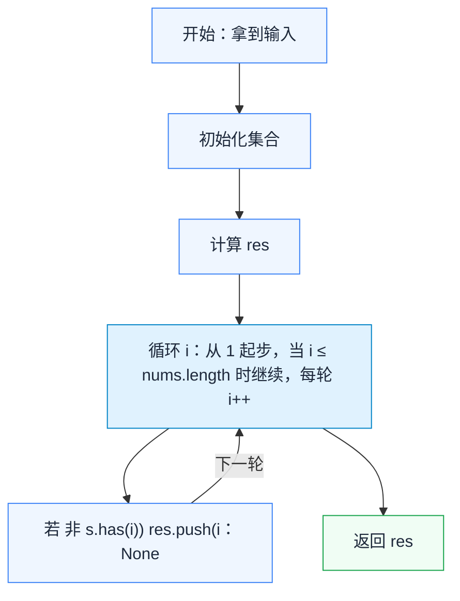

## TypeScript 解题方案（1 个方案逐个讲）

> **运行与提交**：每个方案都是自包含文件（内嵌用例自测，输出 PASS），整块复制到 `.ts` 文件后 `node 文件名` 即可运行。提交 LeetCode 时，把 `demo` 内的算法函数与辅助类型/函数整体取出、置于文件顶层即可。涉及交互/特殊接口的题以题面给定签名为准。

### 方案 1：哈希辅助

**分析与思路**：核心做法是「哈希辅助」。代码里依次做这些事：哈希结构做计数或查重；单循环线性扫描。

**运行方式**：`node 本文件`，内嵌用例全部通过会输出 PASS。

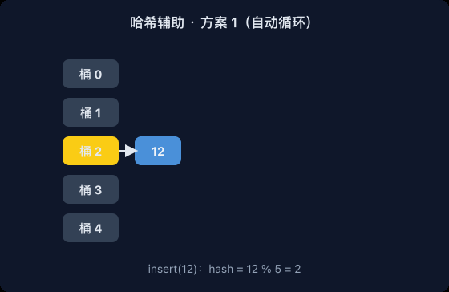

**方案专属流程图**（真实控制流）：

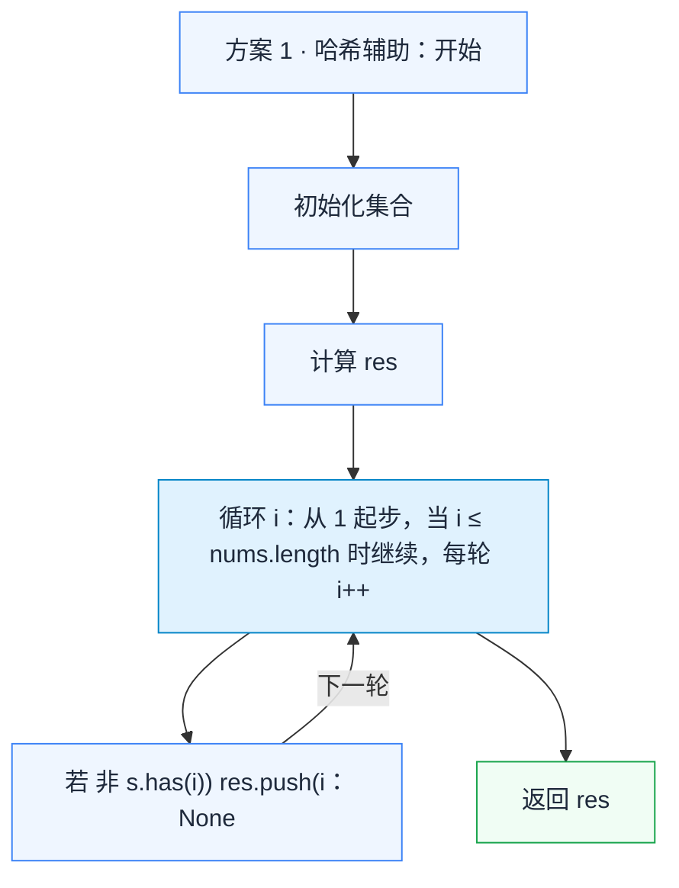

```typescript
// 找到所有数组中消失的数字
// 忠实翻译 Python ref_findDisappearedNumbers: 用集合标记后按顺序收集 1..n 中缺失者

function findDisappearedNumbers(nums: number[]): number[] {
  // 定义函数/方法 findDisappearedNumbers
  const s = new Set(nums); // 把 new Set(数组) 存入 字符串
  const res: number[] = []; // 把 []; 写入 const res: number[]
  for (let i = 1; i <= nums.length; i++) {
    // 让 下标 i 从 1 开始计数，下标 i 不超过 数组.长度 就继续
    if (!s.has(i)) res.push(i); // 若 取反 字符串.has(下标 i)) 结果 追加 下标 i);
  }
  return res; // 返回 结果
}

// 自检用例：(nums, 期望)
const cases: [number[], number[]][] = [
  [
    [4, 3, 2, 7, 8, 2, 3, 1],
    [5, 6],
  ],
  [[1, 1], [2]],
];

export function demo(): void {
  // 程序入口：跑内嵌自测用例
  for (const [nums, want] of cases) {
    // for (const [数组, want] of cases) {
    const got = findDisappearedNumbers(nums); // 把 findDisappearedNumbers(数组) 存入 got
    if (got.length !== want.length || got.some((v, i) => v !== want[i])) {
      throw new Error(
        `FAIL: findDisappearedNumbers(${JSON.stringify(nums)})=${JSON.stringify(got)} want ${JSON.stringify(want)}`,
      );
    }
  }
  console.log('PASS'); // 全部用例通过，输出 PASS
}

demo(); // demo();
```

## 逐步拆解与面试追问

**复杂度**：时间 O(n)（单趟线性扫描），空间 O(1) 到 O(n)（视辅助结构）

**为什么是这个量级**：每个元素被常数次访问，辅助哈希或栈的开销与 n 同阶

**面试官可能会追问**：

- 能不能原地做（O(1) 空间）？
- 如果数组已有序，能优化到什么程度？
- 空数组、单元素怎么处理？

## 关键 API 速查（TS 主解法实际用到，附官方链接）

| API | 作用 | 使用要点 | 官方文档 |
|---|---|---|---|
| `Set` | 集合：元素唯一 | add/add.has/delete；has 均摊 O(1)；NaN 视为相同；去重常用 [...new Set(arr)] | [官方文档](https://developer.mozilla.org/zh-CN/docs/Web/JavaScript/Reference/Global_Objects/Set) |
| `Array.prototype.push()` | 尾部追加 | 返回新长度；可一次多个；均摊 O(1)；会改变原数组 | [官方文档](https://developer.mozilla.org/zh-CN/docs/Web/JavaScript/Reference/Global_Objects/Array/push) |
| `JSON.stringify()` | 序列化为 JSON 字符串 | 常用于结构化比较（深度相等判定）；undefined/函数/循环引用会被丢弃或抛错 | [官方文档](https://developer.mozilla.org/zh-CN/docs/Web/JavaScript/Reference/Global_Objects/JSON/stringify) |

### 各语言官方文档导航

- **TypeScript / JS**：[MDN 中文参考](https://developer.mozilla.org/zh-CN/)
- **Python**：[Python 官方文档](https://docs.python.org/zh-cn/3/)
- **Go**：[Go 标准库](https://pkg.go.dev/std)
- **Java**：[JDK 17 API](https://docs.oracle.com/en/java/javase/17/docs/api/)
- **Rust**：[Rust 标准库](https://doc.rust-lang.org/std/)
- **Lua**：[Lua 5.4 手册](https://www.lua.org/manual/5.4/)
- **C**：[Cppreference C](https://zh.cppreference.com/w/c)
- **C++**：[Cppreference C++](https://zh.cppreference.com/w/cpp)
- **R**：[R 官方手册](https://stat.ethz.ch/R-manual/)
- **Zig**：[Zig 语言文档](https://ziglang.org/documentation/master/)
- **Dart**：[Dart API](https://api.dart.dev/)

## 附录：其他 10 种语言全部实现（每种语言列举其全部方案）

> TypeScript 的全部方案见「TypeScript 解题方案」一节；下面是其余 10 种语言的对应实现，每种语言的每个方案都带思路分析、代码走读与专属运行架构图。
> 每个方案都内嵌用例自测，可独立运行（老仓库 python/go 文件遵循「打印结果」约定）。
> 完整解法文件见 `dsa/<语言>/array/lc_448_找到所有数组中消失的数字/`。

### Python 实现（1 种方案）

Python 的全部方案如下，每个方案都内嵌用例自测，可独立运行（老仓库 python/go 文件遵循「打印结果」约定）：

#### 方案 1：哈希辅助

**思路与代码分析**：核心是「哈希辅助」。Python 版用切片与字典推导式简化操作，突出可读性。**走读**：方案 1 · 哈希辅助：开始 → 更新 s → 返回 [i for i in range(1, len(nums) + 1) if i not in s]。

**运行架构**（真实控制流）：

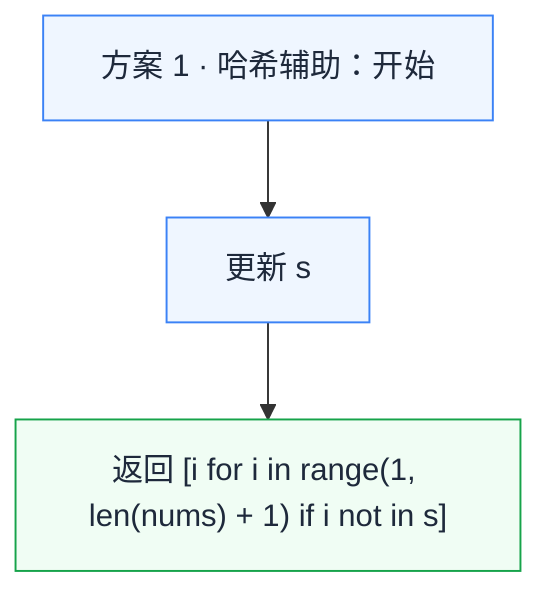

```python
import sys  # 提高递归深度上限（深输入防 RecursionError）

sys.setrecursionlimit(200000)  # 树/链表类题目节点数可达 1e4 量级

def find_disappeared_numbers(nums):  # 定义函数 find_disappeared_numbers（参数：数组）
    s = set(nums)  # 把 set(数组) 存入 字符串
    return [i for i in range(1, len(nums) + 1) if i not in s]

if __name__ == "__main__":  # 若 __name__ 等于 '__main__'
    cases = [
        ([4, 3, 2, 7, 8, 2, 3, 1], [5, 6]),
        ([1, 1], [2]),
    ]
    for nums, want in cases:  # for 数组, want in cases:
        got = find_disappeared_numbers(nums)  # 把 find_disappeared_numbers(数组) 存入 got
        assert got == want, f"findDisappearedNumbers({nums})={got} want {want}"  # 断言校验
    print("PASS")  # 全部用例通过，输出 PASS
```

### Go 实现（1 种方案）

Go 的全部方案如下，每个方案都内嵌用例自测，可独立运行（老仓库 python/go 文件遵循「打印结果」约定）：

#### 方案 1：哈希辅助

**思路与代码分析**：核心是「哈希辅助」。Go 版用切片与多返回值惯用法，显式处理索引边界。代码里依次做这些事：哈希结构做计数或查重。**走读**：方案 1 · 哈希辅助：开始 → 更新 : → 遍历 nums 的下标与元素 v → 更新 s[v] → 更新 : → 遍历循环 → 处理 if 非 s[i] → 更新 res → 返回 res。

**运行架构**（真实控制流）：

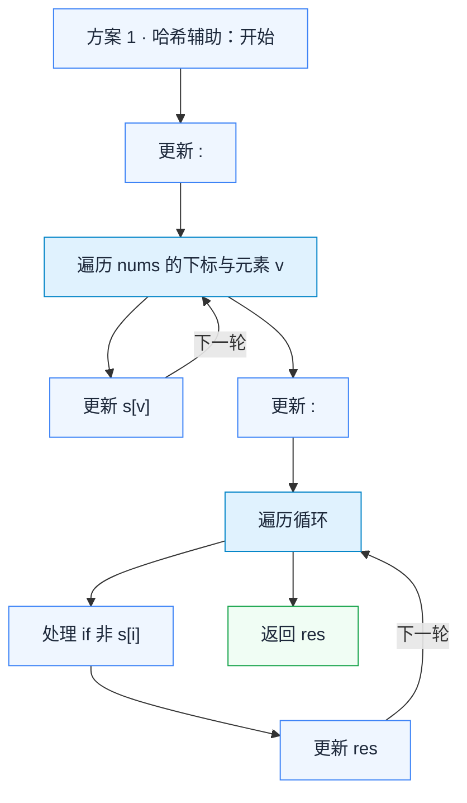

```go
package main // 引入依赖

import (
	"fmt" // 「fmt」
	"os"  // 「os」
)

// 找到所有数组中消失的数字
// 忠实翻译 Python ref_findDisappearedNumbers: 用集合标记后按顺序收集 1..n 中缺失者
func findDisappearedNumbers(nums []int) []int { // 定义函数/方法 findDisappearedNumbers
	s := make(map[int]bool)  // 把 make(映射表[int]bool) 写入 s :
	for _, v := range nums { // 同时取 _ 与 值 遍历
		s[v] = true // 把 true 写入 s[v]
	}
	res := []int{}                    // 把 []int{} 写入 res :
	for i := 1; i <= len(nums); i++ { // 让 下标 i 从 1 开始计数
		if !s[i] { // 若 取反 字符串[下标 i]
			res = append(res, i) // 把 append(结果, 下标 i) 写入 结果
		}
	}
	return res // 返回 结果
}

func eq(a, b []int) bool { // 定义函数/方法 eq
	if len(a) != len(b) { // 定义函数/方法 len
		return false // 返回 false
	}
	for i := range a { // 把 range 数组 { 写入 for i :
		if a[i] != b[i] { // 若 数组[下标 i] 不等于 b[下标 i]
			return false // 返回 false
		}
	}
	return true // 返回 true
}

func main() { // 程序入口：跑内嵌自测用例
	type tc struct { // 定义类型
		nums []int // 数组 []int
		want []int // want []int
	}
	cases := []tc{ // 把 []tc{ 写入 cases :
		{[]int{4, 3, 2, 7, 8, 2, 3, 1}, []int{5, 6}},
		{[]int{1, 1}, []int{2}},
	}
	ok := true                // 把 true 写入 ok :
	for _, c := range cases { // 同时取 _ 与 字符 遍历
		got := findDisappearedNumbers(c.nums) // 把 findDisappearedNumbers(字符.数组) 写入 got :
		if !eq(got, c.want) {                 // 若 取反 eq(got, 字符.want
			fmt.Printf("FAIL: findDisappearedNumbers(%v)=%v want %v\n", c.nums, got, c.want) // 打印输出
			ok = false                                                                       // 把 false 写入 ok
		}
	}
	if !ok { // 若 取反 ok
		fmt.Println("FAIL") // 打印输出
		os.Exit(1)          // os.Exit(1)
	}
	fmt.Println("PASS") // 全部用例通过，输出 PASS
}
```

### Java 实现（1 种方案）

Java 的全部方案如下，每个方案都内嵌用例自测，可独立运行（老仓库 python/go 文件遵循「打印结果」约定）：

#### 方案 1：哈希辅助

**思路与代码分析**：核心是「哈希辅助」。Java 版用类与静态方法组织，集合操作显式明了。代码里依次做这些事：双重循环遍历。**走读**：方案 1 · 哈希辅助：开始 → 更新 s → 遍历循环 → 更新 res → 遍历循环 → 若 非 s.contains(i)) res.add(i：None → 返回 res。

**运行架构**（真实控制流）：

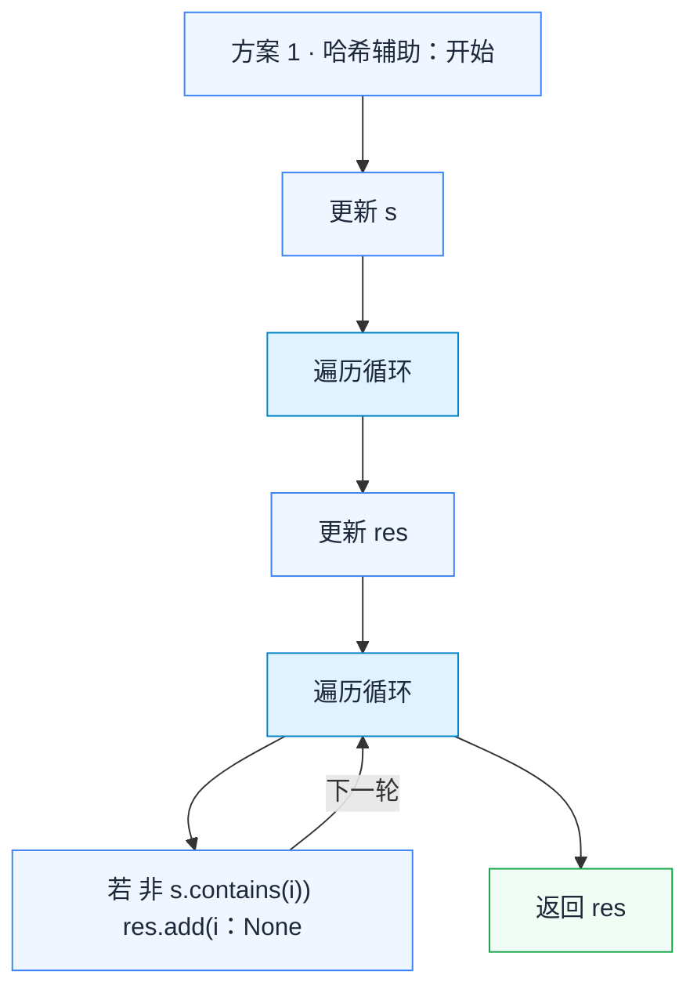

```java
package com.webfault.dsa; // 引入依赖

import java.util.*; // 引入依赖

class lc448_solution1 { // 定义类型
  // 找到所有数组中消失的数字
  // 忠实翻译 Python ref_findDisappearedNumbers: 用集合标记后按顺序收集 1..n 中缺失者
  static List<Integer> findDisappearedNumbers(int[] nums) { // 定义函数/方法 findDisappearedNumbers
    Set<Integer> s = new HashSet<>(); // 把 new HashSet 小于 超过 (); 写入 Set<Integer> s
    for (int v : nums) s.add(v); // for (int 值 : 数组) 字符串 追加 值);
    List<Integer> res = new ArrayList<>(); // 把 new ArrayList 小于 超过 (); 写入 List<Integer> res
    for (int i = 1; i <= nums.length; i++) { // 让 下标 i 从 1 开始计数，下标 i 不超过 数组.长度 就继续
      if (!s.contains(i)) res.add(i); // 若 取反 字符串 是否包含 下标 i)) 结果 追加 下标 i);
    }
    return res; // 返回 结果
  }

  public static void main(String[] args) { // public static void main(String[] args) {
    int[][] inputs = {
      {4, 3, 2, 7, 8, 2, 3, 1}, {1, 1}
    }; // 把 {{4, 3, 2, 7, 8, 2, 3, 1}, {1, 1}}; 写入 int[][] inputs
    int[][] wants = {{5, 6}, {2}}; // 把 {{5, 6}, {2}}; 写入 int[][] wants
    for (int i = 0; i < inputs.length; i++) { // 让 下标 i 从 0 开始计数，下标 i 小于 inputs.长度 就继续
      List<Integer> got =
          findDisappearedNumbers(
              inputs[i]); // 把 findDisappearedNumbers(inputs[下标 i]); 写入 List<Integer> got
      int[] ga = new int[got.size()]; // 把 new int[got.大小()]; 写入 int[] ga
      for (int k = 0; k < ga.length; k++) ga[k] = got.get(k); // 让 下标 k 从 0 开始计数，下标 k 小于 ga.长度 就继续
      if (!Arrays.equals(ga, wants[i])) { // 若 取反 Arrays.equals(ga, wants[下标 i]
        System.out.println(
            "FAIL: findDisappearedNumbers("
                + Arrays.toString(inputs[i])
                + ")="
                + got
                + " want "
                + Arrays.toString(wants[i])); // 打印输出
        System.exit(1); // System.exit(1);
      }
    }
    System.out.println("PASS"); // 全部用例通过，输出 PASS
  }
}
```

### Rust 实现（1 种方案）

Rust 的全部方案如下，每个方案都内嵌用例自测，可独立运行（老仓库 python/go 文件遵循「打印结果」约定）：

#### 方案 1：哈希辅助

**思路与代码分析**：核心是「哈希辅助」。Rust 版用所有权移动与切片借用改写同一逻辑，注意 Option 与引用边界。**走读**：方案 1 · 哈希辅助：开始 → 计算 v → 遍历 0..v.len() 中的每个元素 i → 计算 idx → 更新 v[idx] → 计算 out → 遍历 0..v.len() 中的每个元素 i → 处理 if v[i] ＞ 0 → 向 out 追加记录 → 处理 out → 返回结果。

**运行架构**（真实控制流）：

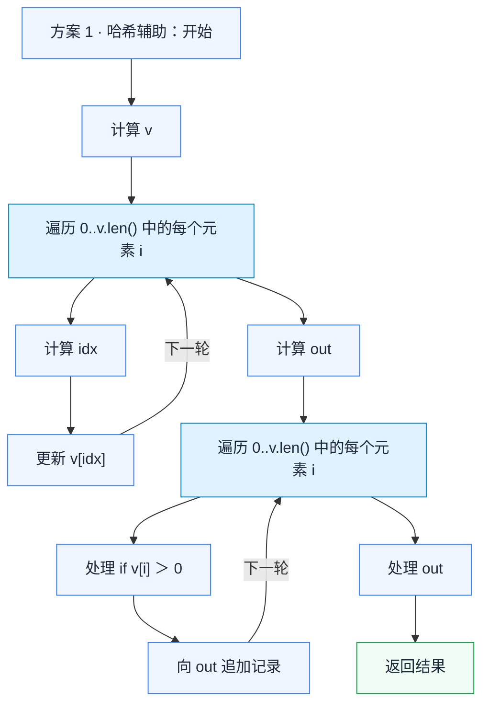

```rust
// LeetCode 448. 找到所有数组中消失的数字 — Rust 版（方案1）
fn find_disappeared_numbers(nums: Vec<i32>) -> Vec<i32> {
    // 定义函数/方法 find_disappeared_numbers
    let mut v = nums; // 把 数组; 写入 let mut v
    for i in 0..v.len() {
        // 逐个取出 0 的元素（下标 i）
        let idx = (v[i].abs() - 1) as usize; // 把 (值[下标 i].取绝对值 ) 减 1) as usize 存入 idx
        v[idx] = -v[idx].abs(); // 把 减 值[idx].取绝对值 ); 写入 v[idx]
    }
    let mut out = Vec::new(); // 把 Vec::new(); 写入 let mut out
    for i in 0..v.len() {
        // 逐个取出 0 的元素（下标 i）
        if v[i] > 0 {
            out.push(i as i32 + 1);
        } // 若 值[下标 i] 超过 0 { out 追加 下标 i as i32 加 1); }
    }
    out // out
}
fn main() {
    assert_eq!(
        find_disappeared_numbers(vec![4, 3, 2, 7, 8, 2, 3, 1]),
        vec![5, 6]
    );
    assert_eq!(find_disappeared_numbers(vec![1, 1]), vec![2]);
    println!("PASS");
} // 程序入口：跑内嵌自测用例
```

### Lua 实现（1 种方案）

Lua 的全部方案如下，每个方案都内嵌用例自测，可独立运行（老仓库 python/go 文件遵循「打印结果」约定）：

#### 方案 1：哈希辅助

**思路与代码分析**：核心是「哈希辅助」。Lua 版用表与 ipairs 遍历，注意 ipairs 遇 nil 即停的语义。**走读**：方案 1 · 哈希辅助：开始 → 更新 v → 循环 i：从 1 到 #v do → 更新 idx → 处理 if v[idx] and v[idx] ＞ 0 the → 更新 v[idx] → 更新 out → 循环 i：从 1 到 #v do → 处理 if v[i] ＞ 0 then → 更新 1] → 返回 out。

**运行架构**（真实控制流）：

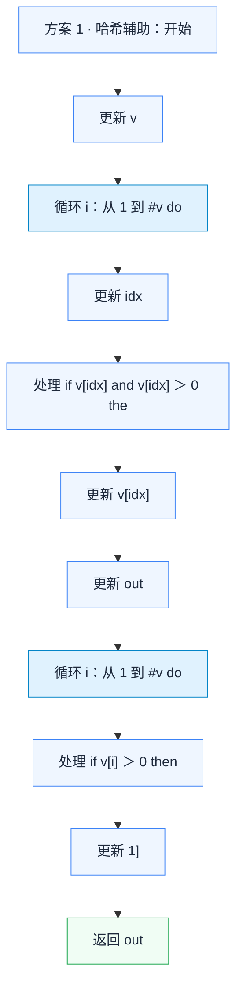

```lua
-- LeetCode 448. 找到所有数组中消失的数字 — Lua 版（方案1）
local function find_disappeared_numbers(nums) -- local function find_disappeared_numbers(数组)
	local v = { table.unpack(nums) } -- 把 {table.unpack(数组)} 写入 local v
	for i = 1, #v do -- 把 1, #值 do 写入 for i
		local idx = math.abs(v[i]) -- 把 math.取绝对值 值[下标 i]) 写入 local idx
		if v[idx] and v[idx] > 0 then
			v[idx] = -v[idx]
		end -- 若 值[idx] and 值[idx] 超过 0 then 值[idx] 赋值为 减 值[idx] 终点
	end -- 终点
	local out = {} -- 把 {} 写入 local out
	for i = 1, #v do -- 把 1, #值 do 写入 for i
		if v[i] > 0 then
			out[#out + 1] = i
		end -- 若 值[下标 i] 超过 0 then out[#out 加 1] 赋值为 下标 i 终点
	end -- 终点
	return out -- 返回 out
end -- 终点
assert(table.concat(find_disappeared_numbers({ 4, 3, 2, 7, 8, 2, 3, 1 }), ",") == "5,6") -- 打印输出
assert(table.concat(find_disappeared_numbers({ 1, 1 }), ",") == "2") -- 打印输出
print("PASS") -- 全部用例通过，输出 PASS
```

### C 实现（1 种方案）

C 的全部方案如下，每个方案都内嵌用例自测，可独立运行（老仓库 python/go 文件遵循「打印结果」约定）：

#### 方案 1：哈希辅助

**思路与代码分析**：核心是「哈希辅助」。C 版手动管理下标与内存，循环边界全部显式写出。代码里依次做这些事：双重循环遍历。**走读**：方案 1 · 哈希辅助：开始 → 处理 int v[4096] → 遍历循环 → 更新 v[i] → 遍历循环 → 更新 idx → 处理 : v[i] - 1 → 若 v[idx] ＞ 0：更新 v[idx] → 更新 v[idx] → 更新 cnt → 遍历循环 → 若 v[i] ＞ 0：更新 out[cnt++] → 更新 out[cnt++] → 返回 cnt。

**运行架构**（真实控制流）：

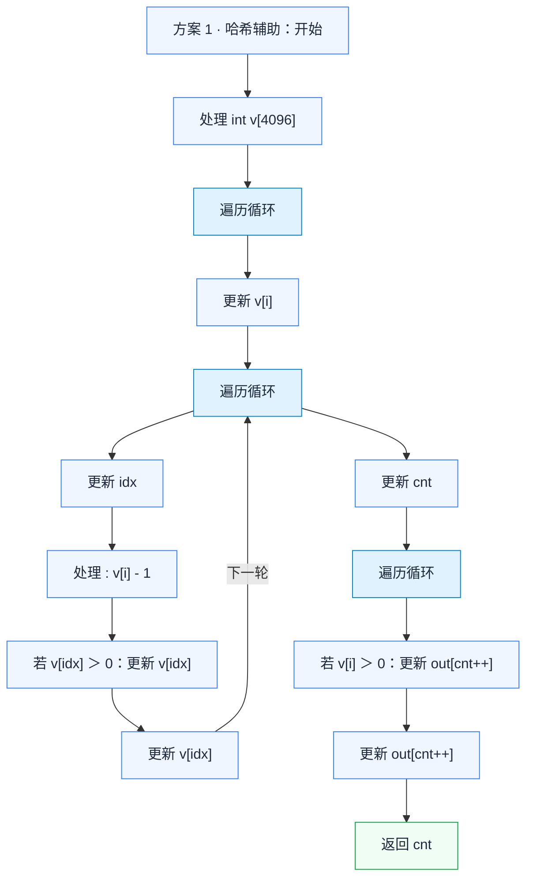

```c
/* LeetCode 448. 找到所有数组中消失的数字 — C 版（方案1） */
#include <stdio.h>                                              // 引入头文件
static int find_disappeared(const int *n, int len, int out[]) { // 定义函数/方法 find_disappeared
    int v[4096];                                                // int 值[4096];
    for (int i = 0; i < len; i++)
        v[i] = n[i];                // 让 下标 i 从 0 开始计数，下标 i 小于 长度 就继续
    for (int i = 0; i < len; i++) { // 让 下标 i 从 0 开始计数，下标 i 小于 长度 就继续
        int idx = v[i] < 0 ? -v[i] - 1
                           : v[i] - 1; // 把 值[下标 i] 小于 0 ? 减 值[下标 i] 减 1 : 值[下标 i] 减 1 存入 idx
        if (v[idx] > 0)
            v[idx] = -v[idx]; // 若 值[idx] 超过 0) 值[idx] 赋值为 减 值[idx];
    }
    int cnt = 0; // 把 0 存入 计数
    for (int i = 0; i < len; i++)
        if (v[i] > 0)
            out[cnt++] = i + 1; // 让 下标 i 从 0 开始计数，下标 i 小于 长度 就继续
    return cnt;                 // 返回 计数
}
int main(void) {      // 程序入口：跑内嵌自测用例
    int out[4096], n; // int out[4096], 元素个数;
    n = find_disappeared((int[]){4, 3, 2, 7, 8, 2, 3, 1}, 8, out);
    if (n != 2 || out[0] != 5 || out[1] != 6) {
        printf("FAIL 1\n");
        return 1;
    }
    n = find_disappeared((int[]){1, 1}, 2, out); // 把 find_disappeared((int[]){1,1}, 2, out); 写入 元素个数
    if (n != 1 || out[0] != 2) {
        printf("FAIL 2\n");
        return 1;
    } // 若 元素个数 不等于 1 或 out[0] 不等于 2) { 输出「FAIL 2 」); return 1; }
    printf("PASS\n");
    return 0;
} // 全部用例通过，输出 PASS
```

### C++ 实现（1 种方案）

C++ 的全部方案如下，每个方案都内嵌用例自测，可独立运行（老仓库 python/go 文件遵循「打印结果」约定）：

#### 方案 1：哈希辅助

**思路与代码分析**：核心是「哈希辅助」。C++ 版用 STL 容器与迭代器，减少手写下标错误。代码里依次做这些事：双重循环遍历。**走读**：方案 1 · 哈希辅助：开始 → 遍历循环 → 更新 idx → 若 nums[idx] ＞ 0：更新 nums[idx] → 更新 nums[idx] → 处理 std::vector＜int＞ out → 遍历循环 → 若 nums[i] ＞ 0：调用 out.push_back(static_cast＜in → 调用 out.push_back(static_cast＜in → 处理 1) → 返回 out。

**运行架构**（真实控制流）：

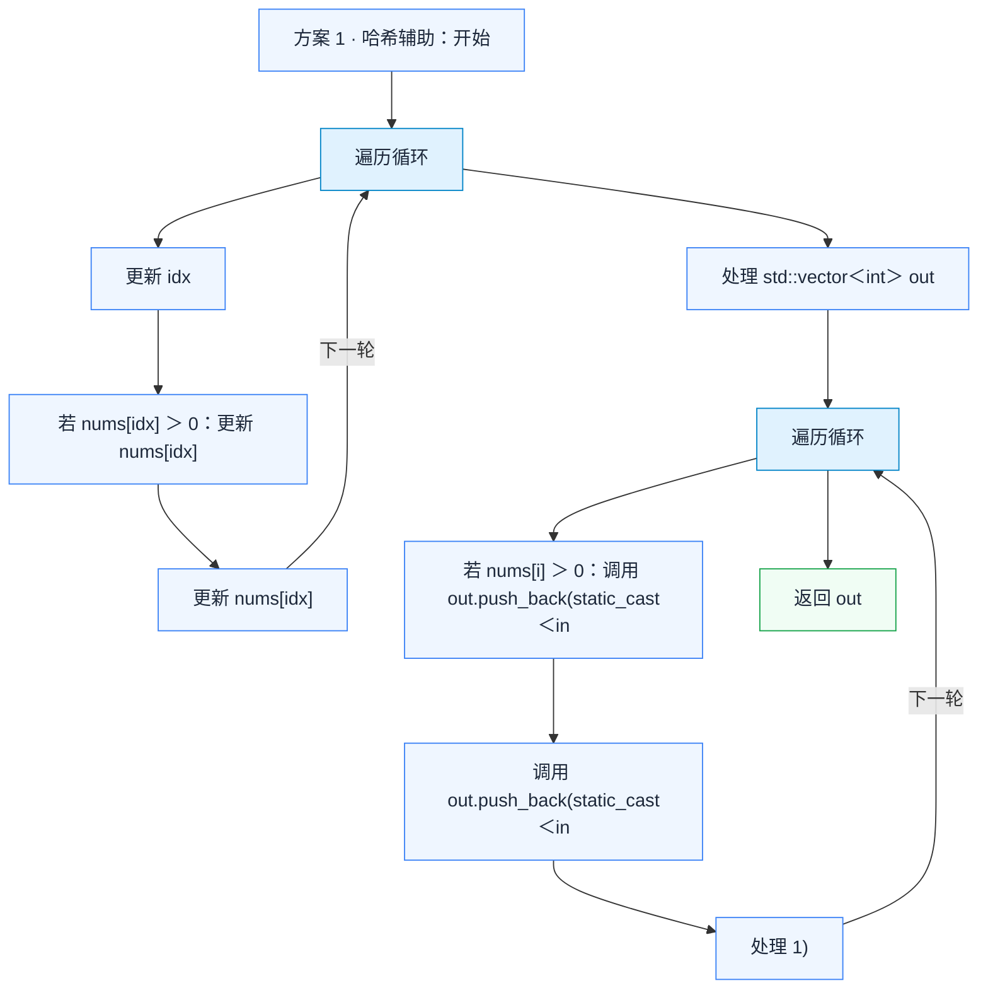

```cpp
// LeetCode 448. 找到所有数组中消失的数字 — C++ 版（方案1）
#include <cassert>  // 引入头文件
#include <iostream> // 引入头文件
#include <vector>   // 引入头文件
static std::vector<int> findDisappearedNumbers(std::vector<int> nums) {
    for (size_t i = 0; i < nums.size(); ++i) { // 让 下标 i 从 0 开始计数，下标 i 小于 数组.大小() 就继续
        int idx = std::abs(nums[i]) - 1; // 把 std::取绝对值 数组[下标 i]) 减 1 存入 idx
        if (nums[idx] > 0)
            nums[idx] = -nums[idx]; // 若 数组[idx] 超过 0) 数组[idx] 赋值为 减 数组[idx];
    }
    std::vector<int> out;                      // std::vector 小于 int 超过 out;
    for (size_t i = 0; i < nums.size(); ++i) { // 让 下标 i 从 0 开始计数，下标 i 小于 数组.大小() 就继续
        if (nums[i] > 0)
            out.push_back(static_cast<int>(i) +
                          1); // 若 数组[下标 i] 超过 0) out 追加 static_cast 小于 int 超过 (下标 i) 加 1);
    }
    return out; // 返回 out
}
int main() {
    assert((findDisappearedNumbers({4, 3, 2, 7, 8, 2, 3, 1}) == std::vector<int>{5, 6}));
    assert((findDisappearedNumbers({1, 1}) == std::vector<int>{2}));
    std::cout << "PASS" << std::endl;
} // 全部用例通过，输出 PASS
```

### R 实现（1 种方案）

R 的全部方案如下，每个方案都内嵌用例自测，可独立运行（老仓库 python/go 文件遵循「打印结果」约定）：

#### 方案 1：哈希辅助

**思路与代码分析**：核心是「哈希辅助」。R 版用向量化思维与 1 起始下标，注意 1:n 的降序陷阱。**走读**：方案 1 · 哈希辅助：开始 → 处理 n ＜- length(nums) → 处理 present ＜- seq_len(n) %in% n → 调用 which(非 present) → 返回结果。

**运行架构**（真实控制流）：

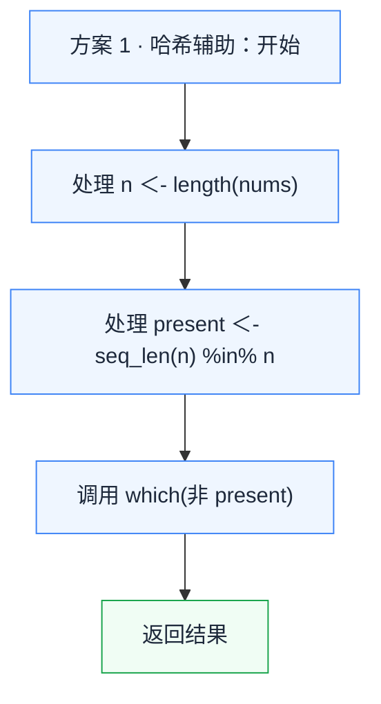

```r
# 找到所有数组中消失的数字 — R 版（方案1） 定义函数 find_disappeared（参数：数组）
find_disappeared <- function(nums) {
    n <- length(nums)  # 把 长度(数组) 存入 元素个数
    present <- seq_len(n) %in% nums  # 把 seq_len(元素个数) 对…取模 in 对…取模 数组 存入 present
    which(!present)  # which(取反 present)
}
stopifnot(identical(find_disappeared(c(4, 3, 2, 7, 8, 2, 3, 1)), c(5L, 6L)))  # 断言校验
stopifnot(identical(find_disappeared(c(1, 1)), 2L))  # 断言校验
cat("PASS\n")  # 全部用例通过，输出 PASS
```

### Zig 实现（1 种方案）

Zig 的全部方案如下，每个方案都内嵌用例自测，可独立运行（老仓库 python/go 文件遵循「打印结果」约定）：

#### 方案 1：哈希辅助

**思路与代码分析**：核心是「哈希辅助」。Zig 版显式分配与清零，整型边界处理严格。代码里依次做这些事：双重循环遍历。**走读**：方案 1 · 哈希辅助：开始 → 计算 v → 处理 @memcpy(v[0..nums.len], nums → 遍历集合元素 → 计算 idx → 若 v[idx] ＞ 0：更新 v[idx] → 遍历集合元素 → 若 v[i] ＞ 0) out.append(@intCast(i + 1)：处理 catch unreachable → 返回结果。

**运行架构**（真实控制流）：

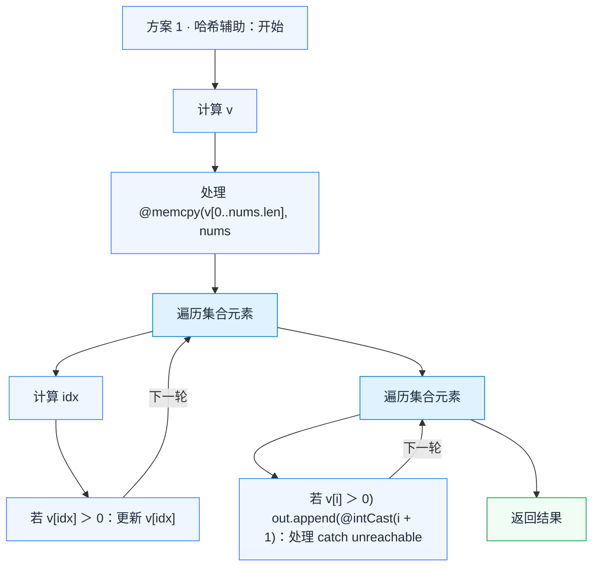

```zig
// LeetCode 448. 找到所有数组中消失的数字 — Zig 版（方案1）
const std = @import("std"); // 把 @import(「std」) 存入 std
fn findDisappeared(nums: []const i32, out: *std.ArrayList(i32)) void { // 定义函数/方法 findDisappeared
    var v: [4096]i32 = undefined; // 把 undefined; 写入 var v: [4096]i32
    @memcpy(v[0..nums.len], nums); // @memcpy(值[0..数组.长度], 数组);
    for (0..nums.len) |i| { // 逐个取出 0..数组.长度 的元素（下标 i）
        const idx: usize = @intCast(if (v[i] < 0) -v[i] - 1 else v[i] - 1);
        if (v[idx] > 0) v[idx] = -v[idx]; // 若 值[idx] 超过 0) 值[idx] 赋值为 减 值[idx];
    }
    for (0..nums.len) |i| { // 逐个取出 0..数组.长度 的元素（下标 i）
        if (v[i] > 0) out.append(@intCast(i + 1)) catch unreachable;
    }
}
pub fn main() !void { // 程序入口：跑内嵌自测用例
    var out = std.ArrayList(i32).init(std.heap.page_allocator); // 把 std.ArrayList(i32).init(std.堆.page_allocator) 存入 out
    defer out.deinit(); // defer out.deinit();
    findDisappeared(&[_]i32{ 4, 3, 2, 7, 8, 2, 3, 1 }, &out);
    if (out.items.len != 2 or out.items[0] != 5 or out.items[1] != 6) return error.TestFailed;
    out.clearRetainingCapacity(); // out.clearRetainingCapacity();
    findDisappeared(&[_]i32{ 1, 1 }, &out); // findDisappeared( 按位与 [_]i32{ 1, 1 }, 按位与 out);
    if (out.items.len != 1 or out.items[0] != 2) return error.TestFailed;
    std.debug.print("PASS\n", .{});
} // 全部用例通过，输出 PASS
```

### Dart 实现（1 种方案）

Dart 的全部方案如下，每个方案都内嵌用例自测，可独立运行（老仓库 python/go 文件遵循「打印结果」约定）：

#### 方案 1：哈希辅助

**思路与代码分析**：核心是「哈希辅助」。Dart 版用可空类型标注与集合方法，注意空安全。代码里依次做这些事：双重循环遍历。**走读**：方案 1 · 哈希辅助：开始 → 更新 v → 遍历循环 → 更新 idx → 若 v[idx] ＞ 0：更新 v[idx] → 更新 out → 遍历循环 → 若 v[i] ＞ 0) out.add(i + 1：None → 返回 out。

**运行架构**（真实控制流）：

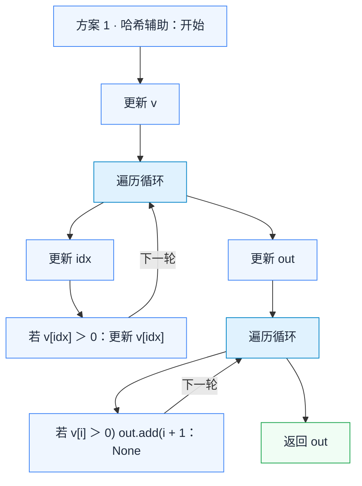

```dart
// LeetCode 448. 找到所有数组中消失的数字 — Dart 版（方案1）
List<int> findDisappearedNumbers(List<int> nums) {
  // 定义函数/方法 findDisappearedNumbers
  final v = List<int>.from(nums); // 把 List 小于 int 超过 .from(数组) 存入 值
  for (var i = 0; i < v.length; i++) {
    // 让 下标 i 从 0 开始计数，下标 i 小于 值.长度 就继续
    final idx = v[i].abs() - 1; // 把 值[下标 i].取绝对值 ) 减 1 存入 idx
    if (v[idx] > 0) v[idx] = -v[idx]; // 若 值[idx] 超过 0) 值[idx] 赋值为 减 值[idx];
  }
  final out = <int>[]; // 把 小于 int 超过 [] 存入 out
  for (var i = 0; i < v.length; i++) {
    // 让 下标 i 从 0 开始计数，下标 i 小于 值.长度 就继续
    if (v[i] > 0) out.add(i + 1); // 若 值[下标 i] 超过 0) out 追加 下标 i 加 1);
  }
  return out; // 返回 out
}

void main() {
  if (findDisappearedNumbers([4, 3, 2, 7, 8, 2, 3, 1]).toString() != '[5, 6]')
    throw StateError('c1');
  if (findDisappearedNumbers([1, 1]).toString() != '[2]')
    throw StateError('c2');
  print('PASS');
} // 全部用例通过，输出 PASS
```

---

## 内容总结

- **找到所有数组中消失的数字**（数组 · Medium）：共 1 个方案，主线思路「哈希辅助」；时间 O(n)（单趟线性扫描）；动画演示双指针过程，附录给出 11 种语言 × 全部方案的可运行实现。
- 来源博客：[]()
- 导航：[📋 总目录](../) ｜ [← 034 无重复字符的最长子串](../034_无重复字符的最长子串/) ｜ [036 最大连续1的个数 →](../036_最大连续1的个数/)
