# 036 · 最大连续1的个数（第一阶段 · 线性结构入门 · Medium）

> **难度**：⭐⭐ Medium ｜ **专题**：数组
> **学习定位**：第一阶段 · 线性结构入门第 36 篇 ｜ **解法数**：1
> **内容总结**：**最大连续1的个数**（数组 · Medium）：共 1 个方案，主线思路「单趟扫描」；时间 O(n)（单趟线性扫描）；动画演示双指针过程，附录给出 11 种语言 × 全部方案的可运行实现。

---

## 题目描述

给定一个二进制数组 `nums` ， 计算其中最大连续 `1` 的个数。

- 主函数签名：`function findMaxConsecutiveOnes(nums: number[]): number`

**用例（来自原题）**：

**示例 1**

```text
输入：nums = [1,1,0,1,1,1]
输出：3
```

解释：开头的两位和最后的三位都是连续 1 ，所以最大连续 1 的个数是 3.
> ✅ **官方验证**：全部 TypeScript 解法已通过 leetcode.cn 官方示例用例验证（自动注入运行，全部 PASS）。题面与 [leetcode.cn 官方](https://leetcode.cn/problems/max-consecutive-ones/)一致，示例配图取自官方题面。

**数据范围与注意事项**：

- `1 <= nums.length <= 10^5`
- `nums[i]` 不是 `0` 就是 `1`.
- **易错点**：边界最容易漏：空数组、只有一个元素、目标出现在头尾。

## 题目分析

**场景是什么**：数组是最常用的线性容器，这类题练的是下标操作与原地腾挪，对应真实开发里的缓冲区、列表整理。本题就是该场景的 Medium 级练习，主线做法是「单趟扫描」。

**主线怎么解**：把主解法从头到尾过一遍，它其实在依次做这几件事：单循环线性扫描。

## 解题思路

**方案对比**（共 1 个方案，由浅入深）：

| 方案 | 时间复杂度 | 空间复杂度 |
|---|---|---|
| 方案 1 · 单趟扫描 | O(n)（单趟线性扫描） | O(1) 到 O(n)（视辅助结构） |

**怎么读这一篇**：

- 🐣 **新手路线**：把「题目描述」的示例 1 在纸上手推一遍 → 读方案 1（最直观的写法）与它的代码走读 → 按「运行方式」本地跑通看 PASS → 回头对比方案 2 之后的写法差在哪
- 🦅 **大佬路线**：直接锁定最优方案 1（单趟扫描，O(n)（单趟线性扫描））→ 跳读该方案代码与走读 → 用「逐步拆解与面试追问」补齐复杂度推导与边界追问

### 动态算法图（双指针，GIF 自动循环）


动画演示数组专题里双指针的典型过程；每个方案在「TypeScript 解题方案」一节还配了专属动画与专属流程图。

### 主解法流程图（真实控制流）

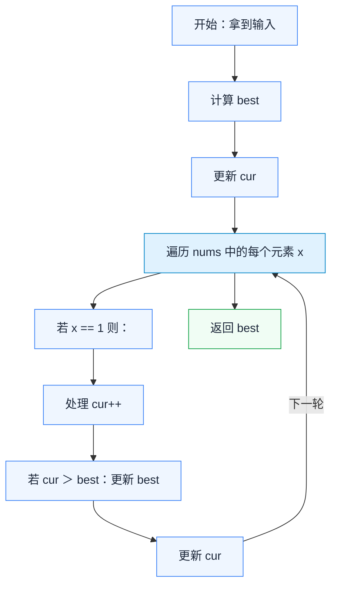

## TypeScript 解题方案（1 个方案逐个讲）

> **运行与提交**：每个方案都是自包含文件（内嵌用例自测，输出 PASS），整块复制到 `.ts` 文件后 `node 文件名` 即可运行。提交 LeetCode 时，把 `demo` 内的算法函数与辅助类型/函数整体取出、置于文件顶层即可。涉及交互/特殊接口的题以题面给定签名为准。

### 方案 1：单趟扫描

**分析与思路**：核心做法是「单趟扫描」。代码里依次做这些事：单循环线性扫描。

**运行方式**：`node 本文件`，内嵌用例全部通过会输出 PASS。


**方案专属流程图**（真实控制流）：

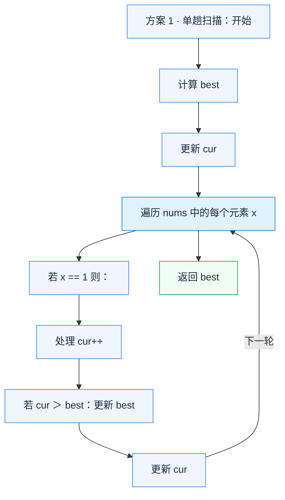

```typescript
/**
 ** LeetCode 485. 最大连续1的个数
 ** 忠实化打样：算法对标 python 参考实现 ref_findMaxConsecutiveOnes
 */

function findMaxConsecutiveOnes(nums: number[]): number {
  // 定义函数/方法 findMaxConsecutiveOnes
  let best = 0,
    cur = 0; // 把 0, 当前值 赋值为 0 存入 当前最优
  for (const x of nums) {
    // for (const x of 数组) {
    if (x === 1) {
      // 若 x 全等于 1
      cur++; // 当前值 加一
      if (cur > best) best = cur; // 若 当前值 超过 当前最优) 当前最优 赋值为 当前值;
    } else {
      // 否则
      cur = 0; // 把 0 存入 当前值
    }
  }
  return best; // 返回 当前最优
}

export function demo(): void {
  // 程序入口：跑内嵌自测用例
  const cases: [number[], number][] = [
    [[1, 1, 0, 1, 1, 1], 3],
    [[1, 0, 1, 1, 0, 1], 2],
    [[0], 0],
  ];
  for (const [nums, want] of cases) {
    // for (const [数组, want] of cases) {
    const got = findMaxConsecutiveOnes(nums); // 把 findMaxConsecutiveOnes(数组) 存入 got
    if (got !== want) {
      // 若 got 不等于 want
      throw new Error('FAIL: got ' + got + ' expected ' + want); // throw new Error(「FAIL: got 」 加 got 加 「FAIL: got 」 加 want);
    }
  }
  console.log('PASS'); // 全部用例通过，输出 PASS
}

demo(); // demo();
```

## 逐步拆解与面试追问

**复杂度**：时间 O(n)（单趟线性扫描），空间 O(1) 到 O(n)（视辅助结构）

**为什么是这个量级**：每个元素被常数次访问，辅助哈希或栈的开销与 n 同阶

**面试官可能会追问**：

- 能不能原地做（O(1) 空间）？
- 如果数组已有序，能优化到什么程度？
- 空数组、单元素怎么处理？

## 关键 API 速查（TS 主解法实际用到，附官方链接）

本题主解法只用到基础语法（变量、循环、比较），不依赖特殊库 API。

### 各语言官方文档导航

- **TypeScript / JS**：[MDN 中文参考](https://developer.mozilla.org/zh-CN/)
- **Python**：[Python 官方文档](https://docs.python.org/zh-cn/3/)
- **Go**：[Go 标准库](https://pkg.go.dev/std)
- **Java**：[JDK 17 API](https://docs.oracle.com/en/java/javase/17/docs/api/)
- **Rust**：[Rust 标准库](https://doc.rust-lang.org/std/)
- **Lua**：[Lua 5.4 手册](https://www.lua.org/manual/5.4/)
- **C**：[Cppreference C](https://zh.cppreference.com/w/c)
- **C++**：[Cppreference C++](https://zh.cppreference.com/w/cpp)
- **R**：[R 官方手册](https://stat.ethz.ch/R-manual/)
- **Zig**：[Zig 语言文档](https://ziglang.org/documentation/master/)
- **Dart**：[Dart API](https://api.dart.dev/)

## 附录：其他 10 种语言全部实现（每种语言列举其全部方案）

> TypeScript 的全部方案见「TypeScript 解题方案」一节；下面是其余 10 种语言的对应实现，每种语言的每个方案都带思路分析、代码走读与专属运行架构图。
> 每个方案都内嵌用例自测，可独立运行（老仓库 python/go 文件遵循「打印结果」约定）。
> 完整解法文件见 `dsa/<语言>/array/lc_485_最大连续1的个数/`。

### Python 实现（1 种方案）

Python 的全部方案如下，每个方案都内嵌用例自测，可独立运行（老仓库 python/go 文件遵循「打印结果」约定）：

#### 方案 1：单趟扫描

**思路与代码分析**：核心是「单趟扫描」。Python 版用切片与字典推导式简化操作，突出可读性。**走读**：方案 1 · 单趟扫描：开始 → 更新 best → 更新 cur → 遍历 nums: 中的每个元素 x → 若 x == 1：更新 + → 更新 + → 若 cur ＞ best：更新 best → 更新 best → 更新 cur → 返回 best。

**运行架构**（真实控制流）：

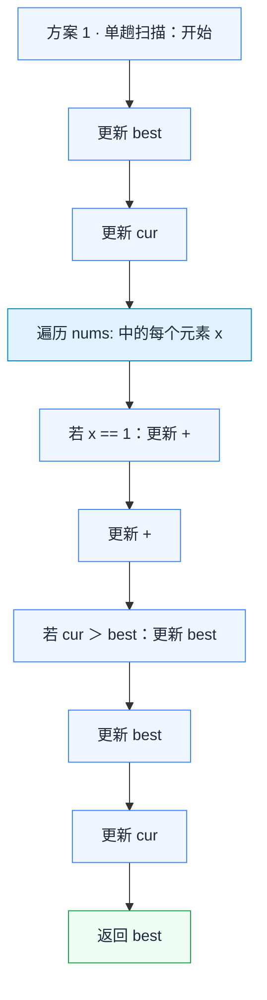

```python
import sys  # 提高递归深度上限（深输入防 RecursionError）

sys.setrecursionlimit(200000)  # 树/链表类题目节点数可达 1e4 量级

def find_max_consecutive_ones(nums):  # 定义函数 find_max_consecutive_ones（参数：数组）
    best = 0  # 把 0 存入 当前最优
    cur = 0  # 把 0 存入 当前值
    for x in nums:  # 逐个取出 数组 的元素（x）
        if x == 1:  # 若 x 等于 1
            cur += 1  # 当前值累加 1
            if cur > best:  # 若 当前值 超过 当前最优
                best = cur  # 把 当前值 存入 当前最优
        else:  # 否则
            cur = 0  # 把 0 存入 当前值
    return best  # 返回 当前最优

if __name__ == "__main__":  # 若 __name__ 等于 '__main__'
    cases = [
        ([1, 1, 0, 1, 1, 1], 3),
        ([1, 0, 1, 1, 0, 1], 2),
        ([0], 0),
    ]
    for nums, want in cases:  # for 数组, want in cases:
        got = find_max_consecutive_ones(nums)  # 把 find_max_consecutive_ones(数组) 存入 got
        assert got == want, f"got {got} expected {want}"  # 断言校验
    print("PASS")  # 全部用例通过，输出 PASS
```

### Go 实现（1 种方案）

Go 的全部方案如下，每个方案都内嵌用例自测，可独立运行（老仓库 python/go 文件遵循「打印结果」约定）：

#### 方案 1：单趟扫描

**思路与代码分析**：核心是「单趟扫描」。Go 版用切片与多返回值惯用法，显式处理索引边界。**走读**：方案 1 · 单趟扫描：开始 → 更新 : → 更新 : → 遍历 nums 的下标与元素 x → 处理 if x == 1 → 处理 cur++ → 处理 if cur ＞ best → 更新 best → 更新 cur → 返回 best。

**运行架构**（真实控制流）：

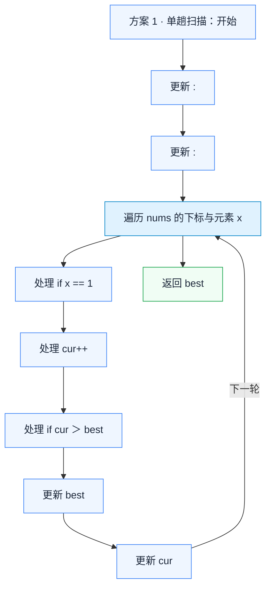

```go
package main // 引入依赖

import (
	"fmt" // 「fmt」
	"os"  // 「os」
)

func findMaxConsecutiveOnes(nums []int) int { // 定义函数/方法 findMaxConsecutiveOnes
	best := 0                // 把 0 写入 best :
	cur := 0                 // 把 0 写入 cur :
	for _, x := range nums { // 同时取 _ 与 x 遍历
		if x == 1 { // 若 x 等于 1
			cur++           // 当前值 加一
			if cur > best { // 若 当前值 超过 当前最优
				best = cur // 把 当前值 写入 当前最优
			}
		} else { // 否则
			cur = 0 // 把 0 写入 当前值
		}
	}
	return best // 返回 当前最优
}

func main() { // 程序入口：跑内嵌自测用例
	cases := []struct { // 把 []struct { 写入 cases :
		nums []int // 数组 []int
		want int   // want int
	}{ // }{
		{[]int{1, 1, 0, 1, 1, 1}, 3},
		{[]int{1, 0, 1, 1, 0, 1}, 2},
		{[]int{0}, 0},
	}
	for _, c := range cases { // 同时取 _ 与 字符 遍历
		got := findMaxConsecutiveOnes(c.nums) // 把 findMaxConsecutiveOnes(字符.数组) 写入 got :
		if got != c.want {                    // 若 got 不等于 字符.want
			fmt.Printf("FAIL: got %d expected %d\n", got, c.want) // 打印输出
			os.Exit(1)                                            // os.Exit(1)
		}
	}
	fmt.Println("PASS") // 全部用例通过，输出 PASS
}
```

### Java 实现（1 种方案）

Java 的全部方案如下，每个方案都内嵌用例自测，可独立运行（老仓库 python/go 文件遵循「打印结果」约定）：

#### 方案 1：单趟扫描

**思路与代码分析**：核心是「单趟扫描」。Java 版用类与静态方法组织，集合操作显式明了。代码里依次做这些事：单循环线性扫描。**走读**：方案 1 · 单趟扫描：开始 → 更新 best → 遍历循环 → 若 x == 1 则： → 处理 cur++ → 若 cur ＞ best：更新 best → 更新 cur → 返回 best。

**运行架构**（真实控制流）：

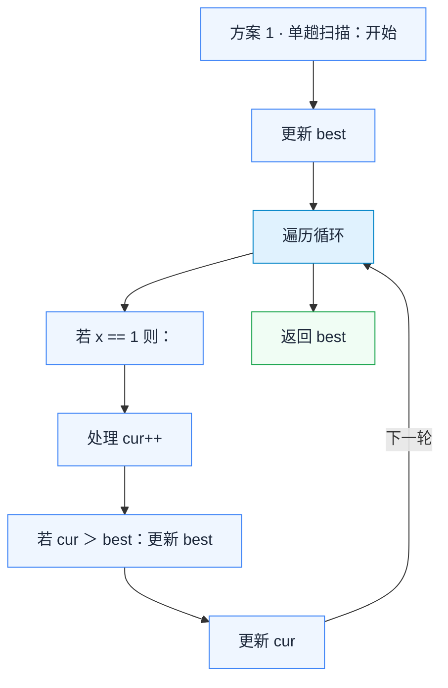

```java
package com.webfault.dsa; // 引入依赖

import java.util.*; // 引入依赖

class Solution { // 定义类型

  static int findMaxConsecutiveOnes(int[] nums) { // 定义函数/方法 findMaxConsecutiveOnes
    int best = 0, cur = 0; // 把 0, 当前值 赋值为 0 存入 当前最优
    for (int x : nums) { // for (int x : 数组) {
      if (x == 1) { // 若 x 等于 1
        cur++; // 当前值 加一
        if (cur > best) best = cur; // 若 当前值 超过 当前最优) 当前最优 赋值为 当前值;
      } else { // 否则
        cur = 0; // 把 0; 写入 当前值
      }
    }
    return best; // 返回 当前最优
  }

  public static void main(String[] args) { // public static void main(String[] args) {
    int[][][] cases = { // 把 { 写入 int[][][] cases
      {{1, 1, 0, 1, 1, 1}, {3}},
      {{1, 0, 1, 1, 0, 1}, {2}},
      {{0}, {0}},
    };
    for (int k = 0; k < cases.length; k++) { // 让 下标 k 从 0 开始计数，下标 k 小于 cases.长度 就继续
      int[] nums = cases[k][0]; // 把 cases[下标 k][0]; 写入 int[] nums
      int want = cases[k][1][0]; // 把 cases[下标 k][1][0] 存入 want
      int got = findMaxConsecutiveOnes(nums); // 把 findMaxConsecutiveOnes(数组) 存入 got
      if (got != want) { // 若 got 不等于 want
        System.out.println("FAIL: got " + got + " expected " + want); // 打印输出
        throw new RuntimeException(
            "self-check failed"); // throw new RuntimeException(「self 减 check failed」);
      }
    }
    System.out.println("PASS"); // 全部用例通过，输出 PASS
  }
}
```

### Rust 实现（1 种方案）

Rust 的全部方案如下，每个方案都内嵌用例自测，可独立运行（老仓库 python/go 文件遵循「打印结果」约定）：

#### 方案 1：单趟扫描

**思路与代码分析**：核心是「单趟扫描」。Rust 版用所有权移动与切片借用改写同一逻辑，注意 Option 与引用边界。**走读**：方案 1 · 单趟扫描：开始 → 计算 let (mut best, mut cur) → 遍历 nums 中的每个元素 v → 处理 if v == 1 → 更新 + → 更新 best → 更新 cur → 处理 best → 返回结果。

**运行架构**（真实控制流）：

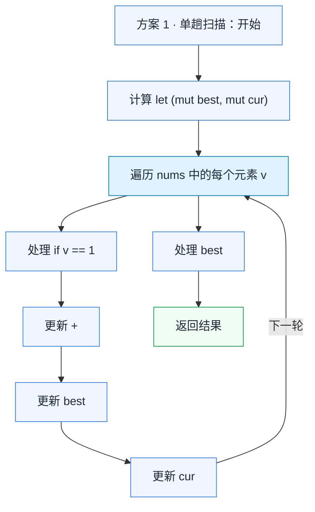

```rust
// LeetCode 485. 最大连续1的个数 — Rust 版（方案1）
fn find_max_consecutive_ones(nums: Vec<i32>) -> i32 {
    // 定义函数/方法 find_max_consecutive_ones
    let (mut best, mut cur) = (0i32, 0i32); // 把 (0i32, 0i32); 写入 let (mut best, mut cur)
    for v in nums {
        if v == 1 {
            cur += 1;
            best = best.max(cur);
        } else {
            cur = 0;
        }
    } // 逐个取出 数组 的元素（值）
    best // 当前最优
}
fn main() {
    assert_eq!(find_max_consecutive_ones(vec![1, 1, 0, 1, 1, 1]), 3);
    assert_eq!(find_max_consecutive_ones(vec![1, 0, 1, 1, 0, 1]), 2);
    println!("PASS");
} // 程序入口：跑内嵌自测用例
```

### Lua 实现（1 种方案）

Lua 的全部方案如下，每个方案都内嵌用例自测，可独立运行（老仓库 python/go 文件遵循「打印结果」约定）：

#### 方案 1：单趟扫描

**思路与代码分析**：核心是「单趟扫描」。Lua 版用表与 ipairs 遍历，注意 ipairs 遇 nil 即停的语义。**走读**：方案 1 · 单趟扫描：开始 → 更新 cur → 遍历 ipairs(nums) do 中的每个元素 v → 处理 if v == 1 then → 更新 cur → 处理 if cur ＞ best then → 更新 best → 更新 cur → 返回 best。

**运行架构**（真实控制流）：

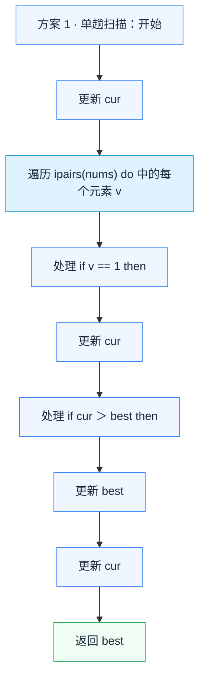

```lua
-- LeetCode 485. 最大连续1的个数 — Lua 版（方案1）
local function find_max_consecutive_ones(nums) -- local function find_max_consecutive_ones(数组)
	local best, cur = 0, 0 -- 把 0, 0 写入 local best, cur
	for _, v in ipairs(nums) do -- 遍历取 值
		if v == 1 then
			cur = cur + 1
			if cur > best then
				best = cur
			end
		else
			cur = 0
		end -- 否则
	end -- 终点
	return best -- 返回 当前最优
end -- 终点
assert(find_max_consecutive_ones({ 1, 1, 0, 1, 1, 1 }) == 3) -- 断言校验
assert(find_max_consecutive_ones({ 1, 0, 1, 1, 0, 1 }) == 2) -- 断言校验
print("PASS") -- 全部用例通过，输出 PASS
```

### C 实现（1 种方案）

C 的全部方案如下，每个方案都内嵌用例自测，可独立运行（老仓库 python/go 文件遵循「打印结果」约定）：

#### 方案 1：单趟扫描

**思路与代码分析**：核心是「单趟扫描」。C 版手动管理下标与内存，循环边界全部显式写出。代码里依次做这些事：单循环线性扫描。**走读**：方案 1 · 单趟扫描：开始 → 更新 best → 遍历循环 → 若 n[i] == 1 则： → 处理 cur++ → 若 cur ＞ best：更新 best → 更新 best → 更新 cur → 返回 best。

**运行架构**（真实控制流）：

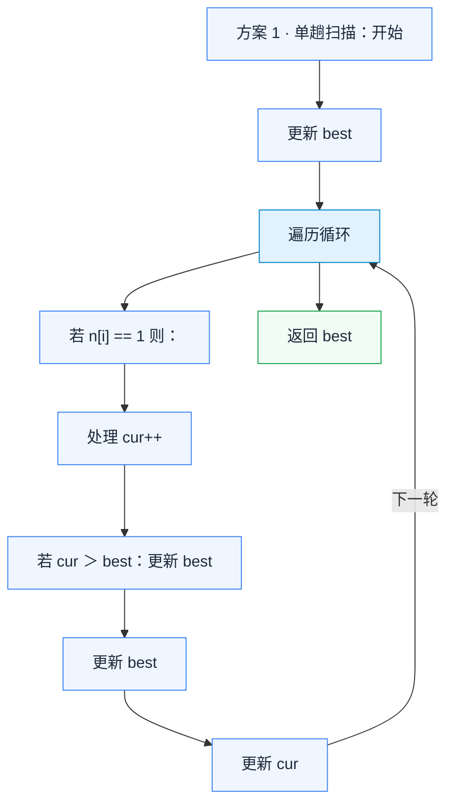

```c
/* LeetCode 485. 最大连续1的个数 — C 版（方案1） */
#include <stdio.h>                                            // 引入头文件
static int find_max_consecutive_ones(const int *n, int len) { // 定义函数/方法 find_max_consecutive_ones
    int best = 0, cur = 0;          // 把 0, 当前值 赋值为 0 存入 当前最优
    for (int i = 0; i < len; i++) { // 让 下标 i 从 0 开始计数，下标 i 小于 长度 就继续
        if (n[i] == 1) {
            cur++;
            if (cur > best)
                best = cur;
        } else
            cur = 0; // 否则
    }
    return best; // 返回 当前最优
}
int main(void) { // 程序入口：跑内嵌自测用例
    if (find_max_consecutive_ones((int[]){1, 1, 0, 1, 1, 1}, 6) != 3) {
        printf("FAIL 1\n");
        return 1;
    }
    if (find_max_consecutive_ones((int[]){1, 0, 1, 1, 0, 1}, 6) != 2) {
        printf("FAIL 2\n");
        return 1;
    }
    printf("PASS\n");
    return 0;
} // 全部用例通过，输出 PASS
```

### C++ 实现（1 种方案）

C++ 的全部方案如下，每个方案都内嵌用例自测，可独立运行（老仓库 python/go 文件遵循「打印结果」约定）：

#### 方案 1：单趟扫描

**思路与代码分析**：核心是「单趟扫描」。C++ 版用 STL 容器与迭代器，减少手写下标错误。代码里依次做这些事：单循环线性扫描。**走读**：方案 1 · 单趟扫描：开始 → 更新 best → 遍历循环 → 若 v == 1 则： → 处理 ++cur → 更新 best → 更新 cur → 返回 best。

**运行架构**（真实控制流）：

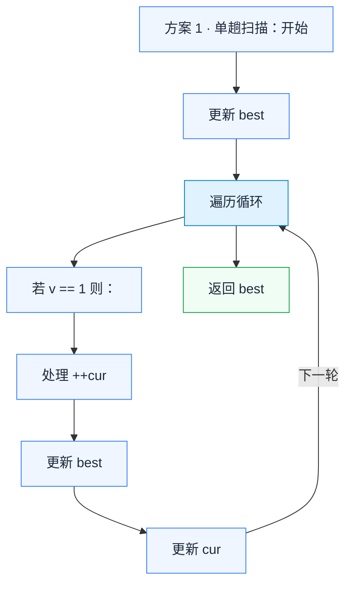

```cpp
// LeetCode 485. 最大连续1的个数 — C++ 版（方案1）
#include <cassert>                                                // 引入头文件
#include <iostream>                                               // 引入头文件
#include <vector>                                                 // 引入头文件
static int findMaxConsecutiveOnes(const std::vector<int> &nums) { // 定义函数/方法 findMaxConsecutiveOnes
    int best = 0, cur = 0; // 把 0, 当前值 赋值为 0 存入 当前最优
    for (int v : nums) {   // for (int 值 : 数组) {
        if (v == 1) {
            ++cur;
            best = std::max(best, cur);
        } // 若 值 等于 1) { 加一 当前值; 当前最优 赋值为 std::取较大值 当前最优, 当前值); }
        else
            cur = 0; // 否则
    }
    return best; // 返回 当前最优
}
int main() {
    assert(findMaxConsecutiveOnes({1, 1, 0, 1, 1, 1}) == 3);
    assert(findMaxConsecutiveOnes({1, 0, 1, 1, 0, 1}) == 2);
    std::cout << "PASS" << std::endl;
} // 全部用例通过，输出 PASS
```

### R 实现（1 种方案）

R 的全部方案如下，每个方案都内嵌用例自测，可独立运行（老仓库 python/go 文件遵循「打印结果」约定）：

#### 方案 1：单趟扫描

**思路与代码分析**：核心是「单趟扫描」。R 版用向量化思维与 1 起始下标，注意 1:n 的降序陷阱。代码里依次做这些事：单循环线性扫描。**走读**：方案 1 · 单趟扫描：开始 → 处理 best ＜- 0L → 处理 cur ＜- 0L → 循环 v：遍历 nums → 若 v == 1 则： → 处理 cur ＜- cur + 1L → 若 cur ＞ best：处理 best ＜- cur → 处理 best ＜- cur → 处理 best → 返回结果。

**运行架构**（真实控制流）：

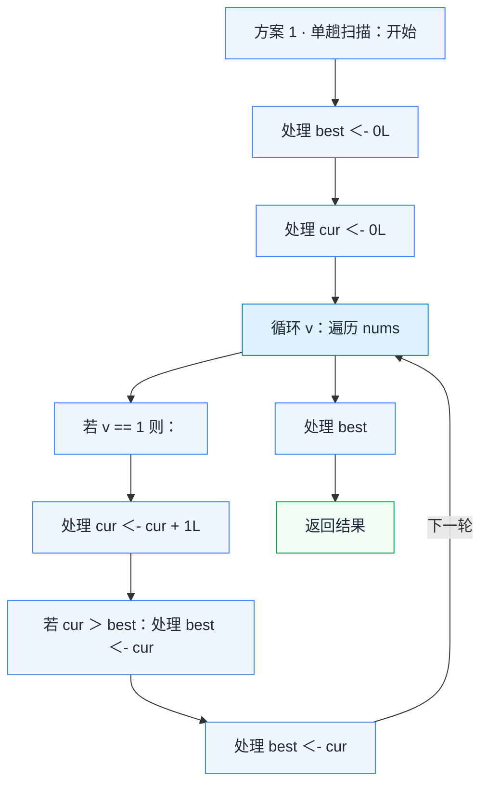

```r
# 版（方案1） 定义函数 find_max_consecutive_ones（参数：数组）
find_max_consecutive_ones <- function(nums) {
    best <- 0L
    cur <- 0L  # 把 0L; 当前值 小于 减 0L 存入 当前最优
    for (v in nums) {
        # for (值 in 数组) {
        if (v == 1) {
            cur <- cur + 1L
            if (cur > best)
                best <- cur
        } else cur <- 0L
    }
    best  # 当前最优
}
stopifnot(find_max_consecutive_ones(c(1, 1, 0, 1, 1, 1)) == 3)  # 断言校验
stopifnot(find_max_consecutive_ones(c(1, 0, 1, 1, 0, 1)) == 2)  # 断言校验
cat("PASS\n")  # 全部用例通过，输出 PASS
```

### Zig 实现（1 种方案）

Zig 的全部方案如下，每个方案都内嵌用例自测，可独立运行（老仓库 python/go 文件遵循「打印结果」约定）：

#### 方案 1：单趟扫描

**思路与代码分析**：核心是「单趟扫描」。Zig 版显式分配与清零，整型边界处理严格。代码里依次做这些事：单循环线性扫描。**走读**：方案 1 · 单趟扫描：开始 → 计算 best → 计算 cur → 遍历集合元素 → 若 v == 1 则： → 更新 + → 若 cur ＞ best：更新 best → 返回 best。

**运行架构**（真实控制流）：

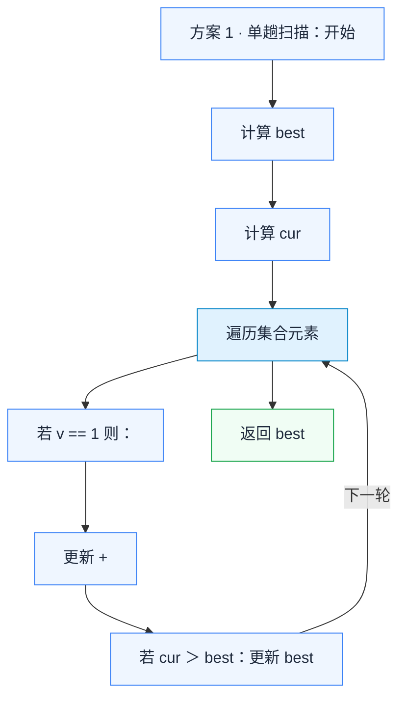

```zig
// LeetCode 485. 最大连续1的个数 — Zig 版（方案1）
const std = @import("std"); // 把 @import(「std」) 存入 std
fn findMaxConsecutiveOnes(nums: []const i32) i32 { // 定义函数/方法 findMaxConsecutiveOnes
    var best: i32 = 0; // 把 0; 写入 var best: i32
    var cur: i32 = 0; // 把 0; 写入 var cur: i32
    for (nums) |v| { // 逐个取出 数组 的元素（值）
        if (v == 1) { // 若 值 等于 1
            cur += 1; // 当前值累加 1
            if (cur > best) best = cur; // 若 当前值 超过 当前最优) 当前最优 赋值为 当前值;
        } else cur = 0; // 否则
    }
    return best; // 返回 当前最优
}
pub fn main() !void { // 程序入口：跑内嵌自测用例
    if (findMaxConsecutiveOnes(&[_]i32{ 1, 1, 0, 1, 1, 1 }) != 3) return error.TestFailed;
    if (findMaxConsecutiveOnes(&[_]i32{ 1, 0, 1, 1, 0, 1 }) != 2) return error.TestFailed;
    std.debug.print("PASS\n", .{});
} // 全部用例通过，输出 PASS
```

### Dart 实现（1 种方案）

Dart 的全部方案如下，每个方案都内嵌用例自测，可独立运行（老仓库 python/go 文件遵循「打印结果」约定）：

#### 方案 1：单趟扫描

**思路与代码分析**：核心是「单趟扫描」。Dart 版用可空类型标注与集合方法，注意空安全。代码里依次做这些事：单循环线性扫描。**走读**：方案 1 · 单趟扫描：开始 → 计算 best → 遍历循环 → 若 v == 1 则： → 处理 cur++ → 若 cur ＞ best：更新 best → 更新 cur → 返回 best。

**运行架构**（真实控制流）：


```dart
// LeetCode 485. 最大连续1的个数 — Dart 版（方案1）
int findMaxConsecutiveOnes(List<int> nums) {
  // 定义函数/方法 findMaxConsecutiveOnes
  var best = 0, cur = 0; // 把 0, 当前值 赋值为 0 存入 当前最优
  for (final v in nums) {
    // for (final 值 in 数组) {
    if (v == 1) {
      cur++;
      if (cur > best) best = cur;
    } else {
      cur = 0;
    }
  }
  return best; // 返回 当前最优
}

void main() {
  if (findMaxConsecutiveOnes([1, 1, 0, 1, 1, 1]) != 3) throw StateError('c1');
  if (findMaxConsecutiveOnes([1, 0, 1, 1, 0, 1]) != 2) throw StateError('c2');
  print('PASS');
} // 全部用例通过，输出 PASS
```

---

## 内容总结

- **最大连续1的个数**（数组 · Medium）：共 1 个方案，主线思路「单趟扫描」；时间 O(n)（单趟线性扫描）；动画演示双指针过程，附录给出 11 种语言 × 全部方案的可运行实现。
- 来源博客：[]()
- 导航：[📋 总目录](../) ｜ [← 035 找到所有数组中消失的数字](../035_找到所有数组中消失的数字/) ｜ [037 下一个更大元素 i →](../037_下一个更大元素_i/)
