# 037 · 下一个更大元素 i（第一阶段 · 线性结构入门 · Medium）

> **难度**：⭐⭐ Medium ｜ **专题**：栈
> **学习定位**：第一阶段 · 线性结构入门第 37 篇 ｜ **解法数**：1
> **内容总结**：**下一个更大元素 i**（栈 · Medium）：共 1 个方案，主线思路「哈希辅助」；时间 O(n²)（两层嵌套扫描）；动画演示栈后进先出过程，附录给出 11 种语言 × 全部方案的可运行实现。

---

## 题目描述

`nums1` 中数字 `x` 的 下一个更大元素 是指 `x` 在 `nums2` 中对应位置 右侧 的 第一个 比 `x` 大的元素。

给你两个 没有重复元素 的数组 `nums1` 和 `nums2` ，下标从 0 开始计数，其中`nums1` 是 `nums2` 的子集。

对于每个 `0 

返回一个长度为 `nums1.length` 的数组 `ans` 作为答案，满足 `ans[i]` 是如上所述的 下一个更大元素 。

- 主函数签名：`function nextGreaterElement(nums1: number[], nums2: number[]): number[]`

**用例（来自原题）**：

**示例 1**

```text
输入：nums1 = [4,1,2], nums2 = [1,3,4,2].
输出：[-1,3,-1]
```

解释：nums1 中每个值的下一个更大元素如下所述： - 4 ，用加粗斜体标识，nums2 = [1,3,4,2]。不存在下一个更大元素，所以答案是 -1 。 - 1 ，用加粗斜体标识，nums2 = [1,3,4,2]。下一个更大元素是 3 。 - 2 ，用加粗斜体标识，nums2 = [1,3,4,2]。不存在下一个更大元素，所以答案是 -1 。

**示例 2**

```text
输入：nums1 = [2,4], nums2 = [1,2,3,4].
输出：[3,-1]
```

解释：nums1 中每个值的下一个更大元素如下所述： - 2 ，用加粗斜体标识，nums2 = [1,2,3,4]。下一个更大元素是 3 。 - 4 ，用加粗斜体标识，nums2 = [1,2,3,4]。不存在下一个更大元素，所以答案是 -1 。
> ✅ **官方验证**：全部 TypeScript 解法已通过 leetcode.cn 官方示例用例验证（自动注入运行，全部 PASS）。题面与 [leetcode.cn 官方](https://leetcode.cn/problems/next-greater-element-i/)一致，示例配图取自官方题面。

**数据范围与注意事项**：

- `1 <= nums1.length <= nums2.length <= 1000`
- `0 <= nums1[i], nums2[i] <= 10^4`
- `nums1`和`nums2`中所有整数 互不相同
- `nums1` 中的所有整数同样出现在 `nums2` 中
- 进阶：你可以设计一个时间复杂度为 `O(nums1.length + nums2.length)` 的解决方案吗？
- **易错点**：出栈前判空；「下一个更大元素」类问题栈里存下标比存值好用。

## 题目分析

**场景是什么**：后进先出结构天然适合「最近匹配」，对应真实开发里的括号校验、浏览历史、函数调用栈。本题就是该场景的 Medium 级练习，主线做法是「哈希辅助」。

**主线怎么解**：把主解法从头到尾过一遍，它其实在依次做这几件事：哈希结构做计数或查重 → 双重循环遍历 → 栈的后进先出操作。

## 解题思路

**方案对比**（共 1 个方案，由浅入深）：

| 方案 | 时间复杂度 | 空间复杂度 |
|---|---|---|
| 方案 1 · 哈希辅助 | O(n²)（两层嵌套扫描） | O(1) 到 O(n) |

**怎么读这一篇**：

- 🐣 **新手路线**：把「题目描述」的示例 1 在纸上手推一遍 → 读方案 1（最直观的写法）与它的代码走读 → 按「运行方式」本地跑通看 PASS → 回头对比方案 2 之后的写法差在哪
- 🦅 **大佬路线**：直接锁定最优方案 1（哈希辅助，O(n²)（两层嵌套扫描））→ 跳读该方案代码与走读 → 用「逐步拆解与面试追问」补齐复杂度推导与边界追问

### 动态算法图（栈后进先出，GIF 自动循环）


动画演示栈专题里栈后进先出的典型过程；每个方案在「TypeScript 解题方案」一节还配了专属动画与专属流程图。

### 主解法流程图（真实控制流）

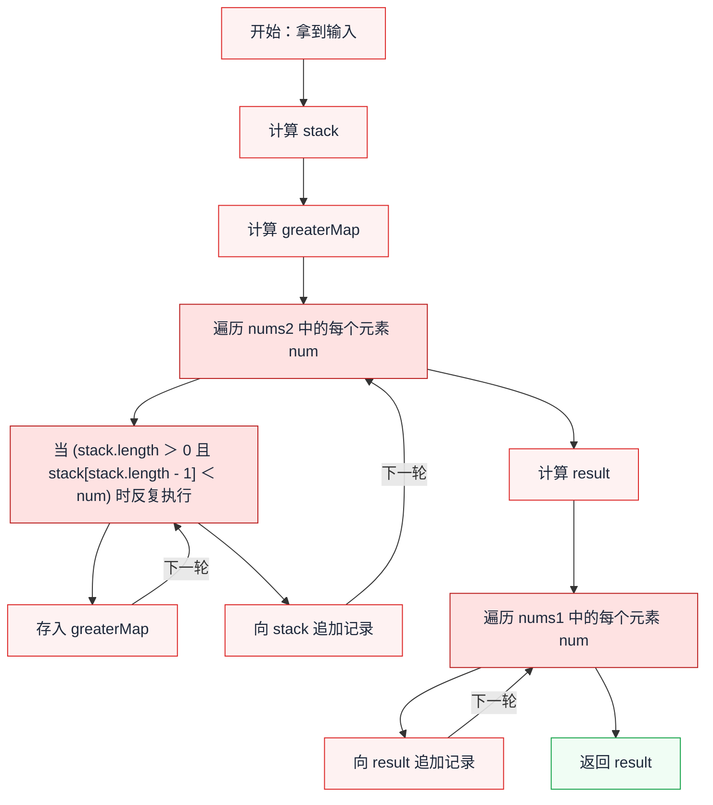

## TypeScript 解题方案（1 个方案逐个讲）

> **运行与提交**：每个方案都是自包含文件（内嵌用例自测，输出 PASS），整块复制到 `.ts` 文件后 `node 文件名` 即可运行。提交 LeetCode 时，把 `demo` 内的算法函数与辅助类型/函数整体取出、置于文件顶层即可。涉及交互/特殊接口的题以题面给定签名为准。

### 方案 1：哈希辅助

**分析与思路**：核心做法是「哈希辅助」。代码里依次做这些事：哈希结构做计数或查重；双重循环遍历；栈的后进先出操作。

**运行方式**：`node 本文件`，内嵌用例全部通过会输出 PASS。


**方案专属流程图**（真实控制流）：

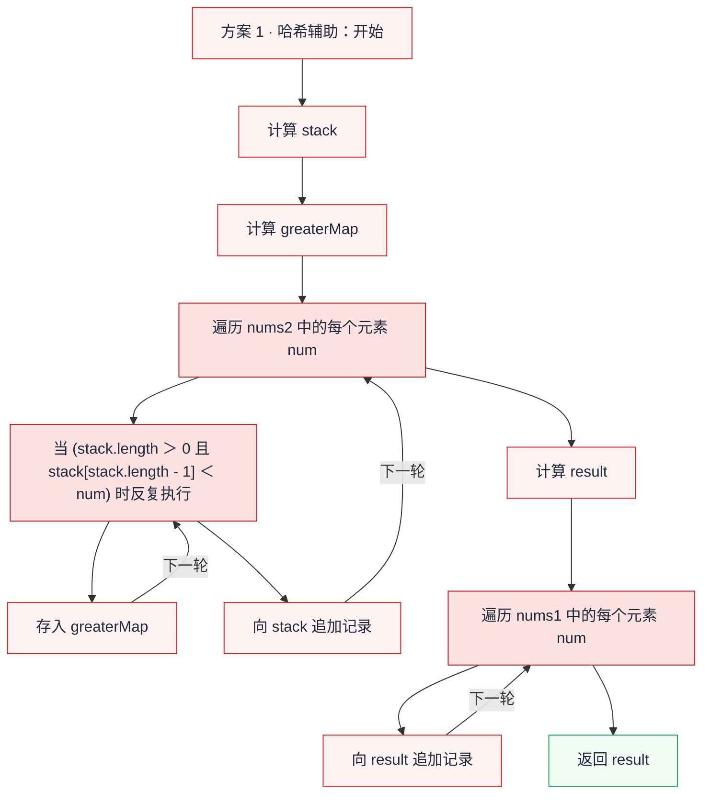

```typescript
export function demo(): void {
  // 程序入口：跑内嵌自测用例
  function nextGreaterElement(nums1: number[], nums2: number[]): number[] {
    // 定义函数/方法 nextGreaterElement
    const stack: number[] = []; // 把 []; 写入 const stack: number[]
    const greaterMap: Map<number, number> = new Map(); // 把 new Map(); 写入 const greaterMap: Map<number, number>
    for (const num of nums2) {
      // for (const num of 数组2) {
      while (stack.length > 0 && stack[stack.length - 1] < num) {
        // 循环，直到不满足「栈.长度 超过 0 且 栈[栈.长度 减 1] 小于 num」
        greaterMap.set(stack.pop() as number, num); // 弹出栈顶元素
      }
      stack.push(num); // 把 num 压入栈/数组尾部
    }
    const result: number[] = []; // 把 []; 写入 const result: number[]
    for (const num of nums1) {
      // for (const num of 数组1) {
      result.push(greaterMap.has(num) ? (greaterMap.get(num) as number) : -1); // 把 greaterMap.has(num 压入栈/数组尾部
    }
    return result; // 返回 结果
  }

  function eqArr(a: number[], b: number[]): boolean {
    // 定义函数/方法 eqArr
    if (a.length !== b.length) return false; // 若 数组.长度 不等于 b.长度，直接返回 false
    for (let i = 0; i < a.length; i++) {
      // 让 下标 i 从 0 开始计数，下标 i 小于 数组.长度 就继续
      if (a[i] !== b[i]) return false; // 若 数组[下标 i] 不等于 b[下标 i]，直接返回 false
    }
    return true; // 返回 true
  }

  const cases = [
    { in1: [4, 1, 2], in2: [1, 3, 4, 2], want: [-1, 3, -1] },
    { in1: [2, 4], in2: [1, 2, 3, 4], want: [3, -1] },
  ];

  let fail = false; // 把 false 存入 fail
  for (let i = 0; i < cases.length; i++) {
    // 让 下标 i 从 0 开始计数，下标 i 小于 cases.长度 就继续
    const c = cases[i]; // 把 cases[下标 i] 存入 字符
    const got = nextGreaterElement(c.in1, c.in2); // 把 nextGreaterElement(字符.in1, 字符.in2) 存入 got
    if (!eqArr(c.want, got)) {
      // 若 取反 eqArr(字符.want, got
      fail = true; // 把 true 存入 fail
      console.log(
        `FAIL case${i} nextGreaterElement(${JSON.stringify(c.in1)},${JSON.stringify(c.in2)})=${JSON.stringify(got)} want ${JSON.stringify(c.want)}`,
      );
    }
  }
  if (fail) throw new Error('FAILED'); // 若 fail) throw new Error(「FAILED」);
  console.log('PASS'); // 全部用例通过，输出 PASS
}
demo(); // demo();
```

## 逐步拆解与面试追问

**复杂度**：时间 O(n²)（两层嵌套扫描），空间 O(1) 到 O(n)

**为什么是这个量级**：外层定起点、内层扫终点，n 个起点各扫 n 次

**面试官可能会追问**：

- 什么时候用单调栈（求下一个更大或更小）？
- 栈里存值还是存下标？
- 能否用 O(1) 额外空间？

## 关键 API 速查（TS 主解法实际用到，附官方链接）

| API | 作用 | 使用要点 | 官方文档 |
|---|---|---|---|
| `Map` | 哈希表：任意类型键值对 | set(k,v) 存、get(k) 取（不存在返回 undefined）、has(k) 判存在、delete(k) 删；增删查均摊 O(1)；键顺序为插入序；键必须用引用区分（对象键按身份） | [官方文档](https://developer.mozilla.org/zh-CN/docs/Web/JavaScript/Reference/Global_Objects/Map) |
| `Array.prototype.push()` | 尾部追加 | 返回新长度；可一次多个；均摊 O(1)；会改变原数组 | [官方文档](https://developer.mozilla.org/zh-CN/docs/Web/JavaScript/Reference/Global_Objects/Array/push) |
| `Array.prototype.pop()` | 尾部弹出 | 返回被删元素（空数组返回 undefined）；O(1) | [官方文档](https://developer.mozilla.org/zh-CN/docs/Web/JavaScript/Reference/Global_Objects/Array/pop) |
| `JSON.stringify()` | 序列化为 JSON 字符串 | 常用于结构化比较（深度相等判定）；undefined/函数/循环引用会被丢弃或抛错 | [官方文档](https://developer.mozilla.org/zh-CN/docs/Web/JavaScript/Reference/Global_Objects/JSON/stringify) |

### 各语言官方文档导航

- **TypeScript / JS**：[MDN 中文参考](https://developer.mozilla.org/zh-CN/)
- **Python**：[Python 官方文档](https://docs.python.org/zh-cn/3/)
- **Go**：[Go 标准库](https://pkg.go.dev/std)
- **Java**：[JDK 17 API](https://docs.oracle.com/en/java/javase/17/docs/api/)
- **Rust**：[Rust 标准库](https://doc.rust-lang.org/std/)
- **Lua**：[Lua 5.4 手册](https://www.lua.org/manual/5.4/)
- **C**：[Cppreference C](https://zh.cppreference.com/w/c)
- **C++**：[Cppreference C++](https://zh.cppreference.com/w/cpp)
- **R**：[R 官方手册](https://stat.ethz.ch/R-manual/)
- **Zig**：[Zig 语言文档](https://ziglang.org/documentation/master/)
- **Dart**：[Dart API](https://api.dart.dev/)

## 附录：其他 10 种语言全部实现（每种语言列举其全部方案）

> TypeScript 的全部方案见「TypeScript 解题方案」一节；下面是其余 10 种语言的对应实现，每种语言的每个方案都带思路分析、代码走读与专属运行架构图。
> 每个方案都内嵌用例自测，可独立运行（老仓库 python/go 文件遵循「打印结果」约定）。
> 完整解法文件见 `dsa/<语言>/stack/lc_496_下一个更大元素_i/`。

### Python 实现（1 种方案）

Python 的全部方案如下，每个方案都内嵌用例自测，可独立运行（老仓库 python/go 文件遵循「打印结果」约定）：

#### 方案 1：哈希辅助

**思路与代码分析**：核心是「哈希辅助」。Python 版用切片与字典推导式简化操作，突出可读性。**走读**：方案 1 · 哈希辅助：开始 → 处理 pass → 返回结果。

**运行架构**（真实控制流）：

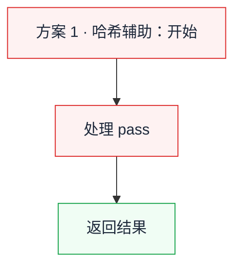

```python
import sys  # 提高递归深度上限（深输入防 RecursionError）

sys.setrecursionlimit(200000)  # 树/链表类题目节点数可达 1e4 量级

def solve():  # 定义函数 solve（参数：无）
    """
    LeetCode 496. 下一个更大元素 I
    单调栈解法框架
    """

    pass  # pass

def nextGreaterElement(nums1, nums2):  # 定义函数 nextGreaterElement（参数：数组1, 数组2）
    """
    找到nums2中每个元素的下一个更大元素，返回在nums1中的对应结果
    """
    stack = []  # 把 [] 存入 栈
    greater_map = {}  # 把 {} 存入 greater_map

    # 单调栈找nums2中每个元素的下一个更大值
    for num in nums2:  # 逐个取出 数组2 的元素（num）
        while stack and stack[-1] < num:  # 循环，直到不满足「栈 and 栈[ 减 1] 小于 num」
            greater_map[stack.pop()] = num  # 弹出栈顶元素
        stack.append(num)  # 把 num 追加到列表尾部

    # 构建结果
    result = []  # 把 [] 存入 结果
    for num in nums1:  # 逐个取出 数组1 的元素（num）
        result.append(greater_map.get(num, -1))  # 把 greater_map 查找 num, 减 1 追加到列表尾部

    return result  # 返回 结果

if __name__ == "__main__":  # 若 __name__ 等于 「__main__」
    nums1 = [4, 1, 2]  # 把 [4, 1, 2] 存入 数组1
    nums2 = [1, 3, 4, 2]  # 把 [1, 3, 4, 2] 存入 数组2
    print(nextGreaterElement(nums1, nums2))  # 打印输出
```

### Go 实现（1 种方案）

Go 的全部方案如下，每个方案都内嵌用例自测，可独立运行（老仓库 python/go 文件遵循「打印结果」约定）：

#### 方案 1：哈希辅助

**思路与代码分析**：核心是「哈希辅助」。Go 版用切片与多返回值惯用法，显式处理索引边界。代码里依次做这些事：哈希结构做计数或查重。**走读**：方案 1 · 哈希辅助：开始 → 更新 : → 更新 : → 遍历 nums2 的下标与元素 num → 遍历循环 → 更新 greaterMap[stack[len(stack)-1]] → 更新 stack → 更新 stack → 更新 : → 遍历 nums1 的下标与元素 num → 处理 if v, ok := greaterMap[num] → 更新 result → 更新 result → 返回 result。

**运行架构**（真实控制流）：

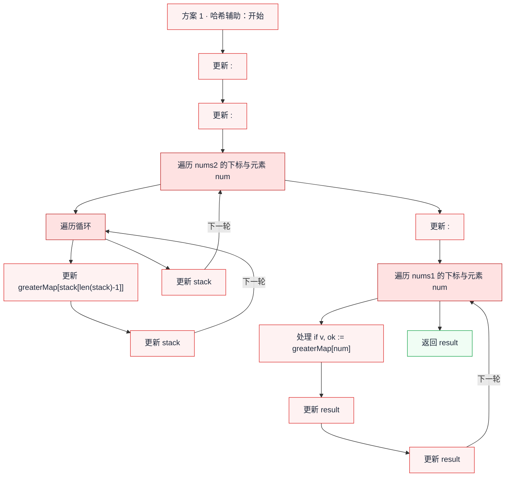

```go
package main // 引入依赖

import (
	"fmt"     // 「fmt」
	"os"      // 「os」
	"reflect" // 「reflect」
)

func nextGreaterElement(nums1, nums2 []int) []int { // 定义函数/方法 nextGreaterElement
	stack := []int{}            // 把 []int{} 写入 stack :
	greaterMap := map[int]int{} // 把 映射表[int]int{} 写入 greaterMap :
	for _, num := range nums2 { // 同时取 _ 与 num 遍历
		for len(stack) > 0 && stack[len(stack)-1] < num { // for 长度(栈) 超过 0 且 栈[长度(栈) 减 1] 小于 num {
			greaterMap[stack[len(stack)-1]] = num // 把 num 写入 greaterMap[stack[len(stack)-1]]
			stack = stack[:len(stack)-1]          // 把 栈[:长度(栈) 减 1] 写入 栈
		}
		stack = append(stack, num) // 把 append(栈, num) 写入 栈
	}
	result := []int{}           // 把 []int{} 写入 result :
	for _, num := range nums1 { // 同时取 _ 与 num 遍历
		if v, ok := greaterMap[num]; ok { // 若 值, ok : 赋值为 greaterMap[num]; ok
			result = append(result, v) // 把 append(结果, 值) 写入 结果
		} else { // 否则
			result = append(result, -1) // 把 append(结果, 减 1) 写入 结果
		}
	}
	return result // 返回 结果
}

func main() { // 程序入口：跑内嵌自测用例
	type tc struct { // 定义类型
		in1  []int // in1 []int
		in2  []int // in2 []int
		want []int // want []int
	}
	cases := []tc{ // 把 []tc{ 写入 cases :
		{[]int{4, 1, 2}, []int{1, 3, 4, 2}, []int{-1, 3, -1}},
		{[]int{2, 4}, []int{1, 2, 3, 4}, []int{3, -1}},
	}
	ok := true                // 把 true 写入 ok :
	for _, c := range cases { // 同时取 _ 与 字符 遍历
		if got := nextGreaterElement(c.in1, c.in2); !reflect.DeepEqual(got, c.want) {
			ok = false                                                                           // 把 false 写入 ok
			fmt.Printf("FAIL nextGreaterElement(%v,%v)=%v want %v\n", c.in1, c.in2, got, c.want) // 打印输出
		}
	}
	if !ok { // 若 取反 ok
		os.Exit(1) // os.Exit(1)
	}
	fmt.Println("PASS") // 全部用例通过，输出 PASS
}
```

### Java 实现（1 种方案）

Java 的全部方案如下，每个方案都内嵌用例自测，可独立运行（老仓库 python/go 文件遵循「打印结果」约定）：

#### 方案 1：哈希辅助

**思路与代码分析**：核心是「哈希辅助」。Java 版用类与静态方法组织，集合操作显式明了。代码里依次做这些事：哈希结构做计数或查重；双重循环遍历；栈的后进先出操作。**走读**：方案 1 · 哈希辅助：开始 → 更新 stack → 更新 greaterMap → 处理 new HashMap＜＞() → 遍历循环 → 当 (非 stack.isEmpty() 且 stack.peek() ＜ num) 时反复执行 → 从 stack 弹出 → 向 stack 追加记录 → 更新 result → 遍历循环 → 更新 result[i] → 调用 greaterMap.getOrDefault( → 处理 nums1[i], -1) → 返回 result。

**运行架构**（真实控制流）：

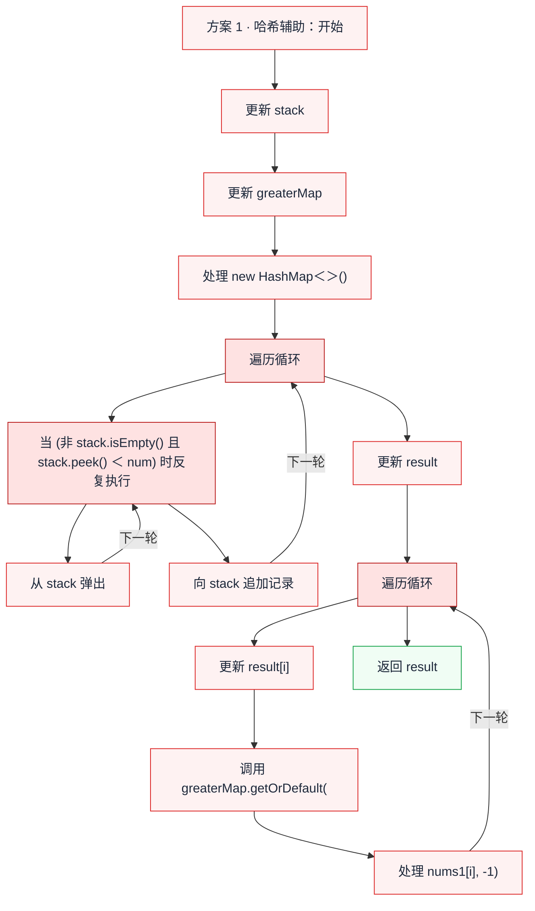

```java
package com.webfault.dsa; // 引入依赖

import java.util.*; // 引入依赖

class lc496_solution1 { // 定义类型
  int[] nextGreaterElement(int[] nums1, int[] nums2) { // 定义函数/方法 nextGreaterElement
    Deque<Integer> stack = new ArrayDeque<>(); // 把 new ArrayDeque 小于 超过 (); 写入 Deque<Integer> stack
    Map<Integer, Integer> greaterMap =
        new HashMap<>(); // 把 new HashMap 小于 超过 (); 写入 Map<Integer, Integer> greaterMap
    for (int num : nums2) { // for (int num : 数组2) {
      while (!stack.isEmpty() && stack.peek() < num) { // 循环，直到不满足「取反 栈.isEmpty() 且 栈.peek() 小于 num」
        greaterMap.put(stack.pop(), num); // 弹出栈顶元素
      }
      stack.push(num); // 把 num 压入栈/数组尾部
    }
    int[] result = new int[nums1.length]; // 把 new int[数组1.长度]; 写入 int[] result
    for (int i = 0; i < nums1.length; i++) { // 让 下标 i 从 0 开始计数，下标 i 小于 数组1.长度 就继续
      result[i] =
          greaterMap.getOrDefault(
              nums1[i], -1); // 把 greaterMap.getOrDefault(数组1[下标 i], 减 1); 写入 result[i]
    }
    return result; // 返回 结果
  }

  static boolean eqArr(int[] a, int[] b) { // 定义函数/方法 eqArr
    if (a.length != b.length) return false; // 若 数组.长度 不等于 b.长度，直接返回 false
    for (int i = 0; i < a.length; i++) { // 让 下标 i 从 0 开始计数，下标 i 小于 数组.长度 就继续
      if (a[i] != b[i]) return false; // 若 数组[下标 i] 不等于 b[下标 i]，直接返回 false
    }
    return true; // 返回 true
  }

  public static void main(String[] args) { // public static void main(String[] args) {
    lc496_solution1 s = new lc496_solution1(); // 把 new lc496_solution1(); 写入 lc496_solution1 s
    int[][][] inputs = { // 把 { 写入 int[][][] inputs
      {{4, 1, 2}, {1, 3, 4, 2}},
      {{2, 4}, {1, 2, 3, 4}},
    };
    int[][] wants = { // 把 { 写入 int[][] wants
      {-1, 3, -1},
      {3, -1},
    };
    boolean ok = true; // 把 true; 写入 boolean ok
    for (int i = 0; i < inputs.length; i++) { // 让 下标 i 从 0 开始计数，下标 i 小于 inputs.长度 就继续
      int[] got = s.nextGreaterElement(inputs[i][0], inputs[i][1]);
      if (!eqArr(got, wants[i])) { // 若 取反 eqArr(got, wants[下标 i]
        ok = false; // 把 false; 写入 ok
        System.out.println(
            "FAIL case"
                + i
                + " got="
                + Arrays.toString(got)
                + " want="
                + Arrays.toString(wants[i])); // 打印输出
      }
    }
    if (!ok) throw new RuntimeException("FAILED"); // 若 取反 ok) throw new RuntimeException(「FAILED」);
    System.out.println("PASS"); // 全部用例通过，输出 PASS
  }
}
```

### Rust 实现（1 种方案）

Rust 的全部方案如下，每个方案都内嵌用例自测，可独立运行（老仓库 python/go 文件遵循「打印结果」约定）：

#### 方案 1：哈希辅助

**思路与代码分析**：核心是「哈希辅助」。Rust 版用所有权移动与切片借用改写同一逻辑，注意 Option 与引用边界。代码里依次做这些事：哈希结构做计数或查重；栈的后进先出操作。**走读**：方案 1 · 哈希辅助：开始 → 计算 next → 计算 st → 遍历 &nums2 中的每个元素 v → 当 let Some(&top) = st.last() 时反复执行 → 处理 if top ＜ v → 调用 next.insert(top, v) → 从 st 弹出 → 跳出循环（break） → 向 st 追加记录 → 处理 nums1 → 处理 .iter() → 处理 .map(｜&v｜ *next.get(&v).unwr → 处理 .collect() → 返回结果。

**运行架构**（真实控制流）：

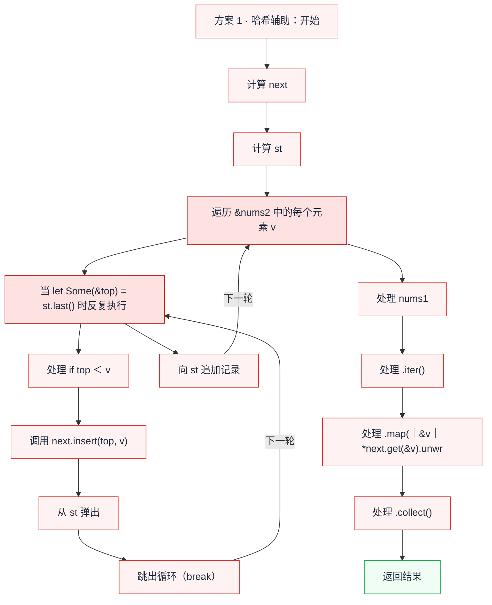

```rust
// LeetCode 496. 下一个更大元素 I — Rust 版（方案1）
use std::collections::HashMap; // 引入依赖
fn next_greater_element(nums1: Vec<i32>, nums2: Vec<i32>) -> Vec<i32> {
    // 定义函数/方法 next_greater_element
    let mut next: HashMap<i32, i32> = HashMap::new(); // 把 HashMap::new(); 写入 let mut next: HashMap<i32, i32>
    let mut st: Vec<i32> = Vec::new(); // 把 Vec::new(); 写入 let mut st: Vec<i32>
    for &v in &nums2 {
        // for 按位与 值 in 按位与 数组2 {
        while let Some(&top) = st.last() {
            // 边取边处理，取空即停
            if top < v {
                next.insert(top, v);
                st.pop();
            } else {
                break;
            } // 若 top 小于 值 { 下一个 插入 top, 值); st 弹出 ); } else { break; }
        }
        st.push(v); // 把 值 压入栈/数组尾部
    }
    nums1
        .iter()
        .map(|&v| *next.get(&v).unwrap_or(&-1))
        .collect()
}
fn main() {
    // 程序入口：跑内嵌自测用例
    assert_eq!(
        next_greater_element(vec![4, 1, 2], vec![1, 3, 4, 2]),
        vec![-1, 3, -1]
    ); // 断言校验
    assert_eq!(
        next_greater_element(vec![2, 4], vec![1, 2, 3, 4]),
        vec![3, -1]
    ); // 断言校验
    println!("PASS");
} // 全部用例通过，输出 PASS
```

### Lua 实现（1 种方案）

Lua 的全部方案如下，每个方案都内嵌用例自测，可独立运行（老仓库 python/go 文件遵循「打印结果」约定）：

#### 方案 1：哈希辅助

**思路与代码分析**：核心是「哈希辅助」。Lua 版用表与 ipairs 遍历，注意 ipairs 遇 nil 即停的语义。**走读**：方案 1 · 哈希辅助：开始 → 更新 next_ → 更新 st → 遍历 ipairs(nums2) do 中的每个元素 v → 当 #st ＞ 0 and st[#st] ＜ v do 时反复执行 → 更新 next_[st[#st]] → 更新 st[#st] → 更新 1] → 更新 out → 遍历 ipairs(nums1) do 中的每个元素 v → 更新 out[i] → 返回 out。

**运行架构**（真实控制流）：

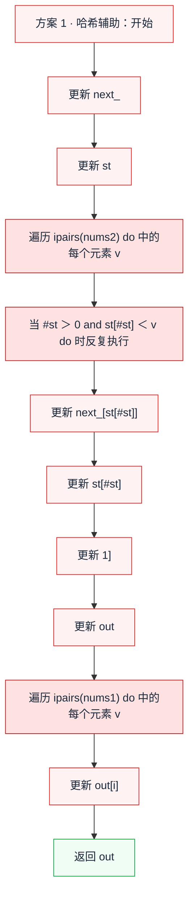

```lua
-- LeetCode 496. 下一个更大元素 I — Lua 版（方案1）
local function next_greater_element(nums1, nums2) -- local function next_greater_element(数组1, 数组2)
	local next_ = {} -- 把 {} 写入 local next_
	local st = {} -- 把 {} 写入 local st
	for _, v in ipairs(nums2) do -- 遍历取 值
		while #st > 0 and st[#st] < v do -- while #st 超过 0 and st[#st] 小于 值 do
			next_[st[#st]] = v -- 把 值 写入 next_[st[#st]]
			st[#st] = nil -- 把 nil 写入 st[#st]
		end -- 终点
		st[#st + 1] = v -- 把 值 写入 st[#st + 1]
	end -- 终点
	local out = {} -- 把 {} 写入 local out
	for i, v in ipairs(nums1) do -- 遍历取 值
		out[i] = next_[v] or -1 -- 把 next_[值] or 减 1 写入 out[i]
	end -- 终点
	return out -- 返回 out
end -- 终点
assert(table.concat(next_greater_element({ 4, 1, 2 }, { 1, 3, 4, 2 }), ",") == "-1,3,-1") -- 打印输出
assert(table.concat(next_greater_element({ 2, 4 }, { 1, 2, 3, 4 }), ",") == "3,-1") -- 打印输出
print("PASS") -- 全部用例通过，输出 PASS
```

### C 实现（1 种方案）

C 的全部方案如下，每个方案都内嵌用例自测，可独立运行（老仓库 python/go 文件遵循「打印结果」约定）：

#### 方案 1：哈希辅助

**思路与代码分析**：核心是「哈希辅助」。C 版手动管理下标与内存，循环边界全部显式写出。代码里依次做这些事：双重循环遍历。**走读**：方案 1 · 哈希辅助：开始 → 处理 int next[65536] → 遍历循环 → 更新 next[i] → 更新 top → 遍历循环 → 当 (top ＞ 0 且 时反复执行 → 处理 st[top - 1] ＜ n2[i]) → 更新 32768] → 处理 top-- → 更新 st[top++] → 遍历循环 → 更新 out[i] → 返回 l1。

**运行架构**（真实控制流）：

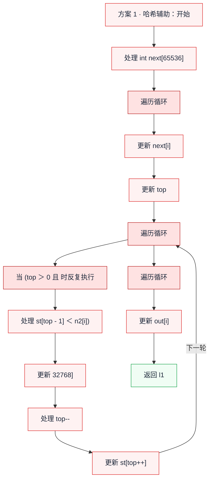

```c
/* LeetCode 496. 下一个更大元素 I — C 版（方案1） */
#include <stdio.h> // 引入头文件
static int next_greater_element(const int *n1, int l1, const int *n2, int l2,
                                int out[]) { // 定义函数/方法 next_greater_element
    int next[65536];                         // int 下一个[65536];
    for (int i = 0; i < 65536; i++)
        next[i] = -1;              // 让 下标 i 从 0 开始计数，下标 i 小于 65536 就继续
    int st[8192], top = 0;         // 把 0; 写入 int st[8192], top
    for (int i = 0; i < l2; i++) { // 让 下标 i 从 0 开始计数，下标 i 小于 l2 就继续
        while (top > 0 &&
               st[top - 1] < n2[i]) { // 循环，直到不满足「top 超过 0 且 st[top 减 1] 小于 n2[下标 i]」
            next[st[top - 1] + 32768] = n2[i]; // 把 n2[下标 i]; 写入 next[st[top - 1] + 32768]
            top--;                             // top 减一
        }
        st[top++] = n2[i]; // 把 n2[下标 i]; 写入 st[top++]
    }
    for (int i = 0; i < l1; i++)
        out[i] = next[n1[i] + 32768]; // 让 下标 i 从 0 开始计数，下标 i 小于 l1 就继续
    return l1;                        // 返回 l1
}
int main(void) { // 程序入口：跑内嵌自测用例
    int out[64]; // int out[64];
    next_greater_element((int[]){4, 1, 2}, 3, (int[]){1, 3, 4, 2}, 4, out);
    if (!(out[0] == -1 && out[1] == 3 && out[2] == -1)) {
        printf("FAIL 1\n");
        return 1;
    }
    next_greater_element((int[]){2, 4}, 2, (int[]){1, 2, 3, 4}, 4, out);
    if (!(out[0] == 3 && out[1] == -1)) {
        printf("FAIL 2\n");
        return 1;
    }
    printf("PASS\n");
    return 0;
} // 全部用例通过，输出 PASS
```

### C++ 实现（1 种方案）

C++ 的全部方案如下，每个方案都内嵌用例自测，可独立运行（老仓库 python/go 文件遵循「打印结果」约定）：

#### 方案 1：哈希辅助

**思路与代码分析**：核心是「哈希辅助」。C++ 版用 STL 容器与迭代器，减少手写下标错误。代码里依次做这些事：哈希结构做计数或查重；双重循环遍历；栈的后进先出操作。**走读**：方案 1 · 哈希辅助：开始 → 处理 std::unordered_map＜int, int＞ → 处理 std::stack＜int＞ st → 遍历循环 → 当 (非 st.empty() 且 st.top() ＜ v) 时反复执行 → 更新 next[st.top()] → 从 st 弹出 → 向 st 追加记录 → 处理 std::vector＜int＞ out → 遍历循环 → 更新 it → 更新 ! → 处理 ? it-＞second → 处理 : -1) → 返回 out。

**运行架构**（真实控制流）：

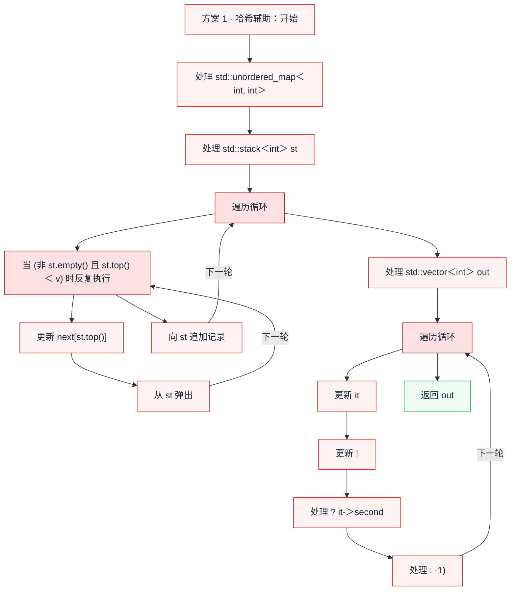

```cpp
// LeetCode 496. 下一个更大元素 I — C++ 版（方案1）
#include <cassert>       // 引入头文件
#include <iostream>      // 引入头文件
#include <stack>         // 引入头文件
#include <unordered_map> // 引入头文件
#include <vector>        // 引入头文件
static std::vector<int> nextGreaterElement(const std::vector<int> &nums1, const std::vector<int> &nums2) {
    std::unordered_map<int, int> next; // std::unordered_map 小于 int, int 超过 下一个;
    std::stack<int> st;                // std::栈 小于 int 超过 st;
    for (int v : nums2) {              // for (int 值 : 数组2) {
        while (!st.empty() && st.top() < v) { // 循环，直到不满足「取反 st 是否为空 且 st.top() 小于 值」
            next[st.top()] = v; // 把 值; 写入 next[st.top()]
            st.pop();           // 弹出栈顶元素
        }
        st.push(v); // 把 值 压入栈/数组尾部
    }
    std::vector<int> out;       // std::vector 小于 int 超过 out;
    for (int v : nums1) {       // for (int 值 : 数组1) {
        auto it = next.find(v); // 把 下一个 查找 值) 存入 it
        out.push_back(it != next.end()
                          ? it->second
                          : -1); // 把 下一个.终点() ? it 减 超过 second : 减 1); 写入 out.push_back(it !
    }
    return out; // 返回 out
}
int main() {
    assert((nextGreaterElement({4, 1, 2}, {1, 3, 4, 2}) == std::vector<int>{-1, 3, -1}));
    assert((nextGreaterElement({2, 4}, {1, 2, 3, 4}) == std::vector<int>{3, -1}));
    std::cout << "PASS" << std::endl;
} // 全部用例通过，输出 PASS
```

### R 实现（1 种方案）

R 的全部方案如下，每个方案都内嵌用例自测，可独立运行（老仓库 python/go 文件遵循「打印结果」约定）：

#### 方案 1：哈希辅助

**思路与代码分析**：核心是「哈希辅助」。R 版用向量化思维与 1 起始下标，注意 1:n 的降序陷阱。代码里依次做这些事：单循环线性扫描。**走读**：方案 1 · 哈希辅助：开始 → 更新 new.env(parent → 处理 st ＜- integer(0) → 循环 v：遍历 nums2 → 当 (length(st) ＞ 0 且 st[length(st)] ＜ v) 时反复执行 → 处理 nxt[[as.character(st[length( → 处理 st ＜- st[-length(st)] → 处理 st ＜- c(st, v) → 调用 sapply(nums1, function(v) → 处理 key ＜- as.character(v) → 若 非 is.null(nxt[[key]])：处理 nxt[[key]] else -1L → 处理 nxt[[key]] else -1L → 返回结果。

**运行架构**（真实控制流）：

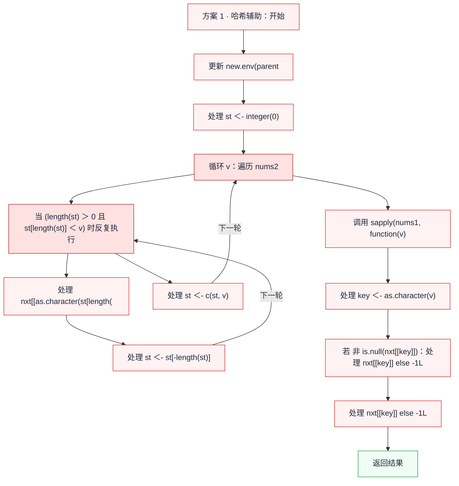

```r
# 版（方案1） 定义函数 next_greater_element（参数：数组1, 数组2）
next_greater_element <- function(nums1, nums2) {
    nxt <- new.env(parent = emptyenv())  # 把 new.env(parent 赋值为 emptyenv()) 存入 nxt
    st <- integer(0)  # 把 integer(0) 存入 st
    for (v in nums2) {
        # for (值 in 数组2) { 循环，直到不满足「长度(st) 超过 0 且 st[长度(st)] 小于 值」
        while (length(st) > 0 && st[length(st)] < v) {
            nxt[[as.character(st[length(st)])]] <- v  # 把 值 存入 nxt[[as.character(st[length(st)])]]
            st <- st[-length(st)]  # 把 st[ 减 长度(st)] 存入 st
        }
        st <- c(st, v)  # 把 字符(st, 值) 存入 st
    }
    sapply(nums1, function(v) {
        # sapply(数组1, function(值) {
        key <- as.character(v)  # 把 as.character(值) 存入 key
        if (!is.null(nxt[[key]]))
            nxt[[key]] else -1L  # 若 取反 is.null(nxt[[key]])) nxt[[key]] else 减 1L
    })  # })
}
stopifnot(identical(as.integer(next_greater_element(c(4, 1, 2), c(1, 3, 4, 2))), c(-1L, 3L, -1L)))  # 断言校验
stopifnot(identical(as.integer(next_greater_element(c(2, 4), c(1, 2, 3, 4))), c(3L, -1L)))  # 断言校验
cat("PASS\n")  # 全部用例通过，输出 PASS
```

### Zig 实现（1 种方案）

Zig 的全部方案如下，每个方案都内嵌用例自测，可独立运行（老仓库 python/go 文件遵循「打印结果」约定）：

#### 方案 1：哈希辅助

**思路与代码分析**：核心是「哈希辅助」。Zig 版显式分配与清零，整型边界处理严格。代码里依次做这些事：哈希结构做计数或查重；双重循环遍历。**走读**：方案 1 · 哈希辅助：开始 → 计算 next → 计算 st → 计算 top → 遍历集合元素 → 当 (top ＞ 0 and st[top - 1] ＜ v) 时反复执行 → 调用 next.put(st[top - 1], v) cat → 更新 - → 更新 st[top] → 更新 + → 遍历集合元素 → 更新 out[i] → 返回结果。

**运行架构**（真实控制流）：

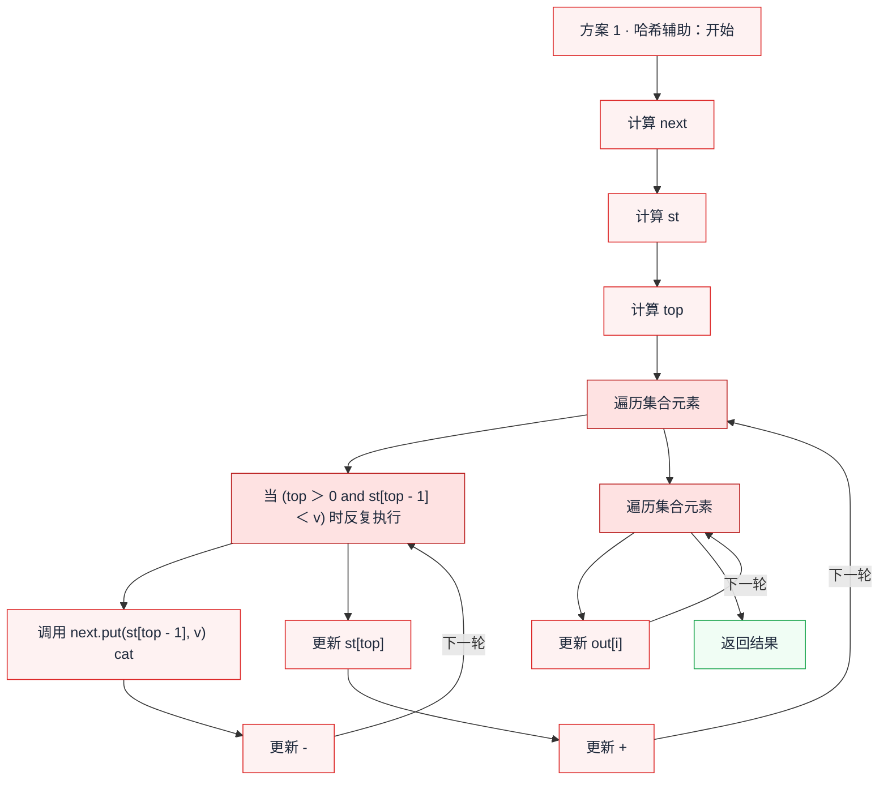

```zig
// LeetCode 496. 下一个更大元素 I — Zig 版（方案1）
const std = @import("std"); // 把 @import(「std」) 存入 std
fn nextGreaterElement(n1: []const i32, n2: []const i32, alloc: std.mem.Allocator, out: []i32) void { // 定义函数/方法 nextGreaterElement
    var next = std.AutoHashMap(i32, i32).init(alloc); // 把 std.AutoHashMap(i32, i32).init(alloc) 存入 下一个
    var st: [8192]i32 = undefined; // 把 undefined; 写入 var st: [8192]i32
    var top: usize = 0; // 把 0; 写入 var top: usize
    for (n2) |v| { // 逐个取出 n2 的元素（值）
        while (top > 0 and st[top - 1] < v) { // 循环，直到不满足「top 超过 0 and st[top 减 1] 小于 值」
            next.put(st[top - 1], v) catch unreachable; // 下一个.put(st[top 减 1], 值) catch unreachable;
            top -= 1; // top累减 1
        }
        st[top] = v; // 把 值; 写入 st[top]
        top += 1; // top累加 1
    }
    for (n1, 0..) |v, i| { // for (n1, 0..) 按位或 值, 下标 i 按位或 {
        out[i] = next.get(v) orelse -1; // 把 下一个 查找 值) orelse 减 1; 写入 out[i]
    }
}
pub fn main() !void { // 程序入口：跑内嵌自测用例
    var arena = std.heap.ArenaAllocator.init(std.heap.page_allocator); // 把 std.堆.ArenaAllocator.init(std.堆.page_allocator) 存入 arena
    defer arena.deinit(); // defer arena.deinit();
    const alloc = arena.allocator(); // 把 arena.allocator() 存入 alloc
    var out: [8]i32 = undefined; // 把 undefined; 写入 var out: [8]i32
    nextGreaterElement(&[_]i32{ 4, 1, 2 }, &[_]i32{ 1, 3, 4, 2 }, alloc, &out);
    if (out[0] != -1 or out[1] != 3 or out[2] != -1) return error.TestFailed;
    nextGreaterElement(&[_]i32{ 2, 4 }, &[_]i32{ 1, 2, 3, 4 }, alloc, &out);
    if (out[0] != 3 or out[1] != -1) return error.TestFailed; // 若 out[0] 不等于 3 or out[1] 不等于 减 1，直接返回 error.TestFailed
    std.debug.print("PASS\n", .{});
} // 全部用例通过，输出 PASS
```

### Dart 实现（1 种方案）

Dart 的全部方案如下，每个方案都内嵌用例自测，可独立运行（老仓库 python/go 文件遵循「打印结果」约定）：

#### 方案 1：哈希辅助

**思路与代码分析**：核心是「哈希辅助」。Dart 版用可空类型标注与集合方法，注意空安全。代码里依次做这些事：单循环线性扫描。**走读**：方案 1 · 哈希辅助：开始 → 更新 next → 更新 st → 遍历循环 → 当 (st.isNotEmpty 且 st.last ＜ v) 时反复执行 → 更新 next[st.removeLast()] → 调用 st.add(v) → 返回 nums1.map((v) =＞ next[v] ?? -1).toList()。

**运行架构**（真实控制流）：

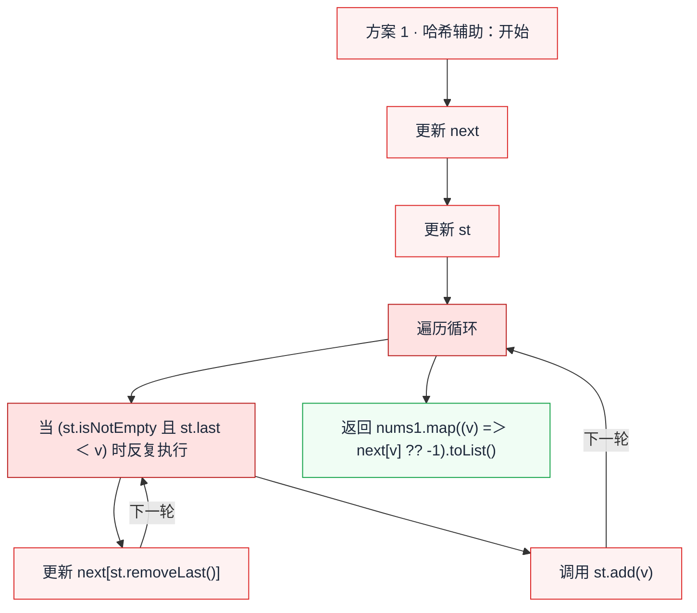

```dart
// LeetCode 496. 下一个更大元素 I — Dart 版（方案1）
List<int> nextGreaterElement(List<int> nums1, List<int> nums2) {
  // 定义函数/方法 nextGreaterElement
  final next = <int, int>{}; // 把 小于 int, int 超过 {} 存入 下一个
  final st = <int>[]; // 把 小于 int 超过 [] 存入 st
  for (final v in nums2) {
    // for (final 值 in 数组2) {
    while (st.isNotEmpty && st.last < v) {
      // 循环，直到不满足「st.isNotEmpty 且 st.last 小于 值」
      next[st.removeLast()] = v; // 把 值; 写入 next[st.removeLast()]
    }
    st.add(v); // st 追加 值);
  }
  return nums1.map((v) => next[v] ?? -1).toList();
}

void main() {
  if (nextGreaterElement([4, 1, 2], [1, 3, 4, 2]).toString() != '[-1, 3, -1]')
    throw StateError('c1');
  if (nextGreaterElement([2, 4], [1, 2, 3, 4]).toString() != '[3, -1]')
    throw StateError('c2');
  print('PASS');
} // 全部用例通过，输出 PASS
```

---

## 内容总结

- **下一个更大元素 i**（栈 · Medium）：共 1 个方案，主线思路「哈希辅助」；时间 O(n²)（两层嵌套扫描）；动画演示栈后进先出过程，附录给出 11 种语言 × 全部方案的可运行实现。
- 来源博客：[https://blog.csdn.net/tyro_java/article/details/145347105](https://blog.csdn.net/tyro_java/article/details/145347105)
- 导航：[📋 总目录](../) ｜ [← 036 最大连续1的个数](../036_最大连续1的个数/) ｜ [038 下一个更大元素 ii →](../038_下一个更大元素_ii/)
