# 038 · 下一个更大元素 ii（第一阶段 · 线性结构入门 · Medium）

> **难度**：⭐⭐ Medium ｜ **专题**：栈
> **学习定位**：第一阶段 · 线性结构入门第 38 篇 ｜ **解法数**：1
> **内容总结**：**下一个更大元素 ii**（栈 · Medium）：共 1 个方案，主线思路「直接实现」；时间 O(n) 量级；动画演示栈后进先出过程，附录给出 11 种语言 × 全部方案的可运行实现。

---

## 题目描述

给定一个循环数组 `nums` （ `nums[nums.length - 1]` 的下一个元素是 `nums[0]` ），返回 `nums` 中每个元素的 下一个更大元素 。

数字 `x` 的 下一个更大的元素 是按数组遍历顺序，这个数字之后的第一个比它更大的数，这意味着你应该循环地搜索它的下一个更大的数。如果不存在，则输出 `-1` 。

- 主函数签名：`function assertEq(actual: any, expected: any, msg: string = ''): void`

**用例（来自原题）**：

**示例 1**

```text
输入: nums = [1,2,1]
输出: [2,-1,2]
```

解释：第一个 1 的下一个更大的数是 2； 数字 2 找不到下一个更大的数； 第二个 1 的下一个最大的数需要循环搜索，结果也是 2。

**示例 2**

```text
输入: nums = [1,2,3,4,3]
输出: [2,3,4,-1,4]
```
> ✅ **官方验证**：全部 TypeScript 解法已通过 leetcode.cn 官方示例用例验证（自动注入运行，全部 PASS）。题面与 [leetcode.cn 官方](https://leetcode.cn/problems/next-greater-element-ii/)一致，示例配图取自官方题面。

**数据范围与注意事项**：

- `1 <= nums.length <= 10^4`
- `-10^9 <= nums[i] <= 10^9`
- **易错点**：出栈前判空；「下一个更大元素」类问题栈里存下标比存值好用。

## 题目分析

**场景是什么**：后进先出结构天然适合「最近匹配」，对应真实开发里的括号校验、浏览历史、函数调用栈。本题就是该场景的 Medium 级练习，主线做法是「直接实现」。

**主线怎么解**：主解法结构简单：读入、处理、返回。

## 解题思路

**方案对比**（共 1 个方案，由浅入深）：

| 方案 | 时间复杂度 | 空间复杂度 |
|---|---|---|
| 方案 1 · 直接实现 | O(n) 量级 | O(n) |

**怎么读这一篇**：

- 🐣 **新手路线**：把「题目描述」的示例 1 在纸上手推一遍 → 读方案 1（最直观的写法）与它的代码走读 → 按「运行方式」本地跑通看 PASS → 回头对比方案 2 之后的写法差在哪
- 🦅 **大佬路线**：直接锁定最优方案 1（直接实现，O(n) 量级）→ 跳读该方案代码与走读 → 用「逐步拆解与面试追问」补齐复杂度推导与边界追问

### 动态算法图（栈后进先出，GIF 自动循环）


动画演示栈专题里栈后进先出的典型过程；每个方案在「TypeScript 解题方案」一节还配了专属动画与专属流程图。

### 主解法流程图（真实控制流）

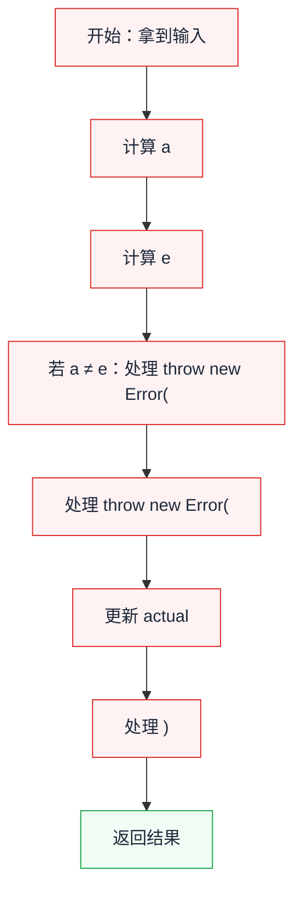

## TypeScript 解题方案（1 个方案逐个讲）

> **运行与提交**：每个方案都是自包含文件（内嵌用例自测，输出 PASS），整块复制到 `.ts` 文件后 `node 文件名` 即可运行。提交 LeetCode 时，把 `demo` 内的算法函数与辅助类型/函数整体取出、置于文件顶层即可。涉及交互/特殊接口的题以题面给定签名为准。

### 方案 1：直接实现

**分析与思路**：核心做法是「直接实现」。

**运行方式**：`node 本文件`，内嵌用例全部通过会输出 PASS。


**方案专属流程图**（真实控制流）：

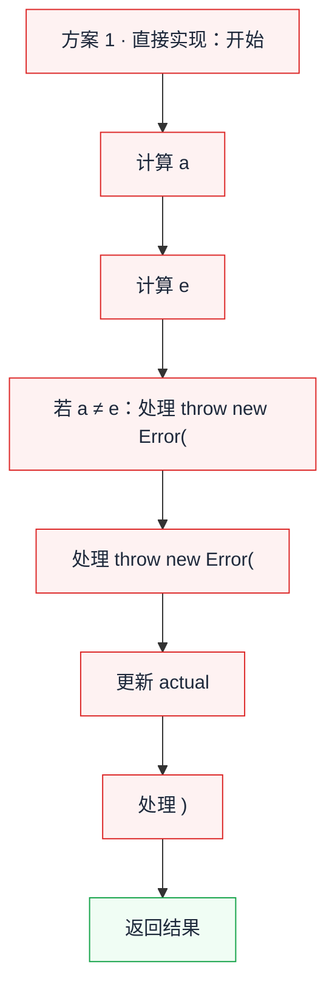

```typescript
function assertEq(actual: any, expected: any, msg: string = ''): void {
  // 定义函数/方法 assertEq
  const a = JSON.stringify(actual);
  const e = JSON.stringify(expected);
  if (a !== e)
    throw new Error(
      'ASSERT FAILED ' + msg + ' :: actual=' + a + ' expected=' + e,
    );
}

function nextGreaterElements(nums: number[]): number[] {
  // 定义函数/方法 nextGreaterElements
  const n = nums.length;
  const result = new Array(n).fill(-1);
  const stack: number[] = [];
  for (let i = 0; i < 2 * n; i++) {
    // 让 下标 i 从 0 开始计数，下标 i 小于 2 乘 元素个数 就继续
    const num = nums[i % n]; // 把 数组[下标 i 对…取模 元素个数] 存入 num
    while (stack.length && nums[stack[stack.length - 1]] < num) {
      // 循环，直到不满足「栈.长度 且 数组[栈[栈.长度 减 1]] 小于 num」
      const idx = stack.pop()!;
      result[idx] = num; // 把 栈 弹出 )取反 ; 结果[idx] 赋值为 num 存入 idx
    }
    if (i < n) stack.push(i); // 若 下标 i 小于 元素个数) 栈 追加 下标 i);
  }
  return result; // 返回 结果
}
export function demo(): void {
  // 程序入口：跑内嵌自测用例
  assertEq(nextGreaterElements([1, 2, 1]), [2, -1, 2], 'nge'); // 断言校验
  assertEq(nextGreaterElements([3, 2, 1]), [-1, 3, 3], 'desc'); // 断言校验
  console.log('PASS'); // 全部用例通过，输出 PASS
}
demo(); // demo();
```

## 逐步拆解与面试追问

**复杂度**：时间 O(n) 量级，空间 O(n)

**为什么是这个量级**：整体只对数据做有限趟处理

**面试官可能会追问**：

- 什么时候用单调栈（求下一个更大或更小）？
- 栈里存值还是存下标？
- 能否用 O(1) 额外空间？

## 关键 API 速查（TS 主解法实际用到，附官方链接）

| API | 作用 | 使用要点 | 官方文档 |
|---|---|---|---|
| `Array.prototype.push()` | 尾部追加 | 返回新长度；可一次多个；均摊 O(1)；会改变原数组 | [官方文档](https://developer.mozilla.org/zh-CN/docs/Web/JavaScript/Reference/Global_Objects/Array/push) |
| `Array.prototype.pop()` | 尾部弹出 | 返回被删元素（空数组返回 undefined）；O(1) | [官方文档](https://developer.mozilla.org/zh-CN/docs/Web/JavaScript/Reference/Global_Objects/Array/pop) |
| `JSON.stringify()` | 序列化为 JSON 字符串 | 常用于结构化比较（深度相等判定）；undefined/函数/循环引用会被丢弃或抛错 | [官方文档](https://developer.mozilla.org/zh-CN/docs/Web/JavaScript/Reference/Global_Objects/JSON/stringify) |

### 各语言官方文档导航

- **TypeScript / JS**：[MDN 中文参考](https://developer.mozilla.org/zh-CN/)
- **Python**：[Python 官方文档](https://docs.python.org/zh-cn/3/)
- **Go**：[Go 标准库](https://pkg.go.dev/std)
- **Java**：[JDK 17 API](https://docs.oracle.com/en/java/javase/17/docs/api/)
- **Rust**：[Rust 标准库](https://doc.rust-lang.org/std/)
- **Lua**：[Lua 5.4 手册](https://www.lua.org/manual/5.4/)
- **C**：[Cppreference C](https://zh.cppreference.com/w/c)
- **C++**：[Cppreference C++](https://zh.cppreference.com/w/cpp)
- **R**：[R 官方手册](https://stat.ethz.ch/R-manual/)
- **Zig**：[Zig 语言文档](https://ziglang.org/documentation/master/)
- **Dart**：[Dart API](https://api.dart.dev/)

## 附录：其他 10 种语言全部实现（每种语言列举其全部方案）

> TypeScript 的全部方案见「TypeScript 解题方案」一节；下面是其余 10 种语言的对应实现，每种语言的每个方案都带思路分析、代码走读与专属运行架构图。
> 每个方案都内嵌用例自测，可独立运行（老仓库 python/go 文件遵循「打印结果」约定）。
> 完整解法文件见 `dsa/<语言>/stack/lc_503_下一个更大元素_ii/`。

### Python 实现（1 种方案）

Python 的全部方案如下，每个方案都内嵌用例自测，可独立运行（老仓库 python/go 文件遵循「打印结果」约定）：

#### 方案 1：直接实现

**思路与代码分析**：核心是「直接实现」。Python 版用切片与字典推导式简化操作，突出可读性。**走读**：方案 1 · 直接实现：开始 → 处理 pass → 返回结果。

**运行架构**（真实控制流）：

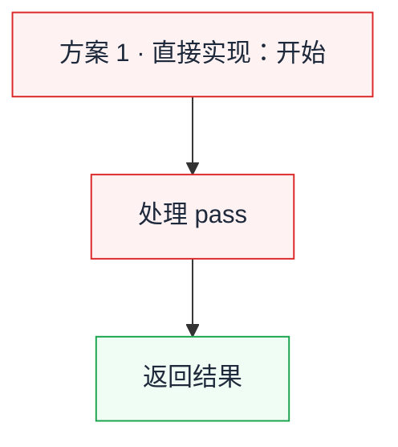

```python
import sys  # 提高递归深度上限（深输入防 RecursionError）

sys.setrecursionlimit(200000)  # 树/链表类题目节点数可达 1e4 量级

def solve():  # 定义函数 solve（参数：无）
    """
    LeetCode 503. 下一个更大元素 II
    单调栈解法框架（环形数组）
    """

    pass  # pass

def nextGreaterElements(nums):  # 定义函数 nextGreaterElements（参数：数组）
    """
    找到环形数组中每个元素的下一个更大元素
    """
    n = len(nums)  # 把 长度(数组) 存入 元素个数
    result = [-1] * n  # 把 [ 减 1] 乘 元素个数 存入 结果
    stack = []  # 把 [] 存入 栈

    # 遍历两圈（模拟环形）
    for i in range(2 * n):  # 让 下标 i 从 2 乘 元素个数 遍历
        num = nums[i % n]  # 把 数组[下标 i 对…取模 元素个数] 存入 num
        while stack and nums[stack[-1]] < num:  # 循环，直到不满足「栈 and 数组[栈[ 减 1]] 小于 num」
            idx = stack.pop()  # 把 栈 弹出 ) 存入 idx
            result[idx] = num  # 把 num 写入 result[idx]
        if i < n:  # 若 下标 i 小于 元素个数
            stack.append(i)  # 把 下标 i 追加到列表尾部

    return result  # 返回 结果

if __name__ == "__main__":  # 若 __name__ 等于 「__main__」
    nums = [1, 2, 1]  # 把 [1, 2, 1] 存入 数组
    print(nextGreaterElements(nums))  # 打印输出
```

### Go 实现（1 种方案）

Go 的全部方案如下，每个方案都内嵌用例自测，可独立运行（老仓库 python/go 文件遵循「打印结果」约定）：

#### 方案 1：直接实现

**思路与代码分析**：核心是「直接实现」。Go 版用切片与多返回值惯用法，显式处理索引边界。**走读**：方案 1 · 直接实现：开始 → 更新 : → 更新 : → 遍历 result 的下标与元素 i → 更新 result[i] → 更新 : → 遍历循环 → 更新 : → 遍历循环 → 更新 : → 更新 stack → 更新 result[idx] → 处理 if i ＜ n → 更新 stack → 返回 result。

**运行架构**（真实控制流）：

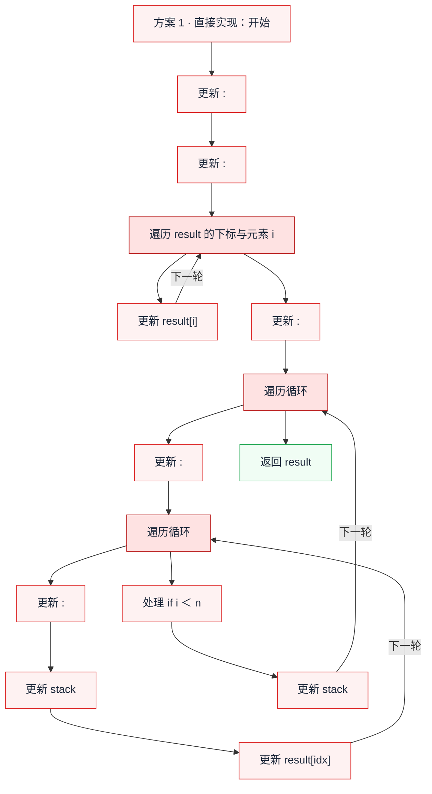

```go
package main // 引入依赖

import (
	"fmt"     // 「fmt」
	"os"      // 「os」
	"reflect" // 「reflect」
)

func nextGreaterElements(nums []int) []int { // 定义函数/方法 nextGreaterElements
	n := len(nums)           // 把 长度(数组) 写入 n :
	result := make([]int, n) // 把 make([]int, 元素个数) 写入 result :
	for i := range result {  // 把 range 结果 { 写入 for i :
		result[i] = -1 // 把 减 1 写入 result[i]
	}
	stack := []int{}           // 把 []int{} 写入 stack :
	for i := 0; i < 2*n; i++ { // 让 下标 i 从 0 开始计数
		num := nums[i%n]                                        // 把 数组[下标 i 对…取模 元素个数] 写入 num :
		for len(stack) > 0 && nums[stack[len(stack)-1]] < num { // for 长度(栈) 超过 0 且 数组[栈[长度(栈) 减 1]] 小于 num {
			idx := stack[len(stack)-1]   // 把 栈[长度(栈) 减 1] 写入 idx :
			stack = stack[:len(stack)-1] // 把 栈[:长度(栈) 减 1] 写入 栈
			result[idx] = num            // 把 num 写入 result[idx]
		}
		if i < n { // 若 下标 i 小于 元素个数
			stack = append(stack, i) // 把 append(栈, 下标 i) 写入 栈
		}
	}
	return result // 返回 结果
}

func main() { // 程序入口：跑内嵌自测用例
	type tc struct { // 定义类型
		in   []int // in []int
		want []int // want []int
	}
	cases := []tc{ // 把 []tc{ 写入 cases :
		{[]int{1, 2, 1}, []int{2, -1, 2}},
		{[]int{1, 2, 3, 4, 3}, []int{2, 3, 4, -1, 4}},
	}
	ok := true                // 把 true 写入 ok :
	for _, c := range cases { // 同时取 _ 与 字符 遍历
		if got := nextGreaterElements(c.in); !reflect.DeepEqual(got, c.want) {
			ok = false                                                                 // 把 false 写入 ok
			fmt.Printf("FAIL nextGreaterElements(%v)=%v want %v\n", c.in, got, c.want) // 打印输出
		}
	}
	if !ok { // 若 取反 ok
		os.Exit(1) // os.Exit(1)
	}
	fmt.Println("PASS") // 全部用例通过，输出 PASS
}
```

### Java 实现（1 种方案）

Java 的全部方案如下，每个方案都内嵌用例自测，可独立运行（老仓库 python/go 文件遵循「打印结果」约定）：

#### 方案 1：直接实现

**思路与代码分析**：核心是「直接实现」。Java 版用类与静态方法组织，集合操作显式明了。代码里依次做这些事：单循环线性扫描；栈的后进先出操作。**走读**：方案 1 · 直接实现：开始 → 更新 n → 更新 result → 调用 Arrays.fill(result, -1) → 更新 stack → 遍历循环 → 更新 num → 当 (非 stack.isEmpty() 时反复执行 → 处理 且 nums[stack.peek()] ＜ num) → 从 stack 弹出 → 更新 result[idx] → 若 i ＜ n) stack.push(i：None → 返回 result。

**运行架构**（真实控制流）：

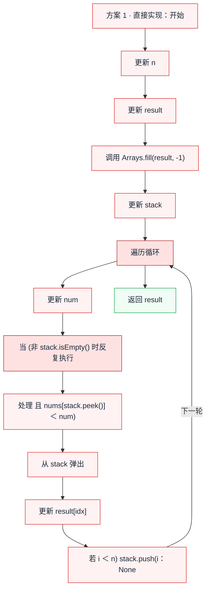

```java
package com.webfault.dsa; // 引入依赖

import java.util.*; // 引入依赖

class lc503_solution1 { // 定义类型
  static int[] nextGreaterElements(int[] nums) { // 定义函数/方法 nextGreaterElements
    int n = nums.length; // 把 数组.长度 存入 元素个数
    int[] result = new int[n]; // 把 new int[元素个数]; 写入 int[] result
    Arrays.fill(result, -1); // Arrays.fill(结果, 减 1);
    Deque<Integer> stack = new ArrayDeque<>(); // 把 new ArrayDeque 小于 超过 (); 写入 Deque<Integer> stack
    for (int i = 0; i < 2 * n; i++) { // 让 下标 i 从 0 开始计数，下标 i 小于 2 乘 元素个数 就继续
      int num = nums[i % n]; // 把 数组[下标 i 对…取模 元素个数] 存入 num
      while (!stack.isEmpty()
          && nums[stack.peek()] < num) { // 循环，直到不满足「取反 栈.isEmpty() 且 数组[栈.peek()] 小于 num」
        int idx = stack.pop(); // 把 栈 弹出 ) 存入 idx
        result[idx] = num; // 把 num; 写入 result[idx]
      }
      if (i < n) stack.push(i); // 若 下标 i 小于 元素个数) 栈 追加 下标 i);
    }
    return result; // 返回 结果
  }

  public static void main(String[] args) { // public static void main(String[] args) {
    int[] r =
        nextGreaterElements(
            new int[] {1, 2, 1}); // 把 nextGreaterElements(new int[]{1, 2, 1}); 写入 int[] r
    if (!Arrays.equals(r, new int[] {2, -1, 2}))
      throw new RuntimeException("FAILED " + Arrays.toString(r));
    System.out.println("PASS"); // 全部用例通过，输出 PASS
  }
}
```

### Rust 实现（1 种方案）

Rust 的全部方案如下，每个方案都内嵌用例自测，可独立运行（老仓库 python/go 文件遵循「打印结果」约定）：

#### 方案 1：直接实现

**思路与代码分析**：核心是「直接实现」。Rust 版用所有权移动与切片借用改写同一逻辑，注意 Option 与引用边界。代码里依次做这些事：栈的后进先出操作。**走读**：方案 1 · 直接实现：开始 → 计算 n → 计算 res → 计算 st → 遍历 0..n * 2 中的每个元素 i → 计算 ii → 当 let Some(&top) = st.last() 时反复执行 → 处理 if nums[top] ＜ nums[ii] → 更新 res[top] → 从 st 弹出 → 跳出循环（break） → 处理 if i ＜ n → 向 st 追加记录 → 处理 res → 返回结果。

**运行架构**（真实控制流）：

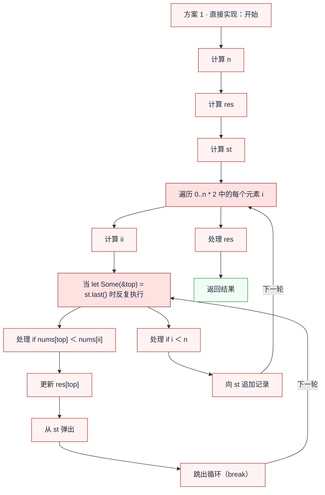

```rust
// LeetCode 503. 下一个更大元素 II — Rust 版（方案1）
fn next_greater_elements(nums: Vec<i32>) -> Vec<i32> {
    // 定义函数/方法 next_greater_elements
    let n = nums.len(); // 把 数组.长度() 存入 元素个数
    let mut res = vec![-1; n]; // 把 vec取反 [ 减 1; 元素个数]; 写入 let mut res
    let mut st: Vec<usize> = Vec::new(); // 把 Vec::new(); 写入 let mut st: Vec<usize>
    for i in 0..n * 2 {
        // 逐个取出 0 的元素（下标 i）
        let ii = i % n; // 把 下标 i 对…取模 元素个数 存入 ii
        while let Some(&top) = st.last() {
            // 边取边处理，取空即停
            if nums[top] < nums[ii] {
                res[top] = nums[ii];
                st.pop();
            } else {
                break;
            }
        }
        if i < n {
            st.push(ii);
        } // 若 下标 i 小于 元素个数 { st 追加 ii); }
    }
    res // 结果
}
fn main() {
    // 程序入口：跑内嵌自测用例
    assert_eq!(next_greater_elements(vec![1, 2, 1]), vec![2, -1, 2]); // 断言校验
    assert_eq!(next_greater_elements(vec![3, 2, 1]), vec![-1, 3, 3]); // 断言校验
    println!("PASS");
} // 全部用例通过，输出 PASS
```

### Lua 实现（1 种方案）

Lua 的全部方案如下，每个方案都内嵌用例自测，可独立运行（老仓库 python/go 文件遵循「打印结果」约定）：

#### 方案 1：直接实现

**思路与代码分析**：核心是「直接实现」。Lua 版用表与 ipairs 遍历，注意 ipairs 遇 nil 即停的语义。**走读**：方案 1 · 直接实现：开始 → 更新 n → 更新 res → 循环 i：从 1 到 n do → 更新 res[i] → 更新 st → 循环 i：从 1 到 2 * n do → 更新 ii → 当 #st ＞ 0 and nums[st[#st]] ＜ nums[ii] do 时反复执行 → 更新 res[st[#st]] → 更新 st[#st] → 处理 if i ≤ n then → 更新 1] → 返回 res。

**运行架构**（真实控制流）：

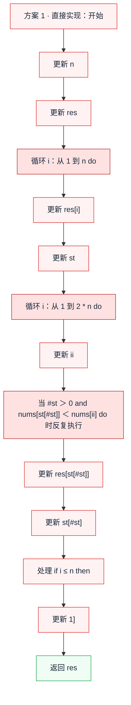

```lua
-- LeetCode 503. 下一个更大元素 II — Lua 版（方案1）
local function next_greater_elements(nums) -- local function next_greater_elements(数组)
	local n = #nums -- 把 #数组 写入 local n
	local res = {} -- 把 {} 写入 local res
	for i = 1, n do
		res[i] = -1
	end -- 让 下标 i 从 1 走到 元素个数（Lua 1 基）
	local st = {} -- 把 {} 写入 local st
	for i = 1, 2 * n do -- 让 下标 i 从 1 走到 2（Lua 1 基）
		local ii = (i - 1) % n + 1 -- 把 (下标 i 减 1) 对…取模 元素个数 加 1 写入 local ii
		while #st > 0 and nums[st[#st]] < nums[ii] do -- while #st 超过 0 and 数组[st[#st]] 小于 数组[ii] do
			res[st[#st]] = nums[ii] -- 把 数组[ii] 写入 res[st[#st]]
			st[#st] = nil -- 把 nil 写入 st[#st]
		end -- 终点
		if i <= n then
			st[#st + 1] = ii
		end -- 若 下标 i 不超过 元素个数 then st[#st 加 1] 赋值为 ii 终点
	end -- 终点
	return res -- 返回 结果
end -- 终点
assert(table.concat(next_greater_elements({ 1, 2, 1 }), ",") == "2,-1,2") -- 打印输出
assert(table.concat(next_greater_elements({ 3, 2, 1 }), ",") == "-1,3,3") -- 打印输出
print("PASS") -- 全部用例通过，输出 PASS
```

### C 实现（1 种方案）

C 的全部方案如下，每个方案都内嵌用例自测，可独立运行（老仓库 python/go 文件遵循「打印结果」约定）：

#### 方案 1：直接实现

**思路与代码分析**：核心是「直接实现」。C 版手动管理下标与内存，循环边界全部显式写出。代码里依次做这些事：双重循环遍历。**走读**：方案 1 · 直接实现：开始 → 遍历循环 → 更新 out[i] → 更新 top → 遍历循环 → 更新 ii → 当 (top ＞ 0 且 时反复执行 → 处理 nums[st[top - 1]] ＜ → 处理 nums[ii]) → 更新 1]] → 处理 top-- → 若 i ＜ n：更新 st[top++] → 更新 st[top++] → 返回结果。

**运行架构**（真实控制流）：

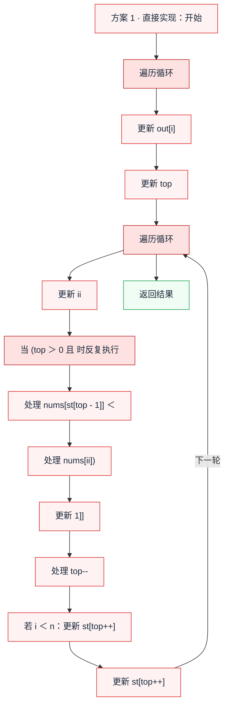

```c
/* LeetCode 503. 下一个更大元素 II — C 版（方案1） */
#include <stdio.h>                                                     // 引入头文件
static void next_greater_elements(const int *nums, int n, int out[]) { // 定义函数/方法 next_greater_elements
    for (int i = 0; i < n; i++)
        out[i] = -1;       // 让 下标 i 从 0 开始计数，下标 i 小于 元素个数 就继续
    int st[8192], top = 0; // 把 0; 写入 int st[8192], top
    for (int i = 0; i < 2 * n; i++) { // 让 下标 i 从 0 开始计数，下标 i 小于 2 乘 元素个数 就继续
        int ii = i % n;               // 把 下标 i 对…取模 元素个数 存入 ii
        while (top > 0 &&
               nums[st[top - 1]] <
                   nums[ii]) { // 循环，直到不满足「top 超过 0 且 数组[st[top 减 1]] 小于 数组[ii]」
            out[st[top - 1]] = nums[ii]; // 把 数组[ii]; 写入 out[st[top - 1]]
            top--;                       // top 减一
        }
        if (i < n)
            st[top++] = ii; // 若 下标 i 小于 元素个数) st[top 加一 ] 赋值为 ii;
    }
}
int main(void) {                                     // 程序入口：跑内嵌自测用例
    int out[8192];                                   // int out[8192];
    next_greater_elements((int[]){1, 2, 1}, 3, out); // next_greater_elements((int[]){1,2,1}, 3, out);
    if (!(out[0] == 2 && out[1] == -1 && out[2] == 2)) {
        printf("FAIL 1\n");
        return 1;
    }
    next_greater_elements((int[]){3, 2, 1}, 3, out); // next_greater_elements((int[]){3,2,1}, 3, out);
    if (!(out[0] == -1 && out[1] == 3 && out[2] == 3)) {
        printf("FAIL 2\n");
        return 1;
    }
    printf("PASS\n");
    return 0;
} // 全部用例通过，输出 PASS
```

### C++ 实现（1 种方案）

C++ 的全部方案如下，每个方案都内嵌用例自测，可独立运行（老仓库 python/go 文件遵循「打印结果」约定）：

#### 方案 1：直接实现

**思路与代码分析**：核心是「直接实现」。C++ 版用 STL 容器与迭代器，减少手写下标错误。代码里依次做这些事：单循环线性扫描。**走读**：方案 1 · 直接实现：开始 → 更新 n → 处理 std::vector＜int＞ res(n, -1) → 处理 std::vector＜size_t＞ st → 遍历循环 → 更新 ii → 当 (非 st.empty() 且 时反复执行 → 处理 nums[st.back()] ＜ → 处理 nums[ii]) → 更新 res[st.back()] → 调用 st.pop_back() → 若 i ＜ n：调用 st.push_back(ii) → 调用 st.push_back(ii) → 返回 res。

**运行架构**（真实控制流）：

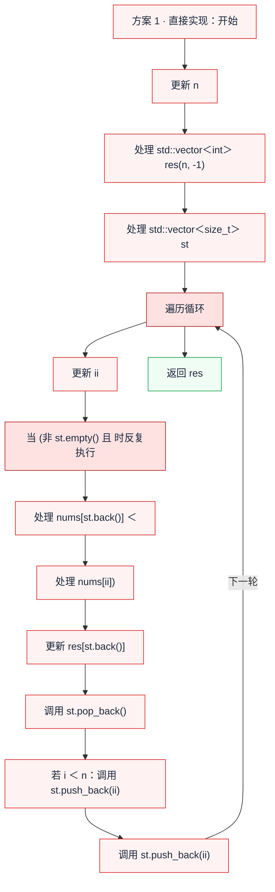

```cpp
// LeetCode 503. 下一个更大元素 II — C++ 版（方案1）
#include <cassert>  // 引入头文件
#include <iostream> // 引入头文件
#include <vector>   // 引入头文件
static std::vector<int> nextGreaterElements(const std::vector<int> &nums) {
    size_t n = nums.size();      // 把 数组.大小(); 写入 size_t n
    std::vector<int> res(n, -1); // std::vector 小于 int 超过 结果(元素个数, 减 1);
    std::vector<size_t> st;      // std::vector 小于 size_t 超过 st;
    for (size_t i = 0; i < 2 * n; ++i) { // 让 下标 i 从 0 开始计数，下标 i 小于 2 乘 元素个数 就继续
        size_t ii = i % n;               // 把 下标 i 对…取模 元素个数; 写入 size_t ii
        while (!st.empty() &&
               nums[st.back()] <
                   nums[ii]) { // 循环，直到不满足「取反 st 是否为空 且 数组[st.back()] 小于 数组[ii]」
            res[st.back()] = nums[ii]; // 把 数组[ii]; 写入 res[st.back()]
            st.pop_back();             // 弹出栈顶元素
        }
        if (i < n)
            st.push_back(ii); // 若 下标 i 小于 元素个数) st 追加 ii);
    }
    return res; // 返回 结果
}
int main() {
    assert((nextGreaterElements({1, 2, 1}) == std::vector<int>{2, -1, 2}));
    assert((nextGreaterElements({3, 2, 1}) == std::vector<int>{-1, 3, 3}));
    std::cout << "PASS" << std::endl;
} // 全部用例通过，输出 PASS
```

### R 实现（1 种方案）

R 的全部方案如下，每个方案都内嵌用例自测，可独立运行（老仓库 python/go 文件遵循「打印结果」约定）：

#### 方案 1：直接实现

**思路与代码分析**：核心是「直接实现」。R 版用向量化思维与 1 起始下标，注意 1:n 的降序陷阱。代码里依次做这些事：单循环线性扫描。**走读**：方案 1 · 直接实现：开始 → 处理 n ＜- length(nums) → 处理 res ＜- rep(-1L, n) → 处理 st ＜- integer(0) → 循环 i：遍历 1:(2 * n) → 处理 ii ＜- (i - 1)%%n + 1 → 当 (length(st) ＞ 0 且 nums[st[length(st)]] ＜ nums[ii]) 时反复执行 → 处理 res[st[length(st)]] ＜- nums[ → 处理 st ＜- st[-length(st)] → 若 i ≤ n：处理 st ＜- c(st, ii) → 处理 st ＜- c(st, ii) → 处理 res → 返回结果。

**运行架构**（真实控制流）：

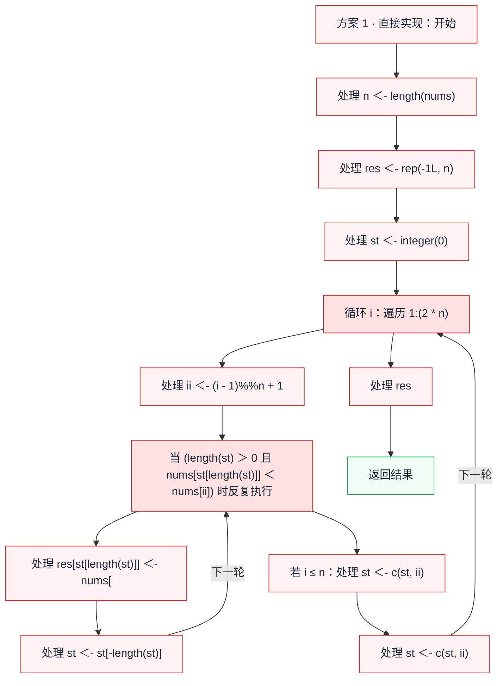

```r
# 版（方案1） 定义函数 next_greater_elements（参数：数组）
next_greater_elements <- function(nums) {
    n <- length(nums)  # 把 长度(数组) 存入 元素个数
    res <- rep(-1L, n)  # 把 rep( 减 1L, 元素个数) 存入 结果
    st <- integer(0)  # 把 integer(0) 存入 st
    for (i in 1:(2 * n)) {
        # for (下标 i in 1:(2 乘 元素个数)) {
        ii <- (i - 1)%%n + 1  # 把 (下标 i 减 1) 对…取模 对…取模 元素个数 加 1 存入 ii
        while (length(st) > 0 && nums[st[length(st)]] < nums[ii]) {
            # 循环，直到不满足「长度(st) 超过 0 且 数组[st[长度(st)]] 小于 数组[ii]」
            res[st[length(st)]] <- nums[ii]  # 把 数组[ii] 存入 res[st[length(st)]]
            st <- st[-length(st)]  # 把 st[ 减 长度(st)] 存入 st
        }
        if (i <= n)
            st <- c(st, ii)  # 若 下标 i 不超过 元素个数) st 小于 减 字符(st, ii
    }
    res  # 结果
}
stopifnot(identical(as.integer(next_greater_elements(c(1, 2, 1))), c(2L, -1L, 2L)))  # 断言校验
stopifnot(identical(as.integer(next_greater_elements(c(3, 2, 1))), c(-1L, 3L, 3L)))  # 断言校验
cat("PASS\n")  # 全部用例通过，输出 PASS
```

### Zig 实现（1 种方案）

Zig 的全部方案如下，每个方案都内嵌用例自测，可独立运行（老仓库 python/go 文件遵循「打印结果」约定）：

#### 方案 1：直接实现

**思路与代码分析**：核心是「直接实现」。Zig 版显式分配与清零，整型边界处理严格。代码里依次做这些事：双重循环遍历。**走读**：方案 1 · 直接实现：开始 → 计算 n → 遍历集合元素 → 计算 st → 计算 top → 遍历集合元素 → 计算 ii → 当 (top ＞ 0 and nums[st[top - 1]] ＜ nums[ii]) 时反复执行 → 更新 1]] → 更新 - → 若 i ＜ n 则： → 更新 st[top] → 更新 + → 返回结果。

**运行架构**（真实控制流）：

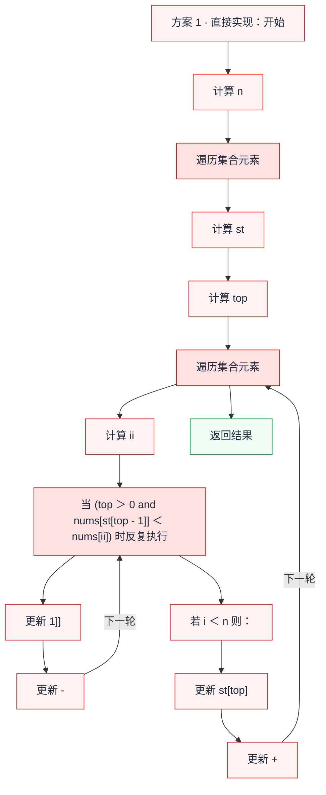

```zig
// LeetCode 503. 下一个更大元素 II — Zig 版（方案1）
const std = @import("std"); // 把 @import(「std」) 存入 std
fn nextGreaterElements(nums: []const i32, out: []i32) void { // 定义函数/方法 nextGreaterElements
    const n = nums.len; // 把 数组.长度 存入 元素个数
    for (0..n) |i| out[i] = -1; // 让 下标 i 从 0 走到 元素个数 减一
    var st: [8192]usize = undefined; // 把 undefined; 写入 var st: [8192]usize
    var top: usize = 0; // 把 0; 写入 var top: usize
    for (0..2 * n) |i| { // for (0..2 乘 元素个数) 按位或 下标 i 按位或 {
        const ii = i % n; // 把 下标 i 对…取模 元素个数 存入 ii
        while (top > 0 and nums[st[top - 1]] < nums[ii]) { // 循环，直到不满足「top 超过 0 and 数组[st[top 减 1]] 小于 数组[ii]」
            out[st[top - 1]] = nums[ii]; // 把 数组[ii]; 写入 out[st[top - 1]]
            top -= 1; // top累减 1
        }
        if (i < n) { // 若 下标 i 小于 元素个数
            st[top] = ii; // 把 ii; 写入 st[top]
            top += 1; // top累加 1
        }
    }
}
pub fn main() !void { // 程序入口：跑内嵌自测用例
    var out: [8]i32 = undefined; // 把 undefined; 写入 var out: [8]i32
    nextGreaterElements(&[_]i32{ 1, 2, 1 }, &out); // nextGreaterElements( 按位与 [_]i32{ 1, 2, 1 }, 按位与 out);
    if (out[0] != 2 or out[1] != -1 or out[2] != 2) return error.TestFailed;
    nextGreaterElements(&[_]i32{ 3, 2, 1 }, &out); // nextGreaterElements( 按位与 [_]i32{ 3, 2, 1 }, 按位与 out);
    if (out[0] != -1 or out[1] != 3 or out[2] != 3) return error.TestFailed;
    std.debug.print("PASS\n", .{});
} // 全部用例通过，输出 PASS
```

### Dart 实现（1 种方案）

Dart 的全部方案如下，每个方案都内嵌用例自测，可独立运行（老仓库 python/go 文件遵循「打印结果」约定）：

#### 方案 1：直接实现

**思路与代码分析**：核心是「直接实现」。Dart 版用可空类型标注与集合方法，注意空安全。代码里依次做这些事：单循环线性扫描。**走读**：方案 1 · 直接实现：开始 → 更新 n → 更新 res → 处理 n, → 处理 -1, → 处理 ) → 更新 st → 遍历循环 → 更新 ii → 当 (st.isNotEmpty 且 nums[st.last] ＜ nums[ii]) 时反复执行 → 更新 res[st.removeLast()] → 若 i ＜ n) st.add(ii：None → 返回 res。

**运行架构**（真实控制流）：

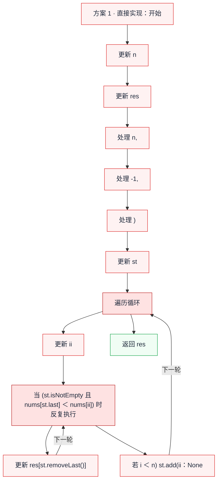

```dart
// LeetCode 503. 下一个更大元素 II — Dart 版（方案1）
List<int> nextGreaterElements(List<int> nums) {
  // 定义函数/方法 nextGreaterElements
  final n = nums.length; // 把 数组.长度 存入 元素个数
  final res = List<int>.filled(
    n,
    -1,
  ); // 把 List 小于 int 超过 .filled(元素个数, 减 1) 存入 结果
  final st = <int>[]; // 把 小于 int 超过 [] 存入 st
  for (var i = 0; i < 2 * n; i++) {
    // 让 下标 i 从 0 开始计数，下标 i 小于 2 乘 元素个数 就继续
    final ii = i % n; // 把 下标 i 对…取模 元素个数 存入 ii
    while (st.isNotEmpty && nums[st.last] < nums[ii]) {
      // 循环，直到不满足「st.isNotEmpty 且 数组[st.last] 小于 数组[ii]」
      res[st.removeLast()] = nums[ii]; // 把 数组[ii]; 写入 res[st.removeLast()]
    }
    if (i < n) st.add(ii); // 若 下标 i 小于 元素个数) st 追加 ii);
  }
  return res; // 返回 结果
}

void main() {
  if (nextGreaterElements([1, 2, 1]).toString() != '[2, -1, 2]')
    throw StateError('c1');
  if (nextGreaterElements([3, 2, 1]).toString() != '[-1, 3, 3]')
    throw StateError('c2');
  print('PASS');
} // 全部用例通过，输出 PASS
```

---

## 内容总结

- **下一个更大元素 ii**（栈 · Medium）：共 1 个方案，主线思路「直接实现」；时间 O(n) 量级；动画演示栈后进先出过程，附录给出 11 种语言 × 全部方案的可运行实现。
- 来源博客：[https://blog.csdn.net/tyro_java/article/details/145347297](https://blog.csdn.net/tyro_java/article/details/145347297)
- 导航：[📋 总目录](../) ｜ [← 037 下一个更大元素 i](../037_下一个更大元素_i/) ｜ [039 反转字符串 ii →](../039_反转字符串_ii/)
