# 039 · 反转字符串 ii（第一阶段 · 线性结构入门 · Medium）

> **难度**：⭐⭐ Medium ｜ **专题**：数组
> **学习定位**：第一阶段 · 线性结构入门第 39 篇 ｜ **解法数**：1
> **内容总结**：**反转字符串 ii**（数组 · Medium）：共 1 个方案，主线思路「双指针」；时间 O(n²)（两层嵌套扫描）；动画演示双指针过程，附录给出 11 种语言 × 全部方案的可运行实现。

---

## 题目描述

给定一个字符串 `s` 和一个整数 `k`，从字符串开头算起，每计数至 `2k` 个字符，就反转这 `2k` 字符中的前 `k` 个字符，再重新计数。

 如果剩余字符少于 `k` 个，则将剩余字符全部反转。
 如果剩余字符小于 `2k` 但大于或等于 `k` 个，则反转前 `k` 个字符，其余字符保持原样。

- 主函数签名：`function reverseStr(s: string, k: number): string`

**用例（来自原题）**：

**示例 1**

```text
输入：s = "abcdefg", k = 2
输出："bacdfeg"
```

**示例 2**

```text
输入：s = "abcd", k = 2
输出："bacd"
```
> ✅ **官方验证**：全部 TypeScript 解法已通过 leetcode.cn 官方示例用例验证（自动注入运行，全部 PASS）。题面与 [leetcode.cn 官方](https://leetcode.cn/problems/reverse-string-ii/)一致，示例配图取自官方题面。

**数据范围与注意事项**：

- `1 <= s.length <= 10^4`
- `s` 仅由小写英文组成
- `1 <= k <= 10^4`
- **易错点**：边界最容易漏：空数组、只有一个元素、目标出现在头尾。

## 题目分析

**场景是什么**：数组是最常用的线性容器，这类题练的是下标操作与原地腾挪，对应真实开发里的缓冲区、列表整理。本题就是该场景的 Medium 级练习，主线做法是「双指针」。

**主线怎么解**：把主解法从头到尾过一遍，它其实在依次做这几件事：单循环线性扫描。

## 解题思路

**方案对比**（共 1 个方案，由浅入深）：

| 方案 | 时间复杂度 | 空间复杂度 |
|---|---|---|
| 方案 1 · 双指针 | O(n²)（两层嵌套扫描） | O(1) 到 O(n) |

**怎么读这一篇**：

- 🐣 **新手路线**：把「题目描述」的示例 1 在纸上手推一遍 → 读方案 1（最直观的写法）与它的代码走读 → 按「运行方式」本地跑通看 PASS → 回头对比方案 2 之后的写法差在哪
- 🦅 **大佬路线**：直接锁定最优方案 1（双指针，O(n²)（两层嵌套扫描））→ 跳读该方案代码与走读 → 用「逐步拆解与面试追问」补齐复杂度推导与边界追问

### 动态算法图（双指针，GIF 自动循环）


动画演示数组专题里双指针的典型过程；每个方案在「TypeScript 解题方案」一节还配了专属动画与专属流程图。

### 主解法流程图（真实控制流）

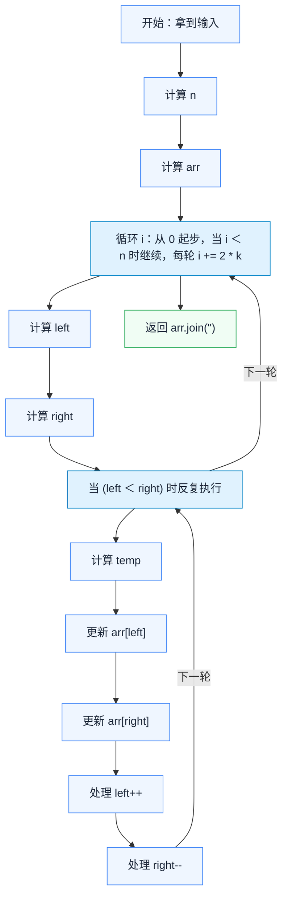

## TypeScript 解题方案（1 个方案逐个讲）

> **运行与提交**：每个方案都是自包含文件（内嵌用例自测，输出 PASS），整块复制到 `.ts` 文件后 `node 文件名` 即可运行。提交 LeetCode 时，把 `demo` 内的算法函数与辅助类型/函数整体取出、置于文件顶层即可。涉及交互/特殊接口的题以题面给定签名为准。

### 方案 1：双指针

**分析与思路**：核心做法是「双指针」。代码里依次做这些事：单循环线性扫描。

**运行方式**：`node 本文件`，内嵌用例全部通过会输出 PASS。

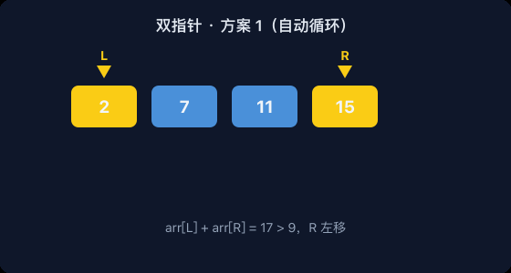

**方案专属流程图**（真实控制流）：

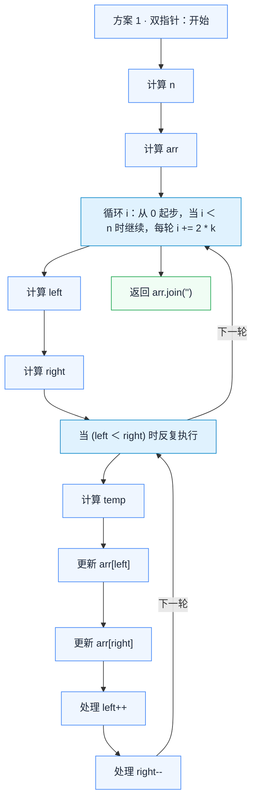

```typescript
/**
 ** LeetCode 541. 反转字符串 II
 ** 方案1: 双指针
 */

function reverseStr(s: string, k: number): string {
  // 定义函数/方法 reverseStr
  const n = s.length; // 把 字符串.长度 存入 元素个数
  const arr: string[] = Array.from(s); // 把 Array.from(字符串); 写入 const arr: string[]
  for (let i = 0; i < n; i += 2 * k) {
    // 让 下标 i 从 0 开始计数，下标 i 小于 元素个数 就继续
    let left = i; // 把 下标 i 存入 左边界
    let right = Math.min(i + k - 1, n - 1); // 把 Math.取较小值 下标 i 加 下标 k 减 1, 元素个数 减 1) 存入 右边界
    while (left < right) {
      // 循环，直到不满足「左边界 小于 右边界」
      const temp = arr[left]; // 把 数组[左边界] 存入 临时变量
      arr[left] = arr[right]; // 把 数组[右边界]; 写入 arr[left]
      arr[right] = temp; // 把 临时变量; 写入 arr[right]
      left++; // 左边界 加一
      right--; // 右边界 减一
    }
  }
  return arr.join(''); // 返回 数组.join('')
}

export function demo(): void {
  // 程序入口：跑内嵌自测用例
  const cases: { in: [string, number]; want: string }[] = [
    { in: ['abc', 1], want: 'abc' },
    { in: ['abcdefg', 2], want: 'bacdfeg' },
    { in: ['abcd', 2], want: 'bacd' },
    { in: ['abcdefgh', 3], want: 'cbadefhg' },
    { in: ['a', 1], want: 'a' },
    { in: ['', 2], want: '' },
  ];
  let fail = false; // 把 false 存入 fail
  for (const c of cases) {
    // for (const 字符 of cases) {
    const got = reverseStr(c.in[0], c.in[1]); // 把 reverseStr(字符.in[0], 字符.in[1]) 存入 got
    if (got !== c.want) {
      // 若 got 不等于 字符.want
      fail = true; // 把 true 存入 fail
      console.log(
        'FAIL reverseStr("' +
          c.in[0] +
          '",' +
          c.in[1] +
          ')="' +
          got +
          '" want "' +
          c.want +
          '"',
      ); // 打印输出
    }
  }
  if (fail) throw new Error('FAILED'); // 若 fail) throw new Error(「FAILED」);
  console.log('PASS'); // 全部用例通过，输出 PASS
}
demo(); // demo();
```

## 逐步拆解与面试追问

**复杂度**：时间 O(n²)（两层嵌套扫描），空间 O(1) 到 O(n)

**为什么是这个量级**：外层定起点、内层扫终点，n 个起点各扫 n 次

**面试官可能会追问**：

- 能不能原地做（O(1) 空间）？
- 如果数组已有序，能优化到什么程度？
- 空数组、单元素怎么处理？

## 关键 API 速查（TS 主解法实际用到，附官方链接）

| API | 作用 | 使用要点 | 官方文档 |
|---|---|---|---|
| `Array.from()` | 类数组/可迭代对象转数组 | Array.from(iterable, mapFn) 可同时映射；对 Set 去重、对字符串按码元拆分；稀疏位会被 undefined 填充 | [官方文档](https://developer.mozilla.org/zh-CN/docs/Web/JavaScript/Reference/Global_Objects/Array/from) |
| `Array.prototype.join()` | 数组拼接为字符串 | undefined/null 转空串；嵌套数组会展平一层；join('') 用于字符数组还原 | [官方文档](https://developer.mozilla.org/zh-CN/docs/Web/JavaScript/Reference/Global_Objects/Array/join) |
| `Math.min()` | 最小值 | 同 max；空参返回 Infinity | [官方文档](https://developer.mozilla.org/zh-CN/docs/Web/JavaScript/Reference/Global_Objects/Math/min) |

### 各语言官方文档导航

- **TypeScript / JS**：[MDN 中文参考](https://developer.mozilla.org/zh-CN/)
- **Python**：[Python 官方文档](https://docs.python.org/zh-cn/3/)
- **Go**：[Go 标准库](https://pkg.go.dev/std)
- **Java**：[JDK 17 API](https://docs.oracle.com/en/java/javase/17/docs/api/)
- **Rust**：[Rust 标准库](https://doc.rust-lang.org/std/)
- **Lua**：[Lua 5.4 手册](https://www.lua.org/manual/5.4/)
- **C**：[Cppreference C](https://zh.cppreference.com/w/c)
- **C++**：[Cppreference C++](https://zh.cppreference.com/w/cpp)
- **R**：[R 官方手册](https://stat.ethz.ch/R-manual/)
- **Zig**：[Zig 语言文档](https://ziglang.org/documentation/master/)
- **Dart**：[Dart API](https://api.dart.dev/)

## 附录：其他 10 种语言全部实现（每种语言列举其全部方案）

> TypeScript 的全部方案见「TypeScript 解题方案」一节；下面是其余 10 种语言的对应实现，每种语言的每个方案都带思路分析、代码走读与专属运行架构图。
> 每个方案都内嵌用例自测，可独立运行（老仓库 python/go 文件遵循「打印结果」约定）。
> 完整解法文件见 `dsa/<语言>/array/lc_541_反转字符串_ii/`。

### Python 实现（1 种方案）

Python 的全部方案如下，每个方案都内嵌用例自测，可独立运行（老仓库 python/go 文件遵循「打印结果」约定）：

#### 方案 1：双指针

**思路与代码分析**：核心是「双指针」。Python 版用切片与字典推导式简化操作，突出可读性。**走读**：方案 1 · 双指针：开始 → 更新 arr → 更新 n → 循环 i：从 0 到 2 * k 前，步长 n → 更新 right → 处理 i + k - 1, n - 1 → 处理 ) → 当 left ＜ right: 时反复执行 → 更新 arr[right] → 处理 arr[right], → 处理 arr[left], → 处理 ) → 更新 + → 更新 - → 返回 .join(arr)。

**运行架构**（真实控制流）：

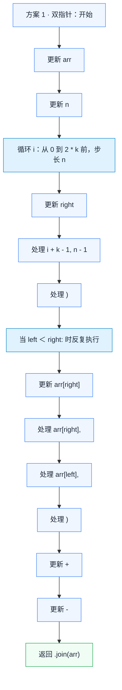

```python
import sys  # 提高递归深度上限（深输入防 RecursionError）

sys.setrecursionlimit(200000)  # 树/链表类题目节点数可达 1e4 量级

def reverseStr(s, k):  # 定义函数 reverseStr（参数：字符串, 下标 k）
    arr = list(s)  # 把 列表(字符串) 存入 数组
    n = len(arr)  # 把 长度(数组) 存入 元素个数
    for i in range(0, n, 2 * k):  # 让 下标 i 从 0 到 元素个数 到 2 乘 下标 k 遍历
        left, right = i, min(
            i + k - 1, n - 1
        )  # 把 下标 i, 取较小值 下标 i 加 下标 k 减 1, 元素个数 减 1) 写入 left, right
        while left < right:  # 循环，直到不满足「左边界 小于 右边界」
            arr[left], arr[right] = (
                arr[right],
                arr[left],
            )  # 把 数组[右边界], 数组[左边界] 写入 arr[left], arr[right]
            left += 1  # 左边界累加 1
            right -= 1  # 右边界累减 1
    return "".join(arr)  # 返回 ''.join(数组)

if __name__ == "__main__":  # 若 __name__ 等于 '__main__'
    print(reverseStr("abc", 1))  # 打印输出
```

### Go 实现（1 种方案）

Go 的全部方案如下，每个方案都内嵌用例自测，可独立运行（老仓库 python/go 文件遵循「打印结果」约定）：

#### 方案 1：双指针

**思路与代码分析**：核心是「双指针」。Go 版用切片与多返回值惯用法，显式处理索引边界。**走读**：方案 1 · 双指针：开始 → 更新 : → 更新 : → 调用 copy(arr, s) → 遍历循环 → 更新 : → 更新 : → 处理 if right ≥ n → 更新 right → 遍历循环 → 更新 arr[right] → 处理 left++ → 处理 right-- → 返回 string(arr)。

**运行架构**（真实控制流）：

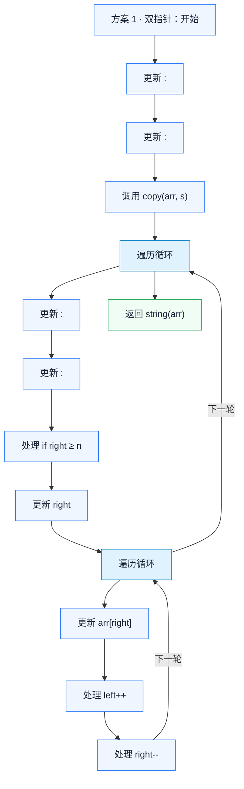

```go
package main // 引入依赖

import (
	"fmt"     // 「fmt」
	"os"      // 「os」
	"reflect" // 「reflect」
)

func reverseStr(s string, k int) string { // 定义函数/方法 reverseStr
	n := len(s)                     // 把 长度(字符串) 写入 n :
	arr := make([]byte, n)          // 把 make([]byte, 元素个数) 写入 arr :
	copy(arr, s)                    // copy(数组, 字符串)
	for i := 0; i < n; i += 2 * k { // 让 下标 i 从 0 开始计数
		left := i          // 把 下标 i 写入 left :
		right := i + k - 1 // 把 下标 i 加 下标 k 减 1 写入 right :
		if right >= n {    // 若 右边界 不低于 元素个数
			right = n - 1 // 把 元素个数 减 1 写入 右边界
		}
		for left < right { // for 左边界 小于 右边界 {
			arr[left], arr[right] = arr[right], arr[left] // 把 数组[右边界], 数组[左边界] 写入 arr[left], arr[right]
			left++                                        // 左边界 加一
			right--                                       // 右边界 减一
		}
	}
	return string(arr) // 定义函数/方法 string
}

func main() { // 程序入口：跑内嵌自测用例
	type tc struct { // 定义类型
		s    string // 字符串 string
		k    int    // 下标 k int
		want string // want string
	}
	cases := []tc{ // 把 []tc{ 写入 cases :
		{"abc", 1, "abc"},
		{"abcdefg", 2, "bacdfeg"},
		{"abcd", 2, "bacd"},
	}
	ok := true                // 把 true 写入 ok :
	for _, c := range cases { // 同时取 _ 与 字符 遍历
		if got := reverseStr(c.s, c.k); got != c.want { // 若 got : 赋值为 reverseStr(字符.字符串, 字符.下标 k); got 不等于 字符.want
			ok = false                                                               // 把 false 写入 ok
			fmt.Printf("FAIL reverseStr(%q,%v)=%q want %q\n", c.s, c.k, got, c.want) // 打印输出
		}
	}
	_ = reflect.DeepEqual // 把 reflect.DeepEqual 写入 _
	if !ok {              // 若 取反 ok
		os.Exit(1) // os.Exit(1)
	}
	fmt.Println("PASS") // 全部用例通过，输出 PASS
}
```

### Java 实现（1 种方案）

Java 的全部方案如下，每个方案都内嵌用例自测，可独立运行（老仓库 python/go 文件遵循「打印结果」约定）：

#### 方案 1：双指针

**思路与代码分析**：核心是「双指针」。Java 版用类与静态方法组织，集合操作显式明了。代码里依次做这些事：单循环线性扫描。**走读**：方案 1 · 双指针：开始 → 更新 arr → 更新 n → 遍历循环 → 更新 left → 更新 right → 当 (left ＜ right) 时反复执行 → 更新 temp → 更新 arr[left] → 更新 arr[right] → 处理 left++ → 处理 right-- → 返回 new String(arr)。

**运行架构**（真实控制流）：

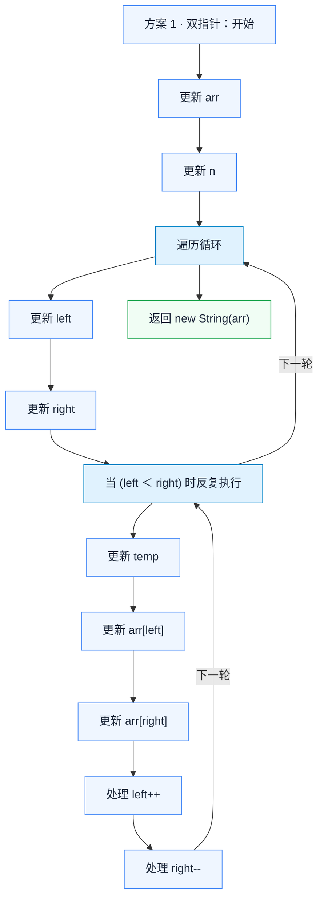

```java
package com.webfault.dsa; // 引入依赖

class lc541_solution111 { // 定义类型
  String reverseStr(String s, int k) { // 定义函数/方法 reverseStr
    char[] arr = s.toCharArray(); // 把 字符串.toCharArray(); 写入 char[] arr
    int n = arr.length; // 把 数组.长度 存入 元素个数
    for (int i = 0; i < n; i += 2 * k) { // 让 下标 i 从 0 开始计数，下标 i 小于 元素个数 就继续
      int left = i; // 把 下标 i 存入 左边界
      int right = Math.min(i + k - 1, n - 1); // 把 Math.取较小值 下标 i 加 下标 k 减 1, 元素个数 减 1) 存入 右边界
      while (left < right) { // 循环，直到不满足「左边界 小于 右边界」
        char temp = arr[left]; // 把 数组[左边界]; 写入 char temp
        arr[left] = arr[right]; // 把 数组[右边界]; 写入 arr[left]
        arr[right] = temp; // 把 临时变量; 写入 arr[right]
        left++; // 左边界 加一
        right--; // 右边界 减一
      }
    }
    return new String(arr); // 返回 new String(数组)
  }

  public static void main(String[] args) { // public static void main(String[] args) {
    lc541_solution111 s =
        new lc541_solution111(); // 把 new lc541_solution111(); 写入 lc541_solution111 s
    boolean ok = true; // 把 true; 写入 boolean ok
    if (!s.reverseStr("abc", 1).equals("abc")) {
      ok = false;
      System.out.println("FAIL1");
    }
    if (!s.reverseStr("abcdefg", 2).equals("bacdfeg")) {
      ok = false;
      System.out.println("FAIL2");
    }
    if (!s.reverseStr("abcd", 2).equals("bacd")) {
      ok = false;
      System.out.println("FAIL3");
    }
    if (!ok) throw new RuntimeException("FAILED"); // 若 取反 ok) throw new RuntimeException(「FAILED」);
    System.out.println("PASS"); // 全部用例通过，输出 PASS
  }
}
```

### Rust 实现（1 种方案）

Rust 的全部方案如下，每个方案都内嵌用例自测，可独立运行（老仓库 python/go 文件遵循「打印结果」约定）：

#### 方案 1：双指针

**思路与代码分析**：核心是「双指针」。Rust 版用所有权移动与切片借用改写同一逻辑，注意 Option 与引用边界。**走读**：方案 1 · 双指针：开始 → 计算 chars → 当 i ＜ n 时反复执行 → 当 l ＜ r 时反复执行 → 返回结果。

**运行架构**（真实控制流）：

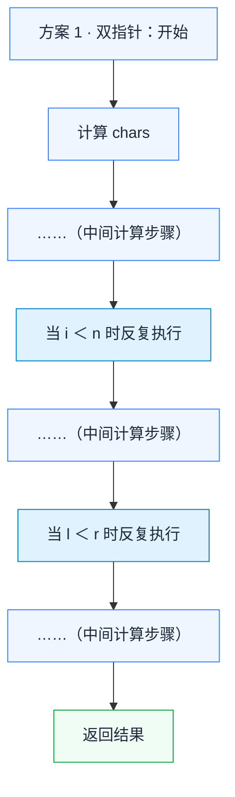

```rust
// LeetCode 541. 反转字符串II — Rust 版（方案1）
fn reverse_str(s: String, k: i32) -> String {
    // 定义函数/方法 reverse_str
    let chars: Vec<char> = s.chars().collect(); // 把 字符串.chars().collect(); 写入 let chars: Vec<char>
    let mut out = chars.clone(); // 把 chars.clone(); 写入 let mut out
    let n = chars.len(); // 把 chars.长度() 存入 元素个数
    let k = k as usize; // 把 下标 k as usize 存入 下标 k
    let mut i = 0usize; // 把 0usize; 写入 let mut i
    while i < n {
        // while 下标 i 小于 元素个数 {
        let end = (i + k).min(n); // 把 (下标 i 加 下标 k).取较小值 元素个数) 存入 终点
        let mut l = i; // 把 下标 i; 写入 let mut l
        let mut r = end - 1; // 把 终点 减 1; 写入 let mut r
        while l < r {
            out.swap(l, r);
            l += 1;
            if r == 0 {
                break;
            }
            r -= 1;
        }
        i += 2 * k; // 下标 i累加 2 乘 下标 k
    }
    out.into_iter().collect() // out.into_iter().collect()
}
fn main() {
    assert_eq!(reverse_str("abcdefg".into(), 2), "bacdfeg");
    assert_eq!(reverse_str("abcd".into(), 2), "bacd");
    assert_eq!(reverse_str("abc".into(), 1), "abc");
    println!("PASS");
} // 程序入口：跑内嵌自测用例
```

### Lua 实现（1 种方案）

Lua 的全部方案如下，每个方案都内嵌用例自测，可独立运行（老仓库 python/go 文件遵循「打印结果」约定）：

#### 方案 1：双指针

**思路与代码分析**：核心是「双指针」。Lua 版用表与 ipairs 遍历，注意 ipairs 遇 nil 即停的语义。**走读**：方案 1 · 双指针：开始 → 更新 out → 更新 n → 更新 i → 当 i ≤ n do 时反复执行 → 更新 e → 更新 seg → 更新 1] → 更新 1] → 更新 i → 返回 table.concat(out)。

**运行架构**（真实控制流）：

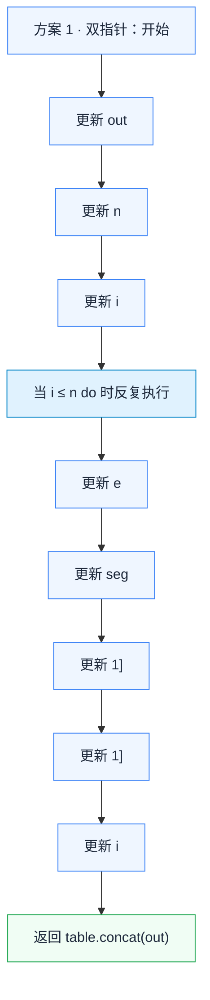

```lua
-- LeetCode 541. 反转字符串II — Lua 版（方案1）
local function reverse_str(s, k) -- local function reverse_str(字符串, 下标 k)
	local out = {} -- 把 {} 写入 local out
	local n = #s -- 把 #字符串 写入 local n
	local i = 1 -- 把 1 写入 local i
	while i <= n do -- 把 元素个数 do 写入 while i <
		local e = math.min(i + k - 1, n) -- 把 math.取较小值 下标 i 加 下标 k 减 1, 元素个数) 写入 local e
		local seg = s:sub(i, e):reverse() -- 把 字符串:sub(下标 i, e):reverse() 写入 local seg
		out[#out + 1] = seg -- 把 seg 写入 out[#out + 1]
		out[#out + 1] = s:sub(e + 1, e + k) -- 把 字符串:sub(e 加 1, e 加 下标 k) 写入 out[#out + 1]
		i = i + 2 * k -- 把 下标 i 加 2 乘 下标 k 存入 下标 i
	end -- 终点
	return table.concat(out) -- 返回 table.concat(out)
end -- 终点
assert(reverse_str("abcdefg", 2) == "bacdfeg") -- 断言校验
assert(reverse_str("abcd", 2) == "bacd") -- 断言校验
assert(reverse_str("abc", 1) == "abc") -- 断言校验
print("PASS") -- 全部用例通过，输出 PASS
```

### C 实现（1 种方案）

C 的全部方案如下，每个方案都内嵌用例自测，可独立运行（老仓库 python/go 文件遵循「打印结果」约定）：

#### 方案 1：双指针

**思路与代码分析**：核心是「双指针」。C 版手动管理下标与内存，循环边界全部显式写出。代码里依次做这些事：双重循环遍历。**走读**：方案 1 · 双指针：开始 → 更新 n → 更新 pos → 遍历循环 → 更新 end → 处理 : n → 遍历循环 → 更新 out[pos++] → 遍历循环 → 更新 out[pos++] → 更新 out[pos] → 返回结果。

**运行架构**（真实控制流）：

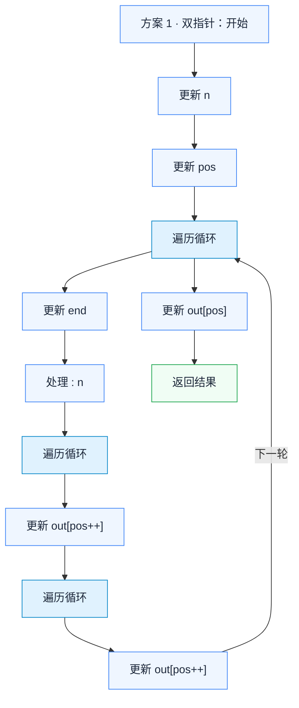

```c
/* LeetCode 541. 反转字符串II — C 版（方案1） */
#include <stdio.h>                                          // 引入头文件
#include <string.h>                                         // 引入头文件
static void reverse_str(const char *s, int k, char out[]) { // 定义函数/方法 reverse_str
    int n = (int)strlen(s);                                 // 把 (int)strlen(字符串) 存入 元素个数
    int pos = 0;                                            // 把 0 存入 pos
    for (int i = 0; i < n; i += 2 * k) { // 让 下标 i 从 0 开始计数，下标 i 小于 元素个数 就继续
        int end = i + k < n ? i + k
                            : n; // 把 下标 i 加 下标 k 小于 元素个数 ? 下标 i 加 下标 k : 元素个数 存入 终点
        for (int j = end - 1; j >= i; j--)
            out[pos++] = s[j]; // 让 下标 j 从 终点 减 1 开始计数，下标 j 不低于 下标 i 就继续
        for (int j = end; j < i + 2 * k && j < n; j++)
            out[pos++] = s[j]; // 让 下标 j 从 终点 开始计数，下标 j 小于 下标 i 加 2 乘 下标 k 且 下标 j 小于
                               // 元素个数 就继续
    }
    out[pos] = '\0'; // 把 '\0'; 写入 out[pos]
}
int main(void) {                    // 程序入口：跑内嵌自测用例
    char out[8192];                 // char out[8192];
    reverse_str("abcdefg", 2, out); // reverse_str(「abcdefg」, 2, out);
    if (strcmp(out, "bacdfeg") != 0) {
        printf("FAIL 1 %s\n", out);
        return 1;
    }
    reverse_str("abcd", 2, out); // reverse_str(「abcd」, 2, out);
    if (strcmp(out, "bacd") != 0) {
        printf("FAIL 2\n");
        return 1;
    }                           // 若 strcmp(out, 「bacd」) 不等于 0) { 输出「bacd」); return 1; }
    reverse_str("abc", 1, out); // reverse_str(「abc」, 1, out);
    if (strcmp(out, "abc") != 0) {
        printf("FAIL 3\n");
        return 1;
    } // 若 strcmp(out, 「abc」) 不等于 0) { 输出「abc」); return 1; }
    printf("PASS\n");
    return 0;
} // 全部用例通过，输出 PASS
```

### C++ 实现（1 种方案）

C++ 的全部方案如下，每个方案都内嵌用例自测，可独立运行（老仓库 python/go 文件遵循「打印结果」约定）：

#### 方案 1：双指针

**思路与代码分析**：核心是「双指针」。C++ 版用 STL 容器与迭代器，减少手写下标错误。代码里依次做这些事：单循环线性扫描。**走读**：方案 1 · 双指针：开始 → 更新 out → 遍历循环 → 更新 + → 更新 end → 处理 std::reverse(out.begin() + i → 调用 out.begin() + end) → 返回 out。

**运行架构**（真实控制流）：

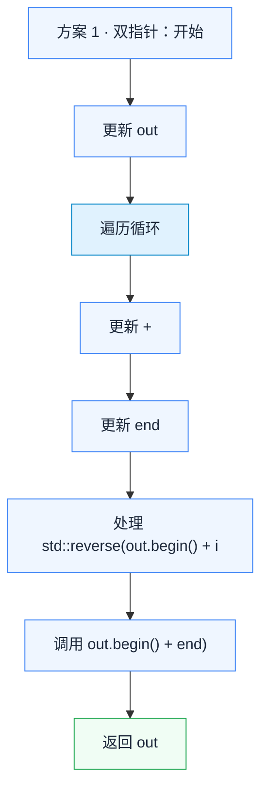

```cpp
// LeetCode 541. 反转字符串II — C++ 版（方案1）
#include <algorithm> // 引入头文件
#include <cassert>   // 引入头文件
#include <iostream>  // 引入头文件
#include <string>    // 引入头文件
static std::string reverseStr(const std::string &s, int k) {
    std::string out = s; // 把 字符串; 写入 std::string out
    for (size_t i = 0; i < s.size();
         i += 2 * static_cast<size_t>(k)) { // 让 下标 i 从 0 开始计数，下标 i 小于 字符串.大小() 就继续
        size_t end = std::min(i + static_cast<size_t>(k), s.size());
        std::reverse(out.begin() + i,
                     out.begin() + end); // std::reverse(out 迭代位置 加 下标 i, out 迭代位置 加 终点);
    }
    return out; // 返回 out
}
int main() {
    assert(reverseStr("abcdefg", 2) == "bacdfeg");
    assert(reverseStr("abcd", 2) == "bacd");
    assert(reverseStr("abc", 1) == "abc");
    std::cout << "PASS" << std::endl;
} // 全部用例通过，输出 PASS
```

### R 实现（1 种方案）

R 的全部方案如下，每个方案都内嵌用例自测，可独立运行（老仓库 python/go 文件遵循「打印结果」约定）：

#### 方案 1：双指针

**思路与代码分析**：核心是「双指针」。R 版用向量化思维与 1 起始下标，注意 1:n 的降序陷阱。**走读**：方案 1 · 双指针：开始 → 处理 chars ＜- strsplit(s, )[[1] → 处理 n ＜- length(chars) → 处理 out ＜- chars → 处理 i ＜- 1 → 当 (i ≤ n) 时反复执行 → 处理 e ＜- min(i + k - 1, n) → 处理 out[i:e] ＜- rev(chars[i:e]) → 处理 i ＜- i + 2 * k → 更新 collapse → 返回结果。

**运行架构**（真实控制流）：

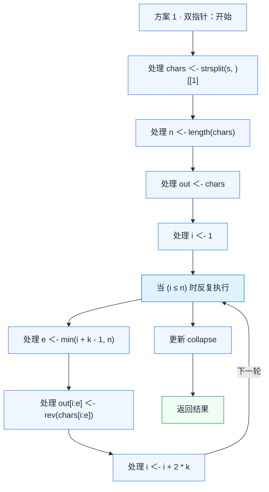

```r
# 版（方案1） 定义函数 reverse_str（参数：字符串, 下标 k）
reverse_str <- function(s, k) {
    chars <- strsplit(s, "")[[1]]  # 把 strsplit(字符串, 「」)[[1]] 存入 chars
    n <- length(chars)  # 把 长度(chars) 存入 元素个数
    out <- chars  # 把 chars 存入 out
    i <- 1  # 把 1 存入 下标 i
    while (i <= n) {
        # 循环，直到不满足「下标 i 不超过 元素个数」
        e <- min(i + k - 1, n)  # 把 取较小值 下标 i 加 下标 k 减 1, 元素个数) 存入 e
        out[i:e] <- rev(chars[i:e])  # 把 rev(chars[下标 i:e]) 存入 out[i:e]
        i <- i + 2 * k  # 把 下标 i 加 2 乘 下标 k 存入 下标 i
    }
    paste(out, collapse = "")  # 把 「」) 写入 paste(out, collapse
}
stopifnot(reverse_str("abcdefg", 2) == "bacdfeg")  # 断言校验
stopifnot(reverse_str("abcd", 2) == "bacd")  # 断言校验
stopifnot(reverse_str("abc", 1) == "abc")  # 断言校验
cat("PASS\n")  # 全部用例通过，输出 PASS
```

### Zig 实现（1 种方案）

Zig 的全部方案如下，每个方案都内嵌用例自测，可独立运行（老仓库 python/go 文件遵循「打印结果」约定）：

#### 方案 1：双指针

**思路与代码分析**：核心是「双指针」。Zig 版显式分配与清零，整型边界处理严格。**走读**：方案 1 · 双指针：开始 → 处理 @memcpy(out[0..s.len], s) → 计算 i → 当 (i ＜ s.len) : (i += 2 * k) 时反复执行 → 计算 end → 计算 l → 计算 r → 当 (l ＜ r) : ( 时反复执行 → 更新 + → 更新 - → 计算 t → 更新 out[l] → 更新 out[r] → 返回结果。

**运行架构**（真实控制流）：

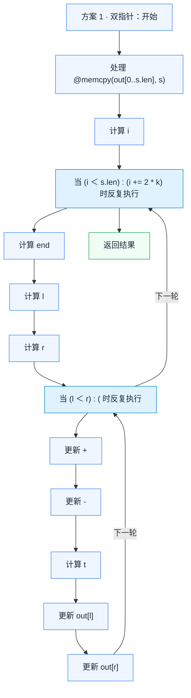

```zig
// LeetCode 541. 反转字符串II — Zig 版（方案1）
const std = @import("std"); // 把 @import(「std」) 存入 std
fn reverseStr(s: []const u8, k: usize, out: []u8) void { // 定义函数/方法 reverseStr
    @memcpy(out[0..s.len], s); // @memcpy(out[0..字符串.长度], 字符串);
    var i: usize = 0; // 把 0; 写入 var i: usize
    while (i < s.len) : (i += 2 * k) { // 循环，直到不满足「下标 i 小于 字符串.长度) : (下标 i 累加 2 乘 下标 k」
        const end = @min(i + k, s.len); // 把 @取较小值 下标 i 加 下标 k, 字符串.长度) 存入 终点
        var l = i; // 把 下标 i 存入 左指针
        var r = end - 1; // 把 终点 减 1 存入 右指针
        while (l < r) : ({ // 循环，直到不满足「左指针 小于 右指针) : (」
            l += 1; // 左指针累加 1
            r -= 1; // 右指针累减 1
        }) { // }) {
            const t = out[l]; // 把 out[左指针] 存入 另一字符串
            out[l] = out[r]; // 把 out[右指针]; 写入 out[l]
            out[r] = t; // 把 另一字符串; 写入 out[r]
        }
    }
}
pub fn main() !void { // 程序入口：跑内嵌自测用例
    var buf: [64]u8 = undefined; // 把 undefined; 写入 var buf: [64]u8
    reverseStr("abcdefg", 2, &buf); // reverseStr(「abcdefg」, 2, 按位与 buf);
    if (!std.mem.eql(u8, buf[0..7], "bacdfeg")) return error.TestFailed;
    reverseStr("abcd", 2, &buf); // reverseStr(「abcd」, 2, 按位与 buf);
    if (!std.mem.eql(u8, buf[0..4], "bacd")) return error.TestFailed;
    reverseStr("abc", 1, &buf); // reverseStr(「abc」, 1, 按位与 buf);
    if (!std.mem.eql(u8, buf[0..3], "abc")) return error.TestFailed; // 若 取反 std.mem.eql(u8, buf[0..3], 「abc」)，直接返回 error.TestFailed
    std.debug.print("PASS\n", .{});
} // 全部用例通过，输出 PASS
```

### Dart 实现（1 种方案）

Dart 的全部方案如下，每个方案都内嵌用例自测，可独立运行（老仓库 python/go 文件遵循「打印结果」约定）：

#### 方案 1：双指针

**思路与代码分析**：核心是「双指针」。Dart 版用可空类型标注与集合方法，注意空安全。**走读**：方案 1 · 双指针：开始 → 更新 sb → 计算 i → 当 (i ＜ s.length) 时反复执行 → 更新 end → 处理 ? i + k → 处理 : s.length → 调用 sb.write(s.substring(i, end) → 若 end ＜ s.length 则： → 更新 segEnd → 处理 ? end + k → 处理 : s.length → 调用 sb.write(s.substring(end, se → 更新 + → 返回 sb.toString()。

**运行架构**（真实控制流）：

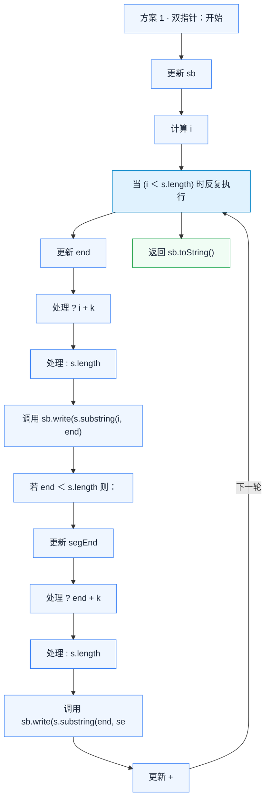

```dart
// LeetCode 541. 反转字符串II — Dart 版（方案1）
String reverseStr(String s, int k) {
  // 定义函数/方法 reverseStr
  final sb = StringBuffer(); // 把 StringBuffer() 存入 sb
  var i = 0; // 把 0 存入 下标 i
  while (i < s.length) {
    // 循环，直到不满足「下标 i 小于 字符串.长度」
    final end = (i + k < s.length)
        ? i + k
        : s.length; // 把 (下标 i 加 下标 k 小于 字符串.长度) ? 下标 i 加 下标 k : 字符串.长度 存入 终点
    sb.write(s.substring(i, end).split('').reversed.join()); // 拼接为字符串
    if (end < s.length) {
      // 若 终点 小于 字符串.长度
      final segEnd = (end + k < s.length)
          ? end + k
          : s.length; // 把 (终点 加 下标 k 小于 字符串.长度) ? 终点 加 下标 k : 字符串.长度 存入 segEnd
      sb.write(s.substring(end, segEnd)); // sb.write(字符串 截取 终点, segEnd));
    }
    i += 2 * k; // 下标 i累加 2 乘 下标 k
  }
  return sb.toString(); // 返回 sb.toString()
}

void main() {
  if (reverseStr('abcdefg', 2) != 'bacdfeg') throw StateError('c1');
  if (reverseStr('abcd', 2) != 'bacd') throw StateError('c2');
  if (reverseStr('abc', 1) != 'abc') throw StateError('c3');
  print('PASS');
} // 全部用例通过，输出 PASS
```

---

## 内容总结

- **反转字符串 ii**（数组 · Medium）：共 1 个方案，主线思路「双指针」；时间 O(n²)（两层嵌套扫描）；动画演示双指针过程，附录给出 11 种语言 × 全部方案的可运行实现。
- 来源博客：[https://blog.csdn.net/tyro_java/article/details/145565975](https://blog.csdn.net/tyro_java/article/details/145565975)
- 导航：[📋 总目录](../) ｜ [← 038 下一个更大元素 ii](../038_下一个更大元素_ii/) ｜ [040 下一个更大元素 iii →](../040_下一个更大元素_iii/)
