# 040 · 下一个更大元素 iii（第一阶段 · 线性结构入门 · Medium）

> **难度**：⭐⭐ Medium ｜ **专题**：栈
> **学习定位**：第一阶段 · 线性结构入门第 40 篇 ｜ **解法数**：2
> **内容总结**：**下一个更大元素 iii**（栈 · Medium）：共 2 个方案，主线思路「双指针收缩」；时间 O(n²)（两层嵌套扫描）；动画演示栈后进先出过程，附录给出 11 种语言 × 全部方案的可运行实现。

---

## 题目描述

给你一个正整数 `n` ，请你找出符合条件的最小整数，其由重新排列 `n` 中存在的每位数字组成，并且其值大于 `n` 。如果不存在这样的正整数，则返回 `-1` 。

注意 ，返回的整数应当是一个 32 位整数 ，如果存在满足题意的答案，但不是 32 位整数 ，同样返回 `-1` 。

- 主函数签名：`function nextGreaterElement(n: number): number`

**用例（来自原题）**：

**示例 1**

```text
输入：n = 12
输出：21
```

**示例 2**

```text
输入：n = 21
输出：-1
```
> ✅ **官方验证**：全部 TypeScript 解法已通过 leetcode.cn 官方示例用例验证（自动注入运行，全部 PASS）。题面与 [leetcode.cn 官方](https://leetcode.cn/problems/next-greater-element-iii/)一致，示例配图取自官方题面。

**数据范围与注意事项**：

- `1 <= n <= 2^31 - 1`
- **易错点**：出栈前判空；「下一个更大元素」类问题栈里存下标比存值好用。

## 题目分析

**场景是什么**：后进先出结构天然适合「最近匹配」，对应真实开发里的括号校验、浏览历史、函数调用栈。本题就是该场景的 Medium 级练习，主线做法是「双指针收缩」。

**主线怎么解**：主解法结构简单：读入、处理、返回。

## 解题思路

**方案对比**（共 2 个方案，由浅入深）：

| 方案 | 时间复杂度 | 空间复杂度 |
|---|---|---|
| 方案 1 · 双指针收缩 | O(n²)（两层嵌套扫描） | O(1) 到 O(n) |
| 方案 2 · 排序预处理 | O(n²)（两层嵌套扫描） | O(1) 到 O(n) |

**由浅入深的路径**：双指针收缩 → 排序预处理；每往右一步，都在补上一步的短板。

**方案间的取舍**：方案 1（双指针收缩）；方案 2（排序预处理）。数据规模小、可读性优先时选靠前的方案；规模大、性能优先时选靠后的方案。

**怎么读这一篇**：

- 🐣 **新手路线**：把「题目描述」的示例 1 在纸上手推一遍 → 读方案 1（最直观的写法）与它的代码走读 → 按「运行方式」本地跑通看 PASS → 回头对比方案 2 之后的写法差在哪
- 🦅 **大佬路线**：直接锁定最优方案 1（双指针收缩，O(n²)（两层嵌套扫描））→ 跳读该方案代码与走读 → 用「逐步拆解与面试追问」补齐复杂度推导与边界追问

### 动态算法图（栈后进先出，GIF 自动循环）


动画演示栈专题里栈后进先出的典型过程；每个方案在「TypeScript 解题方案」一节还配了专属动画与专属流程图。

### 主解法流程图（真实控制流）

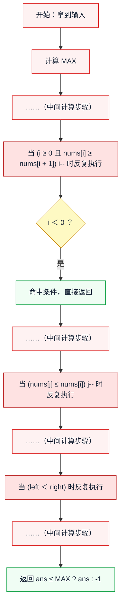

## TypeScript 解题方案（2 个方案逐个讲）

> **运行与提交**：每个方案都是自包含文件（内嵌用例自测，输出 PASS），整块复制到 `.ts` 文件后 `node 文件名` 即可运行。提交 LeetCode 时，把 `demo` 内的算法函数与辅助类型/函数整体取出、置于文件顶层即可。涉及交互/特殊接口的题以题面给定签名为准。

### 方案 1：双指针收缩

**分析与思路**：核心做法是「双指针收缩」。

**运行方式**：`node 本文件`，内嵌用例全部通过会输出 PASS。

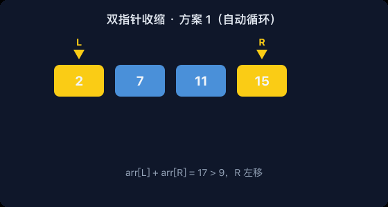

**方案专属流程图**（真实控制流）：

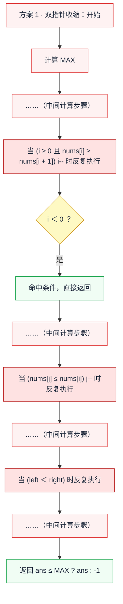

```typescript
export function demo(): void {
  // 程序入口：跑内嵌自测用例
  function nextGreaterElement(n: number): number {
    // 定义函数/方法 nextGreaterElement
    const MAX = 2147483647; // 把 2147483647 存入 MAX
    let nums = String(n).split(''); // 把 String(元素个数).split('') 存入 数组
    let i = nums.length - 2; // 把 数组.长度 减 2 存入 下标 i
    while (i >= 0 && nums[i] >= nums[i + 1]) i--; // 循环，直到不满足「下标 i 不低于 0 且 数组[下标 i] 不低于 数组[下标 i 加 1]) 下标 i 减一 ;」
    if (i < 0) return -1; // 若 下标 i 小于 0，直接返回 减 1
    let j = nums.length - 1; // 把 数组.长度 减 1 存入 下标 j
    while (nums[j] <= nums[i]) j--; // 循环，直到不满足「数组[下标 j] 不超过 数组[下标 i]) 下标 j 减一 ;」
    const t = nums[i];
    nums[i] = nums[j];
    nums[j] = t;
    let left = i + 1,
      right = nums.length - 1; // 把 下标 i 加 1, 右边界 赋值为 数组.长度 减 1 存入 左边界
    while (left < right) {
      const tt = nums[left];
      nums[left] = nums[right];
      nums[right] = tt;
      left++;
      right--;
    }
    const ans = parseInt(nums.join(''), 10); // 把 转整数(数组.join(''), 10) 存入 答案
    return ans <= MAX ? ans : -1; // 返回 答案 不超过 MAX ? 答案 : 减 1
  }
  const cases = [
    { in: 1, want: -1 },
    { in: 12, want: 21 },
    { in: 21, want: -1 },
    { in: 123, want: 132 },
    { in: 321, want: -1 },
    { in: 1234, want: 1243 },
    { in: 4321, want: -1 },
    { in: 230241, want: 230412 },
    { in: 1999999999, want: -1 }, // { in: 1999999999, want: 减 1 }
  ];
  let fail = false; // 把 false 存入 fail
  for (const c of cases) {
    // for (const 字符 of cases) {
    const got = nextGreaterElement(c.in); // 把 nextGreaterElement(字符.in) 存入 got
    if (got !== c.want) {
      fail = true;
      console.log(
        'FAIL nextGreaterElement(' + c.in + ')=' + got + ' want ' + c.want,
      );
    }
  }
  if (fail) throw new Error('FAILED'); // 若 fail) throw new Error(「FAILED」);
  console.log('PASS'); // 全部用例通过，输出 PASS
}
demo(); // demo();
```

### 方案 2：排序预处理

**分析与思路**：核心做法是「排序预处理」。代码里依次做这些事：先排序再处理；单循环线性扫描。

**运行方式**：`node 本文件`，内嵌用例全部通过会输出 PASS。


**方案专属流程图**（真实控制流）：

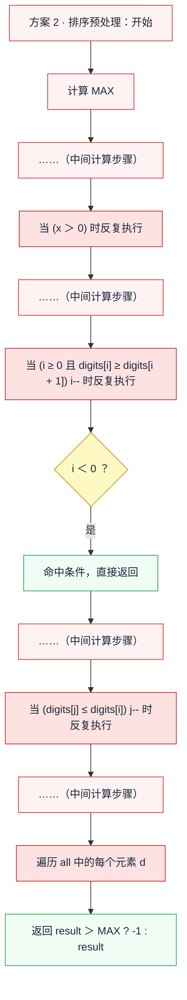

```typescript
export function demo(): void {
  // 程序入口：跑内嵌自测用例
  function nextGreaterElement(n: number): number {
    // 下一个更大排列：下一排列法
    const MAX = 2147483647; // 32 位上限
    const digits: number[] = []; // 逐位拆解
    let x = n;
    if (x === 0) digits.push(0);
    while (x > 0) {
      digits.unshift(x % 10);
      x = Math.floor(x / 10);
    }
    let i = digits.length - 2; // 从右找第一个降序位
    while (i >= 0 && digits[i] >= digits[i + 1]) i--;
    if (i < 0) return -1; // 整体降序，无更大排列
    let j = digits.length - 1; // 从右找第一个大于 digits[i] 的位
    while (digits[j] <= digits[i]) j--;
    const tmp = digits[i];
    digits[i] = digits[j];
    digits[j] = tmp; // 交换
    const tail = digits.splice(i + 1).sort((a, b) => a - b); // 后缀升序
    const all = digits.concat(tail);
    let result = 0; // 重拼数字
    for (const d of all) result = result * 10 + d;
    return result > MAX ? -1 : result; // 超界返回 -1
  }
  const cases = [
    { in: 12, want: 21 },
    { in: 21, want: -1 },
    { in: 321, want: -1 },
    { in: 4321, want: -1 },
    { in: 1999999999, want: -1 }, // { in: 1999999999, want: 减 1 }
  ];
  let fail = false; // 把 false 存入 fail
  for (const c of cases) {
    // for (const 字符 of cases) {
    const got = nextGreaterElement(c.in); // 把 nextGreaterElement(字符.in) 存入 got
    if (got !== c.want) {
      fail = true;
      console.log(
        'FAIL nextGreaterElement(' + c.in + ')=' + got + ' want ' + c.want,
      );
    }
  }
  if (fail) throw new Error('FAILED'); // 若 fail) throw new Error(「FAILED」);
  console.log('PASS'); // 全部用例通过，输出 PASS
}
demo(); // demo();
```

## 逐步拆解与面试追问

**复杂度**：时间 O(n²)（两层嵌套扫描），空间 O(1) 到 O(n)

**为什么是这个量级**：外层定起点、内层扫终点，n 个起点各扫 n 次

**面试官可能会追问**：

- 什么时候用单调栈（求下一个更大或更小）？
- 栈里存值还是存下标？
- 能否用 O(1) 额外空间？

## 关键 API 速查（TS 主解法实际用到，附官方链接）

| API | 作用 | 使用要点 | 官方文档 |
|---|---|---|---|
| `Array.prototype.join()` | 数组拼接为字符串 | undefined/null 转空串；嵌套数组会展平一层；join('') 用于字符数组还原 | [官方文档](https://developer.mozilla.org/zh-CN/docs/Web/JavaScript/Reference/Global_Objects/Array/join) |
| `String.prototype.split()` | 字符串切分为数组 | split('') 按字符拆；split(/正则/) 支持模式；空串调用会拆出空串数组 | [官方文档](https://developer.mozilla.org/zh-CN/docs/Web/JavaScript/Reference/Global_Objects/String/split) |

### 各语言官方文档导航

- **TypeScript / JS**：[MDN 中文参考](https://developer.mozilla.org/zh-CN/)
- **Python**：[Python 官方文档](https://docs.python.org/zh-cn/3/)
- **Go**：[Go 标准库](https://pkg.go.dev/std)
- **Java**：[JDK 17 API](https://docs.oracle.com/en/java/javase/17/docs/api/)
- **Rust**：[Rust 标准库](https://doc.rust-lang.org/std/)
- **Lua**：[Lua 5.4 手册](https://www.lua.org/manual/5.4/)
- **C**：[Cppreference C](https://zh.cppreference.com/w/c)
- **C++**：[Cppreference C++](https://zh.cppreference.com/w/cpp)
- **R**：[R 官方手册](https://stat.ethz.ch/R-manual/)
- **Zig**：[Zig 语言文档](https://ziglang.org/documentation/master/)
- **Dart**：[Dart API](https://api.dart.dev/)

## 附录：其他 10 种语言全部实现（每种语言列举其全部方案）

> TypeScript 的全部方案见「TypeScript 解题方案」一节；下面是其余 10 种语言的对应实现，每种语言的每个方案都带思路分析、代码走读与专属运行架构图。
> 每个方案都内嵌用例自测，可独立运行（老仓库 python/go 文件遵循「打印结果」约定）。
> 完整解法文件见 `dsa/<语言>/stack/lc_556_下一个更大元素_iii/`。

### Python 实现（2 种方案）

Python 的全部方案如下，每个方案都内嵌用例自测，可独立运行（老仓库 python/go 文件遵循「打印结果」约定）：

#### 方案 1：双指针收缩

**思路与代码分析**：核心是「双指针收缩」。Python 版用切片与字典推导式简化操作，突出可读性。**走读**：方案 1 · 双指针收缩：开始 → 更新 MAX → 当 ( 时反复执行 → 命中条件，直接返回 → 当 nums[j] ≤ nums[i]: 时反复执行 → 返回 ans if ans ≤ MAX else -1。

**运行架构**（真实控制流）：

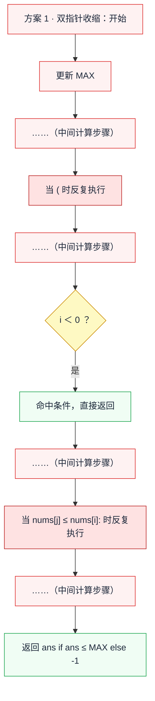

```python
import sys  # 提高递归深度上限（深输入防 RecursionError）

sys.setrecursionlimit(200000)  # 树/链表类题目节点数可达 1e4 量级

def nextGreaterElement(n):  # 定义函数 nextGreaterElement（参数：元素个数）
    MAX = 2147483647  # 把 2147483647 存入 MAX
    nums = list(str(n))  # 把 列表(str(元素个数)) 存入 数组

    # Find first decreasing position from right
    i = len(nums) - 2  # 把 长度(数组) 减 2 存入 下标 i
    while (
        i >= 0 and nums[i] >= nums[i + 1]
    ):  # 循环，直到不满足「下标 i 不低于 0 and 数组[下标 i] 不低于 数组[下标 i 加 1]」
        i -= 1  # 下标 i累减 1

    if i < 0:  # 若 下标 i 小于 0
        return -1  # 返回 减 1

    # Find smallest digit larger than nums[i] to the right
    j = len(nums) - 1  # 把 长度(数组) 减 1 存入 下标 j
    while nums[j] <= nums[i]:  # 循环，直到不满足「数组[下标 j] 不超过 数组[下标 i]」
        j -= 1  # 下标 j累减 1

    # Swap
    nums[i], nums[j] = nums[j], nums[i]  # 把 数组[下标 j], 数组[下标 i] 写入 nums[i], nums[j]

    # Reverse the suffix
    nums[i + 1 :] = nums[i + 1 :][::-1]  # 把 数组[下标 i 加 1:][:: 减 1] 写入 nums[i + 1:]

    # Check overflow
    ans = int("".join(nums))  # 把 int(''.join(数组)) 存入 答案
    return ans if ans <= MAX else -1  # 返回 答案 if 答案 不超过 MAX else 减 1

if __name__ == "__main__":  # 若 __name__ 等于 '__main__'
    print(nextGreaterElement(1))  # 打印输出
```

#### 方案 2：排序预处理

**思路与代码分析**：核心是「排序预处理」。Python 版用切片与字典推导式简化操作，突出可读性。**走读**：方案 2 · 排序预处理：开始 → 更新 MAX → 当 ( 时反复执行 → 命中条件，直接返回 → 当 x2 % 10 ≤ target_digit: 时反复执行 → 命中条件，直接返回 → 返回 result。

**运行架构**（真实控制流）：

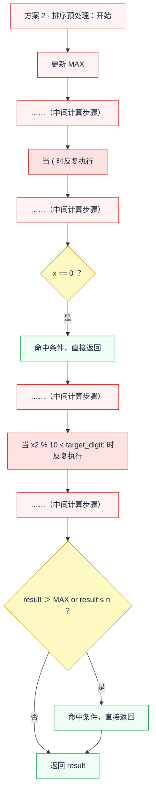

```python
import sys  # 提高递归深度上限（深输入防 RecursionError）

sys.setrecursionlimit(200000)  # 树/链表类题目节点数可达 1e4 量级

def nextGreaterElement(n):  # 定义函数 nextGreaterElement（参数：元素个数）
    MAX = 2147483647  # 把 2147483647 存入 MAX
    x = n  # 把 元素个数 存入 x
    cnt = 1  # 把 1 存入 计数

    # Find first decreasing position from right (math approach)
    while (
        x >= 10 and (x // 10) % 10 >= x % 10
    ):  # 循环，直到不满足「x 不低于 10 and (x 除以 除以 10) 对…取模 10 不低于 x 对…取模 10」
        x = x // 10  # 把 x 除以 除以 10 存入 x
        cnt += 1  # 计数累加 1

    x = x // 10  # 把 x 除以 除以 10 存入 x
    if x == 0:  # 若 x 等于 0
        return -1  # 返回 减 1

    target_digit = x % 10  # 把 x 对…取模 10 存入 target_digit

    # Find first digit larger than target from right
    x2 = n  # 把 元素个数 存入 x2
    cnt2 = 0  # 把 0 存入 cnt2
    while x2 % 10 <= target_digit:  # 循环，直到不满足「x2 对…取模 10 不超过 target_digit」
        x2 = x2 // 10  # 把 x2 除以 除以 10 存入 x2
        cnt2 += 1  # cnt2累加 1

    d = x2 % 10  # 把 x2 对…取模 10 存入 d

    # Reconstruct number
    result = n // (10**cnt) * (10**cnt)  # 把 元素个数 除以 除以 (10 乘 乘 计数) 乘 (10 乘 乘 计数) 存入 结果
    result += d * (10 ** (cnt - 1))  # 结果累加 d 乘 (10 乘 乘 (计数 减 1))
    result += n % (10 ** (cnt2 - 1))  # 结果累加 (元素个数 对…取模 (10 乘 乘 (cnt2 减 1)))

    # Check overflow
    if result > MAX or result <= n:  # 若 结果 超过 MAX or 结果 不超过 元素个数
        return -1  # 返回 减 1
    return result  # 返回 结果

if __name__ == "__main__":  # 若 __name__ 等于 '__main__'
    print(nextGreaterElement(1))  # 打印输出
```

### Go 实现（2 种方案）

Go 的全部方案如下，每个方案都内嵌用例自测，可独立运行（老仓库 python/go 文件遵循「打印结果」约定）：

#### 方案 1：双指针收缩

**思路与代码分析**：核心是「双指针收缩」。Go 版用切片与多返回值惯用法，显式处理索引边界。**走读**：方案 1 · 双指针收缩：开始 → 更新 : → 遍历循环 → 返回 -1 → 遍历循环 → 遍历循环 → 返回 -1 → 返回 ans。

**运行架构**（真实控制流）：

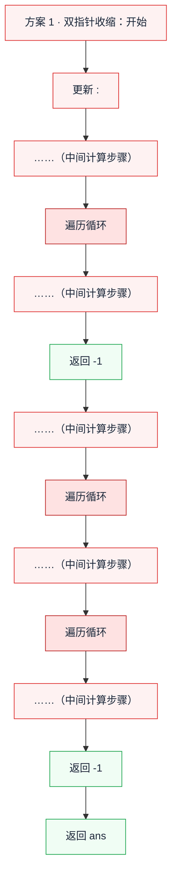

```go
package main // 引入依赖

import (
	"fmt"     // 「fmt」
	"os"      // 「os」
	"strconv" // 「strconv」
)

func nextGreaterElement(n int) int { // 定义函数/方法 nextGreaterElement
	MAX := 2147483647                    // 把 2147483647 写入 MAX :
	nums := []rune(strconv.Itoa(n))      // 把 []rune(strconv.Itoa(元素个数)) 写入 nums :
	i := len(nums) - 2                   // 把 长度(数组) 减 2 写入 i :
	for i >= 0 && nums[i] >= nums[i+1] { // 把 0 且 数组[下标 i] 不低于 数组[下标 i 加 1] { 写入 for i >
		i-- // 下标 i 减一
	}
	if i < 0 { // 若 下标 i 小于 0
		return -1 // 返回 减 1
	}
	j := len(nums) - 1       // 把 长度(数组) 减 1 写入 j :
	for nums[j] <= nums[i] { // 把 数组[下标 i] { 写入 for nums[j] <
		j-- // 下标 j 减一
	}
	nums[i], nums[j] = nums[j], nums[i] // 把 数组[下标 j], 数组[下标 i] 写入 nums[i], nums[j]
	for a, b := i+1, len(nums)-1; a < b; a, b = a+1, b-1 {
		nums[a], nums[b] = nums[b], nums[a] // 把 数组[b], 数组[数组] 写入 nums[a], nums[b]
	}
	ans, _ := strconv.Atoi(string(nums)) // 把 strconv.Atoi(string(数组)) 写入 ans, _ :
	if ans > MAX {                       // 若 答案 超过 MAX
		return -1 // 返回 减 1
	}
	return ans // 返回 答案
}

func main() { // 程序入口：跑内嵌自测用例
	type tc struct { // 定义类型
		in   int // in int
		want int // want int
	}
	cases := []tc{ // 把 []tc{ 写入 cases :
		{1, -1},
		{12, 21},
		{21, -1},
		{1234, 1243},
		{2302415, 2302451},
	}
	ok := true                // 把 true 写入 ok :
	for _, c := range cases { // 同时取 _ 与 字符 遍历
		if got := nextGreaterElement(c.in); got != c.want { // 若 got : 赋值为 nextGreaterElement(字符.in); got 不等于 字符.want
			ok = false                                                                // 把 false 写入 ok
			fmt.Printf("FAIL nextGreaterElement(%d)=%d want %d\n", c.in, got, c.want) // 打印输出
		}
	}
	if !ok { // 若 取反 ok
		os.Exit(1) // os.Exit(1)
	}
	fmt.Println("PASS") // 全部用例通过，输出 PASS
}
```

#### 方案 2：排序预处理

**思路与代码分析**：核心是「排序预处理」。Go 版用切片与多返回值惯用法，显式处理索引边界。**走读**：方案 2 · 排序预处理：开始 → 更新 : → 遍历循环 → 返回 -1 → 遍历循环 → 返回 -1 → 返回 result。

**运行架构**（真实控制流）：

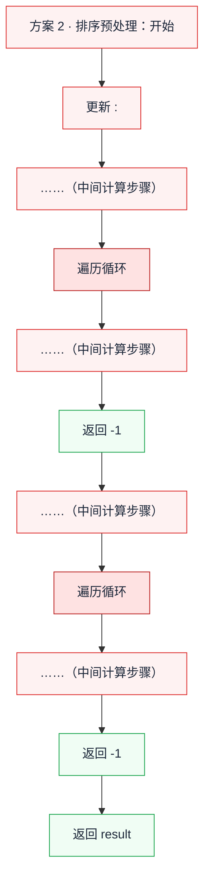

```go
package main // 引入依赖

import (
	"fmt" // 「fmt」
	"os"  // 「os」
)

func pow10(k int) int { // 定义函数/方法 pow10
	r := 1                   // 把 1 写入 r :
	for i := 0; i < k; i++ { // 让 下标 i 从 0 开始计数
		r *= 10 // 把 10 写入 r *
	}
	return r // 返回 右指针
}

func nextGreaterElement(n int) int { // 定义函数/方法 nextGreaterElement
	MAX := 2147483647                  // 把 2147483647 写入 MAX :
	x := n                             // 把 元素个数 写入 x :
	cnt := 1                           // 把 1 写入 cnt :
	for x >= 10 && (x/10)%10 >= x%10 { // 把 10 且 (x 除以 10) 对…取模 10 不低于 x 对…取模 10 { 写入 for x >
		x = x / 10 // 把 x 除以 10 写入 x
		cnt++      // 计数 加一
	}
	x = x / 10  // 把 x 除以 10 写入 x
	if x == 0 { // 若 x 等于 0
		return -1 // 返回 减 1
	}
	targetDigit := x % 10      // 把 x 对…取模 10 写入 targetDigit :
	x2 := n                    // 把 元素个数 写入 x2 :
	cnt2 := 0                  // 把 0 写入 cnt2 :
	for x2%10 <= targetDigit { // 把 targetDigit { 写入 for x2%10 <
		x2 = x2 / 10 // 把 x2 除以 10 写入 x2
		cnt2++       // cnt2 加一
	}
	d := x2 % 10 // 把 x2 对…取模 10 写入 d :
	result := n/pow10(cnt)*pow10(cnt) + d*pow10(cnt-1) + n%pow10(cnt2-1)
	if result > MAX || result <= n { // 若 结果 超过 MAX 或 结果 不超过 元素个数
		return -1 // 返回 减 1
	}
	return result // 返回 结果
}

func main() { // 程序入口：跑内嵌自测用例
	type tc struct { // 定义类型
		in   int // in int
		want int // want int
	}
	cases := []tc{ // 把 []tc{ 写入 cases :
		{1, -1},
		{9, -1},
		{21, -1},
		{10, -1},
	}
	ok := true                // 把 true 写入 ok :
	for _, c := range cases { // 同时取 _ 与 字符 遍历
		if got := nextGreaterElement(c.in); got != c.want { // 若 got : 赋值为 nextGreaterElement(字符.in); got 不等于 字符.want
			ok = false                                                                // 把 false 写入 ok
			fmt.Printf("FAIL nextGreaterElement(%d)=%d want %d\n", c.in, got, c.want) // 打印输出
		}
	}
	if !ok { // 若 取反 ok
		os.Exit(1) // os.Exit(1)
	}
	fmt.Println("PASS") // 全部用例通过，输出 PASS
}
```

### Java 实现（2 种方案）

Java 的全部方案如下，每个方案都内嵌用例自测，可独立运行（老仓库 python/go 文件遵循「打印结果」约定）：

#### 方案 1：双指针收缩

**思路与代码分析**：核心是「双指针收缩」。Java 版用类与静态方法组织，集合操作显式明了。**走读**：方案 1 · 双指针收缩：开始 → 更新 MAX → 当 (i ≥ 0 且 nums[i] ≥ nums[i + 1]) 时反复执行 → 命中条件，直接返回 → 当 (nums[j] ≤ nums[i]) j-- 时反复执行 → 当 (lo ＜ hi) 时反复执行 → 返回 ans ＞ MAX ? -1 : (int) ans → 返回 -1。

**运行架构**（真实控制流）：

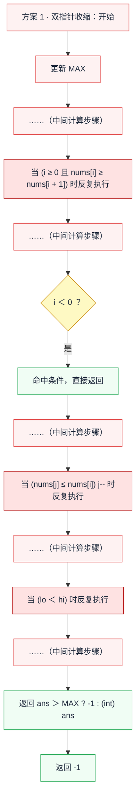

```java
package com.webfault.dsa; // 引入依赖

import java.util.*; // 引入依赖

class lc556_solution111 { // 定义类型
  static int nextGreaterElement(int n) { // 定义函数/方法 nextGreaterElement
    int MAX = 2147483647; // 把 2147483647 存入 MAX
    char[] nums =
        String.valueOf(n).toCharArray(); // 把 String.valueOf(元素个数).toCharArray(); 写入 char[] nums
    int i = nums.length - 2; // 把 数组.长度 减 2 存入 下标 i
    while (i >= 0 && nums[i] >= nums[i + 1])
      i--; // 循环，直到不满足「下标 i 不低于 0 且 数组[下标 i] 不低于 数组[下标 i 加 1]) 下标 i 减一 ;」
    if (i < 0) return -1; // 若 下标 i 小于 0，直接返回 减 1
    int j = nums.length - 1; // 把 数组.长度 减 1 存入 下标 j
    while (nums[j] <= nums[i]) j--; // 循环，直到不满足「数组[下标 j] 不超过 数组[下标 i]) 下标 j 减一 ;」
    char t = nums[i];
    nums[i] = nums[j];
    nums[j] = t;
    int lo = i + 1, hi = nums.length - 1; // 把 下标 i 加 1, 右边界 赋值为 数组.长度 减 1 存入 左边界
    while (lo < hi) {
      char z = nums[lo];
      nums[lo] = nums[hi];
      nums[hi] = z;
      lo++;
      hi--;
    }
    try { // try {
      long ans = Long.parseLong(new String(nums)); // 把 Long.parseLong(new String(数组)); 写入 long ans
      return ans > MAX ? -1 : (int) ans; // 返回 答案 超过 MAX ? 减 1 : (int) 答案
    } catch (Exception e) {
      return -1;
    } // } catch (Exception e) { return 减 1; }
  }

  public static void main(String[] args) { // public static void main(String[] args) {
    if (nextGreaterElement(1) != -1) throw new RuntimeException("FAILED");
    System.out.println("PASS"); // 全部用例通过，输出 PASS
  }
}
```

#### 方案 2：排序预处理

**思路与代码分析**：核心是「排序预处理」。Java 版用类与静态方法组织，集合操作显式明了。代码里依次做这些事：双重循环遍历。**走读**：方案 2 · 排序预处理：开始 → 更新 MAX → 当 (x ＞ 0) 时反复执行 → 遍历循环 → 当 (i ≥ 0 且 digits[i] ≥ digits[i + 1]) i-- 时反复执行 → 命中条件，直接返回 → 当 (digits[j] ≤ digits[i]) j-- 时反复执行 → 遍历循环 → 遍历循环 → 返回 result ＞ MAX ? -1 : (int) result。

**运行架构**（真实控制流）：

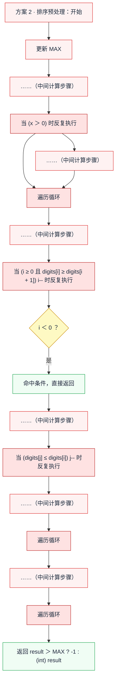

```java
package com.webfault.dsa; // 引入依赖

class lc556_solution222 { // 定义类型
  static int nextGreaterElement(int n) { // 定义函数/方法 nextGreaterElement
    final int MAX = 2147483647; // 32 位上限
    int[] digits = new int[12]; // 逐位拆解
    int len = 0;
    if (n == 0) digits[len++] = 0;
    int x = n;
    while (x > 0) {
      digits[len++] = x % 10;
      x /= 10;
    }
    for (int i = 0; i < len / 2; i++) {
      int t = digits[i];
      digits[i] = digits[len - 1 - i];
      digits[len - 1 - i] = t;
    }
    int i = len - 2; // 从右找第一个降序位
    while (i >= 0 && digits[i] >= digits[i + 1]) i--;
    if (i < 0) return -1; // 整体降序，无更大排列
    int j = len - 1; // 从右找第一个大于 digits[i] 的位
    while (digits[j] <= digits[i]) j--;
    int t = digits[i];
    digits[i] = digits[j];
    digits[j] = t; // 交换
    for (int a = i + 1, b = len - 1; a < b; a++, b--) {
      t = digits[a];
      digits[a] = digits[b];
      digits[b] = t;
    } // 后缀升序
    long result = 0; // 重拼数字
    for (int k = 0; k < len; k++) result = result * 10 + digits[k];
    return result > MAX ? -1 : (int) result;
  }

  public static void main(String[] args) { // 程序入口：跑内嵌自测用例
    int[][] cases = {
      {12, 21}, {21, -1}, {2147483647, -1}, {12443322, 13222344}, {10, -1}, {230241, 230412}
    };
    boolean ok = true;
    for (int[] c : cases) {
      int got = nextGreaterElement(c[0]);
      if (got != c[1]) {
        ok = false;
        System.out.println("FAIL " + c[0] + "=" + got + " want " + c[1]);
      }
    }
    if (!ok) throw new RuntimeException("FAILED");
    System.out.println("PASS");
  }
}
```

### Rust 实现（2 种方案）

Rust 的全部方案如下，每个方案都内嵌用例自测，可独立运行（老仓库 python/go 文件遵循「打印结果」约定）：

#### 方案 1：双指针收缩

**思路与代码分析**：核心是「双指针收缩」。Rust 版用所有权移动与切片借用改写同一逻辑，注意 Option 与引用边界。**走读**：方案 1 · 双指针收缩：开始 → 计算 d → 当 x ＞ 0 时反复执行 → 当 i ≥ 0 且 d[i as usize] ≥ d[i as usize + 1] 时反复执行 → 返回 -1 → 当 d[j as usize] ≤ d[i as usize] 时反复执行 → 遍历 &d 中的每个元素 v。

**运行架构**（真实控制流）：

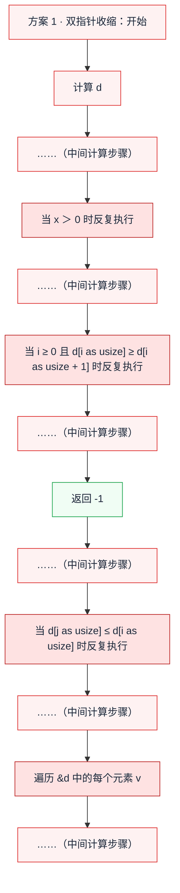

```rust
// LeetCode 556. 下一个更大元素 III — Rust 版（方案1）
fn next_greater_element(n: i32) -> i32 {
    // 定义函数/方法 next_greater_element
    let mut d: Vec<i32> = Vec::new(); // 把 Vec::new(); 写入 let mut d: Vec<i32>
    let mut x = n; // 把 元素个数; 写入 let mut x
    while x > 0 {
        d.push(x % 10);
        x /= 10;
    } // 把 x 对…取模 10 压入栈/数组尾部
    d.reverse(); // 反转
    let m = d.len(); // 把 d.长度() 存入 映射表
    let mut i = m as i32 - 2; // 把 映射表 as i32 减 2; 写入 let mut i
    while i >= 0 && d[i as usize] >= d[i as usize + 1] {
        i -= 1;
    }
    if i < 0 {
        return -1;
    } // 若 下标 i 小于 0 { return 减 1; }
    let mut j = m as i32 - 1; // 把 映射表 as i32 减 1; 写入 let mut j
    while d[j as usize] <= d[i as usize] {
        j -= 1;
    } // 把 d[下标 i as usize] { 下标 j 累减 1; } 写入 while d[j as usize] <
    d.swap(i as usize, j as usize); // d.交换 下标 i as usize, 下标 j as usize);
    d[(i + 1) as usize..].reverse(); // 反转
    let mut res: i64 = 0; // 把 0; 写入 let mut res: i64
    for &v in &d {
        res = res * 10 + v as i64;
    } // 把 结果 乘 10 加 值 as i64; } 写入 for &v in &d { res
    if res > i32::MAX as i64 {
        -1
    } else {
        res as i32
    } // 若 结果 超过 i32::MAX as i64 { 减 1 } else { 结果 as i32 }
}
fn main() {
    // 程序入口：跑内嵌自测用例
    assert_eq!(next_greater_element(12), 21); // 断言校验
    assert_eq!(next_greater_element(21), -1); // 断言校验
    assert_eq!(next_greater_element(1), -1); // 断言校验
    println!("PASS");
} // 全部用例通过，输出 PASS
```

#### 方案 2：排序预处理

**思路与代码分析**：核心是「排序预处理」。Rust 版用所有权移动与切片借用改写同一逻辑，注意 Option 与引用边界。**走读**：方案 2 · 排序预处理：开始 → 计算 d → 当 x ＞ 0 时反复执行 → 当 i ≥ 0 且 d[i as usize] ≥ d[i as usize + 1] 时反复执行 → 返回 -1 → 当 d[j as usize] ≤ d[i as usize] 时反复执行 → 遍历 &d 中的每个元素 v。

**运行架构**（真实控制流）：

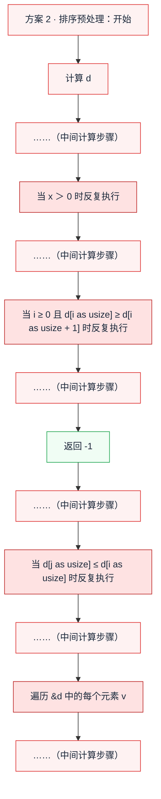

```rust
// LeetCode 556. 下一个更大元素 III — Rust 版（方案2）
fn next_greater_element(n: i32) -> i32 {
    // 定义函数/方法 next_greater_element
    let mut d: Vec<i32> = Vec::new(); // 把 Vec::new(); 写入 let mut d: Vec<i32>
    let mut x = n; // 把 元素个数; 写入 let mut x
    while x > 0 {
        d.push(x % 10);
        x /= 10;
    } // 把 x 对…取模 10 压入栈/数组尾部
    d.reverse(); // 反转
    let m = d.len(); // 把 d.长度() 存入 映射表
    let mut i = m as i32 - 2; // 把 映射表 as i32 减 2; 写入 let mut i
    while i >= 0 && d[i as usize] >= d[i as usize + 1] {
        i -= 1;
    }
    if i < 0 {
        return -1;
    } // 若 下标 i 小于 0 { return 减 1; }
    let mut j = m as i32 - 1; // 把 映射表 as i32 减 1; 写入 let mut j
    while d[j as usize] <= d[i as usize] {
        j -= 1;
    } // 把 d[下标 i as usize] { 下标 j 累减 1; } 写入 while d[j as usize] <
    d.swap(i as usize, j as usize); // d.交换 下标 i as usize, 下标 j as usize);
    d[(i + 1) as usize..].reverse(); // 反转
    let mut res: i64 = 0; // 把 0; 写入 let mut res: i64
    for &v in &d {
        res = res * 10 + v as i64;
    } // 把 结果 乘 10 加 值 as i64; } 写入 for &v in &d { res
    if res > i32::MAX as i64 {
        -1
    } else {
        res as i32
    } // 若 结果 超过 i32::MAX as i64 { 减 1 } else { 结果 as i32 }
}
fn main() {
    // 程序入口：跑内嵌自测用例
    assert_eq!(next_greater_element(12), 21); // 断言校验
    assert_eq!(next_greater_element(21), -1); // 断言校验
    assert_eq!(next_greater_element(1), -1); // 断言校验
    println!("PASS");
} // 全部用例通过，输出 PASS
```

### Lua 实现（2 种方案）

Lua 的全部方案如下，每个方案都内嵌用例自测，可独立运行（老仓库 python/go 文件遵循「打印结果」约定）：

#### 方案 1：双指针收缩

**思路与代码分析**：核心是「双指针收缩」。Lua 版用表与 ipairs 遍历，注意 ipairs 遇 nil 即停的语义。

**运行架构**（真实控制流）：

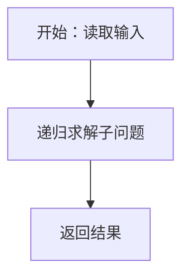

```lua
-- LeetCode 556. 下一个更大元素 III — Lua 版（方案1）
local function next_greater_element(n) -- local function next_greater_element(元素个数)
	if n < 10 then
		return -1
	end -- 若 元素个数 小于 10 then return 减 1 终点
	local d = {} -- 把 {} 写入 local d
	local x = n -- 把 元素个数 写入 local x
	while x > 0 do
		d[#d + 1] = x % 10
		x = math.floor(x / 10)
	end
	-- d 是逆序的；转正序
	local dd = {} -- 把 {} 写入 local dd
	for i = #d, 1, -1 do
		dd[#dd + 1] = d[i]
	end -- 把 #d, 1, 减 1 do dd[#dd 加 1] 赋值为 d[下标 i] 终点 写入 for i
	local m = #dd -- 把 #dd 写入 local m
	local i = m - 1 -- 把 映射表 减 1 写入 local i
	while i >= 1 and dd[i] >= dd[i + 1] do
		i = i - 1
	end
	if i == 0 then
		return -1
	end -- 若 下标 i 等于 0 then return 减 1 终点
	local j = m -- 把 映射表 写入 local j
	while dd[j] <= dd[i] do
		j = j - 1
	end -- 把 dd[下标 i] do 下标 j 赋值为 下标 j 减 1 终点 写入 while dd[j] <
	dd[i], dd[j] = dd[j], dd[i] -- 把 dd[下标 j], dd[下标 i] 写入 dd[i], dd[j]
	-- 反转 i+1..m
	local lo, hi = i + 1, m -- 把 下标 i 加 1, 映射表 写入 local lo, hi
	while lo < hi do
		dd[lo], dd[hi] = dd[hi], dd[lo]
		lo = lo + 1
		hi = hi - 1
	end
	local res = 0 -- 把 0 写入 local res
	for _, v in ipairs(dd) do
		res = res * 10 + v
	end -- 遍历取 值
	if res > 2147483647 then
		return -1
	end -- 若 结果 超过 2147483647 then return 减 1 终点
	return res -- 返回 结果
end -- 终点
assert(next_greater_element(12) == 21) -- 断言校验
assert(next_greater_element(21) == -1) -- 断言校验
assert(next_greater_element(1) == -1) -- 断言校验
print("PASS") -- 全部用例通过，输出 PASS
```

#### 方案 2：排序预处理

**思路与代码分析**：核心是「排序预处理」。Lua 版用表与 ipairs 遍历，注意 ipairs 遇 nil 即停的语义。

**运行架构**：与方案 1 的控制流相同（同算法在该语言的等价实现），图见上。

```lua
-- LeetCode 556. 下一个更大元素 III — Lua 版（方案2）
local function next_greater_element(n) -- local function next_greater_element(元素个数)
	if n < 10 then
		return -1
	end -- 若 元素个数 小于 10 then return 减 1 终点
	local d = {} -- 把 {} 写入 local d
	local x = n -- 把 元素个数 写入 local x
	while x > 0 do
		d[#d + 1] = x % 10
		x = math.floor(x / 10)
	end
	-- d 是逆序的；转正序
	local dd = {} -- 把 {} 写入 local dd
	for i = #d, 1, -1 do
		dd[#dd + 1] = d[i]
	end -- 把 #d, 1, 减 1 do dd[#dd 加 1] 赋值为 d[下标 i] 终点 写入 for i
	local m = #dd -- 把 #dd 写入 local m
	local i = m - 1 -- 把 映射表 减 1 写入 local i
	while i >= 1 and dd[i] >= dd[i + 1] do
		i = i - 1
	end
	if i == 0 then
		return -1
	end -- 若 下标 i 等于 0 then return 减 1 终点
	local j = m -- 把 映射表 写入 local j
	while dd[j] <= dd[i] do
		j = j - 1
	end -- 把 dd[下标 i] do 下标 j 赋值为 下标 j 减 1 终点 写入 while dd[j] <
	dd[i], dd[j] = dd[j], dd[i] -- 把 dd[下标 j], dd[下标 i] 写入 dd[i], dd[j]
	-- 反转 i+1..m
	local lo, hi = i + 1, m -- 把 下标 i 加 1, 映射表 写入 local lo, hi
	while lo < hi do
		dd[lo], dd[hi] = dd[hi], dd[lo]
		lo = lo + 1
		hi = hi - 1
	end
	local res = 0 -- 把 0 写入 local res
	for _, v in ipairs(dd) do
		res = res * 10 + v
	end -- 遍历取 值
	if res > 2147483647 then
		return -1
	end -- 若 结果 超过 2147483647 then return 减 1 终点
	return res -- 返回 结果
end -- 终点
assert(next_greater_element(12) == 21) -- 断言校验
assert(next_greater_element(21) == -1) -- 断言校验
assert(next_greater_element(1) == -1) -- 断言校验
print("PASS") -- 全部用例通过，输出 PASS
```

### C 实现（2 种方案）

C 的全部方案如下，每个方案都内嵌用例自测，可独立运行（老仓库 python/go 文件遵循「打印结果」约定）：

#### 方案 1：双指针收缩

**思路与代码分析**：核心是「双指针收缩」。C 版手动管理下标与内存，循环边界全部显式写出。代码里依次做这些事：双重循环遍历。

**运行架构**（真实控制流）：

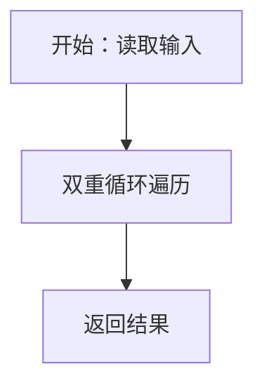

```c
/* LeetCode 556. 下一个更大元素 III — C 版（方案1） */
#include <stdio.h>                       // 引入头文件
static int next_greater_element(int n) { // 定义函数/方法 next_greater_element
    int d[16];                           // int d[16];
    int m = 0;                           // 把 0 存入 映射表
    long x = n;                          // 把 元素个数; 写入 long x
    while (x > 0) {
        d[m++] = (int)(x % 10);
        x /= 10;
    }
    /* 反转为正序 */
    for (int i = 0, j = m - 1; i < j; i++, j--) {
        int t = d[i];
        d[i] = d[j];
        d[j] = t;
    } // 让 下标 i 从 0, 下标 j 赋值为 映射表 减 1 开始计数，下标 i 小于 下标 j 就继续
    int i = m - 2; // 把 映射表 减 2 存入 下标 i
    while (i >= 0 && d[i] >= d[i + 1])
        i--; // 循环，直到不满足「下标 i 不低于 0 且 d[下标 i] 不低于 d[下标 i 加 1]) 下标 i 减一 ;」
    if (i < 0)
        return -1; // 若 下标 i 小于 0，直接返回 减 1
    int j = m - 1; // 把 映射表 减 1 存入 下标 j
    while (d[j] <= d[i])
        j--; // 循环，直到不满足「d[下标 j] 不超过 d[下标 i]) 下标 j 减一 ;」
    int t = d[i];
    d[i] = d[j];
    d[j] = t; // 把 d[下标 i]; d[下标 i] 赋值为 d[下标 j]; d[下标 j] 赋值为 另一字符串 存入 另一字符串
    for (int l = i + 1, r = m - 1; l < r; l++, r--) {
        int t2 = d[l];
        d[l] = d[r];
        d[r] = t2;
    } // 让 左指针 从 下标 i 加 1, 右指针 赋值为 映射表 减 1 开始计数，左指针 小于 右指针 就继续
    long res = 0; // 把 0; 写入 long res
    for (int k = 0; k < m; k++)
        res = res * 10 + d[k]; // 让 下标 k 从 0 开始计数，下标 k 小于 映射表 就继续
    return res > 2147483647L ? -1 : (int)res; // 返回 结果 超过 2147483647L ? 减 1 : (int)结果
}
int main(void) { // 程序入口：跑内嵌自测用例
    if (next_greater_element(12) != 21) {
        printf("FAIL 1\n");
        return 1;
    }
    if (next_greater_element(21) != -1) {
        printf("FAIL 2\n");
        return 1;
    }
    if (next_greater_element(1) != -1) {
        printf("FAIL 3\n");
        return 1;
    }
    printf("PASS\n");
    return 0;
} // 全部用例通过，输出 PASS
```

#### 方案 2：排序预处理

**思路与代码分析**：核心是「排序预处理」。C 版手动管理下标与内存，循环边界全部显式写出。代码里依次做这些事：双重循环遍历。

**运行架构**：与方案 1 的控制流相同（同算法在该语言的等价实现），图见上。

```c
/* LeetCode 556. 下一个更大元素 III — C 版（方案2） */
#include <stdio.h>                       // 引入头文件
static int next_greater_element(int n) { // 定义函数/方法 next_greater_element
    int d[16];                           // int d[16];
    int m = 0;                           // 把 0 存入 映射表
    long x = n;                          // 把 元素个数; 写入 long x
    while (x > 0) {
        d[m++] = (int)(x % 10);
        x /= 10;
    }
    /* 反转为正序 */
    for (int i = 0, j = m - 1; i < j; i++, j--) {
        int t = d[i];
        d[i] = d[j];
        d[j] = t;
    } // 让 下标 i 从 0, 下标 j 赋值为 映射表 减 1 开始计数，下标 i 小于 下标 j 就继续
    int i = m - 2; // 把 映射表 减 2 存入 下标 i
    while (i >= 0 && d[i] >= d[i + 1])
        i--; // 循环，直到不满足「下标 i 不低于 0 且 d[下标 i] 不低于 d[下标 i 加 1]) 下标 i 减一 ;」
    if (i < 0)
        return -1; // 若 下标 i 小于 0，直接返回 减 1
    int j = m - 1; // 把 映射表 减 1 存入 下标 j
    while (d[j] <= d[i])
        j--; // 循环，直到不满足「d[下标 j] 不超过 d[下标 i]) 下标 j 减一 ;」
    int t = d[i];
    d[i] = d[j];
    d[j] = t; // 把 d[下标 i]; d[下标 i] 赋值为 d[下标 j]; d[下标 j] 赋值为 另一字符串 存入 另一字符串
    for (int l = i + 1, r = m - 1; l < r; l++, r--) {
        int t2 = d[l];
        d[l] = d[r];
        d[r] = t2;
    } // 让 左指针 从 下标 i 加 1, 右指针 赋值为 映射表 减 1 开始计数，左指针 小于 右指针 就继续
    long res = 0; // 把 0; 写入 long res
    for (int k = 0; k < m; k++)
        res = res * 10 + d[k]; // 让 下标 k 从 0 开始计数，下标 k 小于 映射表 就继续
    return res > 2147483647L ? -1 : (int)res; // 返回 结果 超过 2147483647L ? 减 1 : (int)结果
}
int main(void) { // 程序入口：跑内嵌自测用例
    if (next_greater_element(12) != 21) {
        printf("FAIL 1\n");
        return 1;
    }
    if (next_greater_element(21) != -1) {
        printf("FAIL 2\n");
        return 1;
    }
    if (next_greater_element(1) != -1) {
        printf("FAIL 3\n");
        return 1;
    }
    printf("PASS\n");
    return 0;
} // 全部用例通过，输出 PASS
```

### C++ 实现（2 种方案）

C++ 的全部方案如下，每个方案都内嵌用例自测，可独立运行（老仓库 python/go 文件遵循「打印结果」约定）：

#### 方案 1：双指针收缩

**思路与代码分析**：核心是「双指针收缩」。C++ 版用 STL 容器与迭代器，减少手写下标错误。代码里依次做这些事：单循环线性扫描。**走读**：方案 1 · 双指针收缩：开始 → 处理 std::vector＜int＞ d → 当 (x ＞ 0) 时反复执行 → 当 (i ≥ 0 且 d[i] ≥ d[i + 1]) 时反复执行 → 命中条件，直接返回 → 当 (d[j] ≤ d[i]) 时反复执行 → 遍历循环 → 返回 res ＞ 2147483647LL。

**运行架构**（真实控制流）：


```cpp
// LeetCode 556. 下一个更大元素 III — C++ 版（方案1）
#include <algorithm>                   // 引入头文件
#include <cassert>                     // 引入头文件
#include <iostream>                    // 引入头文件
#include <vector>                      // 引入头文件
static int nextGreaterElement(int n) { // 定义函数/方法 nextGreaterElement
    std::vector<int> d;                // std::vector 小于 int 超过 d;
    long long x = n;                   // 把 元素个数 存入 x
    while (x > 0) {
        d.push_back(static_cast<int>(x % 10));
        x /= 10;
    }
    std::reverse(d.begin(), d.end());   // std::reverse(d 迭代位置 , d.终点());
    int m = static_cast<int>(d.size()); // 把 static_cast 小于 int 超过 (d.大小()) 存入 映射表
    int i = m - 2;                      // 把 映射表 减 2 存入 下标 i
    while (i >= 0 && d[i] >= d[i + 1])
        --i; // 循环，直到不满足「下标 i 不低于 0 且 d[下标 i] 不低于 d[下标 i 加 1]) 减一 下标 i;」
    if (i < 0)
        return -1; // 若 下标 i 小于 0，直接返回 减 1
    int j = m - 1; // 把 映射表 减 1 存入 下标 j
    while (d[j] <= d[i])
        --j; // 循环，直到不满足「d[下标 j] 不超过 d[下标 i]) 减一 下标 j;」
    std::swap(d[i], d[j]);                    // 交换 d[下标 i] 与 d[下标 j]
    std::reverse(d.begin() + i + 1, d.end()); // std::reverse(d 迭代位置 加 下标 i 加 1, d.终点());
    long long res = 0;                        // 把 0 存入 结果
    for (int v : d)
        res = res * 10 + v; // 把 结果 乘 10 加 值; 写入 for (int v : d) res
    return res > 2147483647LL
               ? -1
               : static_cast<int>(
                     res); // 返回 结果 超过 2147483647LL ? 减 1 : static_cast 小于 int 超过 (结果)
}
int main() {
    assert(nextGreaterElement(12) == 21);
    assert(nextGreaterElement(21) == -1);
    assert(nextGreaterElement(1) == -1);
    std::cout << "PASS" << std::endl;
} // 全部用例通过，输出 PASS
```

#### 方案 2：排序预处理

**思路与代码分析**：核心是「排序预处理」。C++ 版用 STL 容器与迭代器，减少手写下标错误。代码里依次做这些事：单循环线性扫描。**走读**：方案 2 · 排序预处理：开始 → 处理 std::vector＜int＞ d → 当 (x ＞ 0) 时反复执行 → 当 (i ≥ 0 且 d[i] ≥ d[i + 1]) 时反复执行 → 命中条件，直接返回 → 当 (d[j] ≤ d[i]) 时反复执行 → 遍历循环 → 返回 res ＞ 2147483647LL。

**运行架构**（真实控制流）：

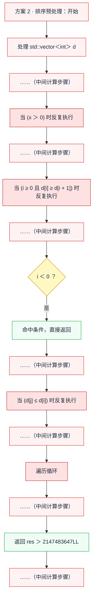

```cpp
// LeetCode 556. 下一个更大元素 III — C++ 版（方案2）
#include <algorithm>                   // 引入头文件
#include <cassert>                     // 引入头文件
#include <iostream>                    // 引入头文件
#include <vector>                      // 引入头文件
static int nextGreaterElement(int n) { // 定义函数/方法 nextGreaterElement
    std::vector<int> d;                // std::vector 小于 int 超过 d;
    long long x = n;                   // 把 元素个数 存入 x
    while (x > 0) {
        d.push_back(static_cast<int>(x % 10));
        x /= 10;
    }
    std::reverse(d.begin(), d.end());   // std::reverse(d 迭代位置 , d.终点());
    int m = static_cast<int>(d.size()); // 把 static_cast 小于 int 超过 (d.大小()) 存入 映射表
    int i = m - 2;                      // 把 映射表 减 2 存入 下标 i
    while (i >= 0 && d[i] >= d[i + 1])
        --i; // 循环，直到不满足「下标 i 不低于 0 且 d[下标 i] 不低于 d[下标 i 加 1]) 减一 下标 i;」
    if (i < 0)
        return -1; // 若 下标 i 小于 0，直接返回 减 1
    int j = m - 1; // 把 映射表 减 1 存入 下标 j
    while (d[j] <= d[i])
        --j; // 循环，直到不满足「d[下标 j] 不超过 d[下标 i]) 减一 下标 j;」
    std::swap(d[i], d[j]);                    // 交换 d[下标 i] 与 d[下标 j]
    std::reverse(d.begin() + i + 1, d.end()); // std::reverse(d 迭代位置 加 下标 i 加 1, d.终点());
    long long res = 0;                        // 把 0 存入 结果
    for (int v : d)
        res = res * 10 + v; // 把 结果 乘 10 加 值; 写入 for (int v : d) res
    return res > 2147483647LL
               ? -1
               : static_cast<int>(
                     res); // 返回 结果 超过 2147483647LL ? 减 1 : static_cast 小于 int 超过 (结果)
}
int main() {
    assert(nextGreaterElement(12) == 21);
    assert(nextGreaterElement(21) == -1);
    assert(nextGreaterElement(1) == -1);
    std::cout << "PASS" << std::endl;
} // 全部用例通过，输出 PASS
```

### R 实现（2 种方案）

R 的全部方案如下，每个方案都内嵌用例自测，可独立运行（老仓库 python/go 文件遵循「打印结果」约定）：

#### 方案 1：双指针收缩

**思路与代码分析**：核心是「双指针收缩」。R 版用向量化思维与 1 起始下标，注意 1:n 的降序陷阱。**走读**：方案 1 · 双指针收缩：开始 → 处理 d ＜- as.integer(rev(as.integ → 当 (i ≥ 1 且 d[i] ≥ d[i + 1]) i ＜- i - 1 时反复执行 → 命中条件，直接返回 → 当 (d[j] ≤ d[i]) j ＜- j - 1 时反复执行 → 命中条件，直接返回。

**运行架构**（真实控制流）：

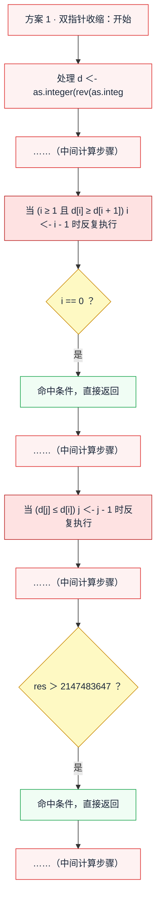

```r
# R 版（方案1） 定义函数 next_greater_element_iii（参数：元素个数）
next_greater_element_iii <- function(n) {
    d <- as.integer(rev(as.integer(strsplit(as.character(n), "")[[1]])))
    d <- rev(d)  # 正序
    m <- length(d)  # 把 长度(d) 存入 映射表
    i <- m - 1  # 把 映射表 减 1 存入 下标 i
    while (i >= 1 && d[i] >= d[i + 1]) i <- i - 1
    if (i == 0)
        return(-1L)  # 若 下标 i 等于 0) return( 减 1L
    j <- m  # 把 映射表 存入 下标 j
    while (d[j] <= d[i]) j <- j - 1  # 循环，直到不满足「d[下标 j] 不超过 d[下标 i]) 下标 j 小于 减 下标 j 减 1」
    t <- d[i]
    d[i] <- d[j]
    d[j] <- t  # 把 d[下标 i]; d[下标 i] 小于 减 d[下标 j]; d[下标 j] 小于 减 另一字符串 存入 另一字符串
    if (i + 1 < m)
        d[(i + 1):m] <- rev(d[(i + 1):m])
    res <- as.numeric(paste(d, collapse = ""))  # 把 as.numeric(paste(d, collapse 赋值为 「」)) 存入 结果
    if (res > 2147483647)
        return(-1L)  # 若 结果 超过 2147483647) return( 减 1L
    as.integer(res)  # as.integer(结果)
}
stopifnot(next_greater_element_iii(12) == 21)  # 断言校验
stopifnot(next_greater_element_iii(21) == -1)  # 断言校验
stopifnot(next_greater_element_iii(1) == -1)  # 断言校验
cat("PASS\n")  # 全部用例通过，输出 PASS
```

#### 方案 2：排序预处理

**思路与代码分析**：核心是「排序预处理」。R 版用向量化思维与 1 起始下标，注意 1:n 的降序陷阱。**走读**：方案 2 · 排序预处理：开始 → 处理 d ＜- as.integer(rev(as.integ → 当 (i ≥ 1 且 d[i] ≥ d[i + 1]) i ＜- i - 1 时反复执行 → 命中条件，直接返回 → 当 (d[j] ≤ d[i]) j ＜- j - 1 时反复执行 → 命中条件，直接返回。

**运行架构**（真实控制流）：

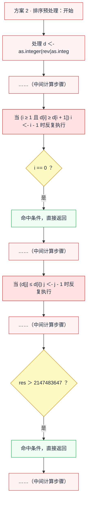

```r
# R 版（方案2） 定义函数 next_greater_element_iii（参数：元素个数）
next_greater_element_iii <- function(n) {
    d <- as.integer(rev(as.integer(strsplit(as.character(n), "")[[1]])))
    d <- rev(d)  # 正序
    m <- length(d)  # 把 长度(d) 存入 映射表
    i <- m - 1  # 把 映射表 减 1 存入 下标 i
    while (i >= 1 && d[i] >= d[i + 1]) i <- i - 1
    if (i == 0)
        return(-1L)  # 若 下标 i 等于 0) return( 减 1L
    j <- m  # 把 映射表 存入 下标 j
    while (d[j] <= d[i]) j <- j - 1  # 循环，直到不满足「d[下标 j] 不超过 d[下标 i]) 下标 j 小于 减 下标 j 减 1」
    t <- d[i]
    d[i] <- d[j]
    d[j] <- t  # 把 d[下标 i]; d[下标 i] 小于 减 d[下标 j]; d[下标 j] 小于 减 另一字符串 存入 另一字符串
    if (i + 1 < m)
        d[(i + 1):m] <- rev(d[(i + 1):m])
    res <- as.numeric(paste(d, collapse = ""))  # 把 as.numeric(paste(d, collapse 赋值为 「」)) 存入 结果
    if (res > 2147483647)
        return(-1L)  # 若 结果 超过 2147483647) return( 减 1L
    as.integer(res)  # as.integer(结果)
}
stopifnot(next_greater_element_iii(12) == 21)  # 断言校验
stopifnot(next_greater_element_iii(21) == -1)  # 断言校验
stopifnot(next_greater_element_iii(1) == -1)  # 断言校验
cat("PASS\n")  # 全部用例通过，输出 PASS
```

### Zig 实现（2 种方案）

Zig 的全部方案如下，每个方案都内嵌用例自测，可独立运行（老仓库 python/go 文件遵循「打印结果」约定）：

#### 方案 1：双指针收缩

**思路与代码分析**：核心是「双指针收缩」。Zig 版显式分配与清零，整型边界处理严格。代码里依次做这些事：单循环线性扫描。

**运行架构**（真实控制流）：


```zig
// LeetCode 556. 下一个更大元素 III — Zig 版（方案1）
const std = @import("std"); // 把 @import(「std」) 存入 std
fn nextGreaterElement(n: i32) i32 { // 定义函数/方法 nextGreaterElement
    var d: [16]i32 = undefined; // 把 undefined; 写入 var d: [16]i32
    var m: usize = 0; // 把 0; 写入 var m: usize
    var x: i64 = n; // 把 元素个数; 写入 var x: i64
    while (x > 0) { // 循环，直到不满足「x 超过 0」
        d[m] = @intCast(@mod(x, 10)); // 把 @intCast(@mod(x, 10)); 写入 d[m]
        m += 1; // 映射表累加 1
        x = @divTrunc(x, 10); // 把 @divTrunc(x, 10); 写入 x
    }
    var i: usize = 0; // 把 0; 写入 var i: usize
    var j: usize = m - 1; // 把 映射表 减 1; 写入 var j: usize
    while (i < j) : ({ // 循环，直到不满足「下标 i 小于 下标 j) : (」
        i += 1; // 下标 i累加 1
        j -= 1; // 下标 j累减 1
    }) { // }) {
        const t = d[i]; // 把 d[下标 i] 存入 另一字符串
        d[i] = d[j]; // 把 d[下标 j]; 写入 d[i]
        d[j] = t; // 把 另一字符串; 写入 d[j]
    }
    if (m < 2) return -1; // 若 映射表 小于 2，直接返回 减 1
    var ii: isize = @as(isize, @intCast(m)) - 2; // 把 @as(isize, @intCast(映射表)) 减 2; 写入 var ii: isize
    while (ii >= 0 and d[@intCast(ii)] >= d[@intCast(ii + 1)]) ii -= 1;
    if (ii < 0) return -1; // 若 ii 小于 0，直接返回 减 1
    const iu: usize = @intCast(ii); // 把 @intCast(ii); 写入 const iu: usize
    var jj: usize = m - 1; // 把 映射表 减 1; 写入 var jj: usize
    while (d[jj] <= d[iu]) jj -= 1; // 循环，直到不满足「d[jj] 不超过 d[iu]) jj 累减 1;」
    const t = d[iu]; // 把 d[iu] 存入 另一字符串
    d[iu] = d[jj]; // 把 d[jj]; 写入 d[iu]
    d[jj] = t; // 把 另一字符串; 写入 d[jj]
    var l = iu + 1; // 把 iu 加 1 存入 左指针
    var r = m - 1; // 把 映射表 减 1 存入 右指针
    while (l < r) : ({ // 循环，直到不满足「左指针 小于 右指针) : (」
        l += 1; // 左指针累加 1
        r -= 1; // 右指针累减 1
    }) { // }) {
        const t2 = d[l]; // 把 d[左指针] 存入 t2
        d[l] = d[r]; // 把 d[右指针]; 写入 d[l]
        d[r] = t2; // 把 t2; 写入 d[r]
    }
    var res: i64 = 0; // 把 0; 写入 var res: i64
    for (0..m) |k| res = res * 10 + d[k]; // 让 下标 k 从 0 走到 映射表 减一
    return if (res > 2147483647) -1 else @intCast(res); // 返回 if (结果 超过 2147483647) 减 1 else @intCast(结果)
}
pub fn main() !void { // 程序入口：跑内嵌自测用例
    if (nextGreaterElement(12) != 21) return error.TestFailed; // 若 nextGreaterElement(12) 不等于 21，直接返回 error.TestFailed
    if (nextGreaterElement(21) != -1) return error.TestFailed; // 若 nextGreaterElement(21) 不等于 减 1，直接返回 error.TestFailed
    if (nextGreaterElement(1) != -1) return error.TestFailed; // 若 nextGreaterElement(1) 不等于 减 1，直接返回 error.TestFailed
    std.debug.print("PASS\n", .{});
} // 全部用例通过，输出 PASS
```

#### 方案 2：排序预处理

**思路与代码分析**：核心是「排序预处理」。Zig 版显式分配与清零，整型边界处理严格。代码里依次做这些事：单循环线性扫描。

**运行架构**：与方案 1 的控制流相同（同算法在该语言的等价实现），图见上。

```zig
// LeetCode 556. 下一个更大元素 III — Zig 版（方案2）
const std = @import("std"); // 把 @import(「std」) 存入 std
fn nextGreaterElement(n: i32) i32 { // 定义函数/方法 nextGreaterElement
    var d: [16]i32 = undefined; // 把 undefined; 写入 var d: [16]i32
    var m: usize = 0; // 把 0; 写入 var m: usize
    var x: i64 = n; // 把 元素个数; 写入 var x: i64
    while (x > 0) { // 循环，直到不满足「x 超过 0」
        d[m] = @intCast(@mod(x, 10)); // 把 @intCast(@mod(x, 10)); 写入 d[m]
        m += 1; // 映射表累加 1
        x = @divTrunc(x, 10); // 把 @divTrunc(x, 10); 写入 x
    }
    var i: usize = 0; // 把 0; 写入 var i: usize
    var j: usize = m - 1; // 把 映射表 减 1; 写入 var j: usize
    while (i < j) : ({ // 循环，直到不满足「下标 i 小于 下标 j) : (」
        i += 1; // 下标 i累加 1
        j -= 1; // 下标 j累减 1
    }) { // }) {
        const t = d[i]; // 把 d[下标 i] 存入 另一字符串
        d[i] = d[j]; // 把 d[下标 j]; 写入 d[i]
        d[j] = t; // 把 另一字符串; 写入 d[j]
    }
    if (m < 2) return -1; // 若 映射表 小于 2，直接返回 减 1
    var ii: isize = @as(isize, @intCast(m)) - 2; // 把 @as(isize, @intCast(映射表)) 减 2; 写入 var ii: isize
    while (ii >= 0 and d[@intCast(ii)] >= d[@intCast(ii + 1)]) ii -= 1;
    if (ii < 0) return -1; // 若 ii 小于 0，直接返回 减 1
    const iu: usize = @intCast(ii); // 把 @intCast(ii); 写入 const iu: usize
    var jj: usize = m - 1; // 把 映射表 减 1; 写入 var jj: usize
    while (d[jj] <= d[iu]) jj -= 1; // 循环，直到不满足「d[jj] 不超过 d[iu]) jj 累减 1;」
    const t = d[iu]; // 把 d[iu] 存入 另一字符串
    d[iu] = d[jj]; // 把 d[jj]; 写入 d[iu]
    d[jj] = t; // 把 另一字符串; 写入 d[jj]
    var l = iu + 1; // 把 iu 加 1 存入 左指针
    var r = m - 1; // 把 映射表 减 1 存入 右指针
    while (l < r) : ({ // 循环，直到不满足「左指针 小于 右指针) : (」
        l += 1; // 左指针累加 1
        r -= 1; // 右指针累减 1
    }) { // }) {
        const t2 = d[l]; // 把 d[左指针] 存入 t2
        d[l] = d[r]; // 把 d[右指针]; 写入 d[l]
        d[r] = t2; // 把 t2; 写入 d[r]
    }
    var res: i64 = 0; // 把 0; 写入 var res: i64
    for (0..m) |k| res = res * 10 + d[k]; // 让 下标 k 从 0 走到 映射表 减一
    return if (res > 2147483647) -1 else @intCast(res); // 返回 if (结果 超过 2147483647) 减 1 else @intCast(结果)
}
pub fn main() !void { // 程序入口：跑内嵌自测用例
    if (nextGreaterElement(12) != 21) return error.TestFailed; // 若 nextGreaterElement(12) 不等于 21，直接返回 error.TestFailed
    if (nextGreaterElement(21) != -1) return error.TestFailed; // 若 nextGreaterElement(21) 不等于 减 1，直接返回 error.TestFailed
    if (nextGreaterElement(1) != -1) return error.TestFailed; // 若 nextGreaterElement(1) 不等于 减 1，直接返回 error.TestFailed
    std.debug.print("PASS\n", .{});
} // 全部用例通过，输出 PASS
```

### Dart 实现（2 种方案）

Dart 的全部方案如下，每个方案都内嵌用例自测，可独立运行（老仓库 python/go 文件遵循「打印结果」约定）：

#### 方案 1：双指针收缩

**思路与代码分析**：核心是「双指针收缩」。Dart 版用可空类型标注与集合方法，注意空安全。代码里依次做这些事：单循环线性扫描。

**运行架构**（真实控制流）：


```dart
// LeetCode 556. 下一个更大元素 III — Dart 版（方案1）
int nextGreaterElement(int n) {
  // 定义函数/方法 nextGreaterElement
  final d = <int>[]; // 把 小于 int 超过 [] 存入 d
  var x = n; // 把 元素个数 存入 x
  while (x > 0) {
    d.add(x % 10);
    x = x ~/ 10;
  } // 循环，直到不满足「x 超过 0) { d 追加 x 对…取模 10); x 赋值为 x ~ 除以 10; }」
  // 转正序
  final dd = d.reversed.toList(); // 把 d.reversed.toList() 存入 dd
  final m = dd.length; // 把 dd.长度 存入 映射表
  if (m < 2) return -1; // 若 映射表 小于 2，直接返回 减 1
  var i = m - 2; // 把 映射表 减 2 存入 下标 i
  while (i >= 0 && dd[i] >= dd[i + 1])
    i--; // 循环，直到不满足「下标 i 不低于 0 且 dd[下标 i] 不低于 dd[下标 i 加 1]) 下标 i 减一 ;」
  if (i < 0) return -1; // 若 下标 i 小于 0，直接返回 减 1
  var j = m - 1; // 把 映射表 减 1 存入 下标 j
  while (dd[j] <= dd[i]) j--; // 循环，直到不满足「dd[下标 j] 不超过 dd[下标 i]) 下标 j 减一 ;」
  final t = dd[i]; // 把 dd[下标 i] 存入 另一字符串
  dd[i] = dd[j]; // 把 dd[下标 j]; 写入 dd[i]
  dd[j] = t; // 把 另一字符串; 写入 dd[j]
  var l = i + 1, r = m - 1; // 把 下标 i 加 1, 右指针 赋值为 映射表 减 1 存入 左指针
  while (l < r) {
    // 循环，直到不满足「左指针 小于 右指针」
    final t2 = dd[l]; // 把 dd[左指针] 存入 t2
    dd[l] = dd[r]; // 把 dd[右指针]; 写入 dd[l]
    dd[r] = t2; // 把 t2; 写入 dd[r]
    l++; // 左指针 加一
    r--; // 右指针 减一
  }
  var res = 0; // 把 0 存入 结果
  for (final v in dd) {
    res = res * 10 + v;
  } // 把 结果 乘 10 加 值; } 写入 for (final v in dd) { res
  return res > 2147483647 ? -1 : res; // 返回 结果 超过 2147483647 ? 减 1 : 结果
}

void main() {
  if (nextGreaterElement(12) != 21) throw StateError('c1');
  if (nextGreaterElement(21) != -1) throw StateError('c2');
  if (nextGreaterElement(1) != -1) throw StateError('c3');
  print('PASS');
} // 全部用例通过，输出 PASS
```

#### 方案 2：排序预处理

**思路与代码分析**：核心是「排序预处理」。Dart 版用可空类型标注与集合方法，注意空安全。代码里依次做这些事：单循环线性扫描。

**运行架构**：与方案 1 的控制流相同（同算法在该语言的等价实现），图见上。

```dart
// LeetCode 556. 下一个更大元素 III — Dart 版（方案2）
int nextGreaterElement(int n) {
  // 定义函数/方法 nextGreaterElement
  final d = <int>[]; // 把 小于 int 超过 [] 存入 d
  var x = n; // 把 元素个数 存入 x
  while (x > 0) {
    d.add(x % 10);
    x = x ~/ 10;
  } // 循环，直到不满足「x 超过 0) { d 追加 x 对…取模 10); x 赋值为 x ~ 除以 10; }」
  // 转正序
  final dd = d.reversed.toList(); // 把 d.reversed.toList() 存入 dd
  final m = dd.length; // 把 dd.长度 存入 映射表
  if (m < 2) return -1; // 若 映射表 小于 2，直接返回 减 1
  var i = m - 2; // 把 映射表 减 2 存入 下标 i
  while (i >= 0 && dd[i] >= dd[i + 1])
    i--; // 循环，直到不满足「下标 i 不低于 0 且 dd[下标 i] 不低于 dd[下标 i 加 1]) 下标 i 减一 ;」
  if (i < 0) return -1; // 若 下标 i 小于 0，直接返回 减 1
  var j = m - 1; // 把 映射表 减 1 存入 下标 j
  while (dd[j] <= dd[i]) j--; // 循环，直到不满足「dd[下标 j] 不超过 dd[下标 i]) 下标 j 减一 ;」
  final t = dd[i]; // 把 dd[下标 i] 存入 另一字符串
  dd[i] = dd[j]; // 把 dd[下标 j]; 写入 dd[i]
  dd[j] = t; // 把 另一字符串; 写入 dd[j]
  var l = i + 1, r = m - 1; // 把 下标 i 加 1, 右指针 赋值为 映射表 减 1 存入 左指针
  while (l < r) {
    // 循环，直到不满足「左指针 小于 右指针」
    final t2 = dd[l]; // 把 dd[左指针] 存入 t2
    dd[l] = dd[r]; // 把 dd[右指针]; 写入 dd[l]
    dd[r] = t2; // 把 t2; 写入 dd[r]
    l++; // 左指针 加一
    r--; // 右指针 减一
  }
  var res = 0; // 把 0 存入 结果
  for (final v in dd) {
    res = res * 10 + v;
  } // 把 结果 乘 10 加 值; } 写入 for (final v in dd) { res
  return res > 2147483647 ? -1 : res; // 返回 结果 超过 2147483647 ? 减 1 : 结果
}

void main() {
  if (nextGreaterElement(12) != 21) throw StateError('c1');
  if (nextGreaterElement(21) != -1) throw StateError('c2');
  if (nextGreaterElement(1) != -1) throw StateError('c3');
  print('PASS');
} // 全部用例通过，输出 PASS
```

---

## 内容总结

- **下一个更大元素 iii**（栈 · Medium）：共 2 个方案，主线思路「双指针收缩」；时间 O(n²)（两层嵌套扫描）；动画演示栈后进先出过程，附录给出 11 种语言 × 全部方案的可运行实现。
- 来源博客：[https://blog.csdn.net/tyro_java/article/details/145397820](https://blog.csdn.net/tyro_java/article/details/145397820)
- 导航：[📋 总目录](../) ｜ [← 039 反转字符串 ii](../039_反转字符串_ii/) ｜ [041 种花问题 →](../041_种花问题/)
