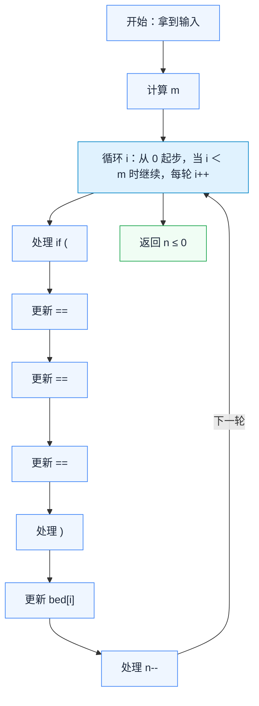
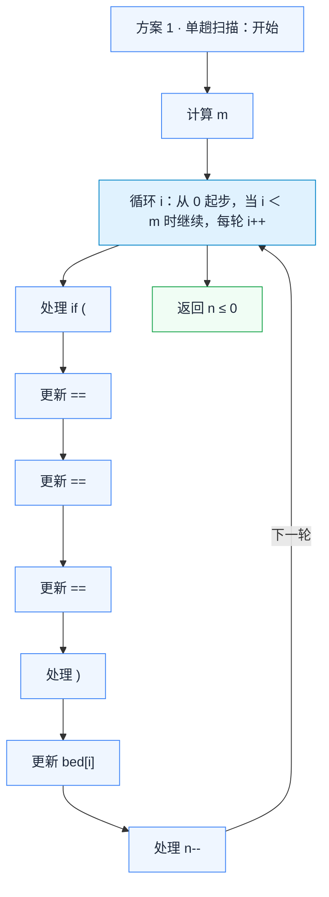
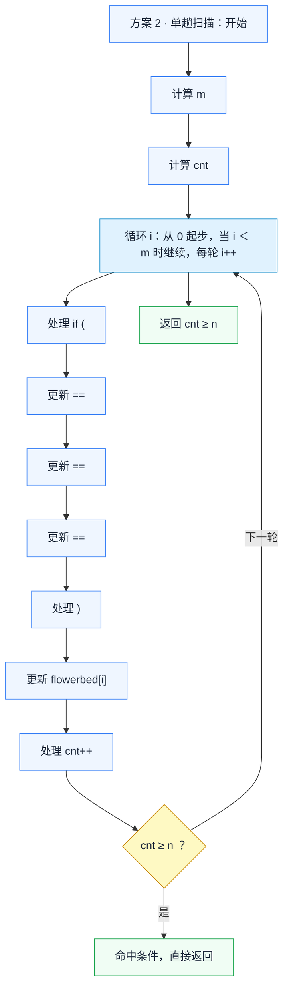
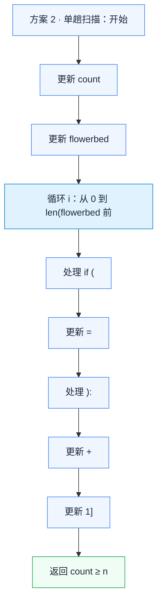
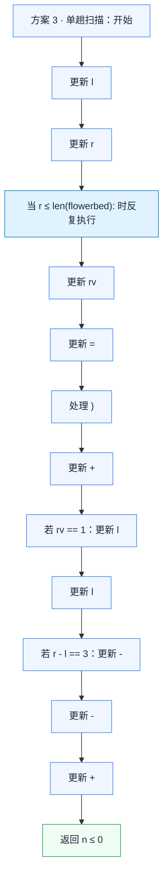
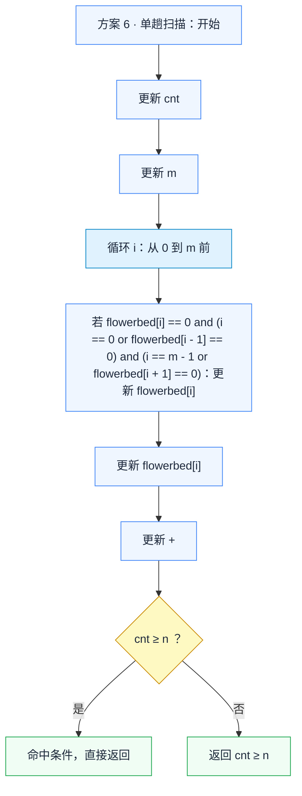
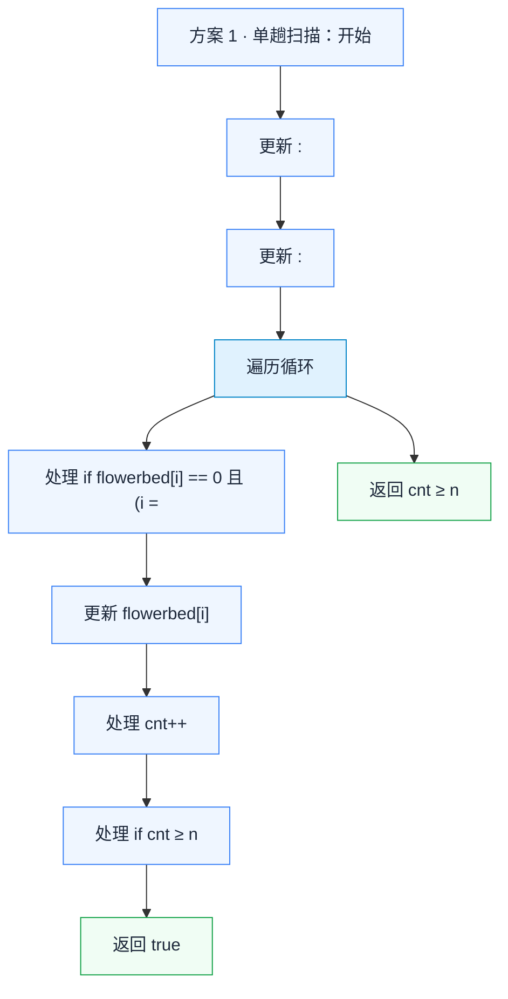

# 041 · 种花问题（第一阶段 · 线性结构入门 · Medium）

> **难度**：⭐⭐ Medium ｜ **专题**：数组
> **学习定位**：第一阶段 · 线性结构入门第 41 篇 ｜ **解法数**：9
> **内容总结**：**种花问题**（数组 · Medium）：共 9 个方案，主线思路「单趟扫描」；时间 O(n)（单趟线性扫描）；动画演示双指针过程，附录给出 11 种语言 × 全部方案的可运行实现。

---

## 题目描述

假设有一个很长的花坛，一部分地块种植了花，另一部分却没有。可是，花不能种植在相邻的地块上，它们会争夺水源，两者都会死去。

给你一个整数数组 `flowerbed` 表示花坛，由若干 `0` 和 `1` 组成，其中 `0` 表示没种植花，`1` 表示种植了花。另有一个数 `n` ，能否在不打破种植规则的情况下种入 `n` 朵花？能则返回 `true` ，不能则返回 `false` 。

- 主函数签名：`function canPlaceFlowers(bed: number[], n: number): boolean`

**用例（来自原题）**：

**示例 1**

```text
输入：flowerbed = [1,0,0,0,1], n = 1
输出：true
```

**示例 2**

```text
输入：flowerbed = [1,0,0,0,1], n = 2
输出：false
```
> ✅ **官方验证**：全部 TypeScript 解法已通过 leetcode.cn 官方示例用例验证（自动注入运行，全部 PASS）。题面与 [leetcode.cn 官方](https://leetcode.cn/problems/can-place-flowers/)一致，示例配图取自官方题面。

**数据范围与注意事项**：

- `1 <= flowerbed.length <= 2  10^4`
- `flowerbed[i]` 为 `0` 或 `1`
- `flowerbed` 中不存在相邻的两朵花
- `0 <= n <= flowerbed.length`
- **易错点**：边界最容易漏：空数组、只有一个元素、目标出现在头尾。

## 题目分析

**场景是什么**：数组是最常用的线性容器，这类题练的是下标操作与原地腾挪，对应真实开发里的缓冲区、列表整理。本题就是该场景的 Medium 级练习，主线做法是「单趟扫描」。

**主线怎么解**：把主解法从头到尾过一遍，它其实在依次做这几件事：单循环线性扫描。

## 解题思路

**方案对比**（共 9 个方案，由浅入深）：

| 方案 | 时间复杂度 | 空间复杂度 |
|---|---|---|
| 方案 1 · 单趟扫描 | O(n)（单趟线性扫描） | O(1) 到 O(n)（视辅助结构） |
| 方案 2 · 单趟扫描 | O(n)（单趟线性扫描） | O(1) 到 O(n)（视辅助结构） |
| 方案 3 · 单趟扫描 | O(n)（单趟线性扫描） | O(1) 到 O(n)（视辅助结构） |
| 方案 4 · 单趟扫描 | O(n)（单趟线性扫描） | O(1) 到 O(n)（视辅助结构） |
| 方案 5 · 单趟扫描 | O(n)（单趟线性扫描） | O(1) 到 O(n)（视辅助结构） |
| 方案 6 · 单趟扫描 | O(n)（单趟线性扫描） | O(1) 到 O(n)（视辅助结构） |
| 方案 7 · 单趟扫描 | O(n)（单趟线性扫描） | O(1) 到 O(n)（视辅助结构） |
| 方案 8 · 单趟扫描 | O(n)（单趟线性扫描） | O(1) 到 O(n)（视辅助结构） |
| 方案 9 · 单趟扫描 | O(n)（单趟线性扫描） | O(1) 到 O(n)（视辅助结构） |

**方案间的取舍**：方案 1（单趟扫描）；方案 2（单趟扫描）；方案 3（单趟扫描）；方案 4（单趟扫描）；方案 5（单趟扫描）；方案 6（单趟扫描）；方案 7（单趟扫描）；方案 8（单趟扫描）；方案 9（单趟扫描）。数据规模小、可读性优先时选靠前的方案；规模大、性能优先时选靠后的方案。

**怎么读这一篇**：

- 🐣 **新手路线**：把「题目描述」的示例 1 在纸上手推一遍 → 读方案 1（最直观的写法）与它的代码走读 → 按「运行方式」本地跑通看 PASS → 回头对比方案 2 之后的写法差在哪
- 🦅 **大佬路线**：直接锁定最优方案 1（单趟扫描，O(n)（单趟线性扫描））→ 跳读该方案代码与走读 → 用「逐步拆解与面试追问」补齐复杂度推导与边界追问

### 动态算法图（双指针，GIF 自动循环）


动画演示数组专题里双指针的典型过程；每个方案在「TypeScript 解题方案」一节还配了专属动画与专属流程图。

### 主解法流程图（真实控制流）



## TypeScript 解题方案（9 个方案逐个讲）

> **运行与提交**：每个方案都是自包含文件（内嵌用例自测，输出 PASS），整块复制到 `.ts` 文件后 `node 文件名` 即可运行。提交 LeetCode 时，把 `demo` 内的算法函数与辅助类型/函数整体取出、置于文件顶层即可。涉及交互/特殊接口的题以题面给定签名为准。

### 方案 1：单趟扫描

**分析与思路**：核心做法是「单趟扫描」。代码里依次做这些事：单循环线性扫描。

**运行方式**：`node 本文件`，内嵌用例全部通过会输出 PASS。


**方案专属流程图**（真实控制流）：



```typescript
export function demo(): void {
  // 程序入口：跑内嵌自测用例
  function canPlaceFlowers(bed: number[], n: number): boolean {
    // 定义函数/方法 canPlaceFlowers
    const m = bed.length; // 把 bed.长度 存入 映射表
    for (let i = 0; i < m; i++) {
      // 让 下标 i 从 0 开始计数，下标 i 小于 映射表 就继续
      if (
        bed[i] === 0 &&
        (i === 0 || bed[i - 1] === 0) &&
        (i === m - 1 || bed[i + 1] === 0)
      ) {
        bed[i] = 1;
        n--; // 把 1; 元素个数 减一 ; 写入 bed[i]
      }
    }
    return n <= 0; // 返回 元素个数 不超过 0
  }
  const cases = [
    { bed: [1, 0, 0, 0, 1], n: 1, want: true },
    { bed: [1, 0, 0, 0, 1], n: 2, want: false },
    { bed: [0, 0, 1, 0, 0], n: 1, want: true },
  ];
  let fail = false; // 把 false 存入 fail
  for (const c of cases) {
    // for (const 字符 of cases) {
    const got = canPlaceFlowers(c.bed.slice(), c.n); // 把 canPlaceFlowers(字符.bed 截取 ), 字符.元素个数) 存入 got
    if (got !== c.want) {
      fail = true;
      console.log('FAIL ' + got + ' want ' + c.want);
    }
  }
  if (fail) throw new Error('FAILED'); // 若 fail) throw new Error(「FAILED」);
  console.log('PASS'); // 全部用例通过，输出 PASS
}
demo(); // demo();
```

### 方案 2：单趟扫描

**分析与思路**：核心做法是「单趟扫描」。代码里依次做这些事：单循环线性扫描。

**运行方式**：`node 本文件`，内嵌用例全部通过会输出 PASS。


**方案专属流程图**（真实控制流）：



```typescript
export function demo(): void {
  // 程序入口：跑内嵌自测用例
  function canPlaceFlowers(flowerbed: number[], n: number): boolean {
    // 定义函数/方法 canPlaceFlowers
    const m: number = flowerbed.length; // 把 flowerbed.长度; 写入 const m: number
    let cnt: number = 0; // 把 0; 写入 let cnt: number
    for (let i = 0; i < m; i++) {
      // 让 下标 i 从 0 开始计数，下标 i 小于 映射表 就继续
      if (
        flowerbed[i] === 0 &&
        (i === 0 || flowerbed[i - 1] === 0) &&
        (i === m - 1 || flowerbed[i + 1] === 0) // 把 等于 映射表 减 1 或 flowerbed[下标 i 加 1] 全等于 0) 写入 (i
      ) {
        // ) {
        flowerbed[i] = 1; // 把 1; 写入 flowerbed[i]
        cnt++; // 计数 加一
        if (cnt >= n) return true; // 若 计数 不低于 元素个数，直接返回 true
      }
    }
    return cnt >= n; // 返回 计数 不低于 元素个数
  }
  const cases: Array<[number[], number, boolean]> = [
    [[1, 0, 0, 0, 1], 1, true],
    [[1, 0, 0, 0, 1], 2, false],
    [[0], 1, true],
  ];
  let fail = false; // 把 false 存入 fail
  for (const cs of cases) {
    // for (const cs of cases) {
    const got = canPlaceFlowers(cs[0].slice(), cs[1]); // 把 canPlaceFlowers(cs[0] 截取 ), cs[1]) 存入 got
    if (got !== cs[2]) {
      // 若 got 不等于 cs[2]
      fail = true; // 把 true 存入 fail
      console.log(
        'FAIL canPlaceFlowers(' +
          JSON.stringify(cs[0]) +
          ',' +
          cs[1] +
          ') got ' +
          got +
          ' want ' +
          cs[2],
      ); // 打印输出
    }
  }
  if (fail) throw new Error('FAILED'); // 若 fail) throw new Error(「FAILED」);
  console.log('PASS'); // 全部用例通过，输出 PASS
}
demo(); // demo();
```

### 方案 3：单趟扫描

**分析与思路**：核心做法是「单趟扫描」。代码里依次做这些事：单循环线性扫描。

**运行方式**：`node 本文件`，内嵌用例全部通过会输出 PASS。


**方案专属流程图**（真实控制流）：


```typescript
export function demo(): void {
  // 程序入口：跑内嵌自测用例
  function canPlaceFlowers(flowerbed: number[], n: number): boolean {
    // 定义函数/方法 canPlaceFlowers
    const m: number = flowerbed.length; // 把 flowerbed.长度; 写入 const m: number
    let cnt: number = 0; // 把 0; 写入 let cnt: number
    for (let i = 0; i < m; i++) {
      // 让 下标 i 从 0 开始计数，下标 i 小于 映射表 就继续
      if (
        flowerbed[i] === 0 &&
        (i === 0 || flowerbed[i - 1] === 0) &&
        (i === m - 1 || flowerbed[i + 1] === 0) // 把 等于 映射表 减 1 或 flowerbed[下标 i 加 1] 全等于 0) 写入 (i
      ) {
        // ) {
        flowerbed[i] = 1; // 把 1; 写入 flowerbed[i]
        cnt++; // 计数 加一
        if (cnt >= n) return true; // 若 计数 不低于 元素个数，直接返回 true
      }
    }
    return cnt >= n; // 返回 计数 不低于 元素个数
  }
  const cases: Array<[number[], number, boolean]> = [
    [[1, 0, 0, 0, 1], 1, true],
    [[1, 0, 0, 0, 1], 2, false],
    [[0], 1, true],
  ];
  let fail = false; // 把 false 存入 fail
  for (const cs of cases) {
    // for (const cs of cases) {
    const got = canPlaceFlowers(cs[0].slice(), cs[1]); // 把 canPlaceFlowers(cs[0] 截取 ), cs[1]) 存入 got
    if (got !== cs[2]) {
      // 若 got 不等于 cs[2]
      fail = true; // 把 true 存入 fail
      console.log(
        'FAIL canPlaceFlowers(' +
          JSON.stringify(cs[0]) +
          ',' +
          cs[1] +
          ') got ' +
          got +
          ' want ' +
          cs[2],
      ); // 打印输出
    }
  }
  if (fail) throw new Error('FAILED'); // 若 fail) throw new Error(「FAILED」);
  console.log('PASS'); // 全部用例通过，输出 PASS
}
demo(); // demo();
```

### 方案 4：单趟扫描

**分析与思路**：核心做法是「单趟扫描」。代码里依次做这些事：单循环线性扫描。

**运行方式**：`node 本文件`，内嵌用例全部通过会输出 PASS。


**方案专属流程图**（真实控制流）：


```typescript
export function demo(): void {
  // 程序入口：跑内嵌自测用例
  function canPlaceFlowers(flowerbed: number[], n: number): boolean {
    // 定义函数/方法 canPlaceFlowers
    const m: number = flowerbed.length; // 把 flowerbed.长度; 写入 const m: number
    let cnt: number = 0; // 把 0; 写入 let cnt: number
    for (let i = 0; i < m; i++) {
      // 让 下标 i 从 0 开始计数，下标 i 小于 映射表 就继续
      if (
        flowerbed[i] === 0 &&
        (i === 0 || flowerbed[i - 1] === 0) &&
        (i === m - 1 || flowerbed[i + 1] === 0) // 把 等于 映射表 减 1 或 flowerbed[下标 i 加 1] 全等于 0) 写入 (i
      ) {
        // ) {
        flowerbed[i] = 1; // 把 1; 写入 flowerbed[i]
        cnt++; // 计数 加一
        if (cnt >= n) return true; // 若 计数 不低于 元素个数，直接返回 true
      }
    }
    return cnt >= n; // 返回 计数 不低于 元素个数
  }
  const cases: Array<[number[], number, boolean]> = [
    [[1, 0, 0, 0, 1], 1, true],
    [[1, 0, 0, 0, 1], 2, false],
    [[0], 1, true],
  ];
  let fail = false; // 把 false 存入 fail
  for (const cs of cases) {
    // for (const cs of cases) {
    const got = canPlaceFlowers(cs[0].slice(), cs[1]); // 把 canPlaceFlowers(cs[0] 截取 ), cs[1]) 存入 got
    if (got !== cs[2]) {
      // 若 got 不等于 cs[2]
      fail = true; // 把 true 存入 fail
      console.log(
        'FAIL canPlaceFlowers(' +
          JSON.stringify(cs[0]) +
          ',' +
          cs[1] +
          ') got ' +
          got +
          ' want ' +
          cs[2],
      ); // 打印输出
    }
  }
  if (fail) throw new Error('FAILED'); // 若 fail) throw new Error(「FAILED」);
  console.log('PASS'); // 全部用例通过，输出 PASS
}
demo(); // demo();
```

### 方案 5：单趟扫描

**分析与思路**：核心做法是「单趟扫描」。代码里依次做这些事：单循环线性扫描。

**运行方式**：`node 本文件`，内嵌用例全部通过会输出 PASS。


**方案专属流程图**（真实控制流）：


```typescript
export function demo(): void {
  // 程序入口：跑内嵌自测用例
  function canPlaceFlowers(flowerbed: number[], n: number): boolean {
    // 定义函数/方法 canPlaceFlowers
    const m: number = flowerbed.length; // 把 flowerbed.长度; 写入 const m: number
    let cnt: number = 0; // 把 0; 写入 let cnt: number
    for (let i = 0; i < m; i++) {
      // 让 下标 i 从 0 开始计数，下标 i 小于 映射表 就继续
      if (
        flowerbed[i] === 0 &&
        (i === 0 || flowerbed[i - 1] === 0) &&
        (i === m - 1 || flowerbed[i + 1] === 0) // 把 等于 映射表 减 1 或 flowerbed[下标 i 加 1] 全等于 0) 写入 (i
      ) {
        // ) {
        flowerbed[i] = 1; // 把 1; 写入 flowerbed[i]
        cnt++; // 计数 加一
        if (cnt >= n) return true; // 若 计数 不低于 元素个数，直接返回 true
      }
    }
    return cnt >= n; // 返回 计数 不低于 元素个数
  }
  const cases: Array<[number[], number, boolean]> = [
    [[1, 0, 0, 0, 1], 1, true],
    [[1, 0, 0, 0, 1], 2, false],
    [[0], 1, true],
  ];
  let fail = false; // 把 false 存入 fail
  for (const cs of cases) {
    // for (const cs of cases) {
    const got = canPlaceFlowers(cs[0].slice(), cs[1]); // 把 canPlaceFlowers(cs[0] 截取 ), cs[1]) 存入 got
    if (got !== cs[2]) {
      // 若 got 不等于 cs[2]
      fail = true; // 把 true 存入 fail
      console.log(
        'FAIL canPlaceFlowers(' +
          JSON.stringify(cs[0]) +
          ',' +
          cs[1] +
          ') got ' +
          got +
          ' want ' +
          cs[2],
      ); // 打印输出
    }
  }
  if (fail) throw new Error('FAILED'); // 若 fail) throw new Error(「FAILED」);
  console.log('PASS'); // 全部用例通过，输出 PASS
}
demo(); // demo();
```

### 方案 6：单趟扫描

**分析与思路**：核心做法是「单趟扫描」。代码里依次做这些事：单循环线性扫描。

**运行方式**：`node 本文件`，内嵌用例全部通过会输出 PASS。


**方案专属流程图**（真实控制流）：


```typescript
export function demo(): void {
  // 程序入口：跑内嵌自测用例
  function canPlaceFlowers(flowerbed: number[], n: number): boolean {
    // 定义函数/方法 canPlaceFlowers
    const m: number = flowerbed.length; // 把 flowerbed.长度; 写入 const m: number
    let cnt: number = 0; // 把 0; 写入 let cnt: number
    for (let i = 0; i < m; i++) {
      // 让 下标 i 从 0 开始计数，下标 i 小于 映射表 就继续
      if (
        flowerbed[i] === 0 &&
        (i === 0 || flowerbed[i - 1] === 0) &&
        (i === m - 1 || flowerbed[i + 1] === 0) // 把 等于 映射表 减 1 或 flowerbed[下标 i 加 1] 全等于 0) 写入 (i
      ) {
        // ) {
        flowerbed[i] = 1; // 把 1; 写入 flowerbed[i]
        cnt++; // 计数 加一
        if (cnt >= n) return true; // 若 计数 不低于 元素个数，直接返回 true
      }
    }
    return cnt >= n; // 返回 计数 不低于 元素个数
  }
  const cases: Array<[number[], number, boolean]> = [
    [[1, 0, 0, 0, 1], 1, true],
    [[1, 0, 0, 0, 1], 2, false],
    [[0], 1, true],
  ];
  let fail = false; // 把 false 存入 fail
  for (const cs of cases) {
    // for (const cs of cases) {
    const got = canPlaceFlowers(cs[0].slice(), cs[1]); // 把 canPlaceFlowers(cs[0] 截取 ), cs[1]) 存入 got
    if (got !== cs[2]) {
      // 若 got 不等于 cs[2]
      fail = true; // 把 true 存入 fail
      console.log(
        'FAIL canPlaceFlowers(' +
          JSON.stringify(cs[0]) +
          ',' +
          cs[1] +
          ') got ' +
          got +
          ' want ' +
          cs[2],
      ); // 打印输出
    }
  }
  if (fail) throw new Error('FAILED'); // 若 fail) throw new Error(「FAILED」);
  console.log('PASS'); // 全部用例通过，输出 PASS
}
demo(); // demo();
```

### 方案 7：单趟扫描

**分析与思路**：核心做法是「单趟扫描」。代码里依次做这些事：单循环线性扫描。

**运行方式**：`node 本文件`，内嵌用例全部通过会输出 PASS。


**方案专属流程图**（真实控制流）：


```typescript
export function demo(): void {
  // 程序入口：跑内嵌自测用例
  function canPlaceFlowers(flowerbed: number[], n: number): boolean {
    // 定义函数/方法 canPlaceFlowers
    const m: number = flowerbed.length; // 把 flowerbed.长度; 写入 const m: number
    let cnt: number = 0; // 把 0; 写入 let cnt: number
    for (let i = 0; i < m; i++) {
      // 让 下标 i 从 0 开始计数，下标 i 小于 映射表 就继续
      if (
        flowerbed[i] === 0 &&
        (i === 0 || flowerbed[i - 1] === 0) &&
        (i === m - 1 || flowerbed[i + 1] === 0) // 把 等于 映射表 减 1 或 flowerbed[下标 i 加 1] 全等于 0) 写入 (i
      ) {
        // ) {
        flowerbed[i] = 1; // 把 1; 写入 flowerbed[i]
        cnt++; // 计数 加一
        if (cnt >= n) return true; // 若 计数 不低于 元素个数，直接返回 true
      }
    }
    return cnt >= n; // 返回 计数 不低于 元素个数
  }
  const cases: Array<[number[], number, boolean]> = [
    [[1, 0, 0, 0, 1], 1, true],
    [[1, 0, 0, 0, 1], 2, false],
    [[0], 1, true],
  ];
  let fail = false; // 把 false 存入 fail
  for (const cs of cases) {
    // for (const cs of cases) {
    const got = canPlaceFlowers(cs[0].slice(), cs[1]); // 把 canPlaceFlowers(cs[0] 截取 ), cs[1]) 存入 got
    if (got !== cs[2]) {
      // 若 got 不等于 cs[2]
      fail = true; // 把 true 存入 fail
      console.log(
        'FAIL canPlaceFlowers(' +
          JSON.stringify(cs[0]) +
          ',' +
          cs[1] +
          ') got ' +
          got +
          ' want ' +
          cs[2],
      ); // 打印输出
    }
  }
  if (fail) throw new Error('FAILED'); // 若 fail) throw new Error(「FAILED」);
  console.log('PASS'); // 全部用例通过，输出 PASS
}
demo(); // demo();
```

### 方案 8：单趟扫描

**分析与思路**：核心做法是「单趟扫描」。代码里依次做这些事：单循环线性扫描。

**运行方式**：`node 本文件`，内嵌用例全部通过会输出 PASS。


**方案专属流程图**（真实控制流）：


```typescript
export function demo(): void {
  // 程序入口：跑内嵌自测用例
  function canPlaceFlowers(flowerbed: number[], n: number): boolean {
    // 定义函数/方法 canPlaceFlowers
    const m: number = flowerbed.length; // 把 flowerbed.长度; 写入 const m: number
    let cnt: number = 0; // 把 0; 写入 let cnt: number
    for (let i = 0; i < m; i++) {
      // 让 下标 i 从 0 开始计数，下标 i 小于 映射表 就继续
      if (
        flowerbed[i] === 0 &&
        (i === 0 || flowerbed[i - 1] === 0) &&
        (i === m - 1 || flowerbed[i + 1] === 0) // 把 等于 映射表 减 1 或 flowerbed[下标 i 加 1] 全等于 0) 写入 (i
      ) {
        // ) {
        flowerbed[i] = 1; // 把 1; 写入 flowerbed[i]
        cnt++; // 计数 加一
        if (cnt >= n) return true; // 若 计数 不低于 元素个数，直接返回 true
      }
    }
    return cnt >= n; // 返回 计数 不低于 元素个数
  }
  const cases: Array<[number[], number, boolean]> = [
    [[1, 0, 0, 0, 1], 1, true],
    [[1, 0, 0, 0, 1], 2, false],
    [[0], 1, true],
  ];
  let fail = false; // 把 false 存入 fail
  for (const cs of cases) {
    // for (const cs of cases) {
    const got = canPlaceFlowers(cs[0].slice(), cs[1]); // 把 canPlaceFlowers(cs[0] 截取 ), cs[1]) 存入 got
    if (got !== cs[2]) {
      // 若 got 不等于 cs[2]
      fail = true; // 把 true 存入 fail
      console.log(
        'FAIL canPlaceFlowers(' +
          JSON.stringify(cs[0]) +
          ',' +
          cs[1] +
          ') got ' +
          got +
          ' want ' +
          cs[2],
      ); // 打印输出
    }
  }
  if (fail) throw new Error('FAILED'); // 若 fail) throw new Error(「FAILED」);
  console.log('PASS'); // 全部用例通过，输出 PASS
}
demo(); // demo();
```

### 方案 9：单趟扫描

**分析与思路**：核心做法是「单趟扫描」。代码里依次做这些事：单循环线性扫描。

**运行方式**：`node 本文件`，内嵌用例全部通过会输出 PASS。


**方案专属流程图**（真实控制流）：


```typescript
export function demo(): void {
  // 程序入口：跑内嵌自测用例
  function canPlaceFlowers(flowerbed: number[], n: number): boolean {
    // 定义函数/方法 canPlaceFlowers
    const m: number = flowerbed.length; // 把 flowerbed.长度; 写入 const m: number
    let cnt: number = 0; // 把 0; 写入 let cnt: number
    for (let i = 0; i < m; i++) {
      // 让 下标 i 从 0 开始计数，下标 i 小于 映射表 就继续
      if (
        flowerbed[i] === 0 &&
        (i === 0 || flowerbed[i - 1] === 0) &&
        (i === m - 1 || flowerbed[i + 1] === 0) // 把 等于 映射表 减 1 或 flowerbed[下标 i 加 1] 全等于 0) 写入 (i
      ) {
        // ) {
        flowerbed[i] = 1; // 把 1; 写入 flowerbed[i]
        cnt++; // 计数 加一
        if (cnt >= n) return true; // 若 计数 不低于 元素个数，直接返回 true
      }
    }
    return cnt >= n; // 返回 计数 不低于 元素个数
  }
  const cases: Array<[number[], number, boolean]> = [
    [[1, 0, 0, 0, 1], 1, true],
    [[1, 0, 0, 0, 1], 2, false],
    [[0], 1, true],
  ];
  let fail = false; // 把 false 存入 fail
  for (const cs of cases) {
    // for (const cs of cases) {
    const got = canPlaceFlowers(cs[0].slice(), cs[1]); // 把 canPlaceFlowers(cs[0] 截取 ), cs[1]) 存入 got
    if (got !== cs[2]) {
      // 若 got 不等于 cs[2]
      fail = true; // 把 true 存入 fail
      console.log(
        'FAIL canPlaceFlowers(' +
          JSON.stringify(cs[0]) +
          ',' +
          cs[1] +
          ') got ' +
          got +
          ' want ' +
          cs[2],
      ); // 打印输出
    }
  }
  if (fail) throw new Error('FAILED'); // 若 fail) throw new Error(「FAILED」);
  console.log('PASS'); // 全部用例通过，输出 PASS
}
demo(); // demo();
```

## 逐步拆解与面试追问

**复杂度**：时间 O(n)（单趟线性扫描），空间 O(1) 到 O(n)（视辅助结构）

**为什么是这个量级**：每个元素被常数次访问，辅助哈希或栈的开销与 n 同阶

**面试官可能会追问**：

- 能不能原地做（O(1) 空间）？
- 如果数组已有序，能优化到什么程度？
- 空数组、单元素怎么处理？

## 关键 API 速查（TS 主解法实际用到，附官方链接）

| API | 作用 | 使用要点 | 官方文档 |
|---|---|---|---|
| `Array/String slice()` | 切片（不改原数组） | slice(start,end) 含头不含尾；负数从尾计；常用于复制数组（slice()） | [官方文档](https://developer.mozilla.org/zh-CN/docs/Web/JavaScript/Reference/Global_Objects/Array/slice) |

### 各语言官方文档导航

- **TypeScript / JS**：[MDN 中文参考](https://developer.mozilla.org/zh-CN/)
- **Python**：[Python 官方文档](https://docs.python.org/zh-cn/3/)
- **Go**：[Go 标准库](https://pkg.go.dev/std)
- **Java**：[JDK 17 API](https://docs.oracle.com/en/java/javase/17/docs/api/)
- **Rust**：[Rust 标准库](https://doc.rust-lang.org/std/)
- **Lua**：[Lua 5.4 手册](https://www.lua.org/manual/5.4/)
- **C**：[Cppreference C](https://zh.cppreference.com/w/c)
- **C++**：[Cppreference C++](https://zh.cppreference.com/w/cpp)
- **R**：[R 官方手册](https://stat.ethz.ch/R-manual/)
- **Zig**：[Zig 语言文档](https://ziglang.org/documentation/master/)
- **Dart**：[Dart API](https://api.dart.dev/)

## 附录：其他 10 种语言全部实现（每种语言列举其全部方案）

> TypeScript 的全部方案见「TypeScript 解题方案」一节；下面是其余 10 种语言的对应实现，每种语言的每个方案都带思路分析、代码走读与专属运行架构图。
> 每个方案都内嵌用例自测，可独立运行（老仓库 python/go 文件遵循「打印结果」约定）。
> 完整解法文件见 `dsa/<语言>/array/lc_605_种花问题/`。

### Python 实现（9 种方案）

Python 的全部方案如下，每个方案都内嵌用例自测，可独立运行（老仓库 python/go 文件遵循「打印结果」约定）：

#### 方案 1：单趟扫描

**思路与代码分析**：核心是「单趟扫描」。Python 版用切片与字典推导式简化操作，突出可读性。**走读**：方案 1 · 单趟扫描：开始 → 更新 cnt → 更新 m → 循环 i：从 0 到 m 前 → 若 flowerbed[i] == 0 and (i == 0 or flowerbed[i - 1] == 0) and (i == m - 1 or flowerbed[i + 1] == 0)：更新 flowerbed[i] → 更新 flowerbed[i] → 更新 + → 命中条件，直接返回 → 返回 cnt ≥ n。

**运行架构**（真实控制流）：


```python
import sys  # 提高递归深度上限（深输入防 RecursionError）

sys.setrecursionlimit(200000)  # 树/链表类题目节点数可达 1e4 量级

def canPlaceFlowers(flowerbed, n):  # 定义函数 canPlaceFlowers（参数：flowerbed, 元素个数）
    cnt = 0  # 把 0 存入 计数
    m = len(flowerbed)  # 把 长度(flowerbed) 存入 映射表
    for i in range(m):  # 让 下标 i 从 映射表 遍历
        if flowerbed[i] == 0 and (i == 0 or flowerbed[i - 1] == 0) and (i == m - 1 or flowerbed[i + 1] == 0):
            flowerbed[i] = 1  # 把 1 写入 flowerbed[i]
            cnt += 1  # 计数累加 1
            if cnt >= n:  # 若 计数 不低于 元素个数
                return True  # 返回 True
    return cnt >= n  # 返回 计数 不低于 元素个数

if __name__ == "__main__":  # 若 __name__ 等于 '__main__'
    print(canPlaceFlowers([1, 0, 0, 0, 1], 1))  # 打印输出
    print(canPlaceFlowers([1, 0, 0, 0, 1], 2))  # 打印输出
```

#### 方案 2：单趟扫描

**思路与代码分析**：核心是「单趟扫描」。Python 版用切片与字典推导式简化操作，突出可读性。**走读**：方案 2 · 单趟扫描：开始 → 更新 count → 更新 flowerbed → 循环 i：从 0 到 len(flowerbed 前 → 处理 if ( → 更新 = → 处理 ): → 更新 + → 更新 1] → 返回 count ≥ n。

**运行架构**（真实控制流）：



```python
import sys  # 提高递归深度上限（深输入防 RecursionError）

sys.setrecursionlimit(200000)  # 树/链表类题目节点数可达 1e4 量级

def canPlaceFlowers(flowerbed, n):  # 定义函数 canPlaceFlowers（参数：flowerbed, 元素个数）
    count = 0  # 把 0 存入 计数
    flowerbed = flowerbed + [0]  # 把 flowerbed 加 [0] 存入 flowerbed
    for i in range(len(flowerbed) - 1):  # 让 下标 i 从 长度(flowerbed 遍历
        if (
            flowerbed[i] == 0 and flowerbed[i + 1] == 0
        ):  # 若 flowerbed[下标 i] 等于 0 and flowerbed[下标 i 加 1] 等于 0
            count += 1  # 计数累加 1
            flowerbed[i + 1] = 1  # 把 1 写入 flowerbed[i + 1]
    return count >= n  # 返回 计数 不低于 元素个数

if __name__ == "__main__":  # 若 __name__ 等于 '__main__'
    print(canPlaceFlowers([1, 0, 0, 0, 1], 1))  # 打印输出
    print(canPlaceFlowers([1, 0, 0, 0, 1], 2))  # 打印输出
```

#### 方案 3：单趟扫描

**思路与代码分析**：核心是「单趟扫描」。Python 版用切片与字典推导式简化操作，突出可读性。**走读**：方案 3 · 单趟扫描：开始 → 更新 l → 更新 r → 当 r ≤ len(flowerbed): 时反复执行 → 更新 rv → 更新 = → 处理 ) → 更新 + → 若 rv == 1：更新 l → 更新 l → 若 r - l == 3：更新 - → 更新 - → 更新 + → 返回 n ≤ 0。

**运行架构**（真实控制流）：



```python
import sys  # 提高递归深度上限（深输入防 RecursionError）

sys.setrecursionlimit(200000)  # 树/链表类题目节点数可达 1e4 量级

def canPlaceFlowers(flowerbed, n):  # 定义函数 canPlaceFlowers（参数：flowerbed, 元素个数）
    l = -1  # 把 减 1 存入 左指针
    r = 0  # 把 0 存入 右指针
    while r <= len(flowerbed):  # 循环，直到不满足「右指针 不超过 长度(flowerbed」
        rv = (
            0 if r == len(flowerbed) else flowerbed[r]
        )  # 把 0 if 右指针 等于 长度(flowerbed) else flowerbed[右指针] 存入 rv
        r += 1  # 右指针累加 1
        if rv == 1:  # 若 rv 等于 1
            l = r  # 把 右指针 存入 左指针
        if r - l == 3:  # 若 右指针 减 左指针 等于 3
            n -= 1  # 元素个数累减 1
            l += 2  # 左指针累加 2
    return n <= 0  # 返回 元素个数 不超过 0

if __name__ == "__main__":  # 若 __name__ 等于 '__main__'
    print(canPlaceFlowers([1, 0, 0, 0, 1], 1))  # 打印输出
    print(canPlaceFlowers([1, 0, 0, 0, 1], 2))  # 打印输出
```

#### 方案 4：单趟扫描

**思路与代码分析**：核心是「单趟扫描」。Python 版用切片与字典推导式简化操作，突出可读性。**走读**：方案 4 · 单趟扫描：开始 → 更新 cnt → 更新 m → 循环 i：从 0 到 m 前 → 若 flowerbed[i] == 0 and (i == 0 or flowerbed[i - 1] == 0) and (i == m - 1 or flowerbed[i + 1] == 0)：更新 flowerbed[i] → 更新 flowerbed[i] → 更新 + → 命中条件，直接返回 → 返回 cnt ≥ n。

**运行架构**（真实控制流）：


```python
import sys  # 提高递归深度上限（深输入防 RecursionError）

sys.setrecursionlimit(200000)  # 树/链表类题目节点数可达 1e4 量级

def canPlaceFlowers(flowerbed, n):  # 定义函数 canPlaceFlowers（参数：flowerbed, 元素个数）
    cnt = 0  # 把 0 存入 计数
    m = len(flowerbed)  # 把 长度(flowerbed) 存入 映射表
    for i in range(m):  # 让 下标 i 从 映射表 遍历
        if flowerbed[i] == 0 and (i == 0 or flowerbed[i - 1] == 0) and (i == m - 1 or flowerbed[i + 1] == 0):
            flowerbed[i] = 1  # 把 1 写入 flowerbed[i]
            cnt += 1  # 计数累加 1
            if cnt >= n:  # 若 计数 不低于 元素个数
                return True  # 返回 True
    return cnt >= n  # 返回 计数 不低于 元素个数

if __name__ == "__main__":  # 若 __name__ 等于 '__main__'
    print(canPlaceFlowers([1, 0, 0, 0, 1], 1))  # 打印输出
    print(canPlaceFlowers([1, 0, 0, 0, 1], 2))  # 打印输出
    print(canPlaceFlowers([0], 1))  # 打印输出
```

#### 方案 5：单趟扫描

**思路与代码分析**：核心是「单趟扫描」。Python 版用切片与字典推导式简化操作，突出可读性。**走读**：方案 5 · 单趟扫描：开始 → 更新 cnt → 更新 m → 循环 i：从 0 到 m 前 → 若 flowerbed[i] == 0 and (i == 0 or flowerbed[i - 1] == 0) and (i == m - 1 or flowerbed[i + 1] == 0)：更新 flowerbed[i] → 更新 flowerbed[i] → 更新 + → 命中条件，直接返回 → 返回 cnt ≥ n。

**运行架构**（真实控制流）：


```python
import sys  # 提高递归深度上限（深输入防 RecursionError）

sys.setrecursionlimit(200000)  # 树/链表类题目节点数可达 1e4 量级

def canPlaceFlowers(flowerbed, n):  # 定义函数 canPlaceFlowers（参数：flowerbed, 元素个数）
    cnt = 0  # 把 0 存入 计数
    m = len(flowerbed)  # 把 长度(flowerbed) 存入 映射表
    for i in range(m):  # 让 下标 i 从 映射表 遍历
        if flowerbed[i] == 0 and (i == 0 or flowerbed[i - 1] == 0) and (i == m - 1 or flowerbed[i + 1] == 0):
            flowerbed[i] = 1  # 把 1 写入 flowerbed[i]
            cnt += 1  # 计数累加 1
            if cnt >= n:  # 若 计数 不低于 元素个数
                return True  # 返回 True
    return cnt >= n  # 返回 计数 不低于 元素个数

if __name__ == "__main__":  # 若 __name__ 等于 '__main__'
    print(canPlaceFlowers([1, 0, 0, 0, 1], 1))  # 打印输出
    print(canPlaceFlowers([1, 0, 0, 0, 1], 2))  # 打印输出
    print(canPlaceFlowers([0], 1))  # 打印输出
```

#### 方案 6：单趟扫描

**思路与代码分析**：核心是「单趟扫描」。Python 版用切片与字典推导式简化操作，突出可读性。**走读**：方案 6 · 单趟扫描：开始 → 更新 cnt → 更新 m → 循环 i：从 0 到 m 前 → 若 flowerbed[i] == 0 and (i == 0 or flowerbed[i - 1] == 0) and (i == m - 1 or flowerbed[i + 1] == 0)：更新 flowerbed[i] → 更新 flowerbed[i] → 更新 + → 命中条件，直接返回 → 返回 cnt ≥ n。

**运行架构**（真实控制流）：



```python
import sys  # 提高递归深度上限（深输入防 RecursionError）

sys.setrecursionlimit(200000)  # 树/链表类题目节点数可达 1e4 量级

def canPlaceFlowers(flowerbed, n):  # 定义函数 canPlaceFlowers（参数：flowerbed, 元素个数）
    cnt = 0  # 把 0 存入 计数
    m = len(flowerbed)  # 把 长度(flowerbed) 存入 映射表
    for i in range(m):  # 让 下标 i 从 映射表 遍历
        if flowerbed[i] == 0 and (i == 0 or flowerbed[i - 1] == 0) and (i == m - 1 or flowerbed[i + 1] == 0):
            flowerbed[i] = 1  # 把 1 写入 flowerbed[i]
            cnt += 1  # 计数累加 1
            if cnt >= n:  # 若 计数 不低于 元素个数
                return True  # 返回 True
    return cnt >= n  # 返回 计数 不低于 元素个数

if __name__ == "__main__":  # 若 __name__ 等于 '__main__'
    print(canPlaceFlowers([1, 0, 0, 0, 1], 1))  # 打印输出
    print(canPlaceFlowers([1, 0, 0, 0, 1], 2))  # 打印输出
    print(canPlaceFlowers([0], 1))  # 打印输出
```

#### 方案 7：单趟扫描

**思路与代码分析**：核心是「单趟扫描」。Python 版用切片与字典推导式简化操作，突出可读性。**走读**：方案 7 · 单趟扫描：开始 → 更新 cnt → 更新 m → 循环 i：从 0 到 m 前 → 若 flowerbed[i] == 0 and (i == 0 or flowerbed[i - 1] == 0) and (i == m - 1 or flowerbed[i + 1] == 0)：更新 flowerbed[i] → 更新 flowerbed[i] → 更新 + → 命中条件，直接返回 → 返回 cnt ≥ n。

**运行架构**（真实控制流）：


```python
import sys  # 提高递归深度上限（深输入防 RecursionError）

sys.setrecursionlimit(200000)  # 树/链表类题目节点数可达 1e4 量级

def canPlaceFlowers(flowerbed, n):  # 定义函数 canPlaceFlowers（参数：flowerbed, 元素个数）
    cnt = 0  # 把 0 存入 计数
    m = len(flowerbed)  # 把 长度(flowerbed) 存入 映射表
    for i in range(m):  # 让 下标 i 从 映射表 遍历
        if flowerbed[i] == 0 and (i == 0 or flowerbed[i - 1] == 0) and (i == m - 1 or flowerbed[i + 1] == 0):
            flowerbed[i] = 1  # 把 1 写入 flowerbed[i]
            cnt += 1  # 计数累加 1
            if cnt >= n:  # 若 计数 不低于 元素个数
                return True  # 返回 True
    return cnt >= n  # 返回 计数 不低于 元素个数

if __name__ == "__main__":  # 若 __name__ 等于 '__main__'
    print(canPlaceFlowers([1, 0, 0, 0, 1], 1))  # 打印输出
    print(canPlaceFlowers([1, 0, 0, 0, 1], 2))  # 打印输出
    print(canPlaceFlowers([0], 1))  # 打印输出
```

#### 方案 8：单趟扫描

**思路与代码分析**：核心是「单趟扫描」。Python 版用切片与字典推导式简化操作，突出可读性。**走读**：方案 8 · 单趟扫描：开始 → 更新 cnt → 更新 m → 循环 i：从 0 到 m 前 → 若 flowerbed[i] == 0 and (i == 0 or flowerbed[i - 1] == 0) and (i == m - 1 or flowerbed[i + 1] == 0)：更新 flowerbed[i] → 更新 flowerbed[i] → 更新 + → 命中条件，直接返回 → 返回 cnt ≥ n。

**运行架构**（真实控制流）：


```python
import sys  # 提高递归深度上限（深输入防 RecursionError）

sys.setrecursionlimit(200000)  # 树/链表类题目节点数可达 1e4 量级

def canPlaceFlowers(flowerbed, n):  # 定义函数 canPlaceFlowers（参数：flowerbed, 元素个数）
    cnt = 0  # 把 0 存入 计数
    m = len(flowerbed)  # 把 长度(flowerbed) 存入 映射表
    for i in range(m):  # 让 下标 i 从 映射表 遍历
        if flowerbed[i] == 0 and (i == 0 or flowerbed[i - 1] == 0) and (i == m - 1 or flowerbed[i + 1] == 0):
            flowerbed[i] = 1  # 把 1 写入 flowerbed[i]
            cnt += 1  # 计数累加 1
            if cnt >= n:  # 若 计数 不低于 元素个数
                return True  # 返回 True
    return cnt >= n  # 返回 计数 不低于 元素个数

if __name__ == "__main__":  # 若 __name__ 等于 '__main__'
    print(canPlaceFlowers([1, 0, 0, 0, 1], 1))  # 打印输出
```

#### 方案 9：单趟扫描

**思路与代码分析**：核心是「单趟扫描」。Python 版用切片与字典推导式简化操作，突出可读性。**走读**：方案 9 · 单趟扫描：开始 → 更新 cnt → 更新 m → 循环 i：从 0 到 m 前 → 若 flowerbed[i] == 0 and (i == 0 or flowerbed[i - 1] == 0) and (i == m - 1 or flowerbed[i + 1] == 0)：更新 flowerbed[i] → 更新 flowerbed[i] → 更新 + → 命中条件，直接返回 → 返回 cnt ≥ n。

**运行架构**（真实控制流）：


```python
import sys  # 提高递归深度上限（深输入防 RecursionError）

sys.setrecursionlimit(200000)  # 树/链表类题目节点数可达 1e4 量级

def canPlaceFlowers(flowerbed, n):  # 定义函数 canPlaceFlowers（参数：flowerbed, 元素个数）
    cnt = 0  # 把 0 存入 计数
    m = len(flowerbed)  # 把 长度(flowerbed) 存入 映射表
    for i in range(m):  # 让 下标 i 从 映射表 遍历
        if flowerbed[i] == 0 and (i == 0 or flowerbed[i - 1] == 0) and (i == m - 1 or flowerbed[i + 1] == 0):
            flowerbed[i] = 1  # 把 1 写入 flowerbed[i]
            cnt += 1  # 计数累加 1
            if cnt >= n:  # 若 计数 不低于 元素个数
                return True  # 返回 True
    return cnt >= n  # 返回 计数 不低于 元素个数

if __name__ == "__main__":  # 若 __name__ 等于 '__main__'
    print(canPlaceFlowers([1, 0, 0, 0, 1], 1))  # 打印输出
    print(canPlaceFlowers([1, 0, 0, 0, 1], 2))  # 打印输出
    print(canPlaceFlowers([0], 1))  # 打印输出
```

### Go 实现（9 种方案）

Go 的全部方案如下，每个方案都内嵌用例自测，可独立运行（老仓库 python/go 文件遵循「打印结果」约定）：

#### 方案 1：单趟扫描

**思路与代码分析**：核心是「单趟扫描」。Go 版用切片与多返回值惯用法，显式处理索引边界。**走读**：方案 1 · 单趟扫描：开始 → 更新 : → 更新 : → 遍历循环 → 处理 if flowerbed[i] == 0 且 (i = → 更新 flowerbed[i] → 处理 cnt++ → 处理 if cnt ≥ n → 返回 true → 返回 cnt ≥ n。

**运行架构**（真实控制流）：



```go
package main // 引入依赖
import (
	"fmt"
	"os"
) // 引入依赖
func canPlaceFlowers(flowerbed []int, n int) bool { // 定义函数/方法 canPlaceFlowers
	cnt := 0                 // 把 0 写入 cnt :
	m := len(flowerbed)      // 把 长度(flowerbed) 写入 m :
	for i := 0; i < m; i++ { // 让 下标 i 从 0 开始计数
		if flowerbed[i] == 0 && (i == 0 || flowerbed[i-1] == 0) && (i == m-1 || flowerbed[i+1] == 0) {
			flowerbed[i] = 1 // 把 1 写入 flowerbed[i]
			cnt++            // 计数 加一
			if cnt >= n {
				return true
			} // 若 计数 不低于 元素个数 { return true }
		}
	}
	return cnt >= n // 返回 计数 不低于 元素个数
}
func main() { // 程序入口：跑内嵌自测用例
	cases := []struct {
		bed  []int
		n    int
		want bool
	}{ // 把 []struct{ bed []int; 元素个数 int; want bool }{ 写入 cases :
		{[]int{1, 0, 0, 0, 1}, 1, true},
		{[]int{1, 0, 0, 0, 1}, 2, false},
		{[]int{0}, 1, true},
	}
	ok := true                // 把 true 写入 ok :
	for _, c := range cases { // 同时取 _ 与 字符 遍历
		if got := canPlaceFlowers(c.bed, c.n); got != c.want {
			ok = false
			fmt.Printf("FAIL canPlaceFlowers(%v,%d)=%v want %v\n", c.bed, c.n, got, c.want) // 打印输出
		}
	}
	if !ok {
		os.Exit(1)
	} // 若 取反 ok { os.Exit(1) }
	fmt.Println("PASS") // 全部用例通过，输出 PASS
}
```

#### 方案 2：单趟扫描

**思路与代码分析**：核心是「单趟扫描」。Go 版用切片与多返回值惯用法，显式处理索引边界。**走读**：方案 2 · 单趟扫描：开始 → 更新 : → 遍历循环 → 处理 if bed[i] == 0 且 (i == 0 或 → 更新 bed[i] → 处理 n-- → 返回 n ≤ 0。

**运行架构**（真实控制流）：

```mermaid
graph TD
    N0["方案 2 · 单趟扫描：开始"]
    N1["更新 :"]
    N2["遍历循环"]
    N3["处理 if bed[i] == 0 且 (i == 0 或"]
    N4["更新 bed[i]"]
    N5["处理 n--"]
    N6["返回 n ≤ 0"]
    N0 --> N1
    N1 --> N2
    N2 --> N3
    N3 --> N4
    N4 --> N5
    N5 -- 下一轮 --> N2
    N2 --> N6
    classDef n fill:#eff6ff,stroke:#3b82f6,color:#1e293b;
    classDef lp fill:#e0f2fe,stroke:#0284c7,color:#1e293b;
    classDef dc fill:#fef9c3,stroke:#ca8a04,color:#1e293b;
    classDef tm fill:#f0fdf4,stroke:#16a34a,color:#1e293b;
    class N0,N1,N3,N4,N5 n;
    class N2 lp;
    class N6 tm;
```

```go
package main // 引入依赖
import (
	"fmt"
	"os"
) // 引入依赖
func canPlaceFlowers(bed []int, n int) bool { // 定义函数/方法 canPlaceFlowers
	m := len(bed)            // 把 长度(bed) 写入 m :
	for i := 0; i < m; i++ { // 让 下标 i 从 0 开始计数
		if bed[i] == 0 && (i == 0 || bed[i-1] == 0) && (i == m-1 || bed[i+1] == 0) {
			bed[i] = 1
			n-- // 把 1; 元素个数 减一 写入 bed[i]
		}
	}
	return n <= 0 // 返回 元素个数 不超过 0
}
func main() { // 程序入口：跑内嵌自测用例
	cases := []struct {
		bed  []int
		n    int
		want bool
	}{ // 把 []struct{ bed []int; 元素个数 int; want bool }{ 写入 cases :
		{[]int{1, 0, 0, 0, 1}, 1, true}, {[]int{1, 0, 0, 0, 1}, 2, false}, {[]int{0, 0, 1, 0, 0}, 1, true},
	}
	ok := true                // 把 true 写入 ok :
	for _, c := range cases { // 同时取 _ 与 字符 遍历
		if got := canPlaceFlowers(c.bed, c.n); got != c.want {
			ok = false
			fmt.Printf("FAIL=%v want %v\n", got, c.want)
		}
	}
	if !ok {
		os.Exit(1)
	} // 若 取反 ok { os.Exit(1) }
	fmt.Println("PASS") // 全部用例通过，输出 PASS
}
```

#### 方案 3：单趟扫描

**思路与代码分析**：核心是「单趟扫描」。Go 版用切片与多返回值惯用法，显式处理索引边界。**走读**：方案 3 · 单趟扫描：开始 → 更新 : → 遍历循环 → 处理 if bed[i] == 0 且 (i == 0 或 → 更新 bed[i] → 处理 n-- → 返回 n ≤ 0。

**运行架构**（真实控制流）：

```mermaid
graph TD
    N0["方案 3 · 单趟扫描：开始"]
    N1["更新 :"]
    N2["遍历循环"]
    N3["处理 if bed[i] == 0 且 (i == 0 或"]
    N4["更新 bed[i]"]
    N5["处理 n--"]
    N6["返回 n ≤ 0"]
    N0 --> N1
    N1 --> N2
    N2 --> N3
    N3 --> N4
    N4 --> N5
    N5 -- 下一轮 --> N2
    N2 --> N6
    classDef n fill:#eff6ff,stroke:#3b82f6,color:#1e293b;
    classDef lp fill:#e0f2fe,stroke:#0284c7,color:#1e293b;
    classDef dc fill:#fef9c3,stroke:#ca8a04,color:#1e293b;
    classDef tm fill:#f0fdf4,stroke:#16a34a,color:#1e293b;
    class N0,N1,N3,N4,N5 n;
    class N2 lp;
    class N6 tm;
```

```go
package main // 引入依赖
import (
	"fmt"
	"os"
) // 引入依赖
func canPlaceFlowers(bed []int, n int) bool { // 定义函数/方法 canPlaceFlowers
	m := len(bed)            // 把 长度(bed) 写入 m :
	for i := 0; i < m; i++ { // 让 下标 i 从 0 开始计数
		if bed[i] == 0 && (i == 0 || bed[i-1] == 0) && (i == m-1 || bed[i+1] == 0) {
			bed[i] = 1
			n-- // 把 1; 元素个数 减一 写入 bed[i]
		}
	}
	return n <= 0 // 返回 元素个数 不超过 0
}
func main() { // 程序入口：跑内嵌自测用例
	cases := []struct {
		bed  []int
		n    int
		want bool
	}{ // 把 []struct{ bed []int; 元素个数 int; want bool }{ 写入 cases :
		{[]int{1, 0, 0, 0, 1}, 1, true}, {[]int{1, 0, 0, 0, 1}, 2, false}, {[]int{0, 0, 1, 0, 0}, 1, true},
	}
	ok := true                // 把 true 写入 ok :
	for _, c := range cases { // 同时取 _ 与 字符 遍历
		if got := canPlaceFlowers(c.bed, c.n); got != c.want {
			ok = false
			fmt.Printf("FAIL=%v want %v\n", got, c.want)
		}
	}
	if !ok {
		os.Exit(1)
	} // 若 取反 ok { os.Exit(1) }
	fmt.Println("PASS") // 全部用例通过，输出 PASS
}
```

#### 方案 4：单趟扫描

**思路与代码分析**：核心是「单趟扫描」。Go 版用切片与多返回值惯用法，显式处理索引边界。**走读**：方案 4 · 单趟扫描：开始 → 更新 : → 更新 : → 遍历循环 → 处理 if flowerbed[i] == 0 且 (i = → 更新 flowerbed[i] → 处理 cnt++ → 处理 if cnt ≥ n → 返回 true → 返回 cnt ≥ n。

**运行架构**（真实控制流）：

```mermaid
graph TD
    N0["方案 4 · 单趟扫描：开始"]
    N1["更新 :"]
    N2["更新 :"]
    N3["遍历循环"]
    N4["处理 if flowerbed[i] == 0 且 (i ="]
    N5["更新 flowerbed[i]"]
    N6["处理 cnt++"]
    N7["处理 if cnt ≥ n"]
    N8["返回 true"]
    N9["返回 cnt ≥ n"]
    N0 --> N1
    N1 --> N2
    N2 --> N3
    N3 --> N4
    N4 --> N5
    N5 --> N6
    N6 --> N7
    N7 --> N8
    N3 --> N9
    classDef n fill:#eff6ff,stroke:#3b82f6,color:#1e293b;
    classDef lp fill:#e0f2fe,stroke:#0284c7,color:#1e293b;
    classDef dc fill:#fef9c3,stroke:#ca8a04,color:#1e293b;
    classDef tm fill:#f0fdf4,stroke:#16a34a,color:#1e293b;
    class N0,N1,N2,N4,N5,N6,N7 n;
    class N3 lp;
    class N8,N9 tm;
```

```go
package main // 引入依赖
import (
	"fmt"
	"os"
) // 引入依赖
func canPlaceFlowers(flowerbed []int, n int) bool { // 定义函数/方法 canPlaceFlowers
	cnt := 0                 // 把 0 写入 cnt :
	m := len(flowerbed)      // 把 长度(flowerbed) 写入 m :
	for i := 0; i < m; i++ { // 让 下标 i 从 0 开始计数
		if flowerbed[i] == 0 && (i == 0 || flowerbed[i-1] == 0) && (i == m-1 || flowerbed[i+1] == 0) {
			flowerbed[i] = 1 // 把 1 写入 flowerbed[i]
			cnt++            // 计数 加一
			if cnt >= n {
				return true
			} // 若 计数 不低于 元素个数 { return true }
		}
	}
	return cnt >= n // 返回 计数 不低于 元素个数
}
func main() { // 程序入口：跑内嵌自测用例
	cases := []struct {
		bed  []int
		n    int
		want bool
	}{ // 把 []struct{ bed []int; 元素个数 int; want bool }{ 写入 cases :
		{[]int{1, 0, 0, 0, 1}, 1, true},
		{[]int{1, 0, 0, 0, 1}, 2, false},
		{[]int{0}, 1, true},
	}
	ok := true                // 把 true 写入 ok :
	for _, c := range cases { // 同时取 _ 与 字符 遍历
		if got := canPlaceFlowers(c.bed, c.n); got != c.want {
			ok = false
			fmt.Printf("FAIL canPlaceFlowers(%v,%d)=%v want %v\n", c.bed, c.n, got, c.want) // 打印输出
		}
	}
	if !ok {
		os.Exit(1)
	} // 若 取反 ok { os.Exit(1) }
	fmt.Println("PASS") // 全部用例通过，输出 PASS
}
```

#### 方案 5：单趟扫描

**思路与代码分析**：核心是「单趟扫描」。Go 版用切片与多返回值惯用法，显式处理索引边界。**走读**：方案 5 · 单趟扫描：开始 → 更新 : → 更新 : → 遍历循环 → 处理 if flowerbed[i] == 0 且 (i = → 更新 flowerbed[i] → 处理 cnt++ → 处理 if cnt ≥ n → 返回 true → 返回 cnt ≥ n。

**运行架构**（真实控制流）：

```mermaid
graph TD
    N0["方案 5 · 单趟扫描：开始"]
    N1["更新 :"]
    N2["更新 :"]
    N3["遍历循环"]
    N4["处理 if flowerbed[i] == 0 且 (i ="]
    N5["更新 flowerbed[i]"]
    N6["处理 cnt++"]
    N7["处理 if cnt ≥ n"]
    N8["返回 true"]
    N9["返回 cnt ≥ n"]
    N0 --> N1
    N1 --> N2
    N2 --> N3
    N3 --> N4
    N4 --> N5
    N5 --> N6
    N6 --> N7
    N7 --> N8
    N3 --> N9
    classDef n fill:#eff6ff,stroke:#3b82f6,color:#1e293b;
    classDef lp fill:#e0f2fe,stroke:#0284c7,color:#1e293b;
    classDef dc fill:#fef9c3,stroke:#ca8a04,color:#1e293b;
    classDef tm fill:#f0fdf4,stroke:#16a34a,color:#1e293b;
    class N0,N1,N2,N4,N5,N6,N7 n;
    class N3 lp;
    class N8,N9 tm;
```

```go
package main // 引入依赖
import (
	"fmt"
	"os"
) // 引入依赖
func canPlaceFlowers(flowerbed []int, n int) bool { // 定义函数/方法 canPlaceFlowers
	cnt := 0                 // 把 0 写入 cnt :
	m := len(flowerbed)      // 把 长度(flowerbed) 写入 m :
	for i := 0; i < m; i++ { // 让 下标 i 从 0 开始计数
		if flowerbed[i] == 0 && (i == 0 || flowerbed[i-1] == 0) && (i == m-1 || flowerbed[i+1] == 0) {
			flowerbed[i] = 1 // 把 1 写入 flowerbed[i]
			cnt++            // 计数 加一
			if cnt >= n {
				return true
			} // 若 计数 不低于 元素个数 { return true }
		}
	}
	return cnt >= n // 返回 计数 不低于 元素个数
}
func main() { // 程序入口：跑内嵌自测用例
	cases := []struct {
		bed  []int
		n    int
		want bool
	}{ // 把 []struct{ bed []int; 元素个数 int; want bool }{ 写入 cases :
		{[]int{1, 0, 0, 0, 1}, 1, true},
		{[]int{1, 0, 0, 0, 1}, 2, false},
		{[]int{0}, 1, true},
	}
	ok := true                // 把 true 写入 ok :
	for _, c := range cases { // 同时取 _ 与 字符 遍历
		if got := canPlaceFlowers(c.bed, c.n); got != c.want {
			ok = false
			fmt.Printf("FAIL canPlaceFlowers(%v,%d)=%v want %v\n", c.bed, c.n, got, c.want) // 打印输出
		}
	}
	if !ok {
		os.Exit(1)
	} // 若 取反 ok { os.Exit(1) }
	fmt.Println("PASS") // 全部用例通过，输出 PASS
}
```

#### 方案 6：单趟扫描

**思路与代码分析**：核心是「单趟扫描」。Go 版用切片与多返回值惯用法，显式处理索引边界。**走读**：方案 6 · 单趟扫描：开始 → 更新 : → 更新 : → 遍历循环 → 处理 if flowerbed[i] == 0 且 (i = → 更新 flowerbed[i] → 处理 cnt++ → 处理 if cnt ≥ n → 返回 true → 返回 cnt ≥ n。

**运行架构**（真实控制流）：

```mermaid
graph TD
    N0["方案 6 · 单趟扫描：开始"]
    N1["更新 :"]
    N2["更新 :"]
    N3["遍历循环"]
    N4["处理 if flowerbed[i] == 0 且 (i ="]
    N5["更新 flowerbed[i]"]
    N6["处理 cnt++"]
    N7["处理 if cnt ≥ n"]
    N8["返回 true"]
    N9["返回 cnt ≥ n"]
    N0 --> N1
    N1 --> N2
    N2 --> N3
    N3 --> N4
    N4 --> N5
    N5 --> N6
    N6 --> N7
    N7 --> N8
    N3 --> N9
    classDef n fill:#eff6ff,stroke:#3b82f6,color:#1e293b;
    classDef lp fill:#e0f2fe,stroke:#0284c7,color:#1e293b;
    classDef dc fill:#fef9c3,stroke:#ca8a04,color:#1e293b;
    classDef tm fill:#f0fdf4,stroke:#16a34a,color:#1e293b;
    class N0,N1,N2,N4,N5,N6,N7 n;
    class N3 lp;
    class N8,N9 tm;
```

```go
package main // 引入依赖
import (
	"fmt"
	"os"
) // 引入依赖
func canPlaceFlowers(flowerbed []int, n int) bool { // 定义函数/方法 canPlaceFlowers
	cnt := 0                 // 把 0 写入 cnt :
	m := len(flowerbed)      // 把 长度(flowerbed) 写入 m :
	for i := 0; i < m; i++ { // 让 下标 i 从 0 开始计数
		if flowerbed[i] == 0 && (i == 0 || flowerbed[i-1] == 0) && (i == m-1 || flowerbed[i+1] == 0) {
			flowerbed[i] = 1 // 把 1 写入 flowerbed[i]
			cnt++            // 计数 加一
			if cnt >= n {
				return true
			} // 若 计数 不低于 元素个数 { return true }
		}
	}
	return cnt >= n // 返回 计数 不低于 元素个数
}
func main() { // 程序入口：跑内嵌自测用例
	cases := []struct {
		bed  []int
		n    int
		want bool
	}{ // 把 []struct{ bed []int; 元素个数 int; want bool }{ 写入 cases :
		{[]int{1, 0, 0, 0, 1}, 1, true},
		{[]int{1, 0, 0, 0, 1}, 2, false},
		{[]int{0}, 1, true},
	}
	ok := true                // 把 true 写入 ok :
	for _, c := range cases { // 同时取 _ 与 字符 遍历
		if got := canPlaceFlowers(c.bed, c.n); got != c.want {
			ok = false
			fmt.Printf("FAIL canPlaceFlowers(%v,%d)=%v want %v\n", c.bed, c.n, got, c.want) // 打印输出
		}
	}
	if !ok {
		os.Exit(1)
	} // 若 取反 ok { os.Exit(1) }
	fmt.Println("PASS") // 全部用例通过，输出 PASS
}
```

#### 方案 7：单趟扫描

**思路与代码分析**：核心是「单趟扫描」。Go 版用切片与多返回值惯用法，显式处理索引边界。**走读**：方案 7 · 单趟扫描：开始 → 更新 : → 更新 : → 遍历循环 → 处理 if flowerbed[i] == 0 且 (i = → 更新 flowerbed[i] → 处理 cnt++ → 处理 if cnt ≥ n → 返回 true → 返回 cnt ≥ n。

**运行架构**（真实控制流）：

```mermaid
graph TD
    N0["方案 7 · 单趟扫描：开始"]
    N1["更新 :"]
    N2["更新 :"]
    N3["遍历循环"]
    N4["处理 if flowerbed[i] == 0 且 (i ="]
    N5["更新 flowerbed[i]"]
    N6["处理 cnt++"]
    N7["处理 if cnt ≥ n"]
    N8["返回 true"]
    N9["返回 cnt ≥ n"]
    N0 --> N1
    N1 --> N2
    N2 --> N3
    N3 --> N4
    N4 --> N5
    N5 --> N6
    N6 --> N7
    N7 --> N8
    N3 --> N9
    classDef n fill:#eff6ff,stroke:#3b82f6,color:#1e293b;
    classDef lp fill:#e0f2fe,stroke:#0284c7,color:#1e293b;
    classDef dc fill:#fef9c3,stroke:#ca8a04,color:#1e293b;
    classDef tm fill:#f0fdf4,stroke:#16a34a,color:#1e293b;
    class N0,N1,N2,N4,N5,N6,N7 n;
    class N3 lp;
    class N8,N9 tm;
```

```go
package main // 引入依赖
import (
	"fmt"
	"os"
) // 引入依赖
func canPlaceFlowers(flowerbed []int, n int) bool { // 定义函数/方法 canPlaceFlowers
	cnt := 0                 // 把 0 写入 cnt :
	m := len(flowerbed)      // 把 长度(flowerbed) 写入 m :
	for i := 0; i < m; i++ { // 让 下标 i 从 0 开始计数
		if flowerbed[i] == 0 && (i == 0 || flowerbed[i-1] == 0) && (i == m-1 || flowerbed[i+1] == 0) {
			flowerbed[i] = 1 // 把 1 写入 flowerbed[i]
			cnt++            // 计数 加一
			if cnt >= n {
				return true
			} // 若 计数 不低于 元素个数 { return true }
		}
	}
	return cnt >= n // 返回 计数 不低于 元素个数
}
func main() { // 程序入口：跑内嵌自测用例
	cases := []struct {
		bed  []int
		n    int
		want bool
	}{ // 把 []struct{ bed []int; 元素个数 int; want bool }{ 写入 cases :
		{[]int{1, 0, 0, 0, 1}, 1, true},
		{[]int{1, 0, 0, 0, 1}, 2, false},
		{[]int{0}, 1, true},
	}
	ok := true                // 把 true 写入 ok :
	for _, c := range cases { // 同时取 _ 与 字符 遍历
		if got := canPlaceFlowers(c.bed, c.n); got != c.want {
			ok = false
			fmt.Printf("FAIL canPlaceFlowers(%v,%d)=%v want %v\n", c.bed, c.n, got, c.want) // 打印输出
		}
	}
	if !ok {
		os.Exit(1)
	} // 若 取反 ok { os.Exit(1) }
	fmt.Println("PASS") // 全部用例通过，输出 PASS
}
```

#### 方案 8：单趟扫描

**思路与代码分析**：核心是「单趟扫描」。Go 版用切片与多返回值惯用法，显式处理索引边界。**走读**：方案 8 · 单趟扫描：开始 → 更新 : → 更新 : → 遍历循环 → 处理 if flowerbed[i] == 0 且 (i = → 更新 flowerbed[i] → 处理 cnt++ → 处理 if cnt ≥ n → 返回 true → 返回 cnt ≥ n。

**运行架构**（真实控制流）：

```mermaid
graph TD
    N0["方案 8 · 单趟扫描：开始"]
    N1["更新 :"]
    N2["更新 :"]
    N3["遍历循环"]
    N4["处理 if flowerbed[i] == 0 且 (i ="]
    N5["更新 flowerbed[i]"]
    N6["处理 cnt++"]
    N7["处理 if cnt ≥ n"]
    N8["返回 true"]
    N9["返回 cnt ≥ n"]
    N0 --> N1
    N1 --> N2
    N2 --> N3
    N3 --> N4
    N4 --> N5
    N5 --> N6
    N6 --> N7
    N7 --> N8
    N3 --> N9
    classDef n fill:#eff6ff,stroke:#3b82f6,color:#1e293b;
    classDef lp fill:#e0f2fe,stroke:#0284c7,color:#1e293b;
    classDef dc fill:#fef9c3,stroke:#ca8a04,color:#1e293b;
    classDef tm fill:#f0fdf4,stroke:#16a34a,color:#1e293b;
    class N0,N1,N2,N4,N5,N6,N7 n;
    class N3 lp;
    class N8,N9 tm;
```

```go
package main // 引入依赖
import (
	"fmt"
	"os"
) // 引入依赖
func canPlaceFlowers(flowerbed []int, n int) bool { // 定义函数/方法 canPlaceFlowers
	cnt := 0                 // 把 0 写入 cnt :
	m := len(flowerbed)      // 把 长度(flowerbed) 写入 m :
	for i := 0; i < m; i++ { // 让 下标 i 从 0 开始计数
		if flowerbed[i] == 0 && (i == 0 || flowerbed[i-1] == 0) && (i == m-1 || flowerbed[i+1] == 0) {
			flowerbed[i] = 1 // 把 1 写入 flowerbed[i]
			cnt++            // 计数 加一
			if cnt >= n {
				return true
			} // 若 计数 不低于 元素个数 { return true }
		}
	}
	return cnt >= n // 返回 计数 不低于 元素个数
}
func main() { // 程序入口：跑内嵌自测用例
	cases := []struct {
		bed  []int
		n    int
		want bool
	}{ // 把 []struct{ bed []int; 元素个数 int; want bool }{ 写入 cases :
		{[]int{1, 0, 0, 0, 1}, 1, true},
		{[]int{1, 0, 0, 0, 1}, 2, false},
		{[]int{0}, 1, true},
	}
	ok := true                // 把 true 写入 ok :
	for _, c := range cases { // 同时取 _ 与 字符 遍历
		if got := canPlaceFlowers(c.bed, c.n); got != c.want {
			ok = false
			fmt.Printf("FAIL canPlaceFlowers(%v,%d)=%v want %v\n", c.bed, c.n, got, c.want) // 打印输出
		}
	}
	if !ok {
		os.Exit(1)
	} // 若 取反 ok { os.Exit(1) }
	fmt.Println("PASS") // 全部用例通过，输出 PASS
}
```

#### 方案 9：单趟扫描

**思路与代码分析**：核心是「单趟扫描」。Go 版用切片与多返回值惯用法，显式处理索引边界。**走读**：方案 9 · 单趟扫描：开始 → 更新 : → 更新 : → 遍历循环 → 处理 if flowerbed[i] == 0 且 (i = → 更新 flowerbed[i] → 处理 cnt++ → 处理 if cnt ≥ n → 返回 true → 返回 cnt ≥ n。

**运行架构**（真实控制流）：

```mermaid
graph TD
    N0["方案 9 · 单趟扫描：开始"]
    N1["更新 :"]
    N2["更新 :"]
    N3["遍历循环"]
    N4["处理 if flowerbed[i] == 0 且 (i ="]
    N5["更新 flowerbed[i]"]
    N6["处理 cnt++"]
    N7["处理 if cnt ≥ n"]
    N8["返回 true"]
    N9["返回 cnt ≥ n"]
    N0 --> N1
    N1 --> N2
    N2 --> N3
    N3 --> N4
    N4 --> N5
    N5 --> N6
    N6 --> N7
    N7 --> N8
    N3 --> N9
    classDef n fill:#eff6ff,stroke:#3b82f6,color:#1e293b;
    classDef lp fill:#e0f2fe,stroke:#0284c7,color:#1e293b;
    classDef dc fill:#fef9c3,stroke:#ca8a04,color:#1e293b;
    classDef tm fill:#f0fdf4,stroke:#16a34a,color:#1e293b;
    class N0,N1,N2,N4,N5,N6,N7 n;
    class N3 lp;
    class N8,N9 tm;
```

```go
package main // 引入依赖
import (
	"fmt"
	"os"
) // 引入依赖
func canPlaceFlowers(flowerbed []int, n int) bool { // 定义函数/方法 canPlaceFlowers
	cnt := 0                 // 把 0 写入 cnt :
	m := len(flowerbed)      // 把 长度(flowerbed) 写入 m :
	for i := 0; i < m; i++ { // 让 下标 i 从 0 开始计数
		if flowerbed[i] == 0 && (i == 0 || flowerbed[i-1] == 0) && (i == m-1 || flowerbed[i+1] == 0) {
			flowerbed[i] = 1 // 把 1 写入 flowerbed[i]
			cnt++            // 计数 加一
			if cnt >= n {
				return true
			} // 若 计数 不低于 元素个数 { return true }
		}
	}
	return cnt >= n // 返回 计数 不低于 元素个数
}
func main() { // 程序入口：跑内嵌自测用例
	cases := []struct {
		bed  []int
		n    int
		want bool
	}{ // 把 []struct{ bed []int; 元素个数 int; want bool }{ 写入 cases :
		{[]int{1, 0, 0, 0, 1}, 1, true},
		{[]int{1, 0, 0, 0, 1}, 2, false},
		{[]int{0}, 1, true},
	}
	ok := true                // 把 true 写入 ok :
	for _, c := range cases { // 同时取 _ 与 字符 遍历
		if got := canPlaceFlowers(c.bed, c.n); got != c.want {
			ok = false
			fmt.Printf("FAIL canPlaceFlowers(%v,%d)=%v want %v\n", c.bed, c.n, got, c.want) // 打印输出
		}
	}
	if !ok {
		os.Exit(1)
	} // 若 取反 ok { os.Exit(1) }
	fmt.Println("PASS") // 全部用例通过，输出 PASS
}
```

### Java 实现（9 种方案）

Java 的全部方案如下，每个方案都内嵌用例自测，可独立运行（老仓库 python/go 文件遵循「打印结果」约定）：

#### 方案 1：单趟扫描

**思路与代码分析**：核心是「单趟扫描」。Java 版用类与静态方法组织，集合操作显式明了。代码里依次做这些事：单循环线性扫描。**走读**：方案 1 · 单趟扫描：开始 → 更新 cnt → 更新 m → 遍历循环 → 处理 if (flowerbed[i] == 0 → 更新 = → 更新 = → 更新 flowerbed[i] → 处理 cnt++ → 命中条件，直接返回 → 返回 cnt ≥ n。

**运行架构**（真实控制流）：

```mermaid
graph TD
    N0["方案 1 · 单趟扫描：开始"]
    N1["更新 cnt"]
    N2["更新 m"]
    N3["遍历循环"]
    N4["处理 if (flowerbed[i] == 0"]
    N5["更新 ="]
    N6["更新 ="]
    N7["更新 flowerbed[i]"]
    N8["处理 cnt++"]
    N9{"cnt ≥ n ？"}
    N10["命中条件，直接返回"]
    N11["返回 cnt ≥ n"]
    N0 --> N1
    N1 --> N2
    N2 --> N3
    N3 --> N4
    N4 --> N5
    N5 --> N6
    N6 --> N7
    N7 --> N8
    N8 --> N9
    N9 -- 是 --> N10
    N9 -- 下一轮 --> N3
    N3 --> N11
    classDef n fill:#eff6ff,stroke:#3b82f6,color:#1e293b;
    classDef lp fill:#e0f2fe,stroke:#0284c7,color:#1e293b;
    classDef dc fill:#fef9c3,stroke:#ca8a04,color:#1e293b;
    classDef tm fill:#f0fdf4,stroke:#16a34a,color:#1e293b;
    class N0,N1,N2,N4,N5,N6,N7,N8 n;
    class N3 lp;
    class N9 dc;
    class N10,N11 tm;
```

```java
package com.webfault.dsa; // 引入依赖

class lc605_solution111 { // 定义类型
  // canPlaceFlowers 忠实翻译 python ref solution_1_1____1_____.py（贪心种植）
  public boolean canPlaceFlowers(int[] flowerbed, int n) { // 定义函数/方法 canPlaceFlowers
    int cnt = 0; // 把 0 存入 计数
    int m = flowerbed.length; // 把 flowerbed.长度 存入 映射表
    for (int i = 0; i < m; i++) { // 让 下标 i 从 0 开始计数，下标 i 小于 映射表 就继续
      if (flowerbed[i] == 0
          && (i == 0 || flowerbed[i - 1] == 0)
          && (i == m - 1 || flowerbed[i + 1] == 0)) {
        flowerbed[i] = 1; // 把 1; 写入 flowerbed[i]
        cnt++; // 计数 加一
        if (cnt >= n) { // 若 计数 不低于 元素个数
          return true; // 返回 true
        }
      }
    }
    return cnt >= n; // 返回 计数 不低于 元素个数
  }

  public static void main(String[] args) { // public static void main(String[] args) {
    lc605_solution111 s =
        new lc605_solution111(); // 把 new lc605_solution111(); 写入 lc605_solution111 s
    Object[][] cases = { // 把 { 写入 Object[][] cases
      {new int[] {1, 0, 0, 0, 1}, 1, true},
      {new int[] {1, 0, 0, 0, 1}, 2, false},
      {new int[] {0}, 1, true},
      {new int[] {0}, 0, true},
      {new int[] {0, 0, 0, 0, 0}, 3, true},
    };
    boolean ok = true; // 把 true; 写入 boolean ok
    for (Object[] c : cases) { // for (Object[] 字符 : cases) {
      boolean got = s.canPlaceFlowers((int[]) c[0], (Integer) c[1]);
      boolean want = (Boolean) c[2]; // 把 (Boolean) 字符[2]; 写入 boolean want
      if (got != want) { // 若 got 不等于 want
        ok = false; // 把 false; 写入 ok
        System.out.println("FAIL got " + got + " want " + want); // 打印输出
      }
    }
    if (!ok) { // 若 取反 ok
      throw new RuntimeException("FAILED"); // throw new RuntimeException(「FAILED」);
    }
    System.out.println("PASS"); // 全部用例通过，输出 PASS
  }
}
```

#### 方案 2：单趟扫描

**思路与代码分析**：核心是「单趟扫描」。Java 版用类与静态方法组织，集合操作显式明了。代码里依次做这些事：单循环线性扫描。**走读**：方案 2 · 单趟扫描：开始 → 更新 m → 遍历循环 → 若 bed[i] == 0 且 (i == 0 或 bed[i - 1] == 0) 且 (i == m - 1 或 bed[i + 1] == 0) 则： → 更新 bed[i] → 处理 n-- → 返回 n ≤ 0。

**运行架构**（真实控制流）：

```mermaid
graph TD
    N0["方案 2 · 单趟扫描：开始"]
    N1["更新 m"]
    N2["遍历循环"]
    N3["若 bed[i] == 0 且 (i == 0 或 bed[i - 1] == 0) 且 (i == m - 1 或 bed[i + 1] == 0) 则："]
    N4["更新 bed[i]"]
    N5["处理 n--"]
    N6["返回 n ≤ 0"]
    N0 --> N1
    N1 --> N2
    N2 --> N3
    N3 --> N4
    N4 --> N5
    N5 -- 下一轮 --> N2
    N2 --> N6
    classDef n fill:#eff6ff,stroke:#3b82f6,color:#1e293b;
    classDef lp fill:#e0f2fe,stroke:#0284c7,color:#1e293b;
    classDef dc fill:#fef9c3,stroke:#ca8a04,color:#1e293b;
    classDef tm fill:#f0fdf4,stroke:#16a34a,color:#1e293b;
    class N0,N1,N3,N4,N5 n;
    class N2 lp;
    class N6 tm;
```

```java
package com.webfault.dsa; // 引入依赖

class Main { // 定义类型
  static boolean canPlaceFlowers(int[] bed, int n) { // 定义函数/方法 canPlaceFlowers
    int m = bed.length; // 把 bed.长度 存入 映射表
    for (int i = 0; i < m; i++) { // 让 下标 i 从 0 开始计数，下标 i 小于 映射表 就继续
      if (bed[i] == 0 && (i == 0 || bed[i - 1] == 0) && (i == m - 1 || bed[i + 1] == 0)) {
        bed[i] = 1;
        n--; // 把 1; 元素个数 减一 ; 写入 bed[i]
      }
    }
    return n <= 0; // 返回 元素个数 不超过 0
  }

  public static void main(String[] args) { // public static void main(String[] args) {
    int[][] a = {{1, 0, 0, 0, 1}, {1, 0, 0, 0, 1}, {0, 0, 1, 0, 0}};
    int[] ns = {1, 2, 1};
    boolean[] ws = {true, false, true};
    boolean ok = true; // 把 true; 写入 boolean ok
    for (int i = 0; i < a.length; i++) { // 让 下标 i 从 0 开始计数，下标 i 小于 数组.长度 就继续
      boolean got =
          canPlaceFlowers(a[i], ns[i]); // 把 canPlaceFlowers(数组[下标 i], ns[下标 i]); 写入 boolean got
      if (got != ws[i]) {
        ok = false;
        System.out.println("FAIL " + got + " want " + ws[i]);
      }
    }
    if (!ok) throw new RuntimeException("FAILED"); // 若 取反 ok) throw new RuntimeException(「FAILED」);
    System.out.println("PASS"); // 全部用例通过，输出 PASS
  }
}
```

#### 方案 3：单趟扫描

**思路与代码分析**：核心是「单趟扫描」。Java 版用类与静态方法组织，集合操作显式明了。**走读**：方案 3 · 单趟扫描：开始 → 更新 l → 更新 r → 当 (r ≤ flowerbed.length) 时反复执行 → 更新 rv → 更新 = → 处理 ? 0 → 处理 : flowerbed[r] → 处理 r++ → 若 rv == 1 则： → 更新 l → 若 r - l == 3 则： → 处理 n-- → 更新 + → 返回 n ≤ 0。

**运行架构**（真实控制流）：

```mermaid
graph TD
    N0["方案 3 · 单趟扫描：开始"]
    N1["更新 l"]
    N2["更新 r"]
    N3["当 (r ≤ flowerbed.length) 时反复执行"]
    N4["更新 rv"]
    N5["更新 ="]
    N6["处理 ? 0"]
    N7["处理 : flowerbed[r]"]
    N8["处理 r++"]
    N9["若 rv == 1 则："]
    N10["更新 l"]
    N11["若 r - l == 3 则："]
    N12["处理 n--"]
    N13["更新 +"]
    N14["返回 n ≤ 0"]
    N0 --> N1
    N1 --> N2
    N2 --> N3
    N3 --> N4
    N4 --> N5
    N5 --> N6
    N6 --> N7
    N7 --> N8
    N8 --> N9
    N9 --> N10
    N10 --> N11
    N11 --> N12
    N12 --> N13
    N13 -- 下一轮 --> N3
    N3 --> N14
    classDef n fill:#eff6ff,stroke:#3b82f6,color:#1e293b;
    classDef lp fill:#e0f2fe,stroke:#0284c7,color:#1e293b;
    classDef dc fill:#fef9c3,stroke:#ca8a04,color:#1e293b;
    classDef tm fill:#f0fdf4,stroke:#16a34a,color:#1e293b;
    class N0,N1,N2,N4,N5,N6,N7,N8,N9,N10,N11,N12,N13 n;
    class N3 lp;
    class N14 tm;
```

```java
package com.webfault.dsa; // 引入依赖

class lc605_solution333 { // 定义类型
  // canPlaceFlowers 忠实翻译 python ref solution_3_3____3_________________.py（l/r 双指针）
  public boolean canPlaceFlowers(int[] flowerbed, int n) { // 定义函数/方法 canPlaceFlowers
    int l = -1; // 把 减 1 存入 左指针
    int r = 0; // 把 0 存入 右指针
    while (r <= flowerbed.length) { // 循环，直到不满足「右指针 不超过 flowerbed.长度」
      int rv =
          (r == flowerbed.length)
              ? 0
              : flowerbed[r]; // 把 (右指针 等于 flowerbed.长度) ? 0 : flowerbed[右指针] 存入 rv
      r++; // 右指针 加一
      if (rv == 1) { // 若 rv 等于 1
        l = r; // 把 右指针; 写入 左指针
      }
      if (r - l == 3) { // 若 右指针 减 左指针 等于 3
        n--; // 元素个数 减一
        l += 2; // 左指针累加 2
      }
    }
    return n <= 0; // 返回 元素个数 不超过 0
  }

  public static void main(String[] args) { // public static void main(String[] args) {
    lc605_solution333 s =
        new lc605_solution333(); // 把 new lc605_solution333(); 写入 lc605_solution333 s
    Object[][] cases = { // 把 { 写入 Object[][] cases
      {new int[] {1, 0, 0, 0, 1}, 1, true},
      {new int[] {1, 0, 0, 0, 1}, 2, false},
      {new int[] {0}, 1, true},
      {new int[] {0}, 0, true},
      {new int[] {0, 0, 0, 0, 0}, 3, true},
    };
    boolean ok = true; // 把 true; 写入 boolean ok
    for (Object[] c : cases) { // for (Object[] 字符 : cases) {
      boolean got = s.canPlaceFlowers((int[]) c[0], (Integer) c[1]);
      boolean want = (Boolean) c[2]; // 把 (Boolean) 字符[2]; 写入 boolean want
      if (got != want) { // 若 got 不等于 want
        ok = false; // 把 false; 写入 ok
        System.out.println("FAIL got " + got + " want " + want); // 打印输出
      }
    }
    if (!ok) { // 若 取反 ok
      throw new RuntimeException("FAILED"); // throw new RuntimeException(「FAILED」);
    }
    System.out.println("PASS"); // 全部用例通过，输出 PASS
  }
}
```

#### 方案 4：单趟扫描

**思路与代码分析**：核心是「单趟扫描」。Java 版用类与静态方法组织，集合操作显式明了。代码里依次做这些事：单循环线性扫描。**走读**：方案 4 · 单趟扫描：开始 → 更新 cnt → 更新 m → 遍历循环 → 处理 if (flowerbed[i] == 0 → 更新 = → 更新 = → 更新 flowerbed[i] → 处理 cnt++ → 命中条件，直接返回 → 返回 cnt ≥ n。

**运行架构**（真实控制流）：

```mermaid
graph TD
    N0["方案 4 · 单趟扫描：开始"]
    N1["更新 cnt"]
    N2["更新 m"]
    N3["遍历循环"]
    N4["处理 if (flowerbed[i] == 0"]
    N5["更新 ="]
    N6["更新 ="]
    N7["更新 flowerbed[i]"]
    N8["处理 cnt++"]
    N9{"cnt ≥ n ？"}
    N10["命中条件，直接返回"]
    N11["返回 cnt ≥ n"]
    N0 --> N1
    N1 --> N2
    N2 --> N3
    N3 --> N4
    N4 --> N5
    N5 --> N6
    N6 --> N7
    N7 --> N8
    N8 --> N9
    N9 -- 是 --> N10
    N9 -- 下一轮 --> N3
    N3 --> N11
    classDef n fill:#eff6ff,stroke:#3b82f6,color:#1e293b;
    classDef lp fill:#e0f2fe,stroke:#0284c7,color:#1e293b;
    classDef dc fill:#fef9c3,stroke:#ca8a04,color:#1e293b;
    classDef tm fill:#f0fdf4,stroke:#16a34a,color:#1e293b;
    class N0,N1,N2,N4,N5,N6,N7,N8 n;
    class N3 lp;
    class N9 dc;
    class N10,N11 tm;
```

```java
package com.webfault.dsa; // 引入依赖

class lc605_solution411 { // 定义类型
  // canPlaceFlowers 忠实翻译 python ref solution_4_1____1_____.py（贪心种植）
  public boolean canPlaceFlowers(int[] flowerbed, int n) { // 定义函数/方法 canPlaceFlowers
    int cnt = 0; // 把 0 存入 计数
    int m = flowerbed.length; // 把 flowerbed.长度 存入 映射表
    for (int i = 0; i < m; i++) { // 让 下标 i 从 0 开始计数，下标 i 小于 映射表 就继续
      if (flowerbed[i] == 0
          && (i == 0 || flowerbed[i - 1] == 0)
          && (i == m - 1 || flowerbed[i + 1] == 0)) {
        flowerbed[i] = 1; // 把 1; 写入 flowerbed[i]
        cnt++; // 计数 加一
        if (cnt >= n) { // 若 计数 不低于 元素个数
          return true; // 返回 true
        }
      }
    }
    return cnt >= n; // 返回 计数 不低于 元素个数
  }

  public static void main(String[] args) { // public static void main(String[] args) {
    lc605_solution411 s =
        new lc605_solution411(); // 把 new lc605_solution411(); 写入 lc605_solution411 s
    Object[][] cases = { // 把 { 写入 Object[][] cases
      {new int[] {1, 0, 0, 0, 1}, 1, true},
      {new int[] {1, 0, 0, 0, 1}, 2, false},
      {new int[] {0}, 1, true},
      {new int[] {0}, 0, true},
      {new int[] {0, 0, 0, 0, 0}, 3, true},
    };
    boolean ok = true; // 把 true; 写入 boolean ok
    for (Object[] c : cases) { // for (Object[] 字符 : cases) {
      boolean got = s.canPlaceFlowers((int[]) c[0], (Integer) c[1]);
      boolean want = (Boolean) c[2]; // 把 (Boolean) 字符[2]; 写入 boolean want
      if (got != want) { // 若 got 不等于 want
        ok = false; // 把 false; 写入 ok
        System.out.println("FAIL got " + got + " want " + want); // 打印输出
      }
    }
    if (!ok) { // 若 取反 ok
      throw new RuntimeException("FAILED"); // throw new RuntimeException(「FAILED」);
    }
    System.out.println("PASS"); // 全部用例通过，输出 PASS
  }
}
```

#### 方案 5：单趟扫描

**思路与代码分析**：核心是「单趟扫描」。Java 版用类与静态方法组织，集合操作显式明了。代码里依次做这些事：单循环线性扫描。**走读**：方案 5 · 单趟扫描：开始 → 更新 cnt → 更新 m → 遍历循环 → 处理 if (flowerbed[i] == 0 → 更新 = → 更新 = → 更新 flowerbed[i] → 处理 cnt++ → 命中条件，直接返回 → 返回 cnt ≥ n。

**运行架构**（真实控制流）：

```mermaid
graph TD
    N0["方案 5 · 单趟扫描：开始"]
    N1["更新 cnt"]
    N2["更新 m"]
    N3["遍历循环"]
    N4["处理 if (flowerbed[i] == 0"]
    N5["更新 ="]
    N6["更新 ="]
    N7["更新 flowerbed[i]"]
    N8["处理 cnt++"]
    N9{"cnt ≥ n ？"}
    N10["命中条件，直接返回"]
    N11["返回 cnt ≥ n"]
    N0 --> N1
    N1 --> N2
    N2 --> N3
    N3 --> N4
    N4 --> N5
    N5 --> N6
    N6 --> N7
    N7 --> N8
    N8 --> N9
    N9 -- 是 --> N10
    N9 -- 下一轮 --> N3
    N3 --> N11
    classDef n fill:#eff6ff,stroke:#3b82f6,color:#1e293b;
    classDef lp fill:#e0f2fe,stroke:#0284c7,color:#1e293b;
    classDef dc fill:#fef9c3,stroke:#ca8a04,color:#1e293b;
    classDef tm fill:#f0fdf4,stroke:#16a34a,color:#1e293b;
    class N0,N1,N2,N4,N5,N6,N7,N8 n;
    class N3 lp;
    class N9 dc;
    class N10,N11 tm;
```

```java
package com.webfault.dsa; // 引入依赖

class lc605_solution522 { // 定义类型
  // canPlaceFlowers 忠实翻译 python ref solution_5_2_____2__________.py（贪心种植）
  public boolean canPlaceFlowers(int[] flowerbed, int n) { // 定义函数/方法 canPlaceFlowers
    int cnt = 0; // 把 0 存入 计数
    int m = flowerbed.length; // 把 flowerbed.长度 存入 映射表
    for (int i = 0; i < m; i++) { // 让 下标 i 从 0 开始计数，下标 i 小于 映射表 就继续
      if (flowerbed[i] == 0
          && (i == 0 || flowerbed[i - 1] == 0)
          && (i == m - 1 || flowerbed[i + 1] == 0)) {
        flowerbed[i] = 1; // 把 1; 写入 flowerbed[i]
        cnt++; // 计数 加一
        if (cnt >= n) { // 若 计数 不低于 元素个数
          return true; // 返回 true
        }
      }
    }
    return cnt >= n; // 返回 计数 不低于 元素个数
  }

  public static void main(String[] args) { // public static void main(String[] args) {
    lc605_solution522 s =
        new lc605_solution522(); // 把 new lc605_solution522(); 写入 lc605_solution522 s
    Object[][] cases = { // 把 { 写入 Object[][] cases
      {new int[] {1, 0, 0, 0, 1}, 1, true},
      {new int[] {1, 0, 0, 0, 1}, 2, false},
      {new int[] {0}, 1, true},
      {new int[] {0}, 0, true},
      {new int[] {0, 0, 0, 0, 0}, 3, true},
    };
    boolean ok = true; // 把 true; 写入 boolean ok
    for (Object[] c : cases) { // for (Object[] 字符 : cases) {
      boolean got = s.canPlaceFlowers((int[]) c[0], (Integer) c[1]);
      boolean want = (Boolean) c[2]; // 把 (Boolean) 字符[2]; 写入 boolean want
      if (got != want) { // 若 got 不等于 want
        ok = false; // 把 false; 写入 ok
        System.out.println("FAIL got " + got + " want " + want); // 打印输出
      }
    }
    if (!ok) { // 若 取反 ok
      throw new RuntimeException("FAILED"); // throw new RuntimeException(「FAILED」);
    }
    System.out.println("PASS"); // 全部用例通过，输出 PASS
  }
}
```

#### 方案 6：单趟扫描

**思路与代码分析**：核心是「单趟扫描」。Java 版用类与静态方法组织，集合操作显式明了。**走读**：方案 6 · 单趟扫描：开始 → 更新 l → 更新 r → 当 (r ≤ flowerbed.length) 时反复执行 → 更新 rv → 更新 = → 处理 ? 0 → 处理 : flowerbed[r] → 处理 r++ → 若 rv == 1 则： → 更新 l → 若 r - l == 3 则： → 处理 n-- → 更新 + → 返回 n ≤ 0。

**运行架构**（真实控制流）：

```mermaid
graph TD
    N0["方案 6 · 单趟扫描：开始"]
    N1["更新 l"]
    N2["更新 r"]
    N3["当 (r ≤ flowerbed.length) 时反复执行"]
    N4["更新 rv"]
    N5["更新 ="]
    N6["处理 ? 0"]
    N7["处理 : flowerbed[r]"]
    N8["处理 r++"]
    N9["若 rv == 1 则："]
    N10["更新 l"]
    N11["若 r - l == 3 则："]
    N12["处理 n--"]
    N13["更新 +"]
    N14["返回 n ≤ 0"]
    N0 --> N1
    N1 --> N2
    N2 --> N3
    N3 --> N4
    N4 --> N5
    N5 --> N6
    N6 --> N7
    N7 --> N8
    N8 --> N9
    N9 --> N10
    N10 --> N11
    N11 --> N12
    N12 --> N13
    N13 -- 下一轮 --> N3
    N3 --> N14
    classDef n fill:#eff6ff,stroke:#3b82f6,color:#1e293b;
    classDef lp fill:#e0f2fe,stroke:#0284c7,color:#1e293b;
    classDef dc fill:#fef9c3,stroke:#ca8a04,color:#1e293b;
    classDef tm fill:#f0fdf4,stroke:#16a34a,color:#1e293b;
    class N0,N1,N2,N4,N5,N6,N7,N8,N9,N10,N11,N12,N13 n;
    class N3 lp;
    class N14 tm;
```

```java
package com.webfault.dsa; // 引入依赖

class lc605_solution633 { // 定义类型
  // canPlaceFlowers 忠实翻译 python ref solution_6_3____3_________________.py（l/r 双指针）
  public boolean canPlaceFlowers(int[] flowerbed, int n) { // 定义函数/方法 canPlaceFlowers
    int l = -1; // 把 减 1 存入 左指针
    int r = 0; // 把 0 存入 右指针
    while (r <= flowerbed.length) { // 循环，直到不满足「右指针 不超过 flowerbed.长度」
      int rv =
          (r == flowerbed.length)
              ? 0
              : flowerbed[r]; // 把 (右指针 等于 flowerbed.长度) ? 0 : flowerbed[右指针] 存入 rv
      r++; // 右指针 加一
      if (rv == 1) { // 若 rv 等于 1
        l = r; // 把 右指针; 写入 左指针
      }
      if (r - l == 3) { // 若 右指针 减 左指针 等于 3
        n--; // 元素个数 减一
        l += 2; // 左指针累加 2
      }
    }
    return n <= 0; // 返回 元素个数 不超过 0
  }

  public static void main(String[] args) { // public static void main(String[] args) {
    lc605_solution633 s =
        new lc605_solution633(); // 把 new lc605_solution633(); 写入 lc605_solution633 s
    Object[][] cases = { // 把 { 写入 Object[][] cases
      {new int[] {1, 0, 0, 0, 1}, 1, true},
      {new int[] {1, 0, 0, 0, 1}, 2, false},
      {new int[] {0}, 1, true},
      {new int[] {0}, 0, true},
      {new int[] {0, 0, 0, 0, 0}, 3, true},
    };
    boolean ok = true; // 把 true; 写入 boolean ok
    for (Object[] c : cases) { // for (Object[] 字符 : cases) {
      boolean got = s.canPlaceFlowers((int[]) c[0], (Integer) c[1]);
      boolean want = (Boolean) c[2]; // 把 (Boolean) 字符[2]; 写入 boolean want
      if (got != want) { // 若 got 不等于 want
        ok = false; // 把 false; 写入 ok
        System.out.println("FAIL got " + got + " want " + want); // 打印输出
      }
    }
    if (!ok) { // 若 取反 ok
      throw new RuntimeException("FAILED"); // throw new RuntimeException(「FAILED」);
    }
    System.out.println("PASS"); // 全部用例通过，输出 PASS
  }
}
```

#### 方案 7：单趟扫描

**思路与代码分析**：核心是「单趟扫描」。Java 版用类与静态方法组织，集合操作显式明了。代码里依次做这些事：单循环线性扫描。**走读**：方案 7 · 单趟扫描：开始 → 更新 cnt → 更新 m → 遍历循环 → 处理 if (flowerbed[i] == 0 → 更新 = → 更新 = → 更新 flowerbed[i] → 处理 cnt++ → 命中条件，直接返回 → 返回 cnt ≥ n。

**运行架构**（真实控制流）：

```mermaid
graph TD
    N0["方案 7 · 单趟扫描：开始"]
    N1["更新 cnt"]
    N2["更新 m"]
    N3["遍历循环"]
    N4["处理 if (flowerbed[i] == 0"]
    N5["更新 ="]
    N6["更新 ="]
    N7["更新 flowerbed[i]"]
    N8["处理 cnt++"]
    N9{"cnt ≥ n ？"}
    N10["命中条件，直接返回"]
    N11["返回 cnt ≥ n"]
    N0 --> N1
    N1 --> N2
    N2 --> N3
    N3 --> N4
    N4 --> N5
    N5 --> N6
    N6 --> N7
    N7 --> N8
    N8 --> N9
    N9 -- 是 --> N10
    N9 -- 下一轮 --> N3
    N3 --> N11
    classDef n fill:#eff6ff,stroke:#3b82f6,color:#1e293b;
    classDef lp fill:#e0f2fe,stroke:#0284c7,color:#1e293b;
    classDef dc fill:#fef9c3,stroke:#ca8a04,color:#1e293b;
    classDef tm fill:#f0fdf4,stroke:#16a34a,color:#1e293b;
    class N0,N1,N2,N4,N5,N6,N7,N8 n;
    class N3 lp;
    class N9 dc;
    class N10,N11 tm;
```

```java
package com.webfault.dsa; // 引入依赖

class lc605_solution711 { // 定义类型
  // canPlaceFlowers 忠实翻译 python ref solution_7_1____1_____.py（贪心种植）
  public boolean canPlaceFlowers(int[] flowerbed, int n) { // 定义函数/方法 canPlaceFlowers
    int cnt = 0; // 把 0 存入 计数
    int m = flowerbed.length; // 把 flowerbed.长度 存入 映射表
    for (int i = 0; i < m; i++) { // 让 下标 i 从 0 开始计数，下标 i 小于 映射表 就继续
      if (flowerbed[i] == 0
          && (i == 0 || flowerbed[i - 1] == 0)
          && (i == m - 1 || flowerbed[i + 1] == 0)) {
        flowerbed[i] = 1; // 把 1; 写入 flowerbed[i]
        cnt++; // 计数 加一
        if (cnt >= n) { // 若 计数 不低于 元素个数
          return true; // 返回 true
        }
      }
    }
    return cnt >= n; // 返回 计数 不低于 元素个数
  }

  public static void main(String[] args) { // public static void main(String[] args) {
    lc605_solution711 s =
        new lc605_solution711(); // 把 new lc605_solution711(); 写入 lc605_solution711 s
    Object[][] cases = { // 把 { 写入 Object[][] cases
      {new int[] {1, 0, 0, 0, 1}, 1, true},
      {new int[] {1, 0, 0, 0, 1}, 2, false},
      {new int[] {0}, 1, true},
      {new int[] {0}, 0, true},
      {new int[] {0, 0, 0, 0, 0}, 3, true},
    };
    boolean ok = true; // 把 true; 写入 boolean ok
    for (Object[] c : cases) { // for (Object[] 字符 : cases) {
      boolean got = s.canPlaceFlowers((int[]) c[0], (Integer) c[1]);
      boolean want = (Boolean) c[2]; // 把 (Boolean) 字符[2]; 写入 boolean want
      if (got != want) { // 若 got 不等于 want
        ok = false; // 把 false; 写入 ok
        System.out.println("FAIL got " + got + " want " + want); // 打印输出
      }
    }
    if (!ok) { // 若 取反 ok
      throw new RuntimeException("FAILED"); // throw new RuntimeException(「FAILED」);
    }
    System.out.println("PASS"); // 全部用例通过，输出 PASS
  }
}
```

#### 方案 8：单趟扫描

**思路与代码分析**：核心是「单趟扫描」。Java 版用类与静态方法组织，集合操作显式明了。代码里依次做这些事：单循环线性扫描。**走读**：方案 8 · 单趟扫描：开始 → 更新 m → 遍历循环 → 若 bed[i] == 0 且 (i == 0 或 bed[i - 1] == 0) 且 (i == m - 1 或 bed[i + 1] == 0) 则： → 更新 bed[i] → 处理 n-- → 返回 n ≤ 0。

**运行架构**（真实控制流）：

```mermaid
graph TD
    N0["方案 8 · 单趟扫描：开始"]
    N1["更新 m"]
    N2["遍历循环"]
    N3["若 bed[i] == 0 且 (i == 0 或 bed[i - 1] == 0) 且 (i == m - 1 或 bed[i + 1] == 0) 则："]
    N4["更新 bed[i]"]
    N5["处理 n--"]
    N6["返回 n ≤ 0"]
    N0 --> N1
    N1 --> N2
    N2 --> N3
    N3 --> N4
    N4 --> N5
    N5 -- 下一轮 --> N2
    N2 --> N6
    classDef n fill:#eff6ff,stroke:#3b82f6,color:#1e293b;
    classDef lp fill:#e0f2fe,stroke:#0284c7,color:#1e293b;
    classDef dc fill:#fef9c3,stroke:#ca8a04,color:#1e293b;
    classDef tm fill:#f0fdf4,stroke:#16a34a,color:#1e293b;
    class N0,N1,N3,N4,N5 n;
    class N2 lp;
    class N6 tm;
```

```java
package com.webfault.dsa; // 引入依赖

class Main { // 定义类型
  static boolean canPlaceFlowers(int[] bed, int n) { // 定义函数/方法 canPlaceFlowers
    int m = bed.length; // 把 bed.长度 存入 映射表
    for (int i = 0; i < m; i++) { // 让 下标 i 从 0 开始计数，下标 i 小于 映射表 就继续
      if (bed[i] == 0 && (i == 0 || bed[i - 1] == 0) && (i == m - 1 || bed[i + 1] == 0)) {
        bed[i] = 1;
        n--; // 把 1; 元素个数 减一 ; 写入 bed[i]
      }
    }
    return n <= 0; // 返回 元素个数 不超过 0
  }

  public static void main(String[] args) { // public static void main(String[] args) {
    int[][] a = {{1, 0, 0, 0, 1}, {1, 0, 0, 0, 1}, {0, 0, 1, 0, 0}};
    int[] ns = {1, 2, 1};
    boolean[] ws = {true, false, true};
    boolean ok = true; // 把 true; 写入 boolean ok
    for (int i = 0; i < a.length; i++) { // 让 下标 i 从 0 开始计数，下标 i 小于 数组.长度 就继续
      boolean got =
          canPlaceFlowers(a[i], ns[i]); // 把 canPlaceFlowers(数组[下标 i], ns[下标 i]); 写入 boolean got
      if (got != ws[i]) {
        ok = false;
        System.out.println("FAIL " + got + " want " + ws[i]);
      }
    }
    if (!ok) throw new RuntimeException("FAILED"); // 若 取反 ok) throw new RuntimeException(「FAILED」);
    System.out.println("PASS"); // 全部用例通过，输出 PASS
  }
}
```

#### 方案 9：单趟扫描

**思路与代码分析**：核心是「单趟扫描」。Java 版用类与静态方法组织，集合操作显式明了。代码里依次做这些事：单循环线性扫描。**走读**：方案 9 · 单趟扫描：开始 → 更新 cnt → 更新 m → 遍历循环 → 处理 if (flowerbed[i] == 0 → 更新 = → 更新 = → 更新 flowerbed[i] → 处理 cnt++ → 命中条件，直接返回 → 返回 cnt ≥ n。

**运行架构**（真实控制流）：

```mermaid
graph TD
    N0["方案 9 · 单趟扫描：开始"]
    N1["更新 cnt"]
    N2["更新 m"]
    N3["遍历循环"]
    N4["处理 if (flowerbed[i] == 0"]
    N5["更新 ="]
    N6["更新 ="]
    N7["更新 flowerbed[i]"]
    N8["处理 cnt++"]
    N9{"cnt ≥ n ？"}
    N10["命中条件，直接返回"]
    N11["返回 cnt ≥ n"]
    N0 --> N1
    N1 --> N2
    N2 --> N3
    N3 --> N4
    N4 --> N5
    N5 --> N6
    N6 --> N7
    N7 --> N8
    N8 --> N9
    N9 -- 是 --> N10
    N9 -- 下一轮 --> N3
    N3 --> N11
    classDef n fill:#eff6ff,stroke:#3b82f6,color:#1e293b;
    classDef lp fill:#e0f2fe,stroke:#0284c7,color:#1e293b;
    classDef dc fill:#fef9c3,stroke:#ca8a04,color:#1e293b;
    classDef tm fill:#f0fdf4,stroke:#16a34a,color:#1e293b;
    class N0,N1,N2,N4,N5,N6,N7,N8 n;
    class N3 lp;
    class N9 dc;
    class N10,N11 tm;
```

```java
package com.webfault.dsa; // 引入依赖

class lc605_solution933 { // 定义类型
  // canPlaceFlowers 忠实翻译 python ref solution_9_3____3_________________.py（贪心种植）
  public boolean canPlaceFlowers(int[] flowerbed, int n) { // 定义函数/方法 canPlaceFlowers
    int cnt = 0; // 把 0 存入 计数
    int m = flowerbed.length; // 把 flowerbed.长度 存入 映射表
    for (int i = 0; i < m; i++) { // 让 下标 i 从 0 开始计数，下标 i 小于 映射表 就继续
      if (flowerbed[i] == 0
          && (i == 0 || flowerbed[i - 1] == 0)
          && (i == m - 1 || flowerbed[i + 1] == 0)) {
        flowerbed[i] = 1; // 把 1; 写入 flowerbed[i]
        cnt++; // 计数 加一
        if (cnt >= n) { // 若 计数 不低于 元素个数
          return true; // 返回 true
        }
      }
    }
    return cnt >= n; // 返回 计数 不低于 元素个数
  }

  public static void main(String[] args) { // public static void main(String[] args) {
    lc605_solution933 s =
        new lc605_solution933(); // 把 new lc605_solution933(); 写入 lc605_solution933 s
    Object[][] cases = { // 把 { 写入 Object[][] cases
      {new int[] {1, 0, 0, 0, 1}, 1, true},
      {new int[] {1, 0, 0, 0, 1}, 2, false},
      {new int[] {0}, 1, true},
      {new int[] {0}, 0, true},
      {new int[] {0, 0, 0, 0, 0}, 3, true},
    };
    boolean ok = true; // 把 true; 写入 boolean ok
    for (Object[] c : cases) { // for (Object[] 字符 : cases) {
      boolean got = s.canPlaceFlowers((int[]) c[0], (Integer) c[1]);
      boolean want = (Boolean) c[2]; // 把 (Boolean) 字符[2]; 写入 boolean want
      if (got != want) { // 若 got 不等于 want
        ok = false; // 把 false; 写入 ok
        System.out.println("FAIL got " + got + " want " + want); // 打印输出
      }
    }
    if (!ok) { // 若 取反 ok
      throw new RuntimeException("FAILED"); // throw new RuntimeException(「FAILED」);
    }
    System.out.println("PASS"); // 全部用例通过，输出 PASS
  }
}
```

### Rust 实现（9 种方案）

Rust 的全部方案如下，每个方案都内嵌用例自测，可独立运行（老仓库 python/go 文件遵循「打印结果」约定）：

#### 方案 1：单趟扫描

**思路与代码分析**：核心是「单趟扫描」。Rust 版用所有权移动与切片借用改写同一逻辑，注意 Option 与引用边界。**走读**：方案 1 · 单趟扫描：开始 → 计算 bed → 计算 count → 计算 i → 当 i ＜ bed.len() 时反复执行 → 处理 if bed[i] == 0 且 (i == 0 或 → 更新 bed[i] → 更新 + → 更新 + → 更新 > → 返回结果。

**运行架构**（真实控制流）：

```mermaid
graph TD
    N0["方案 1 · 单趟扫描：开始"]
    N1["计算 bed"]
    N2["计算 count"]
    N3["计算 i"]
    N4["当 i ＜ bed.len() 时反复执行"]
    N5["处理 if bed[i] == 0 且 (i == 0 或"]
    N6["更新 bed[i]"]
    N7["更新 +"]
    N8["更新 +"]
    N9["更新 >"]
    N10["返回结果"]
    N0 --> N1
    N1 --> N2
    N2 --> N3
    N3 --> N4
    N4 --> N5
    N5 --> N6
    N6 --> N7
    N7 --> N8
    N8 -- 下一轮 --> N4
    N4 --> N9
    N9 --> N10
    classDef n fill:#eff6ff,stroke:#3b82f6,color:#1e293b;
    classDef lp fill:#e0f2fe,stroke:#0284c7,color:#1e293b;
    classDef dc fill:#fef9c3,stroke:#ca8a04,color:#1e293b;
    classDef tm fill:#f0fdf4,stroke:#16a34a,color:#1e293b;
    class N0,N1,N2,N3,N5,N6,N7,N8,N9 n;
    class N4 lp;
    class N10 tm;
```

```rust
// LeetCode 605. 种花问题 — Rust 版（方案1）
fn can_place_flowers(flowerbed: Vec<i32>, n: i32) -> bool {
    // 定义函数/方法 can_place_flowers
    let mut bed = flowerbed; // 把 flowerbed; 写入 let mut bed
    let mut count = 0; // 把 0; 写入 let mut count
    let mut i = 0usize; // 把 0usize; 写入 let mut i
    while i < bed.len() {
        // while 下标 i 小于 bed.长度() {
        if bed[i] == 0 && (i == 0 || bed[i - 1] == 0) && (i == bed.len() - 1 || bed[i + 1] == 0) {
            bed[i] = 1; // 把 1; 写入 bed[i]
            count += 1; // 计数累加 1
        }
        i += 1; // 下标 i累加 1
    }
    count >= n // 把 元素个数 写入 count >
}
fn main() {
    assert!(can_place_flowers(vec![1, 0, 0, 0, 1], 1));
    assert!(!can_place_flowers(vec![1, 0, 0, 0, 1], 2));
    assert!(can_place_flowers(vec![0, 0, 1, 0, 0], 1));
    println!("PASS");
} // 程序入口：跑内嵌自测用例
```

#### 方案 2：单趟扫描

**思路与代码分析**：核心是「单趟扫描」。Rust 版用所有权移动与切片借用改写同一逻辑，注意 Option 与引用边界。**走读**：方案 2 · 单趟扫描：开始 → 计算 bed → 计算 count → 计算 i → 当 i ＜ bed.len() 时反复执行 → 处理 if bed[i] == 0 且 (i == 0 或 → 更新 bed[i] → 更新 + → 更新 + → 更新 > → 返回结果。

**运行架构**（真实控制流）：

```mermaid
graph TD
    N0["方案 2 · 单趟扫描：开始"]
    N1["计算 bed"]
    N2["计算 count"]
    N3["计算 i"]
    N4["当 i ＜ bed.len() 时反复执行"]
    N5["处理 if bed[i] == 0 且 (i == 0 或"]
    N6["更新 bed[i]"]
    N7["更新 +"]
    N8["更新 +"]
    N9["更新 >"]
    N10["返回结果"]
    N0 --> N1
    N1 --> N2
    N2 --> N3
    N3 --> N4
    N4 --> N5
    N5 --> N6
    N6 --> N7
    N7 --> N8
    N8 -- 下一轮 --> N4
    N4 --> N9
    N9 --> N10
    classDef n fill:#eff6ff,stroke:#3b82f6,color:#1e293b;
    classDef lp fill:#e0f2fe,stroke:#0284c7,color:#1e293b;
    classDef dc fill:#fef9c3,stroke:#ca8a04,color:#1e293b;
    classDef tm fill:#f0fdf4,stroke:#16a34a,color:#1e293b;
    class N0,N1,N2,N3,N5,N6,N7,N8,N9 n;
    class N4 lp;
    class N10 tm;
```

```rust
// LeetCode 605. 种花问题 — Rust 版（方案2）
fn can_place_flowers(flowerbed: Vec<i32>, n: i32) -> bool {
    // 定义函数/方法 can_place_flowers
    let mut bed = flowerbed; // 把 flowerbed; 写入 let mut bed
    let mut count = 0; // 把 0; 写入 let mut count
    let mut i = 0usize; // 把 0usize; 写入 let mut i
    while i < bed.len() {
        // while 下标 i 小于 bed.长度() {
        if bed[i] == 0 && (i == 0 || bed[i - 1] == 0) && (i == bed.len() - 1 || bed[i + 1] == 0) {
            bed[i] = 1; // 把 1; 写入 bed[i]
            count += 1; // 计数累加 1
        }
        i += 1; // 下标 i累加 1
    }
    count >= n // 把 元素个数 写入 count >
}
fn main() {
    assert!(can_place_flowers(vec![1, 0, 0, 0, 1], 1));
    assert!(!can_place_flowers(vec![1, 0, 0, 0, 1], 2));
    assert!(can_place_flowers(vec![0, 0, 1, 0, 0], 1));
    println!("PASS");
} // 程序入口：跑内嵌自测用例
```

#### 方案 3：单趟扫描

**思路与代码分析**：核心是「单趟扫描」。Rust 版用所有权移动与切片借用改写同一逻辑，注意 Option 与引用边界。**走读**：方案 3 · 单趟扫描：开始 → 计算 bed → 计算 count → 计算 i → 当 i ＜ bed.len() 时反复执行 → 处理 if bed[i] == 0 且 (i == 0 或 → 更新 bed[i] → 更新 + → 更新 + → 更新 > → 返回结果。

**运行架构**（真实控制流）：

```mermaid
graph TD
    N0["方案 3 · 单趟扫描：开始"]
    N1["计算 bed"]
    N2["计算 count"]
    N3["计算 i"]
    N4["当 i ＜ bed.len() 时反复执行"]
    N5["处理 if bed[i] == 0 且 (i == 0 或"]
    N6["更新 bed[i]"]
    N7["更新 +"]
    N8["更新 +"]
    N9["更新 >"]
    N10["返回结果"]
    N0 --> N1
    N1 --> N2
    N2 --> N3
    N3 --> N4
    N4 --> N5
    N5 --> N6
    N6 --> N7
    N7 --> N8
    N8 -- 下一轮 --> N4
    N4 --> N9
    N9 --> N10
    classDef n fill:#eff6ff,stroke:#3b82f6,color:#1e293b;
    classDef lp fill:#e0f2fe,stroke:#0284c7,color:#1e293b;
    classDef dc fill:#fef9c3,stroke:#ca8a04,color:#1e293b;
    classDef tm fill:#f0fdf4,stroke:#16a34a,color:#1e293b;
    class N0,N1,N2,N3,N5,N6,N7,N8,N9 n;
    class N4 lp;
    class N10 tm;
```

```rust
// LeetCode 605. 种花问题 — Rust 版（方案3）
fn can_place_flowers(flowerbed: Vec<i32>, n: i32) -> bool {
    // 定义函数/方法 can_place_flowers
    let mut bed = flowerbed; // 把 flowerbed; 写入 let mut bed
    let mut count = 0; // 把 0; 写入 let mut count
    let mut i = 0usize; // 把 0usize; 写入 let mut i
    while i < bed.len() {
        // while 下标 i 小于 bed.长度() {
        if bed[i] == 0 && (i == 0 || bed[i - 1] == 0) && (i == bed.len() - 1 || bed[i + 1] == 0) {
            bed[i] = 1; // 把 1; 写入 bed[i]
            count += 1; // 计数累加 1
        }
        i += 1; // 下标 i累加 1
    }
    count >= n // 把 元素个数 写入 count >
}
fn main() {
    assert!(can_place_flowers(vec![1, 0, 0, 0, 1], 1));
    assert!(!can_place_flowers(vec![1, 0, 0, 0, 1], 2));
    assert!(can_place_flowers(vec![0, 0, 1, 0, 0], 1));
    println!("PASS");
} // 程序入口：跑内嵌自测用例
```

#### 方案 4：单趟扫描

**思路与代码分析**：核心是「单趟扫描」。Rust 版用所有权移动与切片借用改写同一逻辑，注意 Option 与引用边界。**走读**：方案 4 · 单趟扫描：开始 → 计算 bed → 计算 count → 计算 i → 当 i ＜ bed.len() 时反复执行 → 处理 if bed[i] == 0 且 (i == 0 或 → 更新 bed[i] → 更新 + → 更新 + → 更新 > → 返回结果。

**运行架构**（真实控制流）：

```mermaid
graph TD
    N0["方案 4 · 单趟扫描：开始"]
    N1["计算 bed"]
    N2["计算 count"]
    N3["计算 i"]
    N4["当 i ＜ bed.len() 时反复执行"]
    N5["处理 if bed[i] == 0 且 (i == 0 或"]
    N6["更新 bed[i]"]
    N7["更新 +"]
    N8["更新 +"]
    N9["更新 >"]
    N10["返回结果"]
    N0 --> N1
    N1 --> N2
    N2 --> N3
    N3 --> N4
    N4 --> N5
    N5 --> N6
    N6 --> N7
    N7 --> N8
    N8 -- 下一轮 --> N4
    N4 --> N9
    N9 --> N10
    classDef n fill:#eff6ff,stroke:#3b82f6,color:#1e293b;
    classDef lp fill:#e0f2fe,stroke:#0284c7,color:#1e293b;
    classDef dc fill:#fef9c3,stroke:#ca8a04,color:#1e293b;
    classDef tm fill:#f0fdf4,stroke:#16a34a,color:#1e293b;
    class N0,N1,N2,N3,N5,N6,N7,N8,N9 n;
    class N4 lp;
    class N10 tm;
```

```rust
// LeetCode 605. 种花问题 — Rust 版（方案4）
fn can_place_flowers(flowerbed: Vec<i32>, n: i32) -> bool {
    // 定义函数/方法 can_place_flowers
    let mut bed = flowerbed; // 把 flowerbed; 写入 let mut bed
    let mut count = 0; // 把 0; 写入 let mut count
    let mut i = 0usize; // 把 0usize; 写入 let mut i
    while i < bed.len() {
        // while 下标 i 小于 bed.长度() {
        if bed[i] == 0 && (i == 0 || bed[i - 1] == 0) && (i == bed.len() - 1 || bed[i + 1] == 0) {
            bed[i] = 1; // 把 1; 写入 bed[i]
            count += 1; // 计数累加 1
        }
        i += 1; // 下标 i累加 1
    }
    count >= n // 把 元素个数 写入 count >
}
fn main() {
    assert!(can_place_flowers(vec![1, 0, 0, 0, 1], 1));
    assert!(!can_place_flowers(vec![1, 0, 0, 0, 1], 2));
    assert!(can_place_flowers(vec![0, 0, 1, 0, 0], 1));
    println!("PASS");
} // 程序入口：跑内嵌自测用例
```

#### 方案 5：单趟扫描

**思路与代码分析**：核心是「单趟扫描」。Rust 版用所有权移动与切片借用改写同一逻辑，注意 Option 与引用边界。**走读**：方案 5 · 单趟扫描：开始 → 计算 bed → 计算 count → 计算 i → 当 i ＜ bed.len() 时反复执行 → 处理 if bed[i] == 0 且 (i == 0 或 → 更新 bed[i] → 更新 + → 更新 + → 更新 > → 返回结果。

**运行架构**（真实控制流）：

```mermaid
graph TD
    N0["方案 5 · 单趟扫描：开始"]
    N1["计算 bed"]
    N2["计算 count"]
    N3["计算 i"]
    N4["当 i ＜ bed.len() 时反复执行"]
    N5["处理 if bed[i] == 0 且 (i == 0 或"]
    N6["更新 bed[i]"]
    N7["更新 +"]
    N8["更新 +"]
    N9["更新 >"]
    N10["返回结果"]
    N0 --> N1
    N1 --> N2
    N2 --> N3
    N3 --> N4
    N4 --> N5
    N5 --> N6
    N6 --> N7
    N7 --> N8
    N8 -- 下一轮 --> N4
    N4 --> N9
    N9 --> N10
    classDef n fill:#eff6ff,stroke:#3b82f6,color:#1e293b;
    classDef lp fill:#e0f2fe,stroke:#0284c7,color:#1e293b;
    classDef dc fill:#fef9c3,stroke:#ca8a04,color:#1e293b;
    classDef tm fill:#f0fdf4,stroke:#16a34a,color:#1e293b;
    class N0,N1,N2,N3,N5,N6,N7,N8,N9 n;
    class N4 lp;
    class N10 tm;
```

```rust
// LeetCode 605. 种花问题 — Rust 版（方案5）
fn can_place_flowers(flowerbed: Vec<i32>, n: i32) -> bool {
    // 定义函数/方法 can_place_flowers
    let mut bed = flowerbed; // 把 flowerbed; 写入 let mut bed
    let mut count = 0; // 把 0; 写入 let mut count
    let mut i = 0usize; // 把 0usize; 写入 let mut i
    while i < bed.len() {
        // while 下标 i 小于 bed.长度() {
        if bed[i] == 0 && (i == 0 || bed[i - 1] == 0) && (i == bed.len() - 1 || bed[i + 1] == 0) {
            bed[i] = 1; // 把 1; 写入 bed[i]
            count += 1; // 计数累加 1
        }
        i += 1; // 下标 i累加 1
    }
    count >= n // 把 元素个数 写入 count >
}
fn main() {
    assert!(can_place_flowers(vec![1, 0, 0, 0, 1], 1));
    assert!(!can_place_flowers(vec![1, 0, 0, 0, 1], 2));
    assert!(can_place_flowers(vec![0, 0, 1, 0, 0], 1));
    println!("PASS");
} // 程序入口：跑内嵌自测用例
```

#### 方案 6：单趟扫描

**思路与代码分析**：核心是「单趟扫描」。Rust 版用所有权移动与切片借用改写同一逻辑，注意 Option 与引用边界。**走读**：方案 6 · 单趟扫描：开始 → 计算 bed → 计算 count → 计算 i → 当 i ＜ bed.len() 时反复执行 → 处理 if bed[i] == 0 且 (i == 0 或 → 更新 bed[i] → 更新 + → 更新 + → 更新 > → 返回结果。

**运行架构**（真实控制流）：

```mermaid
graph TD
    N0["方案 6 · 单趟扫描：开始"]
    N1["计算 bed"]
    N2["计算 count"]
    N3["计算 i"]
    N4["当 i ＜ bed.len() 时反复执行"]
    N5["处理 if bed[i] == 0 且 (i == 0 或"]
    N6["更新 bed[i]"]
    N7["更新 +"]
    N8["更新 +"]
    N9["更新 >"]
    N10["返回结果"]
    N0 --> N1
    N1 --> N2
    N2 --> N3
    N3 --> N4
    N4 --> N5
    N5 --> N6
    N6 --> N7
    N7 --> N8
    N8 -- 下一轮 --> N4
    N4 --> N9
    N9 --> N10
    classDef n fill:#eff6ff,stroke:#3b82f6,color:#1e293b;
    classDef lp fill:#e0f2fe,stroke:#0284c7,color:#1e293b;
    classDef dc fill:#fef9c3,stroke:#ca8a04,color:#1e293b;
    classDef tm fill:#f0fdf4,stroke:#16a34a,color:#1e293b;
    class N0,N1,N2,N3,N5,N6,N7,N8,N9 n;
    class N4 lp;
    class N10 tm;
```

```rust
// LeetCode 605. 种花问题 — Rust 版（方案6）
fn can_place_flowers(flowerbed: Vec<i32>, n: i32) -> bool {
    // 定义函数/方法 can_place_flowers
    let mut bed = flowerbed; // 把 flowerbed; 写入 let mut bed
    let mut count = 0; // 把 0; 写入 let mut count
    let mut i = 0usize; // 把 0usize; 写入 let mut i
    while i < bed.len() {
        // while 下标 i 小于 bed.长度() {
        if bed[i] == 0 && (i == 0 || bed[i - 1] == 0) && (i == bed.len() - 1 || bed[i + 1] == 0) {
            bed[i] = 1; // 把 1; 写入 bed[i]
            count += 1; // 计数累加 1
        }
        i += 1; // 下标 i累加 1
    }
    count >= n // 把 元素个数 写入 count >
}
fn main() {
    assert!(can_place_flowers(vec![1, 0, 0, 0, 1], 1));
    assert!(!can_place_flowers(vec![1, 0, 0, 0, 1], 2));
    assert!(can_place_flowers(vec![0, 0, 1, 0, 0], 1));
    println!("PASS");
} // 程序入口：跑内嵌自测用例
```

#### 方案 7：单趟扫描

**思路与代码分析**：核心是「单趟扫描」。Rust 版用所有权移动与切片借用改写同一逻辑，注意 Option 与引用边界。**走读**：方案 7 · 单趟扫描：开始 → 计算 bed → 计算 count → 计算 i → 当 i ＜ bed.len() 时反复执行 → 处理 if bed[i] == 0 且 (i == 0 或 → 更新 bed[i] → 更新 + → 更新 + → 更新 > → 返回结果。

**运行架构**（真实控制流）：

```mermaid
graph TD
    N0["方案 7 · 单趟扫描：开始"]
    N1["计算 bed"]
    N2["计算 count"]
    N3["计算 i"]
    N4["当 i ＜ bed.len() 时反复执行"]
    N5["处理 if bed[i] == 0 且 (i == 0 或"]
    N6["更新 bed[i]"]
    N7["更新 +"]
    N8["更新 +"]
    N9["更新 >"]
    N10["返回结果"]
    N0 --> N1
    N1 --> N2
    N2 --> N3
    N3 --> N4
    N4 --> N5
    N5 --> N6
    N6 --> N7
    N7 --> N8
    N8 -- 下一轮 --> N4
    N4 --> N9
    N9 --> N10
    classDef n fill:#eff6ff,stroke:#3b82f6,color:#1e293b;
    classDef lp fill:#e0f2fe,stroke:#0284c7,color:#1e293b;
    classDef dc fill:#fef9c3,stroke:#ca8a04,color:#1e293b;
    classDef tm fill:#f0fdf4,stroke:#16a34a,color:#1e293b;
    class N0,N1,N2,N3,N5,N6,N7,N8,N9 n;
    class N4 lp;
    class N10 tm;
```

```rust
// LeetCode 605. 种花问题 — Rust 版（方案7）
fn can_place_flowers(flowerbed: Vec<i32>, n: i32) -> bool {
    // 定义函数/方法 can_place_flowers
    let mut bed = flowerbed; // 把 flowerbed; 写入 let mut bed
    let mut count = 0; // 把 0; 写入 let mut count
    let mut i = 0usize; // 把 0usize; 写入 let mut i
    while i < bed.len() {
        // while 下标 i 小于 bed.长度() {
        if bed[i] == 0 && (i == 0 || bed[i - 1] == 0) && (i == bed.len() - 1 || bed[i + 1] == 0) {
            bed[i] = 1; // 把 1; 写入 bed[i]
            count += 1; // 计数累加 1
        }
        i += 1; // 下标 i累加 1
    }
    count >= n // 把 元素个数 写入 count >
}
fn main() {
    assert!(can_place_flowers(vec![1, 0, 0, 0, 1], 1));
    assert!(!can_place_flowers(vec![1, 0, 0, 0, 1], 2));
    assert!(can_place_flowers(vec![0, 0, 1, 0, 0], 1));
    println!("PASS");
} // 程序入口：跑内嵌自测用例
```

#### 方案 8：单趟扫描

**思路与代码分析**：核心是「单趟扫描」。Rust 版用所有权移动与切片借用改写同一逻辑，注意 Option 与引用边界。**走读**：方案 8 · 单趟扫描：开始 → 计算 bed → 计算 count → 计算 i → 当 i ＜ bed.len() 时反复执行 → 处理 if bed[i] == 0 且 (i == 0 或 → 更新 bed[i] → 更新 + → 更新 + → 更新 > → 返回结果。

**运行架构**（真实控制流）：

```mermaid
graph TD
    N0["方案 8 · 单趟扫描：开始"]
    N1["计算 bed"]
    N2["计算 count"]
    N3["计算 i"]
    N4["当 i ＜ bed.len() 时反复执行"]
    N5["处理 if bed[i] == 0 且 (i == 0 或"]
    N6["更新 bed[i]"]
    N7["更新 +"]
    N8["更新 +"]
    N9["更新 >"]
    N10["返回结果"]
    N0 --> N1
    N1 --> N2
    N2 --> N3
    N3 --> N4
    N4 --> N5
    N5 --> N6
    N6 --> N7
    N7 --> N8
    N8 -- 下一轮 --> N4
    N4 --> N9
    N9 --> N10
    classDef n fill:#eff6ff,stroke:#3b82f6,color:#1e293b;
    classDef lp fill:#e0f2fe,stroke:#0284c7,color:#1e293b;
    classDef dc fill:#fef9c3,stroke:#ca8a04,color:#1e293b;
    classDef tm fill:#f0fdf4,stroke:#16a34a,color:#1e293b;
    class N0,N1,N2,N3,N5,N6,N7,N8,N9 n;
    class N4 lp;
    class N10 tm;
```

```rust
// LeetCode 605. 种花问题 — Rust 版（方案8）
fn can_place_flowers(flowerbed: Vec<i32>, n: i32) -> bool {
    // 定义函数/方法 can_place_flowers
    let mut bed = flowerbed; // 把 flowerbed; 写入 let mut bed
    let mut count = 0; // 把 0; 写入 let mut count
    let mut i = 0usize; // 把 0usize; 写入 let mut i
    while i < bed.len() {
        // while 下标 i 小于 bed.长度() {
        if bed[i] == 0 && (i == 0 || bed[i - 1] == 0) && (i == bed.len() - 1 || bed[i + 1] == 0) {
            bed[i] = 1; // 把 1; 写入 bed[i]
            count += 1; // 计数累加 1
        }
        i += 1; // 下标 i累加 1
    }
    count >= n // 把 元素个数 写入 count >
}
fn main() {
    assert!(can_place_flowers(vec![1, 0, 0, 0, 1], 1));
    assert!(!can_place_flowers(vec![1, 0, 0, 0, 1], 2));
    assert!(can_place_flowers(vec![0, 0, 1, 0, 0], 1));
    println!("PASS");
} // 程序入口：跑内嵌自测用例
```

#### 方案 9：单趟扫描

**思路与代码分析**：核心是「单趟扫描」。Rust 版用所有权移动与切片借用改写同一逻辑，注意 Option 与引用边界。**走读**：方案 9 · 单趟扫描：开始 → 计算 bed → 计算 count → 计算 i → 当 i ＜ bed.len() 时反复执行 → 处理 if bed[i] == 0 且 (i == 0 或 → 更新 bed[i] → 更新 + → 更新 + → 更新 > → 返回结果。

**运行架构**（真实控制流）：

```mermaid
graph TD
    N0["方案 9 · 单趟扫描：开始"]
    N1["计算 bed"]
    N2["计算 count"]
    N3["计算 i"]
    N4["当 i ＜ bed.len() 时反复执行"]
    N5["处理 if bed[i] == 0 且 (i == 0 或"]
    N6["更新 bed[i]"]
    N7["更新 +"]
    N8["更新 +"]
    N9["更新 >"]
    N10["返回结果"]
    N0 --> N1
    N1 --> N2
    N2 --> N3
    N3 --> N4
    N4 --> N5
    N5 --> N6
    N6 --> N7
    N7 --> N8
    N8 -- 下一轮 --> N4
    N4 --> N9
    N9 --> N10
    classDef n fill:#eff6ff,stroke:#3b82f6,color:#1e293b;
    classDef lp fill:#e0f2fe,stroke:#0284c7,color:#1e293b;
    classDef dc fill:#fef9c3,stroke:#ca8a04,color:#1e293b;
    classDef tm fill:#f0fdf4,stroke:#16a34a,color:#1e293b;
    class N0,N1,N2,N3,N5,N6,N7,N8,N9 n;
    class N4 lp;
    class N10 tm;
```

```rust
// LeetCode 605. 种花问题 — Rust 版（方案9）
fn can_place_flowers(flowerbed: Vec<i32>, n: i32) -> bool {
    // 定义函数/方法 can_place_flowers
    let mut bed = flowerbed; // 把 flowerbed; 写入 let mut bed
    let mut count = 0; // 把 0; 写入 let mut count
    let mut i = 0usize; // 把 0usize; 写入 let mut i
    while i < bed.len() {
        // while 下标 i 小于 bed.长度() {
        if bed[i] == 0 && (i == 0 || bed[i - 1] == 0) && (i == bed.len() - 1 || bed[i + 1] == 0) {
            bed[i] = 1; // 把 1; 写入 bed[i]
            count += 1; // 计数累加 1
        }
        i += 1; // 下标 i累加 1
    }
    count >= n // 把 元素个数 写入 count >
}
fn main() {
    assert!(can_place_flowers(vec![1, 0, 0, 0, 1], 1));
    assert!(!can_place_flowers(vec![1, 0, 0, 0, 1], 2));
    assert!(can_place_flowers(vec![0, 0, 1, 0, 0], 1));
    println!("PASS");
} // 程序入口：跑内嵌自测用例
```

### Lua 实现（9 种方案）

Lua 的全部方案如下，每个方案都内嵌用例自测，可独立运行（老仓库 python/go 文件遵循「打印结果」约定）：

#### 方案 1：单趟扫描

**思路与代码分析**：核心是「单趟扫描」。Lua 版用表与 ipairs 遍历，注意 ipairs 遇 nil 即停的语义。**走读**：方案 1 · 单趟扫描：开始 → 更新 v → 更新 count → 循环 i：从 1 到 #v do → 处理 if v[i] == 0 and (i == 1 or → 更新 v[i] → 更新 count → 返回 count ≥ n。

**运行架构**（真实控制流）：

```mermaid
graph TD
    N0["方案 1 · 单趟扫描：开始"]
    N1["更新 v"]
    N2["更新 count"]
    N3["循环 i：从 1 到 #v do"]
    N4["处理 if v[i] == 0 and (i == 1 or"]
    N5["更新 v[i]"]
    N6["更新 count"]
    N7["返回 count ≥ n"]
    N0 --> N1
    N1 --> N2
    N2 --> N3
    N3 --> N4
    N4 --> N5
    N5 --> N6
    N6 --> N7
    classDef n fill:#eff6ff,stroke:#3b82f6,color:#1e293b;
    classDef lp fill:#e0f2fe,stroke:#0284c7,color:#1e293b;
    classDef dc fill:#fef9c3,stroke:#ca8a04,color:#1e293b;
    classDef tm fill:#f0fdf4,stroke:#16a34a,color:#1e293b;
    class N0,N1,N2,N4,N5,N6 n;
    class N3 lp;
    class N7 tm;
```

```lua
-- LeetCode 605. 种花问题 — Lua 版（方案1）
local function can_place_flowers(bed, n) -- local function can_place_flowers(bed, 元素个数)
	local v = { table.unpack(bed) } -- 把 {table.unpack(bed)} 写入 local v
	local count = 0 -- 把 0 写入 local count
	for i = 1, #v do -- 把 1, #值 do 写入 for i
		if v[i] == 0 and (i == 1 or v[i - 1] == 0) and (i == #v or v[i + 1] == 0) then
			v[i] = 1 -- 把 1 写入 v[i]
			count = count + 1 -- 把 计数 加 1 存入 计数
		end -- 终点
	end -- 终点
	return count >= n -- 返回 计数 不低于 元素个数
end -- 终点
assert(can_place_flowers({ 1, 0, 0, 0, 1 }, 1) == true) -- 断言校验
assert(can_place_flowers({ 1, 0, 0, 0, 1 }, 2) == false) -- 断言校验
assert(can_place_flowers({ 0, 0, 1, 0, 0 }, 1) == true) -- 断言校验
print("PASS") -- 全部用例通过，输出 PASS
```

#### 方案 2：单趟扫描

**思路与代码分析**：核心是「单趟扫描」。Lua 版用表与 ipairs 遍历，注意 ipairs 遇 nil 即停的语义。**走读**：方案 2 · 单趟扫描：开始 → 更新 v → 更新 count → 循环 i：从 1 到 #v do → 处理 if v[i] == 0 and (i == 1 or → 更新 v[i] → 更新 count → 返回 count ≥ n。

**运行架构**（真实控制流）：

```mermaid
graph TD
    N0["方案 2 · 单趟扫描：开始"]
    N1["更新 v"]
    N2["更新 count"]
    N3["循环 i：从 1 到 #v do"]
    N4["处理 if v[i] == 0 and (i == 1 or"]
    N5["更新 v[i]"]
    N6["更新 count"]
    N7["返回 count ≥ n"]
    N0 --> N1
    N1 --> N2
    N2 --> N3
    N3 --> N4
    N4 --> N5
    N5 --> N6
    N6 --> N7
    classDef n fill:#eff6ff,stroke:#3b82f6,color:#1e293b;
    classDef lp fill:#e0f2fe,stroke:#0284c7,color:#1e293b;
    classDef dc fill:#fef9c3,stroke:#ca8a04,color:#1e293b;
    classDef tm fill:#f0fdf4,stroke:#16a34a,color:#1e293b;
    class N0,N1,N2,N4,N5,N6 n;
    class N3 lp;
    class N7 tm;
```

```lua
-- LeetCode 605. 种花问题 — Lua 版（方案2）
local function can_place_flowers(bed, n) -- local function can_place_flowers(bed, 元素个数)
	local v = { table.unpack(bed) } -- 把 {table.unpack(bed)} 写入 local v
	local count = 0 -- 把 0 写入 local count
	for i = 1, #v do -- 把 1, #值 do 写入 for i
		if v[i] == 0 and (i == 1 or v[i - 1] == 0) and (i == #v or v[i + 1] == 0) then
			v[i] = 1 -- 把 1 写入 v[i]
			count = count + 1 -- 把 计数 加 1 存入 计数
		end -- 终点
	end -- 终点
	return count >= n -- 返回 计数 不低于 元素个数
end -- 终点
assert(can_place_flowers({ 1, 0, 0, 0, 1 }, 1) == true) -- 断言校验
assert(can_place_flowers({ 1, 0, 0, 0, 1 }, 2) == false) -- 断言校验
assert(can_place_flowers({ 0, 0, 1, 0, 0 }, 1) == true) -- 断言校验
print("PASS") -- 全部用例通过，输出 PASS
```

#### 方案 3：单趟扫描

**思路与代码分析**：核心是「单趟扫描」。Lua 版用表与 ipairs 遍历，注意 ipairs 遇 nil 即停的语义。**走读**：方案 3 · 单趟扫描：开始 → 更新 v → 更新 count → 循环 i：从 1 到 #v do → 处理 if v[i] == 0 and (i == 1 or → 更新 v[i] → 更新 count → 返回 count ≥ n。

**运行架构**（真实控制流）：

```mermaid
graph TD
    N0["方案 3 · 单趟扫描：开始"]
    N1["更新 v"]
    N2["更新 count"]
    N3["循环 i：从 1 到 #v do"]
    N4["处理 if v[i] == 0 and (i == 1 or"]
    N5["更新 v[i]"]
    N6["更新 count"]
    N7["返回 count ≥ n"]
    N0 --> N1
    N1 --> N2
    N2 --> N3
    N3 --> N4
    N4 --> N5
    N5 --> N6
    N6 --> N7
    classDef n fill:#eff6ff,stroke:#3b82f6,color:#1e293b;
    classDef lp fill:#e0f2fe,stroke:#0284c7,color:#1e293b;
    classDef dc fill:#fef9c3,stroke:#ca8a04,color:#1e293b;
    classDef tm fill:#f0fdf4,stroke:#16a34a,color:#1e293b;
    class N0,N1,N2,N4,N5,N6 n;
    class N3 lp;
    class N7 tm;
```

```lua
-- LeetCode 605. 种花问题 — Lua 版（方案3）
local function can_place_flowers(bed, n) -- local function can_place_flowers(bed, 元素个数)
	local v = { table.unpack(bed) } -- 把 {table.unpack(bed)} 写入 local v
	local count = 0 -- 把 0 写入 local count
	for i = 1, #v do -- 把 1, #值 do 写入 for i
		if v[i] == 0 and (i == 1 or v[i - 1] == 0) and (i == #v or v[i + 1] == 0) then
			v[i] = 1 -- 把 1 写入 v[i]
			count = count + 1 -- 把 计数 加 1 存入 计数
		end -- 终点
	end -- 终点
	return count >= n -- 返回 计数 不低于 元素个数
end -- 终点
assert(can_place_flowers({ 1, 0, 0, 0, 1 }, 1) == true) -- 断言校验
assert(can_place_flowers({ 1, 0, 0, 0, 1 }, 2) == false) -- 断言校验
assert(can_place_flowers({ 0, 0, 1, 0, 0 }, 1) == true) -- 断言校验
print("PASS") -- 全部用例通过，输出 PASS
```

#### 方案 4：单趟扫描

**思路与代码分析**：核心是「单趟扫描」。Lua 版用表与 ipairs 遍历，注意 ipairs 遇 nil 即停的语义。**走读**：方案 4 · 单趟扫描：开始 → 更新 v → 更新 count → 循环 i：从 1 到 #v do → 处理 if v[i] == 0 and (i == 1 or → 更新 v[i] → 更新 count → 返回 count ≥ n。

**运行架构**（真实控制流）：

```mermaid
graph TD
    N0["方案 4 · 单趟扫描：开始"]
    N1["更新 v"]
    N2["更新 count"]
    N3["循环 i：从 1 到 #v do"]
    N4["处理 if v[i] == 0 and (i == 1 or"]
    N5["更新 v[i]"]
    N6["更新 count"]
    N7["返回 count ≥ n"]
    N0 --> N1
    N1 --> N2
    N2 --> N3
    N3 --> N4
    N4 --> N5
    N5 --> N6
    N6 --> N7
    classDef n fill:#eff6ff,stroke:#3b82f6,color:#1e293b;
    classDef lp fill:#e0f2fe,stroke:#0284c7,color:#1e293b;
    classDef dc fill:#fef9c3,stroke:#ca8a04,color:#1e293b;
    classDef tm fill:#f0fdf4,stroke:#16a34a,color:#1e293b;
    class N0,N1,N2,N4,N5,N6 n;
    class N3 lp;
    class N7 tm;
```

```lua
-- LeetCode 605. 种花问题 — Lua 版（方案4）
local function can_place_flowers(bed, n) -- local function can_place_flowers(bed, 元素个数)
	local v = { table.unpack(bed) } -- 把 {table.unpack(bed)} 写入 local v
	local count = 0 -- 把 0 写入 local count
	for i = 1, #v do -- 把 1, #值 do 写入 for i
		if v[i] == 0 and (i == 1 or v[i - 1] == 0) and (i == #v or v[i + 1] == 0) then
			v[i] = 1 -- 把 1 写入 v[i]
			count = count + 1 -- 把 计数 加 1 存入 计数
		end -- 终点
	end -- 终点
	return count >= n -- 返回 计数 不低于 元素个数
end -- 终点
assert(can_place_flowers({ 1, 0, 0, 0, 1 }, 1) == true) -- 断言校验
assert(can_place_flowers({ 1, 0, 0, 0, 1 }, 2) == false) -- 断言校验
assert(can_place_flowers({ 0, 0, 1, 0, 0 }, 1) == true) -- 断言校验
print("PASS") -- 全部用例通过，输出 PASS
```

#### 方案 5：单趟扫描

**思路与代码分析**：核心是「单趟扫描」。Lua 版用表与 ipairs 遍历，注意 ipairs 遇 nil 即停的语义。**走读**：方案 5 · 单趟扫描：开始 → 更新 v → 更新 count → 循环 i：从 1 到 #v do → 处理 if v[i] == 0 and (i == 1 or → 更新 v[i] → 更新 count → 返回 count ≥ n。

**运行架构**（真实控制流）：

```mermaid
graph TD
    N0["方案 5 · 单趟扫描：开始"]
    N1["更新 v"]
    N2["更新 count"]
    N3["循环 i：从 1 到 #v do"]
    N4["处理 if v[i] == 0 and (i == 1 or"]
    N5["更新 v[i]"]
    N6["更新 count"]
    N7["返回 count ≥ n"]
    N0 --> N1
    N1 --> N2
    N2 --> N3
    N3 --> N4
    N4 --> N5
    N5 --> N6
    N6 --> N7
    classDef n fill:#eff6ff,stroke:#3b82f6,color:#1e293b;
    classDef lp fill:#e0f2fe,stroke:#0284c7,color:#1e293b;
    classDef dc fill:#fef9c3,stroke:#ca8a04,color:#1e293b;
    classDef tm fill:#f0fdf4,stroke:#16a34a,color:#1e293b;
    class N0,N1,N2,N4,N5,N6 n;
    class N3 lp;
    class N7 tm;
```

```lua
-- LeetCode 605. 种花问题 — Lua 版（方案5）
local function can_place_flowers(bed, n) -- local function can_place_flowers(bed, 元素个数)
	local v = { table.unpack(bed) } -- 把 {table.unpack(bed)} 写入 local v
	local count = 0 -- 把 0 写入 local count
	for i = 1, #v do -- 把 1, #值 do 写入 for i
		if v[i] == 0 and (i == 1 or v[i - 1] == 0) and (i == #v or v[i + 1] == 0) then
			v[i] = 1 -- 把 1 写入 v[i]
			count = count + 1 -- 把 计数 加 1 存入 计数
		end -- 终点
	end -- 终点
	return count >= n -- 返回 计数 不低于 元素个数
end -- 终点
assert(can_place_flowers({ 1, 0, 0, 0, 1 }, 1) == true) -- 断言校验
assert(can_place_flowers({ 1, 0, 0, 0, 1 }, 2) == false) -- 断言校验
assert(can_place_flowers({ 0, 0, 1, 0, 0 }, 1) == true) -- 断言校验
print("PASS") -- 全部用例通过，输出 PASS
```

#### 方案 6：单趟扫描

**思路与代码分析**：核心是「单趟扫描」。Lua 版用表与 ipairs 遍历，注意 ipairs 遇 nil 即停的语义。**走读**：方案 6 · 单趟扫描：开始 → 更新 v → 更新 count → 循环 i：从 1 到 #v do → 处理 if v[i] == 0 and (i == 1 or → 更新 v[i] → 更新 count → 返回 count ≥ n。

**运行架构**（真实控制流）：

```mermaid
graph TD
    N0["方案 6 · 单趟扫描：开始"]
    N1["更新 v"]
    N2["更新 count"]
    N3["循环 i：从 1 到 #v do"]
    N4["处理 if v[i] == 0 and (i == 1 or"]
    N5["更新 v[i]"]
    N6["更新 count"]
    N7["返回 count ≥ n"]
    N0 --> N1
    N1 --> N2
    N2 --> N3
    N3 --> N4
    N4 --> N5
    N5 --> N6
    N6 --> N7
    classDef n fill:#eff6ff,stroke:#3b82f6,color:#1e293b;
    classDef lp fill:#e0f2fe,stroke:#0284c7,color:#1e293b;
    classDef dc fill:#fef9c3,stroke:#ca8a04,color:#1e293b;
    classDef tm fill:#f0fdf4,stroke:#16a34a,color:#1e293b;
    class N0,N1,N2,N4,N5,N6 n;
    class N3 lp;
    class N7 tm;
```

```lua
-- LeetCode 605. 种花问题 — Lua 版（方案6）
local function can_place_flowers(bed, n) -- local function can_place_flowers(bed, 元素个数)
	local v = { table.unpack(bed) } -- 把 {table.unpack(bed)} 写入 local v
	local count = 0 -- 把 0 写入 local count
	for i = 1, #v do -- 把 1, #值 do 写入 for i
		if v[i] == 0 and (i == 1 or v[i - 1] == 0) and (i == #v or v[i + 1] == 0) then
			v[i] = 1 -- 把 1 写入 v[i]
			count = count + 1 -- 把 计数 加 1 存入 计数
		end -- 终点
	end -- 终点
	return count >= n -- 返回 计数 不低于 元素个数
end -- 终点
assert(can_place_flowers({ 1, 0, 0, 0, 1 }, 1) == true) -- 断言校验
assert(can_place_flowers({ 1, 0, 0, 0, 1 }, 2) == false) -- 断言校验
assert(can_place_flowers({ 0, 0, 1, 0, 0 }, 1) == true) -- 断言校验
print("PASS") -- 全部用例通过，输出 PASS
```

#### 方案 7：单趟扫描

**思路与代码分析**：核心是「单趟扫描」。Lua 版用表与 ipairs 遍历，注意 ipairs 遇 nil 即停的语义。**走读**：方案 7 · 单趟扫描：开始 → 更新 v → 更新 count → 循环 i：从 1 到 #v do → 处理 if v[i] == 0 and (i == 1 or → 更新 v[i] → 更新 count → 返回 count ≥ n。

**运行架构**（真实控制流）：

```mermaid
graph TD
    N0["方案 7 · 单趟扫描：开始"]
    N1["更新 v"]
    N2["更新 count"]
    N3["循环 i：从 1 到 #v do"]
    N4["处理 if v[i] == 0 and (i == 1 or"]
    N5["更新 v[i]"]
    N6["更新 count"]
    N7["返回 count ≥ n"]
    N0 --> N1
    N1 --> N2
    N2 --> N3
    N3 --> N4
    N4 --> N5
    N5 --> N6
    N6 --> N7
    classDef n fill:#eff6ff,stroke:#3b82f6,color:#1e293b;
    classDef lp fill:#e0f2fe,stroke:#0284c7,color:#1e293b;
    classDef dc fill:#fef9c3,stroke:#ca8a04,color:#1e293b;
    classDef tm fill:#f0fdf4,stroke:#16a34a,color:#1e293b;
    class N0,N1,N2,N4,N5,N6 n;
    class N3 lp;
    class N7 tm;
```

```lua
-- LeetCode 605. 种花问题 — Lua 版（方案7）
local function can_place_flowers(bed, n) -- local function can_place_flowers(bed, 元素个数)
	local v = { table.unpack(bed) } -- 把 {table.unpack(bed)} 写入 local v
	local count = 0 -- 把 0 写入 local count
	for i = 1, #v do -- 把 1, #值 do 写入 for i
		if v[i] == 0 and (i == 1 or v[i - 1] == 0) and (i == #v or v[i + 1] == 0) then
			v[i] = 1 -- 把 1 写入 v[i]
			count = count + 1 -- 把 计数 加 1 存入 计数
		end -- 终点
	end -- 终点
	return count >= n -- 返回 计数 不低于 元素个数
end -- 终点
assert(can_place_flowers({ 1, 0, 0, 0, 1 }, 1) == true) -- 断言校验
assert(can_place_flowers({ 1, 0, 0, 0, 1 }, 2) == false) -- 断言校验
assert(can_place_flowers({ 0, 0, 1, 0, 0 }, 1) == true) -- 断言校验
print("PASS") -- 全部用例通过，输出 PASS
```

#### 方案 8：单趟扫描

**思路与代码分析**：核心是「单趟扫描」。Lua 版用表与 ipairs 遍历，注意 ipairs 遇 nil 即停的语义。**走读**：方案 8 · 单趟扫描：开始 → 更新 v → 更新 count → 循环 i：从 1 到 #v do → 处理 if v[i] == 0 and (i == 1 or → 更新 v[i] → 更新 count → 返回 count ≥ n。

**运行架构**（真实控制流）：

```mermaid
graph TD
    N0["方案 8 · 单趟扫描：开始"]
    N1["更新 v"]
    N2["更新 count"]
    N3["循环 i：从 1 到 #v do"]
    N4["处理 if v[i] == 0 and (i == 1 or"]
    N5["更新 v[i]"]
    N6["更新 count"]
    N7["返回 count ≥ n"]
    N0 --> N1
    N1 --> N2
    N2 --> N3
    N3 --> N4
    N4 --> N5
    N5 --> N6
    N6 --> N7
    classDef n fill:#eff6ff,stroke:#3b82f6,color:#1e293b;
    classDef lp fill:#e0f2fe,stroke:#0284c7,color:#1e293b;
    classDef dc fill:#fef9c3,stroke:#ca8a04,color:#1e293b;
    classDef tm fill:#f0fdf4,stroke:#16a34a,color:#1e293b;
    class N0,N1,N2,N4,N5,N6 n;
    class N3 lp;
    class N7 tm;
```

```lua
-- LeetCode 605. 种花问题 — Lua 版（方案8）
local function can_place_flowers(bed, n) -- local function can_place_flowers(bed, 元素个数)
	local v = { table.unpack(bed) } -- 把 {table.unpack(bed)} 写入 local v
	local count = 0 -- 把 0 写入 local count
	for i = 1, #v do -- 把 1, #值 do 写入 for i
		if v[i] == 0 and (i == 1 or v[i - 1] == 0) and (i == #v or v[i + 1] == 0) then
			v[i] = 1 -- 把 1 写入 v[i]
			count = count + 1 -- 把 计数 加 1 存入 计数
		end -- 终点
	end -- 终点
	return count >= n -- 返回 计数 不低于 元素个数
end -- 终点
assert(can_place_flowers({ 1, 0, 0, 0, 1 }, 1) == true) -- 断言校验
assert(can_place_flowers({ 1, 0, 0, 0, 1 }, 2) == false) -- 断言校验
assert(can_place_flowers({ 0, 0, 1, 0, 0 }, 1) == true) -- 断言校验
print("PASS") -- 全部用例通过，输出 PASS
```

#### 方案 9：单趟扫描

**思路与代码分析**：核心是「单趟扫描」。Lua 版用表与 ipairs 遍历，注意 ipairs 遇 nil 即停的语义。**走读**：方案 9 · 单趟扫描：开始 → 更新 v → 更新 count → 循环 i：从 1 到 #v do → 处理 if v[i] == 0 and (i == 1 or → 更新 v[i] → 更新 count → 返回 count ≥ n。

**运行架构**（真实控制流）：

```mermaid
graph TD
    N0["方案 9 · 单趟扫描：开始"]
    N1["更新 v"]
    N2["更新 count"]
    N3["循环 i：从 1 到 #v do"]
    N4["处理 if v[i] == 0 and (i == 1 or"]
    N5["更新 v[i]"]
    N6["更新 count"]
    N7["返回 count ≥ n"]
    N0 --> N1
    N1 --> N2
    N2 --> N3
    N3 --> N4
    N4 --> N5
    N5 --> N6
    N6 --> N7
    classDef n fill:#eff6ff,stroke:#3b82f6,color:#1e293b;
    classDef lp fill:#e0f2fe,stroke:#0284c7,color:#1e293b;
    classDef dc fill:#fef9c3,stroke:#ca8a04,color:#1e293b;
    classDef tm fill:#f0fdf4,stroke:#16a34a,color:#1e293b;
    class N0,N1,N2,N4,N5,N6 n;
    class N3 lp;
    class N7 tm;
```

```lua
-- LeetCode 605. 种花问题 — Lua 版（方案9）
local function can_place_flowers(bed, n) -- local function can_place_flowers(bed, 元素个数)
	local v = { table.unpack(bed) } -- 把 {table.unpack(bed)} 写入 local v
	local count = 0 -- 把 0 写入 local count
	for i = 1, #v do -- 把 1, #值 do 写入 for i
		if v[i] == 0 and (i == 1 or v[i - 1] == 0) and (i == #v or v[i + 1] == 0) then
			v[i] = 1 -- 把 1 写入 v[i]
			count = count + 1 -- 把 计数 加 1 存入 计数
		end -- 终点
	end -- 终点
	return count >= n -- 返回 计数 不低于 元素个数
end -- 终点
assert(can_place_flowers({ 1, 0, 0, 0, 1 }, 1) == true) -- 断言校验
assert(can_place_flowers({ 1, 0, 0, 0, 1 }, 2) == false) -- 断言校验
assert(can_place_flowers({ 0, 0, 1, 0, 0 }, 1) == true) -- 断言校验
print("PASS") -- 全部用例通过，输出 PASS
```

### C 实现（9 种方案）

C 的全部方案如下，每个方案都内嵌用例自测，可独立运行（老仓库 python/go 文件遵循「打印结果」约定）：

#### 方案 1：单趟扫描

**思路与代码分析**：核心是「单趟扫描」。C 版手动管理下标与内存，循环边界全部显式写出。代码里依次做这些事：双重循环遍历。**走读**：方案 1 · 单趟扫描：开始 → 处理 int v[4096] → 遍历循环 → 更新 v[i] → 更新 count → 遍历循环 → 若 v[i] == 0 且 (i == 0 或 v[i - 1] == 0) 且 (i == len - 1 或 v[i + 1] == 0) 则： → 更新 v[i] → 处理 count++ → 返回 count ≥ n。

**运行架构**（真实控制流）：

```mermaid
graph TD
    N0["方案 1 · 单趟扫描：开始"]
    N1["处理 int v[4096]"]
    N2["遍历循环"]
    N3["更新 v[i]"]
    N4["更新 count"]
    N5["遍历循环"]
    N6["若 v[i] == 0 且 (i == 0 或 v[i - 1] == 0) 且 (i == len - 1 或 v[i + 1] == 0) 则："]
    N7["更新 v[i]"]
    N8["处理 count++"]
    N9["返回 count ≥ n"]
    N0 --> N1
    N1 --> N2
    N2 --> N3
    N3 --> N4
    N4 --> N5
    N5 --> N6
    N6 --> N7
    N7 --> N8
    N8 -- 下一轮 --> N5
    N5 --> N9
    classDef n fill:#eff6ff,stroke:#3b82f6,color:#1e293b;
    classDef lp fill:#e0f2fe,stroke:#0284c7,color:#1e293b;
    classDef dc fill:#fef9c3,stroke:#ca8a04,color:#1e293b;
    classDef tm fill:#f0fdf4,stroke:#16a34a,color:#1e293b;
    class N0,N1,N3,N4,N6,N7,N8 n;
    class N2,N5 lp;
    class N9 tm;
```

```c
/* LeetCode 605. 种花问题 — C 版（方案1） */
#include <stdio.h>                                             // 引入头文件
static int can_place_flowers(const int *bed, int len, int n) { // 定义函数/方法 can_place_flowers
    int v[4096];                                               // int 值[4096];
    for (int i = 0; i < len; i++)
        v[i] = bed[i];              // 让 下标 i 从 0 开始计数，下标 i 小于 长度 就继续
    int count = 0;                  // 把 0 存入 计数
    for (int i = 0; i < len; i++) { // 让 下标 i 从 0 开始计数，下标 i 小于 长度 就继续
        if (v[i] == 0 && (i == 0 || v[i - 1] == 0) && (i == len - 1 || v[i + 1] == 0)) {
            v[i] = 1; // 把 1; 写入 v[i]
            count++;  // 计数 加一
        }
    }
    return count >= n; // 返回 计数 不低于 元素个数
}
int main(void) { // 程序入口：跑内嵌自测用例
    if (!can_place_flowers((int[]){1, 0, 0, 0, 1}, 5, 1)) {
        printf("FAIL 1\n");
        return 1;
    }
    if (can_place_flowers((int[]){1, 0, 0, 0, 1}, 5, 2)) {
        printf("FAIL 2\n");
        return 1;
    }
    if (!can_place_flowers((int[]){0, 0, 1, 0, 0}, 5, 1)) {
        printf("FAIL 3\n");
        return 1;
    }
    printf("PASS\n");
    return 0;
} // 全部用例通过，输出 PASS
```

#### 方案 2：单趟扫描

**思路与代码分析**：核心是「单趟扫描」。C 版手动管理下标与内存，循环边界全部显式写出。代码里依次做这些事：双重循环遍历。**走读**：方案 2 · 单趟扫描：开始 → 处理 int v[4096] → 遍历循环 → 更新 v[i] → 更新 count → 遍历循环 → 若 v[i] == 0 且 (i == 0 或 v[i - 1] == 0) 且 (i == len - 1 或 v[i + 1] == 0) 则： → 更新 v[i] → 处理 count++ → 返回 count ≥ n。

**运行架构**（真实控制流）：

```mermaid
graph TD
    N0["方案 2 · 单趟扫描：开始"]
    N1["处理 int v[4096]"]
    N2["遍历循环"]
    N3["更新 v[i]"]
    N4["更新 count"]
    N5["遍历循环"]
    N6["若 v[i] == 0 且 (i == 0 或 v[i - 1] == 0) 且 (i == len - 1 或 v[i + 1] == 0) 则："]
    N7["更新 v[i]"]
    N8["处理 count++"]
    N9["返回 count ≥ n"]
    N0 --> N1
    N1 --> N2
    N2 --> N3
    N3 --> N4
    N4 --> N5
    N5 --> N6
    N6 --> N7
    N7 --> N8
    N8 -- 下一轮 --> N5
    N5 --> N9
    classDef n fill:#eff6ff,stroke:#3b82f6,color:#1e293b;
    classDef lp fill:#e0f2fe,stroke:#0284c7,color:#1e293b;
    classDef dc fill:#fef9c3,stroke:#ca8a04,color:#1e293b;
    classDef tm fill:#f0fdf4,stroke:#16a34a,color:#1e293b;
    class N0,N1,N3,N4,N6,N7,N8 n;
    class N2,N5 lp;
    class N9 tm;
```

```c
/* LeetCode 605. 种花问题 — C 版（方案2） */
#include <stdio.h>                                             // 引入头文件
static int can_place_flowers(const int *bed, int len, int n) { // 定义函数/方法 can_place_flowers
    int v[4096];                                               // int 值[4096];
    for (int i = 0; i < len; i++)
        v[i] = bed[i];              // 让 下标 i 从 0 开始计数，下标 i 小于 长度 就继续
    int count = 0;                  // 把 0 存入 计数
    for (int i = 0; i < len; i++) { // 让 下标 i 从 0 开始计数，下标 i 小于 长度 就继续
        if (v[i] == 0 && (i == 0 || v[i - 1] == 0) && (i == len - 1 || v[i + 1] == 0)) {
            v[i] = 1; // 把 1; 写入 v[i]
            count++;  // 计数 加一
        }
    }
    return count >= n; // 返回 计数 不低于 元素个数
}
int main(void) { // 程序入口：跑内嵌自测用例
    if (!can_place_flowers((int[]){1, 0, 0, 0, 1}, 5, 1)) {
        printf("FAIL 1\n");
        return 1;
    }
    if (can_place_flowers((int[]){1, 0, 0, 0, 1}, 5, 2)) {
        printf("FAIL 2\n");
        return 1;
    }
    if (!can_place_flowers((int[]){0, 0, 1, 0, 0}, 5, 1)) {
        printf("FAIL 3\n");
        return 1;
    }
    printf("PASS\n");
    return 0;
} // 全部用例通过，输出 PASS
```

#### 方案 3：单趟扫描

**思路与代码分析**：核心是「单趟扫描」。C 版手动管理下标与内存，循环边界全部显式写出。代码里依次做这些事：双重循环遍历。**走读**：方案 3 · 单趟扫描：开始 → 处理 int v[4096] → 遍历循环 → 更新 v[i] → 更新 count → 遍历循环 → 若 v[i] == 0 且 (i == 0 或 v[i - 1] == 0) 且 (i == len - 1 或 v[i + 1] == 0) 则： → 更新 v[i] → 处理 count++ → 返回 count ≥ n。

**运行架构**（真实控制流）：

```mermaid
graph TD
    N0["方案 3 · 单趟扫描：开始"]
    N1["处理 int v[4096]"]
    N2["遍历循环"]
    N3["更新 v[i]"]
    N4["更新 count"]
    N5["遍历循环"]
    N6["若 v[i] == 0 且 (i == 0 或 v[i - 1] == 0) 且 (i == len - 1 或 v[i + 1] == 0) 则："]
    N7["更新 v[i]"]
    N8["处理 count++"]
    N9["返回 count ≥ n"]
    N0 --> N1
    N1 --> N2
    N2 --> N3
    N3 --> N4
    N4 --> N5
    N5 --> N6
    N6 --> N7
    N7 --> N8
    N8 -- 下一轮 --> N5
    N5 --> N9
    classDef n fill:#eff6ff,stroke:#3b82f6,color:#1e293b;
    classDef lp fill:#e0f2fe,stroke:#0284c7,color:#1e293b;
    classDef dc fill:#fef9c3,stroke:#ca8a04,color:#1e293b;
    classDef tm fill:#f0fdf4,stroke:#16a34a,color:#1e293b;
    class N0,N1,N3,N4,N6,N7,N8 n;
    class N2,N5 lp;
    class N9 tm;
```

```c
/* LeetCode 605. 种花问题 — C 版（方案3） */
#include <stdio.h>                                             // 引入头文件
static int can_place_flowers(const int *bed, int len, int n) { // 定义函数/方法 can_place_flowers
    int v[4096];                                               // int 值[4096];
    for (int i = 0; i < len; i++)
        v[i] = bed[i];              // 让 下标 i 从 0 开始计数，下标 i 小于 长度 就继续
    int count = 0;                  // 把 0 存入 计数
    for (int i = 0; i < len; i++) { // 让 下标 i 从 0 开始计数，下标 i 小于 长度 就继续
        if (v[i] == 0 && (i == 0 || v[i - 1] == 0) && (i == len - 1 || v[i + 1] == 0)) {
            v[i] = 1; // 把 1; 写入 v[i]
            count++;  // 计数 加一
        }
    }
    return count >= n; // 返回 计数 不低于 元素个数
}
int main(void) { // 程序入口：跑内嵌自测用例
    if (!can_place_flowers((int[]){1, 0, 0, 0, 1}, 5, 1)) {
        printf("FAIL 1\n");
        return 1;
    }
    if (can_place_flowers((int[]){1, 0, 0, 0, 1}, 5, 2)) {
        printf("FAIL 2\n");
        return 1;
    }
    if (!can_place_flowers((int[]){0, 0, 1, 0, 0}, 5, 1)) {
        printf("FAIL 3\n");
        return 1;
    }
    printf("PASS\n");
    return 0;
} // 全部用例通过，输出 PASS
```

#### 方案 4：单趟扫描

**思路与代码分析**：核心是「单趟扫描」。C 版手动管理下标与内存，循环边界全部显式写出。代码里依次做这些事：双重循环遍历。**走读**：方案 4 · 单趟扫描：开始 → 处理 int v[4096] → 遍历循环 → 更新 v[i] → 更新 count → 遍历循环 → 若 v[i] == 0 且 (i == 0 或 v[i - 1] == 0) 且 (i == len - 1 或 v[i + 1] == 0) 则： → 更新 v[i] → 处理 count++ → 返回 count ≥ n。

**运行架构**（真实控制流）：

```mermaid
graph TD
    N0["方案 4 · 单趟扫描：开始"]
    N1["处理 int v[4096]"]
    N2["遍历循环"]
    N3["更新 v[i]"]
    N4["更新 count"]
    N5["遍历循环"]
    N6["若 v[i] == 0 且 (i == 0 或 v[i - 1] == 0) 且 (i == len - 1 或 v[i + 1] == 0) 则："]
    N7["更新 v[i]"]
    N8["处理 count++"]
    N9["返回 count ≥ n"]
    N0 --> N1
    N1 --> N2
    N2 --> N3
    N3 --> N4
    N4 --> N5
    N5 --> N6
    N6 --> N7
    N7 --> N8
    N8 -- 下一轮 --> N5
    N5 --> N9
    classDef n fill:#eff6ff,stroke:#3b82f6,color:#1e293b;
    classDef lp fill:#e0f2fe,stroke:#0284c7,color:#1e293b;
    classDef dc fill:#fef9c3,stroke:#ca8a04,color:#1e293b;
    classDef tm fill:#f0fdf4,stroke:#16a34a,color:#1e293b;
    class N0,N1,N3,N4,N6,N7,N8 n;
    class N2,N5 lp;
    class N9 tm;
```

```c
/* LeetCode 605. 种花问题 — C 版（方案4） */
#include <stdio.h>                                             // 引入头文件
static int can_place_flowers(const int *bed, int len, int n) { // 定义函数/方法 can_place_flowers
    int v[4096];                                               // int 值[4096];
    for (int i = 0; i < len; i++)
        v[i] = bed[i];              // 让 下标 i 从 0 开始计数，下标 i 小于 长度 就继续
    int count = 0;                  // 把 0 存入 计数
    for (int i = 0; i < len; i++) { // 让 下标 i 从 0 开始计数，下标 i 小于 长度 就继续
        if (v[i] == 0 && (i == 0 || v[i - 1] == 0) && (i == len - 1 || v[i + 1] == 0)) {
            v[i] = 1; // 把 1; 写入 v[i]
            count++;  // 计数 加一
        }
    }
    return count >= n; // 返回 计数 不低于 元素个数
}
int main(void) { // 程序入口：跑内嵌自测用例
    if (!can_place_flowers((int[]){1, 0, 0, 0, 1}, 5, 1)) {
        printf("FAIL 1\n");
        return 1;
    }
    if (can_place_flowers((int[]){1, 0, 0, 0, 1}, 5, 2)) {
        printf("FAIL 2\n");
        return 1;
    }
    if (!can_place_flowers((int[]){0, 0, 1, 0, 0}, 5, 1)) {
        printf("FAIL 3\n");
        return 1;
    }
    printf("PASS\n");
    return 0;
} // 全部用例通过，输出 PASS
```

#### 方案 5：单趟扫描

**思路与代码分析**：核心是「单趟扫描」。C 版手动管理下标与内存，循环边界全部显式写出。代码里依次做这些事：双重循环遍历。**走读**：方案 5 · 单趟扫描：开始 → 处理 int v[4096] → 遍历循环 → 更新 v[i] → 更新 count → 遍历循环 → 若 v[i] == 0 且 (i == 0 或 v[i - 1] == 0) 且 (i == len - 1 或 v[i + 1] == 0) 则： → 更新 v[i] → 处理 count++ → 返回 count ≥ n。

**运行架构**（真实控制流）：

```mermaid
graph TD
    N0["方案 5 · 单趟扫描：开始"]
    N1["处理 int v[4096]"]
    N2["遍历循环"]
    N3["更新 v[i]"]
    N4["更新 count"]
    N5["遍历循环"]
    N6["若 v[i] == 0 且 (i == 0 或 v[i - 1] == 0) 且 (i == len - 1 或 v[i + 1] == 0) 则："]
    N7["更新 v[i]"]
    N8["处理 count++"]
    N9["返回 count ≥ n"]
    N0 --> N1
    N1 --> N2
    N2 --> N3
    N3 --> N4
    N4 --> N5
    N5 --> N6
    N6 --> N7
    N7 --> N8
    N8 -- 下一轮 --> N5
    N5 --> N9
    classDef n fill:#eff6ff,stroke:#3b82f6,color:#1e293b;
    classDef lp fill:#e0f2fe,stroke:#0284c7,color:#1e293b;
    classDef dc fill:#fef9c3,stroke:#ca8a04,color:#1e293b;
    classDef tm fill:#f0fdf4,stroke:#16a34a,color:#1e293b;
    class N0,N1,N3,N4,N6,N7,N8 n;
    class N2,N5 lp;
    class N9 tm;
```

```c
/* LeetCode 605. 种花问题 — C 版（方案5） */
#include <stdio.h>                                             // 引入头文件
static int can_place_flowers(const int *bed, int len, int n) { // 定义函数/方法 can_place_flowers
    int v[4096];                                               // int 值[4096];
    for (int i = 0; i < len; i++)
        v[i] = bed[i];              // 让 下标 i 从 0 开始计数，下标 i 小于 长度 就继续
    int count = 0;                  // 把 0 存入 计数
    for (int i = 0; i < len; i++) { // 让 下标 i 从 0 开始计数，下标 i 小于 长度 就继续
        if (v[i] == 0 && (i == 0 || v[i - 1] == 0) && (i == len - 1 || v[i + 1] == 0)) {
            v[i] = 1; // 把 1; 写入 v[i]
            count++;  // 计数 加一
        }
    }
    return count >= n; // 返回 计数 不低于 元素个数
}
int main(void) { // 程序入口：跑内嵌自测用例
    if (!can_place_flowers((int[]){1, 0, 0, 0, 1}, 5, 1)) {
        printf("FAIL 1\n");
        return 1;
    }
    if (can_place_flowers((int[]){1, 0, 0, 0, 1}, 5, 2)) {
        printf("FAIL 2\n");
        return 1;
    }
    if (!can_place_flowers((int[]){0, 0, 1, 0, 0}, 5, 1)) {
        printf("FAIL 3\n");
        return 1;
    }
    printf("PASS\n");
    return 0;
} // 全部用例通过，输出 PASS
```

#### 方案 6：单趟扫描

**思路与代码分析**：核心是「单趟扫描」。C 版手动管理下标与内存，循环边界全部显式写出。代码里依次做这些事：双重循环遍历。**走读**：方案 6 · 单趟扫描：开始 → 处理 int v[4096] → 遍历循环 → 更新 v[i] → 更新 count → 遍历循环 → 若 v[i] == 0 且 (i == 0 或 v[i - 1] == 0) 且 (i == len - 1 或 v[i + 1] == 0) 则： → 更新 v[i] → 处理 count++ → 返回 count ≥ n。

**运行架构**（真实控制流）：

```mermaid
graph TD
    N0["方案 6 · 单趟扫描：开始"]
    N1["处理 int v[4096]"]
    N2["遍历循环"]
    N3["更新 v[i]"]
    N4["更新 count"]
    N5["遍历循环"]
    N6["若 v[i] == 0 且 (i == 0 或 v[i - 1] == 0) 且 (i == len - 1 或 v[i + 1] == 0) 则："]
    N7["更新 v[i]"]
    N8["处理 count++"]
    N9["返回 count ≥ n"]
    N0 --> N1
    N1 --> N2
    N2 --> N3
    N3 --> N4
    N4 --> N5
    N5 --> N6
    N6 --> N7
    N7 --> N8
    N8 -- 下一轮 --> N5
    N5 --> N9
    classDef n fill:#eff6ff,stroke:#3b82f6,color:#1e293b;
    classDef lp fill:#e0f2fe,stroke:#0284c7,color:#1e293b;
    classDef dc fill:#fef9c3,stroke:#ca8a04,color:#1e293b;
    classDef tm fill:#f0fdf4,stroke:#16a34a,color:#1e293b;
    class N0,N1,N3,N4,N6,N7,N8 n;
    class N2,N5 lp;
    class N9 tm;
```

```c
/* LeetCode 605. 种花问题 — C 版（方案6） */
#include <stdio.h>                                             // 引入头文件
static int can_place_flowers(const int *bed, int len, int n) { // 定义函数/方法 can_place_flowers
    int v[4096];                                               // int 值[4096];
    for (int i = 0; i < len; i++)
        v[i] = bed[i];              // 让 下标 i 从 0 开始计数，下标 i 小于 长度 就继续
    int count = 0;                  // 把 0 存入 计数
    for (int i = 0; i < len; i++) { // 让 下标 i 从 0 开始计数，下标 i 小于 长度 就继续
        if (v[i] == 0 && (i == 0 || v[i - 1] == 0) && (i == len - 1 || v[i + 1] == 0)) {
            v[i] = 1; // 把 1; 写入 v[i]
            count++;  // 计数 加一
        }
    }
    return count >= n; // 返回 计数 不低于 元素个数
}
int main(void) { // 程序入口：跑内嵌自测用例
    if (!can_place_flowers((int[]){1, 0, 0, 0, 1}, 5, 1)) {
        printf("FAIL 1\n");
        return 1;
    }
    if (can_place_flowers((int[]){1, 0, 0, 0, 1}, 5, 2)) {
        printf("FAIL 2\n");
        return 1;
    }
    if (!can_place_flowers((int[]){0, 0, 1, 0, 0}, 5, 1)) {
        printf("FAIL 3\n");
        return 1;
    }
    printf("PASS\n");
    return 0;
} // 全部用例通过，输出 PASS
```

#### 方案 7：单趟扫描

**思路与代码分析**：核心是「单趟扫描」。C 版手动管理下标与内存，循环边界全部显式写出。代码里依次做这些事：双重循环遍历。**走读**：方案 7 · 单趟扫描：开始 → 处理 int v[4096] → 遍历循环 → 更新 v[i] → 更新 count → 遍历循环 → 若 v[i] == 0 且 (i == 0 或 v[i - 1] == 0) 且 (i == len - 1 或 v[i + 1] == 0) 则： → 更新 v[i] → 处理 count++ → 返回 count ≥ n。

**运行架构**（真实控制流）：

```mermaid
graph TD
    N0["方案 7 · 单趟扫描：开始"]
    N1["处理 int v[4096]"]
    N2["遍历循环"]
    N3["更新 v[i]"]
    N4["更新 count"]
    N5["遍历循环"]
    N6["若 v[i] == 0 且 (i == 0 或 v[i - 1] == 0) 且 (i == len - 1 或 v[i + 1] == 0) 则："]
    N7["更新 v[i]"]
    N8["处理 count++"]
    N9["返回 count ≥ n"]
    N0 --> N1
    N1 --> N2
    N2 --> N3
    N3 --> N4
    N4 --> N5
    N5 --> N6
    N6 --> N7
    N7 --> N8
    N8 -- 下一轮 --> N5
    N5 --> N9
    classDef n fill:#eff6ff,stroke:#3b82f6,color:#1e293b;
    classDef lp fill:#e0f2fe,stroke:#0284c7,color:#1e293b;
    classDef dc fill:#fef9c3,stroke:#ca8a04,color:#1e293b;
    classDef tm fill:#f0fdf4,stroke:#16a34a,color:#1e293b;
    class N0,N1,N3,N4,N6,N7,N8 n;
    class N2,N5 lp;
    class N9 tm;
```

```c
/* LeetCode 605. 种花问题 — C 版（方案7） */
#include <stdio.h>                                             // 引入头文件
static int can_place_flowers(const int *bed, int len, int n) { // 定义函数/方法 can_place_flowers
    int v[4096];                                               // int 值[4096];
    for (int i = 0; i < len; i++)
        v[i] = bed[i];              // 让 下标 i 从 0 开始计数，下标 i 小于 长度 就继续
    int count = 0;                  // 把 0 存入 计数
    for (int i = 0; i < len; i++) { // 让 下标 i 从 0 开始计数，下标 i 小于 长度 就继续
        if (v[i] == 0 && (i == 0 || v[i - 1] == 0) && (i == len - 1 || v[i + 1] == 0)) {
            v[i] = 1; // 把 1; 写入 v[i]
            count++;  // 计数 加一
        }
    }
    return count >= n; // 返回 计数 不低于 元素个数
}
int main(void) { // 程序入口：跑内嵌自测用例
    if (!can_place_flowers((int[]){1, 0, 0, 0, 1}, 5, 1)) {
        printf("FAIL 1\n");
        return 1;
    }
    if (can_place_flowers((int[]){1, 0, 0, 0, 1}, 5, 2)) {
        printf("FAIL 2\n");
        return 1;
    }
    if (!can_place_flowers((int[]){0, 0, 1, 0, 0}, 5, 1)) {
        printf("FAIL 3\n");
        return 1;
    }
    printf("PASS\n");
    return 0;
} // 全部用例通过，输出 PASS
```

#### 方案 8：单趟扫描

**思路与代码分析**：核心是「单趟扫描」。C 版手动管理下标与内存，循环边界全部显式写出。代码里依次做这些事：双重循环遍历。**走读**：方案 8 · 单趟扫描：开始 → 处理 int v[4096] → 遍历循环 → 更新 v[i] → 更新 count → 遍历循环 → 若 v[i] == 0 且 (i == 0 或 v[i - 1] == 0) 且 (i == len - 1 或 v[i + 1] == 0) 则： → 更新 v[i] → 处理 count++ → 返回 count ≥ n。

**运行架构**（真实控制流）：

```mermaid
graph TD
    N0["方案 8 · 单趟扫描：开始"]
    N1["处理 int v[4096]"]
    N2["遍历循环"]
    N3["更新 v[i]"]
    N4["更新 count"]
    N5["遍历循环"]
    N6["若 v[i] == 0 且 (i == 0 或 v[i - 1] == 0) 且 (i == len - 1 或 v[i + 1] == 0) 则："]
    N7["更新 v[i]"]
    N8["处理 count++"]
    N9["返回 count ≥ n"]
    N0 --> N1
    N1 --> N2
    N2 --> N3
    N3 --> N4
    N4 --> N5
    N5 --> N6
    N6 --> N7
    N7 --> N8
    N8 -- 下一轮 --> N5
    N5 --> N9
    classDef n fill:#eff6ff,stroke:#3b82f6,color:#1e293b;
    classDef lp fill:#e0f2fe,stroke:#0284c7,color:#1e293b;
    classDef dc fill:#fef9c3,stroke:#ca8a04,color:#1e293b;
    classDef tm fill:#f0fdf4,stroke:#16a34a,color:#1e293b;
    class N0,N1,N3,N4,N6,N7,N8 n;
    class N2,N5 lp;
    class N9 tm;
```

```c
/* LeetCode 605. 种花问题 — C 版（方案8） */
#include <stdio.h>                                             // 引入头文件
static int can_place_flowers(const int *bed, int len, int n) { // 定义函数/方法 can_place_flowers
    int v[4096];                                               // int 值[4096];
    for (int i = 0; i < len; i++)
        v[i] = bed[i];              // 让 下标 i 从 0 开始计数，下标 i 小于 长度 就继续
    int count = 0;                  // 把 0 存入 计数
    for (int i = 0; i < len; i++) { // 让 下标 i 从 0 开始计数，下标 i 小于 长度 就继续
        if (v[i] == 0 && (i == 0 || v[i - 1] == 0) && (i == len - 1 || v[i + 1] == 0)) {
            v[i] = 1; // 把 1; 写入 v[i]
            count++;  // 计数 加一
        }
    }
    return count >= n; // 返回 计数 不低于 元素个数
}
int main(void) { // 程序入口：跑内嵌自测用例
    if (!can_place_flowers((int[]){1, 0, 0, 0, 1}, 5, 1)) {
        printf("FAIL 1\n");
        return 1;
    }
    if (can_place_flowers((int[]){1, 0, 0, 0, 1}, 5, 2)) {
        printf("FAIL 2\n");
        return 1;
    }
    if (!can_place_flowers((int[]){0, 0, 1, 0, 0}, 5, 1)) {
        printf("FAIL 3\n");
        return 1;
    }
    printf("PASS\n");
    return 0;
} // 全部用例通过，输出 PASS
```

#### 方案 9：单趟扫描

**思路与代码分析**：核心是「单趟扫描」。C 版手动管理下标与内存，循环边界全部显式写出。代码里依次做这些事：双重循环遍历。**走读**：方案 9 · 单趟扫描：开始 → 处理 int v[4096] → 遍历循环 → 更新 v[i] → 更新 count → 遍历循环 → 若 v[i] == 0 且 (i == 0 或 v[i - 1] == 0) 且 (i == len - 1 或 v[i + 1] == 0) 则： → 更新 v[i] → 处理 count++ → 返回 count ≥ n。

**运行架构**（真实控制流）：

```mermaid
graph TD
    N0["方案 9 · 单趟扫描：开始"]
    N1["处理 int v[4096]"]
    N2["遍历循环"]
    N3["更新 v[i]"]
    N4["更新 count"]
    N5["遍历循环"]
    N6["若 v[i] == 0 且 (i == 0 或 v[i - 1] == 0) 且 (i == len - 1 或 v[i + 1] == 0) 则："]
    N7["更新 v[i]"]
    N8["处理 count++"]
    N9["返回 count ≥ n"]
    N0 --> N1
    N1 --> N2
    N2 --> N3
    N3 --> N4
    N4 --> N5
    N5 --> N6
    N6 --> N7
    N7 --> N8
    N8 -- 下一轮 --> N5
    N5 --> N9
    classDef n fill:#eff6ff,stroke:#3b82f6,color:#1e293b;
    classDef lp fill:#e0f2fe,stroke:#0284c7,color:#1e293b;
    classDef dc fill:#fef9c3,stroke:#ca8a04,color:#1e293b;
    classDef tm fill:#f0fdf4,stroke:#16a34a,color:#1e293b;
    class N0,N1,N3,N4,N6,N7,N8 n;
    class N2,N5 lp;
    class N9 tm;
```

```c
/* LeetCode 605. 种花问题 — C 版（方案9） */
#include <stdio.h>                                             // 引入头文件
static int can_place_flowers(const int *bed, int len, int n) { // 定义函数/方法 can_place_flowers
    int v[4096];                                               // int 值[4096];
    for (int i = 0; i < len; i++)
        v[i] = bed[i];              // 让 下标 i 从 0 开始计数，下标 i 小于 长度 就继续
    int count = 0;                  // 把 0 存入 计数
    for (int i = 0; i < len; i++) { // 让 下标 i 从 0 开始计数，下标 i 小于 长度 就继续
        if (v[i] == 0 && (i == 0 || v[i - 1] == 0) && (i == len - 1 || v[i + 1] == 0)) {
            v[i] = 1; // 把 1; 写入 v[i]
            count++;  // 计数 加一
        }
    }
    return count >= n; // 返回 计数 不低于 元素个数
}
int main(void) { // 程序入口：跑内嵌自测用例
    if (!can_place_flowers((int[]){1, 0, 0, 0, 1}, 5, 1)) {
        printf("FAIL 1\n");
        return 1;
    }
    if (can_place_flowers((int[]){1, 0, 0, 0, 1}, 5, 2)) {
        printf("FAIL 2\n");
        return 1;
    }
    if (!can_place_flowers((int[]){0, 0, 1, 0, 0}, 5, 1)) {
        printf("FAIL 3\n");
        return 1;
    }
    printf("PASS\n");
    return 0;
} // 全部用例通过，输出 PASS
```

### C++ 实现（9 种方案）

C++ 的全部方案如下，每个方案都内嵌用例自测，可独立运行（老仓库 python/go 文件遵循「打印结果」约定）：

#### 方案 1：单趟扫描

**思路与代码分析**：核心是「单趟扫描」。C++ 版用 STL 容器与迭代器，减少手写下标错误。代码里依次做这些事：单循环线性扫描。**走读**：方案 1 · 单趟扫描：开始 → 更新 count → 遍历循环 → 若 bed[i] == 0 且 (i == 0 或 bed[i - 1] == 0) 且 (i + 1 == bed.size() 或 bed[i + 1] == 0) 则： → 更新 bed[i] → 处理 ++count → 返回 count ≥ n。

**运行架构**（真实控制流）：

```mermaid
graph TD
    N0["方案 1 · 单趟扫描：开始"]
    N1["更新 count"]
    N2["遍历循环"]
    N3["若 bed[i] == 0 且 (i == 0 或 bed[i - 1] == 0) 且 (i + 1 == bed.size() 或 bed[i + 1] == 0) 则："]
    N4["更新 bed[i]"]
    N5["处理 ++count"]
    N6["返回 count ≥ n"]
    N0 --> N1
    N1 --> N2
    N2 --> N3
    N3 --> N4
    N4 --> N5
    N5 -- 下一轮 --> N2
    N2 --> N6
    classDef n fill:#eff6ff,stroke:#3b82f6,color:#1e293b;
    classDef lp fill:#e0f2fe,stroke:#0284c7,color:#1e293b;
    classDef dc fill:#fef9c3,stroke:#ca8a04,color:#1e293b;
    classDef tm fill:#f0fdf4,stroke:#16a34a,color:#1e293b;
    class N0,N1,N3,N4,N5 n;
    class N2 lp;
    class N6 tm;
```

```cpp
// LeetCode 605. 种花问题 — C++ 版（方案1）
#include <cassert>                                         // 引入头文件
#include <iostream>                                        // 引入头文件
#include <vector>                                          // 引入头文件
static bool canPlaceFlowers(std::vector<int> bed, int n) { // 定义函数/方法 canPlaceFlowers
    int count = 0;                                         // 把 0 存入 计数
    for (size_t i = 0; i < bed.size(); ++i) { // 让 下标 i 从 0 开始计数，下标 i 小于 bed.大小() 就继续
        if (bed[i] == 0 && (i == 0 || bed[i - 1] == 0) && (i + 1 == bed.size() || bed[i + 1] == 0)) {
            bed[i] = 1; // 把 1; 写入 bed[i]
            ++count;    // 加一 计数;
        }
    }
    return count >= n; // 返回 计数 不低于 元素个数
}
int main() {
    assert(canPlaceFlowers({1, 0, 0, 0, 1}, 1));
    assert(!canPlaceFlowers({1, 0, 0, 0, 1}, 2));
    assert(canPlaceFlowers({0, 0, 1, 0, 0}, 1));
    std::cout << "PASS" << std::endl;
} // 全部用例通过，输出 PASS
```

#### 方案 2：单趟扫描

**思路与代码分析**：核心是「单趟扫描」。C++ 版用 STL 容器与迭代器，减少手写下标错误。代码里依次做这些事：单循环线性扫描。**走读**：方案 2 · 单趟扫描：开始 → 更新 count → 遍历循环 → 若 bed[i] == 0 且 (i == 0 或 bed[i - 1] == 0) 且 (i + 1 == bed.size() 或 bed[i + 1] == 0) 则： → 更新 bed[i] → 处理 ++count → 返回 count ≥ n。

**运行架构**（真实控制流）：

```mermaid
graph TD
    N0["方案 2 · 单趟扫描：开始"]
    N1["更新 count"]
    N2["遍历循环"]
    N3["若 bed[i] == 0 且 (i == 0 或 bed[i - 1] == 0) 且 (i + 1 == bed.size() 或 bed[i + 1] == 0) 则："]
    N4["更新 bed[i]"]
    N5["处理 ++count"]
    N6["返回 count ≥ n"]
    N0 --> N1
    N1 --> N2
    N2 --> N3
    N3 --> N4
    N4 --> N5
    N5 -- 下一轮 --> N2
    N2 --> N6
    classDef n fill:#eff6ff,stroke:#3b82f6,color:#1e293b;
    classDef lp fill:#e0f2fe,stroke:#0284c7,color:#1e293b;
    classDef dc fill:#fef9c3,stroke:#ca8a04,color:#1e293b;
    classDef tm fill:#f0fdf4,stroke:#16a34a,color:#1e293b;
    class N0,N1,N3,N4,N5 n;
    class N2 lp;
    class N6 tm;
```

```cpp
// LeetCode 605. 种花问题 — C++ 版（方案2）
#include <cassert>                                         // 引入头文件
#include <iostream>                                        // 引入头文件
#include <vector>                                          // 引入头文件
static bool canPlaceFlowers(std::vector<int> bed, int n) { // 定义函数/方法 canPlaceFlowers
    int count = 0;                                         // 把 0 存入 计数
    for (size_t i = 0; i < bed.size(); ++i) { // 让 下标 i 从 0 开始计数，下标 i 小于 bed.大小() 就继续
        if (bed[i] == 0 && (i == 0 || bed[i - 1] == 0) && (i + 1 == bed.size() || bed[i + 1] == 0)) {
            bed[i] = 1; // 把 1; 写入 bed[i]
            ++count;    // 加一 计数;
        }
    }
    return count >= n; // 返回 计数 不低于 元素个数
}
int main() {
    assert(canPlaceFlowers({1, 0, 0, 0, 1}, 1));
    assert(!canPlaceFlowers({1, 0, 0, 0, 1}, 2));
    assert(canPlaceFlowers({0, 0, 1, 0, 0}, 1));
    std::cout << "PASS" << std::endl;
} // 全部用例通过，输出 PASS
```

#### 方案 3：单趟扫描

**思路与代码分析**：核心是「单趟扫描」。C++ 版用 STL 容器与迭代器，减少手写下标错误。代码里依次做这些事：单循环线性扫描。**走读**：方案 3 · 单趟扫描：开始 → 更新 count → 遍历循环 → 若 bed[i] == 0 且 (i == 0 或 bed[i - 1] == 0) 且 (i + 1 == bed.size() 或 bed[i + 1] == 0) 则： → 更新 bed[i] → 处理 ++count → 返回 count ≥ n。

**运行架构**（真实控制流）：

```mermaid
graph TD
    N0["方案 3 · 单趟扫描：开始"]
    N1["更新 count"]
    N2["遍历循环"]
    N3["若 bed[i] == 0 且 (i == 0 或 bed[i - 1] == 0) 且 (i + 1 == bed.size() 或 bed[i + 1] == 0) 则："]
    N4["更新 bed[i]"]
    N5["处理 ++count"]
    N6["返回 count ≥ n"]
    N0 --> N1
    N1 --> N2
    N2 --> N3
    N3 --> N4
    N4 --> N5
    N5 -- 下一轮 --> N2
    N2 --> N6
    classDef n fill:#eff6ff,stroke:#3b82f6,color:#1e293b;
    classDef lp fill:#e0f2fe,stroke:#0284c7,color:#1e293b;
    classDef dc fill:#fef9c3,stroke:#ca8a04,color:#1e293b;
    classDef tm fill:#f0fdf4,stroke:#16a34a,color:#1e293b;
    class N0,N1,N3,N4,N5 n;
    class N2 lp;
    class N6 tm;
```

```cpp
// LeetCode 605. 种花问题 — C++ 版（方案3）
#include <cassert>                                         // 引入头文件
#include <iostream>                                        // 引入头文件
#include <vector>                                          // 引入头文件
static bool canPlaceFlowers(std::vector<int> bed, int n) { // 定义函数/方法 canPlaceFlowers
    int count = 0;                                         // 把 0 存入 计数
    for (size_t i = 0; i < bed.size(); ++i) { // 让 下标 i 从 0 开始计数，下标 i 小于 bed.大小() 就继续
        if (bed[i] == 0 && (i == 0 || bed[i - 1] == 0) && (i + 1 == bed.size() || bed[i + 1] == 0)) {
            bed[i] = 1; // 把 1; 写入 bed[i]
            ++count;    // 加一 计数;
        }
    }
    return count >= n; // 返回 计数 不低于 元素个数
}
int main() {
    assert(canPlaceFlowers({1, 0, 0, 0, 1}, 1));
    assert(!canPlaceFlowers({1, 0, 0, 0, 1}, 2));
    assert(canPlaceFlowers({0, 0, 1, 0, 0}, 1));
    std::cout << "PASS" << std::endl;
} // 全部用例通过，输出 PASS
```

#### 方案 4：单趟扫描

**思路与代码分析**：核心是「单趟扫描」。C++ 版用 STL 容器与迭代器，减少手写下标错误。代码里依次做这些事：单循环线性扫描。**走读**：方案 4 · 单趟扫描：开始 → 更新 count → 遍历循环 → 若 bed[i] == 0 且 (i == 0 或 bed[i - 1] == 0) 且 (i + 1 == bed.size() 或 bed[i + 1] == 0) 则： → 更新 bed[i] → 处理 ++count → 返回 count ≥ n。

**运行架构**（真实控制流）：

```mermaid
graph TD
    N0["方案 4 · 单趟扫描：开始"]
    N1["更新 count"]
    N2["遍历循环"]
    N3["若 bed[i] == 0 且 (i == 0 或 bed[i - 1] == 0) 且 (i + 1 == bed.size() 或 bed[i + 1] == 0) 则："]
    N4["更新 bed[i]"]
    N5["处理 ++count"]
    N6["返回 count ≥ n"]
    N0 --> N1
    N1 --> N2
    N2 --> N3
    N3 --> N4
    N4 --> N5
    N5 -- 下一轮 --> N2
    N2 --> N6
    classDef n fill:#eff6ff,stroke:#3b82f6,color:#1e293b;
    classDef lp fill:#e0f2fe,stroke:#0284c7,color:#1e293b;
    classDef dc fill:#fef9c3,stroke:#ca8a04,color:#1e293b;
    classDef tm fill:#f0fdf4,stroke:#16a34a,color:#1e293b;
    class N0,N1,N3,N4,N5 n;
    class N2 lp;
    class N6 tm;
```

```cpp
// LeetCode 605. 种花问题 — C++ 版（方案4）
#include <cassert>                                         // 引入头文件
#include <iostream>                                        // 引入头文件
#include <vector>                                          // 引入头文件
static bool canPlaceFlowers(std::vector<int> bed, int n) { // 定义函数/方法 canPlaceFlowers
    int count = 0;                                         // 把 0 存入 计数
    for (size_t i = 0; i < bed.size(); ++i) { // 让 下标 i 从 0 开始计数，下标 i 小于 bed.大小() 就继续
        if (bed[i] == 0 && (i == 0 || bed[i - 1] == 0) && (i + 1 == bed.size() || bed[i + 1] == 0)) {
            bed[i] = 1; // 把 1; 写入 bed[i]
            ++count;    // 加一 计数;
        }
    }
    return count >= n; // 返回 计数 不低于 元素个数
}
int main() {
    assert(canPlaceFlowers({1, 0, 0, 0, 1}, 1));
    assert(!canPlaceFlowers({1, 0, 0, 0, 1}, 2));
    assert(canPlaceFlowers({0, 0, 1, 0, 0}, 1));
    std::cout << "PASS" << std::endl;
} // 全部用例通过，输出 PASS
```

#### 方案 5：单趟扫描

**思路与代码分析**：核心是「单趟扫描」。C++ 版用 STL 容器与迭代器，减少手写下标错误。代码里依次做这些事：单循环线性扫描。**走读**：方案 5 · 单趟扫描：开始 → 更新 count → 遍历循环 → 若 bed[i] == 0 且 (i == 0 或 bed[i - 1] == 0) 且 (i + 1 == bed.size() 或 bed[i + 1] == 0) 则： → 更新 bed[i] → 处理 ++count → 返回 count ≥ n。

**运行架构**（真实控制流）：

```mermaid
graph TD
    N0["方案 5 · 单趟扫描：开始"]
    N1["更新 count"]
    N2["遍历循环"]
    N3["若 bed[i] == 0 且 (i == 0 或 bed[i - 1] == 0) 且 (i + 1 == bed.size() 或 bed[i + 1] == 0) 则："]
    N4["更新 bed[i]"]
    N5["处理 ++count"]
    N6["返回 count ≥ n"]
    N0 --> N1
    N1 --> N2
    N2 --> N3
    N3 --> N4
    N4 --> N5
    N5 -- 下一轮 --> N2
    N2 --> N6
    classDef n fill:#eff6ff,stroke:#3b82f6,color:#1e293b;
    classDef lp fill:#e0f2fe,stroke:#0284c7,color:#1e293b;
    classDef dc fill:#fef9c3,stroke:#ca8a04,color:#1e293b;
    classDef tm fill:#f0fdf4,stroke:#16a34a,color:#1e293b;
    class N0,N1,N3,N4,N5 n;
    class N2 lp;
    class N6 tm;
```

```cpp
// LeetCode 605. 种花问题 — C++ 版（方案5）
#include <cassert>                                         // 引入头文件
#include <iostream>                                        // 引入头文件
#include <vector>                                          // 引入头文件
static bool canPlaceFlowers(std::vector<int> bed, int n) { // 定义函数/方法 canPlaceFlowers
    int count = 0;                                         // 把 0 存入 计数
    for (size_t i = 0; i < bed.size(); ++i) { // 让 下标 i 从 0 开始计数，下标 i 小于 bed.大小() 就继续
        if (bed[i] == 0 && (i == 0 || bed[i - 1] == 0) && (i + 1 == bed.size() || bed[i + 1] == 0)) {
            bed[i] = 1; // 把 1; 写入 bed[i]
            ++count;    // 加一 计数;
        }
    }
    return count >= n; // 返回 计数 不低于 元素个数
}
int main() {
    assert(canPlaceFlowers({1, 0, 0, 0, 1}, 1));
    assert(!canPlaceFlowers({1, 0, 0, 0, 1}, 2));
    assert(canPlaceFlowers({0, 0, 1, 0, 0}, 1));
    std::cout << "PASS" << std::endl;
} // 全部用例通过，输出 PASS
```

#### 方案 6：单趟扫描

**思路与代码分析**：核心是「单趟扫描」。C++ 版用 STL 容器与迭代器，减少手写下标错误。代码里依次做这些事：单循环线性扫描。**走读**：方案 6 · 单趟扫描：开始 → 更新 count → 遍历循环 → 若 bed[i] == 0 且 (i == 0 或 bed[i - 1] == 0) 且 (i + 1 == bed.size() 或 bed[i + 1] == 0) 则： → 更新 bed[i] → 处理 ++count → 返回 count ≥ n。

**运行架构**（真实控制流）：

```mermaid
graph TD
    N0["方案 6 · 单趟扫描：开始"]
    N1["更新 count"]
    N2["遍历循环"]
    N3["若 bed[i] == 0 且 (i == 0 或 bed[i - 1] == 0) 且 (i + 1 == bed.size() 或 bed[i + 1] == 0) 则："]
    N4["更新 bed[i]"]
    N5["处理 ++count"]
    N6["返回 count ≥ n"]
    N0 --> N1
    N1 --> N2
    N2 --> N3
    N3 --> N4
    N4 --> N5
    N5 -- 下一轮 --> N2
    N2 --> N6
    classDef n fill:#eff6ff,stroke:#3b82f6,color:#1e293b;
    classDef lp fill:#e0f2fe,stroke:#0284c7,color:#1e293b;
    classDef dc fill:#fef9c3,stroke:#ca8a04,color:#1e293b;
    classDef tm fill:#f0fdf4,stroke:#16a34a,color:#1e293b;
    class N0,N1,N3,N4,N5 n;
    class N2 lp;
    class N6 tm;
```

```cpp
// LeetCode 605. 种花问题 — C++ 版（方案6）
#include <cassert>                                         // 引入头文件
#include <iostream>                                        // 引入头文件
#include <vector>                                          // 引入头文件
static bool canPlaceFlowers(std::vector<int> bed, int n) { // 定义函数/方法 canPlaceFlowers
    int count = 0;                                         // 把 0 存入 计数
    for (size_t i = 0; i < bed.size(); ++i) { // 让 下标 i 从 0 开始计数，下标 i 小于 bed.大小() 就继续
        if (bed[i] == 0 && (i == 0 || bed[i - 1] == 0) && (i + 1 == bed.size() || bed[i + 1] == 0)) {
            bed[i] = 1; // 把 1; 写入 bed[i]
            ++count;    // 加一 计数;
        }
    }
    return count >= n; // 返回 计数 不低于 元素个数
}
int main() {
    assert(canPlaceFlowers({1, 0, 0, 0, 1}, 1));
    assert(!canPlaceFlowers({1, 0, 0, 0, 1}, 2));
    assert(canPlaceFlowers({0, 0, 1, 0, 0}, 1));
    std::cout << "PASS" << std::endl;
} // 全部用例通过，输出 PASS
```

#### 方案 7：单趟扫描

**思路与代码分析**：核心是「单趟扫描」。C++ 版用 STL 容器与迭代器，减少手写下标错误。代码里依次做这些事：单循环线性扫描。**走读**：方案 7 · 单趟扫描：开始 → 更新 count → 遍历循环 → 若 bed[i] == 0 且 (i == 0 或 bed[i - 1] == 0) 且 (i + 1 == bed.size() 或 bed[i + 1] == 0) 则： → 更新 bed[i] → 处理 ++count → 返回 count ≥ n。

**运行架构**（真实控制流）：

```mermaid
graph TD
    N0["方案 7 · 单趟扫描：开始"]
    N1["更新 count"]
    N2["遍历循环"]
    N3["若 bed[i] == 0 且 (i == 0 或 bed[i - 1] == 0) 且 (i + 1 == bed.size() 或 bed[i + 1] == 0) 则："]
    N4["更新 bed[i]"]
    N5["处理 ++count"]
    N6["返回 count ≥ n"]
    N0 --> N1
    N1 --> N2
    N2 --> N3
    N3 --> N4
    N4 --> N5
    N5 -- 下一轮 --> N2
    N2 --> N6
    classDef n fill:#eff6ff,stroke:#3b82f6,color:#1e293b;
    classDef lp fill:#e0f2fe,stroke:#0284c7,color:#1e293b;
    classDef dc fill:#fef9c3,stroke:#ca8a04,color:#1e293b;
    classDef tm fill:#f0fdf4,stroke:#16a34a,color:#1e293b;
    class N0,N1,N3,N4,N5 n;
    class N2 lp;
    class N6 tm;
```

```cpp
// LeetCode 605. 种花问题 — C++ 版（方案7）
#include <cassert>                                         // 引入头文件
#include <iostream>                                        // 引入头文件
#include <vector>                                          // 引入头文件
static bool canPlaceFlowers(std::vector<int> bed, int n) { // 定义函数/方法 canPlaceFlowers
    int count = 0;                                         // 把 0 存入 计数
    for (size_t i = 0; i < bed.size(); ++i) { // 让 下标 i 从 0 开始计数，下标 i 小于 bed.大小() 就继续
        if (bed[i] == 0 && (i == 0 || bed[i - 1] == 0) && (i + 1 == bed.size() || bed[i + 1] == 0)) {
            bed[i] = 1; // 把 1; 写入 bed[i]
            ++count;    // 加一 计数;
        }
    }
    return count >= n; // 返回 计数 不低于 元素个数
}
int main() {
    assert(canPlaceFlowers({1, 0, 0, 0, 1}, 1));
    assert(!canPlaceFlowers({1, 0, 0, 0, 1}, 2));
    assert(canPlaceFlowers({0, 0, 1, 0, 0}, 1));
    std::cout << "PASS" << std::endl;
} // 全部用例通过，输出 PASS
```

#### 方案 8：单趟扫描

**思路与代码分析**：核心是「单趟扫描」。C++ 版用 STL 容器与迭代器，减少手写下标错误。代码里依次做这些事：单循环线性扫描。**走读**：方案 8 · 单趟扫描：开始 → 更新 count → 遍历循环 → 若 bed[i] == 0 且 (i == 0 或 bed[i - 1] == 0) 且 (i + 1 == bed.size() 或 bed[i + 1] == 0) 则： → 更新 bed[i] → 处理 ++count → 返回 count ≥ n。

**运行架构**（真实控制流）：

```mermaid
graph TD
    N0["方案 8 · 单趟扫描：开始"]
    N1["更新 count"]
    N2["遍历循环"]
    N3["若 bed[i] == 0 且 (i == 0 或 bed[i - 1] == 0) 且 (i + 1 == bed.size() 或 bed[i + 1] == 0) 则："]
    N4["更新 bed[i]"]
    N5["处理 ++count"]
    N6["返回 count ≥ n"]
    N0 --> N1
    N1 --> N2
    N2 --> N3
    N3 --> N4
    N4 --> N5
    N5 -- 下一轮 --> N2
    N2 --> N6
    classDef n fill:#eff6ff,stroke:#3b82f6,color:#1e293b;
    classDef lp fill:#e0f2fe,stroke:#0284c7,color:#1e293b;
    classDef dc fill:#fef9c3,stroke:#ca8a04,color:#1e293b;
    classDef tm fill:#f0fdf4,stroke:#16a34a,color:#1e293b;
    class N0,N1,N3,N4,N5 n;
    class N2 lp;
    class N6 tm;
```

```cpp
// LeetCode 605. 种花问题 — C++ 版（方案8）
#include <cassert>                                         // 引入头文件
#include <iostream>                                        // 引入头文件
#include <vector>                                          // 引入头文件
static bool canPlaceFlowers(std::vector<int> bed, int n) { // 定义函数/方法 canPlaceFlowers
    int count = 0;                                         // 把 0 存入 计数
    for (size_t i = 0; i < bed.size(); ++i) { // 让 下标 i 从 0 开始计数，下标 i 小于 bed.大小() 就继续
        if (bed[i] == 0 && (i == 0 || bed[i - 1] == 0) && (i + 1 == bed.size() || bed[i + 1] == 0)) {
            bed[i] = 1; // 把 1; 写入 bed[i]
            ++count;    // 加一 计数;
        }
    }
    return count >= n; // 返回 计数 不低于 元素个数
}
int main() {
    assert(canPlaceFlowers({1, 0, 0, 0, 1}, 1));
    assert(!canPlaceFlowers({1, 0, 0, 0, 1}, 2));
    assert(canPlaceFlowers({0, 0, 1, 0, 0}, 1));
    std::cout << "PASS" << std::endl;
} // 全部用例通过，输出 PASS
```

#### 方案 9：单趟扫描

**思路与代码分析**：核心是「单趟扫描」。C++ 版用 STL 容器与迭代器，减少手写下标错误。代码里依次做这些事：单循环线性扫描。**走读**：方案 9 · 单趟扫描：开始 → 更新 count → 遍历循环 → 若 bed[i] == 0 且 (i == 0 或 bed[i - 1] == 0) 且 (i + 1 == bed.size() 或 bed[i + 1] == 0) 则： → 更新 bed[i] → 处理 ++count → 返回 count ≥ n。

**运行架构**（真实控制流）：

```mermaid
graph TD
    N0["方案 9 · 单趟扫描：开始"]
    N1["更新 count"]
    N2["遍历循环"]
    N3["若 bed[i] == 0 且 (i == 0 或 bed[i - 1] == 0) 且 (i + 1 == bed.size() 或 bed[i + 1] == 0) 则："]
    N4["更新 bed[i]"]
    N5["处理 ++count"]
    N6["返回 count ≥ n"]
    N0 --> N1
    N1 --> N2
    N2 --> N3
    N3 --> N4
    N4 --> N5
    N5 -- 下一轮 --> N2
    N2 --> N6
    classDef n fill:#eff6ff,stroke:#3b82f6,color:#1e293b;
    classDef lp fill:#e0f2fe,stroke:#0284c7,color:#1e293b;
    classDef dc fill:#fef9c3,stroke:#ca8a04,color:#1e293b;
    classDef tm fill:#f0fdf4,stroke:#16a34a,color:#1e293b;
    class N0,N1,N3,N4,N5 n;
    class N2 lp;
    class N6 tm;
```

```cpp
// LeetCode 605. 种花问题 — C++ 版（方案9）
#include <cassert>                                         // 引入头文件
#include <iostream>                                        // 引入头文件
#include <vector>                                          // 引入头文件
static bool canPlaceFlowers(std::vector<int> bed, int n) { // 定义函数/方法 canPlaceFlowers
    int count = 0;                                         // 把 0 存入 计数
    for (size_t i = 0; i < bed.size(); ++i) { // 让 下标 i 从 0 开始计数，下标 i 小于 bed.大小() 就继续
        if (bed[i] == 0 && (i == 0 || bed[i - 1] == 0) && (i + 1 == bed.size() || bed[i + 1] == 0)) {
            bed[i] = 1; // 把 1; 写入 bed[i]
            ++count;    // 加一 计数;
        }
    }
    return count >= n; // 返回 计数 不低于 元素个数
}
int main() {
    assert(canPlaceFlowers({1, 0, 0, 0, 1}, 1));
    assert(!canPlaceFlowers({1, 0, 0, 0, 1}, 2));
    assert(canPlaceFlowers({0, 0, 1, 0, 0}, 1));
    std::cout << "PASS" << std::endl;
} // 全部用例通过，输出 PASS
```

### R 实现（9 种方案）

R 的全部方案如下，每个方案都内嵌用例自测，可独立运行（老仓库 python/go 文件遵循「打印结果」约定）：

#### 方案 1：单趟扫描

**思路与代码分析**：核心是「单趟扫描」。R 版用向量化思维与 1 起始下标，注意 1:n 的降序陷阱。代码里依次做这些事：单循环线性扫描。**走读**：方案 1 · 单趟扫描：开始 → 处理 v ＜- bed → 处理 count ＜- 0 → 循环 i：遍历 seq_along(v) → 若 v[i] == 0 且 (i == 1 或 v[i - 1] == 0) 且 (i == length(v) 或 v[i + 1] == 0) 则： → 处理 v[i] ＜- 1 → 处理 count ＜- count + 1 → 更新 > → 返回结果。

**运行架构**（真实控制流）：

```mermaid
graph TD
    N0["方案 1 · 单趟扫描：开始"]
    N1["处理 v ＜- bed"]
    N2["处理 count ＜- 0"]
    N3["循环 i：遍历 seq_along(v)"]
    N4["若 v[i] == 0 且 (i == 1 或 v[i - 1] == 0) 且 (i == length(v) 或 v[i + 1] == 0) 则："]
    N5["处理 v[i] ＜- 1"]
    N6["处理 count ＜- count + 1"]
    N7["更新 >"]
    N8["返回结果"]
    N0 --> N1
    N1 --> N2
    N2 --> N3
    N3 --> N4
    N4 --> N5
    N5 --> N6
    N6 -- 下一轮 --> N3
    N3 --> N7
    N7 --> N8
    classDef n fill:#eff6ff,stroke:#3b82f6,color:#1e293b;
    classDef lp fill:#e0f2fe,stroke:#0284c7,color:#1e293b;
    classDef dc fill:#fef9c3,stroke:#ca8a04,color:#1e293b;
    classDef tm fill:#f0fdf4,stroke:#16a34a,color:#1e293b;
    class N0,N1,N2,N4,N5,N6,N7 n;
    class N3 lp;
    class N8 tm;
```

```r
# 版（方案1） 定义函数 can_place_flowers（参数：bed, 元素个数）
can_place_flowers <- function(bed, n) {
    v <- bed  # 把 bed 存入 值
    count <- 0  # 把 0 存入 计数
    for (i in seq_along(v)) {
        # for (下标 i in seq_along(值)) {
        if (v[i] == 0 && (i == 1 || v[i - 1] == 0) && (i == length(v) || v[i + 1] == 0)) {
            v[i] <- 1  # 把 1 存入 v[i]
            count <- count + 1  # 把 计数 加 1 存入 计数
        }
    }
    count >= n  # 把 元素个数 写入 count >
}
stopifnot(can_place_flowers(c(1, 0, 0, 0, 1), 1))  # 断言校验
stopifnot(!can_place_flowers(c(1, 0, 0, 0, 1), 2))  # 断言校验
stopifnot(can_place_flowers(c(0, 0, 1, 0, 0), 1))  # 断言校验
cat("PASS\n")  # 全部用例通过，输出 PASS
```

#### 方案 2：单趟扫描

**思路与代码分析**：核心是「单趟扫描」。R 版用向量化思维与 1 起始下标，注意 1:n 的降序陷阱。代码里依次做这些事：单循环线性扫描。**走读**：方案 2 · 单趟扫描：开始 → 处理 v ＜- bed → 处理 count ＜- 0 → 循环 i：遍历 seq_along(v) → 若 v[i] == 0 且 (i == 1 或 v[i - 1] == 0) 且 (i == length(v) 或 v[i + 1] == 0) 则： → 处理 v[i] ＜- 1 → 处理 count ＜- count + 1 → 更新 > → 返回结果。

**运行架构**（真实控制流）：

```mermaid
graph TD
    N0["方案 2 · 单趟扫描：开始"]
    N1["处理 v ＜- bed"]
    N2["处理 count ＜- 0"]
    N3["循环 i：遍历 seq_along(v)"]
    N4["若 v[i] == 0 且 (i == 1 或 v[i - 1] == 0) 且 (i == length(v) 或 v[i + 1] == 0) 则："]
    N5["处理 v[i] ＜- 1"]
    N6["处理 count ＜- count + 1"]
    N7["更新 >"]
    N8["返回结果"]
    N0 --> N1
    N1 --> N2
    N2 --> N3
    N3 --> N4
    N4 --> N5
    N5 --> N6
    N6 -- 下一轮 --> N3
    N3 --> N7
    N7 --> N8
    classDef n fill:#eff6ff,stroke:#3b82f6,color:#1e293b;
    classDef lp fill:#e0f2fe,stroke:#0284c7,color:#1e293b;
    classDef dc fill:#fef9c3,stroke:#ca8a04,color:#1e293b;
    classDef tm fill:#f0fdf4,stroke:#16a34a,color:#1e293b;
    class N0,N1,N2,N4,N5,N6,N7 n;
    class N3 lp;
    class N8 tm;
```

```r
# 版（方案2） 定义函数 can_place_flowers（参数：bed, 元素个数）
can_place_flowers <- function(bed, n) {
    v <- bed  # 把 bed 存入 值
    count <- 0  # 把 0 存入 计数
    for (i in seq_along(v)) {
        # for (下标 i in seq_along(值)) {
        if (v[i] == 0 && (i == 1 || v[i - 1] == 0) && (i == length(v) || v[i + 1] == 0)) {
            v[i] <- 1  # 把 1 存入 v[i]
            count <- count + 1  # 把 计数 加 1 存入 计数
        }
    }
    count >= n  # 把 元素个数 写入 count >
}
stopifnot(can_place_flowers(c(1, 0, 0, 0, 1), 1))  # 断言校验
stopifnot(!can_place_flowers(c(1, 0, 0, 0, 1), 2))  # 断言校验
stopifnot(can_place_flowers(c(0, 0, 1, 0, 0), 1))  # 断言校验
cat("PASS\n")  # 全部用例通过，输出 PASS
```

#### 方案 3：单趟扫描

**思路与代码分析**：核心是「单趟扫描」。R 版用向量化思维与 1 起始下标，注意 1:n 的降序陷阱。代码里依次做这些事：单循环线性扫描。**走读**：方案 3 · 单趟扫描：开始 → 处理 v ＜- bed → 处理 count ＜- 0 → 循环 i：遍历 seq_along(v) → 若 v[i] == 0 且 (i == 1 或 v[i - 1] == 0) 且 (i == length(v) 或 v[i + 1] == 0) 则： → 处理 v[i] ＜- 1 → 处理 count ＜- count + 1 → 更新 > → 返回结果。

**运行架构**（真实控制流）：

```mermaid
graph TD
    N0["方案 3 · 单趟扫描：开始"]
    N1["处理 v ＜- bed"]
    N2["处理 count ＜- 0"]
    N3["循环 i：遍历 seq_along(v)"]
    N4["若 v[i] == 0 且 (i == 1 或 v[i - 1] == 0) 且 (i == length(v) 或 v[i + 1] == 0) 则："]
    N5["处理 v[i] ＜- 1"]
    N6["处理 count ＜- count + 1"]
    N7["更新 >"]
    N8["返回结果"]
    N0 --> N1
    N1 --> N2
    N2 --> N3
    N3 --> N4
    N4 --> N5
    N5 --> N6
    N6 -- 下一轮 --> N3
    N3 --> N7
    N7 --> N8
    classDef n fill:#eff6ff,stroke:#3b82f6,color:#1e293b;
    classDef lp fill:#e0f2fe,stroke:#0284c7,color:#1e293b;
    classDef dc fill:#fef9c3,stroke:#ca8a04,color:#1e293b;
    classDef tm fill:#f0fdf4,stroke:#16a34a,color:#1e293b;
    class N0,N1,N2,N4,N5,N6,N7 n;
    class N3 lp;
    class N8 tm;
```

```r
# 版（方案3） 定义函数 can_place_flowers（参数：bed, 元素个数）
can_place_flowers <- function(bed, n) {
    v <- bed  # 把 bed 存入 值
    count <- 0  # 把 0 存入 计数
    for (i in seq_along(v)) {
        # for (下标 i in seq_along(值)) {
        if (v[i] == 0 && (i == 1 || v[i - 1] == 0) && (i == length(v) || v[i + 1] == 0)) {
            v[i] <- 1  # 把 1 存入 v[i]
            count <- count + 1  # 把 计数 加 1 存入 计数
        }
    }
    count >= n  # 把 元素个数 写入 count >
}
stopifnot(can_place_flowers(c(1, 0, 0, 0, 1), 1))  # 断言校验
stopifnot(!can_place_flowers(c(1, 0, 0, 0, 1), 2))  # 断言校验
stopifnot(can_place_flowers(c(0, 0, 1, 0, 0), 1))  # 断言校验
cat("PASS\n")  # 全部用例通过，输出 PASS
```

#### 方案 4：单趟扫描

**思路与代码分析**：核心是「单趟扫描」。R 版用向量化思维与 1 起始下标，注意 1:n 的降序陷阱。代码里依次做这些事：单循环线性扫描。**走读**：方案 4 · 单趟扫描：开始 → 处理 v ＜- bed → 处理 count ＜- 0 → 循环 i：遍历 seq_along(v) → 若 v[i] == 0 且 (i == 1 或 v[i - 1] == 0) 且 (i == length(v) 或 v[i + 1] == 0) 则： → 处理 v[i] ＜- 1 → 处理 count ＜- count + 1 → 更新 > → 返回结果。

**运行架构**（真实控制流）：

```mermaid
graph TD
    N0["方案 4 · 单趟扫描：开始"]
    N1["处理 v ＜- bed"]
    N2["处理 count ＜- 0"]
    N3["循环 i：遍历 seq_along(v)"]
    N4["若 v[i] == 0 且 (i == 1 或 v[i - 1] == 0) 且 (i == length(v) 或 v[i + 1] == 0) 则："]
    N5["处理 v[i] ＜- 1"]
    N6["处理 count ＜- count + 1"]
    N7["更新 >"]
    N8["返回结果"]
    N0 --> N1
    N1 --> N2
    N2 --> N3
    N3 --> N4
    N4 --> N5
    N5 --> N6
    N6 -- 下一轮 --> N3
    N3 --> N7
    N7 --> N8
    classDef n fill:#eff6ff,stroke:#3b82f6,color:#1e293b;
    classDef lp fill:#e0f2fe,stroke:#0284c7,color:#1e293b;
    classDef dc fill:#fef9c3,stroke:#ca8a04,color:#1e293b;
    classDef tm fill:#f0fdf4,stroke:#16a34a,color:#1e293b;
    class N0,N1,N2,N4,N5,N6,N7 n;
    class N3 lp;
    class N8 tm;
```

```r
# 版（方案4） 定义函数 can_place_flowers（参数：bed, 元素个数）
can_place_flowers <- function(bed, n) {
    v <- bed  # 把 bed 存入 值
    count <- 0  # 把 0 存入 计数
    for (i in seq_along(v)) {
        # for (下标 i in seq_along(值)) {
        if (v[i] == 0 && (i == 1 || v[i - 1] == 0) && (i == length(v) || v[i + 1] == 0)) {
            v[i] <- 1  # 把 1 存入 v[i]
            count <- count + 1  # 把 计数 加 1 存入 计数
        }
    }
    count >= n  # 把 元素个数 写入 count >
}
stopifnot(can_place_flowers(c(1, 0, 0, 0, 1), 1))  # 断言校验
stopifnot(!can_place_flowers(c(1, 0, 0, 0, 1), 2))  # 断言校验
stopifnot(can_place_flowers(c(0, 0, 1, 0, 0), 1))  # 断言校验
cat("PASS\n")  # 全部用例通过，输出 PASS
```

#### 方案 5：单趟扫描

**思路与代码分析**：核心是「单趟扫描」。R 版用向量化思维与 1 起始下标，注意 1:n 的降序陷阱。代码里依次做这些事：单循环线性扫描。**走读**：方案 5 · 单趟扫描：开始 → 处理 v ＜- bed → 处理 count ＜- 0 → 循环 i：遍历 seq_along(v) → 若 v[i] == 0 且 (i == 1 或 v[i - 1] == 0) 且 (i == length(v) 或 v[i + 1] == 0) 则： → 处理 v[i] ＜- 1 → 处理 count ＜- count + 1 → 更新 > → 返回结果。

**运行架构**（真实控制流）：

```mermaid
graph TD
    N0["方案 5 · 单趟扫描：开始"]
    N1["处理 v ＜- bed"]
    N2["处理 count ＜- 0"]
    N3["循环 i：遍历 seq_along(v)"]
    N4["若 v[i] == 0 且 (i == 1 或 v[i - 1] == 0) 且 (i == length(v) 或 v[i + 1] == 0) 则："]
    N5["处理 v[i] ＜- 1"]
    N6["处理 count ＜- count + 1"]
    N7["更新 >"]
    N8["返回结果"]
    N0 --> N1
    N1 --> N2
    N2 --> N3
    N3 --> N4
    N4 --> N5
    N5 --> N6
    N6 -- 下一轮 --> N3
    N3 --> N7
    N7 --> N8
    classDef n fill:#eff6ff,stroke:#3b82f6,color:#1e293b;
    classDef lp fill:#e0f2fe,stroke:#0284c7,color:#1e293b;
    classDef dc fill:#fef9c3,stroke:#ca8a04,color:#1e293b;
    classDef tm fill:#f0fdf4,stroke:#16a34a,color:#1e293b;
    class N0,N1,N2,N4,N5,N6,N7 n;
    class N3 lp;
    class N8 tm;
```

```r
# 版（方案5） 定义函数 can_place_flowers（参数：bed, 元素个数）
can_place_flowers <- function(bed, n) {
    v <- bed  # 把 bed 存入 值
    count <- 0  # 把 0 存入 计数
    for (i in seq_along(v)) {
        # for (下标 i in seq_along(值)) {
        if (v[i] == 0 && (i == 1 || v[i - 1] == 0) && (i == length(v) || v[i + 1] == 0)) {
            v[i] <- 1  # 把 1 存入 v[i]
            count <- count + 1  # 把 计数 加 1 存入 计数
        }
    }
    count >= n  # 把 元素个数 写入 count >
}
stopifnot(can_place_flowers(c(1, 0, 0, 0, 1), 1))  # 断言校验
stopifnot(!can_place_flowers(c(1, 0, 0, 0, 1), 2))  # 断言校验
stopifnot(can_place_flowers(c(0, 0, 1, 0, 0), 1))  # 断言校验
cat("PASS\n")  # 全部用例通过，输出 PASS
```

#### 方案 6：单趟扫描

**思路与代码分析**：核心是「单趟扫描」。R 版用向量化思维与 1 起始下标，注意 1:n 的降序陷阱。代码里依次做这些事：单循环线性扫描。**走读**：方案 6 · 单趟扫描：开始 → 处理 v ＜- bed → 处理 count ＜- 0 → 循环 i：遍历 seq_along(v) → 若 v[i] == 0 且 (i == 1 或 v[i - 1] == 0) 且 (i == length(v) 或 v[i + 1] == 0) 则： → 处理 v[i] ＜- 1 → 处理 count ＜- count + 1 → 更新 > → 返回结果。

**运行架构**（真实控制流）：

```mermaid
graph TD
    N0["方案 6 · 单趟扫描：开始"]
    N1["处理 v ＜- bed"]
    N2["处理 count ＜- 0"]
    N3["循环 i：遍历 seq_along(v)"]
    N4["若 v[i] == 0 且 (i == 1 或 v[i - 1] == 0) 且 (i == length(v) 或 v[i + 1] == 0) 则："]
    N5["处理 v[i] ＜- 1"]
    N6["处理 count ＜- count + 1"]
    N7["更新 >"]
    N8["返回结果"]
    N0 --> N1
    N1 --> N2
    N2 --> N3
    N3 --> N4
    N4 --> N5
    N5 --> N6
    N6 -- 下一轮 --> N3
    N3 --> N7
    N7 --> N8
    classDef n fill:#eff6ff,stroke:#3b82f6,color:#1e293b;
    classDef lp fill:#e0f2fe,stroke:#0284c7,color:#1e293b;
    classDef dc fill:#fef9c3,stroke:#ca8a04,color:#1e293b;
    classDef tm fill:#f0fdf4,stroke:#16a34a,color:#1e293b;
    class N0,N1,N2,N4,N5,N6,N7 n;
    class N3 lp;
    class N8 tm;
```

```r
# 版（方案6） 定义函数 can_place_flowers（参数：bed, 元素个数）
can_place_flowers <- function(bed, n) {
    v <- bed  # 把 bed 存入 值
    count <- 0  # 把 0 存入 计数
    for (i in seq_along(v)) {
        # for (下标 i in seq_along(值)) {
        if (v[i] == 0 && (i == 1 || v[i - 1] == 0) && (i == length(v) || v[i + 1] == 0)) {
            v[i] <- 1  # 把 1 存入 v[i]
            count <- count + 1  # 把 计数 加 1 存入 计数
        }
    }
    count >= n  # 把 元素个数 写入 count >
}
stopifnot(can_place_flowers(c(1, 0, 0, 0, 1), 1))  # 断言校验
stopifnot(!can_place_flowers(c(1, 0, 0, 0, 1), 2))  # 断言校验
stopifnot(can_place_flowers(c(0, 0, 1, 0, 0), 1))  # 断言校验
cat("PASS\n")  # 全部用例通过，输出 PASS
```

#### 方案 7：单趟扫描

**思路与代码分析**：核心是「单趟扫描」。R 版用向量化思维与 1 起始下标，注意 1:n 的降序陷阱。代码里依次做这些事：单循环线性扫描。**走读**：方案 7 · 单趟扫描：开始 → 处理 v ＜- bed → 处理 count ＜- 0 → 循环 i：遍历 seq_along(v) → 若 v[i] == 0 且 (i == 1 或 v[i - 1] == 0) 且 (i == length(v) 或 v[i + 1] == 0) 则： → 处理 v[i] ＜- 1 → 处理 count ＜- count + 1 → 更新 > → 返回结果。

**运行架构**（真实控制流）：

```mermaid
graph TD
    N0["方案 7 · 单趟扫描：开始"]
    N1["处理 v ＜- bed"]
    N2["处理 count ＜- 0"]
    N3["循环 i：遍历 seq_along(v)"]
    N4["若 v[i] == 0 且 (i == 1 或 v[i - 1] == 0) 且 (i == length(v) 或 v[i + 1] == 0) 则："]
    N5["处理 v[i] ＜- 1"]
    N6["处理 count ＜- count + 1"]
    N7["更新 >"]
    N8["返回结果"]
    N0 --> N1
    N1 --> N2
    N2 --> N3
    N3 --> N4
    N4 --> N5
    N5 --> N6
    N6 -- 下一轮 --> N3
    N3 --> N7
    N7 --> N8
    classDef n fill:#eff6ff,stroke:#3b82f6,color:#1e293b;
    classDef lp fill:#e0f2fe,stroke:#0284c7,color:#1e293b;
    classDef dc fill:#fef9c3,stroke:#ca8a04,color:#1e293b;
    classDef tm fill:#f0fdf4,stroke:#16a34a,color:#1e293b;
    class N0,N1,N2,N4,N5,N6,N7 n;
    class N3 lp;
    class N8 tm;
```

```r
# 版（方案7） 定义函数 can_place_flowers（参数：bed, 元素个数）
can_place_flowers <- function(bed, n) {
    v <- bed  # 把 bed 存入 值
    count <- 0  # 把 0 存入 计数
    for (i in seq_along(v)) {
        # for (下标 i in seq_along(值)) {
        if (v[i] == 0 && (i == 1 || v[i - 1] == 0) && (i == length(v) || v[i + 1] == 0)) {
            v[i] <- 1  # 把 1 存入 v[i]
            count <- count + 1  # 把 计数 加 1 存入 计数
        }
    }
    count >= n  # 把 元素个数 写入 count >
}
stopifnot(can_place_flowers(c(1, 0, 0, 0, 1), 1))  # 断言校验
stopifnot(!can_place_flowers(c(1, 0, 0, 0, 1), 2))  # 断言校验
stopifnot(can_place_flowers(c(0, 0, 1, 0, 0), 1))  # 断言校验
cat("PASS\n")  # 全部用例通过，输出 PASS
```

#### 方案 8：单趟扫描

**思路与代码分析**：核心是「单趟扫描」。R 版用向量化思维与 1 起始下标，注意 1:n 的降序陷阱。代码里依次做这些事：单循环线性扫描。**走读**：方案 8 · 单趟扫描：开始 → 处理 v ＜- bed → 处理 count ＜- 0 → 循环 i：遍历 seq_along(v) → 若 v[i] == 0 且 (i == 1 或 v[i - 1] == 0) 且 (i == length(v) 或 v[i + 1] == 0) 则： → 处理 v[i] ＜- 1 → 处理 count ＜- count + 1 → 更新 > → 返回结果。

**运行架构**（真实控制流）：

```mermaid
graph TD
    N0["方案 8 · 单趟扫描：开始"]
    N1["处理 v ＜- bed"]
    N2["处理 count ＜- 0"]
    N3["循环 i：遍历 seq_along(v)"]
    N4["若 v[i] == 0 且 (i == 1 或 v[i - 1] == 0) 且 (i == length(v) 或 v[i + 1] == 0) 则："]
    N5["处理 v[i] ＜- 1"]
    N6["处理 count ＜- count + 1"]
    N7["更新 >"]
    N8["返回结果"]
    N0 --> N1
    N1 --> N2
    N2 --> N3
    N3 --> N4
    N4 --> N5
    N5 --> N6
    N6 -- 下一轮 --> N3
    N3 --> N7
    N7 --> N8
    classDef n fill:#eff6ff,stroke:#3b82f6,color:#1e293b;
    classDef lp fill:#e0f2fe,stroke:#0284c7,color:#1e293b;
    classDef dc fill:#fef9c3,stroke:#ca8a04,color:#1e293b;
    classDef tm fill:#f0fdf4,stroke:#16a34a,color:#1e293b;
    class N0,N1,N2,N4,N5,N6,N7 n;
    class N3 lp;
    class N8 tm;
```

```r
# 版（方案8） 定义函数 can_place_flowers（参数：bed, 元素个数）
can_place_flowers <- function(bed, n) {
    v <- bed  # 把 bed 存入 值
    count <- 0  # 把 0 存入 计数
    for (i in seq_along(v)) {
        # for (下标 i in seq_along(值)) {
        if (v[i] == 0 && (i == 1 || v[i - 1] == 0) && (i == length(v) || v[i + 1] == 0)) {
            v[i] <- 1  # 把 1 存入 v[i]
            count <- count + 1  # 把 计数 加 1 存入 计数
        }
    }
    count >= n  # 把 元素个数 写入 count >
}
stopifnot(can_place_flowers(c(1, 0, 0, 0, 1), 1))  # 断言校验
stopifnot(!can_place_flowers(c(1, 0, 0, 0, 1), 2))  # 断言校验
stopifnot(can_place_flowers(c(0, 0, 1, 0, 0), 1))  # 断言校验
cat("PASS\n")  # 全部用例通过，输出 PASS
```

#### 方案 9：单趟扫描

**思路与代码分析**：核心是「单趟扫描」。R 版用向量化思维与 1 起始下标，注意 1:n 的降序陷阱。代码里依次做这些事：单循环线性扫描。**走读**：方案 9 · 单趟扫描：开始 → 处理 v ＜- bed → 处理 count ＜- 0 → 循环 i：遍历 seq_along(v) → 若 v[i] == 0 且 (i == 1 或 v[i - 1] == 0) 且 (i == length(v) 或 v[i + 1] == 0) 则： → 处理 v[i] ＜- 1 → 处理 count ＜- count + 1 → 更新 > → 返回结果。

**运行架构**（真实控制流）：

```mermaid
graph TD
    N0["方案 9 · 单趟扫描：开始"]
    N1["处理 v ＜- bed"]
    N2["处理 count ＜- 0"]
    N3["循环 i：遍历 seq_along(v)"]
    N4["若 v[i] == 0 且 (i == 1 或 v[i - 1] == 0) 且 (i == length(v) 或 v[i + 1] == 0) 则："]
    N5["处理 v[i] ＜- 1"]
    N6["处理 count ＜- count + 1"]
    N7["更新 >"]
    N8["返回结果"]
    N0 --> N1
    N1 --> N2
    N2 --> N3
    N3 --> N4
    N4 --> N5
    N5 --> N6
    N6 -- 下一轮 --> N3
    N3 --> N7
    N7 --> N8
    classDef n fill:#eff6ff,stroke:#3b82f6,color:#1e293b;
    classDef lp fill:#e0f2fe,stroke:#0284c7,color:#1e293b;
    classDef dc fill:#fef9c3,stroke:#ca8a04,color:#1e293b;
    classDef tm fill:#f0fdf4,stroke:#16a34a,color:#1e293b;
    class N0,N1,N2,N4,N5,N6,N7 n;
    class N3 lp;
    class N8 tm;
```

```r
# 版（方案9） 定义函数 can_place_flowers（参数：bed, 元素个数）
can_place_flowers <- function(bed, n) {
    v <- bed  # 把 bed 存入 值
    count <- 0  # 把 0 存入 计数
    for (i in seq_along(v)) {
        # for (下标 i in seq_along(值)) {
        if (v[i] == 0 && (i == 1 || v[i - 1] == 0) && (i == length(v) || v[i + 1] == 0)) {
            v[i] <- 1  # 把 1 存入 v[i]
            count <- count + 1  # 把 计数 加 1 存入 计数
        }
    }
    count >= n  # 把 元素个数 写入 count >
}
stopifnot(can_place_flowers(c(1, 0, 0, 0, 1), 1))  # 断言校验
stopifnot(!can_place_flowers(c(1, 0, 0, 0, 1), 2))  # 断言校验
stopifnot(can_place_flowers(c(0, 0, 1, 0, 0), 1))  # 断言校验
cat("PASS\n")  # 全部用例通过，输出 PASS
```

### Zig 实现（9 种方案）

Zig 的全部方案如下，每个方案都内嵌用例自测，可独立运行（老仓库 python/go 文件遵循「打印结果」约定）：

#### 方案 1：单趟扫描

**思路与代码分析**：核心是「单趟扫描」。Zig 版显式分配与清零，整型边界处理严格。代码里依次做这些事：单循环线性扫描。**走读**：方案 1 · 单趟扫描：开始 → 计算 v → 处理 @memcpy(v[0..bed.len], bed) → 计算 count → 遍历集合元素 → 计算 leftOk → 计算 rightOk → 若 v[i] == 0 and leftOk and rightOk 则： → 更新 v[i] → 更新 + → 返回 count ≥ n。

**运行架构**（真实控制流）：

```mermaid
graph TD
    N0["方案 1 · 单趟扫描：开始"]
    N1["计算 v"]
    N2["处理 @memcpy(v[0..bed.len], bed)"]
    N3["计算 count"]
    N4["遍历集合元素"]
    N5["计算 leftOk"]
    N6["计算 rightOk"]
    N7["若 v[i] == 0 and leftOk and rightOk 则："]
    N8["更新 v[i]"]
    N9["更新 +"]
    N10["返回 count ≥ n"]
    N0 --> N1
    N1 --> N2
    N2 --> N3
    N3 --> N4
    N4 --> N5
    N5 --> N6
    N6 --> N7
    N7 --> N8
    N8 --> N9
    N9 -- 下一轮 --> N4
    N4 --> N10
    classDef n fill:#eff6ff,stroke:#3b82f6,color:#1e293b;
    classDef lp fill:#e0f2fe,stroke:#0284c7,color:#1e293b;
    classDef dc fill:#fef9c3,stroke:#ca8a04,color:#1e293b;
    classDef tm fill:#f0fdf4,stroke:#16a34a,color:#1e293b;
    class N0,N1,N2,N3,N5,N6,N7,N8,N9 n;
    class N4 lp;
    class N10 tm;
```

```zig
// LeetCode 605. 种花问题 — Zig 版（方案1）
const std = @import("std"); // 把 @import(「std」) 存入 std
fn canPlaceFlowers(bed: []const i32, n: i32) bool { // 定义函数/方法 canPlaceFlowers
    var v: [4096]i32 = undefined; // 把 undefined; 写入 var v: [4096]i32
    @memcpy(v[0..bed.len], bed); // @memcpy(值[0..bed.长度], bed);
    var count: i32 = 0; // 把 0; 写入 var count: i32
    for (0..bed.len) |i| { // 逐个取出 0..bed.长度 的元素（下标 i）
        const leftOk = i == 0 or v[i - 1] == 0; // 把 下标 i 等于 0 or 值[下标 i 减 1] 等于 0 存入 leftOk
        const rightOk = i == bed.len - 1 or v[i + 1] == 0; // 把 下标 i 等于 bed.长度 减 1 or 值[下标 i 加 1] 等于 0 存入 rightOk
        if (v[i] == 0 and leftOk and rightOk) { // 若 值[下标 i] 等于 0 and leftOk and rightOk
            v[i] = 1; // 把 1; 写入 v[i]
            count += 1; // 计数累加 1
        }
    }
    return count >= n; // 返回 计数 不低于 元素个数
}
pub fn main() !void { // 程序入口：跑内嵌自测用例
    if (!canPlaceFlowers(&[_]i32{ 1, 0, 0, 0, 1 }, 1)) return error.TestFailed;
    if (canPlaceFlowers(&[_]i32{ 1, 0, 0, 0, 1 }, 2)) return error.TestFailed;
    if (!canPlaceFlowers(&[_]i32{ 0, 0, 1, 0, 0 }, 1)) return error.TestFailed;
    std.debug.print("PASS\n", .{});
} // 全部用例通过，输出 PASS
```

#### 方案 2：单趟扫描

**思路与代码分析**：核心是「单趟扫描」。Zig 版显式分配与清零，整型边界处理严格。代码里依次做这些事：单循环线性扫描。**走读**：方案 2 · 单趟扫描：开始 → 计算 v → 处理 @memcpy(v[0..bed.len], bed) → 计算 count → 遍历集合元素 → 计算 leftOk → 计算 rightOk → 若 v[i] == 0 and leftOk and rightOk 则： → 更新 v[i] → 更新 + → 返回 count ≥ n。

**运行架构**（真实控制流）：

```mermaid
graph TD
    N0["方案 2 · 单趟扫描：开始"]
    N1["计算 v"]
    N2["处理 @memcpy(v[0..bed.len], bed)"]
    N3["计算 count"]
    N4["遍历集合元素"]
    N5["计算 leftOk"]
    N6["计算 rightOk"]
    N7["若 v[i] == 0 and leftOk and rightOk 则："]
    N8["更新 v[i]"]
    N9["更新 +"]
    N10["返回 count ≥ n"]
    N0 --> N1
    N1 --> N2
    N2 --> N3
    N3 --> N4
    N4 --> N5
    N5 --> N6
    N6 --> N7
    N7 --> N8
    N8 --> N9
    N9 -- 下一轮 --> N4
    N4 --> N10
    classDef n fill:#eff6ff,stroke:#3b82f6,color:#1e293b;
    classDef lp fill:#e0f2fe,stroke:#0284c7,color:#1e293b;
    classDef dc fill:#fef9c3,stroke:#ca8a04,color:#1e293b;
    classDef tm fill:#f0fdf4,stroke:#16a34a,color:#1e293b;
    class N0,N1,N2,N3,N5,N6,N7,N8,N9 n;
    class N4 lp;
    class N10 tm;
```

```zig
// LeetCode 605. 种花问题 — Zig 版（方案2）
const std = @import("std"); // 把 @import(「std」) 存入 std
fn canPlaceFlowers(bed: []const i32, n: i32) bool { // 定义函数/方法 canPlaceFlowers
    var v: [4096]i32 = undefined; // 把 undefined; 写入 var v: [4096]i32
    @memcpy(v[0..bed.len], bed); // @memcpy(值[0..bed.长度], bed);
    var count: i32 = 0; // 把 0; 写入 var count: i32
    for (0..bed.len) |i| { // 逐个取出 0..bed.长度 的元素（下标 i）
        const leftOk = i == 0 or v[i - 1] == 0; // 把 下标 i 等于 0 or 值[下标 i 减 1] 等于 0 存入 leftOk
        const rightOk = i == bed.len - 1 or v[i + 1] == 0; // 把 下标 i 等于 bed.长度 减 1 or 值[下标 i 加 1] 等于 0 存入 rightOk
        if (v[i] == 0 and leftOk and rightOk) { // 若 值[下标 i] 等于 0 and leftOk and rightOk
            v[i] = 1; // 把 1; 写入 v[i]
            count += 1; // 计数累加 1
        }
    }
    return count >= n; // 返回 计数 不低于 元素个数
}
pub fn main() !void { // 程序入口：跑内嵌自测用例
    if (!canPlaceFlowers(&[_]i32{ 1, 0, 0, 0, 1 }, 1)) return error.TestFailed;
    if (canPlaceFlowers(&[_]i32{ 1, 0, 0, 0, 1 }, 2)) return error.TestFailed;
    if (!canPlaceFlowers(&[_]i32{ 0, 0, 1, 0, 0 }, 1)) return error.TestFailed;
    std.debug.print("PASS\n", .{});
} // 全部用例通过，输出 PASS
```

#### 方案 3：单趟扫描

**思路与代码分析**：核心是「单趟扫描」。Zig 版显式分配与清零，整型边界处理严格。代码里依次做这些事：单循环线性扫描。**走读**：方案 3 · 单趟扫描：开始 → 计算 v → 处理 @memcpy(v[0..bed.len], bed) → 计算 count → 遍历集合元素 → 计算 leftOk → 计算 rightOk → 若 v[i] == 0 and leftOk and rightOk 则： → 更新 v[i] → 更新 + → 返回 count ≥ n。

**运行架构**（真实控制流）：

```mermaid
graph TD
    N0["方案 3 · 单趟扫描：开始"]
    N1["计算 v"]
    N2["处理 @memcpy(v[0..bed.len], bed)"]
    N3["计算 count"]
    N4["遍历集合元素"]
    N5["计算 leftOk"]
    N6["计算 rightOk"]
    N7["若 v[i] == 0 and leftOk and rightOk 则："]
    N8["更新 v[i]"]
    N9["更新 +"]
    N10["返回 count ≥ n"]
    N0 --> N1
    N1 --> N2
    N2 --> N3
    N3 --> N4
    N4 --> N5
    N5 --> N6
    N6 --> N7
    N7 --> N8
    N8 --> N9
    N9 -- 下一轮 --> N4
    N4 --> N10
    classDef n fill:#eff6ff,stroke:#3b82f6,color:#1e293b;
    classDef lp fill:#e0f2fe,stroke:#0284c7,color:#1e293b;
    classDef dc fill:#fef9c3,stroke:#ca8a04,color:#1e293b;
    classDef tm fill:#f0fdf4,stroke:#16a34a,color:#1e293b;
    class N0,N1,N2,N3,N5,N6,N7,N8,N9 n;
    class N4 lp;
    class N10 tm;
```

```zig
// LeetCode 605. 种花问题 — Zig 版（方案3）
const std = @import("std"); // 把 @import(「std」) 存入 std
fn canPlaceFlowers(bed: []const i32, n: i32) bool { // 定义函数/方法 canPlaceFlowers
    var v: [4096]i32 = undefined; // 把 undefined; 写入 var v: [4096]i32
    @memcpy(v[0..bed.len], bed); // @memcpy(值[0..bed.长度], bed);
    var count: i32 = 0; // 把 0; 写入 var count: i32
    for (0..bed.len) |i| { // 逐个取出 0..bed.长度 的元素（下标 i）
        const leftOk = i == 0 or v[i - 1] == 0; // 把 下标 i 等于 0 or 值[下标 i 减 1] 等于 0 存入 leftOk
        const rightOk = i == bed.len - 1 or v[i + 1] == 0; // 把 下标 i 等于 bed.长度 减 1 or 值[下标 i 加 1] 等于 0 存入 rightOk
        if (v[i] == 0 and leftOk and rightOk) { // 若 值[下标 i] 等于 0 and leftOk and rightOk
            v[i] = 1; // 把 1; 写入 v[i]
            count += 1; // 计数累加 1
        }
    }
    return count >= n; // 返回 计数 不低于 元素个数
}
pub fn main() !void { // 程序入口：跑内嵌自测用例
    if (!canPlaceFlowers(&[_]i32{ 1, 0, 0, 0, 1 }, 1)) return error.TestFailed;
    if (canPlaceFlowers(&[_]i32{ 1, 0, 0, 0, 1 }, 2)) return error.TestFailed;
    if (!canPlaceFlowers(&[_]i32{ 0, 0, 1, 0, 0 }, 1)) return error.TestFailed;
    std.debug.print("PASS\n", .{});
} // 全部用例通过，输出 PASS
```

#### 方案 4：单趟扫描

**思路与代码分析**：核心是「单趟扫描」。Zig 版显式分配与清零，整型边界处理严格。代码里依次做这些事：单循环线性扫描。**走读**：方案 4 · 单趟扫描：开始 → 计算 v → 处理 @memcpy(v[0..bed.len], bed) → 计算 count → 遍历集合元素 → 计算 leftOk → 计算 rightOk → 若 v[i] == 0 and leftOk and rightOk 则： → 更新 v[i] → 更新 + → 返回 count ≥ n。

**运行架构**（真实控制流）：

```mermaid
graph TD
    N0["方案 4 · 单趟扫描：开始"]
    N1["计算 v"]
    N2["处理 @memcpy(v[0..bed.len], bed)"]
    N3["计算 count"]
    N4["遍历集合元素"]
    N5["计算 leftOk"]
    N6["计算 rightOk"]
    N7["若 v[i] == 0 and leftOk and rightOk 则："]
    N8["更新 v[i]"]
    N9["更新 +"]
    N10["返回 count ≥ n"]
    N0 --> N1
    N1 --> N2
    N2 --> N3
    N3 --> N4
    N4 --> N5
    N5 --> N6
    N6 --> N7
    N7 --> N8
    N8 --> N9
    N9 -- 下一轮 --> N4
    N4 --> N10
    classDef n fill:#eff6ff,stroke:#3b82f6,color:#1e293b;
    classDef lp fill:#e0f2fe,stroke:#0284c7,color:#1e293b;
    classDef dc fill:#fef9c3,stroke:#ca8a04,color:#1e293b;
    classDef tm fill:#f0fdf4,stroke:#16a34a,color:#1e293b;
    class N0,N1,N2,N3,N5,N6,N7,N8,N9 n;
    class N4 lp;
    class N10 tm;
```

```zig
// LeetCode 605. 种花问题 — Zig 版（方案4）
const std = @import("std"); // 把 @import(「std」) 存入 std
fn canPlaceFlowers(bed: []const i32, n: i32) bool { // 定义函数/方法 canPlaceFlowers
    var v: [4096]i32 = undefined; // 把 undefined; 写入 var v: [4096]i32
    @memcpy(v[0..bed.len], bed); // @memcpy(值[0..bed.长度], bed);
    var count: i32 = 0; // 把 0; 写入 var count: i32
    for (0..bed.len) |i| { // 逐个取出 0..bed.长度 的元素（下标 i）
        const leftOk = i == 0 or v[i - 1] == 0; // 把 下标 i 等于 0 or 值[下标 i 减 1] 等于 0 存入 leftOk
        const rightOk = i == bed.len - 1 or v[i + 1] == 0; // 把 下标 i 等于 bed.长度 减 1 or 值[下标 i 加 1] 等于 0 存入 rightOk
        if (v[i] == 0 and leftOk and rightOk) { // 若 值[下标 i] 等于 0 and leftOk and rightOk
            v[i] = 1; // 把 1; 写入 v[i]
            count += 1; // 计数累加 1
        }
    }
    return count >= n; // 返回 计数 不低于 元素个数
}
pub fn main() !void { // 程序入口：跑内嵌自测用例
    if (!canPlaceFlowers(&[_]i32{ 1, 0, 0, 0, 1 }, 1)) return error.TestFailed;
    if (canPlaceFlowers(&[_]i32{ 1, 0, 0, 0, 1 }, 2)) return error.TestFailed;
    if (!canPlaceFlowers(&[_]i32{ 0, 0, 1, 0, 0 }, 1)) return error.TestFailed;
    std.debug.print("PASS\n", .{});
} // 全部用例通过，输出 PASS
```

#### 方案 5：单趟扫描

**思路与代码分析**：核心是「单趟扫描」。Zig 版显式分配与清零，整型边界处理严格。代码里依次做这些事：单循环线性扫描。**走读**：方案 5 · 单趟扫描：开始 → 计算 v → 处理 @memcpy(v[0..bed.len], bed) → 计算 count → 遍历集合元素 → 计算 leftOk → 计算 rightOk → 若 v[i] == 0 and leftOk and rightOk 则： → 更新 v[i] → 更新 + → 返回 count ≥ n。

**运行架构**（真实控制流）：

```mermaid
graph TD
    N0["方案 5 · 单趟扫描：开始"]
    N1["计算 v"]
    N2["处理 @memcpy(v[0..bed.len], bed)"]
    N3["计算 count"]
    N4["遍历集合元素"]
    N5["计算 leftOk"]
    N6["计算 rightOk"]
    N7["若 v[i] == 0 and leftOk and rightOk 则："]
    N8["更新 v[i]"]
    N9["更新 +"]
    N10["返回 count ≥ n"]
    N0 --> N1
    N1 --> N2
    N2 --> N3
    N3 --> N4
    N4 --> N5
    N5 --> N6
    N6 --> N7
    N7 --> N8
    N8 --> N9
    N9 -- 下一轮 --> N4
    N4 --> N10
    classDef n fill:#eff6ff,stroke:#3b82f6,color:#1e293b;
    classDef lp fill:#e0f2fe,stroke:#0284c7,color:#1e293b;
    classDef dc fill:#fef9c3,stroke:#ca8a04,color:#1e293b;
    classDef tm fill:#f0fdf4,stroke:#16a34a,color:#1e293b;
    class N0,N1,N2,N3,N5,N6,N7,N8,N9 n;
    class N4 lp;
    class N10 tm;
```

```zig
// LeetCode 605. 种花问题 — Zig 版（方案5）
const std = @import("std"); // 把 @import(「std」) 存入 std
fn canPlaceFlowers(bed: []const i32, n: i32) bool { // 定义函数/方法 canPlaceFlowers
    var v: [4096]i32 = undefined; // 把 undefined; 写入 var v: [4096]i32
    @memcpy(v[0..bed.len], bed); // @memcpy(值[0..bed.长度], bed);
    var count: i32 = 0; // 把 0; 写入 var count: i32
    for (0..bed.len) |i| { // 逐个取出 0..bed.长度 的元素（下标 i）
        const leftOk = i == 0 or v[i - 1] == 0; // 把 下标 i 等于 0 or 值[下标 i 减 1] 等于 0 存入 leftOk
        const rightOk = i == bed.len - 1 or v[i + 1] == 0; // 把 下标 i 等于 bed.长度 减 1 or 值[下标 i 加 1] 等于 0 存入 rightOk
        if (v[i] == 0 and leftOk and rightOk) { // 若 值[下标 i] 等于 0 and leftOk and rightOk
            v[i] = 1; // 把 1; 写入 v[i]
            count += 1; // 计数累加 1
        }
    }
    return count >= n; // 返回 计数 不低于 元素个数
}
pub fn main() !void { // 程序入口：跑内嵌自测用例
    if (!canPlaceFlowers(&[_]i32{ 1, 0, 0, 0, 1 }, 1)) return error.TestFailed;
    if (canPlaceFlowers(&[_]i32{ 1, 0, 0, 0, 1 }, 2)) return error.TestFailed;
    if (!canPlaceFlowers(&[_]i32{ 0, 0, 1, 0, 0 }, 1)) return error.TestFailed;
    std.debug.print("PASS\n", .{});
} // 全部用例通过，输出 PASS
```

#### 方案 6：单趟扫描

**思路与代码分析**：核心是「单趟扫描」。Zig 版显式分配与清零，整型边界处理严格。代码里依次做这些事：单循环线性扫描。**走读**：方案 6 · 单趟扫描：开始 → 计算 v → 处理 @memcpy(v[0..bed.len], bed) → 计算 count → 遍历集合元素 → 计算 leftOk → 计算 rightOk → 若 v[i] == 0 and leftOk and rightOk 则： → 更新 v[i] → 更新 + → 返回 count ≥ n。

**运行架构**（真实控制流）：

```mermaid
graph TD
    N0["方案 6 · 单趟扫描：开始"]
    N1["计算 v"]
    N2["处理 @memcpy(v[0..bed.len], bed)"]
    N3["计算 count"]
    N4["遍历集合元素"]
    N5["计算 leftOk"]
    N6["计算 rightOk"]
    N7["若 v[i] == 0 and leftOk and rightOk 则："]
    N8["更新 v[i]"]
    N9["更新 +"]
    N10["返回 count ≥ n"]
    N0 --> N1
    N1 --> N2
    N2 --> N3
    N3 --> N4
    N4 --> N5
    N5 --> N6
    N6 --> N7
    N7 --> N8
    N8 --> N9
    N9 -- 下一轮 --> N4
    N4 --> N10
    classDef n fill:#eff6ff,stroke:#3b82f6,color:#1e293b;
    classDef lp fill:#e0f2fe,stroke:#0284c7,color:#1e293b;
    classDef dc fill:#fef9c3,stroke:#ca8a04,color:#1e293b;
    classDef tm fill:#f0fdf4,stroke:#16a34a,color:#1e293b;
    class N0,N1,N2,N3,N5,N6,N7,N8,N9 n;
    class N4 lp;
    class N10 tm;
```

```zig
// LeetCode 605. 种花问题 — Zig 版（方案6）
const std = @import("std"); // 把 @import(「std」) 存入 std
fn canPlaceFlowers(bed: []const i32, n: i32) bool { // 定义函数/方法 canPlaceFlowers
    var v: [4096]i32 = undefined; // 把 undefined; 写入 var v: [4096]i32
    @memcpy(v[0..bed.len], bed); // @memcpy(值[0..bed.长度], bed);
    var count: i32 = 0; // 把 0; 写入 var count: i32
    for (0..bed.len) |i| { // 逐个取出 0..bed.长度 的元素（下标 i）
        const leftOk = i == 0 or v[i - 1] == 0; // 把 下标 i 等于 0 or 值[下标 i 减 1] 等于 0 存入 leftOk
        const rightOk = i == bed.len - 1 or v[i + 1] == 0; // 把 下标 i 等于 bed.长度 减 1 or 值[下标 i 加 1] 等于 0 存入 rightOk
        if (v[i] == 0 and leftOk and rightOk) { // 若 值[下标 i] 等于 0 and leftOk and rightOk
            v[i] = 1; // 把 1; 写入 v[i]
            count += 1; // 计数累加 1
        }
    }
    return count >= n; // 返回 计数 不低于 元素个数
}
pub fn main() !void { // 程序入口：跑内嵌自测用例
    if (!canPlaceFlowers(&[_]i32{ 1, 0, 0, 0, 1 }, 1)) return error.TestFailed;
    if (canPlaceFlowers(&[_]i32{ 1, 0, 0, 0, 1 }, 2)) return error.TestFailed;
    if (!canPlaceFlowers(&[_]i32{ 0, 0, 1, 0, 0 }, 1)) return error.TestFailed;
    std.debug.print("PASS\n", .{});
} // 全部用例通过，输出 PASS
```

#### 方案 7：单趟扫描

**思路与代码分析**：核心是「单趟扫描」。Zig 版显式分配与清零，整型边界处理严格。代码里依次做这些事：单循环线性扫描。**走读**：方案 7 · 单趟扫描：开始 → 计算 v → 处理 @memcpy(v[0..bed.len], bed) → 计算 count → 遍历集合元素 → 计算 leftOk → 计算 rightOk → 若 v[i] == 0 and leftOk and rightOk 则： → 更新 v[i] → 更新 + → 返回 count ≥ n。

**运行架构**（真实控制流）：

```mermaid
graph TD
    N0["方案 7 · 单趟扫描：开始"]
    N1["计算 v"]
    N2["处理 @memcpy(v[0..bed.len], bed)"]
    N3["计算 count"]
    N4["遍历集合元素"]
    N5["计算 leftOk"]
    N6["计算 rightOk"]
    N7["若 v[i] == 0 and leftOk and rightOk 则："]
    N8["更新 v[i]"]
    N9["更新 +"]
    N10["返回 count ≥ n"]
    N0 --> N1
    N1 --> N2
    N2 --> N3
    N3 --> N4
    N4 --> N5
    N5 --> N6
    N6 --> N7
    N7 --> N8
    N8 --> N9
    N9 -- 下一轮 --> N4
    N4 --> N10
    classDef n fill:#eff6ff,stroke:#3b82f6,color:#1e293b;
    classDef lp fill:#e0f2fe,stroke:#0284c7,color:#1e293b;
    classDef dc fill:#fef9c3,stroke:#ca8a04,color:#1e293b;
    classDef tm fill:#f0fdf4,stroke:#16a34a,color:#1e293b;
    class N0,N1,N2,N3,N5,N6,N7,N8,N9 n;
    class N4 lp;
    class N10 tm;
```

```zig
// LeetCode 605. 种花问题 — Zig 版（方案7）
const std = @import("std"); // 把 @import(「std」) 存入 std
fn canPlaceFlowers(bed: []const i32, n: i32) bool { // 定义函数/方法 canPlaceFlowers
    var v: [4096]i32 = undefined; // 把 undefined; 写入 var v: [4096]i32
    @memcpy(v[0..bed.len], bed); // @memcpy(值[0..bed.长度], bed);
    var count: i32 = 0; // 把 0; 写入 var count: i32
    for (0..bed.len) |i| { // 逐个取出 0..bed.长度 的元素（下标 i）
        const leftOk = i == 0 or v[i - 1] == 0; // 把 下标 i 等于 0 or 值[下标 i 减 1] 等于 0 存入 leftOk
        const rightOk = i == bed.len - 1 or v[i + 1] == 0; // 把 下标 i 等于 bed.长度 减 1 or 值[下标 i 加 1] 等于 0 存入 rightOk
        if (v[i] == 0 and leftOk and rightOk) { // 若 值[下标 i] 等于 0 and leftOk and rightOk
            v[i] = 1; // 把 1; 写入 v[i]
            count += 1; // 计数累加 1
        }
    }
    return count >= n; // 返回 计数 不低于 元素个数
}
pub fn main() !void { // 程序入口：跑内嵌自测用例
    if (!canPlaceFlowers(&[_]i32{ 1, 0, 0, 0, 1 }, 1)) return error.TestFailed;
    if (canPlaceFlowers(&[_]i32{ 1, 0, 0, 0, 1 }, 2)) return error.TestFailed;
    if (!canPlaceFlowers(&[_]i32{ 0, 0, 1, 0, 0 }, 1)) return error.TestFailed;
    std.debug.print("PASS\n", .{});
} // 全部用例通过，输出 PASS
```

#### 方案 8：单趟扫描

**思路与代码分析**：核心是「单趟扫描」。Zig 版显式分配与清零，整型边界处理严格。代码里依次做这些事：单循环线性扫描。**走读**：方案 8 · 单趟扫描：开始 → 计算 v → 处理 @memcpy(v[0..bed.len], bed) → 计算 count → 遍历集合元素 → 计算 leftOk → 计算 rightOk → 若 v[i] == 0 and leftOk and rightOk 则： → 更新 v[i] → 更新 + → 返回 count ≥ n。

**运行架构**（真实控制流）：

```mermaid
graph TD
    N0["方案 8 · 单趟扫描：开始"]
    N1["计算 v"]
    N2["处理 @memcpy(v[0..bed.len], bed)"]
    N3["计算 count"]
    N4["遍历集合元素"]
    N5["计算 leftOk"]
    N6["计算 rightOk"]
    N7["若 v[i] == 0 and leftOk and rightOk 则："]
    N8["更新 v[i]"]
    N9["更新 +"]
    N10["返回 count ≥ n"]
    N0 --> N1
    N1 --> N2
    N2 --> N3
    N3 --> N4
    N4 --> N5
    N5 --> N6
    N6 --> N7
    N7 --> N8
    N8 --> N9
    N9 -- 下一轮 --> N4
    N4 --> N10
    classDef n fill:#eff6ff,stroke:#3b82f6,color:#1e293b;
    classDef lp fill:#e0f2fe,stroke:#0284c7,color:#1e293b;
    classDef dc fill:#fef9c3,stroke:#ca8a04,color:#1e293b;
    classDef tm fill:#f0fdf4,stroke:#16a34a,color:#1e293b;
    class N0,N1,N2,N3,N5,N6,N7,N8,N9 n;
    class N4 lp;
    class N10 tm;
```

```zig
// LeetCode 605. 种花问题 — Zig 版（方案8）
const std = @import("std"); // 把 @import(「std」) 存入 std
fn canPlaceFlowers(bed: []const i32, n: i32) bool { // 定义函数/方法 canPlaceFlowers
    var v: [4096]i32 = undefined; // 把 undefined; 写入 var v: [4096]i32
    @memcpy(v[0..bed.len], bed); // @memcpy(值[0..bed.长度], bed);
    var count: i32 = 0; // 把 0; 写入 var count: i32
    for (0..bed.len) |i| { // 逐个取出 0..bed.长度 的元素（下标 i）
        const leftOk = i == 0 or v[i - 1] == 0; // 把 下标 i 等于 0 or 值[下标 i 减 1] 等于 0 存入 leftOk
        const rightOk = i == bed.len - 1 or v[i + 1] == 0; // 把 下标 i 等于 bed.长度 减 1 or 值[下标 i 加 1] 等于 0 存入 rightOk
        if (v[i] == 0 and leftOk and rightOk) { // 若 值[下标 i] 等于 0 and leftOk and rightOk
            v[i] = 1; // 把 1; 写入 v[i]
            count += 1; // 计数累加 1
        }
    }
    return count >= n; // 返回 计数 不低于 元素个数
}
pub fn main() !void { // 程序入口：跑内嵌自测用例
    if (!canPlaceFlowers(&[_]i32{ 1, 0, 0, 0, 1 }, 1)) return error.TestFailed;
    if (canPlaceFlowers(&[_]i32{ 1, 0, 0, 0, 1 }, 2)) return error.TestFailed;
    if (!canPlaceFlowers(&[_]i32{ 0, 0, 1, 0, 0 }, 1)) return error.TestFailed;
    std.debug.print("PASS\n", .{});
} // 全部用例通过，输出 PASS
```

#### 方案 9：单趟扫描

**思路与代码分析**：核心是「单趟扫描」。Zig 版显式分配与清零，整型边界处理严格。代码里依次做这些事：单循环线性扫描。**走读**：方案 9 · 单趟扫描：开始 → 计算 v → 处理 @memcpy(v[0..bed.len], bed) → 计算 count → 遍历集合元素 → 计算 leftOk → 计算 rightOk → 若 v[i] == 0 and leftOk and rightOk 则： → 更新 v[i] → 更新 + → 返回 count ≥ n。

**运行架构**（真实控制流）：

```mermaid
graph TD
    N0["方案 9 · 单趟扫描：开始"]
    N1["计算 v"]
    N2["处理 @memcpy(v[0..bed.len], bed)"]
    N3["计算 count"]
    N4["遍历集合元素"]
    N5["计算 leftOk"]
    N6["计算 rightOk"]
    N7["若 v[i] == 0 and leftOk and rightOk 则："]
    N8["更新 v[i]"]
    N9["更新 +"]
    N10["返回 count ≥ n"]
    N0 --> N1
    N1 --> N2
    N2 --> N3
    N3 --> N4
    N4 --> N5
    N5 --> N6
    N6 --> N7
    N7 --> N8
    N8 --> N9
    N9 -- 下一轮 --> N4
    N4 --> N10
    classDef n fill:#eff6ff,stroke:#3b82f6,color:#1e293b;
    classDef lp fill:#e0f2fe,stroke:#0284c7,color:#1e293b;
    classDef dc fill:#fef9c3,stroke:#ca8a04,color:#1e293b;
    classDef tm fill:#f0fdf4,stroke:#16a34a,color:#1e293b;
    class N0,N1,N2,N3,N5,N6,N7,N8,N9 n;
    class N4 lp;
    class N10 tm;
```

```zig
// LeetCode 605. 种花问题 — Zig 版（方案9）
const std = @import("std"); // 把 @import(「std」) 存入 std
fn canPlaceFlowers(bed: []const i32, n: i32) bool { // 定义函数/方法 canPlaceFlowers
    var v: [4096]i32 = undefined; // 把 undefined; 写入 var v: [4096]i32
    @memcpy(v[0..bed.len], bed); // @memcpy(值[0..bed.长度], bed);
    var count: i32 = 0; // 把 0; 写入 var count: i32
    for (0..bed.len) |i| { // 逐个取出 0..bed.长度 的元素（下标 i）
        const leftOk = i == 0 or v[i - 1] == 0; // 把 下标 i 等于 0 or 值[下标 i 减 1] 等于 0 存入 leftOk
        const rightOk = i == bed.len - 1 or v[i + 1] == 0; // 把 下标 i 等于 bed.长度 减 1 or 值[下标 i 加 1] 等于 0 存入 rightOk
        if (v[i] == 0 and leftOk and rightOk) { // 若 值[下标 i] 等于 0 and leftOk and rightOk
            v[i] = 1; // 把 1; 写入 v[i]
            count += 1; // 计数累加 1
        }
    }
    return count >= n; // 返回 计数 不低于 元素个数
}
pub fn main() !void { // 程序入口：跑内嵌自测用例
    if (!canPlaceFlowers(&[_]i32{ 1, 0, 0, 0, 1 }, 1)) return error.TestFailed;
    if (canPlaceFlowers(&[_]i32{ 1, 0, 0, 0, 1 }, 2)) return error.TestFailed;
    if (!canPlaceFlowers(&[_]i32{ 0, 0, 1, 0, 0 }, 1)) return error.TestFailed;
    std.debug.print("PASS\n", .{});
} // 全部用例通过，输出 PASS
```

### Dart 实现（9 种方案）

Dart 的全部方案如下，每个方案都内嵌用例自测，可独立运行（老仓库 python/go 文件遵循「打印结果」约定）：

#### 方案 1：单趟扫描

**思路与代码分析**：核心是「单趟扫描」。Dart 版用可空类型标注与集合方法，注意空安全。代码里依次做这些事：单循环线性扫描。**走读**：方案 1 · 单趟扫描：开始 → 更新 v → 计算 count → 遍历循环 → 更新 leftOk → 更新 = → 更新 rightOk → 更新 = → 更新 = → 若 v[i] == 0 且 leftOk 且 rightOk 则： → 更新 v[i] → 处理 count++ → 返回 count ≥ n。

**运行架构**（真实控制流）：

```mermaid
graph TD
    N0["方案 1 · 单趟扫描：开始"]
    N1["更新 v"]
    N2["计算 count"]
    N3["遍历循环"]
    N4["更新 leftOk"]
    N5["更新 ="]
    N6["更新 rightOk"]
    N7["更新 ="]
    N8["更新 ="]
    N9["若 v[i] == 0 且 leftOk 且 rightOk 则："]
    N10["更新 v[i]"]
    N11["处理 count++"]
    N12["返回 count ≥ n"]
    N0 --> N1
    N1 --> N2
    N2 --> N3
    N3 --> N4
    N4 --> N5
    N5 --> N6
    N6 --> N7
    N7 --> N8
    N8 --> N9
    N9 --> N10
    N10 --> N11
    N11 -- 下一轮 --> N3
    N3 --> N12
    classDef n fill:#eff6ff,stroke:#3b82f6,color:#1e293b;
    classDef lp fill:#e0f2fe,stroke:#0284c7,color:#1e293b;
    classDef dc fill:#fef9c3,stroke:#ca8a04,color:#1e293b;
    classDef tm fill:#f0fdf4,stroke:#16a34a,color:#1e293b;
    class N0,N1,N2,N4,N5,N6,N7,N8,N9,N10,N11 n;
    class N3 lp;
    class N12 tm;
```

```dart
// LeetCode 605. 种花问题 — Dart 版（方案1）
bool canPlaceFlowers(List<int> bed, int n) {
  // 定义函数/方法 canPlaceFlowers
  final v = List<int>.from(bed); // 把 List 小于 int 超过 .from(bed) 存入 值
  var count = 0; // 把 0 存入 计数
  for (var i = 0; i < v.length; i++) {
    // 让 下标 i 从 0 开始计数，下标 i 小于 值.长度 就继续
    final leftOk =
        i == 0 || v[i - 1] == 0; // 把 下标 i 等于 0 或 值[下标 i 减 1] 等于 0 存入 leftOk
    final rightOk =
        i == v.length - 1 ||
        v[i + 1] == 0; // 把 下标 i 等于 值.长度 减 1 或 值[下标 i 加 1] 等于 0 存入 rightOk
    if (v[i] == 0 && leftOk && rightOk) {
      // 若 值[下标 i] 等于 0 且 leftOk 且 rightOk
      v[i] = 1; // 把 1; 写入 v[i]
      count++; // 计数 加一
    }
  }
  return count >= n; // 返回 计数 不低于 元素个数
}

void main() {
  if (!canPlaceFlowers([1, 0, 0, 0, 1], 1)) throw StateError('c1');
  if (canPlaceFlowers([1, 0, 0, 0, 1], 2)) throw StateError('c2');
  if (!canPlaceFlowers([0, 0, 1, 0, 0], 1)) throw StateError('c3');
  print('PASS');
} // 全部用例通过，输出 PASS
```

#### 方案 2：单趟扫描

**思路与代码分析**：核心是「单趟扫描」。Dart 版用可空类型标注与集合方法，注意空安全。代码里依次做这些事：单循环线性扫描。**走读**：方案 2 · 单趟扫描：开始 → 更新 v → 计算 count → 遍历循环 → 更新 leftOk → 更新 = → 更新 rightOk → 更新 = → 更新 = → 若 v[i] == 0 且 leftOk 且 rightOk 则： → 更新 v[i] → 处理 count++ → 返回 count ≥ n。

**运行架构**（真实控制流）：

```mermaid
graph TD
    N0["方案 2 · 单趟扫描：开始"]
    N1["更新 v"]
    N2["计算 count"]
    N3["遍历循环"]
    N4["更新 leftOk"]
    N5["更新 ="]
    N6["更新 rightOk"]
    N7["更新 ="]
    N8["更新 ="]
    N9["若 v[i] == 0 且 leftOk 且 rightOk 则："]
    N10["更新 v[i]"]
    N11["处理 count++"]
    N12["返回 count ≥ n"]
    N0 --> N1
    N1 --> N2
    N2 --> N3
    N3 --> N4
    N4 --> N5
    N5 --> N6
    N6 --> N7
    N7 --> N8
    N8 --> N9
    N9 --> N10
    N10 --> N11
    N11 -- 下一轮 --> N3
    N3 --> N12
    classDef n fill:#eff6ff,stroke:#3b82f6,color:#1e293b;
    classDef lp fill:#e0f2fe,stroke:#0284c7,color:#1e293b;
    classDef dc fill:#fef9c3,stroke:#ca8a04,color:#1e293b;
    classDef tm fill:#f0fdf4,stroke:#16a34a,color:#1e293b;
    class N0,N1,N2,N4,N5,N6,N7,N8,N9,N10,N11 n;
    class N3 lp;
    class N12 tm;
```

```dart
// LeetCode 605. 种花问题 — Dart 版（方案2）
bool canPlaceFlowers(List<int> bed, int n) {
  // 定义函数/方法 canPlaceFlowers
  final v = List<int>.from(bed); // 把 List 小于 int 超过 .from(bed) 存入 值
  var count = 0; // 把 0 存入 计数
  for (var i = 0; i < v.length; i++) {
    // 让 下标 i 从 0 开始计数，下标 i 小于 值.长度 就继续
    final leftOk =
        i == 0 || v[i - 1] == 0; // 把 下标 i 等于 0 或 值[下标 i 减 1] 等于 0 存入 leftOk
    final rightOk =
        i == v.length - 1 ||
        v[i + 1] == 0; // 把 下标 i 等于 值.长度 减 1 或 值[下标 i 加 1] 等于 0 存入 rightOk
    if (v[i] == 0 && leftOk && rightOk) {
      // 若 值[下标 i] 等于 0 且 leftOk 且 rightOk
      v[i] = 1; // 把 1; 写入 v[i]
      count++; // 计数 加一
    }
  }
  return count >= n; // 返回 计数 不低于 元素个数
}

void main() {
  if (!canPlaceFlowers([1, 0, 0, 0, 1], 1)) throw StateError('c1');
  if (canPlaceFlowers([1, 0, 0, 0, 1], 2)) throw StateError('c2');
  if (!canPlaceFlowers([0, 0, 1, 0, 0], 1)) throw StateError('c3');
  print('PASS');
} // 全部用例通过，输出 PASS
```

#### 方案 3：单趟扫描

**思路与代码分析**：核心是「单趟扫描」。Dart 版用可空类型标注与集合方法，注意空安全。代码里依次做这些事：单循环线性扫描。**走读**：方案 3 · 单趟扫描：开始 → 更新 v → 计算 count → 遍历循环 → 更新 leftOk → 更新 = → 更新 rightOk → 更新 = → 更新 = → 若 v[i] == 0 且 leftOk 且 rightOk 则： → 更新 v[i] → 处理 count++ → 返回 count ≥ n。

**运行架构**（真实控制流）：

```mermaid
graph TD
    N0["方案 3 · 单趟扫描：开始"]
    N1["更新 v"]
    N2["计算 count"]
    N3["遍历循环"]
    N4["更新 leftOk"]
    N5["更新 ="]
    N6["更新 rightOk"]
    N7["更新 ="]
    N8["更新 ="]
    N9["若 v[i] == 0 且 leftOk 且 rightOk 则："]
    N10["更新 v[i]"]
    N11["处理 count++"]
    N12["返回 count ≥ n"]
    N0 --> N1
    N1 --> N2
    N2 --> N3
    N3 --> N4
    N4 --> N5
    N5 --> N6
    N6 --> N7
    N7 --> N8
    N8 --> N9
    N9 --> N10
    N10 --> N11
    N11 -- 下一轮 --> N3
    N3 --> N12
    classDef n fill:#eff6ff,stroke:#3b82f6,color:#1e293b;
    classDef lp fill:#e0f2fe,stroke:#0284c7,color:#1e293b;
    classDef dc fill:#fef9c3,stroke:#ca8a04,color:#1e293b;
    classDef tm fill:#f0fdf4,stroke:#16a34a,color:#1e293b;
    class N0,N1,N2,N4,N5,N6,N7,N8,N9,N10,N11 n;
    class N3 lp;
    class N12 tm;
```

```dart
// LeetCode 605. 种花问题 — Dart 版（方案3）
bool canPlaceFlowers(List<int> bed, int n) {
  // 定义函数/方法 canPlaceFlowers
  final v = List<int>.from(bed); // 把 List 小于 int 超过 .from(bed) 存入 值
  var count = 0; // 把 0 存入 计数
  for (var i = 0; i < v.length; i++) {
    // 让 下标 i 从 0 开始计数，下标 i 小于 值.长度 就继续
    final leftOk =
        i == 0 || v[i - 1] == 0; // 把 下标 i 等于 0 或 值[下标 i 减 1] 等于 0 存入 leftOk
    final rightOk =
        i == v.length - 1 ||
        v[i + 1] == 0; // 把 下标 i 等于 值.长度 减 1 或 值[下标 i 加 1] 等于 0 存入 rightOk
    if (v[i] == 0 && leftOk && rightOk) {
      // 若 值[下标 i] 等于 0 且 leftOk 且 rightOk
      v[i] = 1; // 把 1; 写入 v[i]
      count++; // 计数 加一
    }
  }
  return count >= n; // 返回 计数 不低于 元素个数
}

void main() {
  if (!canPlaceFlowers([1, 0, 0, 0, 1], 1)) throw StateError('c1');
  if (canPlaceFlowers([1, 0, 0, 0, 1], 2)) throw StateError('c2');
  if (!canPlaceFlowers([0, 0, 1, 0, 0], 1)) throw StateError('c3');
  print('PASS');
} // 全部用例通过，输出 PASS
```

#### 方案 4：单趟扫描

**思路与代码分析**：核心是「单趟扫描」。Dart 版用可空类型标注与集合方法，注意空安全。代码里依次做这些事：单循环线性扫描。**走读**：方案 4 · 单趟扫描：开始 → 更新 v → 计算 count → 遍历循环 → 更新 leftOk → 更新 = → 更新 rightOk → 更新 = → 更新 = → 若 v[i] == 0 且 leftOk 且 rightOk 则： → 更新 v[i] → 处理 count++ → 返回 count ≥ n。

**运行架构**（真实控制流）：

```mermaid
graph TD
    N0["方案 4 · 单趟扫描：开始"]
    N1["更新 v"]
    N2["计算 count"]
    N3["遍历循环"]
    N4["更新 leftOk"]
    N5["更新 ="]
    N6["更新 rightOk"]
    N7["更新 ="]
    N8["更新 ="]
    N9["若 v[i] == 0 且 leftOk 且 rightOk 则："]
    N10["更新 v[i]"]
    N11["处理 count++"]
    N12["返回 count ≥ n"]
    N0 --> N1
    N1 --> N2
    N2 --> N3
    N3 --> N4
    N4 --> N5
    N5 --> N6
    N6 --> N7
    N7 --> N8
    N8 --> N9
    N9 --> N10
    N10 --> N11
    N11 -- 下一轮 --> N3
    N3 --> N12
    classDef n fill:#eff6ff,stroke:#3b82f6,color:#1e293b;
    classDef lp fill:#e0f2fe,stroke:#0284c7,color:#1e293b;
    classDef dc fill:#fef9c3,stroke:#ca8a04,color:#1e293b;
    classDef tm fill:#f0fdf4,stroke:#16a34a,color:#1e293b;
    class N0,N1,N2,N4,N5,N6,N7,N8,N9,N10,N11 n;
    class N3 lp;
    class N12 tm;
```

```dart
// LeetCode 605. 种花问题 — Dart 版（方案4）
bool canPlaceFlowers(List<int> bed, int n) {
  // 定义函数/方法 canPlaceFlowers
  final v = List<int>.from(bed); // 把 List 小于 int 超过 .from(bed) 存入 值
  var count = 0; // 把 0 存入 计数
  for (var i = 0; i < v.length; i++) {
    // 让 下标 i 从 0 开始计数，下标 i 小于 值.长度 就继续
    final leftOk =
        i == 0 || v[i - 1] == 0; // 把 下标 i 等于 0 或 值[下标 i 减 1] 等于 0 存入 leftOk
    final rightOk =
        i == v.length - 1 ||
        v[i + 1] == 0; // 把 下标 i 等于 值.长度 减 1 或 值[下标 i 加 1] 等于 0 存入 rightOk
    if (v[i] == 0 && leftOk && rightOk) {
      // 若 值[下标 i] 等于 0 且 leftOk 且 rightOk
      v[i] = 1; // 把 1; 写入 v[i]
      count++; // 计数 加一
    }
  }
  return count >= n; // 返回 计数 不低于 元素个数
}

void main() {
  if (!canPlaceFlowers([1, 0, 0, 0, 1], 1)) throw StateError('c1');
  if (canPlaceFlowers([1, 0, 0, 0, 1], 2)) throw StateError('c2');
  if (!canPlaceFlowers([0, 0, 1, 0, 0], 1)) throw StateError('c3');
  print('PASS');
} // 全部用例通过，输出 PASS
```

#### 方案 5：单趟扫描

**思路与代码分析**：核心是「单趟扫描」。Dart 版用可空类型标注与集合方法，注意空安全。代码里依次做这些事：单循环线性扫描。**走读**：方案 5 · 单趟扫描：开始 → 更新 v → 计算 count → 遍历循环 → 更新 leftOk → 更新 = → 更新 rightOk → 更新 = → 更新 = → 若 v[i] == 0 且 leftOk 且 rightOk 则： → 更新 v[i] → 处理 count++ → 返回 count ≥ n。

**运行架构**（真实控制流）：

```mermaid
graph TD
    N0["方案 5 · 单趟扫描：开始"]
    N1["更新 v"]
    N2["计算 count"]
    N3["遍历循环"]
    N4["更新 leftOk"]
    N5["更新 ="]
    N6["更新 rightOk"]
    N7["更新 ="]
    N8["更新 ="]
    N9["若 v[i] == 0 且 leftOk 且 rightOk 则："]
    N10["更新 v[i]"]
    N11["处理 count++"]
    N12["返回 count ≥ n"]
    N0 --> N1
    N1 --> N2
    N2 --> N3
    N3 --> N4
    N4 --> N5
    N5 --> N6
    N6 --> N7
    N7 --> N8
    N8 --> N9
    N9 --> N10
    N10 --> N11
    N11 -- 下一轮 --> N3
    N3 --> N12
    classDef n fill:#eff6ff,stroke:#3b82f6,color:#1e293b;
    classDef lp fill:#e0f2fe,stroke:#0284c7,color:#1e293b;
    classDef dc fill:#fef9c3,stroke:#ca8a04,color:#1e293b;
    classDef tm fill:#f0fdf4,stroke:#16a34a,color:#1e293b;
    class N0,N1,N2,N4,N5,N6,N7,N8,N9,N10,N11 n;
    class N3 lp;
    class N12 tm;
```

```dart
// LeetCode 605. 种花问题 — Dart 版（方案5）
bool canPlaceFlowers(List<int> bed, int n) {
  // 定义函数/方法 canPlaceFlowers
  final v = List<int>.from(bed); // 把 List 小于 int 超过 .from(bed) 存入 值
  var count = 0; // 把 0 存入 计数
  for (var i = 0; i < v.length; i++) {
    // 让 下标 i 从 0 开始计数，下标 i 小于 值.长度 就继续
    final leftOk =
        i == 0 || v[i - 1] == 0; // 把 下标 i 等于 0 或 值[下标 i 减 1] 等于 0 存入 leftOk
    final rightOk =
        i == v.length - 1 ||
        v[i + 1] == 0; // 把 下标 i 等于 值.长度 减 1 或 值[下标 i 加 1] 等于 0 存入 rightOk
    if (v[i] == 0 && leftOk && rightOk) {
      // 若 值[下标 i] 等于 0 且 leftOk 且 rightOk
      v[i] = 1; // 把 1; 写入 v[i]
      count++; // 计数 加一
    }
  }
  return count >= n; // 返回 计数 不低于 元素个数
}

void main() {
  if (!canPlaceFlowers([1, 0, 0, 0, 1], 1)) throw StateError('c1');
  if (canPlaceFlowers([1, 0, 0, 0, 1], 2)) throw StateError('c2');
  if (!canPlaceFlowers([0, 0, 1, 0, 0], 1)) throw StateError('c3');
  print('PASS');
} // 全部用例通过，输出 PASS
```

#### 方案 6：单趟扫描

**思路与代码分析**：核心是「单趟扫描」。Dart 版用可空类型标注与集合方法，注意空安全。代码里依次做这些事：单循环线性扫描。**走读**：方案 6 · 单趟扫描：开始 → 更新 v → 计算 count → 遍历循环 → 更新 leftOk → 更新 = → 更新 rightOk → 更新 = → 更新 = → 若 v[i] == 0 且 leftOk 且 rightOk 则： → 更新 v[i] → 处理 count++ → 返回 count ≥ n。

**运行架构**（真实控制流）：

```mermaid
graph TD
    N0["方案 6 · 单趟扫描：开始"]
    N1["更新 v"]
    N2["计算 count"]
    N3["遍历循环"]
    N4["更新 leftOk"]
    N5["更新 ="]
    N6["更新 rightOk"]
    N7["更新 ="]
    N8["更新 ="]
    N9["若 v[i] == 0 且 leftOk 且 rightOk 则："]
    N10["更新 v[i]"]
    N11["处理 count++"]
    N12["返回 count ≥ n"]
    N0 --> N1
    N1 --> N2
    N2 --> N3
    N3 --> N4
    N4 --> N5
    N5 --> N6
    N6 --> N7
    N7 --> N8
    N8 --> N9
    N9 --> N10
    N10 --> N11
    N11 -- 下一轮 --> N3
    N3 --> N12
    classDef n fill:#eff6ff,stroke:#3b82f6,color:#1e293b;
    classDef lp fill:#e0f2fe,stroke:#0284c7,color:#1e293b;
    classDef dc fill:#fef9c3,stroke:#ca8a04,color:#1e293b;
    classDef tm fill:#f0fdf4,stroke:#16a34a,color:#1e293b;
    class N0,N1,N2,N4,N5,N6,N7,N8,N9,N10,N11 n;
    class N3 lp;
    class N12 tm;
```

```dart
// LeetCode 605. 种花问题 — Dart 版（方案6）
bool canPlaceFlowers(List<int> bed, int n) {
  // 定义函数/方法 canPlaceFlowers
  final v = List<int>.from(bed); // 把 List 小于 int 超过 .from(bed) 存入 值
  var count = 0; // 把 0 存入 计数
  for (var i = 0; i < v.length; i++) {
    // 让 下标 i 从 0 开始计数，下标 i 小于 值.长度 就继续
    final leftOk =
        i == 0 || v[i - 1] == 0; // 把 下标 i 等于 0 或 值[下标 i 减 1] 等于 0 存入 leftOk
    final rightOk =
        i == v.length - 1 ||
        v[i + 1] == 0; // 把 下标 i 等于 值.长度 减 1 或 值[下标 i 加 1] 等于 0 存入 rightOk
    if (v[i] == 0 && leftOk && rightOk) {
      // 若 值[下标 i] 等于 0 且 leftOk 且 rightOk
      v[i] = 1; // 把 1; 写入 v[i]
      count++; // 计数 加一
    }
  }
  return count >= n; // 返回 计数 不低于 元素个数
}

void main() {
  if (!canPlaceFlowers([1, 0, 0, 0, 1], 1)) throw StateError('c1');
  if (canPlaceFlowers([1, 0, 0, 0, 1], 2)) throw StateError('c2');
  if (!canPlaceFlowers([0, 0, 1, 0, 0], 1)) throw StateError('c3');
  print('PASS');
} // 全部用例通过，输出 PASS
```

#### 方案 7：单趟扫描

**思路与代码分析**：核心是「单趟扫描」。Dart 版用可空类型标注与集合方法，注意空安全。代码里依次做这些事：单循环线性扫描。**走读**：方案 7 · 单趟扫描：开始 → 更新 v → 计算 count → 遍历循环 → 更新 leftOk → 更新 = → 更新 rightOk → 更新 = → 更新 = → 若 v[i] == 0 且 leftOk 且 rightOk 则： → 更新 v[i] → 处理 count++ → 返回 count ≥ n。

**运行架构**（真实控制流）：

```mermaid
graph TD
    N0["方案 7 · 单趟扫描：开始"]
    N1["更新 v"]
    N2["计算 count"]
    N3["遍历循环"]
    N4["更新 leftOk"]
    N5["更新 ="]
    N6["更新 rightOk"]
    N7["更新 ="]
    N8["更新 ="]
    N9["若 v[i] == 0 且 leftOk 且 rightOk 则："]
    N10["更新 v[i]"]
    N11["处理 count++"]
    N12["返回 count ≥ n"]
    N0 --> N1
    N1 --> N2
    N2 --> N3
    N3 --> N4
    N4 --> N5
    N5 --> N6
    N6 --> N7
    N7 --> N8
    N8 --> N9
    N9 --> N10
    N10 --> N11
    N11 -- 下一轮 --> N3
    N3 --> N12
    classDef n fill:#eff6ff,stroke:#3b82f6,color:#1e293b;
    classDef lp fill:#e0f2fe,stroke:#0284c7,color:#1e293b;
    classDef dc fill:#fef9c3,stroke:#ca8a04,color:#1e293b;
    classDef tm fill:#f0fdf4,stroke:#16a34a,color:#1e293b;
    class N0,N1,N2,N4,N5,N6,N7,N8,N9,N10,N11 n;
    class N3 lp;
    class N12 tm;
```

```dart
// LeetCode 605. 种花问题 — Dart 版（方案7）
bool canPlaceFlowers(List<int> bed, int n) {
  // 定义函数/方法 canPlaceFlowers
  final v = List<int>.from(bed); // 把 List 小于 int 超过 .from(bed) 存入 值
  var count = 0; // 把 0 存入 计数
  for (var i = 0; i < v.length; i++) {
    // 让 下标 i 从 0 开始计数，下标 i 小于 值.长度 就继续
    final leftOk =
        i == 0 || v[i - 1] == 0; // 把 下标 i 等于 0 或 值[下标 i 减 1] 等于 0 存入 leftOk
    final rightOk =
        i == v.length - 1 ||
        v[i + 1] == 0; // 把 下标 i 等于 值.长度 减 1 或 值[下标 i 加 1] 等于 0 存入 rightOk
    if (v[i] == 0 && leftOk && rightOk) {
      // 若 值[下标 i] 等于 0 且 leftOk 且 rightOk
      v[i] = 1; // 把 1; 写入 v[i]
      count++; // 计数 加一
    }
  }
  return count >= n; // 返回 计数 不低于 元素个数
}

void main() {
  if (!canPlaceFlowers([1, 0, 0, 0, 1], 1)) throw StateError('c1');
  if (canPlaceFlowers([1, 0, 0, 0, 1], 2)) throw StateError('c2');
  if (!canPlaceFlowers([0, 0, 1, 0, 0], 1)) throw StateError('c3');
  print('PASS');
} // 全部用例通过，输出 PASS
```

#### 方案 8：单趟扫描

**思路与代码分析**：核心是「单趟扫描」。Dart 版用可空类型标注与集合方法，注意空安全。代码里依次做这些事：单循环线性扫描。**走读**：方案 8 · 单趟扫描：开始 → 更新 v → 计算 count → 遍历循环 → 更新 leftOk → 更新 = → 更新 rightOk → 更新 = → 更新 = → 若 v[i] == 0 且 leftOk 且 rightOk 则： → 更新 v[i] → 处理 count++ → 返回 count ≥ n。

**运行架构**（真实控制流）：

```mermaid
graph TD
    N0["方案 8 · 单趟扫描：开始"]
    N1["更新 v"]
    N2["计算 count"]
    N3["遍历循环"]
    N4["更新 leftOk"]
    N5["更新 ="]
    N6["更新 rightOk"]
    N7["更新 ="]
    N8["更新 ="]
    N9["若 v[i] == 0 且 leftOk 且 rightOk 则："]
    N10["更新 v[i]"]
    N11["处理 count++"]
    N12["返回 count ≥ n"]
    N0 --> N1
    N1 --> N2
    N2 --> N3
    N3 --> N4
    N4 --> N5
    N5 --> N6
    N6 --> N7
    N7 --> N8
    N8 --> N9
    N9 --> N10
    N10 --> N11
    N11 -- 下一轮 --> N3
    N3 --> N12
    classDef n fill:#eff6ff,stroke:#3b82f6,color:#1e293b;
    classDef lp fill:#e0f2fe,stroke:#0284c7,color:#1e293b;
    classDef dc fill:#fef9c3,stroke:#ca8a04,color:#1e293b;
    classDef tm fill:#f0fdf4,stroke:#16a34a,color:#1e293b;
    class N0,N1,N2,N4,N5,N6,N7,N8,N9,N10,N11 n;
    class N3 lp;
    class N12 tm;
```

```dart
// LeetCode 605. 种花问题 — Dart 版（方案8）
bool canPlaceFlowers(List<int> bed, int n) {
  // 定义函数/方法 canPlaceFlowers
  final v = List<int>.from(bed); // 把 List 小于 int 超过 .from(bed) 存入 值
  var count = 0; // 把 0 存入 计数
  for (var i = 0; i < v.length; i++) {
    // 让 下标 i 从 0 开始计数，下标 i 小于 值.长度 就继续
    final leftOk =
        i == 0 || v[i - 1] == 0; // 把 下标 i 等于 0 或 值[下标 i 减 1] 等于 0 存入 leftOk
    final rightOk =
        i == v.length - 1 ||
        v[i + 1] == 0; // 把 下标 i 等于 值.长度 减 1 或 值[下标 i 加 1] 等于 0 存入 rightOk
    if (v[i] == 0 && leftOk && rightOk) {
      // 若 值[下标 i] 等于 0 且 leftOk 且 rightOk
      v[i] = 1; // 把 1; 写入 v[i]
      count++; // 计数 加一
    }
  }
  return count >= n; // 返回 计数 不低于 元素个数
}

void main() {
  if (!canPlaceFlowers([1, 0, 0, 0, 1], 1)) throw StateError('c1');
  if (canPlaceFlowers([1, 0, 0, 0, 1], 2)) throw StateError('c2');
  if (!canPlaceFlowers([0, 0, 1, 0, 0], 1)) throw StateError('c3');
  print('PASS');
} // 全部用例通过，输出 PASS
```

#### 方案 9：单趟扫描

**思路与代码分析**：核心是「单趟扫描」。Dart 版用可空类型标注与集合方法，注意空安全。代码里依次做这些事：单循环线性扫描。**走读**：方案 9 · 单趟扫描：开始 → 更新 v → 计算 count → 遍历循环 → 更新 leftOk → 更新 = → 更新 rightOk → 更新 = → 更新 = → 若 v[i] == 0 且 leftOk 且 rightOk 则： → 更新 v[i] → 处理 count++ → 返回 count ≥ n。

**运行架构**（真实控制流）：

```mermaid
graph TD
    N0["方案 9 · 单趟扫描：开始"]
    N1["更新 v"]
    N2["计算 count"]
    N3["遍历循环"]
    N4["更新 leftOk"]
    N5["更新 ="]
    N6["更新 rightOk"]
    N7["更新 ="]
    N8["更新 ="]
    N9["若 v[i] == 0 且 leftOk 且 rightOk 则："]
    N10["更新 v[i]"]
    N11["处理 count++"]
    N12["返回 count ≥ n"]
    N0 --> N1
    N1 --> N2
    N2 --> N3
    N3 --> N4
    N4 --> N5
    N5 --> N6
    N6 --> N7
    N7 --> N8
    N8 --> N9
    N9 --> N10
    N10 --> N11
    N11 -- 下一轮 --> N3
    N3 --> N12
    classDef n fill:#eff6ff,stroke:#3b82f6,color:#1e293b;
    classDef lp fill:#e0f2fe,stroke:#0284c7,color:#1e293b;
    classDef dc fill:#fef9c3,stroke:#ca8a04,color:#1e293b;
    classDef tm fill:#f0fdf4,stroke:#16a34a,color:#1e293b;
    class N0,N1,N2,N4,N5,N6,N7,N8,N9,N10,N11 n;
    class N3 lp;
    class N12 tm;
```

```dart
// LeetCode 605. 种花问题 — Dart 版（方案9）
bool canPlaceFlowers(List<int> bed, int n) {
  // 定义函数/方法 canPlaceFlowers
  final v = List<int>.from(bed); // 把 List 小于 int 超过 .from(bed) 存入 值
  var count = 0; // 把 0 存入 计数
  for (var i = 0; i < v.length; i++) {
    // 让 下标 i 从 0 开始计数，下标 i 小于 值.长度 就继续
    final leftOk =
        i == 0 || v[i - 1] == 0; // 把 下标 i 等于 0 或 值[下标 i 减 1] 等于 0 存入 leftOk
    final rightOk =
        i == v.length - 1 ||
        v[i + 1] == 0; // 把 下标 i 等于 值.长度 减 1 或 值[下标 i 加 1] 等于 0 存入 rightOk
    if (v[i] == 0 && leftOk && rightOk) {
      // 若 值[下标 i] 等于 0 且 leftOk 且 rightOk
      v[i] = 1; // 把 1; 写入 v[i]
      count++; // 计数 加一
    }
  }
  return count >= n; // 返回 计数 不低于 元素个数
}

void main() {
  if (!canPlaceFlowers([1, 0, 0, 0, 1], 1)) throw StateError('c1');
  if (canPlaceFlowers([1, 0, 0, 0, 1], 2)) throw StateError('c2');
  if (!canPlaceFlowers([0, 0, 1, 0, 0], 1)) throw StateError('c3');
  print('PASS');
} // 全部用例通过，输出 PASS
```

---

## 内容总结

- **种花问题**（数组 · Medium）：共 9 个方案，主线思路「单趟扫描」；时间 O(n)（单趟线性扫描）；动画演示双指针过程，附录给出 11 种语言 × 全部方案的可运行实现。
- 来源博客：[https://blog.csdn.net/tyro_java/article/details/130455100](https://blog.csdn.net/tyro_java/article/details/130455100)
- 导航：[📋 总目录](../) ｜ [← 040 下一个更大元素 iii](../040_下一个更大元素_iii/) ｜ [042 任务调度器 →](../042_任务调度器/)
