# 042 · 任务调度器（第一阶段 · 线性结构入门 · Medium）

> **难度**：⭐⭐ Medium ｜ **专题**：队列
> **学习定位**：第一阶段 · 线性结构入门第 42 篇 ｜ **解法数**：6
> **内容总结**：**任务调度器**（队列 · Medium）：共 6 个方案，主线思路「方案1（Counter 公式法）」；时间 O(n)（单趟线性扫描）；动画演示队列先进先出过程，附录给出 11 种语言 × 全部方案的可运行实现。

---

## 题目描述

给你一个用字符数组 `tasks` 表示的 CPU 需要执行的任务列表，用字母 A 到 Z 表示，以及一个冷却时间 `n`。每个周期或时间间隔允许完成一项任务。任务可以按任何顺序完成，但有一个限制：两个 相同种类 的任务之间必须有长度为 `n` 的冷却时间。

返回完成所有任务所需要的 最短时间间隔 。

- 主函数签名：`function leastInterval(tasks: string[], n: number): number`

**用例（来自原题）**：

**示例 1**

**示例 2**

**示例 3**
> 题面与 [leetcode.cn 官方](https://leetcode.cn/problems/task-scheduler/)一致，示例配图取自官方题面。

**数据范围与注意事项**：

- `1 <= tasks.length <= 10^4`
- `tasks[i]` 是大写英文字母
- `0 <= n <= 100`
- **易错点**：循环队列判满与判空的条件不能相同，通常牺牲一个格位。

## 题目分析

**场景是什么**：先进先出结构天然适合「按到达顺序处理」，对应真实开发里的任务队列、消息缓冲。本题就是该场景的 Medium 级练习，主线做法是「方案1（Counter 公式法）」。

**主线怎么解**：把主解法从头到尾过一遍，它其实在依次做这几件事：双重循环遍历。

## 解题思路

**方案对比**（共 6 个方案，由浅入深）：

| 方案 | 时间复杂度 | 空间复杂度 |
|---|---|---|
| 方案 1 · 方案1（Counter 公式法） | O(n)（单趟线性扫描） | O(1) 到 O(n)（视辅助结构） |
| 方案 2 · 方案2（Counter 公式法） | O(n)（单趟线性扫描） | O(1) 到 O(n)（视辅助结构） |
| 方案 3 · 双重循环枚举 | O(n²)（两层嵌套扫描） | O(1) 到 O(n) |
| 方案 4 · 方案4（26 位频率桶公式法） | O(n)（单趟线性扫描） | O(1) 到 O(n)（视辅助结构） |
| 方案 5 · 双重循环枚举 | O(n)（单趟线性扫描） | O(1) 到 O(n)（视辅助结构） |
| 方案 6 · 双重循环枚举 | O(n)（单趟线性扫描） | O(1) 到 O(n)（视辅助结构） |

**由浅入深的路径**：方案1（Counter 公式法） → 方案2（Counter 公式法） → 双重循环枚举 → 方案4（26 位频率桶公式法）；每往右一步，都在补上一步的短板。

**方案间的取舍**：方案 1（方案1（Counter 公式法））；方案 2（方案2（Counter 公式法））；方案 3（双重循环枚举）；方案 4（方案4（26 位频率桶公式法））；方案 5（双重循环枚举）；方案 6（双重循环枚举）。数据规模小、可读性优先时选靠前的方案；规模大、性能优先时选靠后的方案。

**怎么读这一篇**：

- 🐣 **新手路线**：把「题目描述」的示例 1 在纸上手推一遍 → 读方案 1（最直观的写法）与它的代码走读 → 按「运行方式」本地跑通看 PASS → 回头对比方案 2 之后的写法差在哪
- 🦅 **大佬路线**：直接锁定最优方案 1（方案1（Counter 公式法），O(n)（单趟线性扫描））→ 跳读该方案代码与走读 → 用「逐步拆解与面试追问」补齐复杂度推导与边界追问

### 动态算法图（队列先进先出，GIF 自动循环）

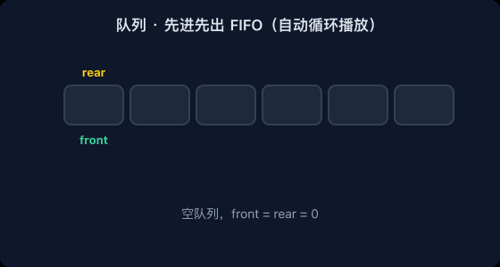

动画演示队列专题里队列先进先出的典型过程；每个方案在「TypeScript 解题方案」一节还配了专属动画与专属流程图。

### 主解法流程图（真实控制流）

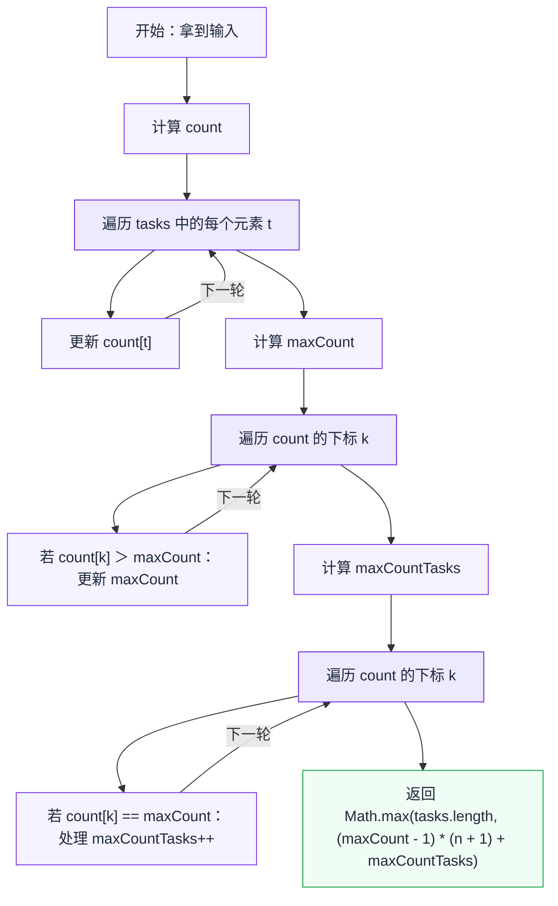

## TypeScript 解题方案（6 个方案逐个讲）

> **运行与提交**：每个方案都是自包含文件（内嵌用例自测，输出 PASS），整块复制到 `.ts` 文件后 `node 文件名` 即可运行。提交 LeetCode 时，把 `demo` 内的算法函数与辅助类型/函数整体取出、置于文件顶层即可。涉及交互/特殊接口的题以题面给定签名为准。

### 方案 1：方案1（Counter 公式法）

**分析与思路**：核心做法是「方案1（Counter 公式法）」。代码里依次做这些事：双重循环遍历。

**运行方式**：`node 本文件`，内嵌用例全部通过会输出 PASS。

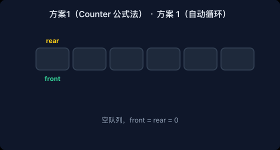

**方案专属流程图**（真实控制流）：

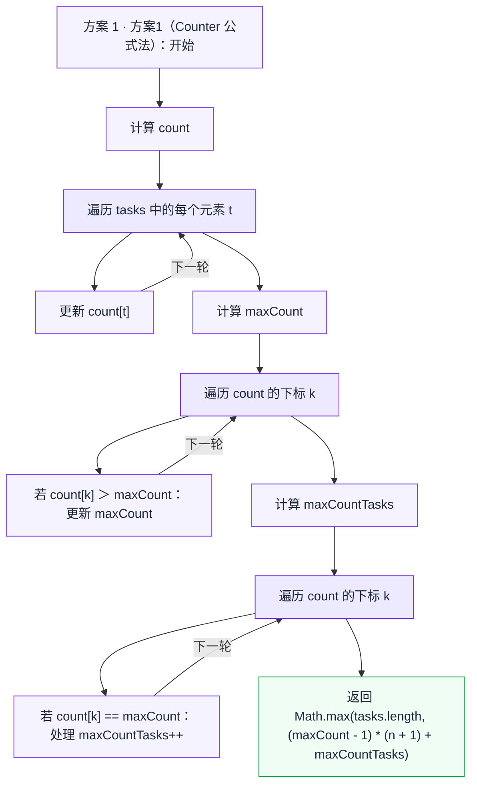

```typescript
/**
 * LeetCode 621. 任务调度器
 * 方案：方案1（Counter 公式法）
 * 来源：https://blog.csdn.net/tyro_java/article/details/130482987
 * 忠实翻译 python/queue/lc_621_任务调度器/solution_1___1.py
 */

export function demo(): void {
  // 程序入口：跑内嵌自测用例
  function leastInterval(tasks: string[], n: number): number {
    // 定义函数/方法 leastInterval
    const count: Record<string, number> = {}; // 把 {}; 写入 const count: Record<string, number>
    for (const t of tasks) {
      // for (const 另一字符串 of tasks) {
      count[t] = (count[t] === undefined ? 0 : count[t]) + 1; // 把 (计数[另一字符串] 全等于 undefined ? 0 : 计数[另一字符串]) 加 1; 写入 count[t]
    }
    let maxCount = 0; // 把 0 存入 maxCount
    for (const k in count) {
      // for (const 下标 k in 计数) {
      if (count[k] > maxCount) maxCount = count[k]; // 若 计数[下标 k] 超过 maxCount) maxCount 赋值为 计数[下标 k];
    }
    let maxCountTasks = 0; // 把 0 存入 maxCountTasks
    for (const k in count) {
      // for (const 下标 k in 计数) {
      if (count[k] === maxCount) maxCountTasks++; // 若 计数[下标 k] 全等于 maxCount) maxCountTasks 加一 ;
    }
    return Math.max(tasks.length, (maxCount - 1) * (n + 1) + maxCountTasks);
  }

  const cases: { tasks: string[]; n: number; want: number }[] = [
    { tasks: ['A', 'A', 'A', 'B', 'B', 'B'], n: 2, want: 8 },
    { tasks: ['A', 'A', 'A', 'A'], n: 2, want: 10 },
    { tasks: ['A', 'B', 'C', 'D'], n: 0, want: 4 },
  ];
  let fail = false; // 把 false 存入 fail
  for (const c of cases) {
    // for (const 字符 of cases) {
    const got = leastInterval(c.tasks, c.n); // 把 leastInterval(字符.tasks, 字符.元素个数) 存入 got
    if (got !== c.want) {
      // 若 got 不等于 字符.want
      fail = true; // 把 true 存入 fail
      console.log(
        'FAIL leastInterval(%o,%d)=%d want %d',
        c.tasks,
        c.n,
        got,
        c.want,
      ); // 打印输出
    }
  }
  if (fail) {
    // 若 fail
    throw new Error('FAILED'); // throw new Error(「FAILED」);
  }
  console.log('PASS'); // 全部用例通过，输出 PASS
}
demo(); // demo();
```

### 方案 2：方案2（Counter 公式法）

**分析与思路**：核心做法是「方案2（Counter 公式法）」。代码里依次做这些事：双重循环遍历。

**运行方式**：`node 本文件`，内嵌用例全部通过会输出 PASS。

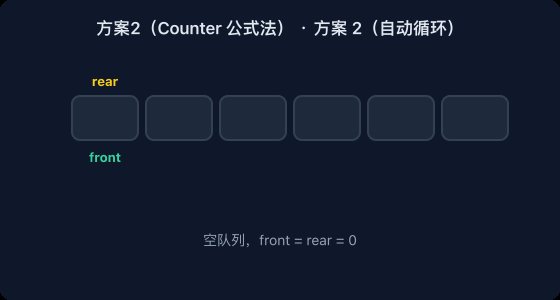

**方案专属流程图**（真实控制流）：

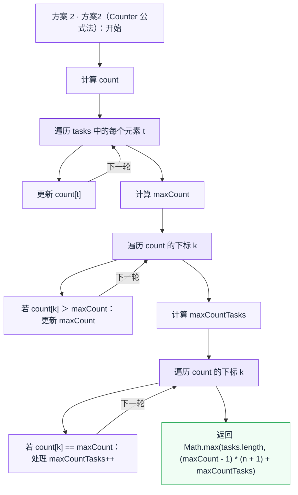

```typescript
/**
 * LeetCode 621. 任务调度器
 * 方案：方案2（Counter 公式法）
 * 来源：https://blog.csdn.net/tyro_java/article/details/130482987
 * 忠实翻译 python/queue/lc_621_任务调度器/solution_2___2.py
 */

export function demo(): void {
  // 程序入口：跑内嵌自测用例
  function leastInterval(tasks: string[], n: number): number {
    // 定义函数/方法 leastInterval
    const count: Record<string, number> = {}; // 把 {}; 写入 const count: Record<string, number>
    for (const t of tasks) {
      // for (const 另一字符串 of tasks) {
      count[t] = (count[t] === undefined ? 0 : count[t]) + 1; // 把 (计数[另一字符串] 全等于 undefined ? 0 : 计数[另一字符串]) 加 1; 写入 count[t]
    }
    let maxCount = 0; // 把 0 存入 maxCount
    for (const k in count) {
      // for (const 下标 k in 计数) {
      if (count[k] > maxCount) maxCount = count[k]; // 若 计数[下标 k] 超过 maxCount) maxCount 赋值为 计数[下标 k];
    }
    let maxCountTasks = 0; // 把 0 存入 maxCountTasks
    for (const k in count) {
      // for (const 下标 k in 计数) {
      if (count[k] === maxCount) maxCountTasks++; // 若 计数[下标 k] 全等于 maxCount) maxCountTasks 加一 ;
    }
    return Math.max(tasks.length, (maxCount - 1) * (n + 1) + maxCountTasks);
  }

  const cases: { tasks: string[]; n: number; want: number }[] = [
    { tasks: ['A', 'A', 'A', 'B', 'B', 'B'], n: 2, want: 8 },
    { tasks: ['A', 'A', 'A', 'A'], n: 2, want: 10 },
    { tasks: ['A', 'B', 'C', 'D'], n: 0, want: 4 },
  ];
  let fail = false; // 把 false 存入 fail
  for (const c of cases) {
    // for (const 字符 of cases) {
    const got = leastInterval(c.tasks, c.n); // 把 leastInterval(字符.tasks, 字符.元素个数) 存入 got
    if (got !== c.want) {
      // 若 got 不等于 字符.want
      fail = true; // 把 true 存入 fail
      console.log(
        'FAIL leastInterval(%o,%d)=%d want %d',
        c.tasks,
        c.n,
        got,
        c.want,
      ); // 打印输出
    }
  }
  if (fail) {
    // 若 fail
    throw new Error('FAILED'); // throw new Error(「FAILED」);
  }
  console.log('PASS'); // 全部用例通过，输出 PASS
}
demo(); // demo();
```

### 方案 3：双重循环枚举

**分析与思路**：核心做法是「双重循环枚举」。代码里依次做这些事：先排序再处理；双重循环遍历。

**运行方式**：`node 本文件`，内嵌用例全部通过会输出 PASS。


**方案专属流程图**（真实控制流）：

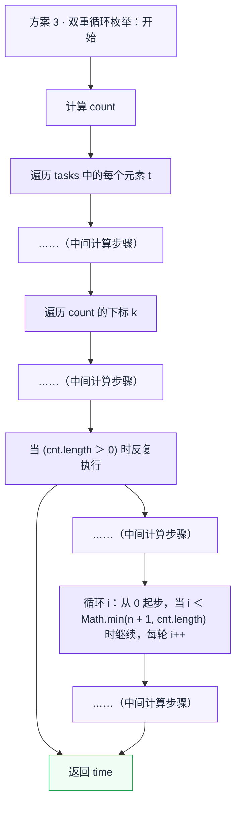

```typescript
/**
 * LeetCode 621. 任务调度器
 * 方案：方案3（贪心模拟，每轮取剩余次数最多的 n+1 个，最后一轮只计实际执行数）
 * 来源：https://blog.csdn.net/tyro_java/article/details/130482987
 * 忠实翻译 python/queue/lc_621_任务调度器/solution_3___3.py
 */

export function demo(): void {
  // 程序入口：跑内嵌自测用例
  function leastInterval(tasks: string[], n: number): number {
    // 定义函数/方法 leastInterval
    const count: Record<string, number> = {}; // 把 {}; 写入 const count: Record<string, number>
    for (const t of tasks) {
      // for (const 另一字符串 of tasks) {
      count[t] = (count[t] === undefined ? 0 : count[t]) + 1; // 把 (计数[另一字符串] 全等于 undefined ? 0 : 计数[另一字符串]) 加 1; 写入 count[t]
    }
    let cnt: number[] = []; // 把 []; 写入 let cnt: number[]
    for (const k in count) {
      // for (const 下标 k in 计数) {
      cnt.push(count[k]); // 把 计数[下标 k] 压入栈/数组尾部
    }
    let time = 0; // 把 0 存入 time
    while (cnt.length > 0) {
      // 循环，直到不满足「计数.长度 超过 0」
      cnt.sort((a, b) => b - a);
      let used = 0; // 把 0 存入 已用标记
      for (let i = 0; i < Math.min(n + 1, cnt.length); i++) {
        // 让 下标 i 从 0 开始计数，下标 i 小于 Math.取较小值 元素个数 加 1, 计数.长度) 就继续
        if (cnt[i] > 0) {
          // 若 计数[下标 i] 超过 0
          cnt[i] -= 1; // cnt[i]累减 1
          used++; // 已用标记 加一
        }
      }
      cnt = cnt.filter((c) => c > 0);
      time += cnt.length > 0 ? n + 1 : used; // time累加 计数.长度 超过 0 ? 元素个数 加 1 : 已用标记
    }
    return time; // 返回 time
  }

  const cases: { tasks: string[]; n: number; want: number }[] = [
    { tasks: ['A', 'A', 'A', 'B', 'B', 'B'], n: 2, want: 8 },
    { tasks: ['A', 'A', 'A', 'A'], n: 2, want: 10 },
    { tasks: ['A', 'B', 'C', 'D'], n: 0, want: 4 },
  ];
  let fail = false; // 把 false 存入 fail
  for (const c of cases) {
    // for (const 字符 of cases) {
    const got = leastInterval(c.tasks, c.n); // 把 leastInterval(字符.tasks, 字符.元素个数) 存入 got
    if (got !== c.want) {
      // 若 got 不等于 字符.want
      fail = true; // 把 true 存入 fail
      console.log(
        'FAIL leastInterval(%o,%d)=%d want %d',
        c.tasks,
        c.n,
        got,
        c.want,
      ); // 打印输出
    }
  }
  if (fail) {
    // 若 fail
    throw new Error('FAILED'); // throw new Error(「FAILED」);
  }
  console.log('PASS'); // 全部用例通过，输出 PASS
}
demo(); // demo();
```

### 方案 4：方案4（26 位频率桶公式法）

**分析与思路**：核心做法是「方案4（26 位频率桶公式法）」。代码里依次做这些事：双重循环遍历。

**运行方式**：`node 本文件`，内嵌用例全部通过会输出 PASS。

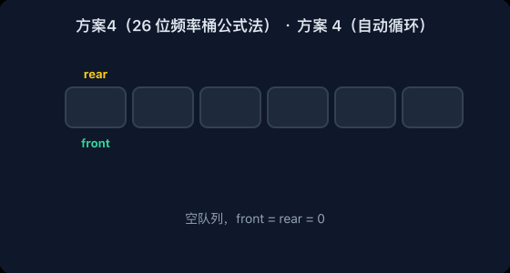

**方案专属流程图**（真实控制流）：

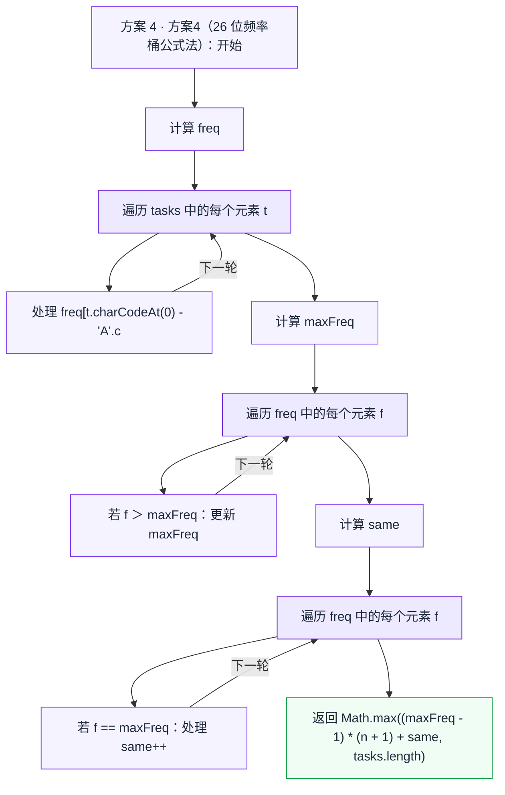

```typescript
/**
 * LeetCode 621. 任务调度器
 * 方案：方案4（26 位频率桶公式法）
 * 来源：https://blog.csdn.net/tyro_java/article/details/130482987
 * 忠实翻译 python/queue/lc_621_任务调度器/solution_4___4.py
 */

export function demo(): void {
  // 程序入口：跑内嵌自测用例
  function leastInterval(tasks: string[], n: number): number {
    // 定义函数/方法 leastInterval
    const freq: number[] = new Array(26).fill(0); // 把 new Array(26).fill(0); 写入 const freq: number[]
    for (const t of tasks) {
      // for (const 另一字符串 of tasks) {
      freq[t.charCodeAt(0) - 'A'.charCodeAt(0)]++; // 频次表[另一字符串.charCodeAt(0) 减 「A」.charCodeAt(0)] 加一 ;
    }
    let maxFreq = 0; // 把 0 存入 maxFreq
    for (const f of freq) {
      // for (const f of 频次表) {
      if (f > maxFreq) maxFreq = f; // 若 f 超过 maxFreq) maxFreq 赋值为 f;
    }
    let same = 0; // 把 0 存入 same
    for (const f of freq) {
      // for (const f of 频次表) {
      if (f === maxFreq) same++; // 若 f 全等于 maxFreq) same 加一 ;
    }
    return Math.max((maxFreq - 1) * (n + 1) + same, tasks.length); // 返回 Math.取较大值 (maxFreq 减 1) 乘 (元素个数 加 1) 加 same, tasks.长度)
  }

  const cases: { tasks: string[]; n: number; want: number }[] = [
    { tasks: ['A', 'A', 'A', 'B', 'B', 'B'], n: 2, want: 8 },
    { tasks: ['A', 'A', 'A', 'A'], n: 2, want: 10 },
    { tasks: ['A', 'B', 'C', 'D'], n: 0, want: 4 },
  ];
  let fail = false; // 把 false 存入 fail
  for (const c of cases) {
    // for (const 字符 of cases) {
    const got = leastInterval(c.tasks, c.n); // 把 leastInterval(字符.tasks, 字符.元素个数) 存入 got
    if (got !== c.want) {
      // 若 got 不等于 字符.want
      fail = true; // 把 true 存入 fail
      console.log(
        'FAIL leastInterval(%o,%d)=%d want %d',
        c.tasks,
        c.n,
        got,
        c.want,
      ); // 打印输出
    }
  }
  if (fail) {
    // 若 fail
    throw new Error('FAILED'); // throw new Error(「FAILED」);
  }
  console.log('PASS'); // 全部用例通过，输出 PASS
}
demo(); // demo();
```

### 方案 5：双重循环枚举

**分析与思路**：核心做法是「双重循环枚举」。代码里依次做这些事：双重循环遍历。

**运行方式**：`node 本文件`，内嵌用例全部通过会输出 PASS。


**方案专属流程图**（真实控制流）：

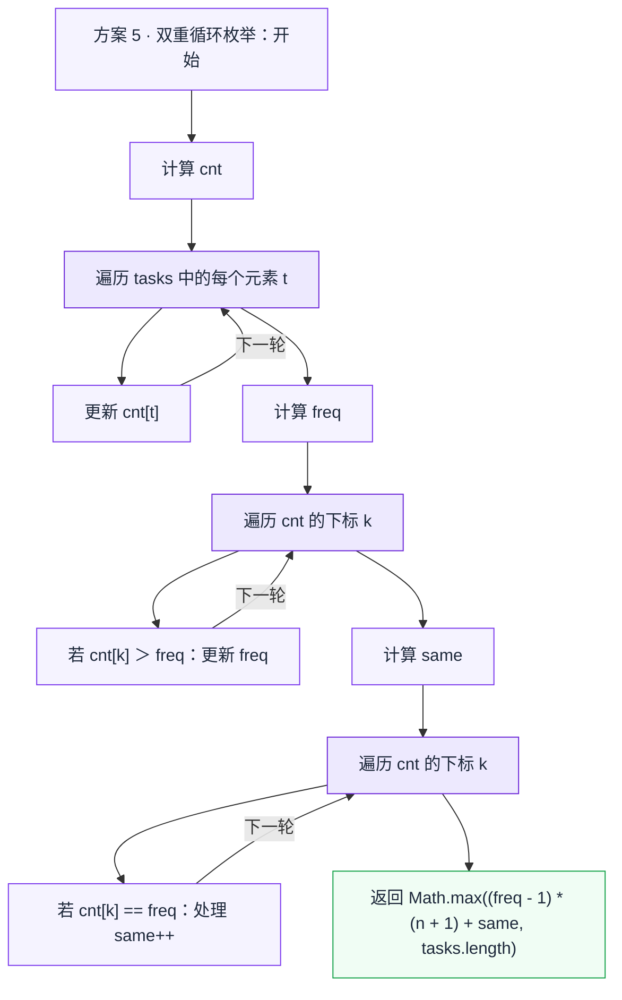

```typescript
/**
 * LeetCode 621. 任务调度器
 * 方案：方案5（公式法：出现最多的任务 freq 个，有 same 个并列最多，
 *        最少时间 = (freq-1)*(n+1) + same，且不能少于任务总数）
 * 来源：https://blog.csdn.net/tyro_java/article/details/130482987
 * 忠实翻译 python/queue/lc_621_任务调度器/solution_5___5.py
 */

export function demo(): void {
  // 程序入口：跑内嵌自测用例
  function leastInterval(tasks: string[], n: number): number {
    // 定义函数/方法 leastInterval
    const cnt: Record<string, number> = {}; // 把 {}; 写入 const cnt: Record<string, number>
    for (const t of tasks) {
      // for (const 另一字符串 of tasks) {
      cnt[t] = (cnt[t] === undefined ? 0 : cnt[t]) + 1; // 把 (计数[另一字符串] 全等于 undefined ? 0 : 计数[另一字符串]) 加 1; 写入 cnt[t]
    }
    let freq = 0; // 把 0 存入 频次表
    for (const k in cnt) {
      // for (const 下标 k in 计数) {
      if (cnt[k] > freq) freq = cnt[k]; // 若 计数[下标 k] 超过 频次表) 频次表 赋值为 计数[下标 k];
    }
    let same = 0; // 把 0 存入 same
    for (const k in cnt) {
      // for (const 下标 k in 计数) {
      if (cnt[k] === freq) same++; // 若 计数[下标 k] 全等于 频次表) same 加一 ;
    }
    return Math.max((freq - 1) * (n + 1) + same, tasks.length); // 返回 Math.取较大值 (频次表 减 1) 乘 (元素个数 加 1) 加 same, tasks.长度)
  }

  const cases: { tasks: string[]; n: number; want: number }[] = [
    { tasks: ['A', 'A', 'A', 'B', 'B', 'B'], n: 2, want: 8 },
    { tasks: ['A', 'A', 'A', 'A'], n: 2, want: 10 },
    { tasks: ['A', 'B', 'C', 'D'], n: 0, want: 4 },
  ];
  let fail = false; // 把 false 存入 fail
  for (const c of cases) {
    // for (const 字符 of cases) {
    const got = leastInterval(c.tasks, c.n); // 把 leastInterval(字符.tasks, 字符.元素个数) 存入 got
    if (got !== c.want) {
      // 若 got 不等于 字符.want
      fail = true; // 把 true 存入 fail
      console.log(
        'FAIL leastInterval(%o,%d)=%d want %d',
        c.tasks,
        c.n,
        got,
        c.want,
      ); // 打印输出
    }
  }
  if (fail) {
    // 若 fail
    throw new Error('FAILED'); // throw new Error(「FAILED」);
  }
  console.log('PASS'); // 全部用例通过，输出 PASS
}
demo(); // demo();
```

### 方案 6：双重循环枚举

**分析与思路**：核心做法是「双重循环枚举」。代码里依次做这些事：双重循环遍历。

**运行方式**：`node 本文件`，内嵌用例全部通过会输出 PASS。


**方案专属流程图**（真实控制流）：

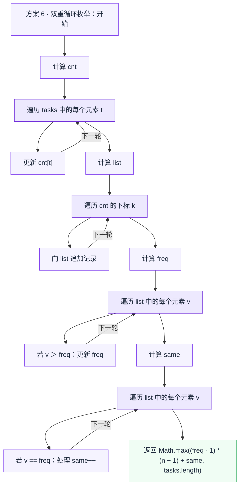

```typescript
/**
 * LeetCode 621. 任务调度器
 * 方案：方案6（公式法另一写法：Counter 值列表 + count(freq)）
 * 来源：https://blog.csdn.net/tyro_java/article/details/130482987
 * 忠实翻译 python/queue/lc_621_任务调度器/solution_6___6.py
 */

export function demo(): void {
  // 程序入口：跑内嵌自测用例
  function leastInterval(tasks: string[], n: number): number {
    // 定义函数/方法 leastInterval
    const cnt: Record<string, number> = {}; // 把 {}; 写入 const cnt: Record<string, number>
    for (const t of tasks) {
      // for (const 另一字符串 of tasks) {
      cnt[t] = (cnt[t] === undefined ? 0 : cnt[t]) + 1; // 把 (计数[另一字符串] 全等于 undefined ? 0 : 计数[另一字符串]) 加 1; 写入 cnt[t]
    }
    const list: number[] = []; // 把 []; 写入 const list: number[]
    for (const k in cnt) {
      // for (const 下标 k in 计数) {
      list.push(cnt[k]); // 把 计数[下标 k] 压入栈/数组尾部
    }
    let freq = 0; // 把 0 存入 频次表
    for (const v of list) {
      // for (const 值 of 列表) {
      if (v > freq) freq = v; // 若 值 超过 频次表) 频次表 赋值为 值;
    }
    let same = 0; // 把 0 存入 same
    for (const v of list) {
      // for (const 值 of 列表) {
      if (v === freq) same++; // 若 值 全等于 频次表) same 加一 ;
    }
    return Math.max((freq - 1) * (n + 1) + same, tasks.length); // 返回 Math.取较大值 (频次表 减 1) 乘 (元素个数 加 1) 加 same, tasks.长度)
  }

  const cases: { tasks: string[]; n: number; want: number }[] = [
    { tasks: ['A', 'A', 'A', 'B', 'B', 'B'], n: 2, want: 8 },
    { tasks: ['A', 'A', 'A', 'A'], n: 2, want: 10 },
    { tasks: ['A', 'B', 'C', 'D'], n: 0, want: 4 },
  ];
  let fail = false; // 把 false 存入 fail
  for (const c of cases) {
    // for (const 字符 of cases) {
    const got = leastInterval(c.tasks, c.n); // 把 leastInterval(字符.tasks, 字符.元素个数) 存入 got
    if (got !== c.want) {
      // 若 got 不等于 字符.want
      fail = true; // 把 true 存入 fail
      console.log(
        'FAIL leastInterval(%o,%d)=%d want %d',
        c.tasks,
        c.n,
        got,
        c.want,
      ); // 打印输出
    }
  }
  if (fail) {
    // 若 fail
    throw new Error('FAILED'); // throw new Error(「FAILED」);
  }
  console.log('PASS'); // 全部用例通过，输出 PASS
}
demo(); // demo();
```

## 逐步拆解与面试追问

**复杂度**：时间 O(n)（单趟线性扫描），空间 O(1) 到 O(n)（视辅助结构）

**为什么是这个量级**：每个元素被常数次访问，辅助哈希或栈的开销与 n 同阶

**面试官可能会追问**：

- 单调队列为什么能保证队首最优？
- 循环队列如何判满？
- 双端队列能替代吗？

## 关键 API 速查（TS 主解法实际用到，附官方链接）

| API | 作用 | 使用要点 | 官方文档 |
|---|---|---|---|
| `Math.max()` | 最大值 | 配展开 Math.max(...arr)；空参返回 -Infinity；超大数组注意展开参数上限 | [官方文档](https://developer.mozilla.org/zh-CN/docs/Web/JavaScript/Reference/Global_Objects/Math/max) |

### 各语言官方文档导航

- **TypeScript / JS**：[MDN 中文参考](https://developer.mozilla.org/zh-CN/)
- **Python**：[Python 官方文档](https://docs.python.org/zh-cn/3/)
- **Go**：[Go 标准库](https://pkg.go.dev/std)
- **Java**：[JDK 17 API](https://docs.oracle.com/en/java/javase/17/docs/api/)
- **Rust**：[Rust 标准库](https://doc.rust-lang.org/std/)
- **Lua**：[Lua 5.4 手册](https://www.lua.org/manual/5.4/)
- **C**：[Cppreference C](https://zh.cppreference.com/w/c)
- **C++**：[Cppreference C++](https://zh.cppreference.com/w/cpp)
- **R**：[R 官方手册](https://stat.ethz.ch/R-manual/)
- **Zig**：[Zig 语言文档](https://ziglang.org/documentation/master/)
- **Dart**：[Dart API](https://api.dart.dev/)

## 附录：其他 10 种语言全部实现（每种语言列举其全部方案）

> TypeScript 的全部方案见「TypeScript 解题方案」一节；下面是其余 10 种语言的对应实现，每种语言的每个方案都带思路分析、代码走读与专属运行架构图。
> 每个方案都内嵌用例自测，可独立运行（老仓库 python/go 文件遵循「打印结果」约定）。
> 完整解法文件见 `dsa/<语言>/queue/lc_621_任务调度器/`。

### Python 实现（6 种方案）

Python 的全部方案如下，每个方案都内嵌用例自测，可独立运行（老仓库 python/go 文件遵循「打印结果」约定）：

#### 方案 1：方案1（Counter 公式法）

**思路与代码分析**：核心是「方案1（Counter 公式法）」。Python 版用切片与字典推导式简化操作，突出可读性。**走读**：方案 1 · 方案1（Counter 公式法）：开始 → 处理 from collections import Coun → 更新 count → 更新 max_count → 更新 max_count_tasks → 返回 max(len(tasks), (max_count - 1) * (n + 1) + max_count_tasks)。

**运行架构**（真实控制流）：


```python
import sys  # 提高递归深度上限（深输入防 RecursionError）

sys.setrecursionlimit(200000)  # 树/链表类题目节点数可达 1e4 量级

def leastInterval(tasks, n):  # 定义函数 leastInterval（参数：tasks, 元素个数）
    from collections import Counter  # from collections import Counter

    count = Counter(tasks)  # 把 Counter(tasks) 存入 计数
    max_count = max(count.values())  # 把 取较大值 计数.values()) 存入 max_count
    max_count_tasks = sum(1 for v in count.values() if v == max_count)
    return max(len(tasks), (max_count - 1) * (n + 1) + max_count_tasks)

if __name__ == "__main__":  # 若 __name__ 等于 '__main__'
    print(leastInterval(["A", "A", "A", "B", "B", "B"], 2))  # 打印输出
```

#### 方案 2：方案2（Counter 公式法）

**思路与代码分析**：核心是「方案2（Counter 公式法）」。Python 版用切片与字典推导式简化操作，突出可读性。**走读**：方案 2 · 方案2（Counter 公式法）：开始 → 处理 from collections import Coun → 更新 count → 更新 max_count → 更新 max_count_tasks → 返回 max(len(tasks), (max_count - 1) * (n + 1) + max_count_tasks)。

**运行架构**（真实控制流）：

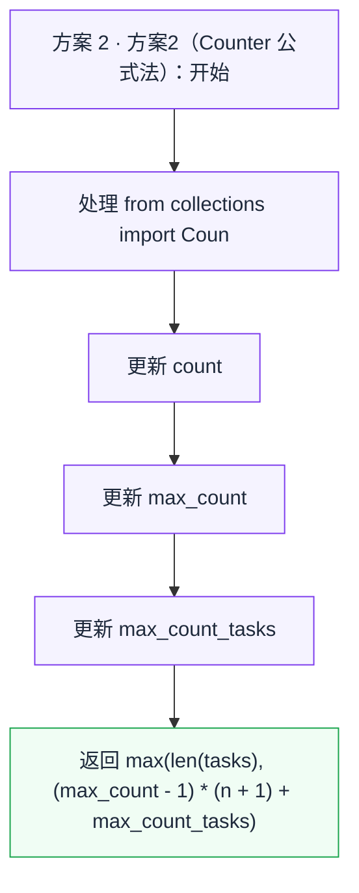

```python
import sys  # 提高递归深度上限（深输入防 RecursionError）

sys.setrecursionlimit(200000)  # 树/链表类题目节点数可达 1e4 量级

def leastInterval(tasks, n):  # 定义函数 leastInterval（参数：tasks, 元素个数）
    from collections import Counter  # from collections import Counter

    count = Counter(tasks)  # 把 Counter(tasks) 存入 计数
    max_count = max(count.values())  # 把 取较大值 计数.values()) 存入 max_count
    max_count_tasks = sum(1 for v in count.values() if v == max_count)
    return max(len(tasks), (max_count - 1) * (n + 1) + max_count_tasks)

if __name__ == "__main__":  # 若 __name__ 等于 '__main__'
    print(leastInterval(["A", "A", "A", "B", "B", "B"], 2))  # 打印输出
```

#### 方案 3：双重循环枚举

**思路与代码分析**：核心是「双重循环枚举」。Python 版用切片与字典推导式简化操作，突出可读性。代码里依次做这些事：先排序再处理。**走读**：方案 3 · 双重循环枚举：开始 → 更新 cnt → 更新 time → 当 cnt: 时反复执行 → 排序整理 → 更新 used → 循环 i：从 min(n + 1 到 len(cnt 前 → 若 cnt[i] ＞ 0：更新 - → 更新 - → 更新 + → 更新 cnt → 更新 + → 返回 time。

**运行架构**（真实控制流）：

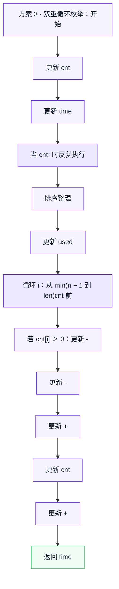

```python
import sys  # 提高递归深度上限（深输入防 RecursionError）

sys.setrecursionlimit(200000)  # 树/链表类题目节点数可达 1e4 量级
from collections import Counter  # from collections import Counter

def leastInterval(tasks, n):  # 定义函数 leastInterval（参数：tasks, 元素个数）
    # 贪心模拟：每轮从剩余任务里挑出现次数最多的前 n+1 个执行（其余为冷却），
    # 最后一轮只计实际执行数，不补冷却
    cnt = list(Counter(tasks).values())  # 把 列表(Counter(tasks).values()) 存入 计数
    time = 0  # 把 0 存入 time
    while cnt:  # 循环，直到不满足「计数」
        cnt.sort(reverse=True)  # 排序
        used = 0  # 把 0 存入 已用标记
        for i in range(min(n + 1, len(cnt))):  # 让 下标 i 从 取较小值 元素个数 加 1 到 长度(计数 遍历
            if cnt[i] > 0:  # 若 计数[下标 i] 超过 0
                cnt[i] -= 1  # cnt[i]累减 1
                used += 1  # 已用标记累加 1
        cnt = [c for c in cnt if c > 0]  # 把 [字符 for 字符 in 计数 if 字符 超过 0] 存入 计数
        time += (n + 1) if cnt else used  # time累加 (元素个数 加 1) if 计数 else 已用标记
    return time  # 返回 time

if __name__ == "__main__":  # 若 __name__ 等于 '__main__'
    print(leastInterval(["A", "A", "A", "B", "B", "B"], 2))  # 打印输出
```

#### 方案 4：方案4（26 位频率桶公式法）

**思路与代码分析**：核心是「方案4（26 位频率桶公式法）」。Python 版用切片与字典推导式简化操作，突出可读性。**走读**：方案 4 · 方案4（26 位频率桶公式法）：开始 → 更新 freq → 遍历 tasks: 中的每个元素 t → 更新 + → 更新 max_freq → 更新 same → 返回 max( → 处理 (max_freq - 1) * (n + 1) + s → 处理 )。

**运行架构**（真实控制流）：

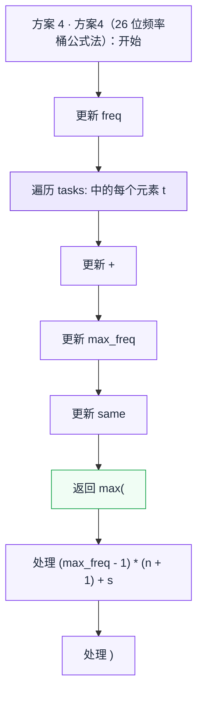

```python
import sys  # 提高递归深度上限（深输入防 RecursionError）

sys.setrecursionlimit(200000)  # 树/链表类题目节点数可达 1e4 量级
from collections import Counter  # from collections import Counter

def leastInterval(tasks, n):  # 定义函数 leastInterval（参数：tasks, 元素个数）
    # 公式法（显式统计）：以任务频率桶实现
    freq = [0] * 26  # 把 [0] 乘 26 存入 频次表
    for t in tasks:  # 逐个取出 tasks 的元素（另一字符串）
        freq[ord(t) - ord("A")] += 1  # 把 1 写入 freq[ord(t) - ord('A')] +
    max_freq = max(freq)  # 把 取较大值 频次表) 存入 max_freq
    same = sum(1 for f in freq if f == max_freq)  # 把 累计和(1 for f in 频次表 if f 等于 max_freq) 存入 same
    return max(
        (max_freq - 1) * (n + 1) + same, len(tasks)
    )  # 返回 取较大值 (max_freq 减 1) 乘 (元素个数 加 1) 加 same, 长度(tasks))

if __name__ == "__main__":  # 若 __name__ 等于 '__main__'
    print(leastInterval(["A", "A", "A", "B", "B", "B"], 2))  # 打印输出
```

#### 方案 5：双重循环枚举

**思路与代码分析**：核心是「双重循环枚举」。Python 版用切片与字典推导式简化操作，突出可读性。**走读**：方案 5 · 双重循环枚举：开始 → 更新 cnt → 更新 freq → 更新 same → 更新 = → 处理 ) → 返回 max( → 处理 (freq - 1) * (n + 1) + same, → 处理 )。

**运行架构**（真实控制流）：

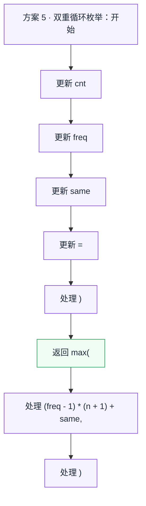

```python
import sys  # 提高递归深度上限（深输入防 RecursionError）

sys.setrecursionlimit(200000)  # 树/链表类题目节点数可达 1e4 量级
from collections import Counter  # from collections import Counter

def leastInterval(tasks, n):  # 定义函数 leastInterval（参数：tasks, 元素个数）
    # 公式法：出现最多的任务 freq 个，有 same 个并列最多，
    # 最少时间 = (freq-1)*(n+1) + same，且不能少于任务总数
    cnt = Counter(tasks)  # 把 Counter(tasks) 存入 计数
    freq = max(cnt.values())  # 把 取较大值 计数.values()) 存入 频次表
    same = sum(
        1 for v in cnt.values() if v == freq
    )  # 把 累计和(1 for 值 in 计数.values() if 值 等于 频次表) 存入 same
    return max(
        (freq - 1) * (n + 1) + same, len(tasks)
    )  # 返回 取较大值 (频次表 减 1) 乘 (元素个数 加 1) 加 same, 长度(tasks))

if __name__ == "__main__":  # 若 __name__ 等于 '__main__'
    print(leastInterval(["A", "A", "A", "B", "B", "B"], 2))  # 打印输出
```

#### 方案 6：双重循环枚举

**思路与代码分析**：核心是「双重循环枚举」。Python 版用切片与字典推导式简化操作，突出可读性。**走读**：方案 6 · 双重循环枚举：开始 → 更新 cnt → 更新 freq → 更新 same → 返回 max( → 处理 (freq - 1) * (n + 1) + same, → 处理 )。

**运行架构**（真实控制流）：

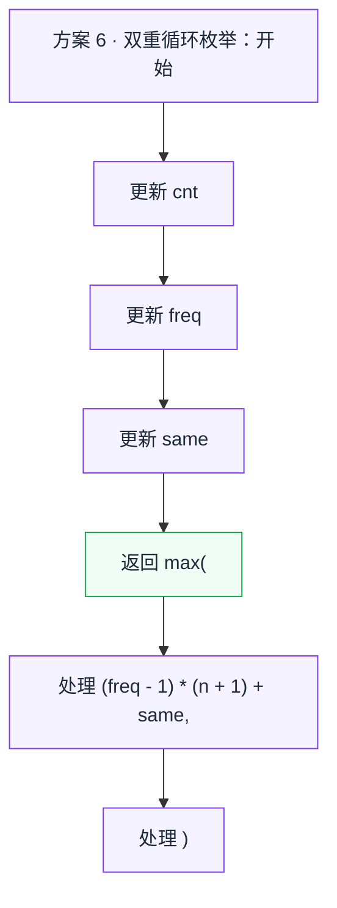

```python
import sys  # 提高递归深度上限（深输入防 RecursionError）

sys.setrecursionlimit(200000)  # 树/链表类题目节点数可达 1e4 量级
from collections import Counter  # from collections import Counter

def leastInterval(tasks, n):  # 定义函数 leastInterval（参数：tasks, 元素个数）
    # 公式法（另一写法）
    cnt = list(Counter(tasks).values())  # 把 列表(Counter(tasks).values()) 存入 计数
    freq = max(cnt)  # 把 取较大值 计数) 存入 频次表
    same = cnt.count(freq)  # 把 计数.计数(频次表) 存入 same
    return max(
        (freq - 1) * (n + 1) + same, len(tasks)
    )  # 返回 取较大值 (频次表 减 1) 乘 (元素个数 加 1) 加 same, 长度(tasks))

if __name__ == "__main__":  # 若 __name__ 等于 '__main__'
    print(leastInterval(["A", "A", "A", "B", "B", "B"], 2))  # 打印输出
```

### Go 实现（6 种方案）

Go 的全部方案如下，每个方案都内嵌用例自测，可独立运行（老仓库 python/go 文件遵循「打印结果」约定）：

#### 方案 1：方案1（Counter 公式法）

**思路与代码分析**：核心是「方案1（Counter 公式法）」。Go 版用切片与多返回值惯用法，显式处理索引边界。代码里依次做这些事：哈希结构做计数或查重。**走读**：方案 1 · 方案1（Counter 公式法）：开始 → 更新 : → 遍历 tasks 的下标与元素 t → 处理 count[t]++ → 更新 : → 遍历 count 的下标与元素 v → 处理 if v ＞ maxCount → 更新 maxCount → 更新 : → 遍历 count 的下标与元素 v → 处理 if v == maxCount → 处理 maxCountTasks++ → 返回 maxInt(len(tasks), (maxCount-1)*(n+1)+maxCountTasks)。

**运行架构**（真实控制流）：


```go
package main // 引入依赖

import (
	"fmt" // 「fmt」
	"os"  // 「os」
)

// 忠实翻译 python/queue/lc_621_任务调度器/solution_1___1.py
// 公式法：Counter 统计任务频率
func leastInterval(tasks []string, n int) int { // 定义函数/方法 leastInterval
	count := map[string]int{} // 把 映射表[string]int{} 写入 count :
	for _, t := range tasks { // 同时取 _ 与 另一字符串 遍历
		count[t]++ // 计数[另一字符串] 加一
	}
	maxCount := 0             // 把 0 写入 maxCount :
	for _, v := range count { // 同时取 _ 与 值 遍历
		if v > maxCount { // 若 值 超过 maxCount
			maxCount = v // 把 值 写入 maxCount
		}
	}
	maxCountTasks := 0        // 把 0 写入 maxCountTasks :
	for _, v := range count { // 同时取 _ 与 值 遍历
		if v == maxCount { // 若 值 等于 maxCount
			maxCountTasks++ // maxCountTasks 加一
		}
	}
	return maxInt(len(tasks), (maxCount-1)*(n+1)+maxCountTasks) // 定义函数/方法 maxInt
}

func maxInt(a, b int) int { // 定义函数/方法 maxInt
	if a > b { // 若 数组 超过 b
		return a // 返回 数组
	}
	return b // 返回 b
}

func main() { // 程序入口：跑内嵌自测用例
	type caseT struct { // 定义类型
		tasks []string // tasks []string
		n     int      // 元素个数 int
		want  int      // want int
	}
	cases := []caseT{ // 把 []caseT{ 写入 cases :
		{[]string{"A", "A", "A", "B", "B", "B"}, 2, 8},
		{[]string{"A", "A", "A", "B", "B", "B"}, 0, 6},
		{[]string{"A", "A", "A", "A", "A", "A", "B", "C", "D", "E", "F", "G"}, 2, 16},
		{[]string{"A"}, 5, 1},
		{[]string{"A", "A", "B", "B"}, 3, 6},
		{[]string{"A", "B", "C", "D", "E", "F", "G"}, 0, 7},
	}
	ok := true                // 把 true 写入 ok :
	for _, c := range cases { // 同时取 _ 与 字符 遍历
		if got := leastInterval(c.tasks, c.n); got != c.want {
			ok = false                                                                      // 把 false 写入 ok
			fmt.Printf("FAIL leastInterval(%v,%d)=%d want %d\n", c.tasks, c.n, got, c.want) // 打印输出
		}
	}
	if !ok { // 若 取反 ok
		os.Exit(1) // os.Exit(1)
	}
	fmt.Println("PASS") // 全部用例通过，输出 PASS
}
```

#### 方案 2：方案2（Counter 公式法）

**思路与代码分析**：核心是「方案2（Counter 公式法）」。Go 版用切片与多返回值惯用法，显式处理索引边界。代码里依次做这些事：哈希结构做计数或查重。**走读**：方案 2 · 方案2（Counter 公式法）：开始 → 更新 : → 遍历 tasks 的下标与元素 t → 处理 count[t]++ → 更新 : → 遍历 count 的下标与元素 v → 处理 if v ＞ maxCount → 更新 maxCount → 更新 : → 遍历 count 的下标与元素 v → 处理 if v == maxCount → 处理 maxCountTasks++ → 返回 maxInt(len(tasks), (maxCount-1)*(n+1)+maxCountTasks)。

**运行架构**（真实控制流）：

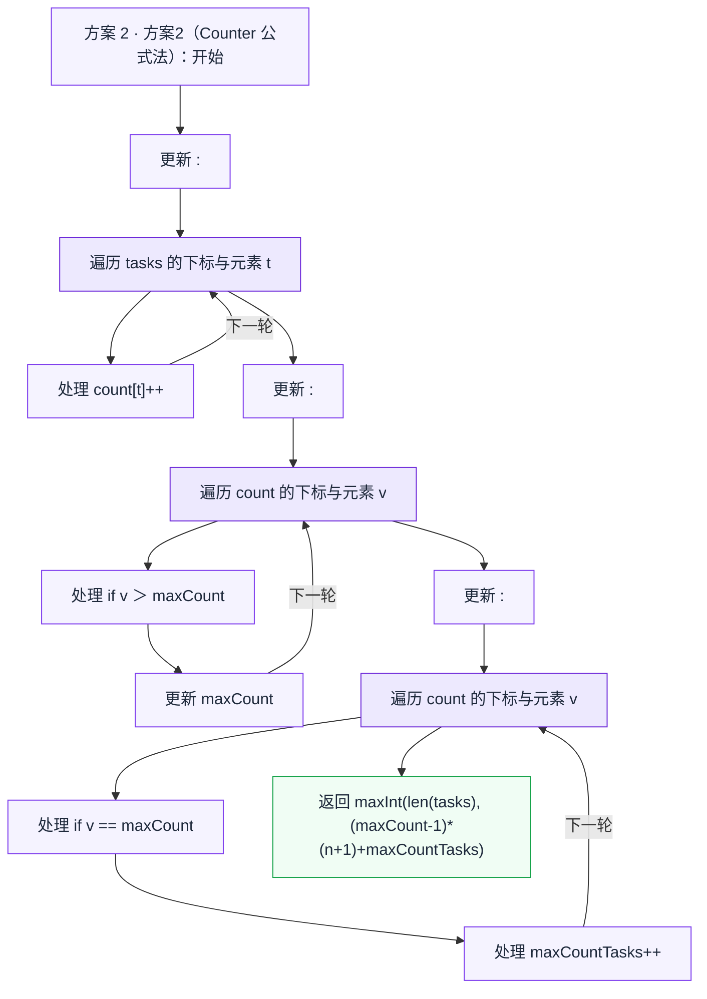

```go
package main // 引入依赖

import (
	"fmt" // 「fmt」
	"os"  // 「os」
)

// 忠实翻译 python/queue/lc_621_任务调度器/solution_2___2.py
// 公式法：Counter 统计任务频率
func leastInterval(tasks []string, n int) int { // 定义函数/方法 leastInterval
	count := map[string]int{} // 把 映射表[string]int{} 写入 count :
	for _, t := range tasks { // 同时取 _ 与 另一字符串 遍历
		count[t]++ // 计数[另一字符串] 加一
	}
	maxCount := 0             // 把 0 写入 maxCount :
	for _, v := range count { // 同时取 _ 与 值 遍历
		if v > maxCount { // 若 值 超过 maxCount
			maxCount = v // 把 值 写入 maxCount
		}
	}
	maxCountTasks := 0        // 把 0 写入 maxCountTasks :
	for _, v := range count { // 同时取 _ 与 值 遍历
		if v == maxCount { // 若 值 等于 maxCount
			maxCountTasks++ // maxCountTasks 加一
		}
	}
	return maxInt(len(tasks), (maxCount-1)*(n+1)+maxCountTasks) // 定义函数/方法 maxInt
}

func maxInt(a, b int) int { // 定义函数/方法 maxInt
	if a > b { // 若 数组 超过 b
		return a // 返回 数组
	}
	return b // 返回 b
}

func main() { // 程序入口：跑内嵌自测用例
	type caseT struct { // 定义类型
		tasks []string // tasks []string
		n     int      // 元素个数 int
		want  int      // want int
	}
	cases := []caseT{ // 把 []caseT{ 写入 cases :
		{[]string{"A", "A", "A", "B", "B", "B"}, 2, 8},
		{[]string{"A", "A", "A", "B", "B", "B"}, 0, 6},
		{[]string{"A", "A", "A", "A", "A", "A", "B", "C", "D", "E", "F", "G"}, 2, 16},
		{[]string{"A"}, 5, 1},
		{[]string{"A", "A", "B", "B"}, 3, 6},
		{[]string{"A", "B", "C", "D", "E", "F", "G"}, 0, 7},
	}
	ok := true                // 把 true 写入 ok :
	for _, c := range cases { // 同时取 _ 与 字符 遍历
		if got := leastInterval(c.tasks, c.n); got != c.want {
			ok = false                                                                      // 把 false 写入 ok
			fmt.Printf("FAIL leastInterval(%v,%d)=%d want %d\n", c.tasks, c.n, got, c.want) // 打印输出
		}
	}
	if !ok { // 若 取反 ok
		os.Exit(1) // os.Exit(1)
	}
	fmt.Println("PASS") // 全部用例通过，输出 PASS
}
```

#### 方案 3：双重循环枚举

**思路与代码分析**：核心是「双重循环枚举」。Go 版用切片与多返回值惯用法，显式处理索引边界。代码里依次做这些事：哈希结构做计数或查重。**走读**：方案 3 · 双重循环枚举：开始 → 更新 : → 遍历 tasks 的下标与元素 t → 遍历 count 的下标与元素 v → 遍历循环 → 遍历循环 → 遍历 cnt 的下标与元素 c → 返回 time。

**运行架构**（真实控制流）：

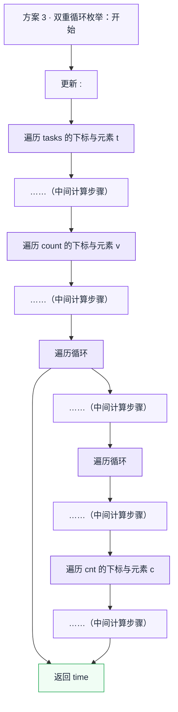

```go
package main // 引入依赖

import (
	"fmt"  // 「fmt」
	"os"   // 「os」
	"sort" // 「sort」
)

// 忠实翻译 python/queue/lc_621_任务调度器/solution_3___3.py
// 贪心模拟：每轮从剩余任务里挑出现次数最多的前 n+1 个执行
func leastInterval(tasks []string, n int) int { // 定义函数/方法 leastInterval
	count := map[string]int{} // 把 映射表[string]int{} 写入 count :
	for _, t := range tasks { // 同时取 _ 与 另一字符串 遍历
		count[t]++ // 计数[另一字符串] 加一
	}
	cnt := []int{}            // 把 []int{} 写入 cnt :
	for _, v := range count { // 同时取 _ 与 值 遍历
		cnt = append(cnt, v) // 把 append(计数, 值) 写入 计数
	}
	time := 0          // 把 0 写入 time :
	for len(cnt) > 0 { // for 长度(计数) 超过 0 {
		sort.Sort(sort.Reverse(sort.IntSlice(cnt)))  // sort.Sort(sort.Reverse(sort.IntSlice(计数)))
		used := 0                                    // 把 0 写入 used :
		for i := 0; i < minInt(n+1, len(cnt)); i++ { // 让 下标 i 从 0 开始计数
			if cnt[i] > 0 { // 若 计数[下标 i] 超过 0
				cnt[i]-- // 计数[下标 i] 减一
				used++   // 已用标记 加一
			}
		}
		nxt := []int{}          // 把 []int{} 写入 nxt :
		for _, c := range cnt { // 同时取 _ 与 字符 遍历
			if c > 0 { // 若 字符 超过 0
				nxt = append(nxt, c) // 把 append(nxt, 字符) 写入 nxt
			}
		}
		cnt = nxt         // 把 nxt 写入 计数
		if len(cnt) > 0 { // 若 长度(计数) 超过 0
			time += n + 1 // time累加 元素个数 加 1
		} else { // 否则
			time += used // time累加 已用标记
		}
	}
	return time // 返回 time
}

func minInt(a, b int) int { // 定义函数/方法 minInt
	if a < b { // 若 数组 小于 b
		return a // 返回 数组
	}
	return b // 返回 b
}

func main() { // 程序入口：跑内嵌自测用例
	type caseT struct { // 定义类型
		tasks []string // tasks []string
		n     int      // 元素个数 int
		want  int      // want int
	}
	cases := []caseT{ // 把 []caseT{ 写入 cases :
		{[]string{"A", "A", "A", "B", "B", "B"}, 2, 8},
		{[]string{"A", "A", "A", "B", "B", "B"}, 0, 6},
		{[]string{"A", "A", "A", "A", "A", "A", "B", "C", "D", "E", "F", "G"}, 2, 16},
		{[]string{"A"}, 5, 1},
		{[]string{"A", "A", "B", "B"}, 3, 6},
		{[]string{"A", "B", "C", "D", "E", "F", "G"}, 0, 7},
	}
	ok := true                // 把 true 写入 ok :
	for _, c := range cases { // 同时取 _ 与 字符 遍历
		if got := leastInterval(c.tasks, c.n); got != c.want {
			ok = false                                                                      // 把 false 写入 ok
			fmt.Printf("FAIL leastInterval(%v,%d)=%d want %d\n", c.tasks, c.n, got, c.want) // 打印输出
		}
	}
	if !ok { // 若 取反 ok
		os.Exit(1) // os.Exit(1)
	}
	fmt.Println("PASS") // 全部用例通过，输出 PASS
}
```

#### 方案 4：方案4（26 位频率桶公式法）

**思路与代码分析**：核心是「方案4（26 位频率桶公式法）」。Go 版用切片与多返回值惯用法，显式处理索引边界。**走读**：方案 4 · 方案4（26 位频率桶公式法）：开始 → 更新 : → 遍历 tasks 的下标与元素 t → 处理 freq[t[0]-'A']++ → 更新 : → 遍历 freq 的下标与元素 f → 处理 if f ＞ maxFreq → 更新 maxFreq → 更新 : → 遍历 freq 的下标与元素 f → 处理 if f == maxFreq → 处理 same++ → 返回 maxInt((maxFreq-1)*(n+1)+same, len(tasks))。

**运行架构**（真实控制流）：

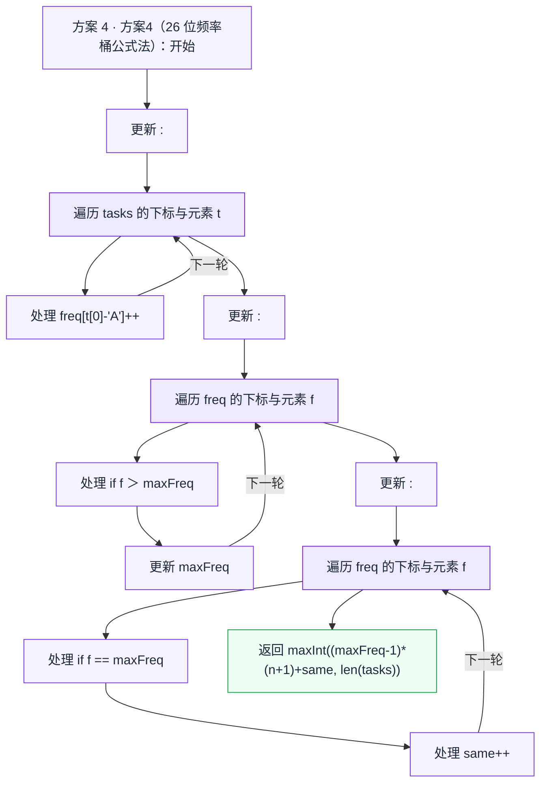

```go
package main // 引入依赖

import (
	"fmt" // 「fmt」
	"os"  // 「os」
)

// 忠实翻译 python/queue/lc_621_任务调度器/solution_4___4.py
// 公式法（显式统计）：以任务频率桶实现
func leastInterval(tasks []string, n int) int { // 定义函数/方法 leastInterval
	freq := make([]int, 26)   // 把 make([]int, 26) 写入 freq :
	for _, t := range tasks { // 同时取 _ 与 另一字符串 遍历
		freq[t[0]-'A']++ // 频次表[另一字符串[0] 减 'A'] 加一
	}
	maxFreq := 0             // 把 0 写入 maxFreq :
	for _, f := range freq { // 同时取 _ 与 f 遍历
		if f > maxFreq { // 若 f 超过 maxFreq
			maxFreq = f // 把 f 写入 maxFreq
		}
	}
	same := 0                // 把 0 写入 same :
	for _, f := range freq { // 同时取 _ 与 f 遍历
		if f == maxFreq { // 若 f 等于 maxFreq
			same++ // same 加一
		}
	}
	return maxInt((maxFreq-1)*(n+1)+same, len(tasks)) // 定义函数/方法 maxInt
}

func maxInt(a, b int) int { // 定义函数/方法 maxInt
	if a > b { // 若 数组 超过 b
		return a // 返回 数组
	}
	return b // 返回 b
}

func main() { // 程序入口：跑内嵌自测用例
	type caseT struct { // 定义类型
		tasks []string // tasks []string
		n     int      // 元素个数 int
		want  int      // want int
	}
	cases := []caseT{ // 把 []caseT{ 写入 cases :
		{[]string{"A", "A", "A", "B", "B", "B"}, 2, 8},
		{[]string{"A", "A", "A", "B", "B", "B"}, 0, 6},
		{[]string{"A", "A", "A", "A", "A", "A", "B", "C", "D", "E", "F", "G"}, 2, 16},
		{[]string{"A"}, 5, 1},
		{[]string{"A", "A", "B", "B"}, 3, 6},
		{[]string{"A", "B", "C", "D", "E", "F", "G"}, 0, 7},
	}
	ok := true                // 把 true 写入 ok :
	for _, c := range cases { // 同时取 _ 与 字符 遍历
		if got := leastInterval(c.tasks, c.n); got != c.want {
			ok = false                                                                      // 把 false 写入 ok
			fmt.Printf("FAIL leastInterval(%v,%d)=%d want %d\n", c.tasks, c.n, got, c.want) // 打印输出
		}
	}
	if !ok { // 若 取反 ok
		os.Exit(1) // os.Exit(1)
	}
	fmt.Println("PASS") // 全部用例通过，输出 PASS
}
```

#### 方案 5：双重循环枚举

**思路与代码分析**：核心是「双重循环枚举」。Go 版用切片与多返回值惯用法，显式处理索引边界。代码里依次做这些事：哈希结构做计数或查重。**走读**：方案 5 · 双重循环枚举：开始 → 更新 : → 遍历 tasks 的下标与元素 t → 处理 count[t]++ → 更新 : → 遍历 count 的下标与元素 v → 更新 cnt → 更新 : → 遍历 cnt 的下标与元素 c → 处理 if c ＞ freq → 更新 freq → 更新 : → 遍历 cnt 的下标与元素 c → 处理 if c == freq → 处理 same++ → 返回 maxInt((freq-1)*(n+1)+same, len(tasks))。

**运行架构**（真实控制流）：


```go
package main // 引入依赖

import (
	"fmt" // 「fmt」
	"os"  // 「os」
)

// 忠实翻译 python/queue/lc_621_任务调度器/solution_5___5.py
// 公式法：出现最多的任务 freq 个，有 same 个并列最多
func leastInterval(tasks []string, n int) int { // 定义函数/方法 leastInterval
	count := map[string]int{} // 把 映射表[string]int{} 写入 count :
	for _, t := range tasks { // 同时取 _ 与 另一字符串 遍历
		count[t]++ // 计数[另一字符串] 加一
	}
	cnt := []int{}            // 把 []int{} 写入 cnt :
	for _, v := range count { // 同时取 _ 与 值 遍历
		cnt = append(cnt, v) // 把 append(计数, 值) 写入 计数
	}
	freq := 0               // 把 0 写入 freq :
	for _, c := range cnt { // 同时取 _ 与 字符 遍历
		if c > freq { // 若 字符 超过 频次表
			freq = c // 把 字符 写入 频次表
		}
	}
	same := 0               // 把 0 写入 same :
	for _, c := range cnt { // 同时取 _ 与 字符 遍历
		if c == freq { // 若 字符 等于 频次表
			same++ // same 加一
		}
	}
	return maxInt((freq-1)*(n+1)+same, len(tasks)) // 定义函数/方法 maxInt
}

func maxInt(a, b int) int { // 定义函数/方法 maxInt
	if a > b { // 若 数组 超过 b
		return a // 返回 数组
	}
	return b // 返回 b
}

func main() { // 程序入口：跑内嵌自测用例
	type caseT struct { // 定义类型
		tasks []string // tasks []string
		n     int      // 元素个数 int
		want  int      // want int
	}
	cases := []caseT{ // 把 []caseT{ 写入 cases :
		{[]string{"A", "A", "A", "B", "B", "B"}, 2, 8},
		{[]string{"A", "A", "A", "B", "B", "B"}, 0, 6},
		{[]string{"A", "A", "A", "A", "A", "A", "B", "C", "D", "E", "F", "G"}, 2, 16},
		{[]string{"A"}, 5, 1},
		{[]string{"A", "A", "B", "B"}, 3, 6},
		{[]string{"A", "B", "C", "D", "E", "F", "G"}, 0, 7},
	}
	ok := true                // 把 true 写入 ok :
	for _, c := range cases { // 同时取 _ 与 字符 遍历
		if got := leastInterval(c.tasks, c.n); got != c.want {
			ok = false                                                                      // 把 false 写入 ok
			fmt.Printf("FAIL leastInterval(%v,%d)=%d want %d\n", c.tasks, c.n, got, c.want) // 打印输出
		}
	}
	if !ok { // 若 取反 ok
		os.Exit(1) // os.Exit(1)
	}
	fmt.Println("PASS") // 全部用例通过，输出 PASS
}
```

#### 方案 6：双重循环枚举

**思路与代码分析**：核心是「双重循环枚举」。Go 版用切片与多返回值惯用法，显式处理索引边界。代码里依次做这些事：哈希结构做计数或查重。**走读**：方案 6 · 双重循环枚举：开始 → 更新 : → 遍历 tasks 的下标与元素 t → 处理 count[t]++ → 更新 : → 遍历 count 的下标与元素 v → 更新 cnt → 更新 : → 遍历 cnt 的下标与元素 c → 处理 if c ＞ freq → 更新 freq → 更新 : → 遍历 cnt 的下标与元素 c → 处理 if c == freq → 处理 same++ → 返回 maxInt((freq-1)*(n+1)+same, len(tasks))。

**运行架构**（真实控制流）：

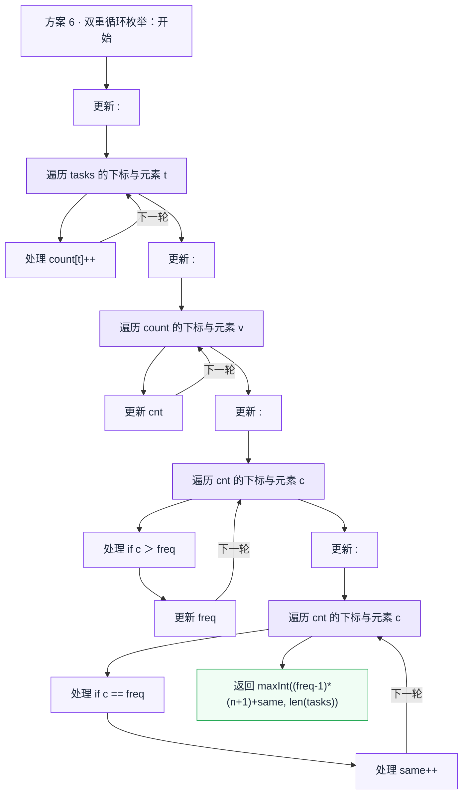

```go
package main // 引入依赖

import (
	"fmt" // 「fmt」
	"os"  // 「os」
)

// 忠实翻译 python/queue/lc_621_任务调度器/solution_6___6.py
// 公式法（另一写法）
func leastInterval(tasks []string, n int) int { // 定义函数/方法 leastInterval
	count := map[string]int{} // 把 映射表[string]int{} 写入 count :
	for _, t := range tasks { // 同时取 _ 与 另一字符串 遍历
		count[t]++ // 计数[另一字符串] 加一
	}
	cnt := []int{}            // 把 []int{} 写入 cnt :
	for _, v := range count { // 同时取 _ 与 值 遍历
		cnt = append(cnt, v) // 把 append(计数, 值) 写入 计数
	}
	freq := 0               // 把 0 写入 freq :
	for _, c := range cnt { // 同时取 _ 与 字符 遍历
		if c > freq { // 若 字符 超过 频次表
			freq = c // 把 字符 写入 频次表
		}
	}
	same := 0               // 把 0 写入 same :
	for _, c := range cnt { // 同时取 _ 与 字符 遍历
		if c == freq { // 若 字符 等于 频次表
			same++ // same 加一
		}
	}
	return maxInt((freq-1)*(n+1)+same, len(tasks)) // 定义函数/方法 maxInt
}

func maxInt(a, b int) int { // 定义函数/方法 maxInt
	if a > b { // 若 数组 超过 b
		return a // 返回 数组
	}
	return b // 返回 b
}

func main() { // 程序入口：跑内嵌自测用例
	type caseT struct { // 定义类型
		tasks []string // tasks []string
		n     int      // 元素个数 int
		want  int      // want int
	}
	cases := []caseT{ // 把 []caseT{ 写入 cases :
		{[]string{"A", "A", "A", "B", "B", "B"}, 2, 8},
		{[]string{"A", "A", "A", "B", "B", "B"}, 0, 6},
		{[]string{"A", "A", "A", "A", "A", "A", "B", "C", "D", "E", "F", "G"}, 2, 16},
		{[]string{"A"}, 5, 1},
		{[]string{"A", "A", "B", "B"}, 3, 6},
		{[]string{"A", "B", "C", "D", "E", "F", "G"}, 0, 7},
	}
	ok := true                // 把 true 写入 ok :
	for _, c := range cases { // 同时取 _ 与 字符 遍历
		if got := leastInterval(c.tasks, c.n); got != c.want {
			ok = false                                                                      // 把 false 写入 ok
			fmt.Printf("FAIL leastInterval(%v,%d)=%d want %d\n", c.tasks, c.n, got, c.want) // 打印输出
		}
	}
	if !ok { // 若 取反 ok
		os.Exit(1) // os.Exit(1)
	}
	fmt.Println("PASS") // 全部用例通过，输出 PASS
}
```

### Java 实现（6 种方案）

Java 的全部方案如下，每个方案都内嵌用例自测，可独立运行（老仓库 python/go 文件遵循「打印结果」约定）：

#### 方案 1：方案1（Counter 公式法）

**思路与代码分析**：核心是「方案1（Counter 公式法）」。Java 版用类与静态方法组织，集合操作显式明了。代码里依次做这些事：双重循环遍历。**走读**：方案 1 · 方案1（Counter 公式法）：开始 → 更新 freq → 遍历循环 → 更新 maxFreq → 遍历循环 → 若 f ＞ maxFreq：更新 maxFreq → 更新 same → 遍历循环 → 命中条件，直接返回 → 处理 (maxFreq - 1) * (n + 1) + sa → 处理 tasks.length)。

**运行架构**（真实控制流）：

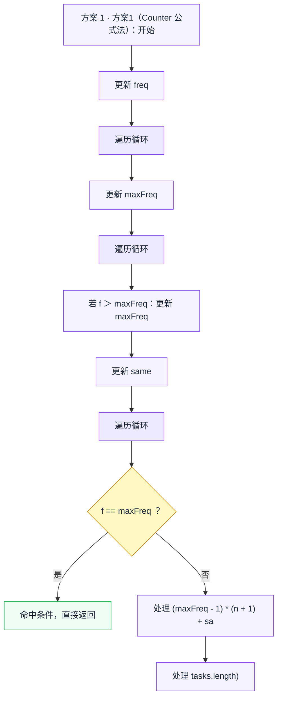

```java
package com.webfault.dsa; // 引入依赖

class Lc621 { // 定义类型
  static int leastInterval(String[] tasks, int n) { // 定义函数/方法 leastInterval
    int[] freq = new int[26]; // 把 new int[26]; 写入 int[] freq
    for (String t : tasks) freq[t.charAt(0) - 'A']++; // 逐字符处理
    int maxFreq = 0; // 把 0 存入 maxFreq
    for (int f : freq)
      if (f > maxFreq) maxFreq = f; // 把 f; 写入 for (int f : freq) if (f > maxFreq) maxFreq
    int same = 0; // 把 0 存入 same
    for (int f : freq)
      if (f == maxFreq) same++; // 把 赋值为 maxFreq) same 加一 ; 写入 for (int f : freq) if (f
    return Math.max(
        (maxFreq - 1) * (n + 1) + same,
        tasks.length); // 返回 Math.取较大值 (maxFreq 减 1) 乘 (元素个数 加 1) 加 same, tasks.长度)
  }

  public static void main(String[] args) { // public static void main(String[] args) {
    String[][][] cases = { // 把 { 写入 String[][][] cases
      {{"A", "A", "A", "B", "B", "B"}, {"2"}, {"8"}},
      {{"A", "A", "A", "B", "B", "B", "B"}, {"3"}, {"13"}},
    };
    boolean ok = true; // 把 true; 写入 boolean ok
    for (String[][] c : cases) { // for (String[][] 字符 : cases) {
      String[] tasks = c[0]; // 把 字符[0]; 写入 String[] tasks
      int n = Integer.parseInt(c[1][0]); // 把 Integer.转整数(字符[1][0]) 存入 元素个数
      int want = Integer.parseInt(c[2][0]); // 把 Integer.转整数(字符[2][0]) 存入 want
      int got = leastInterval(tasks, n); // 把 leastInterval(tasks, 元素个数) 存入 got
      if (got != want) {
        ok = false;
        System.out.println(
            "FAIL leastInterval("
                + java.util.Arrays.toString(tasks)
                + ","
                + n
                + ")="
                + got
                + " want "
                + want);
      }
    }
    if (!ok) throw new RuntimeException("FAILED"); // 若 取反 ok) throw new RuntimeException(「FAILED」);
    System.out.println("PASS"); // 全部用例通过，输出 PASS
  }
}
```

#### 方案 2：方案2（Counter 公式法）

**思路与代码分析**：核心是「方案2（Counter 公式法）」。Java 版用类与静态方法组织，集合操作显式明了。代码里依次做这些事：双重循环遍历。**走读**：方案 2 · 方案2（Counter 公式法）：开始 → 更新 freq → 遍历循环 → 更新 maxFreq → 遍历循环 → 若 f ＞ maxFreq：更新 maxFreq → 更新 same → 遍历循环 → 命中条件，直接返回 → 处理 (maxFreq - 1) * (n + 1) + sa → 处理 tasks.length)。

**运行架构**（真实控制流）：

```mermaid
graph TD
    N0["方案 2 · 方案2（Counter 公式法）：开始"]
    N1["更新 freq"]
    N2["遍历循环"]
    N3["更新 maxFreq"]
    N4["遍历循环"]
    N5["若 f ＞ maxFreq：更新 maxFreq"]
    N6["更新 same"]
    N7["遍历循环"]
    N8{"f == maxFreq ？"}
    N9["命中条件，直接返回"]
    N10["处理 (maxFreq - 1) * (n + 1) + sa"]
    N11["处理 tasks.length)"]
    N0 --> N1
    N1 --> N2
    N2 --> N3
    N3 --> N4
    N4 --> N5
    N5 --> N6
    N6 --> N7
    N7 --> N8
    N8 -- 是 --> N9
    N8 -- 否 --> N10
    N10 --> N11
    classDef n fill:#f5f3ff,stroke:#7c3aed,color:#1e293b;
    classDef lp fill:#ede9fe,stroke:#6d28d9,color:#1e293b;
    classDef dc fill:#fef9c3,stroke:#ca8a04,color:#1e293b;
    classDef tm fill:#f0fdf4,stroke:#16a34a,color:#1e293b;
    class N0,N1,N3,N5,N6,N10,N11 n;
    class N2,N4,N7 lp;
    class N8 dc;
    class N9 tm;
```

```java
package com.webfault.dsa; // 引入依赖

class Lc621 { // 定义类型
  static int leastInterval(String[] tasks, int n) { // 定义函数/方法 leastInterval
    int[] freq = new int[26]; // 把 new int[26]; 写入 int[] freq
    for (String t : tasks) freq[t.charAt(0) - 'A']++; // 逐字符处理
    int maxFreq = 0; // 把 0 存入 maxFreq
    for (int f : freq)
      if (f > maxFreq) maxFreq = f; // 把 f; 写入 for (int f : freq) if (f > maxFreq) maxFreq
    int same = 0; // 把 0 存入 same
    for (int f : freq)
      if (f == maxFreq) same++; // 把 赋值为 maxFreq) same 加一 ; 写入 for (int f : freq) if (f
    return Math.max(
        (maxFreq - 1) * (n + 1) + same,
        tasks.length); // 返回 Math.取较大值 (maxFreq 减 1) 乘 (元素个数 加 1) 加 same, tasks.长度)
  }

  public static void main(String[] args) { // public static void main(String[] args) {
    String[][][] cases = { // 把 { 写入 String[][][] cases
      {{"A", "A", "A", "B", "B", "B"}, {"2"}, {"8"}},
      {{"A", "A", "A", "B", "B", "B", "B"}, {"3"}, {"13"}},
    };
    boolean ok = true; // 把 true; 写入 boolean ok
    for (String[][] c : cases) { // for (String[][] 字符 : cases) {
      String[] tasks = c[0]; // 把 字符[0]; 写入 String[] tasks
      int n = Integer.parseInt(c[1][0]); // 把 Integer.转整数(字符[1][0]) 存入 元素个数
      int want = Integer.parseInt(c[2][0]); // 把 Integer.转整数(字符[2][0]) 存入 want
      int got = leastInterval(tasks, n); // 把 leastInterval(tasks, 元素个数) 存入 got
      if (got != want) {
        ok = false;
        System.out.println(
            "FAIL leastInterval("
                + java.util.Arrays.toString(tasks)
                + ","
                + n
                + ")="
                + got
                + " want "
                + want);
      }
    }
    if (!ok) throw new RuntimeException("FAILED"); // 若 取反 ok) throw new RuntimeException(「FAILED」);
    System.out.println("PASS"); // 全部用例通过，输出 PASS
  }
}
```

#### 方案 3：双重循环枚举

**思路与代码分析**：核心是「双重循环枚举」。Java 版用类与静态方法组织，集合操作显式明了。代码里依次做这些事：双重循环遍历。**走读**：方案 3 · 双重循环枚举：开始 → 更新 freq → 遍历循环 → 更新 maxFreq → 遍历循环 → 若 f ＞ maxFreq：更新 maxFreq → 更新 same → 遍历循环 → 命中条件，直接返回 → 处理 (maxFreq - 1) * (n + 1) + sa → 处理 tasks.length)。

**运行架构**（真实控制流）：

```mermaid
graph TD
    N0["方案 3 · 双重循环枚举：开始"]
    N1["更新 freq"]
    N2["遍历循环"]
    N3["更新 maxFreq"]
    N4["遍历循环"]
    N5["若 f ＞ maxFreq：更新 maxFreq"]
    N6["更新 same"]
    N7["遍历循环"]
    N8{"f == maxFreq ？"}
    N9["命中条件，直接返回"]
    N10["处理 (maxFreq - 1) * (n + 1) + sa"]
    N11["处理 tasks.length)"]
    N0 --> N1
    N1 --> N2
    N2 --> N3
    N3 --> N4
    N4 --> N5
    N5 --> N6
    N6 --> N7
    N7 --> N8
    N8 -- 是 --> N9
    N8 -- 否 --> N10
    N10 --> N11
    classDef n fill:#f5f3ff,stroke:#7c3aed,color:#1e293b;
    classDef lp fill:#ede9fe,stroke:#6d28d9,color:#1e293b;
    classDef dc fill:#fef9c3,stroke:#ca8a04,color:#1e293b;
    classDef tm fill:#f0fdf4,stroke:#16a34a,color:#1e293b;
    class N0,N1,N3,N5,N6,N10,N11 n;
    class N2,N4,N7 lp;
    class N8 dc;
    class N9 tm;
```

```java
package com.webfault.dsa; // 引入依赖

class Lc621 { // 定义类型
  static int leastInterval(String[] tasks, int n) { // 定义函数/方法 leastInterval
    int[] freq = new int[26]; // 把 new int[26]; 写入 int[] freq
    for (String t : tasks) freq[t.charAt(0) - 'A']++; // 逐字符处理
    int maxFreq = 0; // 把 0 存入 maxFreq
    for (int f : freq)
      if (f > maxFreq) maxFreq = f; // 把 f; 写入 for (int f : freq) if (f > maxFreq) maxFreq
    int same = 0; // 把 0 存入 same
    for (int f : freq)
      if (f == maxFreq) same++; // 把 赋值为 maxFreq) same 加一 ; 写入 for (int f : freq) if (f
    return Math.max(
        (maxFreq - 1) * (n + 1) + same,
        tasks.length); // 返回 Math.取较大值 (maxFreq 减 1) 乘 (元素个数 加 1) 加 same, tasks.长度)
  }

  public static void main(String[] args) { // public static void main(String[] args) {
    String[][][] cases = { // 把 { 写入 String[][][] cases
      {{"A", "A", "A", "B", "B", "B"}, {"2"}, {"8"}},
      {{"A", "A", "A", "B", "B", "B", "B"}, {"3"}, {"13"}},
    };
    boolean ok = true; // 把 true; 写入 boolean ok
    for (String[][] c : cases) { // for (String[][] 字符 : cases) {
      String[] tasks = c[0]; // 把 字符[0]; 写入 String[] tasks
      int n = Integer.parseInt(c[1][0]); // 把 Integer.转整数(字符[1][0]) 存入 元素个数
      int want = Integer.parseInt(c[2][0]); // 把 Integer.转整数(字符[2][0]) 存入 want
      int got = leastInterval(tasks, n); // 把 leastInterval(tasks, 元素个数) 存入 got
      if (got != want) {
        ok = false;
        System.out.println(
            "FAIL leastInterval("
                + java.util.Arrays.toString(tasks)
                + ","
                + n
                + ")="
                + got
                + " want "
                + want);
      }
    }
    if (!ok) throw new RuntimeException("FAILED"); // 若 取反 ok) throw new RuntimeException(「FAILED」);
    System.out.println("PASS"); // 全部用例通过，输出 PASS
  }
}
```

#### 方案 4：方案4（26 位频率桶公式法）

**思路与代码分析**：核心是「方案4（26 位频率桶公式法）」。Java 版用类与静态方法组织，集合操作显式明了。代码里依次做这些事：双重循环遍历。**走读**：方案 4 · 方案4（26 位频率桶公式法）：开始 → 更新 freq → 遍历循环 → 更新 maxFreq → 遍历循环 → 若 f ＞ maxFreq：更新 maxFreq → 更新 same → 遍历循环 → 命中条件，直接返回 → 处理 (maxFreq - 1) * (n + 1) + sa → 处理 tasks.length)。

**运行架构**（真实控制流）：

```mermaid
graph TD
    N0["方案 4 · 方案4（26 位频率桶公式法）：开始"]
    N1["更新 freq"]
    N2["遍历循环"]
    N3["更新 maxFreq"]
    N4["遍历循环"]
    N5["若 f ＞ maxFreq：更新 maxFreq"]
    N6["更新 same"]
    N7["遍历循环"]
    N8{"f == maxFreq ？"}
    N9["命中条件，直接返回"]
    N10["处理 (maxFreq - 1) * (n + 1) + sa"]
    N11["处理 tasks.length)"]
    N0 --> N1
    N1 --> N2
    N2 --> N3
    N3 --> N4
    N4 --> N5
    N5 --> N6
    N6 --> N7
    N7 --> N8
    N8 -- 是 --> N9
    N8 -- 否 --> N10
    N10 --> N11
    classDef n fill:#f5f3ff,stroke:#7c3aed,color:#1e293b;
    classDef lp fill:#ede9fe,stroke:#6d28d9,color:#1e293b;
    classDef dc fill:#fef9c3,stroke:#ca8a04,color:#1e293b;
    classDef tm fill:#f0fdf4,stroke:#16a34a,color:#1e293b;
    class N0,N1,N3,N5,N6,N10,N11 n;
    class N2,N4,N7 lp;
    class N8 dc;
    class N9 tm;
```

```java
package com.webfault.dsa; // 引入依赖

class Lc621 { // 定义类型
  static int leastInterval(String[] tasks, int n) { // 定义函数/方法 leastInterval
    int[] freq = new int[26]; // 把 new int[26]; 写入 int[] freq
    for (String t : tasks) freq[t.charAt(0) - 'A']++; // 逐字符处理
    int maxFreq = 0; // 把 0 存入 maxFreq
    for (int f : freq)
      if (f > maxFreq) maxFreq = f; // 把 f; 写入 for (int f : freq) if (f > maxFreq) maxFreq
    int same = 0; // 把 0 存入 same
    for (int f : freq)
      if (f == maxFreq) same++; // 把 赋值为 maxFreq) same 加一 ; 写入 for (int f : freq) if (f
    return Math.max(
        (maxFreq - 1) * (n + 1) + same,
        tasks.length); // 返回 Math.取较大值 (maxFreq 减 1) 乘 (元素个数 加 1) 加 same, tasks.长度)
  }

  public static void main(String[] args) { // public static void main(String[] args) {
    String[][][] cases = { // 把 { 写入 String[][][] cases
      {{"A", "A", "A", "B", "B", "B"}, {"2"}, {"8"}},
      {{"A", "A", "A", "B", "B", "B", "B"}, {"3"}, {"13"}},
    };
    boolean ok = true; // 把 true; 写入 boolean ok
    for (String[][] c : cases) { // for (String[][] 字符 : cases) {
      String[] tasks = c[0]; // 把 字符[0]; 写入 String[] tasks
      int n = Integer.parseInt(c[1][0]); // 把 Integer.转整数(字符[1][0]) 存入 元素个数
      int want = Integer.parseInt(c[2][0]); // 把 Integer.转整数(字符[2][0]) 存入 want
      int got = leastInterval(tasks, n); // 把 leastInterval(tasks, 元素个数) 存入 got
      if (got != want) {
        ok = false;
        System.out.println(
            "FAIL leastInterval("
                + java.util.Arrays.toString(tasks)
                + ","
                + n
                + ")="
                + got
                + " want "
                + want);
      }
    }
    if (!ok) throw new RuntimeException("FAILED"); // 若 取反 ok) throw new RuntimeException(「FAILED」);
    System.out.println("PASS"); // 全部用例通过，输出 PASS
  }
}
```

#### 方案 5：双重循环枚举

**思路与代码分析**：核心是「双重循环枚举」。Java 版用类与静态方法组织，集合操作显式明了。代码里依次做这些事：双重循环遍历。**走读**：方案 5 · 双重循环枚举：开始 → 更新 freq → 遍历循环 → 更新 maxFreq → 遍历循环 → 若 f ＞ maxFreq：更新 maxFreq → 更新 same → 遍历循环 → 命中条件，直接返回 → 处理 (maxFreq - 1) * (n + 1) + sa → 处理 tasks.length)。

**运行架构**（真实控制流）：

```mermaid
graph TD
    N0["方案 5 · 双重循环枚举：开始"]
    N1["更新 freq"]
    N2["遍历循环"]
    N3["更新 maxFreq"]
    N4["遍历循环"]
    N5["若 f ＞ maxFreq：更新 maxFreq"]
    N6["更新 same"]
    N7["遍历循环"]
    N8{"f == maxFreq ？"}
    N9["命中条件，直接返回"]
    N10["处理 (maxFreq - 1) * (n + 1) + sa"]
    N11["处理 tasks.length)"]
    N0 --> N1
    N1 --> N2
    N2 --> N3
    N3 --> N4
    N4 --> N5
    N5 --> N6
    N6 --> N7
    N7 --> N8
    N8 -- 是 --> N9
    N8 -- 否 --> N10
    N10 --> N11
    classDef n fill:#f5f3ff,stroke:#7c3aed,color:#1e293b;
    classDef lp fill:#ede9fe,stroke:#6d28d9,color:#1e293b;
    classDef dc fill:#fef9c3,stroke:#ca8a04,color:#1e293b;
    classDef tm fill:#f0fdf4,stroke:#16a34a,color:#1e293b;
    class N0,N1,N3,N5,N6,N10,N11 n;
    class N2,N4,N7 lp;
    class N8 dc;
    class N9 tm;
```

```java
package com.webfault.dsa; // 引入依赖

class Lc621 { // 定义类型
  static int leastInterval(String[] tasks, int n) { // 定义函数/方法 leastInterval
    int[] freq = new int[26]; // 把 new int[26]; 写入 int[] freq
    for (String t : tasks) freq[t.charAt(0) - 'A']++; // 逐字符处理
    int maxFreq = 0; // 把 0 存入 maxFreq
    for (int f : freq)
      if (f > maxFreq) maxFreq = f; // 把 f; 写入 for (int f : freq) if (f > maxFreq) maxFreq
    int same = 0; // 把 0 存入 same
    for (int f : freq)
      if (f == maxFreq) same++; // 把 赋值为 maxFreq) same 加一 ; 写入 for (int f : freq) if (f
    return Math.max(
        (maxFreq - 1) * (n + 1) + same,
        tasks.length); // 返回 Math.取较大值 (maxFreq 减 1) 乘 (元素个数 加 1) 加 same, tasks.长度)
  }

  public static void main(String[] args) { // public static void main(String[] args) {
    String[][][] cases = { // 把 { 写入 String[][][] cases
      {{"A", "A", "A", "B", "B", "B"}, {"2"}, {"8"}},
      {{"A", "A", "A", "B", "B", "B", "B"}, {"3"}, {"13"}},
    };
    boolean ok = true; // 把 true; 写入 boolean ok
    for (String[][] c : cases) { // for (String[][] 字符 : cases) {
      String[] tasks = c[0]; // 把 字符[0]; 写入 String[] tasks
      int n = Integer.parseInt(c[1][0]); // 把 Integer.转整数(字符[1][0]) 存入 元素个数
      int want = Integer.parseInt(c[2][0]); // 把 Integer.转整数(字符[2][0]) 存入 want
      int got = leastInterval(tasks, n); // 把 leastInterval(tasks, 元素个数) 存入 got
      if (got != want) {
        ok = false;
        System.out.println(
            "FAIL leastInterval("
                + java.util.Arrays.toString(tasks)
                + ","
                + n
                + ")="
                + got
                + " want "
                + want);
      }
    }
    if (!ok) throw new RuntimeException("FAILED"); // 若 取反 ok) throw new RuntimeException(「FAILED」);
    System.out.println("PASS"); // 全部用例通过，输出 PASS
  }
}
```

#### 方案 6：双重循环枚举

**思路与代码分析**：核心是「双重循环枚举」。Java 版用类与静态方法组织，集合操作显式明了。代码里依次做这些事：双重循环遍历。**走读**：方案 6 · 双重循环枚举：开始 → 更新 freq → 遍历循环 → 更新 maxFreq → 遍历循环 → 若 f ＞ maxFreq：更新 maxFreq → 更新 same → 遍历循环 → 命中条件，直接返回 → 处理 (maxFreq - 1) * (n + 1) + sa → 处理 tasks.length)。

**运行架构**（真实控制流）：

```mermaid
graph TD
    N0["方案 6 · 双重循环枚举：开始"]
    N1["更新 freq"]
    N2["遍历循环"]
    N3["更新 maxFreq"]
    N4["遍历循环"]
    N5["若 f ＞ maxFreq：更新 maxFreq"]
    N6["更新 same"]
    N7["遍历循环"]
    N8{"f == maxFreq ？"}
    N9["命中条件，直接返回"]
    N10["处理 (maxFreq - 1) * (n + 1) + sa"]
    N11["处理 tasks.length)"]
    N0 --> N1
    N1 --> N2
    N2 --> N3
    N3 --> N4
    N4 --> N5
    N5 --> N6
    N6 --> N7
    N7 --> N8
    N8 -- 是 --> N9
    N8 -- 否 --> N10
    N10 --> N11
    classDef n fill:#f5f3ff,stroke:#7c3aed,color:#1e293b;
    classDef lp fill:#ede9fe,stroke:#6d28d9,color:#1e293b;
    classDef dc fill:#fef9c3,stroke:#ca8a04,color:#1e293b;
    classDef tm fill:#f0fdf4,stroke:#16a34a,color:#1e293b;
    class N0,N1,N3,N5,N6,N10,N11 n;
    class N2,N4,N7 lp;
    class N8 dc;
    class N9 tm;
```

```java
package com.webfault.dsa; // 引入依赖

class Lc621 { // 定义类型
  static int leastInterval(String[] tasks, int n) { // 定义函数/方法 leastInterval
    int[] freq = new int[26]; // 把 new int[26]; 写入 int[] freq
    for (String t : tasks) freq[t.charAt(0) - 'A']++; // 逐字符处理
    int maxFreq = 0; // 把 0 存入 maxFreq
    for (int f : freq)
      if (f > maxFreq) maxFreq = f; // 把 f; 写入 for (int f : freq) if (f > maxFreq) maxFreq
    int same = 0; // 把 0 存入 same
    for (int f : freq)
      if (f == maxFreq) same++; // 把 赋值为 maxFreq) same 加一 ; 写入 for (int f : freq) if (f
    return Math.max(
        (maxFreq - 1) * (n + 1) + same,
        tasks.length); // 返回 Math.取较大值 (maxFreq 减 1) 乘 (元素个数 加 1) 加 same, tasks.长度)
  }

  public static void main(String[] args) { // public static void main(String[] args) {
    String[][][] cases = { // 把 { 写入 String[][][] cases
      {{"A", "A", "A", "B", "B", "B"}, {"2"}, {"8"}},
      {{"A", "A", "A", "B", "B", "B", "B"}, {"3"}, {"13"}},
    };
    boolean ok = true; // 把 true; 写入 boolean ok
    for (String[][] c : cases) { // for (String[][] 字符 : cases) {
      String[] tasks = c[0]; // 把 字符[0]; 写入 String[] tasks
      int n = Integer.parseInt(c[1][0]); // 把 Integer.转整数(字符[1][0]) 存入 元素个数
      int want = Integer.parseInt(c[2][0]); // 把 Integer.转整数(字符[2][0]) 存入 want
      int got = leastInterval(tasks, n); // 把 leastInterval(tasks, 元素个数) 存入 got
      if (got != want) {
        ok = false;
        System.out.println(
            "FAIL leastInterval("
                + java.util.Arrays.toString(tasks)
                + ","
                + n
                + ")="
                + got
                + " want "
                + want);
      }
    }
    if (!ok) throw new RuntimeException("FAILED"); // 若 取反 ok) throw new RuntimeException(「FAILED」);
    System.out.println("PASS"); // 全部用例通过，输出 PASS
  }
}
```

### Rust 实现（6 种方案）

Rust 的全部方案如下，每个方案都内嵌用例自测，可独立运行（老仓库 python/go 文件遵循「打印结果」约定）：

#### 方案 1：方案1（Counter 公式法）

**思路与代码分析**：核心是「方案1（Counter 公式法）」。Rust 版用所有权移动与切片借用改写同一逻辑，注意 Option 与引用边界。代码里依次做这些事：哈希结构做计数或查重。**走读**：方案 1 · 方案1（Counter 公式法）：开始 → 计算 count → 遍历 tasks 中的每个元素 t → 计算 max_count → 遍历 count.values() 中的每个元素 v → 处理 if *v ＞ max_count → 更新 max_count → 计算 max_count_tasks → 遍历 count.values() 中的每个元素 v → 处理 if *v == max_count → 更新 + → 处理 std::cmp::max( → 调用 tasks.len() as i32, → 处理 (max_count - 1) * (n + 1) + → 处理 ) → 返回结果。

**运行架构**（真实控制流）：

```mermaid
graph TD
    N0["方案 1 · 方案1（Counter 公式法）：开始"]
    N1["计算 count"]
    N2["遍历 tasks 中的每个元素 t"]
    N3["计算 max_count"]
    N4["遍历 count.values() 中的每个元素 v"]
    N5["处理 if *v ＞ max_count"]
    N6["更新 max_count"]
    N7["计算 max_count_tasks"]
    N8["遍历 count.values() 中的每个元素 v"]
    N9["处理 if *v == max_count"]
    N10["更新 +"]
    N11["处理 std::cmp::max("]
    N12["调用 tasks.len() as i32,"]
    N13["处理 (max_count - 1) * (n + 1) +"]
    N14["处理 )"]
    N15["返回结果"]
    N0 --> N1
    N1 --> N2
    N2 --> N3
    N3 --> N4
    N4 --> N5
    N5 --> N6
    N6 -- 下一轮 --> N4
    N4 --> N7
    N7 --> N8
    N8 --> N9
    N9 --> N10
    N10 -- 下一轮 --> N8
    N8 --> N11
    N11 --> N12
    N12 --> N13
    N13 --> N14
    N14 --> N15
    classDef n fill:#f5f3ff,stroke:#7c3aed,color:#1e293b;
    classDef lp fill:#ede9fe,stroke:#6d28d9,color:#1e293b;
    classDef dc fill:#fef9c3,stroke:#ca8a04,color:#1e293b;
    classDef tm fill:#f0fdf4,stroke:#16a34a,color:#1e293b;
    class N0,N1,N3,N5,N6,N7,N9,N10,N11,N12,N13,N14 n;
    class N2,N4,N8 lp;
    class N15 tm;
```

```rust
// LeetCode 621. 任务调度器 — Rust 版

// 方案1（Counter 公式法）
use std::collections::HashMap; // 引入依赖

fn least_interval(tasks: &[char], n: i32) -> i32 {
    // 定义函数/方法 least_interval
    let mut count: HashMap<char, i32> = HashMap::new(); // 把 HashMap::new(); 写入 let mut count: HashMap<char, i32>
    for &t in tasks {
        // for 按位与 另一字符串 in tasks {
        *count.entry(t).or_insert(0) += 1;
    }
    let mut max_count = 0; // 把 0; 写入 let mut max_count
    for v in count.values() {
        // 逐个取出 计数 的元素（值）
        if *v > max_count {
            // 若 乘 值 超过 max_count
            max_count = *v; // 把 乘 值; 写入 max_count
        }
    }
    let mut max_count_tasks = 0; // 把 0; 写入 let mut max_count_tasks
    for v in count.values() {
        // 逐个取出 计数 的元素（值）
        if *v == max_count {
            // 若 乘 值 等于 max_count
            max_count_tasks += 1; // max_count_tasks累加 1
        }
    }
    std::cmp::max(
        tasks.len() as i32,
        (max_count - 1) * (n + 1) + max_count_tasks,
    )
}

fn main() {
    // 程序入口：跑内嵌自测用例
    // 与 TS 事实源内嵌用例一致
    let cases: Vec<(Vec<char>, i32, i32)> = vec![
        (vec!['A', 'A', 'A', 'B', 'B', 'B'], 2, 8),
        (vec!['A', 'A', 'A', 'A'], 2, 10),
        (vec!['A', 'B', 'C', 'D'], 0, 4),
    ];
    for (tasks, n, want) in cases {
        // for (tasks, 元素个数, want) in cases {
        let got = least_interval(&tasks, n); // 把 least_interval( 按位与 tasks, 元素个数) 存入 got
        assert!(
            got == want,
            "FAIL least_interval({:?},{})={} want {}",
            tasks,
            n,
            got,
            want
        ); // 断言校验
    }
    println!("PASS"); // 全部用例通过，输出 PASS
}
```

#### 方案 2：方案2（Counter 公式法）

**思路与代码分析**：核心是「方案2（Counter 公式法）」。Rust 版用所有权移动与切片借用改写同一逻辑，注意 Option 与引用边界。代码里依次做这些事：哈希结构做计数或查重。**走读**：方案 2 · 方案2（Counter 公式法）：开始 → 计算 count → 遍历 tasks 中的每个元素 t → 计算 max_count → 遍历 count.values() 中的每个元素 v → 处理 if *v ＞ max_count → 更新 max_count → 计算 max_count_tasks → 遍历 count.values() 中的每个元素 v → 处理 if *v == max_count → 更新 + → 处理 std::cmp::max( → 调用 tasks.len() as i32, → 处理 (max_count - 1) * (n + 1) + → 处理 ) → 返回结果。

**运行架构**（真实控制流）：

```mermaid
graph TD
    N0["方案 2 · 方案2（Counter 公式法）：开始"]
    N1["计算 count"]
    N2["遍历 tasks 中的每个元素 t"]
    N3["计算 max_count"]
    N4["遍历 count.values() 中的每个元素 v"]
    N5["处理 if *v ＞ max_count"]
    N6["更新 max_count"]
    N7["计算 max_count_tasks"]
    N8["遍历 count.values() 中的每个元素 v"]
    N9["处理 if *v == max_count"]
    N10["更新 +"]
    N11["处理 std::cmp::max("]
    N12["调用 tasks.len() as i32,"]
    N13["处理 (max_count - 1) * (n + 1) +"]
    N14["处理 )"]
    N15["返回结果"]
    N0 --> N1
    N1 --> N2
    N2 --> N3
    N3 --> N4
    N4 --> N5
    N5 --> N6
    N6 -- 下一轮 --> N4
    N4 --> N7
    N7 --> N8
    N8 --> N9
    N9 --> N10
    N10 -- 下一轮 --> N8
    N8 --> N11
    N11 --> N12
    N12 --> N13
    N13 --> N14
    N14 --> N15
    classDef n fill:#f5f3ff,stroke:#7c3aed,color:#1e293b;
    classDef lp fill:#ede9fe,stroke:#6d28d9,color:#1e293b;
    classDef dc fill:#fef9c3,stroke:#ca8a04,color:#1e293b;
    classDef tm fill:#f0fdf4,stroke:#16a34a,color:#1e293b;
    class N0,N1,N3,N5,N6,N7,N9,N10,N11,N12,N13,N14 n;
    class N2,N4,N8 lp;
    class N15 tm;
```

```rust
// LeetCode 621. 任务调度器 — Rust 版

// 方案2（Counter 公式法）
use std::collections::HashMap; // 引入依赖

fn least_interval(tasks: &[char], n: i32) -> i32 {
    // 定义函数/方法 least_interval
    let mut count: HashMap<char, i32> = HashMap::new(); // 把 HashMap::new(); 写入 let mut count: HashMap<char, i32>
    for &t in tasks {
        // for 按位与 另一字符串 in tasks {
        *count.entry(t).or_insert(0) += 1;
    }
    let mut max_count = 0; // 把 0; 写入 let mut max_count
    for v in count.values() {
        // 逐个取出 计数 的元素（值）
        if *v > max_count {
            // 若 乘 值 超过 max_count
            max_count = *v; // 把 乘 值; 写入 max_count
        }
    }
    let mut max_count_tasks = 0; // 把 0; 写入 let mut max_count_tasks
    for v in count.values() {
        // 逐个取出 计数 的元素（值）
        if *v == max_count {
            // 若 乘 值 等于 max_count
            max_count_tasks += 1; // max_count_tasks累加 1
        }
    }
    std::cmp::max(
        tasks.len() as i32,
        (max_count - 1) * (n + 1) + max_count_tasks,
    )
}

fn main() {
    // 程序入口：跑内嵌自测用例
    // 与 TS 事实源内嵌用例一致
    let cases: Vec<(Vec<char>, i32, i32)> = vec![
        (vec!['A', 'A', 'A', 'B', 'B', 'B'], 2, 8),
        (vec!['A', 'A', 'A', 'A'], 2, 10),
        (vec!['A', 'B', 'C', 'D'], 0, 4),
    ];
    for (tasks, n, want) in cases {
        // for (tasks, 元素个数, want) in cases {
        let got = least_interval(&tasks, n); // 把 least_interval( 按位与 tasks, 元素个数) 存入 got
        assert!(
            got == want,
            "FAIL least_interval({:?},{})={} want {}",
            tasks,
            n,
            got,
            want
        ); // 断言校验
    }
    println!("PASS"); // 全部用例通过，输出 PASS
}
```

#### 方案 3：双重循环枚举

**思路与代码分析**：核心是「双重循环枚举」。Rust 版用所有权移动与切片借用改写同一逻辑，注意 Option 与引用边界。代码里依次做这些事：哈希结构做计数或查重。**走读**：方案 3 · 双重循环枚举：开始 → 计算 count → 遍历 tasks 中的每个元素 t → 当 非 cnt.is_empty() 时反复执行 → 遍历 0..take 中的每个元素 i → 返回结果。

**运行架构**（真实控制流）：

```mermaid
graph TD
    N0["方案 3 · 双重循环枚举：开始"]
    N1["计算 count"]
    N2["遍历 tasks 中的每个元素 t"]
    D1["……（中间计算步骤）"]
    N5["当 非 cnt.is_empty() 时反复执行"]
    D2["……（中间计算步骤）"]
    N9["遍历 0..take 中的每个元素 i"]
    D3["……（中间计算步骤）"]
    N16["返回结果"]
    N0 --> N1
    N1 --> N2
    N2 --> D1
    D1 --> N5
    N5 --> D2
    D2 --> N9
    N9 --> D3
    D3 --> N16
    classDef n fill:#f5f3ff,stroke:#7c3aed,color:#1e293b;
    classDef lp fill:#ede9fe,stroke:#6d28d9,color:#1e293b;
    classDef dc fill:#fef9c3,stroke:#ca8a04,color:#1e293b;
    classDef tm fill:#f0fdf4,stroke:#16a34a,color:#1e293b;
    class N0,N1,D1,D2,D3 n;
    class N2,N5,N9 lp;
    class N16 tm;
```

```rust
// LeetCode 621. 任务调度器 — Rust 版

// 方案3（贪心模拟，每轮取剩余次数最多的 n+1 个，最后一轮只计实际执行数）
use std::collections::HashMap; // 引入依赖

fn least_interval(tasks: &[char], n: i32) -> i32 {
    // 定义函数/方法 least_interval
    let mut count: HashMap<char, i32> = HashMap::new(); // 把 HashMap::new(); 写入 let mut count: HashMap<char, i32>
    for &t in tasks {
        // for 按位与 另一字符串 in tasks {
        *count.entry(t).or_insert(0) += 1;
    }
    let mut cnt: Vec<i32> = count.values().cloned().collect(); // 把 计数.values().cloned().collect(); 写入 let mut cnt: Vec<i32>
    let mut time = 0; // 把 0; 写入 let mut time
    while !cnt.is_empty() {
        // while 取反 计数 是否为空 {
        cnt.sort_by(|a, b| b.cmp(a)); // 计数.sort_by( 按位或 数组, b 按位或 b.cmp(数组));
        let mut used = 0; // 把 0; 写入 let mut used
        let take = std::cmp::min(n + 1, cnt.len() as i32) as usize; // 把 std::cmp::取较小值 元素个数 加 1, 计数.长度() as i32) as usize 存入 take
        for i in 0..take {
            // 逐个取出 0 的元素（下标 i）
            if cnt[i] > 0 {
                // 若 计数[下标 i] 超过 0
                cnt[i] -= 1; // cnt[i]累减 1
                used += 1; // 已用标记累加 1
            }
        }
        cnt.retain(|&c| c > 0); // 计数.retain( 按位或 按位与 字符 按位或 字符 超过 0);
        time += if !cnt.is_empty() { n + 1 } else { used }; // time累加 if 取反 计数 是否为空 { 元素个数 加 1 } else { 已用标记 }
    }
    time // time
}

fn main() {
    // 程序入口：跑内嵌自测用例
    // 与 TS 事实源内嵌用例一致
    let cases: Vec<(Vec<char>, i32, i32)> = vec![
        (vec!['A', 'A', 'A', 'B', 'B', 'B'], 2, 8),
        (vec!['A', 'A', 'A', 'A'], 2, 10),
        (vec!['A', 'B', 'C', 'D'], 0, 4),
    ];
    for (tasks, n, want) in cases {
        // for (tasks, 元素个数, want) in cases {
        let got = least_interval(&tasks, n); // 把 least_interval( 按位与 tasks, 元素个数) 存入 got
        assert!(
            got == want,
            "FAIL least_interval({:?},{})={} want {}",
            tasks,
            n,
            got,
            want
        ); // 断言校验
    }
    println!("PASS"); // 全部用例通过，输出 PASS
}
```

#### 方案 4：方案4（26 位频率桶公式法）

**思路与代码分析**：核心是「方案4（26 位频率桶公式法）」。Rust 版用所有权移动与切片借用改写同一逻辑，注意 Option 与引用边界。**走读**：方案 4 · 方案4（26 位频率桶公式法）：开始 → 计算 freq → 遍历 tasks 中的每个元素 t → 更新 + → 计算 max_freq → 遍历 freq.iter() 中的每个元素 f → 处理 if f ＞ max_freq → 更新 max_freq → 计算 same → 遍历 freq.iter() 中的每个元素 f → 处理 if f == max_freq → 更新 + → 处理 std::cmp::max((max_freq - 1) → 返回结果。

**运行架构**（真实控制流）：

```mermaid
graph TD
    N0["方案 4 · 方案4（26 位频率桶公式法）：开始"]
    N1["计算 freq"]
    N2["遍历 tasks 中的每个元素 t"]
    N3["更新 +"]
    N4["计算 max_freq"]
    N5["遍历 freq.iter() 中的每个元素 f"]
    N6["处理 if f ＞ max_freq"]
    N7["更新 max_freq"]
    N8["计算 same"]
    N9["遍历 freq.iter() 中的每个元素 f"]
    N10["处理 if f == max_freq"]
    N11["更新 +"]
    N12["处理 std::cmp::max((max_freq - 1)"]
    N13["返回结果"]
    N0 --> N1
    N1 --> N2
    N2 --> N3
    N3 -- 下一轮 --> N2
    N2 --> N4
    N4 --> N5
    N5 --> N6
    N6 --> N7
    N7 -- 下一轮 --> N5
    N5 --> N8
    N8 --> N9
    N9 --> N10
    N10 --> N11
    N11 -- 下一轮 --> N9
    N9 --> N12
    N12 --> N13
    classDef n fill:#f5f3ff,stroke:#7c3aed,color:#1e293b;
    classDef lp fill:#ede9fe,stroke:#6d28d9,color:#1e293b;
    classDef dc fill:#fef9c3,stroke:#ca8a04,color:#1e293b;
    classDef tm fill:#f0fdf4,stroke:#16a34a,color:#1e293b;
    class N0,N1,N3,N4,N6,N7,N8,N10,N11,N12 n;
    class N2,N5,N9 lp;
    class N13 tm;
```

```rust
// LeetCode 621. 任务调度器 — Rust 版

// 方案4（26 位频率桶公式法）
fn least_interval(tasks: &[char], n: i32) -> i32 {
    // 定义函数/方法 least_interval
    let mut freq = [0i32; 26]; // 把 [0i32; 26]; 写入 let mut freq
    for &t in tasks {
        // for 按位与 另一字符串 in tasks {
        freq[(t as u8 - b'A') as usize] += 1; // 把 1; 写入 freq[(t as u8 - b'A') as usize] +
    }
    let mut max_freq = 0; // 把 0; 写入 let mut max_freq
    for &f in freq.iter() {
        // for 按位与 f in 频次表.iter() {
        if f > max_freq {
            // 若 f 超过 max_freq
            max_freq = f; // 把 f; 写入 max_freq
        }
    }
    let mut same = 0; // 把 0; 写入 let mut same
    for &f in freq.iter() {
        // for 按位与 f in 频次表.iter() {
        if f == max_freq {
            // 若 f 等于 max_freq
            same += 1; // same累加 1
        }
    }
    std::cmp::max((max_freq - 1) * (n + 1) + same, tasks.len() as i32)
}

fn main() {
    // 程序入口：跑内嵌自测用例
    // 与 TS 事实源内嵌用例一致
    let cases: Vec<(Vec<char>, i32, i32)> = vec![
        (vec!['A', 'A', 'A', 'B', 'B', 'B'], 2, 8),
        (vec!['A', 'A', 'A', 'A'], 2, 10),
        (vec!['A', 'B', 'C', 'D'], 0, 4),
    ];
    for (tasks, n, want) in cases {
        // for (tasks, 元素个数, want) in cases {
        let got = least_interval(&tasks, n); // 把 least_interval( 按位与 tasks, 元素个数) 存入 got
        assert!(
            got == want,
            "FAIL least_interval({:?},{})={} want {}",
            tasks,
            n,
            got,
            want
        ); // 断言校验
    }
    println!("PASS"); // 全部用例通过，输出 PASS
}
```

#### 方案 5：双重循环枚举

**思路与代码分析**：核心是「双重循环枚举」。Rust 版用所有权移动与切片借用改写同一逻辑，注意 Option 与引用边界。代码里依次做这些事：哈希结构做计数或查重。**走读**：方案 5 · 双重循环枚举：开始 → 计算 cnt → 遍历 tasks 中的每个元素 t → 计算 freq → 遍历 cnt.values() 中的每个元素 v → 处理 if *v ＞ freq → 更新 freq → 计算 same → 遍历 cnt.values() 中的每个元素 v → 处理 if *v == freq → 更新 + → 处理 std::cmp::max((freq - 1) * ( → 返回结果。

**运行架构**（真实控制流）：

```mermaid
graph TD
    N0["方案 5 · 双重循环枚举：开始"]
    N1["计算 cnt"]
    N2["遍历 tasks 中的每个元素 t"]
    N3["计算 freq"]
    N4["遍历 cnt.values() 中的每个元素 v"]
    N5["处理 if *v ＞ freq"]
    N6["更新 freq"]
    N7["计算 same"]
    N8["遍历 cnt.values() 中的每个元素 v"]
    N9["处理 if *v == freq"]
    N10["更新 +"]
    N11["处理 std::cmp::max((freq - 1) * ("]
    N12["返回结果"]
    N0 --> N1
    N1 --> N2
    N2 --> N3
    N3 --> N4
    N4 --> N5
    N5 --> N6
    N6 -- 下一轮 --> N4
    N4 --> N7
    N7 --> N8
    N8 --> N9
    N9 --> N10
    N10 -- 下一轮 --> N8
    N8 --> N11
    N11 --> N12
    classDef n fill:#f5f3ff,stroke:#7c3aed,color:#1e293b;
    classDef lp fill:#ede9fe,stroke:#6d28d9,color:#1e293b;
    classDef dc fill:#fef9c3,stroke:#ca8a04,color:#1e293b;
    classDef tm fill:#f0fdf4,stroke:#16a34a,color:#1e293b;
    class N0,N1,N3,N5,N6,N7,N9,N10,N11 n;
    class N2,N4,N8 lp;
    class N12 tm;
```

```rust
// LeetCode 621. 任务调度器 — Rust 版

// 方案5（公式法：出现最多的任务 freq 个，有 same 个并列最多，
//        最少时间 = (freq-1)*(n+1) + same，且不能少于任务总数）
use std::collections::HashMap; // 引入依赖

fn least_interval(tasks: &[char], n: i32) -> i32 {
    // 定义函数/方法 least_interval
    let mut cnt: HashMap<char, i32> = HashMap::new(); // 把 HashMap::new(); 写入 let mut cnt: HashMap<char, i32>
    for &t in tasks {
        // for 按位与 另一字符串 in tasks {
        *cnt.entry(t).or_insert(0) += 1;
    }
    let mut freq = 0; // 把 0; 写入 let mut freq
    for v in cnt.values() {
        // 逐个取出 计数 的元素（值）
        if *v > freq {
            // 若 乘 值 超过 频次表
            freq = *v; // 把 乘 值; 写入 频次表
        }
    }
    let mut same = 0; // 把 0; 写入 let mut same
    for v in cnt.values() {
        // 逐个取出 计数 的元素（值）
        if *v == freq {
            // 若 乘 值 等于 频次表
            same += 1; // same累加 1
        }
    }
    std::cmp::max((freq - 1) * (n + 1) + same, tasks.len() as i32)
}

fn main() {
    // 程序入口：跑内嵌自测用例
    // 与 TS 事实源内嵌用例一致
    let cases: Vec<(Vec<char>, i32, i32)> = vec![
        (vec!['A', 'A', 'A', 'B', 'B', 'B'], 2, 8),
        (vec!['A', 'A', 'A', 'A'], 2, 10),
        (vec!['A', 'B', 'C', 'D'], 0, 4),
    ];
    for (tasks, n, want) in cases {
        // for (tasks, 元素个数, want) in cases {
        let got = least_interval(&tasks, n); // 把 least_interval( 按位与 tasks, 元素个数) 存入 got
        assert!(
            got == want,
            "FAIL least_interval({:?},{})={} want {}",
            tasks,
            n,
            got,
            want
        ); // 断言校验
    }
    println!("PASS"); // 全部用例通过，输出 PASS
}
```

#### 方案 6：双重循环枚举

**思路与代码分析**：核心是「双重循环枚举」。Rust 版用所有权移动与切片借用改写同一逻辑，注意 Option 与引用边界。代码里依次做这些事：哈希结构做计数或查重。**走读**：方案 6 · 双重循环枚举：开始 → 计算 cnt → 遍历 tasks 中的每个元素 t → 计算 list → 计算 freq → 遍历 list.iter() 中的每个元素 v → 处理 if v ＞ freq → 更新 freq → 计算 same → 遍历 list.iter() 中的每个元素 v → 处理 if v == freq → 更新 + → 处理 std::cmp::max((freq - 1) * ( → 返回结果。

**运行架构**（真实控制流）：

```mermaid
graph TD
    N0["方案 6 · 双重循环枚举：开始"]
    N1["计算 cnt"]
    N2["遍历 tasks 中的每个元素 t"]
    N3["计算 list"]
    N4["计算 freq"]
    N5["遍历 list.iter() 中的每个元素 v"]
    N6["处理 if v ＞ freq"]
    N7["更新 freq"]
    N8["计算 same"]
    N9["遍历 list.iter() 中的每个元素 v"]
    N10["处理 if v == freq"]
    N11["更新 +"]
    N12["处理 std::cmp::max((freq - 1) * ("]
    N13["返回结果"]
    N0 --> N1
    N1 --> N2
    N2 --> N3
    N3 --> N4
    N4 --> N5
    N5 --> N6
    N6 --> N7
    N7 -- 下一轮 --> N5
    N5 --> N8
    N8 --> N9
    N9 --> N10
    N10 --> N11
    N11 -- 下一轮 --> N9
    N9 --> N12
    N12 --> N13
    classDef n fill:#f5f3ff,stroke:#7c3aed,color:#1e293b;
    classDef lp fill:#ede9fe,stroke:#6d28d9,color:#1e293b;
    classDef dc fill:#fef9c3,stroke:#ca8a04,color:#1e293b;
    classDef tm fill:#f0fdf4,stroke:#16a34a,color:#1e293b;
    class N0,N1,N3,N4,N6,N7,N8,N10,N11,N12 n;
    class N2,N5,N9 lp;
    class N13 tm;
```

```rust
// LeetCode 621. 任务调度器 — Rust 版

// 方案6（公式法另一写法：Counter 值列表 + count(freq)）
use std::collections::HashMap; // 引入依赖

fn least_interval(tasks: &[char], n: i32) -> i32 {
    // 定义函数/方法 least_interval
    let mut cnt: HashMap<char, i32> = HashMap::new(); // 把 HashMap::new(); 写入 let mut cnt: HashMap<char, i32>
    for &t in tasks {
        // for 按位与 另一字符串 in tasks {
        *cnt.entry(t).or_insert(0) += 1;
    }
    let list: Vec<i32> = cnt.values().cloned().collect(); // 把 计数.values().cloned().collect(); 写入 let list: Vec<i32>
    let mut freq = 0; // 把 0; 写入 let mut freq
    for &v in list.iter() {
        // for 按位与 值 in 列表.iter() {
        if v > freq {
            // 若 值 超过 频次表
            freq = v; // 把 值; 写入 频次表
        }
    }
    let mut same = 0; // 把 0; 写入 let mut same
    for &v in list.iter() {
        // for 按位与 值 in 列表.iter() {
        if v == freq {
            // 若 值 等于 频次表
            same += 1; // same累加 1
        }
    }
    std::cmp::max((freq - 1) * (n + 1) + same, tasks.len() as i32)
}

fn main() {
    // 程序入口：跑内嵌自测用例
    // 与 TS 事实源内嵌用例一致
    let cases: Vec<(Vec<char>, i32, i32)> = vec![
        (vec!['A', 'A', 'A', 'B', 'B', 'B'], 2, 8),
        (vec!['A', 'A', 'A', 'A'], 2, 10),
        (vec!['A', 'B', 'C', 'D'], 0, 4),
    ];
    for (tasks, n, want) in cases {
        // for (tasks, 元素个数, want) in cases {
        let got = least_interval(&tasks, n); // 把 least_interval( 按位与 tasks, 元素个数) 存入 got
        assert!(
            got == want,
            "FAIL least_interval({:?},{})={} want {}",
            tasks,
            n,
            got,
            want
        ); // 断言校验
    }
    println!("PASS"); // 全部用例通过，输出 PASS
}
```

### Lua 实现（6 种方案）

Lua 的全部方案如下，每个方案都内嵌用例自测，可独立运行（老仓库 python/go 文件遵循「打印结果」约定）：

#### 方案 1：方案1（Counter 公式法）

**思路与代码分析**：核心是「方案1（Counter 公式法）」。Lua 版用表与 ipairs 遍历，注意 ipairs 遇 nil 即停的语义。**走读**：方案 1 · 方案1（Counter 公式法）：开始 → 更新 count → 遍历 ipairs(tasks) do 中的每个元素 t → 更新 count[t] → 更新 max_count → 遍历 pairs(count) do 中的每个元素 v → 处理 if v ＞ max_count then → 更新 max_count → 更新 max_count_tasks → 遍历 pairs(count) do 中的每个元素 v → 处理 if v == max_count then → 更新 max_count_tasks → 返回 math.max(#tasks, (max_count - 1) * (n + 1) + max_count_tasks)。

**运行架构**（真实控制流）：

```mermaid
graph TD
    N0["方案 1 · 方案1（Counter 公式法）：开始"]
    N1["更新 count"]
    N2["遍历 ipairs(tasks) do 中的每个元素 t"]
    N3["更新 count[t]"]
    N4["更新 max_count"]
    N5["遍历 pairs(count) do 中的每个元素 v"]
    N6["处理 if v ＞ max_count then"]
    N7["更新 max_count"]
    N8["更新 max_count_tasks"]
    N9["遍历 pairs(count) do 中的每个元素 v"]
    N10["处理 if v == max_count then"]
    N11["更新 max_count_tasks"]
    N12["返回 math.max(#tasks, (max_count - 1) * (n + 1) + max_count_tasks)"]
    N0 --> N1
    N1 --> N2
    N2 --> N3
    N3 --> N4
    N4 --> N5
    N5 --> N6
    N6 --> N7
    N7 --> N8
    N8 --> N9
    N9 --> N10
    N10 --> N11
    N11 --> N12
    classDef n fill:#f5f3ff,stroke:#7c3aed,color:#1e293b;
    classDef lp fill:#ede9fe,stroke:#6d28d9,color:#1e293b;
    classDef dc fill:#fef9c3,stroke:#ca8a04,color:#1e293b;
    classDef tm fill:#f0fdf4,stroke:#16a34a,color:#1e293b;
    class N0,N1,N3,N4,N6,N7,N8,N10,N11 n;
    class N2,N5,N9 lp;
    class N12 tm;
```

```lua
-- LeetCode 621. 任务调度器 — Lua 版

-- 方案1（Counter 公式法）
local function least_interval(tasks, n) -- local function least_interval(tasks, 元素个数)
	local count = {} -- 把 {} 写入 local count
	for _, t in ipairs(tasks) do -- 遍历取 另一字符串
		count[t] = (count[t] or 0) + 1 -- 把 (计数[另一字符串] or 0) 加 1 写入 count[t]
	end -- 终点
	local max_count = 0 -- 把 0 写入 local max_count
	for _, v in pairs(count) do -- 遍历取 值
		if v > max_count then
			max_count = v
		end -- 若 值 超过 max_count then max_count 赋值为 值 终点
	end -- 终点
	local max_count_tasks = 0 -- 把 0 写入 local max_count_tasks
	for _, v in pairs(count) do -- 遍历取 值
		if v == max_count then
			max_count_tasks = max_count_tasks + 1
		end
	end -- 终点
	return math.max(#tasks, (max_count - 1) * (n + 1) + max_count_tasks)
end -- 终点

-- 自测：与 TS 事实源内嵌用例一致
local cases = { -- 把 { 写入 local cases
	{ { "A", "A", "A", "B", "B", "B" }, 2, 8 },
	{ { "A", "A", "A", "A" }, 2, 10 },
	{ { "A", "B", "C", "D" }, 0, 4 },
}
for i, c in ipairs(cases) do -- 遍历取 字符
	local got = least_interval(c[1], c[2]) -- 把 least_interval(字符[1], 字符[2]) 写入 local got
	assert(got == c[3], string.format("FAIL case %d got %d want %d", i, got, c[3])) -- 断言校验
end -- 终点
print("PASS") -- 全部用例通过，输出 PASS
```

#### 方案 2：方案2（Counter 公式法）

**思路与代码分析**：核心是「方案2（Counter 公式法）」。Lua 版用表与 ipairs 遍历，注意 ipairs 遇 nil 即停的语义。**走读**：方案 2 · 方案2（Counter 公式法）：开始 → 更新 count → 遍历 ipairs(tasks) do 中的每个元素 t → 更新 count[t] → 更新 max_count → 遍历 pairs(count) do 中的每个元素 v → 处理 if v ＞ max_count then → 更新 max_count → 更新 max_count_tasks → 遍历 pairs(count) do 中的每个元素 v → 处理 if v == max_count then → 更新 max_count_tasks → 返回 math.max(#tasks, (max_count - 1) * (n + 1) + max_count_tasks)。

**运行架构**（真实控制流）：

```mermaid
graph TD
    N0["方案 2 · 方案2（Counter 公式法）：开始"]
    N1["更新 count"]
    N2["遍历 ipairs(tasks) do 中的每个元素 t"]
    N3["更新 count[t]"]
    N4["更新 max_count"]
    N5["遍历 pairs(count) do 中的每个元素 v"]
    N6["处理 if v ＞ max_count then"]
    N7["更新 max_count"]
    N8["更新 max_count_tasks"]
    N9["遍历 pairs(count) do 中的每个元素 v"]
    N10["处理 if v == max_count then"]
    N11["更新 max_count_tasks"]
    N12["返回 math.max(#tasks, (max_count - 1) * (n + 1) + max_count_tasks)"]
    N0 --> N1
    N1 --> N2
    N2 --> N3
    N3 --> N4
    N4 --> N5
    N5 --> N6
    N6 --> N7
    N7 --> N8
    N8 --> N9
    N9 --> N10
    N10 --> N11
    N11 --> N12
    classDef n fill:#f5f3ff,stroke:#7c3aed,color:#1e293b;
    classDef lp fill:#ede9fe,stroke:#6d28d9,color:#1e293b;
    classDef dc fill:#fef9c3,stroke:#ca8a04,color:#1e293b;
    classDef tm fill:#f0fdf4,stroke:#16a34a,color:#1e293b;
    class N0,N1,N3,N4,N6,N7,N8,N10,N11 n;
    class N2,N5,N9 lp;
    class N12 tm;
```

```lua
-- LeetCode 621. 任务调度器 — Lua 版

-- 方案2（Counter 公式法）
local function least_interval(tasks, n) -- local function least_interval(tasks, 元素个数)
	local count = {} -- 把 {} 写入 local count
	for _, t in ipairs(tasks) do -- 遍历取 另一字符串
		count[t] = (count[t] or 0) + 1 -- 把 (计数[另一字符串] or 0) 加 1 写入 count[t]
	end -- 终点
	local max_count = 0 -- 把 0 写入 local max_count
	for _, v in pairs(count) do -- 遍历取 值
		if v > max_count then
			max_count = v
		end -- 若 值 超过 max_count then max_count 赋值为 值 终点
	end -- 终点
	local max_count_tasks = 0 -- 把 0 写入 local max_count_tasks
	for _, v in pairs(count) do -- 遍历取 值
		if v == max_count then
			max_count_tasks = max_count_tasks + 1
		end
	end -- 终点
	return math.max(#tasks, (max_count - 1) * (n + 1) + max_count_tasks)
end -- 终点

-- 自测：与 TS 事实源内嵌用例一致
local cases = { -- 把 { 写入 local cases
	{ { "A", "A", "A", "B", "B", "B" }, 2, 8 },
	{ { "A", "A", "A", "A" }, 2, 10 },
	{ { "A", "B", "C", "D" }, 0, 4 },
}
for i, c in ipairs(cases) do -- 遍历取 字符
	local got = least_interval(c[1], c[2]) -- 把 least_interval(字符[1], 字符[2]) 写入 local got
	assert(got == c[3], string.format("FAIL case %d got %d want %d", i, got, c[3])) -- 断言校验
end -- 终点
print("PASS") -- 全部用例通过，输出 PASS
```

#### 方案 3：双重循环枚举

**思路与代码分析**：核心是「双重循环枚举」。Lua 版用表与 ipairs 遍历，注意 ipairs 遇 nil 即停的语义。代码里依次做这些事：先排序再处理。**走读**：方案 3 · 双重循环枚举：开始 → 更新 count → 遍历 ipairs(tasks) do 中的每个元素 t → 遍历 pairs(count) do 中的每个元素 v → 当 #cnt ＞ 0 do 时反复执行 → 返回 a ＞ b → 循环 i：从 1 到 math.min(n + 1, #cnt) do → 遍历 ipairs(cnt) do 中的每个元素 c → 返回 time。

**运行架构**（真实控制流）：

```mermaid
graph TD
    N0["方案 3 · 双重循环枚举：开始"]
    N1["更新 count"]
    N2["遍历 ipairs(tasks) do 中的每个元素 t"]
    D1["……（中间计算步骤）"]
    N5["遍历 pairs(count) do 中的每个元素 v"]
    D2["……（中间计算步骤）"]
    N8["当 #cnt ＞ 0 do 时反复执行"]
    D3["……（中间计算步骤）"]
    N10["返回 a ＞ b"]
    D4["……（中间计算步骤）"]
    N12["循环 i：从 1 到 math.min(n + 1, #cnt) do"]
    D5["……（中间计算步骤）"]
    N17["遍历 ipairs(cnt) do 中的每个元素 c"]
    D6["……（中间计算步骤）"]
    N22["返回 time"]
    N0 --> N1
    N1 --> N2
    N2 --> D1
    D1 --> N5
    N5 --> D2
    D2 --> N8
    N8 --> D3
    D3 --> N10
    N10 --> D4
    D4 --> N12
    N12 --> D5
    D5 --> N17
    N17 --> D6
    D6 --> N22
    classDef n fill:#f5f3ff,stroke:#7c3aed,color:#1e293b;
    classDef lp fill:#ede9fe,stroke:#6d28d9,color:#1e293b;
    classDef dc fill:#fef9c3,stroke:#ca8a04,color:#1e293b;
    classDef tm fill:#f0fdf4,stroke:#16a34a,color:#1e293b;
    class N0,N1,D1,D2,D3,D4,D5,D6 n;
    class N2,N5,N8,N12,N17 lp;
    class N10,N22 tm;
```

```lua
-- LeetCode 621. 任务调度器 — Lua 版

-- 方案3（贪心模拟，每轮取剩余次数最多的 n+1 个，最后一轮只计实际执行数）
local function least_interval(tasks, n) -- local function least_interval(tasks, 元素个数)
	local count = {} -- 把 {} 写入 local count
	for _, t in ipairs(tasks) do -- 遍历取 另一字符串
		count[t] = (count[t] or 0) + 1 -- 把 (计数[另一字符串] or 0) 加 1 写入 count[t]
	end -- 终点
	local cnt = {} -- 把 {} 写入 local cnt
	for _, v in pairs(count) do
		cnt[#cnt + 1] = v
	end -- 遍历取 值
	local time = 0 -- 把 0 写入 local time
	while #cnt > 0 do -- while #计数 超过 0 do
		table.sort(cnt, function(a, b)
			return a > b
		end) -- 排序
		local used = 0 -- 把 0 写入 local used
		for i = 1, math.min(n + 1, #cnt) do -- 让 下标 i 从 1 走到 math（Lua 1 基）
			if cnt[i] > 0 then -- 若 计数[下标 i] 超过 0 then
				cnt[i] = cnt[i] - 1 -- 把 计数[下标 i] 减 1 写入 cnt[i]
				used = used + 1 -- 把 已用标记 加 1 存入 已用标记
			end -- 终点
		end -- 终点
		local kept = {} -- 把 {} 写入 local kept
		for _, c in ipairs(cnt) do -- 遍历取 字符
			if c > 0 then
				kept[#kept + 1] = c
			end -- 若 字符 超过 0 then kept[#kept 加 1] 赋值为 字符 终点
		end -- 终点
		cnt = kept -- 把 kept 存入 计数
		time = time + (#cnt > 0 and (n + 1) or used) -- 把 time 加 (#计数 超过 0 and (元素个数 加 1) or 已用标记) 存入 time
	end -- 终点
	return time -- 返回 time
end -- 终点

-- 自测：与 TS 事实源内嵌用例一致
local cases = { -- 把 { 写入 local cases
	{ { "A", "A", "A", "B", "B", "B" }, 2, 8 },
	{ { "A", "A", "A", "A" }, 2, 10 },
	{ { "A", "B", "C", "D" }, 0, 4 },
}
for i, c in ipairs(cases) do -- 遍历取 字符
	local got = least_interval(c[1], c[2]) -- 把 least_interval(字符[1], 字符[2]) 写入 local got
	assert(got == c[3], string.format("FAIL case %d got %d want %d", i, got, c[3])) -- 断言校验
end -- 终点
print("PASS") -- 全部用例通过，输出 PASS
```

#### 方案 4：方案4（26 位频率桶公式法）

**思路与代码分析**：核心是「方案4（26 位频率桶公式法）」。Lua 版用表与 ipairs 遍历，注意 ipairs 遇 nil 即停的语义。**走读**：方案 4 · 方案4（26 位频率桶公式法）：开始 → 更新 freq → 循环 i：从 1 到 26 do → 遍历 ipairs(tasks) do 中的每个元素 t → 遍历 ipairs(freq) do 中的每个元素 f → 遍历 ipairs(freq) do 中的每个元素 f → 返回 math.max((max_freq - 1) * (n + 1) + same, #tasks)。

**运行架构**（真实控制流）：

```mermaid
graph TD
    N0["方案 4 · 方案4（26 位频率桶公式法）：开始"]
    N1["更新 freq"]
    N2["循环 i：从 1 到 26 do"]
    D1["……（中间计算步骤）"]
    N5["遍历 ipairs(tasks) do 中的每个元素 t"]
    D2["……（中间计算步骤）"]
    N9["遍历 ipairs(freq) do 中的每个元素 f"]
    D3["……（中间计算步骤）"]
    N13["遍历 ipairs(freq) do 中的每个元素 f"]
    D4["……（中间计算步骤）"]
    N16["返回 math.max((max_freq - 1) * (n + 1) + same, #tasks)"]
    N0 --> N1
    N1 --> N2
    N2 --> D1
    D1 --> N5
    N5 --> D2
    D2 --> N9
    N9 --> D3
    D3 --> N13
    N13 --> D4
    D4 --> N16
    classDef n fill:#f5f3ff,stroke:#7c3aed,color:#1e293b;
    classDef lp fill:#ede9fe,stroke:#6d28d9,color:#1e293b;
    classDef dc fill:#fef9c3,stroke:#ca8a04,color:#1e293b;
    classDef tm fill:#f0fdf4,stroke:#16a34a,color:#1e293b;
    class N0,N1,D1,D2,D3,D4 n;
    class N2,N5,N9,N13 lp;
    class N16 tm;
```

```lua
-- LeetCode 621. 任务调度器 — Lua 版

-- 方案4（26 位频率桶公式法）
local function least_interval(tasks, n) -- local function least_interval(tasks, 元素个数)
	local freq = {} -- 把 {} 写入 local freq
	for i = 1, 26 do
		freq[i] = 0
	end -- 让 下标 i 从 1 走到 26（Lua 1 基）
	local A = string.byte("A") -- 把 string.byte(「A」) 写入 local A
	for _, t in ipairs(tasks) do -- 遍历取 另一字符串
		local idx = string.byte(t) - A + 1 -- 把 string.byte(另一字符串) 减 A 加 1 写入 local idx
		freq[idx] = freq[idx] + 1 -- 把 频次表[idx] 加 1 写入 freq[idx]
	end -- 终点
	local max_freq = 0 -- 把 0 写入 local max_freq
	for _, f in ipairs(freq) do -- 遍历取 f
		if f > max_freq then
			max_freq = f
		end -- 若 f 超过 max_freq then max_freq 赋值为 f 终点
	end -- 终点
	local same = 0 -- 把 0 写入 local same
	for _, f in ipairs(freq) do -- 遍历取 f
		if f == max_freq then
			same = same + 1
		end -- 若 f 等于 max_freq then same 赋值为 same 加 1 终点
	end -- 终点
	return math.max((max_freq - 1) * (n + 1) + same, #tasks) -- 返回 math.取较大值 (max_freq 减 1) 乘 (元素个数 加 1) 加 same, #tasks)
end -- 终点

-- 自测：与 TS 事实源内嵌用例一致
local cases = { -- 把 { 写入 local cases
	{ { "A", "A", "A", "B", "B", "B" }, 2, 8 },
	{ { "A", "A", "A", "A" }, 2, 10 },
	{ { "A", "B", "C", "D" }, 0, 4 },
}
for i, c in ipairs(cases) do -- 遍历取 字符
	local got = least_interval(c[1], c[2]) -- 把 least_interval(字符[1], 字符[2]) 写入 local got
	assert(got == c[3], string.format("FAIL case %d got %d want %d", i, got, c[3])) -- 断言校验
end -- 终点
print("PASS") -- 全部用例通过，输出 PASS
```

#### 方案 5：双重循环枚举

**思路与代码分析**：核心是「双重循环枚举」。Lua 版用表与 ipairs 遍历，注意 ipairs 遇 nil 即停的语义。**走读**：方案 5 · 双重循环枚举：开始 → 更新 cnt → 遍历 ipairs(tasks) do 中的每个元素 t → 更新 cnt[t] → 更新 freq → 遍历 pairs(cnt) do 中的每个元素 v → 处理 if v ＞ freq then → 更新 freq → 更新 same → 遍历 pairs(cnt) do 中的每个元素 v → 处理 if v == freq then → 更新 same → 返回 math.max((freq - 1) * (n + 1) + same, #tasks)。

**运行架构**（真实控制流）：

```mermaid
graph TD
    N0["方案 5 · 双重循环枚举：开始"]
    N1["更新 cnt"]
    N2["遍历 ipairs(tasks) do 中的每个元素 t"]
    N3["更新 cnt[t]"]
    N4["更新 freq"]
    N5["遍历 pairs(cnt) do 中的每个元素 v"]
    N6["处理 if v ＞ freq then"]
    N7["更新 freq"]
    N8["更新 same"]
    N9["遍历 pairs(cnt) do 中的每个元素 v"]
    N10["处理 if v == freq then"]
    N11["更新 same"]
    N12["返回 math.max((freq - 1) * (n + 1) + same, #tasks)"]
    N0 --> N1
    N1 --> N2
    N2 --> N3
    N3 --> N4
    N4 --> N5
    N5 --> N6
    N6 --> N7
    N7 --> N8
    N8 --> N9
    N9 --> N10
    N10 --> N11
    N11 --> N12
    classDef n fill:#f5f3ff,stroke:#7c3aed,color:#1e293b;
    classDef lp fill:#ede9fe,stroke:#6d28d9,color:#1e293b;
    classDef dc fill:#fef9c3,stroke:#ca8a04,color:#1e293b;
    classDef tm fill:#f0fdf4,stroke:#16a34a,color:#1e293b;
    class N0,N1,N3,N4,N6,N7,N8,N10,N11 n;
    class N2,N5,N9 lp;
    class N12 tm;
```

```lua
-- LeetCode 621. 任务调度器 — Lua 版

-- 方案5（公式法：出现最多的任务 freq 个，有 same 个并列最多，
--        最少时间 = (freq-1)*(n+1) + same，且不能少于任务总数）
local function least_interval(tasks, n) -- local function least_interval(tasks, 元素个数)
	local cnt = {} -- 把 {} 写入 local cnt
	for _, t in ipairs(tasks) do -- 遍历取 另一字符串
		cnt[t] = (cnt[t] or 0) + 1 -- 把 (计数[另一字符串] or 0) 加 1 写入 cnt[t]
	end -- 终点
	local freq = 0 -- 把 0 写入 local freq
	for _, v in pairs(cnt) do -- 遍历取 值
		if v > freq then
			freq = v
		end -- 若 值 超过 频次表 then 频次表 赋值为 值 终点
	end -- 终点
	local same = 0 -- 把 0 写入 local same
	for _, v in pairs(cnt) do -- 遍历取 值
		if v == freq then
			same = same + 1
		end -- 若 值 等于 频次表 then same 赋值为 same 加 1 终点
	end -- 终点
	return math.max((freq - 1) * (n + 1) + same, #tasks) -- 返回 math.取较大值 (频次表 减 1) 乘 (元素个数 加 1) 加 same, #tasks)
end -- 终点

-- 自测：与 TS 事实源内嵌用例一致
local cases = { -- 把 { 写入 local cases
	{ { "A", "A", "A", "B", "B", "B" }, 2, 8 },
	{ { "A", "A", "A", "A" }, 2, 10 },
	{ { "A", "B", "C", "D" }, 0, 4 },
}
for i, c in ipairs(cases) do -- 遍历取 字符
	local got = least_interval(c[1], c[2]) -- 把 least_interval(字符[1], 字符[2]) 写入 local got
	assert(got == c[3], string.format("FAIL case %d got %d want %d", i, got, c[3])) -- 断言校验
end -- 终点
print("PASS") -- 全部用例通过，输出 PASS
```

#### 方案 6：双重循环枚举

**思路与代码分析**：核心是「双重循环枚举」。Lua 版用表与 ipairs 遍历，注意 ipairs 遇 nil 即停的语义。**走读**：方案 6 · 双重循环枚举：开始 → 更新 cnt → 遍历 ipairs(tasks) do 中的每个元素 t → 更新 cnt[t] → 更新 list → 遍历 pairs(cnt) do 中的每个元素 v → 更新 1] → 更新 freq → 遍历 ipairs(list) do 中的每个元素 v → 处理 if v ＞ freq then → 更新 freq → 更新 same → 遍历 ipairs(list) do 中的每个元素 v → 处理 if v == freq then → 更新 same → 返回 math.max((freq - 1) * (n + 1) + same, #tasks)。

**运行架构**（真实控制流）：

```mermaid
graph TD
    N0["方案 6 · 双重循环枚举：开始"]
    N1["更新 cnt"]
    N2["遍历 ipairs(tasks) do 中的每个元素 t"]
    N3["更新 cnt[t]"]
    N4["更新 list"]
    N5["遍历 pairs(cnt) do 中的每个元素 v"]
    N6["更新 1]"]
    N7["更新 freq"]
    N8["遍历 ipairs(list) do 中的每个元素 v"]
    N9["处理 if v ＞ freq then"]
    N10["更新 freq"]
    N11["更新 same"]
    N12["遍历 ipairs(list) do 中的每个元素 v"]
    N13["处理 if v == freq then"]
    N14["更新 same"]
    N15["返回 math.max((freq - 1) * (n + 1) + same, #tasks)"]
    N0 --> N1
    N1 --> N2
    N2 --> N3
    N3 --> N4
    N4 --> N5
    N5 --> N6
    N6 --> N7
    N7 --> N8
    N8 --> N9
    N9 --> N10
    N10 --> N11
    N11 --> N12
    N12 --> N13
    N13 --> N14
    N14 --> N15
    classDef n fill:#f5f3ff,stroke:#7c3aed,color:#1e293b;
    classDef lp fill:#ede9fe,stroke:#6d28d9,color:#1e293b;
    classDef dc fill:#fef9c3,stroke:#ca8a04,color:#1e293b;
    classDef tm fill:#f0fdf4,stroke:#16a34a,color:#1e293b;
    class N0,N1,N3,N4,N6,N7,N9,N10,N11,N13,N14 n;
    class N2,N5,N8,N12 lp;
    class N15 tm;
```

```lua
-- LeetCode 621. 任务调度器 — Lua 版

-- 方案6（公式法另一写法：Counter 值列表 + count(freq)）
local function least_interval(tasks, n) -- local function least_interval(tasks, 元素个数)
	local cnt = {} -- 把 {} 写入 local cnt
	for _, t in ipairs(tasks) do -- 遍历取 另一字符串
		cnt[t] = (cnt[t] or 0) + 1 -- 把 (计数[另一字符串] or 0) 加 1 写入 cnt[t]
	end -- 终点
	local list = {} -- 把 {} 写入 local list
	for _, v in pairs(cnt) do
		list[#list + 1] = v
	end -- 遍历取 值
	local freq = 0 -- 把 0 写入 local freq
	for _, v in ipairs(list) do -- 遍历取 值
		if v > freq then
			freq = v
		end -- 若 值 超过 频次表 then 频次表 赋值为 值 终点
	end -- 终点
	local same = 0 -- 把 0 写入 local same
	for _, v in ipairs(list) do -- 遍历取 值
		if v == freq then
			same = same + 1
		end -- 若 值 等于 频次表 then same 赋值为 same 加 1 终点
	end -- 终点
	return math.max((freq - 1) * (n + 1) + same, #tasks) -- 返回 math.取较大值 (频次表 减 1) 乘 (元素个数 加 1) 加 same, #tasks)
end -- 终点

-- 自测：与 TS 事实源内嵌用例一致
local cases = { -- 把 { 写入 local cases
	{ { "A", "A", "A", "B", "B", "B" }, 2, 8 },
	{ { "A", "A", "A", "A" }, 2, 10 },
	{ { "A", "B", "C", "D" }, 0, 4 },
}
for i, c in ipairs(cases) do -- 遍历取 字符
	local got = least_interval(c[1], c[2]) -- 把 least_interval(字符[1], 字符[2]) 写入 local got
	assert(got == c[3], string.format("FAIL case %d got %d want %d", i, got, c[3])) -- 断言校验
end -- 终点
print("PASS") -- 全部用例通过，输出 PASS
```

### C 实现（6 种方案）

C 的全部方案如下，每个方案都内嵌用例自测，可独立运行（老仓库 python/go 文件遵循「打印结果」约定）：

#### 方案 1：方案1（Counter 公式法）

**思路与代码分析**：核心是「方案1（Counter 公式法）」。C 版手动管理下标与内存，循环边界全部显式写出。代码里依次做这些事：双重循环遍历。**走读**：方案 1 · 方案1（Counter 公式法）：开始 → 更新 freq[26] → 更新 len → 遍历循环 → 处理 freq[tasks[i] - 'A']++ → 更新 max_count → 遍历循环 → 若 freq[i] ＞ max_count：更新 max_count → 更新 max_count → 更新 max_count_tasks → 遍历循环 → 若 freq[i] ＞ 0 且 freq[i] == max_count：处理 max_count_tasks++ → 处理 max_count_tasks++ → 更新 formula → 处理 max_count_tasks → 返回 formula ＞ len ? formula : len。

**运行架构**（真实控制流）：

```mermaid
graph TD
    N0["方案 1 · 方案1（Counter 公式法）：开始"]
    N1["更新 freq[26]"]
    N2["更新 len"]
    N3["遍历循环"]
    N4["处理 freq[tasks[i] - 'A']++"]
    N5["更新 max_count"]
    N6["遍历循环"]
    N7["若 freq[i] ＞ max_count：更新 max_count"]
    N8["更新 max_count"]
    N9["更新 max_count_tasks"]
    N10["遍历循环"]
    N11["若 freq[i] ＞ 0 且 freq[i] == max_count：处理 max_count_tasks++"]
    N12["处理 max_count_tasks++"]
    N13["更新 formula"]
    N14["处理 max_count_tasks"]
    N15["返回 formula ＞ len ? formula : len"]
    N0 --> N1
    N1 --> N2
    N2 --> N3
    N3 --> N4
    N4 --> N5
    N5 --> N6
    N6 --> N7
    N7 --> N8
    N8 -- 下一轮 --> N6
    N6 --> N9
    N9 --> N10
    N10 --> N11
    N11 --> N12
    N12 -- 下一轮 --> N10
    N10 --> N13
    N13 --> N14
    N14 --> N15
    classDef n fill:#f5f3ff,stroke:#7c3aed,color:#1e293b;
    classDef lp fill:#ede9fe,stroke:#6d28d9,color:#1e293b;
    classDef dc fill:#fef9c3,stroke:#ca8a04,color:#1e293b;
    classDef tm fill:#f0fdf4,stroke:#16a34a,color:#1e293b;
    class N0,N1,N2,N4,N5,N7,N8,N9,N11,N12,N13,N14 n;
    class N3,N6,N10 lp;
    class N15 tm;
```

```c
* LeetCode 621. 任务调度器 — C 版 */
#include <stdio.h>  // 引入头文件
#include <string.h> // 引入头文件

/* 方案1（Counter 公式法）
 * C 无哈希表：用 26 桶计数等价 Counter（任务均为大写字母，只统计出现过的任务） */
static int least_interval(const char *tasks, int n) { // 定义函数/方法 least_interval
    int freq[26] = {0};                               // 把 { 0 }; 写入 int freq[26]
    int len = (int)strlen(tasks);                     // 把 (int)strlen(tasks) 存入 长度
    for (int i = 0; i < len; i++)
        freq[tasks[i] - 'A']++;    // 让 下标 i 从 0 开始计数，下标 i 小于 长度 就继续
    int max_count = 0;             // 把 0 存入 max_count
    for (int i = 0; i < 26; i++) { // 让 下标 i 从 0 开始计数，下标 i 小于 26 就继续
        if (freq[i] > max_count)
            max_count = freq[i]; // 若 频次表[下标 i] 超过 max_count) max_count 赋值为 频次表[下标 i];
    }
    int max_count_tasks = 0;       // 把 0 存入 max_count_tasks
    for (int i = 0; i < 26; i++) { // 让 下标 i 从 0 开始计数，下标 i 小于 26 就继续
        if (freq[i] > 0 && freq[i] == max_count)
            max_count_tasks++;
    }
    int formula = (max_count - 1) * (n + 1) +
                  max_count_tasks; // 把 (max_count 减 1) 乘 (元素个数 加 1) 加 max_count_tasks 存入 formula
    return formula > len ? formula : len; // 返回 formula 超过 长度 ? formula : 长度
}

int main(void) { // 程序入口：跑内嵌自测用例
    /* 与 TS 事实源内嵌用例一致 */
    struct {
        const char *tasks;
        int n;
        int want;
    } cases[] = {
        {"AAABBB", 2, 8},
        {"AAAA", 2, 10},
        {"ABCD", 0, 4},
    };
    int n = (int)(sizeof(cases) /
                  sizeof(cases[0])); // 把 (int)(sizeof(cases) 除以 sizeof(cases[0])) 存入 元素个数
    for (int i = 0; i < n; i++) { // 让 下标 i 从 0 开始计数，下标 i 小于 元素个数 就继续
        int got = least_interval(
            cases[i].tasks,
            cases[i].n); // 把 least_interval(cases[下标 i].tasks, cases[下标 i].元素个数) 存入 got
        if (got != cases[i].want) { // 若 got 不等于 cases[下标 i].want
            printf("FAIL case %d got %d want %d\n", i, got, cases[i].want); // 打印输出
            return 1;                                                       // 返回 1
        }
    }
    printf("PASS\n"); // 全部用例通过，输出 PASS
    return 0;         // 返回 0
}
```

#### 方案 2：方案2（Counter 公式法）

**思路与代码分析**：核心是「方案2（Counter 公式法）」。C 版手动管理下标与内存，循环边界全部显式写出。代码里依次做这些事：双重循环遍历。**走读**：方案 2 · 方案2（Counter 公式法）：开始 → 更新 freq[26] → 更新 len → 遍历循环 → 处理 freq[tasks[i] - 'A']++ → 更新 max_count → 遍历循环 → 若 freq[i] ＞ max_count：更新 max_count → 更新 max_count → 更新 max_count_tasks → 遍历循环 → 若 freq[i] ＞ 0 且 freq[i] == max_count：处理 max_count_tasks++ → 处理 max_count_tasks++ → 更新 formula → 处理 max_count_tasks → 返回 formula ＞ len ? formula : len。

**运行架构**（真实控制流）：

```mermaid
graph TD
    N0["方案 2 · 方案2（Counter 公式法）：开始"]
    N1["更新 freq[26]"]
    N2["更新 len"]
    N3["遍历循环"]
    N4["处理 freq[tasks[i] - 'A']++"]
    N5["更新 max_count"]
    N6["遍历循环"]
    N7["若 freq[i] ＞ max_count：更新 max_count"]
    N8["更新 max_count"]
    N9["更新 max_count_tasks"]
    N10["遍历循环"]
    N11["若 freq[i] ＞ 0 且 freq[i] == max_count：处理 max_count_tasks++"]
    N12["处理 max_count_tasks++"]
    N13["更新 formula"]
    N14["处理 max_count_tasks"]
    N15["返回 formula ＞ len ? formula : len"]
    N0 --> N1
    N1 --> N2
    N2 --> N3
    N3 --> N4
    N4 --> N5
    N5 --> N6
    N6 --> N7
    N7 --> N8
    N8 -- 下一轮 --> N6
    N6 --> N9
    N9 --> N10
    N10 --> N11
    N11 --> N12
    N12 -- 下一轮 --> N10
    N10 --> N13
    N13 --> N14
    N14 --> N15
    classDef n fill:#f5f3ff,stroke:#7c3aed,color:#1e293b;
    classDef lp fill:#ede9fe,stroke:#6d28d9,color:#1e293b;
    classDef dc fill:#fef9c3,stroke:#ca8a04,color:#1e293b;
    classDef tm fill:#f0fdf4,stroke:#16a34a,color:#1e293b;
    class N0,N1,N2,N4,N5,N7,N8,N9,N11,N12,N13,N14 n;
    class N3,N6,N10 lp;
    class N15 tm;
```

```c
* LeetCode 621. 任务调度器 — C 版 */
#include <stdio.h>  // 引入头文件
#include <string.h> // 引入头文件

/* 方案2（Counter 公式法）
 * C 无哈希表：用 26 桶计数等价 Counter（任务均为大写字母，只统计出现过的任务） */
static int least_interval(const char *tasks, int n) { // 定义函数/方法 least_interval
    int freq[26] = {0};                               // 把 { 0 }; 写入 int freq[26]
    int len = (int)strlen(tasks);                     // 把 (int)strlen(tasks) 存入 长度
    for (int i = 0; i < len; i++)
        freq[tasks[i] - 'A']++;    // 让 下标 i 从 0 开始计数，下标 i 小于 长度 就继续
    int max_count = 0;             // 把 0 存入 max_count
    for (int i = 0; i < 26; i++) { // 让 下标 i 从 0 开始计数，下标 i 小于 26 就继续
        if (freq[i] > max_count)
            max_count = freq[i]; // 若 频次表[下标 i] 超过 max_count) max_count 赋值为 频次表[下标 i];
    }
    int max_count_tasks = 0;       // 把 0 存入 max_count_tasks
    for (int i = 0; i < 26; i++) { // 让 下标 i 从 0 开始计数，下标 i 小于 26 就继续
        if (freq[i] > 0 && freq[i] == max_count)
            max_count_tasks++;
    }
    int formula = (max_count - 1) * (n + 1) +
                  max_count_tasks; // 把 (max_count 减 1) 乘 (元素个数 加 1) 加 max_count_tasks 存入 formula
    return formula > len ? formula : len; // 返回 formula 超过 长度 ? formula : 长度
}

int main(void) { // 程序入口：跑内嵌自测用例
    /* 与 TS 事实源内嵌用例一致 */
    struct {
        const char *tasks;
        int n;
        int want;
    } cases[] = {
        {"AAABBB", 2, 8},
        {"AAAA", 2, 10},
        {"ABCD", 0, 4},
    };
    int n = (int)(sizeof(cases) /
                  sizeof(cases[0])); // 把 (int)(sizeof(cases) 除以 sizeof(cases[0])) 存入 元素个数
    for (int i = 0; i < n; i++) { // 让 下标 i 从 0 开始计数，下标 i 小于 元素个数 就继续
        int got = least_interval(
            cases[i].tasks,
            cases[i].n); // 把 least_interval(cases[下标 i].tasks, cases[下标 i].元素个数) 存入 got
        if (got != cases[i].want) { // 若 got 不等于 cases[下标 i].want
            printf("FAIL case %d got %d want %d\n", i, got, cases[i].want); // 打印输出
            return 1;                                                       // 返回 1
        }
    }
    printf("PASS\n"); // 全部用例通过，输出 PASS
    return 0;         // 返回 0
}
```

#### 方案 3：双重循环枚举

**思路与代码分析**：核心是「双重循环枚举」。C 版手动管理下标与内存，循环边界全部显式写出。代码里依次做这些事：双重循环遍历。**走读**：方案 3 · 双重循环枚举：开始 → 更新 freq[26] → 遍历循环 → 遍历循环 → 当 (cnt_len ＞ 0) 时反复执行 → 遍历循环 → 遍历循环 → 返回 time。

**运行架构**（真实控制流）：

```mermaid
graph TD
    N0["方案 3 · 双重循环枚举：开始"]
    N1["更新 freq[26]"]
    D1["……（中间计算步骤）"]
    N3["遍历循环"]
    D2["……（中间计算步骤）"]
    N7["遍历循环"]
    D3["……（中间计算步骤）"]
    N11["当 (cnt_len ＞ 0) 时反复执行"]
    D4["……（中间计算步骤）"]
    N18["遍历循环"]
    D5["……（中间计算步骤）"]
    N23["遍历循环"]
    D6["……（中间计算步骤）"]
    N28["返回 time"]
    N0 --> N1
    N11 --> N28
    N1 --> D1
    D1 --> N3
    N3 --> D2
    D2 --> N7
    N7 --> D3
    D3 --> N11
    N11 --> D4
    D4 --> N18
    N18 --> D5
    D5 --> N23
    N23 --> D6
    D6 --> N28
    classDef n fill:#f5f3ff,stroke:#7c3aed,color:#1e293b;
    classDef lp fill:#ede9fe,stroke:#6d28d9,color:#1e293b;
    classDef dc fill:#fef9c3,stroke:#ca8a04,color:#1e293b;
    classDef tm fill:#f0fdf4,stroke:#16a34a,color:#1e293b;
    class N0,N1,D1,D2,D3,D4,D5,D6 n;
    class N3,N7,N11,N18,N23 lp;
    class N28 tm;
```

```c
* LeetCode 621. 任务调度器 — C 版 */
#include <stdio.h>  // 引入头文件
#include <stdlib.h> // 引入头文件
#include <string.h> // 引入头文件

static int cmp_desc(const void *a, const void *b) { // 定义函数/方法 cmp_desc
    int x = *(const int *)a,
        y = *(const int *)b; // 把 乘 (const int 乘 )数组, y 赋值为 乘 (const int 乘 )b 存入 x
    return (x < y) - (x > y); /* 降序 */ // 返回 (x 小于 y) 减 (x 超过 y); 除以 乘 降序 乘 除以
}

/* 方案3（贪心模拟，每轮取剩余次数最多的 n+1 个，最后一轮只计实际执行数） */
static int least_interval(const char *tasks, int n) { // 定义函数/方法 least_interval
    int freq[26] = {0};                               // 把 { 0 }; 写入 int freq[26]
    int len = (int)strlen(tasks);                     // 把 (int)strlen(tasks) 存入 长度
    for (int i = 0; i < len; i++)
        freq[tasks[i] - 'A']++;    // 让 下标 i 从 0 开始计数，下标 i 小于 长度 就继续
    int cnt[27];                   // int 计数[27];
    int cnt_len = 0;               // 把 0 存入 cnt_len
    for (int i = 0; i < 26; i++) { // 让 下标 i 从 0 开始计数，下标 i 小于 26 就继续
        if (freq[i] > 0)
            cnt[cnt_len++] = freq[i]; // 若 频次表[下标 i] 超过 0) 计数[cnt_len 加一 ] 赋值为 频次表[下标 i];
    }
    int time = 0;         // 把 0 存入 time
    while (cnt_len > 0) { // 循环，直到不满足「cnt_len 超过 0」
        qsort(cnt, (size_t)cnt_len, sizeof(int),
              cmp_desc); // qsort(计数, (size_t)cnt_len, sizeof(int), cmp_desc);
        int used = 0;    // 把 0 存入 已用标记
        int take = n + 1 < cnt_len
                       ? n + 1
                       : cnt_len; // 把 元素个数 加 1 小于 cnt_len ? 元素个数 加 1 : cnt_len 存入 take
        for (int i = 0; i < take; i++) { // 让 下标 i 从 0 开始计数，下标 i 小于 take 就继续
            if (cnt[i] > 0) {            // 若 计数[下标 i] 超过 0
                cnt[i] -= 1;             // cnt[i]累减 1
                used++;                  // 已用标记 加一
            }
        }
        int new_len = 0;                    // 把 0 存入 new_len
        for (int i = 0; i < cnt_len; i++) { // 让 下标 i 从 0 开始计数，下标 i 小于 cnt_len 就继续
            if (cnt[i] > 0)
                cnt[new_len++] = cnt[i]; // 若 计数[下标 i] 超过 0) 计数[new_len 加一 ] 赋值为 计数[下标 i];
        }
        cnt_len = new_len;                  // 把 new_len; 写入 cnt_len
        time += cnt_len > 0 ? n + 1 : used; // time累加 cnt_len 超过 0 ? 元素个数 加 1 : 已用标记
    }
    return time; // 返回 time
}

int main(void) { // 程序入口：跑内嵌自测用例
    /* 与 TS 事实源内嵌用例一致 */
    struct {
        const char *tasks;
        int n;
        int want;
    } cases[] = {
        {"AAABBB", 2, 8},
        {"AAAA", 2, 10},
        {"ABCD", 0, 4},
    };
    int n = (int)(sizeof(cases) /
                  sizeof(cases[0])); // 把 (int)(sizeof(cases) 除以 sizeof(cases[0])) 存入 元素个数
    for (int i = 0; i < n; i++) { // 让 下标 i 从 0 开始计数，下标 i 小于 元素个数 就继续
        int got = least_interval(
            cases[i].tasks,
            cases[i].n); // 把 least_interval(cases[下标 i].tasks, cases[下标 i].元素个数) 存入 got
        if (got != cases[i].want) { // 若 got 不等于 cases[下标 i].want
            printf("FAIL case %d got %d want %d\n", i, got, cases[i].want); // 打印输出
            return 1;                                                       // 返回 1
        }
    }
    printf("PASS\n"); // 全部用例通过，输出 PASS
    return 0;         // 返回 0
}
```

#### 方案 4：方案4（26 位频率桶公式法）

**思路与代码分析**：核心是「方案4（26 位频率桶公式法）」。C 版手动管理下标与内存，循环边界全部显式写出。代码里依次做这些事：双重循环遍历。**走读**：方案 4 · 方案4（26 位频率桶公式法）：开始 → 更新 freq[26] → 更新 len → 遍历循环 → 处理 freq[tasks[i] - 'A']++ → 更新 max_freq → 遍历循环 → 若 freq[i] ＞ max_freq：更新 max_freq → 更新 max_freq → 更新 same → 遍历循环 → 若 freq[i] == max_freq：处理 same++ → 处理 same++ → 更新 formula → 处理 (max_freq - 1) * (n + 1) + s → 返回 formula ＞ len ? formula : len。

**运行架构**（真实控制流）：

```mermaid
graph TD
    N0["方案 4 · 方案4（26 位频率桶公式法）：开始"]
    N1["更新 freq[26]"]
    N2["更新 len"]
    N3["遍历循环"]
    N4["处理 freq[tasks[i] - 'A']++"]
    N5["更新 max_freq"]
    N6["遍历循环"]
    N7["若 freq[i] ＞ max_freq：更新 max_freq"]
    N8["更新 max_freq"]
    N9["更新 same"]
    N10["遍历循环"]
    N11["若 freq[i] == max_freq：处理 same++"]
    N12["处理 same++"]
    N13["更新 formula"]
    N14["处理 (max_freq - 1) * (n + 1) + s"]
    N15["返回 formula ＞ len ? formula : len"]
    N0 --> N1
    N1 --> N2
    N2 --> N3
    N3 --> N4
    N4 --> N5
    N5 --> N6
    N6 --> N7
    N7 --> N8
    N8 -- 下一轮 --> N6
    N6 --> N9
    N9 --> N10
    N10 --> N11
    N11 --> N12
    N12 -- 下一轮 --> N10
    N10 --> N13
    N13 --> N14
    N14 --> N15
    classDef n fill:#f5f3ff,stroke:#7c3aed,color:#1e293b;
    classDef lp fill:#ede9fe,stroke:#6d28d9,color:#1e293b;
    classDef dc fill:#fef9c3,stroke:#ca8a04,color:#1e293b;
    classDef tm fill:#f0fdf4,stroke:#16a34a,color:#1e293b;
    class N0,N1,N2,N4,N5,N7,N8,N9,N11,N12,N13,N14 n;
    class N3,N6,N10 lp;
    class N15 tm;
```

```c
* LeetCode 621. 任务调度器 — C 版 */
#include <stdio.h>  // 引入头文件
#include <string.h> // 引入头文件

/* 方案4（26 位频率桶公式法） */
static int least_interval(const char *tasks, int n) { // 定义函数/方法 least_interval
    int freq[26] = {0};                               // 把 { 0 }; 写入 int freq[26]
    int len = (int)strlen(tasks);                     // 把 (int)strlen(tasks) 存入 长度
    for (int i = 0; i < len; i++)
        freq[tasks[i] - 'A']++;    // 让 下标 i 从 0 开始计数，下标 i 小于 长度 就继续
    int max_freq = 0;              // 把 0 存入 max_freq
    for (int i = 0; i < 26; i++) { // 让 下标 i 从 0 开始计数，下标 i 小于 26 就继续
        if (freq[i] > max_freq)
            max_freq = freq[i]; // 若 频次表[下标 i] 超过 max_freq) max_freq 赋值为 频次表[下标 i];
    }
    int same = 0;                  // 把 0 存入 same
    for (int i = 0; i < 26; i++) { // 让 下标 i 从 0 开始计数，下标 i 小于 26 就继续
        if (freq[i] == max_freq)
            same++; // 若 频次表[下标 i] 等于 max_freq) same 加一 ;
    }
    int formula =
        (max_freq - 1) * (n + 1) + same; // 把 (max_freq 减 1) 乘 (元素个数 加 1) 加 same 存入 formula
    return formula > len ? formula : len; // 返回 formula 超过 长度 ? formula : 长度
}

int main(void) { // 程序入口：跑内嵌自测用例
    /* 与 TS 事实源内嵌用例一致 */
    struct {
        const char *tasks;
        int n;
        int want;
    } cases[] = {
        {"AAABBB", 2, 8},
        {"AAAA", 2, 10},
        {"ABCD", 0, 4},
    };
    int n = (int)(sizeof(cases) /
                  sizeof(cases[0])); // 把 (int)(sizeof(cases) 除以 sizeof(cases[0])) 存入 元素个数
    for (int i = 0; i < n; i++) { // 让 下标 i 从 0 开始计数，下标 i 小于 元素个数 就继续
        int got = least_interval(
            cases[i].tasks,
            cases[i].n); // 把 least_interval(cases[下标 i].tasks, cases[下标 i].元素个数) 存入 got
        if (got != cases[i].want) { // 若 got 不等于 cases[下标 i].want
            printf("FAIL case %d got %d want %d\n", i, got, cases[i].want); // 打印输出
            return 1;                                                       // 返回 1
        }
    }
    printf("PASS\n"); // 全部用例通过，输出 PASS
    return 0;         // 返回 0
}
```

#### 方案 5：双重循环枚举

**思路与代码分析**：核心是「双重循环枚举」。C 版手动管理下标与内存，循环边界全部显式写出。代码里依次做这些事：双重循环遍历。**走读**：方案 5 · 双重循环枚举：开始 → 更新 cnt[26] → 更新 len → 遍历循环 → 处理 cnt[tasks[i] - 'A']++ → 更新 freq → 遍历循环 → 若 cnt[i] ＞ freq：更新 freq → 更新 freq → 更新 same → 遍历循环 → 若 cnt[i] ＞ 0 且 cnt[i] == freq：处理 same++ → 处理 same++ → 更新 formula → 返回 formula ＞ len ? formula : len。

**运行架构**（真实控制流）：

```mermaid
graph TD
    N0["方案 5 · 双重循环枚举：开始"]
    N1["更新 cnt[26]"]
    N2["更新 len"]
    N3["遍历循环"]
    N4["处理 cnt[tasks[i] - 'A']++"]
    N5["更新 freq"]
    N6["遍历循环"]
    N7["若 cnt[i] ＞ freq：更新 freq"]
    N8["更新 freq"]
    N9["更新 same"]
    N10["遍历循环"]
    N11["若 cnt[i] ＞ 0 且 cnt[i] == freq：处理 same++"]
    N12["处理 same++"]
    N13["更新 formula"]
    N14["返回 formula ＞ len ? formula : len"]
    N0 --> N1
    N1 --> N2
    N2 --> N3
    N3 --> N4
    N4 --> N5
    N5 --> N6
    N6 --> N7
    N7 --> N8
    N8 -- 下一轮 --> N6
    N6 --> N9
    N9 --> N10
    N10 --> N11
    N11 --> N12
    N12 -- 下一轮 --> N10
    N10 --> N13
    N13 --> N14
    classDef n fill:#f5f3ff,stroke:#7c3aed,color:#1e293b;
    classDef lp fill:#ede9fe,stroke:#6d28d9,color:#1e293b;
    classDef dc fill:#fef9c3,stroke:#ca8a04,color:#1e293b;
    classDef tm fill:#f0fdf4,stroke:#16a34a,color:#1e293b;
    class N0,N1,N2,N4,N5,N7,N8,N9,N11,N12,N13 n;
    class N3,N6,N10 lp;
    class N14 tm;
```

```c
* LeetCode 621. 任务调度器 — C 版 */
#include <stdio.h>  // 引入头文件
#include <string.h> // 引入头文件

/* 方案5（公式法：出现最多的任务 freq 个，有 same 个并列最多，
 *        最少时间 = (freq-1)*(n+1) + same，且不能少于任务总数）
 * C 无哈希表：用 26 桶计数等价 Counter（任务均为大写字母，只统计出现过的任务） */
static int least_interval(const char *tasks, int n) { // 定义函数/方法 least_interval
    int cnt[26] = {0};                                // 把 { 0 }; 写入 int cnt[26]
    int len = (int)strlen(tasks);                     // 把 (int)strlen(tasks) 存入 长度
    for (int i = 0; i < len; i++)
        cnt[tasks[i] - 'A']++;     // 让 下标 i 从 0 开始计数，下标 i 小于 长度 就继续
    int freq = 0;                  // 把 0 存入 频次表
    for (int i = 0; i < 26; i++) { // 让 下标 i 从 0 开始计数，下标 i 小于 26 就继续
        if (cnt[i] > freq)
            freq = cnt[i]; // 若 计数[下标 i] 超过 频次表) 频次表 赋值为 计数[下标 i];
    }
    int same = 0;                  // 把 0 存入 same
    for (int i = 0; i < 26; i++) { // 让 下标 i 从 0 开始计数，下标 i 小于 26 就继续
        if (cnt[i] > 0 && cnt[i] == freq)
            same++; // 若 计数[下标 i] 超过 0 且 计数[下标 i] 等于 频次表) same 加一 ;
    }
    int formula = (freq - 1) * (n + 1) + same; // 把 (频次表 减 1) 乘 (元素个数 加 1) 加 same 存入 formula
    return formula > len ? formula : len; // 返回 formula 超过 长度 ? formula : 长度
}

int main(void) { // 程序入口：跑内嵌自测用例
    /* 与 TS 事实源内嵌用例一致 */
    struct {
        const char *tasks;
        int n;
        int want;
    } cases[] = {
        {"AAABBB", 2, 8},
        {"AAAA", 2, 10},
        {"ABCD", 0, 4},
    };
    int n = (int)(sizeof(cases) /
                  sizeof(cases[0])); // 把 (int)(sizeof(cases) 除以 sizeof(cases[0])) 存入 元素个数
    for (int i = 0; i < n; i++) { // 让 下标 i 从 0 开始计数，下标 i 小于 元素个数 就继续
        int got = least_interval(
            cases[i].tasks,
            cases[i].n); // 把 least_interval(cases[下标 i].tasks, cases[下标 i].元素个数) 存入 got
        if (got != cases[i].want) { // 若 got 不等于 cases[下标 i].want
            printf("FAIL case %d got %d want %d\n", i, got, cases[i].want); // 打印输出
            return 1;                                                       // 返回 1
        }
    }
    printf("PASS\n"); // 全部用例通过，输出 PASS
    return 0;         // 返回 0
}
```

#### 方案 6：双重循环枚举

**思路与代码分析**：核心是「双重循环枚举」。C 版手动管理下标与内存，循环边界全部显式写出。代码里依次做这些事：双重循环遍历。**走读**：方案 6 · 双重循环枚举：开始 → 更新 cnt[26] → 遍历循环 → 遍历循环 → 遍历循环 → 遍历循环 → 返回 formula ＞ len ? formula : len。

**运行架构**（真实控制流）：

```mermaid
graph TD
    N0["方案 6 · 双重循环枚举：开始"]
    N1["更新 cnt[26]"]
    D1["……（中间计算步骤）"]
    N3["遍历循环"]
    D2["……（中间计算步骤）"]
    N7["遍历循环"]
    D3["……（中间计算步骤）"]
    N11["遍历循环"]
    D4["……（中间计算步骤）"]
    N15["遍历循环"]
    D5["……（中间计算步骤）"]
    N19["返回 formula ＞ len ? formula : len"]
    N0 --> N1
    N1 --> D1
    D1 --> N3
    N3 --> D2
    D2 --> N7
    N7 --> D3
    D3 --> N11
    N11 --> D4
    D4 --> N15
    N15 --> D5
    D5 --> N19
    classDef n fill:#f5f3ff,stroke:#7c3aed,color:#1e293b;
    classDef lp fill:#ede9fe,stroke:#6d28d9,color:#1e293b;
    classDef dc fill:#fef9c3,stroke:#ca8a04,color:#1e293b;
    classDef tm fill:#f0fdf4,stroke:#16a34a,color:#1e293b;
    class N0,N1,D1,D2,D3,D4,D5 n;
    class N3,N7,N11,N15 lp;
    class N19 tm;
```

```c
* LeetCode 621. 任务调度器 — C 版 */
#include <stdio.h>  // 引入头文件
#include <string.h> // 引入头文件

/* 方案6（公式法另一写法：Counter 值列表 + count(freq)）
 * C 无哈希表：先 26 桶计数，再收集为值数组 list，等价 Counter 值列表 */
static int least_interval(const char *tasks, int n) { // 定义函数/方法 least_interval
    int cnt[26] = {0};                                // 把 { 0 }; 写入 int cnt[26]
    int len = (int)strlen(tasks);                     // 把 (int)strlen(tasks) 存入 长度
    for (int i = 0; i < len; i++)
        cnt[tasks[i] - 'A']++;     // 让 下标 i 从 0 开始计数，下标 i 小于 长度 就继续
    int list[26];                  // int 列表[26];
    int list_len = 0;              // 把 0 存入 list_len
    for (int i = 0; i < 26; i++) { // 让 下标 i 从 0 开始计数，下标 i 小于 26 就继续
        if (cnt[i] > 0)
            list[list_len++] = cnt[i]; // 若 计数[下标 i] 超过 0) 列表[list_len 加一 ] 赋值为 计数[下标 i];
    }
    int freq = 0;                        // 把 0 存入 频次表
    for (int i = 0; i < list_len; i++) { // 让 下标 i 从 0 开始计数，下标 i 小于 list_len 就继续
        if (list[i] > freq)
            freq = list[i]; // 若 列表[下标 i] 超过 频次表) 频次表 赋值为 列表[下标 i];
    }
    int same = 0;                        // 把 0 存入 same
    for (int i = 0; i < list_len; i++) { // 让 下标 i 从 0 开始计数，下标 i 小于 list_len 就继续
        if (list[i] == freq)
            same++; // 若 列表[下标 i] 等于 频次表) same 加一 ;
    }
    int formula = (freq - 1) * (n + 1) + same; // 把 (频次表 减 1) 乘 (元素个数 加 1) 加 same 存入 formula
    return formula > len ? formula : len; // 返回 formula 超过 长度 ? formula : 长度
}

int main(void) { // 程序入口：跑内嵌自测用例
    /* 与 TS 事实源内嵌用例一致 */
    struct {
        const char *tasks;
        int n;
        int want;
    } cases[] = {
        {"AAABBB", 2, 8},
        {"AAAA", 2, 10},
        {"ABCD", 0, 4},
    };
    int n = (int)(sizeof(cases) /
                  sizeof(cases[0])); // 把 (int)(sizeof(cases) 除以 sizeof(cases[0])) 存入 元素个数
    for (int i = 0; i < n; i++) { // 让 下标 i 从 0 开始计数，下标 i 小于 元素个数 就继续
        int got = least_interval(
            cases[i].tasks,
            cases[i].n); // 把 least_interval(cases[下标 i].tasks, cases[下标 i].元素个数) 存入 got
        if (got != cases[i].want) { // 若 got 不等于 cases[下标 i].want
            printf("FAIL case %d got %d want %d\n", i, got, cases[i].want); // 打印输出
            return 1;                                                       // 返回 1
        }
    }
    printf("PASS\n"); // 全部用例通过，输出 PASS
    return 0;         // 返回 0
}
```

### C++ 实现（6 种方案）

C++ 的全部方案如下，每个方案都内嵌用例自测，可独立运行（老仓库 python/go 文件遵循「打印结果」约定）：

#### 方案 1：方案1（Counter 公式法）

**思路与代码分析**：核心是「方案1（Counter 公式法）」。C++ 版用 STL 容器与迭代器，减少手写下标错误。代码里依次做这些事：双重循环遍历。**走读**：方案 1 · 方案1（Counter 公式法）：开始 → 处理 std::map＜std::string, int＞ c → 遍历循环 → 处理 count[t]++ → 更新 maxCount → 遍历循环 → 若 kv.second ＞ maxCount：更新 maxCount → 更新 maxCount → 更新 maxCountTasks → 遍历循环 → 若 kv.second == maxCount：处理 maxCountTasks++ → 处理 maxCountTasks++ → 更新 formula → 处理 maxCountTasks → 更新 total → 返回 std::max(formula, total)。

**运行架构**（真实控制流）：

```mermaid
graph TD
    N0["方案 1 · 方案1（Counter 公式法）：开始"]
    N1["处理 std::map＜std::string, int＞ c"]
    N2["遍历循环"]
    N3["处理 count[t]++"]
    N4["更新 maxCount"]
    N5["遍历循环"]
    N6["若 kv.second ＞ maxCount：更新 maxCount"]
    N7["更新 maxCount"]
    N8["更新 maxCountTasks"]
    N9["遍历循环"]
    N10["若 kv.second == maxCount：处理 maxCountTasks++"]
    N11["处理 maxCountTasks++"]
    N12["更新 formula"]
    N13["处理 maxCountTasks"]
    N14["更新 total"]
    N15["返回 std::max(formula, total)"]
    N0 --> N1
    N1 --> N2
    N2 --> N3
    N3 --> N4
    N4 --> N5
    N5 --> N6
    N6 --> N7
    N7 -- 下一轮 --> N5
    N5 --> N8
    N8 --> N9
    N9 --> N10
    N10 --> N11
    N11 -- 下一轮 --> N9
    N9 --> N12
    N12 --> N13
    N13 --> N14
    N14 --> N15
    classDef n fill:#f5f3ff,stroke:#7c3aed,color:#1e293b;
    classDef lp fill:#ede9fe,stroke:#6d28d9,color:#1e293b;
    classDef dc fill:#fef9c3,stroke:#ca8a04,color:#1e293b;
    classDef tm fill:#f0fdf4,stroke:#16a34a,color:#1e293b;
    class N0,N1,N3,N4,N6,N7,N8,N10,N11,N12,N13,N14 n;
    class N2,N5,N9 lp;
    class N15 tm;
```

```cpp
// LeetCode 621. 任务调度器 — C++ 版
#include <algorithm> // 引入头文件
#include <iostream>  // 引入头文件
#include <map>       // 引入头文件
#include <string>    // 引入头文件
#include <vector>    // 引入头文件

// 方案1（Counter 公式法）
int leastInterval(const std::vector<std::string> &tasks, int n) { // 定义函数/方法 leastInterval
    std::map<std::string, int> count; // std::映射表 小于 std::string, int 超过 计数;
    for (const auto &t : tasks)
        count[t]++;                // 逐个取出 tasks 的元素（另一字符串）
    int maxCount = 0;              // 把 0 存入 maxCount
    for (const auto &kv : count) { // 逐个取出 计数 的元素（kv）
        if (kv.second > maxCount)
            maxCount = kv.second; // 若 kv.second 超过 maxCount) maxCount 赋值为 kv.second;
    }
    int maxCountTasks = 0;         // 把 0 存入 maxCountTasks
    for (const auto &kv : count) { // 逐个取出 计数 的元素（kv）
        if (kv.second == maxCount)
            maxCountTasks++; // 若 kv.second 等于 maxCount) maxCountTasks 加一 ;
    }
    int formula = (maxCount - 1) * (n + 1) +
                  maxCountTasks; // 把 (maxCount 减 1) 乘 (元素个数 加 1) 加 maxCountTasks 存入 formula
    int total = static_cast<int>(tasks.size()); // 把 static_cast 小于 int 超过 (tasks.大小()) 存入 总和
    return std::max(formula, total);            // 返回 std::取较大值 formula, 总和)
}

int main() { // 程序入口：跑内嵌自测用例
    // 与 TS 事实源内嵌用例一致
    std::vector<std::vector<std::string>> taskCases = {
        // 把 { 写入 std::vector<std::vector<std::string>> taskCases
        {"A", "A", "A", "B", "B", "B"},
        {"A", "A", "A", "A"},
        {"A", "B", "C", "D"},
    };
    std::vector<int> ns = {2, 2, 0};     // 把 { 2, 2, 0 }; 写入 std::vector<int> ns
    std::vector<int> wants = {8, 10, 4}; // 把 { 8, 10, 4 }; 写入 std::vector<int> wants
    for (size_t i = 0; i < taskCases.size();
         ++i) { // 让 下标 i 从 0 开始计数，下标 i 小于 taskCases.大小() 就继续
        int got =
            leastInterval(taskCases[i], ns[i]); // 把 leastInterval(taskCases[下标 i], ns[下标 i]) 存入 got
        if (got != wants[i]) {                  // 若 got 不等于 wants[下标 i]
            std::cout << "FAIL case " << i << " got " << got << " want " << wants[i] << std::endl; // 打印输出
            return 1;                                                                              // 返回 1
        }
    }
    std::cout << "PASS" << std::endl; // 全部用例通过，输出 PASS
    return 0;                         // 返回 0
}
```

#### 方案 2：方案2（Counter 公式法）

**思路与代码分析**：核心是「方案2（Counter 公式法）」。C++ 版用 STL 容器与迭代器，减少手写下标错误。代码里依次做这些事：双重循环遍历。**走读**：方案 2 · 方案2（Counter 公式法）：开始 → 处理 std::map＜std::string, int＞ c → 遍历循环 → 处理 count[t]++ → 更新 maxCount → 遍历循环 → 若 kv.second ＞ maxCount：更新 maxCount → 更新 maxCount → 更新 maxCountTasks → 遍历循环 → 若 kv.second == maxCount：处理 maxCountTasks++ → 处理 maxCountTasks++ → 更新 formula → 处理 maxCountTasks → 更新 total → 返回 std::max(formula, total)。

**运行架构**（真实控制流）：

```mermaid
graph TD
    N0["方案 2 · 方案2（Counter 公式法）：开始"]
    N1["处理 std::map＜std::string, int＞ c"]
    N2["遍历循环"]
    N3["处理 count[t]++"]
    N4["更新 maxCount"]
    N5["遍历循环"]
    N6["若 kv.second ＞ maxCount：更新 maxCount"]
    N7["更新 maxCount"]
    N8["更新 maxCountTasks"]
    N9["遍历循环"]
    N10["若 kv.second == maxCount：处理 maxCountTasks++"]
    N11["处理 maxCountTasks++"]
    N12["更新 formula"]
    N13["处理 maxCountTasks"]
    N14["更新 total"]
    N15["返回 std::max(formula, total)"]
    N0 --> N1
    N1 --> N2
    N2 --> N3
    N3 --> N4
    N4 --> N5
    N5 --> N6
    N6 --> N7
    N7 -- 下一轮 --> N5
    N5 --> N8
    N8 --> N9
    N9 --> N10
    N10 --> N11
    N11 -- 下一轮 --> N9
    N9 --> N12
    N12 --> N13
    N13 --> N14
    N14 --> N15
    classDef n fill:#f5f3ff,stroke:#7c3aed,color:#1e293b;
    classDef lp fill:#ede9fe,stroke:#6d28d9,color:#1e293b;
    classDef dc fill:#fef9c3,stroke:#ca8a04,color:#1e293b;
    classDef tm fill:#f0fdf4,stroke:#16a34a,color:#1e293b;
    class N0,N1,N3,N4,N6,N7,N8,N10,N11,N12,N13,N14 n;
    class N2,N5,N9 lp;
    class N15 tm;
```

```cpp
// LeetCode 621. 任务调度器 — C++ 版
#include <algorithm> // 引入头文件
#include <iostream>  // 引入头文件
#include <map>       // 引入头文件
#include <string>    // 引入头文件
#include <vector>    // 引入头文件

// 方案2（Counter 公式法）
int leastInterval(const std::vector<std::string> &tasks, int n) { // 定义函数/方法 leastInterval
    std::map<std::string, int> count; // std::映射表 小于 std::string, int 超过 计数;
    for (const auto &t : tasks)
        count[t]++;                // 逐个取出 tasks 的元素（另一字符串）
    int maxCount = 0;              // 把 0 存入 maxCount
    for (const auto &kv : count) { // 逐个取出 计数 的元素（kv）
        if (kv.second > maxCount)
            maxCount = kv.second; // 若 kv.second 超过 maxCount) maxCount 赋值为 kv.second;
    }
    int maxCountTasks = 0;         // 把 0 存入 maxCountTasks
    for (const auto &kv : count) { // 逐个取出 计数 的元素（kv）
        if (kv.second == maxCount)
            maxCountTasks++; // 若 kv.second 等于 maxCount) maxCountTasks 加一 ;
    }
    int formula = (maxCount - 1) * (n + 1) +
                  maxCountTasks; // 把 (maxCount 减 1) 乘 (元素个数 加 1) 加 maxCountTasks 存入 formula
    int total = static_cast<int>(tasks.size()); // 把 static_cast 小于 int 超过 (tasks.大小()) 存入 总和
    return std::max(formula, total);            // 返回 std::取较大值 formula, 总和)
}

int main() { // 程序入口：跑内嵌自测用例
    // 与 TS 事实源内嵌用例一致
    std::vector<std::vector<std::string>> taskCases = {
        // 把 { 写入 std::vector<std::vector<std::string>> taskCases
        {"A", "A", "A", "B", "B", "B"},
        {"A", "A", "A", "A"},
        {"A", "B", "C", "D"},
    };
    std::vector<int> ns = {2, 2, 0};     // 把 { 2, 2, 0 }; 写入 std::vector<int> ns
    std::vector<int> wants = {8, 10, 4}; // 把 { 8, 10, 4 }; 写入 std::vector<int> wants
    for (size_t i = 0; i < taskCases.size();
         ++i) { // 让 下标 i 从 0 开始计数，下标 i 小于 taskCases.大小() 就继续
        int got =
            leastInterval(taskCases[i], ns[i]); // 把 leastInterval(taskCases[下标 i], ns[下标 i]) 存入 got
        if (got != wants[i]) {                  // 若 got 不等于 wants[下标 i]
            std::cout << "FAIL case " << i << " got " << got << " want " << wants[i] << std::endl; // 打印输出
            return 1;                                                                              // 返回 1
        }
    }
    std::cout << "PASS" << std::endl; // 全部用例通过，输出 PASS
    return 0;                         // 返回 0
}
```

#### 方案 3：双重循环枚举

**思路与代码分析**：核心是「双重循环枚举」。C++ 版用 STL 容器与迭代器，减少手写下标错误。代码里依次做这些事：双重循环遍历。**走读**：方案 3 · 双重循环枚举：开始 → 处理 std::map＜std::string, int＞ c → 遍历循环 → 遍历循环 → 当 (非 cnt.empty()) 时反复执行 → 遍历循环 → 返回 time。

**运行架构**（真实控制流）：

```mermaid
graph TD
    N0["方案 3 · 双重循环枚举：开始"]
    N1["处理 std::map＜std::string, int＞ c"]
    N2["遍历循环"]
    D1["……（中间计算步骤）"]
    N5["遍历循环"]
    D2["……（中间计算步骤）"]
    N8["当 (非 cnt.empty()) 时反复执行"]
    D3["……（中间计算步骤）"]
    N14["遍历循环"]
    D4["……（中间计算步骤）"]
    N20["返回 time"]
    N0 --> N1
    N1 --> N2
    N8 --> N20
    N2 --> D1
    D1 --> N5
    N5 --> D2
    D2 --> N8
    N8 --> D3
    D3 --> N14
    N14 --> D4
    D4 --> N20
    classDef n fill:#f5f3ff,stroke:#7c3aed,color:#1e293b;
    classDef lp fill:#ede9fe,stroke:#6d28d9,color:#1e293b;
    classDef dc fill:#fef9c3,stroke:#ca8a04,color:#1e293b;
    classDef tm fill:#f0fdf4,stroke:#16a34a,color:#1e293b;
    class N0,N1,D1,D2,D3,D4 n;
    class N2,N5,N8,N14 lp;
    class N20 tm;
```

```cpp
// LeetCode 621. 任务调度器 — C++ 版
#include <algorithm>  // 引入头文件
#include <functional> // 引入头文件
#include <iostream>   // 引入头文件
#include <map>        // 引入头文件
#include <string>     // 引入头文件
#include <vector>     // 引入头文件

// 方案3（贪心模拟，每轮取剩余次数最多的 n+1 个，最后一轮只计实际执行数）
int leastInterval(const std::vector<std::string> &tasks, int n) { // 定义函数/方法 leastInterval
    std::map<std::string, int> count; // std::映射表 小于 std::string, int 超过 计数;
    for (const auto &t : tasks)
        count[t]++;       // 逐个取出 tasks 的元素（另一字符串）
    std::vector<int> cnt; // std::vector 小于 int 超过 计数;
    for (const auto &kv : count)
        cnt.push_back(kv.second); // 逐个取出 计数 的元素（kv）
    int time = 0;                 // 把 0 存入 time
    while (!cnt.empty()) {        // 循环，直到不满足「取反 计数.empty(」
        std::sort(
            cnt.begin(), cnt.end(),
            std::greater<int>()); // std::sort(计数 迭代位置 , 计数.终点(), std::greater 小于 int 超过 ());
        int used = 0;             // 把 0 存入 已用标记
        int take = std::min(n + 1, static_cast<int>(cnt.size()));
        for (int i = 0; i < take; ++i) { // 让 下标 i 从 0 开始计数，下标 i 小于 take 就继续
            if (cnt[i] > 0) {            // 若 计数[下标 i] 超过 0
                cnt[i] -= 1;             // cnt[i]累减 1
                ++used;                  // 加一 已用标记;
            }
        }
        cnt.erase(std::remove_if(cnt.begin(), cnt.end(), [](int c) { return c <= 0; }), cnt.end());
        time += !cnt.empty() ? n + 1 : used; // time累加 取反 计数 是否为空 ? 元素个数 加 1 : 已用标记
    }
    return time; // 返回 time
}

int main() { // 程序入口：跑内嵌自测用例
    // 与 TS 事实源内嵌用例一致
    std::vector<std::vector<std::string>> taskCases = {
        // 把 { 写入 std::vector<std::vector<std::string>> taskCases
        {"A", "A", "A", "B", "B", "B"},
        {"A", "A", "A", "A"},
        {"A", "B", "C", "D"},
    };
    std::vector<int> ns = {2, 2, 0};     // 把 { 2, 2, 0 }; 写入 std::vector<int> ns
    std::vector<int> wants = {8, 10, 4}; // 把 { 8, 10, 4 }; 写入 std::vector<int> wants
    for (size_t i = 0; i < taskCases.size();
         ++i) { // 让 下标 i 从 0 开始计数，下标 i 小于 taskCases.大小() 就继续
        int got =
            leastInterval(taskCases[i], ns[i]); // 把 leastInterval(taskCases[下标 i], ns[下标 i]) 存入 got
        if (got != wants[i]) {                  // 若 got 不等于 wants[下标 i]
            std::cout << "FAIL case " << i << " got " << got << " want " << wants[i] << std::endl; // 打印输出
            return 1;                                                                              // 返回 1
        }
    }
    std::cout << "PASS" << std::endl; // 全部用例通过，输出 PASS
    return 0;                         // 返回 0
}
```

#### 方案 4：方案4（26 位频率桶公式法）

**思路与代码分析**：核心是「方案4（26 位频率桶公式法）」。C++ 版用 STL 容器与迭代器，减少手写下标错误。代码里依次做这些事：双重循环遍历。**走读**：方案 4 · 方案4（26 位频率桶公式法）：开始 → 处理 std::vector＜int＞ freq(26, 0) → 遍历循环 → 处理 freq[static_cast＜size_t＞( → 处理 t[0] - 'A')]++ → 更新 maxFreq → 遍历循环 → 若 f ＞ maxFreq：更新 maxFreq → 更新 maxFreq → 更新 same → 遍历循环 → 若 f == maxFreq：处理 same++ → 处理 same++ → 更新 formula → 更新 total → 返回 std::max(formula, total)。

**运行架构**（真实控制流）：

```mermaid
graph TD
    N0["方案 4 · 方案4（26 位频率桶公式法）：开始"]
    N1["处理 std::vector＜int＞ freq(26, 0)"]
    N2["遍历循环"]
    N3["处理 freq[static_cast＜size_t＞("]
    N4["处理 t[0] - 'A')]++"]
    N5["更新 maxFreq"]
    N6["遍历循环"]
    N7["若 f ＞ maxFreq：更新 maxFreq"]
    N8["更新 maxFreq"]
    N9["更新 same"]
    N10["遍历循环"]
    N11["若 f == maxFreq：处理 same++"]
    N12["处理 same++"]
    N13["更新 formula"]
    N14["更新 total"]
    N15["返回 std::max(formula, total)"]
    N0 --> N1
    N1 --> N2
    N2 --> N3
    N3 --> N4
    N4 -- 下一轮 --> N2
    N2 --> N5
    N5 --> N6
    N6 --> N7
    N7 --> N8
    N8 -- 下一轮 --> N6
    N6 --> N9
    N9 --> N10
    N10 --> N11
    N11 --> N12
    N12 -- 下一轮 --> N10
    N10 --> N13
    N13 --> N14
    N14 --> N15
    classDef n fill:#f5f3ff,stroke:#7c3aed,color:#1e293b;
    classDef lp fill:#ede9fe,stroke:#6d28d9,color:#1e293b;
    classDef dc fill:#fef9c3,stroke:#ca8a04,color:#1e293b;
    classDef tm fill:#f0fdf4,stroke:#16a34a,color:#1e293b;
    class N0,N1,N3,N4,N5,N7,N8,N9,N11,N12,N13,N14 n;
    class N2,N6,N10 lp;
    class N15 tm;
```

```cpp
// LeetCode 621. 任务调度器 — C++ 版
#include <algorithm> // 引入头文件
#include <iostream>  // 引入头文件
#include <string>    // 引入头文件
#include <vector>    // 引入头文件

// 方案4（26 位频率桶公式法）
int leastInterval(const std::vector<std::string> &tasks, int n) { // 定义函数/方法 leastInterval
    std::vector<int> freq(26, 0); // std::vector 小于 int 超过 频次表(26, 0);
    for (const auto &t : tasks) { // 逐个取出 tasks 的元素（另一字符串）
        freq[static_cast<size_t>(
            t[0] - 'A')]++; // 频次表[static_cast 小于 size_t 超过 (另一字符串[0] 减 'A')] 加一 ;
    }
    int maxFreq = 0;     // 把 0 存入 maxFreq
    for (int f : freq) { // for (int f : 频次表) {
        if (f > maxFreq)
            maxFreq = f; // 若 f 超过 maxFreq) maxFreq 赋值为 f;
    }
    int same = 0;        // 把 0 存入 same
    for (int f : freq) { // for (int f : 频次表) {
        if (f == maxFreq)
            same++; // 若 f 等于 maxFreq) same 加一 ;
    }
    int formula = (maxFreq - 1) * (n + 1) + same; // 把 (maxFreq 减 1) 乘 (元素个数 加 1) 加 same 存入 formula
    int total = static_cast<int>(tasks.size()); // 把 static_cast 小于 int 超过 (tasks.大小()) 存入 总和
    return std::max(formula, total);            // 返回 std::取较大值 formula, 总和)
}

int main() { // 程序入口：跑内嵌自测用例
    // 与 TS 事实源内嵌用例一致
    std::vector<std::vector<std::string>> taskCases = {
        // 把 { 写入 std::vector<std::vector<std::string>> taskCases
        {"A", "A", "A", "B", "B", "B"},
        {"A", "A", "A", "A"},
        {"A", "B", "C", "D"},
    };
    std::vector<int> ns = {2, 2, 0};     // 把 { 2, 2, 0 }; 写入 std::vector<int> ns
    std::vector<int> wants = {8, 10, 4}; // 把 { 8, 10, 4 }; 写入 std::vector<int> wants
    for (size_t i = 0; i < taskCases.size();
         ++i) { // 让 下标 i 从 0 开始计数，下标 i 小于 taskCases.大小() 就继续
        int got =
            leastInterval(taskCases[i], ns[i]); // 把 leastInterval(taskCases[下标 i], ns[下标 i]) 存入 got
        if (got != wants[i]) {                  // 若 got 不等于 wants[下标 i]
            std::cout << "FAIL case " << i << " got " << got << " want " << wants[i] << std::endl; // 打印输出
            return 1;                                                                              // 返回 1
        }
    }
    std::cout << "PASS" << std::endl; // 全部用例通过，输出 PASS
    return 0;                         // 返回 0
}
```

#### 方案 5：双重循环枚举

**思路与代码分析**：核心是「双重循环枚举」。C++ 版用 STL 容器与迭代器，减少手写下标错误。代码里依次做这些事：双重循环遍历。**走读**：方案 5 · 双重循环枚举：开始 → 处理 std::map＜std::string, int＞ c → 遍历循环 → 处理 cnt[t]++ → 更新 freq → 遍历循环 → 若 kv.second ＞ freq：更新 freq → 更新 freq → 更新 same → 遍历循环 → 若 kv.second == freq：处理 same++ → 处理 same++ → 更新 formula → 更新 total → 返回 std::max(formula, total)。

**运行架构**（真实控制流）：

```mermaid
graph TD
    N0["方案 5 · 双重循环枚举：开始"]
    N1["处理 std::map＜std::string, int＞ c"]
    N2["遍历循环"]
    N3["处理 cnt[t]++"]
    N4["更新 freq"]
    N5["遍历循环"]
    N6["若 kv.second ＞ freq：更新 freq"]
    N7["更新 freq"]
    N8["更新 same"]
    N9["遍历循环"]
    N10["若 kv.second == freq：处理 same++"]
    N11["处理 same++"]
    N12["更新 formula"]
    N13["更新 total"]
    N14["返回 std::max(formula, total)"]
    N0 --> N1
    N1 --> N2
    N2 --> N3
    N3 --> N4
    N4 --> N5
    N5 --> N6
    N6 --> N7
    N7 -- 下一轮 --> N5
    N5 --> N8
    N8 --> N9
    N9 --> N10
    N10 --> N11
    N11 -- 下一轮 --> N9
    N9 --> N12
    N12 --> N13
    N13 --> N14
    classDef n fill:#f5f3ff,stroke:#7c3aed,color:#1e293b;
    classDef lp fill:#ede9fe,stroke:#6d28d9,color:#1e293b;
    classDef dc fill:#fef9c3,stroke:#ca8a04,color:#1e293b;
    classDef tm fill:#f0fdf4,stroke:#16a34a,color:#1e293b;
    class N0,N1,N3,N4,N6,N7,N8,N10,N11,N12,N13 n;
    class N2,N5,N9 lp;
    class N14 tm;
```

```cpp
// LeetCode 621. 任务调度器 — C++ 版
#include <algorithm> // 引入头文件
#include <iostream>  // 引入头文件
#include <map>       // 引入头文件
#include <string>    // 引入头文件
#include <vector>    // 引入头文件

// 方案5（公式法：出现最多的任务 freq 个，有 same 个并列最多，
//        最少时间 = (freq-1)*(n+1) + same，且不能少于任务总数）
int leastInterval(const std::vector<std::string> &tasks, int n) { // 定义函数/方法 leastInterval
    std::map<std::string, int> cnt; // std::映射表 小于 std::string, int 超过 计数;
    for (const auto &t : tasks)
        cnt[t]++;                // 逐个取出 tasks 的元素（另一字符串）
    int freq = 0;                // 把 0 存入 频次表
    for (const auto &kv : cnt) { // 逐个取出 计数 的元素（kv）
        if (kv.second > freq)
            freq = kv.second; // 若 kv.second 超过 频次表) 频次表 赋值为 kv.second;
    }
    int same = 0;                // 把 0 存入 same
    for (const auto &kv : cnt) { // 逐个取出 计数 的元素（kv）
        if (kv.second == freq)
            same++; // 若 kv.second 等于 频次表) same 加一 ;
    }
    int formula = (freq - 1) * (n + 1) + same; // 把 (频次表 减 1) 乘 (元素个数 加 1) 加 same 存入 formula
    int total = static_cast<int>(tasks.size()); // 把 static_cast 小于 int 超过 (tasks.大小()) 存入 总和
    return std::max(formula, total);            // 返回 std::取较大值 formula, 总和)
}

int main() { // 程序入口：跑内嵌自测用例
    // 与 TS 事实源内嵌用例一致
    std::vector<std::vector<std::string>> taskCases = {
        // 把 { 写入 std::vector<std::vector<std::string>> taskCases
        {"A", "A", "A", "B", "B", "B"},
        {"A", "A", "A", "A"},
        {"A", "B", "C", "D"},
    };
    std::vector<int> ns = {2, 2, 0};     // 把 { 2, 2, 0 }; 写入 std::vector<int> ns
    std::vector<int> wants = {8, 10, 4}; // 把 { 8, 10, 4 }; 写入 std::vector<int> wants
    for (size_t i = 0; i < taskCases.size();
         ++i) { // 让 下标 i 从 0 开始计数，下标 i 小于 taskCases.大小() 就继续
        int got =
            leastInterval(taskCases[i], ns[i]); // 把 leastInterval(taskCases[下标 i], ns[下标 i]) 存入 got
        if (got != wants[i]) {                  // 若 got 不等于 wants[下标 i]
            std::cout << "FAIL case " << i << " got " << got << " want " << wants[i] << std::endl; // 打印输出
            return 1;                                                                              // 返回 1
        }
    }
    std::cout << "PASS" << std::endl; // 全部用例通过，输出 PASS
    return 0;                         // 返回 0
}
```

#### 方案 6：双重循环枚举

**思路与代码分析**：核心是「双重循环枚举」。C++ 版用 STL 容器与迭代器，减少手写下标错误。代码里依次做这些事：双重循环遍历。**走读**：方案 6 · 双重循环枚举：开始 → 处理 std::map＜std::string, int＞ c → 遍历循环 → 遍历循环 → 遍历循环 → 遍历循环 → 返回 std::max(formula, total)。

**运行架构**（真实控制流）：

```mermaid
graph TD
    N0["方案 6 · 双重循环枚举：开始"]
    N1["处理 std::map＜std::string, int＞ c"]
    N2["遍历循环"]
    D1["……（中间计算步骤）"]
    N5["遍历循环"]
    D2["……（中间计算步骤）"]
    N8["遍历循环"]
    D3["……（中间计算步骤）"]
    N12["遍历循环"]
    D4["……（中间计算步骤）"]
    N17["返回 std::max(formula, total)"]
    N0 --> N1
    N1 --> N2
    N2 --> D1
    D1 --> N5
    N5 --> D2
    D2 --> N8
    N8 --> D3
    D3 --> N12
    N12 --> D4
    D4 --> N17
    classDef n fill:#f5f3ff,stroke:#7c3aed,color:#1e293b;
    classDef lp fill:#ede9fe,stroke:#6d28d9,color:#1e293b;
    classDef dc fill:#fef9c3,stroke:#ca8a04,color:#1e293b;
    classDef tm fill:#f0fdf4,stroke:#16a34a,color:#1e293b;
    class N0,N1,D1,D2,D3,D4 n;
    class N2,N5,N8,N12 lp;
    class N17 tm;
```

```cpp
// LeetCode 621. 任务调度器 — C++ 版
#include <algorithm> // 引入头文件
#include <iostream>  // 引入头文件
#include <map>       // 引入头文件
#include <string>    // 引入头文件
#include <vector>    // 引入头文件

// 方案6（公式法另一写法：Counter 值列表 + count(freq)）
int leastInterval(const std::vector<std::string> &tasks, int n) { // 定义函数/方法 leastInterval
    std::map<std::string, int> cnt; // std::映射表 小于 std::string, int 超过 计数;
    for (const auto &t : tasks)
        cnt[t]++;          // 逐个取出 tasks 的元素（另一字符串）
    std::vector<int> list; // std::vector 小于 int 超过 列表;
    for (const auto &kv : cnt)
        list.push_back(kv.second); // 逐个取出 计数 的元素（kv）
    int freq = 0;                  // 把 0 存入 频次表
    for (int v : list) {           // for (int 值 : 列表) {
        if (v > freq)
            freq = v; // 若 值 超过 频次表) 频次表 赋值为 值;
    }
    int same = 0;        // 把 0 存入 same
    for (int v : list) { // for (int 值 : 列表) {
        if (v == freq)
            same++; // 若 值 等于 频次表) same 加一 ;
    }
    int formula = (freq - 1) * (n + 1) + same; // 把 (频次表 减 1) 乘 (元素个数 加 1) 加 same 存入 formula
    int total = static_cast<int>(tasks.size()); // 把 static_cast 小于 int 超过 (tasks.大小()) 存入 总和
    return std::max(formula, total);            // 返回 std::取较大值 formula, 总和)
}

int main() { // 程序入口：跑内嵌自测用例
    // 与 TS 事实源内嵌用例一致
    std::vector<std::vector<std::string>> taskCases = {
        // 把 { 写入 std::vector<std::vector<std::string>> taskCases
        {"A", "A", "A", "B", "B", "B"},
        {"A", "A", "A", "A"},
        {"A", "B", "C", "D"},
    };
    std::vector<int> ns = {2, 2, 0};     // 把 { 2, 2, 0 }; 写入 std::vector<int> ns
    std::vector<int> wants = {8, 10, 4}; // 把 { 8, 10, 4 }; 写入 std::vector<int> wants
    for (size_t i = 0; i < taskCases.size();
         ++i) { // 让 下标 i 从 0 开始计数，下标 i 小于 taskCases.大小() 就继续
        int got =
            leastInterval(taskCases[i], ns[i]); // 把 leastInterval(taskCases[下标 i], ns[下标 i]) 存入 got
        if (got != wants[i]) {                  // 若 got 不等于 wants[下标 i]
            std::cout << "FAIL case " << i << " got " << got << " want " << wants[i] << std::endl; // 打印输出
            return 1;                                                                              // 返回 1
        }
    }
    std::cout << "PASS" << std::endl; // 全部用例通过，输出 PASS
    return 0;                         // 返回 0
}
```

### R 实现（6 种方案）

R 的全部方案如下，每个方案都内嵌用例自测，可独立运行（老仓库 python/go 文件遵循「打印结果」约定）：

#### 方案 1：方案1（Counter 公式法）

**思路与代码分析**：核心是「方案1（Counter 公式法）」。R 版用向量化思维与 1 起始下标，注意 1:n 的降序陷阱。**走读**：方案 1 · 方案1（Counter 公式法）：开始 → 处理 count ＜- table(tasks) → 处理 max_count ＜- if (length(coun → 调用 max(count) else 0L → 更新 = → 调用 max(length(tasks), (max_coun → 返回结果。

**运行架构**（真实控制流）：

```mermaid
graph TD
    N0["方案 1 · 方案1（Counter 公式法）：开始"]
    N1["处理 count ＜- table(tasks)"]
    N2["处理 max_count ＜- if (length(coun"]
    N3["调用 max(count) else 0L"]
    N4["更新 ="]
    N5["调用 max(length(tasks), (max_coun"]
    N6["返回结果"]
    N0 --> N1
    N1 --> N2
    N2 --> N3
    N3 --> N4
    N4 --> N5
    N5 --> N6
    classDef n fill:#f5f3ff,stroke:#7c3aed,color:#1e293b;
    classDef lp fill:#ede9fe,stroke:#6d28d9,color:#1e293b;
    classDef dc fill:#fef9c3,stroke:#ca8a04,color:#1e293b;
    classDef tm fill:#f0fdf4,stroke:#16a34a,color:#1e293b;
    class N0,N1,N2,N3,N4,N5 n;
    class N6 tm;
```

```r
# 方案1（Counter 公式法）；table() 即 Counter 等价物 定义函数 least_interval（参数：tasks, 元素个数）
least_interval <- function(tasks, n) {
    count <- table(tasks)  # 把 table(tasks) 存入 计数
    max_count <- if (length(count) > 0L)
        max(count) else 0L  # 把 if (长度(计数) 超过 0L) 取较大值 计数) else 0L 存入 max_count
    max_count_tasks <- sum(count == max_count)  # 把 累计和(计数 等于 max_count) 存入 max_count_tasks
    max(length(tasks), (max_count - 1L) * (n + 1L) + max_count_tasks)
}
# 自测：与 TS 事实源内嵌用例一致
cases <- list(list(tasks = c("A", "A", "A", "B", "B", "B"), n = 2L, want = 8L), list(tasks = c("A", "A", "A", "A"),
    n = 2L, want = 10L), list(tasks = c("A", "B", "C", "D"), n = 0L, want = 4L))
for (i in seq_along(cases)) {
    # for (下标 i in seq_along(cases)) {
    got <- least_interval(cases[[i]]$tasks, cases[[i]]$n)
    stopifnot(got == cases[[i]]$want)  # 断言校验
}
cat("PASS\n")  # 全部用例通过，输出 PASS
```

#### 方案 2：方案2（Counter 公式法）

**思路与代码分析**：核心是「方案2（Counter 公式法）」。R 版用向量化思维与 1 起始下标，注意 1:n 的降序陷阱。**走读**：方案 2 · 方案2（Counter 公式法）：开始 → 处理 count ＜- table(tasks) → 处理 max_count ＜- if (length(coun → 调用 max(count) else 0L → 更新 = → 调用 max(length(tasks), (max_coun → 返回结果。

**运行架构**（真实控制流）：

```mermaid
graph TD
    N0["方案 2 · 方案2（Counter 公式法）：开始"]
    N1["处理 count ＜- table(tasks)"]
    N2["处理 max_count ＜- if (length(coun"]
    N3["调用 max(count) else 0L"]
    N4["更新 ="]
    N5["调用 max(length(tasks), (max_coun"]
    N6["返回结果"]
    N0 --> N1
    N1 --> N2
    N2 --> N3
    N3 --> N4
    N4 --> N5
    N5 --> N6
    classDef n fill:#f5f3ff,stroke:#7c3aed,color:#1e293b;
    classDef lp fill:#ede9fe,stroke:#6d28d9,color:#1e293b;
    classDef dc fill:#fef9c3,stroke:#ca8a04,color:#1e293b;
    classDef tm fill:#f0fdf4,stroke:#16a34a,color:#1e293b;
    class N0,N1,N2,N3,N4,N5 n;
    class N6 tm;
```

```r
# 方案2（Counter 公式法）；table() 即 Counter 等价物 定义函数 least_interval（参数：tasks, 元素个数）
least_interval <- function(tasks, n) {
    count <- table(tasks)  # 把 table(tasks) 存入 计数
    max_count <- if (length(count) > 0L)
        max(count) else 0L  # 把 if (长度(计数) 超过 0L) 取较大值 计数) else 0L 存入 max_count
    max_count_tasks <- sum(count == max_count)  # 把 累计和(计数 等于 max_count) 存入 max_count_tasks
    max(length(tasks), (max_count - 1L) * (n + 1L) + max_count_tasks)
}
# 自测：与 TS 事实源内嵌用例一致
cases <- list(list(tasks = c("A", "A", "A", "B", "B", "B"), n = 2L, want = 8L), list(tasks = c("A", "A", "A", "A"),
    n = 2L, want = 10L), list(tasks = c("A", "B", "C", "D"), n = 0L, want = 4L))
for (i in seq_along(cases)) {
    # for (下标 i in seq_along(cases)) {
    got <- least_interval(cases[[i]]$tasks, cases[[i]]$n)
    stopifnot(got == cases[[i]]$want)  # 断言校验
}
cat("PASS\n")  # 全部用例通过，输出 PASS
```

#### 方案 3：双重循环枚举

**思路与代码分析**：核心是「双重循环枚举」。R 版用向量化思维与 1 起始下标，注意 1:n 的降序陷阱。代码里依次做这些事：双重循环遍历。**走读**：方案 3 · 双重循环枚举：开始 → 处理 freq ＜- integer(26L) → 循环 t：遍历 tasks → 当 (length(cnt) ＞ 0L) 时反复执行 → 循环 i：遍历 seq_len(take) → 返回结果。

**运行架构**（真实控制流）：

```mermaid
graph TD
    N0["方案 3 · 双重循环枚举：开始"]
    N1["处理 freq ＜- integer(26L)"]
    D1["……（中间计算步骤）"]
    N3["循环 t：遍历 tasks"]
    D2["……（中间计算步骤）"]
    N8["当 (length(cnt) ＞ 0L) 时反复执行"]
    D3["……（中间计算步骤）"]
    N12["循环 i：遍历 seq_len(take)"]
    D4["……（中间计算步骤）"]
    N20["返回结果"]
    N0 --> N1
    N1 --> D1
    D1 --> N3
    N3 --> D2
    D2 --> N8
    N8 --> D3
    D3 --> N12
    N12 --> D4
    D4 --> N20
    classDef n fill:#f5f3ff,stroke:#7c3aed,color:#1e293b;
    classDef lp fill:#ede9fe,stroke:#6d28d9,color:#1e293b;
    classDef dc fill:#fef9c3,stroke:#ca8a04,color:#1e293b;
    classDef tm fill:#f0fdf4,stroke:#16a34a,color:#1e293b;
    class N0,N1,D1,D2,D3,D4 n;
    class N3,N8,N12 lp;
    class N20 tm;
```

```r
# 方案3（贪心模拟，每轮取剩余次数最多的 n+1 个，最后一轮只计实际执行数） 定义函数
# least_interval（参数：tasks, 元素个数）
least_interval <- function(tasks, n) {
    freq <- integer(26L)  # 把 integer(26L) 存入 频次表
    base <- utf8ToInt("A")  # 把 utf8ToInt(「A」) 存入 base
    for (t in tasks) {
        # for (另一字符串 in tasks) {
        idx <- utf8ToInt(t) - base + 1L  # 把 utf8ToInt(另一字符串) 减 base 加 1L 存入 idx
        freq[idx] <- freq[idx] + 1L  # 把 频次表[idx] 加 1L 存入 freq[idx]
    }
    cnt <- as.integer(freq[freq > 0L])  # 把 as.integer(频次表[频次表 超过 0L]) 存入 计数
    time <- 0L  # 把 0L 存入 time
    while (length(cnt) > 0L) {
        # 循环，直到不满足「长度(计数) 超过 0L」
        cnt <- sort(cnt, decreasing = TRUE)  # 把 sort(计数, decreasing 赋值为 TRUE) 存入 计数
        used <- 0L  # 把 0L 存入 已用标记
        take <- min(n + 1L, length(cnt))  # 把 取较小值 元素个数 加 1L, 长度(计数)) 存入 take
        for (i in seq_len(take)) {
            # for (下标 i in seq_len(take)) { 若 计数[下标 i] 超过 0L
            if (cnt[i] > 0L) {
                cnt[i] <- cnt[i] - 1L  # 把 计数[下标 i] 减 1L 存入 cnt[i]
                used <- used + 1L  # 把 已用标记 加 1L 存入 已用标记
            }
        }
        cnt <- cnt[cnt > 0L]  # 把 计数[计数 超过 0L] 存入 计数
        time <- time + if (length(cnt) > 0L)
            n + 1L else used  # 把 time 加 if (长度(计数) 超过 0L) 元素个数 加 1L else 已用标记 存入 time
    }
    time  # time
}
# 自测：与 TS 事实源内嵌用例一致
cases <- list(list(tasks = c("A", "A", "A", "B", "B", "B"), n = 2L, want = 8L), list(tasks = c("A", "A", "A", "A"),
    n = 2L, want = 10L), list(tasks = c("A", "B", "C", "D"), n = 0L, want = 4L))
for (i in seq_along(cases)) {
    # for (下标 i in seq_along(cases)) {
    got <- least_interval(cases[[i]]$tasks, cases[[i]]$n)
    stopifnot(got == cases[[i]]$want)  # 断言校验
}
cat("PASS\n")  # 全部用例通过，输出 PASS
```

#### 方案 4：方案4（26 位频率桶公式法）

**思路与代码分析**：核心是「方案4（26 位频率桶公式法）」。R 版用向量化思维与 1 起始下标，注意 1:n 的降序陷阱。代码里依次做这些事：单循环线性扫描。**走读**：方案 4 · 方案4（26 位频率桶公式法）：开始 → 处理 freq ＜- integer(26L) → 处理 base ＜- utf8ToInt(A) → 循环 t：遍历 tasks → 处理 idx ＜- utf8ToInt(t) - base + → 处理 freq[idx] ＜- freq[idx] + 1L → 处理 max_freq ＜- max(freq) → 更新 = → 调用 max((max_freq - 1L) * (n + 1 → 返回结果。

**运行架构**（真实控制流）：

```mermaid
graph TD
    N0["方案 4 · 方案4（26 位频率桶公式法）：开始"]
    N1["处理 freq ＜- integer(26L)"]
    N2["处理 base ＜- utf8ToInt(A)"]
    N3["循环 t：遍历 tasks"]
    N4["处理 idx ＜- utf8ToInt(t) - base +"]
    N5["处理 freq[idx] ＜- freq[idx] + 1L"]
    N6["处理 max_freq ＜- max(freq)"]
    N7["更新 ="]
    N8["调用 max((max_freq - 1L) * (n + 1"]
    N9["返回结果"]
    N0 --> N1
    N1 --> N2
    N2 --> N3
    N3 --> N4
    N4 --> N5
    N5 -- 下一轮 --> N3
    N3 --> N6
    N6 --> N7
    N7 --> N8
    N8 --> N9
    classDef n fill:#f5f3ff,stroke:#7c3aed,color:#1e293b;
    classDef lp fill:#ede9fe,stroke:#6d28d9,color:#1e293b;
    classDef dc fill:#fef9c3,stroke:#ca8a04,color:#1e293b;
    classDef tm fill:#f0fdf4,stroke:#16a34a,color:#1e293b;
    class N0,N1,N2,N4,N5,N6,N7,N8 n;
    class N3 lp;
    class N9 tm;
```

```r
# 方案4（26 位频率桶公式法） 定义函数 least_interval（参数：tasks, 元素个数）
least_interval <- function(tasks, n) {
    freq <- integer(26L)  # 把 integer(26L) 存入 频次表
    base <- utf8ToInt("A")  # 把 utf8ToInt(「A」) 存入 base
    for (t in tasks) {
        # for (另一字符串 in tasks) {
        idx <- utf8ToInt(t) - base + 1L  # 把 utf8ToInt(另一字符串) 减 base 加 1L 存入 idx
        freq[idx] <- freq[idx] + 1L  # 把 频次表[idx] 加 1L 存入 freq[idx]
    }
    max_freq <- max(freq)  # 把 取较大值 频次表) 存入 max_freq
    same <- sum(freq == max_freq)  # 把 累计和(频次表 等于 max_freq) 存入 same
    max((max_freq - 1L) * (n + 1L) + same, length(tasks))  # 取较大值 (max_freq 减 1L) 乘 (元素个数 加 1L) 加 same, 长度(tasks))
}
# 自测：与 TS 事实源内嵌用例一致
cases <- list(list(tasks = c("A", "A", "A", "B", "B", "B"), n = 2L, want = 8L), list(tasks = c("A", "A", "A", "A"),
    n = 2L, want = 10L), list(tasks = c("A", "B", "C", "D"), n = 0L, want = 4L))
for (i in seq_along(cases)) {
    # for (下标 i in seq_along(cases)) {
    got <- least_interval(cases[[i]]$tasks, cases[[i]]$n)
    stopifnot(got == cases[[i]]$want)  # 断言校验
}
cat("PASS\n")  # 全部用例通过，输出 PASS
```

#### 方案 5：双重循环枚举

**思路与代码分析**：核心是「双重循环枚举」。R 版用向量化思维与 1 起始下标，注意 1:n 的降序陷阱。**走读**：方案 5 · 双重循环枚举：开始 → 处理 cnt ＜- table(tasks) → 处理 freq ＜- if (length(cnt) ＞ 0L → 调用 max(cnt) else 0L → 更新 = → 调用 max((freq - 1L) * (n + 1L) + → 返回结果。

**运行架构**（真实控制流）：

```mermaid
graph TD
    N0["方案 5 · 双重循环枚举：开始"]
    N1["处理 cnt ＜- table(tasks)"]
    N2["处理 freq ＜- if (length(cnt) ＞ 0L"]
    N3["调用 max(cnt) else 0L"]
    N4["更新 ="]
    N5["调用 max((freq - 1L) * (n + 1L) +"]
    N6["返回结果"]
    N0 --> N1
    N1 --> N2
    N2 --> N3
    N3 --> N4
    N4 --> N5
    N5 --> N6
    classDef n fill:#f5f3ff,stroke:#7c3aed,color:#1e293b;
    classDef lp fill:#ede9fe,stroke:#6d28d9,color:#1e293b;
    classDef dc fill:#fef9c3,stroke:#ca8a04,color:#1e293b;
    classDef tm fill:#f0fdf4,stroke:#16a34a,color:#1e293b;
    class N0,N1,N2,N3,N4,N5 n;
    class N6 tm;
```

```r
# 方案5（公式法：出现最多的任务 freq 个，有 same 个并列最多， 最少时间 = (freq-1)*(n+1) +
# same，且不能少于任务总数） 定义函数 least_interval（参数：tasks, 元素个数）
least_interval <- function(tasks, n) {
    cnt <- table(tasks)  # 把 table(tasks) 存入 计数
    freq <- if (length(cnt) > 0L)
        max(cnt) else 0L  # 把 if (长度(计数) 超过 0L) 取较大值 计数) else 0L 存入 频次表
    same <- sum(cnt == freq)  # 把 累计和(计数 等于 频次表) 存入 same
    max((freq - 1L) * (n + 1L) + same, length(tasks))  # 取较大值 (频次表 减 1L) 乘 (元素个数 加 1L) 加 same, 长度(tasks))
}
# 自测：与 TS 事实源内嵌用例一致
cases <- list(list(tasks = c("A", "A", "A", "B", "B", "B"), n = 2L, want = 8L), list(tasks = c("A", "A", "A", "A"),
    n = 2L, want = 10L), list(tasks = c("A", "B", "C", "D"), n = 0L, want = 4L))
for (i in seq_along(cases)) {
    # for (下标 i in seq_along(cases)) {
    got <- least_interval(cases[[i]]$tasks, cases[[i]]$n)
    stopifnot(got == cases[[i]]$want)  # 断言校验
}
cat("PASS\n")  # 全部用例通过，输出 PASS
```

#### 方案 6：双重循环枚举

**思路与代码分析**：核心是「双重循环枚举」。R 版用向量化思维与 1 起始下标，注意 1:n 的降序陷阱。**走读**：方案 6 · 双重循环枚举：开始 → 处理 cnt ＜- table(tasks) → 处理 lst ＜- as.integer(cnt) → 处理 freq ＜- if (length(lst) ＞ 0L → 调用 max(lst) else 0L → 更新 = → 调用 max((freq - 1L) * (n + 1L) + → 返回结果。

**运行架构**（真实控制流）：

```mermaid
graph TD
    N0["方案 6 · 双重循环枚举：开始"]
    N1["处理 cnt ＜- table(tasks)"]
    N2["处理 lst ＜- as.integer(cnt)"]
    N3["处理 freq ＜- if (length(lst) ＞ 0L"]
    N4["调用 max(lst) else 0L"]
    N5["更新 ="]
    N6["调用 max((freq - 1L) * (n + 1L) +"]
    N7["返回结果"]
    N0 --> N1
    N1 --> N2
    N2 --> N3
    N3 --> N4
    N4 --> N5
    N5 --> N6
    N6 --> N7
    classDef n fill:#f5f3ff,stroke:#7c3aed,color:#1e293b;
    classDef lp fill:#ede9fe,stroke:#6d28d9,color:#1e293b;
    classDef dc fill:#fef9c3,stroke:#ca8a04,color:#1e293b;
    classDef tm fill:#f0fdf4,stroke:#16a34a,color:#1e293b;
    class N0,N1,N2,N3,N4,N5,N6 n;
    class N7 tm;
```

```r
# 方案6（公式法另一写法：Counter 值列表 + count(freq)） 定义函数 least_interval（参数：tasks, 元素个数）
least_interval <- function(tasks, n) {
    cnt <- table(tasks)  # 把 table(tasks) 存入 计数
    lst <- as.integer(cnt)  # 把 as.integer(计数) 存入 lst
    freq <- if (length(lst) > 0L)
        max(lst) else 0L  # 把 if (长度(lst) 超过 0L) 取较大值 lst) else 0L 存入 频次表
    same <- sum(lst == freq)  # 把 累计和(lst 等于 频次表) 存入 same
    max((freq - 1L) * (n + 1L) + same, length(tasks))  # 取较大值 (频次表 减 1L) 乘 (元素个数 加 1L) 加 same, 长度(tasks))
}
# 自测：与 TS 事实源内嵌用例一致
cases <- list(list(tasks = c("A", "A", "A", "B", "B", "B"), n = 2L, want = 8L), list(tasks = c("A", "A", "A", "A"),
    n = 2L, want = 10L), list(tasks = c("A", "B", "C", "D"), n = 0L, want = 4L))
for (i in seq_along(cases)) {
    # for (下标 i in seq_along(cases)) {
    got <- least_interval(cases[[i]]$tasks, cases[[i]]$n)
    stopifnot(got == cases[[i]]$want)  # 断言校验
}
cat("PASS\n")  # 全部用例通过，输出 PASS
```

### Zig 实现（6 种方案）

Zig 的全部方案如下，每个方案都内嵌用例自测，可独立运行（老仓库 python/go 文件遵循「打印结果」约定）：

#### 方案 1：方案1（Counter 公式法）

**思路与代码分析**：核心是「方案1（Counter 公式法）」。Zig 版显式分配与清零，整型边界处理严格。代码里依次做这些事：双重循环遍历。**走读**：方案 1 · 方案1（Counter 公式法）：开始 → 计算 count → 遍历集合元素 → 更新 + → 计算 max_count → 遍历集合元素 → 若 v ＞ max_count：更新 max_count → 计算 max_count_tasks → 遍历集合元素 → 若 v ＞ 0 and v == max_count：更新 + → 计算 total → 返回 @max(total, (max_count - 1) * (n + 1) + max_count_tasks)。

**运行架构**（真实控制流）：

```mermaid
graph TD
    N0["方案 1 · 方案1（Counter 公式法）：开始"]
    N1["计算 count"]
    N2["遍历集合元素"]
    N3["更新 +"]
    N4["计算 max_count"]
    N5["遍历集合元素"]
    N6["若 v ＞ max_count：更新 max_count"]
    N7["计算 max_count_tasks"]
    N8["遍历集合元素"]
    N9["若 v ＞ 0 and v == max_count：更新 +"]
    N10["计算 total"]
    N11["返回 @max(total, (max_count - 1) * (n + 1) + max_count_tasks)"]
    N0 --> N1
    N1 --> N2
    N2 --> N3
    N3 -- 下一轮 --> N2
    N2 --> N4
    N4 --> N5
    N5 --> N6
    N6 -- 下一轮 --> N5
    N5 --> N7
    N7 --> N8
    N8 --> N9
    N9 -- 下一轮 --> N8
    N8 --> N10
    N10 --> N11
    classDef n fill:#f5f3ff,stroke:#7c3aed,color:#1e293b;
    classDef lp fill:#ede9fe,stroke:#6d28d9,color:#1e293b;
    classDef dc fill:#fef9c3,stroke:#ca8a04,color:#1e293b;
    classDef tm fill:#f0fdf4,stroke:#16a34a,color:#1e293b;
    class N0,N1,N3,N4,N6,N7,N9,N10 n;
    class N2,N5,N8 lp;
    class N11 tm;
```

```zig
// LeetCode 621. 任务调度器 — Zig 版
const std = @import("std"); // 把 @import(「std」) 存入 std

// 方案1（Counter 公式法）
// Zig 无内建哈希表：用 26 桶计数等价 Counter（任务均为大写字母，只统计出现过的任务）
fn leastInterval(tasks: []const []const u8, n: i32) i32 { // 定义函数/方法 leastInterval
    var count = [_]i32{0} ** 26; // 把 [_]i32{0} 乘 乘 26 存入 计数
    for (tasks) |t| { // 逐个取出 tasks 的元素（另一字符串）
        count[t[0] - 'A'] += 1; // 把 1; 写入 count[t[0] - 'A'] +
    }
    var max_count: i32 = 0; // 把 0; 写入 var max_count: i32
    for (count) |v| { // 逐个取出 计数 的元素（值）
        if (v > max_count) max_count = v; // 若 值 超过 max_count) max_count 赋值为 值;
    }
    var max_count_tasks: i32 = 0; // 把 0; 写入 var max_count_tasks: i32
    for (count) |v| { // 逐个取出 计数 的元素（值）
        if (v > 0 and v == max_count) max_count_tasks += 1; // 若 值 超过 0 and 值 等于 max_count) max_count_tasks 累加 1;
    }
    const total: i32 = @intCast(tasks.len); // 把 @intCast(tasks.长度); 写入 const total: i32
    return @max(total, (max_count - 1) * (n + 1) + max_count_tasks); // 返回 @取较大值 总和, (max_count 减 1) 乘 (元素个数 加 1) 加 max_count_tasks)
}

pub fn main() !void { // 程序入口：跑内嵌自测用例
    // 与 TS 事实源内嵌用例一致
    const Case = struct { tasks: []const []const u8, n: i32, want: i32 };
    const cases = [_]Case{ // 把 [_]Case{ 存入 cases
        .{ .tasks = &.{ "A", "A", "A", "B", "B", "B" }, .n = 2, .want = 8 },
        .{ .tasks = &.{ "A", "A", "A", "A" }, .n = 2, .want = 10 },
        .{ .tasks = &.{ "A", "B", "C", "D" }, .n = 0, .want = 4 },
    };
    for (cases, 0..) |c, i| { // for (cases, 0..) 按位或 字符, 下标 i 按位或 {
        const got = leastInterval(c.tasks, c.n); // 把 leastInterval(字符.tasks, 字符.元素个数) 存入 got
        if (got != c.want) { // 若 got 不等于 字符.want
            std.debug.print("FAIL case {d} got {d} want {d}\n", .{ i, got, c.want }); // 打印输出
            return error.TestFailed; // 返回 error.TestFailed
        }
    }
    std.debug.print("PASS\n", .{}); // 全部用例通过，输出 PASS
}
```

#### 方案 2：方案2（Counter 公式法）

**思路与代码分析**：核心是「方案2（Counter 公式法）」。Zig 版显式分配与清零，整型边界处理严格。代码里依次做这些事：双重循环遍历。**走读**：方案 2 · 方案2（Counter 公式法）：开始 → 计算 count → 遍历集合元素 → 更新 + → 计算 max_count → 遍历集合元素 → 若 v ＞ max_count：更新 max_count → 计算 max_count_tasks → 遍历集合元素 → 若 v ＞ 0 and v == max_count：更新 + → 计算 total → 返回 @max(total, (max_count - 1) * (n + 1) + max_count_tasks)。

**运行架构**（真实控制流）：

```mermaid
graph TD
    N0["方案 2 · 方案2（Counter 公式法）：开始"]
    N1["计算 count"]
    N2["遍历集合元素"]
    N3["更新 +"]
    N4["计算 max_count"]
    N5["遍历集合元素"]
    N6["若 v ＞ max_count：更新 max_count"]
    N7["计算 max_count_tasks"]
    N8["遍历集合元素"]
    N9["若 v ＞ 0 and v == max_count：更新 +"]
    N10["计算 total"]
    N11["返回 @max(total, (max_count - 1) * (n + 1) + max_count_tasks)"]
    N0 --> N1
    N1 --> N2
    N2 --> N3
    N3 -- 下一轮 --> N2
    N2 --> N4
    N4 --> N5
    N5 --> N6
    N6 -- 下一轮 --> N5
    N5 --> N7
    N7 --> N8
    N8 --> N9
    N9 -- 下一轮 --> N8
    N8 --> N10
    N10 --> N11
    classDef n fill:#f5f3ff,stroke:#7c3aed,color:#1e293b;
    classDef lp fill:#ede9fe,stroke:#6d28d9,color:#1e293b;
    classDef dc fill:#fef9c3,stroke:#ca8a04,color:#1e293b;
    classDef tm fill:#f0fdf4,stroke:#16a34a,color:#1e293b;
    class N0,N1,N3,N4,N6,N7,N9,N10 n;
    class N2,N5,N8 lp;
    class N11 tm;
```

```zig
// LeetCode 621. 任务调度器 — Zig 版
const std = @import("std"); // 把 @import(「std」) 存入 std

// 方案2（Counter 公式法）
// Zig 无内建哈希表：用 26 桶计数等价 Counter（任务均为大写字母，只统计出现过的任务）
fn leastInterval(tasks: []const []const u8, n: i32) i32 { // 定义函数/方法 leastInterval
    var count = [_]i32{0} ** 26; // 把 [_]i32{0} 乘 乘 26 存入 计数
    for (tasks) |t| { // 逐个取出 tasks 的元素（另一字符串）
        count[t[0] - 'A'] += 1; // 把 1; 写入 count[t[0] - 'A'] +
    }
    var max_count: i32 = 0; // 把 0; 写入 var max_count: i32
    for (count) |v| { // 逐个取出 计数 的元素（值）
        if (v > max_count) max_count = v; // 若 值 超过 max_count) max_count 赋值为 值;
    }
    var max_count_tasks: i32 = 0; // 把 0; 写入 var max_count_tasks: i32
    for (count) |v| { // 逐个取出 计数 的元素（值）
        if (v > 0 and v == max_count) max_count_tasks += 1; // 若 值 超过 0 and 值 等于 max_count) max_count_tasks 累加 1;
    }
    const total: i32 = @intCast(tasks.len); // 把 @intCast(tasks.长度); 写入 const total: i32
    return @max(total, (max_count - 1) * (n + 1) + max_count_tasks); // 返回 @取较大值 总和, (max_count 减 1) 乘 (元素个数 加 1) 加 max_count_tasks)
}

pub fn main() !void { // 程序入口：跑内嵌自测用例
    // 与 TS 事实源内嵌用例一致
    const Case = struct { tasks: []const []const u8, n: i32, want: i32 };
    const cases = [_]Case{ // 把 [_]Case{ 存入 cases
        .{ .tasks = &.{ "A", "A", "A", "B", "B", "B" }, .n = 2, .want = 8 },
        .{ .tasks = &.{ "A", "A", "A", "A" }, .n = 2, .want = 10 },
        .{ .tasks = &.{ "A", "B", "C", "D" }, .n = 0, .want = 4 },
    };
    for (cases, 0..) |c, i| { // for (cases, 0..) 按位或 字符, 下标 i 按位或 {
        const got = leastInterval(c.tasks, c.n); // 把 leastInterval(字符.tasks, 字符.元素个数) 存入 got
        if (got != c.want) { // 若 got 不等于 字符.want
            std.debug.print("FAIL case {d} got {d} want {d}\n", .{ i, got, c.want }); // 打印输出
            return error.TestFailed; // 返回 error.TestFailed
        }
    }
    std.debug.print("PASS\n", .{}); // 全部用例通过，输出 PASS
}
```

#### 方案 3：双重循环枚举

**思路与代码分析**：核心是「双重循环枚举」。Zig 版显式分配与清零，整型边界处理严格。代码里依次做这些事：先排序再处理；双重循环遍历。**走读**：方案 3 · 双重循环枚举：开始 → 计算 count → 遍历集合元素 → 遍历集合元素 → 当 (cnt_len ＞ 0) 时反复执行 → 当 (i ＜ take) : (i += 1) 时反复执行 → 遍历集合元素 → 返回 time。

**运行架构**（真实控制流）：

```mermaid
graph TD
    N0["方案 3 · 双重循环枚举：开始"]
    N1["计算 count"]
    N2["遍历集合元素"]
    D1["……（中间计算步骤）"]
    N6["遍历集合元素"]
    D2["……（中间计算步骤）"]
    N11["当 (cnt_len ＞ 0) 时反复执行"]
    D3["……（中间计算步骤）"]
    N16["当 (i ＜ take) : (i += 1) 时反复执行"]
    D4["……（中间计算步骤）"]
    N21["遍历集合元素"]
    D5["……（中间计算步骤）"]
    N27["返回 time"]
    N0 --> N1
    N1 --> N2
    N11 --> N27
    N2 --> D1
    D1 --> N6
    N6 --> D2
    D2 --> N11
    N11 --> D3
    D3 --> N16
    N16 --> D4
    D4 --> N21
    N21 --> D5
    D5 --> N27
    classDef n fill:#f5f3ff,stroke:#7c3aed,color:#1e293b;
    classDef lp fill:#ede9fe,stroke:#6d28d9,color:#1e293b;
    classDef dc fill:#fef9c3,stroke:#ca8a04,color:#1e293b;
    classDef tm fill:#f0fdf4,stroke:#16a34a,color:#1e293b;
    class N0,N1,D1,D2,D3,D4,D5 n;
    class N2,N6,N11,N16,N21 lp;
    class N27 tm;
```

```zig
// LeetCode 621. 任务调度器 — Zig 版
const std = @import("std"); // 把 @import(「std」) 存入 std

// 方案3（贪心模拟，每轮取剩余次数最多的 n+1 个，最后一轮只计实际执行数）
fn leastInterval(tasks: []const []const u8, n: i32) i32 { // 定义函数/方法 leastInterval
    var count = [_]i32{0} ** 26; // 把 [_]i32{0} 乘 乘 26 存入 计数
    for (tasks) |t| { // 逐个取出 tasks 的元素（另一字符串）
        count[t[0] - 'A'] += 1; // 把 1; 写入 count[t[0] - 'A'] +
    }
    var cnt: [27]i32 = undefined; // 把 undefined; 写入 var cnt: [27]i32
    var cnt_len: usize = 0; // 把 0; 写入 var cnt_len: usize
    for (count) |v| { // 逐个取出 计数 的元素（值）
        if (v > 0) { // 若 值 超过 0
            cnt[cnt_len] = v; // 把 值; 写入 cnt[cnt_len]
            cnt_len += 1; // cnt_len累加 1
        }
    }
    var time: i32 = 0; // 把 0; 写入 var time: i32
    while (cnt_len > 0) { // 循环，直到不满足「cnt_len 超过 0」
        std.mem.sort(i32, cnt[0..cnt_len], {}, std.sort.desc(i32)); // 排序
        var used: i32 = 0; // 把 0; 写入 var used: i32
        const take: usize = @intCast(@min(n + 1, @as(i32, @intCast(cnt_len))));
        var i: usize = 0; // 把 0; 写入 var i: usize
        while (i < take) : (i += 1) { // 循环，直到不满足「下标 i 小于 take) : (下标 i 累加 1」
            if (cnt[i] > 0) { // 若 计数[下标 i] 超过 0
                cnt[i] -= 1; // cnt[i]累减 1
                used += 1; // 已用标记累加 1
            }
        }
        var new_len: usize = 0; // 把 0; 写入 var new_len: usize
        for (cnt[0..cnt_len]) |v| { // for (计数[0..cnt_len]) 按位或 值 按位或 {
            if (v > 0) { // 若 值 超过 0
                cnt[new_len] = v; // 把 值; 写入 cnt[new_len]
                new_len += 1; // new_len累加 1
            }
        }
        cnt_len = new_len; // 把 new_len; 写入 cnt_len
        time += if (cnt_len > 0) n + 1 else used; // time累加 if (cnt_len 超过 0) 元素个数 加 1 else 已用标记
    }
    return time; // 返回 time
}

pub fn main() !void { // 程序入口：跑内嵌自测用例
    // 与 TS 事实源内嵌用例一致
    const Case = struct { tasks: []const []const u8, n: i32, want: i32 };
    const cases = [_]Case{ // 把 [_]Case{ 存入 cases
        .{ .tasks = &.{ "A", "A", "A", "B", "B", "B" }, .n = 2, .want = 8 },
        .{ .tasks = &.{ "A", "A", "A", "A" }, .n = 2, .want = 10 },
        .{ .tasks = &.{ "A", "B", "C", "D" }, .n = 0, .want = 4 },
    };
    for (cases, 0..) |c, i| { // for (cases, 0..) 按位或 字符, 下标 i 按位或 {
        const got = leastInterval(c.tasks, c.n); // 把 leastInterval(字符.tasks, 字符.元素个数) 存入 got
        if (got != c.want) { // 若 got 不等于 字符.want
            std.debug.print("FAIL case {d} got {d} want {d}\n", .{ i, got, c.want }); // 打印输出
            return error.TestFailed; // 返回 error.TestFailed
        }
    }
    std.debug.print("PASS\n", .{}); // 全部用例通过，输出 PASS
}
```

#### 方案 4：方案4（26 位频率桶公式法）

**思路与代码分析**：核心是「方案4（26 位频率桶公式法）」。Zig 版显式分配与清零，整型边界处理严格。代码里依次做这些事：双重循环遍历。**走读**：方案 4 · 方案4（26 位频率桶公式法）：开始 → 计算 freq → 遍历集合元素 → 更新 + → 计算 max_freq → 遍历集合元素 → 若 f ＞ max_freq：更新 max_freq → 计算 same → 遍历集合元素 → 若 f == max_freq：更新 + → 计算 total → 返回 @max((max_freq - 1) * (n + 1) + same, total)。

**运行架构**（真实控制流）：

```mermaid
graph TD
    N0["方案 4 · 方案4（26 位频率桶公式法）：开始"]
    N1["计算 freq"]
    N2["遍历集合元素"]
    N3["更新 +"]
    N4["计算 max_freq"]
    N5["遍历集合元素"]
    N6["若 f ＞ max_freq：更新 max_freq"]
    N7["计算 same"]
    N8["遍历集合元素"]
    N9["若 f == max_freq：更新 +"]
    N10["计算 total"]
    N11["返回 @max((max_freq - 1) * (n + 1) + same, total)"]
    N0 --> N1
    N1 --> N2
    N2 --> N3
    N3 -- 下一轮 --> N2
    N2 --> N4
    N4 --> N5
    N5 --> N6
    N6 -- 下一轮 --> N5
    N5 --> N7
    N7 --> N8
    N8 --> N9
    N9 -- 下一轮 --> N8
    N8 --> N10
    N10 --> N11
    classDef n fill:#f5f3ff,stroke:#7c3aed,color:#1e293b;
    classDef lp fill:#ede9fe,stroke:#6d28d9,color:#1e293b;
    classDef dc fill:#fef9c3,stroke:#ca8a04,color:#1e293b;
    classDef tm fill:#f0fdf4,stroke:#16a34a,color:#1e293b;
    class N0,N1,N3,N4,N6,N7,N9,N10 n;
    class N2,N5,N8 lp;
    class N11 tm;
```

```zig
// LeetCode 621. 任务调度器 — Zig 版
const std = @import("std"); // 把 @import(「std」) 存入 std

// 方案4（26 位频率桶公式法）
fn leastInterval(tasks: []const []const u8, n: i32) i32 { // 定义函数/方法 leastInterval
    var freq = [_]i32{0} ** 26; // 把 [_]i32{0} 乘 乘 26 存入 频次表
    for (tasks) |t| { // 逐个取出 tasks 的元素（另一字符串）
        freq[t[0] - 'A'] += 1; // 把 1; 写入 freq[t[0] - 'A'] +
    }
    var max_freq: i32 = 0; // 把 0; 写入 var max_freq: i32
    for (freq) |f| { // 逐个取出 频次表 的元素（f）
        if (f > max_freq) max_freq = f; // 若 f 超过 max_freq) max_freq 赋值为 f;
    }
    var same: i32 = 0; // 把 0; 写入 var same: i32
    for (freq) |f| { // 逐个取出 频次表 的元素（f）
        if (f == max_freq) same += 1; // 若 f 等于 max_freq) same 累加 1;
    }
    const total: i32 = @intCast(tasks.len); // 把 @intCast(tasks.长度); 写入 const total: i32
    return @max((max_freq - 1) * (n + 1) + same, total); // 返回 @取较大值 (max_freq 减 1) 乘 (元素个数 加 1) 加 same, 总和)
}

pub fn main() !void { // 程序入口：跑内嵌自测用例
    // 与 TS 事实源内嵌用例一致
    const Case = struct { tasks: []const []const u8, n: i32, want: i32 };
    const cases = [_]Case{ // 把 [_]Case{ 存入 cases
        .{ .tasks = &.{ "A", "A", "A", "B", "B", "B" }, .n = 2, .want = 8 },
        .{ .tasks = &.{ "A", "A", "A", "A" }, .n = 2, .want = 10 },
        .{ .tasks = &.{ "A", "B", "C", "D" }, .n = 0, .want = 4 },
    };
    for (cases, 0..) |c, i| { // for (cases, 0..) 按位或 字符, 下标 i 按位或 {
        const got = leastInterval(c.tasks, c.n); // 把 leastInterval(字符.tasks, 字符.元素个数) 存入 got
        if (got != c.want) { // 若 got 不等于 字符.want
            std.debug.print("FAIL case {d} got {d} want {d}\n", .{ i, got, c.want }); // 打印输出
            return error.TestFailed; // 返回 error.TestFailed
        }
    }
    std.debug.print("PASS\n", .{}); // 全部用例通过，输出 PASS
}
```

#### 方案 5：双重循环枚举

**思路与代码分析**：核心是「双重循环枚举」。Zig 版显式分配与清零，整型边界处理严格。代码里依次做这些事：双重循环遍历。**走读**：方案 5 · 双重循环枚举：开始 → 计算 cnt → 遍历集合元素 → 更新 + → 计算 freq → 遍历集合元素 → 若 v ＞ freq：更新 freq → 计算 same → 遍历集合元素 → 若 v ＞ 0 and v == freq：更新 + → 计算 total → 返回 @max((freq - 1) * (n + 1) + same, total)。

**运行架构**（真实控制流）：

```mermaid
graph TD
    N0["方案 5 · 双重循环枚举：开始"]
    N1["计算 cnt"]
    N2["遍历集合元素"]
    N3["更新 +"]
    N4["计算 freq"]
    N5["遍历集合元素"]
    N6["若 v ＞ freq：更新 freq"]
    N7["计算 same"]
    N8["遍历集合元素"]
    N9["若 v ＞ 0 and v == freq：更新 +"]
    N10["计算 total"]
    N11["返回 @max((freq - 1) * (n + 1) + same, total)"]
    N0 --> N1
    N1 --> N2
    N2 --> N3
    N3 -- 下一轮 --> N2
    N2 --> N4
    N4 --> N5
    N5 --> N6
    N6 -- 下一轮 --> N5
    N5 --> N7
    N7 --> N8
    N8 --> N9
    N9 -- 下一轮 --> N8
    N8 --> N10
    N10 --> N11
    classDef n fill:#f5f3ff,stroke:#7c3aed,color:#1e293b;
    classDef lp fill:#ede9fe,stroke:#6d28d9,color:#1e293b;
    classDef dc fill:#fef9c3,stroke:#ca8a04,color:#1e293b;
    classDef tm fill:#f0fdf4,stroke:#16a34a,color:#1e293b;
    class N0,N1,N3,N4,N6,N7,N9,N10 n;
    class N2,N5,N8 lp;
    class N11 tm;
```

```zig
// LeetCode 621. 任务调度器 — Zig 版
const std = @import("std"); // 把 @import(「std」) 存入 std

// 方案5（公式法：出现最多的任务 freq 个，有 same 个并列最多，
//        最少时间 = (freq-1)*(n+1) + same，且不能少于任务总数）
// Zig 无内建哈希表：用 26 桶计数等价 Counter（任务均为大写字母，只统计出现过的任务）
fn leastInterval(tasks: []const []const u8, n: i32) i32 { // 定义函数/方法 leastInterval
    var cnt = [_]i32{0} ** 26; // 把 [_]i32{0} 乘 乘 26 存入 计数
    for (tasks) |t| { // 逐个取出 tasks 的元素（另一字符串）
        cnt[t[0] - 'A'] += 1; // 把 1; 写入 cnt[t[0] - 'A'] +
    }
    var freq: i32 = 0; // 把 0; 写入 var freq: i32
    for (cnt) |v| { // 逐个取出 计数 的元素（值）
        if (v > freq) freq = v; // 若 值 超过 频次表) 频次表 赋值为 值;
    }
    var same: i32 = 0; // 把 0; 写入 var same: i32
    for (cnt) |v| { // 逐个取出 计数 的元素（值）
        if (v > 0 and v == freq) same += 1; // 若 值 超过 0 and 值 等于 频次表) same 累加 1;
    }
    const total: i32 = @intCast(tasks.len); // 把 @intCast(tasks.长度); 写入 const total: i32
    return @max((freq - 1) * (n + 1) + same, total); // 返回 @取较大值 (频次表 减 1) 乘 (元素个数 加 1) 加 same, 总和)
}

pub fn main() !void { // 程序入口：跑内嵌自测用例
    // 与 TS 事实源内嵌用例一致
    const Case = struct { tasks: []const []const u8, n: i32, want: i32 };
    const cases = [_]Case{ // 把 [_]Case{ 存入 cases
        .{ .tasks = &.{ "A", "A", "A", "B", "B", "B" }, .n = 2, .want = 8 },
        .{ .tasks = &.{ "A", "A", "A", "A" }, .n = 2, .want = 10 },
        .{ .tasks = &.{ "A", "B", "C", "D" }, .n = 0, .want = 4 },
    };
    for (cases, 0..) |c, i| { // for (cases, 0..) 按位或 字符, 下标 i 按位或 {
        const got = leastInterval(c.tasks, c.n); // 把 leastInterval(字符.tasks, 字符.元素个数) 存入 got
        if (got != c.want) { // 若 got 不等于 字符.want
            std.debug.print("FAIL case {d} got {d} want {d}\n", .{ i, got, c.want }); // 打印输出
            return error.TestFailed; // 返回 error.TestFailed
        }
    }
    std.debug.print("PASS\n", .{}); // 全部用例通过，输出 PASS
}
```

#### 方案 6：双重循环枚举

**思路与代码分析**：核心是「双重循环枚举」。Zig 版显式分配与清零，整型边界处理严格。代码里依次做这些事：双重循环遍历。**走读**：方案 6 · 双重循环枚举：开始 → 计算 cnt → 遍历集合元素 → 遍历集合元素 → 遍历集合元素 → 遍历集合元素 → 返回 @max((freq - 1) * (n + 1) + same, total)。

**运行架构**（真实控制流）：

```mermaid
graph TD
    N0["方案 6 · 双重循环枚举：开始"]
    N1["计算 cnt"]
    N2["遍历集合元素"]
    D1["……（中间计算步骤）"]
    N6["遍历集合元素"]
    D2["……（中间计算步骤）"]
    N11["遍历集合元素"]
    D3["……（中间计算步骤）"]
    N14["遍历集合元素"]
    D4["……（中间计算步骤）"]
    N17["返回 @max((freq - 1) * (n + 1) + same, total)"]
    N0 --> N1
    N1 --> N2
    N2 --> D1
    D1 --> N6
    N6 --> D2
    D2 --> N11
    N11 --> D3
    D3 --> N14
    N14 --> D4
    D4 --> N17
    classDef n fill:#f5f3ff,stroke:#7c3aed,color:#1e293b;
    classDef lp fill:#ede9fe,stroke:#6d28d9,color:#1e293b;
    classDef dc fill:#fef9c3,stroke:#ca8a04,color:#1e293b;
    classDef tm fill:#f0fdf4,stroke:#16a34a,color:#1e293b;
    class N0,N1,D1,D2,D3,D4 n;
    class N2,N6,N11,N14 lp;
    class N17 tm;
```

```zig
// LeetCode 621. 任务调度器 — Zig 版
const std = @import("std"); // 把 @import(「std」) 存入 std

// 方案6（公式法另一写法：Counter 值列表 + count(freq)）
// Zig 无内建哈希表：先 26 桶计数，再收集为值数组 list，等价 Counter 值列表
fn leastInterval(tasks: []const []const u8, n: i32) i32 { // 定义函数/方法 leastInterval
    var cnt = [_]i32{0} ** 26; // 把 [_]i32{0} 乘 乘 26 存入 计数
    for (tasks) |t| { // 逐个取出 tasks 的元素（另一字符串）
        cnt[t[0] - 'A'] += 1; // 把 1; 写入 cnt[t[0] - 'A'] +
    }
    var list: [26]i32 = undefined; // 把 undefined; 写入 var list: [26]i32
    var list_len: usize = 0; // 把 0; 写入 var list_len: usize
    for (cnt) |v| { // 逐个取出 计数 的元素（值）
        if (v > 0) { // 若 值 超过 0
            list[list_len] = v; // 把 值; 写入 list[list_len]
            list_len += 1; // list_len累加 1
        }
    }
    var freq: i32 = 0; // 把 0; 写入 var freq: i32
    for (list[0..list_len]) |v| { // for (列表[0..list_len]) 按位或 值 按位或 {
        if (v > freq) freq = v; // 若 值 超过 频次表) 频次表 赋值为 值;
    }
    var same: i32 = 0; // 把 0; 写入 var same: i32
    for (list[0..list_len]) |v| { // for (列表[0..list_len]) 按位或 值 按位或 {
        if (v == freq) same += 1; // 若 值 等于 频次表) same 累加 1;
    }
    const total: i32 = @intCast(tasks.len); // 把 @intCast(tasks.长度); 写入 const total: i32
    return @max((freq - 1) * (n + 1) + same, total); // 返回 @取较大值 (频次表 减 1) 乘 (元素个数 加 1) 加 same, 总和)
}

pub fn main() !void { // 程序入口：跑内嵌自测用例
    // 与 TS 事实源内嵌用例一致
    const Case = struct { tasks: []const []const u8, n: i32, want: i32 };
    const cases = [_]Case{ // 把 [_]Case{ 存入 cases
        .{ .tasks = &.{ "A", "A", "A", "B", "B", "B" }, .n = 2, .want = 8 },
        .{ .tasks = &.{ "A", "A", "A", "A" }, .n = 2, .want = 10 },
        .{ .tasks = &.{ "A", "B", "C", "D" }, .n = 0, .want = 4 },
    };
    for (cases, 0..) |c, i| { // for (cases, 0..) 按位或 字符, 下标 i 按位或 {
        const got = leastInterval(c.tasks, c.n); // 把 leastInterval(字符.tasks, 字符.元素个数) 存入 got
        if (got != c.want) { // 若 got 不等于 字符.want
            std.debug.print("FAIL case {d} got {d} want {d}\n", .{ i, got, c.want }); // 打印输出
            return error.TestFailed; // 返回 error.TestFailed
        }
    }
    std.debug.print("PASS\n", .{}); // 全部用例通过，输出 PASS
}
```

### Dart 实现（6 种方案）

Dart 的全部方案如下，每个方案都内嵌用例自测，可独立运行（老仓库 python/go 文件遵循「打印结果」约定）：

#### 方案 1：方案1（Counter 公式法）

**思路与代码分析**：核心是「方案1（Counter 公式法）」。Dart 版用可空类型标注与集合方法，注意空安全。代码里依次做这些事：双重循环遍历。**走读**：方案 1 · 方案1（Counter 公式法）：开始 → 更新 count → 遍历循环 → 更新 count[t] → 计算 maxCount → 遍历循环 → 若 v ＞ maxCount：更新 maxCount → 计算 maxCountTasks → 遍历循环 → 若 v == maxCount：处理 maxCountTasks++ → 更新 formula → 处理 (maxCount - 1) * (n + 1) + → 处理 maxCountTasks → 返回 tasks.length ＞ formula → 处理 ? tasks.length → 处理 : formula。

**运行架构**（真实控制流）：

```mermaid
graph TD
    N0["方案 1 · 方案1（Counter 公式法）：开始"]
    N1["更新 count"]
    N2["遍历循环"]
    N3["更新 count[t]"]
    N4["计算 maxCount"]
    N5["遍历循环"]
    N6["若 v ＞ maxCount：更新 maxCount"]
    N7["计算 maxCountTasks"]
    N8["遍历循环"]
    N9["若 v == maxCount：处理 maxCountTasks++"]
    N10["更新 formula"]
    N11["处理 (maxCount - 1) * (n + 1) +"]
    N12["处理 maxCountTasks"]
    N13["返回 tasks.length ＞ formula"]
    N14["处理 ? tasks.length"]
    N15["处理 : formula"]
    N0 --> N1
    N1 --> N2
    N2 --> N3
    N3 -- 下一轮 --> N2
    N2 --> N4
    N4 --> N5
    N5 --> N6
    N6 -- 下一轮 --> N5
    N5 --> N7
    N7 --> N8
    N8 --> N9
    N9 -- 下一轮 --> N8
    N8 --> N10
    N10 --> N11
    N11 --> N12
    N12 --> N13
    N13 --> N14
    N14 --> N15
    classDef n fill:#f5f3ff,stroke:#7c3aed,color:#1e293b;
    classDef lp fill:#ede9fe,stroke:#6d28d9,color:#1e293b;
    classDef dc fill:#fef9c3,stroke:#ca8a04,color:#1e293b;
    classDef tm fill:#f0fdf4,stroke:#16a34a,color:#1e293b;
    class N0,N1,N3,N4,N6,N7,N9,N10,N11,N12,N14,N15 n;
    class N2,N5,N8 lp;
    class N13 tm;
```

```dart
// LeetCode 621. 任务调度器 — Dart 版

// 方案1（Counter 公式法）
int leastInterval(List<String> tasks, int n) {
  // 定义函数/方法 leastInterval
  final count = <String, int>{}; // 把 小于 String, int 超过 {} 存入 计数
  for (final t in tasks) {
    // for (final 另一字符串 in tasks) {
    count[t] = (count[t] ?? 0) + 1; // 把 (计数[另一字符串] ?? 0) 加 1; 写入 count[t]
  }
  var maxCount = 0; // 把 0 存入 maxCount
  for (final v in count.values) {
    // for (final 值 in 计数.values) {
    if (v > maxCount) maxCount = v; // 若 值 超过 maxCount) maxCount 赋值为 值;
  }
  var maxCountTasks = 0; // 把 0 存入 maxCountTasks
  for (final v in count.values) {
    // for (final 值 in 计数.values) {
    if (v == maxCount) maxCountTasks++; // 若 值 等于 maxCount) maxCountTasks 加一 ;
  }
  final formula =
      (maxCount - 1) * (n + 1) +
      maxCountTasks; // 把 (maxCount 减 1) 乘 (元素个数 加 1) 加 maxCountTasks 存入 formula
  return tasks.length > formula
      ? tasks.length
      : formula; // 返回 tasks.长度 超过 formula ? tasks.长度 : formula
}

void main() {
  // 程序入口：跑内嵌自测用例
  // 与 TS 事实源内嵌用例一致
  final cases = <List<Object>>[
    <Object>[
      ['A', 'A', 'A', 'B', 'B', 'B'],
      2,
      8,
    ],
    <Object>[
      ['A', 'A', 'A', 'A'],
      2,
      10,
    ],
    <Object>[
      ['A', 'B', 'C', 'D'],
      0,
      4,
    ],
  ];
  for (var i = 0; i < cases.length; i++) {
    // 让 下标 i 从 0 开始计数，下标 i 小于 cases.长度 就继续
    final got = leastInterval(cases[i][0] as List<String>, cases[i][1] as int);
    if (got != cases[i][2] as int) {
      // 若 got 不等于 cases[下标 i][2] as int
      throw StateError('FAIL case $i got $got want ${cases[i][2]}');
    }
  }
  print('PASS'); // 全部用例通过，输出 PASS
}
```

#### 方案 2：方案2（Counter 公式法）

**思路与代码分析**：核心是「方案2（Counter 公式法）」。Dart 版用可空类型标注与集合方法，注意空安全。代码里依次做这些事：双重循环遍历。**走读**：方案 2 · 方案2（Counter 公式法）：开始 → 更新 count → 遍历循环 → 更新 count[t] → 计算 maxCount → 遍历循环 → 若 v ＞ maxCount：更新 maxCount → 计算 maxCountTasks → 遍历循环 → 若 v == maxCount：处理 maxCountTasks++ → 更新 formula → 处理 (maxCount - 1) * (n + 1) + → 处理 maxCountTasks → 返回 tasks.length ＞ formula → 处理 ? tasks.length → 处理 : formula。

**运行架构**（真实控制流）：

```mermaid
graph TD
    N0["方案 2 · 方案2（Counter 公式法）：开始"]
    N1["更新 count"]
    N2["遍历循环"]
    N3["更新 count[t]"]
    N4["计算 maxCount"]
    N5["遍历循环"]
    N6["若 v ＞ maxCount：更新 maxCount"]
    N7["计算 maxCountTasks"]
    N8["遍历循环"]
    N9["若 v == maxCount：处理 maxCountTasks++"]
    N10["更新 formula"]
    N11["处理 (maxCount - 1) * (n + 1) +"]
    N12["处理 maxCountTasks"]
    N13["返回 tasks.length ＞ formula"]
    N14["处理 ? tasks.length"]
    N15["处理 : formula"]
    N0 --> N1
    N1 --> N2
    N2 --> N3
    N3 -- 下一轮 --> N2
    N2 --> N4
    N4 --> N5
    N5 --> N6
    N6 -- 下一轮 --> N5
    N5 --> N7
    N7 --> N8
    N8 --> N9
    N9 -- 下一轮 --> N8
    N8 --> N10
    N10 --> N11
    N11 --> N12
    N12 --> N13
    N13 --> N14
    N14 --> N15
    classDef n fill:#f5f3ff,stroke:#7c3aed,color:#1e293b;
    classDef lp fill:#ede9fe,stroke:#6d28d9,color:#1e293b;
    classDef dc fill:#fef9c3,stroke:#ca8a04,color:#1e293b;
    classDef tm fill:#f0fdf4,stroke:#16a34a,color:#1e293b;
    class N0,N1,N3,N4,N6,N7,N9,N10,N11,N12,N14,N15 n;
    class N2,N5,N8 lp;
    class N13 tm;
```

```dart
// LeetCode 621. 任务调度器 — Dart 版

// 方案2（Counter 公式法）
int leastInterval(List<String> tasks, int n) {
  // 定义函数/方法 leastInterval
  final count = <String, int>{}; // 把 小于 String, int 超过 {} 存入 计数
  for (final t in tasks) {
    // for (final 另一字符串 in tasks) {
    count[t] = (count[t] ?? 0) + 1; // 把 (计数[另一字符串] ?? 0) 加 1; 写入 count[t]
  }
  var maxCount = 0; // 把 0 存入 maxCount
  for (final v in count.values) {
    // for (final 值 in 计数.values) {
    if (v > maxCount) maxCount = v; // 若 值 超过 maxCount) maxCount 赋值为 值;
  }
  var maxCountTasks = 0; // 把 0 存入 maxCountTasks
  for (final v in count.values) {
    // for (final 值 in 计数.values) {
    if (v == maxCount) maxCountTasks++; // 若 值 等于 maxCount) maxCountTasks 加一 ;
  }
  final formula =
      (maxCount - 1) * (n + 1) +
      maxCountTasks; // 把 (maxCount 减 1) 乘 (元素个数 加 1) 加 maxCountTasks 存入 formula
  return tasks.length > formula
      ? tasks.length
      : formula; // 返回 tasks.长度 超过 formula ? tasks.长度 : formula
}

void main() {
  // 程序入口：跑内嵌自测用例
  // 与 TS 事实源内嵌用例一致
  final cases = <List<Object>>[
    <Object>[
      ['A', 'A', 'A', 'B', 'B', 'B'],
      2,
      8,
    ],
    <Object>[
      ['A', 'A', 'A', 'A'],
      2,
      10,
    ],
    <Object>[
      ['A', 'B', 'C', 'D'],
      0,
      4,
    ],
  ];
  for (var i = 0; i < cases.length; i++) {
    // 让 下标 i 从 0 开始计数，下标 i 小于 cases.长度 就继续
    final got = leastInterval(cases[i][0] as List<String>, cases[i][1] as int);
    if (got != cases[i][2] as int) {
      // 若 got 不等于 cases[下标 i][2] as int
      throw StateError('FAIL case $i got $got want ${cases[i][2]}');
    }
  }
  print('PASS'); // 全部用例通过，输出 PASS
}
```

#### 方案 3：双重循环枚举

**思路与代码分析**：核心是「双重循环枚举」。Dart 版用可空类型标注与集合方法，注意空安全。代码里依次做这些事：先排序再处理；双重循环遍历。**走读**：方案 3 · 双重循环枚举：开始 → 更新 count → 遍历循环 → 当 (cnt.isNotEmpty) 时反复执行 → 遍历循环 → 返回 time。

**运行架构**（真实控制流）：

```mermaid
graph TD
    N0["方案 3 · 双重循环枚举：开始"]
    N1["更新 count"]
    N2["遍历循环"]
    D1["……（中间计算步骤）"]
    N6["当 (cnt.isNotEmpty) 时反复执行"]
    D2["……（中间计算步骤）"]
    N12["遍历循环"]
    D3["……（中间计算步骤）"]
    N20["返回 time"]
    N0 --> N1
    N1 --> N2
    N6 --> N20
    N2 --> D1
    D1 --> N6
    N6 --> D2
    D2 --> N12
    N12 --> D3
    D3 --> N20
    classDef n fill:#f5f3ff,stroke:#7c3aed,color:#1e293b;
    classDef lp fill:#ede9fe,stroke:#6d28d9,color:#1e293b;
    classDef dc fill:#fef9c3,stroke:#ca8a04,color:#1e293b;
    classDef tm fill:#f0fdf4,stroke:#16a34a,color:#1e293b;
    class N0,N1,D1,D2,D3 n;
    class N2,N6,N12 lp;
    class N20 tm;
```

```dart
// LeetCode 621. 任务调度器 — Dart 版

// 方案3（贪心模拟，每轮取剩余次数最多的 n+1 个，最后一轮只计实际执行数）
int leastInterval(List<String> tasks, int n) {
  // 定义函数/方法 leastInterval
  final count = <String, int>{}; // 把 小于 String, int 超过 {} 存入 计数
  for (final t in tasks) {
    // for (final 另一字符串 in tasks) {
    count[t] = (count[t] ?? 0) + 1; // 把 (计数[另一字符串] ?? 0) 加 1; 写入 count[t]
  }
  var cnt = count.values.toList(); // 把 计数.values.toList() 存入 计数
  var time = 0; // 把 0 存入 time
  while (cnt.isNotEmpty) {
    // 循环，直到不满足「计数.isNotEmpty」
    cnt.sort((a, b) => b.compareTo(a));
    var used = 0; // 把 0 存入 已用标记
    final take = n + 1 < cnt.length
        ? n + 1
        : cnt.length; // 把 元素个数 加 1 小于 计数.长度 ? 元素个数 加 1 : 计数.长度 存入 take
    for (var i = 0; i < take; i++) {
      // 让 下标 i 从 0 开始计数，下标 i 小于 take 就继续
      if (cnt[i] > 0) {
        // 若 计数[下标 i] 超过 0
        cnt[i] -= 1; // cnt[i]累减 1
        used++; // 已用标记 加一
      }
    }
    cnt = cnt.where((c) => c > 0).toList();
    time += cnt.isNotEmpty
        ? n + 1
        : used; // time累加 计数.isNotEmpty ? 元素个数 加 1 : 已用标记
  }
  return time; // 返回 time
}

void main() {
  // 程序入口：跑内嵌自测用例
  // 与 TS 事实源内嵌用例一致
  final cases = <List<Object>>[
    <Object>[
      ['A', 'A', 'A', 'B', 'B', 'B'],
      2,
      8,
    ],
    <Object>[
      ['A', 'A', 'A', 'A'],
      2,
      10,
    ],
    <Object>[
      ['A', 'B', 'C', 'D'],
      0,
      4,
    ],
  ];
  for (var i = 0; i < cases.length; i++) {
    // 让 下标 i 从 0 开始计数，下标 i 小于 cases.长度 就继续
    final got = leastInterval(cases[i][0] as List<String>, cases[i][1] as int);
    if (got != cases[i][2] as int) {
      // 若 got 不等于 cases[下标 i][2] as int
      throw StateError('FAIL case $i got $got want ${cases[i][2]}');
    }
  }
  print('PASS'); // 全部用例通过，输出 PASS
}
```

#### 方案 4：方案4（26 位频率桶公式法）

**思路与代码分析**：核心是「方案4（26 位频率桶公式法）」。Dart 版用可空类型标注与集合方法，注意空安全。代码里依次做这些事：双重循环遍历。**走读**：方案 4 · 方案4（26 位频率桶公式法）：开始 → 更新 freq → 遍历循环 → 遍历循环 → 遍历循环 → 返回 tasks.length ＞ formula。

**运行架构**（真实控制流）：

```mermaid
graph TD
    N0["方案 4 · 方案4（26 位频率桶公式法）：开始"]
    N1["更新 freq"]
    D1["……（中间计算步骤）"]
    N6["遍历循环"]
    D2["……（中间计算步骤）"]
    N9["遍历循环"]
    D3["……（中间计算步骤）"]
    N12["遍历循环"]
    D4["……（中间计算步骤）"]
    N17["返回 tasks.length ＞ formula"]
    Dend["……（中间计算步骤）"]
    N0 --> N1
    N1 --> D1
    D1 --> N6
    N6 --> D2
    D2 --> N9
    N9 --> D3
    D3 --> N12
    N12 --> D4
    D4 --> N17
    N17 --> Dend
    classDef n fill:#f5f3ff,stroke:#7c3aed,color:#1e293b;
    classDef lp fill:#ede9fe,stroke:#6d28d9,color:#1e293b;
    classDef dc fill:#fef9c3,stroke:#ca8a04,color:#1e293b;
    classDef tm fill:#f0fdf4,stroke:#16a34a,color:#1e293b;
    class N0,N1,D1,D2,D3,D4,Dend n;
    class N6,N9,N12 lp;
    class N17 tm;
```

```dart
// LeetCode 621. 任务调度器 — Dart 版

// 方案4（26 位频率桶公式法）
int leastInterval(List<String> tasks, int n) {
  // 定义函数/方法 leastInterval
  final freq = List<int>.filled(
    26,
    0,
  ); // 把 List 小于 int 超过 .filled(26, 0) 存入 频次表
  const a = 65; // 'A'.codeUnitAt(0)
  for (final t in tasks) {
    // for (final 另一字符串 in tasks) {
    freq[t.codeUnitAt(0) - a]++; // 频次表[另一字符串.codeUnitAt(0) 减 数组] 加一 ;
  }
  var maxFreq = 0; // 把 0 存入 maxFreq
  for (final f in freq) {
    // for (final f in 频次表) {
    if (f > maxFreq) maxFreq = f; // 若 f 超过 maxFreq) maxFreq 赋值为 f;
  }
  var same = 0; // 把 0 存入 same
  for (final f in freq) {
    // for (final f in 频次表) {
    if (f == maxFreq) same++; // 若 f 等于 maxFreq) same 加一 ;
  }
  final formula =
      (maxFreq - 1) * (n + 1) +
      same; // 把 (maxFreq 减 1) 乘 (元素个数 加 1) 加 same 存入 formula
  return tasks.length > formula
      ? tasks.length
      : formula; // 返回 tasks.长度 超过 formula ? tasks.长度 : formula
}

void main() {
  // 程序入口：跑内嵌自测用例
  // 与 TS 事实源内嵌用例一致
  final cases = <List<Object>>[
    <Object>[
      ['A', 'A', 'A', 'B', 'B', 'B'],
      2,
      8,
    ],
    <Object>[
      ['A', 'A', 'A', 'A'],
      2,
      10,
    ],
    <Object>[
      ['A', 'B', 'C', 'D'],
      0,
      4,
    ],
  ];
  for (var i = 0; i < cases.length; i++) {
    // 让 下标 i 从 0 开始计数，下标 i 小于 cases.长度 就继续
    final got = leastInterval(cases[i][0] as List<String>, cases[i][1] as int);
    if (got != cases[i][2] as int) {
      // 若 got 不等于 cases[下标 i][2] as int
      throw StateError('FAIL case $i got $got want ${cases[i][2]}');
    }
  }
  print('PASS'); // 全部用例通过，输出 PASS
}
```

#### 方案 5：双重循环枚举

**思路与代码分析**：核心是「双重循环枚举」。Dart 版用可空类型标注与集合方法，注意空安全。代码里依次做这些事：双重循环遍历。**走读**：方案 5 · 双重循环枚举：开始 → 更新 cnt → 遍历循环 → 更新 cnt[t] → 计算 freq → 遍历循环 → 若 v ＞ freq：更新 freq → 计算 same → 遍历循环 → 若 v == freq：处理 same++ → 更新 formula → 处理 (freq - 1) * (n + 1) + same → 返回 tasks.length ＞ formula → 处理 ? tasks.length → 处理 : formula。

**运行架构**（真实控制流）：

```mermaid
graph TD
    N0["方案 5 · 双重循环枚举：开始"]
    N1["更新 cnt"]
    N2["遍历循环"]
    N3["更新 cnt[t]"]
    N4["计算 freq"]
    N5["遍历循环"]
    N6["若 v ＞ freq：更新 freq"]
    N7["计算 same"]
    N8["遍历循环"]
    N9["若 v == freq：处理 same++"]
    N10["更新 formula"]
    N11["处理 (freq - 1) * (n + 1) + same"]
    N12["返回 tasks.length ＞ formula"]
    N13["处理 ? tasks.length"]
    N14["处理 : formula"]
    N0 --> N1
    N1 --> N2
    N2 --> N3
    N3 -- 下一轮 --> N2
    N2 --> N4
    N4 --> N5
    N5 --> N6
    N6 -- 下一轮 --> N5
    N5 --> N7
    N7 --> N8
    N8 --> N9
    N9 -- 下一轮 --> N8
    N8 --> N10
    N10 --> N11
    N11 --> N12
    N12 --> N13
    N13 --> N14
    classDef n fill:#f5f3ff,stroke:#7c3aed,color:#1e293b;
    classDef lp fill:#ede9fe,stroke:#6d28d9,color:#1e293b;
    classDef dc fill:#fef9c3,stroke:#ca8a04,color:#1e293b;
    classDef tm fill:#f0fdf4,stroke:#16a34a,color:#1e293b;
    class N0,N1,N3,N4,N6,N7,N9,N10,N11,N13,N14 n;
    class N2,N5,N8 lp;
    class N12 tm;
```

```dart
// LeetCode 621. 任务调度器 — Dart 版

// 方案5（公式法：出现最多的任务 freq 个，有 same 个并列最多，
//        最少时间 = (freq-1)*(n+1) + same，且不能少于任务总数）
int leastInterval(List<String> tasks, int n) {
  // 定义函数/方法 leastInterval
  final cnt = <String, int>{}; // 把 小于 String, int 超过 {} 存入 计数
  for (final t in tasks) {
    // for (final 另一字符串 in tasks) {
    cnt[t] = (cnt[t] ?? 0) + 1; // 把 (计数[另一字符串] ?? 0) 加 1; 写入 cnt[t]
  }
  var freq = 0; // 把 0 存入 频次表
  for (final v in cnt.values) {
    // for (final 值 in 计数.values) {
    if (v > freq) freq = v; // 若 值 超过 频次表) 频次表 赋值为 值;
  }
  var same = 0; // 把 0 存入 same
  for (final v in cnt.values) {
    // for (final 值 in 计数.values) {
    if (v == freq) same++; // 若 值 等于 频次表) same 加一 ;
  }
  final formula =
      (freq - 1) * (n + 1) + same; // 把 (频次表 减 1) 乘 (元素个数 加 1) 加 same 存入 formula
  return tasks.length > formula
      ? tasks.length
      : formula; // 返回 tasks.长度 超过 formula ? tasks.长度 : formula
}

void main() {
  // 程序入口：跑内嵌自测用例
  // 与 TS 事实源内嵌用例一致
  final cases = <List<Object>>[
    <Object>[
      ['A', 'A', 'A', 'B', 'B', 'B'],
      2,
      8,
    ],
    <Object>[
      ['A', 'A', 'A', 'A'],
      2,
      10,
    ],
    <Object>[
      ['A', 'B', 'C', 'D'],
      0,
      4,
    ],
  ];
  for (var i = 0; i < cases.length; i++) {
    // 让 下标 i 从 0 开始计数，下标 i 小于 cases.长度 就继续
    final got = leastInterval(cases[i][0] as List<String>, cases[i][1] as int);
    if (got != cases[i][2] as int) {
      // 若 got 不等于 cases[下标 i][2] as int
      throw StateError('FAIL case $i got $got want ${cases[i][2]}');
    }
  }
  print('PASS'); // 全部用例通过，输出 PASS
}
```

#### 方案 6：双重循环枚举

**思路与代码分析**：核心是「双重循环枚举」。Dart 版用可空类型标注与集合方法，注意空安全。代码里依次做这些事：双重循环遍历。**走读**：方案 6 · 双重循环枚举：开始 → 更新 cnt → 遍历循环 → 更新 cnt[t] → 更新 list → 计算 freq → 遍历循环 → 若 v ＞ freq：更新 freq → 计算 same → 遍历循环 → 若 v == freq：处理 same++ → 更新 formula → 处理 (freq - 1) * (n + 1) + same → 返回 tasks.length ＞ formula → 处理 ? tasks.length → 处理 : formula。

**运行架构**（真实控制流）：

```mermaid
graph TD
    N0["方案 6 · 双重循环枚举：开始"]
    N1["更新 cnt"]
    N2["遍历循环"]
    N3["更新 cnt[t]"]
    N4["更新 list"]
    N5["计算 freq"]
    N6["遍历循环"]
    N7["若 v ＞ freq：更新 freq"]
    N8["计算 same"]
    N9["遍历循环"]
    N10["若 v == freq：处理 same++"]
    N11["更新 formula"]
    N12["处理 (freq - 1) * (n + 1) + same"]
    N13["返回 tasks.length ＞ formula"]
    N14["处理 ? tasks.length"]
    N15["处理 : formula"]
    N0 --> N1
    N1 --> N2
    N2 --> N3
    N3 -- 下一轮 --> N2
    N2 --> N4
    N4 --> N5
    N5 --> N6
    N6 --> N7
    N7 -- 下一轮 --> N6
    N6 --> N8
    N8 --> N9
    N9 --> N10
    N10 -- 下一轮 --> N9
    N9 --> N11
    N11 --> N12
    N12 --> N13
    N13 --> N14
    N14 --> N15
    classDef n fill:#f5f3ff,stroke:#7c3aed,color:#1e293b;
    classDef lp fill:#ede9fe,stroke:#6d28d9,color:#1e293b;
    classDef dc fill:#fef9c3,stroke:#ca8a04,color:#1e293b;
    classDef tm fill:#f0fdf4,stroke:#16a34a,color:#1e293b;
    class N0,N1,N3,N4,N5,N7,N8,N10,N11,N12,N14,N15 n;
    class N2,N6,N9 lp;
    class N13 tm;
```

```dart
// LeetCode 621. 任务调度器 — Dart 版

// 方案6（公式法另一写法：Counter 值列表 + count(freq)）
int leastInterval(List<String> tasks, int n) {
  // 定义函数/方法 leastInterval
  final cnt = <String, int>{}; // 把 小于 String, int 超过 {} 存入 计数
  for (final t in tasks) {
    // for (final 另一字符串 in tasks) {
    cnt[t] = (cnt[t] ?? 0) + 1; // 把 (计数[另一字符串] ?? 0) 加 1; 写入 cnt[t]
  }
  final list = cnt.values.toList(); // 把 计数.values.toList() 存入 列表
  var freq = 0; // 把 0 存入 频次表
  for (final v in list) {
    // for (final 值 in 列表) {
    if (v > freq) freq = v; // 若 值 超过 频次表) 频次表 赋值为 值;
  }
  var same = 0; // 把 0 存入 same
  for (final v in list) {
    // for (final 值 in 列表) {
    if (v == freq) same++; // 若 值 等于 频次表) same 加一 ;
  }
  final formula =
      (freq - 1) * (n + 1) + same; // 把 (频次表 减 1) 乘 (元素个数 加 1) 加 same 存入 formula
  return tasks.length > formula
      ? tasks.length
      : formula; // 返回 tasks.长度 超过 formula ? tasks.长度 : formula
}

void main() {
  // 程序入口：跑内嵌自测用例
  // 与 TS 事实源内嵌用例一致
  final cases = <List<Object>>[
    <Object>[
      ['A', 'A', 'A', 'B', 'B', 'B'],
      2,
      8,
    ],
    <Object>[
      ['A', 'A', 'A', 'A'],
      2,
      10,
    ],
    <Object>[
      ['A', 'B', 'C', 'D'],
      0,
      4,
    ],
  ];
  for (var i = 0; i < cases.length; i++) {
    // 让 下标 i 从 0 开始计数，下标 i 小于 cases.长度 就继续
    final got = leastInterval(cases[i][0] as List<String>, cases[i][1] as int);
    if (got != cases[i][2] as int) {
      // 若 got 不等于 cases[下标 i][2] as int
      throw StateError('FAIL case $i got $got want ${cases[i][2]}');
    }
  }
  print('PASS'); // 全部用例通过，输出 PASS
}
```

---

## 内容总结

- **任务调度器**（队列 · Medium）：共 6 个方案，主线思路「方案1（Counter 公式法）」；时间 O(n)（单趟线性扫描）；动画演示队列先进先出过程，附录给出 11 种语言 × 全部方案的可运行实现。
- 来源博客：[https://blog.csdn.net/tyro_java/article/details/130482987](https://blog.csdn.net/tyro_java/article/details/130482987)
- 导航：[📋 总目录](../) ｜ [← 041 种花问题](../041_种花问题/) ｜ [043 设计循环队列 →](../043_设计循环队列/)
