# 043 · 设计循环队列（第一阶段 · 线性结构入门 · Medium）

> **难度**：⭐⭐ Medium ｜ **专题**：队列
> **学习定位**：第一阶段 · 线性结构入门第 43 篇 ｜ **解法数**：6
> **内容总结**：**设计循环队列**（队列 · Medium）：共 6 个方案，主线思路「直接实现」；时间 O(n) 量级；动画演示队列先进先出过程，附录给出 11 种语言 × 全部方案的可运行实现。

---

## 题目描述

设计你的循环队列实现。 循环队列是一种线性数据结构，其操作表现基于 FIFO（先进先出）原则并且队尾被连接在队首之后以形成一个循环。它也被称为「环形缓冲器」。

循环队列的一个好处是我们可以利用这个队列之前用过的空间。在一个普通队列里，一旦一个队列满了，我们就不能插入下一个元素，即使在队列前面仍有空间。但是使用循环队列，我们能使用这些空间去存储新的值。

你的实现应该支持如下操作：

 `MyCircularQueue(k)`：构造器，设置队列长度为 k 。
 `Front`：从队首获取元素。如果队列为空，返回 -1 。
 `Rear`：获取队尾元素。如果队列为空，返回 -1 。
 `enQueue(value)`：向循环队列插入一个元素。如果成功插入则返回真。
 `deQueue()`：从循环队列中删除一个元素。如果成功删除则返回真。
 `isEmpty()`：检查循环队列是否为空。
 `isFull()`：检查循环队列是否已满。

示例：

MyCircularQueue circularQueue = new MyCircularQueue(3); // 设置长度为 3
circularQueue.enQueue(1); // 返回 true
circularQueue.enQueue(2); // 返回 true
circularQueue.enQueue(3); // 返回 true
circularQueue.enQueue(4); // 返回 false，队列已满
circularQueue.Rear(); // 返回 3
circularQueue.isFull(); // 返回 true
circularQueue.deQueue(); // 返回 true
circularQueue.enQueue(4); // 返回 true
circularQueue.Rear(); // 返回 4

提示：

 所有的值都在 0 至 1000 的范围内；
 操作数将在 1 至 1000 的范围内；
 请不要使用内置的队列库。

> 题面与 [leetcode.cn 官方](https://leetcode.cn/problems/design-circular-queue/)一致，示例配图取自官方题面。

**数据范围与注意事项**：

- 所有的值都在 0 至 1000 的范围内；
- 操作数将在 1 至 1000 的范围内；
- 请不要使用内置的队列库。
- **易错点**：循环队列判满与判空的条件不能相同，通常牺牲一个格位。

## 题目分析

**场景是什么**：先进先出结构天然适合「按到达顺序处理」，对应真实开发里的任务队列、消息缓冲。本题就是该场景的 Medium 级练习，主线做法是「直接实现」。

**主线怎么解**：主解法结构简单：读入、处理、返回。

## 解题思路

**方案对比**（共 6 个方案，由浅入深）：

| 方案 | 时间复杂度 | 空间复杂度 |
|---|---|---|
| 方案 1 · 直接实现 | O(n) 量级 | O(n) |
| 方案 2 · 直接实现 | O(n) 量级 | O(n) |
| 方案 3 · 直接实现 | O(n) 量级 | O(n) |
| 方案 4 · 直接实现 | O(n) 量级 | O(n) |
| 方案 5 · 直接实现 | O(n) 量级 | O(n) |
| 方案 6 · 直接实现 | O(n) 量级 | O(n) |

**方案间的取舍**：方案 1（直接实现）；方案 2（直接实现）；方案 3（直接实现）；方案 4（直接实现）；方案 5（直接实现）；方案 6（直接实现）。数据规模小、可读性优先时选靠前的方案；规模大、性能优先时选靠后的方案。

**怎么读这一篇**：

- 🐣 **新手路线**：把「题目描述」的示例 1 在纸上手推一遍 → 读方案 1（最直观的写法）与它的代码走读 → 按「运行方式」本地跑通看 PASS → 回头对比方案 2 之后的写法差在哪
- 🦅 **大佬路线**：直接锁定最优方案 1（直接实现，O(n) 量级）→ 跳读该方案代码与走读 → 用「逐步拆解与面试追问」补齐复杂度推导与边界追问

### 动态算法图（队列先进先出，GIF 自动循环）

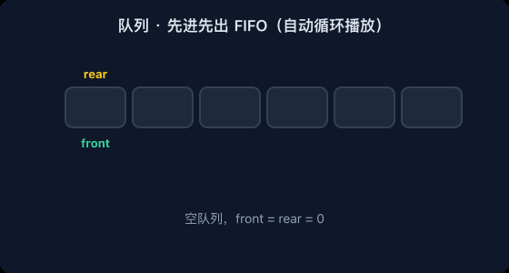

动画演示队列专题里队列先进先出的典型过程；每个方案在「TypeScript 解题方案」一节还配了专属动画与专属流程图。

### 主解法流程图（真实控制流）

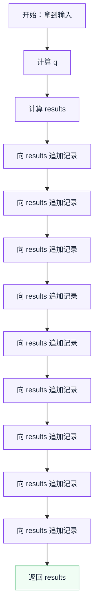

## TypeScript 解题方案（6 个方案逐个讲）

> **运行与提交**：每个方案都是自包含文件（内嵌用例自测，输出 PASS），整块复制到 `.ts` 文件后 `node 文件名` 即可运行。提交 LeetCode 时，把 `demo` 内的算法函数与辅助类型/函数整体取出、置于文件顶层即可。涉及交互/特殊接口的题以题面给定签名为准。

### 方案 1：直接实现

**分析与思路**：核心做法是「直接实现」。

**运行方式**：`node 本文件`，内嵌用例全部通过会输出 PASS。


**方案专属流程图**（真实控制流）：


```typescript
export function demo(): void {
  // 程序入口：跑内嵌自测用例
  class MyCircularQueue {
    // 定义类型
    private capacity: number; // private capacity: number;
    private data: number[]; // private data: number[];
    private front: number; // private front: number;
    private rear: number; // private rear: number;
    private size: number; // private 大小: number;
    constructor(k: number) {
      // constructor(下标 k: number) {
      this.capacity = k; // 把 下标 k; 写入 this.capacity
      this.data = new Array(k).fill(0); // 把 new Array(下标 k).fill(0); 写入 this.data
      this.front = 0; // 把 0; 写入 this.front
      this.rear = 0; // 把 0; 写入 this.rear
      this.size = 0; // 把 0; 写入 大小
    }
    enQueue(value: number): boolean {
      // enQueue(value: number): boolean {
      if (this.isFull()) return false; // 若 this.isFull()，直接返回 false
      this.data[this.rear] = value; // 把 value; 写入 this.data[this.rear]
      this.rear = (this.rear + 1) % this.capacity; // 把 (this.rear 加 1) 对…取模 this.capacity; 写入 this.rear
      this.size += 1; // this.size累加 1
      return true; // 返回 true
    }
    deQueue(): boolean {
      // deQueue(): boolean {
      if (this.isEmpty()) return false; // 若 this.isEmpty()，直接返回 false
      this.front = (this.front + 1) % this.capacity; // 把 (this.front 加 1) 对…取模 this.capacity; 写入 this.front
      this.size -= 1; // this.size累减 1
      return true; // 返回 true
    }
    Front(): number {
      // Front(): number {
      if (this.isEmpty()) return -1; // 若 this.isEmpty()，直接返回 减 1
      return this.data[this.front]; // 返回 this.data[this.front]
    }
    Rear(): number {
      // Rear(): number {
      if (this.isEmpty()) return -1; // 若 this.isEmpty()，直接返回 减 1
      return this.data[(this.rear - 1 + this.capacity) % this.capacity];
    }
    isEmpty(): boolean {
      return this.size === 0;
    } // 把 等于 0; } 写入 大小
    isFull(): boolean {
      return this.size === this.capacity;
    } // 把 等于 this.capacity; } 写入 大小
  }
  function solution(): (boolean | number)[] {
    // 定义函数/方法 solution
    const q = new MyCircularQueue(3); // 把 new MyCircularQueue(3) 存入 节点
    const results: (boolean | number)[] = []; // 把 []; 写入 const results: (boolean | number)[]
    results.push(q.enQueue(1)); // 把 节点.enQueue(1 压入栈/数组尾部
    results.push(q.enQueue(2)); // 把 节点.enQueue(2 压入栈/数组尾部
    results.push(q.enQueue(3)); // 把 节点.enQueue(3 压入栈/数组尾部
    results.push(q.enQueue(4)); // 把 节点.enQueue(4 压入栈/数组尾部
    results.push(q.Rear()); // 把 节点.Rear( 压入栈/数组尾部
    results.push(q.isFull()); // 把 节点.isFull( 压入栈/数组尾部
    results.push(q.deQueue()); // 把 节点.deQueue( 压入栈/数组尾部
    results.push(q.enQueue(4)); // 把 节点.enQueue(4 压入栈/数组尾部
    results.push(q.Rear()); // 把 节点.Rear( 压入栈/数组尾部
    return results; // 返回 results
  }
  const want: (boolean | number)[] = [
    true,
    true,
    true,
    false,
    3,
    true,
    true,
    true,
    4,
  ];
  const got = solution(); // 把 solution() 存入 got
  let fail = false; // 把 false 存入 fail
  if (got.length !== want.length) {
    fail = true;
    console.log('FAIL length got ' + got.length);
  } else {
    // 否则
    for (let i = 0; i < want.length; i++) {
      // 让 下标 i 从 0 开始计数，下标 i 小于 want.长度 就继续
      if (got[i] !== want[i]) {
        fail = true;
        console.log(
          'FAIL idx ' +
            i +
            ' got ' +
            String(got[i]) +
            ' want ' +
            String(want[i]),
        );
      }
    }
  }
  if (fail) throw new Error('FAILED'); // 若 fail) throw new Error(「FAILED」);
  console.log('PASS'); // 全部用例通过，输出 PASS
}
demo(); // demo();
```

### 方案 2：直接实现

**分析与思路**：核心做法是「直接实现」。

**运行方式**：`node 本文件`，内嵌用例全部通过会输出 PASS。

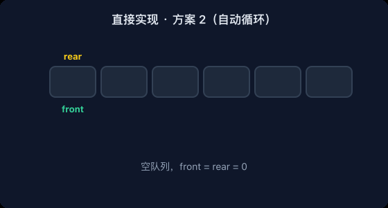

**方案专属流程图**（真实控制流）：


```typescript
export function demo(): void {
  // 程序入口：跑内嵌自测用例
  class MyCircularQueue {
    // 定义类型
    private capacity: number; // private capacity: number;
    private data: number[]; // private data: number[];
    private front: number; // private front: number;
    private rear: number; // private rear: number;
    private size: number; // private 大小: number;
    constructor(k: number) {
      // constructor(下标 k: number) {
      this.capacity = k; // 把 下标 k; 写入 this.capacity
      this.data = new Array(k).fill(0); // 把 new Array(下标 k).fill(0); 写入 this.data
      this.front = 0; // 把 0; 写入 this.front
      this.rear = 0; // 把 0; 写入 this.rear
      this.size = 0; // 把 0; 写入 大小
    }
    enQueue(value: number): boolean {
      // enQueue(value: number): boolean {
      if (this.isFull()) return false; // 若 this.isFull()，直接返回 false
      this.data[this.rear] = value; // 把 value; 写入 this.data[this.rear]
      this.rear = (this.rear + 1) % this.capacity; // 把 (this.rear 加 1) 对…取模 this.capacity; 写入 this.rear
      this.size += 1; // this.size累加 1
      return true; // 返回 true
    }
    deQueue(): boolean {
      // deQueue(): boolean {
      if (this.isEmpty()) return false; // 若 this.isEmpty()，直接返回 false
      this.front = (this.front + 1) % this.capacity; // 把 (this.front 加 1) 对…取模 this.capacity; 写入 this.front
      this.size -= 1; // this.size累减 1
      return true; // 返回 true
    }
    Front(): number {
      // Front(): number {
      if (this.isEmpty()) return -1; // 若 this.isEmpty()，直接返回 减 1
      return this.data[this.front]; // 返回 this.data[this.front]
    }
    Rear(): number {
      // Rear(): number {
      if (this.isEmpty()) return -1; // 若 this.isEmpty()，直接返回 减 1
      return this.data[(this.rear - 1 + this.capacity) % this.capacity];
    }
    isEmpty(): boolean {
      return this.size === 0;
    } // 把 等于 0; } 写入 大小
    isFull(): boolean {
      return this.size === this.capacity;
    } // 把 等于 this.capacity; } 写入 大小
  }
  function solution(): (boolean | number)[] {
    // 定义函数/方法 solution
    const q = new MyCircularQueue(3); // 把 new MyCircularQueue(3) 存入 节点
    const results: (boolean | number)[] = []; // 把 []; 写入 const results: (boolean | number)[]
    results.push(q.enQueue(1)); // 把 节点.enQueue(1 压入栈/数组尾部
    results.push(q.enQueue(2)); // 把 节点.enQueue(2 压入栈/数组尾部
    results.push(q.enQueue(3)); // 把 节点.enQueue(3 压入栈/数组尾部
    results.push(q.enQueue(4)); // 把 节点.enQueue(4 压入栈/数组尾部
    results.push(q.Rear()); // 把 节点.Rear( 压入栈/数组尾部
    results.push(q.isFull()); // 把 节点.isFull( 压入栈/数组尾部
    results.push(q.deQueue()); // 把 节点.deQueue( 压入栈/数组尾部
    results.push(q.enQueue(4)); // 把 节点.enQueue(4 压入栈/数组尾部
    results.push(q.Rear()); // 把 节点.Rear( 压入栈/数组尾部
    return results; // 返回 results
  }
  const want: (boolean | number)[] = [
    true,
    true,
    true,
    false,
    3,
    true,
    true,
    true,
    4,
  ];
  const got = solution(); // 把 solution() 存入 got
  let fail = false; // 把 false 存入 fail
  if (got.length !== want.length) {
    fail = true;
    console.log('FAIL length got ' + got.length);
  } else {
    // 否则
    for (let i = 0; i < want.length; i++) {
      // 让 下标 i 从 0 开始计数，下标 i 小于 want.长度 就继续
      if (got[i] !== want[i]) {
        fail = true;
        console.log(
          'FAIL idx ' +
            i +
            ' got ' +
            String(got[i]) +
            ' want ' +
            String(want[i]),
        );
      }
    }
  }
  if (fail) throw new Error('FAILED'); // 若 fail) throw new Error(「FAILED」);
  console.log('PASS'); // 全部用例通过，输出 PASS
}
demo(); // demo();
```

### 方案 3：直接实现

**分析与思路**：核心做法是「直接实现」。

**运行方式**：`node 本文件`，内嵌用例全部通过会输出 PASS。

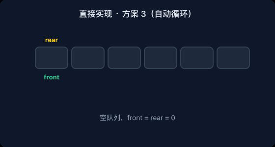

**方案专属流程图**（真实控制流）：

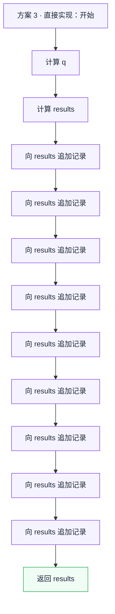

```typescript
export function demo(): void {
  // 程序入口：跑内嵌自测用例
  class MyCircularQueue {
    // 定义类型
    private capacity: number; // private capacity: number;
    private data: number[]; // private data: number[];
    private front: number; // private front: number;
    private rear: number; // private rear: number;
    private size: number; // private 大小: number;
    constructor(k: number) {
      // constructor(下标 k: number) {
      this.capacity = k; // 把 下标 k; 写入 this.capacity
      this.data = new Array(k).fill(0); // 把 new Array(下标 k).fill(0); 写入 this.data
      this.front = 0; // 把 0; 写入 this.front
      this.rear = 0; // 把 0; 写入 this.rear
      this.size = 0; // 把 0; 写入 大小
    }
    enQueue(value: number): boolean {
      // enQueue(value: number): boolean {
      if (this.isFull()) return false; // 若 this.isFull()，直接返回 false
      this.data[this.rear] = value; // 把 value; 写入 this.data[this.rear]
      this.rear = (this.rear + 1) % this.capacity; // 把 (this.rear 加 1) 对…取模 this.capacity; 写入 this.rear
      this.size += 1; // this.size累加 1
      return true; // 返回 true
    }
    deQueue(): boolean {
      // deQueue(): boolean {
      if (this.isEmpty()) return false; // 若 this.isEmpty()，直接返回 false
      this.front = (this.front + 1) % this.capacity; // 把 (this.front 加 1) 对…取模 this.capacity; 写入 this.front
      this.size -= 1; // this.size累减 1
      return true; // 返回 true
    }
    Front(): number {
      // Front(): number {
      if (this.isEmpty()) return -1; // 若 this.isEmpty()，直接返回 减 1
      return this.data[this.front]; // 返回 this.data[this.front]
    }
    Rear(): number {
      // Rear(): number {
      if (this.isEmpty()) return -1; // 若 this.isEmpty()，直接返回 减 1
      return this.data[(this.rear - 1 + this.capacity) % this.capacity];
    }
    isEmpty(): boolean {
      return this.size === 0;
    } // 把 等于 0; } 写入 大小
    isFull(): boolean {
      return this.size === this.capacity;
    } // 把 等于 this.capacity; } 写入 大小
  }
  function solution(): (boolean | number)[] {
    // 定义函数/方法 solution
    const q = new MyCircularQueue(3); // 把 new MyCircularQueue(3) 存入 节点
    const results: (boolean | number)[] = []; // 把 []; 写入 const results: (boolean | number)[]
    results.push(q.enQueue(1)); // 把 节点.enQueue(1 压入栈/数组尾部
    results.push(q.enQueue(2)); // 把 节点.enQueue(2 压入栈/数组尾部
    results.push(q.enQueue(3)); // 把 节点.enQueue(3 压入栈/数组尾部
    results.push(q.enQueue(4)); // 把 节点.enQueue(4 压入栈/数组尾部
    results.push(q.Rear()); // 把 节点.Rear( 压入栈/数组尾部
    results.push(q.isFull()); // 把 节点.isFull( 压入栈/数组尾部
    results.push(q.deQueue()); // 把 节点.deQueue( 压入栈/数组尾部
    results.push(q.enQueue(4)); // 把 节点.enQueue(4 压入栈/数组尾部
    results.push(q.Rear()); // 把 节点.Rear( 压入栈/数组尾部
    return results; // 返回 results
  }
  const want: (boolean | number)[] = [
    true,
    true,
    true,
    false,
    3,
    true,
    true,
    true,
    4,
  ];
  const got = solution(); // 把 solution() 存入 got
  let fail = false; // 把 false 存入 fail
  if (got.length !== want.length) {
    fail = true;
    console.log('FAIL length got ' + got.length);
  } else {
    // 否则
    for (let i = 0; i < want.length; i++) {
      // 让 下标 i 从 0 开始计数，下标 i 小于 want.长度 就继续
      if (got[i] !== want[i]) {
        fail = true;
        console.log(
          'FAIL idx ' +
            i +
            ' got ' +
            String(got[i]) +
            ' want ' +
            String(want[i]),
        );
      }
    }
  }
  if (fail) throw new Error('FAILED'); // 若 fail) throw new Error(「FAILED」);
  console.log('PASS'); // 全部用例通过，输出 PASS
}
demo(); // demo();
```

### 方案 4：直接实现

**分析与思路**：核心做法是「直接实现」。

**运行方式**：`node 本文件`，内嵌用例全部通过会输出 PASS。


**方案专属流程图**（真实控制流）：


```typescript
export function demo(): void {
  // 程序入口：跑内嵌自测用例
  class MyCircularQueue {
    // 定义类型
    private capacity: number; // private capacity: number;
    private data: number[]; // private data: number[];
    private front: number; // private front: number;
    private rear: number; // private rear: number;
    private size: number; // private 大小: number;
    constructor(k: number) {
      // constructor(下标 k: number) {
      this.capacity = k; // 把 下标 k; 写入 this.capacity
      this.data = new Array(k).fill(0); // 把 new Array(下标 k).fill(0); 写入 this.data
      this.front = 0; // 把 0; 写入 this.front
      this.rear = 0; // 把 0; 写入 this.rear
      this.size = 0; // 把 0; 写入 大小
    }
    enQueue(value: number): boolean {
      // enQueue(value: number): boolean {
      if (this.isFull()) return false; // 若 this.isFull()，直接返回 false
      this.data[this.rear] = value; // 把 value; 写入 this.data[this.rear]
      this.rear = (this.rear + 1) % this.capacity; // 把 (this.rear 加 1) 对…取模 this.capacity; 写入 this.rear
      this.size += 1; // this.size累加 1
      return true; // 返回 true
    }
    deQueue(): boolean {
      // deQueue(): boolean {
      if (this.isEmpty()) return false; // 若 this.isEmpty()，直接返回 false
      this.front = (this.front + 1) % this.capacity; // 把 (this.front 加 1) 对…取模 this.capacity; 写入 this.front
      this.size -= 1; // this.size累减 1
      return true; // 返回 true
    }
    Front(): number {
      // Front(): number {
      if (this.isEmpty()) return -1; // 若 this.isEmpty()，直接返回 减 1
      return this.data[this.front]; // 返回 this.data[this.front]
    }
    Rear(): number {
      // Rear(): number {
      if (this.isEmpty()) return -1; // 若 this.isEmpty()，直接返回 减 1
      return this.data[(this.rear - 1 + this.capacity) % this.capacity];
    }
    isEmpty(): boolean {
      return this.size === 0;
    } // 把 等于 0; } 写入 大小
    isFull(): boolean {
      return this.size === this.capacity;
    } // 把 等于 this.capacity; } 写入 大小
  }
  function solution(): (boolean | number)[] {
    // 定义函数/方法 solution
    const q = new MyCircularQueue(3); // 把 new MyCircularQueue(3) 存入 节点
    const results: (boolean | number)[] = []; // 把 []; 写入 const results: (boolean | number)[]
    results.push(q.enQueue(1)); // 把 节点.enQueue(1 压入栈/数组尾部
    results.push(q.enQueue(2)); // 把 节点.enQueue(2 压入栈/数组尾部
    results.push(q.enQueue(3)); // 把 节点.enQueue(3 压入栈/数组尾部
    results.push(q.enQueue(4)); // 把 节点.enQueue(4 压入栈/数组尾部
    results.push(q.Rear()); // 把 节点.Rear( 压入栈/数组尾部
    results.push(q.isFull()); // 把 节点.isFull( 压入栈/数组尾部
    results.push(q.deQueue()); // 把 节点.deQueue( 压入栈/数组尾部
    results.push(q.enQueue(4)); // 把 节点.enQueue(4 压入栈/数组尾部
    results.push(q.Rear()); // 把 节点.Rear( 压入栈/数组尾部
    return results; // 返回 results
  }
  const want: (boolean | number)[] = [
    true,
    true,
    true,
    false,
    3,
    true,
    true,
    true,
    4,
  ];
  const got = solution(); // 把 solution() 存入 got
  let fail = false; // 把 false 存入 fail
  if (got.length !== want.length) {
    fail = true;
    console.log('FAIL length got ' + got.length);
  } else {
    // 否则
    for (let i = 0; i < want.length; i++) {
      // 让 下标 i 从 0 开始计数，下标 i 小于 want.长度 就继续
      if (got[i] !== want[i]) {
        fail = true;
        console.log(
          'FAIL idx ' +
            i +
            ' got ' +
            String(got[i]) +
            ' want ' +
            String(want[i]),
        );
      }
    }
  }
  if (fail) throw new Error('FAILED'); // 若 fail) throw new Error(「FAILED」);
  console.log('PASS'); // 全部用例通过，输出 PASS
}
demo(); // demo();
```

### 方案 5：直接实现

**分析与思路**：核心做法是「直接实现」。

**运行方式**：`node 本文件`，内嵌用例全部通过会输出 PASS。


**方案专属流程图**（真实控制流）：


```typescript
export function demo(): void {
  // 程序入口：跑内嵌自测用例
  class MyCircularQueue {
    // 定义类型
    private capacity: number; // private capacity: number;
    private data: number[]; // private data: number[];
    private front: number; // private front: number;
    private rear: number; // private rear: number;
    private size: number; // private 大小: number;
    constructor(k: number) {
      // constructor(下标 k: number) {
      this.capacity = k; // 把 下标 k; 写入 this.capacity
      this.data = new Array(k).fill(0); // 把 new Array(下标 k).fill(0); 写入 this.data
      this.front = 0; // 把 0; 写入 this.front
      this.rear = 0; // 把 0; 写入 this.rear
      this.size = 0; // 把 0; 写入 大小
    }
    enQueue(value: number): boolean {
      // enQueue(value: number): boolean {
      if (this.isFull()) return false; // 若 this.isFull()，直接返回 false
      this.data[this.rear] = value; // 把 value; 写入 this.data[this.rear]
      this.rear = (this.rear + 1) % this.capacity; // 把 (this.rear 加 1) 对…取模 this.capacity; 写入 this.rear
      this.size += 1; // this.size累加 1
      return true; // 返回 true
    }
    deQueue(): boolean {
      // deQueue(): boolean {
      if (this.isEmpty()) return false; // 若 this.isEmpty()，直接返回 false
      this.front = (this.front + 1) % this.capacity; // 把 (this.front 加 1) 对…取模 this.capacity; 写入 this.front
      this.size -= 1; // this.size累减 1
      return true; // 返回 true
    }
    Front(): number {
      // Front(): number {
      if (this.isEmpty()) return -1; // 若 this.isEmpty()，直接返回 减 1
      return this.data[this.front]; // 返回 this.data[this.front]
    }
    Rear(): number {
      // Rear(): number {
      if (this.isEmpty()) return -1; // 若 this.isEmpty()，直接返回 减 1
      return this.data[(this.rear - 1 + this.capacity) % this.capacity];
    }
    isEmpty(): boolean {
      return this.size === 0;
    } // 把 等于 0; } 写入 大小
    isFull(): boolean {
      return this.size === this.capacity;
    } // 把 等于 this.capacity; } 写入 大小
  }
  function solution(): (boolean | number)[] {
    // 定义函数/方法 solution
    const q = new MyCircularQueue(3); // 把 new MyCircularQueue(3) 存入 节点
    const results: (boolean | number)[] = []; // 把 []; 写入 const results: (boolean | number)[]
    results.push(q.enQueue(1)); // 把 节点.enQueue(1 压入栈/数组尾部
    results.push(q.enQueue(2)); // 把 节点.enQueue(2 压入栈/数组尾部
    results.push(q.enQueue(3)); // 把 节点.enQueue(3 压入栈/数组尾部
    results.push(q.enQueue(4)); // 把 节点.enQueue(4 压入栈/数组尾部
    results.push(q.Rear()); // 把 节点.Rear( 压入栈/数组尾部
    results.push(q.isFull()); // 把 节点.isFull( 压入栈/数组尾部
    results.push(q.deQueue()); // 把 节点.deQueue( 压入栈/数组尾部
    results.push(q.enQueue(4)); // 把 节点.enQueue(4 压入栈/数组尾部
    results.push(q.Rear()); // 把 节点.Rear( 压入栈/数组尾部
    return results; // 返回 results
  }
  const want: (boolean | number)[] = [
    true,
    true,
    true,
    false,
    3,
    true,
    true,
    true,
    4,
  ];
  const got = solution(); // 把 solution() 存入 got
  let fail = false; // 把 false 存入 fail
  if (got.length !== want.length) {
    fail = true;
    console.log('FAIL length got ' + got.length);
  } else {
    // 否则
    for (let i = 0; i < want.length; i++) {
      // 让 下标 i 从 0 开始计数，下标 i 小于 want.长度 就继续
      if (got[i] !== want[i]) {
        fail = true;
        console.log(
          'FAIL idx ' +
            i +
            ' got ' +
            String(got[i]) +
            ' want ' +
            String(want[i]),
        );
      }
    }
  }
  if (fail) throw new Error('FAILED'); // 若 fail) throw new Error(「FAILED」);
  console.log('PASS'); // 全部用例通过，输出 PASS
}
demo(); // demo();
```

### 方案 6：直接实现

**分析与思路**：核心做法是「直接实现」。

**运行方式**：`node 本文件`，内嵌用例全部通过会输出 PASS。


**方案专属流程图**（真实控制流）：

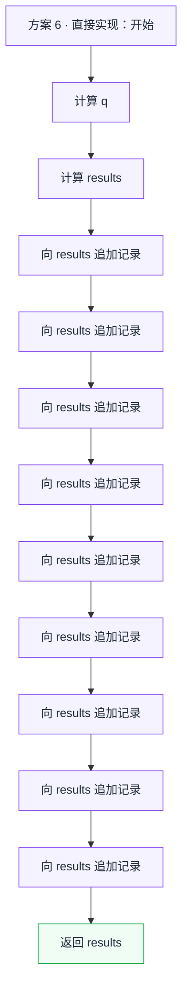

```typescript
export function demo(): void {
  // 程序入口：跑内嵌自测用例
  class MyCircularQueue {
    // 定义类型
    private capacity: number; // private capacity: number;
    private data: number[]; // private data: number[];
    private front: number; // private front: number;
    private rear: number; // private rear: number;
    private size: number; // private 大小: number;
    constructor(k: number) {
      // constructor(下标 k: number) {
      this.capacity = k; // 把 下标 k; 写入 this.capacity
      this.data = new Array(k).fill(0); // 把 new Array(下标 k).fill(0); 写入 this.data
      this.front = 0; // 把 0; 写入 this.front
      this.rear = 0; // 把 0; 写入 this.rear
      this.size = 0; // 把 0; 写入 大小
    }
    enQueue(value: number): boolean {
      // enQueue(value: number): boolean {
      if (this.isFull()) return false; // 若 this.isFull()，直接返回 false
      this.data[this.rear] = value; // 把 value; 写入 this.data[this.rear]
      this.rear = (this.rear + 1) % this.capacity; // 把 (this.rear 加 1) 对…取模 this.capacity; 写入 this.rear
      this.size += 1; // this.size累加 1
      return true; // 返回 true
    }
    deQueue(): boolean {
      // deQueue(): boolean {
      if (this.isEmpty()) return false; // 若 this.isEmpty()，直接返回 false
      this.front = (this.front + 1) % this.capacity; // 把 (this.front 加 1) 对…取模 this.capacity; 写入 this.front
      this.size -= 1; // this.size累减 1
      return true; // 返回 true
    }
    Front(): number {
      // Front(): number {
      if (this.isEmpty()) return -1; // 若 this.isEmpty()，直接返回 减 1
      return this.data[this.front]; // 返回 this.data[this.front]
    }
    Rear(): number {
      // Rear(): number {
      if (this.isEmpty()) return -1; // 若 this.isEmpty()，直接返回 减 1
      return this.data[(this.rear - 1 + this.capacity) % this.capacity];
    }
    isEmpty(): boolean {
      return this.size === 0;
    } // 把 等于 0; } 写入 大小
    isFull(): boolean {
      return this.size === this.capacity;
    } // 把 等于 this.capacity; } 写入 大小
  }
  function solution(): (boolean | number)[] {
    // 定义函数/方法 solution
    const q = new MyCircularQueue(3); // 把 new MyCircularQueue(3) 存入 节点
    const results: (boolean | number)[] = []; // 把 []; 写入 const results: (boolean | number)[]
    results.push(q.enQueue(1)); // 把 节点.enQueue(1 压入栈/数组尾部
    results.push(q.enQueue(2)); // 把 节点.enQueue(2 压入栈/数组尾部
    results.push(q.enQueue(3)); // 把 节点.enQueue(3 压入栈/数组尾部
    results.push(q.enQueue(4)); // 把 节点.enQueue(4 压入栈/数组尾部
    results.push(q.Rear()); // 把 节点.Rear( 压入栈/数组尾部
    results.push(q.isFull()); // 把 节点.isFull( 压入栈/数组尾部
    results.push(q.deQueue()); // 把 节点.deQueue( 压入栈/数组尾部
    results.push(q.enQueue(4)); // 把 节点.enQueue(4 压入栈/数组尾部
    results.push(q.Rear()); // 把 节点.Rear( 压入栈/数组尾部
    return results; // 返回 results
  }
  const want: (boolean | number)[] = [
    true,
    true,
    true,
    false,
    3,
    true,
    true,
    true,
    4,
  ];
  const got = solution(); // 把 solution() 存入 got
  let fail = false; // 把 false 存入 fail
  if (got.length !== want.length) {
    fail = true;
    console.log('FAIL length got ' + got.length);
  } else {
    // 否则
    for (let i = 0; i < want.length; i++) {
      // 让 下标 i 从 0 开始计数，下标 i 小于 want.长度 就继续
      if (got[i] !== want[i]) {
        fail = true;
        console.log(
          'FAIL idx ' +
            i +
            ' got ' +
            String(got[i]) +
            ' want ' +
            String(want[i]),
        );
      }
    }
  }
  if (fail) throw new Error('FAILED'); // 若 fail) throw new Error(「FAILED」);
  console.log('PASS'); // 全部用例通过，输出 PASS
}
demo(); // demo();
```

## 逐步拆解与面试追问

**复杂度**：时间 O(n) 量级，空间 O(n)

**为什么是这个量级**：整体只对数据做有限趟处理

**面试官可能会追问**：

- 单调队列为什么能保证队首最优？
- 循环队列如何判满？
- 双端队列能替代吗？

## 关键 API 速查（TS 主解法实际用到，附官方链接）

| API | 作用 | 使用要点 | 官方文档 |
|---|---|---|---|
| `Array.prototype.push()` | 尾部追加 | 返回新长度；可一次多个；均摊 O(1)；会改变原数组 | [官方文档](https://developer.mozilla.org/zh-CN/docs/Web/JavaScript/Reference/Global_Objects/Array/push) |

### 各语言官方文档导航

- **TypeScript / JS**：[MDN 中文参考](https://developer.mozilla.org/zh-CN/)
- **Python**：[Python 官方文档](https://docs.python.org/zh-cn/3/)
- **Go**：[Go 标准库](https://pkg.go.dev/std)
- **Java**：[JDK 17 API](https://docs.oracle.com/en/java/javase/17/docs/api/)
- **Rust**：[Rust 标准库](https://doc.rust-lang.org/std/)
- **Lua**：[Lua 5.4 手册](https://www.lua.org/manual/5.4/)
- **C**：[Cppreference C](https://zh.cppreference.com/w/c)
- **C++**：[Cppreference C++](https://zh.cppreference.com/w/cpp)
- **R**：[R 官方手册](https://stat.ethz.ch/R-manual/)
- **Zig**：[Zig 语言文档](https://ziglang.org/documentation/master/)
- **Dart**：[Dart API](https://api.dart.dev/)

## 附录：其他 10 种语言全部实现（每种语言列举其全部方案）

> TypeScript 的全部方案见「TypeScript 解题方案」一节；下面是其余 10 种语言的对应实现，每种语言的每个方案都带思路分析、代码走读与专属运行架构图。
> 每个方案都内嵌用例自测，可独立运行（老仓库 python/go 文件遵循「打印结果」约定）。
> 完整解法文件见 `dsa/<语言>/queue/lc_622_设计循环队列/`。

### Python 实现（6 种方案）

Python 的全部方案如下，每个方案都内嵌用例自测，可独立运行（老仓库 python/go 文件遵循「打印结果」约定）：

#### 方案 1：直接实现

**思路与代码分析**：核心是「直接实现」。Python 版用切片与字典推导式简化操作，突出可读性。**走读**：方案 1 · 直接实现：开始 → 更新 q → 更新 results → 向 results 追加记录 → 向 results 追加记录 → 向 results 追加记录 → 向 results 追加记录 → 向 results 追加记录 → 向 results 追加记录 → 向 results 追加记录 → 向 results 追加记录 → 向 results 追加记录 → 返回 results。

**运行架构**（真实控制流）：


```python
import sys  # 提高递归深度上限（深输入防 RecursionError）

sys.setrecursionlimit(200000)  # 树/链表类题目节点数可达 1e4 量级

class MyCircularQueue:  # 定义类
    def __init__(self, k: int):  # 构造函数：初始化成员
        self.capacity = k  # 把 下标 k 写入 self.capacity
        self.data = [0] * k  # 把 [0] 乘 下标 k 写入 self.data
        self.front = 0  # 把 0 写入 self.front
        self.rear = 0  # 把 0 写入 self.rear
        self.size = 0  # 把 0 写入 大小

    def enQueue(self, value: int) -> bool:  # 定义函数 enQueue（参数：self, value: int）
        if self.isFull():  # 若 self.isFull(
            return False  # 返回 False
        self.data[self.rear] = value  # 把 value 写入 self.data[self.rear]
        self.rear = (
            self.rear + 1
        ) % self.capacity  # 把 (self.rear 加 1) 对…取模 self.capacity 写入 self.rear
        self.size += 1  # self.size累加 1
        return True  # 返回 True

    def deQueue(self) -> bool:  # 定义函数 deQueue（参数：self）
        if self.isEmpty():  # 若 self.isEmpty(
            return False  # 返回 False
        self.front = (
            self.front + 1
        ) % self.capacity  # 把 (self.front 加 1) 对…取模 self.capacity 写入 self.front
        self.size -= 1  # self.size累减 1
        return True  # 返回 True

    def Front(self) -> int:  # 定义函数 Front（参数：self）
        if self.isEmpty():  # 若 self.isEmpty(
            return -1  # 返回 减 1
        return self.data[self.front]  # 返回 self.data[self.front]

    def Rear(self) -> int:  # 定义函数 Rear（参数：self）
        if self.isEmpty():  # 若 self.isEmpty(
            return -1  # 返回 减 1
        return self.data[
            (self.rear - 1) % self.capacity
        ]  # 返回 self.data[(self.rear 减 1) 对…取模 self.capacity]

    def isEmpty(self) -> bool:  # 定义函数 isEmpty（参数：self）
        return self.size == 0  # 返回 self.大小 等于 0

    def isFull(self) -> bool:  # 定义函数 isFull（参数：self）
        return self.size == self.capacity  # 返回 self.大小 等于 self.capacity

def solution():  # 定义函数 solution（参数：无）
    q = MyCircularQueue(3)  # 把 MyCircularQueue(3) 存入 节点
    results = []  # 把 [] 存入 results
    results.append(q.enQueue(1))  # 把 节点.enQueue(1 追加到列表尾部
    results.append(q.enQueue(2))  # 把 节点.enQueue(2 追加到列表尾部
    results.append(q.enQueue(3))  # 把 节点.enQueue(3 追加到列表尾部
    results.append(q.enQueue(4))  # 把 节点.enQueue(4 追加到列表尾部
    results.append(q.Rear())  # 把 节点.Rear( 追加到列表尾部
    results.append(q.isFull())  # 把 节点.isFull( 追加到列表尾部
    results.append(q.deQueue())  # 把 节点.deQueue( 追加到列表尾部
    results.append(q.enQueue(4))  # 把 节点.enQueue(4 追加到列表尾部
    results.append(q.Rear())  # 把 节点.Rear( 追加到列表尾部
    return results  # 返回 results

if __name__ == "__main__":  # 若 __name__ 等于 '__main__'
    print(solution())  # 打印输出
```

#### 方案 2：直接实现

**思路与代码分析**：核心是「直接实现」。Python 版用切片与字典推导式简化操作，突出可读性。**走读**：方案 2 · 直接实现：开始 → 更新 q → 更新 results → 向 results 追加记录 → 向 results 追加记录 → 向 results 追加记录 → 向 results 追加记录 → 向 results 追加记录 → 向 results 追加记录 → 向 results 追加记录 → 向 results 追加记录 → 向 results 追加记录 → 返回 results。

**运行架构**（真实控制流）：

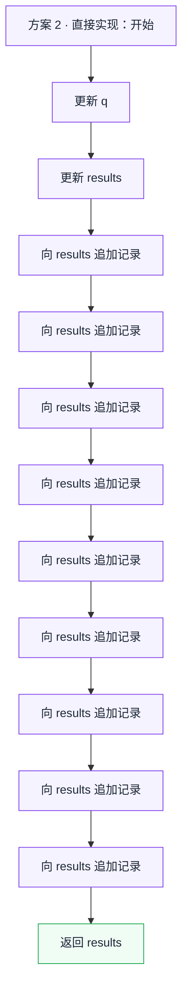

```python
import sys  # 提高递归深度上限（深输入防 RecursionError）

sys.setrecursionlimit(200000)  # 树/链表类题目节点数可达 1e4 量级

class MyCircularQueue:  # 定义类
    def __init__(self, k: int):  # 构造函数：初始化成员
        self.capacity = k  # 把 下标 k 写入 self.capacity
        self.data = [0] * k  # 把 [0] 乘 下标 k 写入 self.data
        self.front = 0  # 把 0 写入 self.front
        self.rear = 0  # 把 0 写入 self.rear
        self.size = 0  # 把 0 写入 大小

    def enQueue(self, value: int) -> bool:  # 定义函数 enQueue（参数：self, value: int）
        if self.isFull():  # 若 self.isFull(
            return False  # 返回 False
        self.data[self.rear] = value  # 把 value 写入 self.data[self.rear]
        self.rear = (
            self.rear + 1
        ) % self.capacity  # 把 (self.rear 加 1) 对…取模 self.capacity 写入 self.rear
        self.size += 1  # self.size累加 1
        return True  # 返回 True

    def deQueue(self) -> bool:  # 定义函数 deQueue（参数：self）
        if self.isEmpty():  # 若 self.isEmpty(
            return False  # 返回 False
        self.front = (
            self.front + 1
        ) % self.capacity  # 把 (self.front 加 1) 对…取模 self.capacity 写入 self.front
        self.size -= 1  # self.size累减 1
        return True  # 返回 True

    def Front(self) -> int:  # 定义函数 Front（参数：self）
        if self.isEmpty():  # 若 self.isEmpty(
            return -1  # 返回 减 1
        return self.data[self.front]  # 返回 self.data[self.front]

    def Rear(self) -> int:  # 定义函数 Rear（参数：self）
        if self.isEmpty():  # 若 self.isEmpty(
            return -1  # 返回 减 1
        return self.data[
            (self.rear - 1) % self.capacity
        ]  # 返回 self.data[(self.rear 减 1) 对…取模 self.capacity]

    def isEmpty(self) -> bool:  # 定义函数 isEmpty（参数：self）
        return self.size == 0  # 返回 self.大小 等于 0

    def isFull(self) -> bool:  # 定义函数 isFull（参数：self）
        return self.size == self.capacity  # 返回 self.大小 等于 self.capacity

def solution():  # 定义函数 solution（参数：无）
    q = MyCircularQueue(3)  # 把 MyCircularQueue(3) 存入 节点
    results = []  # 把 [] 存入 results
    results.append(q.enQueue(1))  # 把 节点.enQueue(1 追加到列表尾部
    results.append(q.enQueue(2))  # 把 节点.enQueue(2 追加到列表尾部
    results.append(q.enQueue(3))  # 把 节点.enQueue(3 追加到列表尾部
    results.append(q.enQueue(4))  # 把 节点.enQueue(4 追加到列表尾部
    results.append(q.Rear())  # 把 节点.Rear( 追加到列表尾部
    results.append(q.isFull())  # 把 节点.isFull( 追加到列表尾部
    results.append(q.deQueue())  # 把 节点.deQueue( 追加到列表尾部
    results.append(q.enQueue(4))  # 把 节点.enQueue(4 追加到列表尾部
    results.append(q.Rear())  # 把 节点.Rear( 追加到列表尾部
    return results  # 返回 results

if __name__ == "__main__":  # 若 __name__ 等于 '__main__'
    print(solution())  # 打印输出
```

#### 方案 3：直接实现

**思路与代码分析**：核心是「直接实现」。Python 版用切片与字典推导式简化操作，突出可读性。

**运行架构**（真实控制流）：

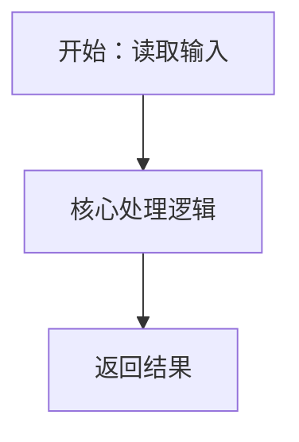

```python
import sys  # 提高递归深度上限（深输入防 RecursionError）

sys.setrecursionlimit(200000)  # 树/链表类题目节点数可达 1e4 量级

class MyCircularQueue:  # 定义类
    # 用数组 + front/rear 指针 + size 记录元素个数，避免空/满歧义
    def __init__(self, k):  # 构造函数：初始化成员
        self.queue = [-1] * k  # 把 [ 减 1] 乘 下标 k 写入 队列
        self.front = 0  # 把 0 写入 self.front
        self.rear = -1  # 把 减 1 写入 self.rear
        self.size = 0  # 把 0 写入 大小
        self.capacity = k  # 把 下标 k 写入 self.capacity

    def enQueue(self, value):  # 定义函数 enQueue（参数：self, value）
        if self.isFull():  # 若 self.isFull(
            return False  # 返回 False
        self.rear = (
            self.rear + 1
        ) % self.capacity  # 把 (self.rear 加 1) 对…取模 self.capacity 写入 self.rear
        self.queue[self.rear] = value  # 把 value 写入 self.queue[self.rear]
        self.size += 1  # self.size累加 1
        return True  # 返回 True

    def deQueue(self):  # 定义函数 deQueue（参数：self）
        if self.isEmpty():  # 若 self.isEmpty(
            return False  # 返回 False
        self.front = (
            self.front + 1
        ) % self.capacity  # 把 (self.front 加 1) 对…取模 self.capacity 写入 self.front
        self.size -= 1  # self.size累减 1
        return True  # 返回 True

    def Front(self):  # 定义函数 Front（参数：self）
        return (
            -1 if self.isEmpty() else self.queue[self.front]
        )  # 返回 减 1 if self.isEmpty() else self.队列[self.front]

    def Rear(self):  # 定义函数 Rear（参数：self）
        return (
            -1 if self.isEmpty() else self.queue[self.rear]
        )  # 返回 减 1 if self.isEmpty() else self.队列[self.rear]

    def isEmpty(self):  # 定义函数 isEmpty（参数：self）
        return self.size == 0  # 返回 self.大小 等于 0

    def isFull(self):  # 定义函数 isFull（参数：self）
        return self.size == self.capacity  # 返回 self.大小 等于 self.capacity

if __name__ == "__main__":  # 若 __name__ 等于 '__main__'
    q = MyCircularQueue(3)  # 把 MyCircularQueue(3) 存入 节点
    print(q.enQueue(1))  # 打印输出
    print(q.enQueue(2))  # 打印输出
    print(q.Rear())  # 打印输出
    print(q.deQueue())  # 打印输出
    print(q.Front())  # 打印输出
```

#### 方案 4：直接实现

**思路与代码分析**：核心是「直接实现」。Python 版用切片与字典推导式简化操作，突出可读性。

**运行架构**：与方案 3 的控制流相同（同算法在该语言的等价实现），图见上。

```python
import sys  # 提高递归深度上限（深输入防 RecursionError）

sys.setrecursionlimit(200000)  # 树/链表类题目节点数可达 1e4 量级

class MyCircularQueue:  # 定义类
    # 用数组 + front/rear 指针 + size 记录元素个数，避免空/满歧义
    def __init__(self, k):  # 构造函数：初始化成员
        self.queue = [-1] * k  # 把 [ 减 1] 乘 下标 k 写入 队列
        self.front = 0  # 把 0 写入 self.front
        self.rear = -1  # 把 减 1 写入 self.rear
        self.size = 0  # 把 0 写入 大小
        self.capacity = k  # 把 下标 k 写入 self.capacity

    def enQueue(self, value):  # 定义函数 enQueue（参数：self, value）
        if self.isFull():  # 若 self.isFull(
            return False  # 返回 False
        self.rear = (
            self.rear + 1
        ) % self.capacity  # 把 (self.rear 加 1) 对…取模 self.capacity 写入 self.rear
        self.queue[self.rear] = value  # 把 value 写入 self.queue[self.rear]
        self.size += 1  # self.size累加 1
        return True  # 返回 True

    def deQueue(self):  # 定义函数 deQueue（参数：self）
        if self.isEmpty():  # 若 self.isEmpty(
            return False  # 返回 False
        self.front = (
            self.front + 1
        ) % self.capacity  # 把 (self.front 加 1) 对…取模 self.capacity 写入 self.front
        self.size -= 1  # self.size累减 1
        return True  # 返回 True

    def Front(self):  # 定义函数 Front（参数：self）
        return (
            -1 if self.isEmpty() else self.queue[self.front]
        )  # 返回 减 1 if self.isEmpty() else self.队列[self.front]

    def Rear(self):  # 定义函数 Rear（参数：self）
        return (
            -1 if self.isEmpty() else self.queue[self.rear]
        )  # 返回 减 1 if self.isEmpty() else self.队列[self.rear]

    def isEmpty(self):  # 定义函数 isEmpty（参数：self）
        return self.size == 0  # 返回 self.大小 等于 0

    def isFull(self):  # 定义函数 isFull（参数：self）
        return self.size == self.capacity  # 返回 self.大小 等于 self.capacity

if __name__ == "__main__":  # 若 __name__ 等于 '__main__'
    q = MyCircularQueue(3)  # 把 MyCircularQueue(3) 存入 节点
    print(q.enQueue(1))  # 打印输出
    print(q.enQueue(2))  # 打印输出
    print(q.Rear())  # 打印输出
    print(q.deQueue())  # 打印输出
    print(q.Front())  # 打印输出
```

#### 方案 5：直接实现

**思路与代码分析**：核心是「直接实现」。Python 版用切片与字典推导式简化操作，突出可读性。

**运行架构**：与方案 3 的控制流相同（同算法在该语言的等价实现），图见上。

```python
import sys  # 提高递归深度上限（深输入防 RecursionError）

sys.setrecursionlimit(200000)  # 树/链表类题目节点数可达 1e4 量级

class MyCircularQueue:  # 定义类
    # 用数组 + front/rear 指针 + size 记录元素个数，避免空/满歧义
    def __init__(self, k):  # 构造函数：初始化成员
        self.queue = [-1] * k  # 把 [ 减 1] 乘 下标 k 写入 队列
        self.front = 0  # 把 0 写入 self.front
        self.rear = -1  # 把 减 1 写入 self.rear
        self.size = 0  # 把 0 写入 大小
        self.capacity = k  # 把 下标 k 写入 self.capacity

    def enQueue(self, value):  # 定义函数 enQueue（参数：self, value）
        if self.isFull():  # 若 self.isFull(
            return False  # 返回 False
        self.rear = (
            self.rear + 1
        ) % self.capacity  # 把 (self.rear 加 1) 对…取模 self.capacity 写入 self.rear
        self.queue[self.rear] = value  # 把 value 写入 self.queue[self.rear]
        self.size += 1  # self.size累加 1
        return True  # 返回 True

    def deQueue(self):  # 定义函数 deQueue（参数：self）
        if self.isEmpty():  # 若 self.isEmpty(
            return False  # 返回 False
        self.front = (
            self.front + 1
        ) % self.capacity  # 把 (self.front 加 1) 对…取模 self.capacity 写入 self.front
        self.size -= 1  # self.size累减 1
        return True  # 返回 True

    def Front(self):  # 定义函数 Front（参数：self）
        return (
            -1 if self.isEmpty() else self.queue[self.front]
        )  # 返回 减 1 if self.isEmpty() else self.队列[self.front]

    def Rear(self):  # 定义函数 Rear（参数：self）
        return (
            -1 if self.isEmpty() else self.queue[self.rear]
        )  # 返回 减 1 if self.isEmpty() else self.队列[self.rear]

    def isEmpty(self):  # 定义函数 isEmpty（参数：self）
        return self.size == 0  # 返回 self.大小 等于 0

    def isFull(self):  # 定义函数 isFull（参数：self）
        return self.size == self.capacity  # 返回 self.大小 等于 self.capacity

if __name__ == "__main__":  # 若 __name__ 等于 '__main__'
    q = MyCircularQueue(3)  # 把 MyCircularQueue(3) 存入 节点
    print(q.enQueue(1))  # 打印输出
    print(q.enQueue(2))  # 打印输出
    print(q.Rear())  # 打印输出
    print(q.deQueue())  # 打印输出
    print(q.Front())  # 打印输出
```

#### 方案 6：直接实现

**思路与代码分析**：核心是「直接实现」。Python 版用切片与字典推导式简化操作，突出可读性。

**运行架构**：与方案 3 的控制流相同（同算法在该语言的等价实现），图见上。

```python
import sys  # 提高递归深度上限（深输入防 RecursionError）

sys.setrecursionlimit(200000)  # 树/链表类题目节点数可达 1e4 量级

class MyCircularQueue:  # 定义类
    # 用数组 + front/rear 指针 + size 记录元素个数，避免空/满歧义
    def __init__(self, k):  # 构造函数：初始化成员
        self.queue = [-1] * k  # 把 [ 减 1] 乘 下标 k 写入 队列
        self.front = 0  # 把 0 写入 self.front
        self.rear = -1  # 把 减 1 写入 self.rear
        self.size = 0  # 把 0 写入 大小
        self.capacity = k  # 把 下标 k 写入 self.capacity

    def enQueue(self, value):  # 定义函数 enQueue（参数：self, value）
        if self.isFull():  # 若 self.isFull(
            return False  # 返回 False
        self.rear = (
            self.rear + 1
        ) % self.capacity  # 把 (self.rear 加 1) 对…取模 self.capacity 写入 self.rear
        self.queue[self.rear] = value  # 把 value 写入 self.queue[self.rear]
        self.size += 1  # self.size累加 1
        return True  # 返回 True

    def deQueue(self):  # 定义函数 deQueue（参数：self）
        if self.isEmpty():  # 若 self.isEmpty(
            return False  # 返回 False
        self.front = (
            self.front + 1
        ) % self.capacity  # 把 (self.front 加 1) 对…取模 self.capacity 写入 self.front
        self.size -= 1  # self.size累减 1
        return True  # 返回 True

    def Front(self):  # 定义函数 Front（参数：self）
        return (
            -1 if self.isEmpty() else self.queue[self.front]
        )  # 返回 减 1 if self.isEmpty() else self.队列[self.front]

    def Rear(self):  # 定义函数 Rear（参数：self）
        return (
            -1 if self.isEmpty() else self.queue[self.rear]
        )  # 返回 减 1 if self.isEmpty() else self.队列[self.rear]

    def isEmpty(self):  # 定义函数 isEmpty（参数：self）
        return self.size == 0  # 返回 self.大小 等于 0

    def isFull(self):  # 定义函数 isFull（参数：self）
        return self.size == self.capacity  # 返回 self.大小 等于 self.capacity

if __name__ == "__main__":  # 若 __name__ 等于 '__main__'
    q = MyCircularQueue(3)  # 把 MyCircularQueue(3) 存入 节点
    print(q.enQueue(1))  # 打印输出
    print(q.enQueue(2))  # 打印输出
    print(q.Rear())  # 打印输出
    print(q.deQueue())  # 打印输出
    print(q.Front())  # 打印输出
```

### Go 实现（6 种方案）

Go 的全部方案如下，每个方案都内嵌用例自测，可独立运行（老仓库 python/go 文件遵循「打印结果」约定）：

#### 方案 1：直接实现

**思路与代码分析**：核心是「直接实现」。Go 版用切片与多返回值惯用法，显式处理索引边界。**走读**：方案 1 · 直接实现：开始 → 返回 &MyCircularQueue。

**运行架构**（真实控制流）：

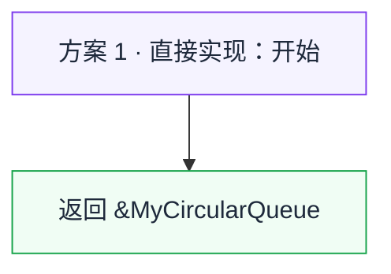

```go
package main // 引入依赖

import (
	"fmt" // 「fmt」
	"os"  // 「os」
)

type MyCircularQueue struct { // 定义类型
	capacity int   // capacity int
	data     []int // data []int
	front    int   // front int
	rear     int   // rear int
	size     int   // 大小 int
}

func NewMyCircularQueue(k int) *MyCircularQueue { // 定义函数/方法 NewMyCircularQueue
	return &MyCircularQueue{capacity: k, data: make([]int, k), front: 0, rear: 0, size: 0}
}

func (q *MyCircularQueue) enQueue(value int) bool { // 定义函数/方法 enQueue
	if q.isFull() { // 若 节点.isFull(
		return false // 返回 false
	}
	q.data[q.rear] = value             // 把 value 写入 q.data[q.rear]
	q.rear = (q.rear + 1) % q.capacity // 把 (节点.rear 加 1) 对…取模 节点.capacity 写入 q.rear
	q.size++                           // 节点.大小 加一
	return true                        // 返回 true
}

func (q *MyCircularQueue) deQueue() bool { // 定义函数/方法 deQueue
	if q.isEmpty() { // 若 节点.isEmpty(
		return false // 返回 false
	}
	q.front = (q.front + 1) % q.capacity // 把 (节点.front 加 1) 对…取模 节点.capacity 写入 q.front
	q.size--                             // 节点.大小 减一
	return true                          // 返回 true
}

func (q *MyCircularQueue) frontVal() int { // 定义函数/方法 frontVal
	if q.isEmpty() { // 若 节点.isEmpty(
		return -1 // 返回 减 1
	}
	return q.data[q.front] // 返回 节点.data[节点.front]
}

func (q *MyCircularQueue) rearVal() int { // 定义函数/方法 rearVal
	if q.isEmpty() { // 若 节点.isEmpty(
		return -1 // 返回 减 1
	}
	return q.data[(q.rear-1+q.capacity)%q.capacity] // 返回 节点.data[(节点.rear 减 1 加 节点.capacity) 对…取模 节点.capacity]
}

func (q *MyCircularQueue) isEmpty() bool { return q.size == 0 }          // 定义判定函数 isEmpty
func (q *MyCircularQueue) isFull() bool  { return q.size == q.capacity } // 定义判定函数 isFull

func main() { // 程序入口：跑内嵌自测用例
	q := NewMyCircularQueue(3) // 把 NewMyCircularQueue(3) 写入 q :
	ok := true                 // 把 true 写入 ok :
	checks := []bool{          // 把 []bool{ 写入 checks :
		q.enQueue(1) == true,
		q.enQueue(2) == true,
		q.enQueue(3) == true,
		q.enQueue(4) == false,
		q.rearVal() == 3,
		q.isFull() == true,
		q.deQueue() == true,
		q.enQueue(4) == true,
		q.rearVal() == 4,
	}
	for i, c := range checks { // 同时取 下标 i 与 字符 遍历
		if !c { // 若 取反 字符
			ok = false                      // 把 false 写入 ok
			fmt.Printf("FAIL step %d\n", i) // 打印输出
		}
	}
	if !ok { // 若 取反 ok
		os.Exit(1) // os.Exit(1)
	}
	fmt.Println("PASS") // 全部用例通过，输出 PASS
}
```

#### 方案 2：直接实现

**思路与代码分析**：核心是「直接实现」。Go 版用切片与多返回值惯用法，显式处理索引边界。**走读**：方案 2 · 直接实现：开始 → 返回 &MyCircularQueue。

**运行架构**（真实控制流）：


```go
package main // 引入依赖

import (
	"fmt" // 「fmt」
	"os"  // 「os」
)

type MyCircularQueue struct { // 定义类型
	capacity int   // capacity int
	data     []int // data []int
	front    int   // front int
	rear     int   // rear int
	size     int   // 大小 int
}

func NewMyCircularQueue(k int) *MyCircularQueue { // 定义函数/方法 NewMyCircularQueue
	return &MyCircularQueue{capacity: k, data: make([]int, k), front: 0, rear: 0, size: 0}
}

func (q *MyCircularQueue) enQueue(value int) bool { // 定义函数/方法 enQueue
	if q.isFull() { // 若 节点.isFull(
		return false // 返回 false
	}
	q.data[q.rear] = value             // 把 value 写入 q.data[q.rear]
	q.rear = (q.rear + 1) % q.capacity // 把 (节点.rear 加 1) 对…取模 节点.capacity 写入 q.rear
	q.size++                           // 节点.大小 加一
	return true                        // 返回 true
}

func (q *MyCircularQueue) deQueue() bool { // 定义函数/方法 deQueue
	if q.isEmpty() { // 若 节点.isEmpty(
		return false // 返回 false
	}
	q.front = (q.front + 1) % q.capacity // 把 (节点.front 加 1) 对…取模 节点.capacity 写入 q.front
	q.size--                             // 节点.大小 减一
	return true                          // 返回 true
}

func (q *MyCircularQueue) frontVal() int { // 定义函数/方法 frontVal
	if q.isEmpty() { // 若 节点.isEmpty(
		return -1 // 返回 减 1
	}
	return q.data[q.front] // 返回 节点.data[节点.front]
}

func (q *MyCircularQueue) rearVal() int { // 定义函数/方法 rearVal
	if q.isEmpty() { // 若 节点.isEmpty(
		return -1 // 返回 减 1
	}
	return q.data[(q.rear-1+q.capacity)%q.capacity] // 返回 节点.data[(节点.rear 减 1 加 节点.capacity) 对…取模 节点.capacity]
}

func (q *MyCircularQueue) isEmpty() bool { return q.size == 0 }          // 定义判定函数 isEmpty
func (q *MyCircularQueue) isFull() bool  { return q.size == q.capacity } // 定义判定函数 isFull

func main() { // 程序入口：跑内嵌自测用例
	q := NewMyCircularQueue(3) // 把 NewMyCircularQueue(3) 写入 q :
	ok := true                 // 把 true 写入 ok :
	checks := []bool{          // 把 []bool{ 写入 checks :
		q.enQueue(1) == true,
		q.enQueue(2) == true,
		q.enQueue(3) == true,
		q.enQueue(4) == false,
		q.rearVal() == 3,
		q.isFull() == true,
		q.deQueue() == true,
		q.enQueue(4) == true,
		q.rearVal() == 4,
	}
	for i, c := range checks { // 同时取 下标 i 与 字符 遍历
		if !c { // 若 取反 字符
			ok = false                      // 把 false 写入 ok
			fmt.Printf("FAIL step %d\n", i) // 打印输出
		}
	}
	if !ok { // 若 取反 ok
		os.Exit(1) // os.Exit(1)
	}
	fmt.Println("PASS") // 全部用例通过，输出 PASS
}
```

#### 方案 3：直接实现

**思路与代码分析**：核心是「直接实现」。Go 版用切片与多返回值惯用法，显式处理索引边界。**走读**：方案 3 · 直接实现：开始 → 返回 &MyCircularQueue。

**运行架构**（真实控制流）：

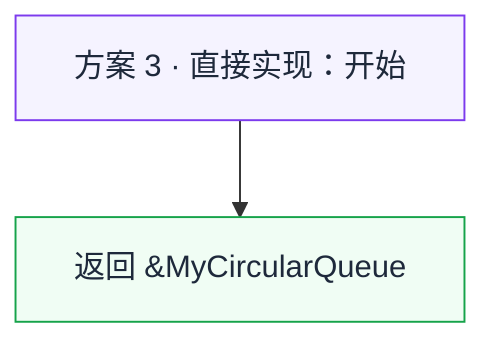

```go
package main // 引入依赖

import (
	"fmt" // 「fmt」
	"os"  // 「os」
)

type MyCircularQueue struct { // 定义类型
	queue    []int // 队列 []int
	front    int   // front int
	rear     int   // rear int
	size     int   // 大小 int
	capacity int   // capacity int
}

func NewMyCircularQueue(k int) *MyCircularQueue { // 定义函数/方法 NewMyCircularQueue
	return &MyCircularQueue{queue: make([]int, k), front: 0, rear: -1, size: 0, capacity: k}
}

func (q *MyCircularQueue) enQueue(value int) bool { // 定义函数/方法 enQueue
	if q.isFull() { // 若 节点.isFull(
		return false // 返回 false
	}
	q.rear = (q.rear + 1) % q.capacity // 把 (节点.rear 加 1) 对…取模 节点.capacity 写入 q.rear
	q.queue[q.rear] = value            // 把 value 写入 q.queue[q.rear]
	q.size++                           // 节点.大小 加一
	return true                        // 返回 true
}

func (q *MyCircularQueue) deQueue() bool { // 定义函数/方法 deQueue
	if q.isEmpty() { // 若 节点.isEmpty(
		return false // 返回 false
	}
	q.front = (q.front + 1) % q.capacity // 把 (节点.front 加 1) 对…取模 节点.capacity 写入 q.front
	q.size--                             // 节点.大小 减一
	return true                          // 返回 true
}

func (q *MyCircularQueue) Front() int { // 定义函数/方法 Front
	if q.isEmpty() { // 若 节点.isEmpty(
		return -1 // 返回 减 1
	}
	return q.queue[q.front] // 返回 节点.队列[节点.front]
}

func (q *MyCircularQueue) Rear() int { // 定义函数/方法 Rear
	if q.isEmpty() { // 若 节点.isEmpty(
		return -1 // 返回 减 1
	}
	return q.queue[q.rear] // 返回 节点.队列[节点.rear]
}

func (q *MyCircularQueue) isEmpty() bool { return q.size == 0 }          // 定义判定函数 isEmpty
func (q *MyCircularQueue) isFull() bool  { return q.size == q.capacity } // 定义判定函数 isFull

func main() { // 程序入口：跑内嵌自测用例
	q := NewMyCircularQueue(3) // 把 NewMyCircularQueue(3) 写入 q :
	ok := true                 // 把 true 写入 ok :
	if !q.enQueue(1) {         // 若 取反 节点.enQueue(1
		ok = false                   // 把 false 写入 ok
		fmt.Println("FAIL enQueue1") // 打印输出
	}
	if !q.enQueue(2) { // 若 取反 节点.enQueue(2
		ok = false                   // 把 false 写入 ok
		fmt.Println("FAIL enQueue2") // 打印输出
	}
	if q.Rear() != 2 { // 若 节点.Rear() 不等于 2
		ok = false                             // 把 false 写入 ok
		fmt.Printf("FAIL Rear=%d\n", q.Rear()) // 打印输出
	}
	if !q.deQueue() { // 若 取反 节点.deQueue(
		ok = false                  // 把 false 写入 ok
		fmt.Println("FAIL deQueue") // 打印输出
	}
	if q.Front() != 2 { // 若 节点.Front() 不等于 2
		ok = false                               // 把 false 写入 ok
		fmt.Printf("FAIL Front=%d\n", q.Front()) // 打印输出
	}
	if !ok { // 若 取反 ok
		os.Exit(1) // os.Exit(1)
	}
	fmt.Println("PASS") // 全部用例通过，输出 PASS
}
```

#### 方案 4：直接实现

**思路与代码分析**：核心是「直接实现」。Go 版用切片与多返回值惯用法，显式处理索引边界。**走读**：方案 4 · 直接实现：开始 → 返回 &MyCircularQueue。

**运行架构**（真实控制流）：

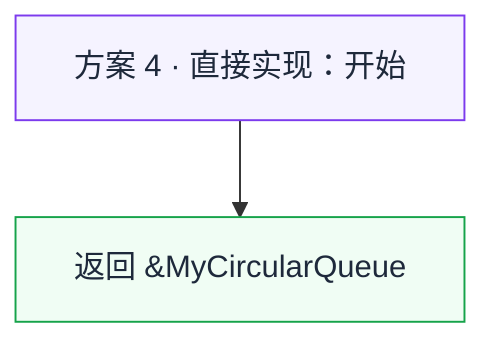

```go
package main // 引入依赖

import (
	"fmt" // 「fmt」
	"os"  // 「os」
)

type MyCircularQueue struct { // 定义类型
	queue    []int // 队列 []int
	front    int   // front int
	rear     int   // rear int
	size     int   // 大小 int
	capacity int   // capacity int
}

func NewMyCircularQueue(k int) *MyCircularQueue { // 定义函数/方法 NewMyCircularQueue
	return &MyCircularQueue{queue: make([]int, k), front: 0, rear: -1, size: 0, capacity: k}
}

func (q *MyCircularQueue) enQueue(value int) bool { // 定义函数/方法 enQueue
	if q.isFull() { // 若 节点.isFull(
		return false // 返回 false
	}
	q.rear = (q.rear + 1) % q.capacity // 把 (节点.rear 加 1) 对…取模 节点.capacity 写入 q.rear
	q.queue[q.rear] = value            // 把 value 写入 q.queue[q.rear]
	q.size++                           // 节点.大小 加一
	return true                        // 返回 true
}

func (q *MyCircularQueue) deQueue() bool { // 定义函数/方法 deQueue
	if q.isEmpty() { // 若 节点.isEmpty(
		return false // 返回 false
	}
	q.front = (q.front + 1) % q.capacity // 把 (节点.front 加 1) 对…取模 节点.capacity 写入 q.front
	q.size--                             // 节点.大小 减一
	return true                          // 返回 true
}

func (q *MyCircularQueue) Front() int { // 定义函数/方法 Front
	if q.isEmpty() { // 若 节点.isEmpty(
		return -1 // 返回 减 1
	}
	return q.queue[q.front] // 返回 节点.队列[节点.front]
}

func (q *MyCircularQueue) Rear() int { // 定义函数/方法 Rear
	if q.isEmpty() { // 若 节点.isEmpty(
		return -1 // 返回 减 1
	}
	return q.queue[q.rear] // 返回 节点.队列[节点.rear]
}

func (q *MyCircularQueue) isEmpty() bool { return q.size == 0 }          // 定义判定函数 isEmpty
func (q *MyCircularQueue) isFull() bool  { return q.size == q.capacity } // 定义判定函数 isFull

func main() { // 程序入口：跑内嵌自测用例
	q := NewMyCircularQueue(3) // 把 NewMyCircularQueue(3) 写入 q :
	ok := true                 // 把 true 写入 ok :
	if !q.enQueue(1) {         // 若 取反 节点.enQueue(1
		ok = false                   // 把 false 写入 ok
		fmt.Println("FAIL enQueue1") // 打印输出
	}
	if !q.enQueue(2) { // 若 取反 节点.enQueue(2
		ok = false                   // 把 false 写入 ok
		fmt.Println("FAIL enQueue2") // 打印输出
	}
	if q.Rear() != 2 { // 若 节点.Rear() 不等于 2
		ok = false                             // 把 false 写入 ok
		fmt.Printf("FAIL Rear=%d\n", q.Rear()) // 打印输出
	}
	if !q.deQueue() { // 若 取反 节点.deQueue(
		ok = false                  // 把 false 写入 ok
		fmt.Println("FAIL deQueue") // 打印输出
	}
	if q.Front() != 2 { // 若 节点.Front() 不等于 2
		ok = false                               // 把 false 写入 ok
		fmt.Printf("FAIL Front=%d\n", q.Front()) // 打印输出
	}
	if !ok { // 若 取反 ok
		os.Exit(1) // os.Exit(1)
	}
	fmt.Println("PASS") // 全部用例通过，输出 PASS
}
```

#### 方案 5：直接实现

**思路与代码分析**：核心是「直接实现」。Go 版用切片与多返回值惯用法，显式处理索引边界。**走读**：方案 5 · 直接实现：开始 → 返回 &MyCircularQueue。

**运行架构**（真实控制流）：

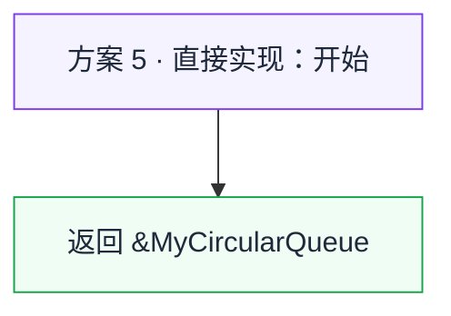

```go
package main // 引入依赖

import (
	"fmt" // 「fmt」
	"os"  // 「os」
)

type MyCircularQueue struct { // 定义类型
	queue    []int // 队列 []int
	front    int   // front int
	rear     int   // rear int
	size     int   // 大小 int
	capacity int   // capacity int
}

func NewMyCircularQueue(k int) *MyCircularQueue { // 定义函数/方法 NewMyCircularQueue
	return &MyCircularQueue{queue: make([]int, k), front: 0, rear: -1, size: 0, capacity: k}
}

func (q *MyCircularQueue) enQueue(value int) bool { // 定义函数/方法 enQueue
	if q.isFull() { // 若 节点.isFull(
		return false // 返回 false
	}
	q.rear = (q.rear + 1) % q.capacity // 把 (节点.rear 加 1) 对…取模 节点.capacity 写入 q.rear
	q.queue[q.rear] = value            // 把 value 写入 q.queue[q.rear]
	q.size++                           // 节点.大小 加一
	return true                        // 返回 true
}

func (q *MyCircularQueue) deQueue() bool { // 定义函数/方法 deQueue
	if q.isEmpty() { // 若 节点.isEmpty(
		return false // 返回 false
	}
	q.front = (q.front + 1) % q.capacity // 把 (节点.front 加 1) 对…取模 节点.capacity 写入 q.front
	q.size--                             // 节点.大小 减一
	return true                          // 返回 true
}

func (q *MyCircularQueue) Front() int { // 定义函数/方法 Front
	if q.isEmpty() { // 若 节点.isEmpty(
		return -1 // 返回 减 1
	}
	return q.queue[q.front] // 返回 节点.队列[节点.front]
}

func (q *MyCircularQueue) Rear() int { // 定义函数/方法 Rear
	if q.isEmpty() { // 若 节点.isEmpty(
		return -1 // 返回 减 1
	}
	return q.queue[q.rear] // 返回 节点.队列[节点.rear]
}

func (q *MyCircularQueue) isEmpty() bool { return q.size == 0 }          // 定义判定函数 isEmpty
func (q *MyCircularQueue) isFull() bool  { return q.size == q.capacity } // 定义判定函数 isFull

func main() { // 程序入口：跑内嵌自测用例
	q := NewMyCircularQueue(3) // 把 NewMyCircularQueue(3) 写入 q :
	ok := true                 // 把 true 写入 ok :
	if !q.enQueue(1) {         // 若 取反 节点.enQueue(1
		ok = false                   // 把 false 写入 ok
		fmt.Println("FAIL enQueue1") // 打印输出
	}
	if !q.enQueue(2) { // 若 取反 节点.enQueue(2
		ok = false                   // 把 false 写入 ok
		fmt.Println("FAIL enQueue2") // 打印输出
	}
	if q.Rear() != 2 { // 若 节点.Rear() 不等于 2
		ok = false                             // 把 false 写入 ok
		fmt.Printf("FAIL Rear=%d\n", q.Rear()) // 打印输出
	}
	if !q.deQueue() { // 若 取反 节点.deQueue(
		ok = false                  // 把 false 写入 ok
		fmt.Println("FAIL deQueue") // 打印输出
	}
	if q.Front() != 2 { // 若 节点.Front() 不等于 2
		ok = false                               // 把 false 写入 ok
		fmt.Printf("FAIL Front=%d\n", q.Front()) // 打印输出
	}
	if !ok { // 若 取反 ok
		os.Exit(1) // os.Exit(1)
	}
	fmt.Println("PASS") // 全部用例通过，输出 PASS
}
```

#### 方案 6：直接实现

**思路与代码分析**：核心是「直接实现」。Go 版用切片与多返回值惯用法，显式处理索引边界。**走读**：方案 6 · 直接实现：开始 → 返回 &MyCircularQueue。

**运行架构**（真实控制流）：

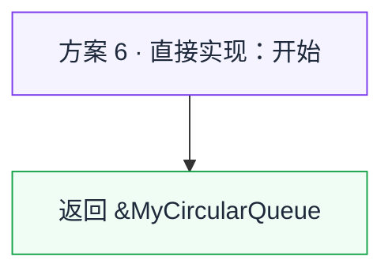

```go
package main // 引入依赖

import (
	"fmt" // 「fmt」
	"os"  // 「os」
)

type MyCircularQueue struct { // 定义类型
	queue    []int // 队列 []int
	front    int   // front int
	rear     int   // rear int
	size     int   // 大小 int
	capacity int   // capacity int
}

func NewMyCircularQueue(k int) *MyCircularQueue { // 定义函数/方法 NewMyCircularQueue
	return &MyCircularQueue{queue: make([]int, k), front: 0, rear: -1, size: 0, capacity: k}
}

func (q *MyCircularQueue) enQueue(value int) bool { // 定义函数/方法 enQueue
	if q.isFull() { // 若 节点.isFull(
		return false // 返回 false
	}
	q.rear = (q.rear + 1) % q.capacity // 把 (节点.rear 加 1) 对…取模 节点.capacity 写入 q.rear
	q.queue[q.rear] = value            // 把 value 写入 q.queue[q.rear]
	q.size++                           // 节点.大小 加一
	return true                        // 返回 true
}

func (q *MyCircularQueue) deQueue() bool { // 定义函数/方法 deQueue
	if q.isEmpty() { // 若 节点.isEmpty(
		return false // 返回 false
	}
	q.front = (q.front + 1) % q.capacity // 把 (节点.front 加 1) 对…取模 节点.capacity 写入 q.front
	q.size--                             // 节点.大小 减一
	return true                          // 返回 true
}

func (q *MyCircularQueue) Front() int { // 定义函数/方法 Front
	if q.isEmpty() { // 若 节点.isEmpty(
		return -1 // 返回 减 1
	}
	return q.queue[q.front] // 返回 节点.队列[节点.front]
}

func (q *MyCircularQueue) Rear() int { // 定义函数/方法 Rear
	if q.isEmpty() { // 若 节点.isEmpty(
		return -1 // 返回 减 1
	}
	return q.queue[q.rear] // 返回 节点.队列[节点.rear]
}

func (q *MyCircularQueue) isEmpty() bool { return q.size == 0 }          // 定义判定函数 isEmpty
func (q *MyCircularQueue) isFull() bool  { return q.size == q.capacity } // 定义判定函数 isFull

func main() { // 程序入口：跑内嵌自测用例
	q := NewMyCircularQueue(3) // 把 NewMyCircularQueue(3) 写入 q :
	ok := true                 // 把 true 写入 ok :
	if !q.enQueue(1) {         // 若 取反 节点.enQueue(1
		ok = false                   // 把 false 写入 ok
		fmt.Println("FAIL enQueue1") // 打印输出
	}
	if !q.enQueue(2) { // 若 取反 节点.enQueue(2
		ok = false                   // 把 false 写入 ok
		fmt.Println("FAIL enQueue2") // 打印输出
	}
	if q.Rear() != 2 { // 若 节点.Rear() 不等于 2
		ok = false                             // 把 false 写入 ok
		fmt.Printf("FAIL Rear=%d\n", q.Rear()) // 打印输出
	}
	if !q.deQueue() { // 若 取反 节点.deQueue(
		ok = false                  // 把 false 写入 ok
		fmt.Println("FAIL deQueue") // 打印输出
	}
	if q.Front() != 2 { // 若 节点.Front() 不等于 2
		ok = false                               // 把 false 写入 ok
		fmt.Printf("FAIL Front=%d\n", q.Front()) // 打印输出
	}
	if !ok { // 若 取反 ok
		os.Exit(1) // os.Exit(1)
	}
	fmt.Println("PASS") // 全部用例通过，输出 PASS
}
```

### Java 实现（6 种方案）

Java 的全部方案如下，每个方案都内嵌用例自测，可独立运行（老仓库 python/go 文件遵循「打印结果」约定）：

#### 方案 1：直接实现

**思路与代码分析**：核心是「直接实现」。Java 版用类与静态方法组织，集合操作显式明了。**走读**：方案 1 · 直接实现：开始 → 更新 capacity → 更新 data → 更新 front → 更新 rear → 更新 size → 返回结果。

**运行架构**（真实控制流）：

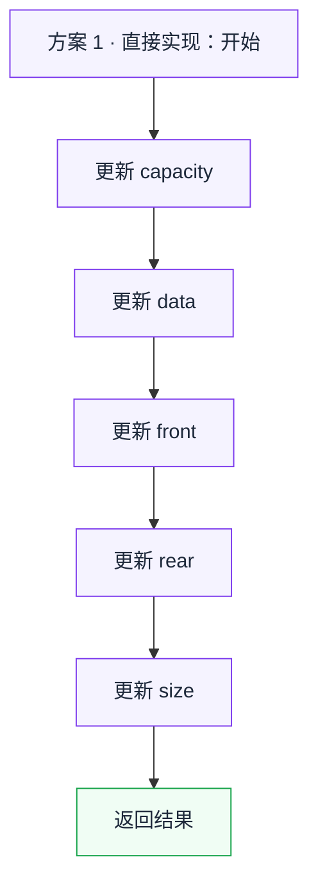

```java
package com.webfault.dsa; // 引入依赖

import java.util.*; // 引入依赖

class CqA { // 定义类型
  int capacity; // int capacity;
  int[] data; // int[] data;
  int front; // int front;
  int rear; // int rear;
  int size; // int 大小;

  CqA(int k) { // CqA(int 下标 k) {
    capacity = k; // 把 下标 k; 写入 capacity
    data = new int[k]; // 把 new int[下标 k]; 写入 data
    front = 0; // 把 0; 写入 front
    rear = 0; // 把 0; 写入 rear
    size = 0; // 把 0; 写入 大小
  }

  boolean enQueue(int v) { // 定义函数/方法 enQueue
    if (isFull()) return false; // 若 isFull()，直接返回 false
    data[rear] = v; // 把 值; 写入 data[rear]
    rear = (rear + 1) % capacity; // 把 (rear 加 1) 对…取模 capacity; 写入 rear
    size++; // 大小 加一
    return true; // 返回 true
  }

  boolean deQueue() { // 定义函数/方法 deQueue
    if (isEmpty()) return false; // 若 isEmpty()，直接返回 false
    front = (front + 1) % capacity; // 把 (front 加 1) 对…取模 capacity; 写入 front
    size--; // 大小 减一
    return true; // 返回 true
  }

  int Front() {
    return isEmpty() ? -1 : data[front];
  } // int Front() { return isEmpty() ? 减 1 : data[front]; }

  int Rear() {
    return isEmpty() ? -1 : data[(rear - 1 + capacity) % capacity];
  }

  boolean isEmpty() {
    return size == 0;
  } // 把 赋值为 0; } 写入 boolean isEmpty() { return size

  boolean isFull() {
    return size == capacity;
  } // 把 赋值为 capacity; } 写入 boolean isFull() { return size

  public static void main(String[] args) { // public static void main(String[] args) {
    CqA q = new CqA(3); // 把 new CqA(3); 写入 CqA q
    List<Object> res = new ArrayList<>(); // 把 new ArrayList 小于 超过 (); 写入 List<Object> res
    res.add(q.enQueue(1)); // 结果 追加 节点.enQueue(1));
    res.add(q.enQueue(2)); // 结果 追加 节点.enQueue(2));
    res.add(q.enQueue(3)); // 结果 追加 节点.enQueue(3));
    res.add(q.enQueue(4)); // 结果 追加 节点.enQueue(4));
    res.add(q.Rear()); // 结果 追加 节点.Rear());
    res.add(q.isFull()); // 结果 追加 节点.isFull());
    res.add(q.deQueue()); // 结果 追加 节点.deQueue());
    res.add(q.enQueue(4)); // 结果 追加 节点.enQueue(4));
    res.add(q.Rear()); // 结果 追加 节点.Rear());
    List<Object> want = Arrays.asList(true, true, true, false, 3, true, true, true, 4);
    boolean ok = res.equals(want); // 把 结果.equals(want); 写入 boolean ok
    if (!ok) {
      System.out.println("FAIL got=" + res);
      throw new RuntimeException("FAILED");
    }
    System.out.println("PASS"); // 全部用例通过，输出 PASS
  }
}
```

#### 方案 2：直接实现

**思路与代码分析**：核心是「直接实现」。Java 版用类与静态方法组织，集合操作显式明了。**走读**：方案 2 · 直接实现：开始 → 更新 capacity → 更新 data → 更新 front → 更新 rear → 更新 size → 返回结果。

**运行架构**（真实控制流）：


```java
package com.webfault.dsa; // 引入依赖

import java.util.*; // 引入依赖

class CqA { // 定义类型
  int capacity; // int capacity;
  int[] data; // int[] data;
  int front; // int front;
  int rear; // int rear;
  int size; // int 大小;

  CqA(int k) { // CqA(int 下标 k) {
    capacity = k; // 把 下标 k; 写入 capacity
    data = new int[k]; // 把 new int[下标 k]; 写入 data
    front = 0; // 把 0; 写入 front
    rear = 0; // 把 0; 写入 rear
    size = 0; // 把 0; 写入 大小
  }

  boolean enQueue(int v) { // 定义函数/方法 enQueue
    if (isFull()) return false; // 若 isFull()，直接返回 false
    data[rear] = v; // 把 值; 写入 data[rear]
    rear = (rear + 1) % capacity; // 把 (rear 加 1) 对…取模 capacity; 写入 rear
    size++; // 大小 加一
    return true; // 返回 true
  }

  boolean deQueue() { // 定义函数/方法 deQueue
    if (isEmpty()) return false; // 若 isEmpty()，直接返回 false
    front = (front + 1) % capacity; // 把 (front 加 1) 对…取模 capacity; 写入 front
    size--; // 大小 减一
    return true; // 返回 true
  }

  int Front() {
    return isEmpty() ? -1 : data[front];
  } // int Front() { return isEmpty() ? 减 1 : data[front]; }

  int Rear() {
    return isEmpty() ? -1 : data[(rear - 1 + capacity) % capacity];
  }

  boolean isEmpty() {
    return size == 0;
  } // 把 赋值为 0; } 写入 boolean isEmpty() { return size

  boolean isFull() {
    return size == capacity;
  } // 把 赋值为 capacity; } 写入 boolean isFull() { return size

  public static void main(String[] args) { // public static void main(String[] args) {
    CqA q = new CqA(3); // 把 new CqA(3); 写入 CqA q
    List<Object> res = new ArrayList<>(); // 把 new ArrayList 小于 超过 (); 写入 List<Object> res
    res.add(q.enQueue(1)); // 结果 追加 节点.enQueue(1));
    res.add(q.enQueue(2)); // 结果 追加 节点.enQueue(2));
    res.add(q.enQueue(3)); // 结果 追加 节点.enQueue(3));
    res.add(q.enQueue(4)); // 结果 追加 节点.enQueue(4));
    res.add(q.Rear()); // 结果 追加 节点.Rear());
    res.add(q.isFull()); // 结果 追加 节点.isFull());
    res.add(q.deQueue()); // 结果 追加 节点.deQueue());
    res.add(q.enQueue(4)); // 结果 追加 节点.enQueue(4));
    res.add(q.Rear()); // 结果 追加 节点.Rear());
    List<Object> want = Arrays.asList(true, true, true, false, 3, true, true, true, 4);
    boolean ok = res.equals(want); // 把 结果.equals(want); 写入 boolean ok
    if (!ok) {
      System.out.println("FAIL got=" + res);
      throw new RuntimeException("FAILED");
    }
    System.out.println("PASS"); // 全部用例通过，输出 PASS
  }
}
```

#### 方案 3：直接实现

**思路与代码分析**：核心是「直接实现」。Java 版用类与静态方法组织，集合操作显式明了。**走读**：方案 3 · 直接实现：开始 → 更新 capacity → 更新 queue → 更新 front → 更新 rear → 更新 size → 返回结果。

**运行架构**（真实控制流）：


```java
package com.webfault.dsa; // 引入依赖

import java.util.*; // 引入依赖

class CqB { // 定义类型
  int capacity; // int capacity;
  int[] queue; // int[] 队列;
  int front; // int front;
  int rear; // int rear;
  int size; // int 大小;

  CqB(int k) { // CqB(int 下标 k) {
    capacity = k; // 把 下标 k; 写入 capacity
    queue = new int[k]; // 把 new int[下标 k]; 写入 队列
    front = 0; // 把 0; 写入 front
    rear = -1; // 把 减 1; 写入 rear
    size = 0; // 把 0; 写入 大小
  }

  boolean enQueue(int v) { // 定义函数/方法 enQueue
    if (isFull()) return false; // 若 isFull()，直接返回 false
    rear = (rear + 1) % capacity; // 把 (rear 加 1) 对…取模 capacity; 写入 rear
    queue[rear] = v; // 把 值; 写入 queue[rear]
    size++; // 大小 加一
    return true; // 返回 true
  }

  boolean deQueue() { // 定义函数/方法 deQueue
    if (isEmpty()) return false; // 若 isEmpty()，直接返回 false
    front = (front + 1) % capacity; // 把 (front 加 1) 对…取模 capacity; 写入 front
    size--; // 大小 减一
    return true; // 返回 true
  }

  int Front() {
    return isEmpty() ? -1 : queue[front];
  } // int Front() { return isEmpty() ? 减 1 : 队列[front]; }

  int Rear() {
    return isEmpty() ? -1 : queue[rear];
  } // int Rear() { return isEmpty() ? 减 1 : 队列[rear]; }

  boolean isEmpty() {
    return size == 0;
  } // 把 赋值为 0; } 写入 boolean isEmpty() { return size

  boolean isFull() {
    return size == capacity;
  } // 把 赋值为 capacity; } 写入 boolean isFull() { return size

  public static void main(String[] args) { // public static void main(String[] args) {
    CqB q = new CqB(3); // 把 new CqB(3); 写入 CqB q
    List<Object> res = new ArrayList<>(); // 把 new ArrayList 小于 超过 (); 写入 List<Object> res
    res.add(q.enQueue(1)); // 结果 追加 节点.enQueue(1));
    res.add(q.enQueue(2)); // 结果 追加 节点.enQueue(2));
    res.add(q.Rear()); // 结果 追加 节点.Rear());
    res.add(q.deQueue()); // 结果 追加 节点.deQueue());
    res.add(q.Front()); // 结果 追加 节点.Front());
    List<Object> want = Arrays.asList(true, true, 2, true, 2);
    boolean ok = res.equals(want); // 把 结果.equals(want); 写入 boolean ok
    if (!ok) {
      System.out.println("FAIL got=" + res);
      throw new RuntimeException("FAILED");
    }
    System.out.println("PASS"); // 全部用例通过，输出 PASS
  }
}
```

#### 方案 4：直接实现

**思路与代码分析**：核心是「直接实现」。Java 版用类与静态方法组织，集合操作显式明了。**走读**：方案 4 · 直接实现：开始 → 更新 capacity → 更新 queue → 更新 front → 更新 rear → 更新 size → 返回结果。

**运行架构**（真实控制流）：

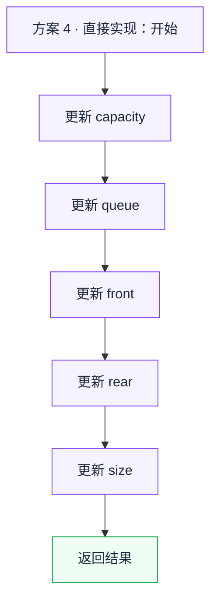

```java
package com.webfault.dsa; // 引入依赖

import java.util.*; // 引入依赖

class CqB { // 定义类型
  int capacity; // int capacity;
  int[] queue; // int[] 队列;
  int front; // int front;
  int rear; // int rear;
  int size; // int 大小;

  CqB(int k) { // CqB(int 下标 k) {
    capacity = k; // 把 下标 k; 写入 capacity
    queue = new int[k]; // 把 new int[下标 k]; 写入 队列
    front = 0; // 把 0; 写入 front
    rear = -1; // 把 减 1; 写入 rear
    size = 0; // 把 0; 写入 大小
  }

  boolean enQueue(int v) { // 定义函数/方法 enQueue
    if (isFull()) return false; // 若 isFull()，直接返回 false
    rear = (rear + 1) % capacity; // 把 (rear 加 1) 对…取模 capacity; 写入 rear
    queue[rear] = v; // 把 值; 写入 queue[rear]
    size++; // 大小 加一
    return true; // 返回 true
  }

  boolean deQueue() { // 定义函数/方法 deQueue
    if (isEmpty()) return false; // 若 isEmpty()，直接返回 false
    front = (front + 1) % capacity; // 把 (front 加 1) 对…取模 capacity; 写入 front
    size--; // 大小 减一
    return true; // 返回 true
  }

  int Front() {
    return isEmpty() ? -1 : queue[front];
  } // int Front() { return isEmpty() ? 减 1 : 队列[front]; }

  int Rear() {
    return isEmpty() ? -1 : queue[rear];
  } // int Rear() { return isEmpty() ? 减 1 : 队列[rear]; }

  boolean isEmpty() {
    return size == 0;
  } // 把 赋值为 0; } 写入 boolean isEmpty() { return size

  boolean isFull() {
    return size == capacity;
  } // 把 赋值为 capacity; } 写入 boolean isFull() { return size

  public static void main(String[] args) { // public static void main(String[] args) {
    CqB q = new CqB(3); // 把 new CqB(3); 写入 CqB q
    List<Object> res = new ArrayList<>(); // 把 new ArrayList 小于 超过 (); 写入 List<Object> res
    res.add(q.enQueue(1)); // 结果 追加 节点.enQueue(1));
    res.add(q.enQueue(2)); // 结果 追加 节点.enQueue(2));
    res.add(q.Rear()); // 结果 追加 节点.Rear());
    res.add(q.deQueue()); // 结果 追加 节点.deQueue());
    res.add(q.Front()); // 结果 追加 节点.Front());
    List<Object> want = Arrays.asList(true, true, 2, true, 2);
    boolean ok = res.equals(want); // 把 结果.equals(want); 写入 boolean ok
    if (!ok) {
      System.out.println("FAIL got=" + res);
      throw new RuntimeException("FAILED");
    }
    System.out.println("PASS"); // 全部用例通过，输出 PASS
  }
}
```

#### 方案 5：直接实现

**思路与代码分析**：核心是「直接实现」。Java 版用类与静态方法组织，集合操作显式明了。**走读**：方案 5 · 直接实现：开始 → 更新 capacity → 更新 queue → 更新 front → 更新 rear → 更新 size → 返回结果。

**运行架构**（真实控制流）：

```mermaid
graph TD
    N0["方案 5 · 直接实现：开始"]
    N1["更新 capacity"]
    N2["更新 queue"]
    N3["更新 front"]
    N4["更新 rear"]
    N5["更新 size"]
    N6["返回结果"]
    N0 --> N1
    N1 --> N2
    N2 --> N3
    N3 --> N4
    N4 --> N5
    N5 --> N6
    classDef n fill:#f5f3ff,stroke:#7c3aed,color:#1e293b;
    classDef lp fill:#ede9fe,stroke:#6d28d9,color:#1e293b;
    classDef dc fill:#fef9c3,stroke:#ca8a04,color:#1e293b;
    classDef tm fill:#f0fdf4,stroke:#16a34a,color:#1e293b;
    class N0,N1,N2,N3,N4,N5 n;
    class N6 tm;
```

```java
package com.webfault.dsa; // 引入依赖

import java.util.*; // 引入依赖

class CqB { // 定义类型
  int capacity; // int capacity;
  int[] queue; // int[] 队列;
  int front; // int front;
  int rear; // int rear;
  int size; // int 大小;

  CqB(int k) { // CqB(int 下标 k) {
    capacity = k; // 把 下标 k; 写入 capacity
    queue = new int[k]; // 把 new int[下标 k]; 写入 队列
    front = 0; // 把 0; 写入 front
    rear = -1; // 把 减 1; 写入 rear
    size = 0; // 把 0; 写入 大小
  }

  boolean enQueue(int v) { // 定义函数/方法 enQueue
    if (isFull()) return false; // 若 isFull()，直接返回 false
    rear = (rear + 1) % capacity; // 把 (rear 加 1) 对…取模 capacity; 写入 rear
    queue[rear] = v; // 把 值; 写入 queue[rear]
    size++; // 大小 加一
    return true; // 返回 true
  }

  boolean deQueue() { // 定义函数/方法 deQueue
    if (isEmpty()) return false; // 若 isEmpty()，直接返回 false
    front = (front + 1) % capacity; // 把 (front 加 1) 对…取模 capacity; 写入 front
    size--; // 大小 减一
    return true; // 返回 true
  }

  int Front() {
    return isEmpty() ? -1 : queue[front];
  } // int Front() { return isEmpty() ? 减 1 : 队列[front]; }

  int Rear() {
    return isEmpty() ? -1 : queue[rear];
  } // int Rear() { return isEmpty() ? 减 1 : 队列[rear]; }

  boolean isEmpty() {
    return size == 0;
  } // 把 赋值为 0; } 写入 boolean isEmpty() { return size

  boolean isFull() {
    return size == capacity;
  } // 把 赋值为 capacity; } 写入 boolean isFull() { return size

  public static void main(String[] args) { // public static void main(String[] args) {
    CqB q = new CqB(3); // 把 new CqB(3); 写入 CqB q
    List<Object> res = new ArrayList<>(); // 把 new ArrayList 小于 超过 (); 写入 List<Object> res
    res.add(q.enQueue(1)); // 结果 追加 节点.enQueue(1));
    res.add(q.enQueue(2)); // 结果 追加 节点.enQueue(2));
    res.add(q.Rear()); // 结果 追加 节点.Rear());
    res.add(q.deQueue()); // 结果 追加 节点.deQueue());
    res.add(q.Front()); // 结果 追加 节点.Front());
    List<Object> want = Arrays.asList(true, true, 2, true, 2);
    boolean ok = res.equals(want); // 把 结果.equals(want); 写入 boolean ok
    if (!ok) {
      System.out.println("FAIL got=" + res);
      throw new RuntimeException("FAILED");
    }
    System.out.println("PASS"); // 全部用例通过，输出 PASS
  }
}
```

#### 方案 6：直接实现

**思路与代码分析**：核心是「直接实现」。Java 版用类与静态方法组织，集合操作显式明了。**走读**：方案 6 · 直接实现：开始 → 更新 capacity → 更新 queue → 更新 front → 更新 rear → 更新 size → 返回结果。

**运行架构**（真实控制流）：

```mermaid
graph TD
    N0["方案 6 · 直接实现：开始"]
    N1["更新 capacity"]
    N2["更新 queue"]
    N3["更新 front"]
    N4["更新 rear"]
    N5["更新 size"]
    N6["返回结果"]
    N0 --> N1
    N1 --> N2
    N2 --> N3
    N3 --> N4
    N4 --> N5
    N5 --> N6
    classDef n fill:#f5f3ff,stroke:#7c3aed,color:#1e293b;
    classDef lp fill:#ede9fe,stroke:#6d28d9,color:#1e293b;
    classDef dc fill:#fef9c3,stroke:#ca8a04,color:#1e293b;
    classDef tm fill:#f0fdf4,stroke:#16a34a,color:#1e293b;
    class N0,N1,N2,N3,N4,N5 n;
    class N6 tm;
```

```java
package com.webfault.dsa; // 引入依赖

import java.util.*; // 引入依赖

class CqB { // 定义类型
  int capacity; // int capacity;
  int[] queue; // int[] 队列;
  int front; // int front;
  int rear; // int rear;
  int size; // int 大小;

  CqB(int k) { // CqB(int 下标 k) {
    capacity = k; // 把 下标 k; 写入 capacity
    queue = new int[k]; // 把 new int[下标 k]; 写入 队列
    front = 0; // 把 0; 写入 front
    rear = -1; // 把 减 1; 写入 rear
    size = 0; // 把 0; 写入 大小
  }

  boolean enQueue(int v) { // 定义函数/方法 enQueue
    if (isFull()) return false; // 若 isFull()，直接返回 false
    rear = (rear + 1) % capacity; // 把 (rear 加 1) 对…取模 capacity; 写入 rear
    queue[rear] = v; // 把 值; 写入 queue[rear]
    size++; // 大小 加一
    return true; // 返回 true
  }

  boolean deQueue() { // 定义函数/方法 deQueue
    if (isEmpty()) return false; // 若 isEmpty()，直接返回 false
    front = (front + 1) % capacity; // 把 (front 加 1) 对…取模 capacity; 写入 front
    size--; // 大小 减一
    return true; // 返回 true
  }

  int Front() {
    return isEmpty() ? -1 : queue[front];
  } // int Front() { return isEmpty() ? 减 1 : 队列[front]; }

  int Rear() {
    return isEmpty() ? -1 : queue[rear];
  } // int Rear() { return isEmpty() ? 减 1 : 队列[rear]; }

  boolean isEmpty() {
    return size == 0;
  } // 把 赋值为 0; } 写入 boolean isEmpty() { return size

  boolean isFull() {
    return size == capacity;
  } // 把 赋值为 capacity; } 写入 boolean isFull() { return size

  public static void main(String[] args) { // public static void main(String[] args) {
    CqB q = new CqB(3); // 把 new CqB(3); 写入 CqB q
    List<Object> res = new ArrayList<>(); // 把 new ArrayList 小于 超过 (); 写入 List<Object> res
    res.add(q.enQueue(1)); // 结果 追加 节点.enQueue(1));
    res.add(q.enQueue(2)); // 结果 追加 节点.enQueue(2));
    res.add(q.Rear()); // 结果 追加 节点.Rear());
    res.add(q.deQueue()); // 结果 追加 节点.deQueue());
    res.add(q.Front()); // 结果 追加 节点.Front());
    List<Object> want = Arrays.asList(true, true, 2, true, 2);
    boolean ok = res.equals(want); // 把 结果.equals(want); 写入 boolean ok
    if (!ok) {
      System.out.println("FAIL got=" + res);
      throw new RuntimeException("FAILED");
    }
    System.out.println("PASS"); // 全部用例通过，输出 PASS
  }
}
```

### Rust 实现（6 种方案）

Rust 的全部方案如下，每个方案都内嵌用例自测，可独立运行（老仓库 python/go 文件遵循「打印结果」约定）：

#### 方案 1：直接实现

**思路与代码分析**：核心是「直接实现」。Rust 版用所有权移动与切片借用改写同一逻辑，注意 Option 与引用边界。**走读**：方案 1 · 直接实现：开始 → 处理 MyCircularQueue → 处理 capacity: k, → 处理 data: vec非 [0; k], → 处理 front: 0, → 处理 rear: 0, → 处理 size: 0, → 返回结果。

**运行架构**（真实控制流）：

```mermaid
graph TD
    N0["方案 1 · 直接实现：开始"]
    N1["处理 MyCircularQueue"]
    N2["处理 capacity: k,"]
    N3["处理 data: vec非 [0; k],"]
    N4["处理 front: 0,"]
    N5["处理 rear: 0,"]
    N6["处理 size: 0,"]
    N7["返回结果"]
    N0 --> N1
    N1 --> N2
    N2 --> N3
    N3 --> N4
    N4 --> N5
    N5 --> N6
    N6 --> N7
    classDef n fill:#f5f3ff,stroke:#7c3aed,color:#1e293b;
    classDef lp fill:#ede9fe,stroke:#6d28d9,color:#1e293b;
    classDef dc fill:#fef9c3,stroke:#ca8a04,color:#1e293b;
    classDef tm fill:#f0fdf4,stroke:#16a34a,color:#1e293b;
    class N0,N1,N2,N3,N4,N5,N6 n;
    class N7 tm;
```

```rust
// LeetCode 622. 设计循环队列 — Rust 版

// 方案1：数组 + front/rear/size 循环队列
struct MyCircularQueue {
    // 定义类型
    capacity: usize,
    data: Vec<i32>,
    front: usize,
    rear: usize,
    size: usize,
}

impl MyCircularQueue {
    // 实现块
    fn new(k: usize) -> Self {
        // 定义函数/方法 new
        MyCircularQueue {
            // MyCircularQueue {
            capacity: k,
            data: vec![0; k],
            front: 0,
            rear: 0,
            size: 0,
        }
    }
    fn en_queue(&mut self, value: i32) -> bool {
        // 定义函数/方法 en_queue
        if self.is_full() {
            // 若 self.is_full(
            return false; // 返回 false
        }
        self.data[self.rear] = value; // 把 value; 写入 self.data[self.rear]
        self.rear = (self.rear + 1) % self.capacity; // 把 (self.rear 加 1) 对…取模 self.capacity; 写入 self.rear
        self.size += 1; // self.size累加 1
        true // true
    }
    fn de_queue(&mut self) -> bool {
        // 定义函数/方法 de_queue
        if self.is_empty() {
            // 若 self.is_empty(
            return false; // 返回 false
        }
        self.front = (self.front + 1) % self.capacity; // 把 (self.front 加 1) 对…取模 self.capacity; 写入 self.front
        self.size -= 1; // self.size累减 1
        true // true
    }
    #[allow(dead_code)]
    fn front(&self) -> i32 {
        // 定义函数/方法 front
        if self.is_empty() {
            // 若 self.is_empty(
            return -1; // 返回 减 1
        }
        self.data[self.front] // self.data[self.front]
    }
    fn rear(&self) -> i32 {
        // 定义函数/方法 rear
        if self.is_empty() {
            // 若 self.is_empty(
            return -1; // 返回 减 1
        }
        // rear + capacity - 1 避免 usize 下溢（等价 TS 的 (rear - 1 + capacity) % capacity）
        self.data[(self.rear + self.capacity - 1) % self.capacity]
    }
    fn is_empty(&self) -> bool {
        // 定义判定函数 is_empty
        self.size == 0 // 把 赋值为 0 写入 大小
    }
    fn is_full(&self) -> bool {
        // 定义判定函数 is_full
        self.size == self.capacity // 把 赋值为 self.capacity 写入 大小
    }
}

fn main() {
    // 程序入口：跑内嵌自测用例
    // 与 TS 事实源内嵌用例一致：[true,true,true,false,3,true,true,true,4]
    // 布尔结果用 1/0 表示
    let mut q = MyCircularQueue::new(3); // 把 MyCircularQueue::new(3); 写入 let mut q
    let got: Vec<i32> = vec![
        q.en_queue(1) as i32,
        q.en_queue(2) as i32,
        q.en_queue(3) as i32,
        q.en_queue(4) as i32,
        q.rear(),
        q.is_full() as i32,
        q.de_queue() as i32,
        q.en_queue(4) as i32,
        q.rear(),
    ];
    let want: Vec<i32> = vec![1, 1, 1, 0, 3, 1, 1, 1, 4]; // 把 vec取反 [1, 1, 1, 0, 3, 1, 1, 1, 4]; 写入 let want: Vec<i32>
    for i in 0..want.len() {
        // 逐个取出 0 的元素（下标 i）
        assert!(
            got[i] == want[i],
            "FAIL idx {} got {} want {}",
            i,
            got[i],
            want[i]
        ); // 断言校验
    }
    println!("PASS"); // 全部用例通过，输出 PASS
}
```

#### 方案 2：直接实现

**思路与代码分析**：核心是「直接实现」。Rust 版用所有权移动与切片借用改写同一逻辑，注意 Option 与引用边界。**走读**：方案 2 · 直接实现：开始 → 处理 MyCircularQueue → 处理 capacity: k, → 处理 data: vec非 [0; k], → 处理 front: 0, → 处理 rear: 0, → 处理 size: 0, → 返回结果。

**运行架构**（真实控制流）：

```mermaid
graph TD
    N0["方案 2 · 直接实现：开始"]
    N1["处理 MyCircularQueue"]
    N2["处理 capacity: k,"]
    N3["处理 data: vec非 [0; k],"]
    N4["处理 front: 0,"]
    N5["处理 rear: 0,"]
    N6["处理 size: 0,"]
    N7["返回结果"]
    N0 --> N1
    N1 --> N2
    N2 --> N3
    N3 --> N4
    N4 --> N5
    N5 --> N6
    N6 --> N7
    classDef n fill:#f5f3ff,stroke:#7c3aed,color:#1e293b;
    classDef lp fill:#ede9fe,stroke:#6d28d9,color:#1e293b;
    classDef dc fill:#fef9c3,stroke:#ca8a04,color:#1e293b;
    classDef tm fill:#f0fdf4,stroke:#16a34a,color:#1e293b;
    class N0,N1,N2,N3,N4,N5,N6 n;
    class N7 tm;
```

```rust
// LeetCode 622. 设计循环队列 — Rust 版

// 方案2：数组 + front/rear/size 循环队列
struct MyCircularQueue {
    // 定义类型
    capacity: usize,
    data: Vec<i32>,
    front: usize,
    rear: usize,
    size: usize,
}

impl MyCircularQueue {
    // 实现块
    fn new(k: usize) -> Self {
        // 定义函数/方法 new
        MyCircularQueue {
            // MyCircularQueue {
            capacity: k,
            data: vec![0; k],
            front: 0,
            rear: 0,
            size: 0,
        }
    }
    fn en_queue(&mut self, value: i32) -> bool {
        // 定义函数/方法 en_queue
        if self.is_full() {
            // 若 self.is_full(
            return false; // 返回 false
        }
        self.data[self.rear] = value; // 把 value; 写入 self.data[self.rear]
        self.rear = (self.rear + 1) % self.capacity; // 把 (self.rear 加 1) 对…取模 self.capacity; 写入 self.rear
        self.size += 1; // self.size累加 1
        true // true
    }
    fn de_queue(&mut self) -> bool {
        // 定义函数/方法 de_queue
        if self.is_empty() {
            // 若 self.is_empty(
            return false; // 返回 false
        }
        self.front = (self.front + 1) % self.capacity; // 把 (self.front 加 1) 对…取模 self.capacity; 写入 self.front
        self.size -= 1; // self.size累减 1
        true // true
    }
    #[allow(dead_code)]
    fn front(&self) -> i32 {
        // 定义函数/方法 front
        if self.is_empty() {
            // 若 self.is_empty(
            return -1; // 返回 减 1
        }
        self.data[self.front] // self.data[self.front]
    }
    fn rear(&self) -> i32 {
        // 定义函数/方法 rear
        if self.is_empty() {
            // 若 self.is_empty(
            return -1; // 返回 减 1
        }
        // rear + capacity - 1 避免 usize 下溢（等价 TS 的 (rear - 1 + capacity) % capacity）
        self.data[(self.rear + self.capacity - 1) % self.capacity]
    }
    fn is_empty(&self) -> bool {
        // 定义判定函数 is_empty
        self.size == 0 // 把 赋值为 0 写入 大小
    }
    fn is_full(&self) -> bool {
        // 定义判定函数 is_full
        self.size == self.capacity // 把 赋值为 self.capacity 写入 大小
    }
}

fn main() {
    // 程序入口：跑内嵌自测用例
    // 与 TS 事实源内嵌用例一致：[true,true,true,false,3,true,true,true,4]
    // 布尔结果用 1/0 表示
    let mut q = MyCircularQueue::new(3); // 把 MyCircularQueue::new(3); 写入 let mut q
    let got: Vec<i32> = vec![
        q.en_queue(1) as i32,
        q.en_queue(2) as i32,
        q.en_queue(3) as i32,
        q.en_queue(4) as i32,
        q.rear(),
        q.is_full() as i32,
        q.de_queue() as i32,
        q.en_queue(4) as i32,
        q.rear(),
    ];
    let want: Vec<i32> = vec![1, 1, 1, 0, 3, 1, 1, 1, 4]; // 把 vec取反 [1, 1, 1, 0, 3, 1, 1, 1, 4]; 写入 let want: Vec<i32>
    for i in 0..want.len() {
        // 逐个取出 0 的元素（下标 i）
        assert!(
            got[i] == want[i],
            "FAIL idx {} got {} want {}",
            i,
            got[i],
            want[i]
        ); // 断言校验
    }
    println!("PASS"); // 全部用例通过，输出 PASS
}
```

#### 方案 3：直接实现

**思路与代码分析**：核心是「直接实现」。Rust 版用所有权移动与切片借用改写同一逻辑，注意 Option 与引用边界。**走读**：方案 3 · 直接实现：开始 → 处理 MyCircularQueue → 处理 capacity: k, → 处理 data: vec非 [0; k], → 处理 front: 0, → 处理 rear: 0, → 处理 size: 0, → 返回结果。

**运行架构**（真实控制流）：

```mermaid
graph TD
    N0["方案 3 · 直接实现：开始"]
    N1["处理 MyCircularQueue"]
    N2["处理 capacity: k,"]
    N3["处理 data: vec非 [0; k],"]
    N4["处理 front: 0,"]
    N5["处理 rear: 0,"]
    N6["处理 size: 0,"]
    N7["返回结果"]
    N0 --> N1
    N1 --> N2
    N2 --> N3
    N3 --> N4
    N4 --> N5
    N5 --> N6
    N6 --> N7
    classDef n fill:#f5f3ff,stroke:#7c3aed,color:#1e293b;
    classDef lp fill:#ede9fe,stroke:#6d28d9,color:#1e293b;
    classDef dc fill:#fef9c3,stroke:#ca8a04,color:#1e293b;
    classDef tm fill:#f0fdf4,stroke:#16a34a,color:#1e293b;
    class N0,N1,N2,N3,N4,N5,N6 n;
    class N7 tm;
```

```rust
// LeetCode 622. 设计循环队列 — Rust 版

// 方案3：数组 + front/rear/size 循环队列
struct MyCircularQueue {
    // 定义类型
    capacity: usize,
    data: Vec<i32>,
    front: usize,
    rear: usize,
    size: usize,
}

impl MyCircularQueue {
    // 实现块
    fn new(k: usize) -> Self {
        // 定义函数/方法 new
        MyCircularQueue {
            // MyCircularQueue {
            capacity: k,
            data: vec![0; k],
            front: 0,
            rear: 0,
            size: 0,
        }
    }
    fn en_queue(&mut self, value: i32) -> bool {
        // 定义函数/方法 en_queue
        if self.is_full() {
            // 若 self.is_full(
            return false; // 返回 false
        }
        self.data[self.rear] = value; // 把 value; 写入 self.data[self.rear]
        self.rear = (self.rear + 1) % self.capacity; // 把 (self.rear 加 1) 对…取模 self.capacity; 写入 self.rear
        self.size += 1; // self.size累加 1
        true // true
    }
    fn de_queue(&mut self) -> bool {
        // 定义函数/方法 de_queue
        if self.is_empty() {
            // 若 self.is_empty(
            return false; // 返回 false
        }
        self.front = (self.front + 1) % self.capacity; // 把 (self.front 加 1) 对…取模 self.capacity; 写入 self.front
        self.size -= 1; // self.size累减 1
        true // true
    }
    #[allow(dead_code)]
    fn front(&self) -> i32 {
        // 定义函数/方法 front
        if self.is_empty() {
            // 若 self.is_empty(
            return -1; // 返回 减 1
        }
        self.data[self.front] // self.data[self.front]
    }
    fn rear(&self) -> i32 {
        // 定义函数/方法 rear
        if self.is_empty() {
            // 若 self.is_empty(
            return -1; // 返回 减 1
        }
        // rear + capacity - 1 避免 usize 下溢（等价 TS 的 (rear - 1 + capacity) % capacity）
        self.data[(self.rear + self.capacity - 1) % self.capacity]
    }
    fn is_empty(&self) -> bool {
        // 定义判定函数 is_empty
        self.size == 0 // 把 赋值为 0 写入 大小
    }
    fn is_full(&self) -> bool {
        // 定义判定函数 is_full
        self.size == self.capacity // 把 赋值为 self.capacity 写入 大小
    }
}

fn main() {
    // 程序入口：跑内嵌自测用例
    // 与 TS 事实源内嵌用例一致：[true,true,true,false,3,true,true,true,4]
    // 布尔结果用 1/0 表示
    let mut q = MyCircularQueue::new(3); // 把 MyCircularQueue::new(3); 写入 let mut q
    let got: Vec<i32> = vec![
        q.en_queue(1) as i32,
        q.en_queue(2) as i32,
        q.en_queue(3) as i32,
        q.en_queue(4) as i32,
        q.rear(),
        q.is_full() as i32,
        q.de_queue() as i32,
        q.en_queue(4) as i32,
        q.rear(),
    ];
    let want: Vec<i32> = vec![1, 1, 1, 0, 3, 1, 1, 1, 4]; // 把 vec取反 [1, 1, 1, 0, 3, 1, 1, 1, 4]; 写入 let want: Vec<i32>
    for i in 0..want.len() {
        // 逐个取出 0 的元素（下标 i）
        assert!(
            got[i] == want[i],
            "FAIL idx {} got {} want {}",
            i,
            got[i],
            want[i]
        ); // 断言校验
    }
    println!("PASS"); // 全部用例通过，输出 PASS
}
```

#### 方案 4：直接实现

**思路与代码分析**：核心是「直接实现」。Rust 版用所有权移动与切片借用改写同一逻辑，注意 Option 与引用边界。**走读**：方案 4 · 直接实现：开始 → 处理 MyCircularQueue → 处理 capacity: k, → 处理 data: vec非 [0; k], → 处理 front: 0, → 处理 rear: 0, → 处理 size: 0, → 返回结果。

**运行架构**（真实控制流）：

```mermaid
graph TD
    N0["方案 4 · 直接实现：开始"]
    N1["处理 MyCircularQueue"]
    N2["处理 capacity: k,"]
    N3["处理 data: vec非 [0; k],"]
    N4["处理 front: 0,"]
    N5["处理 rear: 0,"]
    N6["处理 size: 0,"]
    N7["返回结果"]
    N0 --> N1
    N1 --> N2
    N2 --> N3
    N3 --> N4
    N4 --> N5
    N5 --> N6
    N6 --> N7
    classDef n fill:#f5f3ff,stroke:#7c3aed,color:#1e293b;
    classDef lp fill:#ede9fe,stroke:#6d28d9,color:#1e293b;
    classDef dc fill:#fef9c3,stroke:#ca8a04,color:#1e293b;
    classDef tm fill:#f0fdf4,stroke:#16a34a,color:#1e293b;
    class N0,N1,N2,N3,N4,N5,N6 n;
    class N7 tm;
```

```rust
// LeetCode 622. 设计循环队列 — Rust 版

// 方案4：数组 + front/rear/size 循环队列
struct MyCircularQueue {
    // 定义类型
    capacity: usize,
    data: Vec<i32>,
    front: usize,
    rear: usize,
    size: usize,
}

impl MyCircularQueue {
    // 实现块
    fn new(k: usize) -> Self {
        // 定义函数/方法 new
        MyCircularQueue {
            // MyCircularQueue {
            capacity: k,
            data: vec![0; k],
            front: 0,
            rear: 0,
            size: 0,
        }
    }
    fn en_queue(&mut self, value: i32) -> bool {
        // 定义函数/方法 en_queue
        if self.is_full() {
            // 若 self.is_full(
            return false; // 返回 false
        }
        self.data[self.rear] = value; // 把 value; 写入 self.data[self.rear]
        self.rear = (self.rear + 1) % self.capacity; // 把 (self.rear 加 1) 对…取模 self.capacity; 写入 self.rear
        self.size += 1; // self.size累加 1
        true // true
    }
    fn de_queue(&mut self) -> bool {
        // 定义函数/方法 de_queue
        if self.is_empty() {
            // 若 self.is_empty(
            return false; // 返回 false
        }
        self.front = (self.front + 1) % self.capacity; // 把 (self.front 加 1) 对…取模 self.capacity; 写入 self.front
        self.size -= 1; // self.size累减 1
        true // true
    }
    #[allow(dead_code)]
    fn front(&self) -> i32 {
        // 定义函数/方法 front
        if self.is_empty() {
            // 若 self.is_empty(
            return -1; // 返回 减 1
        }
        self.data[self.front] // self.data[self.front]
    }
    fn rear(&self) -> i32 {
        // 定义函数/方法 rear
        if self.is_empty() {
            // 若 self.is_empty(
            return -1; // 返回 减 1
        }
        // rear + capacity - 1 避免 usize 下溢（等价 TS 的 (rear - 1 + capacity) % capacity）
        self.data[(self.rear + self.capacity - 1) % self.capacity]
    }
    fn is_empty(&self) -> bool {
        // 定义判定函数 is_empty
        self.size == 0 // 把 赋值为 0 写入 大小
    }
    fn is_full(&self) -> bool {
        // 定义判定函数 is_full
        self.size == self.capacity // 把 赋值为 self.capacity 写入 大小
    }
}

fn main() {
    // 程序入口：跑内嵌自测用例
    // 与 TS 事实源内嵌用例一致：[true,true,true,false,3,true,true,true,4]
    // 布尔结果用 1/0 表示
    let mut q = MyCircularQueue::new(3); // 把 MyCircularQueue::new(3); 写入 let mut q
    let got: Vec<i32> = vec![
        q.en_queue(1) as i32,
        q.en_queue(2) as i32,
        q.en_queue(3) as i32,
        q.en_queue(4) as i32,
        q.rear(),
        q.is_full() as i32,
        q.de_queue() as i32,
        q.en_queue(4) as i32,
        q.rear(),
    ];
    let want: Vec<i32> = vec![1, 1, 1, 0, 3, 1, 1, 1, 4]; // 把 vec取反 [1, 1, 1, 0, 3, 1, 1, 1, 4]; 写入 let want: Vec<i32>
    for i in 0..want.len() {
        // 逐个取出 0 的元素（下标 i）
        assert!(
            got[i] == want[i],
            "FAIL idx {} got {} want {}",
            i,
            got[i],
            want[i]
        ); // 断言校验
    }
    println!("PASS"); // 全部用例通过，输出 PASS
}
```

#### 方案 5：直接实现

**思路与代码分析**：核心是「直接实现」。Rust 版用所有权移动与切片借用改写同一逻辑，注意 Option 与引用边界。**走读**：方案 5 · 直接实现：开始 → 处理 MyCircularQueue → 处理 capacity: k, → 处理 data: vec非 [0; k], → 处理 front: 0, → 处理 rear: 0, → 处理 size: 0, → 返回结果。

**运行架构**（真实控制流）：

```mermaid
graph TD
    N0["方案 5 · 直接实现：开始"]
    N1["处理 MyCircularQueue"]
    N2["处理 capacity: k,"]
    N3["处理 data: vec非 [0; k],"]
    N4["处理 front: 0,"]
    N5["处理 rear: 0,"]
    N6["处理 size: 0,"]
    N7["返回结果"]
    N0 --> N1
    N1 --> N2
    N2 --> N3
    N3 --> N4
    N4 --> N5
    N5 --> N6
    N6 --> N7
    classDef n fill:#f5f3ff,stroke:#7c3aed,color:#1e293b;
    classDef lp fill:#ede9fe,stroke:#6d28d9,color:#1e293b;
    classDef dc fill:#fef9c3,stroke:#ca8a04,color:#1e293b;
    classDef tm fill:#f0fdf4,stroke:#16a34a,color:#1e293b;
    class N0,N1,N2,N3,N4,N5,N6 n;
    class N7 tm;
```

```rust
// LeetCode 622. 设计循环队列 — Rust 版

// 方案5：数组 + front/rear/size 循环队列
struct MyCircularQueue {
    // 定义类型
    capacity: usize,
    data: Vec<i32>,
    front: usize,
    rear: usize,
    size: usize,
}

impl MyCircularQueue {
    // 实现块
    fn new(k: usize) -> Self {
        // 定义函数/方法 new
        MyCircularQueue {
            // MyCircularQueue {
            capacity: k,
            data: vec![0; k],
            front: 0,
            rear: 0,
            size: 0,
        }
    }
    fn en_queue(&mut self, value: i32) -> bool {
        // 定义函数/方法 en_queue
        if self.is_full() {
            // 若 self.is_full(
            return false; // 返回 false
        }
        self.data[self.rear] = value; // 把 value; 写入 self.data[self.rear]
        self.rear = (self.rear + 1) % self.capacity; // 把 (self.rear 加 1) 对…取模 self.capacity; 写入 self.rear
        self.size += 1; // self.size累加 1
        true // true
    }
    fn de_queue(&mut self) -> bool {
        // 定义函数/方法 de_queue
        if self.is_empty() {
            // 若 self.is_empty(
            return false; // 返回 false
        }
        self.front = (self.front + 1) % self.capacity; // 把 (self.front 加 1) 对…取模 self.capacity; 写入 self.front
        self.size -= 1; // self.size累减 1
        true // true
    }
    #[allow(dead_code)]
    fn front(&self) -> i32 {
        // 定义函数/方法 front
        if self.is_empty() {
            // 若 self.is_empty(
            return -1; // 返回 减 1
        }
        self.data[self.front] // self.data[self.front]
    }
    fn rear(&self) -> i32 {
        // 定义函数/方法 rear
        if self.is_empty() {
            // 若 self.is_empty(
            return -1; // 返回 减 1
        }
        // rear + capacity - 1 避免 usize 下溢（等价 TS 的 (rear - 1 + capacity) % capacity）
        self.data[(self.rear + self.capacity - 1) % self.capacity]
    }
    fn is_empty(&self) -> bool {
        // 定义判定函数 is_empty
        self.size == 0 // 把 赋值为 0 写入 大小
    }
    fn is_full(&self) -> bool {
        // 定义判定函数 is_full
        self.size == self.capacity // 把 赋值为 self.capacity 写入 大小
    }
}

fn main() {
    // 程序入口：跑内嵌自测用例
    // 与 TS 事实源内嵌用例一致：[true,true,true,false,3,true,true,true,4]
    // 布尔结果用 1/0 表示
    let mut q = MyCircularQueue::new(3); // 把 MyCircularQueue::new(3); 写入 let mut q
    let got: Vec<i32> = vec![
        q.en_queue(1) as i32,
        q.en_queue(2) as i32,
        q.en_queue(3) as i32,
        q.en_queue(4) as i32,
        q.rear(),
        q.is_full() as i32,
        q.de_queue() as i32,
        q.en_queue(4) as i32,
        q.rear(),
    ];
    let want: Vec<i32> = vec![1, 1, 1, 0, 3, 1, 1, 1, 4]; // 把 vec取反 [1, 1, 1, 0, 3, 1, 1, 1, 4]; 写入 let want: Vec<i32>
    for i in 0..want.len() {
        // 逐个取出 0 的元素（下标 i）
        assert!(
            got[i] == want[i],
            "FAIL idx {} got {} want {}",
            i,
            got[i],
            want[i]
        ); // 断言校验
    }
    println!("PASS"); // 全部用例通过，输出 PASS
}
```

#### 方案 6：直接实现

**思路与代码分析**：核心是「直接实现」。Rust 版用所有权移动与切片借用改写同一逻辑，注意 Option 与引用边界。**走读**：方案 6 · 直接实现：开始 → 处理 MyCircularQueue → 处理 capacity: k, → 处理 data: vec非 [0; k], → 处理 front: 0, → 处理 rear: 0, → 处理 size: 0, → 返回结果。

**运行架构**（真实控制流）：

```mermaid
graph TD
    N0["方案 6 · 直接实现：开始"]
    N1["处理 MyCircularQueue"]
    N2["处理 capacity: k,"]
    N3["处理 data: vec非 [0; k],"]
    N4["处理 front: 0,"]
    N5["处理 rear: 0,"]
    N6["处理 size: 0,"]
    N7["返回结果"]
    N0 --> N1
    N1 --> N2
    N2 --> N3
    N3 --> N4
    N4 --> N5
    N5 --> N6
    N6 --> N7
    classDef n fill:#f5f3ff,stroke:#7c3aed,color:#1e293b;
    classDef lp fill:#ede9fe,stroke:#6d28d9,color:#1e293b;
    classDef dc fill:#fef9c3,stroke:#ca8a04,color:#1e293b;
    classDef tm fill:#f0fdf4,stroke:#16a34a,color:#1e293b;
    class N0,N1,N2,N3,N4,N5,N6 n;
    class N7 tm;
```

```rust
// LeetCode 622. 设计循环队列 — Rust 版

// 方案6：数组 + front/rear/size 循环队列
struct MyCircularQueue {
    // 定义类型
    capacity: usize,
    data: Vec<i32>,
    front: usize,
    rear: usize,
    size: usize,
}

impl MyCircularQueue {
    // 实现块
    fn new(k: usize) -> Self {
        // 定义函数/方法 new
        MyCircularQueue {
            // MyCircularQueue {
            capacity: k,
            data: vec![0; k],
            front: 0,
            rear: 0,
            size: 0,
        }
    }
    fn en_queue(&mut self, value: i32) -> bool {
        // 定义函数/方法 en_queue
        if self.is_full() {
            // 若 self.is_full(
            return false; // 返回 false
        }
        self.data[self.rear] = value; // 把 value; 写入 self.data[self.rear]
        self.rear = (self.rear + 1) % self.capacity; // 把 (self.rear 加 1) 对…取模 self.capacity; 写入 self.rear
        self.size += 1; // self.size累加 1
        true // true
    }
    fn de_queue(&mut self) -> bool {
        // 定义函数/方法 de_queue
        if self.is_empty() {
            // 若 self.is_empty(
            return false; // 返回 false
        }
        self.front = (self.front + 1) % self.capacity; // 把 (self.front 加 1) 对…取模 self.capacity; 写入 self.front
        self.size -= 1; // self.size累减 1
        true // true
    }
    #[allow(dead_code)]
    fn front(&self) -> i32 {
        // 定义函数/方法 front
        if self.is_empty() {
            // 若 self.is_empty(
            return -1; // 返回 减 1
        }
        self.data[self.front] // self.data[self.front]
    }
    fn rear(&self) -> i32 {
        // 定义函数/方法 rear
        if self.is_empty() {
            // 若 self.is_empty(
            return -1; // 返回 减 1
        }
        // rear + capacity - 1 避免 usize 下溢（等价 TS 的 (rear - 1 + capacity) % capacity）
        self.data[(self.rear + self.capacity - 1) % self.capacity]
    }
    fn is_empty(&self) -> bool {
        // 定义判定函数 is_empty
        self.size == 0 // 把 赋值为 0 写入 大小
    }
    fn is_full(&self) -> bool {
        // 定义判定函数 is_full
        self.size == self.capacity // 把 赋值为 self.capacity 写入 大小
    }
}

fn main() {
    // 程序入口：跑内嵌自测用例
    // 与 TS 事实源内嵌用例一致：[true,true,true,false,3,true,true,true,4]
    // 布尔结果用 1/0 表示
    let mut q = MyCircularQueue::new(3); // 把 MyCircularQueue::new(3); 写入 let mut q
    let got: Vec<i32> = vec![
        q.en_queue(1) as i32,
        q.en_queue(2) as i32,
        q.en_queue(3) as i32,
        q.en_queue(4) as i32,
        q.rear(),
        q.is_full() as i32,
        q.de_queue() as i32,
        q.en_queue(4) as i32,
        q.rear(),
    ];
    let want: Vec<i32> = vec![1, 1, 1, 0, 3, 1, 1, 1, 4]; // 把 vec取反 [1, 1, 1, 0, 3, 1, 1, 1, 4]; 写入 let want: Vec<i32>
    for i in 0..want.len() {
        // 逐个取出 0 的元素（下标 i）
        assert!(
            got[i] == want[i],
            "FAIL idx {} got {} want {}",
            i,
            got[i],
            want[i]
        ); // 断言校验
    }
    println!("PASS"); // 全部用例通过，输出 PASS
}
```

### Lua 实现（6 种方案）

Lua 的全部方案如下，每个方案都内嵌用例自测，可独立运行（老仓库 python/go 文件遵循「打印结果」约定）：

#### 方案 1：直接实现

**思路与代码分析**：核心是「直接实现」。Lua 版用表与 ipairs 遍历，注意 ipairs 遇 nil 即停的语义。**走读**：方案 1 · 直接实现：开始 → 更新 q → 返回  → 处理 q:enQueue(1), → 处理 q:enQueue(2), → 处理 q:enQueue(3), → 处理 q:enQueue(4), → 处理 q:Rear(), → 处理 q:isFull(), → 处理 q:deQueue(), → 处理 q:enQueue(4), → 处理 q:Rear(),。

**运行架构**（真实控制流）：

```mermaid
graph TD
    N0["方案 1 · 直接实现：开始"]
    N1["更新 q"]
    N2["返回 "]
    N3["处理 q:enQueue(1),"]
    N4["处理 q:enQueue(2),"]
    N5["处理 q:enQueue(3),"]
    N6["处理 q:enQueue(4),"]
    N7["处理 q:Rear(),"]
    N8["处理 q:isFull(),"]
    N9["处理 q:deQueue(),"]
    N10["处理 q:enQueue(4),"]
    N11["处理 q:Rear(),"]
    N0 --> N1
    N1 --> N2
    N2 --> N3
    N3 --> N4
    N4 --> N5
    N5 --> N6
    N6 --> N7
    N7 --> N8
    N8 --> N9
    N9 --> N10
    N10 --> N11
    classDef n fill:#f5f3ff,stroke:#7c3aed,color:#1e293b;
    classDef lp fill:#ede9fe,stroke:#6d28d9,color:#1e293b;
    classDef dc fill:#fef9c3,stroke:#ca8a04,color:#1e293b;
    classDef tm fill:#f0fdf4,stroke:#16a34a,color:#1e293b;
    class N0,N1,N3,N4,N5,N6,N7,N8,N9,N10,N11 n;
    class N2 tm;
```

```lua
-- LeetCode 622. 设计循环队列 — Lua 版

-- 方案1：数组 + front/rear/size 循环队列（Lua 下标 1 基，取模规则相应换算）
local MyCircularQueue = {} -- 把 {} 写入 local MyCircularQueue
MyCircularQueue.__index = MyCircularQueue -- 把 MyCircularQueue 写入 MyCircularQueue.__index

function MyCircularQueue.new(k) -- function MyCircularQueue.new(下标 k)
	local data = {} -- 把 {} 写入 local data
	for i = 1, k do
		data[i] = 0
	end -- 让 下标 i 从 1 走到 下标 k（Lua 1 基）
	return setmetatable(
		{ capacity = k, data = data, front = 1, rear = 1, size = 0 },
		MyCircularQueue -- MyCircularQueue
	)
end -- 终点

function MyCircularQueue:enQueue(value) -- function MyCircularQueue:enQueue(value)
	if self:isFull() then
		return false
	end -- 若 self:isFull() then return false 终点
	self.data[self.rear] = value -- 把 value 写入 self.data[self.rear]
	self.rear = (self.rear % self.capacity) + 1 -- 把 (self.rear 对…取模 self.capacity) 加 1 写入 self.rear
	self.size = self.size + 1 -- 把 self.大小 加 1 写入 大小
	return true -- 返回 true
end -- 终点

function MyCircularQueue:deQueue() -- function MyCircularQueue:deQueue()
	if self:isEmpty() then
		return false
	end -- 若 self:isEmpty() then return false 终点
	self.front = (self.front % self.capacity) + 1 -- 把 (self.front 对…取模 self.capacity) 加 1 写入 self.front
	self.size = self.size - 1 -- 把 self.大小 减 1 写入 大小
	return true -- 返回 true
end -- 终点

function MyCircularQueue:Front() -- function MyCircularQueue:Front()
	if self:isEmpty() then
		return -1
	end -- 若 self:isEmpty() then return 减 1 终点
	return self.data[self.front] -- 返回 self.data[self.front]
end -- 终点

function MyCircularQueue:Rear() -- function MyCircularQueue:Rear()
	if self:isEmpty() then
		return -1
	end -- 若 self:isEmpty() then return 减 1 终点
	-- TS 0 基 (rear-1+cap)%cap 的 1 基等价
	local idx = ((self.rear - 2) % self.capacity) + 1 -- 把 ((self.rear 减 2) 对…取模 self.capacity) 加 1 写入 local idx
	return self.data[idx] -- 返回 self.data[idx]
end -- 终点

function MyCircularQueue:isEmpty() -- function MyCircularQueue:isEmpty()
	return self.size == 0 -- 返回 self.大小 等于 0
end -- 终点

function MyCircularQueue:isFull() -- function MyCircularQueue:isFull()
	return self.size == self.capacity -- 返回 self.大小 等于 self.capacity
end -- 终点

-- 自测：与 TS 事实源内嵌用例一致
local function solution() -- local function solution()
	local q = MyCircularQueue.new(3) -- 把 MyCircularQueue.new(3) 写入 local q
	return { -- 返回 {
		q:enQueue(1),
		q:enQueue(2),
		q:enQueue(3),
		q:enQueue(4),
		q:Rear(),
		q:isFull(),
		q:deQueue(),
		q:enQueue(4),
		q:Rear(),
	}
end -- 终点

local want = { true, true, true, false, 3, true, true, true, 4 }
local got = solution() -- 把 solution() 写入 local got
assert(#got == #want, "FAIL length") -- 断言校验
for i = 1, #want do -- 把 1, #want do 写入 for i
	assert(got[i] == want[i], string.format("FAIL idx %d got %s want %s", i, tostring(got[i]), tostring(want[i])))
end -- 终点
print("PASS") -- 全部用例通过，输出 PASS
```

#### 方案 2：直接实现

**思路与代码分析**：核心是「直接实现」。Lua 版用表与 ipairs 遍历，注意 ipairs 遇 nil 即停的语义。**走读**：方案 2 · 直接实现：开始 → 更新 q → 返回  → 处理 q:enQueue(1), → 处理 q:enQueue(2), → 处理 q:enQueue(3), → 处理 q:enQueue(4), → 处理 q:Rear(), → 处理 q:isFull(), → 处理 q:deQueue(), → 处理 q:enQueue(4), → 处理 q:Rear(),。

**运行架构**（真实控制流）：

```mermaid
graph TD
    N0["方案 2 · 直接实现：开始"]
    N1["更新 q"]
    N2["返回 "]
    N3["处理 q:enQueue(1),"]
    N4["处理 q:enQueue(2),"]
    N5["处理 q:enQueue(3),"]
    N6["处理 q:enQueue(4),"]
    N7["处理 q:Rear(),"]
    N8["处理 q:isFull(),"]
    N9["处理 q:deQueue(),"]
    N10["处理 q:enQueue(4),"]
    N11["处理 q:Rear(),"]
    N0 --> N1
    N1 --> N2
    N2 --> N3
    N3 --> N4
    N4 --> N5
    N5 --> N6
    N6 --> N7
    N7 --> N8
    N8 --> N9
    N9 --> N10
    N10 --> N11
    classDef n fill:#f5f3ff,stroke:#7c3aed,color:#1e293b;
    classDef lp fill:#ede9fe,stroke:#6d28d9,color:#1e293b;
    classDef dc fill:#fef9c3,stroke:#ca8a04,color:#1e293b;
    classDef tm fill:#f0fdf4,stroke:#16a34a,color:#1e293b;
    class N0,N1,N3,N4,N5,N6,N7,N8,N9,N10,N11 n;
    class N2 tm;
```

```lua
-- LeetCode 622. 设计循环队列 — Lua 版

-- 方案2：数组 + front/rear/size 循环队列（Lua 下标 1 基，取模规则相应换算）
local MyCircularQueue = {} -- 把 {} 写入 local MyCircularQueue
MyCircularQueue.__index = MyCircularQueue -- 把 MyCircularQueue 写入 MyCircularQueue.__index

function MyCircularQueue.new(k) -- function MyCircularQueue.new(下标 k)
	local data = {} -- 把 {} 写入 local data
	for i = 1, k do
		data[i] = 0
	end -- 让 下标 i 从 1 走到 下标 k（Lua 1 基）
	return setmetatable(
		{ capacity = k, data = data, front = 1, rear = 1, size = 0 },
		MyCircularQueue -- MyCircularQueue
	)
end -- 终点

function MyCircularQueue:enQueue(value) -- function MyCircularQueue:enQueue(value)
	if self:isFull() then
		return false
	end -- 若 self:isFull() then return false 终点
	self.data[self.rear] = value -- 把 value 写入 self.data[self.rear]
	self.rear = (self.rear % self.capacity) + 1 -- 把 (self.rear 对…取模 self.capacity) 加 1 写入 self.rear
	self.size = self.size + 1 -- 把 self.大小 加 1 写入 大小
	return true -- 返回 true
end -- 终点

function MyCircularQueue:deQueue() -- function MyCircularQueue:deQueue()
	if self:isEmpty() then
		return false
	end -- 若 self:isEmpty() then return false 终点
	self.front = (self.front % self.capacity) + 1 -- 把 (self.front 对…取模 self.capacity) 加 1 写入 self.front
	self.size = self.size - 1 -- 把 self.大小 减 1 写入 大小
	return true -- 返回 true
end -- 终点

function MyCircularQueue:Front() -- function MyCircularQueue:Front()
	if self:isEmpty() then
		return -1
	end -- 若 self:isEmpty() then return 减 1 终点
	return self.data[self.front] -- 返回 self.data[self.front]
end -- 终点

function MyCircularQueue:Rear() -- function MyCircularQueue:Rear()
	if self:isEmpty() then
		return -1
	end -- 若 self:isEmpty() then return 减 1 终点
	-- TS 0 基 (rear-1+cap)%cap 的 1 基等价
	local idx = ((self.rear - 2) % self.capacity) + 1 -- 把 ((self.rear 减 2) 对…取模 self.capacity) 加 1 写入 local idx
	return self.data[idx] -- 返回 self.data[idx]
end -- 终点

function MyCircularQueue:isEmpty() -- function MyCircularQueue:isEmpty()
	return self.size == 0 -- 返回 self.大小 等于 0
end -- 终点

function MyCircularQueue:isFull() -- function MyCircularQueue:isFull()
	return self.size == self.capacity -- 返回 self.大小 等于 self.capacity
end -- 终点

-- 自测：与 TS 事实源内嵌用例一致
local function solution() -- local function solution()
	local q = MyCircularQueue.new(3) -- 把 MyCircularQueue.new(3) 写入 local q
	return { -- 返回 {
		q:enQueue(1),
		q:enQueue(2),
		q:enQueue(3),
		q:enQueue(4),
		q:Rear(),
		q:isFull(),
		q:deQueue(),
		q:enQueue(4),
		q:Rear(),
	}
end -- 终点

local want = { true, true, true, false, 3, true, true, true, 4 }
local got = solution() -- 把 solution() 写入 local got
assert(#got == #want, "FAIL length") -- 断言校验
for i = 1, #want do -- 把 1, #want do 写入 for i
	assert(got[i] == want[i], string.format("FAIL idx %d got %s want %s", i, tostring(got[i]), tostring(want[i])))
end -- 终点
print("PASS") -- 全部用例通过，输出 PASS
```

#### 方案 3：直接实现

**思路与代码分析**：核心是「直接实现」。Lua 版用表与 ipairs 遍历，注意 ipairs 遇 nil 即停的语义。**走读**：方案 3 · 直接实现：开始 → 更新 q → 返回  → 处理 q:enQueue(1), → 处理 q:enQueue(2), → 处理 q:enQueue(3), → 处理 q:enQueue(4), → 处理 q:Rear(), → 处理 q:isFull(), → 处理 q:deQueue(), → 处理 q:enQueue(4), → 处理 q:Rear(),。

**运行架构**（真实控制流）：

```mermaid
graph TD
    N0["方案 3 · 直接实现：开始"]
    N1["更新 q"]
    N2["返回 "]
    N3["处理 q:enQueue(1),"]
    N4["处理 q:enQueue(2),"]
    N5["处理 q:enQueue(3),"]
    N6["处理 q:enQueue(4),"]
    N7["处理 q:Rear(),"]
    N8["处理 q:isFull(),"]
    N9["处理 q:deQueue(),"]
    N10["处理 q:enQueue(4),"]
    N11["处理 q:Rear(),"]
    N0 --> N1
    N1 --> N2
    N2 --> N3
    N3 --> N4
    N4 --> N5
    N5 --> N6
    N6 --> N7
    N7 --> N8
    N8 --> N9
    N9 --> N10
    N10 --> N11
    classDef n fill:#f5f3ff,stroke:#7c3aed,color:#1e293b;
    classDef lp fill:#ede9fe,stroke:#6d28d9,color:#1e293b;
    classDef dc fill:#fef9c3,stroke:#ca8a04,color:#1e293b;
    classDef tm fill:#f0fdf4,stroke:#16a34a,color:#1e293b;
    class N0,N1,N3,N4,N5,N6,N7,N8,N9,N10,N11 n;
    class N2 tm;
```

```lua
-- LeetCode 622. 设计循环队列 — Lua 版

-- 方案3：数组 + front/rear/size 循环队列（Lua 下标 1 基，取模规则相应换算）
local MyCircularQueue = {} -- 把 {} 写入 local MyCircularQueue
MyCircularQueue.__index = MyCircularQueue -- 把 MyCircularQueue 写入 MyCircularQueue.__index

function MyCircularQueue.new(k) -- function MyCircularQueue.new(下标 k)
	local data = {} -- 把 {} 写入 local data
	for i = 1, k do
		data[i] = 0
	end -- 让 下标 i 从 1 走到 下标 k（Lua 1 基）
	return setmetatable(
		{ capacity = k, data = data, front = 1, rear = 1, size = 0 },
		MyCircularQueue -- MyCircularQueue
	)
end -- 终点

function MyCircularQueue:enQueue(value) -- function MyCircularQueue:enQueue(value)
	if self:isFull() then
		return false
	end -- 若 self:isFull() then return false 终点
	self.data[self.rear] = value -- 把 value 写入 self.data[self.rear]
	self.rear = (self.rear % self.capacity) + 1 -- 把 (self.rear 对…取模 self.capacity) 加 1 写入 self.rear
	self.size = self.size + 1 -- 把 self.大小 加 1 写入 大小
	return true -- 返回 true
end -- 终点

function MyCircularQueue:deQueue() -- function MyCircularQueue:deQueue()
	if self:isEmpty() then
		return false
	end -- 若 self:isEmpty() then return false 终点
	self.front = (self.front % self.capacity) + 1 -- 把 (self.front 对…取模 self.capacity) 加 1 写入 self.front
	self.size = self.size - 1 -- 把 self.大小 减 1 写入 大小
	return true -- 返回 true
end -- 终点

function MyCircularQueue:Front() -- function MyCircularQueue:Front()
	if self:isEmpty() then
		return -1
	end -- 若 self:isEmpty() then return 减 1 终点
	return self.data[self.front] -- 返回 self.data[self.front]
end -- 终点

function MyCircularQueue:Rear() -- function MyCircularQueue:Rear()
	if self:isEmpty() then
		return -1
	end -- 若 self:isEmpty() then return 减 1 终点
	-- TS 0 基 (rear-1+cap)%cap 的 1 基等价
	local idx = ((self.rear - 2) % self.capacity) + 1 -- 把 ((self.rear 减 2) 对…取模 self.capacity) 加 1 写入 local idx
	return self.data[idx] -- 返回 self.data[idx]
end -- 终点

function MyCircularQueue:isEmpty() -- function MyCircularQueue:isEmpty()
	return self.size == 0 -- 返回 self.大小 等于 0
end -- 终点

function MyCircularQueue:isFull() -- function MyCircularQueue:isFull()
	return self.size == self.capacity -- 返回 self.大小 等于 self.capacity
end -- 终点

-- 自测：与 TS 事实源内嵌用例一致
local function solution() -- local function solution()
	local q = MyCircularQueue.new(3) -- 把 MyCircularQueue.new(3) 写入 local q
	return { -- 返回 {
		q:enQueue(1),
		q:enQueue(2),
		q:enQueue(3),
		q:enQueue(4),
		q:Rear(),
		q:isFull(),
		q:deQueue(),
		q:enQueue(4),
		q:Rear(),
	}
end -- 终点

local want = { true, true, true, false, 3, true, true, true, 4 }
local got = solution() -- 把 solution() 写入 local got
assert(#got == #want, "FAIL length") -- 断言校验
for i = 1, #want do -- 把 1, #want do 写入 for i
	assert(got[i] == want[i], string.format("FAIL idx %d got %s want %s", i, tostring(got[i]), tostring(want[i])))
end -- 终点
print("PASS") -- 全部用例通过，输出 PASS
```

#### 方案 4：直接实现

**思路与代码分析**：核心是「直接实现」。Lua 版用表与 ipairs 遍历，注意 ipairs 遇 nil 即停的语义。**走读**：方案 4 · 直接实现：开始 → 更新 q → 返回  → 处理 q:enQueue(1), → 处理 q:enQueue(2), → 处理 q:enQueue(3), → 处理 q:enQueue(4), → 处理 q:Rear(), → 处理 q:isFull(), → 处理 q:deQueue(), → 处理 q:enQueue(4), → 处理 q:Rear(),。

**运行架构**（真实控制流）：

```mermaid
graph TD
    N0["方案 4 · 直接实现：开始"]
    N1["更新 q"]
    N2["返回 "]
    N3["处理 q:enQueue(1),"]
    N4["处理 q:enQueue(2),"]
    N5["处理 q:enQueue(3),"]
    N6["处理 q:enQueue(4),"]
    N7["处理 q:Rear(),"]
    N8["处理 q:isFull(),"]
    N9["处理 q:deQueue(),"]
    N10["处理 q:enQueue(4),"]
    N11["处理 q:Rear(),"]
    N0 --> N1
    N1 --> N2
    N2 --> N3
    N3 --> N4
    N4 --> N5
    N5 --> N6
    N6 --> N7
    N7 --> N8
    N8 --> N9
    N9 --> N10
    N10 --> N11
    classDef n fill:#f5f3ff,stroke:#7c3aed,color:#1e293b;
    classDef lp fill:#ede9fe,stroke:#6d28d9,color:#1e293b;
    classDef dc fill:#fef9c3,stroke:#ca8a04,color:#1e293b;
    classDef tm fill:#f0fdf4,stroke:#16a34a,color:#1e293b;
    class N0,N1,N3,N4,N5,N6,N7,N8,N9,N10,N11 n;
    class N2 tm;
```

```lua
-- LeetCode 622. 设计循环队列 — Lua 版

-- 方案4：数组 + front/rear/size 循环队列（Lua 下标 1 基，取模规则相应换算）
local MyCircularQueue = {} -- 把 {} 写入 local MyCircularQueue
MyCircularQueue.__index = MyCircularQueue -- 把 MyCircularQueue 写入 MyCircularQueue.__index

function MyCircularQueue.new(k) -- function MyCircularQueue.new(下标 k)
	local data = {} -- 把 {} 写入 local data
	for i = 1, k do
		data[i] = 0
	end -- 让 下标 i 从 1 走到 下标 k（Lua 1 基）
	return setmetatable(
		{ capacity = k, data = data, front = 1, rear = 1, size = 0 },
		MyCircularQueue -- MyCircularQueue
	)
end -- 终点

function MyCircularQueue:enQueue(value) -- function MyCircularQueue:enQueue(value)
	if self:isFull() then
		return false
	end -- 若 self:isFull() then return false 终点
	self.data[self.rear] = value -- 把 value 写入 self.data[self.rear]
	self.rear = (self.rear % self.capacity) + 1 -- 把 (self.rear 对…取模 self.capacity) 加 1 写入 self.rear
	self.size = self.size + 1 -- 把 self.大小 加 1 写入 大小
	return true -- 返回 true
end -- 终点

function MyCircularQueue:deQueue() -- function MyCircularQueue:deQueue()
	if self:isEmpty() then
		return false
	end -- 若 self:isEmpty() then return false 终点
	self.front = (self.front % self.capacity) + 1 -- 把 (self.front 对…取模 self.capacity) 加 1 写入 self.front
	self.size = self.size - 1 -- 把 self.大小 减 1 写入 大小
	return true -- 返回 true
end -- 终点

function MyCircularQueue:Front() -- function MyCircularQueue:Front()
	if self:isEmpty() then
		return -1
	end -- 若 self:isEmpty() then return 减 1 终点
	return self.data[self.front] -- 返回 self.data[self.front]
end -- 终点

function MyCircularQueue:Rear() -- function MyCircularQueue:Rear()
	if self:isEmpty() then
		return -1
	end -- 若 self:isEmpty() then return 减 1 终点
	-- TS 0 基 (rear-1+cap)%cap 的 1 基等价
	local idx = ((self.rear - 2) % self.capacity) + 1 -- 把 ((self.rear 减 2) 对…取模 self.capacity) 加 1 写入 local idx
	return self.data[idx] -- 返回 self.data[idx]
end -- 终点

function MyCircularQueue:isEmpty() -- function MyCircularQueue:isEmpty()
	return self.size == 0 -- 返回 self.大小 等于 0
end -- 终点

function MyCircularQueue:isFull() -- function MyCircularQueue:isFull()
	return self.size == self.capacity -- 返回 self.大小 等于 self.capacity
end -- 终点

-- 自测：与 TS 事实源内嵌用例一致
local function solution() -- local function solution()
	local q = MyCircularQueue.new(3) -- 把 MyCircularQueue.new(3) 写入 local q
	return { -- 返回 {
		q:enQueue(1),
		q:enQueue(2),
		q:enQueue(3),
		q:enQueue(4),
		q:Rear(),
		q:isFull(),
		q:deQueue(),
		q:enQueue(4),
		q:Rear(),
	}
end -- 终点

local want = { true, true, true, false, 3, true, true, true, 4 }
local got = solution() -- 把 solution() 写入 local got
assert(#got == #want, "FAIL length") -- 断言校验
for i = 1, #want do -- 把 1, #want do 写入 for i
	assert(got[i] == want[i], string.format("FAIL idx %d got %s want %s", i, tostring(got[i]), tostring(want[i])))
end -- 终点
print("PASS") -- 全部用例通过，输出 PASS
```

#### 方案 5：直接实现

**思路与代码分析**：核心是「直接实现」。Lua 版用表与 ipairs 遍历，注意 ipairs 遇 nil 即停的语义。**走读**：方案 5 · 直接实现：开始 → 更新 q → 返回  → 处理 q:enQueue(1), → 处理 q:enQueue(2), → 处理 q:enQueue(3), → 处理 q:enQueue(4), → 处理 q:Rear(), → 处理 q:isFull(), → 处理 q:deQueue(), → 处理 q:enQueue(4), → 处理 q:Rear(),。

**运行架构**（真实控制流）：

```mermaid
graph TD
    N0["方案 5 · 直接实现：开始"]
    N1["更新 q"]
    N2["返回 "]
    N3["处理 q:enQueue(1),"]
    N4["处理 q:enQueue(2),"]
    N5["处理 q:enQueue(3),"]
    N6["处理 q:enQueue(4),"]
    N7["处理 q:Rear(),"]
    N8["处理 q:isFull(),"]
    N9["处理 q:deQueue(),"]
    N10["处理 q:enQueue(4),"]
    N11["处理 q:Rear(),"]
    N0 --> N1
    N1 --> N2
    N2 --> N3
    N3 --> N4
    N4 --> N5
    N5 --> N6
    N6 --> N7
    N7 --> N8
    N8 --> N9
    N9 --> N10
    N10 --> N11
    classDef n fill:#f5f3ff,stroke:#7c3aed,color:#1e293b;
    classDef lp fill:#ede9fe,stroke:#6d28d9,color:#1e293b;
    classDef dc fill:#fef9c3,stroke:#ca8a04,color:#1e293b;
    classDef tm fill:#f0fdf4,stroke:#16a34a,color:#1e293b;
    class N0,N1,N3,N4,N5,N6,N7,N8,N9,N10,N11 n;
    class N2 tm;
```

```lua
-- LeetCode 622. 设计循环队列 — Lua 版

-- 方案5：数组 + front/rear/size 循环队列（Lua 下标 1 基，取模规则相应换算）
local MyCircularQueue = {} -- 把 {} 写入 local MyCircularQueue
MyCircularQueue.__index = MyCircularQueue -- 把 MyCircularQueue 写入 MyCircularQueue.__index

function MyCircularQueue.new(k) -- function MyCircularQueue.new(下标 k)
	local data = {} -- 把 {} 写入 local data
	for i = 1, k do
		data[i] = 0
	end -- 让 下标 i 从 1 走到 下标 k（Lua 1 基）
	return setmetatable(
		{ capacity = k, data = data, front = 1, rear = 1, size = 0 },
		MyCircularQueue -- MyCircularQueue
	)
end -- 终点

function MyCircularQueue:enQueue(value) -- function MyCircularQueue:enQueue(value)
	if self:isFull() then
		return false
	end -- 若 self:isFull() then return false 终点
	self.data[self.rear] = value -- 把 value 写入 self.data[self.rear]
	self.rear = (self.rear % self.capacity) + 1 -- 把 (self.rear 对…取模 self.capacity) 加 1 写入 self.rear
	self.size = self.size + 1 -- 把 self.大小 加 1 写入 大小
	return true -- 返回 true
end -- 终点

function MyCircularQueue:deQueue() -- function MyCircularQueue:deQueue()
	if self:isEmpty() then
		return false
	end -- 若 self:isEmpty() then return false 终点
	self.front = (self.front % self.capacity) + 1 -- 把 (self.front 对…取模 self.capacity) 加 1 写入 self.front
	self.size = self.size - 1 -- 把 self.大小 减 1 写入 大小
	return true -- 返回 true
end -- 终点

function MyCircularQueue:Front() -- function MyCircularQueue:Front()
	if self:isEmpty() then
		return -1
	end -- 若 self:isEmpty() then return 减 1 终点
	return self.data[self.front] -- 返回 self.data[self.front]
end -- 终点

function MyCircularQueue:Rear() -- function MyCircularQueue:Rear()
	if self:isEmpty() then
		return -1
	end -- 若 self:isEmpty() then return 减 1 终点
	-- TS 0 基 (rear-1+cap)%cap 的 1 基等价
	local idx = ((self.rear - 2) % self.capacity) + 1 -- 把 ((self.rear 减 2) 对…取模 self.capacity) 加 1 写入 local idx
	return self.data[idx] -- 返回 self.data[idx]
end -- 终点

function MyCircularQueue:isEmpty() -- function MyCircularQueue:isEmpty()
	return self.size == 0 -- 返回 self.大小 等于 0
end -- 终点

function MyCircularQueue:isFull() -- function MyCircularQueue:isFull()
	return self.size == self.capacity -- 返回 self.大小 等于 self.capacity
end -- 终点

-- 自测：与 TS 事实源内嵌用例一致
local function solution() -- local function solution()
	local q = MyCircularQueue.new(3) -- 把 MyCircularQueue.new(3) 写入 local q
	return { -- 返回 {
		q:enQueue(1),
		q:enQueue(2),
		q:enQueue(3),
		q:enQueue(4),
		q:Rear(),
		q:isFull(),
		q:deQueue(),
		q:enQueue(4),
		q:Rear(),
	}
end -- 终点

local want = { true, true, true, false, 3, true, true, true, 4 }
local got = solution() -- 把 solution() 写入 local got
assert(#got == #want, "FAIL length") -- 断言校验
for i = 1, #want do -- 把 1, #want do 写入 for i
	assert(got[i] == want[i], string.format("FAIL idx %d got %s want %s", i, tostring(got[i]), tostring(want[i])))
end -- 终点
print("PASS") -- 全部用例通过，输出 PASS
```

#### 方案 6：直接实现

**思路与代码分析**：核心是「直接实现」。Lua 版用表与 ipairs 遍历，注意 ipairs 遇 nil 即停的语义。**走读**：方案 6 · 直接实现：开始 → 更新 q → 返回  → 处理 q:enQueue(1), → 处理 q:enQueue(2), → 处理 q:enQueue(3), → 处理 q:enQueue(4), → 处理 q:Rear(), → 处理 q:isFull(), → 处理 q:deQueue(), → 处理 q:enQueue(4), → 处理 q:Rear(),。

**运行架构**（真实控制流）：

```mermaid
graph TD
    N0["方案 6 · 直接实现：开始"]
    N1["更新 q"]
    N2["返回 "]
    N3["处理 q:enQueue(1),"]
    N4["处理 q:enQueue(2),"]
    N5["处理 q:enQueue(3),"]
    N6["处理 q:enQueue(4),"]
    N7["处理 q:Rear(),"]
    N8["处理 q:isFull(),"]
    N9["处理 q:deQueue(),"]
    N10["处理 q:enQueue(4),"]
    N11["处理 q:Rear(),"]
    N0 --> N1
    N1 --> N2
    N2 --> N3
    N3 --> N4
    N4 --> N5
    N5 --> N6
    N6 --> N7
    N7 --> N8
    N8 --> N9
    N9 --> N10
    N10 --> N11
    classDef n fill:#f5f3ff,stroke:#7c3aed,color:#1e293b;
    classDef lp fill:#ede9fe,stroke:#6d28d9,color:#1e293b;
    classDef dc fill:#fef9c3,stroke:#ca8a04,color:#1e293b;
    classDef tm fill:#f0fdf4,stroke:#16a34a,color:#1e293b;
    class N0,N1,N3,N4,N5,N6,N7,N8,N9,N10,N11 n;
    class N2 tm;
```

```lua
-- LeetCode 622. 设计循环队列 — Lua 版

-- 方案6：数组 + front/rear/size 循环队列（Lua 下标 1 基，取模规则相应换算）
local MyCircularQueue = {} -- 把 {} 写入 local MyCircularQueue
MyCircularQueue.__index = MyCircularQueue -- 把 MyCircularQueue 写入 MyCircularQueue.__index

function MyCircularQueue.new(k) -- function MyCircularQueue.new(下标 k)
	local data = {} -- 把 {} 写入 local data
	for i = 1, k do
		data[i] = 0
	end -- 让 下标 i 从 1 走到 下标 k（Lua 1 基）
	return setmetatable(
		{ capacity = k, data = data, front = 1, rear = 1, size = 0 },
		MyCircularQueue -- MyCircularQueue
	)
end -- 终点

function MyCircularQueue:enQueue(value) -- function MyCircularQueue:enQueue(value)
	if self:isFull() then
		return false
	end -- 若 self:isFull() then return false 终点
	self.data[self.rear] = value -- 把 value 写入 self.data[self.rear]
	self.rear = (self.rear % self.capacity) + 1 -- 把 (self.rear 对…取模 self.capacity) 加 1 写入 self.rear
	self.size = self.size + 1 -- 把 self.大小 加 1 写入 大小
	return true -- 返回 true
end -- 终点

function MyCircularQueue:deQueue() -- function MyCircularQueue:deQueue()
	if self:isEmpty() then
		return false
	end -- 若 self:isEmpty() then return false 终点
	self.front = (self.front % self.capacity) + 1 -- 把 (self.front 对…取模 self.capacity) 加 1 写入 self.front
	self.size = self.size - 1 -- 把 self.大小 减 1 写入 大小
	return true -- 返回 true
end -- 终点

function MyCircularQueue:Front() -- function MyCircularQueue:Front()
	if self:isEmpty() then
		return -1
	end -- 若 self:isEmpty() then return 减 1 终点
	return self.data[self.front] -- 返回 self.data[self.front]
end -- 终点

function MyCircularQueue:Rear() -- function MyCircularQueue:Rear()
	if self:isEmpty() then
		return -1
	end -- 若 self:isEmpty() then return 减 1 终点
	-- TS 0 基 (rear-1+cap)%cap 的 1 基等价
	local idx = ((self.rear - 2) % self.capacity) + 1 -- 把 ((self.rear 减 2) 对…取模 self.capacity) 加 1 写入 local idx
	return self.data[idx] -- 返回 self.data[idx]
end -- 终点

function MyCircularQueue:isEmpty() -- function MyCircularQueue:isEmpty()
	return self.size == 0 -- 返回 self.大小 等于 0
end -- 终点

function MyCircularQueue:isFull() -- function MyCircularQueue:isFull()
	return self.size == self.capacity -- 返回 self.大小 等于 self.capacity
end -- 终点

-- 自测：与 TS 事实源内嵌用例一致
local function solution() -- local function solution()
	local q = MyCircularQueue.new(3) -- 把 MyCircularQueue.new(3) 写入 local q
	return { -- 返回 {
		q:enQueue(1),
		q:enQueue(2),
		q:enQueue(3),
		q:enQueue(4),
		q:Rear(),
		q:isFull(),
		q:deQueue(),
		q:enQueue(4),
		q:Rear(),
	}
end -- 终点

local want = { true, true, true, false, 3, true, true, true, 4 }
local got = solution() -- 把 solution() 写入 local got
assert(#got == #want, "FAIL length") -- 断言校验
for i = 1, #want do -- 把 1, #want do 写入 for i
	assert(got[i] == want[i], string.format("FAIL idx %d got %s want %s", i, tostring(got[i]), tostring(want[i])))
end -- 终点
print("PASS") -- 全部用例通过，输出 PASS
```

### C 实现（6 种方案）

C 的全部方案如下，每个方案都内嵌用例自测，可独立运行（老仓库 python/go 文件遵循「打印结果」约定）：

#### 方案 1：直接实现

**思路与代码分析**：核心是「直接实现」。C 版手动管理下标与内存，循环边界全部显式写出。**走读**：方案 1 · 直接实现：开始 → 更新 *q → 更新 q->capacity → 更新 q->data → 调用 sizeof(int)) → 更新 q->front → 更新 q->rear → 更新 q->size → 返回 q。

**运行架构**（真实控制流）：

```mermaid
graph TD
    N0["方案 1 · 直接实现：开始"]
    N1["更新 *q"]
    N2["更新 q->capacity"]
    N3["更新 q->data"]
    N4["调用 sizeof(int))"]
    N5["更新 q->front"]
    N6["更新 q->rear"]
    N7["更新 q->size"]
    N8["返回 q"]
    N0 --> N1
    N1 --> N2
    N2 --> N3
    N3 --> N4
    N4 --> N5
    N5 --> N6
    N6 --> N7
    N7 --> N8
    classDef n fill:#f5f3ff,stroke:#7c3aed,color:#1e293b;
    classDef lp fill:#ede9fe,stroke:#6d28d9,color:#1e293b;
    classDef dc fill:#fef9c3,stroke:#ca8a04,color:#1e293b;
    classDef tm fill:#f0fdf4,stroke:#16a34a,color:#1e293b;
    class N0,N1,N2,N3,N4,N5,N6,N7 n;
    class N8 tm;
```

```c
* LeetCode 622. 设计循环队列 — C 版 */
#include <stdio.h>  // 引入头文件
#include <stdlib.h> // 引入头文件

/* 方案1：数组 + front/rear/size 循环队列 */
typedef struct {   // typedef struct {
    int capacity;  // int capacity;
    int *data;     // int 乘 data;
    int front;     // int front;
    int rear;      // int rear;
    int size;      // int 大小;
} MyCircularQueue; // } MyCircularQueue;

static MyCircularQueue *cq_new(int k) { // static MyCircularQueue 乘 cq_new(int 下标 k) {
    MyCircularQueue *q = (MyCircularQueue *)malloc(sizeof(MyCircularQueue));
    q->capacity = k; // 把 下标 k; 写入 q->capacity
    q->data = (int *)calloc((size_t)k,
                            sizeof(int)); // 把 (int 乘 )calloc((size_t)下标 k, sizeof(int)); 写入 q->data
    q->front = 0;                         // 把 0; 写入 q->front
    q->rear = 0;                          // 把 0; 写入 q->rear
    q->size = 0;                          // 把 0; 写入 q->size
    return q;                             // 返回 节点
}

static void cq_free(MyCircularQueue *q) { // 定义函数/方法 cq_free
    free(q->data);                        // free(节点 减 超过 data);
    free(q);                              // free(节点);
}

static int cq_is_empty(const MyCircularQueue *q) { return q->size == 0; }
static int cq_is_full(const MyCircularQueue *q) { return q->size == q->capacity; }

static int cq_en_queue(MyCircularQueue *q, int value) { // 定义函数/方法 cq_en_queue
    if (cq_is_full(q))
        return 0;             // 若 cq_is_full(节点)，直接返回 0
    q->data[q->rear] = value; // 把 value; 写入 q->data[q->rear]
    q->rear = (q->rear + 1) %
              q->capacity; // 把 (节点 减 超过 rear 加 1) 对…取模 节点 减 超过 capacity; 写入 q->rear
    q->size += 1; // 把 1; 写入 q->size +
    return 1;     // 返回 1
}

static int cq_de_queue(MyCircularQueue *q) { // 定义函数/方法 cq_de_queue
    if (cq_is_empty(q))
        return 0; // 若 cq_is_empty(节点)，直接返回 0
    q->front = (q->front + 1) %
               q->capacity; // 把 (节点 减 超过 front 加 1) 对…取模 节点 减 超过 capacity; 写入 q->front
    q->size -= 1; // 把 1; 写入 q->size -
    return 1;     // 返回 1
}

static int cq_front(const MyCircularQueue *q) { // 定义函数/方法 cq_front
    if (cq_is_empty(q))
        return -1;            // 若 cq_is_empty(节点)，直接返回 减 1
    return q->data[q->front]; // 返回 节点 减 超过 data[节点 减 超过 front]
}

static int cq_rear(const MyCircularQueue *q) { // 定义函数/方法 cq_rear
    if (cq_is_empty(q))
        return -1; // 若 cq_is_empty(节点)，直接返回 减 1
    return q->data[(q->rear - 1 + q->capacity) % q->capacity];
}

int main(void) { // 程序入口：跑内嵌自测用例
    /* 与 TS 事实源内嵌用例一致：[true,true,true,false,3,true,true,true,4]
     * 布尔结果用 1/0 表示 */
    MyCircularQueue *q = cq_new(3);            // 把 cq_new(3); 写入 MyCircularQueue *q
    int got[9];                                // int got[9];
    got[0] = cq_en_queue(q, 1);                // 把 cq_en_queue(节点, 1); 写入 got[0]
    got[1] = cq_en_queue(q, 2);                // 把 cq_en_queue(节点, 2); 写入 got[1]
    got[2] = cq_en_queue(q, 3);                // 把 cq_en_queue(节点, 3); 写入 got[2]
    got[3] = cq_en_queue(q, 4);                // 把 cq_en_queue(节点, 4); 写入 got[3]
    got[4] = cq_rear(q);                       // 把 cq_rear(节点); 写入 got[4]
    got[5] = cq_is_full(q);                    // 把 cq_is_full(节点); 写入 got[5]
    got[6] = cq_de_queue(q);                   // 把 cq_de_queue(节点); 写入 got[6]
    got[7] = cq_en_queue(q, 4);                // 把 cq_en_queue(节点, 4); 写入 got[7]
    got[8] = cq_rear(q);                       // 把 cq_rear(节点); 写入 got[8]
    cq_free(q);                                // cq_free(节点);
    int want[9] = {1, 1, 1, 0, 3, 1, 1, 1, 4}; // 把 { 1, 1, 1, 0, 3, 1, 1, 1, 4 }; 写入 int want[9]
    for (int i = 0; i < 9; i++) { // 让 下标 i 从 0 开始计数，下标 i 小于 9 就继续
        if (got[i] != want[i]) {  // 若 got[下标 i] 不等于 want[下标 i]
            printf("FAIL idx %d got %d want %d\n", i, got[i], want[i]); // 打印输出
            return 1;                                                   // 返回 1
        }
    }
    printf("PASS\n"); // 全部用例通过，输出 PASS
    return 0;         // 返回 0
}
```

#### 方案 2：直接实现

**思路与代码分析**：核心是「直接实现」。C 版手动管理下标与内存，循环边界全部显式写出。**走读**：方案 2 · 直接实现：开始 → 更新 *q → 更新 q->capacity → 更新 q->data → 调用 sizeof(int)) → 更新 q->front → 更新 q->rear → 更新 q->size → 返回 q。

**运行架构**（真实控制流）：

```mermaid
graph TD
    N0["方案 2 · 直接实现：开始"]
    N1["更新 *q"]
    N2["更新 q->capacity"]
    N3["更新 q->data"]
    N4["调用 sizeof(int))"]
    N5["更新 q->front"]
    N6["更新 q->rear"]
    N7["更新 q->size"]
    N8["返回 q"]
    N0 --> N1
    N1 --> N2
    N2 --> N3
    N3 --> N4
    N4 --> N5
    N5 --> N6
    N6 --> N7
    N7 --> N8
    classDef n fill:#f5f3ff,stroke:#7c3aed,color:#1e293b;
    classDef lp fill:#ede9fe,stroke:#6d28d9,color:#1e293b;
    classDef dc fill:#fef9c3,stroke:#ca8a04,color:#1e293b;
    classDef tm fill:#f0fdf4,stroke:#16a34a,color:#1e293b;
    class N0,N1,N2,N3,N4,N5,N6,N7 n;
    class N8 tm;
```

```c
* LeetCode 622. 设计循环队列 — C 版 */
#include <stdio.h>  // 引入头文件
#include <stdlib.h> // 引入头文件

/* 方案2：数组 + front/rear/size 循环队列 */
typedef struct {   // typedef struct {
    int capacity;  // int capacity;
    int *data;     // int 乘 data;
    int front;     // int front;
    int rear;      // int rear;
    int size;      // int 大小;
} MyCircularQueue; // } MyCircularQueue;

static MyCircularQueue *cq_new(int k) { // static MyCircularQueue 乘 cq_new(int 下标 k) {
    MyCircularQueue *q = (MyCircularQueue *)malloc(sizeof(MyCircularQueue));
    q->capacity = k; // 把 下标 k; 写入 q->capacity
    q->data = (int *)calloc((size_t)k,
                            sizeof(int)); // 把 (int 乘 )calloc((size_t)下标 k, sizeof(int)); 写入 q->data
    q->front = 0;                         // 把 0; 写入 q->front
    q->rear = 0;                          // 把 0; 写入 q->rear
    q->size = 0;                          // 把 0; 写入 q->size
    return q;                             // 返回 节点
}

static void cq_free(MyCircularQueue *q) { // 定义函数/方法 cq_free
    free(q->data);                        // free(节点 减 超过 data);
    free(q);                              // free(节点);
}

static int cq_is_empty(const MyCircularQueue *q) { return q->size == 0; }
static int cq_is_full(const MyCircularQueue *q) { return q->size == q->capacity; }

static int cq_en_queue(MyCircularQueue *q, int value) { // 定义函数/方法 cq_en_queue
    if (cq_is_full(q))
        return 0;             // 若 cq_is_full(节点)，直接返回 0
    q->data[q->rear] = value; // 把 value; 写入 q->data[q->rear]
    q->rear = (q->rear + 1) %
              q->capacity; // 把 (节点 减 超过 rear 加 1) 对…取模 节点 减 超过 capacity; 写入 q->rear
    q->size += 1; // 把 1; 写入 q->size +
    return 1;     // 返回 1
}

static int cq_de_queue(MyCircularQueue *q) { // 定义函数/方法 cq_de_queue
    if (cq_is_empty(q))
        return 0; // 若 cq_is_empty(节点)，直接返回 0
    q->front = (q->front + 1) %
               q->capacity; // 把 (节点 减 超过 front 加 1) 对…取模 节点 减 超过 capacity; 写入 q->front
    q->size -= 1; // 把 1; 写入 q->size -
    return 1;     // 返回 1
}

static int cq_front(const MyCircularQueue *q) { // 定义函数/方法 cq_front
    if (cq_is_empty(q))
        return -1;            // 若 cq_is_empty(节点)，直接返回 减 1
    return q->data[q->front]; // 返回 节点 减 超过 data[节点 减 超过 front]
}

static int cq_rear(const MyCircularQueue *q) { // 定义函数/方法 cq_rear
    if (cq_is_empty(q))
        return -1; // 若 cq_is_empty(节点)，直接返回 减 1
    return q->data[(q->rear - 1 + q->capacity) % q->capacity];
}

int main(void) { // 程序入口：跑内嵌自测用例
    /* 与 TS 事实源内嵌用例一致：[true,true,true,false,3,true,true,true,4]
     * 布尔结果用 1/0 表示 */
    MyCircularQueue *q = cq_new(3);            // 把 cq_new(3); 写入 MyCircularQueue *q
    int got[9];                                // int got[9];
    got[0] = cq_en_queue(q, 1);                // 把 cq_en_queue(节点, 1); 写入 got[0]
    got[1] = cq_en_queue(q, 2);                // 把 cq_en_queue(节点, 2); 写入 got[1]
    got[2] = cq_en_queue(q, 3);                // 把 cq_en_queue(节点, 3); 写入 got[2]
    got[3] = cq_en_queue(q, 4);                // 把 cq_en_queue(节点, 4); 写入 got[3]
    got[4] = cq_rear(q);                       // 把 cq_rear(节点); 写入 got[4]
    got[5] = cq_is_full(q);                    // 把 cq_is_full(节点); 写入 got[5]
    got[6] = cq_de_queue(q);                   // 把 cq_de_queue(节点); 写入 got[6]
    got[7] = cq_en_queue(q, 4);                // 把 cq_en_queue(节点, 4); 写入 got[7]
    got[8] = cq_rear(q);                       // 把 cq_rear(节点); 写入 got[8]
    cq_free(q);                                // cq_free(节点);
    int want[9] = {1, 1, 1, 0, 3, 1, 1, 1, 4}; // 把 { 1, 1, 1, 0, 3, 1, 1, 1, 4 }; 写入 int want[9]
    for (int i = 0; i < 9; i++) { // 让 下标 i 从 0 开始计数，下标 i 小于 9 就继续
        if (got[i] != want[i]) {  // 若 got[下标 i] 不等于 want[下标 i]
            printf("FAIL idx %d got %d want %d\n", i, got[i], want[i]); // 打印输出
            return 1;                                                   // 返回 1
        }
    }
    printf("PASS\n"); // 全部用例通过，输出 PASS
    return 0;         // 返回 0
}
```

#### 方案 3：直接实现

**思路与代码分析**：核心是「直接实现」。C 版手动管理下标与内存，循环边界全部显式写出。**走读**：方案 3 · 直接实现：开始 → 更新 *q → 更新 q->capacity → 更新 q->data → 调用 sizeof(int)) → 更新 q->front → 更新 q->rear → 更新 q->size → 返回 q。

**运行架构**（真实控制流）：

```mermaid
graph TD
    N0["方案 3 · 直接实现：开始"]
    N1["更新 *q"]
    N2["更新 q->capacity"]
    N3["更新 q->data"]
    N4["调用 sizeof(int))"]
    N5["更新 q->front"]
    N6["更新 q->rear"]
    N7["更新 q->size"]
    N8["返回 q"]
    N0 --> N1
    N1 --> N2
    N2 --> N3
    N3 --> N4
    N4 --> N5
    N5 --> N6
    N6 --> N7
    N7 --> N8
    classDef n fill:#f5f3ff,stroke:#7c3aed,color:#1e293b;
    classDef lp fill:#ede9fe,stroke:#6d28d9,color:#1e293b;
    classDef dc fill:#fef9c3,stroke:#ca8a04,color:#1e293b;
    classDef tm fill:#f0fdf4,stroke:#16a34a,color:#1e293b;
    class N0,N1,N2,N3,N4,N5,N6,N7 n;
    class N8 tm;
```

```c
* LeetCode 622. 设计循环队列 — C 版 */
#include <stdio.h>  // 引入头文件
#include <stdlib.h> // 引入头文件

/* 方案3：数组 + front/rear/size 循环队列 */
typedef struct {   // typedef struct {
    int capacity;  // int capacity;
    int *data;     // int 乘 data;
    int front;     // int front;
    int rear;      // int rear;
    int size;      // int 大小;
} MyCircularQueue; // } MyCircularQueue;

static MyCircularQueue *cq_new(int k) { // static MyCircularQueue 乘 cq_new(int 下标 k) {
    MyCircularQueue *q = (MyCircularQueue *)malloc(sizeof(MyCircularQueue));
    q->capacity = k; // 把 下标 k; 写入 q->capacity
    q->data = (int *)calloc((size_t)k,
                            sizeof(int)); // 把 (int 乘 )calloc((size_t)下标 k, sizeof(int)); 写入 q->data
    q->front = 0;                         // 把 0; 写入 q->front
    q->rear = 0;                          // 把 0; 写入 q->rear
    q->size = 0;                          // 把 0; 写入 q->size
    return q;                             // 返回 节点
}

static void cq_free(MyCircularQueue *q) { // 定义函数/方法 cq_free
    free(q->data);                        // free(节点 减 超过 data);
    free(q);                              // free(节点);
}

static int cq_is_empty(const MyCircularQueue *q) { return q->size == 0; }
static int cq_is_full(const MyCircularQueue *q) { return q->size == q->capacity; }

static int cq_en_queue(MyCircularQueue *q, int value) { // 定义函数/方法 cq_en_queue
    if (cq_is_full(q))
        return 0;             // 若 cq_is_full(节点)，直接返回 0
    q->data[q->rear] = value; // 把 value; 写入 q->data[q->rear]
    q->rear = (q->rear + 1) %
              q->capacity; // 把 (节点 减 超过 rear 加 1) 对…取模 节点 减 超过 capacity; 写入 q->rear
    q->size += 1; // 把 1; 写入 q->size +
    return 1;     // 返回 1
}

static int cq_de_queue(MyCircularQueue *q) { // 定义函数/方法 cq_de_queue
    if (cq_is_empty(q))
        return 0; // 若 cq_is_empty(节点)，直接返回 0
    q->front = (q->front + 1) %
               q->capacity; // 把 (节点 减 超过 front 加 1) 对…取模 节点 减 超过 capacity; 写入 q->front
    q->size -= 1; // 把 1; 写入 q->size -
    return 1;     // 返回 1
}

static int cq_front(const MyCircularQueue *q) { // 定义函数/方法 cq_front
    if (cq_is_empty(q))
        return -1;            // 若 cq_is_empty(节点)，直接返回 减 1
    return q->data[q->front]; // 返回 节点 减 超过 data[节点 减 超过 front]
}

static int cq_rear(const MyCircularQueue *q) { // 定义函数/方法 cq_rear
    if (cq_is_empty(q))
        return -1; // 若 cq_is_empty(节点)，直接返回 减 1
    return q->data[(q->rear - 1 + q->capacity) % q->capacity];
}

int main(void) { // 程序入口：跑内嵌自测用例
    /* 与 TS 事实源内嵌用例一致：[true,true,true,false,3,true,true,true,4]
     * 布尔结果用 1/0 表示 */
    MyCircularQueue *q = cq_new(3);            // 把 cq_new(3); 写入 MyCircularQueue *q
    int got[9];                                // int got[9];
    got[0] = cq_en_queue(q, 1);                // 把 cq_en_queue(节点, 1); 写入 got[0]
    got[1] = cq_en_queue(q, 2);                // 把 cq_en_queue(节点, 2); 写入 got[1]
    got[2] = cq_en_queue(q, 3);                // 把 cq_en_queue(节点, 3); 写入 got[2]
    got[3] = cq_en_queue(q, 4);                // 把 cq_en_queue(节点, 4); 写入 got[3]
    got[4] = cq_rear(q);                       // 把 cq_rear(节点); 写入 got[4]
    got[5] = cq_is_full(q);                    // 把 cq_is_full(节点); 写入 got[5]
    got[6] = cq_de_queue(q);                   // 把 cq_de_queue(节点); 写入 got[6]
    got[7] = cq_en_queue(q, 4);                // 把 cq_en_queue(节点, 4); 写入 got[7]
    got[8] = cq_rear(q);                       // 把 cq_rear(节点); 写入 got[8]
    cq_free(q);                                // cq_free(节点);
    int want[9] = {1, 1, 1, 0, 3, 1, 1, 1, 4}; // 把 { 1, 1, 1, 0, 3, 1, 1, 1, 4 }; 写入 int want[9]
    for (int i = 0; i < 9; i++) { // 让 下标 i 从 0 开始计数，下标 i 小于 9 就继续
        if (got[i] != want[i]) {  // 若 got[下标 i] 不等于 want[下标 i]
            printf("FAIL idx %d got %d want %d\n", i, got[i], want[i]); // 打印输出
            return 1;                                                   // 返回 1
        }
    }
    printf("PASS\n"); // 全部用例通过，输出 PASS
    return 0;         // 返回 0
}
```

#### 方案 4：直接实现

**思路与代码分析**：核心是「直接实现」。C 版手动管理下标与内存，循环边界全部显式写出。**走读**：方案 4 · 直接实现：开始 → 更新 *q → 更新 q->capacity → 更新 q->data → 调用 sizeof(int)) → 更新 q->front → 更新 q->rear → 更新 q->size → 返回 q。

**运行架构**（真实控制流）：

```mermaid
graph TD
    N0["方案 4 · 直接实现：开始"]
    N1["更新 *q"]
    N2["更新 q->capacity"]
    N3["更新 q->data"]
    N4["调用 sizeof(int))"]
    N5["更新 q->front"]
    N6["更新 q->rear"]
    N7["更新 q->size"]
    N8["返回 q"]
    N0 --> N1
    N1 --> N2
    N2 --> N3
    N3 --> N4
    N4 --> N5
    N5 --> N6
    N6 --> N7
    N7 --> N8
    classDef n fill:#f5f3ff,stroke:#7c3aed,color:#1e293b;
    classDef lp fill:#ede9fe,stroke:#6d28d9,color:#1e293b;
    classDef dc fill:#fef9c3,stroke:#ca8a04,color:#1e293b;
    classDef tm fill:#f0fdf4,stroke:#16a34a,color:#1e293b;
    class N0,N1,N2,N3,N4,N5,N6,N7 n;
    class N8 tm;
```

```c
* LeetCode 622. 设计循环队列 — C 版 */
#include <stdio.h>  // 引入头文件
#include <stdlib.h> // 引入头文件

/* 方案4：数组 + front/rear/size 循环队列 */
typedef struct {   // typedef struct {
    int capacity;  // int capacity;
    int *data;     // int 乘 data;
    int front;     // int front;
    int rear;      // int rear;
    int size;      // int 大小;
} MyCircularQueue; // } MyCircularQueue;

static MyCircularQueue *cq_new(int k) { // static MyCircularQueue 乘 cq_new(int 下标 k) {
    MyCircularQueue *q = (MyCircularQueue *)malloc(sizeof(MyCircularQueue));
    q->capacity = k; // 把 下标 k; 写入 q->capacity
    q->data = (int *)calloc((size_t)k,
                            sizeof(int)); // 把 (int 乘 )calloc((size_t)下标 k, sizeof(int)); 写入 q->data
    q->front = 0;                         // 把 0; 写入 q->front
    q->rear = 0;                          // 把 0; 写入 q->rear
    q->size = 0;                          // 把 0; 写入 q->size
    return q;                             // 返回 节点
}

static void cq_free(MyCircularQueue *q) { // 定义函数/方法 cq_free
    free(q->data);                        // free(节点 减 超过 data);
    free(q);                              // free(节点);
}

static int cq_is_empty(const MyCircularQueue *q) { return q->size == 0; }
static int cq_is_full(const MyCircularQueue *q) { return q->size == q->capacity; }

static int cq_en_queue(MyCircularQueue *q, int value) { // 定义函数/方法 cq_en_queue
    if (cq_is_full(q))
        return 0;             // 若 cq_is_full(节点)，直接返回 0
    q->data[q->rear] = value; // 把 value; 写入 q->data[q->rear]
    q->rear = (q->rear + 1) %
              q->capacity; // 把 (节点 减 超过 rear 加 1) 对…取模 节点 减 超过 capacity; 写入 q->rear
    q->size += 1; // 把 1; 写入 q->size +
    return 1;     // 返回 1
}

static int cq_de_queue(MyCircularQueue *q) { // 定义函数/方法 cq_de_queue
    if (cq_is_empty(q))
        return 0; // 若 cq_is_empty(节点)，直接返回 0
    q->front = (q->front + 1) %
               q->capacity; // 把 (节点 减 超过 front 加 1) 对…取模 节点 减 超过 capacity; 写入 q->front
    q->size -= 1; // 把 1; 写入 q->size -
    return 1;     // 返回 1
}

static int cq_front(const MyCircularQueue *q) { // 定义函数/方法 cq_front
    if (cq_is_empty(q))
        return -1;            // 若 cq_is_empty(节点)，直接返回 减 1
    return q->data[q->front]; // 返回 节点 减 超过 data[节点 减 超过 front]
}

static int cq_rear(const MyCircularQueue *q) { // 定义函数/方法 cq_rear
    if (cq_is_empty(q))
        return -1; // 若 cq_is_empty(节点)，直接返回 减 1
    return q->data[(q->rear - 1 + q->capacity) % q->capacity];
}

int main(void) { // 程序入口：跑内嵌自测用例
    /* 与 TS 事实源内嵌用例一致：[true,true,true,false,3,true,true,true,4]
     * 布尔结果用 1/0 表示 */
    MyCircularQueue *q = cq_new(3);            // 把 cq_new(3); 写入 MyCircularQueue *q
    int got[9];                                // int got[9];
    got[0] = cq_en_queue(q, 1);                // 把 cq_en_queue(节点, 1); 写入 got[0]
    got[1] = cq_en_queue(q, 2);                // 把 cq_en_queue(节点, 2); 写入 got[1]
    got[2] = cq_en_queue(q, 3);                // 把 cq_en_queue(节点, 3); 写入 got[2]
    got[3] = cq_en_queue(q, 4);                // 把 cq_en_queue(节点, 4); 写入 got[3]
    got[4] = cq_rear(q);                       // 把 cq_rear(节点); 写入 got[4]
    got[5] = cq_is_full(q);                    // 把 cq_is_full(节点); 写入 got[5]
    got[6] = cq_de_queue(q);                   // 把 cq_de_queue(节点); 写入 got[6]
    got[7] = cq_en_queue(q, 4);                // 把 cq_en_queue(节点, 4); 写入 got[7]
    got[8] = cq_rear(q);                       // 把 cq_rear(节点); 写入 got[8]
    cq_free(q);                                // cq_free(节点);
    int want[9] = {1, 1, 1, 0, 3, 1, 1, 1, 4}; // 把 { 1, 1, 1, 0, 3, 1, 1, 1, 4 }; 写入 int want[9]
    for (int i = 0; i < 9; i++) { // 让 下标 i 从 0 开始计数，下标 i 小于 9 就继续
        if (got[i] != want[i]) {  // 若 got[下标 i] 不等于 want[下标 i]
            printf("FAIL idx %d got %d want %d\n", i, got[i], want[i]); // 打印输出
            return 1;                                                   // 返回 1
        }
    }
    printf("PASS\n"); // 全部用例通过，输出 PASS
    return 0;         // 返回 0
}
```

#### 方案 5：直接实现

**思路与代码分析**：核心是「直接实现」。C 版手动管理下标与内存，循环边界全部显式写出。**走读**：方案 5 · 直接实现：开始 → 更新 *q → 更新 q->capacity → 更新 q->data → 调用 sizeof(int)) → 更新 q->front → 更新 q->rear → 更新 q->size → 返回 q。

**运行架构**（真实控制流）：

```mermaid
graph TD
    N0["方案 5 · 直接实现：开始"]
    N1["更新 *q"]
    N2["更新 q->capacity"]
    N3["更新 q->data"]
    N4["调用 sizeof(int))"]
    N5["更新 q->front"]
    N6["更新 q->rear"]
    N7["更新 q->size"]
    N8["返回 q"]
    N0 --> N1
    N1 --> N2
    N2 --> N3
    N3 --> N4
    N4 --> N5
    N5 --> N6
    N6 --> N7
    N7 --> N8
    classDef n fill:#f5f3ff,stroke:#7c3aed,color:#1e293b;
    classDef lp fill:#ede9fe,stroke:#6d28d9,color:#1e293b;
    classDef dc fill:#fef9c3,stroke:#ca8a04,color:#1e293b;
    classDef tm fill:#f0fdf4,stroke:#16a34a,color:#1e293b;
    class N0,N1,N2,N3,N4,N5,N6,N7 n;
    class N8 tm;
```

```c
* LeetCode 622. 设计循环队列 — C 版 */
#include <stdio.h>  // 引入头文件
#include <stdlib.h> // 引入头文件

/* 方案5：数组 + front/rear/size 循环队列 */
typedef struct {   // typedef struct {
    int capacity;  // int capacity;
    int *data;     // int 乘 data;
    int front;     // int front;
    int rear;      // int rear;
    int size;      // int 大小;
} MyCircularQueue; // } MyCircularQueue;

static MyCircularQueue *cq_new(int k) { // static MyCircularQueue 乘 cq_new(int 下标 k) {
    MyCircularQueue *q = (MyCircularQueue *)malloc(sizeof(MyCircularQueue));
    q->capacity = k; // 把 下标 k; 写入 q->capacity
    q->data = (int *)calloc((size_t)k,
                            sizeof(int)); // 把 (int 乘 )calloc((size_t)下标 k, sizeof(int)); 写入 q->data
    q->front = 0;                         // 把 0; 写入 q->front
    q->rear = 0;                          // 把 0; 写入 q->rear
    q->size = 0;                          // 把 0; 写入 q->size
    return q;                             // 返回 节点
}

static void cq_free(MyCircularQueue *q) { // 定义函数/方法 cq_free
    free(q->data);                        // free(节点 减 超过 data);
    free(q);                              // free(节点);
}

static int cq_is_empty(const MyCircularQueue *q) { return q->size == 0; }
static int cq_is_full(const MyCircularQueue *q) { return q->size == q->capacity; }

static int cq_en_queue(MyCircularQueue *q, int value) { // 定义函数/方法 cq_en_queue
    if (cq_is_full(q))
        return 0;             // 若 cq_is_full(节点)，直接返回 0
    q->data[q->rear] = value; // 把 value; 写入 q->data[q->rear]
    q->rear = (q->rear + 1) %
              q->capacity; // 把 (节点 减 超过 rear 加 1) 对…取模 节点 减 超过 capacity; 写入 q->rear
    q->size += 1; // 把 1; 写入 q->size +
    return 1;     // 返回 1
}

static int cq_de_queue(MyCircularQueue *q) { // 定义函数/方法 cq_de_queue
    if (cq_is_empty(q))
        return 0; // 若 cq_is_empty(节点)，直接返回 0
    q->front = (q->front + 1) %
               q->capacity; // 把 (节点 减 超过 front 加 1) 对…取模 节点 减 超过 capacity; 写入 q->front
    q->size -= 1; // 把 1; 写入 q->size -
    return 1;     // 返回 1
}

static int cq_front(const MyCircularQueue *q) { // 定义函数/方法 cq_front
    if (cq_is_empty(q))
        return -1;            // 若 cq_is_empty(节点)，直接返回 减 1
    return q->data[q->front]; // 返回 节点 减 超过 data[节点 减 超过 front]
}

static int cq_rear(const MyCircularQueue *q) { // 定义函数/方法 cq_rear
    if (cq_is_empty(q))
        return -1; // 若 cq_is_empty(节点)，直接返回 减 1
    return q->data[(q->rear - 1 + q->capacity) % q->capacity];
}

int main(void) { // 程序入口：跑内嵌自测用例
    /* 与 TS 事实源内嵌用例一致：[true,true,true,false,3,true,true,true,4]
     * 布尔结果用 1/0 表示 */
    MyCircularQueue *q = cq_new(3);            // 把 cq_new(3); 写入 MyCircularQueue *q
    int got[9];                                // int got[9];
    got[0] = cq_en_queue(q, 1);                // 把 cq_en_queue(节点, 1); 写入 got[0]
    got[1] = cq_en_queue(q, 2);                // 把 cq_en_queue(节点, 2); 写入 got[1]
    got[2] = cq_en_queue(q, 3);                // 把 cq_en_queue(节点, 3); 写入 got[2]
    got[3] = cq_en_queue(q, 4);                // 把 cq_en_queue(节点, 4); 写入 got[3]
    got[4] = cq_rear(q);                       // 把 cq_rear(节点); 写入 got[4]
    got[5] = cq_is_full(q);                    // 把 cq_is_full(节点); 写入 got[5]
    got[6] = cq_de_queue(q);                   // 把 cq_de_queue(节点); 写入 got[6]
    got[7] = cq_en_queue(q, 4);                // 把 cq_en_queue(节点, 4); 写入 got[7]
    got[8] = cq_rear(q);                       // 把 cq_rear(节点); 写入 got[8]
    cq_free(q);                                // cq_free(节点);
    int want[9] = {1, 1, 1, 0, 3, 1, 1, 1, 4}; // 把 { 1, 1, 1, 0, 3, 1, 1, 1, 4 }; 写入 int want[9]
    for (int i = 0; i < 9; i++) { // 让 下标 i 从 0 开始计数，下标 i 小于 9 就继续
        if (got[i] != want[i]) {  // 若 got[下标 i] 不等于 want[下标 i]
            printf("FAIL idx %d got %d want %d\n", i, got[i], want[i]); // 打印输出
            return 1;                                                   // 返回 1
        }
    }
    printf("PASS\n"); // 全部用例通过，输出 PASS
    return 0;         // 返回 0
}
```

#### 方案 6：直接实现

**思路与代码分析**：核心是「直接实现」。C 版手动管理下标与内存，循环边界全部显式写出。**走读**：方案 6 · 直接实现：开始 → 更新 *q → 更新 q->capacity → 更新 q->data → 调用 sizeof(int)) → 更新 q->front → 更新 q->rear → 更新 q->size → 返回 q。

**运行架构**（真实控制流）：

```mermaid
graph TD
    N0["方案 6 · 直接实现：开始"]
    N1["更新 *q"]
    N2["更新 q->capacity"]
    N3["更新 q->data"]
    N4["调用 sizeof(int))"]
    N5["更新 q->front"]
    N6["更新 q->rear"]
    N7["更新 q->size"]
    N8["返回 q"]
    N0 --> N1
    N1 --> N2
    N2 --> N3
    N3 --> N4
    N4 --> N5
    N5 --> N6
    N6 --> N7
    N7 --> N8
    classDef n fill:#f5f3ff,stroke:#7c3aed,color:#1e293b;
    classDef lp fill:#ede9fe,stroke:#6d28d9,color:#1e293b;
    classDef dc fill:#fef9c3,stroke:#ca8a04,color:#1e293b;
    classDef tm fill:#f0fdf4,stroke:#16a34a,color:#1e293b;
    class N0,N1,N2,N3,N4,N5,N6,N7 n;
    class N8 tm;
```

```c
* LeetCode 622. 设计循环队列 — C 版 */
#include <stdio.h>  // 引入头文件
#include <stdlib.h> // 引入头文件

/* 方案6：数组 + front/rear/size 循环队列 */
typedef struct {   // typedef struct {
    int capacity;  // int capacity;
    int *data;     // int 乘 data;
    int front;     // int front;
    int rear;      // int rear;
    int size;      // int 大小;
} MyCircularQueue; // } MyCircularQueue;

static MyCircularQueue *cq_new(int k) { // static MyCircularQueue 乘 cq_new(int 下标 k) {
    MyCircularQueue *q = (MyCircularQueue *)malloc(sizeof(MyCircularQueue));
    q->capacity = k; // 把 下标 k; 写入 q->capacity
    q->data = (int *)calloc((size_t)k,
                            sizeof(int)); // 把 (int 乘 )calloc((size_t)下标 k, sizeof(int)); 写入 q->data
    q->front = 0;                         // 把 0; 写入 q->front
    q->rear = 0;                          // 把 0; 写入 q->rear
    q->size = 0;                          // 把 0; 写入 q->size
    return q;                             // 返回 节点
}

static void cq_free(MyCircularQueue *q) { // 定义函数/方法 cq_free
    free(q->data);                        // free(节点 减 超过 data);
    free(q);                              // free(节点);
}

static int cq_is_empty(const MyCircularQueue *q) { return q->size == 0; }
static int cq_is_full(const MyCircularQueue *q) { return q->size == q->capacity; }

static int cq_en_queue(MyCircularQueue *q, int value) { // 定义函数/方法 cq_en_queue
    if (cq_is_full(q))
        return 0;             // 若 cq_is_full(节点)，直接返回 0
    q->data[q->rear] = value; // 把 value; 写入 q->data[q->rear]
    q->rear = (q->rear + 1) %
              q->capacity; // 把 (节点 减 超过 rear 加 1) 对…取模 节点 减 超过 capacity; 写入 q->rear
    q->size += 1; // 把 1; 写入 q->size +
    return 1;     // 返回 1
}

static int cq_de_queue(MyCircularQueue *q) { // 定义函数/方法 cq_de_queue
    if (cq_is_empty(q))
        return 0; // 若 cq_is_empty(节点)，直接返回 0
    q->front = (q->front + 1) %
               q->capacity; // 把 (节点 减 超过 front 加 1) 对…取模 节点 减 超过 capacity; 写入 q->front
    q->size -= 1; // 把 1; 写入 q->size -
    return 1;     // 返回 1
}

static int cq_front(const MyCircularQueue *q) { // 定义函数/方法 cq_front
    if (cq_is_empty(q))
        return -1;            // 若 cq_is_empty(节点)，直接返回 减 1
    return q->data[q->front]; // 返回 节点 减 超过 data[节点 减 超过 front]
}

static int cq_rear(const MyCircularQueue *q) { // 定义函数/方法 cq_rear
    if (cq_is_empty(q))
        return -1; // 若 cq_is_empty(节点)，直接返回 减 1
    return q->data[(q->rear - 1 + q->capacity) % q->capacity];
}

int main(void) { // 程序入口：跑内嵌自测用例
    /* 与 TS 事实源内嵌用例一致：[true,true,true,false,3,true,true,true,4]
     * 布尔结果用 1/0 表示 */
    MyCircularQueue *q = cq_new(3);            // 把 cq_new(3); 写入 MyCircularQueue *q
    int got[9];                                // int got[9];
    got[0] = cq_en_queue(q, 1);                // 把 cq_en_queue(节点, 1); 写入 got[0]
    got[1] = cq_en_queue(q, 2);                // 把 cq_en_queue(节点, 2); 写入 got[1]
    got[2] = cq_en_queue(q, 3);                // 把 cq_en_queue(节点, 3); 写入 got[2]
    got[3] = cq_en_queue(q, 4);                // 把 cq_en_queue(节点, 4); 写入 got[3]
    got[4] = cq_rear(q);                       // 把 cq_rear(节点); 写入 got[4]
    got[5] = cq_is_full(q);                    // 把 cq_is_full(节点); 写入 got[5]
    got[6] = cq_de_queue(q);                   // 把 cq_de_queue(节点); 写入 got[6]
    got[7] = cq_en_queue(q, 4);                // 把 cq_en_queue(节点, 4); 写入 got[7]
    got[8] = cq_rear(q);                       // 把 cq_rear(节点); 写入 got[8]
    cq_free(q);                                // cq_free(节点);
    int want[9] = {1, 1, 1, 0, 3, 1, 1, 1, 4}; // 把 { 1, 1, 1, 0, 3, 1, 1, 1, 4 }; 写入 int want[9]
    for (int i = 0; i < 9; i++) { // 让 下标 i 从 0 开始计数，下标 i 小于 9 就继续
        if (got[i] != want[i]) {  // 若 got[下标 i] 不等于 want[下标 i]
            printf("FAIL idx %d got %d want %d\n", i, got[i], want[i]); // 打印输出
            return 1;                                                   // 返回 1
        }
    }
    printf("PASS\n"); // 全部用例通过，输出 PASS
    return 0;         // 返回 0
}
```

### C++ 实现（6 种方案）

C++ 的全部方案如下，每个方案都内嵌用例自测，可独立运行（老仓库 python/go 文件遵循「打印结果」约定）：

#### 方案 1：直接实现

**思路与代码分析**：核心是「直接实现」。C++ 版用 STL 容器与迭代器，减少手写下标错误。**走读**：方案 1 · 直接实现：开始 → 命中条件，直接返回 → 更新 data[rear] → 更新 rear → 更新 + → 返回 true。

**运行架构**（真实控制流）：

```mermaid
graph TD
    N0["方案 1 · 直接实现：开始"]
    N1{"isFull() ？"}
    N2["命中条件，直接返回"]
    N3["更新 data[rear]"]
    N4["更新 rear"]
    N5["更新 +"]
    N6["返回 true"]
    N0 --> N1
    N1 -- 是 --> N2
    N1 -- 否 --> N3
    N3 --> N4
    N4 --> N5
    N5 --> N6
    classDef n fill:#f5f3ff,stroke:#7c3aed,color:#1e293b;
    classDef lp fill:#ede9fe,stroke:#6d28d9,color:#1e293b;
    classDef dc fill:#fef9c3,stroke:#ca8a04,color:#1e293b;
    classDef tm fill:#f0fdf4,stroke:#16a34a,color:#1e293b;
    class N0,N3,N4,N5 n;
    class N1 dc;
    class N2,N6 tm;
```

```cpp
// LeetCode 622. 设计循环队列 — C++ 版
#include <iostream> // 引入头文件
#include <vector>   // 引入头文件

// 方案1：数组 + front/rear/size 循环队列
class MyCircularQueue {    // 定义类型
    int capacity;          // int capacity;
    std::vector<int> data; // std::vector 小于 int 超过 data;
    int front;             // int front;
    int rear;              // int rear;
    int size;              // int 大小;

  public:                           // public:
    explicit MyCircularQueue(int k) // 定义函数/方法 MyCircularQueue
        : capacity(k), data(k, 0), front(0), rear(0), size(0) {
    } // : capacity(下标 k), data(下标 k, 0), front(0), rear(0), 大小(0) {}

    bool enQueue(int value) { // 定义函数/方法 enQueue
        if (isFull())
            return false;             // 若 isFull()，直接返回 false
        data[rear] = value;           // 把 value; 写入 data[rear]
        rear = (rear + 1) % capacity; // 把 (rear 加 1) 对…取模 capacity; 写入 rear
        size += 1;                    // 大小累加 1
        return true;                  // 返回 true
    }

    bool deQueue() { // 定义函数/方法 deQueue
        if (isEmpty())
            return false;               // 若 isEmpty()，直接返回 false
        front = (front + 1) % capacity; // 把 (front 加 1) 对…取模 capacity; 写入 front
        size -= 1;                      // 大小累减 1
        return true;                    // 返回 true
    }

    int Front() { // 定义函数/方法 Front
        if (isEmpty())
            return -1;      // 若 isEmpty()，直接返回 减 1
        return data[front]; // 返回 data[front]
    }

    int Rear() { // 定义函数/方法 Rear
        if (isEmpty())
            return -1;                                 // 若 isEmpty()，直接返回 减 1
        return data[(rear - 1 + capacity) % capacity]; // 返回 data[(rear 减 1 加 capacity) 对…取模 capacity]
    }

    bool isEmpty() const { return size == 0; } // 把 赋值为 0; } 写入 bool isEmpty() const { return size
    bool isFull() const {
        return size == capacity;
    } // 把 赋值为 capacity; } 写入 bool isFull() const { return size
};

int main() { // 程序入口：跑内嵌自测用例
    // 与 TS 事实源内嵌用例一致：[true,true,true,false,3,true,true,true,4]
    // 布尔结果用 1/0 表示
    MyCircularQueue q(3);                // MyCircularQueue 节点(3);
    std::vector<int> got;                // std::vector 小于 int 超过 got;
    got.push_back(q.enQueue(1) ? 1 : 0); // got 追加 节点.enQueue(1) ? 1 : 0);
    got.push_back(q.enQueue(2) ? 1 : 0); // got 追加 节点.enQueue(2) ? 1 : 0);
    got.push_back(q.enQueue(3) ? 1 : 0); // got 追加 节点.enQueue(3) ? 1 : 0);
    got.push_back(q.enQueue(4) ? 1 : 0); // got 追加 节点.enQueue(4) ? 1 : 0);
    got.push_back(q.Rear());             // got 追加 节点.Rear());
    got.push_back(q.isFull() ? 1 : 0);   // got 追加 节点.isFull() ? 1 : 0);
    got.push_back(q.deQueue() ? 1 : 0);  // got 追加 节点.deQueue() ? 1 : 0);
    got.push_back(q.enQueue(4) ? 1 : 0); // got 追加 节点.enQueue(4) ? 1 : 0);
    got.push_back(q.Rear());             // got 追加 节点.Rear());
    std::vector<int> want = {1, 1, 1, 0, 3,
                             1, 1, 1, 4};   // 把 { 1, 1, 1, 0, 3, 1, 1, 1, 4 }; 写入 std::vector<int> want
    if (got != want) {                      // 若 got 不等于 want
        std::cout << "FAILED" << std::endl; // 打印输出
        return 1;                           // 返回 1
    }
    std::cout << "PASS" << std::endl; // 全部用例通过，输出 PASS
    return 0;                         // 返回 0
}
```

#### 方案 2：直接实现

**思路与代码分析**：核心是「直接实现」。C++ 版用 STL 容器与迭代器，减少手写下标错误。**走读**：方案 2 · 直接实现：开始 → 命中条件，直接返回 → 更新 data[rear] → 更新 rear → 更新 + → 返回 true。

**运行架构**（真实控制流）：

```mermaid
graph TD
    N0["方案 2 · 直接实现：开始"]
    N1{"isFull() ？"}
    N2["命中条件，直接返回"]
    N3["更新 data[rear]"]
    N4["更新 rear"]
    N5["更新 +"]
    N6["返回 true"]
    N0 --> N1
    N1 -- 是 --> N2
    N1 -- 否 --> N3
    N3 --> N4
    N4 --> N5
    N5 --> N6
    classDef n fill:#f5f3ff,stroke:#7c3aed,color:#1e293b;
    classDef lp fill:#ede9fe,stroke:#6d28d9,color:#1e293b;
    classDef dc fill:#fef9c3,stroke:#ca8a04,color:#1e293b;
    classDef tm fill:#f0fdf4,stroke:#16a34a,color:#1e293b;
    class N0,N3,N4,N5 n;
    class N1 dc;
    class N2,N6 tm;
```

```cpp
// LeetCode 622. 设计循环队列 — C++ 版
#include <iostream> // 引入头文件
#include <vector>   // 引入头文件

// 方案2：数组 + front/rear/size 循环队列
class MyCircularQueue {    // 定义类型
    int capacity;          // int capacity;
    std::vector<int> data; // std::vector 小于 int 超过 data;
    int front;             // int front;
    int rear;              // int rear;
    int size;              // int 大小;

  public:                           // public:
    explicit MyCircularQueue(int k) // 定义函数/方法 MyCircularQueue
        : capacity(k), data(k, 0), front(0), rear(0), size(0) {
    } // : capacity(下标 k), data(下标 k, 0), front(0), rear(0), 大小(0) {}

    bool enQueue(int value) { // 定义函数/方法 enQueue
        if (isFull())
            return false;             // 若 isFull()，直接返回 false
        data[rear] = value;           // 把 value; 写入 data[rear]
        rear = (rear + 1) % capacity; // 把 (rear 加 1) 对…取模 capacity; 写入 rear
        size += 1;                    // 大小累加 1
        return true;                  // 返回 true
    }

    bool deQueue() { // 定义函数/方法 deQueue
        if (isEmpty())
            return false;               // 若 isEmpty()，直接返回 false
        front = (front + 1) % capacity; // 把 (front 加 1) 对…取模 capacity; 写入 front
        size -= 1;                      // 大小累减 1
        return true;                    // 返回 true
    }

    int Front() { // 定义函数/方法 Front
        if (isEmpty())
            return -1;      // 若 isEmpty()，直接返回 减 1
        return data[front]; // 返回 data[front]
    }

    int Rear() { // 定义函数/方法 Rear
        if (isEmpty())
            return -1;                                 // 若 isEmpty()，直接返回 减 1
        return data[(rear - 1 + capacity) % capacity]; // 返回 data[(rear 减 1 加 capacity) 对…取模 capacity]
    }

    bool isEmpty() const { return size == 0; } // 把 赋值为 0; } 写入 bool isEmpty() const { return size
    bool isFull() const {
        return size == capacity;
    } // 把 赋值为 capacity; } 写入 bool isFull() const { return size
};

int main() { // 程序入口：跑内嵌自测用例
    // 与 TS 事实源内嵌用例一致：[true,true,true,false,3,true,true,true,4]
    // 布尔结果用 1/0 表示
    MyCircularQueue q(3);                // MyCircularQueue 节点(3);
    std::vector<int> got;                // std::vector 小于 int 超过 got;
    got.push_back(q.enQueue(1) ? 1 : 0); // got 追加 节点.enQueue(1) ? 1 : 0);
    got.push_back(q.enQueue(2) ? 1 : 0); // got 追加 节点.enQueue(2) ? 1 : 0);
    got.push_back(q.enQueue(3) ? 1 : 0); // got 追加 节点.enQueue(3) ? 1 : 0);
    got.push_back(q.enQueue(4) ? 1 : 0); // got 追加 节点.enQueue(4) ? 1 : 0);
    got.push_back(q.Rear());             // got 追加 节点.Rear());
    got.push_back(q.isFull() ? 1 : 0);   // got 追加 节点.isFull() ? 1 : 0);
    got.push_back(q.deQueue() ? 1 : 0);  // got 追加 节点.deQueue() ? 1 : 0);
    got.push_back(q.enQueue(4) ? 1 : 0); // got 追加 节点.enQueue(4) ? 1 : 0);
    got.push_back(q.Rear());             // got 追加 节点.Rear());
    std::vector<int> want = {1, 1, 1, 0, 3,
                             1, 1, 1, 4};   // 把 { 1, 1, 1, 0, 3, 1, 1, 1, 4 }; 写入 std::vector<int> want
    if (got != want) {                      // 若 got 不等于 want
        std::cout << "FAILED" << std::endl; // 打印输出
        return 1;                           // 返回 1
    }
    std::cout << "PASS" << std::endl; // 全部用例通过，输出 PASS
    return 0;                         // 返回 0
}
```

#### 方案 3：直接实现

**思路与代码分析**：核心是「直接实现」。C++ 版用 STL 容器与迭代器，减少手写下标错误。**走读**：方案 3 · 直接实现：开始 → 命中条件，直接返回 → 更新 data[rear] → 更新 rear → 更新 + → 返回 true。

**运行架构**（真实控制流）：

```mermaid
graph TD
    N0["方案 3 · 直接实现：开始"]
    N1{"isFull() ？"}
    N2["命中条件，直接返回"]
    N3["更新 data[rear]"]
    N4["更新 rear"]
    N5["更新 +"]
    N6["返回 true"]
    N0 --> N1
    N1 -- 是 --> N2
    N1 -- 否 --> N3
    N3 --> N4
    N4 --> N5
    N5 --> N6
    classDef n fill:#f5f3ff,stroke:#7c3aed,color:#1e293b;
    classDef lp fill:#ede9fe,stroke:#6d28d9,color:#1e293b;
    classDef dc fill:#fef9c3,stroke:#ca8a04,color:#1e293b;
    classDef tm fill:#f0fdf4,stroke:#16a34a,color:#1e293b;
    class N0,N3,N4,N5 n;
    class N1 dc;
    class N2,N6 tm;
```

```cpp
// LeetCode 622. 设计循环队列 — C++ 版
#include <iostream> // 引入头文件
#include <vector>   // 引入头文件

// 方案3：数组 + front/rear/size 循环队列
class MyCircularQueue {    // 定义类型
    int capacity;          // int capacity;
    std::vector<int> data; // std::vector 小于 int 超过 data;
    int front;             // int front;
    int rear;              // int rear;
    int size;              // int 大小;

  public:                           // public:
    explicit MyCircularQueue(int k) // 定义函数/方法 MyCircularQueue
        : capacity(k), data(k, 0), front(0), rear(0), size(0) {
    } // : capacity(下标 k), data(下标 k, 0), front(0), rear(0), 大小(0) {}

    bool enQueue(int value) { // 定义函数/方法 enQueue
        if (isFull())
            return false;             // 若 isFull()，直接返回 false
        data[rear] = value;           // 把 value; 写入 data[rear]
        rear = (rear + 1) % capacity; // 把 (rear 加 1) 对…取模 capacity; 写入 rear
        size += 1;                    // 大小累加 1
        return true;                  // 返回 true
    }

    bool deQueue() { // 定义函数/方法 deQueue
        if (isEmpty())
            return false;               // 若 isEmpty()，直接返回 false
        front = (front + 1) % capacity; // 把 (front 加 1) 对…取模 capacity; 写入 front
        size -= 1;                      // 大小累减 1
        return true;                    // 返回 true
    }

    int Front() { // 定义函数/方法 Front
        if (isEmpty())
            return -1;      // 若 isEmpty()，直接返回 减 1
        return data[front]; // 返回 data[front]
    }

    int Rear() { // 定义函数/方法 Rear
        if (isEmpty())
            return -1;                                 // 若 isEmpty()，直接返回 减 1
        return data[(rear - 1 + capacity) % capacity]; // 返回 data[(rear 减 1 加 capacity) 对…取模 capacity]
    }

    bool isEmpty() const { return size == 0; } // 把 赋值为 0; } 写入 bool isEmpty() const { return size
    bool isFull() const {
        return size == capacity;
    } // 把 赋值为 capacity; } 写入 bool isFull() const { return size
};

int main() { // 程序入口：跑内嵌自测用例
    // 与 TS 事实源内嵌用例一致：[true,true,true,false,3,true,true,true,4]
    // 布尔结果用 1/0 表示
    MyCircularQueue q(3);                // MyCircularQueue 节点(3);
    std::vector<int> got;                // std::vector 小于 int 超过 got;
    got.push_back(q.enQueue(1) ? 1 : 0); // got 追加 节点.enQueue(1) ? 1 : 0);
    got.push_back(q.enQueue(2) ? 1 : 0); // got 追加 节点.enQueue(2) ? 1 : 0);
    got.push_back(q.enQueue(3) ? 1 : 0); // got 追加 节点.enQueue(3) ? 1 : 0);
    got.push_back(q.enQueue(4) ? 1 : 0); // got 追加 节点.enQueue(4) ? 1 : 0);
    got.push_back(q.Rear());             // got 追加 节点.Rear());
    got.push_back(q.isFull() ? 1 : 0);   // got 追加 节点.isFull() ? 1 : 0);
    got.push_back(q.deQueue() ? 1 : 0);  // got 追加 节点.deQueue() ? 1 : 0);
    got.push_back(q.enQueue(4) ? 1 : 0); // got 追加 节点.enQueue(4) ? 1 : 0);
    got.push_back(q.Rear());             // got 追加 节点.Rear());
    std::vector<int> want = {1, 1, 1, 0, 3,
                             1, 1, 1, 4};   // 把 { 1, 1, 1, 0, 3, 1, 1, 1, 4 }; 写入 std::vector<int> want
    if (got != want) {                      // 若 got 不等于 want
        std::cout << "FAILED" << std::endl; // 打印输出
        return 1;                           // 返回 1
    }
    std::cout << "PASS" << std::endl; // 全部用例通过，输出 PASS
    return 0;                         // 返回 0
}
```

#### 方案 4：直接实现

**思路与代码分析**：核心是「直接实现」。C++ 版用 STL 容器与迭代器，减少手写下标错误。**走读**：方案 4 · 直接实现：开始 → 命中条件，直接返回 → 更新 data[rear] → 更新 rear → 更新 + → 返回 true。

**运行架构**（真实控制流）：

```mermaid
graph TD
    N0["方案 4 · 直接实现：开始"]
    N1{"isFull() ？"}
    N2["命中条件，直接返回"]
    N3["更新 data[rear]"]
    N4["更新 rear"]
    N5["更新 +"]
    N6["返回 true"]
    N0 --> N1
    N1 -- 是 --> N2
    N1 -- 否 --> N3
    N3 --> N4
    N4 --> N5
    N5 --> N6
    classDef n fill:#f5f3ff,stroke:#7c3aed,color:#1e293b;
    classDef lp fill:#ede9fe,stroke:#6d28d9,color:#1e293b;
    classDef dc fill:#fef9c3,stroke:#ca8a04,color:#1e293b;
    classDef tm fill:#f0fdf4,stroke:#16a34a,color:#1e293b;
    class N0,N3,N4,N5 n;
    class N1 dc;
    class N2,N6 tm;
```

```cpp
// LeetCode 622. 设计循环队列 — C++ 版
#include <iostream> // 引入头文件
#include <vector>   // 引入头文件

// 方案4：数组 + front/rear/size 循环队列
class MyCircularQueue {    // 定义类型
    int capacity;          // int capacity;
    std::vector<int> data; // std::vector 小于 int 超过 data;
    int front;             // int front;
    int rear;              // int rear;
    int size;              // int 大小;

  public:                           // public:
    explicit MyCircularQueue(int k) // 定义函数/方法 MyCircularQueue
        : capacity(k), data(k, 0), front(0), rear(0), size(0) {
    } // : capacity(下标 k), data(下标 k, 0), front(0), rear(0), 大小(0) {}

    bool enQueue(int value) { // 定义函数/方法 enQueue
        if (isFull())
            return false;             // 若 isFull()，直接返回 false
        data[rear] = value;           // 把 value; 写入 data[rear]
        rear = (rear + 1) % capacity; // 把 (rear 加 1) 对…取模 capacity; 写入 rear
        size += 1;                    // 大小累加 1
        return true;                  // 返回 true
    }

    bool deQueue() { // 定义函数/方法 deQueue
        if (isEmpty())
            return false;               // 若 isEmpty()，直接返回 false
        front = (front + 1) % capacity; // 把 (front 加 1) 对…取模 capacity; 写入 front
        size -= 1;                      // 大小累减 1
        return true;                    // 返回 true
    }

    int Front() { // 定义函数/方法 Front
        if (isEmpty())
            return -1;      // 若 isEmpty()，直接返回 减 1
        return data[front]; // 返回 data[front]
    }

    int Rear() { // 定义函数/方法 Rear
        if (isEmpty())
            return -1;                                 // 若 isEmpty()，直接返回 减 1
        return data[(rear - 1 + capacity) % capacity]; // 返回 data[(rear 减 1 加 capacity) 对…取模 capacity]
    }

    bool isEmpty() const { return size == 0; } // 把 赋值为 0; } 写入 bool isEmpty() const { return size
    bool isFull() const {
        return size == capacity;
    } // 把 赋值为 capacity; } 写入 bool isFull() const { return size
};

int main() { // 程序入口：跑内嵌自测用例
    // 与 TS 事实源内嵌用例一致：[true,true,true,false,3,true,true,true,4]
    // 布尔结果用 1/0 表示
    MyCircularQueue q(3);                // MyCircularQueue 节点(3);
    std::vector<int> got;                // std::vector 小于 int 超过 got;
    got.push_back(q.enQueue(1) ? 1 : 0); // got 追加 节点.enQueue(1) ? 1 : 0);
    got.push_back(q.enQueue(2) ? 1 : 0); // got 追加 节点.enQueue(2) ? 1 : 0);
    got.push_back(q.enQueue(3) ? 1 : 0); // got 追加 节点.enQueue(3) ? 1 : 0);
    got.push_back(q.enQueue(4) ? 1 : 0); // got 追加 节点.enQueue(4) ? 1 : 0);
    got.push_back(q.Rear());             // got 追加 节点.Rear());
    got.push_back(q.isFull() ? 1 : 0);   // got 追加 节点.isFull() ? 1 : 0);
    got.push_back(q.deQueue() ? 1 : 0);  // got 追加 节点.deQueue() ? 1 : 0);
    got.push_back(q.enQueue(4) ? 1 : 0); // got 追加 节点.enQueue(4) ? 1 : 0);
    got.push_back(q.Rear());             // got 追加 节点.Rear());
    std::vector<int> want = {1, 1, 1, 0, 3,
                             1, 1, 1, 4};   // 把 { 1, 1, 1, 0, 3, 1, 1, 1, 4 }; 写入 std::vector<int> want
    if (got != want) {                      // 若 got 不等于 want
        std::cout << "FAILED" << std::endl; // 打印输出
        return 1;                           // 返回 1
    }
    std::cout << "PASS" << std::endl; // 全部用例通过，输出 PASS
    return 0;                         // 返回 0
}
```

#### 方案 5：直接实现

**思路与代码分析**：核心是「直接实现」。C++ 版用 STL 容器与迭代器，减少手写下标错误。**走读**：方案 5 · 直接实现：开始 → 命中条件，直接返回 → 更新 data[rear] → 更新 rear → 更新 + → 返回 true。

**运行架构**（真实控制流）：

```mermaid
graph TD
    N0["方案 5 · 直接实现：开始"]
    N1{"isFull() ？"}
    N2["命中条件，直接返回"]
    N3["更新 data[rear]"]
    N4["更新 rear"]
    N5["更新 +"]
    N6["返回 true"]
    N0 --> N1
    N1 -- 是 --> N2
    N1 -- 否 --> N3
    N3 --> N4
    N4 --> N5
    N5 --> N6
    classDef n fill:#f5f3ff,stroke:#7c3aed,color:#1e293b;
    classDef lp fill:#ede9fe,stroke:#6d28d9,color:#1e293b;
    classDef dc fill:#fef9c3,stroke:#ca8a04,color:#1e293b;
    classDef tm fill:#f0fdf4,stroke:#16a34a,color:#1e293b;
    class N0,N3,N4,N5 n;
    class N1 dc;
    class N2,N6 tm;
```

```cpp
// LeetCode 622. 设计循环队列 — C++ 版
#include <iostream> // 引入头文件
#include <vector>   // 引入头文件

// 方案5：数组 + front/rear/size 循环队列
class MyCircularQueue {    // 定义类型
    int capacity;          // int capacity;
    std::vector<int> data; // std::vector 小于 int 超过 data;
    int front;             // int front;
    int rear;              // int rear;
    int size;              // int 大小;

  public:                           // public:
    explicit MyCircularQueue(int k) // 定义函数/方法 MyCircularQueue
        : capacity(k), data(k, 0), front(0), rear(0), size(0) {
    } // : capacity(下标 k), data(下标 k, 0), front(0), rear(0), 大小(0) {}

    bool enQueue(int value) { // 定义函数/方法 enQueue
        if (isFull())
            return false;             // 若 isFull()，直接返回 false
        data[rear] = value;           // 把 value; 写入 data[rear]
        rear = (rear + 1) % capacity; // 把 (rear 加 1) 对…取模 capacity; 写入 rear
        size += 1;                    // 大小累加 1
        return true;                  // 返回 true
    }

    bool deQueue() { // 定义函数/方法 deQueue
        if (isEmpty())
            return false;               // 若 isEmpty()，直接返回 false
        front = (front + 1) % capacity; // 把 (front 加 1) 对…取模 capacity; 写入 front
        size -= 1;                      // 大小累减 1
        return true;                    // 返回 true
    }

    int Front() { // 定义函数/方法 Front
        if (isEmpty())
            return -1;      // 若 isEmpty()，直接返回 减 1
        return data[front]; // 返回 data[front]
    }

    int Rear() { // 定义函数/方法 Rear
        if (isEmpty())
            return -1;                                 // 若 isEmpty()，直接返回 减 1
        return data[(rear - 1 + capacity) % capacity]; // 返回 data[(rear 减 1 加 capacity) 对…取模 capacity]
    }

    bool isEmpty() const { return size == 0; } // 把 赋值为 0; } 写入 bool isEmpty() const { return size
    bool isFull() const {
        return size == capacity;
    } // 把 赋值为 capacity; } 写入 bool isFull() const { return size
};

int main() { // 程序入口：跑内嵌自测用例
    // 与 TS 事实源内嵌用例一致：[true,true,true,false,3,true,true,true,4]
    // 布尔结果用 1/0 表示
    MyCircularQueue q(3);                // MyCircularQueue 节点(3);
    std::vector<int> got;                // std::vector 小于 int 超过 got;
    got.push_back(q.enQueue(1) ? 1 : 0); // got 追加 节点.enQueue(1) ? 1 : 0);
    got.push_back(q.enQueue(2) ? 1 : 0); // got 追加 节点.enQueue(2) ? 1 : 0);
    got.push_back(q.enQueue(3) ? 1 : 0); // got 追加 节点.enQueue(3) ? 1 : 0);
    got.push_back(q.enQueue(4) ? 1 : 0); // got 追加 节点.enQueue(4) ? 1 : 0);
    got.push_back(q.Rear());             // got 追加 节点.Rear());
    got.push_back(q.isFull() ? 1 : 0);   // got 追加 节点.isFull() ? 1 : 0);
    got.push_back(q.deQueue() ? 1 : 0);  // got 追加 节点.deQueue() ? 1 : 0);
    got.push_back(q.enQueue(4) ? 1 : 0); // got 追加 节点.enQueue(4) ? 1 : 0);
    got.push_back(q.Rear());             // got 追加 节点.Rear());
    std::vector<int> want = {1, 1, 1, 0, 3,
                             1, 1, 1, 4};   // 把 { 1, 1, 1, 0, 3, 1, 1, 1, 4 }; 写入 std::vector<int> want
    if (got != want) {                      // 若 got 不等于 want
        std::cout << "FAILED" << std::endl; // 打印输出
        return 1;                           // 返回 1
    }
    std::cout << "PASS" << std::endl; // 全部用例通过，输出 PASS
    return 0;                         // 返回 0
}
```

#### 方案 6：直接实现

**思路与代码分析**：核心是「直接实现」。C++ 版用 STL 容器与迭代器，减少手写下标错误。**走读**：方案 6 · 直接实现：开始 → 命中条件，直接返回 → 更新 data[rear] → 更新 rear → 更新 + → 返回 true。

**运行架构**（真实控制流）：

```mermaid
graph TD
    N0["方案 6 · 直接实现：开始"]
    N1{"isFull() ？"}
    N2["命中条件，直接返回"]
    N3["更新 data[rear]"]
    N4["更新 rear"]
    N5["更新 +"]
    N6["返回 true"]
    N0 --> N1
    N1 -- 是 --> N2
    N1 -- 否 --> N3
    N3 --> N4
    N4 --> N5
    N5 --> N6
    classDef n fill:#f5f3ff,stroke:#7c3aed,color:#1e293b;
    classDef lp fill:#ede9fe,stroke:#6d28d9,color:#1e293b;
    classDef dc fill:#fef9c3,stroke:#ca8a04,color:#1e293b;
    classDef tm fill:#f0fdf4,stroke:#16a34a,color:#1e293b;
    class N0,N3,N4,N5 n;
    class N1 dc;
    class N2,N6 tm;
```

```cpp
// LeetCode 622. 设计循环队列 — C++ 版
#include <iostream> // 引入头文件
#include <vector>   // 引入头文件

// 方案6：数组 + front/rear/size 循环队列
class MyCircularQueue {    // 定义类型
    int capacity;          // int capacity;
    std::vector<int> data; // std::vector 小于 int 超过 data;
    int front;             // int front;
    int rear;              // int rear;
    int size;              // int 大小;

  public:                           // public:
    explicit MyCircularQueue(int k) // 定义函数/方法 MyCircularQueue
        : capacity(k), data(k, 0), front(0), rear(0), size(0) {
    } // : capacity(下标 k), data(下标 k, 0), front(0), rear(0), 大小(0) {}

    bool enQueue(int value) { // 定义函数/方法 enQueue
        if (isFull())
            return false;             // 若 isFull()，直接返回 false
        data[rear] = value;           // 把 value; 写入 data[rear]
        rear = (rear + 1) % capacity; // 把 (rear 加 1) 对…取模 capacity; 写入 rear
        size += 1;                    // 大小累加 1
        return true;                  // 返回 true
    }

    bool deQueue() { // 定义函数/方法 deQueue
        if (isEmpty())
            return false;               // 若 isEmpty()，直接返回 false
        front = (front + 1) % capacity; // 把 (front 加 1) 对…取模 capacity; 写入 front
        size -= 1;                      // 大小累减 1
        return true;                    // 返回 true
    }

    int Front() { // 定义函数/方法 Front
        if (isEmpty())
            return -1;      // 若 isEmpty()，直接返回 减 1
        return data[front]; // 返回 data[front]
    }

    int Rear() { // 定义函数/方法 Rear
        if (isEmpty())
            return -1;                                 // 若 isEmpty()，直接返回 减 1
        return data[(rear - 1 + capacity) % capacity]; // 返回 data[(rear 减 1 加 capacity) 对…取模 capacity]
    }

    bool isEmpty() const { return size == 0; } // 把 赋值为 0; } 写入 bool isEmpty() const { return size
    bool isFull() const {
        return size == capacity;
    } // 把 赋值为 capacity; } 写入 bool isFull() const { return size
};

int main() { // 程序入口：跑内嵌自测用例
    // 与 TS 事实源内嵌用例一致：[true,true,true,false,3,true,true,true,4]
    // 布尔结果用 1/0 表示
    MyCircularQueue q(3);                // MyCircularQueue 节点(3);
    std::vector<int> got;                // std::vector 小于 int 超过 got;
    got.push_back(q.enQueue(1) ? 1 : 0); // got 追加 节点.enQueue(1) ? 1 : 0);
    got.push_back(q.enQueue(2) ? 1 : 0); // got 追加 节点.enQueue(2) ? 1 : 0);
    got.push_back(q.enQueue(3) ? 1 : 0); // got 追加 节点.enQueue(3) ? 1 : 0);
    got.push_back(q.enQueue(4) ? 1 : 0); // got 追加 节点.enQueue(4) ? 1 : 0);
    got.push_back(q.Rear());             // got 追加 节点.Rear());
    got.push_back(q.isFull() ? 1 : 0);   // got 追加 节点.isFull() ? 1 : 0);
    got.push_back(q.deQueue() ? 1 : 0);  // got 追加 节点.deQueue() ? 1 : 0);
    got.push_back(q.enQueue(4) ? 1 : 0); // got 追加 节点.enQueue(4) ? 1 : 0);
    got.push_back(q.Rear());             // got 追加 节点.Rear());
    std::vector<int> want = {1, 1, 1, 0, 3,
                             1, 1, 1, 4};   // 把 { 1, 1, 1, 0, 3, 1, 1, 1, 4 }; 写入 std::vector<int> want
    if (got != want) {                      // 若 got 不等于 want
        std::cout << "FAILED" << std::endl; // 打印输出
        return 1;                           // 返回 1
    }
    std::cout << "PASS" << std::endl; // 全部用例通过，输出 PASS
    return 0;                         // 返回 0
}
```

### R 实现（6 种方案）

R 的全部方案如下，每个方案都内嵌用例自测，可独立运行（老仓库 python/go 文件遵循「打印结果」约定）：

#### 方案 1：直接实现

**思路与代码分析**：核心是「直接实现」。R 版用向量化思维与 1 起始下标，注意 1:n 的降序陷阱。**走读**：方案 1 · 直接实现：开始 → 更新 new.env(parent → 命中条件，直接返回 → 命中条件，直接返回 → 命中条件，直接返回 → 命中条件，直接返回。

**运行架构**（真实控制流）：

```mermaid
graph TD
    N0["方案 1 · 直接实现：开始"]
    N1["更新 new.env(parent"]
    D1["……（中间计算步骤）"]
    N8{"env$isFull() ？"}
    N9["命中条件，直接返回"]
    D2["……（中间计算步骤）"]
    N15{"env$isEmpty() ？"}
    N16["命中条件，直接返回"]
    D3["……（中间计算步骤）"]
    N21{"env$isEmpty() ？"}
    N22["命中条件，直接返回"]
    D4["……（中间计算步骤）"]
    N25{"env$isEmpty() ？"}
    N26["命中条件，直接返回"]
    Dend["……（中间计算步骤）"]
    N0 --> N1
    N8 -- 是 --> N9
    N15 -- 是 --> N16
    N21 -- 是 --> N22
    N25 -- 是 --> N26
    N1 --> D1
    D1 --> N8
    N9 --> D2
    D2 --> N15
    N16 --> D3
    D3 --> N21
    N22 --> D4
    D4 --> N25
    N26 --> Dend
    classDef n fill:#f5f3ff,stroke:#7c3aed,color:#1e293b;
    classDef lp fill:#ede9fe,stroke:#6d28d9,color:#1e293b;
    classDef dc fill:#fef9c3,stroke:#ca8a04,color:#1e293b;
    classDef tm fill:#f0fdf4,stroke:#16a34a,color:#1e293b;
    class N0,N1,D1,D2,D3,D4,Dend n;
    class N8,N15,N21,N25 dc;
    class N9,N16,N22,N26 tm;
```

```r
# 方案1：数组 + front/rear/size 循环队列 ⚠️ R 必须用 environment 引用语义模拟对象（list 是值语义） ⚠️ R 下标 1
# 基，取模规则相应换算：rear = rear %% cap + 1 定义函数 MyCircularQueue（参数：下标 k）
MyCircularQueue <- function(k) {
    env <- new.env(parent = emptyenv())  # 把 new.env(parent 赋值为 emptyenv()) 存入 env
    env$capacity <- k  # 把 下标 k 存入 env$capacity
    env$data <- rep(0L, k)  # 把 rep(0L, 下标 k) 存入 env$data
    env$front <- 1L  # 把 1L 存入 env$front
    env$rear <- 1L  # 把 1L 存入 env$rear
    env$size <- 0L  # 把 0L 存入 env$size
    env$enQueue <- function(value) {
        # 把 function(value) { 存入 env$enQueue
        if (env$isFull())
            return(FALSE)  # 若 env$isFull()) return(FALSE
        env$data[env$rear] <- value  # 把 value 存入 env$data[env$rear]
        env$rear <- env$rear%%env$capacity + 1L  # 把 env$rear 对…取模 对…取模 env$capacity 加 1L 存入 env$rear
        env$size <- env$size + 1L  # 把 env$大小 加 1L 存入 env$size
        TRUE  # TRUE
    }
    env$deQueue <- function() {
        # 把 function() { 存入 env$deQueue
        if (env$isEmpty())
            return(FALSE)  # 若 env$isEmpty()) return(FALSE
        env$front <- env$front%%env$capacity + 1L  # 把 env$front 对…取模 对…取模 env$capacity 加 1L 存入 env$front
        env$size <- env$size - 1L  # 把 env$大小 减 1L 存入 env$size
        TRUE  # TRUE
    }
    env$Front <- function() {
        # 把 function() { 存入 env$Front
        if (env$isEmpty())
            return(-1L)  # 若 env$isEmpty()) return( 减 1L
        env$data[env$front]  # env$data[env$front]
    }
    env$Rear <- function() {
        # 把 function() { 存入 env$Rear
        if (env$isEmpty())
            return(-1L)  # 若 env$isEmpty()) return( 减 1L
        # TS 0 基 (rear-1+cap)%cap 的 1 基等价
        idx <- (env$rear - 2L)%%env$capacity + 1L  # 把 (env$rear 减 2L) 对…取模 对…取模 env$capacity 加 1L 存入 idx
        env$data[idx]  # env$data[idx]
    }
    env$isEmpty <- function() env$size == 0L  # 把 function() env$大小 等于 0L 存入 env$isEmpty
    env$isFull <- function() env$size == env$capacity  # 把 function() env$大小 等于 env$capacity 存入 env$isFull
    env  # env
}
# 自测：与 TS 事实源内嵌用例一致
q <- MyCircularQueue(3L)  # 把 MyCircularQueue(3L) 存入 节点
got <- list(q$enQueue(1L), q$enQueue(2L), q$enQueue(3L), q$enQueue(4L), q$Rear(), q$isFull(), q$deQueue(), q$enQueue(4L),
    q$Rear())
want <- list(TRUE, TRUE, TRUE, FALSE, 3L, TRUE, TRUE, TRUE, 4L)
stopifnot(length(got) == length(want))  # 断言校验
for (i in seq_along(want)) {
    # for (下标 i in seq_along(want)) {
    stopifnot(identical(got[[i]], want[[i]]))  # 断言校验
}
cat("PASS\n")  # 全部用例通过，输出 PASS
```

#### 方案 2：直接实现

**思路与代码分析**：核心是「直接实现」。R 版用向量化思维与 1 起始下标，注意 1:n 的降序陷阱。**走读**：方案 2 · 直接实现：开始 → 更新 new.env(parent → 命中条件，直接返回 → 命中条件，直接返回 → 命中条件，直接返回 → 命中条件，直接返回。

**运行架构**（真实控制流）：

```mermaid
graph TD
    N0["方案 2 · 直接实现：开始"]
    N1["更新 new.env(parent"]
    D1["……（中间计算步骤）"]
    N8{"env$isFull() ？"}
    N9["命中条件，直接返回"]
    D2["……（中间计算步骤）"]
    N15{"env$isEmpty() ？"}
    N16["命中条件，直接返回"]
    D3["……（中间计算步骤）"]
    N21{"env$isEmpty() ？"}
    N22["命中条件，直接返回"]
    D4["……（中间计算步骤）"]
    N25{"env$isEmpty() ？"}
    N26["命中条件，直接返回"]
    Dend["……（中间计算步骤）"]
    N0 --> N1
    N8 -- 是 --> N9
    N15 -- 是 --> N16
    N21 -- 是 --> N22
    N25 -- 是 --> N26
    N1 --> D1
    D1 --> N8
    N9 --> D2
    D2 --> N15
    N16 --> D3
    D3 --> N21
    N22 --> D4
    D4 --> N25
    N26 --> Dend
    classDef n fill:#f5f3ff,stroke:#7c3aed,color:#1e293b;
    classDef lp fill:#ede9fe,stroke:#6d28d9,color:#1e293b;
    classDef dc fill:#fef9c3,stroke:#ca8a04,color:#1e293b;
    classDef tm fill:#f0fdf4,stroke:#16a34a,color:#1e293b;
    class N0,N1,D1,D2,D3,D4,Dend n;
    class N8,N15,N21,N25 dc;
    class N9,N16,N22,N26 tm;
```

```r
# 方案2：数组 + front/rear/size 循环队列 ⚠️ R 必须用 environment 引用语义模拟对象（list 是值语义） ⚠️ R 下标 1
# 基，取模规则相应换算：rear = rear %% cap + 1 定义函数 MyCircularQueue（参数：下标 k）
MyCircularQueue <- function(k) {
    env <- new.env(parent = emptyenv())  # 把 new.env(parent 赋值为 emptyenv()) 存入 env
    env$capacity <- k  # 把 下标 k 存入 env$capacity
    env$data <- rep(0L, k)  # 把 rep(0L, 下标 k) 存入 env$data
    env$front <- 1L  # 把 1L 存入 env$front
    env$rear <- 1L  # 把 1L 存入 env$rear
    env$size <- 0L  # 把 0L 存入 env$size
    env$enQueue <- function(value) {
        # 把 function(value) { 存入 env$enQueue
        if (env$isFull())
            return(FALSE)  # 若 env$isFull()) return(FALSE
        env$data[env$rear] <- value  # 把 value 存入 env$data[env$rear]
        env$rear <- env$rear%%env$capacity + 1L  # 把 env$rear 对…取模 对…取模 env$capacity 加 1L 存入 env$rear
        env$size <- env$size + 1L  # 把 env$大小 加 1L 存入 env$size
        TRUE  # TRUE
    }
    env$deQueue <- function() {
        # 把 function() { 存入 env$deQueue
        if (env$isEmpty())
            return(FALSE)  # 若 env$isEmpty()) return(FALSE
        env$front <- env$front%%env$capacity + 1L  # 把 env$front 对…取模 对…取模 env$capacity 加 1L 存入 env$front
        env$size <- env$size - 1L  # 把 env$大小 减 1L 存入 env$size
        TRUE  # TRUE
    }
    env$Front <- function() {
        # 把 function() { 存入 env$Front
        if (env$isEmpty())
            return(-1L)  # 若 env$isEmpty()) return( 减 1L
        env$data[env$front]  # env$data[env$front]
    }
    env$Rear <- function() {
        # 把 function() { 存入 env$Rear
        if (env$isEmpty())
            return(-1L)  # 若 env$isEmpty()) return( 减 1L
        # TS 0 基 (rear-1+cap)%cap 的 1 基等价
        idx <- (env$rear - 2L)%%env$capacity + 1L  # 把 (env$rear 减 2L) 对…取模 对…取模 env$capacity 加 1L 存入 idx
        env$data[idx]  # env$data[idx]
    }
    env$isEmpty <- function() env$size == 0L  # 把 function() env$大小 等于 0L 存入 env$isEmpty
    env$isFull <- function() env$size == env$capacity  # 把 function() env$大小 等于 env$capacity 存入 env$isFull
    env  # env
}
# 自测：与 TS 事实源内嵌用例一致
q <- MyCircularQueue(3L)  # 把 MyCircularQueue(3L) 存入 节点
got <- list(q$enQueue(1L), q$enQueue(2L), q$enQueue(3L), q$enQueue(4L), q$Rear(), q$isFull(), q$deQueue(), q$enQueue(4L),
    q$Rear())
want <- list(TRUE, TRUE, TRUE, FALSE, 3L, TRUE, TRUE, TRUE, 4L)
stopifnot(length(got) == length(want))  # 断言校验
for (i in seq_along(want)) {
    # for (下标 i in seq_along(want)) {
    stopifnot(identical(got[[i]], want[[i]]))  # 断言校验
}
cat("PASS\n")  # 全部用例通过，输出 PASS
```

#### 方案 3：直接实现

**思路与代码分析**：核心是「直接实现」。R 版用向量化思维与 1 起始下标，注意 1:n 的降序陷阱。**走读**：方案 3 · 直接实现：开始 → 更新 new.env(parent → 命中条件，直接返回 → 命中条件，直接返回 → 命中条件，直接返回 → 命中条件，直接返回。

**运行架构**（真实控制流）：

```mermaid
graph TD
    N0["方案 3 · 直接实现：开始"]
    N1["更新 new.env(parent"]
    D1["……（中间计算步骤）"]
    N8{"env$isFull() ？"}
    N9["命中条件，直接返回"]
    D2["……（中间计算步骤）"]
    N15{"env$isEmpty() ？"}
    N16["命中条件，直接返回"]
    D3["……（中间计算步骤）"]
    N21{"env$isEmpty() ？"}
    N22["命中条件，直接返回"]
    D4["……（中间计算步骤）"]
    N25{"env$isEmpty() ？"}
    N26["命中条件，直接返回"]
    Dend["……（中间计算步骤）"]
    N0 --> N1
    N8 -- 是 --> N9
    N15 -- 是 --> N16
    N21 -- 是 --> N22
    N25 -- 是 --> N26
    N1 --> D1
    D1 --> N8
    N9 --> D2
    D2 --> N15
    N16 --> D3
    D3 --> N21
    N22 --> D4
    D4 --> N25
    N26 --> Dend
    classDef n fill:#f5f3ff,stroke:#7c3aed,color:#1e293b;
    classDef lp fill:#ede9fe,stroke:#6d28d9,color:#1e293b;
    classDef dc fill:#fef9c3,stroke:#ca8a04,color:#1e293b;
    classDef tm fill:#f0fdf4,stroke:#16a34a,color:#1e293b;
    class N0,N1,D1,D2,D3,D4,Dend n;
    class N8,N15,N21,N25 dc;
    class N9,N16,N22,N26 tm;
```

```r
# 方案3：数组 + front/rear/size 循环队列 ⚠️ R 必须用 environment 引用语义模拟对象（list 是值语义） ⚠️ R 下标 1
# 基，取模规则相应换算：rear = rear %% cap + 1 定义函数 MyCircularQueue（参数：下标 k）
MyCircularQueue <- function(k) {
    env <- new.env(parent = emptyenv())  # 把 new.env(parent 赋值为 emptyenv()) 存入 env
    env$capacity <- k  # 把 下标 k 存入 env$capacity
    env$data <- rep(0L, k)  # 把 rep(0L, 下标 k) 存入 env$data
    env$front <- 1L  # 把 1L 存入 env$front
    env$rear <- 1L  # 把 1L 存入 env$rear
    env$size <- 0L  # 把 0L 存入 env$size
    env$enQueue <- function(value) {
        # 把 function(value) { 存入 env$enQueue
        if (env$isFull())
            return(FALSE)  # 若 env$isFull()) return(FALSE
        env$data[env$rear] <- value  # 把 value 存入 env$data[env$rear]
        env$rear <- env$rear%%env$capacity + 1L  # 把 env$rear 对…取模 对…取模 env$capacity 加 1L 存入 env$rear
        env$size <- env$size + 1L  # 把 env$大小 加 1L 存入 env$size
        TRUE  # TRUE
    }
    env$deQueue <- function() {
        # 把 function() { 存入 env$deQueue
        if (env$isEmpty())
            return(FALSE)  # 若 env$isEmpty()) return(FALSE
        env$front <- env$front%%env$capacity + 1L  # 把 env$front 对…取模 对…取模 env$capacity 加 1L 存入 env$front
        env$size <- env$size - 1L  # 把 env$大小 减 1L 存入 env$size
        TRUE  # TRUE
    }
    env$Front <- function() {
        # 把 function() { 存入 env$Front
        if (env$isEmpty())
            return(-1L)  # 若 env$isEmpty()) return( 减 1L
        env$data[env$front]  # env$data[env$front]
    }
    env$Rear <- function() {
        # 把 function() { 存入 env$Rear
        if (env$isEmpty())
            return(-1L)  # 若 env$isEmpty()) return( 减 1L
        # TS 0 基 (rear-1+cap)%cap 的 1 基等价
        idx <- (env$rear - 2L)%%env$capacity + 1L  # 把 (env$rear 减 2L) 对…取模 对…取模 env$capacity 加 1L 存入 idx
        env$data[idx]  # env$data[idx]
    }
    env$isEmpty <- function() env$size == 0L  # 把 function() env$大小 等于 0L 存入 env$isEmpty
    env$isFull <- function() env$size == env$capacity  # 把 function() env$大小 等于 env$capacity 存入 env$isFull
    env  # env
}
# 自测：与 TS 事实源内嵌用例一致
q <- MyCircularQueue(3L)  # 把 MyCircularQueue(3L) 存入 节点
got <- list(q$enQueue(1L), q$enQueue(2L), q$enQueue(3L), q$enQueue(4L), q$Rear(), q$isFull(), q$deQueue(), q$enQueue(4L),
    q$Rear())
want <- list(TRUE, TRUE, TRUE, FALSE, 3L, TRUE, TRUE, TRUE, 4L)
stopifnot(length(got) == length(want))  # 断言校验
for (i in seq_along(want)) {
    # for (下标 i in seq_along(want)) {
    stopifnot(identical(got[[i]], want[[i]]))  # 断言校验
}
cat("PASS\n")  # 全部用例通过，输出 PASS
```

#### 方案 4：直接实现

**思路与代码分析**：核心是「直接实现」。R 版用向量化思维与 1 起始下标，注意 1:n 的降序陷阱。**走读**：方案 4 · 直接实现：开始 → 更新 new.env(parent → 命中条件，直接返回 → 命中条件，直接返回 → 命中条件，直接返回 → 命中条件，直接返回。

**运行架构**（真实控制流）：

```mermaid
graph TD
    N0["方案 4 · 直接实现：开始"]
    N1["更新 new.env(parent"]
    D1["……（中间计算步骤）"]
    N8{"env$isFull() ？"}
    N9["命中条件，直接返回"]
    D2["……（中间计算步骤）"]
    N15{"env$isEmpty() ？"}
    N16["命中条件，直接返回"]
    D3["……（中间计算步骤）"]
    N21{"env$isEmpty() ？"}
    N22["命中条件，直接返回"]
    D4["……（中间计算步骤）"]
    N25{"env$isEmpty() ？"}
    N26["命中条件，直接返回"]
    Dend["……（中间计算步骤）"]
    N0 --> N1
    N8 -- 是 --> N9
    N15 -- 是 --> N16
    N21 -- 是 --> N22
    N25 -- 是 --> N26
    N1 --> D1
    D1 --> N8
    N9 --> D2
    D2 --> N15
    N16 --> D3
    D3 --> N21
    N22 --> D4
    D4 --> N25
    N26 --> Dend
    classDef n fill:#f5f3ff,stroke:#7c3aed,color:#1e293b;
    classDef lp fill:#ede9fe,stroke:#6d28d9,color:#1e293b;
    classDef dc fill:#fef9c3,stroke:#ca8a04,color:#1e293b;
    classDef tm fill:#f0fdf4,stroke:#16a34a,color:#1e293b;
    class N0,N1,D1,D2,D3,D4,Dend n;
    class N8,N15,N21,N25 dc;
    class N9,N16,N22,N26 tm;
```

```r
# 方案4：数组 + front/rear/size 循环队列 ⚠️ R 必须用 environment 引用语义模拟对象（list 是值语义） ⚠️ R 下标 1
# 基，取模规则相应换算：rear = rear %% cap + 1 定义函数 MyCircularQueue（参数：下标 k）
MyCircularQueue <- function(k) {
    env <- new.env(parent = emptyenv())  # 把 new.env(parent 赋值为 emptyenv()) 存入 env
    env$capacity <- k  # 把 下标 k 存入 env$capacity
    env$data <- rep(0L, k)  # 把 rep(0L, 下标 k) 存入 env$data
    env$front <- 1L  # 把 1L 存入 env$front
    env$rear <- 1L  # 把 1L 存入 env$rear
    env$size <- 0L  # 把 0L 存入 env$size
    env$enQueue <- function(value) {
        # 把 function(value) { 存入 env$enQueue
        if (env$isFull())
            return(FALSE)  # 若 env$isFull()) return(FALSE
        env$data[env$rear] <- value  # 把 value 存入 env$data[env$rear]
        env$rear <- env$rear%%env$capacity + 1L  # 把 env$rear 对…取模 对…取模 env$capacity 加 1L 存入 env$rear
        env$size <- env$size + 1L  # 把 env$大小 加 1L 存入 env$size
        TRUE  # TRUE
    }
    env$deQueue <- function() {
        # 把 function() { 存入 env$deQueue
        if (env$isEmpty())
            return(FALSE)  # 若 env$isEmpty()) return(FALSE
        env$front <- env$front%%env$capacity + 1L  # 把 env$front 对…取模 对…取模 env$capacity 加 1L 存入 env$front
        env$size <- env$size - 1L  # 把 env$大小 减 1L 存入 env$size
        TRUE  # TRUE
    }
    env$Front <- function() {
        # 把 function() { 存入 env$Front
        if (env$isEmpty())
            return(-1L)  # 若 env$isEmpty()) return( 减 1L
        env$data[env$front]  # env$data[env$front]
    }
    env$Rear <- function() {
        # 把 function() { 存入 env$Rear
        if (env$isEmpty())
            return(-1L)  # 若 env$isEmpty()) return( 减 1L
        # TS 0 基 (rear-1+cap)%cap 的 1 基等价
        idx <- (env$rear - 2L)%%env$capacity + 1L  # 把 (env$rear 减 2L) 对…取模 对…取模 env$capacity 加 1L 存入 idx
        env$data[idx]  # env$data[idx]
    }
    env$isEmpty <- function() env$size == 0L  # 把 function() env$大小 等于 0L 存入 env$isEmpty
    env$isFull <- function() env$size == env$capacity  # 把 function() env$大小 等于 env$capacity 存入 env$isFull
    env  # env
}
# 自测：与 TS 事实源内嵌用例一致
q <- MyCircularQueue(3L)  # 把 MyCircularQueue(3L) 存入 节点
got <- list(q$enQueue(1L), q$enQueue(2L), q$enQueue(3L), q$enQueue(4L), q$Rear(), q$isFull(), q$deQueue(), q$enQueue(4L),
    q$Rear())
want <- list(TRUE, TRUE, TRUE, FALSE, 3L, TRUE, TRUE, TRUE, 4L)
stopifnot(length(got) == length(want))  # 断言校验
for (i in seq_along(want)) {
    # for (下标 i in seq_along(want)) {
    stopifnot(identical(got[[i]], want[[i]]))  # 断言校验
}
cat("PASS\n")  # 全部用例通过，输出 PASS
```

#### 方案 5：直接实现

**思路与代码分析**：核心是「直接实现」。R 版用向量化思维与 1 起始下标，注意 1:n 的降序陷阱。**走读**：方案 5 · 直接实现：开始 → 更新 new.env(parent → 命中条件，直接返回 → 命中条件，直接返回 → 命中条件，直接返回 → 命中条件，直接返回。

**运行架构**（真实控制流）：

```mermaid
graph TD
    N0["方案 5 · 直接实现：开始"]
    N1["更新 new.env(parent"]
    D1["……（中间计算步骤）"]
    N8{"env$isFull() ？"}
    N9["命中条件，直接返回"]
    D2["……（中间计算步骤）"]
    N15{"env$isEmpty() ？"}
    N16["命中条件，直接返回"]
    D3["……（中间计算步骤）"]
    N21{"env$isEmpty() ？"}
    N22["命中条件，直接返回"]
    D4["……（中间计算步骤）"]
    N25{"env$isEmpty() ？"}
    N26["命中条件，直接返回"]
    Dend["……（中间计算步骤）"]
    N0 --> N1
    N8 -- 是 --> N9
    N15 -- 是 --> N16
    N21 -- 是 --> N22
    N25 -- 是 --> N26
    N1 --> D1
    D1 --> N8
    N9 --> D2
    D2 --> N15
    N16 --> D3
    D3 --> N21
    N22 --> D4
    D4 --> N25
    N26 --> Dend
    classDef n fill:#f5f3ff,stroke:#7c3aed,color:#1e293b;
    classDef lp fill:#ede9fe,stroke:#6d28d9,color:#1e293b;
    classDef dc fill:#fef9c3,stroke:#ca8a04,color:#1e293b;
    classDef tm fill:#f0fdf4,stroke:#16a34a,color:#1e293b;
    class N0,N1,D1,D2,D3,D4,Dend n;
    class N8,N15,N21,N25 dc;
    class N9,N16,N22,N26 tm;
```

```r
# 方案5：数组 + front/rear/size 循环队列 ⚠️ R 必须用 environment 引用语义模拟对象（list 是值语义） ⚠️ R 下标 1
# 基，取模规则相应换算：rear = rear %% cap + 1 定义函数 MyCircularQueue（参数：下标 k）
MyCircularQueue <- function(k) {
    env <- new.env(parent = emptyenv())  # 把 new.env(parent 赋值为 emptyenv()) 存入 env
    env$capacity <- k  # 把 下标 k 存入 env$capacity
    env$data <- rep(0L, k)  # 把 rep(0L, 下标 k) 存入 env$data
    env$front <- 1L  # 把 1L 存入 env$front
    env$rear <- 1L  # 把 1L 存入 env$rear
    env$size <- 0L  # 把 0L 存入 env$size
    env$enQueue <- function(value) {
        # 把 function(value) { 存入 env$enQueue
        if (env$isFull())
            return(FALSE)  # 若 env$isFull()) return(FALSE
        env$data[env$rear] <- value  # 把 value 存入 env$data[env$rear]
        env$rear <- env$rear%%env$capacity + 1L  # 把 env$rear 对…取模 对…取模 env$capacity 加 1L 存入 env$rear
        env$size <- env$size + 1L  # 把 env$大小 加 1L 存入 env$size
        TRUE  # TRUE
    }
    env$deQueue <- function() {
        # 把 function() { 存入 env$deQueue
        if (env$isEmpty())
            return(FALSE)  # 若 env$isEmpty()) return(FALSE
        env$front <- env$front%%env$capacity + 1L  # 把 env$front 对…取模 对…取模 env$capacity 加 1L 存入 env$front
        env$size <- env$size - 1L  # 把 env$大小 减 1L 存入 env$size
        TRUE  # TRUE
    }
    env$Front <- function() {
        # 把 function() { 存入 env$Front
        if (env$isEmpty())
            return(-1L)  # 若 env$isEmpty()) return( 减 1L
        env$data[env$front]  # env$data[env$front]
    }
    env$Rear <- function() {
        # 把 function() { 存入 env$Rear
        if (env$isEmpty())
            return(-1L)  # 若 env$isEmpty()) return( 减 1L
        # TS 0 基 (rear-1+cap)%cap 的 1 基等价
        idx <- (env$rear - 2L)%%env$capacity + 1L  # 把 (env$rear 减 2L) 对…取模 对…取模 env$capacity 加 1L 存入 idx
        env$data[idx]  # env$data[idx]
    }
    env$isEmpty <- function() env$size == 0L  # 把 function() env$大小 等于 0L 存入 env$isEmpty
    env$isFull <- function() env$size == env$capacity  # 把 function() env$大小 等于 env$capacity 存入 env$isFull
    env  # env
}
# 自测：与 TS 事实源内嵌用例一致
q <- MyCircularQueue(3L)  # 把 MyCircularQueue(3L) 存入 节点
got <- list(q$enQueue(1L), q$enQueue(2L), q$enQueue(3L), q$enQueue(4L), q$Rear(), q$isFull(), q$deQueue(), q$enQueue(4L),
    q$Rear())
want <- list(TRUE, TRUE, TRUE, FALSE, 3L, TRUE, TRUE, TRUE, 4L)
stopifnot(length(got) == length(want))  # 断言校验
for (i in seq_along(want)) {
    # for (下标 i in seq_along(want)) {
    stopifnot(identical(got[[i]], want[[i]]))  # 断言校验
}
cat("PASS\n")  # 全部用例通过，输出 PASS
```

#### 方案 6：直接实现

**思路与代码分析**：核心是「直接实现」。R 版用向量化思维与 1 起始下标，注意 1:n 的降序陷阱。**走读**：方案 6 · 直接实现：开始 → 更新 new.env(parent → 命中条件，直接返回 → 命中条件，直接返回 → 命中条件，直接返回 → 命中条件，直接返回。

**运行架构**（真实控制流）：

```mermaid
graph TD
    N0["方案 6 · 直接实现：开始"]
    N1["更新 new.env(parent"]
    D1["……（中间计算步骤）"]
    N8{"env$isFull() ？"}
    N9["命中条件，直接返回"]
    D2["……（中间计算步骤）"]
    N15{"env$isEmpty() ？"}
    N16["命中条件，直接返回"]
    D3["……（中间计算步骤）"]
    N21{"env$isEmpty() ？"}
    N22["命中条件，直接返回"]
    D4["……（中间计算步骤）"]
    N25{"env$isEmpty() ？"}
    N26["命中条件，直接返回"]
    Dend["……（中间计算步骤）"]
    N0 --> N1
    N8 -- 是 --> N9
    N15 -- 是 --> N16
    N21 -- 是 --> N22
    N25 -- 是 --> N26
    N1 --> D1
    D1 --> N8
    N9 --> D2
    D2 --> N15
    N16 --> D3
    D3 --> N21
    N22 --> D4
    D4 --> N25
    N26 --> Dend
    classDef n fill:#f5f3ff,stroke:#7c3aed,color:#1e293b;
    classDef lp fill:#ede9fe,stroke:#6d28d9,color:#1e293b;
    classDef dc fill:#fef9c3,stroke:#ca8a04,color:#1e293b;
    classDef tm fill:#f0fdf4,stroke:#16a34a,color:#1e293b;
    class N0,N1,D1,D2,D3,D4,Dend n;
    class N8,N15,N21,N25 dc;
    class N9,N16,N22,N26 tm;
```

```r
# 方案6：数组 + front/rear/size 循环队列 ⚠️ R 必须用 environment 引用语义模拟对象（list 是值语义） ⚠️ R 下标 1
# 基，取模规则相应换算：rear = rear %% cap + 1 定义函数 MyCircularQueue（参数：下标 k）
MyCircularQueue <- function(k) {
    env <- new.env(parent = emptyenv())  # 把 new.env(parent 赋值为 emptyenv()) 存入 env
    env$capacity <- k  # 把 下标 k 存入 env$capacity
    env$data <- rep(0L, k)  # 把 rep(0L, 下标 k) 存入 env$data
    env$front <- 1L  # 把 1L 存入 env$front
    env$rear <- 1L  # 把 1L 存入 env$rear
    env$size <- 0L  # 把 0L 存入 env$size
    env$enQueue <- function(value) {
        # 把 function(value) { 存入 env$enQueue
        if (env$isFull())
            return(FALSE)  # 若 env$isFull()) return(FALSE
        env$data[env$rear] <- value  # 把 value 存入 env$data[env$rear]
        env$rear <- env$rear%%env$capacity + 1L  # 把 env$rear 对…取模 对…取模 env$capacity 加 1L 存入 env$rear
        env$size <- env$size + 1L  # 把 env$大小 加 1L 存入 env$size
        TRUE  # TRUE
    }
    env$deQueue <- function() {
        # 把 function() { 存入 env$deQueue
        if (env$isEmpty())
            return(FALSE)  # 若 env$isEmpty()) return(FALSE
        env$front <- env$front%%env$capacity + 1L  # 把 env$front 对…取模 对…取模 env$capacity 加 1L 存入 env$front
        env$size <- env$size - 1L  # 把 env$大小 减 1L 存入 env$size
        TRUE  # TRUE
    }
    env$Front <- function() {
        # 把 function() { 存入 env$Front
        if (env$isEmpty())
            return(-1L)  # 若 env$isEmpty()) return( 减 1L
        env$data[env$front]  # env$data[env$front]
    }
    env$Rear <- function() {
        # 把 function() { 存入 env$Rear
        if (env$isEmpty())
            return(-1L)  # 若 env$isEmpty()) return( 减 1L
        # TS 0 基 (rear-1+cap)%cap 的 1 基等价
        idx <- (env$rear - 2L)%%env$capacity + 1L  # 把 (env$rear 减 2L) 对…取模 对…取模 env$capacity 加 1L 存入 idx
        env$data[idx]  # env$data[idx]
    }
    env$isEmpty <- function() env$size == 0L  # 把 function() env$大小 等于 0L 存入 env$isEmpty
    env$isFull <- function() env$size == env$capacity  # 把 function() env$大小 等于 env$capacity 存入 env$isFull
    env  # env
}
# 自测：与 TS 事实源内嵌用例一致
q <- MyCircularQueue(3L)  # 把 MyCircularQueue(3L) 存入 节点
got <- list(q$enQueue(1L), q$enQueue(2L), q$enQueue(3L), q$enQueue(4L), q$Rear(), q$isFull(), q$deQueue(), q$enQueue(4L),
    q$Rear())
want <- list(TRUE, TRUE, TRUE, FALSE, 3L, TRUE, TRUE, TRUE, 4L)
stopifnot(length(got) == length(want))  # 断言校验
for (i in seq_along(want)) {
    # for (下标 i in seq_along(want)) {
    stopifnot(identical(got[[i]], want[[i]]))  # 断言校验
}
cat("PASS\n")  # 全部用例通过，输出 PASS
```

### Zig 实现（6 种方案）

Zig 的全部方案如下，每个方案都内嵌用例自测，可独立运行（老仓库 python/go 文件遵循「打印结果」约定）：

#### 方案 1：直接实现

**思路与代码分析**：核心是「直接实现」。Zig 版显式分配与清零，整型边界处理严格。**走读**：方案 1 · 直接实现：开始 → 返回 if (b) 1 else 0。

**运行架构**（真实控制流）：

```mermaid
graph TD
    N0["方案 1 · 直接实现：开始"]
    N1["返回 if (b) 1 else 0"]
    N0 --> N1
    classDef n fill:#f5f3ff,stroke:#7c3aed,color:#1e293b;
    classDef lp fill:#ede9fe,stroke:#6d28d9,color:#1e293b;
    classDef dc fill:#fef9c3,stroke:#ca8a04,color:#1e293b;
    classDef tm fill:#f0fdf4,stroke:#16a34a,color:#1e293b;
    class N0 n;
    class N1 tm;
```

```zig
// LeetCode 622. 设计循环队列 — Zig 版
const std = @import("std"); // 把 @import(「std」) 存入 std

// 方案1：数组 + front/rear/size 循环队列
const MyCircularQueue = struct { // 把 struct { 存入 MyCircularQueue
    capacity: usize,
    data: []i32,
    front: usize,
    rear: usize,
    size: usize,

    fn init(allocator: std.mem.Allocator, k: usize) !MyCircularQueue { // 定义函数/方法 init
        const data = try allocator.alloc(i32, k); // 把 try allocator.alloc(i32, 下标 k) 存入 data
        @memset(data, 0); // @memset(data, 0);
        return .{ .capacity = k, .data = data, .front = 0, .rear = 0, .size = 0 };
    }

    fn enQueue(self: *MyCircularQueue, value: i32) bool { // 定义函数/方法 enQueue
        if (self.isFull()) return false; // 若 self.isFull()，直接返回 false
        self.data[self.rear] = value; // 把 value; 写入 self.data[self.rear]
        self.rear = (self.rear + 1) % self.capacity; // 把 (self.rear 加 1) 对…取模 self.capacity; 写入 self.rear
        self.size += 1; // self.size累加 1
        return true; // 返回 true
    }

    fn deQueue(self: *MyCircularQueue) bool { // 定义函数/方法 deQueue
        if (self.isEmpty()) return false; // 若 self.isEmpty()，直接返回 false
        self.front = (self.front + 1) % self.capacity; // 把 (self.front 加 1) 对…取模 self.capacity; 写入 self.front
        self.size -= 1; // self.size累减 1
        return true; // 返回 true
    }

    fn getFront(self: *const MyCircularQueue) i32 { // 定义函数/方法 getFront
        if (self.isEmpty()) return -1; // 若 self.isEmpty()，直接返回 减 1
        return self.data[self.front]; // 返回 self.data[self.front]
    }

    fn getRear(self: *const MyCircularQueue) i32 { // 定义函数/方法 getRear
        if (self.isEmpty()) return -1; // 若 self.isEmpty()，直接返回 减 1
        // rear + capacity - 1 避免 usize 下溢（等价 TS 的 (rear - 1 + capacity) % capacity）
        return self.data[(self.rear + self.capacity - 1) % self.capacity];
    }

    fn isEmpty(self: *const MyCircularQueue) bool { // 定义判定函数 isEmpty
        return self.size == 0; // 返回 self.大小 等于 0
    }

    fn isFull(self: *const MyCircularQueue) bool { // 定义判定函数 isFull
        return self.size == self.capacity; // 返回 self.大小 等于 self.capacity
    }
};

fn b2i(b: bool) i32 { // 定义函数/方法 b2i
    return if (b) 1 else 0; // 返回 if (b) 1 else 0
}

pub fn main() !void { // 程序入口：跑内嵌自测用例
    var arena = std.heap.ArenaAllocator.init(std.heap.page_allocator); // 把 std.堆.ArenaAllocator.init(std.堆.page_allocator) 存入 arena
    defer arena.deinit(); // defer arena.deinit();
    var q = try MyCircularQueue.init(arena.allocator(), 3); // 把 try MyCircularQueue.init(arena.allocator(), 3) 存入 节点

    // 与 TS 事实源内嵌用例一致：[true,true,true,false,3,true,true,true,4]
    // 布尔结果用 1/0 表示
    var got: [9]i32 = undefined; // 把 undefined; 写入 var got: [9]i32
    got[0] = b2i(q.enQueue(1)); // 把 b2i(节点.enQueue(1)); 写入 got[0]
    got[1] = b2i(q.enQueue(2)); // 把 b2i(节点.enQueue(2)); 写入 got[1]
    got[2] = b2i(q.enQueue(3)); // 把 b2i(节点.enQueue(3)); 写入 got[2]
    got[3] = b2i(q.enQueue(4)); // 把 b2i(节点.enQueue(4)); 写入 got[3]
    got[4] = q.getRear(); // 把 节点.getRear(); 写入 got[4]
    got[5] = b2i(q.isFull()); // 把 b2i(节点.isFull()); 写入 got[5]
    got[6] = b2i(q.deQueue()); // 把 b2i(节点.deQueue()); 写入 got[6]
    got[7] = b2i(q.enQueue(4)); // 把 b2i(节点.enQueue(4)); 写入 got[7]
    got[8] = q.getRear(); // 把 节点.getRear(); 写入 got[8]

    const want = [_]i32{ 1, 1, 1, 0, 3, 1, 1, 1, 4 }; // 把 [_]i32{ 1, 1, 1, 0, 3, 1, 1, 1, 4 } 存入 want
    for (got, want, 0..) |g, w, i| { // for (got, want, 0..) 按位或 g, 权重, 下标 i 按位或 {
        if (g != w) { // 若 g 不等于 权重
            std.debug.print("FAIL idx {d} got {d} want {d}\n", .{ i, g, w }); // 打印输出
            return error.TestFailed; // 返回 error.TestFailed
        }
    }
    std.debug.print("PASS\n", .{}); // 全部用例通过，输出 PASS
}
```

#### 方案 2：直接实现

**思路与代码分析**：核心是「直接实现」。Zig 版显式分配与清零，整型边界处理严格。**走读**：方案 2 · 直接实现：开始 → 返回 if (b) 1 else 0。

**运行架构**（真实控制流）：

```mermaid
graph TD
    N0["方案 2 · 直接实现：开始"]
    N1["返回 if (b) 1 else 0"]
    N0 --> N1
    classDef n fill:#f5f3ff,stroke:#7c3aed,color:#1e293b;
    classDef lp fill:#ede9fe,stroke:#6d28d9,color:#1e293b;
    classDef dc fill:#fef9c3,stroke:#ca8a04,color:#1e293b;
    classDef tm fill:#f0fdf4,stroke:#16a34a,color:#1e293b;
    class N0 n;
    class N1 tm;
```

```zig
// LeetCode 622. 设计循环队列 — Zig 版
const std = @import("std"); // 把 @import(「std」) 存入 std

// 方案2：数组 + front/rear/size 循环队列
const MyCircularQueue = struct { // 把 struct { 存入 MyCircularQueue
    capacity: usize,
    data: []i32,
    front: usize,
    rear: usize,
    size: usize,

    fn init(allocator: std.mem.Allocator, k: usize) !MyCircularQueue { // 定义函数/方法 init
        const data = try allocator.alloc(i32, k); // 把 try allocator.alloc(i32, 下标 k) 存入 data
        @memset(data, 0); // @memset(data, 0);
        return .{ .capacity = k, .data = data, .front = 0, .rear = 0, .size = 0 };
    }

    fn enQueue(self: *MyCircularQueue, value: i32) bool { // 定义函数/方法 enQueue
        if (self.isFull()) return false; // 若 self.isFull()，直接返回 false
        self.data[self.rear] = value; // 把 value; 写入 self.data[self.rear]
        self.rear = (self.rear + 1) % self.capacity; // 把 (self.rear 加 1) 对…取模 self.capacity; 写入 self.rear
        self.size += 1; // self.size累加 1
        return true; // 返回 true
    }

    fn deQueue(self: *MyCircularQueue) bool { // 定义函数/方法 deQueue
        if (self.isEmpty()) return false; // 若 self.isEmpty()，直接返回 false
        self.front = (self.front + 1) % self.capacity; // 把 (self.front 加 1) 对…取模 self.capacity; 写入 self.front
        self.size -= 1; // self.size累减 1
        return true; // 返回 true
    }

    fn getFront(self: *const MyCircularQueue) i32 { // 定义函数/方法 getFront
        if (self.isEmpty()) return -1; // 若 self.isEmpty()，直接返回 减 1
        return self.data[self.front]; // 返回 self.data[self.front]
    }

    fn getRear(self: *const MyCircularQueue) i32 { // 定义函数/方法 getRear
        if (self.isEmpty()) return -1; // 若 self.isEmpty()，直接返回 减 1
        // rear + capacity - 1 避免 usize 下溢（等价 TS 的 (rear - 1 + capacity) % capacity）
        return self.data[(self.rear + self.capacity - 1) % self.capacity];
    }

    fn isEmpty(self: *const MyCircularQueue) bool { // 定义判定函数 isEmpty
        return self.size == 0; // 返回 self.大小 等于 0
    }

    fn isFull(self: *const MyCircularQueue) bool { // 定义判定函数 isFull
        return self.size == self.capacity; // 返回 self.大小 等于 self.capacity
    }
};

fn b2i(b: bool) i32 { // 定义函数/方法 b2i
    return if (b) 1 else 0; // 返回 if (b) 1 else 0
}

pub fn main() !void { // 程序入口：跑内嵌自测用例
    var arena = std.heap.ArenaAllocator.init(std.heap.page_allocator); // 把 std.堆.ArenaAllocator.init(std.堆.page_allocator) 存入 arena
    defer arena.deinit(); // defer arena.deinit();
    var q = try MyCircularQueue.init(arena.allocator(), 3); // 把 try MyCircularQueue.init(arena.allocator(), 3) 存入 节点

    // 与 TS 事实源内嵌用例一致：[true,true,true,false,3,true,true,true,4]
    // 布尔结果用 1/0 表示
    var got: [9]i32 = undefined; // 把 undefined; 写入 var got: [9]i32
    got[0] = b2i(q.enQueue(1)); // 把 b2i(节点.enQueue(1)); 写入 got[0]
    got[1] = b2i(q.enQueue(2)); // 把 b2i(节点.enQueue(2)); 写入 got[1]
    got[2] = b2i(q.enQueue(3)); // 把 b2i(节点.enQueue(3)); 写入 got[2]
    got[3] = b2i(q.enQueue(4)); // 把 b2i(节点.enQueue(4)); 写入 got[3]
    got[4] = q.getRear(); // 把 节点.getRear(); 写入 got[4]
    got[5] = b2i(q.isFull()); // 把 b2i(节点.isFull()); 写入 got[5]
    got[6] = b2i(q.deQueue()); // 把 b2i(节点.deQueue()); 写入 got[6]
    got[7] = b2i(q.enQueue(4)); // 把 b2i(节点.enQueue(4)); 写入 got[7]
    got[8] = q.getRear(); // 把 节点.getRear(); 写入 got[8]

    const want = [_]i32{ 1, 1, 1, 0, 3, 1, 1, 1, 4 }; // 把 [_]i32{ 1, 1, 1, 0, 3, 1, 1, 1, 4 } 存入 want
    for (got, want, 0..) |g, w, i| { // for (got, want, 0..) 按位或 g, 权重, 下标 i 按位或 {
        if (g != w) { // 若 g 不等于 权重
            std.debug.print("FAIL idx {d} got {d} want {d}\n", .{ i, g, w }); // 打印输出
            return error.TestFailed; // 返回 error.TestFailed
        }
    }
    std.debug.print("PASS\n", .{}); // 全部用例通过，输出 PASS
}
```

#### 方案 3：直接实现

**思路与代码分析**：核心是「直接实现」。Zig 版显式分配与清零，整型边界处理严格。**走读**：方案 3 · 直接实现：开始 → 返回 if (b) 1 else 0。

**运行架构**（真实控制流）：

```mermaid
graph TD
    N0["方案 3 · 直接实现：开始"]
    N1["返回 if (b) 1 else 0"]
    N0 --> N1
    classDef n fill:#f5f3ff,stroke:#7c3aed,color:#1e293b;
    classDef lp fill:#ede9fe,stroke:#6d28d9,color:#1e293b;
    classDef dc fill:#fef9c3,stroke:#ca8a04,color:#1e293b;
    classDef tm fill:#f0fdf4,stroke:#16a34a,color:#1e293b;
    class N0 n;
    class N1 tm;
```

```zig
// LeetCode 622. 设计循环队列 — Zig 版
const std = @import("std"); // 把 @import(「std」) 存入 std

// 方案3：数组 + front/rear/size 循环队列
const MyCircularQueue = struct { // 把 struct { 存入 MyCircularQueue
    capacity: usize,
    data: []i32,
    front: usize,
    rear: usize,
    size: usize,

    fn init(allocator: std.mem.Allocator, k: usize) !MyCircularQueue { // 定义函数/方法 init
        const data = try allocator.alloc(i32, k); // 把 try allocator.alloc(i32, 下标 k) 存入 data
        @memset(data, 0); // @memset(data, 0);
        return .{ .capacity = k, .data = data, .front = 0, .rear = 0, .size = 0 };
    }

    fn enQueue(self: *MyCircularQueue, value: i32) bool { // 定义函数/方法 enQueue
        if (self.isFull()) return false; // 若 self.isFull()，直接返回 false
        self.data[self.rear] = value; // 把 value; 写入 self.data[self.rear]
        self.rear = (self.rear + 1) % self.capacity; // 把 (self.rear 加 1) 对…取模 self.capacity; 写入 self.rear
        self.size += 1; // self.size累加 1
        return true; // 返回 true
    }

    fn deQueue(self: *MyCircularQueue) bool { // 定义函数/方法 deQueue
        if (self.isEmpty()) return false; // 若 self.isEmpty()，直接返回 false
        self.front = (self.front + 1) % self.capacity; // 把 (self.front 加 1) 对…取模 self.capacity; 写入 self.front
        self.size -= 1; // self.size累减 1
        return true; // 返回 true
    }

    fn getFront(self: *const MyCircularQueue) i32 { // 定义函数/方法 getFront
        if (self.isEmpty()) return -1; // 若 self.isEmpty()，直接返回 减 1
        return self.data[self.front]; // 返回 self.data[self.front]
    }

    fn getRear(self: *const MyCircularQueue) i32 { // 定义函数/方法 getRear
        if (self.isEmpty()) return -1; // 若 self.isEmpty()，直接返回 减 1
        // rear + capacity - 1 避免 usize 下溢（等价 TS 的 (rear - 1 + capacity) % capacity）
        return self.data[(self.rear + self.capacity - 1) % self.capacity];
    }

    fn isEmpty(self: *const MyCircularQueue) bool { // 定义判定函数 isEmpty
        return self.size == 0; // 返回 self.大小 等于 0
    }

    fn isFull(self: *const MyCircularQueue) bool { // 定义判定函数 isFull
        return self.size == self.capacity; // 返回 self.大小 等于 self.capacity
    }
};

fn b2i(b: bool) i32 { // 定义函数/方法 b2i
    return if (b) 1 else 0; // 返回 if (b) 1 else 0
}

pub fn main() !void { // 程序入口：跑内嵌自测用例
    var arena = std.heap.ArenaAllocator.init(std.heap.page_allocator); // 把 std.堆.ArenaAllocator.init(std.堆.page_allocator) 存入 arena
    defer arena.deinit(); // defer arena.deinit();
    var q = try MyCircularQueue.init(arena.allocator(), 3); // 把 try MyCircularQueue.init(arena.allocator(), 3) 存入 节点

    // 与 TS 事实源内嵌用例一致：[true,true,true,false,3,true,true,true,4]
    // 布尔结果用 1/0 表示
    var got: [9]i32 = undefined; // 把 undefined; 写入 var got: [9]i32
    got[0] = b2i(q.enQueue(1)); // 把 b2i(节点.enQueue(1)); 写入 got[0]
    got[1] = b2i(q.enQueue(2)); // 把 b2i(节点.enQueue(2)); 写入 got[1]
    got[2] = b2i(q.enQueue(3)); // 把 b2i(节点.enQueue(3)); 写入 got[2]
    got[3] = b2i(q.enQueue(4)); // 把 b2i(节点.enQueue(4)); 写入 got[3]
    got[4] = q.getRear(); // 把 节点.getRear(); 写入 got[4]
    got[5] = b2i(q.isFull()); // 把 b2i(节点.isFull()); 写入 got[5]
    got[6] = b2i(q.deQueue()); // 把 b2i(节点.deQueue()); 写入 got[6]
    got[7] = b2i(q.enQueue(4)); // 把 b2i(节点.enQueue(4)); 写入 got[7]
    got[8] = q.getRear(); // 把 节点.getRear(); 写入 got[8]

    const want = [_]i32{ 1, 1, 1, 0, 3, 1, 1, 1, 4 }; // 把 [_]i32{ 1, 1, 1, 0, 3, 1, 1, 1, 4 } 存入 want
    for (got, want, 0..) |g, w, i| { // for (got, want, 0..) 按位或 g, 权重, 下标 i 按位或 {
        if (g != w) { // 若 g 不等于 权重
            std.debug.print("FAIL idx {d} got {d} want {d}\n", .{ i, g, w }); // 打印输出
            return error.TestFailed; // 返回 error.TestFailed
        }
    }
    std.debug.print("PASS\n", .{}); // 全部用例通过，输出 PASS
}
```

#### 方案 4：直接实现

**思路与代码分析**：核心是「直接实现」。Zig 版显式分配与清零，整型边界处理严格。**走读**：方案 4 · 直接实现：开始 → 返回 if (b) 1 else 0。

**运行架构**（真实控制流）：

```mermaid
graph TD
    N0["方案 4 · 直接实现：开始"]
    N1["返回 if (b) 1 else 0"]
    N0 --> N1
    classDef n fill:#f5f3ff,stroke:#7c3aed,color:#1e293b;
    classDef lp fill:#ede9fe,stroke:#6d28d9,color:#1e293b;
    classDef dc fill:#fef9c3,stroke:#ca8a04,color:#1e293b;
    classDef tm fill:#f0fdf4,stroke:#16a34a,color:#1e293b;
    class N0 n;
    class N1 tm;
```

```zig
// LeetCode 622. 设计循环队列 — Zig 版
const std = @import("std"); // 把 @import(「std」) 存入 std

// 方案4：数组 + front/rear/size 循环队列
const MyCircularQueue = struct { // 把 struct { 存入 MyCircularQueue
    capacity: usize,
    data: []i32,
    front: usize,
    rear: usize,
    size: usize,

    fn init(allocator: std.mem.Allocator, k: usize) !MyCircularQueue { // 定义函数/方法 init
        const data = try allocator.alloc(i32, k); // 把 try allocator.alloc(i32, 下标 k) 存入 data
        @memset(data, 0); // @memset(data, 0);
        return .{ .capacity = k, .data = data, .front = 0, .rear = 0, .size = 0 };
    }

    fn enQueue(self: *MyCircularQueue, value: i32) bool { // 定义函数/方法 enQueue
        if (self.isFull()) return false; // 若 self.isFull()，直接返回 false
        self.data[self.rear] = value; // 把 value; 写入 self.data[self.rear]
        self.rear = (self.rear + 1) % self.capacity; // 把 (self.rear 加 1) 对…取模 self.capacity; 写入 self.rear
        self.size += 1; // self.size累加 1
        return true; // 返回 true
    }

    fn deQueue(self: *MyCircularQueue) bool { // 定义函数/方法 deQueue
        if (self.isEmpty()) return false; // 若 self.isEmpty()，直接返回 false
        self.front = (self.front + 1) % self.capacity; // 把 (self.front 加 1) 对…取模 self.capacity; 写入 self.front
        self.size -= 1; // self.size累减 1
        return true; // 返回 true
    }

    fn getFront(self: *const MyCircularQueue) i32 { // 定义函数/方法 getFront
        if (self.isEmpty()) return -1; // 若 self.isEmpty()，直接返回 减 1
        return self.data[self.front]; // 返回 self.data[self.front]
    }

    fn getRear(self: *const MyCircularQueue) i32 { // 定义函数/方法 getRear
        if (self.isEmpty()) return -1; // 若 self.isEmpty()，直接返回 减 1
        // rear + capacity - 1 避免 usize 下溢（等价 TS 的 (rear - 1 + capacity) % capacity）
        return self.data[(self.rear + self.capacity - 1) % self.capacity];
    }

    fn isEmpty(self: *const MyCircularQueue) bool { // 定义判定函数 isEmpty
        return self.size == 0; // 返回 self.大小 等于 0
    }

    fn isFull(self: *const MyCircularQueue) bool { // 定义判定函数 isFull
        return self.size == self.capacity; // 返回 self.大小 等于 self.capacity
    }
};

fn b2i(b: bool) i32 { // 定义函数/方法 b2i
    return if (b) 1 else 0; // 返回 if (b) 1 else 0
}

pub fn main() !void { // 程序入口：跑内嵌自测用例
    var arena = std.heap.ArenaAllocator.init(std.heap.page_allocator); // 把 std.堆.ArenaAllocator.init(std.堆.page_allocator) 存入 arena
    defer arena.deinit(); // defer arena.deinit();
    var q = try MyCircularQueue.init(arena.allocator(), 3); // 把 try MyCircularQueue.init(arena.allocator(), 3) 存入 节点

    // 与 TS 事实源内嵌用例一致：[true,true,true,false,3,true,true,true,4]
    // 布尔结果用 1/0 表示
    var got: [9]i32 = undefined; // 把 undefined; 写入 var got: [9]i32
    got[0] = b2i(q.enQueue(1)); // 把 b2i(节点.enQueue(1)); 写入 got[0]
    got[1] = b2i(q.enQueue(2)); // 把 b2i(节点.enQueue(2)); 写入 got[1]
    got[2] = b2i(q.enQueue(3)); // 把 b2i(节点.enQueue(3)); 写入 got[2]
    got[3] = b2i(q.enQueue(4)); // 把 b2i(节点.enQueue(4)); 写入 got[3]
    got[4] = q.getRear(); // 把 节点.getRear(); 写入 got[4]
    got[5] = b2i(q.isFull()); // 把 b2i(节点.isFull()); 写入 got[5]
    got[6] = b2i(q.deQueue()); // 把 b2i(节点.deQueue()); 写入 got[6]
    got[7] = b2i(q.enQueue(4)); // 把 b2i(节点.enQueue(4)); 写入 got[7]
    got[8] = q.getRear(); // 把 节点.getRear(); 写入 got[8]

    const want = [_]i32{ 1, 1, 1, 0, 3, 1, 1, 1, 4 }; // 把 [_]i32{ 1, 1, 1, 0, 3, 1, 1, 1, 4 } 存入 want
    for (got, want, 0..) |g, w, i| { // for (got, want, 0..) 按位或 g, 权重, 下标 i 按位或 {
        if (g != w) { // 若 g 不等于 权重
            std.debug.print("FAIL idx {d} got {d} want {d}\n", .{ i, g, w }); // 打印输出
            return error.TestFailed; // 返回 error.TestFailed
        }
    }
    std.debug.print("PASS\n", .{}); // 全部用例通过，输出 PASS
}
```

#### 方案 5：直接实现

**思路与代码分析**：核心是「直接实现」。Zig 版显式分配与清零，整型边界处理严格。**走读**：方案 5 · 直接实现：开始 → 返回 if (b) 1 else 0。

**运行架构**（真实控制流）：

```mermaid
graph TD
    N0["方案 5 · 直接实现：开始"]
    N1["返回 if (b) 1 else 0"]
    N0 --> N1
    classDef n fill:#f5f3ff,stroke:#7c3aed,color:#1e293b;
    classDef lp fill:#ede9fe,stroke:#6d28d9,color:#1e293b;
    classDef dc fill:#fef9c3,stroke:#ca8a04,color:#1e293b;
    classDef tm fill:#f0fdf4,stroke:#16a34a,color:#1e293b;
    class N0 n;
    class N1 tm;
```

```zig
// LeetCode 622. 设计循环队列 — Zig 版
const std = @import("std"); // 把 @import(「std」) 存入 std

// 方案5：数组 + front/rear/size 循环队列
const MyCircularQueue = struct { // 把 struct { 存入 MyCircularQueue
    capacity: usize,
    data: []i32,
    front: usize,
    rear: usize,
    size: usize,

    fn init(allocator: std.mem.Allocator, k: usize) !MyCircularQueue { // 定义函数/方法 init
        const data = try allocator.alloc(i32, k); // 把 try allocator.alloc(i32, 下标 k) 存入 data
        @memset(data, 0); // @memset(data, 0);
        return .{ .capacity = k, .data = data, .front = 0, .rear = 0, .size = 0 };
    }

    fn enQueue(self: *MyCircularQueue, value: i32) bool { // 定义函数/方法 enQueue
        if (self.isFull()) return false; // 若 self.isFull()，直接返回 false
        self.data[self.rear] = value; // 把 value; 写入 self.data[self.rear]
        self.rear = (self.rear + 1) % self.capacity; // 把 (self.rear 加 1) 对…取模 self.capacity; 写入 self.rear
        self.size += 1; // self.size累加 1
        return true; // 返回 true
    }

    fn deQueue(self: *MyCircularQueue) bool { // 定义函数/方法 deQueue
        if (self.isEmpty()) return false; // 若 self.isEmpty()，直接返回 false
        self.front = (self.front + 1) % self.capacity; // 把 (self.front 加 1) 对…取模 self.capacity; 写入 self.front
        self.size -= 1; // self.size累减 1
        return true; // 返回 true
    }

    fn getFront(self: *const MyCircularQueue) i32 { // 定义函数/方法 getFront
        if (self.isEmpty()) return -1; // 若 self.isEmpty()，直接返回 减 1
        return self.data[self.front]; // 返回 self.data[self.front]
    }

    fn getRear(self: *const MyCircularQueue) i32 { // 定义函数/方法 getRear
        if (self.isEmpty()) return -1; // 若 self.isEmpty()，直接返回 减 1
        // rear + capacity - 1 避免 usize 下溢（等价 TS 的 (rear - 1 + capacity) % capacity）
        return self.data[(self.rear + self.capacity - 1) % self.capacity];
    }

    fn isEmpty(self: *const MyCircularQueue) bool { // 定义判定函数 isEmpty
        return self.size == 0; // 返回 self.大小 等于 0
    }

    fn isFull(self: *const MyCircularQueue) bool { // 定义判定函数 isFull
        return self.size == self.capacity; // 返回 self.大小 等于 self.capacity
    }
};

fn b2i(b: bool) i32 { // 定义函数/方法 b2i
    return if (b) 1 else 0; // 返回 if (b) 1 else 0
}

pub fn main() !void { // 程序入口：跑内嵌自测用例
    var arena = std.heap.ArenaAllocator.init(std.heap.page_allocator); // 把 std.堆.ArenaAllocator.init(std.堆.page_allocator) 存入 arena
    defer arena.deinit(); // defer arena.deinit();
    var q = try MyCircularQueue.init(arena.allocator(), 3); // 把 try MyCircularQueue.init(arena.allocator(), 3) 存入 节点

    // 与 TS 事实源内嵌用例一致：[true,true,true,false,3,true,true,true,4]
    // 布尔结果用 1/0 表示
    var got: [9]i32 = undefined; // 把 undefined; 写入 var got: [9]i32
    got[0] = b2i(q.enQueue(1)); // 把 b2i(节点.enQueue(1)); 写入 got[0]
    got[1] = b2i(q.enQueue(2)); // 把 b2i(节点.enQueue(2)); 写入 got[1]
    got[2] = b2i(q.enQueue(3)); // 把 b2i(节点.enQueue(3)); 写入 got[2]
    got[3] = b2i(q.enQueue(4)); // 把 b2i(节点.enQueue(4)); 写入 got[3]
    got[4] = q.getRear(); // 把 节点.getRear(); 写入 got[4]
    got[5] = b2i(q.isFull()); // 把 b2i(节点.isFull()); 写入 got[5]
    got[6] = b2i(q.deQueue()); // 把 b2i(节点.deQueue()); 写入 got[6]
    got[7] = b2i(q.enQueue(4)); // 把 b2i(节点.enQueue(4)); 写入 got[7]
    got[8] = q.getRear(); // 把 节点.getRear(); 写入 got[8]

    const want = [_]i32{ 1, 1, 1, 0, 3, 1, 1, 1, 4 }; // 把 [_]i32{ 1, 1, 1, 0, 3, 1, 1, 1, 4 } 存入 want
    for (got, want, 0..) |g, w, i| { // for (got, want, 0..) 按位或 g, 权重, 下标 i 按位或 {
        if (g != w) { // 若 g 不等于 权重
            std.debug.print("FAIL idx {d} got {d} want {d}\n", .{ i, g, w }); // 打印输出
            return error.TestFailed; // 返回 error.TestFailed
        }
    }
    std.debug.print("PASS\n", .{}); // 全部用例通过，输出 PASS
}
```

#### 方案 6：直接实现

**思路与代码分析**：核心是「直接实现」。Zig 版显式分配与清零，整型边界处理严格。**走读**：方案 6 · 直接实现：开始 → 返回 if (b) 1 else 0。

**运行架构**（真实控制流）：

```mermaid
graph TD
    N0["方案 6 · 直接实现：开始"]
    N1["返回 if (b) 1 else 0"]
    N0 --> N1
    classDef n fill:#f5f3ff,stroke:#7c3aed,color:#1e293b;
    classDef lp fill:#ede9fe,stroke:#6d28d9,color:#1e293b;
    classDef dc fill:#fef9c3,stroke:#ca8a04,color:#1e293b;
    classDef tm fill:#f0fdf4,stroke:#16a34a,color:#1e293b;
    class N0 n;
    class N1 tm;
```

```zig
// LeetCode 622. 设计循环队列 — Zig 版
const std = @import("std"); // 把 @import(「std」) 存入 std

// 方案6：数组 + front/rear/size 循环队列
const MyCircularQueue = struct { // 把 struct { 存入 MyCircularQueue
    capacity: usize,
    data: []i32,
    front: usize,
    rear: usize,
    size: usize,

    fn init(allocator: std.mem.Allocator, k: usize) !MyCircularQueue { // 定义函数/方法 init
        const data = try allocator.alloc(i32, k); // 把 try allocator.alloc(i32, 下标 k) 存入 data
        @memset(data, 0); // @memset(data, 0);
        return .{ .capacity = k, .data = data, .front = 0, .rear = 0, .size = 0 };
    }

    fn enQueue(self: *MyCircularQueue, value: i32) bool { // 定义函数/方法 enQueue
        if (self.isFull()) return false; // 若 self.isFull()，直接返回 false
        self.data[self.rear] = value; // 把 value; 写入 self.data[self.rear]
        self.rear = (self.rear + 1) % self.capacity; // 把 (self.rear 加 1) 对…取模 self.capacity; 写入 self.rear
        self.size += 1; // self.size累加 1
        return true; // 返回 true
    }

    fn deQueue(self: *MyCircularQueue) bool { // 定义函数/方法 deQueue
        if (self.isEmpty()) return false; // 若 self.isEmpty()，直接返回 false
        self.front = (self.front + 1) % self.capacity; // 把 (self.front 加 1) 对…取模 self.capacity; 写入 self.front
        self.size -= 1; // self.size累减 1
        return true; // 返回 true
    }

    fn getFront(self: *const MyCircularQueue) i32 { // 定义函数/方法 getFront
        if (self.isEmpty()) return -1; // 若 self.isEmpty()，直接返回 减 1
        return self.data[self.front]; // 返回 self.data[self.front]
    }

    fn getRear(self: *const MyCircularQueue) i32 { // 定义函数/方法 getRear
        if (self.isEmpty()) return -1; // 若 self.isEmpty()，直接返回 减 1
        // rear + capacity - 1 避免 usize 下溢（等价 TS 的 (rear - 1 + capacity) % capacity）
        return self.data[(self.rear + self.capacity - 1) % self.capacity];
    }

    fn isEmpty(self: *const MyCircularQueue) bool { // 定义判定函数 isEmpty
        return self.size == 0; // 返回 self.大小 等于 0
    }

    fn isFull(self: *const MyCircularQueue) bool { // 定义判定函数 isFull
        return self.size == self.capacity; // 返回 self.大小 等于 self.capacity
    }
};

fn b2i(b: bool) i32 { // 定义函数/方法 b2i
    return if (b) 1 else 0; // 返回 if (b) 1 else 0
}

pub fn main() !void { // 程序入口：跑内嵌自测用例
    var arena = std.heap.ArenaAllocator.init(std.heap.page_allocator); // 把 std.堆.ArenaAllocator.init(std.堆.page_allocator) 存入 arena
    defer arena.deinit(); // defer arena.deinit();
    var q = try MyCircularQueue.init(arena.allocator(), 3); // 把 try MyCircularQueue.init(arena.allocator(), 3) 存入 节点

    // 与 TS 事实源内嵌用例一致：[true,true,true,false,3,true,true,true,4]
    // 布尔结果用 1/0 表示
    var got: [9]i32 = undefined; // 把 undefined; 写入 var got: [9]i32
    got[0] = b2i(q.enQueue(1)); // 把 b2i(节点.enQueue(1)); 写入 got[0]
    got[1] = b2i(q.enQueue(2)); // 把 b2i(节点.enQueue(2)); 写入 got[1]
    got[2] = b2i(q.enQueue(3)); // 把 b2i(节点.enQueue(3)); 写入 got[2]
    got[3] = b2i(q.enQueue(4)); // 把 b2i(节点.enQueue(4)); 写入 got[3]
    got[4] = q.getRear(); // 把 节点.getRear(); 写入 got[4]
    got[5] = b2i(q.isFull()); // 把 b2i(节点.isFull()); 写入 got[5]
    got[6] = b2i(q.deQueue()); // 把 b2i(节点.deQueue()); 写入 got[6]
    got[7] = b2i(q.enQueue(4)); // 把 b2i(节点.enQueue(4)); 写入 got[7]
    got[8] = q.getRear(); // 把 节点.getRear(); 写入 got[8]

    const want = [_]i32{ 1, 1, 1, 0, 3, 1, 1, 1, 4 }; // 把 [_]i32{ 1, 1, 1, 0, 3, 1, 1, 1, 4 } 存入 want
    for (got, want, 0..) |g, w, i| { // for (got, want, 0..) 按位或 g, 权重, 下标 i 按位或 {
        if (g != w) { // 若 g 不等于 权重
            std.debug.print("FAIL idx {d} got {d} want {d}\n", .{ i, g, w }); // 打印输出
            return error.TestFailed; // 返回 error.TestFailed
        }
    }
    std.debug.print("PASS\n", .{}); // 全部用例通过，输出 PASS
}
```

### Dart 实现（6 种方案）

Dart 的全部方案如下，每个方案都内嵌用例自测，可独立运行（老仓库 python/go 文件遵循「打印结果」约定）：

#### 方案 1：直接实现

**思路与代码分析**：核心是「直接实现」。Dart 版用可空类型标注与集合方法，注意空安全。**走读**：方案 1 · 直接实现：开始 → 命中条件，直接返回 → 更新 data[rear] → 更新 rear → 更新 + → 返回 true。

**运行架构**（真实控制流）：

```mermaid
graph TD
    N0["方案 1 · 直接实现：开始"]
    N1{"isFull() ？"}
    N2["命中条件，直接返回"]
    N3["更新 data[rear]"]
    N4["更新 rear"]
    N5["更新 +"]
    N6["返回 true"]
    N0 --> N1
    N1 -- 是 --> N2
    N1 -- 否 --> N3
    N3 --> N4
    N4 --> N5
    N5 --> N6
    classDef n fill:#f5f3ff,stroke:#7c3aed,color:#1e293b;
    classDef lp fill:#ede9fe,stroke:#6d28d9,color:#1e293b;
    classDef dc fill:#fef9c3,stroke:#ca8a04,color:#1e293b;
    classDef tm fill:#f0fdf4,stroke:#16a34a,color:#1e293b;
    class N0,N3,N4,N5 n;
    class N1 dc;
    class N2,N6 tm;
```

```dart
// LeetCode 622. 设计循环队列 — Dart 版

// 方案1：数组 + front/rear/size 循环队列
class MyCircularQueue {
  // 定义类型
  final int capacity; // final int capacity;
  final List<int> data; // final List 小于 int 超过 data;
  int front; // int front;
  int rear; // int rear;
  int size; // int 大小;

  MyCircularQueue(int k) // MyCircularQueue(int 下标 k)
    : capacity = k,
      data = List<int>.filled(k, 0),
      front = 0,
      rear = 0,
      size = 0; // 把 0 存入 大小

  bool enQueue(int value) {
    // 定义函数/方法 enQueue
    if (isFull()) return false; // 若 isFull()，直接返回 false
    data[rear] = value; // 把 value; 写入 data[rear]
    rear = (rear + 1) % capacity; // 把 (rear 加 1) 对…取模 capacity 存入 rear
    size += 1; // 大小累加 1
    return true; // 返回 true
  }

  bool deQueue() {
    // 定义函数/方法 deQueue
    if (isEmpty()) return false; // 若 isEmpty()，直接返回 false
    front = (front + 1) % capacity; // 把 (front 加 1) 对…取模 capacity 存入 front
    size -= 1; // 大小累减 1
    return true; // 返回 true
  }

  int Front() {
    // 定义函数/方法 Front
    if (isEmpty()) return -1; // 若 isEmpty()，直接返回 减 1
    return data[front]; // 返回 data[front]
  }

  int Rear() {
    // 定义函数/方法 Rear
    if (isEmpty()) return -1; // 若 isEmpty()，直接返回 减 1
    return data[(rear - 1 + capacity) %
        capacity]; // 返回 data[(rear 减 1 加 capacity) 对…取模 capacity]
  }

  bool isEmpty() => size == 0;
  bool isFull() => size == capacity;
}

void main() {
  // 程序入口：跑内嵌自测用例
  // 与 TS 事实源内嵌用例一致
  final q = MyCircularQueue(3); // 把 MyCircularQueue(3) 存入 节点
  final got = <Object>[
    q.enQueue(1),
    q.enQueue(2),
    q.enQueue(3),
    q.enQueue(4),
    q.Rear(),
    q.isFull(),
    q.deQueue(),
    q.enQueue(4),
    q.Rear(),
  ];
  final want = <Object>[true, true, true, false, 3, true, true, true, 4];
  if (got.length != want.length) {
    // 若 got.长度 不等于 want.长度
    throw StateError(
      'FAIL length got ${got.length}',
    ); // throw StateError('FAIL 长度 got ${got.长度}');
  }
  for (var i = 0; i < want.length; i++) {
    // 让 下标 i 从 0 开始计数，下标 i 小于 want.长度 就继续
    if (got[i] != want[i]) {
      // 若 got[下标 i] 不等于 want[下标 i]
      throw StateError('FAIL idx $i got ${got[i]} want ${want[i]}');
    }
  }
  print('PASS'); // 全部用例通过，输出 PASS
}
```

#### 方案 2：直接实现

**思路与代码分析**：核心是「直接实现」。Dart 版用可空类型标注与集合方法，注意空安全。**走读**：方案 2 · 直接实现：开始 → 命中条件，直接返回 → 更新 data[rear] → 更新 rear → 更新 + → 返回 true。

**运行架构**（真实控制流）：

```mermaid
graph TD
    N0["方案 2 · 直接实现：开始"]
    N1{"isFull() ？"}
    N2["命中条件，直接返回"]
    N3["更新 data[rear]"]
    N4["更新 rear"]
    N5["更新 +"]
    N6["返回 true"]
    N0 --> N1
    N1 -- 是 --> N2
    N1 -- 否 --> N3
    N3 --> N4
    N4 --> N5
    N5 --> N6
    classDef n fill:#f5f3ff,stroke:#7c3aed,color:#1e293b;
    classDef lp fill:#ede9fe,stroke:#6d28d9,color:#1e293b;
    classDef dc fill:#fef9c3,stroke:#ca8a04,color:#1e293b;
    classDef tm fill:#f0fdf4,stroke:#16a34a,color:#1e293b;
    class N0,N3,N4,N5 n;
    class N1 dc;
    class N2,N6 tm;
```

```dart
// LeetCode 622. 设计循环队列 — Dart 版

// 方案2：数组 + front/rear/size 循环队列
class MyCircularQueue {
  // 定义类型
  final int capacity; // final int capacity;
  final List<int> data; // final List 小于 int 超过 data;
  int front; // int front;
  int rear; // int rear;
  int size; // int 大小;

  MyCircularQueue(int k) // MyCircularQueue(int 下标 k)
    : capacity = k,
      data = List<int>.filled(k, 0),
      front = 0,
      rear = 0,
      size = 0; // 把 0 存入 大小

  bool enQueue(int value) {
    // 定义函数/方法 enQueue
    if (isFull()) return false; // 若 isFull()，直接返回 false
    data[rear] = value; // 把 value; 写入 data[rear]
    rear = (rear + 1) % capacity; // 把 (rear 加 1) 对…取模 capacity 存入 rear
    size += 1; // 大小累加 1
    return true; // 返回 true
  }

  bool deQueue() {
    // 定义函数/方法 deQueue
    if (isEmpty()) return false; // 若 isEmpty()，直接返回 false
    front = (front + 1) % capacity; // 把 (front 加 1) 对…取模 capacity 存入 front
    size -= 1; // 大小累减 1
    return true; // 返回 true
  }

  int Front() {
    // 定义函数/方法 Front
    if (isEmpty()) return -1; // 若 isEmpty()，直接返回 减 1
    return data[front]; // 返回 data[front]
  }

  int Rear() {
    // 定义函数/方法 Rear
    if (isEmpty()) return -1; // 若 isEmpty()，直接返回 减 1
    return data[(rear - 1 + capacity) %
        capacity]; // 返回 data[(rear 减 1 加 capacity) 对…取模 capacity]
  }

  bool isEmpty() => size == 0;
  bool isFull() => size == capacity;
}

void main() {
  // 程序入口：跑内嵌自测用例
  // 与 TS 事实源内嵌用例一致
  final q = MyCircularQueue(3); // 把 MyCircularQueue(3) 存入 节点
  final got = <Object>[
    q.enQueue(1),
    q.enQueue(2),
    q.enQueue(3),
    q.enQueue(4),
    q.Rear(),
    q.isFull(),
    q.deQueue(),
    q.enQueue(4),
    q.Rear(),
  ];
  final want = <Object>[true, true, true, false, 3, true, true, true, 4];
  if (got.length != want.length) {
    // 若 got.长度 不等于 want.长度
    throw StateError(
      'FAIL length got ${got.length}',
    ); // throw StateError('FAIL 长度 got ${got.长度}');
  }
  for (var i = 0; i < want.length; i++) {
    // 让 下标 i 从 0 开始计数，下标 i 小于 want.长度 就继续
    if (got[i] != want[i]) {
      // 若 got[下标 i] 不等于 want[下标 i]
      throw StateError('FAIL idx $i got ${got[i]} want ${want[i]}');
    }
  }
  print('PASS'); // 全部用例通过，输出 PASS
}
```

#### 方案 3：直接实现

**思路与代码分析**：核心是「直接实现」。Dart 版用可空类型标注与集合方法，注意空安全。**走读**：方案 3 · 直接实现：开始 → 命中条件，直接返回 → 更新 data[rear] → 更新 rear → 更新 + → 返回 true。

**运行架构**（真实控制流）：

```mermaid
graph TD
    N0["方案 3 · 直接实现：开始"]
    N1{"isFull() ？"}
    N2["命中条件，直接返回"]
    N3["更新 data[rear]"]
    N4["更新 rear"]
    N5["更新 +"]
    N6["返回 true"]
    N0 --> N1
    N1 -- 是 --> N2
    N1 -- 否 --> N3
    N3 --> N4
    N4 --> N5
    N5 --> N6
    classDef n fill:#f5f3ff,stroke:#7c3aed,color:#1e293b;
    classDef lp fill:#ede9fe,stroke:#6d28d9,color:#1e293b;
    classDef dc fill:#fef9c3,stroke:#ca8a04,color:#1e293b;
    classDef tm fill:#f0fdf4,stroke:#16a34a,color:#1e293b;
    class N0,N3,N4,N5 n;
    class N1 dc;
    class N2,N6 tm;
```

```dart
// LeetCode 622. 设计循环队列 — Dart 版

// 方案3：数组 + front/rear/size 循环队列
class MyCircularQueue {
  // 定义类型
  final int capacity; // final int capacity;
  final List<int> data; // final List 小于 int 超过 data;
  int front; // int front;
  int rear; // int rear;
  int size; // int 大小;

  MyCircularQueue(int k) // MyCircularQueue(int 下标 k)
    : capacity = k,
      data = List<int>.filled(k, 0),
      front = 0,
      rear = 0,
      size = 0; // 把 0 存入 大小

  bool enQueue(int value) {
    // 定义函数/方法 enQueue
    if (isFull()) return false; // 若 isFull()，直接返回 false
    data[rear] = value; // 把 value; 写入 data[rear]
    rear = (rear + 1) % capacity; // 把 (rear 加 1) 对…取模 capacity 存入 rear
    size += 1; // 大小累加 1
    return true; // 返回 true
  }

  bool deQueue() {
    // 定义函数/方法 deQueue
    if (isEmpty()) return false; // 若 isEmpty()，直接返回 false
    front = (front + 1) % capacity; // 把 (front 加 1) 对…取模 capacity 存入 front
    size -= 1; // 大小累减 1
    return true; // 返回 true
  }

  int Front() {
    // 定义函数/方法 Front
    if (isEmpty()) return -1; // 若 isEmpty()，直接返回 减 1
    return data[front]; // 返回 data[front]
  }

  int Rear() {
    // 定义函数/方法 Rear
    if (isEmpty()) return -1; // 若 isEmpty()，直接返回 减 1
    return data[(rear - 1 + capacity) %
        capacity]; // 返回 data[(rear 减 1 加 capacity) 对…取模 capacity]
  }

  bool isEmpty() => size == 0;
  bool isFull() => size == capacity;
}

void main() {
  // 程序入口：跑内嵌自测用例
  // 与 TS 事实源内嵌用例一致
  final q = MyCircularQueue(3); // 把 MyCircularQueue(3) 存入 节点
  final got = <Object>[
    q.enQueue(1),
    q.enQueue(2),
    q.enQueue(3),
    q.enQueue(4),
    q.Rear(),
    q.isFull(),
    q.deQueue(),
    q.enQueue(4),
    q.Rear(),
  ];
  final want = <Object>[true, true, true, false, 3, true, true, true, 4];
  if (got.length != want.length) {
    // 若 got.长度 不等于 want.长度
    throw StateError(
      'FAIL length got ${got.length}',
    ); // throw StateError('FAIL 长度 got ${got.长度}');
  }
  for (var i = 0; i < want.length; i++) {
    // 让 下标 i 从 0 开始计数，下标 i 小于 want.长度 就继续
    if (got[i] != want[i]) {
      // 若 got[下标 i] 不等于 want[下标 i]
      throw StateError('FAIL idx $i got ${got[i]} want ${want[i]}');
    }
  }
  print('PASS'); // 全部用例通过，输出 PASS
}
```

#### 方案 4：直接实现

**思路与代码分析**：核心是「直接实现」。Dart 版用可空类型标注与集合方法，注意空安全。**走读**：方案 4 · 直接实现：开始 → 命中条件，直接返回 → 更新 data[rear] → 更新 rear → 更新 + → 返回 true。

**运行架构**（真实控制流）：

```mermaid
graph TD
    N0["方案 4 · 直接实现：开始"]
    N1{"isFull() ？"}
    N2["命中条件，直接返回"]
    N3["更新 data[rear]"]
    N4["更新 rear"]
    N5["更新 +"]
    N6["返回 true"]
    N0 --> N1
    N1 -- 是 --> N2
    N1 -- 否 --> N3
    N3 --> N4
    N4 --> N5
    N5 --> N6
    classDef n fill:#f5f3ff,stroke:#7c3aed,color:#1e293b;
    classDef lp fill:#ede9fe,stroke:#6d28d9,color:#1e293b;
    classDef dc fill:#fef9c3,stroke:#ca8a04,color:#1e293b;
    classDef tm fill:#f0fdf4,stroke:#16a34a,color:#1e293b;
    class N0,N3,N4,N5 n;
    class N1 dc;
    class N2,N6 tm;
```

```dart
// LeetCode 622. 设计循环队列 — Dart 版

// 方案4：数组 + front/rear/size 循环队列
class MyCircularQueue {
  // 定义类型
  final int capacity; // final int capacity;
  final List<int> data; // final List 小于 int 超过 data;
  int front; // int front;
  int rear; // int rear;
  int size; // int 大小;

  MyCircularQueue(int k) // MyCircularQueue(int 下标 k)
    : capacity = k,
      data = List<int>.filled(k, 0),
      front = 0,
      rear = 0,
      size = 0; // 把 0 存入 大小

  bool enQueue(int value) {
    // 定义函数/方法 enQueue
    if (isFull()) return false; // 若 isFull()，直接返回 false
    data[rear] = value; // 把 value; 写入 data[rear]
    rear = (rear + 1) % capacity; // 把 (rear 加 1) 对…取模 capacity 存入 rear
    size += 1; // 大小累加 1
    return true; // 返回 true
  }

  bool deQueue() {
    // 定义函数/方法 deQueue
    if (isEmpty()) return false; // 若 isEmpty()，直接返回 false
    front = (front + 1) % capacity; // 把 (front 加 1) 对…取模 capacity 存入 front
    size -= 1; // 大小累减 1
    return true; // 返回 true
  }

  int Front() {
    // 定义函数/方法 Front
    if (isEmpty()) return -1; // 若 isEmpty()，直接返回 减 1
    return data[front]; // 返回 data[front]
  }

  int Rear() {
    // 定义函数/方法 Rear
    if (isEmpty()) return -1; // 若 isEmpty()，直接返回 减 1
    return data[(rear - 1 + capacity) %
        capacity]; // 返回 data[(rear 减 1 加 capacity) 对…取模 capacity]
  }

  bool isEmpty() => size == 0;
  bool isFull() => size == capacity;
}

void main() {
  // 程序入口：跑内嵌自测用例
  // 与 TS 事实源内嵌用例一致
  final q = MyCircularQueue(3); // 把 MyCircularQueue(3) 存入 节点
  final got = <Object>[
    q.enQueue(1),
    q.enQueue(2),
    q.enQueue(3),
    q.enQueue(4),
    q.Rear(),
    q.isFull(),
    q.deQueue(),
    q.enQueue(4),
    q.Rear(),
  ];
  final want = <Object>[true, true, true, false, 3, true, true, true, 4];
  if (got.length != want.length) {
    // 若 got.长度 不等于 want.长度
    throw StateError(
      'FAIL length got ${got.length}',
    ); // throw StateError('FAIL 长度 got ${got.长度}');
  }
  for (var i = 0; i < want.length; i++) {
    // 让 下标 i 从 0 开始计数，下标 i 小于 want.长度 就继续
    if (got[i] != want[i]) {
      // 若 got[下标 i] 不等于 want[下标 i]
      throw StateError('FAIL idx $i got ${got[i]} want ${want[i]}');
    }
  }
  print('PASS'); // 全部用例通过，输出 PASS
}
```

#### 方案 5：直接实现

**思路与代码分析**：核心是「直接实现」。Dart 版用可空类型标注与集合方法，注意空安全。**走读**：方案 5 · 直接实现：开始 → 命中条件，直接返回 → 更新 data[rear] → 更新 rear → 更新 + → 返回 true。

**运行架构**（真实控制流）：

```mermaid
graph TD
    N0["方案 5 · 直接实现：开始"]
    N1{"isFull() ？"}
    N2["命中条件，直接返回"]
    N3["更新 data[rear]"]
    N4["更新 rear"]
    N5["更新 +"]
    N6["返回 true"]
    N0 --> N1
    N1 -- 是 --> N2
    N1 -- 否 --> N3
    N3 --> N4
    N4 --> N5
    N5 --> N6
    classDef n fill:#f5f3ff,stroke:#7c3aed,color:#1e293b;
    classDef lp fill:#ede9fe,stroke:#6d28d9,color:#1e293b;
    classDef dc fill:#fef9c3,stroke:#ca8a04,color:#1e293b;
    classDef tm fill:#f0fdf4,stroke:#16a34a,color:#1e293b;
    class N0,N3,N4,N5 n;
    class N1 dc;
    class N2,N6 tm;
```

```dart
// LeetCode 622. 设计循环队列 — Dart 版

// 方案5：数组 + front/rear/size 循环队列
class MyCircularQueue {
  // 定义类型
  final int capacity; // final int capacity;
  final List<int> data; // final List 小于 int 超过 data;
  int front; // int front;
  int rear; // int rear;
  int size; // int 大小;

  MyCircularQueue(int k) // MyCircularQueue(int 下标 k)
    : capacity = k,
      data = List<int>.filled(k, 0),
      front = 0,
      rear = 0,
      size = 0; // 把 0 存入 大小

  bool enQueue(int value) {
    // 定义函数/方法 enQueue
    if (isFull()) return false; // 若 isFull()，直接返回 false
    data[rear] = value; // 把 value; 写入 data[rear]
    rear = (rear + 1) % capacity; // 把 (rear 加 1) 对…取模 capacity 存入 rear
    size += 1; // 大小累加 1
    return true; // 返回 true
  }

  bool deQueue() {
    // 定义函数/方法 deQueue
    if (isEmpty()) return false; // 若 isEmpty()，直接返回 false
    front = (front + 1) % capacity; // 把 (front 加 1) 对…取模 capacity 存入 front
    size -= 1; // 大小累减 1
    return true; // 返回 true
  }

  int Front() {
    // 定义函数/方法 Front
    if (isEmpty()) return -1; // 若 isEmpty()，直接返回 减 1
    return data[front]; // 返回 data[front]
  }

  int Rear() {
    // 定义函数/方法 Rear
    if (isEmpty()) return -1; // 若 isEmpty()，直接返回 减 1
    return data[(rear - 1 + capacity) %
        capacity]; // 返回 data[(rear 减 1 加 capacity) 对…取模 capacity]
  }

  bool isEmpty() => size == 0;
  bool isFull() => size == capacity;
}

void main() {
  // 程序入口：跑内嵌自测用例
  // 与 TS 事实源内嵌用例一致
  final q = MyCircularQueue(3); // 把 MyCircularQueue(3) 存入 节点
  final got = <Object>[
    q.enQueue(1),
    q.enQueue(2),
    q.enQueue(3),
    q.enQueue(4),
    q.Rear(),
    q.isFull(),
    q.deQueue(),
    q.enQueue(4),
    q.Rear(),
  ];
  final want = <Object>[true, true, true, false, 3, true, true, true, 4];
  if (got.length != want.length) {
    // 若 got.长度 不等于 want.长度
    throw StateError(
      'FAIL length got ${got.length}',
    ); // throw StateError('FAIL 长度 got ${got.长度}');
  }
  for (var i = 0; i < want.length; i++) {
    // 让 下标 i 从 0 开始计数，下标 i 小于 want.长度 就继续
    if (got[i] != want[i]) {
      // 若 got[下标 i] 不等于 want[下标 i]
      throw StateError('FAIL idx $i got ${got[i]} want ${want[i]}');
    }
  }
  print('PASS'); // 全部用例通过，输出 PASS
}
```

#### 方案 6：直接实现

**思路与代码分析**：核心是「直接实现」。Dart 版用可空类型标注与集合方法，注意空安全。**走读**：方案 6 · 直接实现：开始 → 命中条件，直接返回 → 更新 data[rear] → 更新 rear → 更新 + → 返回 true。

**运行架构**（真实控制流）：

```mermaid
graph TD
    N0["方案 6 · 直接实现：开始"]
    N1{"isFull() ？"}
    N2["命中条件，直接返回"]
    N3["更新 data[rear]"]
    N4["更新 rear"]
    N5["更新 +"]
    N6["返回 true"]
    N0 --> N1
    N1 -- 是 --> N2
    N1 -- 否 --> N3
    N3 --> N4
    N4 --> N5
    N5 --> N6
    classDef n fill:#f5f3ff,stroke:#7c3aed,color:#1e293b;
    classDef lp fill:#ede9fe,stroke:#6d28d9,color:#1e293b;
    classDef dc fill:#fef9c3,stroke:#ca8a04,color:#1e293b;
    classDef tm fill:#f0fdf4,stroke:#16a34a,color:#1e293b;
    class N0,N3,N4,N5 n;
    class N1 dc;
    class N2,N6 tm;
```

```dart
// LeetCode 622. 设计循环队列 — Dart 版

// 方案6：数组 + front/rear/size 循环队列
class MyCircularQueue {
  // 定义类型
  final int capacity; // final int capacity;
  final List<int> data; // final List 小于 int 超过 data;
  int front; // int front;
  int rear; // int rear;
  int size; // int 大小;

  MyCircularQueue(int k) // MyCircularQueue(int 下标 k)
    : capacity = k,
      data = List<int>.filled(k, 0),
      front = 0,
      rear = 0,
      size = 0; // 把 0 存入 大小

  bool enQueue(int value) {
    // 定义函数/方法 enQueue
    if (isFull()) return false; // 若 isFull()，直接返回 false
    data[rear] = value; // 把 value; 写入 data[rear]
    rear = (rear + 1) % capacity; // 把 (rear 加 1) 对…取模 capacity 存入 rear
    size += 1; // 大小累加 1
    return true; // 返回 true
  }

  bool deQueue() {
    // 定义函数/方法 deQueue
    if (isEmpty()) return false; // 若 isEmpty()，直接返回 false
    front = (front + 1) % capacity; // 把 (front 加 1) 对…取模 capacity 存入 front
    size -= 1; // 大小累减 1
    return true; // 返回 true
  }

  int Front() {
    // 定义函数/方法 Front
    if (isEmpty()) return -1; // 若 isEmpty()，直接返回 减 1
    return data[front]; // 返回 data[front]
  }

  int Rear() {
    // 定义函数/方法 Rear
    if (isEmpty()) return -1; // 若 isEmpty()，直接返回 减 1
    return data[(rear - 1 + capacity) %
        capacity]; // 返回 data[(rear 减 1 加 capacity) 对…取模 capacity]
  }

  bool isEmpty() => size == 0;
  bool isFull() => size == capacity;
}

void main() {
  // 程序入口：跑内嵌自测用例
  // 与 TS 事实源内嵌用例一致
  final q = MyCircularQueue(3); // 把 MyCircularQueue(3) 存入 节点
  final got = <Object>[
    q.enQueue(1),
    q.enQueue(2),
    q.enQueue(3),
    q.enQueue(4),
    q.Rear(),
    q.isFull(),
    q.deQueue(),
    q.enQueue(4),
    q.Rear(),
  ];
  final want = <Object>[true, true, true, false, 3, true, true, true, 4];
  if (got.length != want.length) {
    // 若 got.长度 不等于 want.长度
    throw StateError(
      'FAIL length got ${got.length}',
    ); // throw StateError('FAIL 长度 got ${got.长度}');
  }
  for (var i = 0; i < want.length; i++) {
    // 让 下标 i 从 0 开始计数，下标 i 小于 want.长度 就继续
    if (got[i] != want[i]) {
      // 若 got[下标 i] 不等于 want[下标 i]
      throw StateError('FAIL idx $i got ${got[i]} want ${want[i]}');
    }
  }
  print('PASS'); // 全部用例通过，输出 PASS
}
```

---

## 内容总结

- **设计循环队列**（队列 · Medium）：共 6 个方案，主线思路「直接实现」；时间 O(n) 量级；动画演示队列先进先出过程，附录给出 11 种语言 × 全部方案的可运行实现。
- 来源博客：[https://blog.csdn.net/tyro_java/article/details/130471048](https://blog.csdn.net/tyro_java/article/details/130471048)
- 导航：[📋 总目录](../) ｜ [← 042 任务调度器](../042_任务调度器/) ｜ [044 设计循环双端队列 →](../044_设计循环双端队列/)
