# 044 · 设计循环双端队列（第一阶段 · 线性结构入门 · Medium）

> **难度**：⭐⭐ Medium ｜ **专题**：栈
> **学习定位**：第一阶段 · 线性结构入门第 44 篇 ｜ **解法数**：2
> **内容总结**：**设计循环双端队列**（栈 · Medium）：共 2 个方案，主线思路「迭代指针处理」；时间 O(n)（单趟线性扫描）；动画演示栈后进先出过程，附录给出 11 种语言 × 全部方案的可运行实现。

---

## 题目描述

设计实现双端队列。

实现 `MyCircularDeque` 类：`MyCircularDeque(int k)` ：构造函数，双端队列最大为 `k` 。
 `boolean insertFront()`：将一个元素添加到双端队列头部。 如果操作成功返回 `true` ，否则返回 `false` 。
 `boolean insertLast()` ：将一个元素添加到双端队列尾部。如果操作成功返回 `true` ，否则返回 `false` 。
 `boolean deleteFront()` ：从双端队列头部删除一个元素。 如果操作成功返回 `true` ，否则返回 `false` 。
 `boolean deleteLast()` ：从双端队列尾部删除一个元素。如果操作成功返回 `true` ，否则返回 `false` 。
 `int getFront()` )：从双端队列头部获得一个元素。如果双端队列为空，返回 `-1` 。
 `int getRear()` ：获得双端队列的最后一个元素。 如果双端队列为空，返回 `-1` 。
 `boolean isEmpty()` ：若双端队列为空，则返回 `true` ，否则返回 `false` 。
 `boolean isFull()` ：若双端队列满了，则返回 `true` ，否则返回 `false` 。

- 主函数签名：`function treeToLevel(root: any): any[]`

**用例（来自原题）**：

**示例 1**

```text
输入
["MyCircularDeque", "insertLast", "insertLast", "insertFront", "insertFront", "getRear", "isFull", "deleteLast", "insertFront", "getFront"]
[[3], [1], [2], [3], [4], [], [], [], [4], []]
输出
[null, true, true, true, false, 2, true, true, true, 4]

解释
MyCircularDeque circularDeque = new MycircularDeque(3); // 设置容量大小为3
circularDeque.insertLast(1);			        // 返回 true
circularDeque.insertLast(2);			        // 返回 true
circularDeque.insertFront(3);			        // 返回 true
circularDeque.insertFront(4);			        // 已经满了，返回 false
circularDeque.getRear();  				// 返回 2
circularDeque.isFull();				        // 返回 true
circularDeque.deleteLast();			        // 返回 true
circularDeque.insertFront(4);			        // 返回 true
circularDeque.getFront();				// 返回 4
```
> ✅ **官方验证**：全部 TypeScript 解法已通过 leetcode.cn 官方示例用例验证（自动注入运行，全部 PASS）。题面与 [leetcode.cn 官方](https://leetcode.cn/problems/design-circular-deque/)一致，示例配图取自官方题面。

**数据范围与注意事项**：

- `1 <= k <= 1000`
- `0 <= value <= 1000`
- `insertFront`，`insertLast`，`deleteFront`，`deleteLast`，`getFront`，`getRear`，`isEmpty`，`isFull` 调用次数不大于 `2000` 次
- **易错点**：出栈前判空；「下一个更大元素」类问题栈里存下标比存值好用。

## 题目分析

**场景是什么**：后进先出结构天然适合「最近匹配」，对应真实开发里的括号校验、浏览历史、函数调用栈。本题就是该场景的 Medium 级练习，主线做法是「迭代指针处理」。

**主线怎么解**：把主解法从头到尾过一遍，它其实在依次做这几件事：队列或堆的调度。

## 解题思路

**方案对比**（共 2 个方案，由浅入深）：

| 方案 | 时间复杂度 | 空间复杂度 |
|---|---|---|
| 方案 1 · 迭代指针处理 | O(n)（单趟线性扫描） | O(1) 到 O(n)（视辅助结构） |
| 方案 2 · 直接实现 | O(n) 量级 | O(n) |

**由浅入深的路径**：迭代指针处理 → 直接实现；每往右一步，都在补上一步的短板。

**方案间的取舍**：方案 1（迭代指针处理）；方案 2（直接实现）。数据规模小、可读性优先时选靠前的方案；规模大、性能优先时选靠后的方案。

**怎么读这一篇**：

- 🐣 **新手路线**：把「题目描述」的示例 1 在纸上手推一遍 → 读方案 1（最直观的写法）与它的代码走读 → 按「运行方式」本地跑通看 PASS → 回头对比方案 2 之后的写法差在哪
- 🦅 **大佬路线**：直接锁定最优方案 1（迭代指针处理，O(n)（单趟线性扫描））→ 跳读该方案代码与走读 → 用「逐步拆解与面试追问」补齐复杂度推导与边界追问

### 动态算法图（栈后进先出，GIF 自动循环）


动画演示栈专题里栈后进先出的典型过程；每个方案在「TypeScript 解题方案」一节还配了专属动画与专属流程图。

### 主解法流程图（真实控制流）

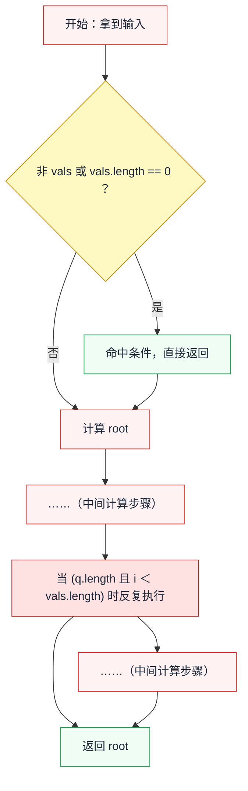

## TypeScript 解题方案（2 个方案逐个讲）

> **运行与提交**：每个方案都是自包含文件（内嵌用例自测，输出 PASS），整块复制到 `.ts` 文件后 `node 文件名` 即可运行。提交 LeetCode 时，把 `demo` 内的算法函数与辅助类型/函数整体取出、置于文件顶层即可。涉及交互/特殊接口的题以题面给定签名为准。

### 方案 1：迭代指针处理

**分析与思路**：核心做法是「迭代指针处理」。代码里依次做这些事：队列或堆的调度。

**运行方式**：`node 本文件`，内嵌用例全部通过会输出 PASS。


**方案专属流程图**（真实控制流）：

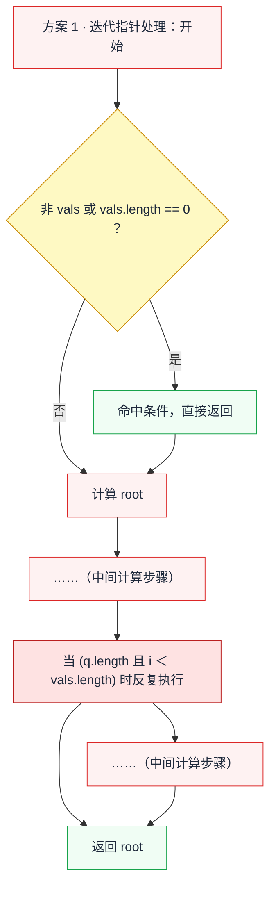

```typescript
class TreeNode {
  // 定义类型
  val: any;
  left: any;
  right: any; // 值: any; 左边界: any; 右边界: any;
  constructor(val?: any, left?: any, right?: any) {
    // constructor(值?: any, 左边界?: any, 右边界?: any) {
    this.val = val === undefined ? 0 : val; // 把 (值 全等于 undefined ? 0 : 值); 写入 值
    this.left = left === undefined ? null : left; // 把 (左边界 全等于 undefined ? null : 左边界); 写入 左边界
    this.right = right === undefined ? null : right; // 把 (右边界 全等于 undefined ? null : 右边界); 写入 右边界
  }
}
function buildTree(vals: any): any {
  // 定义函数/方法 buildTree
  if (!vals || vals.length === 0) return null; // 若 取反 vals 或 vals.长度 全等于 0，直接返回 null
  const root = new TreeNode(vals[0]);
  const q: any[] = [root];
  let i = 1;
  while (q.length && i < vals.length) {
    // 循环，直到不满足「节点.长度 且 下标 i 小于 vals.长度」
    const node = q.shift(); // 把 节点.shift() 存入 节点
    if (vals[i] !== null && vals[i] !== undefined) {
      node.left = new TreeNode(vals[i]);
      q.push(node.left);
    }
    i++; // 下标 i 加一
    if (i < vals.length && vals[i] !== null && vals[i] !== undefined) {
      node.right = new TreeNode(vals[i]);
      q.push(node.right);
    }
    i++; // 下标 i 加一
  }
  return root; // 返回 根节点
}
function treeToLevel(root: any): any[] {
  // 定义函数/方法 treeToLevel
  if (!root) return []; // 若 取反 根节点，直接返回 []
  const out: any[] = [];
  const q: any[] = [root]; // 把 []; const 节点: any[] 赋值为 [根节点]; 写入 const out: any[]
  while (q.length) {
    // 循环，直到不满足「节点.长度」
    const n = q.shift(); // 把 节点.shift() 存入 元素个数
    if (n === null || n === undefined) {
      out.push(null);
      continue;
    }
    out.push(n.val);
    q.push(n.left);
    q.push(n.right); // 把 元素个数.值 压入栈/数组尾部
  }
  while (out.length && out[out.length - 1] === null) out.pop(); // 循环，直到不满足「out.长度 且 out[out.长度 减 1] 全等于 null) out 弹出 );」
  return out; // 返回 out
}
class ListNode {
  // 定义类型
  val: any;
  next: any; // 值: any; 下一个: any;
  constructor(val?: any, next?: any) {
    this.val = val === undefined ? 0 : val;
    this.next = next === undefined ? null : next;
  }
}
function buildList(vals: any): any {
  // 定义函数/方法 buildList
  const dummy = new ListNode(0);
  let cur = dummy; // 把 new ListNode(0); let 当前值 赋值为 哨兵节点 存入 哨兵节点
  for (const v of vals) {
    cur.next = new ListNode(v);
    cur = cur.next;
  } // 把 new ListNode(值); 当前值 赋值为 当前值.下一个; } 写入 下一个
  return dummy.next; // 返回 哨兵节点.下一个
}
function listToArray(head: any): any[] {
  // 定义函数/方法 listToArray
  const out: any[] = [];
  let p = head; // 把 []; let 节点 赋值为 头节点; 写入 const out: any[]
  while (p) {
    out.push(p.val);
    p = p.next;
  } // 循环，直到不满足「节点) { out 追加 节点.值); 节点 赋值为 节点.下一个; }」
  return out; // 返回 out
}
// python-runtime shims
function pyLen(a: any): number {
  // 定义函数/方法 pyLen
  if (a === null || a === undefined) return 0; // 若 数组 全等于 null 或 数组 全等于 undefined，直接返回 0
  if (
    typeof a === 'string' ||
    Array.isArray(a) ||
    a instanceof Set ||
    a instanceof Map
  )
    return a.length ?? a.size;
  if (typeof a === 'object') return Object.keys(a).length; // 若 typeof 数组 全等于 'object'，直接返回 Object.keys(数组).长度
  return 0; // 返回 0
}
function pySlice(a: any, i: any, j: any, step?: any): any {
  // 定义函数/方法 pySlice
  if (typeof a === 'string') {
    const r = [...a].slice(i ?? 0, j ?? a.length);
    return step ? r.reverse().join('') : r.join('');
  }
  const arr = Array.isArray(a) ? a : [...a]; // 把 Array.isArray(数组) ? 数组 : 复制的 数组 存入 数组
  return arr.slice(i ?? 0, j ?? arr.length); // 返回 数组 截取 下标 i ?? 0, 下标 j ?? 数组.长度)
}
function pyRange(a: any, b?: any, step?: any): any[] {
  // 定义函数/方法 pyRange
  let s = 0,
    e = a,
    st = 1; // 把 0, e 赋值为 数组, st 赋值为 1 存入 字符串
  if (b !== undefined) {
    s = a;
    e = b;
  } // 若 b 不等于 undefined) { 字符串 赋值为 数组; e 赋值为 b; }
  if (step !== undefined) st = step; // 若 步数 不等于 undefined) st 赋值为 步数;
  const out: any[] = []; // 把 []; 写入 const out: any[]
  if (st > 0) for (let i = s; i < e; i += st) out.push(i);
  else for (let i = s; i > e; i += st) out.push(i); // 否则
  return out; // 返回 out
}
function pyIn(x: any, coll: any): boolean {
  // 定义函数/方法 pyIn
  if (coll === null || coll === undefined) return false; // 若 coll 全等于 null 或 coll 全等于 undefined，直接返回 false
  if (Array.isArray(coll)) return coll.includes(x); // 若 Array.isArray(coll)，直接返回 coll 是否包含 x)
  if (coll instanceof Set || coll instanceof Map) return coll.has(x); // 若 coll instanceof Set 或 coll instanceof Map，直接返回 coll.has(x)
  if (typeof coll === 'object') return x in coll; // 若 typeof coll 全等于 'object'，直接返回 x in coll
  if (typeof coll === 'string') return coll.indexOf(x) >= 0; // 若 typeof coll 全等于 'string'，直接返回 coll 查找 x) 不低于 0
  return false; // 返回 false
}
function pySorted(a: any): any[] {
  // 定义函数/方法 pySorted
  const arr = typeof a === 'string' ? [...a] : [...a]; // 把 (typeof 数组 全等于 'string') ? 复制的 数组 : 复制的 数组 存入 数组
  return arr.sort((x: any, y: any) => (x < y ? -1 : x > y ? 1 : 0));
}
function pyMin(a: any, b?: any): any {
  if (b !== undefined) return Math.min(a, b);
  if (Array.isArray(a) || a instanceof Set) return Math.min(...a);
  return Math.min(a);
} // 定义函数/方法 pyMin
function pyMax(a: any, b?: any): any {
  if (b !== undefined) return Math.max(a, b);
  if (Array.isArray(a) || a instanceof Set) return Math.max(...a);
  return Math.max(a);
} // 定义函数/方法 pyMax
function pySum(a: any): number {
  let s = 0;
  for (const v of a) s += v;
  return s;
} // 定义函数/方法 pySum
function pyAbs(x: any): number {
  return Math.abs(x);
} // 定义函数/方法 pyAbs
function pyEnumerate(a: any): any[] {
  const out: any[] = [];
  let i = 0;
  for (const v of a) {
    out.push([i, v]);
    i++;
  }
  return out;
} // 定义函数/方法 pyEnumerate
function pyZip(a: any, b: any): any[] {
  const n = Math.min(a.length, b.length);
  const out: any[] = [];
  for (let i = 0; i < n; i++) out.push([a[i], b[i]]);
  return out;
} // 定义函数/方法 pyZip
function pyDictGet(d: any, k: any, def?: any): any {
  return k in d ? d[k] : def === undefined ? null : def;
} // 定义函数/方法 pyDictGet
function pyPrint(...args: any[]): void {
  console.log(
    args
      .map((a) => (typeof a === 'object' && a !== null ? JSON.stringify(a) : a))
      .join(' '),
  );
} // 定义函数/方法 pyPrint
// collections / heapq
function heapPush(h: any[], x: any): void {
  h.push(x);
  let i = h.length - 1;
  while (i > 0) {
    const p = (i - 1) >> 1;
    if (h[p] <= h[i]) break;
    [h[p], h[i]] = [h[i], h[p]];
    i = p;
  }
} // 定义函数/方法 heapPush
function heapPop(h: any[]): any {
  const top = h[0];
  const last = h.pop();
  if (h.length) {
    h[0] = last;
    let i = 0;
    const n = h.length;
    while (true) {
      let l = 2 * i + 1,
        r = 2 * i + 2,
        s = i;
      if (l < n && h[l] < h[s]) s = l;
      if (r < n && h[r] < h[s]) s = r;
      if (s === i) break;
      [h[s], h[i]] = [h[i], h[s]];
      i = s;
    }
  }
  return top;
} // 定义函数/方法 heapPop
class Deque {
  private a: any[] = [];
  push(x: any) {
    this.a.push(x);
  }
  pushLeft(x: any) {
    this.a.unshift(x);
  }
  pop() {
    return this.a.pop();
  }
  popLeft() {
    return this.a.shift();
  }
  get length() {
    return this.a.length;
  }
  toArray() {
    return this.a.slice();
  }
} // 定义类型
function Counter(iter: any): any {
  const m: any = {};
  for (const v of iter) m[v] = (m[v] || 0) + 1;
  return m;
} // 定义函数/方法 Counter
function gcd(a: any, b: any): any {
  while (b) {
    [a, b] = [b, a % b];
  }
  return a;
} // 定义函数/方法 gcd
function pyInf(): number {
  return Infinity;
} // 定义函数/方法 pyInf

function norm(x: any): any {
  // 定义函数/方法 norm
  if (x === null || x === undefined) return null; // 若 x 全等于 null 或 x 全等于 undefined，直接返回 null
  if (typeof x === 'object') {
    // 若 typeof x 全等于 'object'
    if (x instanceof Deque) return x.toArray(); // 若 x instanceof Deque，直接返回 x.toArray()
    if (Array.isArray(x)) return x.map(norm); // 若 Array.isArray(x)，直接返回 x.映射表(norm)
    if (
      typeof x.val === 'number' &&
      (typeof x.left !== 'undefined' || typeof x.right !== 'undefined')
    )
      return treeToLevel(x);
    if (typeof x.next !== 'undefined' && typeof x.val === 'number')
      return listToArray(x);
    if (x instanceof Set) return [...x].sort(); // 若 x instanceof Set，直接返回 复制的 x 排序 )
    if (x instanceof Map) return Object.fromEntries(x); // 若 x instanceof Map，直接返回 Object.fromEntries(x)
    const o: any = {};
    for (const k of Object.keys(x)) o[k] = norm(x[k]);
    return o;
  }
  return x; // 返回 x
}
function eq(a: any, b: any): boolean {
  // 定义函数/方法 eq
  const x = norm(a),
    y = norm(b); // 把 norm(数组), y 赋值为 norm(b) 存入 x
  if (x === y) return true; // 若 x 全等于 y，直接返回 true
  if (x === null || y === null) return x === y; // 若 x 全等于 null 或 y 全等于 null，直接返回 x 全等于 y
  if (Array.isArray(x) && Array.isArray(y)) {
    // 若 Array.isArray(x) 且 Array.isArray(y
    if (x.length !== y.length) return false; // 若 x.长度 不等于 y.长度，直接返回 false
    for (let i = 0; i < x.length; i++) if (!eq(x[i], y[i])) return false; // 让 下标 i 从 0 开始计数，下标 i 小于 x.长度 就继续
    return true; // 返回 true
  }
  if (typeof x === 'object' && typeof y === 'object') {
    // 若 typeof x 全等于 'object' 且 typeof y 全等于 'object'
    const kx = Object.keys(x),
      ky = Object.keys(y); // 把 Object.keys(x), ky 赋值为 Object.keys(y) 存入 kx
    if (kx.length !== ky.length) return false; // 若 kx.长度 不等于 ky.长度，直接返回 false
    for (const k of kx) if (!eq(x[k], y[k])) return false;
    return true; // 返回 true
  }
  return x === y; // 返回 x 全等于 y
}

class MyCircularDeque {
  // 定义类型
  capacity: number;
  rear: number;
  front: number;
  elements: any[];
  constructor(k: number) {
    this.capacity = k + 1;
    this.rear = 0;
    this.front = 0;
    this.elements = new Array(this.capacity).fill(0);
  }
  isFull() {
    return (this.rear + 1) % this.capacity === this.front;
  }
  isEmpty() {
    return this.rear === this.front;
  } // 把 等于 this.front; } 写入 isEmpty() { return this.rear
  insertFront(value: number) {
    if (this.isFull()) return false;
    this.front = (this.front - 1 + this.capacity) % this.capacity;
    this.elements[this.front] = value;
    return true;
  }
  insertLast(value: number) {
    if (this.isFull()) return false;
    this.elements[this.rear] = value;
    this.rear = (this.rear + 1) % this.capacity;
    return true;
  }
  deleteFront() {
    if (this.isEmpty()) return false;
    this.front = (this.front + 1) % this.capacity;
    return true;
  }
  deleteLast() {
    if (this.isEmpty()) return false;
    this.rear = (this.rear - 1 + this.capacity) % this.capacity;
    return true;
  }
  getFront() {
    if (this.isEmpty()) return -1;
    return this.elements[this.front];
  }
  getRear() {
    if (this.isEmpty()) return -1;
    return this.elements[(this.rear - 1 + this.capacity) % this.capacity];
  }
}
export function demo(): void {
  // 程序入口：跑内嵌自测用例
  const obj = new MyCircularDeque(3); // 把 new MyCircularDeque(3) 存入 obj
  const cases = [
    { got: obj.insertLast(1), want: true },
    { got: obj.insertLast(2), want: true },
    { got: obj.insertFront(3), want: true },
    { got: obj.insertFront(4), want: false },
    { got: obj.getRear(), want: 2 },
    { got: obj.isFull(), want: true },
    { got: obj.deleteLast(), want: true },
    { got: obj.insertFront(4), want: true },
    { got: obj.getFront(), want: 4 },
  ];
  let fail = false; // 把 false 存入 fail
  for (const c of cases)
    if (!eq(c.got, c.want)) {
      fail = true;
      console.log('FAIL', JSON.stringify(c));
    } // 打印输出
  if (fail) throw new Error('FAILED'); // 若 fail) throw new Error(「FAILED」);
  console.log('PASS'); // 全部用例通过，输出 PASS
}
demo(); // demo();
```

### 方案 2：直接实现

**分析与思路**：核心做法是「直接实现」。

**运行方式**：`node 本文件`，内嵌用例全部通过会输出 PASS。

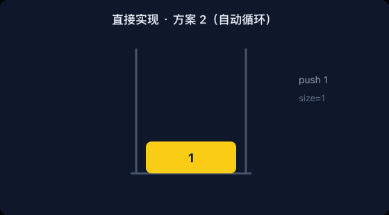

**方案专属流程图**（真实控制流）：

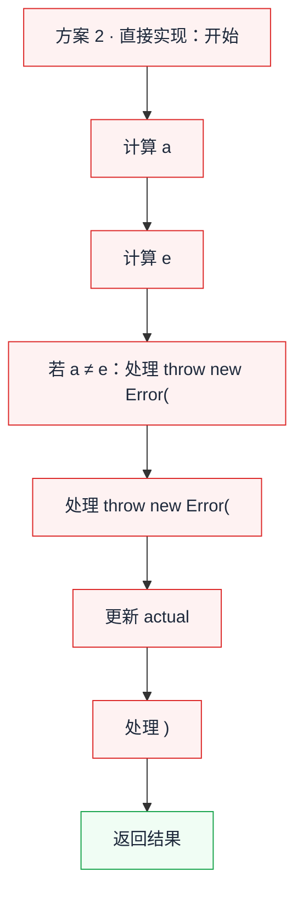

```typescript
function assertEq(actual: any, expected: any, msg: string = ''): void {
  // 定义函数/方法 assertEq
  const a = JSON.stringify(actual);
  const e = JSON.stringify(expected);
  if (a !== e)
    throw new Error(
      'ASSERT FAILED ' + msg + ' :: actual=' + a + ' expected=' + e,
    );
}

class CNode {
  val: number;
  prev: CNode | null;
  next: CNode | null;
  constructor(v: number) {
    this.val = v;
    this.prev = null;
    this.next = null;
  }
} // 定义类型
class MyCircularDeque {
  // 定义类型
  head: CNode | null;
  tail: CNode | null;
  capacity: number;
  size: number;
  constructor(k: number) {
    this.head = null;
    this.tail = null;
    this.capacity = k;
    this.size = 0;
  }
  insertFront(v: number): boolean {
    // insertFront(值: number): boolean {
    if (this.isFull()) return false; // 若 this.isFull()，直接返回 false
    const n = new CNode(v); // 把 new CNode(值) 存入 元素个数
    if (this.isEmpty()) {
      this.head = n;
      this.tail = n;
    } // 若 this.isEmpty()) { this.头节点 赋值为 元素个数; this.尾节点 赋值为 元素个数; }
    else {
      n.next = this.head;
      if (this.head) this.head.prev = n;
      this.head = n;
    } // 否则
    this.size++;
    return true; // this.大小 加一 ; return true;
  }
  insertLast(v: number): boolean {
    // insertLast(值: number): boolean {
    if (this.isFull()) return false; // 若 this.isFull()，直接返回 false
    const n = new CNode(v); // 把 new CNode(值) 存入 元素个数
    if (this.isEmpty()) {
      this.head = n;
      this.tail = n;
    } // 若 this.isEmpty()) { this.头节点 赋值为 元素个数; this.尾节点 赋值为 元素个数; }
    else {
      if (this.tail) {
        this.tail.next = n;
        n.prev = this.tail;
      }
      this.tail = n;
    } // 否则
    this.size++;
    return true; // this.大小 加一 ; return true;
  }
  deleteFront(): boolean {
    // deleteFront(): boolean {
    if (this.isEmpty()) return false; // 若 this.isEmpty()，直接返回 false
    if (this.head) {
      this.head = this.head.next;
      if (this.head) this.head.prev = null;
      else this.tail = null;
    }
    this.size--;
    return true; // this.大小 减一 ; return true;
  }
  deleteLast(): boolean {
    // deleteLast(): boolean {
    if (this.isEmpty()) return false; // 若 this.isEmpty()，直接返回 false
    if (this.tail) {
      this.tail = this.tail.prev;
      if (this.tail) this.tail.next = null;
      else this.head = null;
    }
    this.size--;
    return true; // this.大小 减一 ; return true;
  }
  getFront(): number {
    if (this.isEmpty()) return -1;
    return this.head ? this.head.val : -1;
  }
  getRear(): number {
    if (this.isEmpty()) return -1;
    return this.tail ? this.tail.val : -1;
  }
  isEmpty(): boolean {
    return this.size === 0;
  } // 把 等于 0; } 写入 大小
  isFull(): boolean {
    return this.size === this.capacity;
  } // 把 等于 this.capacity; } 写入 大小
}
export function demo(): void {
  // 程序入口：跑内嵌自测用例
  const obj = new MyCircularDeque(3); // 把 new MyCircularDeque(3) 存入 obj
  assertEq(obj.insertLast(1), true, 'i1'); // 断言校验
  assertEq(obj.insertLast(2), true, 'i2'); // 断言校验
  assertEq(obj.insertFront(3), true, 'i3'); // 断言校验
  assertEq(obj.insertFront(4), false, 'i4'); // 断言校验
  assertEq(obj.getRear(), 2, 'rear'); // 断言校验
  assertEq(obj.isFull(), true, 'full'); // 断言校验
  assertEq(obj.deleteLast(), true, 'dl'); // 断言校验
  assertEq(obj.insertFront(4), true, 'i4b'); // 断言校验
  assertEq(obj.getFront(), 4, 'front'); // 断言校验
  console.log('PASS'); // 全部用例通过，输出 PASS
}
demo(); // demo();
```

## 逐步拆解与面试追问

**复杂度**：时间 O(n)（单趟线性扫描），空间 O(1) 到 O(n)（视辅助结构）

**为什么是这个量级**：每个元素被常数次访问，辅助哈希或栈的开销与 n 同阶

**面试官可能会追问**：

- 什么时候用单调栈（求下一个更大或更小）？
- 栈里存值还是存下标？
- 能否用 O(1) 额外空间？

## 关键 API 速查（TS 主解法实际用到，附官方链接）

| API | 作用 | 使用要点 | 官方文档 |
|---|---|---|---|
| `Array.prototype.sort()` | 原地排序 | 默认按字符串 Unicode 序（10 会排在 2 前），数字必须传 (a,b)=>a-b；V8 用 TimSort，稳定，O(n log n)；返回原数组引用 | [官方文档](https://developer.mozilla.org/zh-CN/docs/Web/JavaScript/Reference/Global_Objects/Array/sort) |
| `Array.prototype.map()` | 逐元素映射为新数组 | 回调 (v,i,arr)；返回等长新数组，不改变原数组；稀疏位跳过；链式调用注意中间数组开销 | [官方文档](https://developer.mozilla.org/zh-CN/docs/Web/JavaScript/Reference/Global_Objects/Array/map) |
| `Array.prototype.push()` | 尾部追加 | 返回新长度；可一次多个；均摊 O(1)；会改变原数组 | [官方文档](https://developer.mozilla.org/zh-CN/docs/Web/JavaScript/Reference/Global_Objects/Array/push) |
| `Array.prototype.pop()` | 尾部弹出 | 返回被删元素（空数组返回 undefined）；O(1) | [官方文档](https://developer.mozilla.org/zh-CN/docs/Web/JavaScript/Reference/Global_Objects/Array/pop) |
| `Array.prototype.shift()` | 头部取出 | O(n)（后续元素整体前移）；大量头部操作请用链表或双端结构 | [官方文档](https://developer.mozilla.org/zh-CN/docs/Web/JavaScript/Reference/Global_Objects/Array/shift) |
| `Array.prototype.unshift()` | 头部插入 | O(n)；与 shift 组合可当双端队列 | [官方文档](https://developer.mozilla.org/zh-CN/docs/Web/JavaScript/Reference/Global_Objects/Array/unshift) |
| `Array/String includes()` | 是否包含 | 数组用 SameValueZero（NaN 可判）；字符串按子串；第二个参数为起始下标 | [官方文档](https://developer.mozilla.org/zh-CN/docs/Web/JavaScript/Reference/Global_Objects/Array/includes) |
| `Array/String indexOf()` | 首次出现的下标 | 找不到返回 -1；无法判 NaN（用 includes）；字符串可传起始位 | [官方文档](https://developer.mozilla.org/zh-CN/docs/Web/JavaScript/Reference/Global_Objects/Array/indexOf) |
| `Array/String slice()` | 切片（不改原数组） | slice(start,end) 含头不含尾；负数从尾计；常用于复制数组（slice()） | [官方文档](https://developer.mozilla.org/zh-CN/docs/Web/JavaScript/Reference/Global_Objects/Array/slice) |
| `Array.prototype.join()` | 数组拼接为字符串 | undefined/null 转空串；嵌套数组会展平一层；join('') 用于字符数组还原 | [官方文档](https://developer.mozilla.org/zh-CN/docs/Web/JavaScript/Reference/Global_Objects/Array/join) |
| `Object.keys()` | 对象键名数组 | 仅自身可枚举字符串键（不含 symbol）；配 length 可当计数器 | [官方文档](https://developer.mozilla.org/zh-CN/docs/Web/JavaScript/Reference/Global_Objects/Object/keys) |
| `Object.fromEntries()` | 键值对数组转对象 | 参数为 [k,v] 可迭代；map 出来的键值对可直接转对象 | [官方文档](https://developer.mozilla.org/zh-CN/docs/Web/JavaScript/Reference/Global_Objects/Object/fromEntries) |
| `JSON.stringify()` | 序列化为 JSON 字符串 | 常用于结构化比较（深度相等判定）；undefined/函数/循环引用会被丢弃或抛错 | [官方文档](https://developer.mozilla.org/zh-CN/docs/Web/JavaScript/Reference/Global_Objects/JSON/stringify) |
| `Math.max()` | 最大值 | 配展开 Math.max(...arr)；空参返回 -Infinity；超大数组注意展开参数上限 | [官方文档](https://developer.mozilla.org/zh-CN/docs/Web/JavaScript/Reference/Global_Objects/Math/max) |
| `Math.min()` | 最小值 | 同 max；空参返回 Infinity | [官方文档](https://developer.mozilla.org/zh-CN/docs/Web/JavaScript/Reference/Global_Objects/Math/min) |
| `Math.abs()` | 绝对值 | 入参会被隐式转数字；-0 返回 +0 | [官方文档](https://developer.mozilla.org/zh-CN/docs/Web/JavaScript/Reference/Global_Objects/Math/abs) |

### 各语言官方文档导航

- **TypeScript / JS**：[MDN 中文参考](https://developer.mozilla.org/zh-CN/)
- **Python**：[Python 官方文档](https://docs.python.org/zh-cn/3/)
- **Go**：[Go 标准库](https://pkg.go.dev/std)
- **Java**：[JDK 17 API](https://docs.oracle.com/en/java/javase/17/docs/api/)
- **Rust**：[Rust 标准库](https://doc.rust-lang.org/std/)
- **Lua**：[Lua 5.4 手册](https://www.lua.org/manual/5.4/)
- **C**：[Cppreference C](https://zh.cppreference.com/w/c)
- **C++**：[Cppreference C++](https://zh.cppreference.com/w/cpp)
- **R**：[R 官方手册](https://stat.ethz.ch/R-manual/)
- **Zig**：[Zig 语言文档](https://ziglang.org/documentation/master/)
- **Dart**：[Dart API](https://api.dart.dev/)

## 附录：其他 10 种语言全部实现（每种语言列举其全部方案）

> TypeScript 的全部方案见「TypeScript 解题方案」一节；下面是其余 10 种语言的对应实现，每种语言的每个方案都带思路分析、代码走读与专属运行架构图。
> 每个方案都内嵌用例自测，可独立运行（老仓库 python/go 文件遵循「打印结果」约定）。
> 完整解法文件见 `dsa/<语言>/stack/lc_641_设计循环双端队列/`。

### Python 实现（2 种方案）

Python 的全部方案如下，每个方案都内嵌用例自测，可独立运行（老仓库 python/go 文件遵循「打印结果」约定）：

#### 方案 1：迭代指针处理

**思路与代码分析**：核心是「迭代指针处理」。Python 版用切片与字典推导式简化操作，突出可读性。

**运行架构**（真实控制流）：

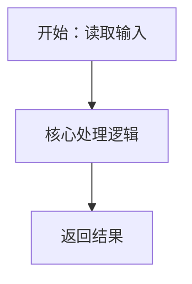

```python
class MyCircularDeque:  # 定义类
    def __init__(self, k: int):  # 构造函数：初始化成员
        self.capacity = k + 1  # Use k+1 to distinguish full and empty
        self.rear = 0  # 把 0 写入 self.rear
        self.front = 0  # 把 0 写入 self.front
        self.elements = [0] * self.capacity  # 把 [0] 乘 self.capacity 写入 self.elements

    def insertFront(self, value: int) -> bool:  # 定义函数 insertFront（参数：self, value: int）
        if self.isFull():  # 若 self.isFull(
            return False  # 返回 False
        self.front = (self.front - 1 + self.capacity) % self.capacity
        self.elements[self.front] = value  # 把 value 写入 self.elements[self.front]
        return True  # 返回 True

    def insertLast(self, value: int) -> bool:  # 定义函数 insertLast（参数：self, value: int）
        if self.isFull():  # 若 self.isFull(
            return False  # 返回 False
        self.elements[self.rear] = value  # 把 value 写入 self.elements[self.rear]
        self.rear = (
            self.rear + 1
        ) % self.capacity  # 把 (self.rear 加 1) 对…取模 self.capacity 写入 self.rear
        return True  # 返回 True

    def deleteFront(self) -> bool:  # 定义函数 deleteFront（参数：self）
        if self.isEmpty():  # 若 self.isEmpty(
            return False  # 返回 False
        self.front = (
            self.front + 1
        ) % self.capacity  # 把 (self.front 加 1) 对…取模 self.capacity 写入 self.front
        return True  # 返回 True

    def deleteLast(self) -> bool:  # 定义函数 deleteLast（参数：self）
        if self.isEmpty():  # 若 self.isEmpty(
            return False  # 返回 False
        self.rear = (self.rear - 1 + self.capacity) % self.capacity
        return True  # 返回 True

    def getFront(self) -> int:  # 定义函数 getFront（参数：self）
        if self.isEmpty():  # 若 self.isEmpty(
            return -1  # 返回 减 1
        return self.elements[self.front]  # 返回 self.elements[self.front]

    def getRear(self) -> int:  # 定义函数 getRear（参数：self）
        if self.isEmpty():  # 若 self.isEmpty(
            return -1  # 返回 减 1
        return self.elements[(self.rear - 1 + self.capacity) % self.capacity]

    def isEmpty(self) -> bool:  # 定义函数 isEmpty（参数：self）
        return self.rear == self.front  # 返回 self.rear 等于 self.front

    def isFull(self) -> bool:  # 定义函数 isFull（参数：self）
        return (
            self.rear + 1
        ) % self.capacity == self.front  # 返回 (self.rear 加 1) 对…取模 self.capacity 等于 self.front

if __name__ == "__main__":  # 若 __name__ 等于 '__main__'
    obj = MyCircularDeque(3)  # 把 MyCircularDeque(3) 存入 obj
    print(obj.insertLast(1))  # True
    print(obj.insertLast(2))  # True
    print(obj.insertFront(3))  # True
    print(obj.insertFront(4))  # False (full)
    print(obj.getRear())  # 2
    print(obj.isFull())  # True
    print(obj.deleteLast())  # True
    print(obj.insertFront(4))  # True
    print(obj.getFront())  # 4
```

#### 方案 2：直接实现

**思路与代码分析**：核心是「直接实现」。Python 版用切片与字典推导式简化操作，突出可读性。

**运行架构**：与方案 1 的控制流相同（同算法在该语言的等价实现），图见上。

```python
import sys  # 提高递归深度上限（深输入防 RecursionError）

sys.setrecursionlimit(200000)  # 树/链表类题目节点数可达 1e4 量级

class Node:  # 定义类
    def __init__(self, value):  # 构造函数：初始化成员
        self.val = value  # 把 value 写入 值
        self.prev = None  # 把 None 写入 前一个
        self.next = None  # 把 None 写入 下一个

class MyCircularDeque:  # 定义类
    def __init__(self, k: int):  # 构造函数：初始化成员
        self.head = None  # 把 None 写入 头节点
        self.tail = None  # 把 None 写入 尾节点
        self.capacity = k  # 把 下标 k 写入 self.capacity
        self.size = 0  # 把 0 写入 大小

    def insertFront(self, value: int) -> bool:  # 定义函数 insertFront（参数：self, value: int）
        if self.isFull():  # 若 self.isFull(
            return False  # 返回 False
        new_node = Node(value)  # 把 Node(value) 存入 new_node
        if self.isEmpty():  # 若 self.isEmpty(
            self.head = new_node  # 把 new_node 写入 头节点
            self.tail = new_node  # 把 new_node 写入 尾节点
        else:  # 否则
            new_node.next = self.head  # 把 self.头节点 写入 下一个
            if self.head:  # 若 self.头节点
                self.head.prev = new_node  # 把 new_node 写入 前一个
            self.head = new_node  # 把 new_node 写入 头节点
        self.size += 1  # self.size累加 1
        return True  # 返回 True

    def insertLast(self, value: int) -> bool:  # 定义函数 insertLast（参数：self, value: int）
        if self.isFull():  # 若 self.isFull(
            return False  # 返回 False
        new_node = Node(value)  # 把 Node(value) 存入 new_node
        if self.isEmpty():  # 若 self.isEmpty(
            self.head = new_node  # 把 new_node 写入 头节点
            self.tail = new_node  # 把 new_node 写入 尾节点
        else:  # 否则
            if self.tail:  # 若 self.尾节点
                self.tail.next = new_node  # 把 new_node 写入 下一个
                new_node.prev = self.tail  # 把 self.尾节点 写入 前一个
            self.tail = new_node  # 把 new_node 写入 尾节点
        self.size += 1  # self.size累加 1
        return True  # 返回 True

    def deleteFront(self) -> bool:  # 定义函数 deleteFront（参数：self）
        if self.isEmpty():  # 若 self.isEmpty(
            return False  # 返回 False
        if self.head:  # 若 self.头节点
            self.head = self.head.next  # 把 self.头节点.下一个 写入 头节点
            if self.head:  # 若 self.头节点
                self.head.prev = None  # 把 None 写入 前一个
            else:  # 否则
                self.tail = None  # 把 None 写入 尾节点
        self.size -= 1  # self.size累减 1
        return True  # 返回 True

    def deleteLast(self) -> bool:  # 定义函数 deleteLast（参数：self）
        if self.isEmpty():  # 若 self.isEmpty(
            return False  # 返回 False
        if self.tail:  # 若 self.尾节点
            self.tail = self.tail.prev  # 把 self.尾节点.前一个 写入 尾节点
            if self.tail:  # 若 self.尾节点
                self.tail.next = None  # 把 None 写入 下一个
            else:  # 否则
                self.head = None  # 把 None 写入 头节点
        self.size -= 1  # self.size累减 1
        return True  # 返回 True

    def getFront(self) -> int:  # 定义函数 getFront（参数：self）
        if self.isEmpty():  # 若 self.isEmpty(
            return -1  # 返回 减 1
        return self.head.val if self.head else -1  # 返回 self.头节点.值 if self.头节点 else 减 1

    def getRear(self) -> int:  # 定义函数 getRear（参数：self）
        if self.isEmpty():  # 若 self.isEmpty(
            return -1  # 返回 减 1
        return self.tail.val if self.tail else -1  # 返回 self.尾节点.值 if self.尾节点 else 减 1

    def isEmpty(self) -> bool:  # 定义函数 isEmpty（参数：self）
        return self.size == 0  # 返回 self.大小 等于 0

    def isFull(self) -> bool:  # 定义函数 isFull（参数：self）
        return self.size == self.capacity  # 返回 self.大小 等于 self.capacity

if __name__ == "__main__":  # 若 __name__ 等于 '__main__'
    obj = MyCircularDeque(3)  # 把 MyCircularDeque(3) 存入 obj
    print(obj.insertLast(1))  # True
    print(obj.insertLast(2))  # True
    print(obj.insertFront(3))  # True
    print(obj.insertFront(4))  # False (full)
    print(obj.getRear())  # 2
    print(obj.isFull())  # True
    print(obj.deleteLast())  # True
    print(obj.insertFront(4))  # True
    print(obj.getFront())  # 4
```

### Go 实现（2 种方案）

Go 的全部方案如下，每个方案都内嵌用例自测，可独立运行（老仓库 python/go 文件遵循「打印结果」约定）：

#### 方案 1：迭代指针处理

**思路与代码分析**：核心是「迭代指针处理」。Go 版用切片与多返回值惯用法，显式处理索引边界。**走读**：方案 1 · 迭代指针处理：开始 → 更新 : → 返回 &MyCircularDeque。

**运行架构**（真实控制流）：

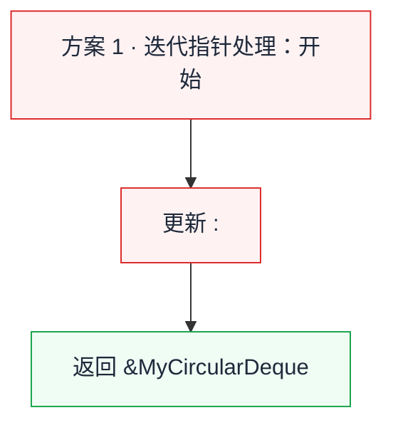

```go
package main // 引入依赖

import (
	"fmt" // 「fmt」
	"os"  // 「os」
)

type MyCircularDeque struct { // 定义类型
	capacity int   // capacity int
	front    int   // front int
	rear     int   // rear int
	elements []int // elements []int
}

func NewMyCircularDeque(k int) *MyCircularDeque { // 定义函数/方法 NewMyCircularDeque
	capacity := k + 1 // 把 下标 k 加 1 写入 capacity :
	return &MyCircularDeque{capacity: capacity, front: 0, rear: 0, elements: make([]int, capacity)}
}

func (d *MyCircularDeque) insertFront(value int) bool { // 定义函数/方法 insertFront
	if d.isFull() { // 若 d.isFull(
		return false // 返回 false
	}
	d.front = (d.front - 1 + d.capacity) % d.capacity // 把 (d.front 减 1 加 d.capacity) 对…取模 d.capacity 写入 d.front
	d.elements[d.front] = value                       // 把 value 写入 d.elements[d.front]
	return true                                       // 返回 true
}

func (d *MyCircularDeque) insertLast(value int) bool { // 定义函数/方法 insertLast
	if d.isFull() { // 若 d.isFull(
		return false // 返回 false
	}
	d.elements[d.rear] = value         // 把 value 写入 d.elements[d.rear]
	d.rear = (d.rear + 1) % d.capacity // 把 (d.rear 加 1) 对…取模 d.capacity 写入 d.rear
	return true                        // 返回 true
}

func (d *MyCircularDeque) deleteFront() bool { // 定义函数/方法 deleteFront
	if d.isEmpty() { // 若 d.isEmpty(
		return false // 返回 false
	}
	d.front = (d.front + 1) % d.capacity // 把 (d.front 加 1) 对…取模 d.capacity 写入 d.front
	return true                          // 返回 true
}

func (d *MyCircularDeque) deleteLast() bool { // 定义函数/方法 deleteLast
	if d.isEmpty() { // 若 d.isEmpty(
		return false // 返回 false
	}
	d.rear = (d.rear - 1 + d.capacity) % d.capacity // 把 (d.rear 减 1 加 d.capacity) 对…取模 d.capacity 写入 d.rear
	return true                                     // 返回 true
}

func (d *MyCircularDeque) getFront() int { // 定义函数/方法 getFront
	if d.isEmpty() { // 若 d.isEmpty(
		return -1 // 返回 减 1
	}
	return d.elements[d.front] // 返回 d.elements[d.front]
}

func (d *MyCircularDeque) getRear() int { // 定义函数/方法 getRear
	if d.isEmpty() { // 若 d.isEmpty(
		return -1 // 返回 减 1
	}
	return d.elements[(d.rear-1+d.capacity)%d.capacity] // 返回 d.elements[(d.rear 减 1 加 d.capacity) 对…取模 d.capacity]
}

func (d *MyCircularDeque) isEmpty() bool { // 定义判定函数 isEmpty
	return d.rear == d.front // 返回 d.rear 等于 d.front
}

func (d *MyCircularDeque) isFull() bool { // 定义判定函数 isFull
	return (d.rear+1)%d.capacity == d.front // 返回 (d.rear 加 1) 对…取模 d.capacity 等于 d.front
}

func main() { // 程序入口：跑内嵌自测用例
	ok := true                   // 把 true 写入 ok :
	obj := NewMyCircularDeque(3) // 把 NewMyCircularDeque(3) 写入 obj :
	checks := []bool{            // 把 []bool{ 写入 checks :
		obj.insertLast(1),
		obj.insertLast(2),
		obj.insertFront(3),
		obj.insertFront(4),
		obj.getRear() == 2,
		obj.isFull(),
		obj.deleteLast(),
		obj.insertFront(4),
		obj.getFront() == 4,
	}
	wants := []bool{true, true, true, false, true, true, true, true, true}
	for i := range checks { // 把 range checks { 写入 for i :
		if checks[i] != wants[i] { // 若 checks[下标 i] 不等于 wants[下标 i]
			ok = false                                                          // 把 false 写入 ok
			fmt.Printf("FAIL step %d got %v want %v\n", i, checks[i], wants[i]) // 打印输出
		}
	}
	if !ok { // 若 取反 ok
		os.Exit(1) // os.Exit(1)
	}
	fmt.Println("PASS") // 全部用例通过，输出 PASS
}
```

#### 方案 2：直接实现

**思路与代码分析**：核心是「直接实现」。Go 版用切片与多返回值惯用法，显式处理索引边界。**走读**：方案 2 · 直接实现：开始 → 返回 &MyCircularDeque。

**运行架构**（真实控制流）：

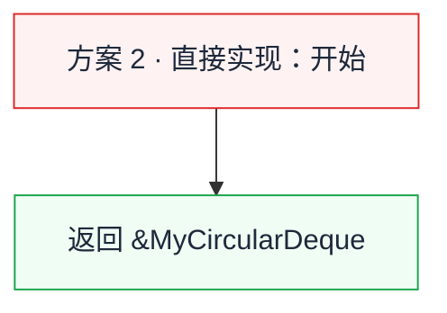

```go
package main // 引入依赖

import (
	"fmt" // 「fmt」
	"os"  // 「os」
)

type MyCircularDeque struct { // 定义类型
	data []int // data []int
	head int   // 头节点 int
	tail int   // 尾节点 int
	size int   // 大小 int
	cap  int   // cap int
}

func NewMyCircularDeque(k int) *MyCircularDeque { // 定义函数/方法 NewMyCircularDeque
	return &MyCircularDeque{data: make([]int, k), head: 0, tail: -1, size: 0, cap: k}
}

func (d *MyCircularDeque) insertFront(value int) bool { // 定义函数/方法 insertFront
	if d.isFull() { // 若 d.isFull(
		return false // 返回 false
	}
	d.head = (d.head - 1 + d.cap) % d.cap // 把 (d.头节点 减 1 加 d.cap) 对…取模 d.cap 写入 头节点
	d.data[d.head] = value                // 把 value 写入 d.data[d.head]
	d.size++                              // d.大小 加一
	return true                           // 返回 true
}

func (d *MyCircularDeque) insertLast(value int) bool { // 定义函数/方法 insertLast
	if d.isFull() { // 若 d.isFull(
		return false // 返回 false
	}
	d.tail = (d.tail + 1) % d.cap // 把 (d.尾节点 加 1) 对…取模 d.cap 写入 尾节点
	d.data[d.tail] = value        // 把 value 写入 d.data[d.tail]
	d.size++                      // d.大小 加一
	return true                   // 返回 true
}

func (d *MyCircularDeque) deleteFront() bool { // 定义函数/方法 deleteFront
	if d.isEmpty() { // 若 d.isEmpty(
		return false // 返回 false
	}
	d.head = (d.head + 1) % d.cap // 把 (d.头节点 加 1) 对…取模 d.cap 写入 头节点
	d.size--                      // d.大小 减一
	return true                   // 返回 true
}

func (d *MyCircularDeque) deleteLast() bool { // 定义函数/方法 deleteLast
	if d.isEmpty() { // 若 d.isEmpty(
		return false // 返回 false
	}
	d.tail = (d.tail - 1 + d.cap) % d.cap // 把 (d.尾节点 减 1 加 d.cap) 对…取模 d.cap 写入 尾节点
	d.size--                              // d.大小 减一
	return true                           // 返回 true
}

func (d *MyCircularDeque) getFront() int { // 定义函数/方法 getFront
	if d.isEmpty() { // 若 d.isEmpty(
		return -1 // 返回 减 1
	}
	return d.data[d.head] // 返回 d.data[d.头节点]
}

func (d *MyCircularDeque) getRear() int { // 定义函数/方法 getRear
	if d.isEmpty() { // 若 d.isEmpty(
		return -1 // 返回 减 1
	}
	return d.data[d.tail] // 返回 d.data[d.尾节点]
}

func (d *MyCircularDeque) isEmpty() bool { // 定义判定函数 isEmpty
	return d.size == 0 // 返回 d.大小 等于 0
}

func (d *MyCircularDeque) isFull() bool { // 定义判定函数 isFull
	return d.size == d.cap // 返回 d.大小 等于 d.cap
}

func main() { // 程序入口：跑内嵌自测用例
	ok := true                   // 把 true 写入 ok :
	obj := NewMyCircularDeque(3) // 把 NewMyCircularDeque(3) 写入 obj :
	checks := []bool{            // 把 []bool{ 写入 checks :
		obj.insertLast(1),
		obj.insertLast(2),
		obj.insertFront(3),
		obj.insertFront(4),
		obj.getRear() == 2,
		obj.isFull(),
		obj.deleteLast(),
		obj.insertFront(4),
		obj.getFront() == 4,
	}
	wants := []bool{true, true, true, false, true, true, true, true, true}
	for i := range checks { // 把 range checks { 写入 for i :
		if checks[i] != wants[i] { // 若 checks[下标 i] 不等于 wants[下标 i]
			ok = false                                                          // 把 false 写入 ok
			fmt.Printf("FAIL step %d got %v want %v\n", i, checks[i], wants[i]) // 打印输出
		}
	}
	if !ok { // 若 取反 ok
		os.Exit(1) // os.Exit(1)
	}
	fmt.Println("PASS") // 全部用例通过，输出 PASS
}
```

### Java 实现（2 种方案）

Java 的全部方案如下，每个方案都内嵌用例自测，可独立运行（老仓库 python/go 文件遵循「打印结果」约定）：

#### 方案 1：迭代指针处理

**思路与代码分析**：核心是「迭代指针处理」。Java 版用类与静态方法组织，集合操作显式明了。**走读**：方案 1 · 迭代指针处理：开始 → 更新 capacity → 更新 elements → 返回结果。

**运行架构**（真实控制流）：

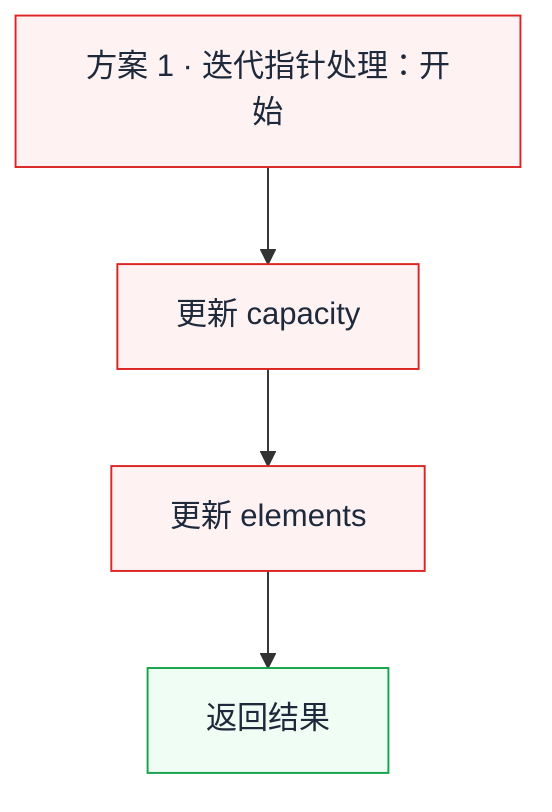

```java
package com.webfault.dsa; // 引入依赖

import java.util.*; // 引入依赖

class lc641_solution111 { // 定义类型
  static class MyCircularDeque { // static class MyCircularDeque {
    int capacity;
    int rear = 0;
    int front = 0;
    int[] elements;

    MyCircularDeque(int k) {
      capacity = k + 1;
      elements = new int[capacity];
    }

    boolean insertFront(int v) { // 定义函数/方法 insertFront
      if (isFull()) return false; // 若 isFull()，直接返回 false
      front = (front - 1 + capacity) % capacity; // 把 (front 减 1 加 capacity) 对…取模 capacity; 写入 front
      elements[front] = v; // 把 值; 写入 elements[front]
      return true; // 返回 true
    }

    boolean insertLast(int v) { // 定义函数/方法 insertLast
      if (isFull()) return false; // 若 isFull()，直接返回 false
      elements[rear] = v; // 把 值; 写入 elements[rear]
      rear = (rear + 1) % capacity; // 把 (rear 加 1) 对…取模 capacity; 写入 rear
      return true; // 返回 true
    }

    boolean deleteFront() { // 定义函数/方法 deleteFront
      if (isEmpty()) return false; // 若 isEmpty()，直接返回 false
      front = (front + 1) % capacity; // 把 (front 加 1) 对…取模 capacity; 写入 front
      return true; // 返回 true
    }

    boolean deleteLast() { // 定义函数/方法 deleteLast
      if (isEmpty()) return false; // 若 isEmpty()，直接返回 false
      rear = (rear - 1 + capacity) % capacity; // 把 (rear 减 1 加 capacity) 对…取模 capacity; 写入 rear
      return true; // 返回 true
    }

    int getFront() {
      if (isEmpty()) return -1;
      return elements[front];
    }

    int getRear() {
      if (isEmpty()) return -1;
      return elements[(rear - 1 + capacity) % capacity];
    }

    boolean isEmpty() {
      return rear == front;
    } // 把 赋值为 front; } 写入 boolean isEmpty() { return rear

    boolean isFull() {
      return (rear + 1) % capacity == front;
    }
  }

  public static void main(String[] args) { // public static void main(String[] args) {
    MyCircularDeque o = new MyCircularDeque(3); // 把 new MyCircularDeque(3); 写入 MyCircularDeque o
    List<Object> out = new ArrayList<>(); // 把 new ArrayList 小于 超过 (); 写入 List<Object> out
    out.add(o.insertLast(1)); // out 追加 o.insertLast(1));
    out.add(o.insertLast(2)); // out 追加 o.insertLast(2));
    out.add(o.insertFront(3)); // out 追加 o.insertFront(3));
    out.add(o.insertFront(4)); // out 追加 o.insertFront(4));
    out.add(o.getRear()); // out 追加 o.getRear());
    out.add(o.isFull()); // out 追加 o.isFull());
    out.add(o.deleteLast()); // out 追加 o.deleteLast());
    out.add(o.insertFront(4)); // out 追加 o.insertFront(4));
    out.add(o.getFront()); // out 追加 o.getFront());
    List<Object> want = Arrays.asList(true, true, true, false, 2, true, true, true, 4);
    if (!out.equals(want)) throw new RuntimeException("FAILED " + out);
    System.out.println("PASS"); // 全部用例通过，输出 PASS
  }
}
```

#### 方案 2：直接实现

**思路与代码分析**：核心是「直接实现」。Java 版用类与静态方法组织，集合操作显式明了。**走读**：方案 2 · 直接实现：开始 → 更新 capacity → 返回结果。

**运行架构**（真实控制流）：

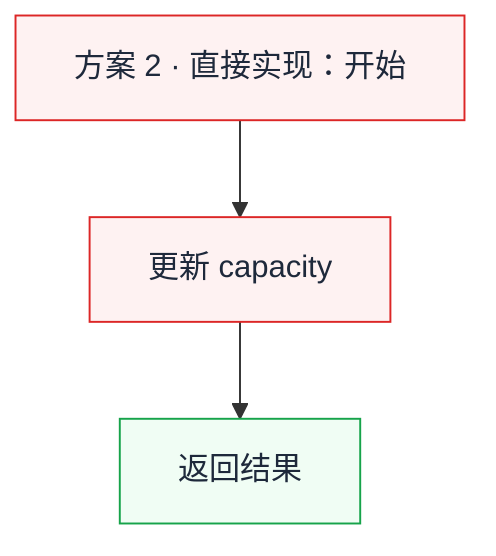

```java
package com.webfault.dsa; // 引入依赖

import java.util.*; // 引入依赖

class lc641_solution222 { // 定义类型
  static class Node { // static class Node {
    int val;
    Node prev;
    Node next; // int 值; Node 前一个; Node 下一个;

    Node(int v) {
      val = v;
    } // 把 值; } 写入 Node(int v) { val
  }

  static class MyCircularDeque { // static class MyCircularDeque {
    Node head = null, tail = null; // 把 null, 尾节点 赋值为 null; 写入 Node head
    int capacity;
    int size = 0; // 把 0; 写入 int capacity; int size

    MyCircularDeque(int k) {
      capacity = k;
    } // 把 下标 k; } 写入 MyCircularDeque(int k) { capacity

    boolean insertFront(int v) { // 定义函数/方法 insertFront
      if (isFull()) return false; // 若 isFull()，直接返回 false
      Node n = new Node(v); // 把 new Node(值); 写入 Node n
      if (isEmpty()) {
        head = n;
        tail = n;
      } // 若 isEmpty()) { 头节点 赋值为 元素个数; 尾节点 赋值为 元素个数; }
      else {
        n.next = head;
        head.prev = n;
        head = n;
      } // 否则
      size++;
      return true; // 大小 加一 ; return true;
    }

    boolean insertLast(int v) { // 定义函数/方法 insertLast
      if (isFull()) return false; // 若 isFull()，直接返回 false
      Node n = new Node(v); // 把 new Node(值); 写入 Node n
      if (isEmpty()) {
        head = n;
        tail = n;
      } // 若 isEmpty()) { 头节点 赋值为 元素个数; 尾节点 赋值为 元素个数; }
      else {
        tail.next = n;
        n.prev = tail;
        tail = n;
      } // 否则
      size++;
      return true; // 大小 加一 ; return true;
    }

    boolean deleteFront() { // 定义函数/方法 deleteFront
      if (isEmpty()) return false; // 若 isEmpty()，直接返回 false
      head = head.next; // 把 头节点.下一个; 写入 头节点
      if (head != null) head.prev = null;
      else tail = null; // 若 头节点 不等于 null) 头节点.前一个 赋值为 null; else 尾节点 赋值为 null;
      size--;
      return true; // 大小 减一 ; return true;
    }

    boolean deleteLast() { // 定义函数/方法 deleteLast
      if (isEmpty()) return false; // 若 isEmpty()，直接返回 false
      tail = tail.prev; // 把 尾节点.前一个; 写入 尾节点
      if (tail != null) tail.next = null;
      else head = null; // 若 尾节点 不等于 null) 尾节点.下一个 赋值为 null; else 头节点 赋值为 null;
      size--;
      return true; // 大小 减一 ; return true;
    }

    int getFront() {
      if (isEmpty()) return -1;
      return head.val;
    } // int getFront() { if (isEmpty()) return 减 1; return 头节点.值; }

    int getRear() {
      if (isEmpty()) return -1;
      return tail.val;
    } // int getRear() { if (isEmpty()) return 减 1; return 尾节点.值; }

    boolean isEmpty() {
      return size == 0;
    } // 把 赋值为 0; } 写入 boolean isEmpty() { return size

    boolean isFull() {
      return size == capacity;
    } // 把 赋值为 capacity; } 写入 boolean isFull() { return size
  }

  public static void main(String[] args) { // public static void main(String[] args) {
    MyCircularDeque o = new MyCircularDeque(3); // 把 new MyCircularDeque(3); 写入 MyCircularDeque o
    List<Object> out = new ArrayList<>(); // 把 new ArrayList 小于 超过 (); 写入 List<Object> out
    out.add(o.insertLast(1)); // out 追加 o.insertLast(1));
    out.add(o.insertLast(2)); // out 追加 o.insertLast(2));
    out.add(o.insertFront(3)); // out 追加 o.insertFront(3));
    out.add(o.insertFront(4)); // out 追加 o.insertFront(4));
    out.add(o.getRear()); // out 追加 o.getRear());
    out.add(o.isFull()); // out 追加 o.isFull());
    out.add(o.deleteLast()); // out 追加 o.deleteLast());
    out.add(o.insertFront(4)); // out 追加 o.insertFront(4));
    out.add(o.getFront()); // out 追加 o.getFront());
    List<Object> want = Arrays.asList(true, true, true, false, 2, true, true, true, 4);
    if (!out.equals(want)) throw new RuntimeException("FAILED " + out);
    System.out.println("PASS"); // 全部用例通过，输出 PASS
  }
}
```

### Rust 实现（2 种方案）

Rust 的全部方案如下，每个方案都内嵌用例自测，可独立运行（老仓库 python/go 文件遵循「打印结果」约定）：

#### 方案 1：迭代指针处理

**思路与代码分析**：核心是「迭代指针处理」。Rust 版用所有权移动与切片借用改写同一逻辑，注意 Option 与引用边界。**走读**：方案 1 · 迭代指针处理：开始 → 处理 MyCircularDeque → 处理 data: vec非 [0; k as usize + 1 → 处理 head: 0, → 处理 tail: 0, → 处理 cap: k as usize + 1, → 处理 size: 0, → 返回结果。

**运行架构**（真实控制流）：

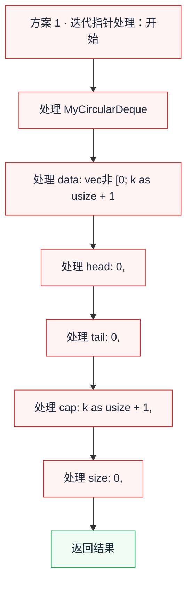

```rust
// LeetCode 641. 设计循环双端队列 — Rust 版（方案1）
struct MyCircularDeque {
    data: Vec<i32>,
    head: usize,
    tail: usize,
    cap: usize,
    size: usize,
} // 定义类型
impl MyCircularDeque {
    // 实现块
    fn new(k: i32) -> Self {
        MyCircularDeque {
            data: vec![0; k as usize + 1],
            head: 0,
            tail: 0,
            cap: k as usize + 1,
            size: 0,
        }
    } // 定义函数/方法 new
    fn capacity(&self) -> usize {
        self.cap - 1
    } // 定义函数/方法 capacity
    fn insert_front(&mut self, v: i32) -> bool {
        // 定义函数/方法 insert_front
        if self.size == self.cap - 1 {
            return false;
        } // 若 self.大小 等于 self.cap 减 1 { return false; }
        self.head = (self.head + self.cap - 1) % self.cap; // 把 (self.头节点 加 self.cap 减 1) 对…取模 self.cap; 写入 头节点
        self.data[self.head] = v; // 把 值; 写入 self.data[self.head]
        self.size += 1; // self.size累加 1
        true // true
    }
    fn insert_last(&mut self, v: i32) -> bool {
        // 定义函数/方法 insert_last
        if self.size == self.cap - 1 {
            return false;
        } // 若 self.大小 等于 self.cap 减 1 { return false; }
        self.data[self.tail] = v; // 把 值; 写入 self.data[self.tail]
        self.tail = (self.tail + 1) % self.cap; // 把 (self.尾节点 加 1) 对…取模 self.cap; 写入 尾节点
        self.size += 1; // self.size累加 1
        true // true
    }
    fn delete_front(&mut self) -> bool {
        // 定义函数/方法 delete_front
        if self.size == 0 {
            return false;
        } // 若 self.大小 等于 0 { return false; }
        self.head = (self.head + 1) % self.cap; // 把 (self.头节点 加 1) 对…取模 self.cap; 写入 头节点
        self.size -= 1; // self.size累减 1
        true // true
    }
    fn delete_last(&mut self) -> bool {
        // 定义函数/方法 delete_last
        if self.size == 0 {
            return false;
        } // 若 self.大小 等于 0 { return false; }
        self.tail = (self.tail + self.cap - 1) % self.cap; // 把 (self.尾节点 加 self.cap 减 1) 对…取模 self.cap; 写入 尾节点
        self.size -= 1; // self.size累减 1
        true // true
    }
    fn get_front(&self) -> i32 {
        if self.size == 0 {
            -1
        } else {
            self.data[self.head]
        }
    } // 定义函数/方法 get_front
    fn get_rear(&self) -> i32 {
        if self.size == 0 {
            -1
        } else {
            self.data[(self.tail + self.cap - 1) % self.cap]
        }
    } // 定义函数/方法 get_rear
    fn is_empty(&self) -> bool {
        self.size == 0
    } // 定义判定函数 is_empty
    fn is_full(&self) -> bool {
        self.size == self.cap - 1
    } // 定义判定函数 is_full
}
fn main() {
    // 程序入口：跑内嵌自测用例
    let mut d = MyCircularDeque::new(3); // 把 MyCircularDeque::new(3); 写入 let mut d
    assert!(d.insert_last(1)); // 断言校验
    assert!(d.insert_last(2)); // 断言校验
    assert!(d.insert_front(3)); // 断言校验
    assert!(!d.insert_front(4)); // 断言校验
    assert_eq!(d.get_rear(), 2); // 断言校验
    assert!(d.is_full()); // 断言校验
    assert!(d.delete_last()); // 断言校验
    assert!(d.insert_front(4)); // 断言校验
    assert_eq!(d.get_front(), 4); // 断言校验
    println!("PASS");
} // 全部用例通过，输出 PASS
```

#### 方案 2：直接实现

**思路与代码分析**：核心是「直接实现」。Rust 版用所有权移动与切片借用改写同一逻辑，注意 Option 与引用边界。**走读**：方案 2 · 直接实现：开始 → 处理 MyCircularDeque → 处理 data: vec非 [0; k as usize + 1 → 处理 head: 0, → 处理 tail: 0, → 处理 cap: k as usize + 1, → 处理 size: 0, → 返回结果。

**运行架构**（真实控制流）：

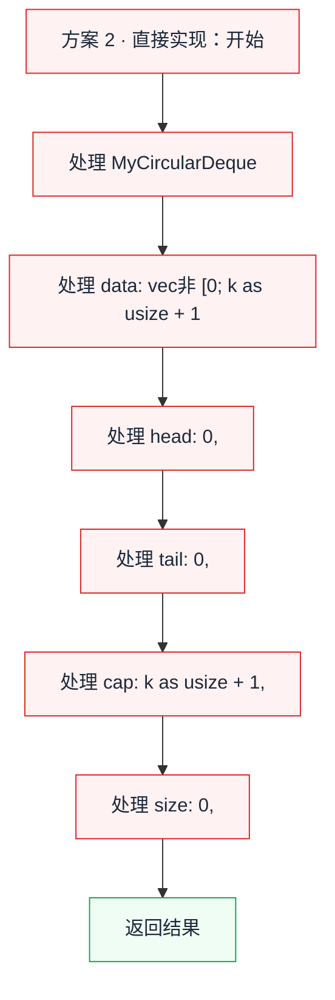

```rust
// LeetCode 641. 设计循环双端队列 — Rust 版（方案2）
struct MyCircularDeque {
    data: Vec<i32>,
    head: usize,
    tail: usize,
    cap: usize,
    size: usize,
} // 定义类型
impl MyCircularDeque {
    // 实现块
    fn new(k: i32) -> Self {
        MyCircularDeque {
            data: vec![0; k as usize + 1],
            head: 0,
            tail: 0,
            cap: k as usize + 1,
            size: 0,
        }
    } // 定义函数/方法 new
    fn capacity(&self) -> usize {
        self.cap - 1
    } // 定义函数/方法 capacity
    fn insert_front(&mut self, v: i32) -> bool {
        // 定义函数/方法 insert_front
        if self.size == self.cap - 1 {
            return false;
        } // 若 self.大小 等于 self.cap 减 1 { return false; }
        self.head = (self.head + self.cap - 1) % self.cap; // 把 (self.头节点 加 self.cap 减 1) 对…取模 self.cap; 写入 头节点
        self.data[self.head] = v; // 把 值; 写入 self.data[self.head]
        self.size += 1; // self.size累加 1
        true // true
    }
    fn insert_last(&mut self, v: i32) -> bool {
        // 定义函数/方法 insert_last
        if self.size == self.cap - 1 {
            return false;
        } // 若 self.大小 等于 self.cap 减 1 { return false; }
        self.data[self.tail] = v; // 把 值; 写入 self.data[self.tail]
        self.tail = (self.tail + 1) % self.cap; // 把 (self.尾节点 加 1) 对…取模 self.cap; 写入 尾节点
        self.size += 1; // self.size累加 1
        true // true
    }
    fn delete_front(&mut self) -> bool {
        // 定义函数/方法 delete_front
        if self.size == 0 {
            return false;
        } // 若 self.大小 等于 0 { return false; }
        self.head = (self.head + 1) % self.cap; // 把 (self.头节点 加 1) 对…取模 self.cap; 写入 头节点
        self.size -= 1; // self.size累减 1
        true // true
    }
    fn delete_last(&mut self) -> bool {
        // 定义函数/方法 delete_last
        if self.size == 0 {
            return false;
        } // 若 self.大小 等于 0 { return false; }
        self.tail = (self.tail + self.cap - 1) % self.cap; // 把 (self.尾节点 加 self.cap 减 1) 对…取模 self.cap; 写入 尾节点
        self.size -= 1; // self.size累减 1
        true // true
    }
    fn get_front(&self) -> i32 {
        if self.size == 0 {
            -1
        } else {
            self.data[self.head]
        }
    } // 定义函数/方法 get_front
    fn get_rear(&self) -> i32 {
        if self.size == 0 {
            -1
        } else {
            self.data[(self.tail + self.cap - 1) % self.cap]
        }
    } // 定义函数/方法 get_rear
    fn is_empty(&self) -> bool {
        self.size == 0
    } // 定义判定函数 is_empty
    fn is_full(&self) -> bool {
        self.size == self.cap - 1
    } // 定义判定函数 is_full
}
fn main() {
    // 程序入口：跑内嵌自测用例
    let mut d = MyCircularDeque::new(3); // 把 MyCircularDeque::new(3); 写入 let mut d
    assert!(d.insert_last(1)); // 断言校验
    assert!(d.insert_last(2)); // 断言校验
    assert!(d.insert_front(3)); // 断言校验
    assert!(!d.insert_front(4)); // 断言校验
    assert_eq!(d.get_rear(), 2); // 断言校验
    assert!(d.is_full()); // 断言校验
    assert!(d.delete_last()); // 断言校验
    assert!(d.insert_front(4)); // 断言校验
    assert_eq!(d.get_front(), 4); // 断言校验
    println!("PASS");
} // 全部用例通过，输出 PASS
```

### Lua 实现（2 种方案）

Lua 的全部方案如下，每个方案都内嵌用例自测，可独立运行（老仓库 python/go 文件遵循「打印结果」约定）：

#### 方案 1：迭代指针处理

**思路与代码分析**：核心是「迭代指针处理」。Lua 版用表与 ipairs 遍历，注意 ipairs 遇 nil 即停的语义。

**运行架构**（真实控制流）：


```lua
-- LeetCode 641. 设计循环双端队列 — Lua 版（方案1）
local MyCircularDeque = {} -- 把 {} 写入 local MyCircularDeque
MyCircularDeque.__index = MyCircularDeque -- 把 MyCircularDeque 写入 MyCircularDeque.__index
function MyCircularDeque.new(k) -- function MyCircularDeque.new(下标 k)
	return setmetatable({ data = {}, head = 1, tail = 1, cap = k, size = 0 }, MyCircularDeque)
end -- 终点
function MyCircularDeque:insertFront(v) -- function MyCircularDeque:insertFront(值)
	if self.size == self.cap then
		return false
	end -- 若 self.大小 等于 self.cap then return false 终点
	self.head = (self.head - 2) % self.cap + 1 -- 把 (self.头节点 减 2) 对…取模 self.cap 加 1 写入 头节点
	self.data[self.head] = v -- 把 值 写入 self.data[self.head]
	self.size = self.size + 1 -- 把 self.大小 加 1 写入 大小
	return true -- 返回 true
end -- 终点
function MyCircularDeque:insertLast(v) -- function MyCircularDeque:insertLast(值)
	if self.size == self.cap then
		return false
	end -- 若 self.大小 等于 self.cap then return false 终点
	self.data[self.tail] = v -- 把 值 写入 self.data[self.tail]
	self.tail = self.tail % self.cap + 1 -- 把 self.尾节点 对…取模 self.cap 加 1 写入 尾节点
	self.size = self.size + 1 -- 把 self.大小 加 1 写入 大小
	return true -- 返回 true
end -- 终点
function MyCircularDeque:deleteFront() -- function MyCircularDeque:deleteFront()
	if self.size == 0 then
		return false
	end -- 若 self.大小 等于 0 then return false 终点
	self.head = self.head % self.cap + 1 -- 把 self.头节点 对…取模 self.cap 加 1 写入 头节点
	self.size = self.size - 1 -- 把 self.大小 减 1 写入 大小
	return true -- 返回 true
end -- 终点
function MyCircularDeque:deleteLast() -- function MyCircularDeque:deleteLast()
	if self.size == 0 then
		return false
	end -- 若 self.大小 等于 0 then return false 终点
	self.tail = (self.tail - 2) % self.cap + 1 -- 把 (self.尾节点 减 2) 对…取模 self.cap 加 1 写入 尾节点
	self.size = self.size - 1 -- 把 self.大小 减 1 写入 大小
	return true -- 返回 true
end -- 终点
function MyCircularDeque:getFront()
	if self.size == 0 then
		return -1
	end
	return self.data[self.head]
end
function MyCircularDeque:getRear()
	if self.size == 0 then
		return -1
	end
	return self.data[(self.tail - 2) % self.cap + 1]
end
function MyCircularDeque:isEmpty()
	return self.size == 0
end -- 把 赋值为 0 终点 写入 大小
function MyCircularDeque:isFull()
	return self.size == self.cap
end -- 把 赋值为 self.cap 终点 写入 大小
local d = MyCircularDeque.new(3) -- 把 MyCircularDeque.new(3) 写入 local d
assert(d:insertLast(1) == true) -- 断言校验
assert(d:insertLast(2) == true) -- 断言校验
assert(d:insertFront(3) == true) -- 断言校验
assert(d:insertFront(4) == false) -- 断言校验
assert(d:getRear() == 2) -- 断言校验
assert(d:isFull() == true) -- 断言校验
assert(d:deleteLast() == true) -- 断言校验
assert(d:insertFront(4) == true) -- 断言校验
assert(d:getFront() == 4) -- 断言校验
print("PASS") -- 全部用例通过，输出 PASS
```

#### 方案 2：直接实现

**思路与代码分析**：核心是「直接实现」。Lua 版用表与 ipairs 遍历，注意 ipairs 遇 nil 即停的语义。

**运行架构**：与方案 1 的控制流相同（同算法在该语言的等价实现），图见上。

```lua
-- LeetCode 641. 设计循环双端队列 — Lua 版（方案2）
local MyCircularDeque = {} -- 把 {} 写入 local MyCircularDeque
MyCircularDeque.__index = MyCircularDeque -- 把 MyCircularDeque 写入 MyCircularDeque.__index
function MyCircularDeque.new(k) -- function MyCircularDeque.new(下标 k)
	return setmetatable({ data = {}, head = 1, tail = 1, cap = k, size = 0 }, MyCircularDeque)
end -- 终点
function MyCircularDeque:insertFront(v) -- function MyCircularDeque:insertFront(值)
	if self.size == self.cap then
		return false
	end -- 若 self.大小 等于 self.cap then return false 终点
	self.head = (self.head - 2) % self.cap + 1 -- 把 (self.头节点 减 2) 对…取模 self.cap 加 1 写入 头节点
	self.data[self.head] = v -- 把 值 写入 self.data[self.head]
	self.size = self.size + 1 -- 把 self.大小 加 1 写入 大小
	return true -- 返回 true
end -- 终点
function MyCircularDeque:insertLast(v) -- function MyCircularDeque:insertLast(值)
	if self.size == self.cap then
		return false
	end -- 若 self.大小 等于 self.cap then return false 终点
	self.data[self.tail] = v -- 把 值 写入 self.data[self.tail]
	self.tail = self.tail % self.cap + 1 -- 把 self.尾节点 对…取模 self.cap 加 1 写入 尾节点
	self.size = self.size + 1 -- 把 self.大小 加 1 写入 大小
	return true -- 返回 true
end -- 终点
function MyCircularDeque:deleteFront() -- function MyCircularDeque:deleteFront()
	if self.size == 0 then
		return false
	end -- 若 self.大小 等于 0 then return false 终点
	self.head = self.head % self.cap + 1 -- 把 self.头节点 对…取模 self.cap 加 1 写入 头节点
	self.size = self.size - 1 -- 把 self.大小 减 1 写入 大小
	return true -- 返回 true
end -- 终点
function MyCircularDeque:deleteLast() -- function MyCircularDeque:deleteLast()
	if self.size == 0 then
		return false
	end -- 若 self.大小 等于 0 then return false 终点
	self.tail = (self.tail - 2) % self.cap + 1 -- 把 (self.尾节点 减 2) 对…取模 self.cap 加 1 写入 尾节点
	self.size = self.size - 1 -- 把 self.大小 减 1 写入 大小
	return true -- 返回 true
end -- 终点
function MyCircularDeque:getFront()
	if self.size == 0 then
		return -1
	end
	return self.data[self.head]
end
function MyCircularDeque:getRear()
	if self.size == 0 then
		return -1
	end
	return self.data[(self.tail - 2) % self.cap + 1]
end
function MyCircularDeque:isEmpty()
	return self.size == 0
end -- 把 赋值为 0 终点 写入 大小
function MyCircularDeque:isFull()
	return self.size == self.cap
end -- 把 赋值为 self.cap 终点 写入 大小
local d = MyCircularDeque.new(3) -- 把 MyCircularDeque.new(3) 写入 local d
assert(d:insertLast(1) == true) -- 断言校验
assert(d:insertLast(2) == true) -- 断言校验
assert(d:insertFront(3) == true) -- 断言校验
assert(d:insertFront(4) == false) -- 断言校验
assert(d:getRear() == 2) -- 断言校验
assert(d:isFull() == true) -- 断言校验
assert(d:deleteLast() == true) -- 断言校验
assert(d:insertFront(4) == true) -- 断言校验
assert(d:getFront() == 4) -- 断言校验
print("PASS") -- 全部用例通过，输出 PASS
```

### C 实现（2 种方案）

C 的全部方案如下，每个方案都内嵌用例自测，可独立运行（老仓库 python/go 文件遵循「打印结果」约定）：

#### 方案 1：迭代指针处理

**思路与代码分析**：核心是「迭代指针处理」。C 版手动管理下标与内存，循环边界全部显式写出。**走读**：方案 1 · 迭代指针处理：开始 → 更新 *d → 调用 malloc(sizeof(MyCircularDequ → 更新 d->cap → 更新 d->data → 更新 d->head → 更新 d->tail → 更新 d->size → 返回 d。

**运行架构**（真实控制流）：

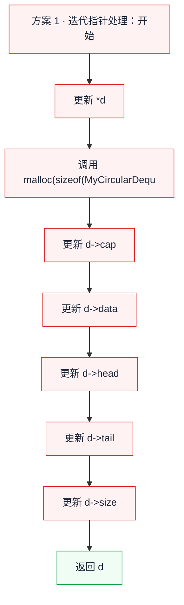

```c
/* LeetCode 641. 设计循环双端队列 — C 版（方案1） */
#include <stdio.h>  // 引入头文件
#include <stdlib.h> // 引入头文件
typedef struct {
    int *data;
    int head, tail, cap, size;
} MyCircularDeque;
static MyCircularDeque *cdq_new(int k) { // static MyCircularDeque 乘 cdq_new(int 下标 k) {
    MyCircularDeque *d =
        malloc(sizeof(MyCircularDeque)); // 把 malloc(sizeof(MyCircularDeque)); 写入 MyCircularDeque *d
    d->cap = k;                          // 把 下标 k; 写入 d->cap
    d->data = malloc(sizeof(int) * k);   // 把 malloc(sizeof(int) 乘 下标 k); 写入 d->data
    d->head = 0;
    d->tail = 0;
    d->size = 0; // 把 0; d 减 超过 尾节点 赋值为 0; d 减 超过 大小 赋值为 0; 写入 d->head
    return d;    // 返回 d
}
static int cdq_insert_front(MyCircularDeque *d, int v) { // 定义函数/方法 cdq_insert_front
    if (d->size == d->cap)
        return 0; // 若 d 减 超过 大小 等于 d 减 超过 cap，直接返回 0
    d->head = (d->head + d->cap - 1) %
              d->cap; // 把 (d 减 超过 头节点 加 d 减 超过 cap 减 1) 对…取模 d 减 超过 cap; 写入 d->head
    d->data[d->head] = v; // 把 值; 写入 d->data[d->head]
    d->size++;            // d 减 超过 大小 加一 ;
    return 1;             // 返回 1
}
static int cdq_insert_last(MyCircularDeque *d, int v) { // 定义函数/方法 cdq_insert_last
    if (d->size == d->cap)
        return 0;                     // 若 d 减 超过 大小 等于 d 减 超过 cap，直接返回 0
    d->data[d->tail] = v;             // 把 值; 写入 d->data[d->tail]
    d->tail = (d->tail + 1) % d->cap; // 把 (d 减 超过 尾节点 加 1) 对…取模 d 减 超过 cap; 写入 d->tail
    d->size++;                        // d 减 超过 大小 加一 ;
    return 1;                         // 返回 1
}
static int cdq_delete_front(MyCircularDeque *d) { // 定义函数/方法 cdq_delete_front
    if (d->size == 0)
        return 0;                     // 若 d 减 超过 大小 等于 0，直接返回 0
    d->head = (d->head + 1) % d->cap; // 把 (d 减 超过 头节点 加 1) 对…取模 d 减 超过 cap; 写入 d->head
    d->size--;                        // d 减 超过 大小 减一 ;
    return 1;                         // 返回 1
}
static int cdq_delete_last(MyCircularDeque *d) { // 定义函数/方法 cdq_delete_last
    if (d->size == 0)
        return 0; // 若 d 减 超过 大小 等于 0，直接返回 0
    d->tail = (d->tail + d->cap - 1) %
              d->cap; // 把 (d 减 超过 尾节点 加 d 减 超过 cap 减 1) 对…取模 d 减 超过 cap; 写入 d->tail
    d->size--; // d 减 超过 大小 减一 ;
    return 1;  // 返回 1
}
static int cdq_get_front(MyCircularDeque *d) { return d->size == 0 ? -1 : d->data[d->head]; }
static int cdq_get_rear(MyCircularDeque *d) {
    return d->size == 0 ? -1 : d->data[(d->tail + d->cap - 1) % d->cap];
}
static int cdq_is_empty(MyCircularDeque *d) { return d->size == 0; }
static int cdq_is_full(MyCircularDeque *d) { return d->size == d->cap; }
int main(void) {                     // 程序入口：跑内嵌自测用例
    MyCircularDeque *d = cdq_new(3); // 把 cdq_new(3); 写入 MyCircularDeque *d
    if (!cdq_insert_last(d, 1)) {
        printf("FAIL 1\n");
        return 1;
    } // 若 取反 cdq_insert_last(d, 1)) { 输出「FAIL 1 」); return 1; }
    if (!cdq_insert_last(d, 2)) {
        printf("FAIL 2\n");
        return 1;
    } // 若 取反 cdq_insert_last(d, 2)) { 输出「FAIL 2 」); return 1; }
    if (!cdq_insert_front(d, 3)) {
        printf("FAIL 3\n");
        return 1;
    } // 若 取反 cdq_insert_front(d, 3)) { 输出「FAIL 3 」); return 1; }
    if (cdq_insert_front(d, 4)) {
        printf("FAIL 4\n");
        return 1;
    } // 若 cdq_insert_front(d, 4)) { 输出「FAIL 4 」); return 1; }
    if (cdq_get_rear(d) != 2) {
        printf("FAIL 5\n");
        return 1;
    } // 若 cdq_get_rear(d) 不等于 2) { 输出「FAIL 5 」); return 1; }
    if (!cdq_is_full(d)) {
        printf("FAIL 6\n");
        return 1;
    } // 若 取反 cdq_is_full(d)) { 输出「FAIL 6 」); return 1; }
    if (!cdq_delete_last(d)) {
        printf("FAIL 7\n");
        return 1;
    } // 若 取反 cdq_delete_last(d)) { 输出「FAIL 7 」); return 1; }
    if (!cdq_insert_front(d, 4)) {
        printf("FAIL 8\n");
        return 1;
    } // 若 取反 cdq_insert_front(d, 4)) { 输出「FAIL 8 」); return 1; }
    if (cdq_get_front(d) != 4) {
        printf("FAIL 9\n");
        return 1;
    } // 若 cdq_get_front(d) 不等于 4) { 输出「FAIL 9 」); return 1; }
    free(d->data);
    free(d); // free(d 减 超过 data); free(d);
    printf("PASS\n");
    return 0;
} // 全部用例通过，输出 PASS
```

#### 方案 2：直接实现

**思路与代码分析**：核心是「直接实现」。C 版手动管理下标与内存，循环边界全部显式写出。**走读**：方案 2 · 直接实现：开始 → 更新 *d → 调用 malloc(sizeof(MyCircularDequ → 更新 d->cap → 更新 d->data → 更新 d->head → 更新 d->tail → 更新 d->size → 返回 d。

**运行架构**（真实控制流）：

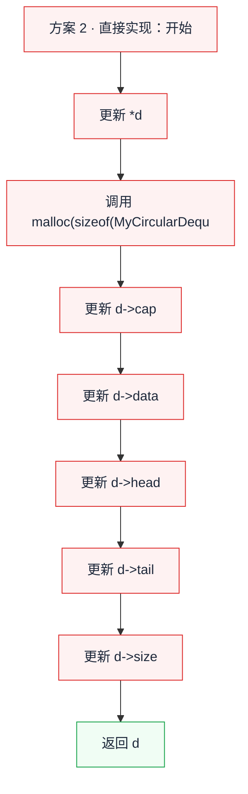

```c
/* LeetCode 641. 设计循环双端队列 — C 版（方案2） */
#include <stdio.h>  // 引入头文件
#include <stdlib.h> // 引入头文件
typedef struct {
    int *data;
    int head, tail, cap, size;
} MyCircularDeque;
static MyCircularDeque *cdq_new(int k) { // static MyCircularDeque 乘 cdq_new(int 下标 k) {
    MyCircularDeque *d =
        malloc(sizeof(MyCircularDeque)); // 把 malloc(sizeof(MyCircularDeque)); 写入 MyCircularDeque *d
    d->cap = k;                          // 把 下标 k; 写入 d->cap
    d->data = malloc(sizeof(int) * k);   // 把 malloc(sizeof(int) 乘 下标 k); 写入 d->data
    d->head = 0;
    d->tail = 0;
    d->size = 0; // 把 0; d 减 超过 尾节点 赋值为 0; d 减 超过 大小 赋值为 0; 写入 d->head
    return d;    // 返回 d
}
static int cdq_insert_front(MyCircularDeque *d, int v) { // 定义函数/方法 cdq_insert_front
    if (d->size == d->cap)
        return 0; // 若 d 减 超过 大小 等于 d 减 超过 cap，直接返回 0
    d->head = (d->head + d->cap - 1) %
              d->cap; // 把 (d 减 超过 头节点 加 d 减 超过 cap 减 1) 对…取模 d 减 超过 cap; 写入 d->head
    d->data[d->head] = v; // 把 值; 写入 d->data[d->head]
    d->size++;            // d 减 超过 大小 加一 ;
    return 1;             // 返回 1
}
static int cdq_insert_last(MyCircularDeque *d, int v) { // 定义函数/方法 cdq_insert_last
    if (d->size == d->cap)
        return 0;                     // 若 d 减 超过 大小 等于 d 减 超过 cap，直接返回 0
    d->data[d->tail] = v;             // 把 值; 写入 d->data[d->tail]
    d->tail = (d->tail + 1) % d->cap; // 把 (d 减 超过 尾节点 加 1) 对…取模 d 减 超过 cap; 写入 d->tail
    d->size++;                        // d 减 超过 大小 加一 ;
    return 1;                         // 返回 1
}
static int cdq_delete_front(MyCircularDeque *d) { // 定义函数/方法 cdq_delete_front
    if (d->size == 0)
        return 0;                     // 若 d 减 超过 大小 等于 0，直接返回 0
    d->head = (d->head + 1) % d->cap; // 把 (d 减 超过 头节点 加 1) 对…取模 d 减 超过 cap; 写入 d->head
    d->size--;                        // d 减 超过 大小 减一 ;
    return 1;                         // 返回 1
}
static int cdq_delete_last(MyCircularDeque *d) { // 定义函数/方法 cdq_delete_last
    if (d->size == 0)
        return 0; // 若 d 减 超过 大小 等于 0，直接返回 0
    d->tail = (d->tail + d->cap - 1) %
              d->cap; // 把 (d 减 超过 尾节点 加 d 减 超过 cap 减 1) 对…取模 d 减 超过 cap; 写入 d->tail
    d->size--; // d 减 超过 大小 减一 ;
    return 1;  // 返回 1
}
static int cdq_get_front(MyCircularDeque *d) { return d->size == 0 ? -1 : d->data[d->head]; }
static int cdq_get_rear(MyCircularDeque *d) {
    return d->size == 0 ? -1 : d->data[(d->tail + d->cap - 1) % d->cap];
}
static int cdq_is_empty(MyCircularDeque *d) { return d->size == 0; }
static int cdq_is_full(MyCircularDeque *d) { return d->size == d->cap; }
int main(void) {                     // 程序入口：跑内嵌自测用例
    MyCircularDeque *d = cdq_new(3); // 把 cdq_new(3); 写入 MyCircularDeque *d
    if (!cdq_insert_last(d, 1)) {
        printf("FAIL 1\n");
        return 1;
    } // 若 取反 cdq_insert_last(d, 1)) { 输出「FAIL 1 」); return 1; }
    if (!cdq_insert_last(d, 2)) {
        printf("FAIL 2\n");
        return 1;
    } // 若 取反 cdq_insert_last(d, 2)) { 输出「FAIL 2 」); return 1; }
    if (!cdq_insert_front(d, 3)) {
        printf("FAIL 3\n");
        return 1;
    } // 若 取反 cdq_insert_front(d, 3)) { 输出「FAIL 3 」); return 1; }
    if (cdq_insert_front(d, 4)) {
        printf("FAIL 4\n");
        return 1;
    } // 若 cdq_insert_front(d, 4)) { 输出「FAIL 4 」); return 1; }
    if (cdq_get_rear(d) != 2) {
        printf("FAIL 5\n");
        return 1;
    } // 若 cdq_get_rear(d) 不等于 2) { 输出「FAIL 5 」); return 1; }
    if (!cdq_is_full(d)) {
        printf("FAIL 6\n");
        return 1;
    } // 若 取反 cdq_is_full(d)) { 输出「FAIL 6 」); return 1; }
    if (!cdq_delete_last(d)) {
        printf("FAIL 7\n");
        return 1;
    } // 若 取反 cdq_delete_last(d)) { 输出「FAIL 7 」); return 1; }
    if (!cdq_insert_front(d, 4)) {
        printf("FAIL 8\n");
        return 1;
    } // 若 取反 cdq_insert_front(d, 4)) { 输出「FAIL 8 」); return 1; }
    if (cdq_get_front(d) != 4) {
        printf("FAIL 9\n");
        return 1;
    } // 若 cdq_get_front(d) 不等于 4) { 输出「FAIL 9 」); return 1; }
    free(d->data);
    free(d); // free(d 减 超过 data); free(d);
    printf("PASS\n");
    return 0;
} // 全部用例通过，输出 PASS
```

### C++ 实现（2 种方案）

C++ 的全部方案如下，每个方案都内嵌用例自测，可独立运行（老仓库 python/go 文件遵循「打印结果」约定）：

#### 方案 1：迭代指针处理

**思路与代码分析**：核心是「迭代指针处理」。C++ 版用 STL 容器与迭代器，减少手写下标错误。**走读**：方案 1 · 迭代指针处理：开始 → 命中条件，直接返回 → 更新 head → 调用 data.size() → 更新 data[head] → 处理 ++size_ → 返回 true。

**运行架构**（真实控制流）：

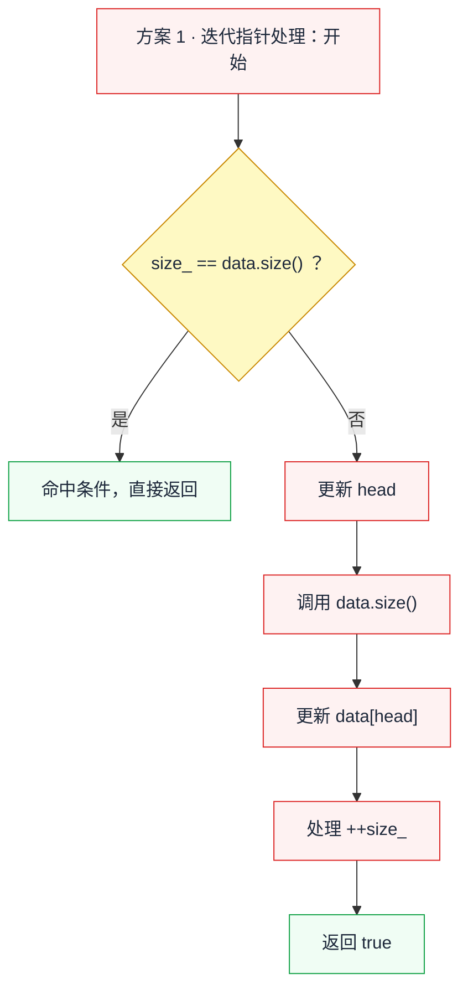

```cpp
// LeetCode 641. 设计循环双端队列 — C++ 版（方案1）
#include <cassert>                        // 引入头文件
#include <iostream>                       // 引入头文件
#include <vector>                         // 引入头文件
struct MyCircularDeque {                  // 定义类型
    std::vector<int> data;                // std::vector 小于 int 超过 data;
    size_t head = 0, tail = 0, size_ = 0; // 把 0, 尾节点 赋值为 0, size_ 赋值为 0; 写入 size_t head
    explicit MyCircularDeque(int k) : data(static_cast<size_t>(k)) {}
    bool insertFront(int v) { // 定义函数/方法 insertFront
        if (size_ == data.size())
            return false; // 若 size_ 等于 data.大小()，直接返回 false
        head = (head + data.size() - 1) %
               data.size(); // 把 (头节点 加 data.大小() 减 1) 对…取模 data.大小(); 写入 头节点
        data[head] = v; // 把 值; 写入 data[head]
        ++size_;        // 加一 size_;
        return true;    // 返回 true
    }
    bool insertLast(int v) { // 定义函数/方法 insertLast
        if (size_ == data.size())
            return false;                // 若 size_ 等于 data.大小()，直接返回 false
        data[tail] = v;                  // 把 值; 写入 data[tail]
        tail = (tail + 1) % data.size(); // 把 (尾节点 加 1) 对…取模 data.大小(); 写入 尾节点
        ++size_;                         // 加一 size_;
        return true;                     // 返回 true
    }
    bool deleteFront() { // 定义函数/方法 deleteFront
        if (size_ == 0)
            return false;                // 若 size_ 等于 0，直接返回 false
        head = (head + 1) % data.size(); // 把 (头节点 加 1) 对…取模 data.大小(); 写入 头节点
        --size_;                         // 减一 size_;
        return true;                     // 返回 true
    }
    bool deleteLast() { // 定义函数/方法 deleteLast
        if (size_ == 0)
            return false; // 若 size_ 等于 0，直接返回 false
        tail = (tail + data.size() - 1) %
               data.size(); // 把 (尾节点 加 data.大小() 减 1) 对…取模 data.大小(); 写入 尾节点
        --size_;            // 减一 size_;
        return true;        // 返回 true
    }
    int getFront() { return size_ == 0 ? -1 : data[head]; }
    int getRear() { return size_ == 0 ? -1 : data[(tail + data.size() - 1) % data.size()]; }
    bool isEmpty() { return size_ == 0; } // 把 赋值为 0; } 写入 bool isEmpty() { return size_
    bool isFull() {
        return size_ == data.size();
    } // 把 赋值为 data.大小(); } 写入 bool isFull() { return size_
};
int main() {                   // 程序入口：跑内嵌自测用例
    MyCircularDeque d(3);      // MyCircularDeque d(3);
    assert(d.insertLast(1));   // 断言校验
    assert(d.insertLast(2));   // 断言校验
    assert(d.insertFront(3));  // 断言校验
    assert(!d.insertFront(4)); // 断言校验
    assert(d.getRear() == 2);  // 断言校验
    assert(d.isFull());        // 断言校验
    assert(d.deleteLast());    // 断言校验
    assert(d.insertFront(4));  // 断言校验
    assert(d.getFront() == 4); // 断言校验
    std::cout << "PASS" << std::endl;
} // 全部用例通过，输出 PASS
```

#### 方案 2：直接实现

**思路与代码分析**：核心是「直接实现」。C++ 版用 STL 容器与迭代器，减少手写下标错误。**走读**：方案 2 · 直接实现：开始 → 命中条件，直接返回 → 更新 head → 调用 data.size() → 更新 data[head] → 处理 ++size_ → 返回 true。

**运行架构**（真实控制流）：

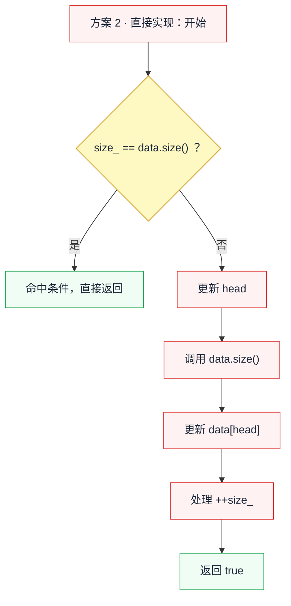

```cpp
// LeetCode 641. 设计循环双端队列 — C++ 版（方案2）
#include <cassert>                        // 引入头文件
#include <iostream>                       // 引入头文件
#include <vector>                         // 引入头文件
struct MyCircularDeque {                  // 定义类型
    std::vector<int> data;                // std::vector 小于 int 超过 data;
    size_t head = 0, tail = 0, size_ = 0; // 把 0, 尾节点 赋值为 0, size_ 赋值为 0; 写入 size_t head
    explicit MyCircularDeque(int k) : data(static_cast<size_t>(k)) {}
    bool insertFront(int v) { // 定义函数/方法 insertFront
        if (size_ == data.size())
            return false; // 若 size_ 等于 data.大小()，直接返回 false
        head = (head + data.size() - 1) %
               data.size(); // 把 (头节点 加 data.大小() 减 1) 对…取模 data.大小(); 写入 头节点
        data[head] = v; // 把 值; 写入 data[head]
        ++size_;        // 加一 size_;
        return true;    // 返回 true
    }
    bool insertLast(int v) { // 定义函数/方法 insertLast
        if (size_ == data.size())
            return false;                // 若 size_ 等于 data.大小()，直接返回 false
        data[tail] = v;                  // 把 值; 写入 data[tail]
        tail = (tail + 1) % data.size(); // 把 (尾节点 加 1) 对…取模 data.大小(); 写入 尾节点
        ++size_;                         // 加一 size_;
        return true;                     // 返回 true
    }
    bool deleteFront() { // 定义函数/方法 deleteFront
        if (size_ == 0)
            return false;                // 若 size_ 等于 0，直接返回 false
        head = (head + 1) % data.size(); // 把 (头节点 加 1) 对…取模 data.大小(); 写入 头节点
        --size_;                         // 减一 size_;
        return true;                     // 返回 true
    }
    bool deleteLast() { // 定义函数/方法 deleteLast
        if (size_ == 0)
            return false; // 若 size_ 等于 0，直接返回 false
        tail = (tail + data.size() - 1) %
               data.size(); // 把 (尾节点 加 data.大小() 减 1) 对…取模 data.大小(); 写入 尾节点
        --size_;            // 减一 size_;
        return true;        // 返回 true
    }
    int getFront() { return size_ == 0 ? -1 : data[head]; }
    int getRear() { return size_ == 0 ? -1 : data[(tail + data.size() - 1) % data.size()]; }
    bool isEmpty() { return size_ == 0; } // 把 赋值为 0; } 写入 bool isEmpty() { return size_
    bool isFull() {
        return size_ == data.size();
    } // 把 赋值为 data.大小(); } 写入 bool isFull() { return size_
};
int main() {                   // 程序入口：跑内嵌自测用例
    MyCircularDeque d(3);      // MyCircularDeque d(3);
    assert(d.insertLast(1));   // 断言校验
    assert(d.insertLast(2));   // 断言校验
    assert(d.insertFront(3));  // 断言校验
    assert(!d.insertFront(4)); // 断言校验
    assert(d.getRear() == 2);  // 断言校验
    assert(d.isFull());        // 断言校验
    assert(d.deleteLast());    // 断言校验
    assert(d.insertFront(4));  // 断言校验
    assert(d.getFront() == 4); // 断言校验
    std::cout << "PASS" << std::endl;
} // 全部用例通过，输出 PASS
```

### R 实现（2 种方案）

R 的全部方案如下，每个方案都内嵌用例自测，可独立运行（老仓库 python/go 文件遵循「打印结果」约定）：

#### 方案 1：迭代指针处理

**思路与代码分析**：核心是「迭代指针处理」。R 版用向量化思维与 1 起始下标，注意 1:n 的降序陷阱。**走读**：方案 1 · 迭代指针处理：开始 → 更新 new.env(parent → 命中条件，直接返回 → 命中条件，直接返回 → 命中条件，直接返回 → 命中条件，直接返回。

**运行架构**（真实控制流）：

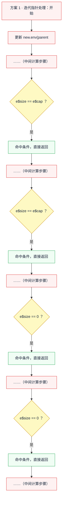

```r
# 版（方案1） 定义函数 MyCircularDeque（参数：下标 k）
MyCircularDeque <- function(k) {
    e <- new.env(parent = emptyenv())  # 把 new.env(parent 赋值为 emptyenv()) 存入 e
    e$data <- rep(0L, k)
    e$head <- 1L
    e$tail <- 1L
    e$cap <- k
    e$size <- 0L
    e$insertFront <- function(v) {
        # 把 function(值) { 存入 e$insertFront
        if (e$size == e$cap)
            return(FALSE)  # 若 e$大小 等于 e$cap) return(FALSE
        e$head <<- ((e$head - 2)%%e$cap) + 1L  # e$头节点 小于 小于 减 ((e$头节点 减 2) 对…取模 对…取模 e$cap) 加 1L
        e$data[e$head] <<- v  # e$data[e$头节点] 小于 小于 减 值
        e$size <<- e$size + 1L  # e$大小 小于 小于 减 e$大小 加 1L
        TRUE  # TRUE
    }
    e$insertLast <- function(v) {
        # 把 function(值) { 存入 e$insertLast
        if (e$size == e$cap)
            return(FALSE)  # 若 e$大小 等于 e$cap) return(FALSE
        e$data[e$tail] <<- v  # e$data[e$尾节点] 小于 小于 减 值
        e$tail <<- (e$tail%%e$cap) + 1L  # e$尾节点 小于 小于 减 (e$尾节点 对…取模 对…取模 e$cap) 加 1L
        e$size <<- e$size + 1L  # e$大小 小于 小于 减 e$大小 加 1L
        TRUE  # TRUE
    }
    e$deleteFront <- function() {
        # 把 function() { 存入 e$deleteFront
        if (e$size == 0)
            return(FALSE)  # 若 e$大小 等于 0) return(FALSE
        e$head <<- (e$head%%e$cap) + 1L  # e$头节点 小于 小于 减 (e$头节点 对…取模 对…取模 e$cap) 加 1L
        e$size <<- e$size - 1L  # e$大小 小于 小于 减 e$大小 减 1L
        TRUE  # TRUE
    }
    e$deleteLast <- function() {
        # 把 function() { 存入 e$deleteLast
        if (e$size == 0)
            return(FALSE)  # 若 e$大小 等于 0) return(FALSE
        e$tail <<- ((e$tail - 2)%%e$cap) + 1L  # e$尾节点 小于 小于 减 ((e$尾节点 减 2) 对…取模 对…取模 e$cap) 加 1L
        e$size <<- e$size - 1L  # e$大小 小于 小于 减 e$大小 减 1L
        TRUE  # TRUE
    }
    e$getFront <- function() if (e$size == 0)
        -1L else e$data[e$head]
    e$getRear <- function() if (e$size == 0)
        -1L else e$data[((e$tail - 2)%%e$cap) + 1L]
    e$isEmpty <- function() e$size == 0  # 把 function() e$大小 等于 0 存入 e$isEmpty
    e$isFull <- function() e$size == e$cap  # 把 function() e$大小 等于 e$cap 存入 e$isFull
    e
}
d <- MyCircularDeque(3)  # 把 MyCircularDeque(3) 存入 d
stopifnot(d$insertLast(1), d$insertLast(2), d$insertFront(3))  # 断言校验
stopifnot(!d$insertFront(4))  # 断言校验
stopifnot(d$getRear() == 2, d$isFull())  # 断言校验
stopifnot(d$deleteLast())  # 断言校验
stopifnot(d$insertFront(4), d$getFront() == 4)  # 断言校验
cat("PASS\n")  # 全部用例通过，输出 PASS
```

#### 方案 2：直接实现

**思路与代码分析**：核心是「直接实现」。R 版用向量化思维与 1 起始下标，注意 1:n 的降序陷阱。**走读**：方案 2 · 直接实现：开始 → 更新 new.env(parent → 命中条件，直接返回 → 命中条件，直接返回 → 命中条件，直接返回 → 命中条件，直接返回。

**运行架构**（真实控制流）：

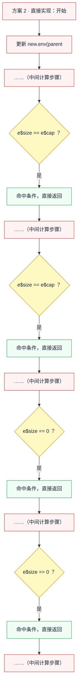

```r
# 版（方案2） 定义函数 MyCircularDeque（参数：下标 k）
MyCircularDeque <- function(k) {
    e <- new.env(parent = emptyenv())  # 把 new.env(parent 赋值为 emptyenv()) 存入 e
    e$data <- rep(0L, k)
    e$head <- 1L
    e$tail <- 1L
    e$cap <- k
    e$size <- 0L
    e$insertFront <- function(v) {
        # 把 function(值) { 存入 e$insertFront
        if (e$size == e$cap)
            return(FALSE)  # 若 e$大小 等于 e$cap) return(FALSE
        e$head <<- ((e$head - 2)%%e$cap) + 1L  # e$头节点 小于 小于 减 ((e$头节点 减 2) 对…取模 对…取模 e$cap) 加 1L
        e$data[e$head] <<- v  # e$data[e$头节点] 小于 小于 减 值
        e$size <<- e$size + 1L  # e$大小 小于 小于 减 e$大小 加 1L
        TRUE  # TRUE
    }
    e$insertLast <- function(v) {
        # 把 function(值) { 存入 e$insertLast
        if (e$size == e$cap)
            return(FALSE)  # 若 e$大小 等于 e$cap) return(FALSE
        e$data[e$tail] <<- v  # e$data[e$尾节点] 小于 小于 减 值
        e$tail <<- (e$tail%%e$cap) + 1L  # e$尾节点 小于 小于 减 (e$尾节点 对…取模 对…取模 e$cap) 加 1L
        e$size <<- e$size + 1L  # e$大小 小于 小于 减 e$大小 加 1L
        TRUE  # TRUE
    }
    e$deleteFront <- function() {
        # 把 function() { 存入 e$deleteFront
        if (e$size == 0)
            return(FALSE)  # 若 e$大小 等于 0) return(FALSE
        e$head <<- (e$head%%e$cap) + 1L  # e$头节点 小于 小于 减 (e$头节点 对…取模 对…取模 e$cap) 加 1L
        e$size <<- e$size - 1L  # e$大小 小于 小于 减 e$大小 减 1L
        TRUE  # TRUE
    }
    e$deleteLast <- function() {
        # 把 function() { 存入 e$deleteLast
        if (e$size == 0)
            return(FALSE)  # 若 e$大小 等于 0) return(FALSE
        e$tail <<- ((e$tail - 2)%%e$cap) + 1L  # e$尾节点 小于 小于 减 ((e$尾节点 减 2) 对…取模 对…取模 e$cap) 加 1L
        e$size <<- e$size - 1L  # e$大小 小于 小于 减 e$大小 减 1L
        TRUE  # TRUE
    }
    e$getFront <- function() if (e$size == 0)
        -1L else e$data[e$head]
    e$getRear <- function() if (e$size == 0)
        -1L else e$data[((e$tail - 2)%%e$cap) + 1L]
    e$isEmpty <- function() e$size == 0  # 把 function() e$大小 等于 0 存入 e$isEmpty
    e$isFull <- function() e$size == e$cap  # 把 function() e$大小 等于 e$cap 存入 e$isFull
    e
}
d <- MyCircularDeque(3)  # 把 MyCircularDeque(3) 存入 d
stopifnot(d$insertLast(1), d$insertLast(2), d$insertFront(3))  # 断言校验
stopifnot(!d$insertFront(4))  # 断言校验
stopifnot(d$getRear() == 2, d$isFull())  # 断言校验
stopifnot(d$deleteLast())  # 断言校验
stopifnot(d$insertFront(4), d$getFront() == 4)  # 断言校验
cat("PASS\n")  # 全部用例通过，输出 PASS
```

### Zig 实现（2 种方案）

Zig 的全部方案如下，每个方案都内嵌用例自测，可独立运行（老仓库 python/go 文件遵循「打印结果」约定）：

#### 方案 1：迭代指针处理

**思路与代码分析**：核心是「迭代指针处理」。Zig 版显式分配与清零，整型边界处理严格。**走读**：方案 1 · 迭代指针处理：开始 → 返回 .。

**运行架构**（真实控制流）：

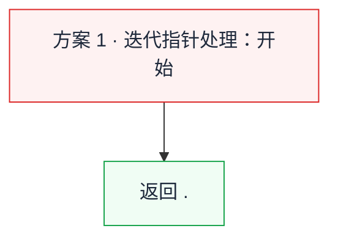

```zig
// LeetCode 641. 设计循环双端队列 — Zig 版（方案1）
const std = @import("std"); // 把 @import(「std」) 存入 std
const MyCircularDeque = struct { // 把 struct { 存入 MyCircularDeque
    data: [4096]i32,
    head: usize,
    tail: usize,
    cap: usize,
    size: usize,
    fn new(k: usize) MyCircularDeque { // 定义函数/方法 new
        return .{ .data = undefined, .head = 0, .tail = 0, .cap = k, .size = 0 };
    }
    fn insertFront(self: *MyCircularDeque, v: i32) bool { // 定义函数/方法 insertFront
        if (self.size == self.cap) return false; // 若 self.大小 等于 self.cap，直接返回 false
        self.head = (self.head + self.cap - 1) % self.cap; // 把 (self.头节点 加 self.cap 减 1) 对…取模 self.cap; 写入 头节点
        self.data[self.head] = v; // 把 值; 写入 self.data[self.head]
        self.size += 1; // self.size累加 1
        return true; // 返回 true
    }
    fn insertLast(self: *MyCircularDeque, v: i32) bool { // 定义函数/方法 insertLast
        if (self.size == self.cap) return false; // 若 self.大小 等于 self.cap，直接返回 false
        self.data[self.tail] = v; // 把 值; 写入 self.data[self.tail]
        self.tail = (self.tail + 1) % self.cap; // 把 (self.尾节点 加 1) 对…取模 self.cap; 写入 尾节点
        self.size += 1; // self.size累加 1
        return true; // 返回 true
    }
    fn deleteFront(self: *MyCircularDeque) bool { // 定义函数/方法 deleteFront
        if (self.size == 0) return false; // 若 self.大小 等于 0，直接返回 false
        self.head = (self.head + 1) % self.cap; // 把 (self.头节点 加 1) 对…取模 self.cap; 写入 头节点
        self.size -= 1; // self.size累减 1
        return true; // 返回 true
    }
    fn deleteLast(self: *MyCircularDeque) bool { // 定义函数/方法 deleteLast
        if (self.size == 0) return false; // 若 self.大小 等于 0，直接返回 false
        self.tail = (self.tail + self.cap - 1) % self.cap; // 把 (self.尾节点 加 self.cap 减 1) 对…取模 self.cap; 写入 尾节点
        self.size -= 1; // self.size累减 1
        return true; // 返回 true
    }
    fn getFront(self: *MyCircularDeque) i32 {
        return if (self.size == 0) -1 else self.data[self.head];
    } // 定义函数/方法 getFront
    fn getRear(self: *MyCircularDeque) i32 {
        return if (self.size == 0) -1 else self.data[(self.tail + self.cap - 1) % self.cap];
    } // 定义函数/方法 getRear
    fn isEmpty(self: *MyCircularDeque) bool {
        return self.size == 0;
    } // 定义判定函数 isEmpty
    fn isFull(self: *MyCircularDeque) bool {
        return self.size == self.cap;
    } // 定义判定函数 isFull
};
pub fn main() !void { // 程序入口：跑内嵌自测用例
    var d = MyCircularDeque.new(3); // 把 MyCircularDeque.new(3) 存入 d
    if (!d.insertLast(1)) return error.TestFailed; // 若 取反 d.insertLast(1)，直接返回 error.TestFailed
    if (!d.insertLast(2)) return error.TestFailed; // 若 取反 d.insertLast(2)，直接返回 error.TestFailed
    if (!d.insertFront(3)) return error.TestFailed; // 若 取反 d.insertFront(3)，直接返回 error.TestFailed
    if (d.insertFront(4)) return error.TestFailed; // 若 d.insertFront(4)，直接返回 error.TestFailed
    if (d.getRear() != 2) return error.TestFailed; // 若 d.getRear() 不等于 2，直接返回 error.TestFailed
    if (!d.isFull()) return error.TestFailed; // 若 取反 d.isFull()，直接返回 error.TestFailed
    if (!d.deleteLast()) return error.TestFailed; // 若 取反 d.deleteLast()，直接返回 error.TestFailed
    if (!d.insertFront(4)) return error.TestFailed; // 若 取反 d.insertFront(4)，直接返回 error.TestFailed
    if (d.getFront() != 4) return error.TestFailed; // 若 d.getFront() 不等于 4，直接返回 error.TestFailed
    std.debug.print("PASS\n", .{});
} // 全部用例通过，输出 PASS
```

#### 方案 2：直接实现

**思路与代码分析**：核心是「直接实现」。Zig 版显式分配与清零，整型边界处理严格。**走读**：方案 2 · 直接实现：开始 → 返回 .。

**运行架构**（真实控制流）：

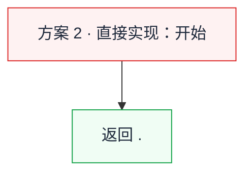

```zig
// LeetCode 641. 设计循环双端队列 — Zig 版（方案2）
const std = @import("std"); // 把 @import(「std」) 存入 std
const MyCircularDeque = struct { // 把 struct { 存入 MyCircularDeque
    data: [4096]i32,
    head: usize,
    tail: usize,
    cap: usize,
    size: usize,
    fn new(k: usize) MyCircularDeque { // 定义函数/方法 new
        return .{ .data = undefined, .head = 0, .tail = 0, .cap = k, .size = 0 };
    }
    fn insertFront(self: *MyCircularDeque, v: i32) bool { // 定义函数/方法 insertFront
        if (self.size == self.cap) return false; // 若 self.大小 等于 self.cap，直接返回 false
        self.head = (self.head + self.cap - 1) % self.cap; // 把 (self.头节点 加 self.cap 减 1) 对…取模 self.cap; 写入 头节点
        self.data[self.head] = v; // 把 值; 写入 self.data[self.head]
        self.size += 1; // self.size累加 1
        return true; // 返回 true
    }
    fn insertLast(self: *MyCircularDeque, v: i32) bool { // 定义函数/方法 insertLast
        if (self.size == self.cap) return false; // 若 self.大小 等于 self.cap，直接返回 false
        self.data[self.tail] = v; // 把 值; 写入 self.data[self.tail]
        self.tail = (self.tail + 1) % self.cap; // 把 (self.尾节点 加 1) 对…取模 self.cap; 写入 尾节点
        self.size += 1; // self.size累加 1
        return true; // 返回 true
    }
    fn deleteFront(self: *MyCircularDeque) bool { // 定义函数/方法 deleteFront
        if (self.size == 0) return false; // 若 self.大小 等于 0，直接返回 false
        self.head = (self.head + 1) % self.cap; // 把 (self.头节点 加 1) 对…取模 self.cap; 写入 头节点
        self.size -= 1; // self.size累减 1
        return true; // 返回 true
    }
    fn deleteLast(self: *MyCircularDeque) bool { // 定义函数/方法 deleteLast
        if (self.size == 0) return false; // 若 self.大小 等于 0，直接返回 false
        self.tail = (self.tail + self.cap - 1) % self.cap; // 把 (self.尾节点 加 self.cap 减 1) 对…取模 self.cap; 写入 尾节点
        self.size -= 1; // self.size累减 1
        return true; // 返回 true
    }
    fn getFront(self: *MyCircularDeque) i32 {
        return if (self.size == 0) -1 else self.data[self.head];
    } // 定义函数/方法 getFront
    fn getRear(self: *MyCircularDeque) i32 {
        return if (self.size == 0) -1 else self.data[(self.tail + self.cap - 1) % self.cap];
    } // 定义函数/方法 getRear
    fn isEmpty(self: *MyCircularDeque) bool {
        return self.size == 0;
    } // 定义判定函数 isEmpty
    fn isFull(self: *MyCircularDeque) bool {
        return self.size == self.cap;
    } // 定义判定函数 isFull
};
pub fn main() !void { // 程序入口：跑内嵌自测用例
    var d = MyCircularDeque.new(3); // 把 MyCircularDeque.new(3) 存入 d
    if (!d.insertLast(1)) return error.TestFailed; // 若 取反 d.insertLast(1)，直接返回 error.TestFailed
    if (!d.insertLast(2)) return error.TestFailed; // 若 取反 d.insertLast(2)，直接返回 error.TestFailed
    if (!d.insertFront(3)) return error.TestFailed; // 若 取反 d.insertFront(3)，直接返回 error.TestFailed
    if (d.insertFront(4)) return error.TestFailed; // 若 d.insertFront(4)，直接返回 error.TestFailed
    if (d.getRear() != 2) return error.TestFailed; // 若 d.getRear() 不等于 2，直接返回 error.TestFailed
    if (!d.isFull()) return error.TestFailed; // 若 取反 d.isFull()，直接返回 error.TestFailed
    if (!d.deleteLast()) return error.TestFailed; // 若 取反 d.deleteLast()，直接返回 error.TestFailed
    if (!d.insertFront(4)) return error.TestFailed; // 若 取反 d.insertFront(4)，直接返回 error.TestFailed
    if (d.getFront() != 4) return error.TestFailed; // 若 d.getFront() 不等于 4，直接返回 error.TestFailed
    std.debug.print("PASS\n", .{});
} // 全部用例通过，输出 PASS
```

### Dart 实现（2 种方案）

Dart 的全部方案如下，每个方案都内嵌用例自测，可独立运行（老仓库 python/go 文件遵循「打印结果」约定）：

#### 方案 1：迭代指针处理

**思路与代码分析**：核心是「迭代指针处理」。Dart 版用可空类型标注与集合方法，注意空安全。**走读**：方案 1 · 迭代指针处理：开始 → 命中条件，直接返回 → 更新 head → 更新 data[head] → 处理 size++ → 返回 true。

**运行架构**（真实控制流）：

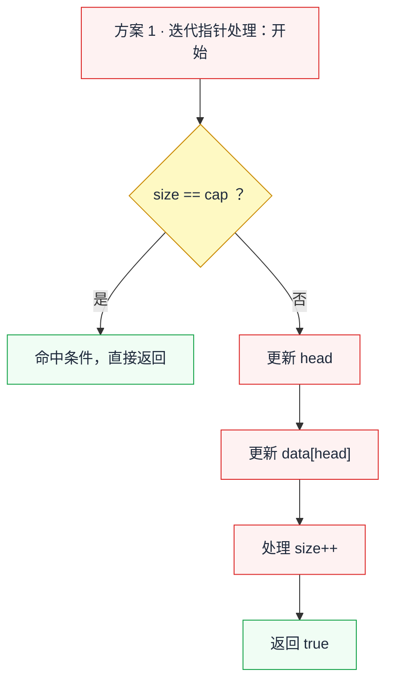

```dart
// LeetCode 641. 设计循环双端队列 — Dart 版（方案1）
class MyCircularDeque {
  // 定义类型
  final List<int> data; // final List 小于 int 超过 data;
  int head = 0, tail = 0, size = 0; // 把 0, 尾节点 赋值为 0, 大小 赋值为 0 存入 头节点
  final int cap; // final int cap;
  MyCircularDeque(this.cap) : data = List<int>.filled(cap, 0);
  bool insertFront(int v) {
    // 定义函数/方法 insertFront
    if (size == cap) return false; // 若 大小 等于 cap，直接返回 false
    head = (head + cap - 1) % cap; // 把 (头节点 加 cap 减 1) 对…取模 cap 存入 头节点
    data[head] = v; // 把 值; 写入 data[head]
    size++; // 大小 加一
    return true; // 返回 true
  }

  bool insertLast(int v) {
    // 定义函数/方法 insertLast
    if (size == cap) return false; // 若 大小 等于 cap，直接返回 false
    data[tail] = v; // 把 值; 写入 data[tail]
    tail = (tail + 1) % cap; // 把 (尾节点 加 1) 对…取模 cap 存入 尾节点
    size++; // 大小 加一
    return true; // 返回 true
  }

  bool deleteFront() {
    // 定义函数/方法 deleteFront
    if (size == 0) return false; // 若 大小 等于 0，直接返回 false
    head = (head + 1) % cap; // 把 (头节点 加 1) 对…取模 cap 存入 头节点
    size--; // 大小 减一
    return true; // 返回 true
  }

  bool deleteLast() {
    // 定义函数/方法 deleteLast
    if (size == 0) return false; // 若 大小 等于 0，直接返回 false
    tail = (tail + cap - 1) % cap; // 把 (尾节点 加 cap 减 1) 对…取模 cap 存入 尾节点
    size--; // 大小 减一
    return true; // 返回 true
  }

  int getFront() => size == 0 ? -1 : data[head];
  int getRear() => size == 0 ? -1 : data[(tail + cap - 1) % cap];
  bool isEmpty() => size == 0;
  bool isFull() => size == cap;
}

void main() {
  // 程序入口：跑内嵌自测用例
  final d = MyCircularDeque(3); // 把 MyCircularDeque(3) 存入 d
  if (!d.insertLast(1))
    throw StateError('c1'); // 若 取反 d.insertLast(1)) throw StateError('c1');
  if (!d.insertLast(2))
    throw StateError('c2'); // 若 取反 d.insertLast(2)) throw StateError('c2');
  if (!d.insertFront(3))
    throw StateError('c3'); // 若 取反 d.insertFront(3)) throw StateError('c3');
  if (d.insertFront(4))
    throw StateError('c4'); // 若 d.insertFront(4)) throw StateError('c4');
  if (d.getRear() != 2)
    throw StateError('c5'); // 若 d.getRear() 不等于 2) throw StateError('c5');
  if (!d.isFull())
    throw StateError('c6'); // 若 取反 d.isFull()) throw StateError('c6');
  if (!d.deleteLast())
    throw StateError('c7'); // 若 取反 d.deleteLast()) throw StateError('c7');
  if (!d.insertFront(4))
    throw StateError('c8'); // 若 取反 d.insertFront(4)) throw StateError('c8');
  if (d.getFront() != 4)
    throw StateError('c9'); // 若 d.getFront() 不等于 4) throw StateError('c9');
  print('PASS');
} // 全部用例通过，输出 PASS
```

#### 方案 2：直接实现

**思路与代码分析**：核心是「直接实现」。Dart 版用可空类型标注与集合方法，注意空安全。**走读**：方案 2 · 直接实现：开始 → 命中条件，直接返回 → 更新 head → 更新 data[head] → 处理 size++ → 返回 true。

**运行架构**（真实控制流）：

```mermaid
graph TD
    N0["方案 2 · 直接实现：开始"]
    N1{"size == cap ？"}
    N2["命中条件，直接返回"]
    N3["更新 head"]
    N4["更新 data[head]"]
    N5["处理 size++"]
    N6["返回 true"]
    N0 --> N1
    N1 -- 是 --> N2
    N1 -- 否 --> N3
    N3 --> N4
    N4 --> N5
    N5 --> N6
    classDef n fill:#fef2f2,stroke:#dc2626,color:#1e293b;
    classDef lp fill:#fee2e2,stroke:#b91c1c,color:#1e293b;
    classDef dc fill:#fef9c3,stroke:#ca8a04,color:#1e293b;
    classDef tm fill:#f0fdf4,stroke:#16a34a,color:#1e293b;
    class N0,N3,N4,N5 n;
    class N1 dc;
    class N2,N6 tm;
```

```dart
// LeetCode 641. 设计循环双端队列 — Dart 版（方案2）
class MyCircularDeque {
  // 定义类型
  final List<int> data; // final List 小于 int 超过 data;
  int head = 0, tail = 0, size = 0; // 把 0, 尾节点 赋值为 0, 大小 赋值为 0 存入 头节点
  final int cap; // final int cap;
  MyCircularDeque(this.cap) : data = List<int>.filled(cap, 0);
  bool insertFront(int v) {
    // 定义函数/方法 insertFront
    if (size == cap) return false; // 若 大小 等于 cap，直接返回 false
    head = (head + cap - 1) % cap; // 把 (头节点 加 cap 减 1) 对…取模 cap 存入 头节点
    data[head] = v; // 把 值; 写入 data[head]
    size++; // 大小 加一
    return true; // 返回 true
  }

  bool insertLast(int v) {
    // 定义函数/方法 insertLast
    if (size == cap) return false; // 若 大小 等于 cap，直接返回 false
    data[tail] = v; // 把 值; 写入 data[tail]
    tail = (tail + 1) % cap; // 把 (尾节点 加 1) 对…取模 cap 存入 尾节点
    size++; // 大小 加一
    return true; // 返回 true
  }

  bool deleteFront() {
    // 定义函数/方法 deleteFront
    if (size == 0) return false; // 若 大小 等于 0，直接返回 false
    head = (head + 1) % cap; // 把 (头节点 加 1) 对…取模 cap 存入 头节点
    size--; // 大小 减一
    return true; // 返回 true
  }

  bool deleteLast() {
    // 定义函数/方法 deleteLast
    if (size == 0) return false; // 若 大小 等于 0，直接返回 false
    tail = (tail + cap - 1) % cap; // 把 (尾节点 加 cap 减 1) 对…取模 cap 存入 尾节点
    size--; // 大小 减一
    return true; // 返回 true
  }

  int getFront() => size == 0 ? -1 : data[head];
  int getRear() => size == 0 ? -1 : data[(tail + cap - 1) % cap];
  bool isEmpty() => size == 0;
  bool isFull() => size == cap;
}

void main() {
  // 程序入口：跑内嵌自测用例
  final d = MyCircularDeque(3); // 把 MyCircularDeque(3) 存入 d
  if (!d.insertLast(1))
    throw StateError('c1'); // 若 取反 d.insertLast(1)) throw StateError('c1');
  if (!d.insertLast(2))
    throw StateError('c2'); // 若 取反 d.insertLast(2)) throw StateError('c2');
  if (!d.insertFront(3))
    throw StateError('c3'); // 若 取反 d.insertFront(3)) throw StateError('c3');
  if (d.insertFront(4))
    throw StateError('c4'); // 若 d.insertFront(4)) throw StateError('c4');
  if (d.getRear() != 2)
    throw StateError('c5'); // 若 d.getRear() 不等于 2) throw StateError('c5');
  if (!d.isFull())
    throw StateError('c6'); // 若 取反 d.isFull()) throw StateError('c6');
  if (!d.deleteLast())
    throw StateError('c7'); // 若 取反 d.deleteLast()) throw StateError('c7');
  if (!d.insertFront(4))
    throw StateError('c8'); // 若 取反 d.insertFront(4)) throw StateError('c8');
  if (d.getFront() != 4)
    throw StateError('c9'); // 若 d.getFront() 不等于 4) throw StateError('c9');
  print('PASS');
} // 全部用例通过，输出 PASS
```

---

## 内容总结

- **设计循环双端队列**（栈 · Medium）：共 2 个方案，主线思路「迭代指针处理」；时间 O(n)（单趟线性扫描）；动画演示栈后进先出过程，附录给出 11 种语言 × 全部方案的可运行实现。
- 来源博客：[https://blog.csdn.net/tyro_java/article/details/145385578](https://blog.csdn.net/tyro_java/article/details/145385578)
- 导航：[📋 总目录](../) ｜ [← 043 设计循环队列](../043_设计循环队列/) ｜ [045 加一 →](../045_加一/)
