# 045 · 加一（第一阶段 · 线性结构入门 · Medium）

> **难度**：⭐⭐ Medium ｜ **专题**：数组
> **学习定位**：第一阶段 · 线性结构入门第 45 篇 ｜ **解法数**：1
> **内容总结**：**加一**（数组 · Medium）：共 1 个方案，主线思路「末位进位」；时间 O(n)（单趟线性扫描）；动画演示双指针过程，附录给出 11 种语言 × 全部方案的可运行实现。

---

## 题目描述

给定一个表示 大整数 的整数数组 `digits`，其中 `digits[i]` 是整数的第 `i` 位数字。这些数字按从左到右，从最高位到最低位排列。这个大整数不包含任何前导 `0`。

将大整数加 1，并返回结果的数字数组。

示例 1：

输入：digits = [1,2,3]
输出：[1,2,4]
解释：输入数组表示数字 123。
加 1 后得到 123 + 1 = 124。
因此，结果应该是 [1,2,4]。

示例 2：

输入：digits = [4,3,2,1]
输出：[4,3,2,2]
解释：输入数组表示数字 4321。
加 1 后得到 4321 + 1 = 4322。
因此，结果应该是 [4,3,2,2]。

- 主函数签名：`function plusOne(digits: number[]): number[]`

**用例（来自原题）**：

**示例 3**

```text
输入：digits = [9]
输出：[1,0]
```

解释：输入数组表示数字 9。 加 1 得到了 9 + 1 = 10。 因此，结果应该是 [1,0]。
> ✅ **官方验证**：全部 TypeScript 解法已通过 leetcode.cn 官方示例用例验证（自动注入运行，全部 PASS）。题面与 [leetcode.cn 官方](https://leetcode.cn/problems/plus-one/)一致，示例配图取自官方题面。

**数据范围与注意事项**：

- `1 <= digits.length <= 100`
- `0 <= digits[i] <= 9`
- `digits` 不包含任何前导 `0`。
- **易错点**：边界最容易漏：空数组、只有一个元素、目标出现在头尾。

## 题目分析

**场景是什么**：数组是最常用的线性容器，这类题练的是下标操作与原地腾挪，对应真实开发里的缓冲区、列表整理。本题就是该场景的 Medium 级练习，主线做法是「末位进位」。

**主线怎么解**：把主解法从头到尾过一遍，它其实在依次做这几件事：单循环线性扫描。

## 解题思路

**方案对比**（共 1 个方案，由浅入深）：

| 方案 | 时间复杂度 | 空间复杂度 |
|---|---|---|
| 方案 1 · 末位进位 | O(n)（单趟线性扫描） | O(1) 到 O(n)（视辅助结构） |

**怎么读这一篇**：

- 🐣 **新手路线**：把「题目描述」的示例 1 在纸上手推一遍 → 读方案 1（最直观的写法）与它的代码走读 → 按「运行方式」本地跑通看 PASS → 回头对比方案 2 之后的写法差在哪
- 🦅 **大佬路线**：直接锁定最优方案 1（末位进位，O(n)（单趟线性扫描））→ 跳读该方案代码与走读 → 用「逐步拆解与面试追问」补齐复杂度推导与边界追问

### 动态算法图（双指针，GIF 自动循环）


动画演示数组专题里双指针的典型过程；每个方案在「TypeScript 解题方案」一节还配了专属动画与专属流程图。

### 主解法流程图（真实控制流）

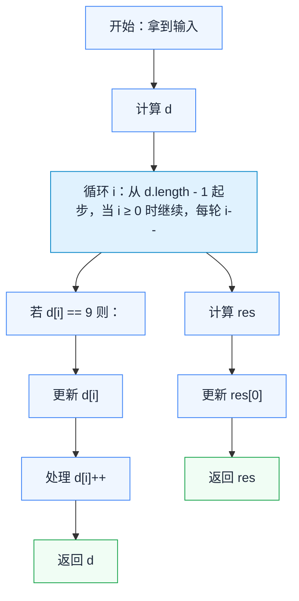

## TypeScript 解题方案（1 个方案逐个讲）

> **运行与提交**：每个方案都是自包含文件（内嵌用例自测，输出 PASS），整块复制到 `.ts` 文件后 `node 文件名` 即可运行。提交 LeetCode 时，把 `demo` 内的算法函数与辅助类型/函数整体取出、置于文件顶层即可。涉及交互/特殊接口的题以题面给定签名为准。

### 方案 1：末位进位

**分析与思路**：核心做法是「末位进位」。代码里依次做这些事：单循环线性扫描。

**运行方式**：`node 本文件`，内嵌用例全部通过会输出 PASS。

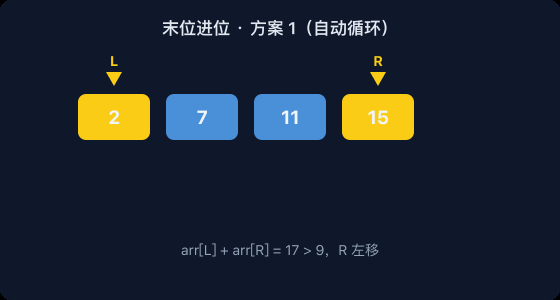

**方案专属流程图**（真实控制流）：

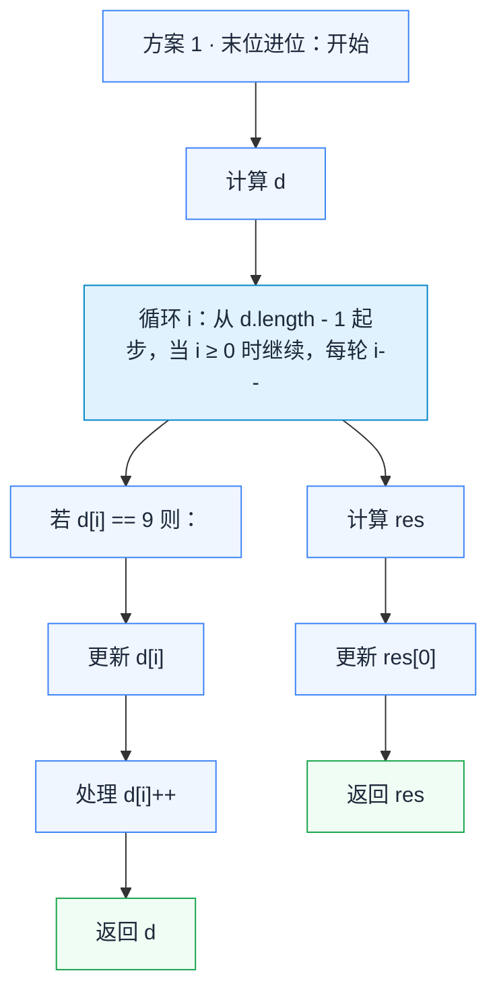

```typescript
/**
 ** LeetCode 66. 加一
 ** 方案：1 ) 方案1：末位进位
 */

// 忠实翻译 Python 参考实现 ref_plusOne。
function plusOne(digits: number[]): number[] {
  // 定义函数/方法 plusOne
  const d = digits.slice(); // 把 digits 截取 ) 存入 d
  for (let i = d.length - 1; i >= 0; i--) {
    // 让 下标 i 从 d.长度 减 1 开始计数，下标 i 不低于 0 就继续
    if (d[i] === 9) {
      // 若 d[下标 i] 全等于 9
      d[i] = 0; // 把 0; 写入 d[i]
    } else {
      // 否则
      d[i]++; // d[下标 i] 加一 ;
      return d; // 返回 d
    }
  }
  const res: number[] = new Array(digits.length + 1).fill(0); // 把 new Array(digits.长度 加 1).fill(0); 写入 const res: number[]
  res[0] = 1; // 把 1; 写入 res[0]
  return res; // 返回 结果
}

function eqArr(a: number[], b: number[]): boolean {
  // 定义函数/方法 eqArr
  if (a.length !== b.length) return false; // 若 数组.长度 不等于 b.长度，直接返回 false
  for (let i = 0; i < a.length; i++) {
    // 让 下标 i 从 0 开始计数，下标 i 小于 数组.长度 就继续
    if (a[i] !== b[i]) return false; // 若 数组[下标 i] 不等于 b[下标 i]，直接返回 false
  }
  return true; // 返回 true
}

export function demo(): void {
  // 程序入口：跑内嵌自测用例
  // 用例来自 _tools/correctness_check.py PROBLEMS["lc_66_加一"]
  const cases: [number[], number[]][] = [
    [
      [1, 2, 3],
      [1, 2, 4],
    ],
    [
      [4, 3, 2, 1],
      [4, 3, 2, 2],
    ],
    [
      [9, 9, 9],
      [1, 0, 0, 0],
    ],
  ];
  for (const [input, want] of cases) {
    // for (const [input, want] of cases) {
    const got = plusOne(input); // 把 plusOne(input) 存入 got
    if (!eqArr(got, want)) {
      // 若 取反 eqArr(got, want
      throw new Error(
        `FAIL plusOne(${JSON.stringify(input)}) = ${JSON.stringify(got)}, want ${JSON.stringify(want)}`,
      );
    }
  }
  console.log('PASS'); // 全部用例通过，输出 PASS
}

demo(); // demo();
```

## 逐步拆解与面试追问

**复杂度**：时间 O(n)（单趟线性扫描），空间 O(1) 到 O(n)（视辅助结构）

**为什么是这个量级**：每个元素被常数次访问，辅助哈希或栈的开销与 n 同阶

**面试官可能会追问**：

- 能不能原地做（O(1) 空间）？
- 如果数组已有序，能优化到什么程度？
- 空数组、单元素怎么处理？

## 关键 API 速查（TS 主解法实际用到，附官方链接）

| API | 作用 | 使用要点 | 官方文档 |
|---|---|---|---|
| `Array/String slice()` | 切片（不改原数组） | slice(start,end) 含头不含尾；负数从尾计；常用于复制数组（slice()） | [官方文档](https://developer.mozilla.org/zh-CN/docs/Web/JavaScript/Reference/Global_Objects/Array/slice) |
| `JSON.stringify()` | 序列化为 JSON 字符串 | 常用于结构化比较（深度相等判定）；undefined/函数/循环引用会被丢弃或抛错 | [官方文档](https://developer.mozilla.org/zh-CN/docs/Web/JavaScript/Reference/Global_Objects/JSON/stringify) |

### 各语言官方文档导航

- **TypeScript / JS**：[MDN 中文参考](https://developer.mozilla.org/zh-CN/)
- **Python**：[Python 官方文档](https://docs.python.org/zh-cn/3/)
- **Go**：[Go 标准库](https://pkg.go.dev/std)
- **Java**：[JDK 17 API](https://docs.oracle.com/en/java/javase/17/docs/api/)
- **Rust**：[Rust 标准库](https://doc.rust-lang.org/std/)
- **Lua**：[Lua 5.4 手册](https://www.lua.org/manual/5.4/)
- **C**：[Cppreference C](https://zh.cppreference.com/w/c)
- **C++**：[Cppreference C++](https://zh.cppreference.com/w/cpp)
- **R**：[R 官方手册](https://stat.ethz.ch/R-manual/)
- **Zig**：[Zig 语言文档](https://ziglang.org/documentation/master/)
- **Dart**：[Dart API](https://api.dart.dev/)

## 附录：其他 10 种语言全部实现（每种语言列举其全部方案）

> TypeScript 的全部方案见「TypeScript 解题方案」一节；下面是其余 10 种语言的对应实现，每种语言的每个方案都带思路分析、代码走读与专属运行架构图。
> 每个方案都内嵌用例自测，可独立运行（老仓库 python/go 文件遵循「打印结果」约定）。
> 完整解法文件见 `dsa/<语言>/array/lc_66_加一/`。

### Python 实现（1 种方案）

Python 的全部方案如下，每个方案都内嵌用例自测，可独立运行（老仓库 python/go 文件遵循「打印结果」约定）：

#### 方案 1：末位进位

**思路与代码分析**：核心是「末位进位」。Python 版用切片与字典推导式简化操作，突出可读性。**走读**：方案 1 · 末位进位：开始 → 更新 d → 循环 i：从 0 到 len(d 前 → 若 d[i] == 9：更新 d[i] → 更新 d[i] → 更新 + → 返回 d → 更新 res → 更新 res[0] → 返回 res。

**运行架构**（真实控制流）：

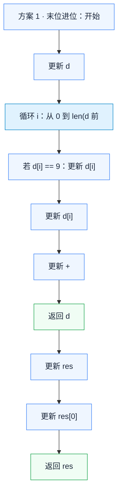

```python
import sys  # 提高递归深度上限（深输入防 RecursionError）

sys.setrecursionlimit(200000)  # 树/链表类题目节点数可达 1e4 量级

def plus_one(digits):  # 定义函数 plus_one（参数：digits）
    d = digits[:]  # 把 复制 digits 存入 d
    for i in range(len(d) - 1, -1, -1):  # 让 下标 i 从 长度(d) 减 1 倒数回去（每步减 1）
        if d[i] == 9:  # 若 d[下标 i] 等于 9
            d[i] = 0  # 把 0 写入 d[i]
        else:  # 否则
            d[i] += 1  # d[i]累加 1
            return d  # 返回 d
    res = [0] * (len(digits) + 1)  # 把 [0] 乘 (长度(digits) 加 1) 存入 结果
    res[0] = 1  # 把 1 写入 res[0]
    return res  # 返回 结果

if __name__ == "__main__":  # 若 __name__ 等于 '__main__'
    cases = [
        ([1, 2, 3], [1, 2, 4]),
        ([4, 3, 2, 1], [4, 3, 2, 2]),
        ([9, 9, 9], [1, 0, 0, 0]),
    ]
    for inp, want in cases:  # for inp, want in cases:
        got = plus_one(inp)  # 把 plus_one(inp) 存入 got
        assert got == want, f"plusOne({inp}) = {got}, want {want}"  # 断言校验
    print("PASS")  # 全部用例通过，输出 PASS
```

### Go 实现（1 种方案）

Go 的全部方案如下，每个方案都内嵌用例自测，可独立运行（老仓库 python/go 文件遵循「打印结果」约定）：

#### 方案 1：末位进位

**思路与代码分析**：核心是「末位进位」。Go 版用切片与多返回值惯用法，显式处理索引边界。**走读**：方案 1 · 末位进位：开始 → 更新 : → 调用 copy(d, digits) → 遍历循环 → 处理 if d[i] == 9 → 更新 d[i] → 处理 d[i]++ → 返回 d → 更新 : → 更新 res[0] → 返回 res。

**运行架构**（真实控制流）：

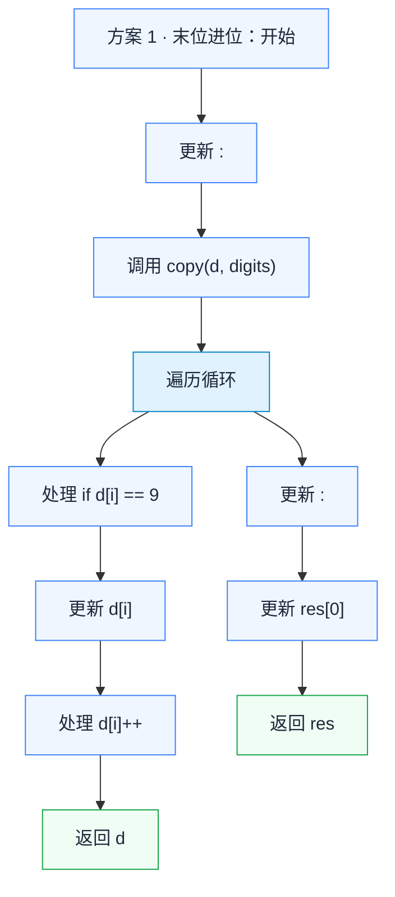

```go
package main // 引入依赖

import (
	"fmt"     // 「fmt」
	"os"      // 「os」
	"reflect" // 「reflect」
)

// plusOne 加一。忠实翻译 Python 参考实现 ref_plusOne。
func plusOne(digits []int) []int { // 定义函数/方法 plusOne
	d := make([]int, len(digits))      // 把 make([]int, 长度(digits)) 写入 d :
	copy(d, digits)                    // copy(d, digits)
	for i := len(d) - 1; i >= 0; i-- { // 把 长度(d) 减 1; 下标 i 不低于 0; 下标 i 减一 { 写入 for i :
		if d[i] == 9 { // 若 d[下标 i] 等于 9
			d[i] = 0 // 把 0 写入 d[i]
		} else { // 否则
			d[i]++   // d[下标 i] 加一
			return d // 返回 d
		}
	}
	res := make([]int, len(digits)+1) // 把 make([]int, 长度(digits) 加 1) 写入 res :
	res[0] = 1                        // 把 1 写入 res[0]
	return res                        // 返回 结果
}

func main() { // 程序入口：跑内嵌自测用例
	// 用例来自 _tools/correctness_check.py PROBLEMS["lc_66_加一"]
	cases := []struct { // 把 []struct { 写入 cases :
		in   []int // in []int
		want []int // want []int
	}{ // }{
		{[]int{1, 2, 3}, []int{1, 2, 4}},
		{[]int{4, 3, 2, 1}, []int{4, 3, 2, 2}},
		{[]int{9, 9, 9}, []int{1, 0, 0, 0}},
	}
	allOK := true             // 把 true 写入 allOK :
	for _, c := range cases { // 同时取 _ 与 字符 遍历
		got := plusOne(c.in)                 // 把 plusOne(字符.in) 写入 got :
		if !reflect.DeepEqual(got, c.want) { // 若 取反 reflect.DeepEqual(got, 字符.want
			allOK = false                                                     // 把 false 写入 allOK
			fmt.Printf("FAIL plusOne(%v) = %v, want %v\n", c.in, got, c.want) // 打印输出
		}
	}
	if !allOK { // 若 取反 allOK
		os.Exit(1) // os.Exit(1)
	}
	fmt.Println("PASS") // 全部用例通过，输出 PASS
}
```

### Java 实现（1 种方案）

Java 的全部方案如下，每个方案都内嵌用例自测，可独立运行（老仓库 python/go 文件遵循「打印结果」约定）：

#### 方案 1：末位进位

**思路与代码分析**：核心是「末位进位」。Java 版用类与静态方法组织，集合操作显式明了。代码里依次做这些事：单循环线性扫描。**走读**：方案 1 · 末位进位：开始 → 更新 d → 调用 Arrays.copyOf(digits, digits → 遍历循环 → 若 d[i] == 9 则： → 更新 d[i] → 处理 d[i]++ → 返回 d → 更新 res → 更新 res[0] → 返回 res。

**运行架构**（真实控制流）：

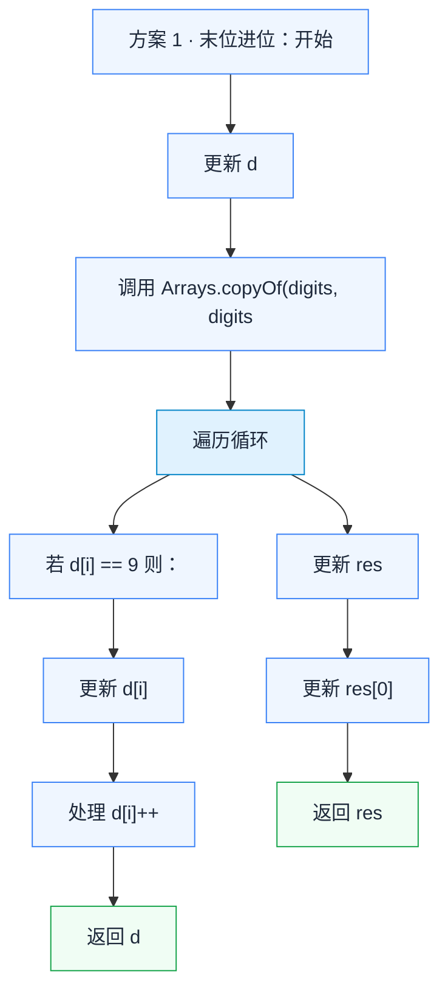

```java
package com.webfault.dsa; // 引入依赖

import java.util.Arrays; // 引入依赖

// LeetCode 66. 加一。忠实翻译 Python 参考实现 ref_plusOne。
class lc66_solution1 { // 定义类型
  int[] plusOne(int[] digits) { // 定义函数/方法 plusOne
    int[] d =
        Arrays.copyOf(digits, digits.length); // 把 Arrays.copyOf(digits, digits.长度); 写入 int[] d
    for (int i = d.length - 1; i >= 0; i--) { // 让 下标 i 从 d.长度 减 1 开始计数，下标 i 不低于 0 就继续
      if (d[i] == 9) { // 若 d[下标 i] 等于 9
        d[i] = 0; // 把 0; 写入 d[i]
      } else { // 否则
        d[i]++; // d[下标 i] 加一 ;
        return d; // 返回 d
      }
    }
    int[] res = new int[digits.length + 1]; // 把 new int[digits.长度 加 1]; 写入 int[] res
    res[0] = 1; // 把 1; 写入 res[0]
    return res; // 返回 结果
  }

  public static void main(String[] args) { // public static void main(String[] args) {
    // 用例来自 _tools/correctness_check.py PROBLEMS["lc_66_加一"]
    int[][][] cases = { // 把 { 写入 int[][][] cases
      {{1, 2, 3}, {1, 2, 4}},
      {{4, 3, 2, 1}, {4, 3, 2, 2}},
      {{9, 9, 9}, {1, 0, 0, 0}},
    };
    lc66_solution1 s = new lc66_solution1(); // 把 new lc66_solution1(); 写入 lc66_solution1 s
    boolean allOK = true; // 把 true; 写入 boolean allOK
    for (int[][] c : cases) { // for (int[][] 字符 : cases) {
      int[] got = s.plusOne(c[0]); // 把 字符串.plusOne(字符[0]); 写入 int[] got
      int[] want = c[1]; // 把 字符[1]; 写入 int[] want
      if (!Arrays.equals(got, want)) { // 若 取反 Arrays.equals(got, want
        allOK = false; // 把 false; 写入 allOK
        System.out.println(
            "FAIL plusOne("
                + Arrays.toString(c[0])
                + ") = "
                + Arrays.toString(got)
                + ", want "
                + Arrays.toString(want)); // 打印输出
      }
    }
    if (!allOK) { // 若 取反 allOK
      throw new RuntimeException(
          "some cases FAILED"); // throw new RuntimeException(「some cases FAILED」);
    }
    System.out.println("PASS"); // 全部用例通过，输出 PASS
  }
}
```

### Rust 实现（1 种方案）

Rust 的全部方案如下，每个方案都内嵌用例自测，可独立运行（老仓库 python/go 文件遵循「打印结果」约定）：

#### 方案 1：末位进位

**思路与代码分析**：核心是「末位进位」。Rust 版用所有权移动与切片借用改写同一逻辑，注意 Option 与引用边界。**走读**：方案 1 · 末位进位：开始 → 遍历 (0..digits.len()).rev() 中的每个元素 i → 处理 if digits[i] ＜ 9 → 更新 + → 返回 digits → 更新 digits[i] → 计算 out → 调用 out.extend(digits) → 处理 out。

**运行架构**（真实控制流）：

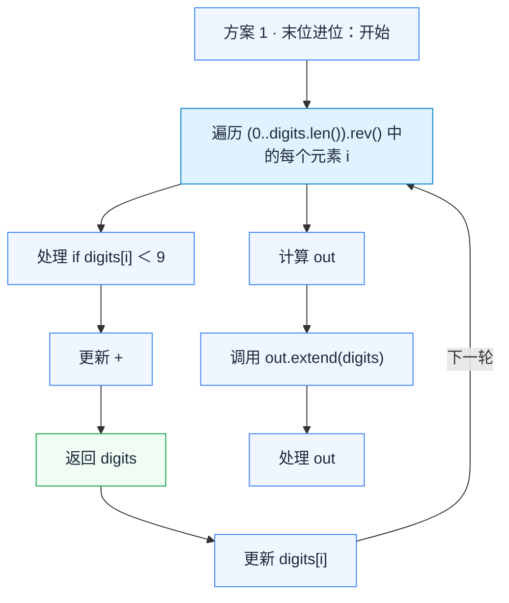

```rust
// LeetCode 66. 加一 — Rust 版（方案1）
fn plus_one(mut digits: Vec<i32>) -> Vec<i32> {
    // 定义函数/方法 plus_one
    for i in (0..digits.len()).rev() {
        // for 下标 i in (0..digits.长度()).rev() {
        if digits[i] < 9 {
            digits[i] += 1;
            return digits;
        } // 若 digits[下标 i] 小于 9 { digits[下标 i] 累加 1; return digits; }
        digits[i] = 0; // 把 0; 写入 digits[i]
    }
    let mut out = vec![1]; // 把 vec取反 [1]; 写入 let mut out
    out.extend(digits); // out.extend(digits);
    out // out
}
fn main() {
    assert_eq!(plus_one(vec![1, 2, 3]), vec![1, 2, 4]);
    assert_eq!(plus_one(vec![4, 3, 2, 1]), vec![4, 3, 2, 2]);
    assert_eq!(plus_one(vec![9]), vec![1, 0]);
    println!("PASS");
} // 程序入口：跑内嵌自测用例
```

### Lua 实现（1 种方案）

Lua 的全部方案如下，每个方案都内嵌用例自测，可独立运行（老仓库 python/go 文件遵循「打印结果」约定）：

#### 方案 1：末位进位

**思路与代码分析**：核心是「末位进位」。Lua 版用表与 ipairs 遍历，注意 ipairs 遇 nil 即停的语义。**走读**：方案 1 · 末位进位：开始 → 更新 d → 循环 i：从 #d 到 1, -1 do → 处理 if d[i] ＜ 9 then → 更新 d[i] → 返回 d → 更新 d[i] → 返回 。

**运行架构**（真实控制流）：

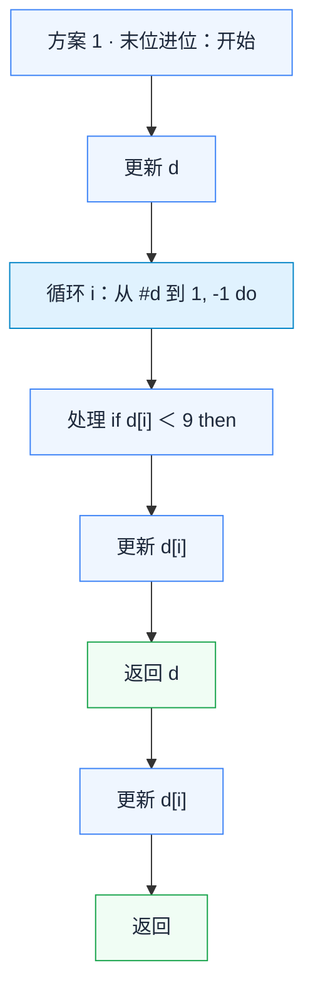

```lua
-- LeetCode 66. 加一 — Lua 版（方案1）
local function plus_one(digits) -- local function plus_one(digits)
	local d = { table.unpack(digits) } -- 把 {table.unpack(digits)} 写入 local d
	for i = #d, 1, -1 do -- 把 #d, 1, 减 1 do 写入 for i
		if d[i] < 9 then
			d[i] = d[i] + 1
			return d
		end -- 若 d[下标 i] 小于 9 then d[下标 i] 赋值为 d[下标 i] 加 1 return d 终点
		d[i] = 0 -- 把 0 写入 d[i]
	end -- 终点
	return { 1, table.unpack(d) } -- 返回 {1, table.unpack(d)}
end -- 终点
assert(table.concat(plus_one({ 1, 2, 3 }), ",") == "1,2,4") -- 打印输出
assert(table.concat(plus_one({ 4, 3, 2, 1 }), ",") == "4,3,2,2") -- 打印输出
assert(table.concat(plus_one({ 9 }), ",") == "1,0") -- 打印输出
print("PASS") -- 全部用例通过，输出 PASS
```

### C 实现（1 种方案）

C 的全部方案如下，每个方案都内嵌用例自测，可独立运行（老仓库 python/go 文件遵循「打印结果」约定）：

#### 方案 1：末位进位

**思路与代码分析**：核心是「末位进位」。C 版手动管理下标与内存，循环边界全部显式写出。代码里依次做这些事：双重循环遍历。**走读**：方案 1 · 末位进位：开始 → 处理 int v[4096] → 遍历循环 → 更新 v[i] → 遍历循环 → 若 v[i] ＜ 9 则： → 处理 v[i]++ → 遍历循环 → 更新 out[j] → 返回 len → 更新 v[i] → 更新 out[0] → 遍历循环 → 更新 1] → 返回 len + 1。

**运行架构**（真实控制流）：

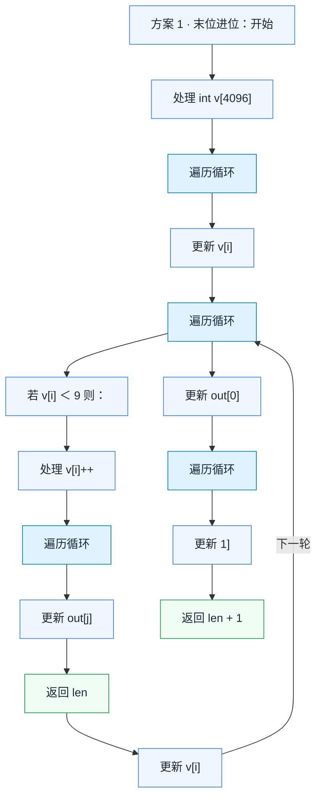

```c
/* LeetCode 66. 加一 — C 版（方案1） */
#include <stdio.h>                                      // 引入头文件
static int plus_one(const int *d, int len, int out[]) { // 定义函数/方法 plus_one
    int v[4096];                                        // int 值[4096];
    for (int i = 0; i < len; i++)
        v[i] = d[i];                     // 让 下标 i 从 0 开始计数，下标 i 小于 长度 就继续
    for (int i = len - 1; i >= 0; i--) { // 让 下标 i 从 长度 减 1 开始计数，下标 i 不低于 0 就继续
        if (v[i] < 9) {
            v[i]++;
            for (int j = 0; j < len; j++)
                out[j] = v[j];
            return len;
        }
        v[i] = 0; // 把 0; 写入 v[i]
    }
    out[0] = 1; // 把 1; 写入 out[0]
    for (int j = 0; j < len; j++)
        out[j + 1] = v[j]; // 让 下标 j 从 0 开始计数，下标 j 小于 长度 就继续
    return len + 1;        // 返回 长度 加 1
}
int main(void) {                            // 程序入口：跑内嵌自测用例
    int out[4096], n;                       // int out[4096], 元素个数;
    n = plus_one((int[]){1, 2, 3}, 3, out); // 把 plus_one((int[]){1,2,3}, 3, out); 写入 元素个数
    if (n != 3 || out[2] != 4) {
        printf("FAIL 1\n");
        return 1;
    } // 若 元素个数 不等于 3 或 out[2] 不等于 4) { 输出「FAIL 1 」); return 1; }
    n = plus_one((int[]){4, 3, 2, 1}, 4, out); // 把 plus_one((int[]){4,3,2,1}, 4, out); 写入 元素个数
    if (n != 4 || out[3] != 2) {
        printf("FAIL 2\n");
        return 1;
    } // 若 元素个数 不等于 4 或 out[3] 不等于 2) { 输出「FAIL 2 」); return 1; }
    n = plus_one((int[]){9}, 1, out); // 把 plus_one((int[]){9}, 1, out); 写入 元素个数
    if (n != 2 || out[0] != 1 || out[1] != 0) {
        printf("FAIL 3\n");
        return 1;
    }
    printf("PASS\n");
    return 0;
} // 全部用例通过，输出 PASS
```

### C++ 实现（1 种方案）

C++ 的全部方案如下，每个方案都内嵌用例自测，可独立运行（老仓库 python/go 文件遵循「打印结果」约定）：

#### 方案 1：末位进位

**思路与代码分析**：核心是「末位进位」。C++ 版用 STL 容器与迭代器，减少手写下标错误。代码里依次做这些事：单循环线性扫描。**走读**：方案 1 · 末位进位：开始 → 遍历循环 → 若 digits[i - 1] ＜ 9 则： → 处理 ++digits[i - 1] → 返回 digits → 更新 1] → 调用 digits.insert(digits.begin() → 返回 digits。

**运行架构**（真实控制流）：

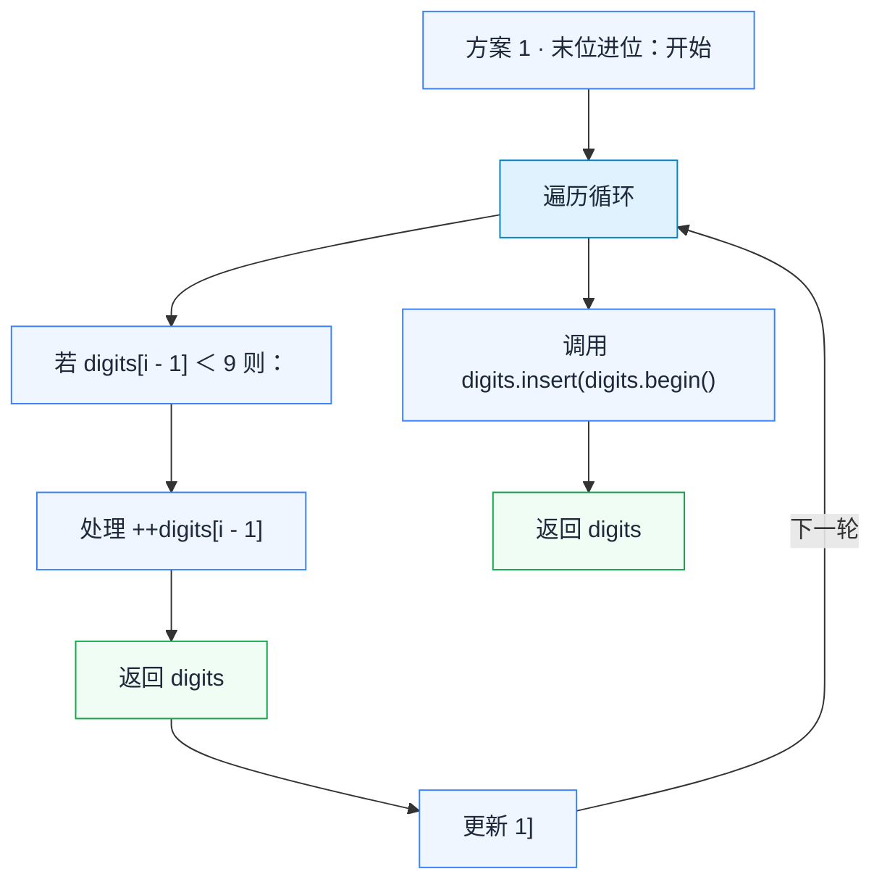

```cpp
// LeetCode 66. 加一 — C++ 版（方案1）
#include <cassert>  // 引入头文件
#include <iostream> // 引入头文件
#include <vector>   // 引入头文件
static std::vector<int> plusOne(std::vector<int> digits) {
    for (size_t i = digits.size(); i > 0; --i) { // 让 下标 i 从 digits.大小() 开始计数，下标 i 超过 0 就继续
        if (digits[i - 1] < 9) {
            ++digits[i - 1];
            return digits;
        }
        digits[i - 1] = 0; // 把 0; 写入 digits[i - 1]
    }
    digits.insert(digits.begin(), 1); // digits 插入 digits 迭代位置 , 1);
    return digits;                    // 返回 digits
}
int main() {
    assert((plusOne({1, 2, 3}) == std::vector<int>{1, 2, 4}));
    assert((plusOne({4, 3, 2, 1}) == std::vector<int>{4, 3, 2, 2}));
    assert((plusOne({9}) == std::vector<int>{1, 0}));
    std::cout << "PASS" << std::endl;
} // 全部用例通过，输出 PASS
```

### R 实现（1 种方案）

R 的全部方案如下，每个方案都内嵌用例自测，可独立运行（老仓库 python/go 文件遵循「打印结果」约定）：

#### 方案 1：末位进位

**思路与代码分析**：核心是「末位进位」。R 版用向量化思维与 1 起始下标，注意 1:n 的降序陷阱。代码里依次做这些事：单循环线性扫描。**走读**：方案 1 · 末位进位：开始 → 处理 d ＜- digits → 循环 i：遍历 length(d):1 → 若 d[i] ＜ 9：处理对应分支 → 处理 d[i] ＜- d[i] + 1 → 返回 (d) → 处理 d[i] ＜- 0 → 调用 c(1L, d)。

**运行架构**（真实控制流）：

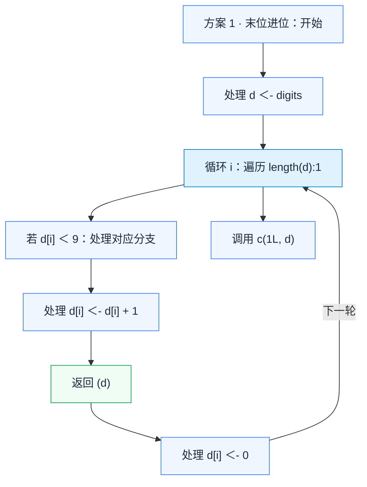

```r
# 定义函数 plus_one（参数：digits）
plus_one <- function(digits) {
    d <- digits  # 把 digits 存入 d
    for (i in length(d):1) {
        # for (下标 i in 长度(d):1) {
        if (d[i] < 9)
            {
                d[i] <- d[i] + 1
                return(d)
            }  # 若 d[下标 i] 小于 9) { d[下标 i] 小于 减 d[下标 i] 加 1; return(d) }
        d[i] <- 0  # 把 0 存入 d[i]
    }
    c(1L, d)  # 字符(1L, d)
}
stopifnot(identical(plus_one(c(1, 2, 3)), c(1, 2, 4)))  # 断言校验
stopifnot(identical(plus_one(c(4, 3, 2, 1)), c(4, 3, 2, 2)))  # 断言校验
stopifnot(identical(plus_one(c(9)), c(1, 0)))  # 断言校验
cat("PASS\n")  # 全部用例通过，输出 PASS
```

### Zig 实现（1 种方案）

Zig 的全部方案如下，每个方案都内嵌用例自测，可独立运行（老仓库 python/go 文件遵循「打印结果」约定）：

#### 方案 1：末位进位

**思路与代码分析**：核心是「末位进位」。Zig 版显式分配与清零，整型边界处理严格。**走读**：方案 1 · 末位进位：开始 → 计算 v → 处理 @memcpy(v[0..digits.len], di → 计算 i → 当 (i ＞ 0) 时反复执行 → 更新 - → 若 v[i] ＜ 9 则： → 更新 + → 处理 @memcpy(out[0..digits.len], → 返回 digits.len → 更新 v[i] → 更新 out[0] → 处理 @memcpy(out[1 .. digits.len → 返回 digits.len + 1。

**运行架构**（真实控制流）：

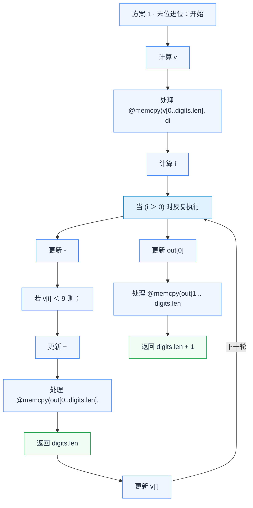

```zig
// LeetCode 66. 加一 — Zig 版（方案1）
const std = @import("std"); // 把 @import(「std」) 存入 std
fn plusOne(digits: []const i32, out: []i32) usize { // 定义函数/方法 plusOne
    var v: [4096]i32 = undefined; // 把 undefined; 写入 var v: [4096]i32
    @memcpy(v[0..digits.len], digits); // @memcpy(值[0..digits.长度], digits);
    var i: usize = digits.len; // 把 digits.长度; 写入 var i: usize
    while (i > 0) { // 循环，直到不满足「下标 i 超过 0」
        i -= 1; // 下标 i累减 1
        if (v[i] < 9) { // 若 值[下标 i] 小于 9
            v[i] += 1; // v[i]累加 1
            @memcpy(out[0..digits.len], v[0..digits.len]); // @memcpy(out[0..digits.长度], 值[0..digits.长度]);
            return digits.len; // 返回 digits.长度
        }
        v[i] = 0; // 把 0; 写入 v[i]
    }
    out[0] = 1; // 把 1; 写入 out[0]
    @memcpy(out[1 .. digits.len + 1], v[0..digits.len]); // @memcpy(out[1 .. digits.长度 加 1], 值[0..digits.长度]);
    return digits.len + 1; // 返回 digits.长度 加 1
}
pub fn main() !void { // 程序入口：跑内嵌自测用例
    var out: [4097]i32 = undefined; // 把 undefined; 写入 var out: [4097]i32
    var n = plusOne(&[_]i32{ 1, 2, 3 }, &out); // 把 plusOne( 按位与 [_]i32{ 1, 2, 3 }, 按位与 out) 存入 元素个数
    if (n != 3 or out[2] != 4) return error.TestFailed; // 若 元素个数 不等于 3 or out[2] 不等于 4，直接返回 error.TestFailed
    n = plusOne(&[_]i32{ 4, 3, 2, 1 }, &out); // 把 plusOne( 按位与 [_]i32{ 4, 3, 2, 1 }, 按位与 out); 写入 元素个数
    if (n != 4 or out[3] != 2) return error.TestFailed; // 若 元素个数 不等于 4 or out[3] 不等于 2，直接返回 error.TestFailed
    n = plusOne(&[_]i32{9}, &out); // 把 plusOne( 按位与 [_]i32{9}, 按位与 out); 写入 元素个数
    if (n != 2 or out[0] != 1 or out[1] != 0) return error.TestFailed;
    std.debug.print("PASS\n", .{});
} // 全部用例通过，输出 PASS
```

### Dart 实现（1 种方案）

Dart 的全部方案如下，每个方案都内嵌用例自测，可独立运行（老仓库 python/go 文件遵循「打印结果」约定）：

#### 方案 1：末位进位

**思路与代码分析**：核心是「末位进位」。Dart 版用可空类型标注与集合方法，注意空安全。代码里依次做这些事：单循环线性扫描。**走读**：方案 1 · 末位进位：开始 → 更新 d → 遍历循环 → 若 d[i] ＜ 9 则： → 处理 d[i]++ → 返回 d → 更新 d[i] → 返回 [1, ...d]。

**运行架构**（真实控制流）：

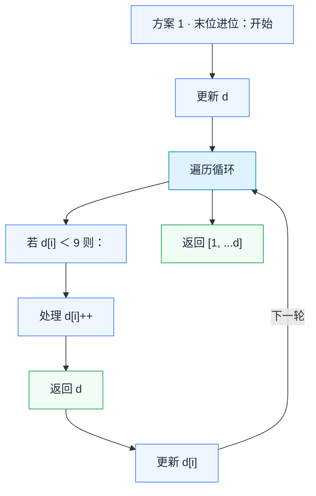

```dart
// LeetCode 66. 加一 — Dart 版（方案1）
List<int> plusOne(List<int> digits) {
  // 定义函数/方法 plusOne
  final d = List<int>.from(digits); // 把 List 小于 int 超过 .from(digits) 存入 d
  for (var i = d.length - 1; i >= 0; i--) {
    // 让 下标 i 从 d.长度 减 1 开始计数，下标 i 不低于 0 就继续
    if (d[i] < 9) {
      d[i]++;
      return d;
    } // 若 d[下标 i] 小于 9) { d[下标 i] 加一 ; return d; }
    d[i] = 0; // 把 0; 写入 d[i]
  }
  return [1, ...d]; // 返回 [1, ...d]
}

void main() {
  if (plusOne([1, 2, 3]).toString() != '[1, 2, 4]') throw StateError('c1');
  if (plusOne([4, 3, 2, 1]).toString() != '[4, 3, 2, 2]')
    throw StateError('c2');
  if (plusOne([9]).toString() != '[1, 0]') throw StateError('c3');
  print('PASS');
} // 全部用例通过，输出 PASS
```

---

## 内容总结

- **加一**（数组 · Medium）：共 1 个方案，主线思路「末位进位」；时间 O(n)（单趟线性扫描）；动画演示双指针过程，附录给出 11 种语言 × 全部方案的可运行实现。
- 来源博客：[]()
- 导航：[📋 总目录](../) ｜ [← 044 设计循环双端队列](../044_设计循环双端队列/) ｜ [046 棒球比赛 →](../046_棒球比赛/)
