# 046 · 棒球比赛（第一阶段 · 线性结构入门 · Medium）

> **难度**：⭐⭐ Medium ｜ **专题**：栈
> **学习定位**：第一阶段 · 线性结构入门第 46 篇 ｜ **解法数**：9
> **内容总结**：**棒球比赛**（栈 · Medium）：共 9 个方案，主线思路「栈辅助」；时间 O(n)（单趟线性扫描）；动画演示栈后进先出过程，附录给出 11 种语言 × 全部方案的可运行实现。

---

## 题目描述

你现在是一场采用特殊赛制棒球比赛的记录员。这场比赛由若干回合组成，过去几回合的得分可能会影响以后几回合的得分。

比赛开始时，记录是空白的。你会得到一个记录操作的字符串列表 `ops`，其中 `ops[i]` 是你需要记录的第 `i` 项操作，`ops` 遵循下述规则：

 整数 `x` - 表示本回合新获得分数 `x`
 `「+」` - 表示本回合新获得的得分是前两次得分的总和。题目数据保证记录此操作时前面总是存在两个有效的分数。
 `「D」` - 表示本回合新获得的得分是前一次得分的两倍。题目数据保证记录此操作时前面总是存在一个有效的分数。
 `「C」` - 表示前一次得分无效，将其从记录中移除。题目数据保证记录此操作时前面总是存在一个有效的分数。

请你返回记录中所有得分的总和。

- 主函数签名：`function calPoints(operations: string[]): number`

**用例（来自原题）**：

**示例 1**

```text
输入：ops = ["5","2","C","D","+"]
输出：30
```

解释：「5」 - 记录加 5 ，记录现在是 [5] 「2」 - 记录加 2 ，记录现在是 [5, 2] 「C」 - 使前一次得分的记录无效并将其移除，记录现在是 [5]. 「D」 - 记录加 2  5 = 10 ，记录现在是 [5, 10]. 「+」 - 记录加 5 + 10 = 15 ，记录现在是 [5, 10, 15]. 所有得分的总和 5 + 10 + 15 = 30

**示例 2**

```text
输入：ops = ["5","-2","4","C","D","9","+","+"]
输出：27
```

解释：「5」 - 记录加 5 ，记录现在是 [5] 「-2」 - 记录加 -2 ，记录现在是 [5, -2] 「4」 - 记录加 4 ，记录现在是 [5, -2, 4] 「C」 - 使前一次得分的记录无效并将其移除，记录现在是 [5, -2] 「D」 - 记录加 2  -2 = -4 ，记录现在是 [5, -2, -4] 「9」 - 记录加 9 ，记录现在是 [5, -2, -4, 9] 「+」 - 记录加 -4 + 9 = 5 ，记录现在是 [5, -2, -4, 9, 5] 「+」 - 记录加 9 + 5 = 14 ，记录现在是 [5, -2, -4, 9, 5, 14] 所有得分的总和 5 + -2 + -4 + 9 + 5 + 14 = 27

**示例 3**

```text
输入：ops = ["1"]
输出：1
```
> ✅ **官方验证**：全部 TypeScript 解法已通过 leetcode.cn 官方示例用例验证（自动注入运行，全部 PASS）。题面与 [leetcode.cn 官方](https://leetcode.cn/problems/baseball-game/)一致，示例配图取自官方题面。

**数据范围与注意事项**：

- `1 <= ops.length <= 1000`
- `ops[i]` 为 `「C」`、`「D」`、`「+」`，或者一个表示整数的字符串。整数范围是 `[-3  10^4, 3  10^4]`
- 对于 `「+」` 操作，题目数据保证记录此操作时前面总是存在两个有效的分数
- 对于 `「C」` 和 `「D」` 操作，题目数据保证记录此操作时前面总是存在一个有效的分数
- **易错点**：出栈前判空；「下一个更大元素」类问题栈里存下标比存值好用。

## 题目分析

**场景是什么**：后进先出结构天然适合「最近匹配」，对应真实开发里的括号校验、浏览历史、函数调用栈。本题就是该场景的 Medium 级练习，主线做法是「栈辅助」。

**主线怎么解**：把主解法从头到尾过一遍，它其实在依次做这几件事：单循环线性扫描 → 栈的后进先出操作。

## 解题思路

**方案对比**（共 9 个方案，由浅入深）：

| 方案 | 时间复杂度 | 空间复杂度 |
|---|---|---|
| 方案 1 · 栈辅助 | O(n)（单趟线性扫描） | O(1) 到 O(n)（视辅助结构） |
| 方案 2 · 栈辅助 | O(n)（单趟线性扫描） | O(1) 到 O(n)（视辅助结构） |
| 方案 3 · 栈辅助 | O(n)（单趟线性扫描） | O(1) 到 O(n)（视辅助结构） |
| 方案 4 · 栈辅助 | O(n)（单趟线性扫描） | O(1) 到 O(n)（视辅助结构） |
| 方案 5 · 栈辅助 | O(n) 量级 | O(n) |
| 方案 6 · 栈辅助 | O(n)（单趟线性扫描） | O(1) 到 O(n)（视辅助结构） |
| 方案 7 · 栈辅助 | O(n)（单趟线性扫描） | O(1) 到 O(n)（视辅助结构） |
| 方案 8 · 栈辅助 | O(n)（单趟线性扫描） | O(1) 到 O(n)（视辅助结构） |
| 方案 9 · 栈辅助 | O(n)（单趟线性扫描） | O(1) 到 O(n)（视辅助结构） |

**方案间的取舍**：方案 1（栈辅助）；方案 2（栈辅助）；方案 3（栈辅助）；方案 4（栈辅助）；方案 5（栈辅助）；方案 6（栈辅助）；方案 7（栈辅助）；方案 8（栈辅助）；方案 9（栈辅助）。数据规模小、可读性优先时选靠前的方案；规模大、性能优先时选靠后的方案。

**怎么读这一篇**：

- 🐣 **新手路线**：把「题目描述」的示例 1 在纸上手推一遍 → 读方案 1（最直观的写法）与它的代码走读 → 按「运行方式」本地跑通看 PASS → 回头对比方案 2 之后的写法差在哪
- 🦅 **大佬路线**：直接锁定最优方案 1（栈辅助，O(n)（单趟线性扫描））→ 跳读该方案代码与走读 → 用「逐步拆解与面试追问」补齐复杂度推导与边界追问

### 动态算法图（栈后进先出，GIF 自动循环）


动画演示栈专题里栈后进先出的典型过程；每个方案在「TypeScript 解题方案」一节还配了专属动画与专属流程图。

### 主解法流程图（真实控制流）


## TypeScript 解题方案（9 个方案逐个讲）

> **运行与提交**：每个方案都是自包含文件（内嵌用例自测，输出 PASS），整块复制到 `.ts` 文件后 `node 文件名` 即可运行。提交 LeetCode 时，把 `demo` 内的算法函数与辅助类型/函数整体取出、置于文件顶层即可。涉及交互/特殊接口的题以题面给定签名为准。

### 方案 1：栈辅助

**分析与思路**：核心做法是「栈辅助」。代码里依次做这些事：单循环线性扫描；栈的后进先出操作。

**运行方式**：`node 本文件`，内嵌用例全部通过会输出 PASS。


**方案专属流程图**（真实控制流）：

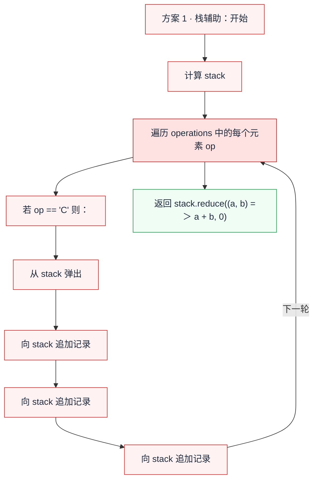

```typescript
/**
 ** LeetCode 682. 棒球比赛
 ** 来源：https://blog.csdn.net/tyro_java/article/details/130734875
 */

export function demo(): void {
  // 程序入口：跑内嵌自测用例
  function calPoints(operations: string[]): number {
    // 定义函数/方法 calPoints
    const stack: number[] = []; // 把 []; 写入 const stack: number[]
    for (const op of operations) {
      // for (const op of operations) {
      if (op === 'C') {
        // 若 op 全等于 「C」
        stack.pop(); // 弹出栈顶元素
      } else if (op === 'D') {
        // 否则，若 op 全等于 「D」
        stack.push(stack[stack.length - 1] * 2); // 把 栈[栈.长度 减 1] 乘 2 压入栈/数组尾部
      } else if (op === '+') {
        // 否则，若 op 全等于 「 加 」
        stack.push(stack[stack.length - 1] + stack[stack.length - 2]); // 把 栈[栈.长度 减 1] 加 栈[栈.长度 减 2] 压入栈/数组尾部
      } else {
        // 否则
        stack.push(parseInt(op, 10)); // 把 转整数(op, 10 压入栈/数组尾部
      }
    }
    return stack.reduce((a, b) => a + b, 0);
  }

  const cases: { in: string[]; want: number }[] = [
    { in: ['5', '2', 'C', 'D', '+'], want: 30 },
    { in: ['1', 'C'], want: 0 },
    { in: ['5', '-2', '4', 'C', 'D', '9', '+', '+'], want: 27 },
    { in: ['-3', '-4', '+'], want: -14 },
    { in: ['10'], want: 10 },
  ];

  let fail = false; // 把 false 存入 fail
  for (const c of cases) {
    // for (const 字符 of cases) {
    const got = calPoints(c.in); // 把 calPoints(字符.in) 存入 got
    if (got !== c.want) {
      // 若 got 不等于 字符.want
      fail = true; // 把 true 存入 fail
      console.log(
        'FAIL calPoints(' +
          JSON.stringify(c.in) +
          ')=' +
          got +
          ' want ' +
          c.want,
      ); // 打印输出
    }
  }
  if (fail) throw new Error('FAILED'); // 若 fail) throw new Error(「FAILED」);
  console.log('PASS'); // 全部用例通过，输出 PASS
}
demo(); // demo();
```

### 方案 2：栈辅助

**分析与思路**：核心做法是「栈辅助」。代码里依次做这些事：单循环线性扫描；栈的后进先出操作。

**运行方式**：`node 本文件`，内嵌用例全部通过会输出 PASS。


**方案专属流程图**（真实控制流）：

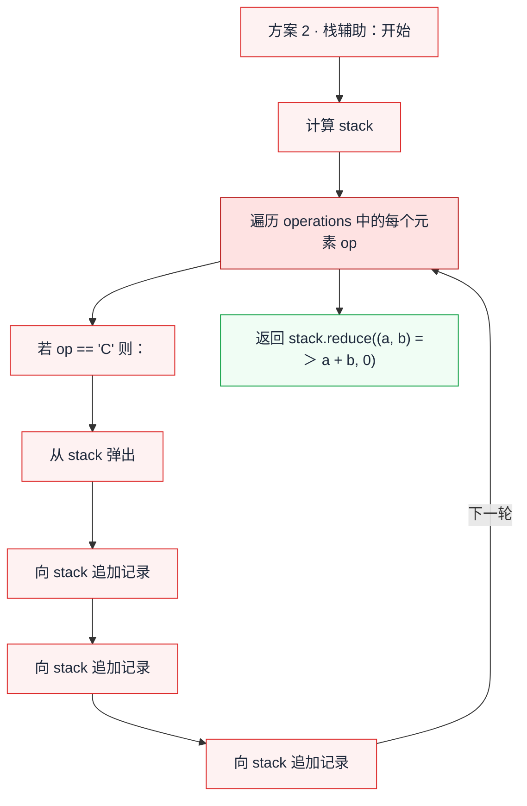

```typescript
/**
 ** LeetCode 682. 棒球比赛
 ** 来源：https://blog.csdn.net/tyro_java/article/details/130734875
 */

export function demo(): void {
  // 程序入口：跑内嵌自测用例
  function calPoints(operations: string[]): number {
    // 定义函数/方法 calPoints
    const stack: number[] = []; // 把 []; 写入 const stack: number[]
    for (const op of operations) {
      // for (const op of operations) {
      if (op === 'C') {
        // 若 op 全等于 「C」
        stack.pop(); // 弹出栈顶元素
      } else if (op === 'D') {
        // 否则，若 op 全等于 「D」
        stack.push(stack[stack.length - 1] * 2); // 把 栈[栈.长度 减 1] 乘 2 压入栈/数组尾部
      } else if (op === '+') {
        // 否则，若 op 全等于 「 加 」
        stack.push(stack[stack.length - 1] + stack[stack.length - 2]); // 把 栈[栈.长度 减 1] 加 栈[栈.长度 减 2] 压入栈/数组尾部
      } else {
        // 否则
        stack.push(parseInt(op, 10)); // 把 转整数(op, 10 压入栈/数组尾部
      }
    }
    return stack.reduce((a, b) => a + b, 0);
  }

  const cases: { in: string[]; want: number }[] = [
    { in: ['5', '2', 'C', 'D', '+'], want: 30 },
    { in: ['1', 'C'], want: 0 },
    { in: ['5', '-2', '4', 'C', 'D', '9', '+', '+'], want: 27 },
    { in: ['-3', '-4', '+'], want: -14 },
    { in: ['10'], want: 10 },
  ];

  let fail = false; // 把 false 存入 fail
  for (const c of cases) {
    // for (const 字符 of cases) {
    const got = calPoints(c.in); // 把 calPoints(字符.in) 存入 got
    if (got !== c.want) {
      // 若 got 不等于 字符.want
      fail = true; // 把 true 存入 fail
      console.log(
        'FAIL calPoints(' +
          JSON.stringify(c.in) +
          ')=' +
          got +
          ' want ' +
          c.want,
      ); // 打印输出
    }
  }
  if (fail) throw new Error('FAILED'); // 若 fail) throw new Error(「FAILED」);
  console.log('PASS'); // 全部用例通过，输出 PASS
}
demo(); // demo();
```

### 方案 3：栈辅助

**分析与思路**：核心做法是「栈辅助」。代码里依次做这些事：单循环线性扫描；栈的后进先出操作。

**运行方式**：`node 本文件`，内嵌用例全部通过会输出 PASS。


**方案专属流程图**（真实控制流）：


```typescript
/**
 ** LeetCode 682. 棒球比赛
 ** 来源：https://blog.csdn.net/tyro_java/article/details/130734875
 */

export function demo(): void {
  // 程序入口：跑内嵌自测用例
  function calPoints(operations: string[]): number {
    // 定义函数/方法 calPoints
    const score: number[] = []; // 把 []; 写入 const score: number[]
    for (const op of operations) {
      // for (const op of operations) {
      if (op === 'C') {
        // 若 op 全等于 「C」
        score.pop(); // 弹出栈顶元素
      } else if (op === 'D') {
        // 否则，若 op 全等于 「D」
        score.push(score[score.length - 1] * 2); // 把 score[score.长度 减 1] 乘 2 压入栈/数组尾部
      } else if (op === '+') {
        // 否则，若 op 全等于 「 加 」
        score.push(score[score.length - 1] + score[score.length - 2]); // 把 score[score.长度 减 1] 加 score[score.长度 减 2] 压入栈/数组尾部
      } else {
        // 否则
        score.push(parseInt(op, 10)); // 把 转整数(op, 10 压入栈/数组尾部
      }
    }
    return score.reduce((a, b) => a + b, 0);
  }

  const cases: { in: string[]; want: number }[] = [
    { in: ['5', '2', 'C', 'D', '+'], want: 30 },
    { in: ['1', 'C'], want: 0 },
    { in: ['5', '-2', '4', 'C', 'D', '9', '+', '+'], want: 27 },
    { in: ['-3', '-4', '+'], want: -14 },
    { in: ['10'], want: 10 },
  ];

  let fail = false; // 把 false 存入 fail
  for (const c of cases) {
    // for (const 字符 of cases) {
    const got = calPoints(c.in); // 把 calPoints(字符.in) 存入 got
    if (got !== c.want) {
      // 若 got 不等于 字符.want
      fail = true; // 把 true 存入 fail
      console.log(
        'FAIL calPoints(' +
          JSON.stringify(c.in) +
          ')=' +
          got +
          ' want ' +
          c.want,
      ); // 打印输出
    }
  }
  if (fail) throw new Error('FAILED'); // 若 fail) throw new Error(「FAILED」);
  console.log('PASS'); // 全部用例通过，输出 PASS
}
demo(); // demo();
```

### 方案 4：栈辅助

**分析与思路**：核心做法是「栈辅助」。代码里依次做这些事：单循环线性扫描；栈的后进先出操作。

**运行方式**：`node 本文件`，内嵌用例全部通过会输出 PASS。


**方案专属流程图**（真实控制流）：

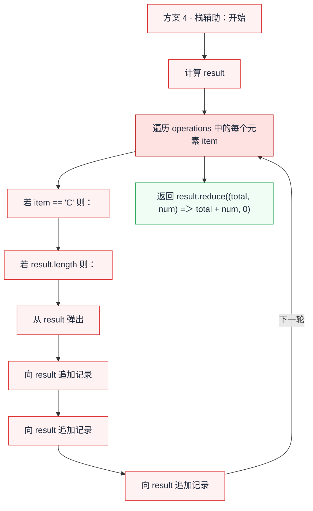

```typescript
/**
 ** LeetCode 682. 棒球比赛
 ** 来源：https://blog.csdn.net/tyro_java/article/details/130734875
 */

export function demo(): void {
  // 程序入口：跑内嵌自测用例
  function calPoints(operations: string[]): number {
    // 定义函数/方法 calPoints
    const result: number[] = []; // 把 []; 写入 const result: number[]
    for (const item of operations) {
      // for (const item of operations) {
      if (item === 'C') {
        // 若 item 全等于 「C」
        if (result.length) {
          // 若 结果.长度
          result.pop(); // 弹出栈顶元素
        }
      } else if (item === 'D') {
        // 否则，若 item 全等于 「D」
        result.push(result[result.length - 1] * 2); // 把 结果[结果.长度 减 1] 乘 2 压入栈/数组尾部
      } else if (item === '+') {
        // 否则，若 item 全等于 「 加 」
        result.push(result[result.length - 1] + result[result.length - 2]); // 把 结果[结果.长度 减 1] 加 结果[结果.长度 减 2] 压入栈/数组尾部
      } else {
        // 否则
        result.push(parseInt(item, 10)); // 把 转整数(item, 10 压入栈/数组尾部
      }
    }
    return result.reduce((total, num) => total + num, 0);
  }

  const cases: { in: string[]; want: number }[] = [
    { in: ['5', '2', 'C', 'D', '+'], want: 30 },
    { in: ['1', 'C'], want: 0 },
    { in: ['5', '-2', '4', 'C', 'D', '9', '+', '+'], want: 27 },
    { in: ['-3', '-4', '+'], want: -14 },
    { in: ['10'], want: 10 },
  ];

  let fail = false; // 把 false 存入 fail
  for (const c of cases) {
    // for (const 字符 of cases) {
    const got = calPoints(c.in); // 把 calPoints(字符.in) 存入 got
    if (got !== c.want) {
      // 若 got 不等于 字符.want
      fail = true; // 把 true 存入 fail
      console.log(
        'FAIL calPoints(' +
          JSON.stringify(c.in) +
          ')=' +
          got +
          ' want ' +
          c.want,
      ); // 打印输出
    }
  }
  if (fail) throw new Error('FAILED'); // 若 fail) throw new Error(「FAILED」);
  console.log('PASS'); // 全部用例通过，输出 PASS
}
demo(); // demo();
```

### 方案 5：栈辅助

**分析与思路**：核心做法是「栈辅助」。代码里依次做这些事：栈的后进先出操作。

**运行方式**：`node 本文件`，内嵌用例全部通过会输出 PASS。


**方案专属流程图**（真实控制流）：

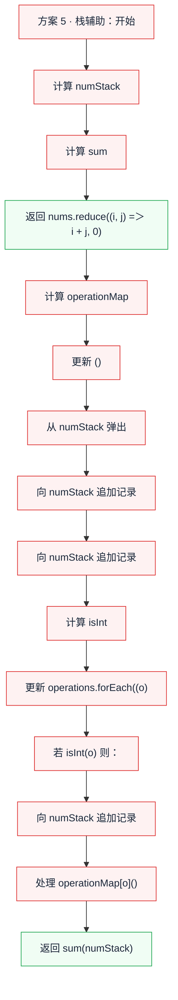

```typescript
/**
 ** LeetCode 682. 棒球比赛
 ** 方案：方案5
 ** 来源：https://blog.csdn.net/tyro_java/article/details/130734875
 */

export function demo(): void {
  // 程序入口：跑内嵌自测用例
  function calPoints(operations: string[]): number {
    // 定义函数/方法 calPoints
    // 初始化容器
    const numStack: number[] = []; // 把 []; 写入 const numStack: number[]
    // 累加器
    const sum = (nums: number[]) => {
      return nums.reduce((i, j) => i + j, 0);
    };
    // 操作对应数组
    const operationMap: { [key: string]: () => void } = {
      C: () => {
        numStack.pop();
      },
      D: () => numStack.push(numStack[numStack.length - 1] * 2),
      '+': () => numStack.push(sum(numStack.slice(-2))),
    };
    // 判断是否为整数（含负号），与 python 参考的 isdigit 检查一致
    const isInt = (s: string) => /^-?\d+$/.test(s);
    // 遍历操作数进行匹配操作
    operations.forEach((o) => {
      if (isInt(o)) {
        // 若 isInt(o
        numStack.push(parseInt(o, 10)); // 把 转整数(o, 10 压入栈/数组尾部
      } else {
        // 否则
        operationMap[o](); // operationMap[o]();
      }
    }); // });
    return sum(numStack); // 返回 累计和(numStack)
  }

  const cases: { in: string[]; want: number }[] = [
    { in: ['5', '2', 'C', 'D', '+'], want: 30 },
    { in: ['1', 'C'], want: 0 },
    { in: ['5', '-2', '4', 'C', 'D', '9', '+', '+'], want: 27 },
    { in: ['-3', '-4', '+'], want: -14 },
    { in: ['10'], want: 10 },
  ];

  let fail = false; // 把 false 存入 fail
  for (const c of cases) {
    // for (const 字符 of cases) {
    const got = calPoints(c.in); // 把 calPoints(字符.in) 存入 got
    if (got !== c.want) {
      // 若 got 不等于 字符.want
      fail = true; // 把 true 存入 fail
      console.log(
        'FAIL calPoints(' +
          JSON.stringify(c.in) +
          ')=' +
          got +
          ' want ' +
          c.want,
      ); // 打印输出
    }
  }
  if (fail) throw new Error('FAILED'); // 若 fail) throw new Error(「FAILED」);
  console.log('PASS'); // 全部用例通过，输出 PASS
}
demo(); // demo();
```

### 方案 6：栈辅助

**分析与思路**：核心做法是「栈辅助」。代码里依次做这些事：单循环线性扫描；栈的后进先出操作。

**运行方式**：`node 本文件`，内嵌用例全部通过会输出 PASS。


**方案专属流程图**（真实控制流）：

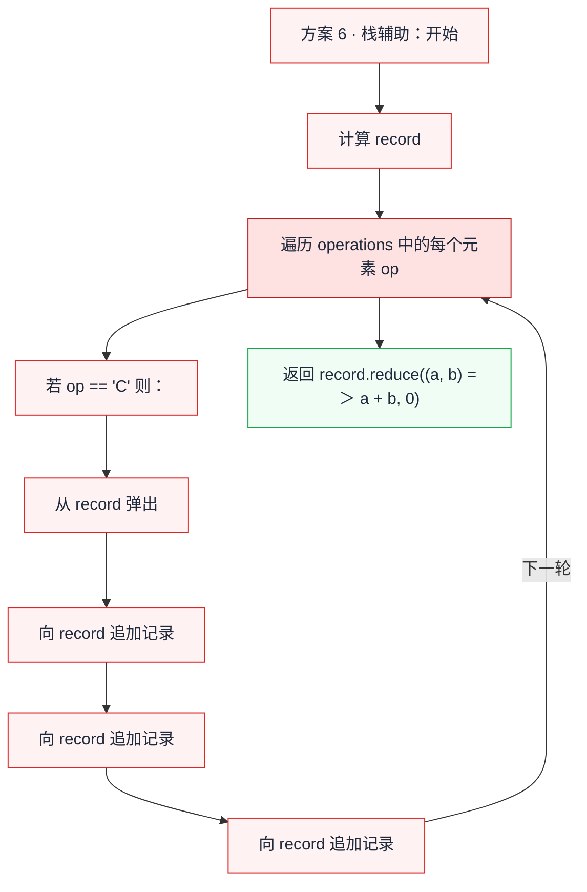

```typescript
/**
 ** LeetCode 682. 棒球比赛
 ** 来源：https://blog.csdn.net/tyro_java/article/details/130734875
 */

export function demo(): void {
  // 程序入口：跑内嵌自测用例
  function calPoints(operations: string[]): number {
    // 定义函数/方法 calPoints
    const record: number[] = []; // 把 []; 写入 const record: number[]
    for (const op of operations) {
      // for (const op of operations) {
      if (op === 'C') {
        // 若 op 全等于 「C」
        record.pop(); // 弹出栈顶元素
      } else if (op === 'D') {
        // 否则，若 op 全等于 「D」
        record.push(record[record.length - 1] * 2); // 把 record[record.长度 减 1] 乘 2 压入栈/数组尾部
      } else if (op === '+') {
        // 否则，若 op 全等于 「 加 」
        record.push(record[record.length - 1] + record[record.length - 2]); // 把 record[record.长度 减 1] 加 record[record.长度 减 2] 压入栈/数组尾部
      } else {
        // 否则
        record.push(parseInt(op, 10)); // 把 转整数(op, 10 压入栈/数组尾部
      }
    }
    return record.reduce((a, b) => a + b, 0);
  }

  const cases: { in: string[]; want: number }[] = [
    { in: ['5', '2', 'C', 'D', '+'], want: 30 },
    { in: ['1', 'C'], want: 0 },
    { in: ['5', '-2', '4', 'C', 'D', '9', '+', '+'], want: 27 },
    { in: ['-3', '-4', '+'], want: -14 },
    { in: ['10'], want: 10 },
  ];

  let fail = false; // 把 false 存入 fail
  for (const c of cases) {
    // for (const 字符 of cases) {
    const got = calPoints(c.in); // 把 calPoints(字符.in) 存入 got
    if (got !== c.want) {
      // 若 got 不等于 字符.want
      fail = true; // 把 true 存入 fail
      console.log(
        'FAIL calPoints(' +
          JSON.stringify(c.in) +
          ')=' +
          got +
          ' want ' +
          c.want,
      ); // 打印输出
    }
  }
  if (fail) throw new Error('FAILED'); // 若 fail) throw new Error(「FAILED」);
  console.log('PASS'); // 全部用例通过，输出 PASS
}
demo(); // demo();
```

### 方案 7：栈辅助

**分析与思路**：核心做法是「栈辅助」。代码里依次做这些事：单循环线性扫描；栈的后进先出操作。

**运行方式**：`node 本文件`，内嵌用例全部通过会输出 PASS。

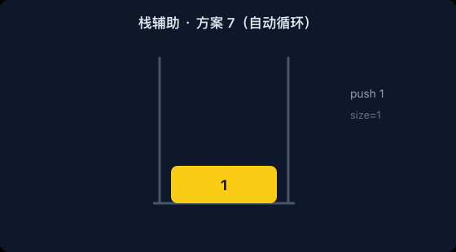

**方案专属流程图**（真实控制流）：

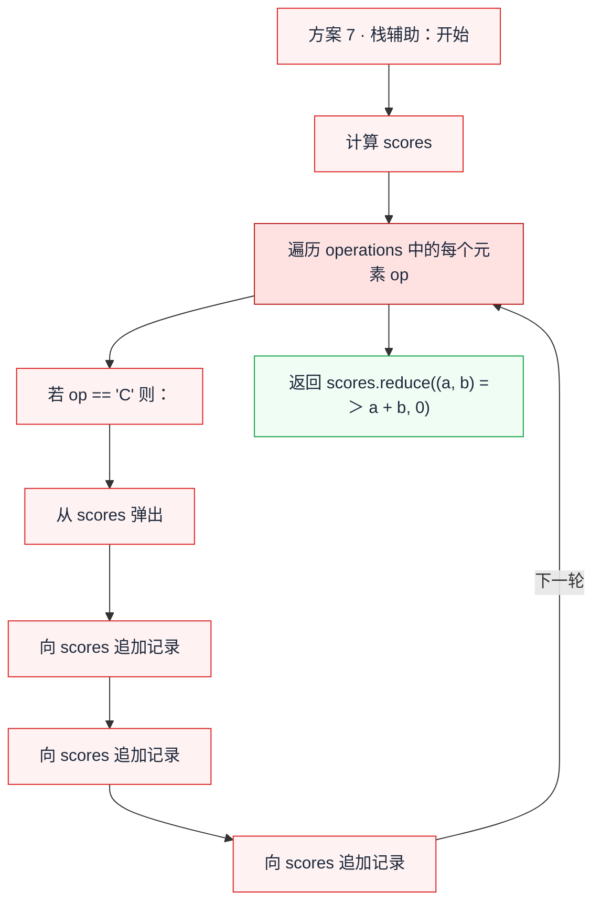

```typescript
/**
 ** LeetCode 682. 棒球比赛
 ** 来源：https://blog.csdn.net/tyro_java/article/details/130734875
 */

export function demo(): void {
  // 程序入口：跑内嵌自测用例
  function calPoints(operations: string[]): number {
    // 定义函数/方法 calPoints
    const scores: number[] = []; // 把 []; 写入 const scores: number[]
    for (const op of operations) {
      // for (const op of operations) {
      if (op === 'C') {
        // 若 op 全等于 「C」
        scores.pop(); // 弹出栈顶元素
      } else if (op === 'D') {
        // 否则，若 op 全等于 「D」
        scores.push(scores[scores.length - 1] * 2); // 把 scores[scores.长度 减 1] 乘 2 压入栈/数组尾部
      } else if (op === '+') {
        // 否则，若 op 全等于 「 加 」
        scores.push(scores[scores.length - 1] + scores[scores.length - 2]); // 把 scores[scores.长度 减 1] 加 scores[scores.长度 减 2] 压入栈/数组尾部
      } else {
        // 否则
        scores.push(parseInt(op, 10)); // 把 转整数(op, 10 压入栈/数组尾部
      }
    }
    return scores.reduce((a, b) => a + b, 0);
  }

  const cases: { in: string[]; want: number }[] = [
    { in: ['5', '2', 'C', 'D', '+'], want: 30 },
    { in: ['1', 'C'], want: 0 },
    { in: ['5', '-2', '4', 'C', 'D', '9', '+', '+'], want: 27 },
    { in: ['-3', '-4', '+'], want: -14 },
    { in: ['10'], want: 10 },
  ];

  let fail = false; // 把 false 存入 fail
  for (const c of cases) {
    // for (const 字符 of cases) {
    const got = calPoints(c.in); // 把 calPoints(字符.in) 存入 got
    if (got !== c.want) {
      // 若 got 不等于 字符.want
      fail = true; // 把 true 存入 fail
      console.log(
        'FAIL calPoints(' +
          JSON.stringify(c.in) +
          ')=' +
          got +
          ' want ' +
          c.want,
      ); // 打印输出
    }
  }
  if (fail) throw new Error('FAILED'); // 若 fail) throw new Error(「FAILED」);
  console.log('PASS'); // 全部用例通过，输出 PASS
}
demo(); // demo();
```

### 方案 8：栈辅助

**分析与思路**：核心做法是「栈辅助」。代码里依次做这些事：单循环线性扫描；栈的后进先出操作。

**运行方式**：`node 本文件`，内嵌用例全部通过会输出 PASS。


**方案专属流程图**（真实控制流）：


```typescript
/**
 ** LeetCode 682. 棒球比赛
 ** 来源：https://blog.csdn.net/tyro_java/article/details/130734875
 */

export function demo(): void {
  // 程序入口：跑内嵌自测用例
  function calPoints(operations: string[]): number {
    // 定义函数/方法 calPoints
    const points: number[] = []; // 把 []; 写入 const points: number[]
    for (const op of operations) {
      // for (const op of operations) {
      if (op === 'C') {
        // 若 op 全等于 「C」
        points.pop(); // 弹出栈顶元素
      } else if (op === 'D') {
        // 否则，若 op 全等于 「D」
        points.push(points[points.length - 1] * 2); // 把 points[points.长度 减 1] 乘 2 压入栈/数组尾部
      } else if (op === '+') {
        // 否则，若 op 全等于 「 加 」
        points.push(points[points.length - 1] + points[points.length - 2]); // 把 points[points.长度 减 1] 加 points[points.长度 减 2] 压入栈/数组尾部
      } else {
        // 否则
        points.push(parseInt(op, 10)); // 把 转整数(op, 10 压入栈/数组尾部
      }
    }
    return points.reduce((a, b) => a + b, 0);
  }

  const cases: { in: string[]; want: number }[] = [
    { in: ['5', '2', 'C', 'D', '+'], want: 30 },
    { in: ['1', 'C'], want: 0 },
    { in: ['5', '-2', '4', 'C', 'D', '9', '+', '+'], want: 27 },
    { in: ['-3', '-4', '+'], want: -14 },
    { in: ['10'], want: 10 },
  ];

  let fail = false; // 把 false 存入 fail
  for (const c of cases) {
    // for (const 字符 of cases) {
    const got = calPoints(c.in); // 把 calPoints(字符.in) 存入 got
    if (got !== c.want) {
      // 若 got 不等于 字符.want
      fail = true; // 把 true 存入 fail
      console.log(
        'FAIL calPoints(' +
          JSON.stringify(c.in) +
          ')=' +
          got +
          ' want ' +
          c.want,
      ); // 打印输出
    }
  }
  if (fail) throw new Error('FAILED'); // 若 fail) throw new Error(「FAILED」);
  console.log('PASS'); // 全部用例通过，输出 PASS
}
demo(); // demo();
```

### 方案 9：栈辅助

**分析与思路**：核心做法是「栈辅助」。代码里依次做这些事：单循环线性扫描；栈的后进先出操作。

**运行方式**：`node 本文件`，内嵌用例全部通过会输出 PASS。


**方案专属流程图**（真实控制流）：


```typescript
/**
 ** LeetCode 682. 棒球比赛
 ** 来源：https://blog.csdn.net/tyro_java/article/details/130734875
 */

export function demo(): void {
  // 程序入口：跑内嵌自测用例
  function calPoints(operations: string[]): number {
    // 定义函数/方法 calPoints
    const history: number[] = []; // 把 []; 写入 const history: number[]
    for (const op of operations) {
      // for (const op of operations) {
      if (op === 'C') {
        // 若 op 全等于 「C」
        history.pop(); // 弹出栈顶元素
      } else if (op === 'D') {
        // 否则，若 op 全等于 「D」
        history.push(history[history.length - 1] * 2); // 把 history[history.长度 减 1] 乘 2 压入栈/数组尾部
      } else if (op === '+') {
        // 否则，若 op 全等于 「 加 」
        history.push(history[history.length - 1] + history[history.length - 2]); // 把 history[history.长度 减 1] 加 history[history.长度 减 2] 压入栈/数组尾部
      } else {
        // 否则
        history.push(parseInt(op, 10)); // 把 转整数(op, 10 压入栈/数组尾部
      }
    }
    return history.reduce((a, b) => a + b, 0);
  }

  const cases: { in: string[]; want: number }[] = [
    { in: ['5', '2', 'C', 'D', '+'], want: 30 },
    { in: ['1', 'C'], want: 0 },
    { in: ['5', '-2', '4', 'C', 'D', '9', '+', '+'], want: 27 },
    { in: ['-3', '-4', '+'], want: -14 },
    { in: ['10'], want: 10 },
  ];

  let fail = false; // 把 false 存入 fail
  for (const c of cases) {
    // for (const 字符 of cases) {
    const got = calPoints(c.in); // 把 calPoints(字符.in) 存入 got
    if (got !== c.want) {
      // 若 got 不等于 字符.want
      fail = true; // 把 true 存入 fail
      console.log(
        'FAIL calPoints(' +
          JSON.stringify(c.in) +
          ')=' +
          got +
          ' want ' +
          c.want,
      ); // 打印输出
    }
  }
  if (fail) throw new Error('FAILED'); // 若 fail) throw new Error(「FAILED」);
  console.log('PASS'); // 全部用例通过，输出 PASS
}
demo(); // demo();
```

## 逐步拆解与面试追问

**复杂度**：时间 O(n)（单趟线性扫描），空间 O(1) 到 O(n)（视辅助结构）

**为什么是这个量级**：每个元素被常数次访问，辅助哈希或栈的开销与 n 同阶

**面试官可能会追问**：

- 什么时候用单调栈（求下一个更大或更小）？
- 栈里存值还是存下标？
- 能否用 O(1) 额外空间？

## 关键 API 速查（TS 主解法实际用到，附官方链接）

| API | 作用 | 使用要点 | 官方文档 |
|---|---|---|---|
| `Array.prototype.reduce()` | 归约为单值 | reduce(cb(acc,cur,i,arr), init)；无初值时以首元素起算（空数组会抛错）；求和/计数/分组的基础件 | [官方文档](https://developer.mozilla.org/zh-CN/docs/Web/JavaScript/Reference/Global_Objects/Array/reduce) |
| `Array.prototype.push()` | 尾部追加 | 返回新长度；可一次多个；均摊 O(1)；会改变原数组 | [官方文档](https://developer.mozilla.org/zh-CN/docs/Web/JavaScript/Reference/Global_Objects/Array/push) |
| `Array.prototype.pop()` | 尾部弹出 | 返回被删元素（空数组返回 undefined）；O(1) | [官方文档](https://developer.mozilla.org/zh-CN/docs/Web/JavaScript/Reference/Global_Objects/Array/pop) |
| `JSON.stringify()` | 序列化为 JSON 字符串 | 常用于结构化比较（深度相等判定）；undefined/函数/循环引用会被丢弃或抛错 | [官方文档](https://developer.mozilla.org/zh-CN/docs/Web/JavaScript/Reference/Global_Objects/JSON/stringify) |

### 各语言官方文档导航

- **TypeScript / JS**：[MDN 中文参考](https://developer.mozilla.org/zh-CN/)
- **Python**：[Python 官方文档](https://docs.python.org/zh-cn/3/)
- **Go**：[Go 标准库](https://pkg.go.dev/std)
- **Java**：[JDK 17 API](https://docs.oracle.com/en/java/javase/17/docs/api/)
- **Rust**：[Rust 标准库](https://doc.rust-lang.org/std/)
- **Lua**：[Lua 5.4 手册](https://www.lua.org/manual/5.4/)
- **C**：[Cppreference C](https://zh.cppreference.com/w/c)
- **C++**：[Cppreference C++](https://zh.cppreference.com/w/cpp)
- **R**：[R 官方手册](https://stat.ethz.ch/R-manual/)
- **Zig**：[Zig 语言文档](https://ziglang.org/documentation/master/)
- **Dart**：[Dart API](https://api.dart.dev/)

## 附录：其他 10 种语言全部实现（每种语言列举其全部方案）

> TypeScript 的全部方案见「TypeScript 解题方案」一节；下面是其余 10 种语言的对应实现，每种语言的每个方案都带思路分析、代码走读与专属运行架构图。
> 每个方案都内嵌用例自测，可独立运行（老仓库 python/go 文件遵循「打印结果」约定）。
> 完整解法文件见 `dsa/<语言>/stack/lc_682_棒球比赛/`。

### Python 实现（9 种方案）

Python 的全部方案如下，每个方案都内嵌用例自测，可独立运行（老仓库 python/go 文件遵循「打印结果」约定）：

#### 方案 1：栈辅助

**思路与代码分析**：核心是「栈辅助」。Python 版用切片与字典推导式简化操作，突出可读性。**走读**：方案 1 · 栈辅助：开始 → 更新 operations → 更新 result → 调用 print(result) → 返回结果。

**运行架构**（真实控制流）：


```python
import sys  # 提高递归深度上限（深输入防 RecursionError）

sys.setrecursionlimit(200000)  # 树/链表类题目节点数可达 1e4 量级

def solve():  # 定义函数 solve（参数：无）
    operations = ["5", "2", "C", "D", "+"]  # 把 [「5」,「5」,「5」,「5」,「5」] 存入 operations
    result = calPoints(operations)  # 把 calPoints(operations) 存入 结果
    print(result)  # 打印输出

def calPoints(operations):  # 定义函数 calPoints（参数：operations）
    stack = []  # 把 [] 存入 栈
    for op in operations:  # 逐个取出 operations 的元素（op）
        if op == "C":  # 若 op 等于 「C」
            stack.pop()  # 弹出栈顶元素
        elif op == "D":  # 否则，若 op 等于 「D」
            stack.append(stack[-1] * 2)  # 把 栈[ 减 1] 乘 2 追加到列表尾部
        elif op == "+":  # 否则，若 op 等于 「 加 」
            stack.append(stack[-1] + stack[-2])  # 把 栈[ 减 1] 加 栈[ 减 2] 追加到列表尾部
        else:  # 否则
            stack.append(int(op))  # 把 int(op 追加到列表尾部
    return sum(stack)  # 返回 累计和(栈)

if __name__ == "__main__":  # 若 __name__ 等于 '__main__'
    print(solve())  # 打印输出
```

#### 方案 2：栈辅助

**思路与代码分析**：核心是「栈辅助」。Python 版用切片与字典推导式简化操作，突出可读性。**走读**：方案 2 · 栈辅助：开始 → 更新 operations → 更新 result → 调用 print(result) → 返回结果。

**运行架构**（真实控制流）：

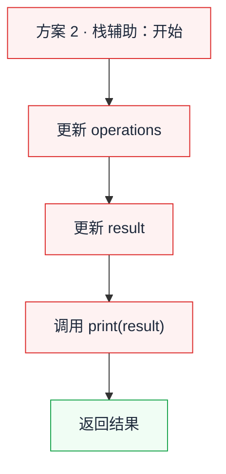

```python
import sys  # 提高递归深度上限（深输入防 RecursionError）

sys.setrecursionlimit(200000)  # 树/链表类题目节点数可达 1e4 量级

def solve():  # 定义函数 solve（参数：无）
    operations = ["5", "2", "C", "D", "+"]  # 把 [「5」,「5」,「5」,「5」,「5」] 存入 operations
    result = calPoints(operations)  # 把 calPoints(operations) 存入 结果
    print(result)  # 打印输出

def calPoints(operations):  # 定义函数 calPoints（参数：operations）
    stack = []  # 把 [] 存入 栈
    for op in operations:  # 逐个取出 operations 的元素（op）
        if op == "C":  # 若 op 等于 「C」
            stack.pop()  # 弹出栈顶元素
        elif op == "D":  # 否则，若 op 等于 「D」
            stack.append(stack[-1] * 2)  # 把 栈[ 减 1] 乘 2 追加到列表尾部
        elif op == "+":  # 否则，若 op 等于 「 加 」
            stack.append(stack[-1] + stack[-2])  # 把 栈[ 减 1] 加 栈[ 减 2] 追加到列表尾部
        else:  # 否则
            stack.append(int(op))  # 把 int(op 追加到列表尾部
    return sum(stack)  # 返回 累计和(栈)

if __name__ == "__main__":  # 若 __name__ 等于 '__main__'
    print(solve())  # 打印输出
```

#### 方案 3：栈辅助

**思路与代码分析**：核心是「栈辅助」。Python 版用切片与字典推导式简化操作，突出可读性。**走读**：方案 3 · 栈辅助：开始 → 更新 operations → 更新 result → 调用 print(result) → 返回结果。

**运行架构**（真实控制流）：


```python
import sys  # 提高递归深度上限（深输入防 RecursionError）

sys.setrecursionlimit(200000)  # 树/链表类题目节点数可达 1e4 量级

def solve():  # 定义函数 solve（参数：无）
    operations = ["5", "2", "C", "D", "+"]  # 把 [「5」,「5」,「5」,「5」,「5」] 存入 operations
    result = calPoints(operations)  # 把 calPoints(operations) 存入 结果
    print(result)  # 打印输出

def calPoints(operations):  # 定义函数 calPoints（参数：operations）
    score = []  # 把 [] 存入 score
    for op in operations:  # 逐个取出 operations 的元素（op）
        if op == "C":  # 若 op 等于 「C」
            score.pop()  # 弹出栈顶元素
        elif op == "D":  # 否则，若 op 等于 「D」
            score.append(score[-1] * 2)  # 把 score[ 减 1] 乘 2 追加到列表尾部
        elif op == "+":  # 否则，若 op 等于 「 加 」
            score.append(score[-1] + score[-2])  # 把 score[ 减 1] 加 score[ 减 2] 追加到列表尾部
        else:  # 否则
            score.append(int(op))  # 把 int(op 追加到列表尾部
    return sum(score)  # 返回 累计和(score)

if __name__ == "__main__":  # 若 __name__ 等于 '__main__'
    print(solve())  # 打印输出
```

#### 方案 4：栈辅助

**思路与代码分析**：核心是「栈辅助」。Python 版用切片与字典推导式简化操作，突出可读性。**走读**：方案 4 · 栈辅助：开始 → 更新 result → 遍历 operations: 中的每个元素 item → 若 item == C：处理 if result: → 若 result：从 result 弹出 → 从 result 弹出 → 更新 = → 向 result 追加记录 → 更新 = → 向 result 追加记录 → 向 result 追加记录 → 返回 sum(result)。

**运行架构**（真实控制流）：

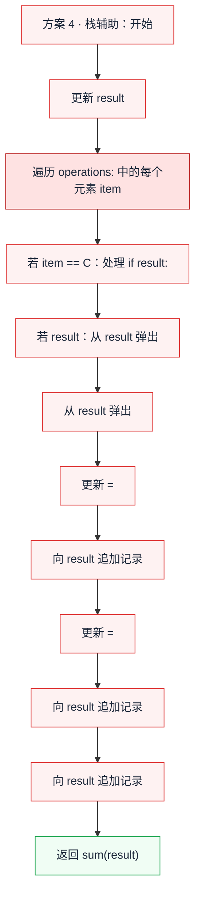

```python
import sys  # 提高递归深度上限（深输入防 RecursionError）

sys.setrecursionlimit(200000)  # 树/链表类题目节点数可达 1e4 量级

def calPoints(operations):  # 定义函数 calPoints（参数：operations）
    result = []  # 把 [] 存入 结果
    for item in operations:  # 逐个取出 operations 的元素（item）
        if item == "C":  # 若 item 等于 「C」
            if result:  # 若 结果
                result.pop()  # 弹出栈顶元素
        elif item == "D":  # 否则，若 item 等于 「D」
            result.append(result[-1] * 2)  # 把 结果[ 减 1] 乘 2 追加到列表尾部
        elif item == "+":  # 否则，若 item 等于 「 加 」
            result.append(result[-1] + result[-2])  # 把 结果[ 减 1] 加 结果[ 减 2] 追加到列表尾部
        else:  # 否则
            result.append(int(item))  # 把 int(item 追加到列表尾部
    return sum(result)  # 返回 累计和(结果)

if __name__ == "__main__":  # 若 __name__ 等于 '__main__'
    print(calPoints(["5", "2", "C", "D", "+"]))  # 打印输出
```

#### 方案 5：栈辅助

**思路与代码分析**：核心是「栈辅助」。Python 版用切片与字典推导式简化操作，突出可读性。**走读**：方案 5 · 栈辅助：开始 → 更新 numStack → 返回 sum(nums) → 更新 operationMap → 从 numStack 弹出 → 向 numStack 追加记录 → 向 numStack 追加记录 → 遍历 operations: 中的每个元素 o → 若 o.lstrip(-).isdigit() or (o.startswith(-) and o[1：处理 ].isdigit()): → 向 numStack 追加记录 → 处理 operationMap[o] () → 返回 sum(numStack)。

**运行架构**（真实控制流）：

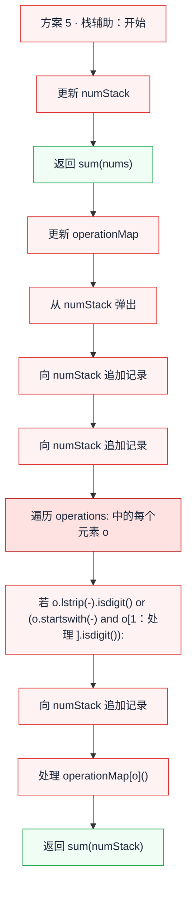

```python
import sys  # 提高递归深度上限（深输入防 RecursionError）

sys.setrecursionlimit(200000)  # 树/链表类题目节点数可达 1e4 量级

def calPoints(operations):  # 定义函数 calPoints（参数：operations）
    numStack = []  # 把 [] 存入 numStack

    def sum_nums(nums):  # 定义函数 sum_nums（参数：数组）
        return sum(nums)  # 返回 累计和(数组)

    operationMap = {  # 把 { 存入 operationMap
        "C": lambda: numStack.pop(),
        "D": lambda: numStack.append(numStack[-1] * 2),
        "+": lambda: numStack.append(sum_nums(numStack[-2:])),
    }

    for o in operations:  # 逐个取出 operations 的元素（o）
        if o.lstrip("-").isdigit() or (o.startswith("-") and o[1:].isdigit()):
            numStack.append(int(o))  # 把 int(o 追加到列表尾部
        else:  # 否则
            operationMap[o]()  # operationMap[o]()

    return sum(numStack)  # 返回 累计和(numStack)

if __name__ == "__main__":  # 若 __name__ 等于 '__main__'
    print(calPoints(["5", "2", "C", "D", "+"]))  # 打印输出
```

#### 方案 6：栈辅助

**思路与代码分析**：核心是「栈辅助」。Python 版用切片与字典推导式简化操作，突出可读性。**走读**：方案 6 · 栈辅助：开始 → 更新 operations → 更新 result → 调用 print(result) → 返回结果。

**运行架构**（真实控制流）：


```python
import sys  # 提高递归深度上限（深输入防 RecursionError）

sys.setrecursionlimit(200000)  # 树/链表类题目节点数可达 1e4 量级

def solve():  # 定义函数 solve（参数：无）
    operations = ["5", "2", "C", "D", "+"]  # 把 [「5」,「5」,「5」,「5」,「5」] 存入 operations
    result = calPoints(operations)  # 把 calPoints(operations) 存入 结果
    print(result)  # 打印输出

def calPoints(operations):  # 定义函数 calPoints（参数：operations）
    record = []  # 把 [] 存入 record
    for op in operations:  # 逐个取出 operations 的元素（op）
        if op == "C":  # 若 op 等于 「C」
            record.pop()  # 弹出栈顶元素
        elif op == "D":  # 否则，若 op 等于 「D」
            record.append(record[-1] * 2)  # 把 record[ 减 1] 乘 2 追加到列表尾部
        elif op == "+":  # 否则，若 op 等于 「 加 」
            record.append(record[-1] + record[-2])  # 把 record[ 减 1] 加 record[ 减 2] 追加到列表尾部
        else:  # 否则
            record.append(int(op))  # 把 int(op 追加到列表尾部
    return sum(record)  # 返回 累计和(record)

if __name__ == "__main__":  # 若 __name__ 等于 '__main__'
    print(solve())  # 打印输出
```

#### 方案 7：栈辅助

**思路与代码分析**：核心是「栈辅助」。Python 版用切片与字典推导式简化操作，突出可读性。**走读**：方案 7 · 栈辅助：开始 → 更新 operations → 更新 result → 调用 print(result) → 返回结果。

**运行架构**（真实控制流）：


```python
import sys  # 提高递归深度上限（深输入防 RecursionError）

sys.setrecursionlimit(200000)  # 树/链表类题目节点数可达 1e4 量级

def solve():  # 定义函数 solve（参数：无）
    operations = ["5", "2", "C", "D", "+"]  # 把 [「5」,「5」,「5」,「5」,「5」] 存入 operations
    result = calPoints(operations)  # 把 calPoints(operations) 存入 结果
    print(result)  # 打印输出

def calPoints(operations):  # 定义函数 calPoints（参数：operations）
    scores = []  # 把 [] 存入 scores
    for op in operations:  # 逐个取出 operations 的元素（op）
        if op == "C":  # 若 op 等于 「C」
            scores.pop()  # 弹出栈顶元素
        elif op == "D":  # 否则，若 op 等于 「D」
            scores.append(scores[-1] * 2)  # 把 scores[ 减 1] 乘 2 追加到列表尾部
        elif op == "+":  # 否则，若 op 等于 「 加 」
            scores.append(scores[-1] + scores[-2])  # 把 scores[ 减 1] 加 scores[ 减 2] 追加到列表尾部
        else:  # 否则
            scores.append(int(op))  # 把 int(op 追加到列表尾部
    return sum(scores)  # 返回 累计和(scores)

if __name__ == "__main__":  # 若 __name__ 等于 '__main__'
    print(solve())  # 打印输出
```

#### 方案 8：栈辅助

**思路与代码分析**：核心是「栈辅助」。Python 版用切片与字典推导式简化操作，突出可读性。**走读**：方案 8 · 栈辅助：开始 → 更新 operations → 更新 result → 调用 print(result) → 返回结果。

**运行架构**（真实控制流）：

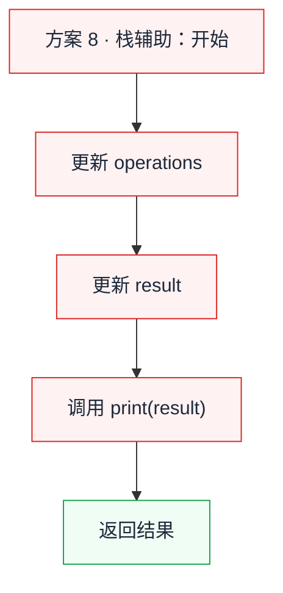

```python
import sys  # 提高递归深度上限（深输入防 RecursionError）

sys.setrecursionlimit(200000)  # 树/链表类题目节点数可达 1e4 量级

def solve():  # 定义函数 solve（参数：无）
    operations = ["5", "2", "C", "D", "+"]  # 把 [「5」,「5」,「5」,「5」,「5」] 存入 operations
    result = calPoints(operations)  # 把 calPoints(operations) 存入 结果
    print(result)  # 打印输出

def calPoints(operations):  # 定义函数 calPoints（参数：operations）
    points = []  # 把 [] 存入 points
    for op in operations:  # 逐个取出 operations 的元素（op）
        if op == "C":  # 若 op 等于 「C」
            points.pop()  # 弹出栈顶元素
        elif op == "D":  # 否则，若 op 等于 「D」
            points.append(points[-1] * 2)  # 把 points[ 减 1] 乘 2 追加到列表尾部
        elif op == "+":  # 否则，若 op 等于 「 加 」
            points.append(points[-1] + points[-2])  # 把 points[ 减 1] 加 points[ 减 2] 追加到列表尾部
        else:  # 否则
            points.append(int(op))  # 把 int(op 追加到列表尾部
    return sum(points)  # 返回 累计和(points)

if __name__ == "__main__":  # 若 __name__ 等于 '__main__'
    print(solve())  # 打印输出
```

#### 方案 9：栈辅助

**思路与代码分析**：核心是「栈辅助」。Python 版用切片与字典推导式简化操作，突出可读性。**走读**：方案 9 · 栈辅助：开始 → 更新 operations → 更新 result → 调用 print(result) → 返回结果。

**运行架构**（真实控制流）：


```python
import sys  # 提高递归深度上限（深输入防 RecursionError）

sys.setrecursionlimit(200000)  # 树/链表类题目节点数可达 1e4 量级

def solve():  # 定义函数 solve（参数：无）
    operations = ["5", "2", "C", "D", "+"]  # 把 [「5」,「5」,「5」,「5」,「5」] 存入 operations
    result = calPoints(operations)  # 把 calPoints(operations) 存入 结果
    print(result)  # 打印输出

def calPoints(operations):  # 定义函数 calPoints（参数：operations）
    history = []  # 把 [] 存入 history
    for op in operations:  # 逐个取出 operations 的元素（op）
        if op == "C":  # 若 op 等于 「C」
            history.pop()  # 弹出栈顶元素
        elif op == "D":  # 否则，若 op 等于 「D」
            history.append(history[-1] * 2)  # 把 history[ 减 1] 乘 2 追加到列表尾部
        elif op == "+":  # 否则，若 op 等于 「 加 」
            history.append(history[-1] + history[-2])  # 把 history[ 减 1] 加 history[ 减 2] 追加到列表尾部
        else:  # 否则
            history.append(int(op))  # 把 int(op 追加到列表尾部
    return sum(history)  # 返回 累计和(history)

if __name__ == "__main__":  # 若 __name__ 等于 '__main__'
    print(solve())  # 打印输出
```

### Go 实现（9 种方案）

Go 的全部方案如下，每个方案都内嵌用例自测，可独立运行（老仓库 python/go 文件遵循「打印结果」约定）：

#### 方案 1：栈辅助

**思路与代码分析**：核心是「栈辅助」。Go 版用切片与多返回值惯用法，显式处理索引边界。**走读**：方案 1 · 栈辅助：开始 → 更新 : → 遍历 operations 的下标与元素 op → 遍历 stack 的下标与元素 v → 返回 sum。

**运行架构**（真实控制流）：

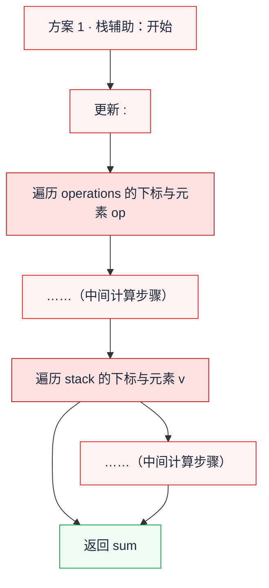

```go
package main // 引入依赖

import (
	"fmt"
	"os"
	"strconv"
) // 引入依赖

func calPoints(operations []string) int { // 定义函数/方法 calPoints
	stack := []int{}                // 把 []int{} 写入 stack :
	for _, op := range operations { // 同时取 _ 与 op 遍历
		switch op { // switch op {
		case "C": // case 「C」:
			stack = stack[:len(stack)-1] // 把 栈[:长度(栈) 减 1] 写入 栈
		case "D": // case 「D」:
			stack = append(stack, stack[len(stack)-1]*2) // 把 append(栈, 栈[长度(栈) 减 1] 乘 2) 写入 栈
		case "+": // case 「 加 」:
			n := len(stack)                              // 把 长度(栈) 写入 n :
			stack = append(stack, stack[n-1]+stack[n-2]) // 把 append(栈, 栈[元素个数 减 1] 加 栈[元素个数 减 2]) 写入 栈
		default: // default:
			v, _ := strconv.Atoi(op) // 把 strconv.Atoi(op) 写入 v, _ :
			stack = append(stack, v) // 把 append(栈, 值) 写入 栈
		}
	}
	sum := 0                  // 把 0 写入 sum :
	for _, v := range stack { // 同时取 _ 与 值 遍历
		sum += v // 累计和累加 值
	}
	return sum // 返回 累计和
}

func main() { // 程序入口：跑内嵌自测用例
	cases := []struct { // 把 []struct { 写入 cases :
		in   []string // in []string
		want int      // want int
	}{ // }{
		{[]string{"5", "2", "C", "D", "+"}, 30},
		{[]string{"5", "-2", "4", "C", "D", "9", "+", "+"}, 27},
	}
	ok := true                // 把 true 写入 ok :
	for _, c := range cases { // 同时取 _ 与 字符 遍历
		if got := calPoints(c.in); got != c.want { // 若 got : 赋值为 calPoints(字符.in); got 不等于 字符.want
			ok = false                                                       // 把 false 写入 ok
			fmt.Printf("FAIL calPoints(%v)=%d want %d\n", c.in, got, c.want) // 打印输出
		}
	}
	if !ok { // 若 取反 ok
		os.Exit(1) // os.Exit(1)
	}
	fmt.Println("PASS") // 全部用例通过，输出 PASS
}
```

#### 方案 2：栈辅助

**思路与代码分析**：核心是「栈辅助」。Go 版用切片与多返回值惯用法，显式处理索引边界。**走读**：方案 2 · 栈辅助：开始 → 更新 : → 遍历 operations 的下标与元素 op → 遍历 stack 的下标与元素 v → 返回 sum。

**运行架构**（真实控制流）：

```mermaid
graph TD
    N0["方案 2 · 栈辅助：开始"]
    N1["更新 :"]
    N2["遍历 operations 的下标与元素 op"]
    D1["……（中间计算步骤）"]
    N15["遍历 stack 的下标与元素 v"]
    D2["……（中间计算步骤）"]
    N17["返回 sum"]
    N0 --> N1
    N1 --> N2
    N15 --> N17
    N2 --> D1
    D1 --> N15
    N15 --> D2
    D2 --> N17
    classDef n fill:#fef2f2,stroke:#dc2626,color:#1e293b;
    classDef lp fill:#fee2e2,stroke:#b91c1c,color:#1e293b;
    classDef dc fill:#fef9c3,stroke:#ca8a04,color:#1e293b;
    classDef tm fill:#f0fdf4,stroke:#16a34a,color:#1e293b;
    class N0,N1,D1,D2 n;
    class N2,N15 lp;
    class N17 tm;
```

```go
package main // 引入依赖

import (
	"fmt"
	"os"
	"strconv"
) // 引入依赖

func calPoints(operations []string) int { // 定义函数/方法 calPoints
	stack := []int{}                // 把 []int{} 写入 stack :
	for _, op := range operations { // 同时取 _ 与 op 遍历
		switch op { // switch op {
		case "C": // case 「C」:
			stack = stack[:len(stack)-1] // 把 栈[:长度(栈) 减 1] 写入 栈
		case "D": // case 「D」:
			stack = append(stack, stack[len(stack)-1]*2) // 把 append(栈, 栈[长度(栈) 减 1] 乘 2) 写入 栈
		case "+": // case 「 加 」:
			n := len(stack)                              // 把 长度(栈) 写入 n :
			stack = append(stack, stack[n-1]+stack[n-2]) // 把 append(栈, 栈[元素个数 减 1] 加 栈[元素个数 减 2]) 写入 栈
		default: // default:
			v, _ := strconv.Atoi(op) // 把 strconv.Atoi(op) 写入 v, _ :
			stack = append(stack, v) // 把 append(栈, 值) 写入 栈
		}
	}
	sum := 0                  // 把 0 写入 sum :
	for _, v := range stack { // 同时取 _ 与 值 遍历
		sum += v // 累计和累加 值
	}
	return sum // 返回 累计和
}

func main() { // 程序入口：跑内嵌自测用例
	cases := []struct { // 把 []struct { 写入 cases :
		in   []string // in []string
		want int      // want int
	}{ // }{
		{[]string{"5", "2", "C", "D", "+"}, 30},
		{[]string{"5", "-2", "4", "C", "D", "9", "+", "+"}, 27},
	}
	ok := true                // 把 true 写入 ok :
	for _, c := range cases { // 同时取 _ 与 字符 遍历
		if got := calPoints(c.in); got != c.want { // 若 got : 赋值为 calPoints(字符.in); got 不等于 字符.want
			ok = false                                                       // 把 false 写入 ok
			fmt.Printf("FAIL calPoints(%v)=%d want %d\n", c.in, got, c.want) // 打印输出
		}
	}
	if !ok { // 若 取反 ok
		os.Exit(1) // os.Exit(1)
	}
	fmt.Println("PASS") // 全部用例通过，输出 PASS
}
```

#### 方案 3：栈辅助

**思路与代码分析**：核心是「栈辅助」。Go 版用切片与多返回值惯用法，显式处理索引边界。**走读**：方案 3 · 栈辅助：开始 → 更新 : → 遍历 operations 的下标与元素 op → 遍历 stack 的下标与元素 v → 返回 sum。

**运行架构**（真实控制流）：

```mermaid
graph TD
    N0["方案 3 · 栈辅助：开始"]
    N1["更新 :"]
    N2["遍历 operations 的下标与元素 op"]
    D1["……（中间计算步骤）"]
    N15["遍历 stack 的下标与元素 v"]
    D2["……（中间计算步骤）"]
    N17["返回 sum"]
    N0 --> N1
    N1 --> N2
    N15 --> N17
    N2 --> D1
    D1 --> N15
    N15 --> D2
    D2 --> N17
    classDef n fill:#fef2f2,stroke:#dc2626,color:#1e293b;
    classDef lp fill:#fee2e2,stroke:#b91c1c,color:#1e293b;
    classDef dc fill:#fef9c3,stroke:#ca8a04,color:#1e293b;
    classDef tm fill:#f0fdf4,stroke:#16a34a,color:#1e293b;
    class N0,N1,D1,D2 n;
    class N2,N15 lp;
    class N17 tm;
```

```go
package main // 引入依赖

import (
	"fmt"
	"os"
	"strconv"
) // 引入依赖

func calPoints(operations []string) int { // 定义函数/方法 calPoints
	stack := []int{}                // 把 []int{} 写入 stack :
	for _, op := range operations { // 同时取 _ 与 op 遍历
		switch op { // switch op {
		case "C": // case 「C」:
			stack = stack[:len(stack)-1] // 把 栈[:长度(栈) 减 1] 写入 栈
		case "D": // case 「D」:
			stack = append(stack, stack[len(stack)-1]*2) // 把 append(栈, 栈[长度(栈) 减 1] 乘 2) 写入 栈
		case "+": // case 「 加 」:
			n := len(stack)                              // 把 长度(栈) 写入 n :
			stack = append(stack, stack[n-1]+stack[n-2]) // 把 append(栈, 栈[元素个数 减 1] 加 栈[元素个数 减 2]) 写入 栈
		default: // default:
			v, _ := strconv.Atoi(op) // 把 strconv.Atoi(op) 写入 v, _ :
			stack = append(stack, v) // 把 append(栈, 值) 写入 栈
		}
	}
	sum := 0                  // 把 0 写入 sum :
	for _, v := range stack { // 同时取 _ 与 值 遍历
		sum += v // 累计和累加 值
	}
	return sum // 返回 累计和
}

func main() { // 程序入口：跑内嵌自测用例
	cases := []struct { // 把 []struct { 写入 cases :
		in   []string // in []string
		want int      // want int
	}{ // }{
		{[]string{"5", "2", "C", "D", "+"}, 30},
		{[]string{"5", "-2", "4", "C", "D", "9", "+", "+"}, 27},
	}
	ok := true                // 把 true 写入 ok :
	for _, c := range cases { // 同时取 _ 与 字符 遍历
		if got := calPoints(c.in); got != c.want { // 若 got : 赋值为 calPoints(字符.in); got 不等于 字符.want
			ok = false                                                       // 把 false 写入 ok
			fmt.Printf("FAIL calPoints(%v)=%d want %d\n", c.in, got, c.want) // 打印输出
		}
	}
	if !ok { // 若 取反 ok
		os.Exit(1) // os.Exit(1)
	}
	fmt.Println("PASS") // 全部用例通过，输出 PASS
}
```

#### 方案 4：栈辅助

**思路与代码分析**：核心是「栈辅助」。Go 版用切片与多返回值惯用法，显式处理索引边界。**走读**：方案 4 · 栈辅助：开始 → 更新 : → 遍历 operations 的下标与元素 op → 遍历 stack 的下标与元素 v → 返回 sum。

**运行架构**（真实控制流）：

```mermaid
graph TD
    N0["方案 4 · 栈辅助：开始"]
    N1["更新 :"]
    N2["遍历 operations 的下标与元素 op"]
    D1["……（中间计算步骤）"]
    N15["遍历 stack 的下标与元素 v"]
    D2["……（中间计算步骤）"]
    N17["返回 sum"]
    N0 --> N1
    N1 --> N2
    N15 --> N17
    N2 --> D1
    D1 --> N15
    N15 --> D2
    D2 --> N17
    classDef n fill:#fef2f2,stroke:#dc2626,color:#1e293b;
    classDef lp fill:#fee2e2,stroke:#b91c1c,color:#1e293b;
    classDef dc fill:#fef9c3,stroke:#ca8a04,color:#1e293b;
    classDef tm fill:#f0fdf4,stroke:#16a34a,color:#1e293b;
    class N0,N1,D1,D2 n;
    class N2,N15 lp;
    class N17 tm;
```

```go
package main // 引入依赖

import (
	"fmt"
	"os"
	"strconv"
) // 引入依赖

func calPoints(operations []string) int { // 定义函数/方法 calPoints
	stack := []int{}                // 把 []int{} 写入 stack :
	for _, op := range operations { // 同时取 _ 与 op 遍历
		switch op { // switch op {
		case "C": // case 「C」:
			stack = stack[:len(stack)-1] // 把 栈[:长度(栈) 减 1] 写入 栈
		case "D": // case 「D」:
			stack = append(stack, stack[len(stack)-1]*2) // 把 append(栈, 栈[长度(栈) 减 1] 乘 2) 写入 栈
		case "+": // case 「 加 」:
			n := len(stack)                              // 把 长度(栈) 写入 n :
			stack = append(stack, stack[n-1]+stack[n-2]) // 把 append(栈, 栈[元素个数 减 1] 加 栈[元素个数 减 2]) 写入 栈
		default: // default:
			v, _ := strconv.Atoi(op) // 把 strconv.Atoi(op) 写入 v, _ :
			stack = append(stack, v) // 把 append(栈, 值) 写入 栈
		}
	}
	sum := 0                  // 把 0 写入 sum :
	for _, v := range stack { // 同时取 _ 与 值 遍历
		sum += v // 累计和累加 值
	}
	return sum // 返回 累计和
}

func main() { // 程序入口：跑内嵌自测用例
	cases := []struct { // 把 []struct { 写入 cases :
		in   []string // in []string
		want int      // want int
	}{ // }{
		{[]string{"5", "2", "C", "D", "+"}, 30},
		{[]string{"5", "-2", "4", "C", "D", "9", "+", "+"}, 27},
	}
	ok := true                // 把 true 写入 ok :
	for _, c := range cases { // 同时取 _ 与 字符 遍历
		if got := calPoints(c.in); got != c.want { // 若 got : 赋值为 calPoints(字符.in); got 不等于 字符.want
			ok = false                                                       // 把 false 写入 ok
			fmt.Printf("FAIL calPoints(%v)=%d want %d\n", c.in, got, c.want) // 打印输出
		}
	}
	if !ok { // 若 取反 ok
		os.Exit(1) // os.Exit(1)
	}
	fmt.Println("PASS") // 全部用例通过，输出 PASS
}
```

#### 方案 5：栈辅助

**思路与代码分析**：核心是「栈辅助」。Go 版用切片与多返回值惯用法，显式处理索引边界。**走读**：方案 5 · 栈辅助：开始 → 更新 : → 遍历 operations 的下标与元素 op → 遍历 stack 的下标与元素 v → 返回 sum。

**运行架构**（真实控制流）：

```mermaid
graph TD
    N0["方案 5 · 栈辅助：开始"]
    N1["更新 :"]
    N2["遍历 operations 的下标与元素 op"]
    D1["……（中间计算步骤）"]
    N15["遍历 stack 的下标与元素 v"]
    D2["……（中间计算步骤）"]
    N17["返回 sum"]
    N0 --> N1
    N1 --> N2
    N15 --> N17
    N2 --> D1
    D1 --> N15
    N15 --> D2
    D2 --> N17
    classDef n fill:#fef2f2,stroke:#dc2626,color:#1e293b;
    classDef lp fill:#fee2e2,stroke:#b91c1c,color:#1e293b;
    classDef dc fill:#fef9c3,stroke:#ca8a04,color:#1e293b;
    classDef tm fill:#f0fdf4,stroke:#16a34a,color:#1e293b;
    class N0,N1,D1,D2 n;
    class N2,N15 lp;
    class N17 tm;
```

```go
package main // 引入依赖

import (
	"fmt"
	"os"
	"strconv"
) // 引入依赖

func calPoints(operations []string) int { // 定义函数/方法 calPoints
	stack := []int{}                // 把 []int{} 写入 stack :
	for _, op := range operations { // 同时取 _ 与 op 遍历
		switch op { // switch op {
		case "C": // case 「C」:
			stack = stack[:len(stack)-1] // 把 栈[:长度(栈) 减 1] 写入 栈
		case "D": // case 「D」:
			stack = append(stack, stack[len(stack)-1]*2) // 把 append(栈, 栈[长度(栈) 减 1] 乘 2) 写入 栈
		case "+": // case 「 加 」:
			n := len(stack)                              // 把 长度(栈) 写入 n :
			stack = append(stack, stack[n-1]+stack[n-2]) // 把 append(栈, 栈[元素个数 减 1] 加 栈[元素个数 减 2]) 写入 栈
		default: // default:
			v, _ := strconv.Atoi(op) // 把 strconv.Atoi(op) 写入 v, _ :
			stack = append(stack, v) // 把 append(栈, 值) 写入 栈
		}
	}
	sum := 0                  // 把 0 写入 sum :
	for _, v := range stack { // 同时取 _ 与 值 遍历
		sum += v // 累计和累加 值
	}
	return sum // 返回 累计和
}

func main() { // 程序入口：跑内嵌自测用例
	cases := []struct { // 把 []struct { 写入 cases :
		in   []string // in []string
		want int      // want int
	}{ // }{
		{[]string{"5", "2", "C", "D", "+"}, 30},
		{[]string{"5", "-2", "4", "C", "D", "9", "+", "+"}, 27},
	}
	ok := true                // 把 true 写入 ok :
	for _, c := range cases { // 同时取 _ 与 字符 遍历
		if got := calPoints(c.in); got != c.want { // 若 got : 赋值为 calPoints(字符.in); got 不等于 字符.want
			ok = false                                                       // 把 false 写入 ok
			fmt.Printf("FAIL calPoints(%v)=%d want %d\n", c.in, got, c.want) // 打印输出
		}
	}
	if !ok { // 若 取反 ok
		os.Exit(1) // os.Exit(1)
	}
	fmt.Println("PASS") // 全部用例通过，输出 PASS
}
```

#### 方案 6：栈辅助

**思路与代码分析**：核心是「栈辅助」。Go 版用切片与多返回值惯用法，显式处理索引边界。**走读**：方案 6 · 栈辅助：开始 → 更新 : → 遍历 operations 的下标与元素 op → 遍历 stack 的下标与元素 v → 返回 sum。

**运行架构**（真实控制流）：

```mermaid
graph TD
    N0["方案 6 · 栈辅助：开始"]
    N1["更新 :"]
    N2["遍历 operations 的下标与元素 op"]
    D1["……（中间计算步骤）"]
    N15["遍历 stack 的下标与元素 v"]
    D2["……（中间计算步骤）"]
    N17["返回 sum"]
    N0 --> N1
    N1 --> N2
    N15 --> N17
    N2 --> D1
    D1 --> N15
    N15 --> D2
    D2 --> N17
    classDef n fill:#fef2f2,stroke:#dc2626,color:#1e293b;
    classDef lp fill:#fee2e2,stroke:#b91c1c,color:#1e293b;
    classDef dc fill:#fef9c3,stroke:#ca8a04,color:#1e293b;
    classDef tm fill:#f0fdf4,stroke:#16a34a,color:#1e293b;
    class N0,N1,D1,D2 n;
    class N2,N15 lp;
    class N17 tm;
```

```go
package main // 引入依赖

import (
	"fmt"
	"os"
	"strconv"
) // 引入依赖

func calPoints(operations []string) int { // 定义函数/方法 calPoints
	stack := []int{}                // 把 []int{} 写入 stack :
	for _, op := range operations { // 同时取 _ 与 op 遍历
		switch op { // switch op {
		case "C": // case 「C」:
			stack = stack[:len(stack)-1] // 把 栈[:长度(栈) 减 1] 写入 栈
		case "D": // case 「D」:
			stack = append(stack, stack[len(stack)-1]*2) // 把 append(栈, 栈[长度(栈) 减 1] 乘 2) 写入 栈
		case "+": // case 「 加 」:
			n := len(stack)                              // 把 长度(栈) 写入 n :
			stack = append(stack, stack[n-1]+stack[n-2]) // 把 append(栈, 栈[元素个数 减 1] 加 栈[元素个数 减 2]) 写入 栈
		default: // default:
			v, _ := strconv.Atoi(op) // 把 strconv.Atoi(op) 写入 v, _ :
			stack = append(stack, v) // 把 append(栈, 值) 写入 栈
		}
	}
	sum := 0                  // 把 0 写入 sum :
	for _, v := range stack { // 同时取 _ 与 值 遍历
		sum += v // 累计和累加 值
	}
	return sum // 返回 累计和
}

func main() { // 程序入口：跑内嵌自测用例
	cases := []struct { // 把 []struct { 写入 cases :
		in   []string // in []string
		want int      // want int
	}{ // }{
		{[]string{"5", "2", "C", "D", "+"}, 30},
		{[]string{"5", "-2", "4", "C", "D", "9", "+", "+"}, 27},
	}
	ok := true                // 把 true 写入 ok :
	for _, c := range cases { // 同时取 _ 与 字符 遍历
		if got := calPoints(c.in); got != c.want { // 若 got : 赋值为 calPoints(字符.in); got 不等于 字符.want
			ok = false                                                       // 把 false 写入 ok
			fmt.Printf("FAIL calPoints(%v)=%d want %d\n", c.in, got, c.want) // 打印输出
		}
	}
	if !ok { // 若 取反 ok
		os.Exit(1) // os.Exit(1)
	}
	fmt.Println("PASS") // 全部用例通过，输出 PASS
}
```

#### 方案 7：栈辅助

**思路与代码分析**：核心是「栈辅助」。Go 版用切片与多返回值惯用法，显式处理索引边界。**走读**：方案 7 · 栈辅助：开始 → 更新 : → 遍历 operations 的下标与元素 op → 遍历 stack 的下标与元素 v → 返回 sum。

**运行架构**（真实控制流）：

```mermaid
graph TD
    N0["方案 7 · 栈辅助：开始"]
    N1["更新 :"]
    N2["遍历 operations 的下标与元素 op"]
    D1["……（中间计算步骤）"]
    N15["遍历 stack 的下标与元素 v"]
    D2["……（中间计算步骤）"]
    N17["返回 sum"]
    N0 --> N1
    N1 --> N2
    N15 --> N17
    N2 --> D1
    D1 --> N15
    N15 --> D2
    D2 --> N17
    classDef n fill:#fef2f2,stroke:#dc2626,color:#1e293b;
    classDef lp fill:#fee2e2,stroke:#b91c1c,color:#1e293b;
    classDef dc fill:#fef9c3,stroke:#ca8a04,color:#1e293b;
    classDef tm fill:#f0fdf4,stroke:#16a34a,color:#1e293b;
    class N0,N1,D1,D2 n;
    class N2,N15 lp;
    class N17 tm;
```

```go
package main // 引入依赖

import (
	"fmt"
	"os"
	"strconv"
) // 引入依赖

func calPoints(operations []string) int { // 定义函数/方法 calPoints
	stack := []int{}                // 把 []int{} 写入 stack :
	for _, op := range operations { // 同时取 _ 与 op 遍历
		switch op { // switch op {
		case "C": // case 「C」:
			stack = stack[:len(stack)-1] // 把 栈[:长度(栈) 减 1] 写入 栈
		case "D": // case 「D」:
			stack = append(stack, stack[len(stack)-1]*2) // 把 append(栈, 栈[长度(栈) 减 1] 乘 2) 写入 栈
		case "+": // case 「 加 」:
			n := len(stack)                              // 把 长度(栈) 写入 n :
			stack = append(stack, stack[n-1]+stack[n-2]) // 把 append(栈, 栈[元素个数 减 1] 加 栈[元素个数 减 2]) 写入 栈
		default: // default:
			v, _ := strconv.Atoi(op) // 把 strconv.Atoi(op) 写入 v, _ :
			stack = append(stack, v) // 把 append(栈, 值) 写入 栈
		}
	}
	sum := 0                  // 把 0 写入 sum :
	for _, v := range stack { // 同时取 _ 与 值 遍历
		sum += v // 累计和累加 值
	}
	return sum // 返回 累计和
}

func main() { // 程序入口：跑内嵌自测用例
	cases := []struct { // 把 []struct { 写入 cases :
		in   []string // in []string
		want int      // want int
	}{ // }{
		{[]string{"5", "2", "C", "D", "+"}, 30},
		{[]string{"5", "-2", "4", "C", "D", "9", "+", "+"}, 27},
	}
	ok := true                // 把 true 写入 ok :
	for _, c := range cases { // 同时取 _ 与 字符 遍历
		if got := calPoints(c.in); got != c.want { // 若 got : 赋值为 calPoints(字符.in); got 不等于 字符.want
			ok = false                                                       // 把 false 写入 ok
			fmt.Printf("FAIL calPoints(%v)=%d want %d\n", c.in, got, c.want) // 打印输出
		}
	}
	if !ok { // 若 取反 ok
		os.Exit(1) // os.Exit(1)
	}
	fmt.Println("PASS") // 全部用例通过，输出 PASS
}
```

#### 方案 8：栈辅助

**思路与代码分析**：核心是「栈辅助」。Go 版用切片与多返回值惯用法，显式处理索引边界。**走读**：方案 8 · 栈辅助：开始 → 更新 : → 遍历 operations 的下标与元素 op → 遍历 stack 的下标与元素 v → 返回 sum。

**运行架构**（真实控制流）：

```mermaid
graph TD
    N0["方案 8 · 栈辅助：开始"]
    N1["更新 :"]
    N2["遍历 operations 的下标与元素 op"]
    D1["……（中间计算步骤）"]
    N15["遍历 stack 的下标与元素 v"]
    D2["……（中间计算步骤）"]
    N17["返回 sum"]
    N0 --> N1
    N1 --> N2
    N15 --> N17
    N2 --> D1
    D1 --> N15
    N15 --> D2
    D2 --> N17
    classDef n fill:#fef2f2,stroke:#dc2626,color:#1e293b;
    classDef lp fill:#fee2e2,stroke:#b91c1c,color:#1e293b;
    classDef dc fill:#fef9c3,stroke:#ca8a04,color:#1e293b;
    classDef tm fill:#f0fdf4,stroke:#16a34a,color:#1e293b;
    class N0,N1,D1,D2 n;
    class N2,N15 lp;
    class N17 tm;
```

```go
package main // 引入依赖

import (
	"fmt"
	"os"
	"strconv"
) // 引入依赖

func calPoints(operations []string) int { // 定义函数/方法 calPoints
	stack := []int{}                // 把 []int{} 写入 stack :
	for _, op := range operations { // 同时取 _ 与 op 遍历
		switch op { // switch op {
		case "C": // case 「C」:
			stack = stack[:len(stack)-1] // 把 栈[:长度(栈) 减 1] 写入 栈
		case "D": // case 「D」:
			stack = append(stack, stack[len(stack)-1]*2) // 把 append(栈, 栈[长度(栈) 减 1] 乘 2) 写入 栈
		case "+": // case 「 加 」:
			n := len(stack)                              // 把 长度(栈) 写入 n :
			stack = append(stack, stack[n-1]+stack[n-2]) // 把 append(栈, 栈[元素个数 减 1] 加 栈[元素个数 减 2]) 写入 栈
		default: // default:
			v, _ := strconv.Atoi(op) // 把 strconv.Atoi(op) 写入 v, _ :
			stack = append(stack, v) // 把 append(栈, 值) 写入 栈
		}
	}
	sum := 0                  // 把 0 写入 sum :
	for _, v := range stack { // 同时取 _ 与 值 遍历
		sum += v // 累计和累加 值
	}
	return sum // 返回 累计和
}

func main() { // 程序入口：跑内嵌自测用例
	cases := []struct { // 把 []struct { 写入 cases :
		in   []string // in []string
		want int      // want int
	}{ // }{
		{[]string{"5", "2", "C", "D", "+"}, 30},
		{[]string{"5", "-2", "4", "C", "D", "9", "+", "+"}, 27},
	}
	ok := true                // 把 true 写入 ok :
	for _, c := range cases { // 同时取 _ 与 字符 遍历
		if got := calPoints(c.in); got != c.want { // 若 got : 赋值为 calPoints(字符.in); got 不等于 字符.want
			ok = false                                                       // 把 false 写入 ok
			fmt.Printf("FAIL calPoints(%v)=%d want %d\n", c.in, got, c.want) // 打印输出
		}
	}
	if !ok { // 若 取反 ok
		os.Exit(1) // os.Exit(1)
	}
	fmt.Println("PASS") // 全部用例通过，输出 PASS
}
```

#### 方案 9：栈辅助

**思路与代码分析**：核心是「栈辅助」。Go 版用切片与多返回值惯用法，显式处理索引边界。**走读**：方案 9 · 栈辅助：开始 → 更新 : → 遍历 operations 的下标与元素 op → 遍历 stack 的下标与元素 v → 返回 sum。

**运行架构**（真实控制流）：

```mermaid
graph TD
    N0["方案 9 · 栈辅助：开始"]
    N1["更新 :"]
    N2["遍历 operations 的下标与元素 op"]
    D1["……（中间计算步骤）"]
    N15["遍历 stack 的下标与元素 v"]
    D2["……（中间计算步骤）"]
    N17["返回 sum"]
    N0 --> N1
    N1 --> N2
    N15 --> N17
    N2 --> D1
    D1 --> N15
    N15 --> D2
    D2 --> N17
    classDef n fill:#fef2f2,stroke:#dc2626,color:#1e293b;
    classDef lp fill:#fee2e2,stroke:#b91c1c,color:#1e293b;
    classDef dc fill:#fef9c3,stroke:#ca8a04,color:#1e293b;
    classDef tm fill:#f0fdf4,stroke:#16a34a,color:#1e293b;
    class N0,N1,D1,D2 n;
    class N2,N15 lp;
    class N17 tm;
```

```go
package main // 引入依赖

import (
	"fmt"
	"os"
	"strconv"
) // 引入依赖

func calPoints(operations []string) int { // 定义函数/方法 calPoints
	stack := []int{}                // 把 []int{} 写入 stack :
	for _, op := range operations { // 同时取 _ 与 op 遍历
		switch op { // switch op {
		case "C": // case 「C」:
			stack = stack[:len(stack)-1] // 把 栈[:长度(栈) 减 1] 写入 栈
		case "D": // case 「D」:
			stack = append(stack, stack[len(stack)-1]*2) // 把 append(栈, 栈[长度(栈) 减 1] 乘 2) 写入 栈
		case "+": // case 「 加 」:
			n := len(stack)                              // 把 长度(栈) 写入 n :
			stack = append(stack, stack[n-1]+stack[n-2]) // 把 append(栈, 栈[元素个数 减 1] 加 栈[元素个数 减 2]) 写入 栈
		default: // default:
			v, _ := strconv.Atoi(op) // 把 strconv.Atoi(op) 写入 v, _ :
			stack = append(stack, v) // 把 append(栈, 值) 写入 栈
		}
	}
	sum := 0                  // 把 0 写入 sum :
	for _, v := range stack { // 同时取 _ 与 值 遍历
		sum += v // 累计和累加 值
	}
	return sum // 返回 累计和
}

func main() { // 程序入口：跑内嵌自测用例
	cases := []struct { // 把 []struct { 写入 cases :
		in   []string // in []string
		want int      // want int
	}{ // }{
		{[]string{"5", "2", "C", "D", "+"}, 30},
		{[]string{"5", "-2", "4", "C", "D", "9", "+", "+"}, 27},
	}
	ok := true                // 把 true 写入 ok :
	for _, c := range cases { // 同时取 _ 与 字符 遍历
		if got := calPoints(c.in); got != c.want { // 若 got : 赋值为 calPoints(字符.in); got 不等于 字符.want
			ok = false                                                       // 把 false 写入 ok
			fmt.Printf("FAIL calPoints(%v)=%d want %d\n", c.in, got, c.want) // 打印输出
		}
	}
	if !ok { // 若 取反 ok
		os.Exit(1) // os.Exit(1)
	}
	fmt.Println("PASS") // 全部用例通过，输出 PASS
}
```

### Java 实现（9 种方案）

Java 的全部方案如下，每个方案都内嵌用例自测，可独立运行（老仓库 python/go 文件遵循「打印结果」约定）：

#### 方案 1：栈辅助

**思路与代码分析**：核心是「栈辅助」。Java 版用类与静态方法组织，集合操作显式明了。代码里依次做这些事：双重循环遍历。**走读**：方案 1 · 栈辅助：开始 → 更新 stack → 遍历循环 → 若 op.equals(C) 则： → 调用 stack.remove(stack.size() - → 调用 stack.add(stack.get(stack.si → 更新 n → 调用 stack.add(stack.get(n - 1) + → 调用 stack.add(Integer.parseInt(o → 更新 sum → 遍历循环 → 返回 sum。

**运行架构**（真实控制流）：

```mermaid
graph TD
    N0["方案 1 · 栈辅助：开始"]
    N1["更新 stack"]
    N2["遍历循环"]
    N3["若 op.equals(C) 则："]
    N4["调用 stack.remove(stack.size() -"]
    N5["调用 stack.add(stack.get(stack.si"]
    N6["更新 n"]
    N7["调用 stack.add(stack.get(n - 1) +"]
    N8["调用 stack.add(Integer.parseInt(o"]
    N9["更新 sum"]
    N10["遍历循环"]
    N11["返回 sum"]
    N0 --> N1
    N1 --> N2
    N2 --> N3
    N3 --> N4
    N4 --> N5
    N5 --> N6
    N6 --> N7
    N7 --> N8
    N8 -- 下一轮 --> N2
    N2 --> N9
    N9 --> N10
    N10 --> N11
    classDef n fill:#fef2f2,stroke:#dc2626,color:#1e293b;
    classDef lp fill:#fee2e2,stroke:#b91c1c,color:#1e293b;
    classDef dc fill:#fef9c3,stroke:#ca8a04,color:#1e293b;
    classDef tm fill:#f0fdf4,stroke:#16a34a,color:#1e293b;
    class N0,N1,N3,N4,N5,N6,N7,N8,N9 n;
    class N2,N10 lp;
    class N11 tm;
```

```java
package com.webfault.dsa; // 引入依赖

class Lc682 { // 定义类型
  int calPoints(String[] operations) { // 定义函数/方法 calPoints
    java.util.ArrayList<Integer> stack = new java.util.ArrayList<Integer>();
    for (String op : operations) { // for (String op : operations) {
      if (op.equals("C")) { // 若 op.equals(「C」
        stack.remove(stack.size() - 1); // 栈 弹出 栈.大小() 减 1);
      } else if (op.equals("D")) { // 否则，若 op.equals(「D」
        stack.add(stack.get(stack.size() - 1) * 2); // 栈 追加 栈 查找 栈.大小() 减 1) 乘 2);
      } else if (op.equals("+")) { // 否则，若 op.equals(「 加 」
        int n = stack.size(); // 把 栈.大小() 存入 元素个数
        stack.add(stack.get(n - 1) + stack.get(n - 2)); // 栈 追加 栈 查找 元素个数 减 1) 加 栈 查找 元素个数 减 2));
      } else { // 否则
        stack.add(Integer.parseInt(op)); // 栈 追加 Integer.转整数(op));
      }
    }
    int sum = 0; // 把 0 存入 累计和
    for (int v : stack) sum += v; // 把 值; 写入 for (int v : stack) sum +
    return sum; // 返回 累计和
  }

  public static void main(String[] args) { // public static void main(String[] args) {
    Lc682 s = new Lc682(); // 把 new Lc682(); 写入 Lc682 s
    boolean ok = true; // 把 true; 写入 boolean ok
    if (s.calPoints(new String[] {"5", "2", "C", "D", "+"}) != 30) {
      ok = false;
      System.out.println("FAIL1");
    }
    if (s.calPoints(new String[] {"5", "-2", "4", "C", "D", "9", "+", "+"}) != 27) {
      ok = false;
      System.out.println("FAIL2");
    }
    if (!ok) throw new RuntimeException("FAILED"); // 若 取反 ok) throw new RuntimeException(「FAILED」);
    System.out.println("PASS"); // 全部用例通过，输出 PASS
  }
}
```

#### 方案 2：栈辅助

**思路与代码分析**：核心是「栈辅助」。Java 版用类与静态方法组织，集合操作显式明了。代码里依次做这些事：双重循环遍历。**走读**：方案 2 · 栈辅助：开始 → 更新 stack → 遍历循环 → 若 op.equals(C) 则： → 调用 stack.remove(stack.size() - → 调用 stack.add(stack.get(stack.si → 更新 n → 调用 stack.add(stack.get(n - 1) + → 调用 stack.add(Integer.parseInt(o → 更新 sum → 遍历循环 → 返回 sum。

**运行架构**（真实控制流）：

```mermaid
graph TD
    N0["方案 2 · 栈辅助：开始"]
    N1["更新 stack"]
    N2["遍历循环"]
    N3["若 op.equals(C) 则："]
    N4["调用 stack.remove(stack.size() -"]
    N5["调用 stack.add(stack.get(stack.si"]
    N6["更新 n"]
    N7["调用 stack.add(stack.get(n - 1) +"]
    N8["调用 stack.add(Integer.parseInt(o"]
    N9["更新 sum"]
    N10["遍历循环"]
    N11["返回 sum"]
    N0 --> N1
    N1 --> N2
    N2 --> N3
    N3 --> N4
    N4 --> N5
    N5 --> N6
    N6 --> N7
    N7 --> N8
    N8 -- 下一轮 --> N2
    N2 --> N9
    N9 --> N10
    N10 --> N11
    classDef n fill:#fef2f2,stroke:#dc2626,color:#1e293b;
    classDef lp fill:#fee2e2,stroke:#b91c1c,color:#1e293b;
    classDef dc fill:#fef9c3,stroke:#ca8a04,color:#1e293b;
    classDef tm fill:#f0fdf4,stroke:#16a34a,color:#1e293b;
    class N0,N1,N3,N4,N5,N6,N7,N8,N9 n;
    class N2,N10 lp;
    class N11 tm;
```

```java
package com.webfault.dsa; // 引入依赖

class Lc682 { // 定义类型
  int calPoints(String[] operations) { // 定义函数/方法 calPoints
    java.util.ArrayList<Integer> stack = new java.util.ArrayList<Integer>();
    for (String op : operations) { // for (String op : operations) {
      if (op.equals("C")) { // 若 op.equals(「C」
        stack.remove(stack.size() - 1); // 栈 弹出 栈.大小() 减 1);
      } else if (op.equals("D")) { // 否则，若 op.equals(「D」
        stack.add(stack.get(stack.size() - 1) * 2); // 栈 追加 栈 查找 栈.大小() 减 1) 乘 2);
      } else if (op.equals("+")) { // 否则，若 op.equals(「 加 」
        int n = stack.size(); // 把 栈.大小() 存入 元素个数
        stack.add(stack.get(n - 1) + stack.get(n - 2)); // 栈 追加 栈 查找 元素个数 减 1) 加 栈 查找 元素个数 减 2));
      } else { // 否则
        stack.add(Integer.parseInt(op)); // 栈 追加 Integer.转整数(op));
      }
    }
    int sum = 0; // 把 0 存入 累计和
    for (int v : stack) sum += v; // 把 值; 写入 for (int v : stack) sum +
    return sum; // 返回 累计和
  }

  public static void main(String[] args) { // public static void main(String[] args) {
    Lc682 s = new Lc682(); // 把 new Lc682(); 写入 Lc682 s
    boolean ok = true; // 把 true; 写入 boolean ok
    if (s.calPoints(new String[] {"5", "2", "C", "D", "+"}) != 30) {
      ok = false;
      System.out.println("FAIL1");
    }
    if (s.calPoints(new String[] {"5", "-2", "4", "C", "D", "9", "+", "+"}) != 27) {
      ok = false;
      System.out.println("FAIL2");
    }
    if (!ok) throw new RuntimeException("FAILED"); // 若 取反 ok) throw new RuntimeException(「FAILED」);
    System.out.println("PASS"); // 全部用例通过，输出 PASS
  }
}
```

#### 方案 3：栈辅助

**思路与代码分析**：核心是「栈辅助」。Java 版用类与静态方法组织，集合操作显式明了。代码里依次做这些事：双重循环遍历。**走读**：方案 3 · 栈辅助：开始 → 更新 stack → 遍历循环 → 若 op.equals(C) 则： → 调用 stack.remove(stack.size() - → 调用 stack.add(stack.get(stack.si → 更新 n → 调用 stack.add(stack.get(n - 1) + → 调用 stack.add(Integer.parseInt(o → 更新 sum → 遍历循环 → 返回 sum。

**运行架构**（真实控制流）：

```mermaid
graph TD
    N0["方案 3 · 栈辅助：开始"]
    N1["更新 stack"]
    N2["遍历循环"]
    N3["若 op.equals(C) 则："]
    N4["调用 stack.remove(stack.size() -"]
    N5["调用 stack.add(stack.get(stack.si"]
    N6["更新 n"]
    N7["调用 stack.add(stack.get(n - 1) +"]
    N8["调用 stack.add(Integer.parseInt(o"]
    N9["更新 sum"]
    N10["遍历循环"]
    N11["返回 sum"]
    N0 --> N1
    N1 --> N2
    N2 --> N3
    N3 --> N4
    N4 --> N5
    N5 --> N6
    N6 --> N7
    N7 --> N8
    N8 -- 下一轮 --> N2
    N2 --> N9
    N9 --> N10
    N10 --> N11
    classDef n fill:#fef2f2,stroke:#dc2626,color:#1e293b;
    classDef lp fill:#fee2e2,stroke:#b91c1c,color:#1e293b;
    classDef dc fill:#fef9c3,stroke:#ca8a04,color:#1e293b;
    classDef tm fill:#f0fdf4,stroke:#16a34a,color:#1e293b;
    class N0,N1,N3,N4,N5,N6,N7,N8,N9 n;
    class N2,N10 lp;
    class N11 tm;
```

```java
package com.webfault.dsa; // 引入依赖

class Lc682 { // 定义类型
  int calPoints(String[] operations) { // 定义函数/方法 calPoints
    java.util.ArrayList<Integer> stack = new java.util.ArrayList<Integer>();
    for (String op : operations) { // for (String op : operations) {
      if (op.equals("C")) { // 若 op.equals(「C」
        stack.remove(stack.size() - 1); // 栈 弹出 栈.大小() 减 1);
      } else if (op.equals("D")) { // 否则，若 op.equals(「D」
        stack.add(stack.get(stack.size() - 1) * 2); // 栈 追加 栈 查找 栈.大小() 减 1) 乘 2);
      } else if (op.equals("+")) { // 否则，若 op.equals(「 加 」
        int n = stack.size(); // 把 栈.大小() 存入 元素个数
        stack.add(stack.get(n - 1) + stack.get(n - 2)); // 栈 追加 栈 查找 元素个数 减 1) 加 栈 查找 元素个数 减 2));
      } else { // 否则
        stack.add(Integer.parseInt(op)); // 栈 追加 Integer.转整数(op));
      }
    }
    int sum = 0; // 把 0 存入 累计和
    for (int v : stack) sum += v; // 把 值; 写入 for (int v : stack) sum +
    return sum; // 返回 累计和
  }

  public static void main(String[] args) { // public static void main(String[] args) {
    Lc682 s = new Lc682(); // 把 new Lc682(); 写入 Lc682 s
    boolean ok = true; // 把 true; 写入 boolean ok
    if (s.calPoints(new String[] {"5", "2", "C", "D", "+"}) != 30) {
      ok = false;
      System.out.println("FAIL1");
    }
    if (s.calPoints(new String[] {"5", "-2", "4", "C", "D", "9", "+", "+"}) != 27) {
      ok = false;
      System.out.println("FAIL2");
    }
    if (!ok) throw new RuntimeException("FAILED"); // 若 取反 ok) throw new RuntimeException(「FAILED」);
    System.out.println("PASS"); // 全部用例通过，输出 PASS
  }
}
```

#### 方案 4：栈辅助

**思路与代码分析**：核心是「栈辅助」。Java 版用类与静态方法组织，集合操作显式明了。代码里依次做这些事：双重循环遍历。**走读**：方案 4 · 栈辅助：开始 → 更新 stack → 遍历循环 → 若 op.equals(C) 则： → 调用 stack.remove(stack.size() - → 调用 stack.add(stack.get(stack.si → 更新 n → 调用 stack.add(stack.get(n - 1) + → 调用 stack.add(Integer.parseInt(o → 更新 sum → 遍历循环 → 返回 sum。

**运行架构**（真实控制流）：

```mermaid
graph TD
    N0["方案 4 · 栈辅助：开始"]
    N1["更新 stack"]
    N2["遍历循环"]
    N3["若 op.equals(C) 则："]
    N4["调用 stack.remove(stack.size() -"]
    N5["调用 stack.add(stack.get(stack.si"]
    N6["更新 n"]
    N7["调用 stack.add(stack.get(n - 1) +"]
    N8["调用 stack.add(Integer.parseInt(o"]
    N9["更新 sum"]
    N10["遍历循环"]
    N11["返回 sum"]
    N0 --> N1
    N1 --> N2
    N2 --> N3
    N3 --> N4
    N4 --> N5
    N5 --> N6
    N6 --> N7
    N7 --> N8
    N8 -- 下一轮 --> N2
    N2 --> N9
    N9 --> N10
    N10 --> N11
    classDef n fill:#fef2f2,stroke:#dc2626,color:#1e293b;
    classDef lp fill:#fee2e2,stroke:#b91c1c,color:#1e293b;
    classDef dc fill:#fef9c3,stroke:#ca8a04,color:#1e293b;
    classDef tm fill:#f0fdf4,stroke:#16a34a,color:#1e293b;
    class N0,N1,N3,N4,N5,N6,N7,N8,N9 n;
    class N2,N10 lp;
    class N11 tm;
```

```java
package com.webfault.dsa; // 引入依赖

class Lc682 { // 定义类型
  int calPoints(String[] operations) { // 定义函数/方法 calPoints
    java.util.ArrayList<Integer> stack = new java.util.ArrayList<Integer>();
    for (String op : operations) { // for (String op : operations) {
      if (op.equals("C")) { // 若 op.equals(「C」
        stack.remove(stack.size() - 1); // 栈 弹出 栈.大小() 减 1);
      } else if (op.equals("D")) { // 否则，若 op.equals(「D」
        stack.add(stack.get(stack.size() - 1) * 2); // 栈 追加 栈 查找 栈.大小() 减 1) 乘 2);
      } else if (op.equals("+")) { // 否则，若 op.equals(「 加 」
        int n = stack.size(); // 把 栈.大小() 存入 元素个数
        stack.add(stack.get(n - 1) + stack.get(n - 2)); // 栈 追加 栈 查找 元素个数 减 1) 加 栈 查找 元素个数 减 2));
      } else { // 否则
        stack.add(Integer.parseInt(op)); // 栈 追加 Integer.转整数(op));
      }
    }
    int sum = 0; // 把 0 存入 累计和
    for (int v : stack) sum += v; // 把 值; 写入 for (int v : stack) sum +
    return sum; // 返回 累计和
  }

  public static void main(String[] args) { // public static void main(String[] args) {
    Lc682 s = new Lc682(); // 把 new Lc682(); 写入 Lc682 s
    boolean ok = true; // 把 true; 写入 boolean ok
    if (s.calPoints(new String[] {"5", "2", "C", "D", "+"}) != 30) {
      ok = false;
      System.out.println("FAIL1");
    }
    if (s.calPoints(new String[] {"5", "-2", "4", "C", "D", "9", "+", "+"}) != 27) {
      ok = false;
      System.out.println("FAIL2");
    }
    if (!ok) throw new RuntimeException("FAILED"); // 若 取反 ok) throw new RuntimeException(「FAILED」);
    System.out.println("PASS"); // 全部用例通过，输出 PASS
  }
}
```

#### 方案 5：栈辅助

**思路与代码分析**：核心是「栈辅助」。Java 版用类与静态方法组织，集合操作显式明了。代码里依次做这些事：双重循环遍历。**走读**：方案 5 · 栈辅助：开始 → 更新 stack → 遍历循环 → 若 op.equals(C) 则： → 调用 stack.remove(stack.size() - → 调用 stack.add(stack.get(stack.si → 更新 n → 调用 stack.add(stack.get(n - 1) + → 调用 stack.add(Integer.parseInt(o → 更新 sum → 遍历循环 → 返回 sum。

**运行架构**（真实控制流）：

```mermaid
graph TD
    N0["方案 5 · 栈辅助：开始"]
    N1["更新 stack"]
    N2["遍历循环"]
    N3["若 op.equals(C) 则："]
    N4["调用 stack.remove(stack.size() -"]
    N5["调用 stack.add(stack.get(stack.si"]
    N6["更新 n"]
    N7["调用 stack.add(stack.get(n - 1) +"]
    N8["调用 stack.add(Integer.parseInt(o"]
    N9["更新 sum"]
    N10["遍历循环"]
    N11["返回 sum"]
    N0 --> N1
    N1 --> N2
    N2 --> N3
    N3 --> N4
    N4 --> N5
    N5 --> N6
    N6 --> N7
    N7 --> N8
    N8 -- 下一轮 --> N2
    N2 --> N9
    N9 --> N10
    N10 --> N11
    classDef n fill:#fef2f2,stroke:#dc2626,color:#1e293b;
    classDef lp fill:#fee2e2,stroke:#b91c1c,color:#1e293b;
    classDef dc fill:#fef9c3,stroke:#ca8a04,color:#1e293b;
    classDef tm fill:#f0fdf4,stroke:#16a34a,color:#1e293b;
    class N0,N1,N3,N4,N5,N6,N7,N8,N9 n;
    class N2,N10 lp;
    class N11 tm;
```

```java
package com.webfault.dsa; // 引入依赖

class Lc682 { // 定义类型
  int calPoints(String[] operations) { // 定义函数/方法 calPoints
    java.util.ArrayList<Integer> stack = new java.util.ArrayList<Integer>();
    for (String op : operations) { // for (String op : operations) {
      if (op.equals("C")) { // 若 op.equals(「C」
        stack.remove(stack.size() - 1); // 栈 弹出 栈.大小() 减 1);
      } else if (op.equals("D")) { // 否则，若 op.equals(「D」
        stack.add(stack.get(stack.size() - 1) * 2); // 栈 追加 栈 查找 栈.大小() 减 1) 乘 2);
      } else if (op.equals("+")) { // 否则，若 op.equals(「 加 」
        int n = stack.size(); // 把 栈.大小() 存入 元素个数
        stack.add(stack.get(n - 1) + stack.get(n - 2)); // 栈 追加 栈 查找 元素个数 减 1) 加 栈 查找 元素个数 减 2));
      } else { // 否则
        stack.add(Integer.parseInt(op)); // 栈 追加 Integer.转整数(op));
      }
    }
    int sum = 0; // 把 0 存入 累计和
    for (int v : stack) sum += v; // 把 值; 写入 for (int v : stack) sum +
    return sum; // 返回 累计和
  }

  public static void main(String[] args) { // public static void main(String[] args) {
    Lc682 s = new Lc682(); // 把 new Lc682(); 写入 Lc682 s
    boolean ok = true; // 把 true; 写入 boolean ok
    if (s.calPoints(new String[] {"5", "2", "C", "D", "+"}) != 30) {
      ok = false;
      System.out.println("FAIL1");
    }
    if (s.calPoints(new String[] {"5", "-2", "4", "C", "D", "9", "+", "+"}) != 27) {
      ok = false;
      System.out.println("FAIL2");
    }
    if (!ok) throw new RuntimeException("FAILED"); // 若 取反 ok) throw new RuntimeException(「FAILED」);
    System.out.println("PASS"); // 全部用例通过，输出 PASS
  }
}
```

#### 方案 6：栈辅助

**思路与代码分析**：核心是「栈辅助」。Java 版用类与静态方法组织，集合操作显式明了。代码里依次做这些事：双重循环遍历。**走读**：方案 6 · 栈辅助：开始 → 更新 stack → 遍历循环 → 若 op.equals(C) 则： → 调用 stack.remove(stack.size() - → 调用 stack.add(stack.get(stack.si → 更新 n → 调用 stack.add(stack.get(n - 1) + → 调用 stack.add(Integer.parseInt(o → 更新 sum → 遍历循环 → 返回 sum。

**运行架构**（真实控制流）：

```mermaid
graph TD
    N0["方案 6 · 栈辅助：开始"]
    N1["更新 stack"]
    N2["遍历循环"]
    N3["若 op.equals(C) 则："]
    N4["调用 stack.remove(stack.size() -"]
    N5["调用 stack.add(stack.get(stack.si"]
    N6["更新 n"]
    N7["调用 stack.add(stack.get(n - 1) +"]
    N8["调用 stack.add(Integer.parseInt(o"]
    N9["更新 sum"]
    N10["遍历循环"]
    N11["返回 sum"]
    N0 --> N1
    N1 --> N2
    N2 --> N3
    N3 --> N4
    N4 --> N5
    N5 --> N6
    N6 --> N7
    N7 --> N8
    N8 -- 下一轮 --> N2
    N2 --> N9
    N9 --> N10
    N10 --> N11
    classDef n fill:#fef2f2,stroke:#dc2626,color:#1e293b;
    classDef lp fill:#fee2e2,stroke:#b91c1c,color:#1e293b;
    classDef dc fill:#fef9c3,stroke:#ca8a04,color:#1e293b;
    classDef tm fill:#f0fdf4,stroke:#16a34a,color:#1e293b;
    class N0,N1,N3,N4,N5,N6,N7,N8,N9 n;
    class N2,N10 lp;
    class N11 tm;
```

```java
package com.webfault.dsa; // 引入依赖

class Lc682 { // 定义类型
  int calPoints(String[] operations) { // 定义函数/方法 calPoints
    java.util.ArrayList<Integer> stack = new java.util.ArrayList<Integer>();
    for (String op : operations) { // for (String op : operations) {
      if (op.equals("C")) { // 若 op.equals(「C」
        stack.remove(stack.size() - 1); // 栈 弹出 栈.大小() 减 1);
      } else if (op.equals("D")) { // 否则，若 op.equals(「D」
        stack.add(stack.get(stack.size() - 1) * 2); // 栈 追加 栈 查找 栈.大小() 减 1) 乘 2);
      } else if (op.equals("+")) { // 否则，若 op.equals(「 加 」
        int n = stack.size(); // 把 栈.大小() 存入 元素个数
        stack.add(stack.get(n - 1) + stack.get(n - 2)); // 栈 追加 栈 查找 元素个数 减 1) 加 栈 查找 元素个数 减 2));
      } else { // 否则
        stack.add(Integer.parseInt(op)); // 栈 追加 Integer.转整数(op));
      }
    }
    int sum = 0; // 把 0 存入 累计和
    for (int v : stack) sum += v; // 把 值; 写入 for (int v : stack) sum +
    return sum; // 返回 累计和
  }

  public static void main(String[] args) { // public static void main(String[] args) {
    Lc682 s = new Lc682(); // 把 new Lc682(); 写入 Lc682 s
    boolean ok = true; // 把 true; 写入 boolean ok
    if (s.calPoints(new String[] {"5", "2", "C", "D", "+"}) != 30) {
      ok = false;
      System.out.println("FAIL1");
    }
    if (s.calPoints(new String[] {"5", "-2", "4", "C", "D", "9", "+", "+"}) != 27) {
      ok = false;
      System.out.println("FAIL2");
    }
    if (!ok) throw new RuntimeException("FAILED"); // 若 取反 ok) throw new RuntimeException(「FAILED」);
    System.out.println("PASS"); // 全部用例通过，输出 PASS
  }
}
```

#### 方案 7：栈辅助

**思路与代码分析**：核心是「栈辅助」。Java 版用类与静态方法组织，集合操作显式明了。代码里依次做这些事：双重循环遍历。**走读**：方案 7 · 栈辅助：开始 → 更新 stack → 遍历循环 → 若 op.equals(C) 则： → 调用 stack.remove(stack.size() - → 调用 stack.add(stack.get(stack.si → 更新 n → 调用 stack.add(stack.get(n - 1) + → 调用 stack.add(Integer.parseInt(o → 更新 sum → 遍历循环 → 返回 sum。

**运行架构**（真实控制流）：

```mermaid
graph TD
    N0["方案 7 · 栈辅助：开始"]
    N1["更新 stack"]
    N2["遍历循环"]
    N3["若 op.equals(C) 则："]
    N4["调用 stack.remove(stack.size() -"]
    N5["调用 stack.add(stack.get(stack.si"]
    N6["更新 n"]
    N7["调用 stack.add(stack.get(n - 1) +"]
    N8["调用 stack.add(Integer.parseInt(o"]
    N9["更新 sum"]
    N10["遍历循环"]
    N11["返回 sum"]
    N0 --> N1
    N1 --> N2
    N2 --> N3
    N3 --> N4
    N4 --> N5
    N5 --> N6
    N6 --> N7
    N7 --> N8
    N8 -- 下一轮 --> N2
    N2 --> N9
    N9 --> N10
    N10 --> N11
    classDef n fill:#fef2f2,stroke:#dc2626,color:#1e293b;
    classDef lp fill:#fee2e2,stroke:#b91c1c,color:#1e293b;
    classDef dc fill:#fef9c3,stroke:#ca8a04,color:#1e293b;
    classDef tm fill:#f0fdf4,stroke:#16a34a,color:#1e293b;
    class N0,N1,N3,N4,N5,N6,N7,N8,N9 n;
    class N2,N10 lp;
    class N11 tm;
```

```java
package com.webfault.dsa; // 引入依赖

class Lc682 { // 定义类型
  int calPoints(String[] operations) { // 定义函数/方法 calPoints
    java.util.ArrayList<Integer> stack = new java.util.ArrayList<Integer>();
    for (String op : operations) { // for (String op : operations) {
      if (op.equals("C")) { // 若 op.equals(「C」
        stack.remove(stack.size() - 1); // 栈 弹出 栈.大小() 减 1);
      } else if (op.equals("D")) { // 否则，若 op.equals(「D」
        stack.add(stack.get(stack.size() - 1) * 2); // 栈 追加 栈 查找 栈.大小() 减 1) 乘 2);
      } else if (op.equals("+")) { // 否则，若 op.equals(「 加 」
        int n = stack.size(); // 把 栈.大小() 存入 元素个数
        stack.add(stack.get(n - 1) + stack.get(n - 2)); // 栈 追加 栈 查找 元素个数 减 1) 加 栈 查找 元素个数 减 2));
      } else { // 否则
        stack.add(Integer.parseInt(op)); // 栈 追加 Integer.转整数(op));
      }
    }
    int sum = 0; // 把 0 存入 累计和
    for (int v : stack) sum += v; // 把 值; 写入 for (int v : stack) sum +
    return sum; // 返回 累计和
  }

  public static void main(String[] args) { // public static void main(String[] args) {
    Lc682 s = new Lc682(); // 把 new Lc682(); 写入 Lc682 s
    boolean ok = true; // 把 true; 写入 boolean ok
    if (s.calPoints(new String[] {"5", "2", "C", "D", "+"}) != 30) {
      ok = false;
      System.out.println("FAIL1");
    }
    if (s.calPoints(new String[] {"5", "-2", "4", "C", "D", "9", "+", "+"}) != 27) {
      ok = false;
      System.out.println("FAIL2");
    }
    if (!ok) throw new RuntimeException("FAILED"); // 若 取反 ok) throw new RuntimeException(「FAILED」);
    System.out.println("PASS"); // 全部用例通过，输出 PASS
  }
}
```

#### 方案 8：栈辅助

**思路与代码分析**：核心是「栈辅助」。Java 版用类与静态方法组织，集合操作显式明了。代码里依次做这些事：双重循环遍历。**走读**：方案 8 · 栈辅助：开始 → 更新 stack → 遍历循环 → 若 op.equals(C) 则： → 调用 stack.remove(stack.size() - → 调用 stack.add(stack.get(stack.si → 更新 n → 调用 stack.add(stack.get(n - 1) + → 调用 stack.add(Integer.parseInt(o → 更新 sum → 遍历循环 → 返回 sum。

**运行架构**（真实控制流）：

```mermaid
graph TD
    N0["方案 8 · 栈辅助：开始"]
    N1["更新 stack"]
    N2["遍历循环"]
    N3["若 op.equals(C) 则："]
    N4["调用 stack.remove(stack.size() -"]
    N5["调用 stack.add(stack.get(stack.si"]
    N6["更新 n"]
    N7["调用 stack.add(stack.get(n - 1) +"]
    N8["调用 stack.add(Integer.parseInt(o"]
    N9["更新 sum"]
    N10["遍历循环"]
    N11["返回 sum"]
    N0 --> N1
    N1 --> N2
    N2 --> N3
    N3 --> N4
    N4 --> N5
    N5 --> N6
    N6 --> N7
    N7 --> N8
    N8 -- 下一轮 --> N2
    N2 --> N9
    N9 --> N10
    N10 --> N11
    classDef n fill:#fef2f2,stroke:#dc2626,color:#1e293b;
    classDef lp fill:#fee2e2,stroke:#b91c1c,color:#1e293b;
    classDef dc fill:#fef9c3,stroke:#ca8a04,color:#1e293b;
    classDef tm fill:#f0fdf4,stroke:#16a34a,color:#1e293b;
    class N0,N1,N3,N4,N5,N6,N7,N8,N9 n;
    class N2,N10 lp;
    class N11 tm;
```

```java
package com.webfault.dsa; // 引入依赖

class Lc682 { // 定义类型
  int calPoints(String[] operations) { // 定义函数/方法 calPoints
    java.util.ArrayList<Integer> stack = new java.util.ArrayList<Integer>();
    for (String op : operations) { // for (String op : operations) {
      if (op.equals("C")) { // 若 op.equals(「C」
        stack.remove(stack.size() - 1); // 栈 弹出 栈.大小() 减 1);
      } else if (op.equals("D")) { // 否则，若 op.equals(「D」
        stack.add(stack.get(stack.size() - 1) * 2); // 栈 追加 栈 查找 栈.大小() 减 1) 乘 2);
      } else if (op.equals("+")) { // 否则，若 op.equals(「 加 」
        int n = stack.size(); // 把 栈.大小() 存入 元素个数
        stack.add(stack.get(n - 1) + stack.get(n - 2)); // 栈 追加 栈 查找 元素个数 减 1) 加 栈 查找 元素个数 减 2));
      } else { // 否则
        stack.add(Integer.parseInt(op)); // 栈 追加 Integer.转整数(op));
      }
    }
    int sum = 0; // 把 0 存入 累计和
    for (int v : stack) sum += v; // 把 值; 写入 for (int v : stack) sum +
    return sum; // 返回 累计和
  }

  public static void main(String[] args) { // public static void main(String[] args) {
    Lc682 s = new Lc682(); // 把 new Lc682(); 写入 Lc682 s
    boolean ok = true; // 把 true; 写入 boolean ok
    if (s.calPoints(new String[] {"5", "2", "C", "D", "+"}) != 30) {
      ok = false;
      System.out.println("FAIL1");
    }
    if (s.calPoints(new String[] {"5", "-2", "4", "C", "D", "9", "+", "+"}) != 27) {
      ok = false;
      System.out.println("FAIL2");
    }
    if (!ok) throw new RuntimeException("FAILED"); // 若 取反 ok) throw new RuntimeException(「FAILED」);
    System.out.println("PASS"); // 全部用例通过，输出 PASS
  }
}
```

#### 方案 9：栈辅助

**思路与代码分析**：核心是「栈辅助」。Java 版用类与静态方法组织，集合操作显式明了。代码里依次做这些事：双重循环遍历。**走读**：方案 9 · 栈辅助：开始 → 更新 stack → 遍历循环 → 若 op.equals(C) 则： → 调用 stack.remove(stack.size() - → 调用 stack.add(stack.get(stack.si → 更新 n → 调用 stack.add(stack.get(n - 1) + → 调用 stack.add(Integer.parseInt(o → 更新 sum → 遍历循环 → 返回 sum。

**运行架构**（真实控制流）：

```mermaid
graph TD
    N0["方案 9 · 栈辅助：开始"]
    N1["更新 stack"]
    N2["遍历循环"]
    N3["若 op.equals(C) 则："]
    N4["调用 stack.remove(stack.size() -"]
    N5["调用 stack.add(stack.get(stack.si"]
    N6["更新 n"]
    N7["调用 stack.add(stack.get(n - 1) +"]
    N8["调用 stack.add(Integer.parseInt(o"]
    N9["更新 sum"]
    N10["遍历循环"]
    N11["返回 sum"]
    N0 --> N1
    N1 --> N2
    N2 --> N3
    N3 --> N4
    N4 --> N5
    N5 --> N6
    N6 --> N7
    N7 --> N8
    N8 -- 下一轮 --> N2
    N2 --> N9
    N9 --> N10
    N10 --> N11
    classDef n fill:#fef2f2,stroke:#dc2626,color:#1e293b;
    classDef lp fill:#fee2e2,stroke:#b91c1c,color:#1e293b;
    classDef dc fill:#fef9c3,stroke:#ca8a04,color:#1e293b;
    classDef tm fill:#f0fdf4,stroke:#16a34a,color:#1e293b;
    class N0,N1,N3,N4,N5,N6,N7,N8,N9 n;
    class N2,N10 lp;
    class N11 tm;
```

```java
package com.webfault.dsa; // 引入依赖

class Lc682 { // 定义类型
  int calPoints(String[] operations) { // 定义函数/方法 calPoints
    java.util.ArrayList<Integer> stack = new java.util.ArrayList<Integer>();
    for (String op : operations) { // for (String op : operations) {
      if (op.equals("C")) { // 若 op.equals(「C」
        stack.remove(stack.size() - 1); // 栈 弹出 栈.大小() 减 1);
      } else if (op.equals("D")) { // 否则，若 op.equals(「D」
        stack.add(stack.get(stack.size() - 1) * 2); // 栈 追加 栈 查找 栈.大小() 减 1) 乘 2);
      } else if (op.equals("+")) { // 否则，若 op.equals(「 加 」
        int n = stack.size(); // 把 栈.大小() 存入 元素个数
        stack.add(stack.get(n - 1) + stack.get(n - 2)); // 栈 追加 栈 查找 元素个数 减 1) 加 栈 查找 元素个数 减 2));
      } else { // 否则
        stack.add(Integer.parseInt(op)); // 栈 追加 Integer.转整数(op));
      }
    }
    int sum = 0; // 把 0 存入 累计和
    for (int v : stack) sum += v; // 把 值; 写入 for (int v : stack) sum +
    return sum; // 返回 累计和
  }

  public static void main(String[] args) { // public static void main(String[] args) {
    Lc682 s = new Lc682(); // 把 new Lc682(); 写入 Lc682 s
    boolean ok = true; // 把 true; 写入 boolean ok
    if (s.calPoints(new String[] {"5", "2", "C", "D", "+"}) != 30) {
      ok = false;
      System.out.println("FAIL1");
    }
    if (s.calPoints(new String[] {"5", "-2", "4", "C", "D", "9", "+", "+"}) != 27) {
      ok = false;
      System.out.println("FAIL2");
    }
    if (!ok) throw new RuntimeException("FAILED"); // 若 取反 ok) throw new RuntimeException(「FAILED」);
    System.out.println("PASS"); // 全部用例通过，输出 PASS
  }
}
```

### Rust 实现（9 种方案）

Rust 的全部方案如下，每个方案都内嵌用例自测，可独立运行（老仓库 python/go 文件遵循「打印结果」约定）：

#### 方案 1：栈辅助

**思路与代码分析**：核心是「栈辅助」。Rust 版用所有权移动与切片借用改写同一逻辑，注意 Option 与引用边界。代码里依次做这些事：栈的后进先出操作。**走读**：方案 1 · 栈辅助：开始 → 计算 st → 遍历 ops 中的每个元素 op → 处理 match op → 更新 '+' → 计算 b → 计算 a → 向 st 追加记录 → 更新 'D' → 向 st 追加记录 → 更新 'C' → 从 st 弹出 → 向 st 追加记录 → 调用 st.iter().sum() → 返回结果。

**运行架构**（真实控制流）：

```mermaid
graph TD
    N0["方案 1 · 栈辅助：开始"]
    N1["计算 st"]
    N2["遍历 ops 中的每个元素 op"]
    N3["处理 match op"]
    N4["更新 '+'"]
    N5["计算 b"]
    N6["计算 a"]
    N7["向 st 追加记录"]
    N8["更新 'D'"]
    N9["向 st 追加记录"]
    N10["更新 'C'"]
    N11["从 st 弹出"]
    N12["向 st 追加记录"]
    N13["调用 st.iter().sum()"]
    N14["返回结果"]
    N0 --> N1
    N1 --> N2
    N2 --> N3
    N3 --> N4
    N4 --> N5
    N5 --> N6
    N6 --> N7
    N7 --> N8
    N8 --> N9
    N9 --> N10
    N10 --> N11
    N11 --> N12
    N12 -- 下一轮 --> N2
    N2 --> N13
    N13 --> N14
    classDef n fill:#fef2f2,stroke:#dc2626,color:#1e293b;
    classDef lp fill:#fee2e2,stroke:#b91c1c,color:#1e293b;
    classDef dc fill:#fef9c3,stroke:#ca8a04,color:#1e293b;
    classDef tm fill:#f0fdf4,stroke:#16a34a,color:#1e293b;
    class N0,N1,N3,N4,N5,N6,N7,N8,N9,N10,N11,N12,N13 n;
    class N2 lp;
    class N14 tm;
```

```rust
// LeetCode 682. 棒球比赛 — Rust 版（方案1）
fn cal_points(ops: Vec<&str>) -> i32 {
    // 定义函数/方法 cal_points
    let mut st: Vec<i32> = Vec::new(); // 把 Vec::new(); 写入 let mut st: Vec<i32>
    for op in ops {
        // 逐个取出 ops 的元素（op）
        match op {
            // 按情况匹配处理
            "+" => {
                let b = *st.last().unwrap();
                let a = st[st.len() - 2];
                st.push(a + b);
            }
            "D" => {
                st.push(2 * st.last().unwrap());
            }
            "C" => {
                st.pop();
            }
            _ => st.push(op.parse().unwrap()),
        }
    }
    st.iter().sum() // st.iter().累计和()
}
fn main() {
    // 程序入口：跑内嵌自测用例
    assert_eq!(cal_points(vec!["5", "2", "C", "D", "+"]), 30); // 断言校验
    assert_eq!(
        cal_points(vec!["5", "-2", "4", "C", "D", "9", "+", "+"]),
        27
    ); // 断言校验
    assert_eq!(cal_points(vec!["1", "C"]), 0); // 断言校验
    println!("PASS");
} // 全部用例通过，输出 PASS
```

#### 方案 2：栈辅助

**思路与代码分析**：核心是「栈辅助」。Rust 版用所有权移动与切片借用改写同一逻辑，注意 Option 与引用边界。代码里依次做这些事：栈的后进先出操作。**走读**：方案 2 · 栈辅助：开始 → 计算 st → 遍历 ops 中的每个元素 op → 处理 match op → 更新 '+' → 计算 b → 计算 a → 向 st 追加记录 → 更新 'D' → 向 st 追加记录 → 更新 'C' → 从 st 弹出 → 向 st 追加记录 → 调用 st.iter().sum() → 返回结果。

**运行架构**（真实控制流）：

```mermaid
graph TD
    N0["方案 2 · 栈辅助：开始"]
    N1["计算 st"]
    N2["遍历 ops 中的每个元素 op"]
    N3["处理 match op"]
    N4["更新 '+'"]
    N5["计算 b"]
    N6["计算 a"]
    N7["向 st 追加记录"]
    N8["更新 'D'"]
    N9["向 st 追加记录"]
    N10["更新 'C'"]
    N11["从 st 弹出"]
    N12["向 st 追加记录"]
    N13["调用 st.iter().sum()"]
    N14["返回结果"]
    N0 --> N1
    N1 --> N2
    N2 --> N3
    N3 --> N4
    N4 --> N5
    N5 --> N6
    N6 --> N7
    N7 --> N8
    N8 --> N9
    N9 --> N10
    N10 --> N11
    N11 --> N12
    N12 -- 下一轮 --> N2
    N2 --> N13
    N13 --> N14
    classDef n fill:#fef2f2,stroke:#dc2626,color:#1e293b;
    classDef lp fill:#fee2e2,stroke:#b91c1c,color:#1e293b;
    classDef dc fill:#fef9c3,stroke:#ca8a04,color:#1e293b;
    classDef tm fill:#f0fdf4,stroke:#16a34a,color:#1e293b;
    class N0,N1,N3,N4,N5,N6,N7,N8,N9,N10,N11,N12,N13 n;
    class N2 lp;
    class N14 tm;
```

```rust
// LeetCode 682. 棒球比赛 — Rust 版（方案2）
fn cal_points(ops: Vec<&str>) -> i32 {
    // 定义函数/方法 cal_points
    let mut st: Vec<i32> = Vec::new(); // 把 Vec::new(); 写入 let mut st: Vec<i32>
    for op in ops {
        // 逐个取出 ops 的元素（op）
        match op {
            // 按情况匹配处理
            "+" => {
                let b = *st.last().unwrap();
                let a = st[st.len() - 2];
                st.push(a + b);
            }
            "D" => {
                st.push(2 * st.last().unwrap());
            }
            "C" => {
                st.pop();
            }
            _ => st.push(op.parse().unwrap()),
        }
    }
    st.iter().sum() // st.iter().累计和()
}
fn main() {
    // 程序入口：跑内嵌自测用例
    assert_eq!(cal_points(vec!["5", "2", "C", "D", "+"]), 30); // 断言校验
    assert_eq!(
        cal_points(vec!["5", "-2", "4", "C", "D", "9", "+", "+"]),
        27
    ); // 断言校验
    assert_eq!(cal_points(vec!["1", "C"]), 0); // 断言校验
    println!("PASS");
} // 全部用例通过，输出 PASS
```

#### 方案 3：栈辅助

**思路与代码分析**：核心是「栈辅助」。Rust 版用所有权移动与切片借用改写同一逻辑，注意 Option 与引用边界。代码里依次做这些事：栈的后进先出操作。**走读**：方案 3 · 栈辅助：开始 → 计算 st → 遍历 ops 中的每个元素 op → 处理 match op → 更新 '+' → 计算 b → 计算 a → 向 st 追加记录 → 更新 'D' → 向 st 追加记录 → 更新 'C' → 从 st 弹出 → 向 st 追加记录 → 调用 st.iter().sum() → 返回结果。

**运行架构**（真实控制流）：

```mermaid
graph TD
    N0["方案 3 · 栈辅助：开始"]
    N1["计算 st"]
    N2["遍历 ops 中的每个元素 op"]
    N3["处理 match op"]
    N4["更新 '+'"]
    N5["计算 b"]
    N6["计算 a"]
    N7["向 st 追加记录"]
    N8["更新 'D'"]
    N9["向 st 追加记录"]
    N10["更新 'C'"]
    N11["从 st 弹出"]
    N12["向 st 追加记录"]
    N13["调用 st.iter().sum()"]
    N14["返回结果"]
    N0 --> N1
    N1 --> N2
    N2 --> N3
    N3 --> N4
    N4 --> N5
    N5 --> N6
    N6 --> N7
    N7 --> N8
    N8 --> N9
    N9 --> N10
    N10 --> N11
    N11 --> N12
    N12 -- 下一轮 --> N2
    N2 --> N13
    N13 --> N14
    classDef n fill:#fef2f2,stroke:#dc2626,color:#1e293b;
    classDef lp fill:#fee2e2,stroke:#b91c1c,color:#1e293b;
    classDef dc fill:#fef9c3,stroke:#ca8a04,color:#1e293b;
    classDef tm fill:#f0fdf4,stroke:#16a34a,color:#1e293b;
    class N0,N1,N3,N4,N5,N6,N7,N8,N9,N10,N11,N12,N13 n;
    class N2 lp;
    class N14 tm;
```

```rust
// LeetCode 682. 棒球比赛 — Rust 版（方案3）
fn cal_points(ops: Vec<&str>) -> i32 {
    // 定义函数/方法 cal_points
    let mut st: Vec<i32> = Vec::new(); // 把 Vec::new(); 写入 let mut st: Vec<i32>
    for op in ops {
        // 逐个取出 ops 的元素（op）
        match op {
            // 按情况匹配处理
            "+" => {
                let b = *st.last().unwrap();
                let a = st[st.len() - 2];
                st.push(a + b);
            }
            "D" => {
                st.push(2 * st.last().unwrap());
            }
            "C" => {
                st.pop();
            }
            _ => st.push(op.parse().unwrap()),
        }
    }
    st.iter().sum() // st.iter().累计和()
}
fn main() {
    // 程序入口：跑内嵌自测用例
    assert_eq!(cal_points(vec!["5", "2", "C", "D", "+"]), 30); // 断言校验
    assert_eq!(
        cal_points(vec!["5", "-2", "4", "C", "D", "9", "+", "+"]),
        27
    ); // 断言校验
    assert_eq!(cal_points(vec!["1", "C"]), 0); // 断言校验
    println!("PASS");
} // 全部用例通过，输出 PASS
```

#### 方案 4：栈辅助

**思路与代码分析**：核心是「栈辅助」。Rust 版用所有权移动与切片借用改写同一逻辑，注意 Option 与引用边界。代码里依次做这些事：栈的后进先出操作。**走读**：方案 4 · 栈辅助：开始 → 计算 st → 遍历 ops 中的每个元素 op → 处理 match op → 更新 '+' → 计算 b → 计算 a → 向 st 追加记录 → 更新 'D' → 向 st 追加记录 → 更新 'C' → 从 st 弹出 → 向 st 追加记录 → 调用 st.iter().sum() → 返回结果。

**运行架构**（真实控制流）：

```mermaid
graph TD
    N0["方案 4 · 栈辅助：开始"]
    N1["计算 st"]
    N2["遍历 ops 中的每个元素 op"]
    N3["处理 match op"]
    N4["更新 '+'"]
    N5["计算 b"]
    N6["计算 a"]
    N7["向 st 追加记录"]
    N8["更新 'D'"]
    N9["向 st 追加记录"]
    N10["更新 'C'"]
    N11["从 st 弹出"]
    N12["向 st 追加记录"]
    N13["调用 st.iter().sum()"]
    N14["返回结果"]
    N0 --> N1
    N1 --> N2
    N2 --> N3
    N3 --> N4
    N4 --> N5
    N5 --> N6
    N6 --> N7
    N7 --> N8
    N8 --> N9
    N9 --> N10
    N10 --> N11
    N11 --> N12
    N12 -- 下一轮 --> N2
    N2 --> N13
    N13 --> N14
    classDef n fill:#fef2f2,stroke:#dc2626,color:#1e293b;
    classDef lp fill:#fee2e2,stroke:#b91c1c,color:#1e293b;
    classDef dc fill:#fef9c3,stroke:#ca8a04,color:#1e293b;
    classDef tm fill:#f0fdf4,stroke:#16a34a,color:#1e293b;
    class N0,N1,N3,N4,N5,N6,N7,N8,N9,N10,N11,N12,N13 n;
    class N2 lp;
    class N14 tm;
```

```rust
// LeetCode 682. 棒球比赛 — Rust 版（方案4）
fn cal_points(ops: Vec<&str>) -> i32 {
    // 定义函数/方法 cal_points
    let mut st: Vec<i32> = Vec::new(); // 把 Vec::new(); 写入 let mut st: Vec<i32>
    for op in ops {
        // 逐个取出 ops 的元素（op）
        match op {
            // 按情况匹配处理
            "+" => {
                let b = *st.last().unwrap();
                let a = st[st.len() - 2];
                st.push(a + b);
            }
            "D" => {
                st.push(2 * st.last().unwrap());
            }
            "C" => {
                st.pop();
            }
            _ => st.push(op.parse().unwrap()),
        }
    }
    st.iter().sum() // st.iter().累计和()
}
fn main() {
    // 程序入口：跑内嵌自测用例
    assert_eq!(cal_points(vec!["5", "2", "C", "D", "+"]), 30); // 断言校验
    assert_eq!(
        cal_points(vec!["5", "-2", "4", "C", "D", "9", "+", "+"]),
        27
    ); // 断言校验
    assert_eq!(cal_points(vec!["1", "C"]), 0); // 断言校验
    println!("PASS");
} // 全部用例通过，输出 PASS
```

#### 方案 5：栈辅助

**思路与代码分析**：核心是「栈辅助」。Rust 版用所有权移动与切片借用改写同一逻辑，注意 Option 与引用边界。代码里依次做这些事：栈的后进先出操作。**走读**：方案 5 · 栈辅助：开始 → 计算 st → 遍历 ops 中的每个元素 op → 处理 match op → 更新 '+' → 计算 b → 计算 a → 向 st 追加记录 → 更新 'D' → 向 st 追加记录 → 更新 'C' → 从 st 弹出 → 向 st 追加记录 → 调用 st.iter().sum() → 返回结果。

**运行架构**（真实控制流）：

```mermaid
graph TD
    N0["方案 5 · 栈辅助：开始"]
    N1["计算 st"]
    N2["遍历 ops 中的每个元素 op"]
    N3["处理 match op"]
    N4["更新 '+'"]
    N5["计算 b"]
    N6["计算 a"]
    N7["向 st 追加记录"]
    N8["更新 'D'"]
    N9["向 st 追加记录"]
    N10["更新 'C'"]
    N11["从 st 弹出"]
    N12["向 st 追加记录"]
    N13["调用 st.iter().sum()"]
    N14["返回结果"]
    N0 --> N1
    N1 --> N2
    N2 --> N3
    N3 --> N4
    N4 --> N5
    N5 --> N6
    N6 --> N7
    N7 --> N8
    N8 --> N9
    N9 --> N10
    N10 --> N11
    N11 --> N12
    N12 -- 下一轮 --> N2
    N2 --> N13
    N13 --> N14
    classDef n fill:#fef2f2,stroke:#dc2626,color:#1e293b;
    classDef lp fill:#fee2e2,stroke:#b91c1c,color:#1e293b;
    classDef dc fill:#fef9c3,stroke:#ca8a04,color:#1e293b;
    classDef tm fill:#f0fdf4,stroke:#16a34a,color:#1e293b;
    class N0,N1,N3,N4,N5,N6,N7,N8,N9,N10,N11,N12,N13 n;
    class N2 lp;
    class N14 tm;
```

```rust
// LeetCode 682. 棒球比赛 — Rust 版（方案5）
fn cal_points(ops: Vec<&str>) -> i32 {
    // 定义函数/方法 cal_points
    let mut st: Vec<i32> = Vec::new(); // 把 Vec::new(); 写入 let mut st: Vec<i32>
    for op in ops {
        // 逐个取出 ops 的元素（op）
        match op {
            // 按情况匹配处理
            "+" => {
                let b = *st.last().unwrap();
                let a = st[st.len() - 2];
                st.push(a + b);
            }
            "D" => {
                st.push(2 * st.last().unwrap());
            }
            "C" => {
                st.pop();
            }
            _ => st.push(op.parse().unwrap()),
        }
    }
    st.iter().sum() // st.iter().累计和()
}
fn main() {
    // 程序入口：跑内嵌自测用例
    assert_eq!(cal_points(vec!["5", "2", "C", "D", "+"]), 30); // 断言校验
    assert_eq!(
        cal_points(vec!["5", "-2", "4", "C", "D", "9", "+", "+"]),
        27
    ); // 断言校验
    assert_eq!(cal_points(vec!["1", "C"]), 0); // 断言校验
    println!("PASS");
} // 全部用例通过，输出 PASS
```

#### 方案 6：栈辅助

**思路与代码分析**：核心是「栈辅助」。Rust 版用所有权移动与切片借用改写同一逻辑，注意 Option 与引用边界。代码里依次做这些事：栈的后进先出操作。**走读**：方案 6 · 栈辅助：开始 → 计算 st → 遍历 ops 中的每个元素 op → 处理 match op → 更新 '+' → 计算 b → 计算 a → 向 st 追加记录 → 更新 'D' → 向 st 追加记录 → 更新 'C' → 从 st 弹出 → 向 st 追加记录 → 调用 st.iter().sum() → 返回结果。

**运行架构**（真实控制流）：

```mermaid
graph TD
    N0["方案 6 · 栈辅助：开始"]
    N1["计算 st"]
    N2["遍历 ops 中的每个元素 op"]
    N3["处理 match op"]
    N4["更新 '+'"]
    N5["计算 b"]
    N6["计算 a"]
    N7["向 st 追加记录"]
    N8["更新 'D'"]
    N9["向 st 追加记录"]
    N10["更新 'C'"]
    N11["从 st 弹出"]
    N12["向 st 追加记录"]
    N13["调用 st.iter().sum()"]
    N14["返回结果"]
    N0 --> N1
    N1 --> N2
    N2 --> N3
    N3 --> N4
    N4 --> N5
    N5 --> N6
    N6 --> N7
    N7 --> N8
    N8 --> N9
    N9 --> N10
    N10 --> N11
    N11 --> N12
    N12 -- 下一轮 --> N2
    N2 --> N13
    N13 --> N14
    classDef n fill:#fef2f2,stroke:#dc2626,color:#1e293b;
    classDef lp fill:#fee2e2,stroke:#b91c1c,color:#1e293b;
    classDef dc fill:#fef9c3,stroke:#ca8a04,color:#1e293b;
    classDef tm fill:#f0fdf4,stroke:#16a34a,color:#1e293b;
    class N0,N1,N3,N4,N5,N6,N7,N8,N9,N10,N11,N12,N13 n;
    class N2 lp;
    class N14 tm;
```

```rust
// LeetCode 682. 棒球比赛 — Rust 版（方案6）
fn cal_points(ops: Vec<&str>) -> i32 {
    // 定义函数/方法 cal_points
    let mut st: Vec<i32> = Vec::new(); // 把 Vec::new(); 写入 let mut st: Vec<i32>
    for op in ops {
        // 逐个取出 ops 的元素（op）
        match op {
            // 按情况匹配处理
            "+" => {
                let b = *st.last().unwrap();
                let a = st[st.len() - 2];
                st.push(a + b);
            }
            "D" => {
                st.push(2 * st.last().unwrap());
            }
            "C" => {
                st.pop();
            }
            _ => st.push(op.parse().unwrap()),
        }
    }
    st.iter().sum() // st.iter().累计和()
}
fn main() {
    // 程序入口：跑内嵌自测用例
    assert_eq!(cal_points(vec!["5", "2", "C", "D", "+"]), 30); // 断言校验
    assert_eq!(
        cal_points(vec!["5", "-2", "4", "C", "D", "9", "+", "+"]),
        27
    ); // 断言校验
    assert_eq!(cal_points(vec!["1", "C"]), 0); // 断言校验
    println!("PASS");
} // 全部用例通过，输出 PASS
```

#### 方案 7：栈辅助

**思路与代码分析**：核心是「栈辅助」。Rust 版用所有权移动与切片借用改写同一逻辑，注意 Option 与引用边界。代码里依次做这些事：栈的后进先出操作。**走读**：方案 7 · 栈辅助：开始 → 计算 st → 遍历 ops 中的每个元素 op → 处理 match op → 更新 '+' → 计算 b → 计算 a → 向 st 追加记录 → 更新 'D' → 向 st 追加记录 → 更新 'C' → 从 st 弹出 → 向 st 追加记录 → 调用 st.iter().sum() → 返回结果。

**运行架构**（真实控制流）：

```mermaid
graph TD
    N0["方案 7 · 栈辅助：开始"]
    N1["计算 st"]
    N2["遍历 ops 中的每个元素 op"]
    N3["处理 match op"]
    N4["更新 '+'"]
    N5["计算 b"]
    N6["计算 a"]
    N7["向 st 追加记录"]
    N8["更新 'D'"]
    N9["向 st 追加记录"]
    N10["更新 'C'"]
    N11["从 st 弹出"]
    N12["向 st 追加记录"]
    N13["调用 st.iter().sum()"]
    N14["返回结果"]
    N0 --> N1
    N1 --> N2
    N2 --> N3
    N3 --> N4
    N4 --> N5
    N5 --> N6
    N6 --> N7
    N7 --> N8
    N8 --> N9
    N9 --> N10
    N10 --> N11
    N11 --> N12
    N12 -- 下一轮 --> N2
    N2 --> N13
    N13 --> N14
    classDef n fill:#fef2f2,stroke:#dc2626,color:#1e293b;
    classDef lp fill:#fee2e2,stroke:#b91c1c,color:#1e293b;
    classDef dc fill:#fef9c3,stroke:#ca8a04,color:#1e293b;
    classDef tm fill:#f0fdf4,stroke:#16a34a,color:#1e293b;
    class N0,N1,N3,N4,N5,N6,N7,N8,N9,N10,N11,N12,N13 n;
    class N2 lp;
    class N14 tm;
```

```rust
// LeetCode 682. 棒球比赛 — Rust 版（方案7）
fn cal_points(ops: Vec<&str>) -> i32 {
    // 定义函数/方法 cal_points
    let mut st: Vec<i32> = Vec::new(); // 把 Vec::new(); 写入 let mut st: Vec<i32>
    for op in ops {
        // 逐个取出 ops 的元素（op）
        match op {
            // 按情况匹配处理
            "+" => {
                let b = *st.last().unwrap();
                let a = st[st.len() - 2];
                st.push(a + b);
            }
            "D" => {
                st.push(2 * st.last().unwrap());
            }
            "C" => {
                st.pop();
            }
            _ => st.push(op.parse().unwrap()),
        }
    }
    st.iter().sum() // st.iter().累计和()
}
fn main() {
    // 程序入口：跑内嵌自测用例
    assert_eq!(cal_points(vec!["5", "2", "C", "D", "+"]), 30); // 断言校验
    assert_eq!(
        cal_points(vec!["5", "-2", "4", "C", "D", "9", "+", "+"]),
        27
    ); // 断言校验
    assert_eq!(cal_points(vec!["1", "C"]), 0); // 断言校验
    println!("PASS");
} // 全部用例通过，输出 PASS
```

#### 方案 8：栈辅助

**思路与代码分析**：核心是「栈辅助」。Rust 版用所有权移动与切片借用改写同一逻辑，注意 Option 与引用边界。代码里依次做这些事：栈的后进先出操作。**走读**：方案 8 · 栈辅助：开始 → 计算 st → 遍历 ops 中的每个元素 op → 处理 match op → 更新 '+' → 计算 b → 计算 a → 向 st 追加记录 → 更新 'D' → 向 st 追加记录 → 更新 'C' → 从 st 弹出 → 向 st 追加记录 → 调用 st.iter().sum() → 返回结果。

**运行架构**（真实控制流）：

```mermaid
graph TD
    N0["方案 8 · 栈辅助：开始"]
    N1["计算 st"]
    N2["遍历 ops 中的每个元素 op"]
    N3["处理 match op"]
    N4["更新 '+'"]
    N5["计算 b"]
    N6["计算 a"]
    N7["向 st 追加记录"]
    N8["更新 'D'"]
    N9["向 st 追加记录"]
    N10["更新 'C'"]
    N11["从 st 弹出"]
    N12["向 st 追加记录"]
    N13["调用 st.iter().sum()"]
    N14["返回结果"]
    N0 --> N1
    N1 --> N2
    N2 --> N3
    N3 --> N4
    N4 --> N5
    N5 --> N6
    N6 --> N7
    N7 --> N8
    N8 --> N9
    N9 --> N10
    N10 --> N11
    N11 --> N12
    N12 -- 下一轮 --> N2
    N2 --> N13
    N13 --> N14
    classDef n fill:#fef2f2,stroke:#dc2626,color:#1e293b;
    classDef lp fill:#fee2e2,stroke:#b91c1c,color:#1e293b;
    classDef dc fill:#fef9c3,stroke:#ca8a04,color:#1e293b;
    classDef tm fill:#f0fdf4,stroke:#16a34a,color:#1e293b;
    class N0,N1,N3,N4,N5,N6,N7,N8,N9,N10,N11,N12,N13 n;
    class N2 lp;
    class N14 tm;
```

```rust
// LeetCode 682. 棒球比赛 — Rust 版（方案8）
fn cal_points(ops: Vec<&str>) -> i32 {
    // 定义函数/方法 cal_points
    let mut st: Vec<i32> = Vec::new(); // 把 Vec::new(); 写入 let mut st: Vec<i32>
    for op in ops {
        // 逐个取出 ops 的元素（op）
        match op {
            // 按情况匹配处理
            "+" => {
                let b = *st.last().unwrap();
                let a = st[st.len() - 2];
                st.push(a + b);
            }
            "D" => {
                st.push(2 * st.last().unwrap());
            }
            "C" => {
                st.pop();
            }
            _ => st.push(op.parse().unwrap()),
        }
    }
    st.iter().sum() // st.iter().累计和()
}
fn main() {
    // 程序入口：跑内嵌自测用例
    assert_eq!(cal_points(vec!["5", "2", "C", "D", "+"]), 30); // 断言校验
    assert_eq!(
        cal_points(vec!["5", "-2", "4", "C", "D", "9", "+", "+"]),
        27
    ); // 断言校验
    assert_eq!(cal_points(vec!["1", "C"]), 0); // 断言校验
    println!("PASS");
} // 全部用例通过，输出 PASS
```

#### 方案 9：栈辅助

**思路与代码分析**：核心是「栈辅助」。Rust 版用所有权移动与切片借用改写同一逻辑，注意 Option 与引用边界。代码里依次做这些事：栈的后进先出操作。**走读**：方案 9 · 栈辅助：开始 → 计算 st → 遍历 ops 中的每个元素 op → 处理 match op → 更新 '+' → 计算 b → 计算 a → 向 st 追加记录 → 更新 'D' → 向 st 追加记录 → 更新 'C' → 从 st 弹出 → 向 st 追加记录 → 调用 st.iter().sum() → 返回结果。

**运行架构**（真实控制流）：

```mermaid
graph TD
    N0["方案 9 · 栈辅助：开始"]
    N1["计算 st"]
    N2["遍历 ops 中的每个元素 op"]
    N3["处理 match op"]
    N4["更新 '+'"]
    N5["计算 b"]
    N6["计算 a"]
    N7["向 st 追加记录"]
    N8["更新 'D'"]
    N9["向 st 追加记录"]
    N10["更新 'C'"]
    N11["从 st 弹出"]
    N12["向 st 追加记录"]
    N13["调用 st.iter().sum()"]
    N14["返回结果"]
    N0 --> N1
    N1 --> N2
    N2 --> N3
    N3 --> N4
    N4 --> N5
    N5 --> N6
    N6 --> N7
    N7 --> N8
    N8 --> N9
    N9 --> N10
    N10 --> N11
    N11 --> N12
    N12 -- 下一轮 --> N2
    N2 --> N13
    N13 --> N14
    classDef n fill:#fef2f2,stroke:#dc2626,color:#1e293b;
    classDef lp fill:#fee2e2,stroke:#b91c1c,color:#1e293b;
    classDef dc fill:#fef9c3,stroke:#ca8a04,color:#1e293b;
    classDef tm fill:#f0fdf4,stroke:#16a34a,color:#1e293b;
    class N0,N1,N3,N4,N5,N6,N7,N8,N9,N10,N11,N12,N13 n;
    class N2 lp;
    class N14 tm;
```

```rust
// LeetCode 682. 棒球比赛 — Rust 版（方案9）
fn cal_points(ops: Vec<&str>) -> i32 {
    // 定义函数/方法 cal_points
    let mut st: Vec<i32> = Vec::new(); // 把 Vec::new(); 写入 let mut st: Vec<i32>
    for op in ops {
        // 逐个取出 ops 的元素（op）
        match op {
            // 按情况匹配处理
            "+" => {
                let b = *st.last().unwrap();
                let a = st[st.len() - 2];
                st.push(a + b);
            }
            "D" => {
                st.push(2 * st.last().unwrap());
            }
            "C" => {
                st.pop();
            }
            _ => st.push(op.parse().unwrap()),
        }
    }
    st.iter().sum() // st.iter().累计和()
}
fn main() {
    // 程序入口：跑内嵌自测用例
    assert_eq!(cal_points(vec!["5", "2", "C", "D", "+"]), 30); // 断言校验
    assert_eq!(
        cal_points(vec!["5", "-2", "4", "C", "D", "9", "+", "+"]),
        27
    ); // 断言校验
    assert_eq!(cal_points(vec!["1", "C"]), 0); // 断言校验
    println!("PASS");
} // 全部用例通过，输出 PASS
```

### Lua 实现（9 种方案）

Lua 的全部方案如下，每个方案都内嵌用例自测，可独立运行（老仓库 python/go 文件遵循「打印结果」约定）：

#### 方案 1：栈辅助

**思路与代码分析**：核心是「栈辅助」。Lua 版用表与 ipairs 遍历，注意 ipairs 遇 nil 即停的语义。**走读**：方案 1 · 栈辅助：开始 → 更新 st → 遍历 ipairs(ops) do 中的每个元素 op → 处理 if op == + then → 更新 1] → 更新 1] → 更新 st[#st] → 更新 1] → 更新 sum → 遍历 ipairs(st) do 中的每个元素 v → 更新 sum → 返回 sum → 调用 assert(cal_points( → 调用 assert(cal_points( → 调用 assert(cal_points( → 调用 print(PASS)。

**运行架构**（真实控制流）：

```mermaid
graph TD
    N0["方案 1 · 栈辅助：开始"]
    N1["更新 st"]
    N2["遍历 ipairs(ops) do 中的每个元素 op"]
    N3["处理 if op == + then"]
    N4["更新 1]"]
    N5["更新 1]"]
    N6["更新 st[#st]"]
    N7["更新 1]"]
    N8["更新 sum"]
    N9["遍历 ipairs(st) do 中的每个元素 v"]
    N10["更新 sum"]
    N11["返回 sum"]
    N12["调用 assert(cal_points("]
    N13["调用 assert(cal_points("]
    N14["调用 assert(cal_points("]
    N15["调用 print(PASS)"]
    N0 --> N1
    N1 --> N2
    N2 --> N3
    N3 --> N4
    N4 --> N5
    N5 --> N6
    N6 --> N7
    N7 --> N8
    N8 --> N9
    N9 --> N10
    N10 --> N11
    N11 --> N12
    N12 --> N13
    N13 --> N14
    N14 --> N15
    classDef n fill:#fef2f2,stroke:#dc2626,color:#1e293b;
    classDef lp fill:#fee2e2,stroke:#b91c1c,color:#1e293b;
    classDef dc fill:#fef9c3,stroke:#ca8a04,color:#1e293b;
    classDef tm fill:#f0fdf4,stroke:#16a34a,color:#1e293b;
    class N0,N1,N3,N4,N5,N6,N7,N8,N10,N12,N13,N14,N15 n;
    class N2,N9 lp;
    class N11 tm;
```

```lua
-- LeetCode 682. 棒球比赛 — Lua 版（方案1）
local function cal_points(ops) -- local function cal_points(ops)
	local st = {} -- 把 {} 写入 local st
	for _, op in ipairs(ops) do -- 遍历取 op
		if op == "+" then -- 若 op 等于 「 加 」 then
			st[#st + 1] = st[#st] + st[#st - 1] -- 把 st[#st] 加 st[#st 减 1] 写入 st[#st + 1]
		elseif op == "D" then -- 把 赋值为 「D」 then 写入 elseif op
			st[#st + 1] = st[#st] * 2 -- 把 st[#st] 乘 2 写入 st[#st + 1]
		elseif op == "C" then -- 把 赋值为 「C」 then 写入 elseif op
			st[#st] = nil -- 把 nil 写入 st[#st]
		else -- 否则
			st[#st + 1] = tonumber(op) -- 把 tonumber(op) 写入 st[#st + 1]
		end -- 终点
	end -- 终点
	local sum = 0 -- 把 0 写入 local sum
	for _, v in ipairs(st) do
		sum = sum + v
	end -- 遍历取 值
	return sum -- 返回 累计和
end -- 终点
assert(cal_points({ "5", "2", "C", "D", "+" }) == 30) -- 断言校验
assert(cal_points({ "5", "-2", "4", "C", "D", "9", "+", "+" }) == 27) -- 断言校验
assert(cal_points({ "1", "C" }) == 0) -- 断言校验
print("PASS") -- 全部用例通过，输出 PASS
```

#### 方案 2：栈辅助

**思路与代码分析**：核心是「栈辅助」。Lua 版用表与 ipairs 遍历，注意 ipairs 遇 nil 即停的语义。**走读**：方案 2 · 栈辅助：开始 → 更新 st → 遍历 ipairs(ops) do 中的每个元素 op → 处理 if op == + then → 更新 1] → 更新 1] → 更新 st[#st] → 更新 1] → 更新 sum → 遍历 ipairs(st) do 中的每个元素 v → 更新 sum → 返回 sum → 调用 assert(cal_points( → 调用 assert(cal_points( → 调用 assert(cal_points( → 调用 print(PASS)。

**运行架构**（真实控制流）：

```mermaid
graph TD
    N0["方案 2 · 栈辅助：开始"]
    N1["更新 st"]
    N2["遍历 ipairs(ops) do 中的每个元素 op"]
    N3["处理 if op == + then"]
    N4["更新 1]"]
    N5["更新 1]"]
    N6["更新 st[#st]"]
    N7["更新 1]"]
    N8["更新 sum"]
    N9["遍历 ipairs(st) do 中的每个元素 v"]
    N10["更新 sum"]
    N11["返回 sum"]
    N12["调用 assert(cal_points("]
    N13["调用 assert(cal_points("]
    N14["调用 assert(cal_points("]
    N15["调用 print(PASS)"]
    N0 --> N1
    N1 --> N2
    N2 --> N3
    N3 --> N4
    N4 --> N5
    N5 --> N6
    N6 --> N7
    N7 --> N8
    N8 --> N9
    N9 --> N10
    N10 --> N11
    N11 --> N12
    N12 --> N13
    N13 --> N14
    N14 --> N15
    classDef n fill:#fef2f2,stroke:#dc2626,color:#1e293b;
    classDef lp fill:#fee2e2,stroke:#b91c1c,color:#1e293b;
    classDef dc fill:#fef9c3,stroke:#ca8a04,color:#1e293b;
    classDef tm fill:#f0fdf4,stroke:#16a34a,color:#1e293b;
    class N0,N1,N3,N4,N5,N6,N7,N8,N10,N12,N13,N14,N15 n;
    class N2,N9 lp;
    class N11 tm;
```

```lua
-- LeetCode 682. 棒球比赛 — Lua 版（方案2）
local function cal_points(ops) -- local function cal_points(ops)
	local st = {} -- 把 {} 写入 local st
	for _, op in ipairs(ops) do -- 遍历取 op
		if op == "+" then -- 若 op 等于 「 加 」 then
			st[#st + 1] = st[#st] + st[#st - 1] -- 把 st[#st] 加 st[#st 减 1] 写入 st[#st + 1]
		elseif op == "D" then -- 把 赋值为 「D」 then 写入 elseif op
			st[#st + 1] = st[#st] * 2 -- 把 st[#st] 乘 2 写入 st[#st + 1]
		elseif op == "C" then -- 把 赋值为 「C」 then 写入 elseif op
			st[#st] = nil -- 把 nil 写入 st[#st]
		else -- 否则
			st[#st + 1] = tonumber(op) -- 把 tonumber(op) 写入 st[#st + 1]
		end -- 终点
	end -- 终点
	local sum = 0 -- 把 0 写入 local sum
	for _, v in ipairs(st) do
		sum = sum + v
	end -- 遍历取 值
	return sum -- 返回 累计和
end -- 终点
assert(cal_points({ "5", "2", "C", "D", "+" }) == 30) -- 断言校验
assert(cal_points({ "5", "-2", "4", "C", "D", "9", "+", "+" }) == 27) -- 断言校验
assert(cal_points({ "1", "C" }) == 0) -- 断言校验
print("PASS") -- 全部用例通过，输出 PASS
```

#### 方案 3：栈辅助

**思路与代码分析**：核心是「栈辅助」。Lua 版用表与 ipairs 遍历，注意 ipairs 遇 nil 即停的语义。**走读**：方案 3 · 栈辅助：开始 → 更新 st → 遍历 ipairs(ops) do 中的每个元素 op → 处理 if op == + then → 更新 1] → 更新 1] → 更新 st[#st] → 更新 1] → 更新 sum → 遍历 ipairs(st) do 中的每个元素 v → 更新 sum → 返回 sum → 调用 assert(cal_points( → 调用 assert(cal_points( → 调用 assert(cal_points( → 调用 print(PASS)。

**运行架构**（真实控制流）：

```mermaid
graph TD
    N0["方案 3 · 栈辅助：开始"]
    N1["更新 st"]
    N2["遍历 ipairs(ops) do 中的每个元素 op"]
    N3["处理 if op == + then"]
    N4["更新 1]"]
    N5["更新 1]"]
    N6["更新 st[#st]"]
    N7["更新 1]"]
    N8["更新 sum"]
    N9["遍历 ipairs(st) do 中的每个元素 v"]
    N10["更新 sum"]
    N11["返回 sum"]
    N12["调用 assert(cal_points("]
    N13["调用 assert(cal_points("]
    N14["调用 assert(cal_points("]
    N15["调用 print(PASS)"]
    N0 --> N1
    N1 --> N2
    N2 --> N3
    N3 --> N4
    N4 --> N5
    N5 --> N6
    N6 --> N7
    N7 --> N8
    N8 --> N9
    N9 --> N10
    N10 --> N11
    N11 --> N12
    N12 --> N13
    N13 --> N14
    N14 --> N15
    classDef n fill:#fef2f2,stroke:#dc2626,color:#1e293b;
    classDef lp fill:#fee2e2,stroke:#b91c1c,color:#1e293b;
    classDef dc fill:#fef9c3,stroke:#ca8a04,color:#1e293b;
    classDef tm fill:#f0fdf4,stroke:#16a34a,color:#1e293b;
    class N0,N1,N3,N4,N5,N6,N7,N8,N10,N12,N13,N14,N15 n;
    class N2,N9 lp;
    class N11 tm;
```

```lua
-- LeetCode 682. 棒球比赛 — Lua 版（方案3）
local function cal_points(ops) -- local function cal_points(ops)
	local st = {} -- 把 {} 写入 local st
	for _, op in ipairs(ops) do -- 遍历取 op
		if op == "+" then -- 若 op 等于 「 加 」 then
			st[#st + 1] = st[#st] + st[#st - 1] -- 把 st[#st] 加 st[#st 减 1] 写入 st[#st + 1]
		elseif op == "D" then -- 把 赋值为 「D」 then 写入 elseif op
			st[#st + 1] = st[#st] * 2 -- 把 st[#st] 乘 2 写入 st[#st + 1]
		elseif op == "C" then -- 把 赋值为 「C」 then 写入 elseif op
			st[#st] = nil -- 把 nil 写入 st[#st]
		else -- 否则
			st[#st + 1] = tonumber(op) -- 把 tonumber(op) 写入 st[#st + 1]
		end -- 终点
	end -- 终点
	local sum = 0 -- 把 0 写入 local sum
	for _, v in ipairs(st) do
		sum = sum + v
	end -- 遍历取 值
	return sum -- 返回 累计和
end -- 终点
assert(cal_points({ "5", "2", "C", "D", "+" }) == 30) -- 断言校验
assert(cal_points({ "5", "-2", "4", "C", "D", "9", "+", "+" }) == 27) -- 断言校验
assert(cal_points({ "1", "C" }) == 0) -- 断言校验
print("PASS") -- 全部用例通过，输出 PASS
```

#### 方案 4：栈辅助

**思路与代码分析**：核心是「栈辅助」。Lua 版用表与 ipairs 遍历，注意 ipairs 遇 nil 即停的语义。**走读**：方案 4 · 栈辅助：开始 → 更新 st → 遍历 ipairs(ops) do 中的每个元素 op → 处理 if op == + then → 更新 1] → 更新 1] → 更新 st[#st] → 更新 1] → 更新 sum → 遍历 ipairs(st) do 中的每个元素 v → 更新 sum → 返回 sum → 调用 assert(cal_points( → 调用 assert(cal_points( → 调用 assert(cal_points( → 调用 print(PASS)。

**运行架构**（真实控制流）：

```mermaid
graph TD
    N0["方案 4 · 栈辅助：开始"]
    N1["更新 st"]
    N2["遍历 ipairs(ops) do 中的每个元素 op"]
    N3["处理 if op == + then"]
    N4["更新 1]"]
    N5["更新 1]"]
    N6["更新 st[#st]"]
    N7["更新 1]"]
    N8["更新 sum"]
    N9["遍历 ipairs(st) do 中的每个元素 v"]
    N10["更新 sum"]
    N11["返回 sum"]
    N12["调用 assert(cal_points("]
    N13["调用 assert(cal_points("]
    N14["调用 assert(cal_points("]
    N15["调用 print(PASS)"]
    N0 --> N1
    N1 --> N2
    N2 --> N3
    N3 --> N4
    N4 --> N5
    N5 --> N6
    N6 --> N7
    N7 --> N8
    N8 --> N9
    N9 --> N10
    N10 --> N11
    N11 --> N12
    N12 --> N13
    N13 --> N14
    N14 --> N15
    classDef n fill:#fef2f2,stroke:#dc2626,color:#1e293b;
    classDef lp fill:#fee2e2,stroke:#b91c1c,color:#1e293b;
    classDef dc fill:#fef9c3,stroke:#ca8a04,color:#1e293b;
    classDef tm fill:#f0fdf4,stroke:#16a34a,color:#1e293b;
    class N0,N1,N3,N4,N5,N6,N7,N8,N10,N12,N13,N14,N15 n;
    class N2,N9 lp;
    class N11 tm;
```

```lua
-- LeetCode 682. 棒球比赛 — Lua 版（方案4）
local function cal_points(ops) -- local function cal_points(ops)
	local st = {} -- 把 {} 写入 local st
	for _, op in ipairs(ops) do -- 遍历取 op
		if op == "+" then -- 若 op 等于 「 加 」 then
			st[#st + 1] = st[#st] + st[#st - 1] -- 把 st[#st] 加 st[#st 减 1] 写入 st[#st + 1]
		elseif op == "D" then -- 把 赋值为 「D」 then 写入 elseif op
			st[#st + 1] = st[#st] * 2 -- 把 st[#st] 乘 2 写入 st[#st + 1]
		elseif op == "C" then -- 把 赋值为 「C」 then 写入 elseif op
			st[#st] = nil -- 把 nil 写入 st[#st]
		else -- 否则
			st[#st + 1] = tonumber(op) -- 把 tonumber(op) 写入 st[#st + 1]
		end -- 终点
	end -- 终点
	local sum = 0 -- 把 0 写入 local sum
	for _, v in ipairs(st) do
		sum = sum + v
	end -- 遍历取 值
	return sum -- 返回 累计和
end -- 终点
assert(cal_points({ "5", "2", "C", "D", "+" }) == 30) -- 断言校验
assert(cal_points({ "5", "-2", "4", "C", "D", "9", "+", "+" }) == 27) -- 断言校验
assert(cal_points({ "1", "C" }) == 0) -- 断言校验
print("PASS") -- 全部用例通过，输出 PASS
```

#### 方案 5：栈辅助

**思路与代码分析**：核心是「栈辅助」。Lua 版用表与 ipairs 遍历，注意 ipairs 遇 nil 即停的语义。**走读**：方案 5 · 栈辅助：开始 → 更新 st → 遍历 ipairs(ops) do 中的每个元素 op → 处理 if op == + then → 更新 1] → 更新 1] → 更新 st[#st] → 更新 1] → 更新 sum → 遍历 ipairs(st) do 中的每个元素 v → 更新 sum → 返回 sum → 调用 assert(cal_points( → 调用 assert(cal_points( → 调用 assert(cal_points( → 调用 print(PASS)。

**运行架构**（真实控制流）：

```mermaid
graph TD
    N0["方案 5 · 栈辅助：开始"]
    N1["更新 st"]
    N2["遍历 ipairs(ops) do 中的每个元素 op"]
    N3["处理 if op == + then"]
    N4["更新 1]"]
    N5["更新 1]"]
    N6["更新 st[#st]"]
    N7["更新 1]"]
    N8["更新 sum"]
    N9["遍历 ipairs(st) do 中的每个元素 v"]
    N10["更新 sum"]
    N11["返回 sum"]
    N12["调用 assert(cal_points("]
    N13["调用 assert(cal_points("]
    N14["调用 assert(cal_points("]
    N15["调用 print(PASS)"]
    N0 --> N1
    N1 --> N2
    N2 --> N3
    N3 --> N4
    N4 --> N5
    N5 --> N6
    N6 --> N7
    N7 --> N8
    N8 --> N9
    N9 --> N10
    N10 --> N11
    N11 --> N12
    N12 --> N13
    N13 --> N14
    N14 --> N15
    classDef n fill:#fef2f2,stroke:#dc2626,color:#1e293b;
    classDef lp fill:#fee2e2,stroke:#b91c1c,color:#1e293b;
    classDef dc fill:#fef9c3,stroke:#ca8a04,color:#1e293b;
    classDef tm fill:#f0fdf4,stroke:#16a34a,color:#1e293b;
    class N0,N1,N3,N4,N5,N6,N7,N8,N10,N12,N13,N14,N15 n;
    class N2,N9 lp;
    class N11 tm;
```

```lua
-- LeetCode 682. 棒球比赛 — Lua 版（方案5）
local function cal_points(ops) -- local function cal_points(ops)
	local st = {} -- 把 {} 写入 local st
	for _, op in ipairs(ops) do -- 遍历取 op
		if op == "+" then -- 若 op 等于 「 加 」 then
			st[#st + 1] = st[#st] + st[#st - 1] -- 把 st[#st] 加 st[#st 减 1] 写入 st[#st + 1]
		elseif op == "D" then -- 把 赋值为 「D」 then 写入 elseif op
			st[#st + 1] = st[#st] * 2 -- 把 st[#st] 乘 2 写入 st[#st + 1]
		elseif op == "C" then -- 把 赋值为 「C」 then 写入 elseif op
			st[#st] = nil -- 把 nil 写入 st[#st]
		else -- 否则
			st[#st + 1] = tonumber(op) -- 把 tonumber(op) 写入 st[#st + 1]
		end -- 终点
	end -- 终点
	local sum = 0 -- 把 0 写入 local sum
	for _, v in ipairs(st) do
		sum = sum + v
	end -- 遍历取 值
	return sum -- 返回 累计和
end -- 终点
assert(cal_points({ "5", "2", "C", "D", "+" }) == 30) -- 断言校验
assert(cal_points({ "5", "-2", "4", "C", "D", "9", "+", "+" }) == 27) -- 断言校验
assert(cal_points({ "1", "C" }) == 0) -- 断言校验
print("PASS") -- 全部用例通过，输出 PASS
```

#### 方案 6：栈辅助

**思路与代码分析**：核心是「栈辅助」。Lua 版用表与 ipairs 遍历，注意 ipairs 遇 nil 即停的语义。**走读**：方案 6 · 栈辅助：开始 → 更新 st → 遍历 ipairs(ops) do 中的每个元素 op → 处理 if op == + then → 更新 1] → 更新 1] → 更新 st[#st] → 更新 1] → 更新 sum → 遍历 ipairs(st) do 中的每个元素 v → 更新 sum → 返回 sum → 调用 assert(cal_points( → 调用 assert(cal_points( → 调用 assert(cal_points( → 调用 print(PASS)。

**运行架构**（真实控制流）：

```mermaid
graph TD
    N0["方案 6 · 栈辅助：开始"]
    N1["更新 st"]
    N2["遍历 ipairs(ops) do 中的每个元素 op"]
    N3["处理 if op == + then"]
    N4["更新 1]"]
    N5["更新 1]"]
    N6["更新 st[#st]"]
    N7["更新 1]"]
    N8["更新 sum"]
    N9["遍历 ipairs(st) do 中的每个元素 v"]
    N10["更新 sum"]
    N11["返回 sum"]
    N12["调用 assert(cal_points("]
    N13["调用 assert(cal_points("]
    N14["调用 assert(cal_points("]
    N15["调用 print(PASS)"]
    N0 --> N1
    N1 --> N2
    N2 --> N3
    N3 --> N4
    N4 --> N5
    N5 --> N6
    N6 --> N7
    N7 --> N8
    N8 --> N9
    N9 --> N10
    N10 --> N11
    N11 --> N12
    N12 --> N13
    N13 --> N14
    N14 --> N15
    classDef n fill:#fef2f2,stroke:#dc2626,color:#1e293b;
    classDef lp fill:#fee2e2,stroke:#b91c1c,color:#1e293b;
    classDef dc fill:#fef9c3,stroke:#ca8a04,color:#1e293b;
    classDef tm fill:#f0fdf4,stroke:#16a34a,color:#1e293b;
    class N0,N1,N3,N4,N5,N6,N7,N8,N10,N12,N13,N14,N15 n;
    class N2,N9 lp;
    class N11 tm;
```

```lua
-- LeetCode 682. 棒球比赛 — Lua 版（方案6）
local function cal_points(ops) -- local function cal_points(ops)
	local st = {} -- 把 {} 写入 local st
	for _, op in ipairs(ops) do -- 遍历取 op
		if op == "+" then -- 若 op 等于 「 加 」 then
			st[#st + 1] = st[#st] + st[#st - 1] -- 把 st[#st] 加 st[#st 减 1] 写入 st[#st + 1]
		elseif op == "D" then -- 把 赋值为 「D」 then 写入 elseif op
			st[#st + 1] = st[#st] * 2 -- 把 st[#st] 乘 2 写入 st[#st + 1]
		elseif op == "C" then -- 把 赋值为 「C」 then 写入 elseif op
			st[#st] = nil -- 把 nil 写入 st[#st]
		else -- 否则
			st[#st + 1] = tonumber(op) -- 把 tonumber(op) 写入 st[#st + 1]
		end -- 终点
	end -- 终点
	local sum = 0 -- 把 0 写入 local sum
	for _, v in ipairs(st) do
		sum = sum + v
	end -- 遍历取 值
	return sum -- 返回 累计和
end -- 终点
assert(cal_points({ "5", "2", "C", "D", "+" }) == 30) -- 断言校验
assert(cal_points({ "5", "-2", "4", "C", "D", "9", "+", "+" }) == 27) -- 断言校验
assert(cal_points({ "1", "C" }) == 0) -- 断言校验
print("PASS") -- 全部用例通过，输出 PASS
```

#### 方案 7：栈辅助

**思路与代码分析**：核心是「栈辅助」。Lua 版用表与 ipairs 遍历，注意 ipairs 遇 nil 即停的语义。**走读**：方案 7 · 栈辅助：开始 → 更新 st → 遍历 ipairs(ops) do 中的每个元素 op → 处理 if op == + then → 更新 1] → 更新 1] → 更新 st[#st] → 更新 1] → 更新 sum → 遍历 ipairs(st) do 中的每个元素 v → 更新 sum → 返回 sum → 调用 assert(cal_points( → 调用 assert(cal_points( → 调用 assert(cal_points( → 调用 print(PASS)。

**运行架构**（真实控制流）：

```mermaid
graph TD
    N0["方案 7 · 栈辅助：开始"]
    N1["更新 st"]
    N2["遍历 ipairs(ops) do 中的每个元素 op"]
    N3["处理 if op == + then"]
    N4["更新 1]"]
    N5["更新 1]"]
    N6["更新 st[#st]"]
    N7["更新 1]"]
    N8["更新 sum"]
    N9["遍历 ipairs(st) do 中的每个元素 v"]
    N10["更新 sum"]
    N11["返回 sum"]
    N12["调用 assert(cal_points("]
    N13["调用 assert(cal_points("]
    N14["调用 assert(cal_points("]
    N15["调用 print(PASS)"]
    N0 --> N1
    N1 --> N2
    N2 --> N3
    N3 --> N4
    N4 --> N5
    N5 --> N6
    N6 --> N7
    N7 --> N8
    N8 --> N9
    N9 --> N10
    N10 --> N11
    N11 --> N12
    N12 --> N13
    N13 --> N14
    N14 --> N15
    classDef n fill:#fef2f2,stroke:#dc2626,color:#1e293b;
    classDef lp fill:#fee2e2,stroke:#b91c1c,color:#1e293b;
    classDef dc fill:#fef9c3,stroke:#ca8a04,color:#1e293b;
    classDef tm fill:#f0fdf4,stroke:#16a34a,color:#1e293b;
    class N0,N1,N3,N4,N5,N6,N7,N8,N10,N12,N13,N14,N15 n;
    class N2,N9 lp;
    class N11 tm;
```

```lua
-- LeetCode 682. 棒球比赛 — Lua 版（方案7）
local function cal_points(ops) -- local function cal_points(ops)
	local st = {} -- 把 {} 写入 local st
	for _, op in ipairs(ops) do -- 遍历取 op
		if op == "+" then -- 若 op 等于 「 加 」 then
			st[#st + 1] = st[#st] + st[#st - 1] -- 把 st[#st] 加 st[#st 减 1] 写入 st[#st + 1]
		elseif op == "D" then -- 把 赋值为 「D」 then 写入 elseif op
			st[#st + 1] = st[#st] * 2 -- 把 st[#st] 乘 2 写入 st[#st + 1]
		elseif op == "C" then -- 把 赋值为 「C」 then 写入 elseif op
			st[#st] = nil -- 把 nil 写入 st[#st]
		else -- 否则
			st[#st + 1] = tonumber(op) -- 把 tonumber(op) 写入 st[#st + 1]
		end -- 终点
	end -- 终点
	local sum = 0 -- 把 0 写入 local sum
	for _, v in ipairs(st) do
		sum = sum + v
	end -- 遍历取 值
	return sum -- 返回 累计和
end -- 终点
assert(cal_points({ "5", "2", "C", "D", "+" }) == 30) -- 断言校验
assert(cal_points({ "5", "-2", "4", "C", "D", "9", "+", "+" }) == 27) -- 断言校验
assert(cal_points({ "1", "C" }) == 0) -- 断言校验
print("PASS") -- 全部用例通过，输出 PASS
```

#### 方案 8：栈辅助

**思路与代码分析**：核心是「栈辅助」。Lua 版用表与 ipairs 遍历，注意 ipairs 遇 nil 即停的语义。**走读**：方案 8 · 栈辅助：开始 → 更新 st → 遍历 ipairs(ops) do 中的每个元素 op → 处理 if op == + then → 更新 1] → 更新 1] → 更新 st[#st] → 更新 1] → 更新 sum → 遍历 ipairs(st) do 中的每个元素 v → 更新 sum → 返回 sum → 调用 assert(cal_points( → 调用 assert(cal_points( → 调用 assert(cal_points( → 调用 print(PASS)。

**运行架构**（真实控制流）：

```mermaid
graph TD
    N0["方案 8 · 栈辅助：开始"]
    N1["更新 st"]
    N2["遍历 ipairs(ops) do 中的每个元素 op"]
    N3["处理 if op == + then"]
    N4["更新 1]"]
    N5["更新 1]"]
    N6["更新 st[#st]"]
    N7["更新 1]"]
    N8["更新 sum"]
    N9["遍历 ipairs(st) do 中的每个元素 v"]
    N10["更新 sum"]
    N11["返回 sum"]
    N12["调用 assert(cal_points("]
    N13["调用 assert(cal_points("]
    N14["调用 assert(cal_points("]
    N15["调用 print(PASS)"]
    N0 --> N1
    N1 --> N2
    N2 --> N3
    N3 --> N4
    N4 --> N5
    N5 --> N6
    N6 --> N7
    N7 --> N8
    N8 --> N9
    N9 --> N10
    N10 --> N11
    N11 --> N12
    N12 --> N13
    N13 --> N14
    N14 --> N15
    classDef n fill:#fef2f2,stroke:#dc2626,color:#1e293b;
    classDef lp fill:#fee2e2,stroke:#b91c1c,color:#1e293b;
    classDef dc fill:#fef9c3,stroke:#ca8a04,color:#1e293b;
    classDef tm fill:#f0fdf4,stroke:#16a34a,color:#1e293b;
    class N0,N1,N3,N4,N5,N6,N7,N8,N10,N12,N13,N14,N15 n;
    class N2,N9 lp;
    class N11 tm;
```

```lua
-- LeetCode 682. 棒球比赛 — Lua 版（方案8）
local function cal_points(ops) -- local function cal_points(ops)
	local st = {} -- 把 {} 写入 local st
	for _, op in ipairs(ops) do -- 遍历取 op
		if op == "+" then -- 若 op 等于 「 加 」 then
			st[#st + 1] = st[#st] + st[#st - 1] -- 把 st[#st] 加 st[#st 减 1] 写入 st[#st + 1]
		elseif op == "D" then -- 把 赋值为 「D」 then 写入 elseif op
			st[#st + 1] = st[#st] * 2 -- 把 st[#st] 乘 2 写入 st[#st + 1]
		elseif op == "C" then -- 把 赋值为 「C」 then 写入 elseif op
			st[#st] = nil -- 把 nil 写入 st[#st]
		else -- 否则
			st[#st + 1] = tonumber(op) -- 把 tonumber(op) 写入 st[#st + 1]
		end -- 终点
	end -- 终点
	local sum = 0 -- 把 0 写入 local sum
	for _, v in ipairs(st) do
		sum = sum + v
	end -- 遍历取 值
	return sum -- 返回 累计和
end -- 终点
assert(cal_points({ "5", "2", "C", "D", "+" }) == 30) -- 断言校验
assert(cal_points({ "5", "-2", "4", "C", "D", "9", "+", "+" }) == 27) -- 断言校验
assert(cal_points({ "1", "C" }) == 0) -- 断言校验
print("PASS") -- 全部用例通过，输出 PASS
```

#### 方案 9：栈辅助

**思路与代码分析**：核心是「栈辅助」。Lua 版用表与 ipairs 遍历，注意 ipairs 遇 nil 即停的语义。**走读**：方案 9 · 栈辅助：开始 → 更新 st → 遍历 ipairs(ops) do 中的每个元素 op → 处理 if op == + then → 更新 1] → 更新 1] → 更新 st[#st] → 更新 1] → 更新 sum → 遍历 ipairs(st) do 中的每个元素 v → 更新 sum → 返回 sum → 调用 assert(cal_points( → 调用 assert(cal_points( → 调用 assert(cal_points( → 调用 print(PASS)。

**运行架构**（真实控制流）：

```mermaid
graph TD
    N0["方案 9 · 栈辅助：开始"]
    N1["更新 st"]
    N2["遍历 ipairs(ops) do 中的每个元素 op"]
    N3["处理 if op == + then"]
    N4["更新 1]"]
    N5["更新 1]"]
    N6["更新 st[#st]"]
    N7["更新 1]"]
    N8["更新 sum"]
    N9["遍历 ipairs(st) do 中的每个元素 v"]
    N10["更新 sum"]
    N11["返回 sum"]
    N12["调用 assert(cal_points("]
    N13["调用 assert(cal_points("]
    N14["调用 assert(cal_points("]
    N15["调用 print(PASS)"]
    N0 --> N1
    N1 --> N2
    N2 --> N3
    N3 --> N4
    N4 --> N5
    N5 --> N6
    N6 --> N7
    N7 --> N8
    N8 --> N9
    N9 --> N10
    N10 --> N11
    N11 --> N12
    N12 --> N13
    N13 --> N14
    N14 --> N15
    classDef n fill:#fef2f2,stroke:#dc2626,color:#1e293b;
    classDef lp fill:#fee2e2,stroke:#b91c1c,color:#1e293b;
    classDef dc fill:#fef9c3,stroke:#ca8a04,color:#1e293b;
    classDef tm fill:#f0fdf4,stroke:#16a34a,color:#1e293b;
    class N0,N1,N3,N4,N5,N6,N7,N8,N10,N12,N13,N14,N15 n;
    class N2,N9 lp;
    class N11 tm;
```

```lua
-- LeetCode 682. 棒球比赛 — Lua 版（方案9）
local function cal_points(ops) -- local function cal_points(ops)
	local st = {} -- 把 {} 写入 local st
	for _, op in ipairs(ops) do -- 遍历取 op
		if op == "+" then -- 若 op 等于 「 加 」 then
			st[#st + 1] = st[#st] + st[#st - 1] -- 把 st[#st] 加 st[#st 减 1] 写入 st[#st + 1]
		elseif op == "D" then -- 把 赋值为 「D」 then 写入 elseif op
			st[#st + 1] = st[#st] * 2 -- 把 st[#st] 乘 2 写入 st[#st + 1]
		elseif op == "C" then -- 把 赋值为 「C」 then 写入 elseif op
			st[#st] = nil -- 把 nil 写入 st[#st]
		else -- 否则
			st[#st + 1] = tonumber(op) -- 把 tonumber(op) 写入 st[#st + 1]
		end -- 终点
	end -- 终点
	local sum = 0 -- 把 0 写入 local sum
	for _, v in ipairs(st) do
		sum = sum + v
	end -- 遍历取 值
	return sum -- 返回 累计和
end -- 终点
assert(cal_points({ "5", "2", "C", "D", "+" }) == 30) -- 断言校验
assert(cal_points({ "5", "-2", "4", "C", "D", "9", "+", "+" }) == 27) -- 断言校验
assert(cal_points({ "1", "C" }) == 0) -- 断言校验
print("PASS") -- 全部用例通过，输出 PASS
```

### C 实现（9 种方案）

C 的全部方案如下，每个方案都内嵌用例自测，可独立运行（老仓库 python/go 文件遵循「打印结果」约定）：

#### 方案 1：栈辅助

**思路与代码分析**：核心是「栈辅助」。C 版手动管理下标与内存，循环边界全部显式写出。代码里依次做这些事：双重循环遍历。**走读**：方案 1 · 栈辅助：开始 → 处理 int st[4096] → 更新 top → 遍历循环 → 若 strcmp(ops[i], +) == 0 则： → 更新 st[top] → 处理 top++ → 更新 st[top] → 处理 top++ → 处理 top-- → 更新 st[top++] → 更新 sum → 遍历循环 → 更新 + → 返回 sum。

**运行架构**（真实控制流）：

```mermaid
graph TD
    N0["方案 1 · 栈辅助：开始"]
    N1["处理 int st[4096]"]
    N2["更新 top"]
    N3["遍历循环"]
    N4["若 strcmp(ops[i], +) == 0 则："]
    N5["更新 st[top]"]
    N6["处理 top++"]
    N7["更新 st[top]"]
    N8["处理 top++"]
    N9["处理 top--"]
    N10["更新 st[top++]"]
    N11["更新 sum"]
    N12["遍历循环"]
    N13["更新 +"]
    N14["返回 sum"]
    N0 --> N1
    N1 --> N2
    N2 --> N3
    N3 --> N4
    N4 --> N5
    N5 --> N6
    N6 --> N7
    N7 --> N8
    N8 --> N9
    N9 --> N10
    N10 -- 下一轮 --> N3
    N3 --> N11
    N11 --> N12
    N12 --> N13
    N13 --> N14
    classDef n fill:#fef2f2,stroke:#dc2626,color:#1e293b;
    classDef lp fill:#fee2e2,stroke:#b91c1c,color:#1e293b;
    classDef dc fill:#fef9c3,stroke:#ca8a04,color:#1e293b;
    classDef tm fill:#f0fdf4,stroke:#16a34a,color:#1e293b;
    class N0,N1,N2,N4,N5,N6,N7,N8,N9,N10,N11,N13 n;
    class N3,N12 lp;
    class N14 tm;
```

```c
/* LeetCode 682. 棒球比赛 — C 版（方案1） */
#include <stdio.h>                               // 引入头文件
#include <stdlib.h>                              // 引入头文件
#include <string.h>                              // 引入头文件
static int cal_points(const char **ops, int n) { // 定义函数/方法 cal_points
    int st[4096];                                // int st[4096];
    int top = 0;                                 // 把 0 存入 top
    for (int i = 0; i < n; i++) { // 让 下标 i 从 0 开始计数，下标 i 小于 元素个数 就继续
        if (strcmp(ops[i], "+") == 0) {          // 若 strcmp(ops[下标 i], 「 加 」) 等于 0
            st[top] = st[top - 1] + st[top - 2]; // 把 st[top 减 1] 加 st[top 减 2]; 写入 st[top]
            top++;                               // top 加一
        } else if (strcmp(ops[i], "D") == 0) {   // 否则，若 strcmp(ops[下标 i], 「D」) 等于 0
            st[top] = st[top - 1] * 2;           // 把 st[top 减 1] 乘 2; 写入 st[top]
            top++;                               // top 加一
        } else if (strcmp(ops[i], "C") == 0) {   // 否则，若 strcmp(ops[下标 i], 「C」) 等于 0
            top--;                               // top 减一
        } else {                                 // 否则
            st[top++] = atoi(ops[i]);            // 把 atoi(ops[下标 i]); 写入 st[top++]
        }
    }
    int sum = 0; // 把 0 存入 累计和
    for (int i = 0; i < top; i++)
        sum += st[i]; // 让 下标 i 从 0 开始计数，下标 i 小于 top 就继续
    return sum;       // 返回 累计和
}
int main(void) {                                  // 程序入口：跑内嵌自测用例
    const char *t1[] = {"5", "2", "C", "D", "+"}; // 把 {「5」,「5」,「5」,「5」,「5」}; 写入 const char *t1[]
    const char *t2[] = {
        "5", "-2", "4", "C",
        "D", "9",  "+", "+"}; // 把 {「5」,「5」,「5」,「5」,「5」,「5」,「5」,「5」}; 写入 const char *t2[]
    const char *t3[] = {"1", "C"}; // 把 {「1」,「1」}; 写入 const char *t3[]
    if (cal_points(t1, 5) != 30) {
        printf("FAIL 1\n");
        return 1;
    } // 若 cal_points(t1, 5) 不等于 30) { 输出「FAIL 1 」); return 1; }
    if (cal_points(t2, 8) != 27) {
        printf("FAIL 2\n");
        return 1;
    } // 若 cal_points(t2, 8) 不等于 27) { 输出「FAIL 2 」); return 1; }
    if (cal_points(t3, 2) != 0) {
        printf("FAIL 3\n");
        return 1;
    } // 若 cal_points(t3, 2) 不等于 0) { 输出「FAIL 3 」); return 1; }
    printf("PASS\n");
    return 0;
} // 全部用例通过，输出 PASS
```

#### 方案 2：栈辅助

**思路与代码分析**：核心是「栈辅助」。C 版手动管理下标与内存，循环边界全部显式写出。代码里依次做这些事：双重循环遍历。**走读**：方案 2 · 栈辅助：开始 → 处理 int st[4096] → 更新 top → 遍历循环 → 若 strcmp(ops[i], +) == 0 则： → 更新 st[top] → 处理 top++ → 更新 st[top] → 处理 top++ → 处理 top-- → 更新 st[top++] → 更新 sum → 遍历循环 → 更新 + → 返回 sum。

**运行架构**（真实控制流）：

```mermaid
graph TD
    N0["方案 2 · 栈辅助：开始"]
    N1["处理 int st[4096]"]
    N2["更新 top"]
    N3["遍历循环"]
    N4["若 strcmp(ops[i], +) == 0 则："]
    N5["更新 st[top]"]
    N6["处理 top++"]
    N7["更新 st[top]"]
    N8["处理 top++"]
    N9["处理 top--"]
    N10["更新 st[top++]"]
    N11["更新 sum"]
    N12["遍历循环"]
    N13["更新 +"]
    N14["返回 sum"]
    N0 --> N1
    N1 --> N2
    N2 --> N3
    N3 --> N4
    N4 --> N5
    N5 --> N6
    N6 --> N7
    N7 --> N8
    N8 --> N9
    N9 --> N10
    N10 -- 下一轮 --> N3
    N3 --> N11
    N11 --> N12
    N12 --> N13
    N13 --> N14
    classDef n fill:#fef2f2,stroke:#dc2626,color:#1e293b;
    classDef lp fill:#fee2e2,stroke:#b91c1c,color:#1e293b;
    classDef dc fill:#fef9c3,stroke:#ca8a04,color:#1e293b;
    classDef tm fill:#f0fdf4,stroke:#16a34a,color:#1e293b;
    class N0,N1,N2,N4,N5,N6,N7,N8,N9,N10,N11,N13 n;
    class N3,N12 lp;
    class N14 tm;
```

```c
/* LeetCode 682. 棒球比赛 — C 版（方案2） */
#include <stdio.h>                               // 引入头文件
#include <stdlib.h>                              // 引入头文件
#include <string.h>                              // 引入头文件
static int cal_points(const char **ops, int n) { // 定义函数/方法 cal_points
    int st[4096];                                // int st[4096];
    int top = 0;                                 // 把 0 存入 top
    for (int i = 0; i < n; i++) { // 让 下标 i 从 0 开始计数，下标 i 小于 元素个数 就继续
        if (strcmp(ops[i], "+") == 0) {          // 若 strcmp(ops[下标 i], 「 加 」) 等于 0
            st[top] = st[top - 1] + st[top - 2]; // 把 st[top 减 1] 加 st[top 减 2]; 写入 st[top]
            top++;                               // top 加一
        } else if (strcmp(ops[i], "D") == 0) {   // 否则，若 strcmp(ops[下标 i], 「D」) 等于 0
            st[top] = st[top - 1] * 2;           // 把 st[top 减 1] 乘 2; 写入 st[top]
            top++;                               // top 加一
        } else if (strcmp(ops[i], "C") == 0) {   // 否则，若 strcmp(ops[下标 i], 「C」) 等于 0
            top--;                               // top 减一
        } else {                                 // 否则
            st[top++] = atoi(ops[i]);            // 把 atoi(ops[下标 i]); 写入 st[top++]
        }
    }
    int sum = 0; // 把 0 存入 累计和
    for (int i = 0; i < top; i++)
        sum += st[i]; // 让 下标 i 从 0 开始计数，下标 i 小于 top 就继续
    return sum;       // 返回 累计和
}
int main(void) {                                  // 程序入口：跑内嵌自测用例
    const char *t1[] = {"5", "2", "C", "D", "+"}; // 把 {「5」,「5」,「5」,「5」,「5」}; 写入 const char *t1[]
    const char *t2[] = {
        "5", "-2", "4", "C",
        "D", "9",  "+", "+"}; // 把 {「5」,「5」,「5」,「5」,「5」,「5」,「5」,「5」}; 写入 const char *t2[]
    const char *t3[] = {"1", "C"}; // 把 {「1」,「1」}; 写入 const char *t3[]
    if (cal_points(t1, 5) != 30) {
        printf("FAIL 1\n");
        return 1;
    } // 若 cal_points(t1, 5) 不等于 30) { 输出「FAIL 1 」); return 1; }
    if (cal_points(t2, 8) != 27) {
        printf("FAIL 2\n");
        return 1;
    } // 若 cal_points(t2, 8) 不等于 27) { 输出「FAIL 2 」); return 1; }
    if (cal_points(t3, 2) != 0) {
        printf("FAIL 3\n");
        return 1;
    } // 若 cal_points(t3, 2) 不等于 0) { 输出「FAIL 3 」); return 1; }
    printf("PASS\n");
    return 0;
} // 全部用例通过，输出 PASS
```

#### 方案 3：栈辅助

**思路与代码分析**：核心是「栈辅助」。C 版手动管理下标与内存，循环边界全部显式写出。代码里依次做这些事：双重循环遍历。**走读**：方案 3 · 栈辅助：开始 → 处理 int st[4096] → 更新 top → 遍历循环 → 若 strcmp(ops[i], +) == 0 则： → 更新 st[top] → 处理 top++ → 更新 st[top] → 处理 top++ → 处理 top-- → 更新 st[top++] → 更新 sum → 遍历循环 → 更新 + → 返回 sum。

**运行架构**（真实控制流）：

```mermaid
graph TD
    N0["方案 3 · 栈辅助：开始"]
    N1["处理 int st[4096]"]
    N2["更新 top"]
    N3["遍历循环"]
    N4["若 strcmp(ops[i], +) == 0 则："]
    N5["更新 st[top]"]
    N6["处理 top++"]
    N7["更新 st[top]"]
    N8["处理 top++"]
    N9["处理 top--"]
    N10["更新 st[top++]"]
    N11["更新 sum"]
    N12["遍历循环"]
    N13["更新 +"]
    N14["返回 sum"]
    N0 --> N1
    N1 --> N2
    N2 --> N3
    N3 --> N4
    N4 --> N5
    N5 --> N6
    N6 --> N7
    N7 --> N8
    N8 --> N9
    N9 --> N10
    N10 -- 下一轮 --> N3
    N3 --> N11
    N11 --> N12
    N12 --> N13
    N13 --> N14
    classDef n fill:#fef2f2,stroke:#dc2626,color:#1e293b;
    classDef lp fill:#fee2e2,stroke:#b91c1c,color:#1e293b;
    classDef dc fill:#fef9c3,stroke:#ca8a04,color:#1e293b;
    classDef tm fill:#f0fdf4,stroke:#16a34a,color:#1e293b;
    class N0,N1,N2,N4,N5,N6,N7,N8,N9,N10,N11,N13 n;
    class N3,N12 lp;
    class N14 tm;
```

```c
/* LeetCode 682. 棒球比赛 — C 版（方案3） */
#include <stdio.h>                               // 引入头文件
#include <stdlib.h>                              // 引入头文件
#include <string.h>                              // 引入头文件
static int cal_points(const char **ops, int n) { // 定义函数/方法 cal_points
    int st[4096];                                // int st[4096];
    int top = 0;                                 // 把 0 存入 top
    for (int i = 0; i < n; i++) { // 让 下标 i 从 0 开始计数，下标 i 小于 元素个数 就继续
        if (strcmp(ops[i], "+") == 0) {          // 若 strcmp(ops[下标 i], 「 加 」) 等于 0
            st[top] = st[top - 1] + st[top - 2]; // 把 st[top 减 1] 加 st[top 减 2]; 写入 st[top]
            top++;                               // top 加一
        } else if (strcmp(ops[i], "D") == 0) {   // 否则，若 strcmp(ops[下标 i], 「D」) 等于 0
            st[top] = st[top - 1] * 2;           // 把 st[top 减 1] 乘 2; 写入 st[top]
            top++;                               // top 加一
        } else if (strcmp(ops[i], "C") == 0) {   // 否则，若 strcmp(ops[下标 i], 「C」) 等于 0
            top--;                               // top 减一
        } else {                                 // 否则
            st[top++] = atoi(ops[i]);            // 把 atoi(ops[下标 i]); 写入 st[top++]
        }
    }
    int sum = 0; // 把 0 存入 累计和
    for (int i = 0; i < top; i++)
        sum += st[i]; // 让 下标 i 从 0 开始计数，下标 i 小于 top 就继续
    return sum;       // 返回 累计和
}
int main(void) {                                  // 程序入口：跑内嵌自测用例
    const char *t1[] = {"5", "2", "C", "D", "+"}; // 把 {「5」,「5」,「5」,「5」,「5」}; 写入 const char *t1[]
    const char *t2[] = {
        "5", "-2", "4", "C",
        "D", "9",  "+", "+"}; // 把 {「5」,「5」,「5」,「5」,「5」,「5」,「5」,「5」}; 写入 const char *t2[]
    const char *t3[] = {"1", "C"}; // 把 {「1」,「1」}; 写入 const char *t3[]
    if (cal_points(t1, 5) != 30) {
        printf("FAIL 1\n");
        return 1;
    } // 若 cal_points(t1, 5) 不等于 30) { 输出「FAIL 1 」); return 1; }
    if (cal_points(t2, 8) != 27) {
        printf("FAIL 2\n");
        return 1;
    } // 若 cal_points(t2, 8) 不等于 27) { 输出「FAIL 2 」); return 1; }
    if (cal_points(t3, 2) != 0) {
        printf("FAIL 3\n");
        return 1;
    } // 若 cal_points(t3, 2) 不等于 0) { 输出「FAIL 3 」); return 1; }
    printf("PASS\n");
    return 0;
} // 全部用例通过，输出 PASS
```

#### 方案 4：栈辅助

**思路与代码分析**：核心是「栈辅助」。C 版手动管理下标与内存，循环边界全部显式写出。代码里依次做这些事：双重循环遍历。**走读**：方案 4 · 栈辅助：开始 → 处理 int st[4096] → 更新 top → 遍历循环 → 若 strcmp(ops[i], +) == 0 则： → 更新 st[top] → 处理 top++ → 更新 st[top] → 处理 top++ → 处理 top-- → 更新 st[top++] → 更新 sum → 遍历循环 → 更新 + → 返回 sum。

**运行架构**（真实控制流）：

```mermaid
graph TD
    N0["方案 4 · 栈辅助：开始"]
    N1["处理 int st[4096]"]
    N2["更新 top"]
    N3["遍历循环"]
    N4["若 strcmp(ops[i], +) == 0 则："]
    N5["更新 st[top]"]
    N6["处理 top++"]
    N7["更新 st[top]"]
    N8["处理 top++"]
    N9["处理 top--"]
    N10["更新 st[top++]"]
    N11["更新 sum"]
    N12["遍历循环"]
    N13["更新 +"]
    N14["返回 sum"]
    N0 --> N1
    N1 --> N2
    N2 --> N3
    N3 --> N4
    N4 --> N5
    N5 --> N6
    N6 --> N7
    N7 --> N8
    N8 --> N9
    N9 --> N10
    N10 -- 下一轮 --> N3
    N3 --> N11
    N11 --> N12
    N12 --> N13
    N13 --> N14
    classDef n fill:#fef2f2,stroke:#dc2626,color:#1e293b;
    classDef lp fill:#fee2e2,stroke:#b91c1c,color:#1e293b;
    classDef dc fill:#fef9c3,stroke:#ca8a04,color:#1e293b;
    classDef tm fill:#f0fdf4,stroke:#16a34a,color:#1e293b;
    class N0,N1,N2,N4,N5,N6,N7,N8,N9,N10,N11,N13 n;
    class N3,N12 lp;
    class N14 tm;
```

```c
/* LeetCode 682. 棒球比赛 — C 版（方案4） */
#include <stdio.h>                               // 引入头文件
#include <stdlib.h>                              // 引入头文件
#include <string.h>                              // 引入头文件
static int cal_points(const char **ops, int n) { // 定义函数/方法 cal_points
    int st[4096];                                // int st[4096];
    int top = 0;                                 // 把 0 存入 top
    for (int i = 0; i < n; i++) { // 让 下标 i 从 0 开始计数，下标 i 小于 元素个数 就继续
        if (strcmp(ops[i], "+") == 0) {          // 若 strcmp(ops[下标 i], 「 加 」) 等于 0
            st[top] = st[top - 1] + st[top - 2]; // 把 st[top 减 1] 加 st[top 减 2]; 写入 st[top]
            top++;                               // top 加一
        } else if (strcmp(ops[i], "D") == 0) {   // 否则，若 strcmp(ops[下标 i], 「D」) 等于 0
            st[top] = st[top - 1] * 2;           // 把 st[top 减 1] 乘 2; 写入 st[top]
            top++;                               // top 加一
        } else if (strcmp(ops[i], "C") == 0) {   // 否则，若 strcmp(ops[下标 i], 「C」) 等于 0
            top--;                               // top 减一
        } else {                                 // 否则
            st[top++] = atoi(ops[i]);            // 把 atoi(ops[下标 i]); 写入 st[top++]
        }
    }
    int sum = 0; // 把 0 存入 累计和
    for (int i = 0; i < top; i++)
        sum += st[i]; // 让 下标 i 从 0 开始计数，下标 i 小于 top 就继续
    return sum;       // 返回 累计和
}
int main(void) {                                  // 程序入口：跑内嵌自测用例
    const char *t1[] = {"5", "2", "C", "D", "+"}; // 把 {「5」,「5」,「5」,「5」,「5」}; 写入 const char *t1[]
    const char *t2[] = {
        "5", "-2", "4", "C",
        "D", "9",  "+", "+"}; // 把 {「5」,「5」,「5」,「5」,「5」,「5」,「5」,「5」}; 写入 const char *t2[]
    const char *t3[] = {"1", "C"}; // 把 {「1」,「1」}; 写入 const char *t3[]
    if (cal_points(t1, 5) != 30) {
        printf("FAIL 1\n");
        return 1;
    } // 若 cal_points(t1, 5) 不等于 30) { 输出「FAIL 1 」); return 1; }
    if (cal_points(t2, 8) != 27) {
        printf("FAIL 2\n");
        return 1;
    } // 若 cal_points(t2, 8) 不等于 27) { 输出「FAIL 2 」); return 1; }
    if (cal_points(t3, 2) != 0) {
        printf("FAIL 3\n");
        return 1;
    } // 若 cal_points(t3, 2) 不等于 0) { 输出「FAIL 3 」); return 1; }
    printf("PASS\n");
    return 0;
} // 全部用例通过，输出 PASS
```

#### 方案 5：栈辅助

**思路与代码分析**：核心是「栈辅助」。C 版手动管理下标与内存，循环边界全部显式写出。代码里依次做这些事：双重循环遍历。**走读**：方案 5 · 栈辅助：开始 → 处理 int st[4096] → 更新 top → 遍历循环 → 若 strcmp(ops[i], +) == 0 则： → 更新 st[top] → 处理 top++ → 更新 st[top] → 处理 top++ → 处理 top-- → 更新 st[top++] → 更新 sum → 遍历循环 → 更新 + → 返回 sum。

**运行架构**（真实控制流）：

```mermaid
graph TD
    N0["方案 5 · 栈辅助：开始"]
    N1["处理 int st[4096]"]
    N2["更新 top"]
    N3["遍历循环"]
    N4["若 strcmp(ops[i], +) == 0 则："]
    N5["更新 st[top]"]
    N6["处理 top++"]
    N7["更新 st[top]"]
    N8["处理 top++"]
    N9["处理 top--"]
    N10["更新 st[top++]"]
    N11["更新 sum"]
    N12["遍历循环"]
    N13["更新 +"]
    N14["返回 sum"]
    N0 --> N1
    N1 --> N2
    N2 --> N3
    N3 --> N4
    N4 --> N5
    N5 --> N6
    N6 --> N7
    N7 --> N8
    N8 --> N9
    N9 --> N10
    N10 -- 下一轮 --> N3
    N3 --> N11
    N11 --> N12
    N12 --> N13
    N13 --> N14
    classDef n fill:#fef2f2,stroke:#dc2626,color:#1e293b;
    classDef lp fill:#fee2e2,stroke:#b91c1c,color:#1e293b;
    classDef dc fill:#fef9c3,stroke:#ca8a04,color:#1e293b;
    classDef tm fill:#f0fdf4,stroke:#16a34a,color:#1e293b;
    class N0,N1,N2,N4,N5,N6,N7,N8,N9,N10,N11,N13 n;
    class N3,N12 lp;
    class N14 tm;
```

```c
/* LeetCode 682. 棒球比赛 — C 版（方案5） */
#include <stdio.h>                               // 引入头文件
#include <stdlib.h>                              // 引入头文件
#include <string.h>                              // 引入头文件
static int cal_points(const char **ops, int n) { // 定义函数/方法 cal_points
    int st[4096];                                // int st[4096];
    int top = 0;                                 // 把 0 存入 top
    for (int i = 0; i < n; i++) { // 让 下标 i 从 0 开始计数，下标 i 小于 元素个数 就继续
        if (strcmp(ops[i], "+") == 0) {          // 若 strcmp(ops[下标 i], 「 加 」) 等于 0
            st[top] = st[top - 1] + st[top - 2]; // 把 st[top 减 1] 加 st[top 减 2]; 写入 st[top]
            top++;                               // top 加一
        } else if (strcmp(ops[i], "D") == 0) {   // 否则，若 strcmp(ops[下标 i], 「D」) 等于 0
            st[top] = st[top - 1] * 2;           // 把 st[top 减 1] 乘 2; 写入 st[top]
            top++;                               // top 加一
        } else if (strcmp(ops[i], "C") == 0) {   // 否则，若 strcmp(ops[下标 i], 「C」) 等于 0
            top--;                               // top 减一
        } else {                                 // 否则
            st[top++] = atoi(ops[i]);            // 把 atoi(ops[下标 i]); 写入 st[top++]
        }
    }
    int sum = 0; // 把 0 存入 累计和
    for (int i = 0; i < top; i++)
        sum += st[i]; // 让 下标 i 从 0 开始计数，下标 i 小于 top 就继续
    return sum;       // 返回 累计和
}
int main(void) {                                  // 程序入口：跑内嵌自测用例
    const char *t1[] = {"5", "2", "C", "D", "+"}; // 把 {「5」,「5」,「5」,「5」,「5」}; 写入 const char *t1[]
    const char *t2[] = {
        "5", "-2", "4", "C",
        "D", "9",  "+", "+"}; // 把 {「5」,「5」,「5」,「5」,「5」,「5」,「5」,「5」}; 写入 const char *t2[]
    const char *t3[] = {"1", "C"}; // 把 {「1」,「1」}; 写入 const char *t3[]
    if (cal_points(t1, 5) != 30) {
        printf("FAIL 1\n");
        return 1;
    } // 若 cal_points(t1, 5) 不等于 30) { 输出「FAIL 1 」); return 1; }
    if (cal_points(t2, 8) != 27) {
        printf("FAIL 2\n");
        return 1;
    } // 若 cal_points(t2, 8) 不等于 27) { 输出「FAIL 2 」); return 1; }
    if (cal_points(t3, 2) != 0) {
        printf("FAIL 3\n");
        return 1;
    } // 若 cal_points(t3, 2) 不等于 0) { 输出「FAIL 3 」); return 1; }
    printf("PASS\n");
    return 0;
} // 全部用例通过，输出 PASS
```

#### 方案 6：栈辅助

**思路与代码分析**：核心是「栈辅助」。C 版手动管理下标与内存，循环边界全部显式写出。代码里依次做这些事：双重循环遍历。**走读**：方案 6 · 栈辅助：开始 → 处理 int st[4096] → 更新 top → 遍历循环 → 若 strcmp(ops[i], +) == 0 则： → 更新 st[top] → 处理 top++ → 更新 st[top] → 处理 top++ → 处理 top-- → 更新 st[top++] → 更新 sum → 遍历循环 → 更新 + → 返回 sum。

**运行架构**（真实控制流）：

```mermaid
graph TD
    N0["方案 6 · 栈辅助：开始"]
    N1["处理 int st[4096]"]
    N2["更新 top"]
    N3["遍历循环"]
    N4["若 strcmp(ops[i], +) == 0 则："]
    N5["更新 st[top]"]
    N6["处理 top++"]
    N7["更新 st[top]"]
    N8["处理 top++"]
    N9["处理 top--"]
    N10["更新 st[top++]"]
    N11["更新 sum"]
    N12["遍历循环"]
    N13["更新 +"]
    N14["返回 sum"]
    N0 --> N1
    N1 --> N2
    N2 --> N3
    N3 --> N4
    N4 --> N5
    N5 --> N6
    N6 --> N7
    N7 --> N8
    N8 --> N9
    N9 --> N10
    N10 -- 下一轮 --> N3
    N3 --> N11
    N11 --> N12
    N12 --> N13
    N13 --> N14
    classDef n fill:#fef2f2,stroke:#dc2626,color:#1e293b;
    classDef lp fill:#fee2e2,stroke:#b91c1c,color:#1e293b;
    classDef dc fill:#fef9c3,stroke:#ca8a04,color:#1e293b;
    classDef tm fill:#f0fdf4,stroke:#16a34a,color:#1e293b;
    class N0,N1,N2,N4,N5,N6,N7,N8,N9,N10,N11,N13 n;
    class N3,N12 lp;
    class N14 tm;
```

```c
/* LeetCode 682. 棒球比赛 — C 版（方案6） */
#include <stdio.h>                               // 引入头文件
#include <stdlib.h>                              // 引入头文件
#include <string.h>                              // 引入头文件
static int cal_points(const char **ops, int n) { // 定义函数/方法 cal_points
    int st[4096];                                // int st[4096];
    int top = 0;                                 // 把 0 存入 top
    for (int i = 0; i < n; i++) { // 让 下标 i 从 0 开始计数，下标 i 小于 元素个数 就继续
        if (strcmp(ops[i], "+") == 0) {          // 若 strcmp(ops[下标 i], 「 加 」) 等于 0
            st[top] = st[top - 1] + st[top - 2]; // 把 st[top 减 1] 加 st[top 减 2]; 写入 st[top]
            top++;                               // top 加一
        } else if (strcmp(ops[i], "D") == 0) {   // 否则，若 strcmp(ops[下标 i], 「D」) 等于 0
            st[top] = st[top - 1] * 2;           // 把 st[top 减 1] 乘 2; 写入 st[top]
            top++;                               // top 加一
        } else if (strcmp(ops[i], "C") == 0) {   // 否则，若 strcmp(ops[下标 i], 「C」) 等于 0
            top--;                               // top 减一
        } else {                                 // 否则
            st[top++] = atoi(ops[i]);            // 把 atoi(ops[下标 i]); 写入 st[top++]
        }
    }
    int sum = 0; // 把 0 存入 累计和
    for (int i = 0; i < top; i++)
        sum += st[i]; // 让 下标 i 从 0 开始计数，下标 i 小于 top 就继续
    return sum;       // 返回 累计和
}
int main(void) {                                  // 程序入口：跑内嵌自测用例
    const char *t1[] = {"5", "2", "C", "D", "+"}; // 把 {「5」,「5」,「5」,「5」,「5」}; 写入 const char *t1[]
    const char *t2[] = {
        "5", "-2", "4", "C",
        "D", "9",  "+", "+"}; // 把 {「5」,「5」,「5」,「5」,「5」,「5」,「5」,「5」}; 写入 const char *t2[]
    const char *t3[] = {"1", "C"}; // 把 {「1」,「1」}; 写入 const char *t3[]
    if (cal_points(t1, 5) != 30) {
        printf("FAIL 1\n");
        return 1;
    } // 若 cal_points(t1, 5) 不等于 30) { 输出「FAIL 1 」); return 1; }
    if (cal_points(t2, 8) != 27) {
        printf("FAIL 2\n");
        return 1;
    } // 若 cal_points(t2, 8) 不等于 27) { 输出「FAIL 2 」); return 1; }
    if (cal_points(t3, 2) != 0) {
        printf("FAIL 3\n");
        return 1;
    } // 若 cal_points(t3, 2) 不等于 0) { 输出「FAIL 3 」); return 1; }
    printf("PASS\n");
    return 0;
} // 全部用例通过，输出 PASS
```

#### 方案 7：栈辅助

**思路与代码分析**：核心是「栈辅助」。C 版手动管理下标与内存，循环边界全部显式写出。代码里依次做这些事：双重循环遍历。**走读**：方案 7 · 栈辅助：开始 → 处理 int st[4096] → 更新 top → 遍历循环 → 若 strcmp(ops[i], +) == 0 则： → 更新 st[top] → 处理 top++ → 更新 st[top] → 处理 top++ → 处理 top-- → 更新 st[top++] → 更新 sum → 遍历循环 → 更新 + → 返回 sum。

**运行架构**（真实控制流）：

```mermaid
graph TD
    N0["方案 7 · 栈辅助：开始"]
    N1["处理 int st[4096]"]
    N2["更新 top"]
    N3["遍历循环"]
    N4["若 strcmp(ops[i], +) == 0 则："]
    N5["更新 st[top]"]
    N6["处理 top++"]
    N7["更新 st[top]"]
    N8["处理 top++"]
    N9["处理 top--"]
    N10["更新 st[top++]"]
    N11["更新 sum"]
    N12["遍历循环"]
    N13["更新 +"]
    N14["返回 sum"]
    N0 --> N1
    N1 --> N2
    N2 --> N3
    N3 --> N4
    N4 --> N5
    N5 --> N6
    N6 --> N7
    N7 --> N8
    N8 --> N9
    N9 --> N10
    N10 -- 下一轮 --> N3
    N3 --> N11
    N11 --> N12
    N12 --> N13
    N13 --> N14
    classDef n fill:#fef2f2,stroke:#dc2626,color:#1e293b;
    classDef lp fill:#fee2e2,stroke:#b91c1c,color:#1e293b;
    classDef dc fill:#fef9c3,stroke:#ca8a04,color:#1e293b;
    classDef tm fill:#f0fdf4,stroke:#16a34a,color:#1e293b;
    class N0,N1,N2,N4,N5,N6,N7,N8,N9,N10,N11,N13 n;
    class N3,N12 lp;
    class N14 tm;
```

```c
/* LeetCode 682. 棒球比赛 — C 版（方案7） */
#include <stdio.h>                               // 引入头文件
#include <stdlib.h>                              // 引入头文件
#include <string.h>                              // 引入头文件
static int cal_points(const char **ops, int n) { // 定义函数/方法 cal_points
    int st[4096];                                // int st[4096];
    int top = 0;                                 // 把 0 存入 top
    for (int i = 0; i < n; i++) { // 让 下标 i 从 0 开始计数，下标 i 小于 元素个数 就继续
        if (strcmp(ops[i], "+") == 0) {          // 若 strcmp(ops[下标 i], 「 加 」) 等于 0
            st[top] = st[top - 1] + st[top - 2]; // 把 st[top 减 1] 加 st[top 减 2]; 写入 st[top]
            top++;                               // top 加一
        } else if (strcmp(ops[i], "D") == 0) {   // 否则，若 strcmp(ops[下标 i], 「D」) 等于 0
            st[top] = st[top - 1] * 2;           // 把 st[top 减 1] 乘 2; 写入 st[top]
            top++;                               // top 加一
        } else if (strcmp(ops[i], "C") == 0) {   // 否则，若 strcmp(ops[下标 i], 「C」) 等于 0
            top--;                               // top 减一
        } else {                                 // 否则
            st[top++] = atoi(ops[i]);            // 把 atoi(ops[下标 i]); 写入 st[top++]
        }
    }
    int sum = 0; // 把 0 存入 累计和
    for (int i = 0; i < top; i++)
        sum += st[i]; // 让 下标 i 从 0 开始计数，下标 i 小于 top 就继续
    return sum;       // 返回 累计和
}
int main(void) {                                  // 程序入口：跑内嵌自测用例
    const char *t1[] = {"5", "2", "C", "D", "+"}; // 把 {「5」,「5」,「5」,「5」,「5」}; 写入 const char *t1[]
    const char *t2[] = {
        "5", "-2", "4", "C",
        "D", "9",  "+", "+"}; // 把 {「5」,「5」,「5」,「5」,「5」,「5」,「5」,「5」}; 写入 const char *t2[]
    const char *t3[] = {"1", "C"}; // 把 {「1」,「1」}; 写入 const char *t3[]
    if (cal_points(t1, 5) != 30) {
        printf("FAIL 1\n");
        return 1;
    } // 若 cal_points(t1, 5) 不等于 30) { 输出「FAIL 1 」); return 1; }
    if (cal_points(t2, 8) != 27) {
        printf("FAIL 2\n");
        return 1;
    } // 若 cal_points(t2, 8) 不等于 27) { 输出「FAIL 2 」); return 1; }
    if (cal_points(t3, 2) != 0) {
        printf("FAIL 3\n");
        return 1;
    } // 若 cal_points(t3, 2) 不等于 0) { 输出「FAIL 3 」); return 1; }
    printf("PASS\n");
    return 0;
} // 全部用例通过，输出 PASS
```

#### 方案 8：栈辅助

**思路与代码分析**：核心是「栈辅助」。C 版手动管理下标与内存，循环边界全部显式写出。代码里依次做这些事：双重循环遍历。**走读**：方案 8 · 栈辅助：开始 → 处理 int st[4096] → 更新 top → 遍历循环 → 若 strcmp(ops[i], +) == 0 则： → 更新 st[top] → 处理 top++ → 更新 st[top] → 处理 top++ → 处理 top-- → 更新 st[top++] → 更新 sum → 遍历循环 → 更新 + → 返回 sum。

**运行架构**（真实控制流）：

```mermaid
graph TD
    N0["方案 8 · 栈辅助：开始"]
    N1["处理 int st[4096]"]
    N2["更新 top"]
    N3["遍历循环"]
    N4["若 strcmp(ops[i], +) == 0 则："]
    N5["更新 st[top]"]
    N6["处理 top++"]
    N7["更新 st[top]"]
    N8["处理 top++"]
    N9["处理 top--"]
    N10["更新 st[top++]"]
    N11["更新 sum"]
    N12["遍历循环"]
    N13["更新 +"]
    N14["返回 sum"]
    N0 --> N1
    N1 --> N2
    N2 --> N3
    N3 --> N4
    N4 --> N5
    N5 --> N6
    N6 --> N7
    N7 --> N8
    N8 --> N9
    N9 --> N10
    N10 -- 下一轮 --> N3
    N3 --> N11
    N11 --> N12
    N12 --> N13
    N13 --> N14
    classDef n fill:#fef2f2,stroke:#dc2626,color:#1e293b;
    classDef lp fill:#fee2e2,stroke:#b91c1c,color:#1e293b;
    classDef dc fill:#fef9c3,stroke:#ca8a04,color:#1e293b;
    classDef tm fill:#f0fdf4,stroke:#16a34a,color:#1e293b;
    class N0,N1,N2,N4,N5,N6,N7,N8,N9,N10,N11,N13 n;
    class N3,N12 lp;
    class N14 tm;
```

```c
/* LeetCode 682. 棒球比赛 — C 版（方案8） */
#include <stdio.h>                               // 引入头文件
#include <stdlib.h>                              // 引入头文件
#include <string.h>                              // 引入头文件
static int cal_points(const char **ops, int n) { // 定义函数/方法 cal_points
    int st[4096];                                // int st[4096];
    int top = 0;                                 // 把 0 存入 top
    for (int i = 0; i < n; i++) { // 让 下标 i 从 0 开始计数，下标 i 小于 元素个数 就继续
        if (strcmp(ops[i], "+") == 0) {          // 若 strcmp(ops[下标 i], 「 加 」) 等于 0
            st[top] = st[top - 1] + st[top - 2]; // 把 st[top 减 1] 加 st[top 减 2]; 写入 st[top]
            top++;                               // top 加一
        } else if (strcmp(ops[i], "D") == 0) {   // 否则，若 strcmp(ops[下标 i], 「D」) 等于 0
            st[top] = st[top - 1] * 2;           // 把 st[top 减 1] 乘 2; 写入 st[top]
            top++;                               // top 加一
        } else if (strcmp(ops[i], "C") == 0) {   // 否则，若 strcmp(ops[下标 i], 「C」) 等于 0
            top--;                               // top 减一
        } else {                                 // 否则
            st[top++] = atoi(ops[i]);            // 把 atoi(ops[下标 i]); 写入 st[top++]
        }
    }
    int sum = 0; // 把 0 存入 累计和
    for (int i = 0; i < top; i++)
        sum += st[i]; // 让 下标 i 从 0 开始计数，下标 i 小于 top 就继续
    return sum;       // 返回 累计和
}
int main(void) {                                  // 程序入口：跑内嵌自测用例
    const char *t1[] = {"5", "2", "C", "D", "+"}; // 把 {「5」,「5」,「5」,「5」,「5」}; 写入 const char *t1[]
    const char *t2[] = {
        "5", "-2", "4", "C",
        "D", "9",  "+", "+"}; // 把 {「5」,「5」,「5」,「5」,「5」,「5」,「5」,「5」}; 写入 const char *t2[]
    const char *t3[] = {"1", "C"}; // 把 {「1」,「1」}; 写入 const char *t3[]
    if (cal_points(t1, 5) != 30) {
        printf("FAIL 1\n");
        return 1;
    } // 若 cal_points(t1, 5) 不等于 30) { 输出「FAIL 1 」); return 1; }
    if (cal_points(t2, 8) != 27) {
        printf("FAIL 2\n");
        return 1;
    } // 若 cal_points(t2, 8) 不等于 27) { 输出「FAIL 2 」); return 1; }
    if (cal_points(t3, 2) != 0) {
        printf("FAIL 3\n");
        return 1;
    } // 若 cal_points(t3, 2) 不等于 0) { 输出「FAIL 3 」); return 1; }
    printf("PASS\n");
    return 0;
} // 全部用例通过，输出 PASS
```

#### 方案 9：栈辅助

**思路与代码分析**：核心是「栈辅助」。C 版手动管理下标与内存，循环边界全部显式写出。代码里依次做这些事：双重循环遍历。**走读**：方案 9 · 栈辅助：开始 → 处理 int st[4096] → 更新 top → 遍历循环 → 若 strcmp(ops[i], +) == 0 则： → 更新 st[top] → 处理 top++ → 更新 st[top] → 处理 top++ → 处理 top-- → 更新 st[top++] → 更新 sum → 遍历循环 → 更新 + → 返回 sum。

**运行架构**（真实控制流）：

```mermaid
graph TD
    N0["方案 9 · 栈辅助：开始"]
    N1["处理 int st[4096]"]
    N2["更新 top"]
    N3["遍历循环"]
    N4["若 strcmp(ops[i], +) == 0 则："]
    N5["更新 st[top]"]
    N6["处理 top++"]
    N7["更新 st[top]"]
    N8["处理 top++"]
    N9["处理 top--"]
    N10["更新 st[top++]"]
    N11["更新 sum"]
    N12["遍历循环"]
    N13["更新 +"]
    N14["返回 sum"]
    N0 --> N1
    N1 --> N2
    N2 --> N3
    N3 --> N4
    N4 --> N5
    N5 --> N6
    N6 --> N7
    N7 --> N8
    N8 --> N9
    N9 --> N10
    N10 -- 下一轮 --> N3
    N3 --> N11
    N11 --> N12
    N12 --> N13
    N13 --> N14
    classDef n fill:#fef2f2,stroke:#dc2626,color:#1e293b;
    classDef lp fill:#fee2e2,stroke:#b91c1c,color:#1e293b;
    classDef dc fill:#fef9c3,stroke:#ca8a04,color:#1e293b;
    classDef tm fill:#f0fdf4,stroke:#16a34a,color:#1e293b;
    class N0,N1,N2,N4,N5,N6,N7,N8,N9,N10,N11,N13 n;
    class N3,N12 lp;
    class N14 tm;
```

```c
/* LeetCode 682. 棒球比赛 — C 版（方案9） */
#include <stdio.h>                               // 引入头文件
#include <stdlib.h>                              // 引入头文件
#include <string.h>                              // 引入头文件
static int cal_points(const char **ops, int n) { // 定义函数/方法 cal_points
    int st[4096];                                // int st[4096];
    int top = 0;                                 // 把 0 存入 top
    for (int i = 0; i < n; i++) { // 让 下标 i 从 0 开始计数，下标 i 小于 元素个数 就继续
        if (strcmp(ops[i], "+") == 0) {          // 若 strcmp(ops[下标 i], 「 加 」) 等于 0
            st[top] = st[top - 1] + st[top - 2]; // 把 st[top 减 1] 加 st[top 减 2]; 写入 st[top]
            top++;                               // top 加一
        } else if (strcmp(ops[i], "D") == 0) {   // 否则，若 strcmp(ops[下标 i], 「D」) 等于 0
            st[top] = st[top - 1] * 2;           // 把 st[top 减 1] 乘 2; 写入 st[top]
            top++;                               // top 加一
        } else if (strcmp(ops[i], "C") == 0) {   // 否则，若 strcmp(ops[下标 i], 「C」) 等于 0
            top--;                               // top 减一
        } else {                                 // 否则
            st[top++] = atoi(ops[i]);            // 把 atoi(ops[下标 i]); 写入 st[top++]
        }
    }
    int sum = 0; // 把 0 存入 累计和
    for (int i = 0; i < top; i++)
        sum += st[i]; // 让 下标 i 从 0 开始计数，下标 i 小于 top 就继续
    return sum;       // 返回 累计和
}
int main(void) {                                  // 程序入口：跑内嵌自测用例
    const char *t1[] = {"5", "2", "C", "D", "+"}; // 把 {「5」,「5」,「5」,「5」,「5」}; 写入 const char *t1[]
    const char *t2[] = {
        "5", "-2", "4", "C",
        "D", "9",  "+", "+"}; // 把 {「5」,「5」,「5」,「5」,「5」,「5」,「5」,「5」}; 写入 const char *t2[]
    const char *t3[] = {"1", "C"}; // 把 {「1」,「1」}; 写入 const char *t3[]
    if (cal_points(t1, 5) != 30) {
        printf("FAIL 1\n");
        return 1;
    } // 若 cal_points(t1, 5) 不等于 30) { 输出「FAIL 1 」); return 1; }
    if (cal_points(t2, 8) != 27) {
        printf("FAIL 2\n");
        return 1;
    } // 若 cal_points(t2, 8) 不等于 27) { 输出「FAIL 2 」); return 1; }
    if (cal_points(t3, 2) != 0) {
        printf("FAIL 3\n");
        return 1;
    } // 若 cal_points(t3, 2) 不等于 0) { 输出「FAIL 3 」); return 1; }
    printf("PASS\n");
    return 0;
} // 全部用例通过，输出 PASS
```

### C++ 实现（9 种方案）

C++ 的全部方案如下，每个方案都内嵌用例自测，可独立运行（老仓库 python/go 文件遵循「打印结果」约定）：

#### 方案 1：栈辅助

**思路与代码分析**：核心是「栈辅助」。C++ 版用 STL 容器与迭代器，减少手写下标错误。代码里依次做这些事：双重循环遍历。**走读**：方案 1 · 栈辅助：开始 → 处理 std::vector＜int＞ st → 遍历循环 → 若 op == +：调用 st.push_back( → 调用 st.push_back( → 处理 st[st.size() - 1] + → 处理 st[st.size() - 2]) → 调用 st.push_back(2 * st.back()) → 调用 st.pop_back() → 调用 st.push_back(std::stoi(op)) → 更新 sum → 遍历循环 → 更新 + → 返回 sum。

**运行架构**（真实控制流）：

```mermaid
graph TD
    N0["方案 1 · 栈辅助：开始"]
    N1["处理 std::vector＜int＞ st"]
    N2["遍历循环"]
    N3["若 op == +：调用 st.push_back("]
    N4["调用 st.push_back("]
    N5["处理 st[st.size() - 1] +"]
    N6["处理 st[st.size() - 2])"]
    N7["调用 st.push_back(2 * st.back())"]
    N8["调用 st.pop_back()"]
    N9["调用 st.push_back(std::stoi(op))"]
    N10["更新 sum"]
    N11["遍历循环"]
    N12["更新 +"]
    N13["返回 sum"]
    N0 --> N1
    N1 --> N2
    N2 --> N3
    N3 --> N4
    N4 --> N5
    N5 --> N6
    N6 --> N7
    N7 --> N8
    N8 --> N9
    N9 -- 下一轮 --> N2
    N2 --> N10
    N10 --> N11
    N11 --> N12
    N12 --> N13
    classDef n fill:#fef2f2,stroke:#dc2626,color:#1e293b;
    classDef lp fill:#fee2e2,stroke:#b91c1c,color:#1e293b;
    classDef dc fill:#fef9c3,stroke:#ca8a04,color:#1e293b;
    classDef tm fill:#f0fdf4,stroke:#16a34a,color:#1e293b;
    class N0,N1,N3,N4,N5,N6,N7,N8,N9,N10,N12 n;
    class N2,N11 lp;
    class N13 tm;
```

```cpp
// LeetCode 682. 棒球比赛 — C++ 版（方案1）
#include <cassert>                                          // 引入头文件
#include <iostream>                                         // 引入头文件
#include <string>                                           // 引入头文件
#include <vector>                                           // 引入头文件
static int calPoints(const std::vector<std::string> &ops) { // 定义函数/方法 calPoints
    std::vector<int> st;                                    // std::vector 小于 int 超过 st;
    for (const auto &op : ops) {                            // 逐个取出 ops 的元素（op）
        if (op == "+")
            st.push_back(
                st[st.size() - 1] +
                st[st.size() - 2]); // 若 op 等于 「 加 」) st 追加 st[st.大小() 减 1] 加 st[st.大小() 减 2]);
        else if (op == "D")
            st.push_back(2 * st.back()); // 否则，若 op 等于 「D」) st 追加 2 乘 st.back());
        else if (op == "C")
            st.pop_back(); // 否则，若 op 等于 「C」) st 弹出 );
        else
            st.push_back(std::stoi(op)); // 否则
    }
    int sum = 0; // 把 0 存入 累计和
    for (int v : st)
        sum += v; // 把 值; 写入 for (int v : st) sum +
    return sum;   // 返回 累计和
}
int main() {
    assert(calPoints({"5", "2", "C", "D", "+"}) == 30);
    assert(calPoints({"5", "-2", "4", "C", "D", "9", "+", "+"}) == 27);
    assert(calPoints({"1", "C"}) == 0);
    std::cout << "PASS" << std::endl;
} // 全部用例通过，输出 PASS
```

#### 方案 2：栈辅助

**思路与代码分析**：核心是「栈辅助」。C++ 版用 STL 容器与迭代器，减少手写下标错误。代码里依次做这些事：双重循环遍历。**走读**：方案 2 · 栈辅助：开始 → 处理 std::vector＜int＞ st → 遍历循环 → 若 op == +：调用 st.push_back( → 调用 st.push_back( → 处理 st[st.size() - 1] + → 处理 st[st.size() - 2]) → 调用 st.push_back(2 * st.back()) → 调用 st.pop_back() → 调用 st.push_back(std::stoi(op)) → 更新 sum → 遍历循环 → 更新 + → 返回 sum。

**运行架构**（真实控制流）：

```mermaid
graph TD
    N0["方案 2 · 栈辅助：开始"]
    N1["处理 std::vector＜int＞ st"]
    N2["遍历循环"]
    N3["若 op == +：调用 st.push_back("]
    N4["调用 st.push_back("]
    N5["处理 st[st.size() - 1] +"]
    N6["处理 st[st.size() - 2])"]
    N7["调用 st.push_back(2 * st.back())"]
    N8["调用 st.pop_back()"]
    N9["调用 st.push_back(std::stoi(op))"]
    N10["更新 sum"]
    N11["遍历循环"]
    N12["更新 +"]
    N13["返回 sum"]
    N0 --> N1
    N1 --> N2
    N2 --> N3
    N3 --> N4
    N4 --> N5
    N5 --> N6
    N6 --> N7
    N7 --> N8
    N8 --> N9
    N9 -- 下一轮 --> N2
    N2 --> N10
    N10 --> N11
    N11 --> N12
    N12 --> N13
    classDef n fill:#fef2f2,stroke:#dc2626,color:#1e293b;
    classDef lp fill:#fee2e2,stroke:#b91c1c,color:#1e293b;
    classDef dc fill:#fef9c3,stroke:#ca8a04,color:#1e293b;
    classDef tm fill:#f0fdf4,stroke:#16a34a,color:#1e293b;
    class N0,N1,N3,N4,N5,N6,N7,N8,N9,N10,N12 n;
    class N2,N11 lp;
    class N13 tm;
```

```cpp
// LeetCode 682. 棒球比赛 — C++ 版（方案2）
#include <cassert>                                          // 引入头文件
#include <iostream>                                         // 引入头文件
#include <string>                                           // 引入头文件
#include <vector>                                           // 引入头文件
static int calPoints(const std::vector<std::string> &ops) { // 定义函数/方法 calPoints
    std::vector<int> st;                                    // std::vector 小于 int 超过 st;
    for (const auto &op : ops) {                            // 逐个取出 ops 的元素（op）
        if (op == "+")
            st.push_back(
                st[st.size() - 1] +
                st[st.size() - 2]); // 若 op 等于 「 加 」) st 追加 st[st.大小() 减 1] 加 st[st.大小() 减 2]);
        else if (op == "D")
            st.push_back(2 * st.back()); // 否则，若 op 等于 「D」) st 追加 2 乘 st.back());
        else if (op == "C")
            st.pop_back(); // 否则，若 op 等于 「C」) st 弹出 );
        else
            st.push_back(std::stoi(op)); // 否则
    }
    int sum = 0; // 把 0 存入 累计和
    for (int v : st)
        sum += v; // 把 值; 写入 for (int v : st) sum +
    return sum;   // 返回 累计和
}
int main() {
    assert(calPoints({"5", "2", "C", "D", "+"}) == 30);
    assert(calPoints({"5", "-2", "4", "C", "D", "9", "+", "+"}) == 27);
    assert(calPoints({"1", "C"}) == 0);
    std::cout << "PASS" << std::endl;
} // 全部用例通过，输出 PASS
```

#### 方案 3：栈辅助

**思路与代码分析**：核心是「栈辅助」。C++ 版用 STL 容器与迭代器，减少手写下标错误。代码里依次做这些事：双重循环遍历。**走读**：方案 3 · 栈辅助：开始 → 处理 std::vector＜int＞ st → 遍历循环 → 若 op == +：调用 st.push_back( → 调用 st.push_back( → 处理 st[st.size() - 1] + → 处理 st[st.size() - 2]) → 调用 st.push_back(2 * st.back()) → 调用 st.pop_back() → 调用 st.push_back(std::stoi(op)) → 更新 sum → 遍历循环 → 更新 + → 返回 sum。

**运行架构**（真实控制流）：

```mermaid
graph TD
    N0["方案 3 · 栈辅助：开始"]
    N1["处理 std::vector＜int＞ st"]
    N2["遍历循环"]
    N3["若 op == +：调用 st.push_back("]
    N4["调用 st.push_back("]
    N5["处理 st[st.size() - 1] +"]
    N6["处理 st[st.size() - 2])"]
    N7["调用 st.push_back(2 * st.back())"]
    N8["调用 st.pop_back()"]
    N9["调用 st.push_back(std::stoi(op))"]
    N10["更新 sum"]
    N11["遍历循环"]
    N12["更新 +"]
    N13["返回 sum"]
    N0 --> N1
    N1 --> N2
    N2 --> N3
    N3 --> N4
    N4 --> N5
    N5 --> N6
    N6 --> N7
    N7 --> N8
    N8 --> N9
    N9 -- 下一轮 --> N2
    N2 --> N10
    N10 --> N11
    N11 --> N12
    N12 --> N13
    classDef n fill:#fef2f2,stroke:#dc2626,color:#1e293b;
    classDef lp fill:#fee2e2,stroke:#b91c1c,color:#1e293b;
    classDef dc fill:#fef9c3,stroke:#ca8a04,color:#1e293b;
    classDef tm fill:#f0fdf4,stroke:#16a34a,color:#1e293b;
    class N0,N1,N3,N4,N5,N6,N7,N8,N9,N10,N12 n;
    class N2,N11 lp;
    class N13 tm;
```

```cpp
// LeetCode 682. 棒球比赛 — C++ 版（方案3）
#include <cassert>                                          // 引入头文件
#include <iostream>                                         // 引入头文件
#include <string>                                           // 引入头文件
#include <vector>                                           // 引入头文件
static int calPoints(const std::vector<std::string> &ops) { // 定义函数/方法 calPoints
    std::vector<int> st;                                    // std::vector 小于 int 超过 st;
    for (const auto &op : ops) {                            // 逐个取出 ops 的元素（op）
        if (op == "+")
            st.push_back(
                st[st.size() - 1] +
                st[st.size() - 2]); // 若 op 等于 「 加 」) st 追加 st[st.大小() 减 1] 加 st[st.大小() 减 2]);
        else if (op == "D")
            st.push_back(2 * st.back()); // 否则，若 op 等于 「D」) st 追加 2 乘 st.back());
        else if (op == "C")
            st.pop_back(); // 否则，若 op 等于 「C」) st 弹出 );
        else
            st.push_back(std::stoi(op)); // 否则
    }
    int sum = 0; // 把 0 存入 累计和
    for (int v : st)
        sum += v; // 把 值; 写入 for (int v : st) sum +
    return sum;   // 返回 累计和
}
int main() {
    assert(calPoints({"5", "2", "C", "D", "+"}) == 30);
    assert(calPoints({"5", "-2", "4", "C", "D", "9", "+", "+"}) == 27);
    assert(calPoints({"1", "C"}) == 0);
    std::cout << "PASS" << std::endl;
} // 全部用例通过，输出 PASS
```

#### 方案 4：栈辅助

**思路与代码分析**：核心是「栈辅助」。C++ 版用 STL 容器与迭代器，减少手写下标错误。代码里依次做这些事：双重循环遍历。**走读**：方案 4 · 栈辅助：开始 → 处理 std::vector＜int＞ st → 遍历循环 → 若 op == +：调用 st.push_back( → 调用 st.push_back( → 处理 st[st.size() - 1] + → 处理 st[st.size() - 2]) → 调用 st.push_back(2 * st.back()) → 调用 st.pop_back() → 调用 st.push_back(std::stoi(op)) → 更新 sum → 遍历循环 → 更新 + → 返回 sum。

**运行架构**（真实控制流）：

```mermaid
graph TD
    N0["方案 4 · 栈辅助：开始"]
    N1["处理 std::vector＜int＞ st"]
    N2["遍历循环"]
    N3["若 op == +：调用 st.push_back("]
    N4["调用 st.push_back("]
    N5["处理 st[st.size() - 1] +"]
    N6["处理 st[st.size() - 2])"]
    N7["调用 st.push_back(2 * st.back())"]
    N8["调用 st.pop_back()"]
    N9["调用 st.push_back(std::stoi(op))"]
    N10["更新 sum"]
    N11["遍历循环"]
    N12["更新 +"]
    N13["返回 sum"]
    N0 --> N1
    N1 --> N2
    N2 --> N3
    N3 --> N4
    N4 --> N5
    N5 --> N6
    N6 --> N7
    N7 --> N8
    N8 --> N9
    N9 -- 下一轮 --> N2
    N2 --> N10
    N10 --> N11
    N11 --> N12
    N12 --> N13
    classDef n fill:#fef2f2,stroke:#dc2626,color:#1e293b;
    classDef lp fill:#fee2e2,stroke:#b91c1c,color:#1e293b;
    classDef dc fill:#fef9c3,stroke:#ca8a04,color:#1e293b;
    classDef tm fill:#f0fdf4,stroke:#16a34a,color:#1e293b;
    class N0,N1,N3,N4,N5,N6,N7,N8,N9,N10,N12 n;
    class N2,N11 lp;
    class N13 tm;
```

```cpp
// LeetCode 682. 棒球比赛 — C++ 版（方案4）
#include <cassert>                                          // 引入头文件
#include <iostream>                                         // 引入头文件
#include <string>                                           // 引入头文件
#include <vector>                                           // 引入头文件
static int calPoints(const std::vector<std::string> &ops) { // 定义函数/方法 calPoints
    std::vector<int> st;                                    // std::vector 小于 int 超过 st;
    for (const auto &op : ops) {                            // 逐个取出 ops 的元素（op）
        if (op == "+")
            st.push_back(
                st[st.size() - 1] +
                st[st.size() - 2]); // 若 op 等于 「 加 」) st 追加 st[st.大小() 减 1] 加 st[st.大小() 减 2]);
        else if (op == "D")
            st.push_back(2 * st.back()); // 否则，若 op 等于 「D」) st 追加 2 乘 st.back());
        else if (op == "C")
            st.pop_back(); // 否则，若 op 等于 「C」) st 弹出 );
        else
            st.push_back(std::stoi(op)); // 否则
    }
    int sum = 0; // 把 0 存入 累计和
    for (int v : st)
        sum += v; // 把 值; 写入 for (int v : st) sum +
    return sum;   // 返回 累计和
}
int main() {
    assert(calPoints({"5", "2", "C", "D", "+"}) == 30);
    assert(calPoints({"5", "-2", "4", "C", "D", "9", "+", "+"}) == 27);
    assert(calPoints({"1", "C"}) == 0);
    std::cout << "PASS" << std::endl;
} // 全部用例通过，输出 PASS
```

#### 方案 5：栈辅助

**思路与代码分析**：核心是「栈辅助」。C++ 版用 STL 容器与迭代器，减少手写下标错误。代码里依次做这些事：双重循环遍历。**走读**：方案 5 · 栈辅助：开始 → 处理 std::vector＜int＞ st → 遍历循环 → 若 op == +：调用 st.push_back( → 调用 st.push_back( → 处理 st[st.size() - 1] + → 处理 st[st.size() - 2]) → 调用 st.push_back(2 * st.back()) → 调用 st.pop_back() → 调用 st.push_back(std::stoi(op)) → 更新 sum → 遍历循环 → 更新 + → 返回 sum。

**运行架构**（真实控制流）：

```mermaid
graph TD
    N0["方案 5 · 栈辅助：开始"]
    N1["处理 std::vector＜int＞ st"]
    N2["遍历循环"]
    N3["若 op == +：调用 st.push_back("]
    N4["调用 st.push_back("]
    N5["处理 st[st.size() - 1] +"]
    N6["处理 st[st.size() - 2])"]
    N7["调用 st.push_back(2 * st.back())"]
    N8["调用 st.pop_back()"]
    N9["调用 st.push_back(std::stoi(op))"]
    N10["更新 sum"]
    N11["遍历循环"]
    N12["更新 +"]
    N13["返回 sum"]
    N0 --> N1
    N1 --> N2
    N2 --> N3
    N3 --> N4
    N4 --> N5
    N5 --> N6
    N6 --> N7
    N7 --> N8
    N8 --> N9
    N9 -- 下一轮 --> N2
    N2 --> N10
    N10 --> N11
    N11 --> N12
    N12 --> N13
    classDef n fill:#fef2f2,stroke:#dc2626,color:#1e293b;
    classDef lp fill:#fee2e2,stroke:#b91c1c,color:#1e293b;
    classDef dc fill:#fef9c3,stroke:#ca8a04,color:#1e293b;
    classDef tm fill:#f0fdf4,stroke:#16a34a,color:#1e293b;
    class N0,N1,N3,N4,N5,N6,N7,N8,N9,N10,N12 n;
    class N2,N11 lp;
    class N13 tm;
```

```cpp
// LeetCode 682. 棒球比赛 — C++ 版（方案5）
#include <cassert>                                          // 引入头文件
#include <iostream>                                         // 引入头文件
#include <string>                                           // 引入头文件
#include <vector>                                           // 引入头文件
static int calPoints(const std::vector<std::string> &ops) { // 定义函数/方法 calPoints
    std::vector<int> st;                                    // std::vector 小于 int 超过 st;
    for (const auto &op : ops) {                            // 逐个取出 ops 的元素（op）
        if (op == "+")
            st.push_back(
                st[st.size() - 1] +
                st[st.size() - 2]); // 若 op 等于 「 加 」) st 追加 st[st.大小() 减 1] 加 st[st.大小() 减 2]);
        else if (op == "D")
            st.push_back(2 * st.back()); // 否则，若 op 等于 「D」) st 追加 2 乘 st.back());
        else if (op == "C")
            st.pop_back(); // 否则，若 op 等于 「C」) st 弹出 );
        else
            st.push_back(std::stoi(op)); // 否则
    }
    int sum = 0; // 把 0 存入 累计和
    for (int v : st)
        sum += v; // 把 值; 写入 for (int v : st) sum +
    return sum;   // 返回 累计和
}
int main() {
    assert(calPoints({"5", "2", "C", "D", "+"}) == 30);
    assert(calPoints({"5", "-2", "4", "C", "D", "9", "+", "+"}) == 27);
    assert(calPoints({"1", "C"}) == 0);
    std::cout << "PASS" << std::endl;
} // 全部用例通过，输出 PASS
```

#### 方案 6：栈辅助

**思路与代码分析**：核心是「栈辅助」。C++ 版用 STL 容器与迭代器，减少手写下标错误。代码里依次做这些事：双重循环遍历。**走读**：方案 6 · 栈辅助：开始 → 处理 std::vector＜int＞ st → 遍历循环 → 若 op == +：调用 st.push_back( → 调用 st.push_back( → 处理 st[st.size() - 1] + → 处理 st[st.size() - 2]) → 调用 st.push_back(2 * st.back()) → 调用 st.pop_back() → 调用 st.push_back(std::stoi(op)) → 更新 sum → 遍历循环 → 更新 + → 返回 sum。

**运行架构**（真实控制流）：

```mermaid
graph TD
    N0["方案 6 · 栈辅助：开始"]
    N1["处理 std::vector＜int＞ st"]
    N2["遍历循环"]
    N3["若 op == +：调用 st.push_back("]
    N4["调用 st.push_back("]
    N5["处理 st[st.size() - 1] +"]
    N6["处理 st[st.size() - 2])"]
    N7["调用 st.push_back(2 * st.back())"]
    N8["调用 st.pop_back()"]
    N9["调用 st.push_back(std::stoi(op))"]
    N10["更新 sum"]
    N11["遍历循环"]
    N12["更新 +"]
    N13["返回 sum"]
    N0 --> N1
    N1 --> N2
    N2 --> N3
    N3 --> N4
    N4 --> N5
    N5 --> N6
    N6 --> N7
    N7 --> N8
    N8 --> N9
    N9 -- 下一轮 --> N2
    N2 --> N10
    N10 --> N11
    N11 --> N12
    N12 --> N13
    classDef n fill:#fef2f2,stroke:#dc2626,color:#1e293b;
    classDef lp fill:#fee2e2,stroke:#b91c1c,color:#1e293b;
    classDef dc fill:#fef9c3,stroke:#ca8a04,color:#1e293b;
    classDef tm fill:#f0fdf4,stroke:#16a34a,color:#1e293b;
    class N0,N1,N3,N4,N5,N6,N7,N8,N9,N10,N12 n;
    class N2,N11 lp;
    class N13 tm;
```

```cpp
// LeetCode 682. 棒球比赛 — C++ 版（方案6）
#include <cassert>                                          // 引入头文件
#include <iostream>                                         // 引入头文件
#include <string>                                           // 引入头文件
#include <vector>                                           // 引入头文件
static int calPoints(const std::vector<std::string> &ops) { // 定义函数/方法 calPoints
    std::vector<int> st;                                    // std::vector 小于 int 超过 st;
    for (const auto &op : ops) {                            // 逐个取出 ops 的元素（op）
        if (op == "+")
            st.push_back(
                st[st.size() - 1] +
                st[st.size() - 2]); // 若 op 等于 「 加 」) st 追加 st[st.大小() 减 1] 加 st[st.大小() 减 2]);
        else if (op == "D")
            st.push_back(2 * st.back()); // 否则，若 op 等于 「D」) st 追加 2 乘 st.back());
        else if (op == "C")
            st.pop_back(); // 否则，若 op 等于 「C」) st 弹出 );
        else
            st.push_back(std::stoi(op)); // 否则
    }
    int sum = 0; // 把 0 存入 累计和
    for (int v : st)
        sum += v; // 把 值; 写入 for (int v : st) sum +
    return sum;   // 返回 累计和
}
int main() {
    assert(calPoints({"5", "2", "C", "D", "+"}) == 30);
    assert(calPoints({"5", "-2", "4", "C", "D", "9", "+", "+"}) == 27);
    assert(calPoints({"1", "C"}) == 0);
    std::cout << "PASS" << std::endl;
} // 全部用例通过，输出 PASS
```

#### 方案 7：栈辅助

**思路与代码分析**：核心是「栈辅助」。C++ 版用 STL 容器与迭代器，减少手写下标错误。代码里依次做这些事：双重循环遍历。**走读**：方案 7 · 栈辅助：开始 → 处理 std::vector＜int＞ st → 遍历循环 → 若 op == +：调用 st.push_back( → 调用 st.push_back( → 处理 st[st.size() - 1] + → 处理 st[st.size() - 2]) → 调用 st.push_back(2 * st.back()) → 调用 st.pop_back() → 调用 st.push_back(std::stoi(op)) → 更新 sum → 遍历循环 → 更新 + → 返回 sum。

**运行架构**（真实控制流）：

```mermaid
graph TD
    N0["方案 7 · 栈辅助：开始"]
    N1["处理 std::vector＜int＞ st"]
    N2["遍历循环"]
    N3["若 op == +：调用 st.push_back("]
    N4["调用 st.push_back("]
    N5["处理 st[st.size() - 1] +"]
    N6["处理 st[st.size() - 2])"]
    N7["调用 st.push_back(2 * st.back())"]
    N8["调用 st.pop_back()"]
    N9["调用 st.push_back(std::stoi(op))"]
    N10["更新 sum"]
    N11["遍历循环"]
    N12["更新 +"]
    N13["返回 sum"]
    N0 --> N1
    N1 --> N2
    N2 --> N3
    N3 --> N4
    N4 --> N5
    N5 --> N6
    N6 --> N7
    N7 --> N8
    N8 --> N9
    N9 -- 下一轮 --> N2
    N2 --> N10
    N10 --> N11
    N11 --> N12
    N12 --> N13
    classDef n fill:#fef2f2,stroke:#dc2626,color:#1e293b;
    classDef lp fill:#fee2e2,stroke:#b91c1c,color:#1e293b;
    classDef dc fill:#fef9c3,stroke:#ca8a04,color:#1e293b;
    classDef tm fill:#f0fdf4,stroke:#16a34a,color:#1e293b;
    class N0,N1,N3,N4,N5,N6,N7,N8,N9,N10,N12 n;
    class N2,N11 lp;
    class N13 tm;
```

```cpp
// LeetCode 682. 棒球比赛 — C++ 版（方案7）
#include <cassert>                                          // 引入头文件
#include <iostream>                                         // 引入头文件
#include <string>                                           // 引入头文件
#include <vector>                                           // 引入头文件
static int calPoints(const std::vector<std::string> &ops) { // 定义函数/方法 calPoints
    std::vector<int> st;                                    // std::vector 小于 int 超过 st;
    for (const auto &op : ops) {                            // 逐个取出 ops 的元素（op）
        if (op == "+")
            st.push_back(
                st[st.size() - 1] +
                st[st.size() - 2]); // 若 op 等于 「 加 」) st 追加 st[st.大小() 减 1] 加 st[st.大小() 减 2]);
        else if (op == "D")
            st.push_back(2 * st.back()); // 否则，若 op 等于 「D」) st 追加 2 乘 st.back());
        else if (op == "C")
            st.pop_back(); // 否则，若 op 等于 「C」) st 弹出 );
        else
            st.push_back(std::stoi(op)); // 否则
    }
    int sum = 0; // 把 0 存入 累计和
    for (int v : st)
        sum += v; // 把 值; 写入 for (int v : st) sum +
    return sum;   // 返回 累计和
}
int main() {
    assert(calPoints({"5", "2", "C", "D", "+"}) == 30);
    assert(calPoints({"5", "-2", "4", "C", "D", "9", "+", "+"}) == 27);
    assert(calPoints({"1", "C"}) == 0);
    std::cout << "PASS" << std::endl;
} // 全部用例通过，输出 PASS
```

#### 方案 8：栈辅助

**思路与代码分析**：核心是「栈辅助」。C++ 版用 STL 容器与迭代器，减少手写下标错误。代码里依次做这些事：双重循环遍历。**走读**：方案 8 · 栈辅助：开始 → 处理 std::vector＜int＞ st → 遍历循环 → 若 op == +：调用 st.push_back( → 调用 st.push_back( → 处理 st[st.size() - 1] + → 处理 st[st.size() - 2]) → 调用 st.push_back(2 * st.back()) → 调用 st.pop_back() → 调用 st.push_back(std::stoi(op)) → 更新 sum → 遍历循环 → 更新 + → 返回 sum。

**运行架构**（真实控制流）：

```mermaid
graph TD
    N0["方案 8 · 栈辅助：开始"]
    N1["处理 std::vector＜int＞ st"]
    N2["遍历循环"]
    N3["若 op == +：调用 st.push_back("]
    N4["调用 st.push_back("]
    N5["处理 st[st.size() - 1] +"]
    N6["处理 st[st.size() - 2])"]
    N7["调用 st.push_back(2 * st.back())"]
    N8["调用 st.pop_back()"]
    N9["调用 st.push_back(std::stoi(op))"]
    N10["更新 sum"]
    N11["遍历循环"]
    N12["更新 +"]
    N13["返回 sum"]
    N0 --> N1
    N1 --> N2
    N2 --> N3
    N3 --> N4
    N4 --> N5
    N5 --> N6
    N6 --> N7
    N7 --> N8
    N8 --> N9
    N9 -- 下一轮 --> N2
    N2 --> N10
    N10 --> N11
    N11 --> N12
    N12 --> N13
    classDef n fill:#fef2f2,stroke:#dc2626,color:#1e293b;
    classDef lp fill:#fee2e2,stroke:#b91c1c,color:#1e293b;
    classDef dc fill:#fef9c3,stroke:#ca8a04,color:#1e293b;
    classDef tm fill:#f0fdf4,stroke:#16a34a,color:#1e293b;
    class N0,N1,N3,N4,N5,N6,N7,N8,N9,N10,N12 n;
    class N2,N11 lp;
    class N13 tm;
```

```cpp
// LeetCode 682. 棒球比赛 — C++ 版（方案8）
#include <cassert>                                          // 引入头文件
#include <iostream>                                         // 引入头文件
#include <string>                                           // 引入头文件
#include <vector>                                           // 引入头文件
static int calPoints(const std::vector<std::string> &ops) { // 定义函数/方法 calPoints
    std::vector<int> st;                                    // std::vector 小于 int 超过 st;
    for (const auto &op : ops) {                            // 逐个取出 ops 的元素（op）
        if (op == "+")
            st.push_back(
                st[st.size() - 1] +
                st[st.size() - 2]); // 若 op 等于 「 加 」) st 追加 st[st.大小() 减 1] 加 st[st.大小() 减 2]);
        else if (op == "D")
            st.push_back(2 * st.back()); // 否则，若 op 等于 「D」) st 追加 2 乘 st.back());
        else if (op == "C")
            st.pop_back(); // 否则，若 op 等于 「C」) st 弹出 );
        else
            st.push_back(std::stoi(op)); // 否则
    }
    int sum = 0; // 把 0 存入 累计和
    for (int v : st)
        sum += v; // 把 值; 写入 for (int v : st) sum +
    return sum;   // 返回 累计和
}
int main() {
    assert(calPoints({"5", "2", "C", "D", "+"}) == 30);
    assert(calPoints({"5", "-2", "4", "C", "D", "9", "+", "+"}) == 27);
    assert(calPoints({"1", "C"}) == 0);
    std::cout << "PASS" << std::endl;
} // 全部用例通过，输出 PASS
```

#### 方案 9：栈辅助

**思路与代码分析**：核心是「栈辅助」。C++ 版用 STL 容器与迭代器，减少手写下标错误。代码里依次做这些事：双重循环遍历。**走读**：方案 9 · 栈辅助：开始 → 处理 std::vector＜int＞ st → 遍历循环 → 若 op == +：调用 st.push_back( → 调用 st.push_back( → 处理 st[st.size() - 1] + → 处理 st[st.size() - 2]) → 调用 st.push_back(2 * st.back()) → 调用 st.pop_back() → 调用 st.push_back(std::stoi(op)) → 更新 sum → 遍历循环 → 更新 + → 返回 sum。

**运行架构**（真实控制流）：

```mermaid
graph TD
    N0["方案 9 · 栈辅助：开始"]
    N1["处理 std::vector＜int＞ st"]
    N2["遍历循环"]
    N3["若 op == +：调用 st.push_back("]
    N4["调用 st.push_back("]
    N5["处理 st[st.size() - 1] +"]
    N6["处理 st[st.size() - 2])"]
    N7["调用 st.push_back(2 * st.back())"]
    N8["调用 st.pop_back()"]
    N9["调用 st.push_back(std::stoi(op))"]
    N10["更新 sum"]
    N11["遍历循环"]
    N12["更新 +"]
    N13["返回 sum"]
    N0 --> N1
    N1 --> N2
    N2 --> N3
    N3 --> N4
    N4 --> N5
    N5 --> N6
    N6 --> N7
    N7 --> N8
    N8 --> N9
    N9 -- 下一轮 --> N2
    N2 --> N10
    N10 --> N11
    N11 --> N12
    N12 --> N13
    classDef n fill:#fef2f2,stroke:#dc2626,color:#1e293b;
    classDef lp fill:#fee2e2,stroke:#b91c1c,color:#1e293b;
    classDef dc fill:#fef9c3,stroke:#ca8a04,color:#1e293b;
    classDef tm fill:#f0fdf4,stroke:#16a34a,color:#1e293b;
    class N0,N1,N3,N4,N5,N6,N7,N8,N9,N10,N12 n;
    class N2,N11 lp;
    class N13 tm;
```

```cpp
// LeetCode 682. 棒球比赛 — C++ 版（方案9）
#include <cassert>                                          // 引入头文件
#include <iostream>                                         // 引入头文件
#include <string>                                           // 引入头文件
#include <vector>                                           // 引入头文件
static int calPoints(const std::vector<std::string> &ops) { // 定义函数/方法 calPoints
    std::vector<int> st;                                    // std::vector 小于 int 超过 st;
    for (const auto &op : ops) {                            // 逐个取出 ops 的元素（op）
        if (op == "+")
            st.push_back(
                st[st.size() - 1] +
                st[st.size() - 2]); // 若 op 等于 「 加 」) st 追加 st[st.大小() 减 1] 加 st[st.大小() 减 2]);
        else if (op == "D")
            st.push_back(2 * st.back()); // 否则，若 op 等于 「D」) st 追加 2 乘 st.back());
        else if (op == "C")
            st.pop_back(); // 否则，若 op 等于 「C」) st 弹出 );
        else
            st.push_back(std::stoi(op)); // 否则
    }
    int sum = 0; // 把 0 存入 累计和
    for (int v : st)
        sum += v; // 把 值; 写入 for (int v : st) sum +
    return sum;   // 返回 累计和
}
int main() {
    assert(calPoints({"5", "2", "C", "D", "+"}) == 30);
    assert(calPoints({"5", "-2", "4", "C", "D", "9", "+", "+"}) == 27);
    assert(calPoints({"1", "C"}) == 0);
    std::cout << "PASS" << std::endl;
} // 全部用例通过，输出 PASS
```

### R 实现（9 种方案）

R 的全部方案如下，每个方案都内嵌用例自测，可独立运行（老仓库 python/go 文件遵循「打印结果」约定）：

#### 方案 1：栈辅助

**思路与代码分析**：核心是「栈辅助」。R 版用向量化思维与 1 起始下标，注意 1:n 的降序陷阱。代码里依次做这些事：单循环线性扫描。**走读**：方案 1 · 栈辅助：开始 → 处理 st ＜- integer(0) → 循环 op：遍历 ops → 若 op == +：处理 st ＜- c(st, st[length(st)] + → 处理 st ＜- c(st, st[length(st)] + → 处理 st ＜- c(st, st[length(st)] * → 处理 st ＜- st[-length(st)] → 调用 sum(st) → 返回结果。

**运行架构**（真实控制流）：

```mermaid
graph TD
    N0["方案 1 · 栈辅助：开始"]
    N1["处理 st ＜- integer(0)"]
    N2["循环 op：遍历 ops"]
    N3["若 op == +：处理 st ＜- c(st, st[length(st)] +"]
    N4["处理 st ＜- c(st, st[length(st)] +"]
    N5["处理 st ＜- c(st, st[length(st)] *"]
    N6["处理 st ＜- st[-length(st)]"]
    N7["调用 sum(st)"]
    N8["返回结果"]
    N0 --> N1
    N1 --> N2
    N2 --> N3
    N3 --> N4
    N4 --> N5
    N5 --> N6
    N6 -- 下一轮 --> N2
    N2 --> N7
    N7 --> N8
    classDef n fill:#fef2f2,stroke:#dc2626,color:#1e293b;
    classDef lp fill:#fee2e2,stroke:#b91c1c,color:#1e293b;
    classDef dc fill:#fef9c3,stroke:#ca8a04,color:#1e293b;
    classDef tm fill:#f0fdf4,stroke:#16a34a,color:#1e293b;
    class N0,N1,N3,N4,N5,N6,N7 n;
    class N2 lp;
    class N8 tm;
```

```r
# 版（方案1） 定义函数 cal_points（参数：ops）
cal_points <- function(ops) {
    st <- integer(0)  # 把 integer(0) 存入 st
    for (op in ops) {
        # for (op in ops) {
        if (op == "+")
            st <- c(st, st[length(st)] + st[length(st) - 1])  # 若 op 等于 「 加 」) st 小于 减 字符(st, st[长度(st)] 加 st[长度(st) 减 1]
 else if (op == "D")
            st <- c(st, st[length(st)] * 2)  # 否则，若 op 等于 「D」) st 小于 减 字符(st, st[长度(st)] 乘 2
 else if (op == "C")
            st <- st[-length(st)]  # 否则，若 op 等于 「C」) st 小于 减 st[ 减 长度(st)]
 else st <- c(st, as.integer(op))  # 否则
    }
    sum(st)  # 累计和(st)
}
stopifnot(cal_points(c("5", "2", "C", "D", "+")) == 30)  # 断言校验
stopifnot(cal_points(c("5", "-2", "4", "C", "D", "9", "+", "+")) == 27)  # 断言校验
stopifnot(cal_points(c("1", "C")) == 0)  # 断言校验
cat("PASS\n")  # 全部用例通过，输出 PASS
```

#### 方案 2：栈辅助

**思路与代码分析**：核心是「栈辅助」。R 版用向量化思维与 1 起始下标，注意 1:n 的降序陷阱。代码里依次做这些事：单循环线性扫描。**走读**：方案 2 · 栈辅助：开始 → 处理 st ＜- integer(0) → 循环 op：遍历 ops → 若 op == +：处理 st ＜- c(st, st[length(st)] + → 处理 st ＜- c(st, st[length(st)] + → 处理 st ＜- c(st, st[length(st)] * → 处理 st ＜- st[-length(st)] → 调用 sum(st) → 返回结果。

**运行架构**（真实控制流）：

```mermaid
graph TD
    N0["方案 2 · 栈辅助：开始"]
    N1["处理 st ＜- integer(0)"]
    N2["循环 op：遍历 ops"]
    N3["若 op == +：处理 st ＜- c(st, st[length(st)] +"]
    N4["处理 st ＜- c(st, st[length(st)] +"]
    N5["处理 st ＜- c(st, st[length(st)] *"]
    N6["处理 st ＜- st[-length(st)]"]
    N7["调用 sum(st)"]
    N8["返回结果"]
    N0 --> N1
    N1 --> N2
    N2 --> N3
    N3 --> N4
    N4 --> N5
    N5 --> N6
    N6 -- 下一轮 --> N2
    N2 --> N7
    N7 --> N8
    classDef n fill:#fef2f2,stroke:#dc2626,color:#1e293b;
    classDef lp fill:#fee2e2,stroke:#b91c1c,color:#1e293b;
    classDef dc fill:#fef9c3,stroke:#ca8a04,color:#1e293b;
    classDef tm fill:#f0fdf4,stroke:#16a34a,color:#1e293b;
    class N0,N1,N3,N4,N5,N6,N7 n;
    class N2 lp;
    class N8 tm;
```

```r
# 版（方案2） 定义函数 cal_points（参数：ops）
cal_points <- function(ops) {
    st <- integer(0)  # 把 integer(0) 存入 st
    for (op in ops) {
        # for (op in ops) {
        if (op == "+")
            st <- c(st, st[length(st)] + st[length(st) - 1])  # 若 op 等于 「 加 」) st 小于 减 字符(st, st[长度(st)] 加 st[长度(st) 减 1]
 else if (op == "D")
            st <- c(st, st[length(st)] * 2)  # 否则，若 op 等于 「D」) st 小于 减 字符(st, st[长度(st)] 乘 2
 else if (op == "C")
            st <- st[-length(st)]  # 否则，若 op 等于 「C」) st 小于 减 st[ 减 长度(st)]
 else st <- c(st, as.integer(op))  # 否则
    }
    sum(st)  # 累计和(st)
}
stopifnot(cal_points(c("5", "2", "C", "D", "+")) == 30)  # 断言校验
stopifnot(cal_points(c("5", "-2", "4", "C", "D", "9", "+", "+")) == 27)  # 断言校验
stopifnot(cal_points(c("1", "C")) == 0)  # 断言校验
cat("PASS\n")  # 全部用例通过，输出 PASS
```

#### 方案 3：栈辅助

**思路与代码分析**：核心是「栈辅助」。R 版用向量化思维与 1 起始下标，注意 1:n 的降序陷阱。代码里依次做这些事：单循环线性扫描。**走读**：方案 3 · 栈辅助：开始 → 处理 st ＜- integer(0) → 循环 op：遍历 ops → 若 op == +：处理 st ＜- c(st, st[length(st)] + → 处理 st ＜- c(st, st[length(st)] + → 处理 st ＜- c(st, st[length(st)] * → 处理 st ＜- st[-length(st)] → 调用 sum(st) → 返回结果。

**运行架构**（真实控制流）：

```mermaid
graph TD
    N0["方案 3 · 栈辅助：开始"]
    N1["处理 st ＜- integer(0)"]
    N2["循环 op：遍历 ops"]
    N3["若 op == +：处理 st ＜- c(st, st[length(st)] +"]
    N4["处理 st ＜- c(st, st[length(st)] +"]
    N5["处理 st ＜- c(st, st[length(st)] *"]
    N6["处理 st ＜- st[-length(st)]"]
    N7["调用 sum(st)"]
    N8["返回结果"]
    N0 --> N1
    N1 --> N2
    N2 --> N3
    N3 --> N4
    N4 --> N5
    N5 --> N6
    N6 -- 下一轮 --> N2
    N2 --> N7
    N7 --> N8
    classDef n fill:#fef2f2,stroke:#dc2626,color:#1e293b;
    classDef lp fill:#fee2e2,stroke:#b91c1c,color:#1e293b;
    classDef dc fill:#fef9c3,stroke:#ca8a04,color:#1e293b;
    classDef tm fill:#f0fdf4,stroke:#16a34a,color:#1e293b;
    class N0,N1,N3,N4,N5,N6,N7 n;
    class N2 lp;
    class N8 tm;
```

```r
# 版（方案3） 定义函数 cal_points（参数：ops）
cal_points <- function(ops) {
    st <- integer(0)  # 把 integer(0) 存入 st
    for (op in ops) {
        # for (op in ops) {
        if (op == "+")
            st <- c(st, st[length(st)] + st[length(st) - 1])  # 若 op 等于 「 加 」) st 小于 减 字符(st, st[长度(st)] 加 st[长度(st) 减 1]
 else if (op == "D")
            st <- c(st, st[length(st)] * 2)  # 否则，若 op 等于 「D」) st 小于 减 字符(st, st[长度(st)] 乘 2
 else if (op == "C")
            st <- st[-length(st)]  # 否则，若 op 等于 「C」) st 小于 减 st[ 减 长度(st)]
 else st <- c(st, as.integer(op))  # 否则
    }
    sum(st)  # 累计和(st)
}
stopifnot(cal_points(c("5", "2", "C", "D", "+")) == 30)  # 断言校验
stopifnot(cal_points(c("5", "-2", "4", "C", "D", "9", "+", "+")) == 27)  # 断言校验
stopifnot(cal_points(c("1", "C")) == 0)  # 断言校验
cat("PASS\n")  # 全部用例通过，输出 PASS
```

#### 方案 4：栈辅助

**思路与代码分析**：核心是「栈辅助」。R 版用向量化思维与 1 起始下标，注意 1:n 的降序陷阱。代码里依次做这些事：单循环线性扫描。**走读**：方案 4 · 栈辅助：开始 → 处理 st ＜- integer(0) → 循环 op：遍历 ops → 若 op == +：处理 st ＜- c(st, st[length(st)] + → 处理 st ＜- c(st, st[length(st)] + → 处理 st ＜- c(st, st[length(st)] * → 处理 st ＜- st[-length(st)] → 调用 sum(st) → 返回结果。

**运行架构**（真实控制流）：

```mermaid
graph TD
    N0["方案 4 · 栈辅助：开始"]
    N1["处理 st ＜- integer(0)"]
    N2["循环 op：遍历 ops"]
    N3["若 op == +：处理 st ＜- c(st, st[length(st)] +"]
    N4["处理 st ＜- c(st, st[length(st)] +"]
    N5["处理 st ＜- c(st, st[length(st)] *"]
    N6["处理 st ＜- st[-length(st)]"]
    N7["调用 sum(st)"]
    N8["返回结果"]
    N0 --> N1
    N1 --> N2
    N2 --> N3
    N3 --> N4
    N4 --> N5
    N5 --> N6
    N6 -- 下一轮 --> N2
    N2 --> N7
    N7 --> N8
    classDef n fill:#fef2f2,stroke:#dc2626,color:#1e293b;
    classDef lp fill:#fee2e2,stroke:#b91c1c,color:#1e293b;
    classDef dc fill:#fef9c3,stroke:#ca8a04,color:#1e293b;
    classDef tm fill:#f0fdf4,stroke:#16a34a,color:#1e293b;
    class N0,N1,N3,N4,N5,N6,N7 n;
    class N2 lp;
    class N8 tm;
```

```r
# 版（方案4） 定义函数 cal_points（参数：ops）
cal_points <- function(ops) {
    st <- integer(0)  # 把 integer(0) 存入 st
    for (op in ops) {
        # for (op in ops) {
        if (op == "+")
            st <- c(st, st[length(st)] + st[length(st) - 1])  # 若 op 等于 「 加 」) st 小于 减 字符(st, st[长度(st)] 加 st[长度(st) 减 1]
 else if (op == "D")
            st <- c(st, st[length(st)] * 2)  # 否则，若 op 等于 「D」) st 小于 减 字符(st, st[长度(st)] 乘 2
 else if (op == "C")
            st <- st[-length(st)]  # 否则，若 op 等于 「C」) st 小于 减 st[ 减 长度(st)]
 else st <- c(st, as.integer(op))  # 否则
    }
    sum(st)  # 累计和(st)
}
stopifnot(cal_points(c("5", "2", "C", "D", "+")) == 30)  # 断言校验
stopifnot(cal_points(c("5", "-2", "4", "C", "D", "9", "+", "+")) == 27)  # 断言校验
stopifnot(cal_points(c("1", "C")) == 0)  # 断言校验
cat("PASS\n")  # 全部用例通过，输出 PASS
```

#### 方案 5：栈辅助

**思路与代码分析**：核心是「栈辅助」。R 版用向量化思维与 1 起始下标，注意 1:n 的降序陷阱。代码里依次做这些事：单循环线性扫描。**走读**：方案 5 · 栈辅助：开始 → 处理 st ＜- integer(0) → 循环 op：遍历 ops → 若 op == +：处理 st ＜- c(st, st[length(st)] + → 处理 st ＜- c(st, st[length(st)] + → 处理 st ＜- c(st, st[length(st)] * → 处理 st ＜- st[-length(st)] → 调用 sum(st) → 返回结果。

**运行架构**（真实控制流）：

```mermaid
graph TD
    N0["方案 5 · 栈辅助：开始"]
    N1["处理 st ＜- integer(0)"]
    N2["循环 op：遍历 ops"]
    N3["若 op == +：处理 st ＜- c(st, st[length(st)] +"]
    N4["处理 st ＜- c(st, st[length(st)] +"]
    N5["处理 st ＜- c(st, st[length(st)] *"]
    N6["处理 st ＜- st[-length(st)]"]
    N7["调用 sum(st)"]
    N8["返回结果"]
    N0 --> N1
    N1 --> N2
    N2 --> N3
    N3 --> N4
    N4 --> N5
    N5 --> N6
    N6 -- 下一轮 --> N2
    N2 --> N7
    N7 --> N8
    classDef n fill:#fef2f2,stroke:#dc2626,color:#1e293b;
    classDef lp fill:#fee2e2,stroke:#b91c1c,color:#1e293b;
    classDef dc fill:#fef9c3,stroke:#ca8a04,color:#1e293b;
    classDef tm fill:#f0fdf4,stroke:#16a34a,color:#1e293b;
    class N0,N1,N3,N4,N5,N6,N7 n;
    class N2 lp;
    class N8 tm;
```

```r
# 版（方案5） 定义函数 cal_points（参数：ops）
cal_points <- function(ops) {
    st <- integer(0)  # 把 integer(0) 存入 st
    for (op in ops) {
        # for (op in ops) {
        if (op == "+")
            st <- c(st, st[length(st)] + st[length(st) - 1])  # 若 op 等于 「 加 」) st 小于 减 字符(st, st[长度(st)] 加 st[长度(st) 减 1]
 else if (op == "D")
            st <- c(st, st[length(st)] * 2)  # 否则，若 op 等于 「D」) st 小于 减 字符(st, st[长度(st)] 乘 2
 else if (op == "C")
            st <- st[-length(st)]  # 否则，若 op 等于 「C」) st 小于 减 st[ 减 长度(st)]
 else st <- c(st, as.integer(op))  # 否则
    }
    sum(st)  # 累计和(st)
}
stopifnot(cal_points(c("5", "2", "C", "D", "+")) == 30)  # 断言校验
stopifnot(cal_points(c("5", "-2", "4", "C", "D", "9", "+", "+")) == 27)  # 断言校验
stopifnot(cal_points(c("1", "C")) == 0)  # 断言校验
cat("PASS\n")  # 全部用例通过，输出 PASS
```

#### 方案 6：栈辅助

**思路与代码分析**：核心是「栈辅助」。R 版用向量化思维与 1 起始下标，注意 1:n 的降序陷阱。代码里依次做这些事：单循环线性扫描。**走读**：方案 6 · 栈辅助：开始 → 处理 st ＜- integer(0) → 循环 op：遍历 ops → 若 op == +：处理 st ＜- c(st, st[length(st)] + → 处理 st ＜- c(st, st[length(st)] + → 处理 st ＜- c(st, st[length(st)] * → 处理 st ＜- st[-length(st)] → 调用 sum(st) → 返回结果。

**运行架构**（真实控制流）：

```mermaid
graph TD
    N0["方案 6 · 栈辅助：开始"]
    N1["处理 st ＜- integer(0)"]
    N2["循环 op：遍历 ops"]
    N3["若 op == +：处理 st ＜- c(st, st[length(st)] +"]
    N4["处理 st ＜- c(st, st[length(st)] +"]
    N5["处理 st ＜- c(st, st[length(st)] *"]
    N6["处理 st ＜- st[-length(st)]"]
    N7["调用 sum(st)"]
    N8["返回结果"]
    N0 --> N1
    N1 --> N2
    N2 --> N3
    N3 --> N4
    N4 --> N5
    N5 --> N6
    N6 -- 下一轮 --> N2
    N2 --> N7
    N7 --> N8
    classDef n fill:#fef2f2,stroke:#dc2626,color:#1e293b;
    classDef lp fill:#fee2e2,stroke:#b91c1c,color:#1e293b;
    classDef dc fill:#fef9c3,stroke:#ca8a04,color:#1e293b;
    classDef tm fill:#f0fdf4,stroke:#16a34a,color:#1e293b;
    class N0,N1,N3,N4,N5,N6,N7 n;
    class N2 lp;
    class N8 tm;
```

```r
# 版（方案6） 定义函数 cal_points（参数：ops）
cal_points <- function(ops) {
    st <- integer(0)  # 把 integer(0) 存入 st
    for (op in ops) {
        # for (op in ops) {
        if (op == "+")
            st <- c(st, st[length(st)] + st[length(st) - 1])  # 若 op 等于 「 加 」) st 小于 减 字符(st, st[长度(st)] 加 st[长度(st) 减 1]
 else if (op == "D")
            st <- c(st, st[length(st)] * 2)  # 否则，若 op 等于 「D」) st 小于 减 字符(st, st[长度(st)] 乘 2
 else if (op == "C")
            st <- st[-length(st)]  # 否则，若 op 等于 「C」) st 小于 减 st[ 减 长度(st)]
 else st <- c(st, as.integer(op))  # 否则
    }
    sum(st)  # 累计和(st)
}
stopifnot(cal_points(c("5", "2", "C", "D", "+")) == 30)  # 断言校验
stopifnot(cal_points(c("5", "-2", "4", "C", "D", "9", "+", "+")) == 27)  # 断言校验
stopifnot(cal_points(c("1", "C")) == 0)  # 断言校验
cat("PASS\n")  # 全部用例通过，输出 PASS
```

#### 方案 7：栈辅助

**思路与代码分析**：核心是「栈辅助」。R 版用向量化思维与 1 起始下标，注意 1:n 的降序陷阱。代码里依次做这些事：单循环线性扫描。**走读**：方案 7 · 栈辅助：开始 → 处理 st ＜- integer(0) → 循环 op：遍历 ops → 若 op == +：处理 st ＜- c(st, st[length(st)] + → 处理 st ＜- c(st, st[length(st)] + → 处理 st ＜- c(st, st[length(st)] * → 处理 st ＜- st[-length(st)] → 调用 sum(st) → 返回结果。

**运行架构**（真实控制流）：

```mermaid
graph TD
    N0["方案 7 · 栈辅助：开始"]
    N1["处理 st ＜- integer(0)"]
    N2["循环 op：遍历 ops"]
    N3["若 op == +：处理 st ＜- c(st, st[length(st)] +"]
    N4["处理 st ＜- c(st, st[length(st)] +"]
    N5["处理 st ＜- c(st, st[length(st)] *"]
    N6["处理 st ＜- st[-length(st)]"]
    N7["调用 sum(st)"]
    N8["返回结果"]
    N0 --> N1
    N1 --> N2
    N2 --> N3
    N3 --> N4
    N4 --> N5
    N5 --> N6
    N6 -- 下一轮 --> N2
    N2 --> N7
    N7 --> N8
    classDef n fill:#fef2f2,stroke:#dc2626,color:#1e293b;
    classDef lp fill:#fee2e2,stroke:#b91c1c,color:#1e293b;
    classDef dc fill:#fef9c3,stroke:#ca8a04,color:#1e293b;
    classDef tm fill:#f0fdf4,stroke:#16a34a,color:#1e293b;
    class N0,N1,N3,N4,N5,N6,N7 n;
    class N2 lp;
    class N8 tm;
```

```r
# 版（方案7） 定义函数 cal_points（参数：ops）
cal_points <- function(ops) {
    st <- integer(0)  # 把 integer(0) 存入 st
    for (op in ops) {
        # for (op in ops) {
        if (op == "+")
            st <- c(st, st[length(st)] + st[length(st) - 1])  # 若 op 等于 「 加 」) st 小于 减 字符(st, st[长度(st)] 加 st[长度(st) 减 1]
 else if (op == "D")
            st <- c(st, st[length(st)] * 2)  # 否则，若 op 等于 「D」) st 小于 减 字符(st, st[长度(st)] 乘 2
 else if (op == "C")
            st <- st[-length(st)]  # 否则，若 op 等于 「C」) st 小于 减 st[ 减 长度(st)]
 else st <- c(st, as.integer(op))  # 否则
    }
    sum(st)  # 累计和(st)
}
stopifnot(cal_points(c("5", "2", "C", "D", "+")) == 30)  # 断言校验
stopifnot(cal_points(c("5", "-2", "4", "C", "D", "9", "+", "+")) == 27)  # 断言校验
stopifnot(cal_points(c("1", "C")) == 0)  # 断言校验
cat("PASS\n")  # 全部用例通过，输出 PASS
```

#### 方案 8：栈辅助

**思路与代码分析**：核心是「栈辅助」。R 版用向量化思维与 1 起始下标，注意 1:n 的降序陷阱。代码里依次做这些事：单循环线性扫描。**走读**：方案 8 · 栈辅助：开始 → 处理 st ＜- integer(0) → 循环 op：遍历 ops → 若 op == +：处理 st ＜- c(st, st[length(st)] + → 处理 st ＜- c(st, st[length(st)] + → 处理 st ＜- c(st, st[length(st)] * → 处理 st ＜- st[-length(st)] → 调用 sum(st) → 返回结果。

**运行架构**（真实控制流）：

```mermaid
graph TD
    N0["方案 8 · 栈辅助：开始"]
    N1["处理 st ＜- integer(0)"]
    N2["循环 op：遍历 ops"]
    N3["若 op == +：处理 st ＜- c(st, st[length(st)] +"]
    N4["处理 st ＜- c(st, st[length(st)] +"]
    N5["处理 st ＜- c(st, st[length(st)] *"]
    N6["处理 st ＜- st[-length(st)]"]
    N7["调用 sum(st)"]
    N8["返回结果"]
    N0 --> N1
    N1 --> N2
    N2 --> N3
    N3 --> N4
    N4 --> N5
    N5 --> N6
    N6 -- 下一轮 --> N2
    N2 --> N7
    N7 --> N8
    classDef n fill:#fef2f2,stroke:#dc2626,color:#1e293b;
    classDef lp fill:#fee2e2,stroke:#b91c1c,color:#1e293b;
    classDef dc fill:#fef9c3,stroke:#ca8a04,color:#1e293b;
    classDef tm fill:#f0fdf4,stroke:#16a34a,color:#1e293b;
    class N0,N1,N3,N4,N5,N6,N7 n;
    class N2 lp;
    class N8 tm;
```

```r
# 版（方案8） 定义函数 cal_points（参数：ops）
cal_points <- function(ops) {
    st <- integer(0)  # 把 integer(0) 存入 st
    for (op in ops) {
        # for (op in ops) {
        if (op == "+")
            st <- c(st, st[length(st)] + st[length(st) - 1])  # 若 op 等于 「 加 」) st 小于 减 字符(st, st[长度(st)] 加 st[长度(st) 减 1]
 else if (op == "D")
            st <- c(st, st[length(st)] * 2)  # 否则，若 op 等于 「D」) st 小于 减 字符(st, st[长度(st)] 乘 2
 else if (op == "C")
            st <- st[-length(st)]  # 否则，若 op 等于 「C」) st 小于 减 st[ 减 长度(st)]
 else st <- c(st, as.integer(op))  # 否则
    }
    sum(st)  # 累计和(st)
}
stopifnot(cal_points(c("5", "2", "C", "D", "+")) == 30)  # 断言校验
stopifnot(cal_points(c("5", "-2", "4", "C", "D", "9", "+", "+")) == 27)  # 断言校验
stopifnot(cal_points(c("1", "C")) == 0)  # 断言校验
cat("PASS\n")  # 全部用例通过，输出 PASS
```

#### 方案 9：栈辅助

**思路与代码分析**：核心是「栈辅助」。R 版用向量化思维与 1 起始下标，注意 1:n 的降序陷阱。代码里依次做这些事：单循环线性扫描。**走读**：方案 9 · 栈辅助：开始 → 处理 st ＜- integer(0) → 循环 op：遍历 ops → 若 op == +：处理 st ＜- c(st, st[length(st)] + → 处理 st ＜- c(st, st[length(st)] + → 处理 st ＜- c(st, st[length(st)] * → 处理 st ＜- st[-length(st)] → 调用 sum(st) → 返回结果。

**运行架构**（真实控制流）：

```mermaid
graph TD
    N0["方案 9 · 栈辅助：开始"]
    N1["处理 st ＜- integer(0)"]
    N2["循环 op：遍历 ops"]
    N3["若 op == +：处理 st ＜- c(st, st[length(st)] +"]
    N4["处理 st ＜- c(st, st[length(st)] +"]
    N5["处理 st ＜- c(st, st[length(st)] *"]
    N6["处理 st ＜- st[-length(st)]"]
    N7["调用 sum(st)"]
    N8["返回结果"]
    N0 --> N1
    N1 --> N2
    N2 --> N3
    N3 --> N4
    N4 --> N5
    N5 --> N6
    N6 -- 下一轮 --> N2
    N2 --> N7
    N7 --> N8
    classDef n fill:#fef2f2,stroke:#dc2626,color:#1e293b;
    classDef lp fill:#fee2e2,stroke:#b91c1c,color:#1e293b;
    classDef dc fill:#fef9c3,stroke:#ca8a04,color:#1e293b;
    classDef tm fill:#f0fdf4,stroke:#16a34a,color:#1e293b;
    class N0,N1,N3,N4,N5,N6,N7 n;
    class N2 lp;
    class N8 tm;
```

```r
# 版（方案9） 定义函数 cal_points（参数：ops）
cal_points <- function(ops) {
    st <- integer(0)  # 把 integer(0) 存入 st
    for (op in ops) {
        # for (op in ops) {
        if (op == "+")
            st <- c(st, st[length(st)] + st[length(st) - 1])  # 若 op 等于 「 加 」) st 小于 减 字符(st, st[长度(st)] 加 st[长度(st) 减 1]
 else if (op == "D")
            st <- c(st, st[length(st)] * 2)  # 否则，若 op 等于 「D」) st 小于 减 字符(st, st[长度(st)] 乘 2
 else if (op == "C")
            st <- st[-length(st)]  # 否则，若 op 等于 「C」) st 小于 减 st[ 减 长度(st)]
 else st <- c(st, as.integer(op))  # 否则
    }
    sum(st)  # 累计和(st)
}
stopifnot(cal_points(c("5", "2", "C", "D", "+")) == 30)  # 断言校验
stopifnot(cal_points(c("5", "-2", "4", "C", "D", "9", "+", "+")) == 27)  # 断言校验
stopifnot(cal_points(c("1", "C")) == 0)  # 断言校验
cat("PASS\n")  # 全部用例通过，输出 PASS
```

### Zig 实现（9 种方案）

Zig 的全部方案如下，每个方案都内嵌用例自测，可独立运行（老仓库 python/go 文件遵循「打印结果」约定）：

#### 方案 1：栈辅助

**思路与代码分析**：核心是「栈辅助」。Zig 版显式分配与清零，整型边界处理严格。代码里依次做这些事：双重循环遍历。**走读**：方案 1 · 栈辅助：开始 → 计算 st → 计算 top → 遍历集合元素 → 若 std.mem.eql(u8, op, +) 则： → 更新 st[top] → 更新 + → 更新 st[top] → 更新 + → 更新 - → 更新 st[top] → 更新 + → 计算 sum → 遍历集合元素 → 返回 sum。

**运行架构**（真实控制流）：

```mermaid
graph TD
    N0["方案 1 · 栈辅助：开始"]
    N1["计算 st"]
    N2["计算 top"]
    N3["遍历集合元素"]
    N4["若 std.mem.eql(u8, op, +) 则："]
    N5["更新 st[top]"]
    N6["更新 +"]
    N7["更新 st[top]"]
    N8["更新 +"]
    N9["更新 -"]
    N10["更新 st[top]"]
    N11["更新 +"]
    N12["计算 sum"]
    N13["遍历集合元素"]
    N14["返回 sum"]
    N0 --> N1
    N1 --> N2
    N2 --> N3
    N3 --> N4
    N4 --> N5
    N5 --> N6
    N6 --> N7
    N7 --> N8
    N8 --> N9
    N9 --> N10
    N10 --> N11
    N11 -- 下一轮 --> N3
    N3 --> N12
    N12 --> N13
    N13 --> N14
    classDef n fill:#fef2f2,stroke:#dc2626,color:#1e293b;
    classDef lp fill:#fee2e2,stroke:#b91c1c,color:#1e293b;
    classDef dc fill:#fef9c3,stroke:#ca8a04,color:#1e293b;
    classDef tm fill:#f0fdf4,stroke:#16a34a,color:#1e293b;
    class N0,N1,N2,N4,N5,N6,N7,N8,N9,N10,N11,N12 n;
    class N3,N13 lp;
    class N14 tm;
```

```zig
// LeetCode 682. 棒球比赛 — Zig 版（方案1）
const std = @import("std"); // 把 @import(「std」) 存入 std
fn calPoints(ops: []const []const u8) i32 { // 定义函数/方法 calPoints
    var st: [4096]i32 = undefined; // 把 undefined; 写入 var st: [4096]i32
    var top: usize = 0; // 把 0; 写入 var top: usize
    for (ops) |op| { // 逐个取出 ops 的元素（op）
        if (std.mem.eql(u8, op, "+")) { // 若 std.mem.eql(u8, op, 「 加 」
            st[top] = st[top - 1] + st[top - 2]; // 把 st[top 减 1] 加 st[top 减 2]; 写入 st[top]
            top += 1; // top累加 1
        } else if (std.mem.eql(u8, op, "D")) { // 否则，若 std.mem.eql(u8, op, 「D」
            st[top] = st[top - 1] * 2; // 把 st[top 减 1] 乘 2; 写入 st[top]
            top += 1; // top累加 1
        } else if (std.mem.eql(u8, op, "C")) { // 否则，若 std.mem.eql(u8, op, 「C」
            top -= 1; // top累减 1
        } else { // 否则
            st[top] = std.fmt.parseInt(i32, op, 10) catch unreachable; // 把 std.fmt.转整数(i32, op, 10) catch unreachable; 写入 st[top]
            top += 1; // top累加 1
        }
    }
    var sum: i32 = 0; // 把 0; 写入 var sum: i32
    for (0..top) |i| sum += st[i]; // 让 下标 i 从 0 走到 top 减一
    return sum; // 返回 累计和
}
pub fn main() !void { // 程序入口：跑内嵌自测用例
    if (calPoints(&[_][]const u8{ "5", "2", "C", "D", "+" }) != 30) return error.TestFailed;
    if (calPoints(&[_][]const u8{ "5", "-2", "4", "C", "D", "9", "+", "+" }) != 27) return error.TestFailed;
    if (calPoints(&[_][]const u8{ "1", "C" }) != 0) return error.TestFailed;
    std.debug.print("PASS\n", .{});
} // 全部用例通过，输出 PASS
```

#### 方案 2：栈辅助

**思路与代码分析**：核心是「栈辅助」。Zig 版显式分配与清零，整型边界处理严格。代码里依次做这些事：双重循环遍历。**走读**：方案 2 · 栈辅助：开始 → 计算 st → 计算 top → 遍历集合元素 → 若 std.mem.eql(u8, op, +) 则： → 更新 st[top] → 更新 + → 更新 st[top] → 更新 + → 更新 - → 更新 st[top] → 更新 + → 计算 sum → 遍历集合元素 → 返回 sum。

**运行架构**（真实控制流）：

```mermaid
graph TD
    N0["方案 2 · 栈辅助：开始"]
    N1["计算 st"]
    N2["计算 top"]
    N3["遍历集合元素"]
    N4["若 std.mem.eql(u8, op, +) 则："]
    N5["更新 st[top]"]
    N6["更新 +"]
    N7["更新 st[top]"]
    N8["更新 +"]
    N9["更新 -"]
    N10["更新 st[top]"]
    N11["更新 +"]
    N12["计算 sum"]
    N13["遍历集合元素"]
    N14["返回 sum"]
    N0 --> N1
    N1 --> N2
    N2 --> N3
    N3 --> N4
    N4 --> N5
    N5 --> N6
    N6 --> N7
    N7 --> N8
    N8 --> N9
    N9 --> N10
    N10 --> N11
    N11 -- 下一轮 --> N3
    N3 --> N12
    N12 --> N13
    N13 --> N14
    classDef n fill:#fef2f2,stroke:#dc2626,color:#1e293b;
    classDef lp fill:#fee2e2,stroke:#b91c1c,color:#1e293b;
    classDef dc fill:#fef9c3,stroke:#ca8a04,color:#1e293b;
    classDef tm fill:#f0fdf4,stroke:#16a34a,color:#1e293b;
    class N0,N1,N2,N4,N5,N6,N7,N8,N9,N10,N11,N12 n;
    class N3,N13 lp;
    class N14 tm;
```

```zig
// LeetCode 682. 棒球比赛 — Zig 版（方案2）
const std = @import("std"); // 把 @import(「std」) 存入 std
fn calPoints(ops: []const []const u8) i32 { // 定义函数/方法 calPoints
    var st: [4096]i32 = undefined; // 把 undefined; 写入 var st: [4096]i32
    var top: usize = 0; // 把 0; 写入 var top: usize
    for (ops) |op| { // 逐个取出 ops 的元素（op）
        if (std.mem.eql(u8, op, "+")) { // 若 std.mem.eql(u8, op, 「 加 」
            st[top] = st[top - 1] + st[top - 2]; // 把 st[top 减 1] 加 st[top 减 2]; 写入 st[top]
            top += 1; // top累加 1
        } else if (std.mem.eql(u8, op, "D")) { // 否则，若 std.mem.eql(u8, op, 「D」
            st[top] = st[top - 1] * 2; // 把 st[top 减 1] 乘 2; 写入 st[top]
            top += 1; // top累加 1
        } else if (std.mem.eql(u8, op, "C")) { // 否则，若 std.mem.eql(u8, op, 「C」
            top -= 1; // top累减 1
        } else { // 否则
            st[top] = std.fmt.parseInt(i32, op, 10) catch unreachable; // 把 std.fmt.转整数(i32, op, 10) catch unreachable; 写入 st[top]
            top += 1; // top累加 1
        }
    }
    var sum: i32 = 0; // 把 0; 写入 var sum: i32
    for (0..top) |i| sum += st[i]; // 让 下标 i 从 0 走到 top 减一
    return sum; // 返回 累计和
}
pub fn main() !void { // 程序入口：跑内嵌自测用例
    if (calPoints(&[_][]const u8{ "5", "2", "C", "D", "+" }) != 30) return error.TestFailed;
    if (calPoints(&[_][]const u8{ "5", "-2", "4", "C", "D", "9", "+", "+" }) != 27) return error.TestFailed;
    if (calPoints(&[_][]const u8{ "1", "C" }) != 0) return error.TestFailed;
    std.debug.print("PASS\n", .{});
} // 全部用例通过，输出 PASS
```

#### 方案 3：栈辅助

**思路与代码分析**：核心是「栈辅助」。Zig 版显式分配与清零，整型边界处理严格。代码里依次做这些事：双重循环遍历。**走读**：方案 3 · 栈辅助：开始 → 计算 st → 计算 top → 遍历集合元素 → 若 std.mem.eql(u8, op, +) 则： → 更新 st[top] → 更新 + → 更新 st[top] → 更新 + → 更新 - → 更新 st[top] → 更新 + → 计算 sum → 遍历集合元素 → 返回 sum。

**运行架构**（真实控制流）：

```mermaid
graph TD
    N0["方案 3 · 栈辅助：开始"]
    N1["计算 st"]
    N2["计算 top"]
    N3["遍历集合元素"]
    N4["若 std.mem.eql(u8, op, +) 则："]
    N5["更新 st[top]"]
    N6["更新 +"]
    N7["更新 st[top]"]
    N8["更新 +"]
    N9["更新 -"]
    N10["更新 st[top]"]
    N11["更新 +"]
    N12["计算 sum"]
    N13["遍历集合元素"]
    N14["返回 sum"]
    N0 --> N1
    N1 --> N2
    N2 --> N3
    N3 --> N4
    N4 --> N5
    N5 --> N6
    N6 --> N7
    N7 --> N8
    N8 --> N9
    N9 --> N10
    N10 --> N11
    N11 -- 下一轮 --> N3
    N3 --> N12
    N12 --> N13
    N13 --> N14
    classDef n fill:#fef2f2,stroke:#dc2626,color:#1e293b;
    classDef lp fill:#fee2e2,stroke:#b91c1c,color:#1e293b;
    classDef dc fill:#fef9c3,stroke:#ca8a04,color:#1e293b;
    classDef tm fill:#f0fdf4,stroke:#16a34a,color:#1e293b;
    class N0,N1,N2,N4,N5,N6,N7,N8,N9,N10,N11,N12 n;
    class N3,N13 lp;
    class N14 tm;
```

```zig
// LeetCode 682. 棒球比赛 — Zig 版（方案3）
const std = @import("std"); // 把 @import(「std」) 存入 std
fn calPoints(ops: []const []const u8) i32 { // 定义函数/方法 calPoints
    var st: [4096]i32 = undefined; // 把 undefined; 写入 var st: [4096]i32
    var top: usize = 0; // 把 0; 写入 var top: usize
    for (ops) |op| { // 逐个取出 ops 的元素（op）
        if (std.mem.eql(u8, op, "+")) { // 若 std.mem.eql(u8, op, 「 加 」
            st[top] = st[top - 1] + st[top - 2]; // 把 st[top 减 1] 加 st[top 减 2]; 写入 st[top]
            top += 1; // top累加 1
        } else if (std.mem.eql(u8, op, "D")) { // 否则，若 std.mem.eql(u8, op, 「D」
            st[top] = st[top - 1] * 2; // 把 st[top 减 1] 乘 2; 写入 st[top]
            top += 1; // top累加 1
        } else if (std.mem.eql(u8, op, "C")) { // 否则，若 std.mem.eql(u8, op, 「C」
            top -= 1; // top累减 1
        } else { // 否则
            st[top] = std.fmt.parseInt(i32, op, 10) catch unreachable; // 把 std.fmt.转整数(i32, op, 10) catch unreachable; 写入 st[top]
            top += 1; // top累加 1
        }
    }
    var sum: i32 = 0; // 把 0; 写入 var sum: i32
    for (0..top) |i| sum += st[i]; // 让 下标 i 从 0 走到 top 减一
    return sum; // 返回 累计和
}
pub fn main() !void { // 程序入口：跑内嵌自测用例
    if (calPoints(&[_][]const u8{ "5", "2", "C", "D", "+" }) != 30) return error.TestFailed;
    if (calPoints(&[_][]const u8{ "5", "-2", "4", "C", "D", "9", "+", "+" }) != 27) return error.TestFailed;
    if (calPoints(&[_][]const u8{ "1", "C" }) != 0) return error.TestFailed;
    std.debug.print("PASS\n", .{});
} // 全部用例通过，输出 PASS
```

#### 方案 4：栈辅助

**思路与代码分析**：核心是「栈辅助」。Zig 版显式分配与清零，整型边界处理严格。代码里依次做这些事：双重循环遍历。**走读**：方案 4 · 栈辅助：开始 → 计算 st → 计算 top → 遍历集合元素 → 若 std.mem.eql(u8, op, +) 则： → 更新 st[top] → 更新 + → 更新 st[top] → 更新 + → 更新 - → 更新 st[top] → 更新 + → 计算 sum → 遍历集合元素 → 返回 sum。

**运行架构**（真实控制流）：

```mermaid
graph TD
    N0["方案 4 · 栈辅助：开始"]
    N1["计算 st"]
    N2["计算 top"]
    N3["遍历集合元素"]
    N4["若 std.mem.eql(u8, op, +) 则："]
    N5["更新 st[top]"]
    N6["更新 +"]
    N7["更新 st[top]"]
    N8["更新 +"]
    N9["更新 -"]
    N10["更新 st[top]"]
    N11["更新 +"]
    N12["计算 sum"]
    N13["遍历集合元素"]
    N14["返回 sum"]
    N0 --> N1
    N1 --> N2
    N2 --> N3
    N3 --> N4
    N4 --> N5
    N5 --> N6
    N6 --> N7
    N7 --> N8
    N8 --> N9
    N9 --> N10
    N10 --> N11
    N11 -- 下一轮 --> N3
    N3 --> N12
    N12 --> N13
    N13 --> N14
    classDef n fill:#fef2f2,stroke:#dc2626,color:#1e293b;
    classDef lp fill:#fee2e2,stroke:#b91c1c,color:#1e293b;
    classDef dc fill:#fef9c3,stroke:#ca8a04,color:#1e293b;
    classDef tm fill:#f0fdf4,stroke:#16a34a,color:#1e293b;
    class N0,N1,N2,N4,N5,N6,N7,N8,N9,N10,N11,N12 n;
    class N3,N13 lp;
    class N14 tm;
```

```zig
// LeetCode 682. 棒球比赛 — Zig 版（方案4）
const std = @import("std"); // 把 @import(「std」) 存入 std
fn calPoints(ops: []const []const u8) i32 { // 定义函数/方法 calPoints
    var st: [4096]i32 = undefined; // 把 undefined; 写入 var st: [4096]i32
    var top: usize = 0; // 把 0; 写入 var top: usize
    for (ops) |op| { // 逐个取出 ops 的元素（op）
        if (std.mem.eql(u8, op, "+")) { // 若 std.mem.eql(u8, op, 「 加 」
            st[top] = st[top - 1] + st[top - 2]; // 把 st[top 减 1] 加 st[top 减 2]; 写入 st[top]
            top += 1; // top累加 1
        } else if (std.mem.eql(u8, op, "D")) { // 否则，若 std.mem.eql(u8, op, 「D」
            st[top] = st[top - 1] * 2; // 把 st[top 减 1] 乘 2; 写入 st[top]
            top += 1; // top累加 1
        } else if (std.mem.eql(u8, op, "C")) { // 否则，若 std.mem.eql(u8, op, 「C」
            top -= 1; // top累减 1
        } else { // 否则
            st[top] = std.fmt.parseInt(i32, op, 10) catch unreachable; // 把 std.fmt.转整数(i32, op, 10) catch unreachable; 写入 st[top]
            top += 1; // top累加 1
        }
    }
    var sum: i32 = 0; // 把 0; 写入 var sum: i32
    for (0..top) |i| sum += st[i]; // 让 下标 i 从 0 走到 top 减一
    return sum; // 返回 累计和
}
pub fn main() !void { // 程序入口：跑内嵌自测用例
    if (calPoints(&[_][]const u8{ "5", "2", "C", "D", "+" }) != 30) return error.TestFailed;
    if (calPoints(&[_][]const u8{ "5", "-2", "4", "C", "D", "9", "+", "+" }) != 27) return error.TestFailed;
    if (calPoints(&[_][]const u8{ "1", "C" }) != 0) return error.TestFailed;
    std.debug.print("PASS\n", .{});
} // 全部用例通过，输出 PASS
```

#### 方案 5：栈辅助

**思路与代码分析**：核心是「栈辅助」。Zig 版显式分配与清零，整型边界处理严格。代码里依次做这些事：双重循环遍历。**走读**：方案 5 · 栈辅助：开始 → 计算 st → 计算 top → 遍历集合元素 → 若 std.mem.eql(u8, op, +) 则： → 更新 st[top] → 更新 + → 更新 st[top] → 更新 + → 更新 - → 更新 st[top] → 更新 + → 计算 sum → 遍历集合元素 → 返回 sum。

**运行架构**（真实控制流）：

```mermaid
graph TD
    N0["方案 5 · 栈辅助：开始"]
    N1["计算 st"]
    N2["计算 top"]
    N3["遍历集合元素"]
    N4["若 std.mem.eql(u8, op, +) 则："]
    N5["更新 st[top]"]
    N6["更新 +"]
    N7["更新 st[top]"]
    N8["更新 +"]
    N9["更新 -"]
    N10["更新 st[top]"]
    N11["更新 +"]
    N12["计算 sum"]
    N13["遍历集合元素"]
    N14["返回 sum"]
    N0 --> N1
    N1 --> N2
    N2 --> N3
    N3 --> N4
    N4 --> N5
    N5 --> N6
    N6 --> N7
    N7 --> N8
    N8 --> N9
    N9 --> N10
    N10 --> N11
    N11 -- 下一轮 --> N3
    N3 --> N12
    N12 --> N13
    N13 --> N14
    classDef n fill:#fef2f2,stroke:#dc2626,color:#1e293b;
    classDef lp fill:#fee2e2,stroke:#b91c1c,color:#1e293b;
    classDef dc fill:#fef9c3,stroke:#ca8a04,color:#1e293b;
    classDef tm fill:#f0fdf4,stroke:#16a34a,color:#1e293b;
    class N0,N1,N2,N4,N5,N6,N7,N8,N9,N10,N11,N12 n;
    class N3,N13 lp;
    class N14 tm;
```

```zig
// LeetCode 682. 棒球比赛 — Zig 版（方案5）
const std = @import("std"); // 把 @import(「std」) 存入 std
fn calPoints(ops: []const []const u8) i32 { // 定义函数/方法 calPoints
    var st: [4096]i32 = undefined; // 把 undefined; 写入 var st: [4096]i32
    var top: usize = 0; // 把 0; 写入 var top: usize
    for (ops) |op| { // 逐个取出 ops 的元素（op）
        if (std.mem.eql(u8, op, "+")) { // 若 std.mem.eql(u8, op, 「 加 」
            st[top] = st[top - 1] + st[top - 2]; // 把 st[top 减 1] 加 st[top 减 2]; 写入 st[top]
            top += 1; // top累加 1
        } else if (std.mem.eql(u8, op, "D")) { // 否则，若 std.mem.eql(u8, op, 「D」
            st[top] = st[top - 1] * 2; // 把 st[top 减 1] 乘 2; 写入 st[top]
            top += 1; // top累加 1
        } else if (std.mem.eql(u8, op, "C")) { // 否则，若 std.mem.eql(u8, op, 「C」
            top -= 1; // top累减 1
        } else { // 否则
            st[top] = std.fmt.parseInt(i32, op, 10) catch unreachable; // 把 std.fmt.转整数(i32, op, 10) catch unreachable; 写入 st[top]
            top += 1; // top累加 1
        }
    }
    var sum: i32 = 0; // 把 0; 写入 var sum: i32
    for (0..top) |i| sum += st[i]; // 让 下标 i 从 0 走到 top 减一
    return sum; // 返回 累计和
}
pub fn main() !void { // 程序入口：跑内嵌自测用例
    if (calPoints(&[_][]const u8{ "5", "2", "C", "D", "+" }) != 30) return error.TestFailed;
    if (calPoints(&[_][]const u8{ "5", "-2", "4", "C", "D", "9", "+", "+" }) != 27) return error.TestFailed;
    if (calPoints(&[_][]const u8{ "1", "C" }) != 0) return error.TestFailed;
    std.debug.print("PASS\n", .{});
} // 全部用例通过，输出 PASS
```

#### 方案 6：栈辅助

**思路与代码分析**：核心是「栈辅助」。Zig 版显式分配与清零，整型边界处理严格。代码里依次做这些事：双重循环遍历。**走读**：方案 6 · 栈辅助：开始 → 计算 st → 计算 top → 遍历集合元素 → 若 std.mem.eql(u8, op, +) 则： → 更新 st[top] → 更新 + → 更新 st[top] → 更新 + → 更新 - → 更新 st[top] → 更新 + → 计算 sum → 遍历集合元素 → 返回 sum。

**运行架构**（真实控制流）：

```mermaid
graph TD
    N0["方案 6 · 栈辅助：开始"]
    N1["计算 st"]
    N2["计算 top"]
    N3["遍历集合元素"]
    N4["若 std.mem.eql(u8, op, +) 则："]
    N5["更新 st[top]"]
    N6["更新 +"]
    N7["更新 st[top]"]
    N8["更新 +"]
    N9["更新 -"]
    N10["更新 st[top]"]
    N11["更新 +"]
    N12["计算 sum"]
    N13["遍历集合元素"]
    N14["返回 sum"]
    N0 --> N1
    N1 --> N2
    N2 --> N3
    N3 --> N4
    N4 --> N5
    N5 --> N6
    N6 --> N7
    N7 --> N8
    N8 --> N9
    N9 --> N10
    N10 --> N11
    N11 -- 下一轮 --> N3
    N3 --> N12
    N12 --> N13
    N13 --> N14
    classDef n fill:#fef2f2,stroke:#dc2626,color:#1e293b;
    classDef lp fill:#fee2e2,stroke:#b91c1c,color:#1e293b;
    classDef dc fill:#fef9c3,stroke:#ca8a04,color:#1e293b;
    classDef tm fill:#f0fdf4,stroke:#16a34a,color:#1e293b;
    class N0,N1,N2,N4,N5,N6,N7,N8,N9,N10,N11,N12 n;
    class N3,N13 lp;
    class N14 tm;
```

```zig
// LeetCode 682. 棒球比赛 — Zig 版（方案6）
const std = @import("std"); // 把 @import(「std」) 存入 std
fn calPoints(ops: []const []const u8) i32 { // 定义函数/方法 calPoints
    var st: [4096]i32 = undefined; // 把 undefined; 写入 var st: [4096]i32
    var top: usize = 0; // 把 0; 写入 var top: usize
    for (ops) |op| { // 逐个取出 ops 的元素（op）
        if (std.mem.eql(u8, op, "+")) { // 若 std.mem.eql(u8, op, 「 加 」
            st[top] = st[top - 1] + st[top - 2]; // 把 st[top 减 1] 加 st[top 减 2]; 写入 st[top]
            top += 1; // top累加 1
        } else if (std.mem.eql(u8, op, "D")) { // 否则，若 std.mem.eql(u8, op, 「D」
            st[top] = st[top - 1] * 2; // 把 st[top 减 1] 乘 2; 写入 st[top]
            top += 1; // top累加 1
        } else if (std.mem.eql(u8, op, "C")) { // 否则，若 std.mem.eql(u8, op, 「C」
            top -= 1; // top累减 1
        } else { // 否则
            st[top] = std.fmt.parseInt(i32, op, 10) catch unreachable; // 把 std.fmt.转整数(i32, op, 10) catch unreachable; 写入 st[top]
            top += 1; // top累加 1
        }
    }
    var sum: i32 = 0; // 把 0; 写入 var sum: i32
    for (0..top) |i| sum += st[i]; // 让 下标 i 从 0 走到 top 减一
    return sum; // 返回 累计和
}
pub fn main() !void { // 程序入口：跑内嵌自测用例
    if (calPoints(&[_][]const u8{ "5", "2", "C", "D", "+" }) != 30) return error.TestFailed;
    if (calPoints(&[_][]const u8{ "5", "-2", "4", "C", "D", "9", "+", "+" }) != 27) return error.TestFailed;
    if (calPoints(&[_][]const u8{ "1", "C" }) != 0) return error.TestFailed;
    std.debug.print("PASS\n", .{});
} // 全部用例通过，输出 PASS
```

#### 方案 7：栈辅助

**思路与代码分析**：核心是「栈辅助」。Zig 版显式分配与清零，整型边界处理严格。代码里依次做这些事：双重循环遍历。**走读**：方案 7 · 栈辅助：开始 → 计算 st → 计算 top → 遍历集合元素 → 若 std.mem.eql(u8, op, +) 则： → 更新 st[top] → 更新 + → 更新 st[top] → 更新 + → 更新 - → 更新 st[top] → 更新 + → 计算 sum → 遍历集合元素 → 返回 sum。

**运行架构**（真实控制流）：

```mermaid
graph TD
    N0["方案 7 · 栈辅助：开始"]
    N1["计算 st"]
    N2["计算 top"]
    N3["遍历集合元素"]
    N4["若 std.mem.eql(u8, op, +) 则："]
    N5["更新 st[top]"]
    N6["更新 +"]
    N7["更新 st[top]"]
    N8["更新 +"]
    N9["更新 -"]
    N10["更新 st[top]"]
    N11["更新 +"]
    N12["计算 sum"]
    N13["遍历集合元素"]
    N14["返回 sum"]
    N0 --> N1
    N1 --> N2
    N2 --> N3
    N3 --> N4
    N4 --> N5
    N5 --> N6
    N6 --> N7
    N7 --> N8
    N8 --> N9
    N9 --> N10
    N10 --> N11
    N11 -- 下一轮 --> N3
    N3 --> N12
    N12 --> N13
    N13 --> N14
    classDef n fill:#fef2f2,stroke:#dc2626,color:#1e293b;
    classDef lp fill:#fee2e2,stroke:#b91c1c,color:#1e293b;
    classDef dc fill:#fef9c3,stroke:#ca8a04,color:#1e293b;
    classDef tm fill:#f0fdf4,stroke:#16a34a,color:#1e293b;
    class N0,N1,N2,N4,N5,N6,N7,N8,N9,N10,N11,N12 n;
    class N3,N13 lp;
    class N14 tm;
```

```zig
// LeetCode 682. 棒球比赛 — Zig 版（方案7）
const std = @import("std"); // 把 @import(「std」) 存入 std
fn calPoints(ops: []const []const u8) i32 { // 定义函数/方法 calPoints
    var st: [4096]i32 = undefined; // 把 undefined; 写入 var st: [4096]i32
    var top: usize = 0; // 把 0; 写入 var top: usize
    for (ops) |op| { // 逐个取出 ops 的元素（op）
        if (std.mem.eql(u8, op, "+")) { // 若 std.mem.eql(u8, op, 「 加 」
            st[top] = st[top - 1] + st[top - 2]; // 把 st[top 减 1] 加 st[top 减 2]; 写入 st[top]
            top += 1; // top累加 1
        } else if (std.mem.eql(u8, op, "D")) { // 否则，若 std.mem.eql(u8, op, 「D」
            st[top] = st[top - 1] * 2; // 把 st[top 减 1] 乘 2; 写入 st[top]
            top += 1; // top累加 1
        } else if (std.mem.eql(u8, op, "C")) { // 否则，若 std.mem.eql(u8, op, 「C」
            top -= 1; // top累减 1
        } else { // 否则
            st[top] = std.fmt.parseInt(i32, op, 10) catch unreachable; // 把 std.fmt.转整数(i32, op, 10) catch unreachable; 写入 st[top]
            top += 1; // top累加 1
        }
    }
    var sum: i32 = 0; // 把 0; 写入 var sum: i32
    for (0..top) |i| sum += st[i]; // 让 下标 i 从 0 走到 top 减一
    return sum; // 返回 累计和
}
pub fn main() !void { // 程序入口：跑内嵌自测用例
    if (calPoints(&[_][]const u8{ "5", "2", "C", "D", "+" }) != 30) return error.TestFailed;
    if (calPoints(&[_][]const u8{ "5", "-2", "4", "C", "D", "9", "+", "+" }) != 27) return error.TestFailed;
    if (calPoints(&[_][]const u8{ "1", "C" }) != 0) return error.TestFailed;
    std.debug.print("PASS\n", .{});
} // 全部用例通过，输出 PASS
```

#### 方案 8：栈辅助

**思路与代码分析**：核心是「栈辅助」。Zig 版显式分配与清零，整型边界处理严格。代码里依次做这些事：双重循环遍历。**走读**：方案 8 · 栈辅助：开始 → 计算 st → 计算 top → 遍历集合元素 → 若 std.mem.eql(u8, op, +) 则： → 更新 st[top] → 更新 + → 更新 st[top] → 更新 + → 更新 - → 更新 st[top] → 更新 + → 计算 sum → 遍历集合元素 → 返回 sum。

**运行架构**（真实控制流）：

```mermaid
graph TD
    N0["方案 8 · 栈辅助：开始"]
    N1["计算 st"]
    N2["计算 top"]
    N3["遍历集合元素"]
    N4["若 std.mem.eql(u8, op, +) 则："]
    N5["更新 st[top]"]
    N6["更新 +"]
    N7["更新 st[top]"]
    N8["更新 +"]
    N9["更新 -"]
    N10["更新 st[top]"]
    N11["更新 +"]
    N12["计算 sum"]
    N13["遍历集合元素"]
    N14["返回 sum"]
    N0 --> N1
    N1 --> N2
    N2 --> N3
    N3 --> N4
    N4 --> N5
    N5 --> N6
    N6 --> N7
    N7 --> N8
    N8 --> N9
    N9 --> N10
    N10 --> N11
    N11 -- 下一轮 --> N3
    N3 --> N12
    N12 --> N13
    N13 --> N14
    classDef n fill:#fef2f2,stroke:#dc2626,color:#1e293b;
    classDef lp fill:#fee2e2,stroke:#b91c1c,color:#1e293b;
    classDef dc fill:#fef9c3,stroke:#ca8a04,color:#1e293b;
    classDef tm fill:#f0fdf4,stroke:#16a34a,color:#1e293b;
    class N0,N1,N2,N4,N5,N6,N7,N8,N9,N10,N11,N12 n;
    class N3,N13 lp;
    class N14 tm;
```

```zig
// LeetCode 682. 棒球比赛 — Zig 版（方案8）
const std = @import("std"); // 把 @import(「std」) 存入 std
fn calPoints(ops: []const []const u8) i32 { // 定义函数/方法 calPoints
    var st: [4096]i32 = undefined; // 把 undefined; 写入 var st: [4096]i32
    var top: usize = 0; // 把 0; 写入 var top: usize
    for (ops) |op| { // 逐个取出 ops 的元素（op）
        if (std.mem.eql(u8, op, "+")) { // 若 std.mem.eql(u8, op, 「 加 」
            st[top] = st[top - 1] + st[top - 2]; // 把 st[top 减 1] 加 st[top 减 2]; 写入 st[top]
            top += 1; // top累加 1
        } else if (std.mem.eql(u8, op, "D")) { // 否则，若 std.mem.eql(u8, op, 「D」
            st[top] = st[top - 1] * 2; // 把 st[top 减 1] 乘 2; 写入 st[top]
            top += 1; // top累加 1
        } else if (std.mem.eql(u8, op, "C")) { // 否则，若 std.mem.eql(u8, op, 「C」
            top -= 1; // top累减 1
        } else { // 否则
            st[top] = std.fmt.parseInt(i32, op, 10) catch unreachable; // 把 std.fmt.转整数(i32, op, 10) catch unreachable; 写入 st[top]
            top += 1; // top累加 1
        }
    }
    var sum: i32 = 0; // 把 0; 写入 var sum: i32
    for (0..top) |i| sum += st[i]; // 让 下标 i 从 0 走到 top 减一
    return sum; // 返回 累计和
}
pub fn main() !void { // 程序入口：跑内嵌自测用例
    if (calPoints(&[_][]const u8{ "5", "2", "C", "D", "+" }) != 30) return error.TestFailed;
    if (calPoints(&[_][]const u8{ "5", "-2", "4", "C", "D", "9", "+", "+" }) != 27) return error.TestFailed;
    if (calPoints(&[_][]const u8{ "1", "C" }) != 0) return error.TestFailed;
    std.debug.print("PASS\n", .{});
} // 全部用例通过，输出 PASS
```

#### 方案 9：栈辅助

**思路与代码分析**：核心是「栈辅助」。Zig 版显式分配与清零，整型边界处理严格。代码里依次做这些事：双重循环遍历。**走读**：方案 9 · 栈辅助：开始 → 计算 st → 计算 top → 遍历集合元素 → 若 std.mem.eql(u8, op, +) 则： → 更新 st[top] → 更新 + → 更新 st[top] → 更新 + → 更新 - → 更新 st[top] → 更新 + → 计算 sum → 遍历集合元素 → 返回 sum。

**运行架构**（真实控制流）：

```mermaid
graph TD
    N0["方案 9 · 栈辅助：开始"]
    N1["计算 st"]
    N2["计算 top"]
    N3["遍历集合元素"]
    N4["若 std.mem.eql(u8, op, +) 则："]
    N5["更新 st[top]"]
    N6["更新 +"]
    N7["更新 st[top]"]
    N8["更新 +"]
    N9["更新 -"]
    N10["更新 st[top]"]
    N11["更新 +"]
    N12["计算 sum"]
    N13["遍历集合元素"]
    N14["返回 sum"]
    N0 --> N1
    N1 --> N2
    N2 --> N3
    N3 --> N4
    N4 --> N5
    N5 --> N6
    N6 --> N7
    N7 --> N8
    N8 --> N9
    N9 --> N10
    N10 --> N11
    N11 -- 下一轮 --> N3
    N3 --> N12
    N12 --> N13
    N13 --> N14
    classDef n fill:#fef2f2,stroke:#dc2626,color:#1e293b;
    classDef lp fill:#fee2e2,stroke:#b91c1c,color:#1e293b;
    classDef dc fill:#fef9c3,stroke:#ca8a04,color:#1e293b;
    classDef tm fill:#f0fdf4,stroke:#16a34a,color:#1e293b;
    class N0,N1,N2,N4,N5,N6,N7,N8,N9,N10,N11,N12 n;
    class N3,N13 lp;
    class N14 tm;
```

```zig
// LeetCode 682. 棒球比赛 — Zig 版（方案9）
const std = @import("std"); // 把 @import(「std」) 存入 std
fn calPoints(ops: []const []const u8) i32 { // 定义函数/方法 calPoints
    var st: [4096]i32 = undefined; // 把 undefined; 写入 var st: [4096]i32
    var top: usize = 0; // 把 0; 写入 var top: usize
    for (ops) |op| { // 逐个取出 ops 的元素（op）
        if (std.mem.eql(u8, op, "+")) { // 若 std.mem.eql(u8, op, 「 加 」
            st[top] = st[top - 1] + st[top - 2]; // 把 st[top 减 1] 加 st[top 减 2]; 写入 st[top]
            top += 1; // top累加 1
        } else if (std.mem.eql(u8, op, "D")) { // 否则，若 std.mem.eql(u8, op, 「D」
            st[top] = st[top - 1] * 2; // 把 st[top 减 1] 乘 2; 写入 st[top]
            top += 1; // top累加 1
        } else if (std.mem.eql(u8, op, "C")) { // 否则，若 std.mem.eql(u8, op, 「C」
            top -= 1; // top累减 1
        } else { // 否则
            st[top] = std.fmt.parseInt(i32, op, 10) catch unreachable; // 把 std.fmt.转整数(i32, op, 10) catch unreachable; 写入 st[top]
            top += 1; // top累加 1
        }
    }
    var sum: i32 = 0; // 把 0; 写入 var sum: i32
    for (0..top) |i| sum += st[i]; // 让 下标 i 从 0 走到 top 减一
    return sum; // 返回 累计和
}
pub fn main() !void { // 程序入口：跑内嵌自测用例
    if (calPoints(&[_][]const u8{ "5", "2", "C", "D", "+" }) != 30) return error.TestFailed;
    if (calPoints(&[_][]const u8{ "5", "-2", "4", "C", "D", "9", "+", "+" }) != 27) return error.TestFailed;
    if (calPoints(&[_][]const u8{ "1", "C" }) != 0) return error.TestFailed;
    std.debug.print("PASS\n", .{});
} // 全部用例通过，输出 PASS
```

### Dart 实现（9 种方案）

Dart 的全部方案如下，每个方案都内嵌用例自测，可独立运行（老仓库 python/go 文件遵循「打印结果」约定）：

#### 方案 1：栈辅助

**思路与代码分析**：核心是「栈辅助」。Dart 版用可空类型标注与集合方法，注意空安全。代码里依次做这些事：双重循环遍历。**走读**：方案 1 · 栈辅助：开始 → 更新 st → 遍历循环 → 若 op == '+' 则： → 调用 st.add( → 处理 st[st.length - 1] + st[st.le → 处理 ) → 调用 st.add(st.last * 2) → 调用 st.removeLast() → 调用 st.add(int.parse(op)) → 计算 sum → 遍历循环 → 更新 + → 返回 sum。

**运行架构**（真实控制流）：

```mermaid
graph TD
    N0["方案 1 · 栈辅助：开始"]
    N1["更新 st"]
    N2["遍历循环"]
    N3["若 op == '+' 则："]
    N4["调用 st.add("]
    N5["处理 st[st.length - 1] + st[st.le"]
    N6["处理 )"]
    N7["调用 st.add(st.last * 2)"]
    N8["调用 st.removeLast()"]
    N9["调用 st.add(int.parse(op))"]
    N10["计算 sum"]
    N11["遍历循环"]
    N12["更新 +"]
    N13["返回 sum"]
    N0 --> N1
    N1 --> N2
    N2 --> N3
    N3 --> N4
    N4 --> N5
    N5 --> N6
    N6 --> N7
    N7 --> N8
    N8 --> N9
    N9 -- 下一轮 --> N2
    N2 --> N10
    N10 --> N11
    N11 --> N12
    N12 -- 下一轮 --> N11
    N11 --> N13
    classDef n fill:#fef2f2,stroke:#dc2626,color:#1e293b;
    classDef lp fill:#fee2e2,stroke:#b91c1c,color:#1e293b;
    classDef dc fill:#fef9c3,stroke:#ca8a04,color:#1e293b;
    classDef tm fill:#f0fdf4,stroke:#16a34a,color:#1e293b;
    class N0,N1,N3,N4,N5,N6,N7,N8,N9,N10,N12 n;
    class N2,N11 lp;
    class N13 tm;
```

```dart
// LeetCode 682. 棒球比赛 — Dart 版（方案1）
int calPoints(List<String> ops) {
  // 定义函数/方法 calPoints
  final st = <int>[]; // 把 小于 int 超过 [] 存入 st
  for (final op in ops) {
    // for (final op in ops) {
    if (op == '+') {
      // 若 op 等于 ' 加 '
      st.add(
        st[st.length - 1] + st[st.length - 2],
      ); // st 追加 st[st.长度 减 1] 加 st[st.长度 减 2]);
    } else if (op == 'D') {
      // 否则，若 op 等于 'D'
      st.add(st.last * 2); // st 追加 st.last 乘 2);
    } else if (op == 'C') {
      // 否则，若 op 等于 'C'
      st.removeLast(); // st.removeLast();
    } else {
      // 否则
      st.add(int.parse(op)); // st 追加 int.parse(op));
    }
  }
  var sum = 0; // 把 0 存入 累计和
  for (final v in st) {
    sum += v;
  } // 把 值; } 写入 for (final v in st) { sum +
  return sum; // 返回 累计和
}

void main() {
  if (calPoints(['5', '2', 'C', 'D', '+']) != 30) throw StateError('c1');
  if (calPoints(['5', '-2', '4', 'C', 'D', '9', '+', '+']) != 27)
    throw StateError('c2');
  if (calPoints(['1', 'C']) != 0) throw StateError('c3');
  print('PASS');
} // 全部用例通过，输出 PASS
```

#### 方案 2：栈辅助

**思路与代码分析**：核心是「栈辅助」。Dart 版用可空类型标注与集合方法，注意空安全。代码里依次做这些事：双重循环遍历。**走读**：方案 2 · 栈辅助：开始 → 更新 st → 遍历循环 → 若 op == '+' 则： → 调用 st.add( → 处理 st[st.length - 1] + st[st.le → 处理 ) → 调用 st.add(st.last * 2) → 调用 st.removeLast() → 调用 st.add(int.parse(op)) → 计算 sum → 遍历循环 → 更新 + → 返回 sum。

**运行架构**（真实控制流）：

```mermaid
graph TD
    N0["方案 2 · 栈辅助：开始"]
    N1["更新 st"]
    N2["遍历循环"]
    N3["若 op == '+' 则："]
    N4["调用 st.add("]
    N5["处理 st[st.length - 1] + st[st.le"]
    N6["处理 )"]
    N7["调用 st.add(st.last * 2)"]
    N8["调用 st.removeLast()"]
    N9["调用 st.add(int.parse(op))"]
    N10["计算 sum"]
    N11["遍历循环"]
    N12["更新 +"]
    N13["返回 sum"]
    N0 --> N1
    N1 --> N2
    N2 --> N3
    N3 --> N4
    N4 --> N5
    N5 --> N6
    N6 --> N7
    N7 --> N8
    N8 --> N9
    N9 -- 下一轮 --> N2
    N2 --> N10
    N10 --> N11
    N11 --> N12
    N12 -- 下一轮 --> N11
    N11 --> N13
    classDef n fill:#fef2f2,stroke:#dc2626,color:#1e293b;
    classDef lp fill:#fee2e2,stroke:#b91c1c,color:#1e293b;
    classDef dc fill:#fef9c3,stroke:#ca8a04,color:#1e293b;
    classDef tm fill:#f0fdf4,stroke:#16a34a,color:#1e293b;
    class N0,N1,N3,N4,N5,N6,N7,N8,N9,N10,N12 n;
    class N2,N11 lp;
    class N13 tm;
```

```dart
// LeetCode 682. 棒球比赛 — Dart 版（方案2）
int calPoints(List<String> ops) {
  // 定义函数/方法 calPoints
  final st = <int>[]; // 把 小于 int 超过 [] 存入 st
  for (final op in ops) {
    // for (final op in ops) {
    if (op == '+') {
      // 若 op 等于 ' 加 '
      st.add(
        st[st.length - 1] + st[st.length - 2],
      ); // st 追加 st[st.长度 减 1] 加 st[st.长度 减 2]);
    } else if (op == 'D') {
      // 否则，若 op 等于 'D'
      st.add(st.last * 2); // st 追加 st.last 乘 2);
    } else if (op == 'C') {
      // 否则，若 op 等于 'C'
      st.removeLast(); // st.removeLast();
    } else {
      // 否则
      st.add(int.parse(op)); // st 追加 int.parse(op));
    }
  }
  var sum = 0; // 把 0 存入 累计和
  for (final v in st) {
    sum += v;
  } // 把 值; } 写入 for (final v in st) { sum +
  return sum; // 返回 累计和
}

void main() {
  if (calPoints(['5', '2', 'C', 'D', '+']) != 30) throw StateError('c1');
  if (calPoints(['5', '-2', '4', 'C', 'D', '9', '+', '+']) != 27)
    throw StateError('c2');
  if (calPoints(['1', 'C']) != 0) throw StateError('c3');
  print('PASS');
} // 全部用例通过，输出 PASS
```

#### 方案 3：栈辅助

**思路与代码分析**：核心是「栈辅助」。Dart 版用可空类型标注与集合方法，注意空安全。代码里依次做这些事：双重循环遍历。**走读**：方案 3 · 栈辅助：开始 → 更新 st → 遍历循环 → 若 op == '+' 则： → 调用 st.add( → 处理 st[st.length - 1] + st[st.le → 处理 ) → 调用 st.add(st.last * 2) → 调用 st.removeLast() → 调用 st.add(int.parse(op)) → 计算 sum → 遍历循环 → 更新 + → 返回 sum。

**运行架构**（真实控制流）：

```mermaid
graph TD
    N0["方案 3 · 栈辅助：开始"]
    N1["更新 st"]
    N2["遍历循环"]
    N3["若 op == '+' 则："]
    N4["调用 st.add("]
    N5["处理 st[st.length - 1] + st[st.le"]
    N6["处理 )"]
    N7["调用 st.add(st.last * 2)"]
    N8["调用 st.removeLast()"]
    N9["调用 st.add(int.parse(op))"]
    N10["计算 sum"]
    N11["遍历循环"]
    N12["更新 +"]
    N13["返回 sum"]
    N0 --> N1
    N1 --> N2
    N2 --> N3
    N3 --> N4
    N4 --> N5
    N5 --> N6
    N6 --> N7
    N7 --> N8
    N8 --> N9
    N9 -- 下一轮 --> N2
    N2 --> N10
    N10 --> N11
    N11 --> N12
    N12 -- 下一轮 --> N11
    N11 --> N13
    classDef n fill:#fef2f2,stroke:#dc2626,color:#1e293b;
    classDef lp fill:#fee2e2,stroke:#b91c1c,color:#1e293b;
    classDef dc fill:#fef9c3,stroke:#ca8a04,color:#1e293b;
    classDef tm fill:#f0fdf4,stroke:#16a34a,color:#1e293b;
    class N0,N1,N3,N4,N5,N6,N7,N8,N9,N10,N12 n;
    class N2,N11 lp;
    class N13 tm;
```

```dart
// LeetCode 682. 棒球比赛 — Dart 版（方案3）
int calPoints(List<String> ops) {
  // 定义函数/方法 calPoints
  final st = <int>[]; // 把 小于 int 超过 [] 存入 st
  for (final op in ops) {
    // for (final op in ops) {
    if (op == '+') {
      // 若 op 等于 ' 加 '
      st.add(
        st[st.length - 1] + st[st.length - 2],
      ); // st 追加 st[st.长度 减 1] 加 st[st.长度 减 2]);
    } else if (op == 'D') {
      // 否则，若 op 等于 'D'
      st.add(st.last * 2); // st 追加 st.last 乘 2);
    } else if (op == 'C') {
      // 否则，若 op 等于 'C'
      st.removeLast(); // st.removeLast();
    } else {
      // 否则
      st.add(int.parse(op)); // st 追加 int.parse(op));
    }
  }
  var sum = 0; // 把 0 存入 累计和
  for (final v in st) {
    sum += v;
  } // 把 值; } 写入 for (final v in st) { sum +
  return sum; // 返回 累计和
}

void main() {
  if (calPoints(['5', '2', 'C', 'D', '+']) != 30) throw StateError('c1');
  if (calPoints(['5', '-2', '4', 'C', 'D', '9', '+', '+']) != 27)
    throw StateError('c2');
  if (calPoints(['1', 'C']) != 0) throw StateError('c3');
  print('PASS');
} // 全部用例通过，输出 PASS
```

#### 方案 4：栈辅助

**思路与代码分析**：核心是「栈辅助」。Dart 版用可空类型标注与集合方法，注意空安全。代码里依次做这些事：双重循环遍历。**走读**：方案 4 · 栈辅助：开始 → 更新 st → 遍历循环 → 若 op == '+' 则： → 调用 st.add( → 处理 st[st.length - 1] + st[st.le → 处理 ) → 调用 st.add(st.last * 2) → 调用 st.removeLast() → 调用 st.add(int.parse(op)) → 计算 sum → 遍历循环 → 更新 + → 返回 sum。

**运行架构**（真实控制流）：

```mermaid
graph TD
    N0["方案 4 · 栈辅助：开始"]
    N1["更新 st"]
    N2["遍历循环"]
    N3["若 op == '+' 则："]
    N4["调用 st.add("]
    N5["处理 st[st.length - 1] + st[st.le"]
    N6["处理 )"]
    N7["调用 st.add(st.last * 2)"]
    N8["调用 st.removeLast()"]
    N9["调用 st.add(int.parse(op))"]
    N10["计算 sum"]
    N11["遍历循环"]
    N12["更新 +"]
    N13["返回 sum"]
    N0 --> N1
    N1 --> N2
    N2 --> N3
    N3 --> N4
    N4 --> N5
    N5 --> N6
    N6 --> N7
    N7 --> N8
    N8 --> N9
    N9 -- 下一轮 --> N2
    N2 --> N10
    N10 --> N11
    N11 --> N12
    N12 -- 下一轮 --> N11
    N11 --> N13
    classDef n fill:#fef2f2,stroke:#dc2626,color:#1e293b;
    classDef lp fill:#fee2e2,stroke:#b91c1c,color:#1e293b;
    classDef dc fill:#fef9c3,stroke:#ca8a04,color:#1e293b;
    classDef tm fill:#f0fdf4,stroke:#16a34a,color:#1e293b;
    class N0,N1,N3,N4,N5,N6,N7,N8,N9,N10,N12 n;
    class N2,N11 lp;
    class N13 tm;
```

```dart
// LeetCode 682. 棒球比赛 — Dart 版（方案4）
int calPoints(List<String> ops) {
  // 定义函数/方法 calPoints
  final st = <int>[]; // 把 小于 int 超过 [] 存入 st
  for (final op in ops) {
    // for (final op in ops) {
    if (op == '+') {
      // 若 op 等于 ' 加 '
      st.add(
        st[st.length - 1] + st[st.length - 2],
      ); // st 追加 st[st.长度 减 1] 加 st[st.长度 减 2]);
    } else if (op == 'D') {
      // 否则，若 op 等于 'D'
      st.add(st.last * 2); // st 追加 st.last 乘 2);
    } else if (op == 'C') {
      // 否则，若 op 等于 'C'
      st.removeLast(); // st.removeLast();
    } else {
      // 否则
      st.add(int.parse(op)); // st 追加 int.parse(op));
    }
  }
  var sum = 0; // 把 0 存入 累计和
  for (final v in st) {
    sum += v;
  } // 把 值; } 写入 for (final v in st) { sum +
  return sum; // 返回 累计和
}

void main() {
  if (calPoints(['5', '2', 'C', 'D', '+']) != 30) throw StateError('c1');
  if (calPoints(['5', '-2', '4', 'C', 'D', '9', '+', '+']) != 27)
    throw StateError('c2');
  if (calPoints(['1', 'C']) != 0) throw StateError('c3');
  print('PASS');
} // 全部用例通过，输出 PASS
```

#### 方案 5：栈辅助

**思路与代码分析**：核心是「栈辅助」。Dart 版用可空类型标注与集合方法，注意空安全。代码里依次做这些事：双重循环遍历。**走读**：方案 5 · 栈辅助：开始 → 更新 st → 遍历循环 → 若 op == '+' 则： → 调用 st.add( → 处理 st[st.length - 1] + st[st.le → 处理 ) → 调用 st.add(st.last * 2) → 调用 st.removeLast() → 调用 st.add(int.parse(op)) → 计算 sum → 遍历循环 → 更新 + → 返回 sum。

**运行架构**（真实控制流）：

```mermaid
graph TD
    N0["方案 5 · 栈辅助：开始"]
    N1["更新 st"]
    N2["遍历循环"]
    N3["若 op == '+' 则："]
    N4["调用 st.add("]
    N5["处理 st[st.length - 1] + st[st.le"]
    N6["处理 )"]
    N7["调用 st.add(st.last * 2)"]
    N8["调用 st.removeLast()"]
    N9["调用 st.add(int.parse(op))"]
    N10["计算 sum"]
    N11["遍历循环"]
    N12["更新 +"]
    N13["返回 sum"]
    N0 --> N1
    N1 --> N2
    N2 --> N3
    N3 --> N4
    N4 --> N5
    N5 --> N6
    N6 --> N7
    N7 --> N8
    N8 --> N9
    N9 -- 下一轮 --> N2
    N2 --> N10
    N10 --> N11
    N11 --> N12
    N12 -- 下一轮 --> N11
    N11 --> N13
    classDef n fill:#fef2f2,stroke:#dc2626,color:#1e293b;
    classDef lp fill:#fee2e2,stroke:#b91c1c,color:#1e293b;
    classDef dc fill:#fef9c3,stroke:#ca8a04,color:#1e293b;
    classDef tm fill:#f0fdf4,stroke:#16a34a,color:#1e293b;
    class N0,N1,N3,N4,N5,N6,N7,N8,N9,N10,N12 n;
    class N2,N11 lp;
    class N13 tm;
```

```dart
// LeetCode 682. 棒球比赛 — Dart 版（方案5）
int calPoints(List<String> ops) {
  // 定义函数/方法 calPoints
  final st = <int>[]; // 把 小于 int 超过 [] 存入 st
  for (final op in ops) {
    // for (final op in ops) {
    if (op == '+') {
      // 若 op 等于 ' 加 '
      st.add(
        st[st.length - 1] + st[st.length - 2],
      ); // st 追加 st[st.长度 减 1] 加 st[st.长度 减 2]);
    } else if (op == 'D') {
      // 否则，若 op 等于 'D'
      st.add(st.last * 2); // st 追加 st.last 乘 2);
    } else if (op == 'C') {
      // 否则，若 op 等于 'C'
      st.removeLast(); // st.removeLast();
    } else {
      // 否则
      st.add(int.parse(op)); // st 追加 int.parse(op));
    }
  }
  var sum = 0; // 把 0 存入 累计和
  for (final v in st) {
    sum += v;
  } // 把 值; } 写入 for (final v in st) { sum +
  return sum; // 返回 累计和
}

void main() {
  if (calPoints(['5', '2', 'C', 'D', '+']) != 30) throw StateError('c1');
  if (calPoints(['5', '-2', '4', 'C', 'D', '9', '+', '+']) != 27)
    throw StateError('c2');
  if (calPoints(['1', 'C']) != 0) throw StateError('c3');
  print('PASS');
} // 全部用例通过，输出 PASS
```

#### 方案 6：栈辅助

**思路与代码分析**：核心是「栈辅助」。Dart 版用可空类型标注与集合方法，注意空安全。代码里依次做这些事：双重循环遍历。**走读**：方案 6 · 栈辅助：开始 → 更新 st → 遍历循环 → 若 op == '+' 则： → 调用 st.add( → 处理 st[st.length - 1] + st[st.le → 处理 ) → 调用 st.add(st.last * 2) → 调用 st.removeLast() → 调用 st.add(int.parse(op)) → 计算 sum → 遍历循环 → 更新 + → 返回 sum。

**运行架构**（真实控制流）：

```mermaid
graph TD
    N0["方案 6 · 栈辅助：开始"]
    N1["更新 st"]
    N2["遍历循环"]
    N3["若 op == '+' 则："]
    N4["调用 st.add("]
    N5["处理 st[st.length - 1] + st[st.le"]
    N6["处理 )"]
    N7["调用 st.add(st.last * 2)"]
    N8["调用 st.removeLast()"]
    N9["调用 st.add(int.parse(op))"]
    N10["计算 sum"]
    N11["遍历循环"]
    N12["更新 +"]
    N13["返回 sum"]
    N0 --> N1
    N1 --> N2
    N2 --> N3
    N3 --> N4
    N4 --> N5
    N5 --> N6
    N6 --> N7
    N7 --> N8
    N8 --> N9
    N9 -- 下一轮 --> N2
    N2 --> N10
    N10 --> N11
    N11 --> N12
    N12 -- 下一轮 --> N11
    N11 --> N13
    classDef n fill:#fef2f2,stroke:#dc2626,color:#1e293b;
    classDef lp fill:#fee2e2,stroke:#b91c1c,color:#1e293b;
    classDef dc fill:#fef9c3,stroke:#ca8a04,color:#1e293b;
    classDef tm fill:#f0fdf4,stroke:#16a34a,color:#1e293b;
    class N0,N1,N3,N4,N5,N6,N7,N8,N9,N10,N12 n;
    class N2,N11 lp;
    class N13 tm;
```

```dart
// LeetCode 682. 棒球比赛 — Dart 版（方案6）
int calPoints(List<String> ops) {
  // 定义函数/方法 calPoints
  final st = <int>[]; // 把 小于 int 超过 [] 存入 st
  for (final op in ops) {
    // for (final op in ops) {
    if (op == '+') {
      // 若 op 等于 ' 加 '
      st.add(
        st[st.length - 1] + st[st.length - 2],
      ); // st 追加 st[st.长度 减 1] 加 st[st.长度 减 2]);
    } else if (op == 'D') {
      // 否则，若 op 等于 'D'
      st.add(st.last * 2); // st 追加 st.last 乘 2);
    } else if (op == 'C') {
      // 否则，若 op 等于 'C'
      st.removeLast(); // st.removeLast();
    } else {
      // 否则
      st.add(int.parse(op)); // st 追加 int.parse(op));
    }
  }
  var sum = 0; // 把 0 存入 累计和
  for (final v in st) {
    sum += v;
  } // 把 值; } 写入 for (final v in st) { sum +
  return sum; // 返回 累计和
}

void main() {
  if (calPoints(['5', '2', 'C', 'D', '+']) != 30) throw StateError('c1');
  if (calPoints(['5', '-2', '4', 'C', 'D', '9', '+', '+']) != 27)
    throw StateError('c2');
  if (calPoints(['1', 'C']) != 0) throw StateError('c3');
  print('PASS');
} // 全部用例通过，输出 PASS
```

#### 方案 7：栈辅助

**思路与代码分析**：核心是「栈辅助」。Dart 版用可空类型标注与集合方法，注意空安全。代码里依次做这些事：双重循环遍历。**走读**：方案 7 · 栈辅助：开始 → 更新 st → 遍历循环 → 若 op == '+' 则： → 调用 st.add( → 处理 st[st.length - 1] + st[st.le → 处理 ) → 调用 st.add(st.last * 2) → 调用 st.removeLast() → 调用 st.add(int.parse(op)) → 计算 sum → 遍历循环 → 更新 + → 返回 sum。

**运行架构**（真实控制流）：

```mermaid
graph TD
    N0["方案 7 · 栈辅助：开始"]
    N1["更新 st"]
    N2["遍历循环"]
    N3["若 op == '+' 则："]
    N4["调用 st.add("]
    N5["处理 st[st.length - 1] + st[st.le"]
    N6["处理 )"]
    N7["调用 st.add(st.last * 2)"]
    N8["调用 st.removeLast()"]
    N9["调用 st.add(int.parse(op))"]
    N10["计算 sum"]
    N11["遍历循环"]
    N12["更新 +"]
    N13["返回 sum"]
    N0 --> N1
    N1 --> N2
    N2 --> N3
    N3 --> N4
    N4 --> N5
    N5 --> N6
    N6 --> N7
    N7 --> N8
    N8 --> N9
    N9 -- 下一轮 --> N2
    N2 --> N10
    N10 --> N11
    N11 --> N12
    N12 -- 下一轮 --> N11
    N11 --> N13
    classDef n fill:#fef2f2,stroke:#dc2626,color:#1e293b;
    classDef lp fill:#fee2e2,stroke:#b91c1c,color:#1e293b;
    classDef dc fill:#fef9c3,stroke:#ca8a04,color:#1e293b;
    classDef tm fill:#f0fdf4,stroke:#16a34a,color:#1e293b;
    class N0,N1,N3,N4,N5,N6,N7,N8,N9,N10,N12 n;
    class N2,N11 lp;
    class N13 tm;
```

```dart
// LeetCode 682. 棒球比赛 — Dart 版（方案7）
int calPoints(List<String> ops) {
  // 定义函数/方法 calPoints
  final st = <int>[]; // 把 小于 int 超过 [] 存入 st
  for (final op in ops) {
    // for (final op in ops) {
    if (op == '+') {
      // 若 op 等于 ' 加 '
      st.add(
        st[st.length - 1] + st[st.length - 2],
      ); // st 追加 st[st.长度 减 1] 加 st[st.长度 减 2]);
    } else if (op == 'D') {
      // 否则，若 op 等于 'D'
      st.add(st.last * 2); // st 追加 st.last 乘 2);
    } else if (op == 'C') {
      // 否则，若 op 等于 'C'
      st.removeLast(); // st.removeLast();
    } else {
      // 否则
      st.add(int.parse(op)); // st 追加 int.parse(op));
    }
  }
  var sum = 0; // 把 0 存入 累计和
  for (final v in st) {
    sum += v;
  } // 把 值; } 写入 for (final v in st) { sum +
  return sum; // 返回 累计和
}

void main() {
  if (calPoints(['5', '2', 'C', 'D', '+']) != 30) throw StateError('c1');
  if (calPoints(['5', '-2', '4', 'C', 'D', '9', '+', '+']) != 27)
    throw StateError('c2');
  if (calPoints(['1', 'C']) != 0) throw StateError('c3');
  print('PASS');
} // 全部用例通过，输出 PASS
```

#### 方案 8：栈辅助

**思路与代码分析**：核心是「栈辅助」。Dart 版用可空类型标注与集合方法，注意空安全。代码里依次做这些事：双重循环遍历。**走读**：方案 8 · 栈辅助：开始 → 更新 st → 遍历循环 → 若 op == '+' 则： → 调用 st.add( → 处理 st[st.length - 1] + st[st.le → 处理 ) → 调用 st.add(st.last * 2) → 调用 st.removeLast() → 调用 st.add(int.parse(op)) → 计算 sum → 遍历循环 → 更新 + → 返回 sum。

**运行架构**（真实控制流）：

```mermaid
graph TD
    N0["方案 8 · 栈辅助：开始"]
    N1["更新 st"]
    N2["遍历循环"]
    N3["若 op == '+' 则："]
    N4["调用 st.add("]
    N5["处理 st[st.length - 1] + st[st.le"]
    N6["处理 )"]
    N7["调用 st.add(st.last * 2)"]
    N8["调用 st.removeLast()"]
    N9["调用 st.add(int.parse(op))"]
    N10["计算 sum"]
    N11["遍历循环"]
    N12["更新 +"]
    N13["返回 sum"]
    N0 --> N1
    N1 --> N2
    N2 --> N3
    N3 --> N4
    N4 --> N5
    N5 --> N6
    N6 --> N7
    N7 --> N8
    N8 --> N9
    N9 -- 下一轮 --> N2
    N2 --> N10
    N10 --> N11
    N11 --> N12
    N12 -- 下一轮 --> N11
    N11 --> N13
    classDef n fill:#fef2f2,stroke:#dc2626,color:#1e293b;
    classDef lp fill:#fee2e2,stroke:#b91c1c,color:#1e293b;
    classDef dc fill:#fef9c3,stroke:#ca8a04,color:#1e293b;
    classDef tm fill:#f0fdf4,stroke:#16a34a,color:#1e293b;
    class N0,N1,N3,N4,N5,N6,N7,N8,N9,N10,N12 n;
    class N2,N11 lp;
    class N13 tm;
```

```dart
// LeetCode 682. 棒球比赛 — Dart 版（方案8）
int calPoints(List<String> ops) {
  // 定义函数/方法 calPoints
  final st = <int>[]; // 把 小于 int 超过 [] 存入 st
  for (final op in ops) {
    // for (final op in ops) {
    if (op == '+') {
      // 若 op 等于 ' 加 '
      st.add(
        st[st.length - 1] + st[st.length - 2],
      ); // st 追加 st[st.长度 减 1] 加 st[st.长度 减 2]);
    } else if (op == 'D') {
      // 否则，若 op 等于 'D'
      st.add(st.last * 2); // st 追加 st.last 乘 2);
    } else if (op == 'C') {
      // 否则，若 op 等于 'C'
      st.removeLast(); // st.removeLast();
    } else {
      // 否则
      st.add(int.parse(op)); // st 追加 int.parse(op));
    }
  }
  var sum = 0; // 把 0 存入 累计和
  for (final v in st) {
    sum += v;
  } // 把 值; } 写入 for (final v in st) { sum +
  return sum; // 返回 累计和
}

void main() {
  if (calPoints(['5', '2', 'C', 'D', '+']) != 30) throw StateError('c1');
  if (calPoints(['5', '-2', '4', 'C', 'D', '9', '+', '+']) != 27)
    throw StateError('c2');
  if (calPoints(['1', 'C']) != 0) throw StateError('c3');
  print('PASS');
} // 全部用例通过，输出 PASS
```

#### 方案 9：栈辅助

**思路与代码分析**：核心是「栈辅助」。Dart 版用可空类型标注与集合方法，注意空安全。代码里依次做这些事：双重循环遍历。**走读**：方案 9 · 栈辅助：开始 → 更新 st → 遍历循环 → 若 op == '+' 则： → 调用 st.add( → 处理 st[st.length - 1] + st[st.le → 处理 ) → 调用 st.add(st.last * 2) → 调用 st.removeLast() → 调用 st.add(int.parse(op)) → 计算 sum → 遍历循环 → 更新 + → 返回 sum。

**运行架构**（真实控制流）：

```mermaid
graph TD
    N0["方案 9 · 栈辅助：开始"]
    N1["更新 st"]
    N2["遍历循环"]
    N3["若 op == '+' 则："]
    N4["调用 st.add("]
    N5["处理 st[st.length - 1] + st[st.le"]
    N6["处理 )"]
    N7["调用 st.add(st.last * 2)"]
    N8["调用 st.removeLast()"]
    N9["调用 st.add(int.parse(op))"]
    N10["计算 sum"]
    N11["遍历循环"]
    N12["更新 +"]
    N13["返回 sum"]
    N0 --> N1
    N1 --> N2
    N2 --> N3
    N3 --> N4
    N4 --> N5
    N5 --> N6
    N6 --> N7
    N7 --> N8
    N8 --> N9
    N9 -- 下一轮 --> N2
    N2 --> N10
    N10 --> N11
    N11 --> N12
    N12 -- 下一轮 --> N11
    N11 --> N13
    classDef n fill:#fef2f2,stroke:#dc2626,color:#1e293b;
    classDef lp fill:#fee2e2,stroke:#b91c1c,color:#1e293b;
    classDef dc fill:#fef9c3,stroke:#ca8a04,color:#1e293b;
    classDef tm fill:#f0fdf4,stroke:#16a34a,color:#1e293b;
    class N0,N1,N3,N4,N5,N6,N7,N8,N9,N10,N12 n;
    class N2,N11 lp;
    class N13 tm;
```

```dart
// LeetCode 682. 棒球比赛 — Dart 版（方案9）
int calPoints(List<String> ops) {
  // 定义函数/方法 calPoints
  final st = <int>[]; // 把 小于 int 超过 [] 存入 st
  for (final op in ops) {
    // for (final op in ops) {
    if (op == '+') {
      // 若 op 等于 ' 加 '
      st.add(
        st[st.length - 1] + st[st.length - 2],
      ); // st 追加 st[st.长度 减 1] 加 st[st.长度 减 2]);
    } else if (op == 'D') {
      // 否则，若 op 等于 'D'
      st.add(st.last * 2); // st 追加 st.last 乘 2);
    } else if (op == 'C') {
      // 否则，若 op 等于 'C'
      st.removeLast(); // st.removeLast();
    } else {
      // 否则
      st.add(int.parse(op)); // st 追加 int.parse(op));
    }
  }
  var sum = 0; // 把 0 存入 累计和
  for (final v in st) {
    sum += v;
  } // 把 值; } 写入 for (final v in st) { sum +
  return sum; // 返回 累计和
}

void main() {
  if (calPoints(['5', '2', 'C', 'D', '+']) != 30) throw StateError('c1');
  if (calPoints(['5', '-2', '4', 'C', 'D', '9', '+', '+']) != 27)
    throw StateError('c2');
  if (calPoints(['1', 'C']) != 0) throw StateError('c3');
  print('PASS');
} // 全部用例通过，输出 PASS
```

---

## 内容总结

- **棒球比赛**（栈 · Medium）：共 9 个方案，主线思路「栈辅助」；时间 O(n)（单趟线性扫描）；动画演示栈后进先出过程，附录给出 11 种语言 × 全部方案的可运行实现。
- 来源博客：[https://blog.csdn.net/tyro_java/article/details/130734875](https://blog.csdn.net/tyro_java/article/details/130734875)
- 导航：[📋 总目录](../) ｜ [← 045 加一](../045_加一/) ｜ [047 简化路径 →](../047_简化路径/)
