# 047 · 简化路径（第一阶段 · 线性结构入门 · Medium）

> **难度**：⭐⭐ Medium ｜ **专题**：栈
> **学习定位**：第一阶段 · 线性结构入门第 47 篇 ｜ **解法数**：2
> **内容总结**：**简化路径**（栈 · Medium）：共 2 个方案，主线思路「直接实现」；时间 O(n) 量级；动画演示栈后进先出过程，附录给出 11 种语言 × 全部方案的可运行实现。

---

## 题目描述

给你一个字符串 `path` ，表示指向某一文件或目录的 Unix 风格 绝对路径 （以 `'/'` 开头），请你将其转化为 更加简洁的规范路径。

在 Unix 风格的文件系统中规则如下：

 一个点 `'.'` 表示当前目录本身。
 此外，两个点 `'..'` 表示将目录切换到上一级（指向父目录）。
 任意多个连续的斜杠（即，`'//'` 或 `'///'`）都被视为单个斜杠 `'/'`。
 任何其他格式的点（例如，`'...'` 或 `'....'`）均被视为有效的文件/目录名称。

返回的 简化路径 必须遵循下述格式：

 始终以斜杠 `'/'` 开头。
 两个目录名之间必须只有一个斜杠 `'/'` 。
 最后一个目录名（如果存在）不能 以 `'/'` 结尾。
 此外，路径仅包含从根目录到目标文件或目录的路径上的目录（即，不含 `'.'` 或 `'..'`）。

返回简化后得到的 规范路径 。

- 主函数签名：`function assertEq(actual: any, expected: any, msg: string = ''): void`

**用例（来自原题）**：

**示例 1**

解释：应删除尾随斜杠

**示例 2**

解释：多个连续的斜杠被单个斜杠替换。

**示例 3**

解释：两个点 「…」 表示上一级目录（父目录）。

**示例 4**

解释：不可能从根目录上升一级目录。
> 题面与 [leetcode.cn 官方](https://leetcode.cn/problems/simplify-path/)一致，示例配图取自官方题面。

**数据范围与注意事项**：

- `1 <= path.length <= 3000`
- `path` 由英文字母，数字，`'.'`，`'/'` 或 `'_'` 组成。
- `path` 是一个有效的 Unix 风格绝对路径。
- **易错点**：出栈前判空；「下一个更大元素」类问题栈里存下标比存值好用。

## 题目分析

**场景是什么**：后进先出结构天然适合「最近匹配」，对应真实开发里的括号校验、浏览历史、函数调用栈。本题就是该场景的 Medium 级练习，主线做法是「直接实现」。

**主线怎么解**：主解法结构简单：读入、处理、返回。

## 解题思路

**方案对比**（共 2 个方案，由浅入深）：

| 方案 | 时间复杂度 | 空间复杂度 |
|---|---|---|
| 方案 1 · 直接实现 | O(n) 量级 | O(n) |
| 方案 2 · 迭代指针处理 | O(n)（单趟线性扫描） | O(1) 到 O(n)（视辅助结构） |

**由浅入深的路径**：直接实现 → 迭代指针处理；每往右一步，都在补上一步的短板。

**方案间的取舍**：方案 1（直接实现）；方案 2（迭代指针处理）。数据规模小、可读性优先时选靠前的方案；规模大、性能优先时选靠后的方案。

**怎么读这一篇**：

- 🐣 **新手路线**：把「题目描述」的示例 1 在纸上手推一遍 → 读方案 1（最直观的写法）与它的代码走读 → 按「运行方式」本地跑通看 PASS → 回头对比方案 2 之后的写法差在哪
- 🦅 **大佬路线**：直接锁定最优方案 1（直接实现，O(n) 量级）→ 跳读该方案代码与走读 → 用「逐步拆解与面试追问」补齐复杂度推导与边界追问

### 动态算法图（栈后进先出，GIF 自动循环）


动画演示栈专题里栈后进先出的典型过程；每个方案在「TypeScript 解题方案」一节还配了专属动画与专属流程图。

### 主解法流程图（真实控制流）

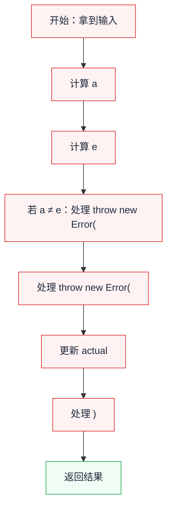

## TypeScript 解题方案（2 个方案逐个讲）

> **运行与提交**：每个方案都是自包含文件（内嵌用例自测，输出 PASS），整块复制到 `.ts` 文件后 `node 文件名` 即可运行。提交 LeetCode 时，把 `demo` 内的算法函数与辅助类型/函数整体取出、置于文件顶层即可。涉及交互/特殊接口的题以题面给定签名为准。

### 方案 1：直接实现

**分析与思路**：核心做法是「直接实现」。

**运行方式**：`node 本文件`，内嵌用例全部通过会输出 PASS。


**方案专属流程图**（真实控制流）：

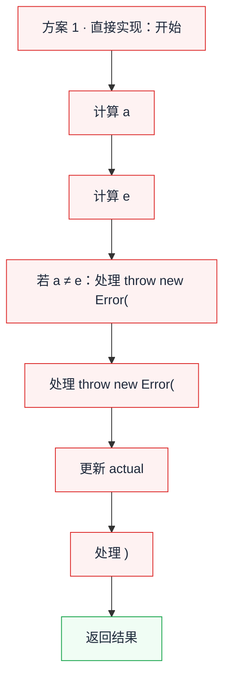

```typescript
function assertEq(actual: any, expected: any, msg: string = ''): void {
  // 定义函数/方法 assertEq
  const a = JSON.stringify(actual); // 把 JSON.stringify(actual) 存入 数组
  const e = JSON.stringify(expected); // 把 JSON.stringify(expected) 存入 e
  if (a !== e)
    throw new Error(
      'ASSERT FAILED ' + msg + ' :: actual=' + a + ' expected=' + e,
    );
}

function simplifyPath(path: string): string {
  // 定义函数/方法 simplifyPath
  const stk: string[] = []; // 把 []; 写入 const stk: string[]
  for (const s of path.split('/')) {
    // for (const 字符串 of 当前路径.split(' 除以 ')) {
    if (!s || s === '.') continue; // 若 取反 字符串 或 字符串 全等于 '.') continue;
    if (s !== '..')
      stk.push(s); // 若 字符串 不等于 '..') 栈 追加 字符串);
    else if (stk.length) stk.pop(); // 否则，若 栈.长度) 栈 弹出 );
  }
  return '/' + stk.join('/'); // 返回 ' 除以 ' 加 栈.join(' 除以 ')
}
export function demo(): void {
  // 程序入口：跑内嵌自测用例
  assertEq(simplifyPath('/home/'), '/home', 'simplifyPath'); // 断言校验
  assertEq(simplifyPath('/a/./b/../../c/'), '/c', 'simplifyPath2'); // 断言校验
  assertEq(simplifyPath('/../'), '/', 'simplifyPath3'); // 断言校验
  console.log('PASS'); // 全部用例通过，输出 PASS
}
demo(); // demo();
```

### 方案 2：迭代指针处理

**分析与思路**：核心做法是「迭代指针处理」。代码里依次做这些事：队列或堆的调度。

**运行方式**：`node 本文件`，内嵌用例全部通过会输出 PASS。


**方案专属流程图**（真实控制流）：

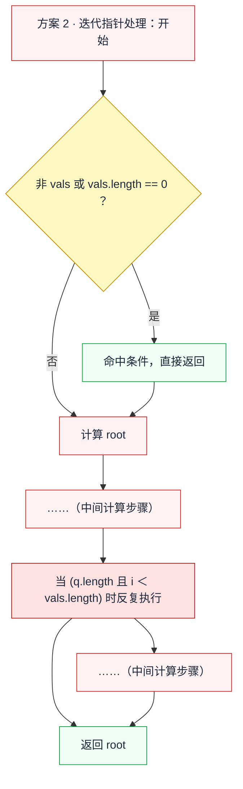

```typescript
class TreeNode {
  // 定义类型
  val: any;
  left: any;
  right: any; // 值: any; 左边界: any; 右边界: any;
  constructor(val?: any, left?: any, right?: any) {
    // constructor(值?: any, 左边界?: any, 右边界?: any) {
    this.val = val === undefined ? 0 : val; // 把 (值 全等于 undefined ? 0 : 值); 写入 值
    this.left = left === undefined ? null : left; // 把 (左边界 全等于 undefined ? null : 左边界); 写入 左边界
    this.right = right === undefined ? null : right; // 把 (右边界 全等于 undefined ? null : 右边界); 写入 右边界
  }
}
function buildTree(vals: any): any {
  // 定义函数/方法 buildTree
  if (!vals || vals.length === 0) return null; // 若 取反 vals 或 vals.长度 全等于 0，直接返回 null
  const root = new TreeNode(vals[0]);
  const q: any[] = [root];
  let i = 1;
  while (q.length && i < vals.length) {
    // 循环，直到不满足「节点.长度 且 下标 i 小于 vals.长度」
    const node = q.shift(); // 把 节点.shift() 存入 节点
    if (vals[i] !== null && vals[i] !== undefined) {
      node.left = new TreeNode(vals[i]);
      q.push(node.left);
    }
    i++; // 下标 i 加一
    if (i < vals.length && vals[i] !== null && vals[i] !== undefined) {
      node.right = new TreeNode(vals[i]);
      q.push(node.right);
    }
    i++; // 下标 i 加一
  }
  return root; // 返回 根节点
}
function treeToLevel(root: any): any[] {
  // 定义函数/方法 treeToLevel
  if (!root) return []; // 若 取反 根节点，直接返回 []
  const out: any[] = [];
  const q: any[] = [root]; // 把 []; const 节点: any[] 赋值为 [根节点]; 写入 const out: any[]
  while (q.length) {
    // 循环，直到不满足「节点.长度」
    const n = q.shift(); // 把 节点.shift() 存入 元素个数
    if (n === null || n === undefined) {
      out.push(null);
      continue;
    }
    out.push(n.val);
    q.push(n.left);
    q.push(n.right); // 把 元素个数.值 压入栈/数组尾部
  }
  while (out.length && out[out.length - 1] === null) out.pop(); // 循环，直到不满足「out.长度 且 out[out.长度 减 1] 全等于 null) out 弹出 );」
  return out; // 返回 out
}
class ListNode {
  // 定义类型
  val: any;
  next: any; // 值: any; 下一个: any;
  constructor(val?: any, next?: any) {
    this.val = val === undefined ? 0 : val;
    this.next = next === undefined ? null : next;
  }
}
function buildList(vals: any): any {
  // 定义函数/方法 buildList
  const dummy = new ListNode(0);
  let cur = dummy; // 把 new ListNode(0); let 当前值 赋值为 哨兵节点 存入 哨兵节点
  for (const v of vals) {
    cur.next = new ListNode(v);
    cur = cur.next;
  } // 把 new ListNode(值); 当前值 赋值为 当前值.下一个; } 写入 下一个
  return dummy.next; // 返回 哨兵节点.下一个
}
function listToArray(head: any): any[] {
  // 定义函数/方法 listToArray
  const out: any[] = [];
  let p = head; // 把 []; let 节点 赋值为 头节点; 写入 const out: any[]
  while (p) {
    out.push(p.val);
    p = p.next;
  } // 循环，直到不满足「节点) { out 追加 节点.值); 节点 赋值为 节点.下一个; }」
  return out; // 返回 out
}
// python-runtime shims
function pyLen(a: any): number {
  // 定义函数/方法 pyLen
  if (a === null || a === undefined) return 0; // 若 数组 全等于 null 或 数组 全等于 undefined，直接返回 0
  if (
    typeof a === 'string' ||
    Array.isArray(a) ||
    a instanceof Set ||
    a instanceof Map
  )
    return a.length ?? a.size;
  if (typeof a === 'object') return Object.keys(a).length; // 若 typeof 数组 全等于 'object'，直接返回 Object.keys(数组).长度
  return 0; // 返回 0
}
function pySlice(a: any, i: any, j: any, step?: any): any {
  // 定义函数/方法 pySlice
  if (typeof a === 'string') {
    const r = [...a].slice(i ?? 0, j ?? a.length);
    return step ? r.reverse().join('') : r.join('');
  }
  const arr = Array.isArray(a) ? a : [...a]; // 把 Array.isArray(数组) ? 数组 : 复制的 数组 存入 数组
  return arr.slice(i ?? 0, j ?? arr.length); // 返回 数组 截取 下标 i ?? 0, 下标 j ?? 数组.长度)
}
function pyRange(a: any, b?: any, step?: any): any[] {
  // 定义函数/方法 pyRange
  let s = 0,
    e = a,
    st = 1; // 把 0, e 赋值为 数组, st 赋值为 1 存入 字符串
  if (b !== undefined) {
    s = a;
    e = b;
  } // 若 b 不等于 undefined) { 字符串 赋值为 数组; e 赋值为 b; }
  if (step !== undefined) st = step; // 若 步数 不等于 undefined) st 赋值为 步数;
  const out: any[] = []; // 把 []; 写入 const out: any[]
  if (st > 0) for (let i = s; i < e; i += st) out.push(i);
  else for (let i = s; i > e; i += st) out.push(i); // 否则
  return out; // 返回 out
}
function pyIn(x: any, coll: any): boolean {
  // 定义函数/方法 pyIn
  if (coll === null || coll === undefined) return false; // 若 coll 全等于 null 或 coll 全等于 undefined，直接返回 false
  if (Array.isArray(coll)) return coll.includes(x); // 若 Array.isArray(coll)，直接返回 coll 是否包含 x)
  if (coll instanceof Set || coll instanceof Map) return coll.has(x); // 若 coll instanceof Set 或 coll instanceof Map，直接返回 coll.has(x)
  if (typeof coll === 'object') return x in coll; // 若 typeof coll 全等于 'object'，直接返回 x in coll
  if (typeof coll === 'string') return coll.indexOf(x) >= 0; // 若 typeof coll 全等于 'string'，直接返回 coll 查找 x) 不低于 0
  return false; // 返回 false
}
function pySorted(a: any): any[] {
  // 定义函数/方法 pySorted
  const arr = typeof a === 'string' ? [...a] : [...a]; // 把 (typeof 数组 全等于 'string') ? 复制的 数组 : 复制的 数组 存入 数组
  return arr.sort((x: any, y: any) => (x < y ? -1 : x > y ? 1 : 0));
}
function pyMin(a: any, b?: any): any {
  if (b !== undefined) return Math.min(a, b);
  if (Array.isArray(a) || a instanceof Set) return Math.min(...a);
  return Math.min(a);
} // 定义函数/方法 pyMin
function pyMax(a: any, b?: any): any {
  if (b !== undefined) return Math.max(a, b);
  if (Array.isArray(a) || a instanceof Set) return Math.max(...a);
  return Math.max(a);
} // 定义函数/方法 pyMax
function pySum(a: any): number {
  let s = 0;
  for (const v of a) s += v;
  return s;
} // 定义函数/方法 pySum
function pyAbs(x: any): number {
  return Math.abs(x);
} // 定义函数/方法 pyAbs
function pyEnumerate(a: any): any[] {
  const out: any[] = [];
  let i = 0;
  for (const v of a) {
    out.push([i, v]);
    i++;
  }
  return out;
} // 定义函数/方法 pyEnumerate
function pyZip(a: any, b: any): any[] {
  const n = Math.min(a.length, b.length);
  const out: any[] = [];
  for (let i = 0; i < n; i++) out.push([a[i], b[i]]);
  return out;
} // 定义函数/方法 pyZip
function pyDictGet(d: any, k: any, def?: any): any {
  return k in d ? d[k] : def === undefined ? null : def;
} // 定义函数/方法 pyDictGet
function pyPrint(...args: any[]): void {
  console.log(
    args
      .map((a) => (typeof a === 'object' && a !== null ? JSON.stringify(a) : a))
      .join(' '),
  );
} // 定义函数/方法 pyPrint
// collections / heapq
function heapPush(h: any[], x: any): void {
  h.push(x);
  let i = h.length - 1;
  while (i > 0) {
    const p = (i - 1) >> 1;
    if (h[p] <= h[i]) break;
    [h[p], h[i]] = [h[i], h[p]];
    i = p;
  }
} // 定义函数/方法 heapPush
function heapPop(h: any[]): any {
  const top = h[0];
  const last = h.pop();
  if (h.length) {
    h[0] = last;
    let i = 0;
    const n = h.length;
    while (true) {
      let l = 2 * i + 1,
        r = 2 * i + 2,
        s = i;
      if (l < n && h[l] < h[s]) s = l;
      if (r < n && h[r] < h[s]) s = r;
      if (s === i) break;
      [h[s], h[i]] = [h[i], h[s]];
      i = s;
    }
  }
  return top;
} // 定义函数/方法 heapPop
class Deque {
  private a: any[] = [];
  push(x: any) {
    this.a.push(x);
  }
  pushLeft(x: any) {
    this.a.unshift(x);
  }
  pop() {
    return this.a.pop();
  }
  popLeft() {
    return this.a.shift();
  }
  get length() {
    return this.a.length;
  }
  toArray() {
    return this.a.slice();
  }
} // 定义类型
function Counter(iter: any): any {
  const m: any = {};
  for (const v of iter) m[v] = (m[v] || 0) + 1;
  return m;
} // 定义函数/方法 Counter
function gcd(a: any, b: any): any {
  while (b) {
    [a, b] = [b, a % b];
  }
  return a;
} // 定义函数/方法 gcd
function pyInf(): number {
  return Infinity;
} // 定义函数/方法 pyInf

function norm(x: any): any {
  // 定义函数/方法 norm
  if (x === null || x === undefined) return null; // 若 x 全等于 null 或 x 全等于 undefined，直接返回 null
  if (typeof x === 'object') {
    // 若 typeof x 全等于 'object'
    if (x instanceof Deque) return x.toArray(); // 若 x instanceof Deque，直接返回 x.toArray()
    if (Array.isArray(x)) return x.map(norm); // 若 Array.isArray(x)，直接返回 x.映射表(norm)
    if (
      typeof x.val === 'number' &&
      (typeof x.left !== 'undefined' || typeof x.right !== 'undefined')
    )
      return treeToLevel(x);
    if (typeof x.next !== 'undefined' && typeof x.val === 'number')
      return listToArray(x);
    if (x instanceof Set) return [...x].sort(); // 若 x instanceof Set，直接返回 复制的 x 排序 )
    if (x instanceof Map) return Object.fromEntries(x); // 若 x instanceof Map，直接返回 Object.fromEntries(x)
    const o: any = {};
    for (const k of Object.keys(x)) o[k] = norm(x[k]);
    return o;
  }
  return x; // 返回 x
}
function eq(a: any, b: any): boolean {
  // 定义函数/方法 eq
  const x = norm(a),
    y = norm(b); // 把 norm(数组), y 赋值为 norm(b) 存入 x
  if (x === y) return true; // 若 x 全等于 y，直接返回 true
  if (x === null || y === null) return x === y; // 若 x 全等于 null 或 y 全等于 null，直接返回 x 全等于 y
  if (Array.isArray(x) && Array.isArray(y)) {
    // 若 Array.isArray(x) 且 Array.isArray(y
    if (x.length !== y.length) return false; // 若 x.长度 不等于 y.长度，直接返回 false
    for (let i = 0; i < x.length; i++) if (!eq(x[i], y[i])) return false; // 让 下标 i 从 0 开始计数，下标 i 小于 x.长度 就继续
    return true; // 返回 true
  }
  if (typeof x === 'object' && typeof y === 'object') {
    // 若 typeof x 全等于 'object' 且 typeof y 全等于 'object'
    const kx = Object.keys(x),
      ky = Object.keys(y); // 把 Object.keys(x), ky 赋值为 Object.keys(y) 存入 kx
    if (kx.length !== ky.length) return false; // 若 kx.长度 不等于 ky.长度，直接返回 false
    for (const k of kx) if (!eq(x[k], y[k])) return false;
    return true; // 返回 true
  }
  return x === y; // 返回 x 全等于 y
}

function simplifyPath(path) {
  // 定义函数/方法 simplifyPath
  const st = []; // 把 [] 存入 st
  for (const p of path.split('/')) {
    // for (const 节点 of 当前路径.split(' 除以 ')) {
    if (p === '' || p === '.') continue; // 若 节点 全等于 '' 或 节点 全等于 '.') continue;
    if (p === '..')
      st.pop(); // 若 节点 全等于 '..') st 弹出 );
    else st.push(p); // 否则
  }
  return '/' + st.join('/'); // 返回 ' 除以 ' 加 st.join(' 除以 ')
}
export function demo(): void {
  // 程序入口：跑内嵌自测用例
  const cases = [
    { in: ['/home/'], want: '/home' },
    { in: ['/../'], want: '/' },
    { in: ['/home//foo/'], want: '/home/foo' }, // { in: [" 除以 home
    { in: ['/a/./b/../../c/'], want: '/c' },
  ];
  let fail = false; // 把 false 存入 fail
  for (const c of cases) {
    // for (const 字符 of cases) {
    const got = simplifyPath(...c.in); // 把 simplifyPath(...字符.in) 存入 got
    if (!eq(got, c.want)) {
      fail = true;
      console.log(
        'FAIL',
        JSON.stringify(c.in),
        '=>',
        JSON.stringify(got),
        'want',
        JSON.stringify(c.want),
      );
    }
  }
  if (fail) throw new Error('FAILED'); // 若 fail) throw new Error('FAILED');
  console.log('PASS'); // 全部用例通过，输出 PASS
}
demo(); // demo();
```

## 逐步拆解与面试追问

**复杂度**：时间 O(n) 量级，空间 O(n)

**为什么是这个量级**：整体只对数据做有限趟处理

**面试官可能会追问**：

- 什么时候用单调栈（求下一个更大或更小）？
- 栈里存值还是存下标？
- 能否用 O(1) 额外空间？

## 关键 API 速查（TS 主解法实际用到，附官方链接）

| API | 作用 | 使用要点 | 官方文档 |
|---|---|---|---|
| `Array.prototype.push()` | 尾部追加 | 返回新长度；可一次多个；均摊 O(1)；会改变原数组 | [官方文档](https://developer.mozilla.org/zh-CN/docs/Web/JavaScript/Reference/Global_Objects/Array/push) |
| `Array.prototype.pop()` | 尾部弹出 | 返回被删元素（空数组返回 undefined）；O(1) | [官方文档](https://developer.mozilla.org/zh-CN/docs/Web/JavaScript/Reference/Global_Objects/Array/pop) |
| `Array.prototype.join()` | 数组拼接为字符串 | undefined/null 转空串；嵌套数组会展平一层；join('') 用于字符数组还原 | [官方文档](https://developer.mozilla.org/zh-CN/docs/Web/JavaScript/Reference/Global_Objects/Array/join) |
| `String.prototype.split()` | 字符串切分为数组 | split('') 按字符拆；split(/正则/) 支持模式；空串调用会拆出空串数组 | [官方文档](https://developer.mozilla.org/zh-CN/docs/Web/JavaScript/Reference/Global_Objects/String/split) |
| `JSON.stringify()` | 序列化为 JSON 字符串 | 常用于结构化比较（深度相等判定）；undefined/函数/循环引用会被丢弃或抛错 | [官方文档](https://developer.mozilla.org/zh-CN/docs/Web/JavaScript/Reference/Global_Objects/JSON/stringify) |

### 各语言官方文档导航

- **TypeScript / JS**：[MDN 中文参考](https://developer.mozilla.org/zh-CN/)
- **Python**：[Python 官方文档](https://docs.python.org/zh-cn/3/)
- **Go**：[Go 标准库](https://pkg.go.dev/std)
- **Java**：[JDK 17 API](https://docs.oracle.com/en/java/javase/17/docs/api/)
- **Rust**：[Rust 标准库](https://doc.rust-lang.org/std/)
- **Lua**：[Lua 5.4 手册](https://www.lua.org/manual/5.4/)
- **C**：[Cppreference C](https://zh.cppreference.com/w/c)
- **C++**：[Cppreference C++](https://zh.cppreference.com/w/cpp)
- **R**：[R 官方手册](https://stat.ethz.ch/R-manual/)
- **Zig**：[Zig 语言文档](https://ziglang.org/documentation/master/)
- **Dart**：[Dart API](https://api.dart.dev/)

## 附录：其他 10 种语言全部实现（每种语言列举其全部方案）

> TypeScript 的全部方案见「TypeScript 解题方案」一节；下面是其余 10 种语言的对应实现，每种语言的每个方案都带思路分析、代码走读与专属运行架构图。
> 每个方案都内嵌用例自测，可独立运行（老仓库 python/go 文件遵循「打印结果」约定）。
> 完整解法文件见 `dsa/<语言>/stack/lc_71_简化路径/`。

### Python 实现（2 种方案）

Python 的全部方案如下，每个方案都内嵌用例自测，可独立运行（老仓库 python/go 文件遵循「打印结果」约定）：

#### 方案 1：直接实现

**思路与代码分析**：核心是「直接实现」。Python 版用切片与字典推导式简化操作，突出可读性。**走读**：方案 1 · 直接实现：开始 → 更新 stk → 遍历 path.split('/'): 中的每个元素 s → 若 not s or s == .：处理 continue → 若 s ≠ ..：向 stk 追加记录 → 向 stk 追加记录 → 处理 elif stk: → 从 stk 弹出 → 返回 / + /.join(stk)。

**运行架构**（真实控制流）：

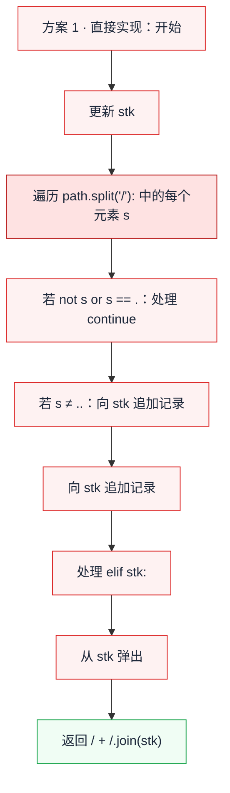

```python
import sys  # 提高递归深度上限（深输入防 RecursionError）

sys.setrecursionlimit(200000)  # 树/链表类题目节点数可达 1e4 量级

def simplifyPath(path):  # 定义函数 simplifyPath（参数：当前路径）
    stk = []  # 把 [] 存入 栈
    for s in path.split("/"):  # 逐个取出 当前路径 的元素（字符串）
        if not s or s == ".":  # 若 not 字符串 or 字符串 等于 '.'
            continue  # 跳过本轮，进入下一次
        if s != "..":  # 若 字符串 不等于 '..'
            stk.append(s)  # 把 字符串 追加到列表尾部
        elif stk:  # 否则，若 栈
            stk.pop()  # 弹出栈顶元素
    return "/" + "/".join(stk)  # 返回 ' 除以 ' 加 ' 除以 '.join(栈)

if __name__ == "__main__":  # 若 __name__ 等于 '__main__'
    print(simplifyPath("/home/"))  # 打印输出
    print(simplifyPath("/a/./b/../../c/"))  # 打印输出
    print(simplifyPath("/../"))  # 打印输出
```

#### 方案 2：迭代指针处理

**思路与代码分析**：核心是「迭代指针处理」。Python 版用切片与字典推导式简化操作，突出可读性。**走读**：方案 2 · 迭代指针处理：开始 → 更新 names → 更新 stack → 遍历 names: 中的每个元素 name → 若 name == ..：处理 if stack: → 若 stack：从 stack 弹出 → 从 stack 弹出 → 更新 ! → 向 stack 追加记录 → 返回 / + /.join(stack)。

**运行架构**（真实控制流）：

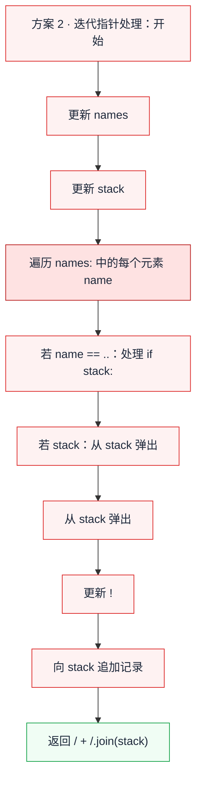

```python
import sys  # 提高递归深度上限（深输入防 RecursionError）

sys.setrecursionlimit(200000)  # 树/链表类题目节点数可达 1e4 量级

def simplifyPath(path):  # 定义函数 simplifyPath（参数：当前路径）
    names = path.split("/")  # 把 当前路径.split(「 除以 」) 存入 names
    stack = []  # 把 [] 存入 栈
    for name in names:  # 逐个取出 names 的元素（name）
        if name == "..":  # 若 name 等于 「..」
            if stack:  # 若 栈
                stack.pop()  # 弹出栈顶元素
        elif name and name != ".":  # 否则，若 name and name 不等于 「.」
            stack.append(name)  # 把 name 追加到列表尾部
    return "/" + "/".join(stack)  # 返回 「 除以 」 加 「 除以 」.join(栈)

if __name__ == "__main__":  # 若 __name__ 等于 '__main__'
    print(simplifyPath("/home/"))  # 打印输出
    print(simplifyPath("/a/./b/../../c/"))  # 打印输出
    print(simplifyPath("/../"))  # 打印输出
```

### Go 实现（2 种方案）

Go 的全部方案如下，每个方案都内嵌用例自测，可独立运行（老仓库 python/go 文件遵循「打印结果」约定）：

#### 方案 1：直接实现

**思路与代码分析**：核心是「直接实现」。Go 版用切片与多返回值惯用法，显式处理索引边界。**走读**：方案 1 · 直接实现：开始 → 更新 : → 遍历 strings.Split 的下标与元素 s → 处理 if s == 或 s == . → 处理 if s ≠ .. → 更新 stk → 更新 stk → 返回 / + strings.Join(stk, /)。

**运行架构**（真实控制流）：

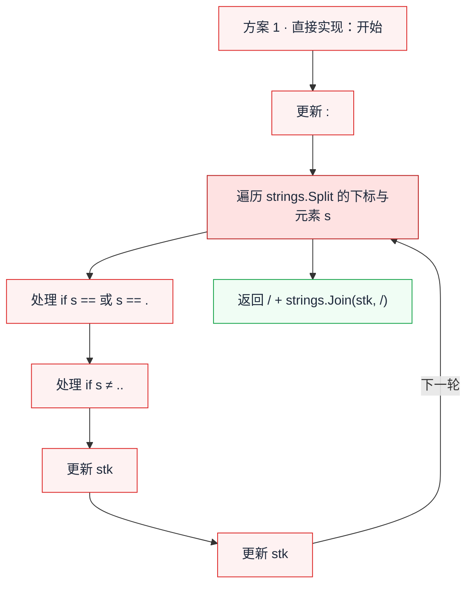

```go
package main // 引入依赖

import (
	"fmt"
	"os"
	"strings"
) // 引入依赖

func simplifyPath(path string) string { // 定义函数/方法 simplifyPath
	stk := []string{}                            // 把 []string{} 写入 stk :
	for _, s := range strings.Split(path, "/") { // 同时取 _ 与 字符串 遍历
		if s == "" || s == "." { // 若 字符串 等于 「」 或 字符串 等于 「」
			continue // 跳过本轮，进入下一次
		}
		if s != ".." { // 若 字符串 不等于 「..」
			stk = append(stk, s) // 把 append(栈, 字符串) 写入 栈
		} else if len(stk) > 0 { // 否则，若 长度(栈) 超过 0
			stk = stk[:len(stk)-1] // 把 栈[:长度(栈) 减 1] 写入 栈
		}
	}
	return "/" + strings.Join(stk, "/") // 返回 「 除以 」 加 strings.Join(栈, 「 除以 」)
}

func main() { // 程序入口：跑内嵌自测用例
	cases := []struct { // 把 []struct { 写入 cases :
		in   string // in string
		want string // want string
	}{ // }{
		{"/home/", "/home"},
		{"/a/./b/../../c/", "/c"},
		{"/../", "/"},
	}
	ok := true                // 把 true 写入 ok :
	for _, c := range cases { // 同时取 _ 与 字符 遍历
		if g := simplifyPath(c.in); g != c.want { // 若 g : 赋值为 simplifyPath(字符.in); g 不等于 字符.want
			ok = false                                          // 把 false 写入 ok
			fmt.Printf("FAIL %q=%v want %v\n", c.in, g, c.want) // 打印输出
		}
	}
	if !ok { // 若 取反 ok
		os.Exit(1) // os.Exit(1)
	}
	fmt.Println("PASS") // 全部用例通过，输出 PASS
}
```

#### 方案 2：迭代指针处理

**思路与代码分析**：核心是「迭代指针处理」。Go 版用切片与多返回值惯用法，显式处理索引边界。**走读**：方案 2 · 迭代指针处理：开始 → 更新 : → 更新 : → 遍历 names 的下标与元素 name → 处理 if name == .. → 处理 if len(stack) ＞ 0 → 更新 stack → 更新 stack → 返回 / + strings.Join(stack, /)。

**运行架构**（真实控制流）：

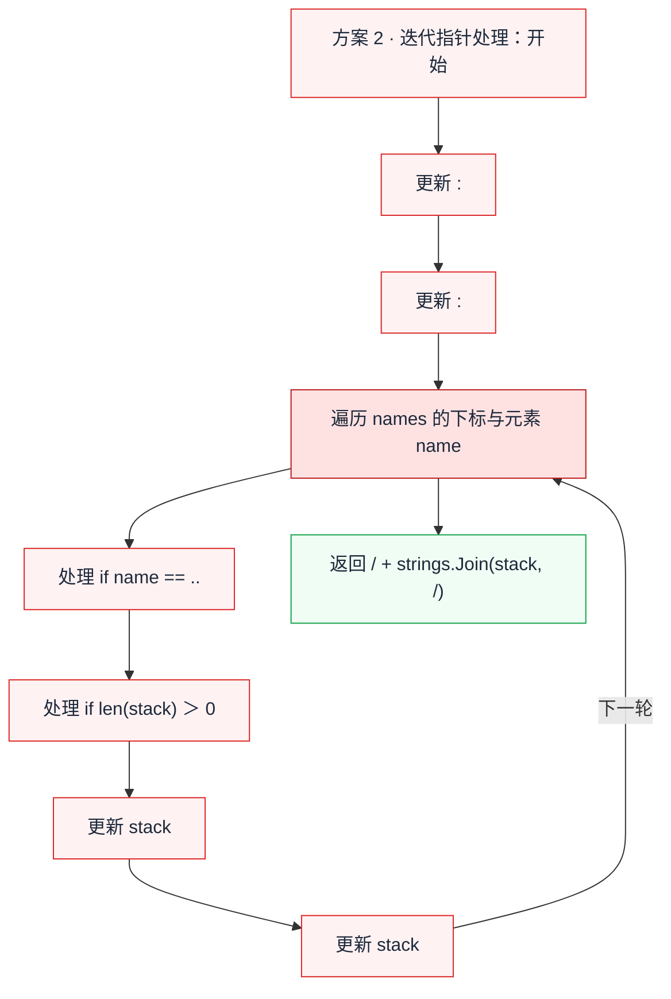

```go
package main // 引入依赖

import (
	"fmt"     // 「fmt」
	"os"      // 「os」
	"reflect" // 「reflect」
	"strings" // 「strings」
)

func simplifyPath(path string) string { // 定义函数/方法 simplifyPath
	names := strings.Split(path, "/") // 把 strings.Split(当前路径, 「 除以 」) 写入 names :
	stack := []string{}               // 把 []string{} 写入 stack :
	for _, name := range names {      // 同时取 _ 与 name 遍历
		if name == ".." { // 若 name 等于 「..」
			if len(stack) > 0 { // 若 长度(栈) 超过 0
				stack = stack[:len(stack)-1] // 把 栈[:长度(栈) 减 1] 写入 栈
			}
		} else if name != "" && name != "." { // 否则，若 name 不等于 「」 且 name 不等于 「」
			stack = append(stack, name) // 把 append(栈, name) 写入 栈
		}
	}
	return "/" + strings.Join(stack, "/") // 返回 「 除以 」 加 strings.Join(栈, 「 除以 」)
}

func main() { // 程序入口：跑内嵌自测用例
	type tc struct { // 定义类型
		in   string // in string
		want string // want string
	}
	cases := []tc{ // 把 []tc{ 写入 cases :
		{"/home/", "/home"},
		{"/a/./b/../../c/", "/c"},
		{"/../", "/"},
	}
	ok := true                // 把 true 写入 ok :
	for _, c := range cases { // 同时取 _ 与 字符 遍历
		if got := simplifyPath(c.in); !reflect.DeepEqual(got, c.want) {
			ok = false                                                          // 把 false 写入 ok
			fmt.Printf("FAIL simplifyPath(%q)=%q want %q\n", c.in, got, c.want) // 打印输出
		}
	}
	if !ok { // 若 取反 ok
		os.Exit(1) // os.Exit(1)
	}
	fmt.Println("PASS") // 全部用例通过，输出 PASS
}
```

### Java 实现（2 种方案）

Java 的全部方案如下，每个方案都内嵌用例自测，可独立运行（老仓库 python/go 文件遵循「打印结果」约定）：

#### 方案 1：直接实现

**思路与代码分析**：核心是「直接实现」。Java 版用类与静态方法组织，集合操作显式明了。代码里依次做这些事：单循环线性扫描。**走读**：方案 1 · 直接实现：开始 → 更新 stk → 遍历循环 → 若 s.isEmpty() 或 s.equals(.)：处理 continue → 若 非 s.equals(..) 则： → 调用 stk.add(s) → 调用 stk.remove(stk.size() - 1) → 返回 / + String.join(/, stk)。

**运行架构**（真实控制流）：

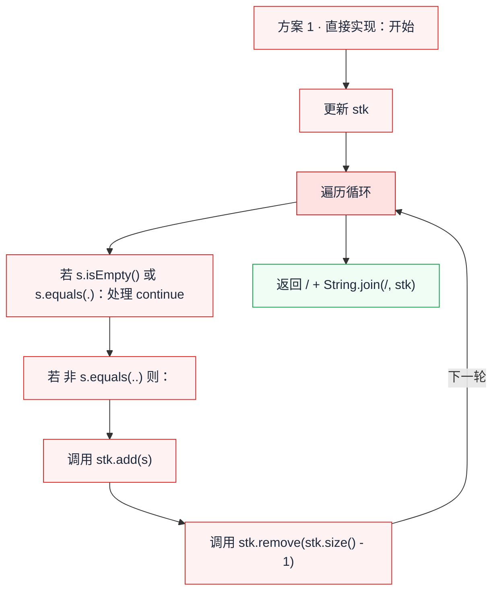

```java
package com.webfault.dsa; // 引入依赖

import java.util.*; // 引入依赖

class Solution { // 定义类型
  public String simplifyPath(String path) { // 定义函数/方法 simplifyPath
    List<String> stk = new ArrayList<>(); // 把 new ArrayList 小于 超过 (); 写入 List<String> stk
    for (String s : path.split("/")) { // for (String 字符串 : 当前路径.split(「 除以 」)) {
      if (s.isEmpty() || s.equals(".")) continue; // 若 字符串.isEmpty() 或 字符串.equals(「.」)) continue;
      if (!s.equals("..")) { // 若 取反 字符串.equals(「..」
        stk.add(s); // 栈 追加 字符串);
      } else if (!stk.isEmpty()) { // 否则，若 取反 栈.isEmpty(
        stk.remove(stk.size() - 1); // 栈 弹出 栈.大小() 减 1);
      }
    }
    return "/" + String.join("/", stk); // 返回 「 除以 」 加 String.join(「 除以 」, 栈)
  }

  public static void main(String[] args) { // public static void main(String[] args) {
    Solution s = new Solution(); // 把 new Solution(); 写入 Solution s
    String[] ins = {"/home/", "/a/./b/../../c/", "/../"};
    String[] wants = {
      "/home", "/c", "/"
    }; // 把 {「 除以 home」, 「 除以 home」, 「 除以 home」}; 写入 String[] wants
    boolean ok = true; // 把 true; 写入 boolean ok
    for (int i = 0; i < ins.length; i++) { // 让 下标 i 从 0 开始计数，下标 i 小于 ins.长度 就继续
      String got = s.simplifyPath(ins[i]); // 把 字符串.simplifyPath(ins[下标 i]) 存入 got
      if (!got.equals(wants[i])) { // 若 取反 got.equals(wants[下标 i]
        ok = false; // 把 false; 写入 ok
        System.out.println(
            "FAIL simplifyPath(" + ins[i] + ")=" + got + " want " + wants[i]); // 打印输出
      }
    }
    if (!ok) throw new RuntimeException("FAILED"); // 若 取反 ok) throw new RuntimeException(「FAILED」);
    System.out.println("PASS"); // 全部用例通过，输出 PASS
  }
}
```

#### 方案 2：迭代指针处理

**思路与代码分析**：核心是「迭代指针处理」。Java 版用类与静态方法组织，集合操作显式明了。代码里依次做这些事：单循环线性扫描。**走读**：方案 2 · 迭代指针处理：开始 → 更新 names → 更新 stack → 遍历循环 → 若 name.equals(..) 则： → 若 非 stack.isEmpty()) stack.remove(stack.size() - 1：None → 处理 且 非 name.equals(.)) → 调用 stack.add(name) → 返回 / + String.join(/, stack)。

**运行架构**（真实控制流）：

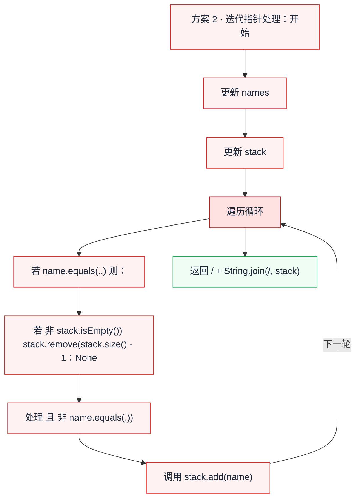

```java
package com.webfault.dsa; // 引入依赖

import java.util.*; // 引入依赖

class Solution { // 定义类型
  public String simplifyPath(String path) { // 定义函数/方法 simplifyPath
    String[] names = path.split("/"); // 把 当前路径.split(「 除以 」); 写入 String[] names
    List<String> stack = new ArrayList<>(); // 把 new ArrayList 小于 超过 (); 写入 List<String> stack
    for (String name : names) { // for (String name : names) {
      if (name.equals("..")) { // 若 name.equals(「..」
        if (!stack.isEmpty()) stack.remove(stack.size() - 1); // 若 取反 栈.isEmpty()) 栈 弹出 栈.大小() 减 1);
      } else if (!name.isEmpty()
          && !name.equals(".")) { // 否则，若 取反 name.isEmpty() 且 取反 name.equals(「.」
        stack.add(name); // 栈 追加 name);
      }
    }
    return "/" + String.join("/", stack); // 返回 「 除以 」 加 String.join(「 除以 」, 栈)
  }

  public static void main(String[] args) { // public static void main(String[] args) {
    Solution s = new Solution(); // 把 new Solution(); 写入 Solution s
    String[] ins = {"/home/", "/a/./b/../../c/", "/../"};
    String[] wants = {
      "/home", "/c", "/"
    }; // 把 {「 除以 home」, 「 除以 home」, 「 除以 home」}; 写入 String[] wants
    boolean ok = true; // 把 true; 写入 boolean ok
    for (int i = 0; i < ins.length; i++) { // 让 下标 i 从 0 开始计数，下标 i 小于 ins.长度 就继续
      String got = s.simplifyPath(ins[i]); // 把 字符串.simplifyPath(ins[下标 i]) 存入 got
      if (!got.equals(wants[i])) { // 若 取反 got.equals(wants[下标 i]
        ok = false; // 把 false; 写入 ok
        System.out.println(
            "FAIL simplifyPath(" + ins[i] + ")=" + got + " want " + wants[i]); // 打印输出
      }
    }
    if (!ok) throw new RuntimeException("FAILED"); // 若 取反 ok) throw new RuntimeException(「FAILED」);
    System.out.println("PASS"); // 全部用例通过，输出 PASS
  }
}
```

### Rust 实现（2 种方案）

Rust 的全部方案如下，每个方案都内嵌用例自测，可独立运行（老仓库 python/go 文件遵循「打印结果」约定）：

#### 方案 1：直接实现

**思路与代码分析**：核心是「直接实现」。Rust 版用所有权移动与切片借用改写同一逻辑，注意 Option 与引用边界。代码里依次做这些事：栈的后进先出操作。**走读**：方案 1 · 直接实现：开始 → 计算 st → 遍历 path.split('/') 中的每个元素 part → 处理 match part → 更新 '.' → 更新 '..' → 从 st 弹出 → 向 st 追加记录 → 处理 format非 (/ → 返回结果。

**运行架构**（真实控制流）：

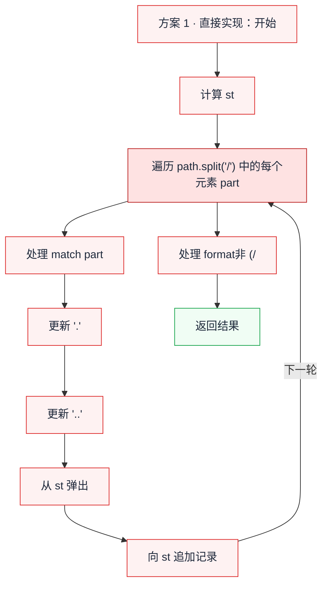

```rust
// LeetCode 71. 简化路径 — Rust 版（方案1）
fn simplify_path(path: String) -> String {
    // 定义函数/方法 simplify_path
    let mut st: Vec<&str> = Vec::new(); // 把 Vec::new(); 写入 let mut st: Vec<&str>
    for part in path.split('/') {
        // 逐个取出 当前路径 的元素（part）
        match part {
            // 按情况匹配处理
            "" | "." => {}
            ".." => {
                st.pop();
            }
            _ => st.push(part),
        }
    }
    format!("/{}", st.join("/")) // 拼接为字符串
}
fn main() {
    // 程序入口：跑内嵌自测用例
    assert_eq!(simplify_path("/home/".into()), "/home"); // 断言校验
    assert_eq!(simplify_path("/../".into()), "/"); // 断言校验
    assert_eq!(simplify_path("/home//foo/".into()), "/home/foo"); // 断言校验
    assert_eq!(simplify_path("/a/./b/../../c/".into()), "/c"); // 断言校验
    println!("PASS");
} // 全部用例通过，输出 PASS
```

#### 方案 2：迭代指针处理

**思路与代码分析**：核心是「迭代指针处理」。Rust 版用所有权移动与切片借用改写同一逻辑，注意 Option 与引用边界。代码里依次做这些事：栈的后进先出操作。**走读**：方案 2 · 迭代指针处理：开始 → 计算 st → 遍历 path.split('/') 中的每个元素 part → 处理 match part → 更新 '.' → 更新 '..' → 从 st 弹出 → 向 st 追加记录 → 处理 format非 (/ → 返回结果。

**运行架构**（真实控制流）：

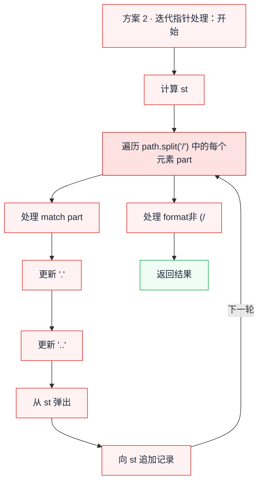

```rust
// LeetCode 71. 简化路径 — Rust 版（方案2）
fn simplify_path(path: String) -> String {
    // 定义函数/方法 simplify_path
    let mut st: Vec<&str> = Vec::new(); // 把 Vec::new(); 写入 let mut st: Vec<&str>
    for part in path.split('/') {
        // 逐个取出 当前路径 的元素（part）
        match part {
            // 按情况匹配处理
            "" | "." => {}
            ".." => {
                st.pop();
            }
            _ => st.push(part),
        }
    }
    format!("/{}", st.join("/")) // 拼接为字符串
}
fn main() {
    // 程序入口：跑内嵌自测用例
    assert_eq!(simplify_path("/home/".into()), "/home"); // 断言校验
    assert_eq!(simplify_path("/../".into()), "/"); // 断言校验
    assert_eq!(simplify_path("/home//foo/".into()), "/home/foo"); // 断言校验
    assert_eq!(simplify_path("/a/./b/../../c/".into()), "/c"); // 断言校验
    println!("PASS");
} // 全部用例通过，输出 PASS
```

### Lua 实现（2 种方案）

Lua 的全部方案如下，每个方案都内嵌用例自测，可独立运行（老仓库 python/go 文件遵循「打印结果」约定）：

#### 方案 1：直接实现

**思路与代码分析**：核心是「直接实现」。Lua 版用表与 ipairs 遍历，注意 ipairs 遇 nil 即停的语义。**走读**：方案 1 · 直接实现：开始 → 更新 st → 遍历 path:gmatch('[^/]+') do 中的每个元素 part → 处理 if part == .. then → 处理 if #st ＞ 0 then → 更新 st[#st] → 更新 1] → 处理 if #st == 0 then → 返回 / → 返回 / .. table.concat(st, /) → 更新 = → 更新 = → 更新 = → 更新 = → 调用 print(PASS)。

**运行架构**（真实控制流）：

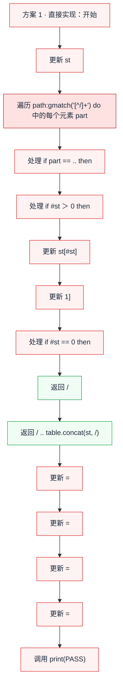

```lua
-- LeetCode 71. 简化路径 — Lua 版（方案1）
local function simplify_path(path) -- local function simplify_path(当前路径)
	local st = {} -- 把 {} 写入 local st
	for part in path:gmatch("[^/]+") do -- for part in 当前路径:gmatch(「[ 按位异或 除以 ] 加 」) do
		if part == ".." then -- 若 part 等于 「..」 then
			if #st > 0 then
				st[#st] = nil
			end -- 若 #st 超过 0 then st[#st] 赋值为 nil 终点
		elseif part ~= "." then -- 把 「.」 then 写入 elseif part ~
			st[#st + 1] = part -- 把 part 写入 st[#st + 1]
		end -- 终点
	end -- 终点
	if #st == 0 then
		return "/"
	end -- 若 #st 等于 0 then return 「 除以 」 终点
	return "/" .. table.concat(st, "/") -- 返回 「 除以 」 .. table.concat(st, 「 除以 」)
end -- 终点
assert(simplify_path("/home/") == "/home") -- 断言校验
assert(simplify_path("/../") == "/") -- 断言校验
assert(simplify_path("/home//foo/") == "/home/foo") -- 断言校验
assert(simplify_path("/a/./b/../../c/") == "/c") -- 断言校验
print("PASS") -- 全部用例通过，输出 PASS
```

#### 方案 2：迭代指针处理

**思路与代码分析**：核心是「迭代指针处理」。Lua 版用表与 ipairs 遍历，注意 ipairs 遇 nil 即停的语义。**走读**：方案 2 · 迭代指针处理：开始 → 更新 st → 遍历 path:gmatch('[^/]+') do 中的每个元素 part → 处理 if part == .. then → 处理 if #st ＞ 0 then → 更新 st[#st] → 更新 1] → 处理 if #st == 0 then → 返回 / → 返回 / .. table.concat(st, /) → 更新 = → 更新 = → 更新 = → 更新 = → 调用 print(PASS)。

**运行架构**（真实控制流）：

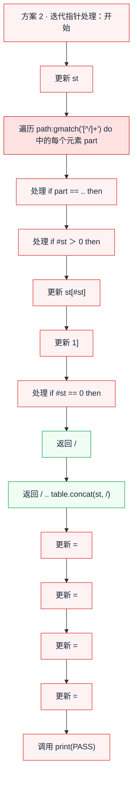

```lua
-- LeetCode 71. 简化路径 — Lua 版（方案2）
local function simplify_path(path) -- local function simplify_path(当前路径)
	local st = {} -- 把 {} 写入 local st
	for part in path:gmatch("[^/]+") do -- for part in 当前路径:gmatch(「[ 按位异或 除以 ] 加 」) do
		if part == ".." then -- 若 part 等于 「..」 then
			if #st > 0 then
				st[#st] = nil
			end -- 若 #st 超过 0 then st[#st] 赋值为 nil 终点
		elseif part ~= "." then -- 把 「.」 then 写入 elseif part ~
			st[#st + 1] = part -- 把 part 写入 st[#st + 1]
		end -- 终点
	end -- 终点
	if #st == 0 then
		return "/"
	end -- 若 #st 等于 0 then return 「 除以 」 终点
	return "/" .. table.concat(st, "/") -- 返回 「 除以 」 .. table.concat(st, 「 除以 」)
end -- 终点
assert(simplify_path("/home/") == "/home") -- 断言校验
assert(simplify_path("/../") == "/") -- 断言校验
assert(simplify_path("/home//foo/") == "/home/foo") -- 断言校验
assert(simplify_path("/a/./b/../../c/") == "/c") -- 断言校验
print("PASS") -- 全部用例通过，输出 PASS
```

### C 实现（2 种方案）

C 的全部方案如下，每个方案都内嵌用例自测，可独立运行（老仓库 python/go 文件遵循「打印结果」约定）：

#### 方案 1：直接实现

**思路与代码分析**：核心是「直接实现」。C 版手动管理下标与内存，循环边界全部显式写出。代码里依次做这些事：单循环线性扫描。**走读**：方案 1 · 直接实现：开始 → 处理 char *parts[1024] → 当 (tok) 时反复执行 → 遍历循环 → 返回结果。

**运行架构**（真实控制流）：

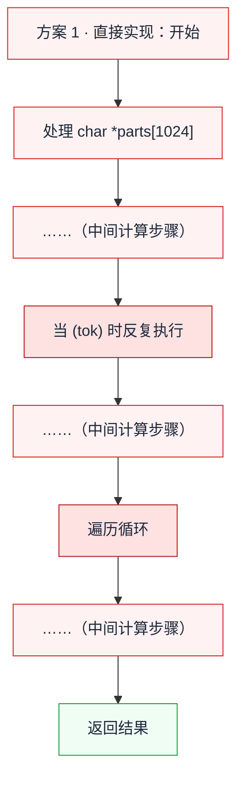

```c
/* LeetCode 71. 简化路径 — C 版（方案1） */
#include <stdio.h>                                        // 引入头文件
#include <string.h>                                       // 引入头文件
static void simplify_path(const char *path, char out[]) { // 定义函数/方法 simplify_path
    char *parts[1024];                                    // char 乘 parts[1024];
    int pn = 0;                                           // 把 0 存入 pn
    char buf[8192];                                       // char buf[8192];
    strncpy(buf, path, sizeof(buf) - 1);                  // strncpy(buf, 当前路径, sizeof(buf) 减 1);
    buf[sizeof(buf) - 1] = '\0';                          // 把 '\0'; 写入 buf[sizeof(buf) - 1]
    char *tok = strtok(buf, "/");                         // 把 strtok(buf, 「 除以 」); 写入 char *tok
    while (tok) {                                         // 循环，直到不满足「tok」
        if (strcmp(tok, "..") == 0) {
            if (pn > 0)
                pn--;
        } // 若 strcmp(tok, 「..」) 等于 0) { if (pn 超过 0) pn 减一 ; }
        else if (strcmp(tok, ".") != 0)
            parts[pn++] = tok; // 否则，若 strcmp(tok, 「.」) 不等于 0) parts[pn 加一 ] 赋值为 tok;
        tok = strtok(NULL, "/"); // 把 strtok(NULL, 「 除以 」); 写入 tok
    }
    int pos = 0; // 把 0 存入 pos
    if (pn == 0) {
        out[pos++] = '/';
    } // 若 pn 等于 0) { out[pos 加一 ] 赋值为 ' 除以 '; }
    else
        for (int i = 0; i < pn; i++) {   // 否则
            out[pos++] = '/';            // 把 ' 除以 '; 写入 out[pos++]
            strcpy(out + pos, parts[i]); // strcpy(out 加 pos, parts[下标 i]);
            pos += strlen(parts[i]);     // pos累加 strlen(parts[下标 i])
        }
    out[pos] = '\0'; // 把 '\0'; 写入 out[pos]
}
int main(void) {                  // 程序入口：跑内嵌自测用例
    char out[8192];               // char out[8192];
    simplify_path("/home/", out); // simplify_path(「 除以 home 除以 」, out);
    if (strcmp(out, "/home") != 0) {
        printf("FAIL 1\n");
        return 1;
    }
    simplify_path("/../", out); // simplify_path(「 除以 .. 除以 」, out);
    if (strcmp(out, "/") != 0) {
        printf("FAIL 2\n");
        return 1;
    } // 若 strcmp(out, 「 除以 」) 不等于 0) { 输出「 除以 」); return 1; }
    simplify_path("/home//foo/", out); // simplify_path(" 除以 home
    if (strcmp(out, "/home/foo") != 0) {
        printf("FAIL 3\n");
        return 1;
    }
    simplify_path("/a/./b/../../c/", out);
    if (strcmp(out, "/c") != 0) {
        printf("FAIL 4\n");
        return 1;
    } // 若 strcmp(out, 「 除以 字符」) 不等于 0) { 输出「 除以 字符」); return 1; }
    printf("PASS\n");
    return 0;
} // 全部用例通过，输出 PASS
```

#### 方案 2：迭代指针处理

**思路与代码分析**：核心是「迭代指针处理」。C 版手动管理下标与内存，循环边界全部显式写出。代码里依次做这些事：单循环线性扫描。**走读**：方案 2 · 迭代指针处理：开始 → 处理 char *parts[1024] → 当 (tok) 时反复执行 → 遍历循环 → 返回结果。

**运行架构**（真实控制流）：

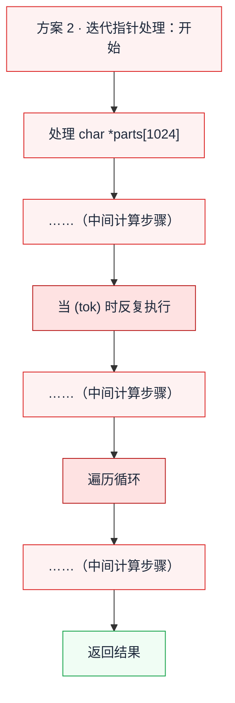

```c
/* LeetCode 71. 简化路径 — C 版（方案2） */
#include <stdio.h>                                        // 引入头文件
#include <string.h>                                       // 引入头文件
static void simplify_path(const char *path, char out[]) { // 定义函数/方法 simplify_path
    char *parts[1024];                                    // char 乘 parts[1024];
    int pn = 0;                                           // 把 0 存入 pn
    char buf[8192];                                       // char buf[8192];
    strncpy(buf, path, sizeof(buf) - 1);                  // strncpy(buf, 当前路径, sizeof(buf) 减 1);
    buf[sizeof(buf) - 1] = '\0';                          // 把 '\0'; 写入 buf[sizeof(buf) - 1]
    char *tok = strtok(buf, "/");                         // 把 strtok(buf, 「 除以 」); 写入 char *tok
    while (tok) {                                         // 循环，直到不满足「tok」
        if (strcmp(tok, "..") == 0) {
            if (pn > 0)
                pn--;
        } // 若 strcmp(tok, 「..」) 等于 0) { if (pn 超过 0) pn 减一 ; }
        else if (strcmp(tok, ".") != 0)
            parts[pn++] = tok; // 否则，若 strcmp(tok, 「.」) 不等于 0) parts[pn 加一 ] 赋值为 tok;
        tok = strtok(NULL, "/"); // 把 strtok(NULL, 「 除以 」); 写入 tok
    }
    int pos = 0; // 把 0 存入 pos
    if (pn == 0) {
        out[pos++] = '/';
    } // 若 pn 等于 0) { out[pos 加一 ] 赋值为 ' 除以 '; }
    else
        for (int i = 0; i < pn; i++) {   // 否则
            out[pos++] = '/';            // 把 ' 除以 '; 写入 out[pos++]
            strcpy(out + pos, parts[i]); // strcpy(out 加 pos, parts[下标 i]);
            pos += strlen(parts[i]);     // pos累加 strlen(parts[下标 i])
        }
    out[pos] = '\0'; // 把 '\0'; 写入 out[pos]
}
int main(void) {                  // 程序入口：跑内嵌自测用例
    char out[8192];               // char out[8192];
    simplify_path("/home/", out); // simplify_path(「 除以 home 除以 」, out);
    if (strcmp(out, "/home") != 0) {
        printf("FAIL 1\n");
        return 1;
    }
    simplify_path("/../", out); // simplify_path(「 除以 .. 除以 」, out);
    if (strcmp(out, "/") != 0) {
        printf("FAIL 2\n");
        return 1;
    } // 若 strcmp(out, 「 除以 」) 不等于 0) { 输出「 除以 」); return 1; }
    simplify_path("/home//foo/", out); // simplify_path(" 除以 home
    if (strcmp(out, "/home/foo") != 0) {
        printf("FAIL 3\n");
        return 1;
    }
    simplify_path("/a/./b/../../c/", out);
    if (strcmp(out, "/c") != 0) {
        printf("FAIL 4\n");
        return 1;
    } // 若 strcmp(out, 「 除以 字符」) 不等于 0) { 输出「 除以 字符」); return 1; }
    printf("PASS\n");
    return 0;
} // 全部用例通过，输出 PASS
```

### C++ 实现（2 种方案）

C++ 的全部方案如下，每个方案都内嵌用例自测，可独立运行（老仓库 python/go 文件遵循「打印结果」约定）：

#### 方案 1：直接实现

**思路与代码分析**：核心是「直接实现」。C++ 版用 STL 容器与迭代器，减少手写下标错误。代码里依次做这些事：单循环线性扫描。**走读**：方案 1 · 直接实现：开始 → 处理 std::vector＜std::string＞ st → 处理 std::istringstream iss(path) → 处理 std::string part → 当 (std::getline(iss, part, '/')) 时反复执行 → 若 part.empty() 或 part == .：处理 continue → 若 part == .. 则： → 若 非 st.empty()：调用 st.pop_back() → 调用 st.pop_back() → 调用 st.push_back(part) → 更新 out → 遍历循环 → 若 i：更新 + → 更新 + → 更新 + → 返回 out。

**运行架构**（真实控制流）：

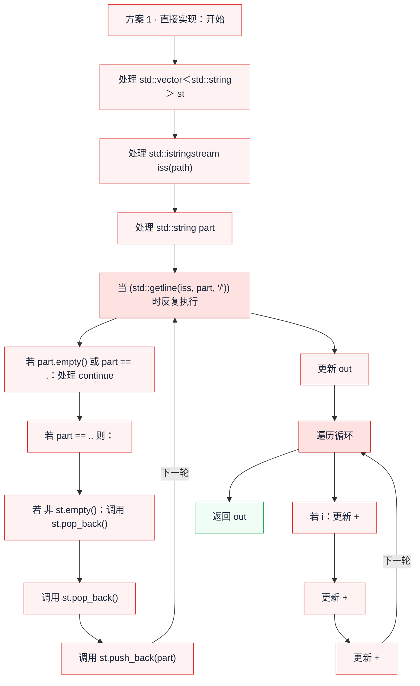

```cpp
// LeetCode 71. 简化路径 — C++ 版（方案1）
#include <cassert>  // 引入头文件
#include <iostream> // 引入头文件
#include <sstream>  // 引入头文件
#include <string>   // 引入头文件
#include <vector>   // 引入头文件
static std::string simplifyPath(const std::string &path) {
    std::vector<std::string> st;           // std::vector 小于 std::string 超过 st;
    std::istringstream iss(path);          // std::istringstream iss(当前路径);
    std::string part;                      // std::string part;
    while (std::getline(iss, part, '/')) { // 循环，直到不满足「std::getline(iss, part, ' 除以 '」
        if (part.empty() || part == ".")
            continue; // 若 part 是否为空 或 part 等于 「.」) continue;
        if (part == "..") {
            if (!st.empty())
                st.pop_back();
        } // 若 part 等于 「..」) { if (取反 st 是否为空) st 弹出 ); }
        else
            st.push_back(part); // 否则
    }
    std::string out = "/";                   // 把 「 除以 」; 写入 std::string out
    for (size_t i = 0; i < st.size(); ++i) { // 让 下标 i 从 0 开始计数，下标 i 小于 st.大小() 就继续
        if (i)
            out += "/"; // 若 下标 i) out 累加 「 除以 」;
        out += st[i];   // out累加 st[下标 i]
    }
    return out; // 返回 out
}
int main() {
    assert(simplifyPath("/home/") == "/home");
    assert(simplifyPath("/../") == "/");
    assert(simplifyPath("/home//foo/") == "/home/foo");
    assert(simplifyPath("/a/./b/../../c/") == "/c");
    std::cout << "PASS" << std::endl;
} // 断言校验
```

#### 方案 2：迭代指针处理

**思路与代码分析**：核心是「迭代指针处理」。C++ 版用 STL 容器与迭代器，减少手写下标错误。代码里依次做这些事：单循环线性扫描。**走读**：方案 2 · 迭代指针处理：开始 → 处理 std::vector＜std::string＞ st → 处理 std::istringstream iss(path) → 处理 std::string part → 当 (std::getline(iss, part, '/')) 时反复执行 → 若 part.empty() 或 part == .：处理 continue → 若 part == .. 则： → 若 非 st.empty()：调用 st.pop_back() → 调用 st.pop_back() → 调用 st.push_back(part) → 更新 out → 遍历循环 → 若 i：更新 + → 更新 + → 更新 + → 返回 out。

**运行架构**（真实控制流）：

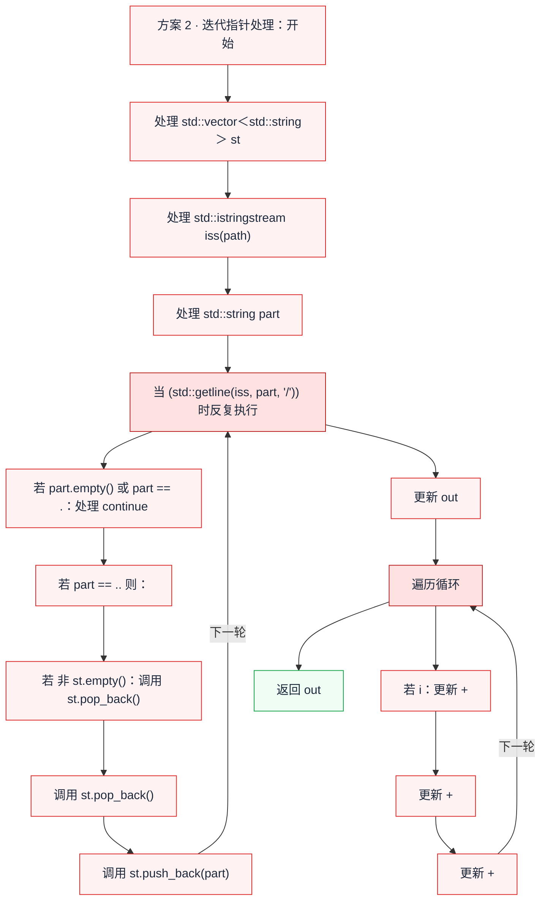

```cpp
// LeetCode 71. 简化路径 — C++ 版（方案2）
#include <cassert>  // 引入头文件
#include <iostream> // 引入头文件
#include <sstream>  // 引入头文件
#include <string>   // 引入头文件
#include <vector>   // 引入头文件
static std::string simplifyPath(const std::string &path) {
    std::vector<std::string> st;           // std::vector 小于 std::string 超过 st;
    std::istringstream iss(path);          // std::istringstream iss(当前路径);
    std::string part;                      // std::string part;
    while (std::getline(iss, part, '/')) { // 循环，直到不满足「std::getline(iss, part, ' 除以 '」
        if (part.empty() || part == ".")
            continue; // 若 part 是否为空 或 part 等于 「.」) continue;
        if (part == "..") {
            if (!st.empty())
                st.pop_back();
        } // 若 part 等于 「..」) { if (取反 st 是否为空) st 弹出 ); }
        else
            st.push_back(part); // 否则
    }
    std::string out = "/";                   // 把 「 除以 」; 写入 std::string out
    for (size_t i = 0; i < st.size(); ++i) { // 让 下标 i 从 0 开始计数，下标 i 小于 st.大小() 就继续
        if (i)
            out += "/"; // 若 下标 i) out 累加 「 除以 」;
        out += st[i];   // out累加 st[下标 i]
    }
    return out; // 返回 out
}
int main() {
    assert(simplifyPath("/home/") == "/home");
    assert(simplifyPath("/../") == "/");
    assert(simplifyPath("/home//foo/") == "/home/foo");
    assert(simplifyPath("/a/./b/../../c/") == "/c");
    std::cout << "PASS" << std::endl;
} // 断言校验
```

### R 实现（2 种方案）

R 的全部方案如下，每个方案都内嵌用例自测，可独立运行（老仓库 python/go 文件遵循「打印结果」约定）：

#### 方案 1：直接实现

**思路与代码分析**：核心是「直接实现」。R 版用向量化思维与 1 起始下标，注意 1:n 的降序陷阱。代码里依次做这些事：单循环线性扫描。**走读**：方案 1 · 直接实现：开始 → 处理 parts ＜- strsplit(path, /) → 处理 st ＜- character(0) → 循环 p：遍历 parts → 若 p == 或 p == .：处理 next → 处理 next → 若 p == ..：处理对应分支 → 若 length(st) ＞ 0：处理 st ＜- st[-length(st)] → 处理 st ＜- st[-length(st)] → 命中条件，直接返回 → 更新 collapse。

**运行架构**（真实控制流）：

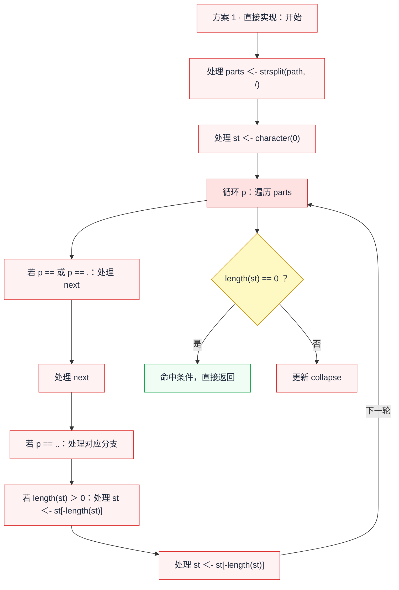

```r
# 版（方案1） 定义函数 simplify_path（参数：当前路径）
simplify_path <- function(path) {
    parts <- strsplit(path, "/")[[1]]  # 把 strsplit(当前路径, 「 除以 」)[[1]] 存入 parts
    st <- character(0)  # 把 character(0) 存入 st
    for (p in parts) {
        # for (节点 in parts) {
        if (p == "" || p == ".")
            next  # 若 节点 等于 「」 或 节点 等于 「」) 下一个
        if (p == "..")
            {
                if (length(st) > 0)
                  st <- st[-length(st)]
            }  # 若 节点 等于 「..」) { if (长度(st) 超过 0) st 小于 减 st[ 减 长度(st)] }
 else st <- c(st, p)  # 否则
    }
    if (length(st) == 0)
        return("/")  # 若 长度(st) 等于 0) return(「 除以 」
    paste0("/", paste(st, collapse = "/"))  # 把 「 除以 」)) 写入 paste0('/', paste(st, collapse
}
stopifnot(simplify_path("/home/") == "/home")  # 断言校验
stopifnot(simplify_path("/../") == "/")  # 断言校验
stopifnot(simplify_path("/home//foo/") == "/home/foo")  # 断言校验
stopifnot(simplify_path("/a/./b/../../c/") == "/c")  # 断言校验
cat("PASS\n")  # 全部用例通过，输出 PASS
```

#### 方案 2：迭代指针处理

**思路与代码分析**：核心是「迭代指针处理」。R 版用向量化思维与 1 起始下标，注意 1:n 的降序陷阱。代码里依次做这些事：单循环线性扫描。**走读**：方案 2 · 迭代指针处理：开始 → 处理 parts ＜- strsplit(path, /) → 处理 st ＜- character(0) → 循环 p：遍历 parts → 若 p == 或 p == .：处理 next → 处理 next → 若 p == ..：处理对应分支 → 若 length(st) ＞ 0：处理 st ＜- st[-length(st)] → 处理 st ＜- st[-length(st)] → 命中条件，直接返回 → 更新 collapse。

**运行架构**（真实控制流）：

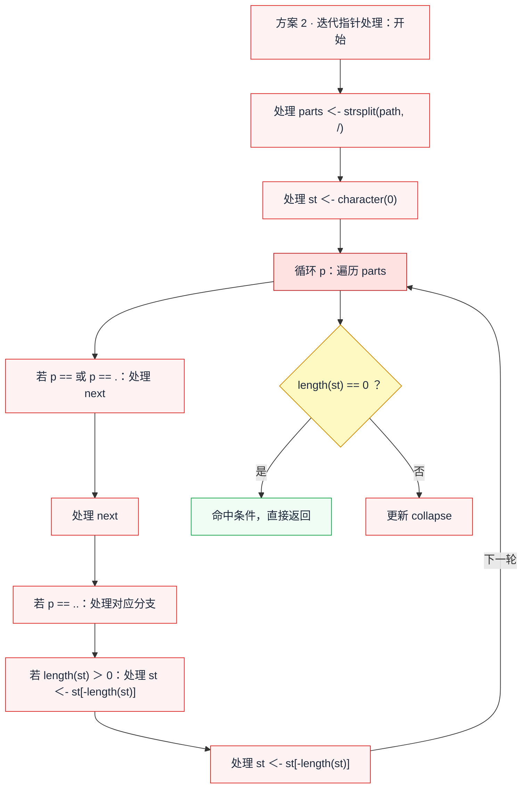

```r
# 版（方案2） 定义函数 simplify_path（参数：当前路径）
simplify_path <- function(path) {
    parts <- strsplit(path, "/")[[1]]  # 把 strsplit(当前路径, 「 除以 」)[[1]] 存入 parts
    st <- character(0)  # 把 character(0) 存入 st
    for (p in parts) {
        # for (节点 in parts) {
        if (p == "" || p == ".")
            next  # 若 节点 等于 「」 或 节点 等于 「」) 下一个
        if (p == "..")
            {
                if (length(st) > 0)
                  st <- st[-length(st)]
            }  # 若 节点 等于 「..」) { if (长度(st) 超过 0) st 小于 减 st[ 减 长度(st)] }
 else st <- c(st, p)  # 否则
    }
    if (length(st) == 0)
        return("/")  # 若 长度(st) 等于 0) return(「 除以 」
    paste0("/", paste(st, collapse = "/"))  # 把 「 除以 」)) 写入 paste0('/', paste(st, collapse
}
stopifnot(simplify_path("/home/") == "/home")  # 断言校验
stopifnot(simplify_path("/../") == "/")  # 断言校验
stopifnot(simplify_path("/home//foo/") == "/home/foo")  # 断言校验
stopifnot(simplify_path("/a/./b/../../c/") == "/c")  # 断言校验
cat("PASS\n")  # 全部用例通过，输出 PASS
```

### Zig 实现（2 种方案）

Zig 的全部方案如下，每个方案都内嵌用例自测，可独立运行（老仓库 python/go 文件遵循「打印结果」约定）：

#### 方案 1：直接实现

**思路与代码分析**：核心是「直接实现」。Zig 版显式分配与清零，整型边界处理严格。代码里依次做这些事：单循环线性扫描。**走读**：方案 1 · 直接实现：开始 → 计算 parts → 计算 pn → 计算 it → 当 (it.next()) ｜part｜ 时反复执行 → 若 part.len == 0 or std.mem.eql(u8, part, .)：处理 continue → 若 std.mem.eql(u8, part, ..) 则： → 若 pn ＞ 0：更新 - → 更新 parts[pn] → 更新 + → 若 pn == 0 则： → 向 out 追加记录 → 返回  → 遍历集合元素 → 向 out 追加记录 → 调用 out.appendSlice(parts[i]) ca。

**运行架构**（真实控制流）：

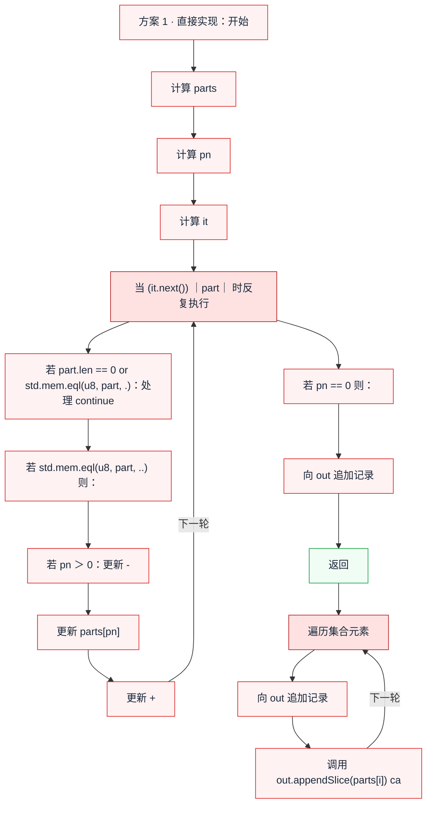

```zig
// LeetCode 71. 简化路径 — Zig 版（方案1）
const std = @import("std"); // 把 @import(「std」) 存入 std
fn simplifyPath(path: []const u8, out: *std.ArrayList(u8)) void { // 定义函数/方法 simplifyPath
    var parts: [1024][]const u8 = undefined; // 把 undefined; 写入 var parts: [1024][]const u8
    var pn: usize = 0; // 把 0; 写入 var pn: usize
    var it = std.mem.splitScalar(u8, path, '/'); // 把 std.mem.splitScalar(u8, 当前路径, ' 除以 ') 存入 it
    while (it.next()) |part| { // 循环，直到不满足「it.下一个()) 按位或 part 按位或」
        if (part.len == 0 or std.mem.eql(u8, part, ".")) continue; // 若 part.长度 等于 0 or std.mem.eql(u8, part, 「.」)) continue;
        if (std.mem.eql(u8, part, "..")) { // 若 std.mem.eql(u8, part, 「..」
            if (pn > 0) pn -= 1; // 若 pn 超过 0) pn 累减 1;
        } else { // 否则
            parts[pn] = part; // 把 part; 写入 parts[pn]
            pn += 1; // pn累加 1
        }
    }
    if (pn == 0) { // 若 pn 等于 0
        out.append('/') catch unreachable; // 把 ' 除以 ' 追加到列表尾部
        return; // return;
    }
    for (0..pn) |i| { // 让 下标 i 从 0 走到 pn 减一
        out.append('/') catch unreachable; // 把 ' 除以 ' 追加到列表尾部
        out.appendSlice(parts[i]) catch unreachable; // out.appendSlice(parts[下标 i]) catch unreachable;
    }
}
pub fn main() !void { // 程序入口：跑内嵌自测用例
    var out = std.ArrayList(u8).init(std.heap.page_allocator); // 把 std.ArrayList(u8).init(std.堆.page_allocator) 存入 out
    defer out.deinit(); // defer out.deinit();
    simplifyPath("/home/", &out); // simplifyPath(「 除以 home 除以 」, 按位与 out);
    if (!std.mem.eql(u8, out.items, "/home")) return error.TestFailed;
    out.clearRetainingCapacity(); // out.clearRetainingCapacity();
    simplifyPath("/../", &out); // simplifyPath(「 除以 .. 除以 」, 按位与 out);
    if (!std.mem.eql(u8, out.items, "/")) return error.TestFailed;
    out.clearRetainingCapacity(); // out.clearRetainingCapacity();
    simplifyPath("/home//foo/", &out); // simplifyPath(" 除以 home
    if (!std.mem.eql(u8, out.items, "/home/foo")) return error.TestFailed;
    out.clearRetainingCapacity(); // out.clearRetainingCapacity();
    simplifyPath("/a/./b/../../c/", &out);
    if (!std.mem.eql(u8, out.items, "/c")) return error.TestFailed;
    std.debug.print("PASS\n", .{});
} // 全部用例通过，输出 PASS
```

#### 方案 2：迭代指针处理

**思路与代码分析**：核心是「迭代指针处理」。Zig 版显式分配与清零，整型边界处理严格。代码里依次做这些事：单循环线性扫描。**走读**：方案 2 · 迭代指针处理：开始 → 计算 parts → 计算 pn → 计算 it → 当 (it.next()) ｜part｜ 时反复执行 → 若 part.len == 0 or std.mem.eql(u8, part, .)：处理 continue → 若 std.mem.eql(u8, part, ..) 则： → 若 pn ＞ 0：更新 - → 更新 parts[pn] → 更新 + → 若 pn == 0 则： → 向 out 追加记录 → 返回  → 遍历集合元素 → 向 out 追加记录 → 调用 out.appendSlice(parts[i]) ca。

**运行架构**（真实控制流）：

```mermaid
graph TD
    N0["方案 2 · 迭代指针处理：开始"]
    N1["计算 parts"]
    N2["计算 pn"]
    N3["计算 it"]
    N4["当 (it.next()) ｜part｜ 时反复执行"]
    N5["若 part.len == 0 or std.mem.eql(u8, part, .)：处理 continue"]
    N6["若 std.mem.eql(u8, part, ..) 则："]
    N7["若 pn ＞ 0：更新 -"]
    N8["更新 parts[pn]"]
    N9["更新 +"]
    N10["若 pn == 0 则："]
    N11["向 out 追加记录"]
    N12["返回 "]
    N13["遍历集合元素"]
    N14["向 out 追加记录"]
    N15["调用 out.appendSlice(parts[i]) ca"]
    N0 --> N1
    N1 --> N2
    N2 --> N3
    N3 --> N4
    N4 --> N5
    N5 --> N6
    N6 --> N7
    N7 --> N8
    N8 --> N9
    N9 -- 下一轮 --> N4
    N4 --> N10
    N10 --> N11
    N11 --> N12
    N12 --> N13
    N13 --> N14
    N14 --> N15
    N15 -- 下一轮 --> N13
    classDef n fill:#fef2f2,stroke:#dc2626,color:#1e293b;
    classDef lp fill:#fee2e2,stroke:#b91c1c,color:#1e293b;
    classDef dc fill:#fef9c3,stroke:#ca8a04,color:#1e293b;
    classDef tm fill:#f0fdf4,stroke:#16a34a,color:#1e293b;
    class N0,N1,N2,N3,N5,N6,N7,N8,N9,N10,N11,N14,N15 n;
    class N4,N13 lp;
    class N12 tm;
```

```zig
// LeetCode 71. 简化路径 — Zig 版（方案2）
const std = @import("std"); // 把 @import(「std」) 存入 std
fn simplifyPath(path: []const u8, out: *std.ArrayList(u8)) void { // 定义函数/方法 simplifyPath
    var parts: [1024][]const u8 = undefined; // 把 undefined; 写入 var parts: [1024][]const u8
    var pn: usize = 0; // 把 0; 写入 var pn: usize
    var it = std.mem.splitScalar(u8, path, '/'); // 把 std.mem.splitScalar(u8, 当前路径, ' 除以 ') 存入 it
    while (it.next()) |part| { // 循环，直到不满足「it.下一个()) 按位或 part 按位或」
        if (part.len == 0 or std.mem.eql(u8, part, ".")) continue; // 若 part.长度 等于 0 or std.mem.eql(u8, part, 「.」)) continue;
        if (std.mem.eql(u8, part, "..")) { // 若 std.mem.eql(u8, part, 「..」
            if (pn > 0) pn -= 1; // 若 pn 超过 0) pn 累减 1;
        } else { // 否则
            parts[pn] = part; // 把 part; 写入 parts[pn]
            pn += 1; // pn累加 1
        }
    }
    if (pn == 0) { // 若 pn 等于 0
        out.append('/') catch unreachable; // 把 ' 除以 ' 追加到列表尾部
        return; // return;
    }
    for (0..pn) |i| { // 让 下标 i 从 0 走到 pn 减一
        out.append('/') catch unreachable; // 把 ' 除以 ' 追加到列表尾部
        out.appendSlice(parts[i]) catch unreachable; // out.appendSlice(parts[下标 i]) catch unreachable;
    }
}
pub fn main() !void { // 程序入口：跑内嵌自测用例
    var out = std.ArrayList(u8).init(std.heap.page_allocator); // 把 std.ArrayList(u8).init(std.堆.page_allocator) 存入 out
    defer out.deinit(); // defer out.deinit();
    simplifyPath("/home/", &out); // simplifyPath(「 除以 home 除以 」, 按位与 out);
    if (!std.mem.eql(u8, out.items, "/home")) return error.TestFailed;
    out.clearRetainingCapacity(); // out.clearRetainingCapacity();
    simplifyPath("/../", &out); // simplifyPath(「 除以 .. 除以 」, 按位与 out);
    if (!std.mem.eql(u8, out.items, "/")) return error.TestFailed;
    out.clearRetainingCapacity(); // out.clearRetainingCapacity();
    simplifyPath("/home//foo/", &out); // simplifyPath(" 除以 home
    if (!std.mem.eql(u8, out.items, "/home/foo")) return error.TestFailed;
    out.clearRetainingCapacity(); // out.clearRetainingCapacity();
    simplifyPath("/a/./b/../../c/", &out);
    if (!std.mem.eql(u8, out.items, "/c")) return error.TestFailed;
    std.debug.print("PASS\n", .{});
} // 全部用例通过，输出 PASS
```

### Dart 实现（2 种方案）

Dart 的全部方案如下，每个方案都内嵌用例自测，可独立运行（老仓库 python/go 文件遵循「打印结果」约定）：

#### 方案 1：直接实现

**思路与代码分析**：核心是「直接实现」。Dart 版用可空类型标注与集合方法，注意空安全。代码里依次做这些事：单循环线性扫描。**走读**：方案 1 · 直接实现：开始 → 更新 st → 遍历循环 → 若 part.isEmpty 或 part == '.'：处理 continue → 若 part == '..' 则： → 若 st.isNotEmpty) st.removeLast(：None → 调用 st.add(part) → 返回 st.isEmpty → 处理 ? '/' → 处理 : '/' + st.join('/')。

**运行架构**（真实控制流）：

```mermaid
graph TD
    N0["方案 1 · 直接实现：开始"]
    N1["更新 st"]
    N2["遍历循环"]
    N3["若 part.isEmpty 或 part == '.'：处理 continue"]
    N4["若 part == '..' 则："]
    N5["若 st.isNotEmpty) st.removeLast(：None"]
    N6["调用 st.add(part)"]
    N7["返回 st.isEmpty"]
    N8["处理 ? '/'"]
    N9["处理 : '/' + st.join('/')"]
    N0 --> N1
    N1 --> N2
    N2 --> N3
    N3 --> N4
    N4 --> N5
    N5 --> N6
    N6 -- 下一轮 --> N2
    N2 --> N7
    N7 --> N8
    N8 --> N9
    classDef n fill:#fef2f2,stroke:#dc2626,color:#1e293b;
    classDef lp fill:#fee2e2,stroke:#b91c1c,color:#1e293b;
    classDef dc fill:#fef9c3,stroke:#ca8a04,color:#1e293b;
    classDef tm fill:#f0fdf4,stroke:#16a34a,color:#1e293b;
    class N0,N1,N3,N4,N5,N6,N8,N9 n;
    class N2 lp;
    class N7 tm;
```

```dart
// LeetCode 71. 简化路径 — Dart 版（方案1）
String simplifyPath(String path) {
  // 定义函数/方法 simplifyPath
  final st = <String>[]; // 把 小于 String 超过 [] 存入 st
  for (final part in path.split('/')) {
    // for (final part in 当前路径.split(' 除以 ')) {
    if (part.isEmpty || part == '.')
      continue; // 若 part.isEmpty 或 part 等于 '.') continue;
    if (part == '..') {
      // 若 part 等于 '..'
      if (st.isNotEmpty) st.removeLast(); // 若 st.isNotEmpty) st.removeLast();
    } else {
      // 否则
      st.add(part); // st 追加 part);
    }
  }
  return st.isEmpty
      ? '/'
      : '/' + st.join('/'); // 返回 st.isEmpty ? ' 除以 ' : ' 除以 ' 加 st.join(' 除以 ')
}

void main() {
  if (simplifyPath('/home/') != '/home') throw StateError('c1');
  if (simplifyPath('/../') != '/') throw StateError('c2');
  if (simplifyPath('/home//foo/') != '/home/foo') throw StateError('c3');
  if (simplifyPath('/a/./b/../../c/') != '/c') throw StateError('c4');
  print('PASS');
}
```

#### 方案 2：迭代指针处理

**思路与代码分析**：核心是「迭代指针处理」。Dart 版用可空类型标注与集合方法，注意空安全。代码里依次做这些事：单循环线性扫描。**走读**：方案 2 · 迭代指针处理：开始 → 更新 st → 遍历循环 → 若 part.isEmpty 或 part == '.'：处理 continue → 若 part == '..' 则： → 若 st.isNotEmpty) st.removeLast(：None → 调用 st.add(part) → 返回 st.isEmpty → 处理 ? '/' → 处理 : '/' + st.join('/')。

**运行架构**（真实控制流）：

```mermaid
graph TD
    N0["方案 2 · 迭代指针处理：开始"]
    N1["更新 st"]
    N2["遍历循环"]
    N3["若 part.isEmpty 或 part == '.'：处理 continue"]
    N4["若 part == '..' 则："]
    N5["若 st.isNotEmpty) st.removeLast(：None"]
    N6["调用 st.add(part)"]
    N7["返回 st.isEmpty"]
    N8["处理 ? '/'"]
    N9["处理 : '/' + st.join('/')"]
    N0 --> N1
    N1 --> N2
    N2 --> N3
    N3 --> N4
    N4 --> N5
    N5 --> N6
    N6 -- 下一轮 --> N2
    N2 --> N7
    N7 --> N8
    N8 --> N9
    classDef n fill:#fef2f2,stroke:#dc2626,color:#1e293b;
    classDef lp fill:#fee2e2,stroke:#b91c1c,color:#1e293b;
    classDef dc fill:#fef9c3,stroke:#ca8a04,color:#1e293b;
    classDef tm fill:#f0fdf4,stroke:#16a34a,color:#1e293b;
    class N0,N1,N3,N4,N5,N6,N8,N9 n;
    class N2 lp;
    class N7 tm;
```

```dart
// LeetCode 71. 简化路径 — Dart 版（方案2）
String simplifyPath(String path) {
  // 定义函数/方法 simplifyPath
  final st = <String>[]; // 把 小于 String 超过 [] 存入 st
  for (final part in path.split('/')) {
    // for (final part in 当前路径.split(' 除以 ')) {
    if (part.isEmpty || part == '.')
      continue; // 若 part.isEmpty 或 part 等于 '.') continue;
    if (part == '..') {
      // 若 part 等于 '..'
      if (st.isNotEmpty) st.removeLast(); // 若 st.isNotEmpty) st.removeLast();
    } else {
      // 否则
      st.add(part); // st 追加 part);
    }
  }
  return st.isEmpty
      ? '/'
      : '/' + st.join('/'); // 返回 st.isEmpty ? ' 除以 ' : ' 除以 ' 加 st.join(' 除以 ')
}

void main() {
  if (simplifyPath('/home/') != '/home') throw StateError('c1');
  if (simplifyPath('/../') != '/') throw StateError('c2');
  if (simplifyPath('/home//foo/') != '/home/foo') throw StateError('c3');
  if (simplifyPath('/a/./b/../../c/') != '/c') throw StateError('c4');
  print('PASS');
}
```

---

## 内容总结

- **简化路径**（栈 · Medium）：共 2 个方案，主线思路「直接实现」；时间 O(n) 量级；动画演示栈后进先出过程，附录给出 11 种语言 × 全部方案的可运行实现。
- 来源博客：[https://blog.csdn.net/tyro_java/article/details/145112805](https://blog.csdn.net/tyro_java/article/details/145112805)
- 导航：[📋 总目录](../) ｜ [← 046 棒球比赛](../046_棒球比赛/) ｜ [048 每日温度 →](../048_每日温度/)
