# 048 · 每日温度（第一阶段 · 线性结构入门 · Medium）

> **难度**：⭐⭐ Medium ｜ **专题**：栈
> **学习定位**：第一阶段 · 线性结构入门第 48 篇 ｜ **解法数**：2
> **内容总结**：**每日温度**（栈 · Medium）：共 2 个方案，主线思路「迭代指针处理」；时间 O(n)（单趟线性扫描）；动画演示栈后进先出过程，附录给出 11 种语言 × 全部方案的可运行实现。

---

## 题目描述

给定一个整数数组 `temperatures` ，表示每天的温度，返回一个数组 `answer` ，其中 `answer[i]` 是指对于第 `i` 天，下一个更高温度出现在几天后。如果气温在这之后都不会升高，请在该位置用 `0` 来代替。

- 主函数签名：`function treeToLevel(root: any): any[]`

**用例（来自原题）**：

**示例 1**

```text
输入: temperatures = [73,74,75,71,69,72,76,73]
输出: [1,1,4,2,1,1,0,0]
```

**示例 2**

```text
输入: temperatures = [30,40,50,60]
输出: [1,1,1,0]
```

**示例 3**

```text
输入: temperatures = [30,60,90]
输出: [1,1,0]
```
> ✅ **官方验证**：全部 TypeScript 解法已通过 leetcode.cn 官方示例用例验证（自动注入运行，全部 PASS）。题面与 [leetcode.cn 官方](https://leetcode.cn/problems/daily-temperatures/)一致，示例配图取自官方题面。

**数据范围与注意事项**：

- `1 <= temperatures.length <= 10^5`
- `30 <= temperatures[i] <= 100`
- **易错点**：出栈前判空；「下一个更大元素」类问题栈里存下标比存值好用。

## 题目分析

**场景是什么**：后进先出结构天然适合「最近匹配」，对应真实开发里的括号校验、浏览历史、函数调用栈。本题就是该场景的 Medium 级练习，主线做法是「迭代指针处理」。

**主线怎么解**：把主解法从头到尾过一遍，它其实在依次做这几件事：队列或堆的调度。

## 解题思路

**方案对比**（共 2 个方案，由浅入深）：

| 方案 | 时间复杂度 | 空间复杂度 |
|---|---|---|
| 方案 1 · 迭代指针处理 | O(n)（单趟线性扫描） | O(1) 到 O(n)（视辅助结构） |
| 方案 2 · 迭代指针处理 | O(n)（单趟线性扫描） | O(1) 到 O(n)（视辅助结构） |

**方案间的取舍**：方案 1（迭代指针处理）；方案 2（迭代指针处理）。数据规模小、可读性优先时选靠前的方案；规模大、性能优先时选靠后的方案。

**怎么读这一篇**：

- 🐣 **新手路线**：把「题目描述」的示例 1 在纸上手推一遍 → 读方案 1（最直观的写法）与它的代码走读 → 按「运行方式」本地跑通看 PASS → 回头对比方案 2 之后的写法差在哪
- 🦅 **大佬路线**：直接锁定最优方案 1（迭代指针处理，O(n)（单趟线性扫描））→ 跳读该方案代码与走读 → 用「逐步拆解与面试追问」补齐复杂度推导与边界追问

### 动态算法图（栈后进先出，GIF 自动循环）


动画演示栈专题里栈后进先出的典型过程；每个方案在「TypeScript 解题方案」一节还配了专属动画与专属流程图。

### 主解法流程图（真实控制流）

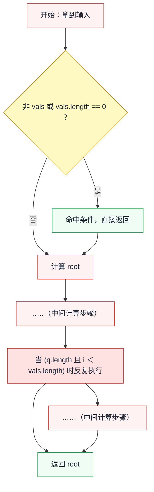

## TypeScript 解题方案（2 个方案逐个讲）

> **运行与提交**：每个方案都是自包含文件（内嵌用例自测，输出 PASS），整块复制到 `.ts` 文件后 `node 文件名` 即可运行。提交 LeetCode 时，把 `demo` 内的算法函数与辅助类型/函数整体取出、置于文件顶层即可。涉及交互/特殊接口的题以题面给定签名为准。

### 方案 1：迭代指针处理

**分析与思路**：核心做法是「迭代指针处理」。代码里依次做这些事：队列或堆的调度。

**运行方式**：`node 本文件`，内嵌用例全部通过会输出 PASS。


**方案专属流程图**（真实控制流）：

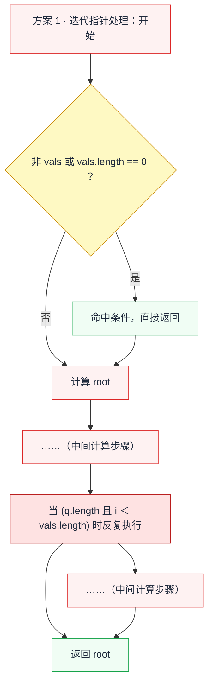

```typescript
class TreeNode {
  // 定义类型
  val: any;
  left: any;
  right: any; // 值: any; 左边界: any; 右边界: any;
  constructor(val?: any, left?: any, right?: any) {
    // constructor(值?: any, 左边界?: any, 右边界?: any) {
    this.val = val === undefined ? 0 : val; // 把 (值 全等于 undefined ? 0 : 值); 写入 值
    this.left = left === undefined ? null : left; // 把 (左边界 全等于 undefined ? null : 左边界); 写入 左边界
    this.right = right === undefined ? null : right; // 把 (右边界 全等于 undefined ? null : 右边界); 写入 右边界
  }
}
function buildTree(vals: any): any {
  // 定义函数/方法 buildTree
  if (!vals || vals.length === 0) return null; // 若 取反 vals 或 vals.长度 全等于 0，直接返回 null
  const root = new TreeNode(vals[0]);
  const q: any[] = [root];
  let i = 1;
  while (q.length && i < vals.length) {
    // 循环，直到不满足「节点.长度 且 下标 i 小于 vals.长度」
    const node = q.shift(); // 把 节点.shift() 存入 节点
    if (vals[i] !== null && vals[i] !== undefined) {
      node.left = new TreeNode(vals[i]);
      q.push(node.left);
    }
    i++; // 下标 i 加一
    if (i < vals.length && vals[i] !== null && vals[i] !== undefined) {
      node.right = new TreeNode(vals[i]);
      q.push(node.right);
    }
    i++; // 下标 i 加一
  }
  return root; // 返回 根节点
}
function treeToLevel(root: any): any[] {
  // 定义函数/方法 treeToLevel
  if (!root) return []; // 若 取反 根节点，直接返回 []
  const out: any[] = [];
  const q: any[] = [root]; // 把 []; const 节点: any[] 赋值为 [根节点]; 写入 const out: any[]
  while (q.length) {
    // 循环，直到不满足「节点.长度」
    const n = q.shift(); // 把 节点.shift() 存入 元素个数
    if (n === null || n === undefined) {
      out.push(null);
      continue;
    }
    out.push(n.val);
    q.push(n.left);
    q.push(n.right); // 把 元素个数.值 压入栈/数组尾部
  }
  while (out.length && out[out.length - 1] === null) out.pop(); // 循环，直到不满足「out.长度 且 out[out.长度 减 1] 全等于 null) out 弹出 );」
  return out; // 返回 out
}
class ListNode {
  // 定义类型
  val: any;
  next: any; // 值: any; 下一个: any;
  constructor(val?: any, next?: any) {
    this.val = val === undefined ? 0 : val;
    this.next = next === undefined ? null : next;
  }
}
function buildList(vals: any): any {
  // 定义函数/方法 buildList
  const dummy = new ListNode(0);
  let cur = dummy; // 把 new ListNode(0); let 当前值 赋值为 哨兵节点 存入 哨兵节点
  for (const v of vals) {
    cur.next = new ListNode(v);
    cur = cur.next;
  } // 把 new ListNode(值); 当前值 赋值为 当前值.下一个; } 写入 下一个
  return dummy.next; // 返回 哨兵节点.下一个
}
function listToArray(head: any): any[] {
  // 定义函数/方法 listToArray
  const out: any[] = [];
  let p = head; // 把 []; let 节点 赋值为 头节点; 写入 const out: any[]
  while (p) {
    out.push(p.val);
    p = p.next;
  } // 循环，直到不满足「节点) { out 追加 节点.值); 节点 赋值为 节点.下一个; }」
  return out; // 返回 out
}
// python-runtime shims
function pyLen(a: any): number {
  // 定义函数/方法 pyLen
  if (a === null || a === undefined) return 0; // 若 数组 全等于 null 或 数组 全等于 undefined，直接返回 0
  if (
    typeof a === 'string' ||
    Array.isArray(a) ||
    a instanceof Set ||
    a instanceof Map
  )
    return a.length ?? a.size;
  if (typeof a === 'object') return Object.keys(a).length; // 若 typeof 数组 全等于 'object'，直接返回 Object.keys(数组).长度
  return 0; // 返回 0
}
function pySlice(a: any, i: any, j: any, step?: any): any {
  // 定义函数/方法 pySlice
  if (typeof a === 'string') {
    const r = [...a].slice(i ?? 0, j ?? a.length);
    return step ? r.reverse().join('') : r.join('');
  }
  const arr = Array.isArray(a) ? a : [...a]; // 把 Array.isArray(数组) ? 数组 : 复制的 数组 存入 数组
  return arr.slice(i ?? 0, j ?? arr.length); // 返回 数组 截取 下标 i ?? 0, 下标 j ?? 数组.长度)
}
function pyRange(a: any, b?: any, step?: any): any[] {
  // 定义函数/方法 pyRange
  let s = 0,
    e = a,
    st = 1; // 把 0, e 赋值为 数组, st 赋值为 1 存入 字符串
  if (b !== undefined) {
    s = a;
    e = b;
  } // 若 b 不等于 undefined) { 字符串 赋值为 数组; e 赋值为 b; }
  if (step !== undefined) st = step; // 若 步数 不等于 undefined) st 赋值为 步数;
  const out: any[] = []; // 把 []; 写入 const out: any[]
  if (st > 0) for (let i = s; i < e; i += st) out.push(i);
  else for (let i = s; i > e; i += st) out.push(i); // 否则
  return out; // 返回 out
}
function pyIn(x: any, coll: any): boolean {
  // 定义函数/方法 pyIn
  if (coll === null || coll === undefined) return false; // 若 coll 全等于 null 或 coll 全等于 undefined，直接返回 false
  if (Array.isArray(coll)) return coll.includes(x); // 若 Array.isArray(coll)，直接返回 coll 是否包含 x)
  if (coll instanceof Set || coll instanceof Map) return coll.has(x); // 若 coll instanceof Set 或 coll instanceof Map，直接返回 coll.has(x)
  if (typeof coll === 'object') return x in coll; // 若 typeof coll 全等于 'object'，直接返回 x in coll
  if (typeof coll === 'string') return coll.indexOf(x) >= 0; // 若 typeof coll 全等于 'string'，直接返回 coll 查找 x) 不低于 0
  return false; // 返回 false
}
function pySorted(a: any): any[] {
  // 定义函数/方法 pySorted
  const arr = typeof a === 'string' ? [...a] : [...a]; // 把 (typeof 数组 全等于 'string') ? 复制的 数组 : 复制的 数组 存入 数组
  return arr.sort((x: any, y: any) => (x < y ? -1 : x > y ? 1 : 0));
}
function pyMin(a: any, b?: any): any {
  if (b !== undefined) return Math.min(a, b);
  if (Array.isArray(a) || a instanceof Set) return Math.min(...a);
  return Math.min(a);
} // 定义函数/方法 pyMin
function pyMax(a: any, b?: any): any {
  if (b !== undefined) return Math.max(a, b);
  if (Array.isArray(a) || a instanceof Set) return Math.max(...a);
  return Math.max(a);
} // 定义函数/方法 pyMax
function pySum(a: any): number {
  let s = 0;
  for (const v of a) s += v;
  return s;
} // 定义函数/方法 pySum
function pyAbs(x: any): number {
  return Math.abs(x);
} // 定义函数/方法 pyAbs
function pyEnumerate(a: any): any[] {
  const out: any[] = [];
  let i = 0;
  for (const v of a) {
    out.push([i, v]);
    i++;
  }
  return out;
} // 定义函数/方法 pyEnumerate
function pyZip(a: any, b: any): any[] {
  const n = Math.min(a.length, b.length);
  const out: any[] = [];
  for (let i = 0; i < n; i++) out.push([a[i], b[i]]);
  return out;
} // 定义函数/方法 pyZip
function pyDictGet(d: any, k: any, def?: any): any {
  return k in d ? d[k] : def === undefined ? null : def;
} // 定义函数/方法 pyDictGet
function pyPrint(...args: any[]): void {
  console.log(
    args
      .map((a) => (typeof a === 'object' && a !== null ? JSON.stringify(a) : a))
      .join(' '),
  );
} // 定义函数/方法 pyPrint
// collections / heapq
function heapPush(h: any[], x: any): void {
  h.push(x);
  let i = h.length - 1;
  while (i > 0) {
    const p = (i - 1) >> 1;
    if (h[p] <= h[i]) break;
    [h[p], h[i]] = [h[i], h[p]];
    i = p;
  }
} // 定义函数/方法 heapPush
function heapPop(h: any[]): any {
  const top = h[0];
  const last = h.pop();
  if (h.length) {
    h[0] = last;
    let i = 0;
    const n = h.length;
    while (true) {
      let l = 2 * i + 1,
        r = 2 * i + 2,
        s = i;
      if (l < n && h[l] < h[s]) s = l;
      if (r < n && h[r] < h[s]) s = r;
      if (s === i) break;
      [h[s], h[i]] = [h[i], h[s]];
      i = s;
    }
  }
  return top;
} // 定义函数/方法 heapPop
class Deque {
  private a: any[] = [];
  push(x: any) {
    this.a.push(x);
  }
  pushLeft(x: any) {
    this.a.unshift(x);
  }
  pop() {
    return this.a.pop();
  }
  popLeft() {
    return this.a.shift();
  }
  get length() {
    return this.a.length;
  }
  toArray() {
    return this.a.slice();
  }
} // 定义类型
function Counter(iter: any): any {
  const m: any = {};
  for (const v of iter) m[v] = (m[v] || 0) + 1;
  return m;
} // 定义函数/方法 Counter
function gcd(a: any, b: any): any {
  while (b) {
    [a, b] = [b, a % b];
  }
  return a;
} // 定义函数/方法 gcd
function pyInf(): number {
  return Infinity;
} // 定义函数/方法 pyInf

function norm(x: any): any {
  // 定义函数/方法 norm
  if (x === null || x === undefined) return null; // 若 x 全等于 null 或 x 全等于 undefined，直接返回 null
  if (typeof x === 'object') {
    // 若 typeof x 全等于 'object'
    if (x instanceof Deque) return x.toArray(); // 若 x instanceof Deque，直接返回 x.toArray()
    if (Array.isArray(x)) return x.map(norm); // 若 Array.isArray(x)，直接返回 x.映射表(norm)
    if (
      typeof x.val === 'number' &&
      (typeof x.left !== 'undefined' || typeof x.right !== 'undefined')
    )
      return treeToLevel(x);
    if (typeof x.next !== 'undefined' && typeof x.val === 'number')
      return listToArray(x);
    if (x instanceof Set) return [...x].sort(); // 若 x instanceof Set，直接返回 复制的 x 排序 )
    if (x instanceof Map) return Object.fromEntries(x); // 若 x instanceof Map，直接返回 Object.fromEntries(x)
    const o: any = {};
    for (const k of Object.keys(x)) o[k] = norm(x[k]);
    return o;
  }
  return x; // 返回 x
}
function eq(a: any, b: any): boolean {
  // 定义函数/方法 eq
  const x = norm(a),
    y = norm(b); // 把 norm(数组), y 赋值为 norm(b) 存入 x
  if (x === y) return true; // 若 x 全等于 y，直接返回 true
  if (x === null || y === null) return x === y; // 若 x 全等于 null 或 y 全等于 null，直接返回 x 全等于 y
  if (Array.isArray(x) && Array.isArray(y)) {
    // 若 Array.isArray(x) 且 Array.isArray(y
    if (x.length !== y.length) return false; // 若 x.长度 不等于 y.长度，直接返回 false
    for (let i = 0; i < x.length; i++) if (!eq(x[i], y[i])) return false; // 让 下标 i 从 0 开始计数，下标 i 小于 x.长度 就继续
    return true; // 返回 true
  }
  if (typeof x === 'object' && typeof y === 'object') {
    // 若 typeof x 全等于 'object' 且 typeof y 全等于 'object'
    const kx = Object.keys(x),
      ky = Object.keys(y); // 把 Object.keys(x), ky 赋值为 Object.keys(y) 存入 kx
    if (kx.length !== ky.length) return false; // 若 kx.长度 不等于 ky.长度，直接返回 false
    for (const k of kx) if (!eq(x[k], y[k])) return false;
    return true; // 返回 true
  }
  return x === y; // 返回 x 全等于 y
}

function dailyTemperatures(t) {
  // 定义函数/方法 dailyTemperatures
  const res = new Array(t.length).fill(0); // 把 new Array(另一字符串.长度).fill(0) 存入 结果
  const st = []; // 把 [] 存入 st
  for (let i = 0; i < t.length; i++) {
    // 让 下标 i 从 0 开始计数，下标 i 小于 另一字符串.长度 就继续
    while (st.length && t[i] > t[st[st.length - 1]]) {
      // 循环，直到不满足「st.长度 且 另一字符串[下标 i] 超过 另一字符串[st[st.长度 减 1]]」
      const idx = st.pop(); // 把 st 弹出 ) 存入 idx
      res[idx] = i - idx; // 把 下标 i 减 idx; 写入 res[idx]
    }
    st.push(i); // 把 下标 i 压入栈/数组尾部
  }
  return res; // 返回 结果
}
export function demo(): void {
  // 程序入口：跑内嵌自测用例
  const cases = [
    { in: [[73, 74, 75, 71, 69, 72, 76, 73]], want: [1, 1, 4, 2, 1, 1, 0, 0] },
    { in: [[30, 40, 50, 60]], want: [1, 1, 1, 0] },
    { in: [[30, 60, 90]], want: [1, 1, 0] },
    { in: [[55]], want: [0] },
  ];
  let fail = false; // 把 false 存入 fail
  for (const c of cases) {
    // for (const 字符 of cases) {
    const got = dailyTemperatures(...c.in); // 把 dailyTemperatures(...字符.in) 存入 got
    if (!eq(got, c.want)) {
      fail = true;
      console.log(
        'FAIL',
        JSON.stringify(c.in),
        '=>',
        JSON.stringify(got),
        'want',
        JSON.stringify(c.want),
      );
    }
  }
  if (fail) throw new Error('FAILED'); // 若 fail) throw new Error('FAILED');
  console.log('PASS'); // 全部用例通过，输出 PASS
}
demo(); // demo();
```

### 方案 2：迭代指针处理

**分析与思路**：核心做法是「迭代指针处理」。代码里依次做这些事：队列或堆的调度。

**运行方式**：`node 本文件`，内嵌用例全部通过会输出 PASS。


**方案专属流程图**（真实控制流）：


```typescript
class TreeNode {
  // 定义类型
  val: any;
  left: any;
  right: any; // 值: any; 左边界: any; 右边界: any;
  constructor(val?: any, left?: any, right?: any) {
    // constructor(值?: any, 左边界?: any, 右边界?: any) {
    this.val = val === undefined ? 0 : val; // 把 (值 全等于 undefined ? 0 : 值); 写入 值
    this.left = left === undefined ? null : left; // 把 (左边界 全等于 undefined ? null : 左边界); 写入 左边界
    this.right = right === undefined ? null : right; // 把 (右边界 全等于 undefined ? null : 右边界); 写入 右边界
  }
}
function buildTree(vals: any): any {
  // 定义函数/方法 buildTree
  if (!vals || vals.length === 0) return null; // 若 取反 vals 或 vals.长度 全等于 0，直接返回 null
  const root = new TreeNode(vals[0]);
  const q: any[] = [root];
  let i = 1;
  while (q.length && i < vals.length) {
    // 循环，直到不满足「节点.长度 且 下标 i 小于 vals.长度」
    const node = q.shift(); // 把 节点.shift() 存入 节点
    if (vals[i] !== null && vals[i] !== undefined) {
      node.left = new TreeNode(vals[i]);
      q.push(node.left);
    }
    i++; // 下标 i 加一
    if (i < vals.length && vals[i] !== null && vals[i] !== undefined) {
      node.right = new TreeNode(vals[i]);
      q.push(node.right);
    }
    i++; // 下标 i 加一
  }
  return root; // 返回 根节点
}
function treeToLevel(root: any): any[] {
  // 定义函数/方法 treeToLevel
  if (!root) return []; // 若 取反 根节点，直接返回 []
  const out: any[] = [];
  const q: any[] = [root]; // 把 []; const 节点: any[] 赋值为 [根节点]; 写入 const out: any[]
  while (q.length) {
    // 循环，直到不满足「节点.长度」
    const n = q.shift(); // 把 节点.shift() 存入 元素个数
    if (n === null || n === undefined) {
      out.push(null);
      continue;
    }
    out.push(n.val);
    q.push(n.left);
    q.push(n.right); // 把 元素个数.值 压入栈/数组尾部
  }
  while (out.length && out[out.length - 1] === null) out.pop(); // 循环，直到不满足「out.长度 且 out[out.长度 减 1] 全等于 null) out 弹出 );」
  return out; // 返回 out
}
class ListNode {
  // 定义类型
  val: any;
  next: any; // 值: any; 下一个: any;
  constructor(val?: any, next?: any) {
    this.val = val === undefined ? 0 : val;
    this.next = next === undefined ? null : next;
  }
}
function buildList(vals: any): any {
  // 定义函数/方法 buildList
  const dummy = new ListNode(0);
  let cur = dummy; // 把 new ListNode(0); let 当前值 赋值为 哨兵节点 存入 哨兵节点
  for (const v of vals) {
    cur.next = new ListNode(v);
    cur = cur.next;
  } // 把 new ListNode(值); 当前值 赋值为 当前值.下一个; } 写入 下一个
  return dummy.next; // 返回 哨兵节点.下一个
}
function listToArray(head: any): any[] {
  // 定义函数/方法 listToArray
  const out: any[] = [];
  let p = head; // 把 []; let 节点 赋值为 头节点; 写入 const out: any[]
  while (p) {
    out.push(p.val);
    p = p.next;
  } // 循环，直到不满足「节点) { out 追加 节点.值); 节点 赋值为 节点.下一个; }」
  return out; // 返回 out
}
// python-runtime shims
function pyLen(a: any): number {
  // 定义函数/方法 pyLen
  if (a === null || a === undefined) return 0; // 若 数组 全等于 null 或 数组 全等于 undefined，直接返回 0
  if (
    typeof a === 'string' ||
    Array.isArray(a) ||
    a instanceof Set ||
    a instanceof Map
  )
    return a.length ?? a.size;
  if (typeof a === 'object') return Object.keys(a).length; // 若 typeof 数组 全等于 'object'，直接返回 Object.keys(数组).长度
  return 0; // 返回 0
}
function pySlice(a: any, i: any, j: any, step?: any): any {
  // 定义函数/方法 pySlice
  if (typeof a === 'string') {
    const r = [...a].slice(i ?? 0, j ?? a.length);
    return step ? r.reverse().join('') : r.join('');
  }
  const arr = Array.isArray(a) ? a : [...a]; // 把 Array.isArray(数组) ? 数组 : 复制的 数组 存入 数组
  return arr.slice(i ?? 0, j ?? arr.length); // 返回 数组 截取 下标 i ?? 0, 下标 j ?? 数组.长度)
}
function pyRange(a: any, b?: any, step?: any): any[] {
  // 定义函数/方法 pyRange
  let s = 0,
    e = a,
    st = 1; // 把 0, e 赋值为 数组, st 赋值为 1 存入 字符串
  if (b !== undefined) {
    s = a;
    e = b;
  } // 若 b 不等于 undefined) { 字符串 赋值为 数组; e 赋值为 b; }
  if (step !== undefined) st = step; // 若 步数 不等于 undefined) st 赋值为 步数;
  const out: any[] = []; // 把 []; 写入 const out: any[]
  if (st > 0) for (let i = s; i < e; i += st) out.push(i);
  else for (let i = s; i > e; i += st) out.push(i); // 否则
  return out; // 返回 out
}
function pyIn(x: any, coll: any): boolean {
  // 定义函数/方法 pyIn
  if (coll === null || coll === undefined) return false; // 若 coll 全等于 null 或 coll 全等于 undefined，直接返回 false
  if (Array.isArray(coll)) return coll.includes(x); // 若 Array.isArray(coll)，直接返回 coll 是否包含 x)
  if (coll instanceof Set || coll instanceof Map) return coll.has(x); // 若 coll instanceof Set 或 coll instanceof Map，直接返回 coll.has(x)
  if (typeof coll === 'object') return x in coll; // 若 typeof coll 全等于 'object'，直接返回 x in coll
  if (typeof coll === 'string') return coll.indexOf(x) >= 0; // 若 typeof coll 全等于 'string'，直接返回 coll 查找 x) 不低于 0
  return false; // 返回 false
}
function pySorted(a: any): any[] {
  // 定义函数/方法 pySorted
  const arr = typeof a === 'string' ? [...a] : [...a]; // 把 (typeof 数组 全等于 'string') ? 复制的 数组 : 复制的 数组 存入 数组
  return arr.sort((x: any, y: any) => (x < y ? -1 : x > y ? 1 : 0));
}
function pyMin(a: any, b?: any): any {
  if (b !== undefined) return Math.min(a, b);
  if (Array.isArray(a) || a instanceof Set) return Math.min(...a);
  return Math.min(a);
} // 定义函数/方法 pyMin
function pyMax(a: any, b?: any): any {
  if (b !== undefined) return Math.max(a, b);
  if (Array.isArray(a) || a instanceof Set) return Math.max(...a);
  return Math.max(a);
} // 定义函数/方法 pyMax
function pySum(a: any): number {
  let s = 0;
  for (const v of a) s += v;
  return s;
} // 定义函数/方法 pySum
function pyAbs(x: any): number {
  return Math.abs(x);
} // 定义函数/方法 pyAbs
function pyEnumerate(a: any): any[] {
  const out: any[] = [];
  let i = 0;
  for (const v of a) {
    out.push([i, v]);
    i++;
  }
  return out;
} // 定义函数/方法 pyEnumerate
function pyZip(a: any, b: any): any[] {
  const n = Math.min(a.length, b.length);
  const out: any[] = [];
  for (let i = 0; i < n; i++) out.push([a[i], b[i]]);
  return out;
} // 定义函数/方法 pyZip
function pyDictGet(d: any, k: any, def?: any): any {
  return k in d ? d[k] : def === undefined ? null : def;
} // 定义函数/方法 pyDictGet
function pyPrint(...args: any[]): void {
  console.log(
    args
      .map((a) => (typeof a === 'object' && a !== null ? JSON.stringify(a) : a))
      .join(' '),
  );
} // 定义函数/方法 pyPrint
// collections / heapq
function heapPush(h: any[], x: any): void {
  h.push(x);
  let i = h.length - 1;
  while (i > 0) {
    const p = (i - 1) >> 1;
    if (h[p] <= h[i]) break;
    [h[p], h[i]] = [h[i], h[p]];
    i = p;
  }
} // 定义函数/方法 heapPush
function heapPop(h: any[]): any {
  const top = h[0];
  const last = h.pop();
  if (h.length) {
    h[0] = last;
    let i = 0;
    const n = h.length;
    while (true) {
      let l = 2 * i + 1,
        r = 2 * i + 2,
        s = i;
      if (l < n && h[l] < h[s]) s = l;
      if (r < n && h[r] < h[s]) s = r;
      if (s === i) break;
      [h[s], h[i]] = [h[i], h[s]];
      i = s;
    }
  }
  return top;
} // 定义函数/方法 heapPop
class Deque {
  private a: any[] = [];
  push(x: any) {
    this.a.push(x);
  }
  pushLeft(x: any) {
    this.a.unshift(x);
  }
  pop() {
    return this.a.pop();
  }
  popLeft() {
    return this.a.shift();
  }
  get length() {
    return this.a.length;
  }
  toArray() {
    return this.a.slice();
  }
} // 定义类型
function Counter(iter: any): any {
  const m: any = {};
  for (const v of iter) m[v] = (m[v] || 0) + 1;
  return m;
} // 定义函数/方法 Counter
function gcd(a: any, b: any): any {
  while (b) {
    [a, b] = [b, a % b];
  }
  return a;
} // 定义函数/方法 gcd
function pyInf(): number {
  return Infinity;
} // 定义函数/方法 pyInf

function norm(x: any): any {
  // 定义函数/方法 norm
  if (x === null || x === undefined) return null; // 若 x 全等于 null 或 x 全等于 undefined，直接返回 null
  if (typeof x === 'object') {
    // 若 typeof x 全等于 'object'
    if (x instanceof Deque) return x.toArray(); // 若 x instanceof Deque，直接返回 x.toArray()
    if (Array.isArray(x)) return x.map(norm); // 若 Array.isArray(x)，直接返回 x.映射表(norm)
    if (
      typeof x.val === 'number' &&
      (typeof x.left !== 'undefined' || typeof x.right !== 'undefined')
    )
      return treeToLevel(x);
    if (typeof x.next !== 'undefined' && typeof x.val === 'number')
      return listToArray(x);
    if (x instanceof Set) return [...x].sort(); // 若 x instanceof Set，直接返回 复制的 x 排序 )
    if (x instanceof Map) return Object.fromEntries(x); // 若 x instanceof Map，直接返回 Object.fromEntries(x)
    const o: any = {};
    for (const k of Object.keys(x)) o[k] = norm(x[k]);
    return o;
  }
  return x; // 返回 x
}
function eq(a: any, b: any): boolean {
  // 定义函数/方法 eq
  const x = norm(a),
    y = norm(b); // 把 norm(数组), y 赋值为 norm(b) 存入 x
  if (x === y) return true; // 若 x 全等于 y，直接返回 true
  if (x === null || y === null) return x === y; // 若 x 全等于 null 或 y 全等于 null，直接返回 x 全等于 y
  if (Array.isArray(x) && Array.isArray(y)) {
    // 若 Array.isArray(x) 且 Array.isArray(y
    if (x.length !== y.length) return false; // 若 x.长度 不等于 y.长度，直接返回 false
    for (let i = 0; i < x.length; i++) if (!eq(x[i], y[i])) return false; // 让 下标 i 从 0 开始计数，下标 i 小于 x.长度 就继续
    return true; // 返回 true
  }
  if (typeof x === 'object' && typeof y === 'object') {
    // 若 typeof x 全等于 'object' 且 typeof y 全等于 'object'
    const kx = Object.keys(x),
      ky = Object.keys(y); // 把 Object.keys(x), ky 赋值为 Object.keys(y) 存入 kx
    if (kx.length !== ky.length) return false; // 若 kx.长度 不等于 ky.长度，直接返回 false
    for (const k of kx) if (!eq(x[k], y[k])) return false;
    return true; // 返回 true
  }
  return x === y; // 返回 x 全等于 y
}

function dailyTemperatures(t) {
  // 定义函数/方法 dailyTemperatures
  const res = new Array(t.length).fill(0); // 把 new Array(另一字符串.长度).fill(0) 存入 结果
  const st = []; // 把 [] 存入 st
  for (let i = 0; i < t.length; i++) {
    // 让 下标 i 从 0 开始计数，下标 i 小于 另一字符串.长度 就继续
    while (st.length && t[i] > t[st[st.length - 1]]) {
      // 循环，直到不满足「st.长度 且 另一字符串[下标 i] 超过 另一字符串[st[st.长度 减 1]]」
      const idx = st.pop(); // 把 st 弹出 ) 存入 idx
      res[idx] = i - idx; // 把 下标 i 减 idx; 写入 res[idx]
    }
    st.push(i); // 把 下标 i 压入栈/数组尾部
  }
  return res; // 返回 结果
}
export function demo(): void {
  // 程序入口：跑内嵌自测用例
  const cases = [
    { in: [[73, 74, 75, 71, 69, 72, 76, 73]], want: [1, 1, 4, 2, 1, 1, 0, 0] },
    { in: [[30, 40, 50, 60]], want: [1, 1, 1, 0] },
    { in: [[30, 60, 90]], want: [1, 1, 0] },
    { in: [[55]], want: [0] },
  ];
  let fail = false; // 把 false 存入 fail
  for (const c of cases) {
    // for (const 字符 of cases) {
    const got = dailyTemperatures(...c.in); // 把 dailyTemperatures(...字符.in) 存入 got
    if (!eq(got, c.want)) {
      fail = true;
      console.log(
        'FAIL',
        JSON.stringify(c.in),
        '=>',
        JSON.stringify(got),
        'want',
        JSON.stringify(c.want),
      );
    }
  }
  if (fail) throw new Error('FAILED'); // 若 fail) throw new Error('FAILED');
  console.log('PASS'); // 全部用例通过，输出 PASS
}
demo(); // demo();
```

## 逐步拆解与面试追问

**复杂度**：时间 O(n)（单趟线性扫描），空间 O(1) 到 O(n)（视辅助结构）

**为什么是这个量级**：每个元素被常数次访问，辅助哈希或栈的开销与 n 同阶

**面试官可能会追问**：

- 什么时候用单调栈（求下一个更大或更小）？
- 栈里存值还是存下标？
- 能否用 O(1) 额外空间？

## 关键 API 速查（TS 主解法实际用到，附官方链接）

| API | 作用 | 使用要点 | 官方文档 |
|---|---|---|---|
| `Array.prototype.sort()` | 原地排序 | 默认按字符串 Unicode 序（10 会排在 2 前），数字必须传 (a,b)=>a-b；V8 用 TimSort，稳定，O(n log n)；返回原数组引用 | [官方文档](https://developer.mozilla.org/zh-CN/docs/Web/JavaScript/Reference/Global_Objects/Array/sort) |
| `Array.prototype.map()` | 逐元素映射为新数组 | 回调 (v,i,arr)；返回等长新数组，不改变原数组；稀疏位跳过；链式调用注意中间数组开销 | [官方文档](https://developer.mozilla.org/zh-CN/docs/Web/JavaScript/Reference/Global_Objects/Array/map) |
| `Array.prototype.push()` | 尾部追加 | 返回新长度；可一次多个；均摊 O(1)；会改变原数组 | [官方文档](https://developer.mozilla.org/zh-CN/docs/Web/JavaScript/Reference/Global_Objects/Array/push) |
| `Array.prototype.pop()` | 尾部弹出 | 返回被删元素（空数组返回 undefined）；O(1) | [官方文档](https://developer.mozilla.org/zh-CN/docs/Web/JavaScript/Reference/Global_Objects/Array/pop) |
| `Array.prototype.shift()` | 头部取出 | O(n)（后续元素整体前移）；大量头部操作请用链表或双端结构 | [官方文档](https://developer.mozilla.org/zh-CN/docs/Web/JavaScript/Reference/Global_Objects/Array/shift) |
| `Array.prototype.unshift()` | 头部插入 | O(n)；与 shift 组合可当双端队列 | [官方文档](https://developer.mozilla.org/zh-CN/docs/Web/JavaScript/Reference/Global_Objects/Array/unshift) |
| `Array/String includes()` | 是否包含 | 数组用 SameValueZero（NaN 可判）；字符串按子串；第二个参数为起始下标 | [官方文档](https://developer.mozilla.org/zh-CN/docs/Web/JavaScript/Reference/Global_Objects/Array/includes) |
| `Array/String indexOf()` | 首次出现的下标 | 找不到返回 -1；无法判 NaN（用 includes）；字符串可传起始位 | [官方文档](https://developer.mozilla.org/zh-CN/docs/Web/JavaScript/Reference/Global_Objects/Array/indexOf) |
| `Array/String slice()` | 切片（不改原数组） | slice(start,end) 含头不含尾；负数从尾计；常用于复制数组（slice()） | [官方文档](https://developer.mozilla.org/zh-CN/docs/Web/JavaScript/Reference/Global_Objects/Array/slice) |
| `Array.prototype.join()` | 数组拼接为字符串 | undefined/null 转空串；嵌套数组会展平一层；join('') 用于字符数组还原 | [官方文档](https://developer.mozilla.org/zh-CN/docs/Web/JavaScript/Reference/Global_Objects/Array/join) |
| `Object.keys()` | 对象键名数组 | 仅自身可枚举字符串键（不含 symbol）；配 length 可当计数器 | [官方文档](https://developer.mozilla.org/zh-CN/docs/Web/JavaScript/Reference/Global_Objects/Object/keys) |
| `Object.fromEntries()` | 键值对数组转对象 | 参数为 [k,v] 可迭代；map 出来的键值对可直接转对象 | [官方文档](https://developer.mozilla.org/zh-CN/docs/Web/JavaScript/Reference/Global_Objects/Object/fromEntries) |
| `JSON.stringify()` | 序列化为 JSON 字符串 | 常用于结构化比较（深度相等判定）；undefined/函数/循环引用会被丢弃或抛错 | [官方文档](https://developer.mozilla.org/zh-CN/docs/Web/JavaScript/Reference/Global_Objects/JSON/stringify) |
| `Math.max()` | 最大值 | 配展开 Math.max(...arr)；空参返回 -Infinity；超大数组注意展开参数上限 | [官方文档](https://developer.mozilla.org/zh-CN/docs/Web/JavaScript/Reference/Global_Objects/Math/max) |
| `Math.min()` | 最小值 | 同 max；空参返回 Infinity | [官方文档](https://developer.mozilla.org/zh-CN/docs/Web/JavaScript/Reference/Global_Objects/Math/min) |
| `Math.abs()` | 绝对值 | 入参会被隐式转数字；-0 返回 +0 | [官方文档](https://developer.mozilla.org/zh-CN/docs/Web/JavaScript/Reference/Global_Objects/Math/abs) |

### 各语言官方文档导航

- **TypeScript / JS**：[MDN 中文参考](https://developer.mozilla.org/zh-CN/)
- **Python**：[Python 官方文档](https://docs.python.org/zh-cn/3/)
- **Go**：[Go 标准库](https://pkg.go.dev/std)
- **Java**：[JDK 17 API](https://docs.oracle.com/en/java/javase/17/docs/api/)
- **Rust**：[Rust 标准库](https://doc.rust-lang.org/std/)
- **Lua**：[Lua 5.4 手册](https://www.lua.org/manual/5.4/)
- **C**：[Cppreference C](https://zh.cppreference.com/w/c)
- **C++**：[Cppreference C++](https://zh.cppreference.com/w/cpp)
- **R**：[R 官方手册](https://stat.ethz.ch/R-manual/)
- **Zig**：[Zig 语言文档](https://ziglang.org/documentation/master/)
- **Dart**：[Dart API](https://api.dart.dev/)

## 附录：其他 10 种语言全部实现（每种语言列举其全部方案）

> TypeScript 的全部方案见「TypeScript 解题方案」一节；下面是其余 10 种语言的对应实现，每种语言的每个方案都带思路分析、代码走读与专属运行架构图。
> 每个方案都内嵌用例自测，可独立运行（老仓库 python/go 文件遵循「打印结果」约定）。
> 完整解法文件见 `dsa/<语言>/stack/lc_739_每日温度/`。

### Python 实现（2 种方案）

Python 的全部方案如下，每个方案都内嵌用例自测，可独立运行（老仓库 python/go 文件遵循「打印结果」约定）：

#### 方案 1：迭代指针处理

**思路与代码分析**：核心是「迭代指针处理」。Python 版用切片与字典推导式简化操作，突出可读性。**走读**：方案 1 · 迭代指针处理：开始 → 更新 length → 更新 ans → 更新 next_warmer → 循环 i：从 length - 1 到 -1 前，步长 -1 → 更新 warmer_index → 更新 t → 循环 temp：从 t + 1 到 101 前 → 若 next_warmer[temp] ＜ warmer_index：更新 warmer_index → 更新 warmer_index → 若 warmer_index ＜ float(inf)：更新 ans[i] → 更新 ans[i] → 更新 next_warmer[t] → 返回 ans。

**运行架构**（真实控制流）：

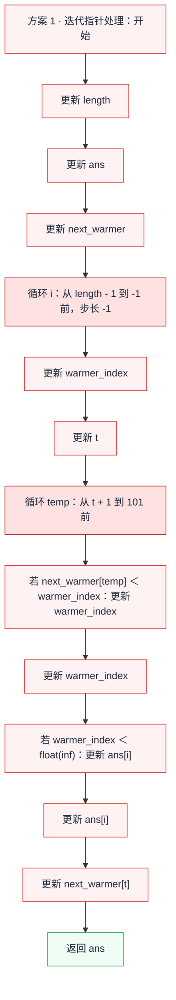

```python
import sys  # 提高递归深度上限（深输入防 RecursionError）

sys.setrecursionlimit(200000)  # 树/链表类题目节点数可达 1e4 量级

def dailyTemperatures(temperatures):  # 定义函数 dailyTemperatures（参数：temperatures）
    length = len(temperatures)  # 把 长度(temperatures) 存入 长度
    ans = [0] * length  # 把 [0] 乘 长度 存入 答案
    next_warmer = [float("inf")] * 101  # 把 [float('inf')] 乘 101 存入 next_warmer

    for i in range(length - 1, -1, -1):  # 让 下标 i 从 长度 减 1 倒数回去（每步减 1）
        warmer_index = float("inf")  # 把 float('inf') 存入 warmer_index
        t = temperatures[i]  # 把 temperatures[下标 i] 存入 另一字符串

        # Find the nearest warmer day
        for temp in range(t + 1, 101):  # 让 临时变量 从 另一字符串 加 1 到 101 遍历
            if next_warmer[temp] < warmer_index:  # 若 next_warmer[临时变量] 小于 warmer_index
                warmer_index = next_warmer[temp]  # 把 next_warmer[临时变量] 存入 warmer_index

        if warmer_index < float("inf"):  # 若 warmer_index 小于 float('inf'
            ans[i] = warmer_index - i  # 把 warmer_index 减 下标 i 写入 ans[i]

        next_warmer[t] = i  # 把 下标 i 写入 next_warmer[t]

    return ans  # 返回 答案

if __name__ == "__main__":  # 若 __name__ 等于 '__main__'
    print(dailyTemperatures([73, 74, 75, 71, 69, 72, 76, 73]))  # 打印输出
    print(dailyTemperatures([30, 40, 50, 60]))  # 打印输出
    print(dailyTemperatures([30, 60, 90]))  # 打印输出
```

#### 方案 2：迭代指针处理

**思路与代码分析**：核心是「迭代指针处理」。Python 版用切片与字典推导式简化操作，突出可读性。**走读**：方案 2 · 迭代指针处理：开始 → 更新 length → 更新 ans → 更新 stack → 循环 i：从 0 到 length 前 → 更新 temperature → 当 ( 时反复执行 → 处理 stack and temperature ＞ temp → 处理 ): → 从 stack 弹出 → 更新 ans[prev_index] → 向 stack 追加记录 → 返回 ans。

**运行架构**（真实控制流）：

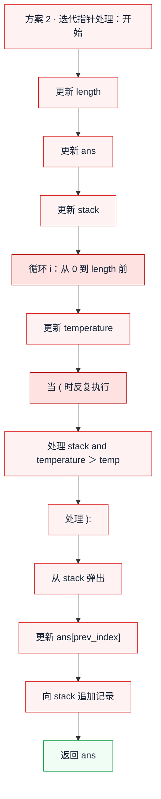

```python
import sys  # 提高递归深度上限（深输入防 RecursionError）

sys.setrecursionlimit(200000)  # 树/链表类题目节点数可达 1e4 量级

def dailyTemperatures(temperatures):  # 定义函数 dailyTemperatures（参数：temperatures）
    length = len(temperatures)  # 把 长度(temperatures) 存入 长度
    ans = [0] * length  # 把 [0] 乘 长度 存入 答案
    stack = []  # 把 [] 存入 栈

    for i in range(length):  # 让 下标 i 从 长度 遍历
        temperature = temperatures[i]  # 把 temperatures[下标 i] 存入 temperature
        while (
            stack and temperature > temperatures[stack[-1]]
        ):  # 循环，直到不满足「栈 and temperature 超过 temperatures[栈[ 减 1]]」
            prev_index = stack.pop()  # 把 栈 弹出 ) 存入 prev_index
            ans[prev_index] = i - prev_index  # 把 下标 i 减 prev_index 写入 ans[prev_index]
        stack.append(i)  # 把 下标 i 追加到列表尾部

    return ans  # 返回 答案

if __name__ == "__main__":  # 若 __name__ 等于 '__main__'
    print(dailyTemperatures([73, 74, 75, 71, 69, 72, 76, 73]))  # 打印输出
    print(dailyTemperatures([30, 40, 50, 60]))  # 打印输出
    print(dailyTemperatures([30, 60, 90]))  # 打印输出
```

### Go 实现（2 种方案）

Go 的全部方案如下，每个方案都内嵌用例自测，可独立运行（老仓库 python/go 文件遵循「打印结果」约定）：

#### 方案 1：迭代指针处理

**思路与代码分析**：核心是「迭代指针处理」。Go 版用切片与多返回值惯用法，显式处理索引边界。**走读**：方案 1 · 迭代指针处理：开始 → 更新 : → 更新 : → 更新 : → 遍历 nextWarmer 的下标与元素 i → 更新 nextWarmer[i] → 遍历循环 → 更新 : → 更新 : → 遍历循环 → 处理 if nextWarmer[temp] ＜ warmer → 更新 warmerIndex → 处理 if warmerIndex ＜ 1＜＜30 → 更新 ans[i] → 更新 nextWarmer[t] → 返回 ans。

**运行架构**（真实控制流）：

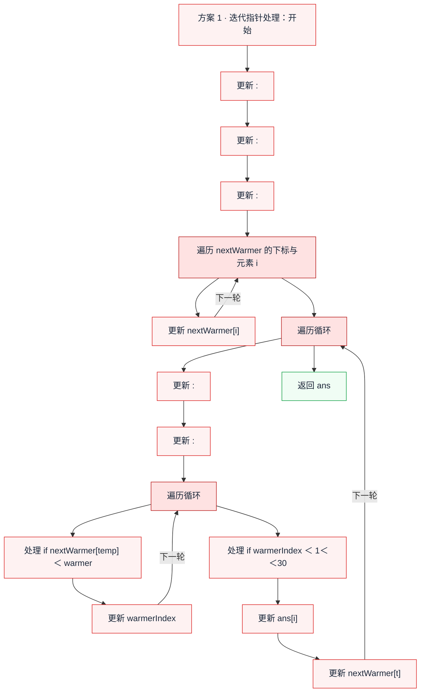

```go
package main // 引入依赖

import (
	"fmt"     // 「fmt」
	"os"      // 「os」
	"reflect" // 「reflect」
)

func dailyTemperatures(temperatures []int) []int { // 定义函数/方法 dailyTemperatures
	length := len(temperatures)    // 把 长度(temperatures) 写入 length :
	ans := make([]int, length)     // 把 make([]int, 长度) 写入 ans :
	nextWarmer := make([]int, 101) // 把 make([]int, 101) 写入 nextWarmer :
	for i := range nextWarmer {    // 把 range nextWarmer { 写入 for i :
		nextWarmer[i] = 1 << 30 // 把 1 小于 小于 30 写入 nextWarmer[i]
	}
	for i := length - 1; i >= 0; i-- { // 把 长度 减 1; 下标 i 不低于 0; 下标 i 减一 { 写入 for i :
		warmerIndex := 1 << 30                   // 把 1 小于 小于 30 写入 warmerIndex :
		t := temperatures[i]                     // 把 temperatures[下标 i] 写入 t :
		for temp := t + 1; temp <= 100; temp++ { // 把 另一字符串 加 1; 临时变量 不超过 100; 临时变量 加一 { 写入 for temp :
			if nextWarmer[temp] < warmerIndex { // 若 nextWarmer[临时变量] 小于 warmerIndex
				warmerIndex = nextWarmer[temp] // 把 nextWarmer[临时变量] 写入 warmerIndex
			}
		}
		if warmerIndex < 1<<30 { // 若 warmerIndex 小于 1 小于 小于 30
			ans[i] = warmerIndex - i // 把 warmerIndex 减 下标 i 写入 ans[i]
		}
		nextWarmer[t] = i // 把 下标 i 写入 nextWarmer[t]
	}
	return ans // 返回 答案
}

func main() { // 程序入口：跑内嵌自测用例
	type tc struct { // 定义类型
		in   []int // in []int
		want []int // want []int
	}
	cases := []tc{ // 把 []tc{ 写入 cases :
		{[]int{73, 74, 75, 71, 69, 72, 76, 73}, []int{1, 1, 4, 2, 1, 1, 0, 0}},
		{[]int{30, 40, 50, 60}, []int{1, 1, 1, 0}},
		{[]int{30, 60, 90}, []int{1, 1, 0}},
	}
	ok := true                // 把 true 写入 ok :
	for _, c := range cases { // 同时取 _ 与 字符 遍历
		if got := dailyTemperatures(c.in); !reflect.DeepEqual(got, c.want) {
			ok = false                                                               // 把 false 写入 ok
			fmt.Printf("FAIL dailyTemperatures(%v)=%v want %v\n", c.in, got, c.want) // 打印输出
		}
	}
	if !ok { // 若 取反 ok
		os.Exit(1) // os.Exit(1)
	}
	fmt.Println("PASS") // 全部用例通过，输出 PASS
}
```

#### 方案 2：迭代指针处理

**思路与代码分析**：核心是「迭代指针处理」。Go 版用切片与多返回值惯用法，显式处理索引边界。**走读**：方案 2 · 迭代指针处理：开始 → 更新 : → 更新 : → 更新 : → 遍历循环 → 更新 : → 遍历循环 → 更新 : → 更新 stack → 更新 ans[prev] → 更新 stack → 返回 ans。

**运行架构**（真实控制流）：

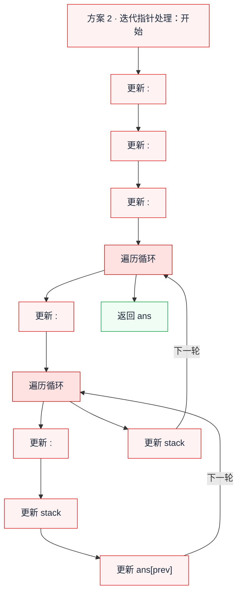

```go
package main // 引入依赖

import (
	"fmt"     // 「fmt」
	"os"      // 「os」
	"reflect" // 「reflect」
)

func dailyTemperatures(temperatures []int) []int { // 定义函数/方法 dailyTemperatures
	length := len(temperatures)   // 把 长度(temperatures) 写入 length :
	ans := make([]int, length)    // 把 make([]int, 长度) 写入 ans :
	stack := []int{}              // 把 []int{} 写入 stack :
	for i := 0; i < length; i++ { // 让 下标 i 从 0 开始计数
		temperature := temperatures[i]                                          // 把 temperatures[下标 i] 写入 temperature :
		for len(stack) > 0 && temperature > temperatures[stack[len(stack)-1]] { // for 长度(栈) 超过 0 且 temperature 超过 temperatures[栈[长度(栈) 减 1]] {
			prev := stack[len(stack)-1]  // 把 栈[长度(栈) 减 1] 写入 prev :
			stack = stack[:len(stack)-1] // 把 栈[:长度(栈) 减 1] 写入 栈
			ans[prev] = i - prev         // 把 下标 i 减 前一个 写入 ans[prev]
		}
		stack = append(stack, i) // 把 append(栈, 下标 i) 写入 栈
	}
	return ans // 返回 答案
}

func main() { // 程序入口：跑内嵌自测用例
	type tc struct { // 定义类型
		in   []int // in []int
		want []int // want []int
	}
	cases := []tc{ // 把 []tc{ 写入 cases :
		{[]int{73, 74, 75, 71, 69, 72, 76, 73}, []int{1, 1, 4, 2, 1, 1, 0, 0}},
		{[]int{30, 40, 50, 60}, []int{1, 1, 1, 0}},
		{[]int{30, 60, 90}, []int{1, 1, 0}},
	}
	ok := true                // 把 true 写入 ok :
	for _, c := range cases { // 同时取 _ 与 字符 遍历
		if got := dailyTemperatures(c.in); !reflect.DeepEqual(got, c.want) {
			ok = false                                                               // 把 false 写入 ok
			fmt.Printf("FAIL dailyTemperatures(%v)=%v want %v\n", c.in, got, c.want) // 打印输出
		}
	}
	if !ok { // 若 取反 ok
		os.Exit(1) // os.Exit(1)
	}
	fmt.Println("PASS") // 全部用例通过，输出 PASS
}
```

### Java 实现（2 种方案）

Java 的全部方案如下，每个方案都内嵌用例自测，可独立运行（老仓库 python/go 文件遵循「打印结果」约定）：

#### 方案 1：迭代指针处理

**思路与代码分析**：核心是「迭代指针处理」。Java 版用类与静态方法组织，集合操作显式明了。代码里依次做这些事：双重循环遍历。**走读**：方案 1 · 迭代指针处理：开始 → 更新 length → 更新 ans → 更新 next → 遍历循环 → 遍历循环 → 更新 warmerIndex → 更新 t → 遍历循环 → 若 next[temp] ＜ warmerIndex 则： → 更新 warmerIndex → 若 warmerIndex ＜ Integer.MAX_VALUE 则： → 更新 ans[i] → 更新 next[t] → 返回 ans。

**运行架构**（真实控制流）：

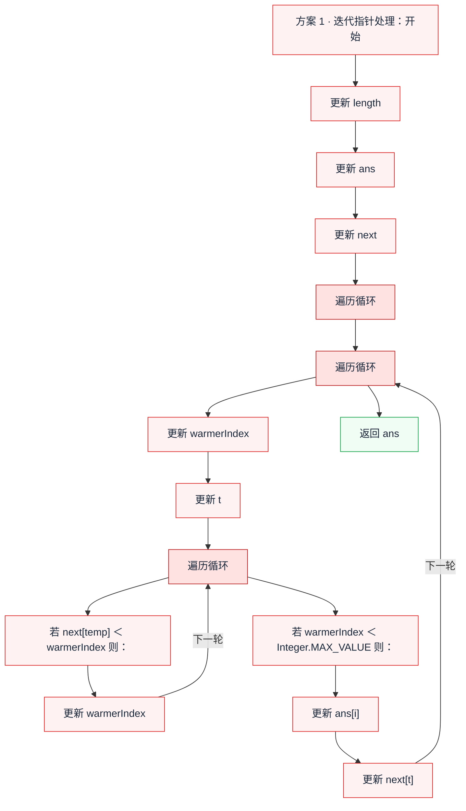

```java
package com.webfault.dsa; // 引入依赖

class DailyTemperaturesSol1 { // 定义类型
  public int[] dailyTemperatures(int[] temperatures) { // 定义函数/方法 dailyTemperatures
    int length = temperatures.length; // 把 temperatures.长度 存入 长度
    int[] ans = new int[length]; // 把 new int[长度]; 写入 int[] ans
    int[] next = new int[101]; // 把 new int[101]; 写入 int[] next
    for (int i = 0; i < 101; i++) next[i] = Integer.MAX_VALUE; // 让 下标 i 从 0 开始计数，下标 i 小于 101 就继续
    for (int i = length - 1; i >= 0; i--) { // 让 下标 i 从 长度 减 1 开始计数，下标 i 不低于 0 就继续
      int warmerIndex = Integer.MAX_VALUE; // 把 Integer.MAX_VALUE 存入 warmerIndex
      int t = temperatures[i]; // 把 temperatures[下标 i] 存入 另一字符串
      for (int temp = t + 1; temp < 101; temp++) { // 让 临时变量 从 另一字符串 加 1 开始计数，临时变量 小于 101 就继续
        if (next[temp] < warmerIndex) { // 若 下一个[临时变量] 小于 warmerIndex
          warmerIndex = next[temp]; // 把 下一个[临时变量]; 写入 warmerIndex
        }
      }
      if (warmerIndex < Integer.MAX_VALUE) { // 若 warmerIndex 小于 Integer.MAX_VALUE
        ans[i] = warmerIndex - i; // 把 warmerIndex 减 下标 i; 写入 ans[i]
      }
      next[t] = i; // 把 下标 i; 写入 next[t]
    }
    return ans; // 返回 答案
  }

  public static void main(String[] args) { // public static void main(String[] args) {
    DailyTemperaturesSol1 s =
        new DailyTemperaturesSol1(); // 把 new DailyTemperaturesSol1(); 写入 DailyTemperaturesSol1 s
    int[][][] cases = { // 把 { 写入 int[][][] cases
      {{73, 74, 75, 71, 69, 72, 76, 73}, {1, 1, 4, 2, 1, 1, 0, 0}},
      {{30, 40, 50, 60}, {1, 1, 1, 0}},
      {{30, 60, 90}, {1, 1, 0}},
    };
    boolean ok = true; // 把 true; 写入 boolean ok
    for (int[][] c : cases) { // for (int[][] 字符 : cases) {
      int[] got = s.dailyTemperatures(c[0]); // 把 字符串.dailyTemperatures(字符[0]); 写入 int[] got
      if (!eqArr(got, c[1])) { // 若 取反 eqArr(got, 字符[1]
        ok = false; // 把 false; 写入 ok
        System.out.println(
            "FAIL dailyTemperatures("
                + arrStr(c[0])
                + ")="
                + arrStr(got)
                + " want "
                + arrStr(c[1])); // 打印输出
      }
    }
    if (!ok) throw new RuntimeException("FAILED"); // 若 取反 ok) throw new RuntimeException(「FAILED」);
    System.out.println("PASS"); // 全部用例通过，输出 PASS
  }

  static boolean eqArr(int[] a, int[] b) { // 定义函数/方法 eqArr
    if (a.length != b.length) return false; // 若 数组.长度 不等于 b.长度，直接返回 false
    for (int i = 0; i < a.length; i++)
      if (a[i] != b[i]) return false; // 让 下标 i 从 0 开始计数，下标 i 小于 数组.长度 就继续
    return true; // 返回 true
  }

  static String arrStr(int[] a) { // 定义函数/方法 arrStr
    StringBuilder sb = new StringBuilder("["); // 把 new StringBuilder(「[」); 写入 StringBuilder sb
    for (int i = 0; i < a.length; i++) {
      if (i > 0) sb.append(",");
      sb.append(a[i]);
    } // 让 下标 i 从 0 开始计数，下标 i 小于 数组.长度 就继续
    sb.append("]"); // 把 「]」 追加到列表尾部
    return sb.toString(); // 返回 sb.toString()
  }
}
```

#### 方案 2：迭代指针处理

**思路与代码分析**：核心是「迭代指针处理」。Java 版用类与静态方法组织，集合操作显式明了。代码里依次做这些事：单循环线性扫描；栈的后进先出操作。**走读**：方案 2 · 迭代指针处理：开始 → 更新 n → 更新 ans → 更新 stack → 遍历循环 → 当 (非 stack.isEmpty() 且 temperatures[i] ＞ temperatures[stack.peek()]) 时反复执行 → 从 stack 弹出 → 更新 ans[prevIndex] → 向 stack 追加记录 → 返回 ans。

**运行架构**（真实控制流）：

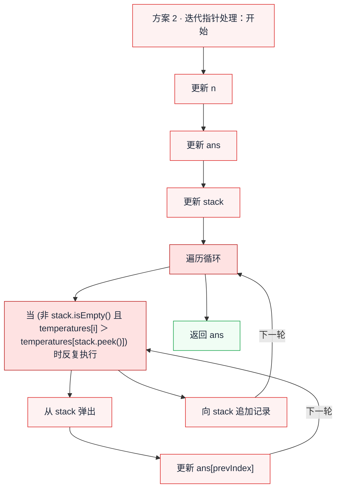

```java
package com.webfault.dsa; // 引入依赖

import java.util.ArrayDeque; // 引入依赖
import java.util.Deque; // 引入依赖

class DailyTemperaturesSol2 { // 定义类型
  public int[] dailyTemperatures(int[] temperatures) { // 定义函数/方法 dailyTemperatures
    int n = temperatures.length; // 把 temperatures.长度 存入 元素个数
    int[] ans = new int[n]; // 把 new int[元素个数]; 写入 int[] ans
    Deque<Integer> stack = new ArrayDeque<>(); // 把 new ArrayDeque 小于 超过 (); 写入 Deque<Integer> stack
    for (int i = 0; i < n; i++) { // 让 下标 i 从 0 开始计数，下标 i 小于 元素个数 就继续
      while (!stack.isEmpty() && temperatures[i] > temperatures[stack.peek()]) {
        int prevIndex = stack.pop(); // 把 栈 弹出 ) 存入 prevIndex
        ans[prevIndex] = i - prevIndex; // 把 下标 i 减 prevIndex; 写入 ans[prevIndex]
      }
      stack.push(i); // 把 下标 i 压入栈/数组尾部
    }
    return ans; // 返回 答案
  }

  public static void main(String[] args) { // public static void main(String[] args) {
    DailyTemperaturesSol2 s =
        new DailyTemperaturesSol2(); // 把 new DailyTemperaturesSol2(); 写入 DailyTemperaturesSol2 s
    int[][][] cases = { // 把 { 写入 int[][][] cases
      {{73, 74, 75, 71, 69, 72, 76, 73}, {1, 1, 4, 2, 1, 1, 0, 0}},
      {{30, 40, 50, 60}, {1, 1, 1, 0}},
      {{30, 60, 90}, {1, 1, 0}},
    };
    boolean ok = true; // 把 true; 写入 boolean ok
    for (int[][] c : cases) { // for (int[][] 字符 : cases) {
      int[] got = s.dailyTemperatures(c[0]); // 把 字符串.dailyTemperatures(字符[0]); 写入 int[] got
      if (!eqArr(got, c[1])) { // 若 取反 eqArr(got, 字符[1]
        ok = false; // 把 false; 写入 ok
        System.out.println(
            "FAIL dailyTemperatures("
                + arrStr(c[0])
                + ")="
                + arrStr(got)
                + " want "
                + arrStr(c[1])); // 打印输出
      }
    }
    if (!ok) throw new RuntimeException("FAILED"); // 若 取反 ok) throw new RuntimeException(「FAILED」);
    System.out.println("PASS"); // 全部用例通过，输出 PASS
  }

  static boolean eqArr(int[] a, int[] b) { // 定义函数/方法 eqArr
    if (a.length != b.length) return false; // 若 数组.长度 不等于 b.长度，直接返回 false
    for (int i = 0; i < a.length; i++)
      if (a[i] != b[i]) return false; // 让 下标 i 从 0 开始计数，下标 i 小于 数组.长度 就继续
    return true; // 返回 true
  }

  static String arrStr(int[] a) { // 定义函数/方法 arrStr
    StringBuilder sb = new StringBuilder("["); // 把 new StringBuilder(「[」); 写入 StringBuilder sb
    for (int i = 0; i < a.length; i++) {
      if (i > 0) sb.append(",");
      sb.append(a[i]);
    } // 让 下标 i 从 0 开始计数，下标 i 小于 数组.长度 就继续
    sb.append("]"); // 把 「]」 追加到列表尾部
    return sb.toString(); // 返回 sb.toString()
  }
}
```

### Rust 实现（2 种方案）

Rust 的全部方案如下，每个方案都内嵌用例自测，可独立运行（老仓库 python/go 文件遵循「打印结果」约定）：

#### 方案 1：迭代指针处理

**思路与代码分析**：核心是「迭代指针处理」。Rust 版用所有权移动与切片借用改写同一逻辑，注意 Option 与引用边界。代码里依次做这些事：栈的后进先出操作。**走读**：方案 1 · 迭代指针处理：开始 → 计算 n → 计算 res → 计算 st → 遍历 0..n 中的每个元素 i → 当 let Some(&top) = st.last() 时反复执行 → 处理 if temps[top] ＜ temps[i] → 更新 res[top] → 从 st 弹出 → 跳出循环（break） → 向 st 追加记录 → 处理 res → 返回结果。

**运行架构**（真实控制流）：

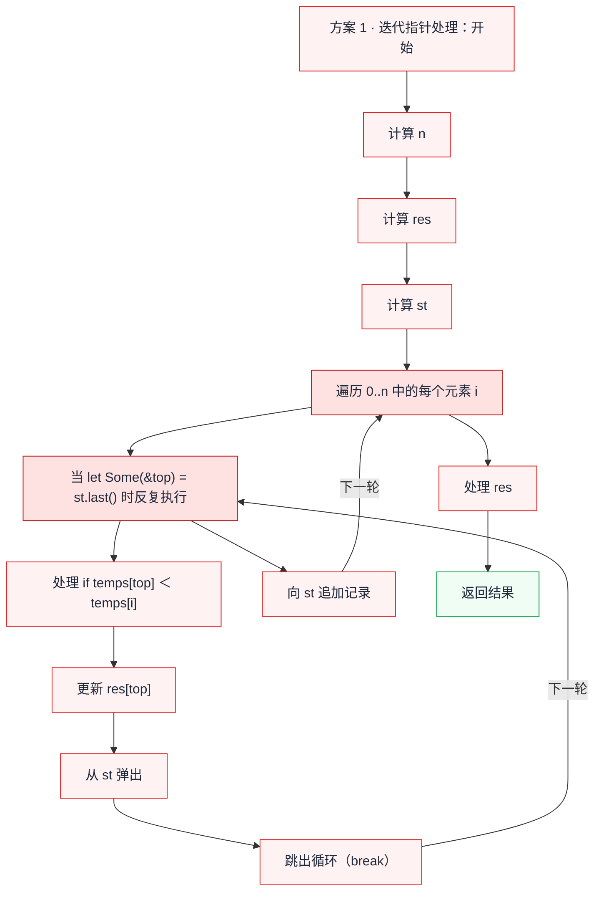

```rust
// LeetCode 739. 每日温度 — Rust 版（方案1）
fn daily_temperatures(temps: Vec<i32>) -> Vec<i32> {
    // 定义函数/方法 daily_temperatures
    let n = temps.len(); // 把 temps.长度() 存入 元素个数
    let mut res = vec![0i32; n]; // 把 vec取反 [0i32; 元素个数]; 写入 let mut res
    let mut st: Vec<usize> = Vec::new(); // 把 Vec::new(); 写入 let mut st: Vec<usize>
    for i in 0..n {
        // 逐个取出 0 的元素（下标 i）
        while let Some(&top) = st.last() {
            // 边取边处理，取空即停
            if temps[top] < temps[i] {
                res[top] = (i - top) as i32;
                st.pop();
            } else {
                break;
            }
        }
        st.push(i); // 把 下标 i 压入栈/数组尾部
    }
    res // 结果
}
fn main() {
    // 程序入口：跑内嵌自测用例
    assert_eq!(
        daily_temperatures(vec![73, 74, 75, 71, 69, 72, 76, 73]),
        vec![1, 1, 4, 2, 1, 1, 0, 0]
    ); // 断言校验
    assert_eq!(daily_temperatures(vec![30, 40, 50, 60]), vec![1, 1, 1, 0]); // 断言校验
    assert_eq!(daily_temperatures(vec![30, 60, 90]), vec![1, 1, 0]); // 断言校验
    println!("PASS");
} // 全部用例通过，输出 PASS
```

#### 方案 2：迭代指针处理

**思路与代码分析**：核心是「迭代指针处理」。Rust 版用所有权移动与切片借用改写同一逻辑，注意 Option 与引用边界。代码里依次做这些事：栈的后进先出操作。**走读**：方案 2 · 迭代指针处理：开始 → 计算 n → 计算 res → 计算 st → 遍历 0..n 中的每个元素 i → 当 let Some(&top) = st.last() 时反复执行 → 处理 if temps[top] ＜ temps[i] → 更新 res[top] → 从 st 弹出 → 跳出循环（break） → 向 st 追加记录 → 处理 res → 返回结果。

**运行架构**（真实控制流）：


```rust
// LeetCode 739. 每日温度 — Rust 版（方案2）
fn daily_temperatures(temps: Vec<i32>) -> Vec<i32> {
    // 定义函数/方法 daily_temperatures
    let n = temps.len(); // 把 temps.长度() 存入 元素个数
    let mut res = vec![0i32; n]; // 把 vec取反 [0i32; 元素个数]; 写入 let mut res
    let mut st: Vec<usize> = Vec::new(); // 把 Vec::new(); 写入 let mut st: Vec<usize>
    for i in 0..n {
        // 逐个取出 0 的元素（下标 i）
        while let Some(&top) = st.last() {
            // 边取边处理，取空即停
            if temps[top] < temps[i] {
                res[top] = (i - top) as i32;
                st.pop();
            } else {
                break;
            }
        }
        st.push(i); // 把 下标 i 压入栈/数组尾部
    }
    res // 结果
}
fn main() {
    // 程序入口：跑内嵌自测用例
    assert_eq!(
        daily_temperatures(vec![73, 74, 75, 71, 69, 72, 76, 73]),
        vec![1, 1, 4, 2, 1, 1, 0, 0]
    ); // 断言校验
    assert_eq!(daily_temperatures(vec![30, 40, 50, 60]), vec![1, 1, 1, 0]); // 断言校验
    assert_eq!(daily_temperatures(vec![30, 60, 90]), vec![1, 1, 0]); // 断言校验
    println!("PASS");
} // 全部用例通过，输出 PASS
```

### Lua 实现（2 种方案）

Lua 的全部方案如下，每个方案都内嵌用例自测，可独立运行（老仓库 python/go 文件遵循「打印结果」约定）：

#### 方案 1：迭代指针处理

**思路与代码分析**：核心是「迭代指针处理」。Lua 版用表与 ipairs 遍历，注意 ipairs 遇 nil 即停的语义。**走读**：方案 1 · 迭代指针处理：开始 → 更新 n → 更新 res → 循环 i：从 1 到 n do → 更新 res[i] → 更新 st → 循环 i：从 1 到 n do → 当 #st ＞ 0 and temps[st[#st]] ＜ temps[i] do 时反复执行 → 更新 res[st[#st]] → 更新 st[#st] → 更新 1] → 返回 res。

**运行架构**（真实控制流）：


```lua
-- LeetCode 739. 每日温度 — Lua 版（方案1）
local function daily_temperatures(temps) -- local function daily_temperatures(temps)
	local n = #temps -- 把 #temps 写入 local n
	local res = {} -- 把 {} 写入 local res
	for i = 1, n do
		res[i] = 0
	end -- 让 下标 i 从 1 走到 元素个数（Lua 1 基）
	local st = {} -- 把 {} 写入 local st
	for i = 1, n do -- 让 下标 i 从 1 走到 元素个数（Lua 1 基）
		while #st > 0 and temps[st[#st]] < temps[i] do -- while #st 超过 0 and temps[st[#st]] 小于 temps[下标 i] do
			res[st[#st]] = i - st[#st] -- 把 下标 i 减 st[#st] 写入 res[st[#st]]
			st[#st] = nil -- 把 nil 写入 st[#st]
		end -- 终点
		st[#st + 1] = i -- 把 下标 i 写入 st[#st + 1]
	end -- 终点
	return res -- 返回 结果
end -- 终点
assert(table.concat(daily_temperatures({ 73, 74, 75, 71, 69, 72, 76, 73 }), ",") == "1,1,4,2,1,1,0,0") -- 打印输出
assert(table.concat(daily_temperatures({ 30, 40, 50, 60 }), ",") == "1,1,1,0") -- 打印输出
assert(table.concat(daily_temperatures({ 30, 60, 90 }), ",") == "1,1,0") -- 打印输出
print("PASS") -- 全部用例通过，输出 PASS
```

#### 方案 2：迭代指针处理

**思路与代码分析**：核心是「迭代指针处理」。Lua 版用表与 ipairs 遍历，注意 ipairs 遇 nil 即停的语义。**走读**：方案 2 · 迭代指针处理：开始 → 更新 n → 更新 res → 循环 i：从 1 到 n do → 更新 res[i] → 更新 st → 循环 i：从 1 到 n do → 当 #st ＞ 0 and temps[st[#st]] ＜ temps[i] do 时反复执行 → 更新 res[st[#st]] → 更新 st[#st] → 更新 1] → 返回 res。

**运行架构**（真实控制流）：

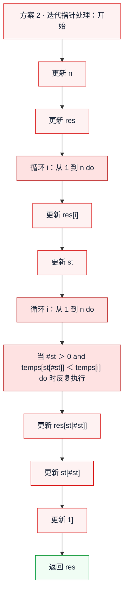

```lua
-- LeetCode 739. 每日温度 — Lua 版（方案2）
local function daily_temperatures(temps) -- local function daily_temperatures(temps)
	local n = #temps -- 把 #temps 写入 local n
	local res = {} -- 把 {} 写入 local res
	for i = 1, n do
		res[i] = 0
	end -- 让 下标 i 从 1 走到 元素个数（Lua 1 基）
	local st = {} -- 把 {} 写入 local st
	for i = 1, n do -- 让 下标 i 从 1 走到 元素个数（Lua 1 基）
		while #st > 0 and temps[st[#st]] < temps[i] do -- while #st 超过 0 and temps[st[#st]] 小于 temps[下标 i] do
			res[st[#st]] = i - st[#st] -- 把 下标 i 减 st[#st] 写入 res[st[#st]]
			st[#st] = nil -- 把 nil 写入 st[#st]
		end -- 终点
		st[#st + 1] = i -- 把 下标 i 写入 st[#st + 1]
	end -- 终点
	return res -- 返回 结果
end -- 终点
assert(table.concat(daily_temperatures({ 73, 74, 75, 71, 69, 72, 76, 73 }), ",") == "1,1,4,2,1,1,0,0") -- 打印输出
assert(table.concat(daily_temperatures({ 30, 40, 50, 60 }), ",") == "1,1,1,0") -- 打印输出
assert(table.concat(daily_temperatures({ 30, 60, 90 }), ",") == "1,1,0") -- 打印输出
print("PASS") -- 全部用例通过，输出 PASS
```

### C 实现（2 种方案）

C 的全部方案如下，每个方案都内嵌用例自测，可独立运行（老仓库 python/go 文件遵循「打印结果」约定）：

#### 方案 1：迭代指针处理

**思路与代码分析**：核心是「迭代指针处理」。C 版手动管理下标与内存，循环边界全部显式写出。代码里依次做这些事：双重循环遍历。**走读**：方案 1 · 迭代指针处理：开始 → 遍历循环 → 更新 out[i] → 更新 top → 遍历循环 → 当 ( 时反复执行 → 处理 top ＞ 0 且 → 处理 t[st[top - 1]] ＜ → 处理 t[i]) → 更新 1]] → 处理 top-- → 更新 st[top++] → 返回结果。

**运行架构**（真实控制流）：

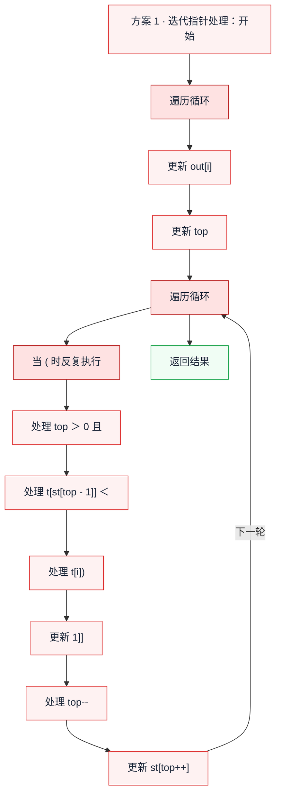

```c
/* LeetCode 739. 每日温度 — C 版（方案1） */
#include <stdio.h>                                               // 引入头文件
static void daily_temperatures(const int *t, int n, int out[]) { // 定义函数/方法 daily_temperatures
    for (int i = 0; i < n; i++)
        out[i] = 0;               // 让 下标 i 从 0 开始计数，下标 i 小于 元素个数 就继续
    int st[8192], top = 0;        // 把 0; 写入 int st[8192], top
    for (int i = 0; i < n; i++) { // 让 下标 i 从 0 开始计数，下标 i 小于 元素个数 就继续
        while (
            top > 0 &&
            t[st[top - 1]] <
                t[i]) { // 循环，直到不满足「top 超过 0 且 另一字符串[st[top 减 1]] 小于 另一字符串[下标 i]」
            out[st[top - 1]] = i - st[top - 1]; // 把 下标 i 减 st[top 减 1]; 写入 out[st[top - 1]]
            top--;                              // top 减一
        }
        st[top++] = i; // 把 下标 i; 写入 st[top++]
    }
}
int main(void) {   // 程序入口：跑内嵌自测用例
    int out[8192]; // int out[8192];
    daily_temperatures((int[]){73, 74, 75, 71, 69, 72, 76, 73}, 8, out);
    if (!(out[0] == 1 && out[2] == 4 && out[7] == 0)) {
        printf("FAIL 1\n");
        return 1;
    }
    daily_temperatures((int[]){30, 40, 50, 60}, 4, out); // daily_temperatures((int[]){30,40,50,60}, 4, out);
    if (!(out[0] == 1 && out[3] == 0)) {
        printf("FAIL 2\n");
        return 1;
    }
    daily_temperatures((int[]){30, 60, 90}, 3, out); // daily_temperatures((int[]){30,60,90}, 3, out);
    if (!(out[0] == 1 && out[2] == 0)) {
        printf("FAIL 3\n");
        return 1;
    }
    printf("PASS\n");
    return 0;
} // 全部用例通过，输出 PASS
```

#### 方案 2：迭代指针处理

**思路与代码分析**：核心是「迭代指针处理」。C 版手动管理下标与内存，循环边界全部显式写出。代码里依次做这些事：双重循环遍历。**走读**：方案 2 · 迭代指针处理：开始 → 遍历循环 → 更新 out[i] → 更新 top → 遍历循环 → 当 ( 时反复执行 → 处理 top ＞ 0 且 → 处理 t[st[top - 1]] ＜ → 处理 t[i]) → 更新 1]] → 处理 top-- → 更新 st[top++] → 返回结果。

**运行架构**（真实控制流）：


```c
/* LeetCode 739. 每日温度 — C 版（方案2） */
#include <stdio.h>                                               // 引入头文件
static void daily_temperatures(const int *t, int n, int out[]) { // 定义函数/方法 daily_temperatures
    for (int i = 0; i < n; i++)
        out[i] = 0;               // 让 下标 i 从 0 开始计数，下标 i 小于 元素个数 就继续
    int st[8192], top = 0;        // 把 0; 写入 int st[8192], top
    for (int i = 0; i < n; i++) { // 让 下标 i 从 0 开始计数，下标 i 小于 元素个数 就继续
        while (
            top > 0 &&
            t[st[top - 1]] <
                t[i]) { // 循环，直到不满足「top 超过 0 且 另一字符串[st[top 减 1]] 小于 另一字符串[下标 i]」
            out[st[top - 1]] = i - st[top - 1]; // 把 下标 i 减 st[top 减 1]; 写入 out[st[top - 1]]
            top--;                              // top 减一
        }
        st[top++] = i; // 把 下标 i; 写入 st[top++]
    }
}
int main(void) {   // 程序入口：跑内嵌自测用例
    int out[8192]; // int out[8192];
    daily_temperatures((int[]){73, 74, 75, 71, 69, 72, 76, 73}, 8, out);
    if (!(out[0] == 1 && out[2] == 4 && out[7] == 0)) {
        printf("FAIL 1\n");
        return 1;
    }
    daily_temperatures((int[]){30, 40, 50, 60}, 4, out); // daily_temperatures((int[]){30,40,50,60}, 4, out);
    if (!(out[0] == 1 && out[3] == 0)) {
        printf("FAIL 2\n");
        return 1;
    }
    daily_temperatures((int[]){30, 60, 90}, 3, out); // daily_temperatures((int[]){30,60,90}, 3, out);
    if (!(out[0] == 1 && out[2] == 0)) {
        printf("FAIL 3\n");
        return 1;
    }
    printf("PASS\n");
    return 0;
} // 全部用例通过，输出 PASS
```

### C++ 实现（2 种方案）

C++ 的全部方案如下，每个方案都内嵌用例自测，可独立运行（老仓库 python/go 文件遵循「打印结果」约定）：

#### 方案 1：迭代指针处理

**思路与代码分析**：核心是「迭代指针处理」。C++ 版用 STL 容器与迭代器，减少手写下标错误。代码里依次做这些事：单循环线性扫描。**走读**：方案 1 · 迭代指针处理：开始 → 更新 n → 处理 std::vector＜int＞ res(n, 0) → 处理 std::vector＜size_t＞ st → 遍历循环 → 当 (非 st.empty() 且 时反复执行 → 处理 temps[st.back()] ＜ → 处理 temps[i]) → 更新 res[st.back()] → 调用 st.pop_back() → 调用 st.push_back(i) → 返回 res。

**运行架构**（真实控制流）：


```cpp
// LeetCode 739. 每日温度 — C++ 版（方案1）
#include <cassert>  // 引入头文件
#include <iostream> // 引入头文件
#include <vector>   // 引入头文件
static std::vector<int> dailyTemperatures(const std::vector<int> &temps) {
    size_t n = temps.size();         // 把 temps.大小(); 写入 size_t n
    std::vector<int> res(n, 0);      // std::vector 小于 int 超过 结果(元素个数, 0);
    std::vector<size_t> st;          // std::vector 小于 size_t 超过 st;
    for (size_t i = 0; i < n; ++i) { // 让 下标 i 从 0 开始计数，下标 i 小于 元素个数 就继续
        while (!st.empty() &&
               temps[st.back()] <
                   temps[i]) { // 循环，直到不满足「取反 st 是否为空 且 temps[st.back()] 小于 temps[下标 i]」
            res[st.back()] = static_cast<int>(i - st.back());
            st.pop_back(); // 弹出栈顶元素
        }
        st.push_back(i); // st 追加 下标 i);
    }
    return res; // 返回 结果
}
int main() {
    assert((dailyTemperatures({73, 74, 75, 71, 69, 72, 76, 73}) == std::vector<int>{1, 1, 4, 2, 1, 1, 0, 0}));
    assert((dailyTemperatures({30, 40, 50, 60}) == std::vector<int>{1, 1, 1, 0}));
    assert((dailyTemperatures({30, 60, 90}) == std::vector<int>{1, 1, 0}));
    std::cout << "PASS" << std::endl;
} // 全部用例通过，输出 PASS
```

#### 方案 2：迭代指针处理

**思路与代码分析**：核心是「迭代指针处理」。C++ 版用 STL 容器与迭代器，减少手写下标错误。代码里依次做这些事：单循环线性扫描。**走读**：方案 2 · 迭代指针处理：开始 → 更新 n → 处理 std::vector＜int＞ res(n, 0) → 处理 std::vector＜size_t＞ st → 遍历循环 → 当 (非 st.empty() 且 时反复执行 → 处理 temps[st.back()] ＜ → 处理 temps[i]) → 更新 res[st.back()] → 调用 st.pop_back() → 调用 st.push_back(i) → 返回 res。

**运行架构**（真实控制流）：

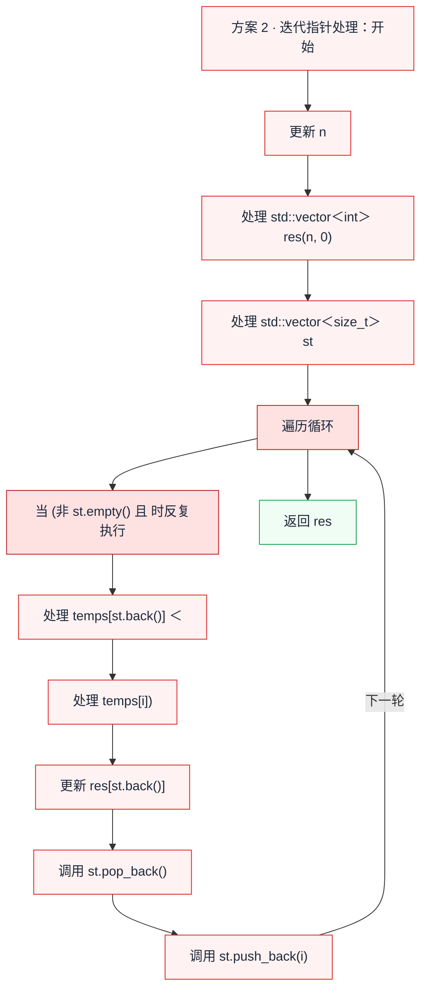

```cpp
// LeetCode 739. 每日温度 — C++ 版（方案2）
#include <cassert>  // 引入头文件
#include <iostream> // 引入头文件
#include <vector>   // 引入头文件
static std::vector<int> dailyTemperatures(const std::vector<int> &temps) {
    size_t n = temps.size();         // 把 temps.大小(); 写入 size_t n
    std::vector<int> res(n, 0);      // std::vector 小于 int 超过 结果(元素个数, 0);
    std::vector<size_t> st;          // std::vector 小于 size_t 超过 st;
    for (size_t i = 0; i < n; ++i) { // 让 下标 i 从 0 开始计数，下标 i 小于 元素个数 就继续
        while (!st.empty() &&
               temps[st.back()] <
                   temps[i]) { // 循环，直到不满足「取反 st 是否为空 且 temps[st.back()] 小于 temps[下标 i]」
            res[st.back()] = static_cast<int>(i - st.back());
            st.pop_back(); // 弹出栈顶元素
        }
        st.push_back(i); // st 追加 下标 i);
    }
    return res; // 返回 结果
}
int main() {
    assert((dailyTemperatures({73, 74, 75, 71, 69, 72, 76, 73}) == std::vector<int>{1, 1, 4, 2, 1, 1, 0, 0}));
    assert((dailyTemperatures({30, 40, 50, 60}) == std::vector<int>{1, 1, 1, 0}));
    assert((dailyTemperatures({30, 60, 90}) == std::vector<int>{1, 1, 0}));
    std::cout << "PASS" << std::endl;
} // 全部用例通过，输出 PASS
```

### R 实现（2 种方案）

R 的全部方案如下，每个方案都内嵌用例自测，可独立运行（老仓库 python/go 文件遵循「打印结果」约定）：

#### 方案 1：迭代指针处理

**思路与代码分析**：核心是「迭代指针处理」。R 版用向量化思维与 1 起始下标，注意 1:n 的降序陷阱。代码里依次做这些事：单循环线性扫描。**走读**：方案 1 · 迭代指针处理：开始 → 处理 n ＜- length(temps) → 处理 res ＜- rep(0L, n) → 处理 st ＜- integer(0) → 循环 i：遍历 seq_len(n) → 当 (length(st) ＞ 0 且 temps[st[length(st)]] ＜ temps[i]) 时反复执行 → 处理 res[st[length(st)]] ＜- i - s → 处理 st ＜- st[-length(st)] → 处理 st ＜- c(st, i) → 处理 res → 返回结果。

**运行架构**（真实控制流）：


```r
# 版（方案1） 定义函数 daily_temperatures（参数：temps）
daily_temperatures <- function(temps) {
    n <- length(temps)  # 把 长度(temps) 存入 元素个数
    res <- rep(0L, n)  # 把 rep(0L, 元素个数) 存入 结果
    st <- integer(0)  # 把 integer(0) 存入 st
    for (i in seq_len(n)) {
        # for (下标 i in seq_len(元素个数)) { 循环，直到不满足「长度(st) 超过 0 且 temps[st[长度(st)]] 小于
        # temps[下标 i]」
        while (length(st) > 0 && temps[st[length(st)]] < temps[i]) {
            res[st[length(st)]] <- i - st[length(st)]  # 把 下标 i 减 st[长度(st)] 存入 res[st[length(st)]]
            st <- st[-length(st)]  # 把 st[ 减 长度(st)] 存入 st
        }
        st <- c(st, i)  # 把 字符(st, 下标 i) 存入 st
    }
    res  # 结果
}
stopifnot(identical(daily_temperatures(c(73, 74, 75, 71, 69, 72, 76, 73)), c(1L, 1L, 4L, 2L, 1L, 1L, 0L, 0L)))  # 断言校验
stopifnot(identical(daily_temperatures(c(30, 40, 50, 60)), c(1L, 1L, 1L, 0L)))  # 断言校验
stopifnot(identical(daily_temperatures(c(30, 60, 90)), c(1L, 1L, 0L)))  # 断言校验
cat("PASS\n")  # 全部用例通过，输出 PASS
```

#### 方案 2：迭代指针处理

**思路与代码分析**：核心是「迭代指针处理」。R 版用向量化思维与 1 起始下标，注意 1:n 的降序陷阱。代码里依次做这些事：单循环线性扫描。**走读**：方案 2 · 迭代指针处理：开始 → 处理 n ＜- length(temps) → 处理 res ＜- rep(0L, n) → 处理 st ＜- integer(0) → 循环 i：遍历 seq_len(n) → 当 (length(st) ＞ 0 且 temps[st[length(st)]] ＜ temps[i]) 时反复执行 → 处理 res[st[length(st)]] ＜- i - s → 处理 st ＜- st[-length(st)] → 处理 st ＜- c(st, i) → 处理 res → 返回结果。

**运行架构**（真实控制流）：

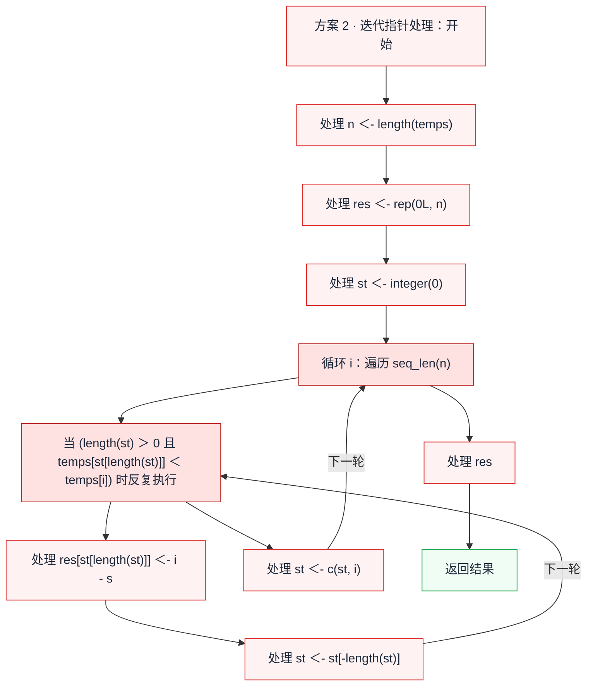

```r
# 版（方案2） 定义函数 daily_temperatures（参数：temps）
daily_temperatures <- function(temps) {
    n <- length(temps)  # 把 长度(temps) 存入 元素个数
    res <- rep(0L, n)  # 把 rep(0L, 元素个数) 存入 结果
    st <- integer(0)  # 把 integer(0) 存入 st
    for (i in seq_len(n)) {
        # for (下标 i in seq_len(元素个数)) { 循环，直到不满足「长度(st) 超过 0 且 temps[st[长度(st)]] 小于
        # temps[下标 i]」
        while (length(st) > 0 && temps[st[length(st)]] < temps[i]) {
            res[st[length(st)]] <- i - st[length(st)]  # 把 下标 i 减 st[长度(st)] 存入 res[st[length(st)]]
            st <- st[-length(st)]  # 把 st[ 减 长度(st)] 存入 st
        }
        st <- c(st, i)  # 把 字符(st, 下标 i) 存入 st
    }
    res  # 结果
}
stopifnot(identical(daily_temperatures(c(73, 74, 75, 71, 69, 72, 76, 73)), c(1L, 1L, 4L, 2L, 1L, 1L, 0L, 0L)))  # 断言校验
stopifnot(identical(daily_temperatures(c(30, 40, 50, 60)), c(1L, 1L, 1L, 0L)))  # 断言校验
stopifnot(identical(daily_temperatures(c(30, 60, 90)), c(1L, 1L, 0L)))  # 断言校验
cat("PASS\n")  # 全部用例通过，输出 PASS
```

### Zig 实现（2 种方案）

Zig 的全部方案如下，每个方案都内嵌用例自测，可独立运行（老仓库 python/go 文件遵循「打印结果」约定）：

#### 方案 1：迭代指针处理

**思路与代码分析**：核心是「迭代指针处理」。Zig 版显式分配与清零，整型边界处理严格。代码里依次做这些事：双重循环遍历。**走读**：方案 1 · 迭代指针处理：开始 → 计算 n → 遍历集合元素 → 计算 st → 计算 top → 遍历集合元素 → 当 (top ＞ 0 and t[st[top - 1]] ＜ t[i]) 时反复执行 → 更新 1]] → 更新 - → 更新 st[top] → 更新 + → 返回结果。

**运行架构**（真实控制流）：

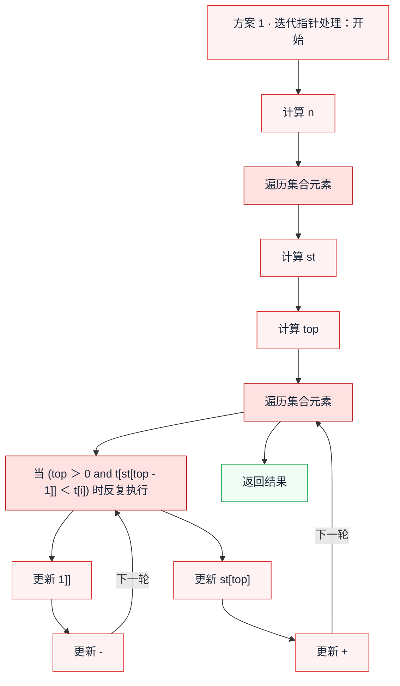

```zig
// LeetCode 739. 每日温度 — Zig 版（方案1）
const std = @import("std"); // 把 @import(「std」) 存入 std
fn dailyTemperatures(t: []const i32, out: []i32) void { // 定义函数/方法 dailyTemperatures
    const n = t.len; // 把 另一字符串.长度 存入 元素个数
    for (0..n) |i| out[i] = 0; // 让 下标 i 从 0 走到 元素个数 减一
    var st: [8192]usize = undefined; // 把 undefined; 写入 var st: [8192]usize
    var top: usize = 0; // 把 0; 写入 var top: usize
    for (0..n) |i| { // 让 下标 i 从 0 走到 元素个数 减一
        while (top > 0 and t[st[top - 1]] < t[i]) { // 循环，直到不满足「top 超过 0 and 另一字符串[st[top 减 1]] 小于 另一字符串[下标 i]」
            out[st[top - 1]] = @intCast(i - st[top - 1]); // 把 @intCast(下标 i 减 st[top 减 1]); 写入 out[st[top - 1]]
            top -= 1; // top累减 1
        }
        st[top] = i; // 把 下标 i; 写入 st[top]
        top += 1; // top累加 1
    }
}
pub fn main() !void { // 程序入口：跑内嵌自测用例
    var out: [8]i32 = undefined; // 把 undefined; 写入 var out: [8]i32
    dailyTemperatures(&[_]i32{ 73, 74, 75, 71, 69, 72, 76, 73 }, &out);
    if (out[0] != 1 or out[2] != 4 or out[7] != 0) return error.TestFailed;
    dailyTemperatures(&[_]i32{ 30, 40, 50, 60 }, &out); // dailyTemperatures( 按位与 [_]i32{ 30, 40, 50, 60 }, 按位与 out);
    if (out[0] != 1 or out[3] != 0) return error.TestFailed; // 若 out[0] 不等于 1 or out[3] 不等于 0，直接返回 error.TestFailed
    dailyTemperatures(&[_]i32{ 30, 60, 90 }, &out); // dailyTemperatures( 按位与 [_]i32{ 30, 60, 90 }, 按位与 out);
    if (out[0] != 1 or out[2] != 0) return error.TestFailed; // 若 out[0] 不等于 1 or out[2] 不等于 0，直接返回 error.TestFailed
    std.debug.print("PASS\n", .{});
} // 全部用例通过，输出 PASS
```

#### 方案 2：迭代指针处理

**思路与代码分析**：核心是「迭代指针处理」。Zig 版显式分配与清零，整型边界处理严格。代码里依次做这些事：双重循环遍历。**走读**：方案 2 · 迭代指针处理：开始 → 计算 n → 遍历集合元素 → 计算 st → 计算 top → 遍历集合元素 → 当 (top ＞ 0 and t[st[top - 1]] ＜ t[i]) 时反复执行 → 更新 1]] → 更新 - → 更新 st[top] → 更新 + → 返回结果。

**运行架构**（真实控制流）：

```mermaid
graph TD
    N0["方案 2 · 迭代指针处理：开始"]
    N1["计算 n"]
    N2["遍历集合元素"]
    N3["计算 st"]
    N4["计算 top"]
    N5["遍历集合元素"]
    N6["当 (top ＞ 0 and t[st[top - 1]] ＜ t[i]) 时反复执行"]
    N7["更新 1]]"]
    N8["更新 -"]
    N9["更新 st[top]"]
    N10["更新 +"]
    N11["返回结果"]
    N0 --> N1
    N1 --> N2
    N2 --> N3
    N3 --> N4
    N4 --> N5
    N5 --> N6
    N6 --> N7
    N7 --> N8
    N8 -- 下一轮 --> N6
    N6 --> N9
    N9 --> N10
    N10 -- 下一轮 --> N5
    N5 --> N11
    classDef n fill:#fef2f2,stroke:#dc2626,color:#1e293b;
    classDef lp fill:#fee2e2,stroke:#b91c1c,color:#1e293b;
    classDef dc fill:#fef9c3,stroke:#ca8a04,color:#1e293b;
    classDef tm fill:#f0fdf4,stroke:#16a34a,color:#1e293b;
    class N0,N1,N3,N4,N7,N8,N9,N10 n;
    class N2,N5,N6 lp;
    class N11 tm;
```

```zig
// LeetCode 739. 每日温度 — Zig 版（方案2）
const std = @import("std"); // 把 @import(「std」) 存入 std
fn dailyTemperatures(t: []const i32, out: []i32) void { // 定义函数/方法 dailyTemperatures
    const n = t.len; // 把 另一字符串.长度 存入 元素个数
    for (0..n) |i| out[i] = 0; // 让 下标 i 从 0 走到 元素个数 减一
    var st: [8192]usize = undefined; // 把 undefined; 写入 var st: [8192]usize
    var top: usize = 0; // 把 0; 写入 var top: usize
    for (0..n) |i| { // 让 下标 i 从 0 走到 元素个数 减一
        while (top > 0 and t[st[top - 1]] < t[i]) { // 循环，直到不满足「top 超过 0 and 另一字符串[st[top 减 1]] 小于 另一字符串[下标 i]」
            out[st[top - 1]] = @intCast(i - st[top - 1]); // 把 @intCast(下标 i 减 st[top 减 1]); 写入 out[st[top - 1]]
            top -= 1; // top累减 1
        }
        st[top] = i; // 把 下标 i; 写入 st[top]
        top += 1; // top累加 1
    }
}
pub fn main() !void { // 程序入口：跑内嵌自测用例
    var out: [8]i32 = undefined; // 把 undefined; 写入 var out: [8]i32
    dailyTemperatures(&[_]i32{ 73, 74, 75, 71, 69, 72, 76, 73 }, &out);
    if (out[0] != 1 or out[2] != 4 or out[7] != 0) return error.TestFailed;
    dailyTemperatures(&[_]i32{ 30, 40, 50, 60 }, &out); // dailyTemperatures( 按位与 [_]i32{ 30, 40, 50, 60 }, 按位与 out);
    if (out[0] != 1 or out[3] != 0) return error.TestFailed; // 若 out[0] 不等于 1 or out[3] 不等于 0，直接返回 error.TestFailed
    dailyTemperatures(&[_]i32{ 30, 60, 90 }, &out); // dailyTemperatures( 按位与 [_]i32{ 30, 60, 90 }, 按位与 out);
    if (out[0] != 1 or out[2] != 0) return error.TestFailed; // 若 out[0] 不等于 1 or out[2] 不等于 0，直接返回 error.TestFailed
    std.debug.print("PASS\n", .{});
} // 全部用例通过，输出 PASS
```

### Dart 实现（2 种方案）

Dart 的全部方案如下，每个方案都内嵌用例自测，可独立运行（老仓库 python/go 文件遵循「打印结果」约定）：

#### 方案 1：迭代指针处理

**思路与代码分析**：核心是「迭代指针处理」。Dart 版用可空类型标注与集合方法，注意空安全。代码里依次做这些事：单循环线性扫描。**走读**：方案 1 · 迭代指针处理：开始 → 更新 n → 更新 res → 更新 st → 遍历循环 → 当 (st.isNotEmpty 且 temps[st.last] ＜ temps[i]) 时反复执行 → 更新 idx → 更新 res[idx] → 调用 st.add(i) → 返回 res。

**运行架构**（真实控制流）：

```mermaid
graph TD
    N0["方案 1 · 迭代指针处理：开始"]
    N1["更新 n"]
    N2["更新 res"]
    N3["更新 st"]
    N4["遍历循环"]
    N5["当 (st.isNotEmpty 且 temps[st.last] ＜ temps[i]) 时反复执行"]
    N6["更新 idx"]
    N7["更新 res[idx]"]
    N8["调用 st.add(i)"]
    N9["返回 res"]
    N0 --> N1
    N1 --> N2
    N2 --> N3
    N3 --> N4
    N4 --> N5
    N5 --> N6
    N6 --> N7
    N7 -- 下一轮 --> N5
    N5 --> N8
    N8 -- 下一轮 --> N4
    N4 --> N9
    classDef n fill:#fef2f2,stroke:#dc2626,color:#1e293b;
    classDef lp fill:#fee2e2,stroke:#b91c1c,color:#1e293b;
    classDef dc fill:#fef9c3,stroke:#ca8a04,color:#1e293b;
    classDef tm fill:#f0fdf4,stroke:#16a34a,color:#1e293b;
    class N0,N1,N2,N3,N6,N7,N8 n;
    class N4,N5 lp;
    class N9 tm;
```

```dart
// LeetCode 739. 每日温度 — Dart 版（方案1）
List<int> dailyTemperatures(List<int> temps) {
  // 定义函数/方法 dailyTemperatures
  final n = temps.length; // 把 temps.长度 存入 元素个数
  final res = List<int>.filled(n, 0); // 把 List 小于 int 超过 .filled(元素个数, 0) 存入 结果
  final st = <int>[]; // 把 小于 int 超过 [] 存入 st
  for (var i = 0; i < n; i++) {
    // 让 下标 i 从 0 开始计数，下标 i 小于 元素个数 就继续
    while (st.isNotEmpty && temps[st.last] < temps[i]) {
      // 循环，直到不满足「st.isNotEmpty 且 temps[st.last] 小于 temps[下标 i]」
      final idx = st.removeLast(); // 把 st.removeLast() 存入 idx
      res[idx] = i - idx; // 把 下标 i 减 idx; 写入 res[idx]
    }
    st.add(i); // st 追加 下标 i);
  }
  return res; // 返回 结果
}

void main() {
  if (dailyTemperatures([73, 74, 75, 71, 69, 72, 76, 73]).toString() !=
      '[1, 1, 4, 2, 1, 1, 0, 0]')
    throw StateError('c1');
  if (dailyTemperatures([30, 40, 50, 60]).toString() != '[1, 1, 1, 0]')
    throw StateError('c2');
  if (dailyTemperatures([30, 60, 90]).toString() != '[1, 1, 0]')
    throw StateError('c3');
  print('PASS');
} // 全部用例通过，输出 PASS
```

#### 方案 2：迭代指针处理

**思路与代码分析**：核心是「迭代指针处理」。Dart 版用可空类型标注与集合方法，注意空安全。代码里依次做这些事：单循环线性扫描。**走读**：方案 2 · 迭代指针处理：开始 → 更新 n → 更新 res → 更新 st → 遍历循环 → 当 (st.isNotEmpty 且 temps[st.last] ＜ temps[i]) 时反复执行 → 更新 idx → 更新 res[idx] → 调用 st.add(i) → 返回 res。

**运行架构**（真实控制流）：

```mermaid
graph TD
    N0["方案 2 · 迭代指针处理：开始"]
    N1["更新 n"]
    N2["更新 res"]
    N3["更新 st"]
    N4["遍历循环"]
    N5["当 (st.isNotEmpty 且 temps[st.last] ＜ temps[i]) 时反复执行"]
    N6["更新 idx"]
    N7["更新 res[idx]"]
    N8["调用 st.add(i)"]
    N9["返回 res"]
    N0 --> N1
    N1 --> N2
    N2 --> N3
    N3 --> N4
    N4 --> N5
    N5 --> N6
    N6 --> N7
    N7 -- 下一轮 --> N5
    N5 --> N8
    N8 -- 下一轮 --> N4
    N4 --> N9
    classDef n fill:#fef2f2,stroke:#dc2626,color:#1e293b;
    classDef lp fill:#fee2e2,stroke:#b91c1c,color:#1e293b;
    classDef dc fill:#fef9c3,stroke:#ca8a04,color:#1e293b;
    classDef tm fill:#f0fdf4,stroke:#16a34a,color:#1e293b;
    class N0,N1,N2,N3,N6,N7,N8 n;
    class N4,N5 lp;
    class N9 tm;
```

```dart
// LeetCode 739. 每日温度 — Dart 版（方案2）
List<int> dailyTemperatures(List<int> temps) {
  // 定义函数/方法 dailyTemperatures
  final n = temps.length; // 把 temps.长度 存入 元素个数
  final res = List<int>.filled(n, 0); // 把 List 小于 int 超过 .filled(元素个数, 0) 存入 结果
  final st = <int>[]; // 把 小于 int 超过 [] 存入 st
  for (var i = 0; i < n; i++) {
    // 让 下标 i 从 0 开始计数，下标 i 小于 元素个数 就继续
    while (st.isNotEmpty && temps[st.last] < temps[i]) {
      // 循环，直到不满足「st.isNotEmpty 且 temps[st.last] 小于 temps[下标 i]」
      final idx = st.removeLast(); // 把 st.removeLast() 存入 idx
      res[idx] = i - idx; // 把 下标 i 减 idx; 写入 res[idx]
    }
    st.add(i); // st 追加 下标 i);
  }
  return res; // 返回 结果
}

void main() {
  if (dailyTemperatures([73, 74, 75, 71, 69, 72, 76, 73]).toString() !=
      '[1, 1, 4, 2, 1, 1, 0, 0]')
    throw StateError('c1');
  if (dailyTemperatures([30, 40, 50, 60]).toString() != '[1, 1, 1, 0]')
    throw StateError('c2');
  if (dailyTemperatures([30, 60, 90]).toString() != '[1, 1, 0]')
    throw StateError('c3');
  print('PASS');
} // 全部用例通过，输出 PASS
```

---

## 内容总结

- **每日温度**（栈 · Medium）：共 2 个方案，主线思路「迭代指针处理」；时间 O(n)（单趟线性扫描）；动画演示栈后进先出过程，附录给出 11 种语言 × 全部方案的可运行实现。
- 来源博客：[https://blog.csdn.net/tyro_java/article/details/145354164](https://blog.csdn.net/tyro_java/article/details/145354164)
- 导航：[📋 总目录](../) ｜ [← 047 简化路径](../047_简化路径/) ｜ [049 颜色分类 →](../049_颜色分类/)
