# 049 · 颜色分类（第一阶段 · 线性结构入门 · Medium）

> **难度**：⭐⭐ Medium ｜ **专题**：数组
> **学习定位**：第一阶段 · 线性结构入门第 49 篇 ｜ **解法数**：3
> **内容总结**：**颜色分类**（数组 · Medium）：共 3 个方案，主线思路「单指针」；时间 O(n)（单趟线性扫描）；动画演示双指针过程，附录给出 11 种语言 × 全部方案的可运行实现。

---

## 题目描述

给定一个包含红色、白色和蓝色、共 `n` 个元素的数组 `nums` ，原地 对它们进行排序，使得相同颜色的元素相邻，并按照红色、白色、蓝色顺序排列。

我们使用整数 0、 1 和 2 分别表示红色、白色和蓝色。

必须在不使用库内置的 sort 函数的情况下解决这个问题。

- 主函数签名：`function sortColors(nums: number[]): void`

**用例（来自原题）**：

**示例 1**

**示例 2**
> 题面与 [leetcode.cn 官方](https://leetcode.cn/problems/sort-colors/)一致，示例配图取自官方题面。

**数据范围与注意事项**：

- `n == nums.length`
- `1 <= n <= 300`
- `nums[i]` 为 0、1 或 2
- 你能想出一个仅使用常数空间的一趟扫描算法吗？
- **易错点**：边界最容易漏：空数组、只有一个元素、目标出现在头尾。

## 题目分析

**场景是什么**：数组是最常用的线性容器，这类题练的是下标操作与原地腾挪，对应真实开发里的缓冲区、列表整理。本题就是该场景的 Medium 级练习，主线做法是「单指针」。

**主线怎么解**：把主解法从头到尾过一遍，它其实在依次做这几件事：双重循环遍历。

## 解题思路

**方案对比**（共 3 个方案，由浅入深）：

| 方案 | 时间复杂度 | 空间复杂度 |
|---|---|---|
| 方案 1 · 单指针 | O(n)（单趟线性扫描） | O(1) 到 O(n)（视辅助结构） |
| 方案 2 · 单指针 | O(n²)（两层嵌套扫描） | O(1) 到 O(n) |
| 方案 3 · 单指针 | O(n²)（两层嵌套扫描） | O(1) 到 O(n) |

**方案间的取舍**：方案 1（单指针）；方案 2（单指针）；方案 3（单指针）。数据规模小、可读性优先时选靠前的方案；规模大、性能优先时选靠后的方案。

**怎么读这一篇**：

- 🐣 **新手路线**：把「题目描述」的示例 1 在纸上手推一遍 → 读方案 1（最直观的写法）与它的代码走读 → 按「运行方式」本地跑通看 PASS → 回头对比方案 2 之后的写法差在哪
- 🦅 **大佬路线**：直接锁定最优方案 1（单指针，O(n)（单趟线性扫描））→ 跳读该方案代码与走读 → 用「逐步拆解与面试追问」补齐复杂度推导与边界追问

### 动态算法图（双指针，GIF 自动循环）


动画演示数组专题里双指针的典型过程；每个方案在「TypeScript 解题方案」一节还配了专属动画与专属流程图。

### 主解法流程图（真实控制流）

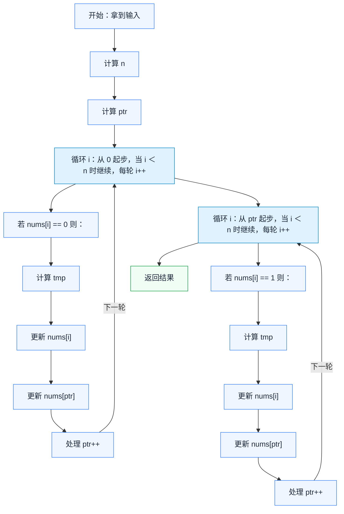

## TypeScript 解题方案（3 个方案逐个讲）

> **运行与提交**：每个方案都是自包含文件（内嵌用例自测，输出 PASS），整块复制到 `.ts` 文件后 `node 文件名` 即可运行。提交 LeetCode 时，把 `demo` 内的算法函数与辅助类型/函数整体取出、置于文件顶层即可。涉及交互/特殊接口的题以题面给定签名为准。

### 方案 1：单指针

**分析与思路**：核心做法是「单指针」。代码里依次做这些事：双重循环遍历。

**运行方式**：`node 本文件`，内嵌用例全部通过会输出 PASS。

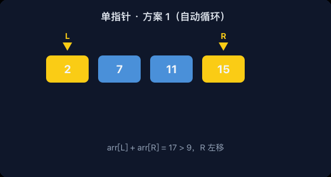

**方案专属流程图**（真实控制流）：

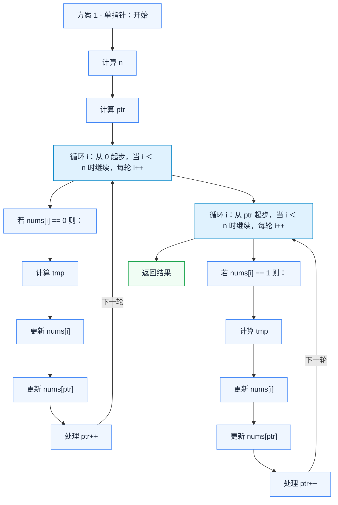

```typescript
/**
 ** LeetCode 75. 颜色分类
 ** 方案：1 ) 方案1：单指针
 ** 来源：https://blog.csdn.net/tyro_java/article/details/145370043
 */

function sortColors(nums: number[]): void {
  // 定义函数/方法 sortColors
  const n = nums.length; // 把 数组.长度 存入 元素个数
  let ptr = 0; // 把 0 存入 ptr
  for (let i = 0; i < n; i++) {
    // 让 下标 i 从 0 开始计数，下标 i 小于 元素个数 就继续
    if (nums[i] === 0) {
      // 若 数组[下标 i] 全等于 0
      const tmp = nums[i]; // 把 数组[下标 i] 存入 临时变量
      nums[i] = nums[ptr]; // 把 数组[ptr]; 写入 nums[i]
      nums[ptr] = tmp; // 把 临时变量; 写入 nums[ptr]
      ptr++; // ptr 加一
    }
  }
  for (let i = ptr; i < n; i++) {
    // 让 下标 i 从 ptr 开始计数，下标 i 小于 元素个数 就继续
    if (nums[i] === 1) {
      // 若 数组[下标 i] 全等于 1
      const tmp = nums[i]; // 把 数组[下标 i] 存入 临时变量
      nums[i] = nums[ptr]; // 把 数组[ptr]; 写入 nums[i]
      nums[ptr] = tmp; // 把 临时变量; 写入 nums[ptr]
      ptr++; // ptr 加一
    }
  }
}

function eqArr(a: number[], b: number[]): boolean {
  // 定义函数/方法 eqArr
  if (a.length !== b.length) return false; // 若 数组.长度 不等于 b.长度，直接返回 false
  for (let i = 0; i < a.length; i++) {
    // 让 下标 i 从 0 开始计数，下标 i 小于 数组.长度 就继续
    if (a[i] !== b[i]) return false; // 若 数组[下标 i] 不等于 b[下标 i]，直接返回 false
  }
  return true; // 返回 true
}

export function demo(): void {
  // 程序入口：跑内嵌自测用例
  const cases: [number[], number[]][] = [
    [
      [2, 0, 2, 1, 1, 0],
      [0, 0, 1, 1, 2, 2],
    ],
    [[0], [0]],
    [
      [2, 0, 1],
      [0, 1, 2],
    ],
  ];
  for (const [input, expected] of cases) {
    // for (const [input, expected] of cases) {
    sortColors(input); // sortColors(input);
    if (!eqArr(input, expected)) {
      // 若 取反 eqArr(input, expected
      throw new Error('FAIL: got ' + input + ' expected ' + expected);
    }
  }
  console.log('PASS'); // 全部用例通过，输出 PASS
}

demo(); // demo();
```

### 方案 2：单指针

**分析与思路**：核心做法是「单指针」。

**运行方式**：`node 本文件`，内嵌用例全部通过会输出 PASS。


**方案专属流程图**（真实控制流）：

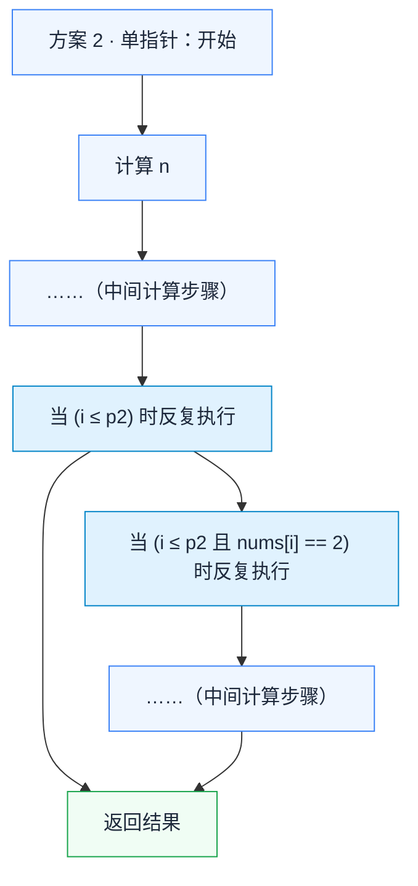

```typescript
/**
 ** LeetCode 75. 颜色分类
 ** 方案：1 ) 方案1：单指针
 ** 来源：https://blog.csdn.net/tyro_java/article/details/145370043
 */

function sortColors(nums: number[]): void {
  // 定义函数/方法 sortColors
  const n = nums.length; // 把 数组.长度 存入 元素个数
  let p0 = 0,
    p2 = n - 1; // 把 0, p2 赋值为 元素个数 减 1 存入 p0
  let i = 0; // 把 0 存入 下标 i
  while (i <= p2) {
    // 循环，直到不满足「下标 i 不超过 p2」
    while (i <= p2 && nums[i] === 2) {
      // 循环，直到不满足「下标 i 不超过 p2 且 数组[下标 i] 全等于 2」
      const tmp = nums[i]; // 把 数组[下标 i] 存入 临时变量
      nums[i] = nums[p2]; // 把 数组[p2]; 写入 nums[i]
      nums[p2] = tmp; // 把 临时变量; 写入 nums[p2]
      p2--; // p2 减一
    }
    if (nums[i] === 0) {
      // 若 数组[下标 i] 全等于 0
      const tmp = nums[i]; // 把 数组[下标 i] 存入 临时变量
      nums[i] = nums[p0]; // 把 数组[p0]; 写入 nums[i]
      nums[p0] = tmp; // 把 临时变量; 写入 nums[p0]
      p0++; // p0 加一
    }
    i++; // 下标 i 加一
  }
}

function eqArr(a: number[], b: number[]): boolean {
  // 定义函数/方法 eqArr
  if (a.length !== b.length) return false; // 若 数组.长度 不等于 b.长度，直接返回 false
  for (let i = 0; i < a.length; i++) {
    // 让 下标 i 从 0 开始计数，下标 i 小于 数组.长度 就继续
    if (a[i] !== b[i]) return false; // 若 数组[下标 i] 不等于 b[下标 i]，直接返回 false
  }
  return true; // 返回 true
}

export function demo(): void {
  // 程序入口：跑内嵌自测用例
  const cases: [number[], number[]][] = [
    [
      [2, 0, 2, 1, 1, 0],
      [0, 0, 1, 1, 2, 2],
    ],
    [[0], [0]],
    [
      [2, 0, 1],
      [0, 1, 2],
    ],
  ];
  for (const [input, expected] of cases) {
    // for (const [input, expected] of cases) {
    sortColors(input); // sortColors(input);
    if (!eqArr(input, expected)) {
      // 若 取反 eqArr(input, expected
      throw new Error('FAIL: got ' + input + ' expected ' + expected);
    }
  }
  console.log('PASS'); // 全部用例通过，输出 PASS
}

demo(); // demo();
```

### 方案 3：单指针

**分析与思路**：核心做法是「单指针」。

**运行方式**：`node 本文件`，内嵌用例全部通过会输出 PASS。


**方案专属流程图**（真实控制流）：

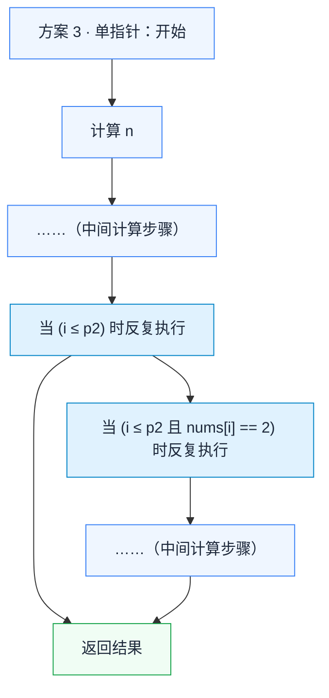

```typescript
/**
 ** LeetCode 75. 颜色分类
 ** 方案：1 ) 方案1：单指针
 ** 来源：https://blog.csdn.net/tyro_java/article/details/145370043
 */

function sortColors(nums: number[]): void {
  // 定义函数/方法 sortColors
  const n = nums.length; // 把 数组.长度 存入 元素个数
  let p0 = 0,
    p2 = n - 1; // 把 0, p2 赋值为 元素个数 减 1 存入 p0
  let i = 0; // 把 0 存入 下标 i
  while (i <= p2) {
    // 循环，直到不满足「下标 i 不超过 p2」
    while (i <= p2 && nums[i] === 2) {
      // 循环，直到不满足「下标 i 不超过 p2 且 数组[下标 i] 全等于 2」
      const tmp = nums[i]; // 把 数组[下标 i] 存入 临时变量
      nums[i] = nums[p2]; // 把 数组[p2]; 写入 nums[i]
      nums[p2] = tmp; // 把 临时变量; 写入 nums[p2]
      p2--; // p2 减一
    }
    if (nums[i] === 0) {
      // 若 数组[下标 i] 全等于 0
      const tmp = nums[i]; // 把 数组[下标 i] 存入 临时变量
      nums[i] = nums[p0]; // 把 数组[p0]; 写入 nums[i]
      nums[p0] = tmp; // 把 临时变量; 写入 nums[p0]
      p0++; // p0 加一
    }
    i++; // 下标 i 加一
  }
}

function eqArr(a: number[], b: number[]): boolean {
  // 定义函数/方法 eqArr
  if (a.length !== b.length) return false; // 若 数组.长度 不等于 b.长度，直接返回 false
  for (let i = 0; i < a.length; i++) {
    // 让 下标 i 从 0 开始计数，下标 i 小于 数组.长度 就继续
    if (a[i] !== b[i]) return false; // 若 数组[下标 i] 不等于 b[下标 i]，直接返回 false
  }
  return true; // 返回 true
}

export function demo(): void {
  // 程序入口：跑内嵌自测用例
  const cases: [number[], number[]][] = [
    [
      [2, 0, 2, 1, 1, 0],
      [0, 0, 1, 1, 2, 2],
    ],
    [[0], [0]],
    [
      [2, 0, 1],
      [0, 1, 2],
    ],
  ];
  for (const [input, expected] of cases) {
    // for (const [input, expected] of cases) {
    sortColors(input); // sortColors(input);
    if (!eqArr(input, expected)) {
      // 若 取反 eqArr(input, expected
      throw new Error('FAIL: got ' + input + ' expected ' + expected);
    }
  }
  console.log('PASS'); // 全部用例通过，输出 PASS
}

demo(); // demo();
```

## 逐步拆解与面试追问

**复杂度**：时间 O(n)（单趟线性扫描），空间 O(1) 到 O(n)（视辅助结构）

**为什么是这个量级**：每个元素被常数次访问，辅助哈希或栈的开销与 n 同阶

**面试官可能会追问**：

- 能不能原地做（O(1) 空间）？
- 如果数组已有序，能优化到什么程度？
- 空数组、单元素怎么处理？

## 关键 API 速查（TS 主解法实际用到，附官方链接）

本题主解法只用到基础语法（变量、循环、比较），不依赖特殊库 API。

### 各语言官方文档导航

- **TypeScript / JS**：[MDN 中文参考](https://developer.mozilla.org/zh-CN/)
- **Python**：[Python 官方文档](https://docs.python.org/zh-cn/3/)
- **Go**：[Go 标准库](https://pkg.go.dev/std)
- **Java**：[JDK 17 API](https://docs.oracle.com/en/java/javase/17/docs/api/)
- **Rust**：[Rust 标准库](https://doc.rust-lang.org/std/)
- **Lua**：[Lua 5.4 手册](https://www.lua.org/manual/5.4/)
- **C**：[Cppreference C](https://zh.cppreference.com/w/c)
- **C++**：[Cppreference C++](https://zh.cppreference.com/w/cpp)
- **R**：[R 官方手册](https://stat.ethz.ch/R-manual/)
- **Zig**：[Zig 语言文档](https://ziglang.org/documentation/master/)
- **Dart**：[Dart API](https://api.dart.dev/)

## 附录：其他 10 种语言全部实现（每种语言列举其全部方案）

> TypeScript 的全部方案见「TypeScript 解题方案」一节；下面是其余 10 种语言的对应实现，每种语言的每个方案都带思路分析、代码走读与专属运行架构图。
> 每个方案都内嵌用例自测，可独立运行（老仓库 python/go 文件遵循「打印结果」约定）。
> 完整解法文件见 `dsa/<语言>/array/lc_75_颜色分类/`。

### Python 实现（3 种方案）

Python 的全部方案如下，每个方案都内嵌用例自测，可独立运行（老仓库 python/go 文件遵循「打印结果」约定）：

#### 方案 1：单指针

**思路与代码分析**：核心是「单指针」。Python 版用切片与字典推导式简化操作，突出可读性。**走读**：方案 1 · 单指针：开始 → 更新 n → 更新 ptr → 循环 i：从 0 到 n 前 → 若 nums[i] == 0：更新 nums[ptr] → 更新 nums[ptr] → 更新 + → 循环 i：从 ptr 到 n 前 → 若 nums[i] == 1：更新 nums[ptr] → 更新 nums[ptr] → 更新 + → 返回结果。

**运行架构**（真实控制流）：

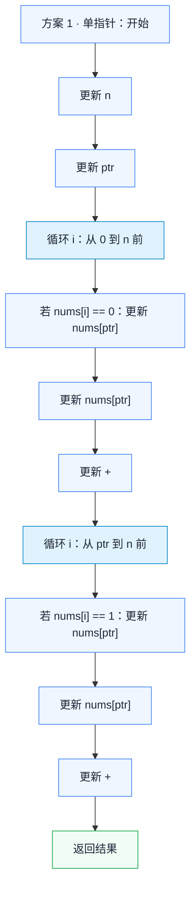

```python
import sys  # 提高递归深度上限（深输入防 RecursionError）

sys.setrecursionlimit(200000)  # 树/链表类题目节点数可达 1e4 量级

def sortColors(nums):  # 定义函数 sortColors（参数：数组）
    n = len(nums)  # 把 长度(数组) 存入 元素个数
    ptr = 0  # 把 0 存入 ptr
    for i in range(n):  # 让 下标 i 从 元素个数 遍历
        if nums[i] == 0:  # 若 数组[下标 i] 等于 0
            nums[i], nums[ptr] = nums[ptr], nums[i]  # 把 数组[ptr], 数组[下标 i] 写入 nums[i], nums[ptr]
            ptr += 1  # ptr累加 1
    for i in range(ptr, n):  # 让 下标 i 从 ptr 到 元素个数 遍历
        if nums[i] == 1:  # 若 数组[下标 i] 等于 1
            nums[i], nums[ptr] = nums[ptr], nums[i]  # 把 数组[ptr], 数组[下标 i] 写入 nums[i], nums[ptr]
            ptr += 1  # ptr累加 1

if __name__ == "__main__":  # 若 __name__ 等于 '__main__'
    print(sortColors([1, 2, 3]))  # 打印输出
```

#### 方案 2：单指针

**思路与代码分析**：核心是「单指针」。Python 版用切片与字典推导式简化操作，突出可读性。**走读**：方案 2 · 单指针：开始 → 更新 n → 更新 p1 → 循环 i：从 0 到 n 前 → 若 nums[i] == 1：更新 nums[p1] → 更新 nums[p1] → 更新 + → 更新 = → 更新 nums[p0] → 若 p0 ＜ p1：更新 nums[p1] → 更新 nums[p1] → 更新 + → 更新 + → 返回结果。

**运行架构**（真实控制流）：

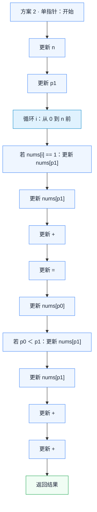

```python
import sys  # 提高递归深度上限（深输入防 RecursionError）

sys.setrecursionlimit(200000)  # 树/链表类题目节点数可达 1e4 量级

def sortColors(nums):  # 定义函数 sortColors（参数：数组）
    n = len(nums)  # 把 长度(数组) 存入 元素个数
    p0, p1 = 0, 0  # 把 0, 0 写入 p0, p1
    for i in range(n):  # 让 下标 i 从 元素个数 遍历
        if nums[i] == 1:  # 若 数组[下标 i] 等于 1
            nums[i], nums[p1] = nums[p1], nums[i]  # 把 数组[p1], 数组[下标 i] 写入 nums[i], nums[p1]
            p1 += 1  # p1累加 1
        elif nums[i] == 0:  # 否则，若 数组[下标 i] 等于 0
            nums[i], nums[p0] = nums[p0], nums[i]  # 把 数组[p0], 数组[下标 i] 写入 nums[i], nums[p0]
            if p0 < p1:  # 若 p0 小于 p1
                nums[i], nums[p1] = nums[p1], nums[i]  # 把 数组[p1], 数组[下标 i] 写入 nums[i], nums[p1]
            p0 += 1  # p0累加 1
            p1 += 1  # p1累加 1

if __name__ == "__main__":  # 若 __name__ 等于 '__main__'
    print(sortColors([1, 2, 3]))  # 打印输出
```

#### 方案 3：单指针

**思路与代码分析**：核心是「单指针」。Python 版用切片与字典推导式简化操作，突出可读性。**走读**：方案 3 · 单指针：开始 → 更新 n → 更新 p2 → 更新 i → 当 i ≤ p2: 时反复执行 → 当 i ≤ p2 and nums[i] == 2: 时反复执行 → 更新 nums[p2] → 更新 - → 若 nums[i] == 0：更新 nums[p0] → 更新 nums[p0] → 更新 + → 更新 + → 返回结果。

**运行架构**（真实控制流）：

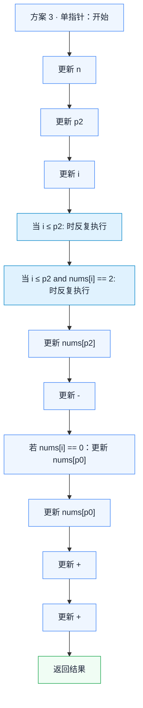

```python
import sys  # 提高递归深度上限（深输入防 RecursionError）

sys.setrecursionlimit(200000)  # 树/链表类题目节点数可达 1e4 量级

def sortColors(nums):  # 定义函数 sortColors（参数：数组）
    n = len(nums)  # 把 长度(数组) 存入 元素个数
    p0, p2 = 0, n - 1  # 把 0, 元素个数 减 1 写入 p0, p2
    i = 0  # 把 0 存入 下标 i
    while i <= p2:  # 循环，直到不满足「下标 i 不超过 p2」
        while i <= p2 and nums[i] == 2:  # 循环，直到不满足「下标 i 不超过 p2 and 数组[下标 i] 等于 2」
            nums[i], nums[p2] = nums[p2], nums[i]  # 把 数组[p2], 数组[下标 i] 写入 nums[i], nums[p2]
            p2 -= 1  # p2累减 1
        if nums[i] == 0:  # 若 数组[下标 i] 等于 0
            nums[i], nums[p0] = nums[p0], nums[i]  # 把 数组[p0], 数组[下标 i] 写入 nums[i], nums[p0]
            p0 += 1  # p0累加 1
        i += 1  # 下标 i累加 1

if __name__ == "__main__":  # 若 __name__ 等于 '__main__'
    print(sortColors([1, 2, 3]))  # 打印输出
```

### Go 实现（3 种方案）

Go 的全部方案如下，每个方案都内嵌用例自测，可独立运行（老仓库 python/go 文件遵循「打印结果」约定）：

#### 方案 1：单指针

**思路与代码分析**：核心是「单指针」。Go 版用切片与多返回值惯用法，显式处理索引边界。**走读**：方案 1 · 单指针：开始 → 更新 : → 更新 : → 遍历循环 → 处理 if nums[i] == 0 → 更新 nums[ptr] → 处理 ptr++ → 遍历循环 → 处理 if nums[i] == 1 → 更新 nums[ptr] → 处理 ptr++ → 返回结果。

**运行架构**（真实控制流）：

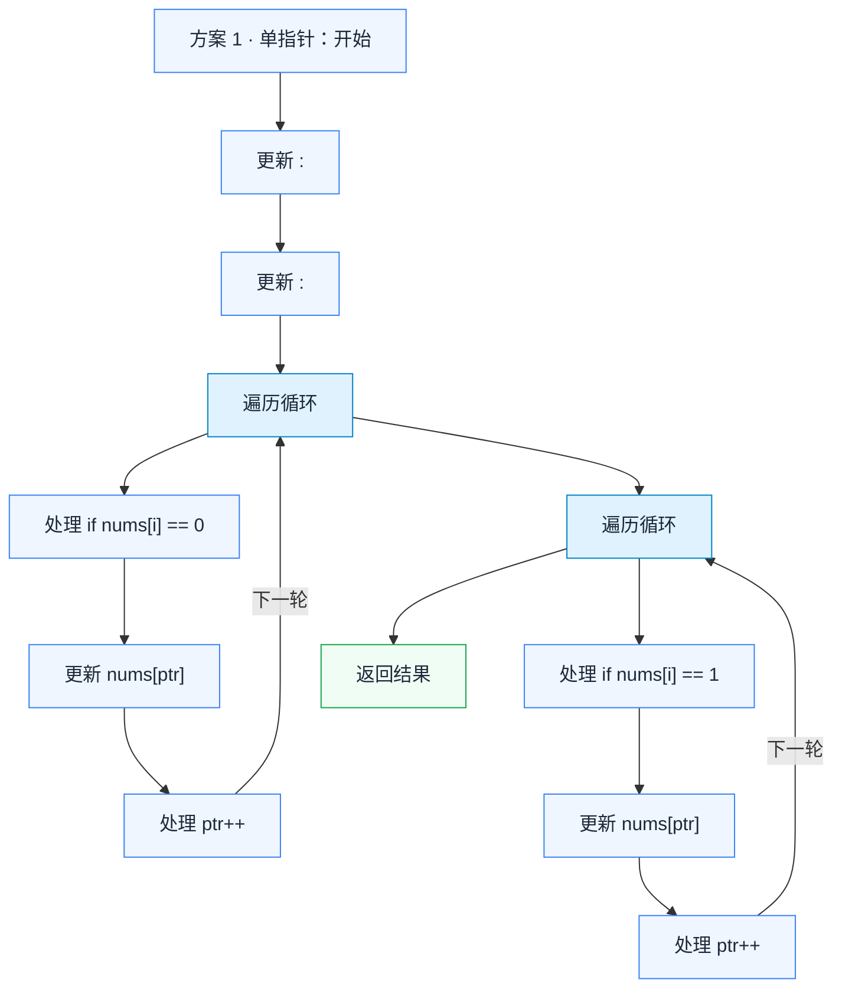

```go
package main // 引入依赖

import (
	"fmt" // 「fmt」
	"os"  // 「os」
)

func eqIntSlice(a, b []int) bool { // 定义函数/方法 eqIntSlice
	if len(a) != len(b) {
		return false
	} // 若 长度(数组) 不等于 长度(b) { return false }
	for i := range a { // 把 range 数组 { 写入 for i :
		if a[i] != b[i] {
			return false
		} // 若 数组[下标 i] 不等于 b[下标 i] { return false }
	}
	return true // 返回 true
}

func sortColors(nums []int) { // 定义函数/方法 sortColors
	n := len(nums)           // 把 长度(数组) 写入 n :
	ptr := 0                 // 把 0 写入 ptr :
	for i := 0; i < n; i++ { // 让 下标 i 从 0 开始计数
		if nums[i] == 0 { // 若 数组[下标 i] 等于 0
			nums[i], nums[ptr] = nums[ptr], nums[i] // 把 数组[ptr], 数组[下标 i] 写入 nums[i], nums[ptr]
			ptr++                                   // ptr 加一
		}
	}
	for i := ptr; i < n; i++ { // 把 ptr; 下标 i 小于 元素个数; 下标 i 加一 { 写入 for i :
		if nums[i] == 1 { // 若 数组[下标 i] 等于 1
			nums[i], nums[ptr] = nums[ptr], nums[i] // 把 数组[ptr], 数组[下标 i] 写入 nums[i], nums[ptr]
			ptr++                                   // ptr 加一
		}
	}
}

func main() { // 程序入口：跑内嵌自测用例
	cases := [][2][]int{ // 把 [][2][]int{ 写入 cases :
		{{2, 0, 2, 1, 1, 0}, {0, 0, 1, 1, 2, 2}},
		{{0}, {0}},
		{{2, 0, 1}, {0, 1, 2}},
	}
	for _, c := range cases { // 同时取 _ 与 字符 遍历
		input := c[0]                     // 把 字符[0] 写入 input :
		expected := c[1]                  // 把 字符[1] 写入 expected :
		sortColors(input)                 // sortColors(input)
		if !eqIntSlice(input, expected) { // 若 取反 eqIntSlice(input, expected
			fmt.Printf("FAIL: got %v expected %v\n", input, expected) // 打印输出
			os.Exit(1)                                                // os.Exit(1)
		}
	}
	fmt.Println("PASS") // 全部用例通过，输出 PASS
}
```

#### 方案 2：单指针

**思路与代码分析**：核心是「单指针」。Go 版用切片与多返回值惯用法，显式处理索引边界。**走读**：方案 2 · 单指针：开始 → 更新 : → 更新 : → 更新 : → 遍历循环 → 遍历循环 → 更新 nums[p2] → 处理 p2-- → 处理 if nums[i] == 0 → 更新 nums[p0] → 处理 p0++ → 处理 i++ → 返回结果。

**运行架构**（真实控制流）：


```go
package main // 引入依赖

import (
	"fmt" // 「fmt」
	"os"  // 「os」
)

func eqIntSlice(a, b []int) bool { // 定义函数/方法 eqIntSlice
	if len(a) != len(b) {
		return false
	} // 若 长度(数组) 不等于 长度(b) { return false }
	for i := range a { // 把 range 数组 { 写入 for i :
		if a[i] != b[i] {
			return false
		} // 若 数组[下标 i] 不等于 b[下标 i] { return false }
	}
	return true // 返回 true
}

func sortColors(nums []int) { // 定义函数/方法 sortColors
	n := len(nums)   // 把 长度(数组) 写入 n :
	p0, p2 := 0, n-1 // 把 0, 元素个数 减 1 写入 p0, p2 :
	i := 0           // 把 0 写入 i :
	for i <= p2 {    // 把 p2 { 写入 for i <
		for i <= p2 && nums[i] == 2 { // 把 p2 且 数组[下标 i] 等于 2 { 写入 for i <
			nums[i], nums[p2] = nums[p2], nums[i] // 把 数组[p2], 数组[下标 i] 写入 nums[i], nums[p2]
			p2--                                  // p2 减一
		}
		if nums[i] == 0 { // 若 数组[下标 i] 等于 0
			nums[i], nums[p0] = nums[p0], nums[i] // 把 数组[p0], 数组[下标 i] 写入 nums[i], nums[p0]
			p0++                                  // p0 加一
		}
		i++ // 下标 i 加一
	}
}

func main() { // 程序入口：跑内嵌自测用例
	cases := [][2][]int{ // 把 [][2][]int{ 写入 cases :
		{{2, 0, 2, 1, 1, 0}, {0, 0, 1, 1, 2, 2}},
		{{0}, {0}},
		{{2, 0, 1}, {0, 1, 2}},
	}
	for _, c := range cases { // 同时取 _ 与 字符 遍历
		input := c[0]                     // 把 字符[0] 写入 input :
		expected := c[1]                  // 把 字符[1] 写入 expected :
		sortColors(input)                 // sortColors(input)
		if !eqIntSlice(input, expected) { // 若 取反 eqIntSlice(input, expected
			fmt.Printf("FAIL: got %v expected %v\n", input, expected) // 打印输出
			os.Exit(1)                                                // os.Exit(1)
		}
	}
	fmt.Println("PASS") // 全部用例通过，输出 PASS
}
```

#### 方案 3：单指针

**思路与代码分析**：核心是「单指针」。Go 版用切片与多返回值惯用法，显式处理索引边界。**走读**：方案 3 · 单指针：开始 → 更新 : → 更新 : → 更新 : → 遍历循环 → 遍历循环 → 更新 nums[p2] → 处理 p2-- → 处理 if nums[i] == 0 → 更新 nums[p0] → 处理 p0++ → 处理 i++ → 返回结果。

**运行架构**（真实控制流）：

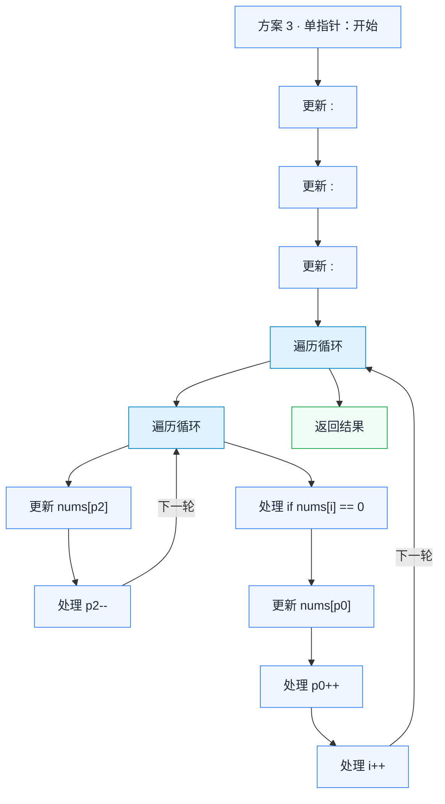

```go
package main // 引入依赖

import (
	"fmt" // 「fmt」
	"os"  // 「os」
)

func eqIntSlice(a, b []int) bool { // 定义函数/方法 eqIntSlice
	if len(a) != len(b) {
		return false
	} // 若 长度(数组) 不等于 长度(b) { return false }
	for i := range a { // 把 range 数组 { 写入 for i :
		if a[i] != b[i] {
			return false
		} // 若 数组[下标 i] 不等于 b[下标 i] { return false }
	}
	return true // 返回 true
}

func sortColors(nums []int) { // 定义函数/方法 sortColors
	n := len(nums)   // 把 长度(数组) 写入 n :
	p0, p2 := 0, n-1 // 把 0, 元素个数 减 1 写入 p0, p2 :
	i := 0           // 把 0 写入 i :
	for i <= p2 {    // 把 p2 { 写入 for i <
		for i <= p2 && nums[i] == 2 { // 把 p2 且 数组[下标 i] 等于 2 { 写入 for i <
			nums[i], nums[p2] = nums[p2], nums[i] // 把 数组[p2], 数组[下标 i] 写入 nums[i], nums[p2]
			p2--                                  // p2 减一
		}
		if nums[i] == 0 { // 若 数组[下标 i] 等于 0
			nums[i], nums[p0] = nums[p0], nums[i] // 把 数组[p0], 数组[下标 i] 写入 nums[i], nums[p0]
			p0++                                  // p0 加一
		}
		i++ // 下标 i 加一
	}
}

func main() { // 程序入口：跑内嵌自测用例
	cases := [][2][]int{ // 把 [][2][]int{ 写入 cases :
		{{2, 0, 2, 1, 1, 0}, {0, 0, 1, 1, 2, 2}},
		{{0}, {0}},
		{{2, 0, 1}, {0, 1, 2}},
	}
	for _, c := range cases { // 同时取 _ 与 字符 遍历
		input := c[0]                     // 把 字符[0] 写入 input :
		expected := c[1]                  // 把 字符[1] 写入 expected :
		sortColors(input)                 // sortColors(input)
		if !eqIntSlice(input, expected) { // 若 取反 eqIntSlice(input, expected
			fmt.Printf("FAIL: got %v expected %v\n", input, expected) // 打印输出
			os.Exit(1)                                                // os.Exit(1)
		}
	}
	fmt.Println("PASS") // 全部用例通过，输出 PASS
}
```

### Java 实现（3 种方案）

Java 的全部方案如下，每个方案都内嵌用例自测，可独立运行（老仓库 python/go 文件遵循「打印结果」约定）：

#### 方案 1：单指针

**思路与代码分析**：核心是「单指针」。Java 版用类与静态方法组织，集合操作显式明了。代码里依次做这些事：双重循环遍历。**走读**：方案 1 · 单指针：开始 → 更新 n → 更新 ptr → 遍历循环 → 若 nums[i] == 0 则： → 更新 tmp → 更新 nums[i] → 更新 nums[ptr] → 处理 ptr++ → 遍历循环 → 若 nums[i] == 1 则： → 更新 tmp → 更新 nums[i] → 更新 nums[ptr] → 处理 ptr++ → 返回结果。

**运行架构**（真实控制流）：

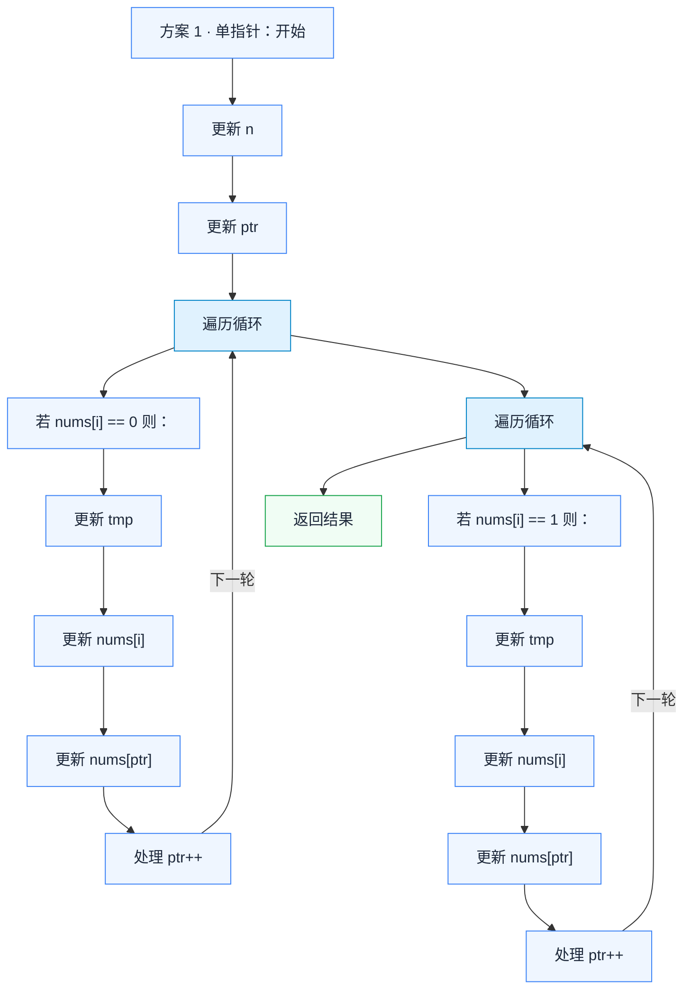

```java
package com.webfault.dsa; // 引入依赖

import java.util.*; // 引入依赖

class Solution { // 定义类型

  static void sortColors(int[] nums) { // 定义函数/方法 sortColors
    int n = nums.length; // 把 数组.长度 存入 元素个数
    int ptr = 0; // 把 0 存入 ptr
    for (int i = 0; i < n; i++) { // 让 下标 i 从 0 开始计数，下标 i 小于 元素个数 就继续
      if (nums[i] == 0) { // 若 数组[下标 i] 等于 0
        int tmp = nums[i]; // 把 数组[下标 i] 存入 临时变量
        nums[i] = nums[ptr]; // 把 数组[ptr]; 写入 nums[i]
        nums[ptr] = tmp; // 把 临时变量; 写入 nums[ptr]
        ptr++; // ptr 加一
      }
    }
    for (int i = ptr; i < n; i++) { // 让 下标 i 从 ptr 开始计数，下标 i 小于 元素个数 就继续
      if (nums[i] == 1) { // 若 数组[下标 i] 等于 1
        int tmp = nums[i]; // 把 数组[下标 i] 存入 临时变量
        nums[i] = nums[ptr]; // 把 数组[ptr]; 写入 nums[i]
        nums[ptr] = tmp; // 把 临时变量; 写入 nums[ptr]
        ptr++; // ptr 加一
      }
    }
  }

  public static void main(String[] args) { // public static void main(String[] args) {
    int[][][] cases = { // 把 { 写入 int[][][] cases
      {{2, 0, 2, 1, 1, 0}, {0, 0, 1, 1, 2, 2}},
      {{0}, {0}},
      {{2, 0, 1}, {0, 1, 2}},
    };
    for (int k = 0; k < cases.length; k++) { // 让 下标 k 从 0 开始计数，下标 k 小于 cases.长度 就继续
      int[] input = cases[k][0]; // 把 cases[下标 k][0]; 写入 int[] input
      int[] expected = cases[k][1]; // 把 cases[下标 k][1]; 写入 int[] expected
      sortColors(input); // sortColors(input);
      if (!java.util.Arrays.equals(
          input, expected)) { // 若 取反 java.util.Arrays.equals(input, expected
        System.out.println("FAIL at case " + k); // 打印输出
        throw new RuntimeException(
            "self-check failed"); // throw new RuntimeException(「self 减 check failed」);
      }
    }
    System.out.println("PASS"); // 全部用例通过，输出 PASS
  }
}
```

#### 方案 2：单指针

**思路与代码分析**：核心是「单指针」。Java 版用类与静态方法组织，集合操作显式明了。**走读**：方案 2 · 单指针：开始 → 更新 n → 当 (i ≤ p2) 时反复执行 → 当 (i ≤ p2 且 nums[i] == 2) 时反复执行 → 返回结果。

**运行架构**（真实控制流）：


```java
package com.webfault.dsa; // 引入依赖

import java.util.*; // 引入依赖

class Solution { // 定义类型

  static void sortColors(int[] nums) { // 定义函数/方法 sortColors
    int n = nums.length; // 把 数组.长度 存入 元素个数
    int p0 = 0, p2 = n - 1; // 把 0, p2 赋值为 元素个数 减 1 存入 p0
    int i = 0; // 把 0 存入 下标 i
    while (i <= p2) { // 循环，直到不满足「下标 i 不超过 p2」
      while (i <= p2 && nums[i] == 2) { // 循环，直到不满足「下标 i 不超过 p2 且 数组[下标 i] 等于 2」
        int tmp = nums[i]; // 把 数组[下标 i] 存入 临时变量
        nums[i] = nums[p2]; // 把 数组[p2]; 写入 nums[i]
        nums[p2] = tmp; // 把 临时变量; 写入 nums[p2]
        p2--; // p2 减一
      }
      if (nums[i] == 0) { // 若 数组[下标 i] 等于 0
        int tmp = nums[i]; // 把 数组[下标 i] 存入 临时变量
        nums[i] = nums[p0]; // 把 数组[p0]; 写入 nums[i]
        nums[p0] = tmp; // 把 临时变量; 写入 nums[p0]
        p0++; // p0 加一
      }
      i++; // 下标 i 加一
    }
  }

  public static void main(String[] args) { // public static void main(String[] args) {
    int[][][] cases = { // 把 { 写入 int[][][] cases
      {{2, 0, 2, 1, 1, 0}, {0, 0, 1, 1, 2, 2}},
      {{0}, {0}},
      {{2, 0, 1}, {0, 1, 2}},
    };
    for (int k = 0; k < cases.length; k++) { // 让 下标 k 从 0 开始计数，下标 k 小于 cases.长度 就继续
      int[] input = cases[k][0]; // 把 cases[下标 k][0]; 写入 int[] input
      int[] expected = cases[k][1]; // 把 cases[下标 k][1]; 写入 int[] expected
      sortColors(input); // sortColors(input);
      if (!java.util.Arrays.equals(
          input, expected)) { // 若 取反 java.util.Arrays.equals(input, expected
        System.out.println("FAIL at case " + k); // 打印输出
        throw new RuntimeException(
            "self-check failed"); // throw new RuntimeException(「self 减 check failed」);
      }
    }
    System.out.println("PASS"); // 全部用例通过，输出 PASS
  }
}
```

#### 方案 3：单指针

**思路与代码分析**：核心是「单指针」。Java 版用类与静态方法组织，集合操作显式明了。**走读**：方案 3 · 单指针：开始 → 更新 n → 当 (i ≤ p2) 时反复执行 → 当 (i ≤ p2 且 nums[i] == 2) 时反复执行 → 返回结果。

**运行架构**（真实控制流）：


```java
package com.webfault.dsa; // 引入依赖

import java.util.*; // 引入依赖

class Solution { // 定义类型

  static void sortColors(int[] nums) { // 定义函数/方法 sortColors
    int n = nums.length; // 把 数组.长度 存入 元素个数
    int p0 = 0, p2 = n - 1; // 把 0, p2 赋值为 元素个数 减 1 存入 p0
    int i = 0; // 把 0 存入 下标 i
    while (i <= p2) { // 循环，直到不满足「下标 i 不超过 p2」
      while (i <= p2 && nums[i] == 2) { // 循环，直到不满足「下标 i 不超过 p2 且 数组[下标 i] 等于 2」
        int tmp = nums[i]; // 把 数组[下标 i] 存入 临时变量
        nums[i] = nums[p2]; // 把 数组[p2]; 写入 nums[i]
        nums[p2] = tmp; // 把 临时变量; 写入 nums[p2]
        p2--; // p2 减一
      }
      if (nums[i] == 0) { // 若 数组[下标 i] 等于 0
        int tmp = nums[i]; // 把 数组[下标 i] 存入 临时变量
        nums[i] = nums[p0]; // 把 数组[p0]; 写入 nums[i]
        nums[p0] = tmp; // 把 临时变量; 写入 nums[p0]
        p0++; // p0 加一
      }
      i++; // 下标 i 加一
    }
  }

  public static void main(String[] args) { // public static void main(String[] args) {
    int[][][] cases = { // 把 { 写入 int[][][] cases
      {{2, 0, 2, 1, 1, 0}, {0, 0, 1, 1, 2, 2}},
      {{0}, {0}},
      {{2, 0, 1}, {0, 1, 2}},
    };
    for (int k = 0; k < cases.length; k++) { // 让 下标 k 从 0 开始计数，下标 k 小于 cases.长度 就继续
      int[] input = cases[k][0]; // 把 cases[下标 k][0]; 写入 int[] input
      int[] expected = cases[k][1]; // 把 cases[下标 k][1]; 写入 int[] expected
      sortColors(input); // sortColors(input);
      if (!java.util.Arrays.equals(
          input, expected)) { // 若 取反 java.util.Arrays.equals(input, expected
        System.out.println("FAIL at case " + k); // 打印输出
        throw new RuntimeException(
            "self-check failed"); // throw new RuntimeException(「self 减 check failed」);
      }
    }
    System.out.println("PASS"); // 全部用例通过，输出 PASS
  }
}
```

### Rust 实现（3 种方案）

Rust 的全部方案如下，每个方案都内嵌用例自测，可独立运行（老仓库 python/go 文件遵循「打印结果」约定）：

#### 方案 1：单指针

**思路与代码分析**：核心是「单指针」。Rust 版用所有权移动与切片借用改写同一逻辑，注意 Option 与引用边界。**走读**：方案 1 · 单指针：开始 → 计算 let (mut p0, mut cur, mu → 当 cur ≤ p2 时反复执行 → 处理 if nums[cur] == 0 → 调用 nums.swap(p0, cur) → 更新 + → 更新 + → 调用 nums.swap(cur, p2) → 处理 if p2 == 0 → 跳出循环（break） → 更新 - → 更新 + → 返回结果。

**运行架构**（真实控制流）：


```rust
// LeetCode 75. 颜色分类 — Rust 版（方案1）
fn sort_colors(nums: &mut Vec<i32>) {
    // 定义函数/方法 sort_colors
    let (mut p0, mut cur, mut p2) = (0usize, 0usize, nums.len() - 1);
    while cur <= p2 {
        // 把 p2 { 写入 while cur <
        if nums[cur] == 0 {
            nums.swap(p0, cur);
            p0 += 1;
            cur += 1;
        }
        // 若 数组[当前值] 等于 0 { 数组.交换 p0, 当前值); p0 累加 1; 当前值 累加 1; }
        else if nums[cur] == 2 {
            nums.swap(cur, p2);
            if p2 == 0 {
                break;
            }
            p2 -= 1;
        } else {
            cur += 1;
        } // 否则
    }
}
fn main() {
    // 程序入口：跑内嵌自测用例
    let mut v = vec![2, 0, 2, 1, 1, 0];
    sort_colors(&mut v); // 把 vec取反 [2,0,2,1,1,0]; sort_colors( 按位与 mut 值); 写入 let mut v
    assert_eq!(v, vec![0, 0, 1, 1, 2, 2]); // 断言校验
    let mut v2 = vec![2, 0, 1];
    sort_colors(&mut v2); // 把 vec取反 [2,0,1]; sort_colors( 按位与 mut v2); 写入 let mut v2
    assert_eq!(v2, vec![0, 1, 2]); // 断言校验
    println!("PASS");
} // 全部用例通过，输出 PASS
```

#### 方案 2：单指针

**思路与代码分析**：核心是「单指针」。Rust 版用所有权移动与切片借用改写同一逻辑，注意 Option 与引用边界。**走读**：方案 2 · 单指针：开始 → 计算 let (mut p0, mut cur, mu → 当 cur ≤ p2 时反复执行 → 处理 if nums[cur] == 0 → 调用 nums.swap(p0, cur) → 更新 + → 更新 + → 调用 nums.swap(cur, p2) → 处理 if p2 == 0 → 跳出循环（break） → 更新 - → 更新 + → 返回结果。

**运行架构**（真实控制流）：


```rust
// LeetCode 75. 颜色分类 — Rust 版（方案2）
fn sort_colors(nums: &mut Vec<i32>) {
    // 定义函数/方法 sort_colors
    let (mut p0, mut cur, mut p2) = (0usize, 0usize, nums.len() - 1);
    while cur <= p2 {
        // 把 p2 { 写入 while cur <
        if nums[cur] == 0 {
            nums.swap(p0, cur);
            p0 += 1;
            cur += 1;
        }
        // 若 数组[当前值] 等于 0 { 数组.交换 p0, 当前值); p0 累加 1; 当前值 累加 1; }
        else if nums[cur] == 2 {
            nums.swap(cur, p2);
            if p2 == 0 {
                break;
            }
            p2 -= 1;
        } else {
            cur += 1;
        } // 否则
    }
}
fn main() {
    // 程序入口：跑内嵌自测用例
    let mut v = vec![2, 0, 2, 1, 1, 0];
    sort_colors(&mut v); // 把 vec取反 [2,0,2,1,1,0]; sort_colors( 按位与 mut 值); 写入 let mut v
    assert_eq!(v, vec![0, 0, 1, 1, 2, 2]); // 断言校验
    let mut v2 = vec![2, 0, 1];
    sort_colors(&mut v2); // 把 vec取反 [2,0,1]; sort_colors( 按位与 mut v2); 写入 let mut v2
    assert_eq!(v2, vec![0, 1, 2]); // 断言校验
    println!("PASS");
} // 全部用例通过，输出 PASS
```

#### 方案 3：单指针

**思路与代码分析**：核心是「单指针」。Rust 版用所有权移动与切片借用改写同一逻辑，注意 Option 与引用边界。**走读**：方案 3 · 单指针：开始 → 计算 let (mut p0, mut cur, mu → 当 cur ≤ p2 时反复执行 → 处理 if nums[cur] == 0 → 调用 nums.swap(p0, cur) → 更新 + → 更新 + → 调用 nums.swap(cur, p2) → 处理 if p2 == 0 → 跳出循环（break） → 更新 - → 更新 + → 返回结果。

**运行架构**（真实控制流）：

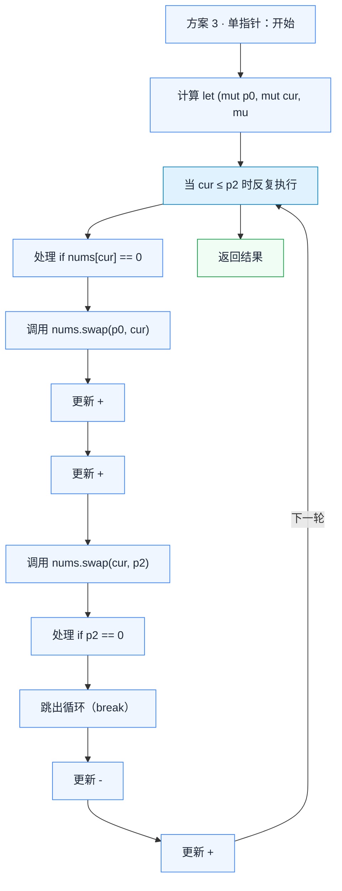

```rust
// LeetCode 75. 颜色分类 — Rust 版（方案3）
fn sort_colors(nums: &mut Vec<i32>) {
    // 定义函数/方法 sort_colors
    let (mut p0, mut cur, mut p2) = (0usize, 0usize, nums.len() - 1);
    while cur <= p2 {
        // 把 p2 { 写入 while cur <
        if nums[cur] == 0 {
            nums.swap(p0, cur);
            p0 += 1;
            cur += 1;
        }
        // 若 数组[当前值] 等于 0 { 数组.交换 p0, 当前值); p0 累加 1; 当前值 累加 1; }
        else if nums[cur] == 2 {
            nums.swap(cur, p2);
            if p2 == 0 {
                break;
            }
            p2 -= 1;
        } else {
            cur += 1;
        } // 否则
    }
}
fn main() {
    // 程序入口：跑内嵌自测用例
    let mut v = vec![2, 0, 2, 1, 1, 0];
    sort_colors(&mut v); // 把 vec取反 [2,0,2,1,1,0]; sort_colors( 按位与 mut 值); 写入 let mut v
    assert_eq!(v, vec![0, 0, 1, 1, 2, 2]); // 断言校验
    let mut v2 = vec![2, 0, 1];
    sort_colors(&mut v2); // 把 vec取反 [2,0,1]; sort_colors( 按位与 mut v2); 写入 let mut v2
    assert_eq!(v2, vec![0, 1, 2]); // 断言校验
    println!("PASS");
} // 全部用例通过，输出 PASS
```

### Lua 实现（3 种方案）

Lua 的全部方案如下，每个方案都内嵌用例自测，可独立运行（老仓库 python/go 文件遵循「打印结果」约定）：

#### 方案 1：单指针

**思路与代码分析**：核心是「单指针」。Lua 版用表与 ipairs 遍历，注意 ipairs 遇 nil 即停的语义。**走读**：方案 1 · 单指针：开始 → 更新 p2 → 当 cur ≤ p2 do 时反复执行 → 处理 if nums[cur] == 0 then → 更新 nums[cur] → 更新 p0 → 更新 cur → 更新 nums[p2] → 更新 p2 → 更新 cur → 返回 nums → 调用 assert(table.concat(sort_col → 调用 assert(table.concat(sort_col → 调用 print(PASS)。

**运行架构**（真实控制流）：

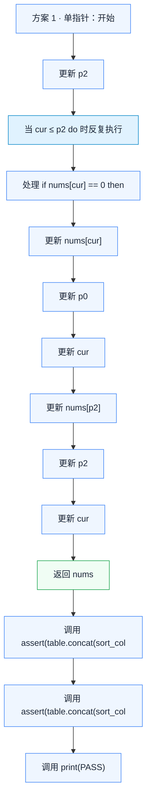

```lua
-- LeetCode 75. 颜色分类 — Lua 版（方案1）
local function sort_colors(nums) -- local function sort_colors(数组)
	local p0, cur, p2 = 1, 1, #nums -- 把 1, 1, #数组 写入 local p0, cur, p2
	while cur <= p2 do -- 把 p2 do 写入 while cur <
		if nums[cur] == 0 then -- 若 数组[当前值] 等于 0 then
			nums[p0], nums[cur] = nums[cur], nums[p0] -- 把 数组[当前值], 数组[p0] 写入 nums[p0], nums[cur]
			p0 = p0 + 1 -- 把 p0 加 1 存入 p0
			cur = cur + 1 -- 把 当前值 加 1 存入 当前值
		elseif nums[cur] == 2 then -- 把 赋值为 2 then 写入 elseif nums[cur]
			nums[cur], nums[p2] = nums[p2], nums[cur] -- 把 数组[p2], 数组[当前值] 写入 nums[cur], nums[p2]
			p2 = p2 - 1 -- 把 p2 减 1 存入 p2
		else -- 否则
			cur = cur + 1 -- 把 当前值 加 1 存入 当前值
		end -- 终点
	end -- 终点
	return nums -- 返回 数组
end -- 终点
assert(table.concat(sort_colors({ 2, 0, 2, 1, 1, 0 }), ",") == "0,0,1,1,2,2") -- 打印输出
assert(table.concat(sort_colors({ 2, 0, 1 }), ",") == "0,1,2") -- 打印输出
print("PASS") -- 全部用例通过，输出 PASS
```

#### 方案 2：单指针

**思路与代码分析**：核心是「单指针」。Lua 版用表与 ipairs 遍历，注意 ipairs 遇 nil 即停的语义。**走读**：方案 2 · 单指针：开始 → 更新 p2 → 当 cur ≤ p2 do 时反复执行 → 处理 if nums[cur] == 0 then → 更新 nums[cur] → 更新 p0 → 更新 cur → 更新 nums[p2] → 更新 p2 → 更新 cur → 返回 nums → 调用 assert(table.concat(sort_col → 调用 assert(table.concat(sort_col → 调用 print(PASS)。

**运行架构**（真实控制流）：

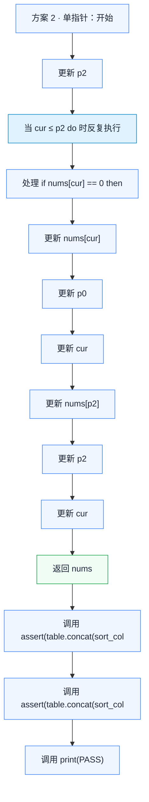

```lua
-- LeetCode 75. 颜色分类 — Lua 版（方案2）
local function sort_colors(nums) -- local function sort_colors(数组)
	local p0, cur, p2 = 1, 1, #nums -- 把 1, 1, #数组 写入 local p0, cur, p2
	while cur <= p2 do -- 把 p2 do 写入 while cur <
		if nums[cur] == 0 then -- 若 数组[当前值] 等于 0 then
			nums[p0], nums[cur] = nums[cur], nums[p0] -- 把 数组[当前值], 数组[p0] 写入 nums[p0], nums[cur]
			p0 = p0 + 1 -- 把 p0 加 1 存入 p0
			cur = cur + 1 -- 把 当前值 加 1 存入 当前值
		elseif nums[cur] == 2 then -- 把 赋值为 2 then 写入 elseif nums[cur]
			nums[cur], nums[p2] = nums[p2], nums[cur] -- 把 数组[p2], 数组[当前值] 写入 nums[cur], nums[p2]
			p2 = p2 - 1 -- 把 p2 减 1 存入 p2
		else -- 否则
			cur = cur + 1 -- 把 当前值 加 1 存入 当前值
		end -- 终点
	end -- 终点
	return nums -- 返回 数组
end -- 终点
assert(table.concat(sort_colors({ 2, 0, 2, 1, 1, 0 }), ",") == "0,0,1,1,2,2") -- 打印输出
assert(table.concat(sort_colors({ 2, 0, 1 }), ",") == "0,1,2") -- 打印输出
print("PASS") -- 全部用例通过，输出 PASS
```

#### 方案 3：单指针

**思路与代码分析**：核心是「单指针」。Lua 版用表与 ipairs 遍历，注意 ipairs 遇 nil 即停的语义。**走读**：方案 3 · 单指针：开始 → 更新 p2 → 当 cur ≤ p2 do 时反复执行 → 处理 if nums[cur] == 0 then → 更新 nums[cur] → 更新 p0 → 更新 cur → 更新 nums[p2] → 更新 p2 → 更新 cur → 返回 nums → 调用 assert(table.concat(sort_col → 调用 assert(table.concat(sort_col → 调用 print(PASS)。

**运行架构**（真实控制流）：


```lua
-- LeetCode 75. 颜色分类 — Lua 版（方案3）
local function sort_colors(nums) -- local function sort_colors(数组)
	local p0, cur, p2 = 1, 1, #nums -- 把 1, 1, #数组 写入 local p0, cur, p2
	while cur <= p2 do -- 把 p2 do 写入 while cur <
		if nums[cur] == 0 then -- 若 数组[当前值] 等于 0 then
			nums[p0], nums[cur] = nums[cur], nums[p0] -- 把 数组[当前值], 数组[p0] 写入 nums[p0], nums[cur]
			p0 = p0 + 1 -- 把 p0 加 1 存入 p0
			cur = cur + 1 -- 把 当前值 加 1 存入 当前值
		elseif nums[cur] == 2 then -- 把 赋值为 2 then 写入 elseif nums[cur]
			nums[cur], nums[p2] = nums[p2], nums[cur] -- 把 数组[p2], 数组[当前值] 写入 nums[cur], nums[p2]
			p2 = p2 - 1 -- 把 p2 减 1 存入 p2
		else -- 否则
			cur = cur + 1 -- 把 当前值 加 1 存入 当前值
		end -- 终点
	end -- 终点
	return nums -- 返回 数组
end -- 终点
assert(table.concat(sort_colors({ 2, 0, 2, 1, 1, 0 }), ",") == "0,0,1,1,2,2") -- 打印输出
assert(table.concat(sort_colors({ 2, 0, 1 }), ",") == "0,1,2") -- 打印输出
print("PASS") -- 全部用例通过，输出 PASS
```

### C 实现（3 种方案）

C 的全部方案如下，每个方案都内嵌用例自测，可独立运行（老仓库 python/go 文件遵循「打印结果」约定）：

#### 方案 1：单指针

**思路与代码分析**：核心是「单指针」。C 版手动管理下标与内存，循环边界全部显式写出。**走读**：方案 1 · 单指针：开始 → 更新 p0 → 当 (cur ≤ p2) 时反复执行 → 若 n[cur] == 0 则： → 更新 t → 更新 n[p0] → 更新 n[cur] → 处理 p0++ → 处理 cur++ → 更新 t → 更新 n[cur] → 更新 n[p2] → 处理 p2-- → 处理 cur++ → 返回结果。

**运行架构**（真实控制流）：

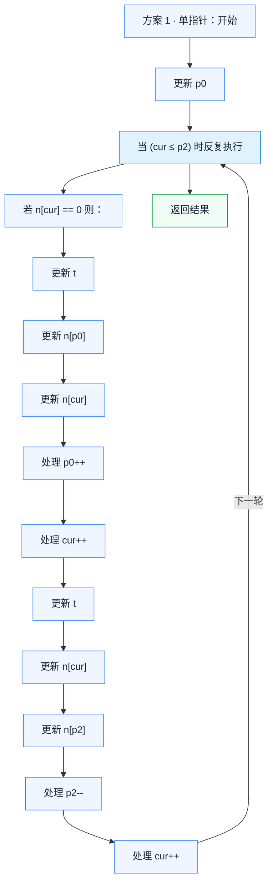

```c
/* LeetCode 75. 颜色分类 — C 版（方案1） */
#include <stdio.h>                          // 引入头文件
static void sort_colors(int n[], int len) { // 定义函数/方法 sort_colors
    int p0 = 0, cur = 0, p2 = len - 1; // 把 0, 当前值 赋值为 0, p2 赋值为 长度 减 1 存入 p0
    while (cur <= p2) {                // 循环，直到不满足「当前值 不超过 p2」
        if (n[cur] == 0) {
            int t = n[p0];
            n[p0] = n[cur];
            n[cur] = t;
            p0++;
            cur++;
        } else if (n[cur] == 2) {
            int t = n[cur];
            n[cur] = n[p2];
            n[p2] = t;
            p2--;
        } else
            cur++; // 否则
    }
}
int main(void) {                   // 程序入口：跑内嵌自测用例
    int v1[] = {2, 0, 2, 1, 1, 0}; // 把 {2,0,2,1,1,0}; 写入 int v1[]
    sort_colors(v1, 6);            // sort_colors(v1, 6);
    if (!(v1[0] == 0 && v1[1] == 0 && v1[2] == 1 && v1[5] == 2)) {
        printf("FAIL 1\n");
        return 1;
    }
    int v2[] = {2, 0, 1}; // 把 {2,0,1}; 写入 int v2[]
    sort_colors(v2, 3);   // sort_colors(v2, 3);
    if (!(v2[0] == 0 && v2[1] == 1 && v2[2] == 2)) {
        printf("FAIL 2\n");
        return 1;
    }
    printf("PASS\n");
    return 0;
} // 全部用例通过，输出 PASS
```

#### 方案 2：单指针

**思路与代码分析**：核心是「单指针」。C 版手动管理下标与内存，循环边界全部显式写出。**走读**：方案 2 · 单指针：开始 → 更新 p0 → 当 (cur ≤ p2) 时反复执行 → 若 n[cur] == 0 则： → 更新 t → 更新 n[p0] → 更新 n[cur] → 处理 p0++ → 处理 cur++ → 更新 t → 更新 n[cur] → 更新 n[p2] → 处理 p2-- → 处理 cur++ → 返回结果。

**运行架构**（真实控制流）：

```mermaid
graph TD
    N0["方案 2 · 单指针：开始"]
    N1["更新 p0"]
    N2["当 (cur ≤ p2) 时反复执行"]
    N3["若 n[cur] == 0 则："]
    N4["更新 t"]
    N5["更新 n[p0]"]
    N6["更新 n[cur]"]
    N7["处理 p0++"]
    N8["处理 cur++"]
    N9["更新 t"]
    N10["更新 n[cur]"]
    N11["更新 n[p2]"]
    N12["处理 p2--"]
    N13["处理 cur++"]
    N14["返回结果"]
    N0 --> N1
    N1 --> N2
    N2 --> N3
    N3 --> N4
    N4 --> N5
    N5 --> N6
    N6 --> N7
    N7 --> N8
    N8 --> N9
    N9 --> N10
    N10 --> N11
    N11 --> N12
    N12 --> N13
    N13 -- 下一轮 --> N2
    N2 --> N14
    classDef n fill:#eff6ff,stroke:#3b82f6,color:#1e293b;
    classDef lp fill:#e0f2fe,stroke:#0284c7,color:#1e293b;
    classDef dc fill:#fef9c3,stroke:#ca8a04,color:#1e293b;
    classDef tm fill:#f0fdf4,stroke:#16a34a,color:#1e293b;
    class N0,N1,N3,N4,N5,N6,N7,N8,N9,N10,N11,N12,N13 n;
    class N2 lp;
    class N14 tm;
```

```c
/* LeetCode 75. 颜色分类 — C 版（方案2） */
#include <stdio.h>                          // 引入头文件
static void sort_colors(int n[], int len) { // 定义函数/方法 sort_colors
    int p0 = 0, cur = 0, p2 = len - 1; // 把 0, 当前值 赋值为 0, p2 赋值为 长度 减 1 存入 p0
    while (cur <= p2) {                // 循环，直到不满足「当前值 不超过 p2」
        if (n[cur] == 0) {
            int t = n[p0];
            n[p0] = n[cur];
            n[cur] = t;
            p0++;
            cur++;
        } else if (n[cur] == 2) {
            int t = n[cur];
            n[cur] = n[p2];
            n[p2] = t;
            p2--;
        } else
            cur++; // 否则
    }
}
int main(void) {                   // 程序入口：跑内嵌自测用例
    int v1[] = {2, 0, 2, 1, 1, 0}; // 把 {2,0,2,1,1,0}; 写入 int v1[]
    sort_colors(v1, 6);            // sort_colors(v1, 6);
    if (!(v1[0] == 0 && v1[1] == 0 && v1[2] == 1 && v1[5] == 2)) {
        printf("FAIL 1\n");
        return 1;
    }
    int v2[] = {2, 0, 1}; // 把 {2,0,1}; 写入 int v2[]
    sort_colors(v2, 3);   // sort_colors(v2, 3);
    if (!(v2[0] == 0 && v2[1] == 1 && v2[2] == 2)) {
        printf("FAIL 2\n");
        return 1;
    }
    printf("PASS\n");
    return 0;
} // 全部用例通过，输出 PASS
```

#### 方案 3：单指针

**思路与代码分析**：核心是「单指针」。C 版手动管理下标与内存，循环边界全部显式写出。**走读**：方案 3 · 单指针：开始 → 更新 p0 → 当 (cur ≤ p2) 时反复执行 → 若 n[cur] == 0 则： → 更新 t → 更新 n[p0] → 更新 n[cur] → 处理 p0++ → 处理 cur++ → 更新 t → 更新 n[cur] → 更新 n[p2] → 处理 p2-- → 处理 cur++ → 返回结果。

**运行架构**（真实控制流）：

```mermaid
graph TD
    N0["方案 3 · 单指针：开始"]
    N1["更新 p0"]
    N2["当 (cur ≤ p2) 时反复执行"]
    N3["若 n[cur] == 0 则："]
    N4["更新 t"]
    N5["更新 n[p0]"]
    N6["更新 n[cur]"]
    N7["处理 p0++"]
    N8["处理 cur++"]
    N9["更新 t"]
    N10["更新 n[cur]"]
    N11["更新 n[p2]"]
    N12["处理 p2--"]
    N13["处理 cur++"]
    N14["返回结果"]
    N0 --> N1
    N1 --> N2
    N2 --> N3
    N3 --> N4
    N4 --> N5
    N5 --> N6
    N6 --> N7
    N7 --> N8
    N8 --> N9
    N9 --> N10
    N10 --> N11
    N11 --> N12
    N12 --> N13
    N13 -- 下一轮 --> N2
    N2 --> N14
    classDef n fill:#eff6ff,stroke:#3b82f6,color:#1e293b;
    classDef lp fill:#e0f2fe,stroke:#0284c7,color:#1e293b;
    classDef dc fill:#fef9c3,stroke:#ca8a04,color:#1e293b;
    classDef tm fill:#f0fdf4,stroke:#16a34a,color:#1e293b;
    class N0,N1,N3,N4,N5,N6,N7,N8,N9,N10,N11,N12,N13 n;
    class N2 lp;
    class N14 tm;
```

```c
/* LeetCode 75. 颜色分类 — C 版（方案3） */
#include <stdio.h>                          // 引入头文件
static void sort_colors(int n[], int len) { // 定义函数/方法 sort_colors
    int p0 = 0, cur = 0, p2 = len - 1; // 把 0, 当前值 赋值为 0, p2 赋值为 长度 减 1 存入 p0
    while (cur <= p2) {                // 循环，直到不满足「当前值 不超过 p2」
        if (n[cur] == 0) {
            int t = n[p0];
            n[p0] = n[cur];
            n[cur] = t;
            p0++;
            cur++;
        } else if (n[cur] == 2) {
            int t = n[cur];
            n[cur] = n[p2];
            n[p2] = t;
            p2--;
        } else
            cur++; // 否则
    }
}
int main(void) {                   // 程序入口：跑内嵌自测用例
    int v1[] = {2, 0, 2, 1, 1, 0}; // 把 {2,0,2,1,1,0}; 写入 int v1[]
    sort_colors(v1, 6);            // sort_colors(v1, 6);
    if (!(v1[0] == 0 && v1[1] == 0 && v1[2] == 1 && v1[5] == 2)) {
        printf("FAIL 1\n");
        return 1;
    }
    int v2[] = {2, 0, 1}; // 把 {2,0,1}; 写入 int v2[]
    sort_colors(v2, 3);   // sort_colors(v2, 3);
    if (!(v2[0] == 0 && v2[1] == 1 && v2[2] == 2)) {
        printf("FAIL 2\n");
        return 1;
    }
    printf("PASS\n");
    return 0;
} // 全部用例通过，输出 PASS
```

### C++ 实现（3 种方案）

C++ 的全部方案如下，每个方案都内嵌用例自测，可独立运行（老仓库 python/go 文件遵循「打印结果」约定）：

#### 方案 1：单指针

**思路与代码分析**：核心是「单指针」。C++ 版用 STL 容器与迭代器，减少手写下标错误。**走读**：方案 1 · 单指针：开始 → 更新 p0 → 当 (cur ≤ p2) 时反复执行 → 若 nums[cur] == 0：处理 std::swap(nums[p0++], → 处理 std::swap(nums[p0++], → 处理 nums[cur++]) → 处理 std::swap(nums[cur], → 处理 nums[p2--]) → 处理 ++cur → 返回结果。

**运行架构**（真实控制流）：

```mermaid
graph TD
    N0["方案 1 · 单指针：开始"]
    N1["更新 p0"]
    N2["当 (cur ≤ p2) 时反复执行"]
    N3["若 nums[cur] == 0：处理 std::swap(nums[p0++],"]
    N4["处理 std::swap(nums[p0++],"]
    N5["处理 nums[cur++])"]
    N6["处理 std::swap(nums[cur],"]
    N7["处理 nums[p2--])"]
    N8["处理 ++cur"]
    N9["返回结果"]
    N0 --> N1
    N1 --> N2
    N2 --> N3
    N3 --> N4
    N4 --> N5
    N5 --> N6
    N6 --> N7
    N7 --> N8
    N8 -- 下一轮 --> N2
    N2 --> N9
    classDef n fill:#eff6ff,stroke:#3b82f6,color:#1e293b;
    classDef lp fill:#e0f2fe,stroke:#0284c7,color:#1e293b;
    classDef dc fill:#fef9c3,stroke:#ca8a04,color:#1e293b;
    classDef tm fill:#f0fdf4,stroke:#16a34a,color:#1e293b;
    class N0,N1,N3,N4,N5,N6,N7,N8 n;
    class N2 lp;
    class N9 tm;
```

```cpp
// LeetCode 75. 颜色分类 — C++ 版（方案1）
#include <cassert>                               // 引入头文件
#include <iostream>                              // 引入头文件
#include <vector>                                // 引入头文件
static void sortColors(std::vector<int> &nums) { // 定义函数/方法 sortColors
    int p0 = 0, cur = 0, p2 = static_cast<int>(nums.size()) - 1;
    while (cur <= p2) { // 循环，直到不满足「当前值 不超过 p2」
        if (nums[cur] == 0)
            std::swap(nums[p0++],
                      nums[cur++]); // 若 数组[当前值] 等于 0) std::交换 数组[p0 加一 ], 数组[当前值 加一 ]);
        else if (nums[cur] == 2)
            std::swap(nums[cur],
                      nums[p2--]); // 否则，若 数组[当前值] 等于 2) std::交换 数组[当前值], 数组[p2 减一 ]);
        else
            ++cur; // 否则
    }
}
int main() {                                           // 程序入口：跑内嵌自测用例
    std::vector<int> v = {2, 0, 2, 1, 1, 0};           // 把 {2, 0, 2, 1, 1, 0}; 写入 std::vector<int> v
    sortColors(v);                                     // sortColors(值);
    assert((v == std::vector<int>{0, 0, 1, 1, 2, 2})); // 断言校验
    std::vector<int> v2 = {2, 0, 1};                   // 把 {2, 0, 1}; 写入 std::vector<int> v2
    sortColors(v2);                                    // sortColors(v2);
    assert((v2 == std::vector<int>{0, 1, 2}));         // 断言校验
    std::cout << "PASS" << std::endl;
} // 全部用例通过，输出 PASS
```

#### 方案 2：单指针

**思路与代码分析**：核心是「单指针」。C++ 版用 STL 容器与迭代器，减少手写下标错误。**走读**：方案 2 · 单指针：开始 → 更新 p0 → 当 (cur ≤ p2) 时反复执行 → 若 nums[cur] == 0：处理 std::swap(nums[p0++], → 处理 std::swap(nums[p0++], → 处理 nums[cur++]) → 处理 std::swap(nums[cur], → 处理 nums[p2--]) → 处理 ++cur → 返回结果。

**运行架构**（真实控制流）：

```mermaid
graph TD
    N0["方案 2 · 单指针：开始"]
    N1["更新 p0"]
    N2["当 (cur ≤ p2) 时反复执行"]
    N3["若 nums[cur] == 0：处理 std::swap(nums[p0++],"]
    N4["处理 std::swap(nums[p0++],"]
    N5["处理 nums[cur++])"]
    N6["处理 std::swap(nums[cur],"]
    N7["处理 nums[p2--])"]
    N8["处理 ++cur"]
    N9["返回结果"]
    N0 --> N1
    N1 --> N2
    N2 --> N3
    N3 --> N4
    N4 --> N5
    N5 --> N6
    N6 --> N7
    N7 --> N8
    N8 -- 下一轮 --> N2
    N2 --> N9
    classDef n fill:#eff6ff,stroke:#3b82f6,color:#1e293b;
    classDef lp fill:#e0f2fe,stroke:#0284c7,color:#1e293b;
    classDef dc fill:#fef9c3,stroke:#ca8a04,color:#1e293b;
    classDef tm fill:#f0fdf4,stroke:#16a34a,color:#1e293b;
    class N0,N1,N3,N4,N5,N6,N7,N8 n;
    class N2 lp;
    class N9 tm;
```

```cpp
// LeetCode 75. 颜色分类 — C++ 版（方案2）
#include <cassert>                               // 引入头文件
#include <iostream>                              // 引入头文件
#include <vector>                                // 引入头文件
static void sortColors(std::vector<int> &nums) { // 定义函数/方法 sortColors
    int p0 = 0, cur = 0, p2 = static_cast<int>(nums.size()) - 1;
    while (cur <= p2) { // 循环，直到不满足「当前值 不超过 p2」
        if (nums[cur] == 0)
            std::swap(nums[p0++],
                      nums[cur++]); // 若 数组[当前值] 等于 0) std::交换 数组[p0 加一 ], 数组[当前值 加一 ]);
        else if (nums[cur] == 2)
            std::swap(nums[cur],
                      nums[p2--]); // 否则，若 数组[当前值] 等于 2) std::交换 数组[当前值], 数组[p2 减一 ]);
        else
            ++cur; // 否则
    }
}
int main() {                                           // 程序入口：跑内嵌自测用例
    std::vector<int> v = {2, 0, 2, 1, 1, 0};           // 把 {2, 0, 2, 1, 1, 0}; 写入 std::vector<int> v
    sortColors(v);                                     // sortColors(值);
    assert((v == std::vector<int>{0, 0, 1, 1, 2, 2})); // 断言校验
    std::vector<int> v2 = {2, 0, 1};                   // 把 {2, 0, 1}; 写入 std::vector<int> v2
    sortColors(v2);                                    // sortColors(v2);
    assert((v2 == std::vector<int>{0, 1, 2}));         // 断言校验
    std::cout << "PASS" << std::endl;
} // 全部用例通过，输出 PASS
```

#### 方案 3：单指针

**思路与代码分析**：核心是「单指针」。C++ 版用 STL 容器与迭代器，减少手写下标错误。**走读**：方案 3 · 单指针：开始 → 更新 p0 → 当 (cur ≤ p2) 时反复执行 → 若 nums[cur] == 0：处理 std::swap(nums[p0++], → 处理 std::swap(nums[p0++], → 处理 nums[cur++]) → 处理 std::swap(nums[cur], → 处理 nums[p2--]) → 处理 ++cur → 返回结果。

**运行架构**（真实控制流）：

```mermaid
graph TD
    N0["方案 3 · 单指针：开始"]
    N1["更新 p0"]
    N2["当 (cur ≤ p2) 时反复执行"]
    N3["若 nums[cur] == 0：处理 std::swap(nums[p0++],"]
    N4["处理 std::swap(nums[p0++],"]
    N5["处理 nums[cur++])"]
    N6["处理 std::swap(nums[cur],"]
    N7["处理 nums[p2--])"]
    N8["处理 ++cur"]
    N9["返回结果"]
    N0 --> N1
    N1 --> N2
    N2 --> N3
    N3 --> N4
    N4 --> N5
    N5 --> N6
    N6 --> N7
    N7 --> N8
    N8 -- 下一轮 --> N2
    N2 --> N9
    classDef n fill:#eff6ff,stroke:#3b82f6,color:#1e293b;
    classDef lp fill:#e0f2fe,stroke:#0284c7,color:#1e293b;
    classDef dc fill:#fef9c3,stroke:#ca8a04,color:#1e293b;
    classDef tm fill:#f0fdf4,stroke:#16a34a,color:#1e293b;
    class N0,N1,N3,N4,N5,N6,N7,N8 n;
    class N2 lp;
    class N9 tm;
```

```cpp
// LeetCode 75. 颜色分类 — C++ 版（方案3）
#include <cassert>                               // 引入头文件
#include <iostream>                              // 引入头文件
#include <vector>                                // 引入头文件
static void sortColors(std::vector<int> &nums) { // 定义函数/方法 sortColors
    int p0 = 0, cur = 0, p2 = static_cast<int>(nums.size()) - 1;
    while (cur <= p2) { // 循环，直到不满足「当前值 不超过 p2」
        if (nums[cur] == 0)
            std::swap(nums[p0++],
                      nums[cur++]); // 若 数组[当前值] 等于 0) std::交换 数组[p0 加一 ], 数组[当前值 加一 ]);
        else if (nums[cur] == 2)
            std::swap(nums[cur],
                      nums[p2--]); // 否则，若 数组[当前值] 等于 2) std::交换 数组[当前值], 数组[p2 减一 ]);
        else
            ++cur; // 否则
    }
}
int main() {                                           // 程序入口：跑内嵌自测用例
    std::vector<int> v = {2, 0, 2, 1, 1, 0};           // 把 {2, 0, 2, 1, 1, 0}; 写入 std::vector<int> v
    sortColors(v);                                     // sortColors(值);
    assert((v == std::vector<int>{0, 0, 1, 1, 2, 2})); // 断言校验
    std::vector<int> v2 = {2, 0, 1};                   // 把 {2, 0, 1}; 写入 std::vector<int> v2
    sortColors(v2);                                    // sortColors(v2);
    assert((v2 == std::vector<int>{0, 1, 2}));         // 断言校验
    std::cout << "PASS" << std::endl;
} // 全部用例通过，输出 PASS
```

### R 实现（3 种方案）

R 的全部方案如下，每个方案都内嵌用例自测，可独立运行（老仓库 python/go 文件遵循「打印结果」约定）：

#### 方案 1：单指针

**思路与代码分析**：核心是「单指针」。R 版用向量化思维与 1 起始下标，注意 1:n 的降序陷阱。

**运行架构**（真实控制流）：

```mermaid
graph TD
    A["开始：读取输入"]
    F0["核心处理逻辑"]
    A --> F0
    Z["返回结果"]
    F0 --> Z
```

```r
# 版（方案1）
sort_colors <- function(nums) sort(nums)  # 定义函数 sort_colors（参数：数组）
stopifnot(identical(sort_colors(c(2, 0, 2, 1, 1, 0)), c(0, 0, 1, 1, 2, 2)))  # 断言校验
stopifnot(identical(sort_colors(c(2, 0, 1)), c(0, 1, 2)))  # 断言校验
cat("PASS\n")  # 全部用例通过，输出 PASS
```

#### 方案 2：单指针

**思路与代码分析**：核心是「单指针」。R 版用向量化思维与 1 起始下标，注意 1:n 的降序陷阱。

**运行架构**：与方案 1 的控制流相同（同算法在该语言的等价实现），图见上。

```r
# 版（方案2）
sort_colors <- function(nums) sort(nums)  # 定义函数 sort_colors（参数：数组）
stopifnot(identical(sort_colors(c(2, 0, 2, 1, 1, 0)), c(0, 0, 1, 1, 2, 2)))  # 断言校验
stopifnot(identical(sort_colors(c(2, 0, 1)), c(0, 1, 2)))  # 断言校验
cat("PASS\n")  # 全部用例通过，输出 PASS
```

#### 方案 3：单指针

**思路与代码分析**：核心是「单指针」。R 版用向量化思维与 1 起始下标，注意 1:n 的降序陷阱。

**运行架构**：与方案 1 的控制流相同（同算法在该语言的等价实现），图见上。

```r
# 版（方案3）
sort_colors <- function(nums) sort(nums)  # 定义函数 sort_colors（参数：数组）
stopifnot(identical(sort_colors(c(2, 0, 2, 1, 1, 0)), c(0, 0, 1, 1, 2, 2)))  # 断言校验
stopifnot(identical(sort_colors(c(2, 0, 1)), c(0, 1, 2)))  # 断言校验
cat("PASS\n")  # 全部用例通过，输出 PASS
```

### Zig 实现（3 种方案）

Zig 的全部方案如下，每个方案都内嵌用例自测，可独立运行（老仓库 python/go 文件遵循「打印结果」约定）：

#### 方案 1：单指针

**思路与代码分析**：核心是「单指针」。Zig 版显式分配与清零，整型边界处理严格。**走读**：方案 1 · 单指针：开始 → 计算 p0 → 当 (cur ≤ p2) 时反复执行 → 返回结果。

**运行架构**（真实控制流）：

```mermaid
graph TD
    N0["方案 1 · 单指针：开始"]
    N1["计算 p0"]
    D1["……（中间计算步骤）"]
    N4["当 (cur ≤ p2) 时反复执行"]
    D2["……（中间计算步骤）"]
    N16["返回结果"]
    N0 --> N1
    N4 --> N16
    N1 --> D1
    D1 --> N4
    N4 --> D2
    D2 --> N16
    classDef n fill:#eff6ff,stroke:#3b82f6,color:#1e293b;
    classDef lp fill:#e0f2fe,stroke:#0284c7,color:#1e293b;
    classDef dc fill:#fef9c3,stroke:#ca8a04,color:#1e293b;
    classDef tm fill:#f0fdf4,stroke:#16a34a,color:#1e293b;
    class N0,N1,D1,D2 n;
    class N4 lp;
    class N16 tm;
```

```zig
// LeetCode 75. 颜色分类 — Zig 版（方案1）
const std = @import("std"); // 把 @import(「std」) 存入 std
fn sortColors(nums: []i32) void { // 定义函数/方法 sortColors
    var p0: usize = 0; // 把 0; 写入 var p0: usize
    var cur: usize = 0; // 把 0; 写入 var cur: usize
    var p2: usize = nums.len - 1; // 把 数组.长度 减 1; 写入 var p2: usize
    while (cur <= p2) { // 循环，直到不满足「当前值 不超过 p2」
        if (nums[cur] == 0) { // 若 数组[当前值] 等于 0
            const t = nums[p0]; // 把 数组[p0] 存入 另一字符串
            nums[p0] = nums[cur]; // 把 数组[当前值]; 写入 nums[p0]
            nums[cur] = t; // 把 另一字符串; 写入 nums[cur]
            p0 += 1; // p0累加 1
            cur += 1; // 当前值累加 1
        } else if (nums[cur] == 2) { // 否则，若 数组[当前值] 等于 2
            const t = nums[cur]; // 把 数组[当前值] 存入 另一字符串
            nums[cur] = nums[p2]; // 把 数组[p2]; 写入 nums[cur]
            nums[p2] = t; // 把 另一字符串; 写入 nums[p2]
            if (p2 == 0) break; // 若 p2 等于 0) break;
            p2 -= 1; // p2累减 1
        } else cur += 1; // 否则
    }
}
pub fn main() !void { // 程序入口：跑内嵌自测用例
    var v1 = [_]i32{ 2, 0, 2, 1, 1, 0 }; // 把 [_]i32{ 2, 0, 2, 1, 1, 0 } 存入 v1
    sortColors(&v1); // sortColors( 按位与 v1);
    if (v1[0] != 0 or v1[2] != 1 or v1[5] != 2) return error.TestFailed;
    var v2 = [_]i32{ 2, 0, 1 }; // 把 [_]i32{ 2, 0, 1 } 存入 v2
    sortColors(&v2); // sortColors( 按位与 v2);
    if (v2[0] != 0 or v2[2] != 2) return error.TestFailed; // 若 v2[0] 不等于 0 or v2[2] 不等于 2，直接返回 error.TestFailed
    std.debug.print("PASS\n", .{});
} // 全部用例通过，输出 PASS
```

#### 方案 2：单指针

**思路与代码分析**：核心是「单指针」。Zig 版显式分配与清零，整型边界处理严格。**走读**：方案 2 · 单指针：开始 → 计算 p0 → 当 (cur ≤ p2) 时反复执行 → 返回结果。

**运行架构**（真实控制流）：

```mermaid
graph TD
    N0["方案 2 · 单指针：开始"]
    N1["计算 p0"]
    D1["……（中间计算步骤）"]
    N4["当 (cur ≤ p2) 时反复执行"]
    D2["……（中间计算步骤）"]
    N16["返回结果"]
    N0 --> N1
    N4 --> N16
    N1 --> D1
    D1 --> N4
    N4 --> D2
    D2 --> N16
    classDef n fill:#eff6ff,stroke:#3b82f6,color:#1e293b;
    classDef lp fill:#e0f2fe,stroke:#0284c7,color:#1e293b;
    classDef dc fill:#fef9c3,stroke:#ca8a04,color:#1e293b;
    classDef tm fill:#f0fdf4,stroke:#16a34a,color:#1e293b;
    class N0,N1,D1,D2 n;
    class N4 lp;
    class N16 tm;
```

```zig
// LeetCode 75. 颜色分类 — Zig 版（方案2）
const std = @import("std"); // 把 @import(「std」) 存入 std
fn sortColors(nums: []i32) void { // 定义函数/方法 sortColors
    var p0: usize = 0; // 把 0; 写入 var p0: usize
    var cur: usize = 0; // 把 0; 写入 var cur: usize
    var p2: usize = nums.len - 1; // 把 数组.长度 减 1; 写入 var p2: usize
    while (cur <= p2) { // 循环，直到不满足「当前值 不超过 p2」
        if (nums[cur] == 0) { // 若 数组[当前值] 等于 0
            const t = nums[p0]; // 把 数组[p0] 存入 另一字符串
            nums[p0] = nums[cur]; // 把 数组[当前值]; 写入 nums[p0]
            nums[cur] = t; // 把 另一字符串; 写入 nums[cur]
            p0 += 1; // p0累加 1
            cur += 1; // 当前值累加 1
        } else if (nums[cur] == 2) { // 否则，若 数组[当前值] 等于 2
            const t = nums[cur]; // 把 数组[当前值] 存入 另一字符串
            nums[cur] = nums[p2]; // 把 数组[p2]; 写入 nums[cur]
            nums[p2] = t; // 把 另一字符串; 写入 nums[p2]
            if (p2 == 0) break; // 若 p2 等于 0) break;
            p2 -= 1; // p2累减 1
        } else cur += 1; // 否则
    }
}
pub fn main() !void { // 程序入口：跑内嵌自测用例
    var v1 = [_]i32{ 2, 0, 2, 1, 1, 0 }; // 把 [_]i32{ 2, 0, 2, 1, 1, 0 } 存入 v1
    sortColors(&v1); // sortColors( 按位与 v1);
    if (v1[0] != 0 or v1[2] != 1 or v1[5] != 2) return error.TestFailed;
    var v2 = [_]i32{ 2, 0, 1 }; // 把 [_]i32{ 2, 0, 1 } 存入 v2
    sortColors(&v2); // sortColors( 按位与 v2);
    if (v2[0] != 0 or v2[2] != 2) return error.TestFailed; // 若 v2[0] 不等于 0 or v2[2] 不等于 2，直接返回 error.TestFailed
    std.debug.print("PASS\n", .{});
} // 全部用例通过，输出 PASS
```

#### 方案 3：单指针

**思路与代码分析**：核心是「单指针」。Zig 版显式分配与清零，整型边界处理严格。**走读**：方案 3 · 单指针：开始 → 计算 p0 → 当 (cur ≤ p2) 时反复执行 → 返回结果。

**运行架构**（真实控制流）：

```mermaid
graph TD
    N0["方案 3 · 单指针：开始"]
    N1["计算 p0"]
    D1["……（中间计算步骤）"]
    N4["当 (cur ≤ p2) 时反复执行"]
    D2["……（中间计算步骤）"]
    N16["返回结果"]
    N0 --> N1
    N4 --> N16
    N1 --> D1
    D1 --> N4
    N4 --> D2
    D2 --> N16
    classDef n fill:#eff6ff,stroke:#3b82f6,color:#1e293b;
    classDef lp fill:#e0f2fe,stroke:#0284c7,color:#1e293b;
    classDef dc fill:#fef9c3,stroke:#ca8a04,color:#1e293b;
    classDef tm fill:#f0fdf4,stroke:#16a34a,color:#1e293b;
    class N0,N1,D1,D2 n;
    class N4 lp;
    class N16 tm;
```

```zig
// LeetCode 75. 颜色分类 — Zig 版（方案3）
const std = @import("std"); // 把 @import(「std」) 存入 std
fn sortColors(nums: []i32) void { // 定义函数/方法 sortColors
    var p0: usize = 0; // 把 0; 写入 var p0: usize
    var cur: usize = 0; // 把 0; 写入 var cur: usize
    var p2: usize = nums.len - 1; // 把 数组.长度 减 1; 写入 var p2: usize
    while (cur <= p2) { // 循环，直到不满足「当前值 不超过 p2」
        if (nums[cur] == 0) { // 若 数组[当前值] 等于 0
            const t = nums[p0]; // 把 数组[p0] 存入 另一字符串
            nums[p0] = nums[cur]; // 把 数组[当前值]; 写入 nums[p0]
            nums[cur] = t; // 把 另一字符串; 写入 nums[cur]
            p0 += 1; // p0累加 1
            cur += 1; // 当前值累加 1
        } else if (nums[cur] == 2) { // 否则，若 数组[当前值] 等于 2
            const t = nums[cur]; // 把 数组[当前值] 存入 另一字符串
            nums[cur] = nums[p2]; // 把 数组[p2]; 写入 nums[cur]
            nums[p2] = t; // 把 另一字符串; 写入 nums[p2]
            if (p2 == 0) break; // 若 p2 等于 0) break;
            p2 -= 1; // p2累减 1
        } else cur += 1; // 否则
    }
}
pub fn main() !void { // 程序入口：跑内嵌自测用例
    var v1 = [_]i32{ 2, 0, 2, 1, 1, 0 }; // 把 [_]i32{ 2, 0, 2, 1, 1, 0 } 存入 v1
    sortColors(&v1); // sortColors( 按位与 v1);
    if (v1[0] != 0 or v1[2] != 1 or v1[5] != 2) return error.TestFailed;
    var v2 = [_]i32{ 2, 0, 1 }; // 把 [_]i32{ 2, 0, 1 } 存入 v2
    sortColors(&v2); // sortColors( 按位与 v2);
    if (v2[0] != 0 or v2[2] != 2) return error.TestFailed; // 若 v2[0] 不等于 0 or v2[2] 不等于 2，直接返回 error.TestFailed
    std.debug.print("PASS\n", .{});
} // 全部用例通过，输出 PASS
```

### Dart 实现（3 种方案）

Dart 的全部方案如下，每个方案都内嵌用例自测，可独立运行（老仓库 python/go 文件遵循「打印结果」约定）：

#### 方案 1：单指针

**思路与代码分析**：核心是「单指针」。Dart 版用可空类型标注与集合方法，注意空安全。**走读**：方案 1 · 单指针：开始 → 计算 p0 → 当 (cur ≤ p2) 时反复执行 → 返回结果。

**运行架构**（真实控制流）：

```mermaid
graph TD
    N0["方案 1 · 单指针：开始"]
    N1["计算 p0"]
    D1["……（中间计算步骤）"]
    N4["当 (cur ≤ p2) 时反复执行"]
    D2["……（中间计算步骤）"]
    N16["返回结果"]
    N0 --> N1
    N4 --> N16
    N1 --> D1
    D1 --> N4
    N4 --> D2
    D2 --> N16
    classDef n fill:#eff6ff,stroke:#3b82f6,color:#1e293b;
    classDef lp fill:#e0f2fe,stroke:#0284c7,color:#1e293b;
    classDef dc fill:#fef9c3,stroke:#ca8a04,color:#1e293b;
    classDef tm fill:#f0fdf4,stroke:#16a34a,color:#1e293b;
    class N0,N1,D1,D2 n;
    class N4 lp;
    class N16 tm;
```

```dart
// LeetCode 75. 颜色分类 — Dart 版（方案1）
void sortColors(List<int> nums) {
  // 定义函数/方法 sortColors
  var p0 = 0,
      cur = 0,
      p2 = nums.length - 1; // 把 0, 当前值 赋值为 0, p2 赋值为 数组.长度 减 1 存入 p0
  while (cur <= p2) {
    // 循环，直到不满足「当前值 不超过 p2」
    if (nums[cur] == 0) {
      // 若 数组[当前值] 等于 0
      final t = nums[p0]; // 把 数组[p0] 存入 另一字符串
      nums[p0] = nums[cur]; // 把 数组[当前值]; 写入 nums[p0]
      nums[cur] = t; // 把 另一字符串; 写入 nums[cur]
      p0++; // p0 加一
      cur++; // 当前值 加一
    } else if (nums[cur] == 2) {
      // 否则，若 数组[当前值] 等于 2
      final t = nums[cur]; // 把 数组[当前值] 存入 另一字符串
      nums[cur] = nums[p2]; // 把 数组[p2]; 写入 nums[cur]
      nums[p2] = t; // 把 另一字符串; 写入 nums[p2]
      p2--; // p2 减一
    } else {
      // 否则
      cur++; // 当前值 加一
    }
  }
}

void main() {
  // 程序入口：跑内嵌自测用例
  final v = [2, 0, 2, 1, 1, 0]; // 把 [2, 0, 2, 1, 1, 0] 存入 值
  sortColors(v); // sortColors(值);
  if (v.toString() != '[0, 0, 1, 1, 2, 2]') throw StateError('c1');
  final v2 = [2, 0, 1]; // 把 [2, 0, 1] 存入 v2
  sortColors(v2); // sortColors(v2);
  if (v2.toString() != '[0, 1, 2]')
    throw StateError(
      'c2',
    ); // 若 v2.toString() 不等于 '[0, 1, 2]') throw StateError('c2');
  print('PASS');
} // 全部用例通过，输出 PASS
```

#### 方案 2：单指针

**思路与代码分析**：核心是「单指针」。Dart 版用可空类型标注与集合方法，注意空安全。**走读**：方案 2 · 单指针：开始 → 计算 p0 → 当 (cur ≤ p2) 时反复执行 → 返回结果。

**运行架构**（真实控制流）：

```mermaid
graph TD
    N0["方案 2 · 单指针：开始"]
    N1["计算 p0"]
    D1["……（中间计算步骤）"]
    N4["当 (cur ≤ p2) 时反复执行"]
    D2["……（中间计算步骤）"]
    N16["返回结果"]
    N0 --> N1
    N4 --> N16
    N1 --> D1
    D1 --> N4
    N4 --> D2
    D2 --> N16
    classDef n fill:#eff6ff,stroke:#3b82f6,color:#1e293b;
    classDef lp fill:#e0f2fe,stroke:#0284c7,color:#1e293b;
    classDef dc fill:#fef9c3,stroke:#ca8a04,color:#1e293b;
    classDef tm fill:#f0fdf4,stroke:#16a34a,color:#1e293b;
    class N0,N1,D1,D2 n;
    class N4 lp;
    class N16 tm;
```

```dart
// LeetCode 75. 颜色分类 — Dart 版（方案2）
void sortColors(List<int> nums) {
  // 定义函数/方法 sortColors
  var p0 = 0,
      cur = 0,
      p2 = nums.length - 1; // 把 0, 当前值 赋值为 0, p2 赋值为 数组.长度 减 1 存入 p0
  while (cur <= p2) {
    // 循环，直到不满足「当前值 不超过 p2」
    if (nums[cur] == 0) {
      // 若 数组[当前值] 等于 0
      final t = nums[p0]; // 把 数组[p0] 存入 另一字符串
      nums[p0] = nums[cur]; // 把 数组[当前值]; 写入 nums[p0]
      nums[cur] = t; // 把 另一字符串; 写入 nums[cur]
      p0++; // p0 加一
      cur++; // 当前值 加一
    } else if (nums[cur] == 2) {
      // 否则，若 数组[当前值] 等于 2
      final t = nums[cur]; // 把 数组[当前值] 存入 另一字符串
      nums[cur] = nums[p2]; // 把 数组[p2]; 写入 nums[cur]
      nums[p2] = t; // 把 另一字符串; 写入 nums[p2]
      p2--; // p2 减一
    } else {
      // 否则
      cur++; // 当前值 加一
    }
  }
}

void main() {
  // 程序入口：跑内嵌自测用例
  final v = [2, 0, 2, 1, 1, 0]; // 把 [2, 0, 2, 1, 1, 0] 存入 值
  sortColors(v); // sortColors(值);
  if (v.toString() != '[0, 0, 1, 1, 2, 2]') throw StateError('c1');
  final v2 = [2, 0, 1]; // 把 [2, 0, 1] 存入 v2
  sortColors(v2); // sortColors(v2);
  if (v2.toString() != '[0, 1, 2]')
    throw StateError(
      'c2',
    ); // 若 v2.toString() 不等于 '[0, 1, 2]') throw StateError('c2');
  print('PASS');
} // 全部用例通过，输出 PASS
```

#### 方案 3：单指针

**思路与代码分析**：核心是「单指针」。Dart 版用可空类型标注与集合方法，注意空安全。**走读**：方案 3 · 单指针：开始 → 计算 p0 → 当 (cur ≤ p2) 时反复执行 → 返回结果。

**运行架构**（真实控制流）：

```mermaid
graph TD
    N0["方案 3 · 单指针：开始"]
    N1["计算 p0"]
    D1["……（中间计算步骤）"]
    N4["当 (cur ≤ p2) 时反复执行"]
    D2["……（中间计算步骤）"]
    N16["返回结果"]
    N0 --> N1
    N4 --> N16
    N1 --> D1
    D1 --> N4
    N4 --> D2
    D2 --> N16
    classDef n fill:#eff6ff,stroke:#3b82f6,color:#1e293b;
    classDef lp fill:#e0f2fe,stroke:#0284c7,color:#1e293b;
    classDef dc fill:#fef9c3,stroke:#ca8a04,color:#1e293b;
    classDef tm fill:#f0fdf4,stroke:#16a34a,color:#1e293b;
    class N0,N1,D1,D2 n;
    class N4 lp;
    class N16 tm;
```

```dart
// LeetCode 75. 颜色分类 — Dart 版（方案3）
void sortColors(List<int> nums) {
  // 定义函数/方法 sortColors
  var p0 = 0,
      cur = 0,
      p2 = nums.length - 1; // 把 0, 当前值 赋值为 0, p2 赋值为 数组.长度 减 1 存入 p0
  while (cur <= p2) {
    // 循环，直到不满足「当前值 不超过 p2」
    if (nums[cur] == 0) {
      // 若 数组[当前值] 等于 0
      final t = nums[p0]; // 把 数组[p0] 存入 另一字符串
      nums[p0] = nums[cur]; // 把 数组[当前值]; 写入 nums[p0]
      nums[cur] = t; // 把 另一字符串; 写入 nums[cur]
      p0++; // p0 加一
      cur++; // 当前值 加一
    } else if (nums[cur] == 2) {
      // 否则，若 数组[当前值] 等于 2
      final t = nums[cur]; // 把 数组[当前值] 存入 另一字符串
      nums[cur] = nums[p2]; // 把 数组[p2]; 写入 nums[cur]
      nums[p2] = t; // 把 另一字符串; 写入 nums[p2]
      p2--; // p2 减一
    } else {
      // 否则
      cur++; // 当前值 加一
    }
  }
}

void main() {
  // 程序入口：跑内嵌自测用例
  final v = [2, 0, 2, 1, 1, 0]; // 把 [2, 0, 2, 1, 1, 0] 存入 值
  sortColors(v); // sortColors(值);
  if (v.toString() != '[0, 0, 1, 1, 2, 2]') throw StateError('c1');
  final v2 = [2, 0, 1]; // 把 [2, 0, 1] 存入 v2
  sortColors(v2); // sortColors(v2);
  if (v2.toString() != '[0, 1, 2]')
    throw StateError(
      'c2',
    ); // 若 v2.toString() 不等于 '[0, 1, 2]') throw StateError('c2');
  print('PASS');
} // 全部用例通过，输出 PASS
```

---

## 内容总结

- **颜色分类**（数组 · Medium）：共 3 个方案，主线思路「单指针」；时间 O(n)（单趟线性扫描）；动画演示双指针过程，附录给出 11 种语言 × 全部方案的可运行实现。
- 来源博客：[https://blog.csdn.net/tyro_java/article/details/145370043](https://blog.csdn.net/tyro_java/article/details/145370043)
- 导航：[📋 总目录](../) ｜ [← 048 每日温度](../048_每日温度/) ｜ [050 最小覆盖子串 →](../050_最小覆盖子串/)
