# 050 · 最小覆盖子串（第一阶段 · 线性结构入门 · Medium）

> **难度**：⭐⭐ Medium ｜ **专题**：哈希表
> **学习定位**：第一阶段 · 线性结构入门第 50 篇 ｜ **解法数**：3
> **内容总结**：**最小覆盖子串**（哈希表 · Medium）：共 3 个方案，主线思路「滑动窗口 + 计数器」；时间 O(n²)（两层嵌套扫描）；动画演示哈希链地址过程，附录给出 11 种语言 × 全部方案的可运行实现。

---

## 题目描述

给定两个字符串 `s` 和 `t`，长度分别是 `m` 和 `n`，返回 s 中的 最短窗口 子串，使得该子串包含 `t` 中的每一个字符（包括重复字符）。如果没有这样的子串，返回空字符串 `「」`。

测试用例保证答案唯一。

**用例（来自原题）**：

**示例 1**

```text
输入：s = "ADOBECODEBANC", t = "ABC"
输出："BANC"
```

解释：最小覆盖子串 「BANC」 包含来自字符串 t 的 'A'、'B' 和 'C'。

**示例 2**

```text
输入：s = "a", t = "a"
输出："a"
```

解释：整个字符串 s 是最小覆盖子串。
> ✅ **官方验证**：全部 TypeScript 解法已通过 leetcode.cn 官方示例用例验证（自动注入运行，全部 PASS）。题面与 [leetcode.cn 官方](https://leetcode.cn/problems/minimum-window-substring/)一致，示例配图取自官方题面。

**数据范围与注意事项**：

- `m == s.length`
- `n == t.length`
- `1 <= m, n <= 10^5`
- `s` 和 `t` 由英文字母组成
- **易错点**：键要选不可变量，计数完别忘了次数并列的情况。

## 题目分析

**场景是什么**：要在大量数据里按「特征值」瞬间找到配对或完成计数，对应真实开发里的对账、去重、缓存按键取值。本题就是该场景的 Medium 级练习，主线做法是「滑动窗口 + 计数器」。

**主线怎么解**：把主解法从头到尾过一遍，它其实在依次做这几件事：单循环线性扫描。

## 解题思路

**方案对比**（共 3 个方案，由浅入深）：

| 方案 | 时间复杂度 | 空间复杂度 |
|---|---|---|
| 方案 1 · 滑动窗口 + 计数器 | O(n²)（两层嵌套扫描） | O(1) 到 O(n) |
| 方案 2 · 双重循环枚举 | O(n²)（两层嵌套扫描） | O(1) 到 O(n) |
| 方案 3 · 双重循环枚举 | O(n²)（两层嵌套扫描） | O(1) 到 O(n) |

**由浅入深的路径**：滑动窗口 + 计数器 → 双重循环枚举；每往右一步，都在补上一步的短板。

**方案间的取舍**：方案 1（滑动窗口 + 计数器）；方案 2（双重循环枚举）；方案 3（双重循环枚举）。数据规模小、可读性优先时选靠前的方案；规模大、性能优先时选靠后的方案。

**怎么读这一篇**：

- 🐣 **新手路线**：把「题目描述」的示例 1 在纸上手推一遍 → 读方案 1（最直观的写法）与它的代码走读 → 按「运行方式」本地跑通看 PASS → 回头对比方案 2 之后的写法差在哪
- 🦅 **大佬路线**：直接锁定最优方案 1（滑动窗口 + 计数器，O(n²)（两层嵌套扫描））→ 跳读该方案代码与走读 → 用「逐步拆解与面试追问」补齐复杂度推导与边界追问

### 动态算法图（哈希链地址，GIF 自动循环）


动画演示哈希表专题里哈希链地址的典型过程；每个方案在「TypeScript 解题方案」一节还配了专属动画与专属流程图。

### 主解法流程图（真实控制流）

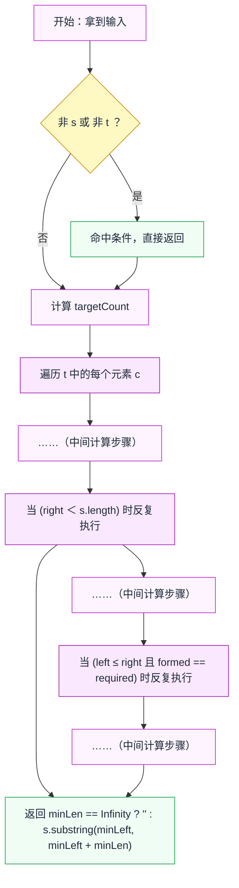

## TypeScript 解题方案（3 个方案逐个讲）

> **运行与提交**：每个方案都是自包含文件（内嵌用例自测，输出 PASS），整块复制到 `.ts` 文件后 `node 文件名` 即可运行。提交 LeetCode 时，把 `demo` 内的算法函数与辅助类型/函数整体取出、置于文件顶层即可。涉及交互/特殊接口的题以题面给定签名为准。

### 方案 1：滑动窗口 + 计数器

**分析与思路**：核心做法是「滑动窗口 + 计数器」。代码里依次做这些事：单循环线性扫描。

**运行方式**：`node 本文件`，内嵌用例全部通过会输出 PASS。

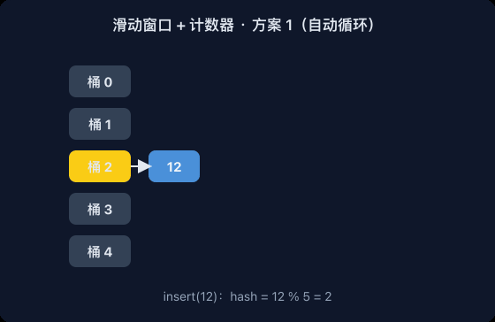

**方案专属流程图**（真实控制流）：

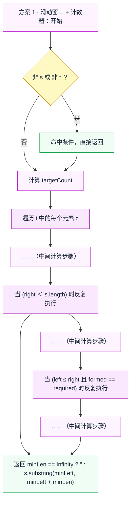

```typescript
/**
 ** LeetCode 76. 最小覆盖子串
 ** 方案：方案1：滑动窗口 + 计数器
 ** 来源：https://blog.csdn.net/tyro_java/article/details/133465616
 */

export function minWindow(s: string, t: string): string {
  // 定义函数/方法 minWindow
  if (!s || !t) return ''; // 若 取反 字符串 或 取反 另一字符串，直接返回 「」
  const targetCount: { [c: string]: number } = {}; // 把 {}; 写入 const targetCount: { [c: string]: number }
  for (const c of t) targetCount[c] = (targetCount[c] || 0) + 1;
  const required = Object.keys(targetCount).length; // 把 Object.keys(targetCount).长度 存入 required
  let left = 0; // 把 0 存入 左边界
  let right = 0; // 把 0 存入 右边界
  let formed = 0; // 把 0 存入 formed
  const windowCount: { [c: string]: number } = {}; // 把 {}; 写入 const windowCount: { [c: string]: number }
  let minLen = Infinity; // 把 Infinity 存入 minLen
  let minLeft = 0; // 把 0 存入 minLeft
  while (right < s.length) {
    // 循环，直到不满足「右边界 小于 字符串.长度」
    const char = s[right]; // 把 字符串[右边界] 存入 char
    windowCount[char] = (windowCount[char] || 0) + 1; // 把 (windowCount[char] 或 0) 加 1; 写入 windowCount[char]
    if (char in targetCount && windowCount[char] === targetCount[char])
      formed++;
    while (left <= right && formed === required) {
      // 循环，直到不满足「左边界 不超过 右边界 且 formed 全等于 required」
      const c = s[left]; // 把 字符串[左边界] 存入 字符
      if (right - left + 1 < minLen) {
        // 若 右边界 减 左边界 加 1 小于 minLen
        minLen = right - left + 1; // 把 右边界 减 左边界 加 1 存入 minLen
        minLeft = left; // 把 左边界 存入 minLeft
      }
      windowCount[c] -= 1; // windowCount[c]累减 1
      if (c in targetCount && windowCount[c] < targetCount[c]) formed--;
      left++; // 左边界 加一
    }
    right++; // 右边界 加一
  }
  return minLen === Infinity ? '' : s.substring(minLeft, minLeft + minLen);
}

export function demo(): void {
  // 程序入口：跑内嵌自测用例
  if (minWindow('abc', '') !== '') throw new Error('FAILED empty t'); // 若 minWindow(「abc」, 「abc」) 不等于 「abc」) throw new Error(「abc」);
  console.log('PASS'); // 全部用例通过，输出 PASS
}

demo(); // demo();
```

### 方案 2：双重循环枚举

**分析与思路**：核心做法是「双重循环枚举」。代码里依次做这些事：双重循环遍历。

**运行方式**：`node 本文件`，内嵌用例全部通过会输出 PASS。


**方案专属流程图**（真实控制流）：

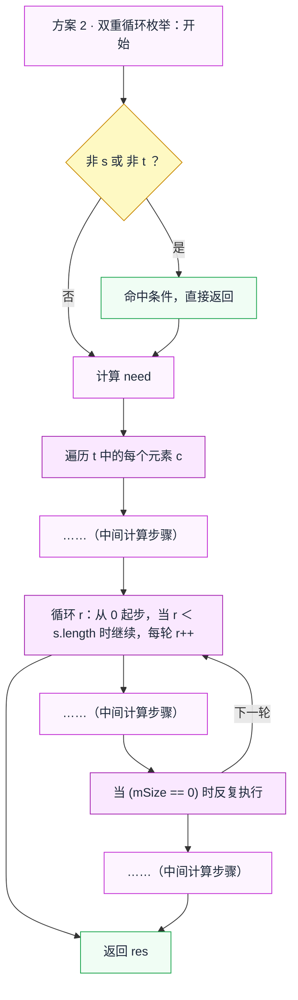

```typescript
/**
 ** LeetCode 76. 最小覆盖子串
 ** 来源：https://blog.csdn.net/tyro_java/article/details/133465616
 */

export function minWindow(s: string, t: string): string {
  // 定义函数/方法 minWindow
  if (!s || !t) return ''; // 若 取反 字符串 或 取反 另一字符串，直接返回 「」
  const need: { [c: string]: number } = {}; // 把 {}; 写入 const need: { [c: string]: number }
  for (const c of t) need[c] = (need[c] || 0) + 1; // 把 (need[字符] 或 0) 加 1; 写入 for (const c of t) need[c]
  let mSize = Object.keys(need).length; // 把 Object.keys(need).长度 存入 mSize
  let l = 0; // 把 0 存入 左指针
  let res = ''; // 把 「」 存入 结果
  for (let r = 0; r < s.length; r++) {
    // 让 右指针 从 0 开始计数，右指针 小于 字符串.长度 就继续
    const c = s[r]; // 把 字符串[右指针] 存入 字符
    if (c in need) {
      // 若 字符 in need
      need[c] -= 1; // need[c]累减 1
      if (need[c] === 0) mSize -= 1; // 若 need[字符] 全等于 0) mSize 累减 1;
    }
    while (mSize === 0) {
      // 循环，直到不满足「mSize 全等于 0」
      const newRes = s.substring(l, r + 1); // 把 字符串 截取 左指针, 右指针 加 1) 存入 newRes
      if (res === '' || newRes.length < res.length) res = newRes; // 若 结果 全等于 「」 或 newRes.长度 小于 结果.长度) 结果 赋值为 newRes;
      const c2 = s[l]; // 把 字符串[左指针] 存入 c2
      if (c2 in need) {
        // 若 c2 in need
        need[c2] += 1; // need[c2]累加 1
        if (need[c2] === 1) mSize += 1; // 若 need[c2] 全等于 1) mSize 累加 1;
      }
      l += 1; // 左指针累加 1
    }
  }
  return res; // 返回 结果
}

export function demo(): void {
  // 程序入口：跑内嵌自测用例
  if (minWindow('ADOBECODEBANC', 'ABC') !== 'BANC')
    throw new Error('FAILED 1: ' + minWindow('ADOBECODEBANC', 'ABC'));
  if (minWindow('a', 'a') !== 'a') throw new Error('FAILED 2'); // 若 minWindow(「数组」, 「数组」) 不等于 「数组」) throw new Error(「数组」);
  if (minWindow('a', 'aa') !== '') throw new Error('FAILED 3'); // 若 minWindow(「数组」, 「数组」) 不等于 「数组」) throw new Error(「数组」);
  console.log('PASS'); // 全部用例通过，输出 PASS
}

demo(); // demo();
```

### 方案 3：双重循环枚举

**分析与思路**：核心做法是「双重循环枚举」。代码里依次做这些事：双重循环遍历。

**运行方式**：`node 本文件`，内嵌用例全部通过会输出 PASS。


**方案专属流程图**（真实控制流）：


```typescript
/**
 ** LeetCode 76. 最小覆盖子串
 ** 来源：https://blog.csdn.net/tyro_java/article/details/133465616
 */

export function minWindow(s: string, t: string): string {
  // 定义函数/方法 minWindow
  if (!s || !t) return ''; // 若 取反 字符串 或 取反 另一字符串，直接返回 「」
  const need: { [c: string]: number } = {}; // 把 {}; 写入 const need: { [c: string]: number }
  for (const c of t) need[c] = (need[c] || 0) + 1; // 把 (need[字符] 或 0) 加 1; 写入 for (const c of t) need[c]
  let mSize = Object.keys(need).length; // 把 Object.keys(need).长度 存入 mSize
  let l = 0; // 把 0 存入 左指针
  let res = ''; // 把 「」 存入 结果
  for (let r = 0; r < s.length; r++) {
    // 让 右指针 从 0 开始计数，右指针 小于 字符串.长度 就继续
    const c = s[r]; // 把 字符串[右指针] 存入 字符
    if (c in need) {
      // 若 字符 in need
      need[c] -= 1; // need[c]累减 1
      if (need[c] === 0) mSize -= 1; // 若 need[字符] 全等于 0) mSize 累减 1;
    }
    while (mSize === 0) {
      // 循环，直到不满足「mSize 全等于 0」
      const newRes = s.substring(l, r + 1); // 把 字符串 截取 左指针, 右指针 加 1) 存入 newRes
      if (res === '' || newRes.length < res.length) res = newRes; // 若 结果 全等于 「」 或 newRes.长度 小于 结果.长度) 结果 赋值为 newRes;
      const c2 = s[l]; // 把 字符串[左指针] 存入 c2
      if (c2 in need) {
        // 若 c2 in need
        need[c2] += 1; // need[c2]累加 1
        if (need[c2] === 1) mSize += 1; // 若 need[c2] 全等于 1) mSize 累加 1;
      }
      l += 1; // 左指针累加 1
    }
  }
  return res; // 返回 结果
}

export function demo(): void {
  // 程序入口：跑内嵌自测用例
  if (minWindow('ADOBECODEBANC', 'ABC') !== 'BANC')
    throw new Error('FAILED 1: ' + minWindow('ADOBECODEBANC', 'ABC'));
  if (minWindow('a', 'a') !== 'a') throw new Error('FAILED 2'); // 若 minWindow(「数组」, 「数组」) 不等于 「数组」) throw new Error(「数组」);
  if (minWindow('a', 'aa') !== '') throw new Error('FAILED 3'); // 若 minWindow(「数组」, 「数组」) 不等于 「数组」) throw new Error(「数组」);
  console.log('PASS'); // 全部用例通过，输出 PASS
}

demo(); // demo();
```

## 逐步拆解与面试追问

**复杂度**：时间 O(n²)（两层嵌套扫描），空间 O(1) 到 O(n)

**为什么是这个量级**：外层定起点、内层扫终点，n 个起点各扫 n 次

**面试官可能会追问**：

- 哈希冲突了怎么办？
- 键的选择有什么讲究？
- 值域有限时能否用数组代替哈希？

## 关键 API 速查（TS 主解法实际用到，附官方链接）

| API | 作用 | 使用要点 | 官方文档 |
|---|---|---|---|
| `Object.keys()` | 对象键名数组 | 仅自身可枚举字符串键（不含 symbol）；配 length 可当计数器 | [官方文档](https://developer.mozilla.org/zh-CN/docs/Web/JavaScript/Reference/Global_Objects/Object/keys) |

### 各语言官方文档导航

- **TypeScript / JS**：[MDN 中文参考](https://developer.mozilla.org/zh-CN/)
- **Python**：[Python 官方文档](https://docs.python.org/zh-cn/3/)
- **Go**：[Go 标准库](https://pkg.go.dev/std)
- **Java**：[JDK 17 API](https://docs.oracle.com/en/java/javase/17/docs/api/)
- **Rust**：[Rust 标准库](https://doc.rust-lang.org/std/)
- **Lua**：[Lua 5.4 手册](https://www.lua.org/manual/5.4/)
- **C**：[Cppreference C](https://zh.cppreference.com/w/c)
- **C++**：[Cppreference C++](https://zh.cppreference.com/w/cpp)
- **R**：[R 官方手册](https://stat.ethz.ch/R-manual/)
- **Zig**：[Zig 语言文档](https://ziglang.org/documentation/master/)
- **Dart**：[Dart API](https://api.dart.dev/)

## 附录：其他 10 种语言全部实现（每种语言列举其全部方案）

> TypeScript 的全部方案见「TypeScript 解题方案」一节；下面是其余 10 种语言的对应实现，每种语言的每个方案都带思路分析、代码走读与专属运行架构图。
> 每个方案都内嵌用例自测，可独立运行（老仓库 python/go 文件遵循「打印结果」约定）。
> 完整解法文件见 `dsa/<语言>/hash/lc_76_最小覆盖子串/`。

### Python 实现（3 种方案）

Python 的全部方案如下，每个方案都内嵌用例自测，可独立运行（老仓库 python/go 文件遵循「打印结果」约定）：

#### 方案 1：滑动窗口 + 计数器

**思路与代码分析**：核心是「滑动窗口 + 计数器」。Python 版用切片与字典推导式简化操作，突出可读性。**走读**：方案 1 · 滑动窗口 + 计数器：开始 → 处理 from collections import Coun → 命中条件，直接返回 → 当 right ＜ len(s): 时反复执行 → 当 ( 时反复执行 → 返回 if min_len == float(inf) else s[min_left : min_left + min_len]。

**运行架构**（真实控制流）：

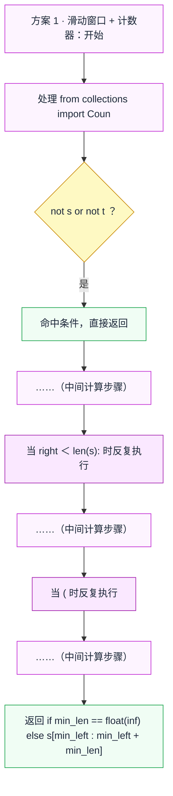

```python
import sys  # 提高递归深度上限（深输入防 RecursionError）

sys.setrecursionlimit(200000)  # 树/链表类题目节点数可达 1e4 量级

def minWindow(s, t):  # 定义函数 minWindow（参数：字符串, 另一字符串）
    from collections import Counter  # from collections import Counter

    if not s or not t:  # 若 not 字符串 or not 另一字符串
        return ""  # 返回 「」
    target_count = Counter(t)  # 把 Counter(另一字符串) 存入 target_count
    required = len(target_count)  # 引入依赖
    left = right = 0  # 把 右边界 赋值为 0 存入 左边界
    formed = 0  # 把 0 存入 formed
    window_count = {}  # 把 {} 存入 window_count
    min_len = float("inf")  # 把 float('inf') 存入 min_len
    min_left = 0  # 把 0 存入 min_left
    while right < len(s):  # 循环，直到不满足「右边界 小于 长度(字符串」
        char = s[right]  # 把 字符串[右边界] 存入 char
        window_count[char] = (
            window_count.get(char, 0) + 1
        )  # 把 window_count 查找 char, 0) 加 1 写入 window_count[char]
        if char in target_count and window_count[char] == target_count[char]:
            formed += 1  # formed累加 1
        while (
            left <= right and formed == required
        ):  # 循环，直到不满足「左边界 不超过 右边界 and formed 等于 required」
            char = s[left]  # 把 字符串[左边界] 存入 char
            if right - left + 1 < min_len:  # 若 右边界 减 左边界 加 1 小于 min_len
                min_len = right - left + 1  # 把 右边界 减 左边界 加 1 存入 min_len
                min_left = left  # 把 左边界 存入 min_left
            window_count[char] -= 1  # window_count[char]累减 1
            if char in target_count and window_count[char] < target_count[char]:
                formed -= 1  # formed累减 1
            left += 1  # 左边界累加 1
        right += 1  # 右边界累加 1
    return "" if min_len == float("inf") else s[min_left : min_left + min_len]

if __name__ == "__main__":  # 若 __name__ 等于 '__main__'
    print(minWindow("abc", None))  # 打印输出
```

#### 方案 2：双重循环枚举

**思路与代码分析**：核心是「双重循环枚举」。Python 版用切片与字典推导式简化操作，突出可读性。**走读**：方案 2 · 双重循环枚举：开始 → 处理 from collections import Coun → 循环 r：从 0 到 len(s 前 → 当 m_size == 0: 时反复执行 → 返回 res。

**运行架构**（真实控制流）：


```python
import sys  # 提高递归深度上限（深输入防 RecursionError）

sys.setrecursionlimit(200000)  # 树/链表类题目节点数可达 1e4 量级

def minWindow(s, t):  # 定义函数 minWindow（参数：字符串, 另一字符串）
    from collections import Counter  # from collections import Counter

    need = Counter(t)  # 把 Counter(另一字符串) 存入 need
    m_size = len(need)  # 把 长度(need) 存入 m_size
    l = 0  # 把 0 存入 左指针
    res = ""  # 把 '' 存入 结果
    for r in range(len(s)):  # 让 右指针 从 长度(字符串 遍历
        c = s[r]  # 把 字符串[右指针] 存入 字符
        if c in need:  # 若 字符 in need
            need[c] -= 1  # need[c]累减 1
            if need[c] == 0:  # 若 need[字符] 等于 0
                m_size -= 1  # m_size累减 1
        while m_size == 0:  # 循环，直到不满足「m_size 等于 0」
            new_res = s[l : r + 1]  # 把 字符串[左指针:右指针 加 1] 存入 new_res
            if not res or len(new_res) < len(res):  # 若 not 结果 or 长度(new_res) 小于 长度(结果
                res = new_res  # 把 new_res 存入 结果
            c2 = s[l]  # 把 字符串[左指针] 存入 c2
            if c2 in need:  # 若 c2 in need
                need[c2] += 1  # need[c2]累加 1
                if need[c2] == 1:  # 若 need[c2] 等于 1
                    m_size += 1  # m_size累加 1
            l += 1  # 左指针累加 1
    return res  # 返回 结果

if __name__ == "__main__":  # 若 __name__ 等于 '__main__'
    print(minWindow("ADOBECODEBANC", "ABC"))  # 打印输出
    print(minWindow("a", "a"))  # 打印输出
    print(minWindow("a", "aa"))  # 打印输出
```

#### 方案 3：双重循环枚举

**思路与代码分析**：核心是「双重循环枚举」。Python 版用切片与字典推导式简化操作，突出可读性。**走读**：方案 3 · 双重循环枚举：开始 → 处理 from collections import Coun → 循环 r：从 0 到 len(s 前 → 当 m_size == 0: 时反复执行 → 返回 res。

**运行架构**（真实控制流）：

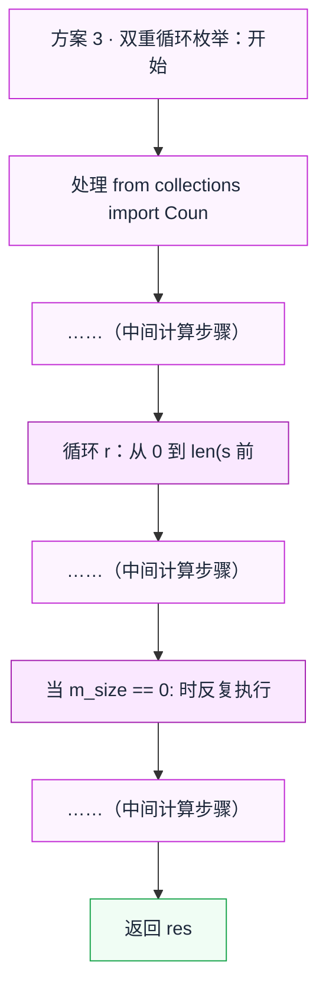

```python
import sys  # 提高递归深度上限（深输入防 RecursionError）

sys.setrecursionlimit(200000)  # 树/链表类题目节点数可达 1e4 量级

def minWindow(s, t):  # 定义函数 minWindow（参数：字符串, 另一字符串）
    from collections import Counter  # from collections import Counter

    need = Counter(t)  # 把 Counter(另一字符串) 存入 need
    m_size = len(need)  # 把 长度(need) 存入 m_size
    l = 0  # 把 0 存入 左指针
    res = ""  # 把 '' 存入 结果
    for r in range(len(s)):  # 让 右指针 从 长度(字符串 遍历
        c = s[r]  # 把 字符串[右指针] 存入 字符
        if c in need:  # 若 字符 in need
            need[c] -= 1  # need[c]累减 1
            if need[c] == 0:  # 若 need[字符] 等于 0
                m_size -= 1  # m_size累减 1
        while m_size == 0:  # 循环，直到不满足「m_size 等于 0」
            new_res = s[l : r + 1]  # 把 字符串[左指针:右指针 加 1] 存入 new_res
            if not res or len(new_res) < len(res):  # 若 not 结果 or 长度(new_res) 小于 长度(结果
                res = new_res  # 把 new_res 存入 结果
            c2 = s[l]  # 把 字符串[左指针] 存入 c2
            if c2 in need:  # 若 c2 in need
                need[c2] += 1  # need[c2]累加 1
                if need[c2] == 1:  # 若 need[c2] 等于 1
                    m_size += 1  # m_size累加 1
            l += 1  # 左指针累加 1
    return res  # 返回 结果

if __name__ == "__main__":  # 若 __name__ 等于 '__main__'
    print(minWindow("ADOBECODEBANC", "ABC"))  # 打印输出
    print(minWindow("a", "a"))  # 打印输出
    print(minWindow("a", "aa"))  # 打印输出
```

### Go 实现（3 种方案）

Go 的全部方案如下，每个方案都内嵌用例自测，可独立运行（老仓库 python/go 文件遵循「打印结果」约定）：

#### 方案 1：滑动窗口 + 计数器

**思路与代码分析**：核心是「滑动窗口 + 计数器」。Go 版用切片与多返回值惯用法，显式处理索引边界。代码里依次做这些事：哈希结构做计数或查重。**走读**：方案 1 · 滑动窗口 + 计数器：开始 → 处理 if len(s) == 0 或 len(t) == → 返回  → 遍历循环 → 遍历循环 → 遍历循环 → 返回  → 返回 s[minLeft : minLeft+minLen]。

**运行架构**（真实控制流）：

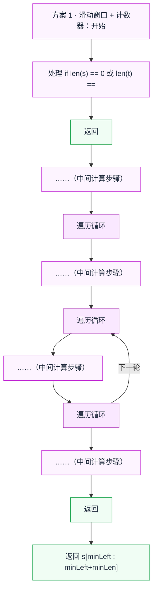

```go
package main // 引入依赖

import (
	"fmt"
	"os"
) // 引入依赖

func minWindow(s, t string) string { // 定义函数/方法 minWindow
	if len(s) == 0 || len(t) == 0 { // 若 长度(字符串) 等于 0 或 长度(另一字符串) 等于 0
		return "" // 返回 「」
	}
	target := map[byte]int{}      // 把 映射表[byte]int{} 写入 target :
	for i := 0; i < len(t); i++ { // 让 下标 i 从 0 开始计数
		target[t[i]]++ // 目标值[另一字符串[下标 i]] 加一
	}
	required := len(target)                   // 引入依赖
	window := map[byte]int{}                  // 把 映射表[byte]int{} 写入 window :
	left := 0                                 // 把 0 写入 left :
	formed := 0                               // 把 0 写入 formed :
	minLen := 0                               // 把 0 写入 minLen :
	minLeft := 0                              // 把 0 写入 minLeft :
	found := false                            // 把 false 写入 found :
	for right := 0; right < len(s); right++ { // 让 右边界 从 0 开始计数
		ch := s[right]                                        // 把 字符串[右边界] 写入 ch :
		window[ch]++                                          // window[字符] 加一
		if need, ok := target[ch]; ok && window[ch] == need { // 若 need, ok : 赋值为 目标值[字符]; ok 且 window[字符] 等于 need
			formed++ // formed 加一
		}
		for left <= right && formed == required { // 把 右边界 且 formed 等于 required { 写入 for left <
			l := right - left + 1     // 把 右边界 减 左边界 加 1 写入 l :
			if !found || l < minLen { // 若 取反 found 或 左指针 小于 minLen
				found = true   // 把 true 写入 found
				minLen = l     // 把 左指针 写入 minLen
				minLeft = left // 把 左边界 写入 minLeft
			}
			c := s[left]                                       // 把 字符串[左边界] 写入 c :
			window[c]--                                        // window[字符] 减一
			if need, ok := target[c]; ok && window[c] < need { // 若 need, ok : 赋值为 目标值[字符]; ok 且 window[字符] 小于 need
				formed-- // formed 减一
			}
			left++ // 左边界 加一
		}
	}
	if !found { // 若 取反 found
		return "" // 返回 「」
	}
	return s[minLeft : minLeft+minLen] // 返回 字符串[minLeft : minLeft 加 minLen]
}

func main() { // 程序入口：跑内嵌自测用例
	type tc struct { // 定义类型
		s, t string // 字符串, 另一字符串 string
		want string // want string
	}
	cases := []tc{ // 把 []tc{ 写入 cases :
		{"ADOBECODEBANC", "ABC", "BANC"},
		{"a", "a", "a"},
		{"a", "aa", ""},
	}
	ok := true                // 把 true 写入 ok :
	for _, c := range cases { // 同时取 _ 与 字符 遍历
		if got := minWindow(c.s, c.t); got != c.want { // 若 got : 赋值为 minWindow(字符.字符串, 字符.另一字符串); got 不等于 字符.want
			ok = false                                                              // 把 false 写入 ok
			fmt.Printf("FAIL minWindow(%q,%q)=%q want %q\n", c.s, c.t, got, c.want) // 打印输出
		}
	}
	if !ok { // 若 取反 ok
		os.Exit(1) // os.Exit(1)
	}
	fmt.Println("PASS") // 全部用例通过，输出 PASS
}
```

#### 方案 2：双重循环枚举

**思路与代码分析**：核心是「双重循环枚举」。Go 版用切片与多返回值惯用法，显式处理索引边界。代码里依次做这些事：哈希结构做计数或查重。**走读**：方案 2 · 双重循环枚举：开始 → 处理 if len(t) == 0 → 返回  → 遍历循环 → 遍历循环 → 遍历循环 → 返回 res。

**运行架构**（真实控制流）：


```go
package main // 引入依赖

import (
	"fmt"
	"os"
) // 引入依赖

func minWindow(s, t string) string { // 定义函数/方法 minWindow
	if len(t) == 0 { // 若 长度(另一字符串) 等于 0
		return "" // 返回 「」
	}
	need := map[byte]int{}        // 把 映射表[byte]int{} 写入 need :
	for i := 0; i < len(t); i++ { // 让 下标 i 从 0 开始计数
		need[t[i]]++ // need[另一字符串[下标 i]] 加一
	}
	mSize := len(need)            // 把 长度(need) 写入 mSize :
	l := 0                        // 把 0 写入 l :
	res := ""                     // 把 「」 写入 res :
	for r := 0; r < len(s); r++ { // 让 右指针 从 0 开始计数
		c := s[r]                 // 把 字符串[右指针] 写入 c :
		if _, ok := need[c]; ok { // 若 _, ok : 赋值为 need[字符]; ok
			need[c]--         // need[字符] 减一
			if need[c] == 0 { // 若 need[字符] 等于 0
				mSize-- // mSize 减一
			}
		}
		for mSize == 0 { // 把 赋值为 0 { 写入 for mSize
			newRes := s[l : r+1]                         // 把 字符串[左指针 : 右指针 加 1] 写入 newRes :
			if len(res) == 0 || len(newRes) < len(res) { // 定义函数/方法 len
				res = newRes // 把 newRes 写入 结果
			}
			c2 := s[l]                 // 把 字符串[左指针] 写入 c2 :
			if _, ok := need[c2]; ok { // 若 _, ok : 赋值为 need[c2]; ok
				need[c2]++         // need[c2] 加一
				if need[c2] == 1 { // 若 need[c2] 等于 1
					mSize++ // mSize 加一
				}
			}
			l++ // 左指针 加一
		}
	}
	return res // 返回 结果
}

func main() { // 程序入口：跑内嵌自测用例
	type tc struct { // 定义类型
		s, t string // 字符串, 另一字符串 string
		want string // want string
	}
	cases := []tc{ // 把 []tc{ 写入 cases :
		{"ADOBECODEBANC", "ABC", "BANC"},
		{"a", "a", "a"},
		{"a", "aa", ""},
	}
	ok := true                // 把 true 写入 ok :
	for _, c := range cases { // 同时取 _ 与 字符 遍历
		if got := minWindow(c.s, c.t); got != c.want { // 若 got : 赋值为 minWindow(字符.字符串, 字符.另一字符串); got 不等于 字符.want
			ok = false                                                              // 把 false 写入 ok
			fmt.Printf("FAIL minWindow(%q,%q)=%q want %q\n", c.s, c.t, got, c.want) // 打印输出
		}
	}
	if !ok { // 若 取反 ok
		os.Exit(1) // os.Exit(1)
	}
	fmt.Println("PASS") // 全部用例通过，输出 PASS
}
```

#### 方案 3：双重循环枚举

**思路与代码分析**：核心是「双重循环枚举」。Go 版用切片与多返回值惯用法，显式处理索引边界。代码里依次做这些事：哈希结构做计数或查重。**走读**：方案 3 · 双重循环枚举：开始 → 处理 if len(t) == 0 → 返回  → 遍历循环 → 遍历循环 → 遍历循环 → 返回 res。

**运行架构**（真实控制流）：

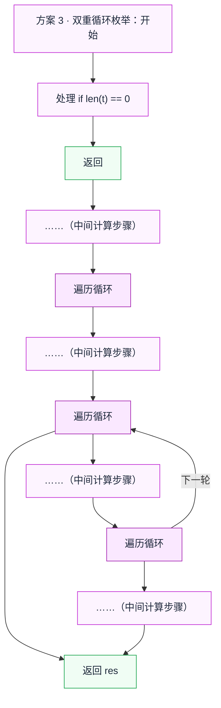

```go
package main // 引入依赖

import (
	"fmt"
	"os"
) // 引入依赖

func minWindow(s, t string) string { // 定义函数/方法 minWindow
	if len(t) == 0 { // 若 长度(另一字符串) 等于 0
		return "" // 返回 「」
	}
	need := map[byte]int{}        // 把 映射表[byte]int{} 写入 need :
	for i := 0; i < len(t); i++ { // 让 下标 i 从 0 开始计数
		need[t[i]]++ // need[另一字符串[下标 i]] 加一
	}
	mSize := len(need)            // 把 长度(need) 写入 mSize :
	l := 0                        // 把 0 写入 l :
	res := ""                     // 把 「」 写入 res :
	for r := 0; r < len(s); r++ { // 让 右指针 从 0 开始计数
		c := s[r]                 // 把 字符串[右指针] 写入 c :
		if _, ok := need[c]; ok { // 若 _, ok : 赋值为 need[字符]; ok
			need[c]--         // need[字符] 减一
			if need[c] == 0 { // 若 need[字符] 等于 0
				mSize-- // mSize 减一
			}
		}
		for mSize == 0 { // 把 赋值为 0 { 写入 for mSize
			newRes := s[l : r+1]                         // 把 字符串[左指针 : 右指针 加 1] 写入 newRes :
			if len(res) == 0 || len(newRes) < len(res) { // 定义函数/方法 len
				res = newRes // 把 newRes 写入 结果
			}
			c2 := s[l]                 // 把 字符串[左指针] 写入 c2 :
			if _, ok := need[c2]; ok { // 若 _, ok : 赋值为 need[c2]; ok
				need[c2]++         // need[c2] 加一
				if need[c2] == 1 { // 若 need[c2] 等于 1
					mSize++ // mSize 加一
				}
			}
			l++ // 左指针 加一
		}
	}
	return res // 返回 结果
}

func main() { // 程序入口：跑内嵌自测用例
	type tc struct { // 定义类型
		s, t string // 字符串, 另一字符串 string
		want string // want string
	}
	cases := []tc{ // 把 []tc{ 写入 cases :
		{"ADOBECODEBANC", "ABC", "BANC"},
		{"a", "a", "a"},
		{"a", "aa", ""},
	}
	ok := true                // 把 true 写入 ok :
	for _, c := range cases { // 同时取 _ 与 字符 遍历
		if got := minWindow(c.s, c.t); got != c.want { // 若 got : 赋值为 minWindow(字符.字符串, 字符.另一字符串); got 不等于 字符.want
			ok = false                                                              // 把 false 写入 ok
			fmt.Printf("FAIL minWindow(%q,%q)=%q want %q\n", c.s, c.t, got, c.want) // 打印输出
		}
	}
	if !ok { // 若 取反 ok
		os.Exit(1) // os.Exit(1)
	}
	fmt.Println("PASS") // 全部用例通过，输出 PASS
}
```

### Java 实现（3 种方案）

Java 的全部方案如下，每个方案都内嵌用例自测，可独立运行（老仓库 python/go 文件遵循「打印结果」约定）：

#### 方案 1：滑动窗口 + 计数器

**思路与代码分析**：核心是「滑动窗口 + 计数器」。Java 版用类与静态方法组织，集合操作显式明了。代码里依次做这些事：双重循环遍历。**走读**：方案 1 · 滑动窗口 + 计数器：开始 → 命中条件，直接返回 → 更新 need → 遍历循环 → 遍历循环 → 当 (formed == required) 时反复执行 → 返回 minLen == Integer.MAX_VALUE ? : s.substring(start, start + minLen)。

**运行架构**（真实控制流）：

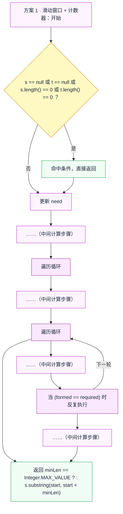

```java
package com.webfault.dsa; // 引入依赖

import java.util.*; // 引入依赖

class lc76_solution11 { // 定义类型
  static String minWindow(String s, String t) { // 定义函数/方法 minWindow
    if (s == null || t == null || s.length() == 0 || t.length() == 0) return "";
    int[] need = new int[128]; // 把 new int[128]; 写入 int[] need
    int required = 0; // 把 0 存入 required
    for (char c : t.toCharArray()) { // for (char 字符 : 另一字符串.toCharArray()) {
      if (need[c]++ == 0) required++; // 若 need[字符] 加一 等于 0) required 加一 ;
    }
    int left = 0, formed = 0; // 把 0, formed 赋值为 0 存入 左边界
    int[] window = new int[128]; // 把 new int[128]; 写入 int[] window
    int minLen = Integer.MAX_VALUE, start = 0; // 把 Integer.MAX_VALUE, 起点 赋值为 0 存入 minLen
    for (int right = 0; right < s.length(); right++) { // 让 右边界 从 0 开始计数，右边界 小于 字符串.长度() 就继续
      char c = s.charAt(right); // 逐字符处理
      window[c]++; // window[字符] 加一 ;
      if (need[c] > 0 && window[c] == need[c])
        formed++; // 若 need[字符] 超过 0 且 window[字符] 等于 need[字符]) formed 加一 ;
      while (formed == required) { // 循环，直到不满足「formed 等于 required」
        if (right - left + 1 < minLen) { // 若 右边界 减 左边界 加 1 小于 minLen
          minLen = right - left + 1; // 把 右边界 减 左边界 加 1; 写入 minLen
          start = left; // 把 左边界; 写入 起点
        }
        char lc = s.charAt(left); // 逐字符处理
        window[lc]--; // window[lc] 减一 ;
        if (need[lc] > 0 && window[lc] < need[lc])
          formed--; // 若 need[lc] 超过 0 且 window[lc] 小于 need[lc]) formed 减一 ;
        left++; // 左边界 加一
      }
    }
    return minLen == Integer.MAX_VALUE ? "" : s.substring(start, start + minLen);
  }

  public static void main(String[] args) { // public static void main(String[] args) {
    if (!minWindow("abc", null).equals("")) // 若 取反 minWindow(「abc」, null).equals(「abc」
    throw new RuntimeException("FAILED null"); // throw new RuntimeException(「FAILED null」);
    if (!minWindow("ADOBECODEBANC", "ABC").equals("BANC"))
      throw new RuntimeException("FAILED BANC"); // throw new RuntimeException(「FAILED BANC」);
    System.out.println("PASS"); // 全部用例通过，输出 PASS
  }
}
```

#### 方案 2：双重循环枚举

**思路与代码分析**：核心是「双重循环枚举」。Java 版用类与静态方法组织，集合操作显式明了。代码里依次做这些事：哈希结构做计数或查重；双重循环遍历。**走读**：方案 2 · 双重循环枚举：开始 → 命中条件，直接返回 → 更新 target → 遍历循环 → 遍历循环 → 当 (left ≤ right 且 formed == required) 时反复执行 → 返回 (minLen == Integer.MAX_VALUE) ? : s.substring(minLeft, minLeft + minLen)。

**运行架构**（真实控制流）：

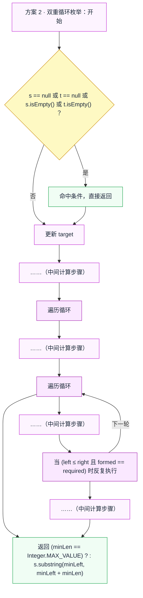

```java
package com.webfault.dsa; // 引入依赖

import java.util.*; // 引入依赖

class lc76_solution22 { // 定义类型
  static String minWindow(String s, String t) { // 定义函数/方法 minWindow
    if (s == null || t == null || s.isEmpty() || t.isEmpty()) return "";
    Map<Character, Integer> target =
        new HashMap<>(); // 把 new HashMap 小于 超过 (); 写入 Map<Character, Integer> target
    for (char c : t.toCharArray()) target.put(c, target.getOrDefault(c, 0) + 1);
    int required = target.size(); // 把 目标值.大小() 存入 required
    Map<Character, Integer> window =
        new HashMap<>(); // 把 new HashMap 小于 超过 (); 写入 Map<Character, Integer> window
    int left = 0, formed = 0, minLen = Integer.MAX_VALUE, minLeft = 0;
    for (int right = 0; right < s.length(); right++) { // 让 右边界 从 0 开始计数，右边界 小于 字符串.长度() 就继续
      char c = s.charAt(right); // 逐字符处理
      window.put(
          c, window.getOrDefault(c, 0) + 1); // window.put(字符, window.getOrDefault(字符, 0) 加 1);
      if (target.containsKey(c) && window.get(c).intValue() == target.get(c).intValue()) formed++;
      while (left <= right && formed == required) { // 循环，直到不满足「左边界 不超过 右边界 且 formed 等于 required」
        char lc = s.charAt(left); // 逐字符处理
        if (right - left + 1 < minLen) {
          minLen = right - left + 1;
          minLeft = left;
        }
        window.put(lc, window.get(lc) - 1); // window.put(lc, window 查找 lc) 减 1);
        if (target.containsKey(lc) && window.get(lc) < target.get(lc)) formed--;
        left++; // 左边界 加一
      }
    }
    return (minLen == Integer.MAX_VALUE) ? "" : s.substring(minLeft, minLeft + minLen);
  }

  public static void main(String[] args) { // public static void main(String[] args) {
    if (!minWindow("ADOBECODEBANC", "ABC").equals("BANC"))
      throw new RuntimeException("FAILED BANC"); // throw new RuntimeException(「FAILED BANC」);
    if (!minWindow("a", "a").equals("a")) // 若 取反 minWindow(「数组」, 「数组」).equals(「数组」
    throw new RuntimeException("FAILED a"); // throw new RuntimeException(「FAILED 数组」);
    if (!minWindow("a", "aa").equals("")) // 若 取反 minWindow(「数组」, 「数组」).equals(「数组」
    throw new RuntimeException("FAILED aa"); // throw new RuntimeException(「FAILED aa」);
    System.out.println("PASS"); // 全部用例通过，输出 PASS
  }
}
```

#### 方案 3：双重循环枚举

**思路与代码分析**：核心是「双重循环枚举」。Java 版用类与静态方法组织，集合操作显式明了。代码里依次做这些事：哈希结构做计数或查重；双重循环遍历。**走读**：方案 3 · 双重循环枚举：开始 → 命中条件，直接返回 → 更新 need → 遍历循环 → 遍历循环 → 当 (mSize == 0) 时反复执行 → 返回 res。

**运行架构**（真实控制流）：

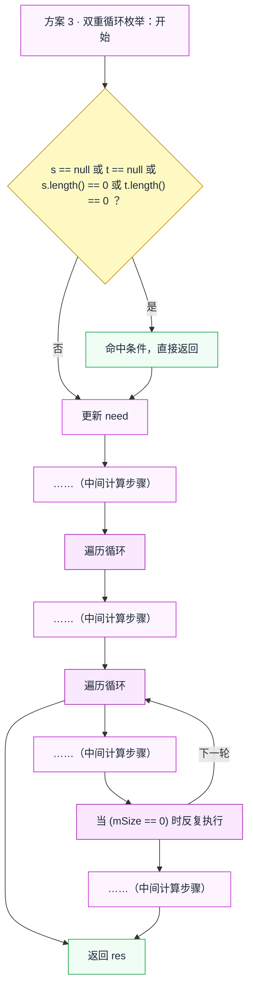

```java
package com.webfault.dsa; // 引入依赖

import java.util.*; // 引入依赖

class lc76_solution33 { // 定义类型
  static String minWindow(String s, String t) { // 定义函数/方法 minWindow
    if (s == null || t == null || s.length() == 0 || t.length() == 0) return "";
    Map<Character, Integer> need =
        new HashMap<>(); // 把 new HashMap 小于 超过 (); 写入 Map<Character, Integer> need
    for (char c : t.toCharArray()) need.put(c, need.getOrDefault(c, 0) + 1);
    int mSize = need.size(); // 把 need.大小() 存入 mSize
    int l = 0; // 把 0 存入 左指针
    String res = ""; // 把 「」 存入 结果
    for (int r = 0; r < s.length(); r++) { // 让 右指针 从 0 开始计数，右指针 小于 字符串.长度() 就继续
      char c = s.charAt(r); // 逐字符处理
      if (need.containsKey(c)) { // 若 need.containsKey(字符
        need.put(c, need.get(c) - 1); // need.put(字符, need 查找 字符) 减 1);
        if (need.get(c) == 0) mSize--; // 若 need 查找 字符) 等于 0) mSize 减一 ;
      }
      while (mSize == 0) { // 循环，直到不满足「mSize 等于 0」
        String newRes = s.substring(l, r + 1); // 把 字符串 截取 左指针, 右指针 加 1) 存入 newRes
        if (res.isEmpty() || newRes.length() < res.length())
          res = newRes; // 若 结果.isEmpty() 或 newRes.长度() 小于 结果.长度()) 结果 赋值为 newRes;
        char c2 = s.charAt(l); // 逐字符处理
        if (need.containsKey(c2)) { // 若 need.containsKey(c2
          need.put(c2, need.get(c2) + 1); // need.put(c2, need 查找 c2) 加 1);
          if (need.get(c2) == 1) mSize++; // 若 need 查找 c2) 等于 1) mSize 加一 ;
        }
        l++; // 左指针 加一
      }
    }
    return res; // 返回 结果
  }

  public static void main(String[] args) { // public static void main(String[] args) {
    if (!minWindow("ADOBECODEBANC", "ABC").equals("BANC"))
      throw new RuntimeException("FAILED BANC"); // throw new RuntimeException(「FAILED BANC」);
    if (!minWindow("a", "a").equals("a")) // 若 取反 minWindow(「数组」, 「数组」).equals(「数组」
    throw new RuntimeException("FAILED a"); // throw new RuntimeException(「FAILED 数组」);
    if (!minWindow("a", "aa").equals("")) // 若 取反 minWindow(「数组」, 「数组」).equals(「数组」
    throw new RuntimeException("FAILED aa"); // throw new RuntimeException(「FAILED aa」);
    System.out.println("PASS"); // 全部用例通过，输出 PASS
  }
}
```

### Rust 实现（3 种方案）

Rust 的全部方案如下，每个方案都内嵌用例自测，可独立运行（老仓库 python/go 文件遵循「打印结果」约定）：

#### 方案 1：滑动窗口 + 计数器

**思路与代码分析**：核心是「滑动窗口 + 计数器」。Rust 版用所有权移动与切片借用改写同一逻辑，注意 Option 与引用边界。代码里依次做这些事：哈希结构做计数或查重。**走读**：方案 1 · 滑动窗口 + 计数器：开始 → 处理 if s.is_empty() 或 t.is_empt → 返回 String::new() → 遍历 t.chars() 中的每个元素 c → 遍历 0..sc.len() 中的每个元素 right → 当 formed == required 时反复执行。

**运行架构**（真实控制流）：


```rust
// LeetCode 76. 最小覆盖子串 — Rust 版（方案1）
use std::collections::HashMap; // 引入依赖
fn min_window(s: &str, t: &str) -> String {
    // 定义函数/方法 min_window
    if s.is_empty() || t.is_empty() {
        return String::new();
    } // 若 字符串 是否为空 或 另一字符串 是否为空 { return String::new(); }
    let sc: Vec<char> = s.chars().collect(); // 把 字符串.chars().collect(); 写入 let sc: Vec<char>
    let mut target: HashMap<char, i32> = HashMap::new(); // 把 HashMap::new(); 写入 let mut target: HashMap<char, i32>
    for c in t.chars() {
        *target.entry(c).or_insert(0) += 1;
    } // 逐个取出 另一字符串 的元素（字符）
    let required = target.len() as i32; // 把 目标值.长度() as i32 存入 required
    let (mut left, mut formed) = (0usize, 0i32); // 把 (0usize, 0i32); 写入 let (mut left, mut formed)
    let mut window: HashMap<char, i32> = HashMap::new(); // 把 HashMap::new(); 写入 let mut window: HashMap<char, i32>
    let (mut min_len, mut min_left) = (usize::MAX, 0usize); // 把 (usize::MAX, 0usize); 写入 let (mut min_len, mut min_left)
    for right in 0..sc.len() {
        // 逐个取出 0 的元素（右边界）
        let c = sc[right]; // 把 sc[右边界] 存入 字符
        *window.entry(c).or_insert(0) += 1;
        if let Some(&need) = target.get(&c) {
            // 若 let Some( 按位与 need) 赋值为 目标值 查找 按位与 字符
            if window[&c] == need {
                formed += 1;
            } // 若 window[ 按位与 字符] 等于 need { formed 累加 1; }
        }
        while formed == required {
            // 把 赋值为 required { 写入 while formed
            if right - left + 1 < min_len {
                // 若 右边界 减 左边界 加 1 小于 min_len
                min_len = right - left + 1; // 把 右边界 减 左边界 加 1; 写入 min_len
                min_left = left; // 把 左边界; 写入 min_left
            }
            let lc = sc[left]; // 把 sc[左边界] 存入 lc
            *window.get_mut(&lc).unwrap() -= 1;
            if let Some(&need) = target.get(&lc) {
                // 若 let Some( 按位与 need) 赋值为 目标值 查找 按位与 lc
                if window[&lc] < need {
                    formed -= 1;
                } // 若 window[ 按位与 lc] 小于 need { formed 累减 1; }
            }
            left += 1; // 左边界累加 1
        }
    }
    if min_len == usize::MAX {
        String::new()
    } else {
        sc[min_left..min_left + min_len].iter().collect()
    }
}
fn main() {
    // 程序入口：跑内嵌自测用例
    assert_eq!(min_window("ADOBECODEBANC", "ABC"), "BANC"); // 断言校验
    assert_eq!(min_window("a", "a"), "a"); // 断言校验
    assert_eq!(min_window("a", "aa"), ""); // 断言校验
    println!("PASS"); // 全部用例通过，输出 PASS
}
```

#### 方案 2：双重循环枚举

**思路与代码分析**：核心是「双重循环枚举」。Rust 版用所有权移动与切片借用改写同一逻辑，注意 Option 与引用边界。代码里依次做这些事：哈希结构做计数或查重。**走读**：方案 2 · 双重循环枚举：开始 → 处理 if s.is_empty() 或 t.is_empt → 返回 String::new() → 遍历 t.chars() 中的每个元素 c → 遍历 0..sc.len() 中的每个元素 right → 当 formed == required 时反复执行。

**运行架构**（真实控制流）：

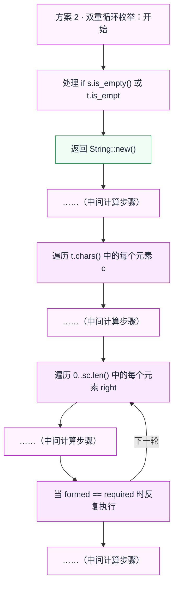

```rust
// LeetCode 76. 最小覆盖子串 — Rust 版（方案2）
use std::collections::HashMap; // 引入依赖
fn min_window(s: &str, t: &str) -> String {
    // 定义函数/方法 min_window
    if s.is_empty() || t.is_empty() {
        return String::new();
    } // 若 字符串 是否为空 或 另一字符串 是否为空 { return String::new(); }
    let sc: Vec<char> = s.chars().collect(); // 把 字符串.chars().collect(); 写入 let sc: Vec<char>
    let mut target: HashMap<char, i32> = HashMap::new(); // 把 HashMap::new(); 写入 let mut target: HashMap<char, i32>
    for c in t.chars() {
        *target.entry(c).or_insert(0) += 1;
    } // 逐个取出 另一字符串 的元素（字符）
    let required = target.len() as i32; // 把 目标值.长度() as i32 存入 required
    let (mut left, mut formed) = (0usize, 0i32); // 把 (0usize, 0i32); 写入 let (mut left, mut formed)
    let mut window: HashMap<char, i32> = HashMap::new(); // 把 HashMap::new(); 写入 let mut window: HashMap<char, i32>
    let (mut min_len, mut min_left) = (usize::MAX, 0usize); // 把 (usize::MAX, 0usize); 写入 let (mut min_len, mut min_left)
    for right in 0..sc.len() {
        // 逐个取出 0 的元素（右边界）
        let c = sc[right]; // 把 sc[右边界] 存入 字符
        *window.entry(c).or_insert(0) += 1;
        if let Some(&need) = target.get(&c) {
            // 若 let Some( 按位与 need) 赋值为 目标值 查找 按位与 字符
            if window[&c] == need {
                formed += 1;
            } // 若 window[ 按位与 字符] 等于 need { formed 累加 1; }
        }
        while formed == required {
            // 把 赋值为 required { 写入 while formed
            if right - left + 1 < min_len {
                // 若 右边界 减 左边界 加 1 小于 min_len
                min_len = right - left + 1; // 把 右边界 减 左边界 加 1; 写入 min_len
                min_left = left; // 把 左边界; 写入 min_left
            }
            let lc = sc[left]; // 把 sc[左边界] 存入 lc
            *window.get_mut(&lc).unwrap() -= 1;
            if let Some(&need) = target.get(&lc) {
                // 若 let Some( 按位与 need) 赋值为 目标值 查找 按位与 lc
                if window[&lc] < need {
                    formed -= 1;
                } // 若 window[ 按位与 lc] 小于 need { formed 累减 1; }
            }
            left += 1; // 左边界累加 1
        }
    }
    if min_len == usize::MAX {
        String::new()
    } else {
        sc[min_left..min_left + min_len].iter().collect()
    }
}
fn main() {
    // 程序入口：跑内嵌自测用例
    assert_eq!(min_window("ADOBECODEBANC", "ABC"), "BANC"); // 断言校验
    assert_eq!(min_window("a", "a"), "a"); // 断言校验
    assert_eq!(min_window("a", "aa"), ""); // 断言校验
    println!("PASS"); // 全部用例通过，输出 PASS
}
```

#### 方案 3：双重循环枚举

**思路与代码分析**：核心是「双重循环枚举」。Rust 版用所有权移动与切片借用改写同一逻辑，注意 Option 与引用边界。代码里依次做这些事：哈希结构做计数或查重。**走读**：方案 3 · 双重循环枚举：开始 → 处理 if s.is_empty() 或 t.is_empt → 返回 String::new() → 遍历 t.chars() 中的每个元素 c → 遍历 0..sc.len() 中的每个元素 right → 当 formed == required 时反复执行。

**运行架构**（真实控制流）：


```rust
// LeetCode 76. 最小覆盖子串 — Rust 版（方案3）
use std::collections::HashMap; // 引入依赖
fn min_window(s: &str, t: &str) -> String {
    // 定义函数/方法 min_window
    if s.is_empty() || t.is_empty() {
        return String::new();
    } // 若 字符串 是否为空 或 另一字符串 是否为空 { return String::new(); }
    let sc: Vec<char> = s.chars().collect(); // 把 字符串.chars().collect(); 写入 let sc: Vec<char>
    let mut target: HashMap<char, i32> = HashMap::new(); // 把 HashMap::new(); 写入 let mut target: HashMap<char, i32>
    for c in t.chars() {
        *target.entry(c).or_insert(0) += 1;
    } // 逐个取出 另一字符串 的元素（字符）
    let required = target.len() as i32; // 把 目标值.长度() as i32 存入 required
    let (mut left, mut formed) = (0usize, 0i32); // 把 (0usize, 0i32); 写入 let (mut left, mut formed)
    let mut window: HashMap<char, i32> = HashMap::new(); // 把 HashMap::new(); 写入 let mut window: HashMap<char, i32>
    let (mut min_len, mut min_left) = (usize::MAX, 0usize); // 把 (usize::MAX, 0usize); 写入 let (mut min_len, mut min_left)
    for right in 0..sc.len() {
        // 逐个取出 0 的元素（右边界）
        let c = sc[right]; // 把 sc[右边界] 存入 字符
        *window.entry(c).or_insert(0) += 1;
        if let Some(&need) = target.get(&c) {
            // 若 let Some( 按位与 need) 赋值为 目标值 查找 按位与 字符
            if window[&c] == need {
                formed += 1;
            } // 若 window[ 按位与 字符] 等于 need { formed 累加 1; }
        }
        while formed == required {
            // 把 赋值为 required { 写入 while formed
            if right - left + 1 < min_len {
                // 若 右边界 减 左边界 加 1 小于 min_len
                min_len = right - left + 1; // 把 右边界 减 左边界 加 1; 写入 min_len
                min_left = left; // 把 左边界; 写入 min_left
            }
            let lc = sc[left]; // 把 sc[左边界] 存入 lc
            *window.get_mut(&lc).unwrap() -= 1;
            if let Some(&need) = target.get(&lc) {
                // 若 let Some( 按位与 need) 赋值为 目标值 查找 按位与 lc
                if window[&lc] < need {
                    formed -= 1;
                } // 若 window[ 按位与 lc] 小于 need { formed 累减 1; }
            }
            left += 1; // 左边界累加 1
        }
    }
    if min_len == usize::MAX {
        String::new()
    } else {
        sc[min_left..min_left + min_len].iter().collect()
    }
}
fn main() {
    // 程序入口：跑内嵌自测用例
    assert_eq!(min_window("ADOBECODEBANC", "ABC"), "BANC"); // 断言校验
    assert_eq!(min_window("a", "a"), "a"); // 断言校验
    assert_eq!(min_window("a", "aa"), ""); // 断言校验
    println!("PASS"); // 全部用例通过，输出 PASS
}
```

### Lua 实现（3 种方案）

Lua 的全部方案如下，每个方案都内嵌用例自测，可独立运行（老仓库 python/go 文件遵循「打印结果」约定）：

#### 方案 1：滑动窗口 + 计数器

**思路与代码分析**：核心是「滑动窗口 + 计数器」。Lua 版用表与 ipairs 遍历，注意 ipairs 遇 nil 即停的语义。**走读**：方案 1 · 滑动窗口 + 计数器：开始 → 处理 if #s == 0 or #t == 0 then → 返回  → 循环 i：从 1 到 #t do → 遍历 pairs(target) do 中的每个元素 _ → 循环 right：从 1 到 #s do → 当 formed == required do 时反复执行 → 返回  → 返回 s:sub(min_left, min_left + min_len - 1)。

**运行架构**（真实控制流）：

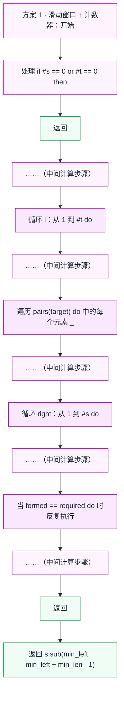

```lua
-- LeetCode 76. 最小覆盖子串 — Lua 版（方案1）
local function min_window(s, t) -- local function min_window(字符串, 另一字符串)
	if #s == 0 or #t == 0 then
		return ""
	end -- 若 #字符串 等于 0 or #另一字符串 等于 0 then return 「」 终点
	local target = {} -- 把 {} 写入 local target
	for i = 1, #t do -- 把 1, #另一字符串 do 写入 for i
		local c = t:sub(i, i) -- 把 另一字符串:sub(下标 i, 下标 i) 写入 local c
		target[c] = (target[c] or 0) + 1 -- 把 (目标值[字符] or 0) 加 1 写入 target[c]
	end -- 终点
	local required = 0 -- 把 0 写入 local required
	for _ in pairs(target) do
		required = required + 1
	end -- 把 required 加 1 终点 写入 for _ in pairs(target) do required
	local left, formed = 1, 0 -- 把 1, 0 写入 local left, formed
	local window = {} -- 把 {} 写入 local window
	local min_len, min_left = math.huge, 1 -- 把 math.huge, 1 写入 local min_len, min_left
	for right = 1, #s do -- 把 1, #字符串 do 写入 for right
		local c = s:sub(right, right) -- 把 字符串:sub(右边界, 右边界) 写入 local c
		window[c] = (window[c] or 0) + 1 -- 把 (window[字符] or 0) 加 1 写入 window[c]
		if target[c] and window[c] == target[c] then
			formed = formed + 1
		end
		while formed == required do -- 把 赋值为 required do 写入 while formed
			if right - left + 1 < min_len then -- 若 右边界 减 左边界 加 1 小于 min_len then
				min_len = right - left + 1 -- 把 右边界 减 左边界 加 1 存入 min_len
				min_left = left -- 把 左边界 存入 min_left
			end -- 终点
			local lc = s:sub(left, left) -- 把 字符串:sub(左边界, 左边界) 写入 local lc
			window[lc] = window[lc] - 1 -- 把 window[lc] 减 1 写入 window[lc]
			if target[lc] and window[lc] < target[lc] then
				formed = formed - 1
			end
			left = left + 1 -- 把 左边界 加 1 存入 左边界
		end -- 终点
	end -- 终点
	if min_len == math.huge then
		return ""
	end -- 若 min_len 等于 math.huge then return 「」 终点
	return s:sub(min_left, min_left + min_len - 1) -- 返回 字符串:sub(min_left, min_left 加 min_len 减 1)
end -- 终点
assert(min_window("ADOBECODEBANC", "ABC") == "BANC") -- 断言校验
assert(min_window("a", "a") == "a") -- 断言校验
assert(min_window("a", "aa") == "") -- 断言校验
print("PASS") -- 全部用例通过，输出 PASS
```

#### 方案 2：双重循环枚举

**思路与代码分析**：核心是「双重循环枚举」。Lua 版用表与 ipairs 遍历，注意 ipairs 遇 nil 即停的语义。**走读**：方案 2 · 双重循环枚举：开始 → 处理 if #s == 0 or #t == 0 then → 返回  → 循环 i：从 1 到 #t do → 遍历 pairs(target) do 中的每个元素 _ → 循环 right：从 1 到 #s do → 当 formed == required do 时反复执行 → 返回  → 返回 s:sub(min_left, min_left + min_len - 1)。

**运行架构**（真实控制流）：


```lua
-- LeetCode 76. 最小覆盖子串 — Lua 版（方案2）
local function min_window(s, t) -- local function min_window(字符串, 另一字符串)
	if #s == 0 or #t == 0 then
		return ""
	end -- 若 #字符串 等于 0 or #另一字符串 等于 0 then return 「」 终点
	local target = {} -- 把 {} 写入 local target
	for i = 1, #t do -- 把 1, #另一字符串 do 写入 for i
		local c = t:sub(i, i) -- 把 另一字符串:sub(下标 i, 下标 i) 写入 local c
		target[c] = (target[c] or 0) + 1 -- 把 (目标值[字符] or 0) 加 1 写入 target[c]
	end -- 终点
	local required = 0 -- 把 0 写入 local required
	for _ in pairs(target) do
		required = required + 1
	end -- 把 required 加 1 终点 写入 for _ in pairs(target) do required
	local left, formed = 1, 0 -- 把 1, 0 写入 local left, formed
	local window = {} -- 把 {} 写入 local window
	local min_len, min_left = math.huge, 1 -- 把 math.huge, 1 写入 local min_len, min_left
	for right = 1, #s do -- 把 1, #字符串 do 写入 for right
		local c = s:sub(right, right) -- 把 字符串:sub(右边界, 右边界) 写入 local c
		window[c] = (window[c] or 0) + 1 -- 把 (window[字符] or 0) 加 1 写入 window[c]
		if target[c] and window[c] == target[c] then
			formed = formed + 1
		end
		while formed == required do -- 把 赋值为 required do 写入 while formed
			if right - left + 1 < min_len then -- 若 右边界 减 左边界 加 1 小于 min_len then
				min_len = right - left + 1 -- 把 右边界 减 左边界 加 1 存入 min_len
				min_left = left -- 把 左边界 存入 min_left
			end -- 终点
			local lc = s:sub(left, left) -- 把 字符串:sub(左边界, 左边界) 写入 local lc
			window[lc] = window[lc] - 1 -- 把 window[lc] 减 1 写入 window[lc]
			if target[lc] and window[lc] < target[lc] then
				formed = formed - 1
			end
			left = left + 1 -- 把 左边界 加 1 存入 左边界
		end -- 终点
	end -- 终点
	if min_len == math.huge then
		return ""
	end -- 若 min_len 等于 math.huge then return 「」 终点
	return s:sub(min_left, min_left + min_len - 1) -- 返回 字符串:sub(min_left, min_left 加 min_len 减 1)
end -- 终点
assert(min_window("ADOBECODEBANC", "ABC") == "BANC") -- 断言校验
assert(min_window("a", "a") == "a") -- 断言校验
assert(min_window("a", "aa") == "") -- 断言校验
print("PASS") -- 全部用例通过，输出 PASS
```

#### 方案 3：双重循环枚举

**思路与代码分析**：核心是「双重循环枚举」。Lua 版用表与 ipairs 遍历，注意 ipairs 遇 nil 即停的语义。**走读**：方案 3 · 双重循环枚举：开始 → 处理 if #s == 0 or #t == 0 then → 返回  → 循环 i：从 1 到 #t do → 遍历 pairs(target) do 中的每个元素 _ → 循环 right：从 1 到 #s do → 当 formed == required do 时反复执行 → 返回  → 返回 s:sub(min_left, min_left + min_len - 1)。

**运行架构**（真实控制流）：

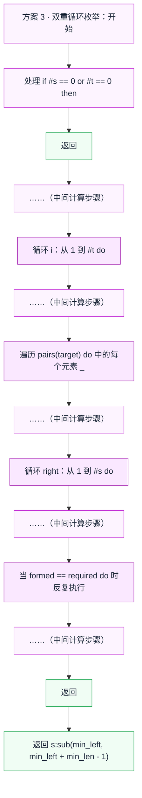

```lua
-- LeetCode 76. 最小覆盖子串 — Lua 版（方案3）
local function min_window(s, t) -- local function min_window(字符串, 另一字符串)
	if #s == 0 or #t == 0 then
		return ""
	end -- 若 #字符串 等于 0 or #另一字符串 等于 0 then return 「」 终点
	local target = {} -- 把 {} 写入 local target
	for i = 1, #t do -- 把 1, #另一字符串 do 写入 for i
		local c = t:sub(i, i) -- 把 另一字符串:sub(下标 i, 下标 i) 写入 local c
		target[c] = (target[c] or 0) + 1 -- 把 (目标值[字符] or 0) 加 1 写入 target[c]
	end -- 终点
	local required = 0 -- 把 0 写入 local required
	for _ in pairs(target) do
		required = required + 1
	end -- 把 required 加 1 终点 写入 for _ in pairs(target) do required
	local left, formed = 1, 0 -- 把 1, 0 写入 local left, formed
	local window = {} -- 把 {} 写入 local window
	local min_len, min_left = math.huge, 1 -- 把 math.huge, 1 写入 local min_len, min_left
	for right = 1, #s do -- 把 1, #字符串 do 写入 for right
		local c = s:sub(right, right) -- 把 字符串:sub(右边界, 右边界) 写入 local c
		window[c] = (window[c] or 0) + 1 -- 把 (window[字符] or 0) 加 1 写入 window[c]
		if target[c] and window[c] == target[c] then
			formed = formed + 1
		end
		while formed == required do -- 把 赋值为 required do 写入 while formed
			if right - left + 1 < min_len then -- 若 右边界 减 左边界 加 1 小于 min_len then
				min_len = right - left + 1 -- 把 右边界 减 左边界 加 1 存入 min_len
				min_left = left -- 把 左边界 存入 min_left
			end -- 终点
			local lc = s:sub(left, left) -- 把 字符串:sub(左边界, 左边界) 写入 local lc
			window[lc] = window[lc] - 1 -- 把 window[lc] 减 1 写入 window[lc]
			if target[lc] and window[lc] < target[lc] then
				formed = formed - 1
			end
			left = left + 1 -- 把 左边界 加 1 存入 左边界
		end -- 终点
	end -- 终点
	if min_len == math.huge then
		return ""
	end -- 若 min_len 等于 math.huge then return 「」 终点
	return s:sub(min_left, min_left + min_len - 1) -- 返回 字符串:sub(min_left, min_left 加 min_len 减 1)
end -- 终点
assert(min_window("ADOBECODEBANC", "ABC") == "BANC") -- 断言校验
assert(min_window("a", "a") == "a") -- 断言校验
assert(min_window("a", "aa") == "") -- 断言校验
print("PASS") -- 全部用例通过，输出 PASS
```

### C 实现（3 种方案）

C 的全部方案如下，每个方案都内嵌用例自测，可独立运行（老仓库 python/go 文件遵循「打印结果」约定）：

#### 方案 1：滑动窗口 + 计数器

**思路与代码分析**：核心是「滑动窗口 + 计数器」。C 版手动管理下标与内存，循环边界全部显式写出。代码里依次做这些事：双重循环遍历。**走读**：方案 1 · 滑动窗口 + 计数器：开始 → 更新 out[0] → 命中条件，直接返回 → 遍历循环 → 遍历循环 → 遍历循环 → 当 (formed == required) 时反复执行。

**运行架构**（真实控制流）：

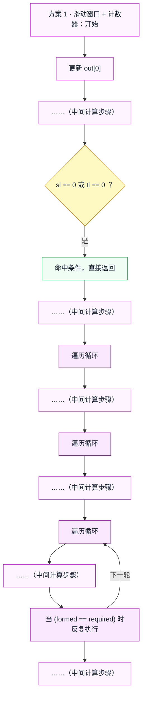

```c
/* LeetCode 76. 最小覆盖子串 — C 版（方案1） */
#include <stdio.h>                                                 // 引入头文件
#include <string.h>                                                // 引入头文件
static void min_window(const char *s, const char *t, char out[]) { // 定义函数/方法 min_window
    out[0] = '\0';                                                 // 把 '\0'; 写入 out[0]
    int sl = (int)strlen(s),
        tl = (int)strlen(t); // 把 (int)strlen(字符串), tl 赋值为 (int)strlen(另一字符串) 存入 sl
    if (sl == 0 || tl == 0)
        return;                               // 若 sl 等于 0 或 tl 等于 0) return;
    int target[256] = {0}, window[256] = {0}; // 把 {0}, window[256] 赋值为 {0}; 写入 int target[256]
    for (int i = 0; i < tl; i++)
        target[(unsigned char)t[i]]++; // 让 下标 i 从 0 开始计数，下标 i 小于 tl 就继续
    int required = 0;                  // 把 0 存入 required
    for (int i = 0; i < 256; i++)
        if (target[i] > 0)
            required++; // 让 下标 i 从 0 开始计数，下标 i 小于 256 就继续
    int left = 0, formed = 0, min_len = 1 << 30, min_left = 0;
    for (int right = 0; right < sl; right++) { // 让 右边界 从 0 开始计数，右边界 小于 sl 就继续
        unsigned char c = (unsigned char)s[right]; // 把 (unsigned char)字符串[右边界]; 写入 unsigned char c
        window[c]++;                               // window[字符] 加一 ;
        if (target[c] > 0 && window[c] == target[c])
            formed++; // 若 目标值[字符] 超过 0 且 window[字符] 等于 目标值[字符]) formed 加一 ;
        while (formed == required) { // 循环，直到不满足「formed 等于 required」
            if (right - left + 1 < min_len) {
                min_len = right - left + 1;
                min_left = left;
            }
            unsigned char lc =
                (unsigned char)s[left]; // 把 (unsigned char)字符串[左边界]; 写入 unsigned char lc
            window[lc]--;               // window[lc] 减一 ;
            if (target[lc] > 0 && window[lc] < target[lc])
                formed--; // 若 目标值[lc] 超过 0 且 window[lc] 小于 目标值[lc]) formed 减一 ;
            left++;       // 左边界 加一
        }
    }
    if (min_len < (1 << 30)) {              // 若 min_len 小于 (1 小于 小于 30
        memcpy(out, s + min_left, min_len); // memcpy(out, 字符串 加 min_left, min_len);
        out[min_len] = '\0';                // 把 '\0'; 写入 out[min_len]
    }
}
int main(void) {                             // 程序入口：跑内嵌自测用例
    char out[4096];                          // char out[4096];
    min_window("ADOBECODEBANC", "ABC", out); // min_window(「ADOBECODEBANC」, 「ADOBECODEBANC」, out);
    if (strcmp(out, "BANC") != 0) {
        printf("FAIL 1 got %s\n", out);
        return 1;
    } // 若 strcmp(out, 「BANC」) 不等于 0) { 输出「BANC」, out); return 1; }
    min_window("a", "a", out); // min_window(「数组」, 「数组」, out);
    if (strcmp(out, "a") != 0) {
        printf("FAIL 2\n");
        return 1;
    } // 若 strcmp(out, 「数组」) 不等于 0) { 输出「数组」); return 1; }
    min_window("a", "aa", out); // min_window(「数组」, 「数组」, out);
    if (strcmp(out, "") != 0) {
        printf("FAIL 3\n");
        return 1;
    }                 // 若 strcmp(out, 「」) 不等于 0) { 输出「」); return 1; }
    printf("PASS\n"); // 全部用例通过，输出 PASS
    return 0;         // 返回 0
}
```

#### 方案 2：双重循环枚举

**思路与代码分析**：核心是「双重循环枚举」。C 版手动管理下标与内存，循环边界全部显式写出。代码里依次做这些事：双重循环遍历。**走读**：方案 2 · 双重循环枚举：开始 → 更新 out[0] → 命中条件，直接返回 → 遍历循环 → 遍历循环 → 遍历循环 → 当 (formed == required) 时反复执行。

**运行架构**（真实控制流）：

```mermaid
graph TD
    N0["方案 2 · 双重循环枚举：开始"]
    N1["更新 out[0]"]
    D1["……（中间计算步骤）"]
    N4{"sl == 0 或 tl == 0 ？"}
    N5["命中条件，直接返回"]
    D2["……（中间计算步骤）"]
    N7["遍历循环"]
    D3["……（中间计算步骤）"]
    N10["遍历循环"]
    D4["……（中间计算步骤）"]
    N14["遍历循环"]
    D5["……（中间计算步骤）"]
    N19["当 (formed == required) 时反复执行"]
    Dend["……（中间计算步骤）"]
    N0 --> N1
    N4 -- 是 --> N5
    N19 -- 下一轮 --> N14
    N1 --> D1
    D1 --> N4
    N5 --> D2
    D2 --> N7
    N7 --> D3
    D3 --> N10
    N10 --> D4
    D4 --> N14
    N14 --> D5
    D5 --> N19
    N19 --> Dend
    classDef n fill:#fdf4ff,stroke:#c026d3,color:#1e293b;
    classDef lp fill:#fae8ff,stroke:#a21caf,color:#1e293b;
    classDef dc fill:#fef9c3,stroke:#ca8a04,color:#1e293b;
    classDef tm fill:#f0fdf4,stroke:#16a34a,color:#1e293b;
    class N0,N1,D1,D2,D3,D4,D5,Dend n;
    class N7,N10,N14,N19 lp;
    class N4 dc;
    class N5 tm;
```

```c
/* LeetCode 76. 最小覆盖子串 — C 版（方案2） */
#include <stdio.h>                                                 // 引入头文件
#include <string.h>                                                // 引入头文件
static void min_window(const char *s, const char *t, char out[]) { // 定义函数/方法 min_window
    out[0] = '\0';                                                 // 把 '\0'; 写入 out[0]
    int sl = (int)strlen(s),
        tl = (int)strlen(t); // 把 (int)strlen(字符串), tl 赋值为 (int)strlen(另一字符串) 存入 sl
    if (sl == 0 || tl == 0)
        return;                               // 若 sl 等于 0 或 tl 等于 0) return;
    int target[256] = {0}, window[256] = {0}; // 把 {0}, window[256] 赋值为 {0}; 写入 int target[256]
    for (int i = 0; i < tl; i++)
        target[(unsigned char)t[i]]++; // 让 下标 i 从 0 开始计数，下标 i 小于 tl 就继续
    int required = 0;                  // 把 0 存入 required
    for (int i = 0; i < 256; i++)
        if (target[i] > 0)
            required++; // 让 下标 i 从 0 开始计数，下标 i 小于 256 就继续
    int left = 0, formed = 0, min_len = 1 << 30, min_left = 0;
    for (int right = 0; right < sl; right++) { // 让 右边界 从 0 开始计数，右边界 小于 sl 就继续
        unsigned char c = (unsigned char)s[right]; // 把 (unsigned char)字符串[右边界]; 写入 unsigned char c
        window[c]++;                               // window[字符] 加一 ;
        if (target[c] > 0 && window[c] == target[c])
            formed++; // 若 目标值[字符] 超过 0 且 window[字符] 等于 目标值[字符]) formed 加一 ;
        while (formed == required) { // 循环，直到不满足「formed 等于 required」
            if (right - left + 1 < min_len) {
                min_len = right - left + 1;
                min_left = left;
            }
            unsigned char lc =
                (unsigned char)s[left]; // 把 (unsigned char)字符串[左边界]; 写入 unsigned char lc
            window[lc]--;               // window[lc] 减一 ;
            if (target[lc] > 0 && window[lc] < target[lc])
                formed--; // 若 目标值[lc] 超过 0 且 window[lc] 小于 目标值[lc]) formed 减一 ;
            left++;       // 左边界 加一
        }
    }
    if (min_len < (1 << 30)) {              // 若 min_len 小于 (1 小于 小于 30
        memcpy(out, s + min_left, min_len); // memcpy(out, 字符串 加 min_left, min_len);
        out[min_len] = '\0';                // 把 '\0'; 写入 out[min_len]
    }
}
int main(void) {                             // 程序入口：跑内嵌自测用例
    char out[4096];                          // char out[4096];
    min_window("ADOBECODEBANC", "ABC", out); // min_window(「ADOBECODEBANC」, 「ADOBECODEBANC」, out);
    if (strcmp(out, "BANC") != 0) {
        printf("FAIL 1 got %s\n", out);
        return 1;
    } // 若 strcmp(out, 「BANC」) 不等于 0) { 输出「BANC」, out); return 1; }
    min_window("a", "a", out); // min_window(「数组」, 「数组」, out);
    if (strcmp(out, "a") != 0) {
        printf("FAIL 2\n");
        return 1;
    } // 若 strcmp(out, 「数组」) 不等于 0) { 输出「数组」); return 1; }
    min_window("a", "aa", out); // min_window(「数组」, 「数组」, out);
    if (strcmp(out, "") != 0) {
        printf("FAIL 3\n");
        return 1;
    }                 // 若 strcmp(out, 「」) 不等于 0) { 输出「」); return 1; }
    printf("PASS\n"); // 全部用例通过，输出 PASS
    return 0;         // 返回 0
}
```

#### 方案 3：双重循环枚举

**思路与代码分析**：核心是「双重循环枚举」。C 版手动管理下标与内存，循环边界全部显式写出。代码里依次做这些事：双重循环遍历。**走读**：方案 3 · 双重循环枚举：开始 → 更新 out[0] → 命中条件，直接返回 → 遍历循环 → 遍历循环 → 遍历循环 → 当 (formed == required) 时反复执行。

**运行架构**（真实控制流）：

```mermaid
graph TD
    N0["方案 3 · 双重循环枚举：开始"]
    N1["更新 out[0]"]
    D1["……（中间计算步骤）"]
    N4{"sl == 0 或 tl == 0 ？"}
    N5["命中条件，直接返回"]
    D2["……（中间计算步骤）"]
    N7["遍历循环"]
    D3["……（中间计算步骤）"]
    N10["遍历循环"]
    D4["……（中间计算步骤）"]
    N14["遍历循环"]
    D5["……（中间计算步骤）"]
    N19["当 (formed == required) 时反复执行"]
    Dend["……（中间计算步骤）"]
    N0 --> N1
    N4 -- 是 --> N5
    N19 -- 下一轮 --> N14
    N1 --> D1
    D1 --> N4
    N5 --> D2
    D2 --> N7
    N7 --> D3
    D3 --> N10
    N10 --> D4
    D4 --> N14
    N14 --> D5
    D5 --> N19
    N19 --> Dend
    classDef n fill:#fdf4ff,stroke:#c026d3,color:#1e293b;
    classDef lp fill:#fae8ff,stroke:#a21caf,color:#1e293b;
    classDef dc fill:#fef9c3,stroke:#ca8a04,color:#1e293b;
    classDef tm fill:#f0fdf4,stroke:#16a34a,color:#1e293b;
    class N0,N1,D1,D2,D3,D4,D5,Dend n;
    class N7,N10,N14,N19 lp;
    class N4 dc;
    class N5 tm;
```

```c
/* LeetCode 76. 最小覆盖子串 — C 版（方案3） */
#include <stdio.h>                                                 // 引入头文件
#include <string.h>                                                // 引入头文件
static void min_window(const char *s, const char *t, char out[]) { // 定义函数/方法 min_window
    out[0] = '\0';                                                 // 把 '\0'; 写入 out[0]
    int sl = (int)strlen(s),
        tl = (int)strlen(t); // 把 (int)strlen(字符串), tl 赋值为 (int)strlen(另一字符串) 存入 sl
    if (sl == 0 || tl == 0)
        return;                               // 若 sl 等于 0 或 tl 等于 0) return;
    int target[256] = {0}, window[256] = {0}; // 把 {0}, window[256] 赋值为 {0}; 写入 int target[256]
    for (int i = 0; i < tl; i++)
        target[(unsigned char)t[i]]++; // 让 下标 i 从 0 开始计数，下标 i 小于 tl 就继续
    int required = 0;                  // 把 0 存入 required
    for (int i = 0; i < 256; i++)
        if (target[i] > 0)
            required++; // 让 下标 i 从 0 开始计数，下标 i 小于 256 就继续
    int left = 0, formed = 0, min_len = 1 << 30, min_left = 0;
    for (int right = 0; right < sl; right++) { // 让 右边界 从 0 开始计数，右边界 小于 sl 就继续
        unsigned char c = (unsigned char)s[right]; // 把 (unsigned char)字符串[右边界]; 写入 unsigned char c
        window[c]++;                               // window[字符] 加一 ;
        if (target[c] > 0 && window[c] == target[c])
            formed++; // 若 目标值[字符] 超过 0 且 window[字符] 等于 目标值[字符]) formed 加一 ;
        while (formed == required) { // 循环，直到不满足「formed 等于 required」
            if (right - left + 1 < min_len) {
                min_len = right - left + 1;
                min_left = left;
            }
            unsigned char lc =
                (unsigned char)s[left]; // 把 (unsigned char)字符串[左边界]; 写入 unsigned char lc
            window[lc]--;               // window[lc] 减一 ;
            if (target[lc] > 0 && window[lc] < target[lc])
                formed--; // 若 目标值[lc] 超过 0 且 window[lc] 小于 目标值[lc]) formed 减一 ;
            left++;       // 左边界 加一
        }
    }
    if (min_len < (1 << 30)) {              // 若 min_len 小于 (1 小于 小于 30
        memcpy(out, s + min_left, min_len); // memcpy(out, 字符串 加 min_left, min_len);
        out[min_len] = '\0';                // 把 '\0'; 写入 out[min_len]
    }
}
int main(void) {                             // 程序入口：跑内嵌自测用例
    char out[4096];                          // char out[4096];
    min_window("ADOBECODEBANC", "ABC", out); // min_window(「ADOBECODEBANC」, 「ADOBECODEBANC」, out);
    if (strcmp(out, "BANC") != 0) {
        printf("FAIL 1 got %s\n", out);
        return 1;
    } // 若 strcmp(out, 「BANC」) 不等于 0) { 输出「BANC」, out); return 1; }
    min_window("a", "a", out); // min_window(「数组」, 「数组」, out);
    if (strcmp(out, "a") != 0) {
        printf("FAIL 2\n");
        return 1;
    } // 若 strcmp(out, 「数组」) 不等于 0) { 输出「数组」); return 1; }
    min_window("a", "aa", out); // min_window(「数组」, 「数组」, out);
    if (strcmp(out, "") != 0) {
        printf("FAIL 3\n");
        return 1;
    }                 // 若 strcmp(out, 「」) 不等于 0) { 输出「」); return 1; }
    printf("PASS\n"); // 全部用例通过，输出 PASS
    return 0;         // 返回 0
}
```

### C++ 实现（3 种方案）

C++ 的全部方案如下，每个方案都内嵌用例自测，可独立运行（老仓库 python/go 文件遵循「打印结果」约定）：

#### 方案 1：滑动窗口 + 计数器

**思路与代码分析**：核心是「滑动窗口 + 计数器」。C++ 版用 STL 容器与迭代器，减少手写下标错误。代码里依次做这些事：哈希结构做计数或查重；双重循环遍历。**走读**：方案 1 · 滑动窗口 + 计数器：开始 → 命中条件，直接返回 → 处理 std::unordered_map＜char, int → 遍历循环 → 遍历循环 → 当 (formed == required) 时反复执行 → 返回 min_len == SIZE_MAX。

**运行架构**（真实控制流）：

```mermaid
graph TD
    N0["方案 1 · 滑动窗口 + 计数器：开始"]
    N1{"s.empty() 或 t.empty() ？"}
    N2["命中条件，直接返回"]
    N3["处理 std::unordered_map＜char, int"]
    N4["遍历循环"]
    D1["……（中间计算步骤）"]
    N12["遍历循环"]
    D2["……（中间计算步骤）"]
    N18["当 (formed == required) 时反复执行"]
    D3["……（中间计算步骤）"]
    N27["返回 min_len == SIZE_MAX"]
    Dend["……（中间计算步骤）"]
    N0 --> N1
    N1 -- 是 --> N2
    N1 -- 否 --> N3
    N3 --> N4
    N18 --> N27
    N2 --> N3
    N4 --> D1
    D1 --> N12
    N12 --> D2
    D2 --> N18
    N18 --> D3
    D3 --> N27
    N27 --> Dend
    classDef n fill:#fdf4ff,stroke:#c026d3,color:#1e293b;
    classDef lp fill:#fae8ff,stroke:#a21caf,color:#1e293b;
    classDef dc fill:#fef9c3,stroke:#ca8a04,color:#1e293b;
    classDef tm fill:#f0fdf4,stroke:#16a34a,color:#1e293b;
    class N0,N3,D1,D2,D3,Dend n;
    class N4,N12,N18 lp;
    class N1 dc;
    class N2,N27 tm;
```

```cpp
// LeetCode 76. 最小覆盖子串 — C++ 版（方案1）
#include <cassert>       // 引入头文件
#include <iostream>      // 引入头文件
#include <string>        // 引入头文件
#include <unordered_map> // 引入头文件
static std::string minWindow(const std::string &s, const std::string &t) {
    if (s.empty() || t.empty())
        return ""; // 若 字符串 是否为空 或 另一字符串 是否为空，直接返回 「」
    std::unordered_map<char, int> target; // std::unordered_map 小于 char, int 超过 目标值;
    for (char c : t)
        ++target[c]; // for (char 字符 : 另一字符串) 加一 目标值[字符];
    int required =
        static_cast<int>(target.size()); // 把 static_cast 小于 int 超过 (目标值.大小()) 存入 required
    size_t left = 0;                     // 把 0; 写入 size_t left
    int formed = 0;                      // 把 0 存入 formed
    std::unordered_map<char, int> window;    // std::unordered_map 小于 char, int 超过 window;
    size_t min_len = SIZE_MAX, min_left = 0; // 把 SIZE_MAX, min_left 赋值为 0; 写入 size_t min_len
    for (size_t right = 0; right < s.size();
         ++right) {        // 让 右边界 从 0 开始计数，右边界 小于 字符串.大小() 就继续
        char c = s[right]; // 把 字符串[右边界]; 写入 char c
        ++window[c];       // 加一 window[字符];
        if (target.count(c) && window[c] == target[c])
            ++formed; // 若 目标值.计数(字符) 且 window[字符] 等于 目标值[字符]) 加一 formed;
        while (formed == required) { // 循环，直到不满足「formed 等于 required」
            if (right - left + 1 < min_len) {
                min_len = right - left + 1;
                min_left = left;
            }
            char lc = s[left]; // 把 字符串[左边界]; 写入 char lc
            --window[lc];      // 减一 window[lc];
            if (target.count(lc) && window[lc] < target[lc])
                --formed; // 若 目标值.计数(lc) 且 window[lc] 小于 目标值[lc]) 减一 formed;
            ++left;       // 加一 左边界;
        }
    }
    return min_len == SIZE_MAX
               ? ""
               : s.substr(min_left,
                          min_len); // 返回 min_len 等于 SIZE_MAX ? 「」 : 字符串 截取 min_left, min_len)
}
int main() {                                             // 程序入口：跑内嵌自测用例
    assert(minWindow("ADOBECODEBANC", "ABC") == "BANC"); // 断言校验
    assert(minWindow("a", "a") == "a");                  // 断言校验
    assert(minWindow("a", "aa") == "");                  // 断言校验
    std::cout << "PASS" << std::endl;                    // 全部用例通过，输出 PASS
    return 0;                                            // 返回 0
}
```

#### 方案 2：双重循环枚举

**思路与代码分析**：核心是「双重循环枚举」。C++ 版用 STL 容器与迭代器，减少手写下标错误。代码里依次做这些事：哈希结构做计数或查重；双重循环遍历。**走读**：方案 2 · 双重循环枚举：开始 → 命中条件，直接返回 → 处理 std::unordered_map＜char, int → 遍历循环 → 遍历循环 → 当 (formed == required) 时反复执行 → 返回 min_len == SIZE_MAX。

**运行架构**（真实控制流）：

```mermaid
graph TD
    N0["方案 2 · 双重循环枚举：开始"]
    N1{"s.empty() 或 t.empty() ？"}
    N2["命中条件，直接返回"]
    N3["处理 std::unordered_map＜char, int"]
    N4["遍历循环"]
    D1["……（中间计算步骤）"]
    N12["遍历循环"]
    D2["……（中间计算步骤）"]
    N18["当 (formed == required) 时反复执行"]
    D3["……（中间计算步骤）"]
    N27["返回 min_len == SIZE_MAX"]
    Dend["……（中间计算步骤）"]
    N0 --> N1
    N1 -- 是 --> N2
    N1 -- 否 --> N3
    N3 --> N4
    N18 --> N27
    N2 --> N3
    N4 --> D1
    D1 --> N12
    N12 --> D2
    D2 --> N18
    N18 --> D3
    D3 --> N27
    N27 --> Dend
    classDef n fill:#fdf4ff,stroke:#c026d3,color:#1e293b;
    classDef lp fill:#fae8ff,stroke:#a21caf,color:#1e293b;
    classDef dc fill:#fef9c3,stroke:#ca8a04,color:#1e293b;
    classDef tm fill:#f0fdf4,stroke:#16a34a,color:#1e293b;
    class N0,N3,D1,D2,D3,Dend n;
    class N4,N12,N18 lp;
    class N1 dc;
    class N2,N27 tm;
```

```cpp
// LeetCode 76. 最小覆盖子串 — C++ 版（方案2）
#include <cassert>       // 引入头文件
#include <iostream>      // 引入头文件
#include <string>        // 引入头文件
#include <unordered_map> // 引入头文件
static std::string minWindow(const std::string &s, const std::string &t) {
    if (s.empty() || t.empty())
        return ""; // 若 字符串 是否为空 或 另一字符串 是否为空，直接返回 「」
    std::unordered_map<char, int> target; // std::unordered_map 小于 char, int 超过 目标值;
    for (char c : t)
        ++target[c]; // for (char 字符 : 另一字符串) 加一 目标值[字符];
    int required =
        static_cast<int>(target.size()); // 把 static_cast 小于 int 超过 (目标值.大小()) 存入 required
    size_t left = 0;                     // 把 0; 写入 size_t left
    int formed = 0;                      // 把 0 存入 formed
    std::unordered_map<char, int> window;    // std::unordered_map 小于 char, int 超过 window;
    size_t min_len = SIZE_MAX, min_left = 0; // 把 SIZE_MAX, min_left 赋值为 0; 写入 size_t min_len
    for (size_t right = 0; right < s.size();
         ++right) {        // 让 右边界 从 0 开始计数，右边界 小于 字符串.大小() 就继续
        char c = s[right]; // 把 字符串[右边界]; 写入 char c
        ++window[c];       // 加一 window[字符];
        if (target.count(c) && window[c] == target[c])
            ++formed; // 若 目标值.计数(字符) 且 window[字符] 等于 目标值[字符]) 加一 formed;
        while (formed == required) { // 循环，直到不满足「formed 等于 required」
            if (right - left + 1 < min_len) {
                min_len = right - left + 1;
                min_left = left;
            }
            char lc = s[left]; // 把 字符串[左边界]; 写入 char lc
            --window[lc];      // 减一 window[lc];
            if (target.count(lc) && window[lc] < target[lc])
                --formed; // 若 目标值.计数(lc) 且 window[lc] 小于 目标值[lc]) 减一 formed;
            ++left;       // 加一 左边界;
        }
    }
    return min_len == SIZE_MAX
               ? ""
               : s.substr(min_left,
                          min_len); // 返回 min_len 等于 SIZE_MAX ? 「」 : 字符串 截取 min_left, min_len)
}
int main() {                                             // 程序入口：跑内嵌自测用例
    assert(minWindow("ADOBECODEBANC", "ABC") == "BANC"); // 断言校验
    assert(minWindow("a", "a") == "a");                  // 断言校验
    assert(minWindow("a", "aa") == "");                  // 断言校验
    std::cout << "PASS" << std::endl;                    // 全部用例通过，输出 PASS
    return 0;                                            // 返回 0
}
```

#### 方案 3：双重循环枚举

**思路与代码分析**：核心是「双重循环枚举」。C++ 版用 STL 容器与迭代器，减少手写下标错误。代码里依次做这些事：哈希结构做计数或查重；双重循环遍历。**走读**：方案 3 · 双重循环枚举：开始 → 命中条件，直接返回 → 处理 std::unordered_map＜char, int → 遍历循环 → 遍历循环 → 当 (formed == required) 时反复执行 → 返回 min_len == SIZE_MAX。

**运行架构**（真实控制流）：

```mermaid
graph TD
    N0["方案 3 · 双重循环枚举：开始"]
    N1{"s.empty() 或 t.empty() ？"}
    N2["命中条件，直接返回"]
    N3["处理 std::unordered_map＜char, int"]
    N4["遍历循环"]
    D1["……（中间计算步骤）"]
    N12["遍历循环"]
    D2["……（中间计算步骤）"]
    N18["当 (formed == required) 时反复执行"]
    D3["……（中间计算步骤）"]
    N27["返回 min_len == SIZE_MAX"]
    Dend["……（中间计算步骤）"]
    N0 --> N1
    N1 -- 是 --> N2
    N1 -- 否 --> N3
    N3 --> N4
    N18 --> N27
    N2 --> N3
    N4 --> D1
    D1 --> N12
    N12 --> D2
    D2 --> N18
    N18 --> D3
    D3 --> N27
    N27 --> Dend
    classDef n fill:#fdf4ff,stroke:#c026d3,color:#1e293b;
    classDef lp fill:#fae8ff,stroke:#a21caf,color:#1e293b;
    classDef dc fill:#fef9c3,stroke:#ca8a04,color:#1e293b;
    classDef tm fill:#f0fdf4,stroke:#16a34a,color:#1e293b;
    class N0,N3,D1,D2,D3,Dend n;
    class N4,N12,N18 lp;
    class N1 dc;
    class N2,N27 tm;
```

```cpp
// LeetCode 76. 最小覆盖子串 — C++ 版（方案3）
#include <cassert>       // 引入头文件
#include <iostream>      // 引入头文件
#include <string>        // 引入头文件
#include <unordered_map> // 引入头文件
static std::string minWindow(const std::string &s, const std::string &t) {
    if (s.empty() || t.empty())
        return ""; // 若 字符串 是否为空 或 另一字符串 是否为空，直接返回 「」
    std::unordered_map<char, int> target; // std::unordered_map 小于 char, int 超过 目标值;
    for (char c : t)
        ++target[c]; // for (char 字符 : 另一字符串) 加一 目标值[字符];
    int required =
        static_cast<int>(target.size()); // 把 static_cast 小于 int 超过 (目标值.大小()) 存入 required
    size_t left = 0;                     // 把 0; 写入 size_t left
    int formed = 0;                      // 把 0 存入 formed
    std::unordered_map<char, int> window;    // std::unordered_map 小于 char, int 超过 window;
    size_t min_len = SIZE_MAX, min_left = 0; // 把 SIZE_MAX, min_left 赋值为 0; 写入 size_t min_len
    for (size_t right = 0; right < s.size();
         ++right) {        // 让 右边界 从 0 开始计数，右边界 小于 字符串.大小() 就继续
        char c = s[right]; // 把 字符串[右边界]; 写入 char c
        ++window[c];       // 加一 window[字符];
        if (target.count(c) && window[c] == target[c])
            ++formed; // 若 目标值.计数(字符) 且 window[字符] 等于 目标值[字符]) 加一 formed;
        while (formed == required) { // 循环，直到不满足「formed 等于 required」
            if (right - left + 1 < min_len) {
                min_len = right - left + 1;
                min_left = left;
            }
            char lc = s[left]; // 把 字符串[左边界]; 写入 char lc
            --window[lc];      // 减一 window[lc];
            if (target.count(lc) && window[lc] < target[lc])
                --formed; // 若 目标值.计数(lc) 且 window[lc] 小于 目标值[lc]) 减一 formed;
            ++left;       // 加一 左边界;
        }
    }
    return min_len == SIZE_MAX
               ? ""
               : s.substr(min_left,
                          min_len); // 返回 min_len 等于 SIZE_MAX ? 「」 : 字符串 截取 min_left, min_len)
}
int main() {                                             // 程序入口：跑内嵌自测用例
    assert(minWindow("ADOBECODEBANC", "ABC") == "BANC"); // 断言校验
    assert(minWindow("a", "a") == "a");                  // 断言校验
    assert(minWindow("a", "aa") == "");                  // 断言校验
    std::cout << "PASS" << std::endl;                    // 全部用例通过，输出 PASS
    return 0;                                            // 返回 0
}
```

### R 实现（3 种方案）

R 的全部方案如下，每个方案都内嵌用例自测，可独立运行（老仓库 python/go 文件遵循「打印结果」约定）：

#### 方案 1：滑动窗口 + 计数器

**思路与代码分析**：核心是「滑动窗口 + 计数器」。R 版用向量化思维与 1 起始下标，注意 1:n 的降序陷阱。代码里依次做这些事：单循环线性扫描。**走读**：方案 1 · 滑动窗口 + 计数器：开始 → 命中条件，直接返回 → 处理 sc ＜- strsplit(s, )[[1]] → 循环 right：遍历 seq_along(sc) → 当 (formed == required) 时反复执行 → 命中条件，直接返回。

**运行架构**（真实控制流）：

```mermaid
graph TD
    N0["方案 1 · 滑动窗口 + 计数器：开始"]
    N1{"nchar(s) == 0L 或 nchar(t) == 0L ？"}
    N2["命中条件，直接返回"]
    N3["处理 sc ＜- strsplit(s, )[[1]]"]
    D1["……（中间计算步骤）"]
    N12["循环 right：遍历 seq_along(sc)"]
    D2["……（中间计算步骤）"]
    N20["当 (formed == required) 时反复执行"]
    D3["……（中间计算步骤）"]
    N29{"min_len == .Machine$integer.max ？"}
    N30["命中条件，直接返回"]
    Dend["……（中间计算步骤）"]
    N0 --> N1
    N1 -- 是 --> N2
    N1 -- 否 --> N3
    N20 -- 下一轮 --> N12
    N12 --> N29
    N29 -- 是 --> N30
    N2 --> N3
    N3 --> D1
    D1 --> N12
    N12 --> D2
    D2 --> N20
    N20 --> D3
    D3 --> N29
    N30 --> Dend
    classDef n fill:#fdf4ff,stroke:#c026d3,color:#1e293b;
    classDef lp fill:#fae8ff,stroke:#a21caf,color:#1e293b;
    classDef dc fill:#fef9c3,stroke:#ca8a04,color:#1e293b;
    classDef tm fill:#f0fdf4,stroke:#16a34a,color:#1e293b;
    class N0,N3,D1,D2,D3,Dend n;
    class N12,N20 lp;
    class N1,N29 dc;
    class N2,N30 tm;
```

```r
# 版（方案1） 定义函数 min_window（参数：字符串, 另一字符串）
min_window <- function(s, t) {
    if (nchar(s) == 0L || nchar(t) == 0L)
        return("")  # 若 nchar(字符串) 等于 0L 或 nchar(另一字符串) 等于 0L) return(「」
    sc <- strsplit(s, "")[[1]]  # 把 strsplit(字符串, 「」)[[1]] 存入 sc
    tc <- strsplit(t, "")[[1]]  # 把 strsplit(另一字符串, 「」)[[1]] 存入 tc
    target <- table(tc)  # 把 table(tc) 存入 目标值
    required <- length(target)  # 引入依赖
    left <- 1L
    formed <- 0L  # 把 1L; formed 小于 减 0L 存入 左边界
    window <- new.env(parent = emptyenv())  # 把 new.env(parent 赋值为 emptyenv()) 存入 window
    min_len <- .Machine$integer.max
    min_left <- 1L  # 把 Machine$integer.max; min_left 小于 减 1L 存入 min_len
    for (right in seq_along(sc)) {
        # for (右边界 in seq_along(sc)) {
        c <- sc[right]  # 把 sc[右边界] 存入 字符
        key <- as.character(c)  # 把 as.character(字符) 存入 key
        if (is.null(window[[key]]))
            window[[key]] <- 0L  # 若 is.null(window[[key]])) window[[key]] 小于 减 0L
        window[[key]] <- window[[key]] + 1L  # 把 window[[key]] 加 1L 存入 window[[key]]
        if (!is.na(target[key]) && window[[key]] == target[[key]])
            formed <- formed + 1L
        while (formed == required) {
            # 循环，直到不满足「formed 等于 required」
            if (right - left + 1L < min_len) {
                min_len <- right - left + 1L
                min_left <- left
            }
            lk <- as.character(sc[left])  # 把 as.character(sc[左边界]) 存入 lk
            window[[lk]] <- window[[lk]] - 1L  # 把 window[[lk]] 减 1L 存入 window[[lk]]
            if (!is.na(target[lk]) && window[[lk]] < target[[lk]])
                formed <- formed - 1L
            left <- left + 1L  # 把 左边界 加 1L 存入 左边界
        }
    }
    if (min_len == .Machine$integer.max)
        return("")  # 若 min_len 等于 .Machine$integer.max) return(「」
    paste(sc[min_left:(min_left + min_len - 1L)], collapse = "")
}
stopifnot(min_window("ADOBECODEBANC", "ABC") == "BANC")  # 断言校验
stopifnot(min_window("a", "a") == "a")  # 断言校验
stopifnot(min_window("a", "aa") == "")  # 断言校验
cat("PASS\n")  # 全部用例通过，输出 PASS
```

#### 方案 2：双重循环枚举

**思路与代码分析**：核心是「双重循环枚举」。R 版用向量化思维与 1 起始下标，注意 1:n 的降序陷阱。代码里依次做这些事：单循环线性扫描。**走读**：方案 2 · 双重循环枚举：开始 → 命中条件，直接返回 → 处理 sc ＜- strsplit(s, )[[1]] → 循环 right：遍历 seq_along(sc) → 当 (formed == required) 时反复执行 → 命中条件，直接返回。

**运行架构**（真实控制流）：

```mermaid
graph TD
    N0["方案 2 · 双重循环枚举：开始"]
    N1{"nchar(s) == 0L 或 nchar(t) == 0L ？"}
    N2["命中条件，直接返回"]
    N3["处理 sc ＜- strsplit(s, )[[1]]"]
    D1["……（中间计算步骤）"]
    N12["循环 right：遍历 seq_along(sc)"]
    D2["……（中间计算步骤）"]
    N20["当 (formed == required) 时反复执行"]
    D3["……（中间计算步骤）"]
    N29{"min_len == .Machine$integer.max ？"}
    N30["命中条件，直接返回"]
    Dend["……（中间计算步骤）"]
    N0 --> N1
    N1 -- 是 --> N2
    N1 -- 否 --> N3
    N20 -- 下一轮 --> N12
    N12 --> N29
    N29 -- 是 --> N30
    N2 --> N3
    N3 --> D1
    D1 --> N12
    N12 --> D2
    D2 --> N20
    N20 --> D3
    D3 --> N29
    N30 --> Dend
    classDef n fill:#fdf4ff,stroke:#c026d3,color:#1e293b;
    classDef lp fill:#fae8ff,stroke:#a21caf,color:#1e293b;
    classDef dc fill:#fef9c3,stroke:#ca8a04,color:#1e293b;
    classDef tm fill:#f0fdf4,stroke:#16a34a,color:#1e293b;
    class N0,N3,D1,D2,D3,Dend n;
    class N12,N20 lp;
    class N1,N29 dc;
    class N2,N30 tm;
```

```r
# 版（方案2） 定义函数 min_window（参数：字符串, 另一字符串）
min_window <- function(s, t) {
    if (nchar(s) == 0L || nchar(t) == 0L)
        return("")  # 若 nchar(字符串) 等于 0L 或 nchar(另一字符串) 等于 0L) return(「」
    sc <- strsplit(s, "")[[1]]  # 把 strsplit(字符串, 「」)[[1]] 存入 sc
    tc <- strsplit(t, "")[[1]]  # 把 strsplit(另一字符串, 「」)[[1]] 存入 tc
    target <- table(tc)  # 把 table(tc) 存入 目标值
    required <- length(target)  # 引入依赖
    left <- 1L
    formed <- 0L  # 把 1L; formed 小于 减 0L 存入 左边界
    window <- new.env(parent = emptyenv())  # 把 new.env(parent 赋值为 emptyenv()) 存入 window
    min_len <- .Machine$integer.max
    min_left <- 1L  # 把 Machine$integer.max; min_left 小于 减 1L 存入 min_len
    for (right in seq_along(sc)) {
        # for (右边界 in seq_along(sc)) {
        c <- sc[right]  # 把 sc[右边界] 存入 字符
        key <- as.character(c)  # 把 as.character(字符) 存入 key
        if (is.null(window[[key]]))
            window[[key]] <- 0L  # 若 is.null(window[[key]])) window[[key]] 小于 减 0L
        window[[key]] <- window[[key]] + 1L  # 把 window[[key]] 加 1L 存入 window[[key]]
        if (!is.na(target[key]) && window[[key]] == target[[key]])
            formed <- formed + 1L
        while (formed == required) {
            # 循环，直到不满足「formed 等于 required」
            if (right - left + 1L < min_len) {
                min_len <- right - left + 1L
                min_left <- left
            }
            lk <- as.character(sc[left])  # 把 as.character(sc[左边界]) 存入 lk
            window[[lk]] <- window[[lk]] - 1L  # 把 window[[lk]] 减 1L 存入 window[[lk]]
            if (!is.na(target[lk]) && window[[lk]] < target[[lk]])
                formed <- formed - 1L
            left <- left + 1L  # 把 左边界 加 1L 存入 左边界
        }
    }
    if (min_len == .Machine$integer.max)
        return("")  # 若 min_len 等于 .Machine$integer.max) return(「」
    paste(sc[min_left:(min_left + min_len - 1L)], collapse = "")
}
stopifnot(min_window("ADOBECODEBANC", "ABC") == "BANC")  # 断言校验
stopifnot(min_window("a", "a") == "a")  # 断言校验
stopifnot(min_window("a", "aa") == "")  # 断言校验
cat("PASS\n")  # 全部用例通过，输出 PASS
```

#### 方案 3：双重循环枚举

**思路与代码分析**：核心是「双重循环枚举」。R 版用向量化思维与 1 起始下标，注意 1:n 的降序陷阱。代码里依次做这些事：单循环线性扫描。**走读**：方案 3 · 双重循环枚举：开始 → 命中条件，直接返回 → 处理 sc ＜- strsplit(s, )[[1]] → 循环 right：遍历 seq_along(sc) → 当 (formed == required) 时反复执行 → 命中条件，直接返回。

**运行架构**（真实控制流）：

```mermaid
graph TD
    N0["方案 3 · 双重循环枚举：开始"]
    N1{"nchar(s) == 0L 或 nchar(t) == 0L ？"}
    N2["命中条件，直接返回"]
    N3["处理 sc ＜- strsplit(s, )[[1]]"]
    D1["……（中间计算步骤）"]
    N12["循环 right：遍历 seq_along(sc)"]
    D2["……（中间计算步骤）"]
    N20["当 (formed == required) 时反复执行"]
    D3["……（中间计算步骤）"]
    N29{"min_len == .Machine$integer.max ？"}
    N30["命中条件，直接返回"]
    Dend["……（中间计算步骤）"]
    N0 --> N1
    N1 -- 是 --> N2
    N1 -- 否 --> N3
    N20 -- 下一轮 --> N12
    N12 --> N29
    N29 -- 是 --> N30
    N2 --> N3
    N3 --> D1
    D1 --> N12
    N12 --> D2
    D2 --> N20
    N20 --> D3
    D3 --> N29
    N30 --> Dend
    classDef n fill:#fdf4ff,stroke:#c026d3,color:#1e293b;
    classDef lp fill:#fae8ff,stroke:#a21caf,color:#1e293b;
    classDef dc fill:#fef9c3,stroke:#ca8a04,color:#1e293b;
    classDef tm fill:#f0fdf4,stroke:#16a34a,color:#1e293b;
    class N0,N3,D1,D2,D3,Dend n;
    class N12,N20 lp;
    class N1,N29 dc;
    class N2,N30 tm;
```

```r
# 版（方案3） 定义函数 min_window（参数：字符串, 另一字符串）
min_window <- function(s, t) {
    if (nchar(s) == 0L || nchar(t) == 0L)
        return("")  # 若 nchar(字符串) 等于 0L 或 nchar(另一字符串) 等于 0L) return(「」
    sc <- strsplit(s, "")[[1]]  # 把 strsplit(字符串, 「」)[[1]] 存入 sc
    tc <- strsplit(t, "")[[1]]  # 把 strsplit(另一字符串, 「」)[[1]] 存入 tc
    target <- table(tc)  # 把 table(tc) 存入 目标值
    required <- length(target)  # 引入依赖
    left <- 1L
    formed <- 0L  # 把 1L; formed 小于 减 0L 存入 左边界
    window <- new.env(parent = emptyenv())  # 把 new.env(parent 赋值为 emptyenv()) 存入 window
    min_len <- .Machine$integer.max
    min_left <- 1L  # 把 Machine$integer.max; min_left 小于 减 1L 存入 min_len
    for (right in seq_along(sc)) {
        # for (右边界 in seq_along(sc)) {
        c <- sc[right]  # 把 sc[右边界] 存入 字符
        key <- as.character(c)  # 把 as.character(字符) 存入 key
        if (is.null(window[[key]]))
            window[[key]] <- 0L  # 若 is.null(window[[key]])) window[[key]] 小于 减 0L
        window[[key]] <- window[[key]] + 1L  # 把 window[[key]] 加 1L 存入 window[[key]]
        if (!is.na(target[key]) && window[[key]] == target[[key]])
            formed <- formed + 1L
        while (formed == required) {
            # 循环，直到不满足「formed 等于 required」
            if (right - left + 1L < min_len) {
                min_len <- right - left + 1L
                min_left <- left
            }
            lk <- as.character(sc[left])  # 把 as.character(sc[左边界]) 存入 lk
            window[[lk]] <- window[[lk]] - 1L  # 把 window[[lk]] 减 1L 存入 window[[lk]]
            if (!is.na(target[lk]) && window[[lk]] < target[[lk]])
                formed <- formed - 1L
            left <- left + 1L  # 把 左边界 加 1L 存入 左边界
        }
    }
    if (min_len == .Machine$integer.max)
        return("")  # 若 min_len 等于 .Machine$integer.max) return(「」
    paste(sc[min_left:(min_left + min_len - 1L)], collapse = "")
}
stopifnot(min_window("ADOBECODEBANC", "ABC") == "BANC")  # 断言校验
stopifnot(min_window("a", "a") == "a")  # 断言校验
stopifnot(min_window("a", "aa") == "")  # 断言校验
cat("PASS\n")  # 全部用例通过，输出 PASS
```

### Zig 实现（3 种方案）

Zig 的全部方案如下，每个方案都内嵌用例自测，可独立运行（老仓库 python/go 文件遵循「打印结果」约定）：

#### 方案 1：滑动窗口 + 计数器

**思路与代码分析**：核心是「滑动窗口 + 计数器」。Zig 版显式分配与清零，整型边界处理严格。代码里依次做这些事：双重循环遍历。**走读**：方案 1 · 滑动窗口 + 计数器：开始 → 调用 out.clearRetainingCapacity() → 命中条件，直接返回 → 遍历集合元素 → 遍历集合元素 → 遍历集合元素 → 当 (formed == required) 时反复执行。

**运行架构**（真实控制流）：

```mermaid
graph TD
    N0["方案 1 · 滑动窗口 + 计数器：开始"]
    N1["调用 out.clearRetainingCapacity()"]
    N2{"s.len == 0 or t.len == 0 ？"}
    N3["命中条件，直接返回"]
    D1["……（中间计算步骤）"]
    N6["遍历集合元素"]
    D2["……（中间计算步骤）"]
    N8["遍历集合元素"]
    D3["……（中间计算步骤）"]
    N14["遍历集合元素"]
    D4["……（中间计算步骤）"]
    N17["当 (formed == required) 时反复执行"]
    Dend["……（中间计算步骤）"]
    N0 --> N1
    N1 --> N2
    N2 -- 是 --> N3
    N17 -- 下一轮 --> N14
    N3 --> D1
    D1 --> N6
    N6 --> D2
    D2 --> N8
    N8 --> D3
    D3 --> N14
    N14 --> D4
    D4 --> N17
    N17 --> Dend
    classDef n fill:#fdf4ff,stroke:#c026d3,color:#1e293b;
    classDef lp fill:#fae8ff,stroke:#a21caf,color:#1e293b;
    classDef dc fill:#fef9c3,stroke:#ca8a04,color:#1e293b;
    classDef tm fill:#f0fdf4,stroke:#16a34a,color:#1e293b;
    class N0,N1,D1,D2,D3,D4,Dend n;
    class N6,N8,N14,N17 lp;
    class N2 dc;
    class N3 tm;
```

```zig
// LeetCode 76. 最小覆盖子串 — Zig 版（方案1）
const std = @import("std"); // 把 @import(「std」) 存入 std
fn minWindow(s: []const u8, t: []const u8, out: *std.ArrayList(u8)) void { // 定义函数/方法 minWindow
    out.clearRetainingCapacity(); // out.clearRetainingCapacity();
    if (s.len == 0 or t.len == 0) return; // 若 字符串.长度 等于 0 or 另一字符串.长度 等于 0) return;
    var target = [_]i32{0} ** 256; // 把 [_]i32{0} 乘 乘 256 存入 目标值
    var window = [_]i32{0} ** 256; // 把 [_]i32{0} 乘 乘 256 存入 window
    for (t) |c| target[c] += 1; // 逐个取出 另一字符串 的元素（字符）
    var required: i32 = 0; // 把 0; 写入 var required: i32
    for (target) |v| { // 逐个取出 目标值 的元素（值）
        if (v > 0) required += 1; // 若 值 超过 0) required 累加 1;
    }
    var left: usize = 0; // 把 0; 写入 var left: usize
    var formed: i32 = 0; // 把 0; 写入 var formed: i32
    var min_len: usize = std.math.maxInt(usize); // 把 std.math.maxInt(usize); 写入 var min_len: usize
    var min_left: usize = 0; // 把 0; 写入 var min_left: usize
    for (s, 0..) |c, right| { // for (字符串, 0..) 按位或 字符, 右边界 按位或 {
        window[c] += 1; // window[c]累加 1
        if (target[c] > 0 and window[c] == target[c]) formed += 1; // 若 目标值[字符] 超过 0 and window[字符] 等于 目标值[字符]) formed 累加 1;
        while (formed == required) { // 循环，直到不满足「formed 等于 required」
            if (right - left + 1 < min_len) {
                min_len = right - left + 1;
                min_left = left;
            }
            const lc = s[left]; // 把 字符串[左边界] 存入 lc
            window[lc] -= 1; // window[lc]累减 1
            if (target[lc] > 0 and window[lc] < target[lc]) formed -= 1; // 若 目标值[lc] 超过 0 and window[lc] 小于 目标值[lc]) formed 累减 1;
            left += 1; // 左边界累加 1
        }
    }
    if (min_len != std.math.maxInt(usize)) { // 若 min_len 不等于 std.math.maxInt(usize
        out.appendSlice(s[min_left .. min_left + min_len]) catch unreachable;
    }
}
pub fn main() !void { // 程序入口：跑内嵌自测用例
    var out = std.ArrayList(u8).init(std.heap.page_allocator); // 把 std.ArrayList(u8).init(std.堆.page_allocator) 存入 out
    defer out.deinit(); // defer out.deinit();
    minWindow("ADOBECODEBANC", "ABC", &out); // minWindow(「ADOBECODEBANC」, 「ADOBECODEBANC」, 按位与 out);
    if (!std.mem.eql(u8, out.items, "BANC")) return error.TestFailed;
    minWindow("a", "a", &out); // minWindow(「数组」, 「数组」, 按位与 out);
    if (!std.mem.eql(u8, out.items, "a")) return error.TestFailed; // 若 取反 std.mem.eql(u8, out.items, 「数组」)，直接返回 error.TestFailed
    minWindow("a", "aa", &out); // minWindow(「数组」, 「数组」, 按位与 out);
    if (out.items.len != 0) return error.TestFailed; // 若 out.items.长度 不等于 0，直接返回 error.TestFailed
    std.debug.print("PASS\n", .{}); // 全部用例通过，输出 PASS
}
```

#### 方案 2：双重循环枚举

**思路与代码分析**：核心是「双重循环枚举」。Zig 版显式分配与清零，整型边界处理严格。代码里依次做这些事：双重循环遍历。**走读**：方案 2 · 双重循环枚举：开始 → 调用 out.clearRetainingCapacity() → 命中条件，直接返回 → 遍历集合元素 → 遍历集合元素 → 遍历集合元素 → 当 (formed == required) 时反复执行。

**运行架构**（真实控制流）：

```mermaid
graph TD
    N0["方案 2 · 双重循环枚举：开始"]
    N1["调用 out.clearRetainingCapacity()"]
    N2{"s.len == 0 or t.len == 0 ？"}
    N3["命中条件，直接返回"]
    D1["……（中间计算步骤）"]
    N6["遍历集合元素"]
    D2["……（中间计算步骤）"]
    N8["遍历集合元素"]
    D3["……（中间计算步骤）"]
    N14["遍历集合元素"]
    D4["……（中间计算步骤）"]
    N17["当 (formed == required) 时反复执行"]
    Dend["……（中间计算步骤）"]
    N0 --> N1
    N1 --> N2
    N2 -- 是 --> N3
    N17 -- 下一轮 --> N14
    N3 --> D1
    D1 --> N6
    N6 --> D2
    D2 --> N8
    N8 --> D3
    D3 --> N14
    N14 --> D4
    D4 --> N17
    N17 --> Dend
    classDef n fill:#fdf4ff,stroke:#c026d3,color:#1e293b;
    classDef lp fill:#fae8ff,stroke:#a21caf,color:#1e293b;
    classDef dc fill:#fef9c3,stroke:#ca8a04,color:#1e293b;
    classDef tm fill:#f0fdf4,stroke:#16a34a,color:#1e293b;
    class N0,N1,D1,D2,D3,D4,Dend n;
    class N6,N8,N14,N17 lp;
    class N2 dc;
    class N3 tm;
```

```zig
// LeetCode 76. 最小覆盖子串 — Zig 版（方案2）
const std = @import("std"); // 把 @import(「std」) 存入 std
fn minWindow(s: []const u8, t: []const u8, out: *std.ArrayList(u8)) void { // 定义函数/方法 minWindow
    out.clearRetainingCapacity(); // out.clearRetainingCapacity();
    if (s.len == 0 or t.len == 0) return; // 若 字符串.长度 等于 0 or 另一字符串.长度 等于 0) return;
    var target = [_]i32{0} ** 256; // 把 [_]i32{0} 乘 乘 256 存入 目标值
    var window = [_]i32{0} ** 256; // 把 [_]i32{0} 乘 乘 256 存入 window
    for (t) |c| target[c] += 1; // 逐个取出 另一字符串 的元素（字符）
    var required: i32 = 0; // 把 0; 写入 var required: i32
    for (target) |v| { // 逐个取出 目标值 的元素（值）
        if (v > 0) required += 1; // 若 值 超过 0) required 累加 1;
    }
    var left: usize = 0; // 把 0; 写入 var left: usize
    var formed: i32 = 0; // 把 0; 写入 var formed: i32
    var min_len: usize = std.math.maxInt(usize); // 把 std.math.maxInt(usize); 写入 var min_len: usize
    var min_left: usize = 0; // 把 0; 写入 var min_left: usize
    for (s, 0..) |c, right| { // for (字符串, 0..) 按位或 字符, 右边界 按位或 {
        window[c] += 1; // window[c]累加 1
        if (target[c] > 0 and window[c] == target[c]) formed += 1; // 若 目标值[字符] 超过 0 and window[字符] 等于 目标值[字符]) formed 累加 1;
        while (formed == required) { // 循环，直到不满足「formed 等于 required」
            if (right - left + 1 < min_len) {
                min_len = right - left + 1;
                min_left = left;
            }
            const lc = s[left]; // 把 字符串[左边界] 存入 lc
            window[lc] -= 1; // window[lc]累减 1
            if (target[lc] > 0 and window[lc] < target[lc]) formed -= 1; // 若 目标值[lc] 超过 0 and window[lc] 小于 目标值[lc]) formed 累减 1;
            left += 1; // 左边界累加 1
        }
    }
    if (min_len != std.math.maxInt(usize)) { // 若 min_len 不等于 std.math.maxInt(usize
        out.appendSlice(s[min_left .. min_left + min_len]) catch unreachable;
    }
}
pub fn main() !void { // 程序入口：跑内嵌自测用例
    var out = std.ArrayList(u8).init(std.heap.page_allocator); // 把 std.ArrayList(u8).init(std.堆.page_allocator) 存入 out
    defer out.deinit(); // defer out.deinit();
    minWindow("ADOBECODEBANC", "ABC", &out); // minWindow(「ADOBECODEBANC」, 「ADOBECODEBANC」, 按位与 out);
    if (!std.mem.eql(u8, out.items, "BANC")) return error.TestFailed;
    minWindow("a", "a", &out); // minWindow(「数组」, 「数组」, 按位与 out);
    if (!std.mem.eql(u8, out.items, "a")) return error.TestFailed; // 若 取反 std.mem.eql(u8, out.items, 「数组」)，直接返回 error.TestFailed
    minWindow("a", "aa", &out); // minWindow(「数组」, 「数组」, 按位与 out);
    if (out.items.len != 0) return error.TestFailed; // 若 out.items.长度 不等于 0，直接返回 error.TestFailed
    std.debug.print("PASS\n", .{}); // 全部用例通过，输出 PASS
}
```

#### 方案 3：双重循环枚举

**思路与代码分析**：核心是「双重循环枚举」。Zig 版显式分配与清零，整型边界处理严格。代码里依次做这些事：双重循环遍历。**走读**：方案 3 · 双重循环枚举：开始 → 调用 out.clearRetainingCapacity() → 命中条件，直接返回 → 遍历集合元素 → 遍历集合元素 → 遍历集合元素 → 当 (formed == required) 时反复执行。

**运行架构**（真实控制流）：

```mermaid
graph TD
    N0["方案 3 · 双重循环枚举：开始"]
    N1["调用 out.clearRetainingCapacity()"]
    N2{"s.len == 0 or t.len == 0 ？"}
    N3["命中条件，直接返回"]
    D1["……（中间计算步骤）"]
    N6["遍历集合元素"]
    D2["……（中间计算步骤）"]
    N8["遍历集合元素"]
    D3["……（中间计算步骤）"]
    N14["遍历集合元素"]
    D4["……（中间计算步骤）"]
    N17["当 (formed == required) 时反复执行"]
    Dend["……（中间计算步骤）"]
    N0 --> N1
    N1 --> N2
    N2 -- 是 --> N3
    N17 -- 下一轮 --> N14
    N3 --> D1
    D1 --> N6
    N6 --> D2
    D2 --> N8
    N8 --> D3
    D3 --> N14
    N14 --> D4
    D4 --> N17
    N17 --> Dend
    classDef n fill:#fdf4ff,stroke:#c026d3,color:#1e293b;
    classDef lp fill:#fae8ff,stroke:#a21caf,color:#1e293b;
    classDef dc fill:#fef9c3,stroke:#ca8a04,color:#1e293b;
    classDef tm fill:#f0fdf4,stroke:#16a34a,color:#1e293b;
    class N0,N1,D1,D2,D3,D4,Dend n;
    class N6,N8,N14,N17 lp;
    class N2 dc;
    class N3 tm;
```

```zig
// LeetCode 76. 最小覆盖子串 — Zig 版（方案3）
const std = @import("std"); // 把 @import(「std」) 存入 std
fn minWindow(s: []const u8, t: []const u8, out: *std.ArrayList(u8)) void { // 定义函数/方法 minWindow
    out.clearRetainingCapacity(); // out.clearRetainingCapacity();
    if (s.len == 0 or t.len == 0) return; // 若 字符串.长度 等于 0 or 另一字符串.长度 等于 0) return;
    var target = [_]i32{0} ** 256; // 把 [_]i32{0} 乘 乘 256 存入 目标值
    var window = [_]i32{0} ** 256; // 把 [_]i32{0} 乘 乘 256 存入 window
    for (t) |c| target[c] += 1; // 逐个取出 另一字符串 的元素（字符）
    var required: i32 = 0; // 把 0; 写入 var required: i32
    for (target) |v| { // 逐个取出 目标值 的元素（值）
        if (v > 0) required += 1; // 若 值 超过 0) required 累加 1;
    }
    var left: usize = 0; // 把 0; 写入 var left: usize
    var formed: i32 = 0; // 把 0; 写入 var formed: i32
    var min_len: usize = std.math.maxInt(usize); // 把 std.math.maxInt(usize); 写入 var min_len: usize
    var min_left: usize = 0; // 把 0; 写入 var min_left: usize
    for (s, 0..) |c, right| { // for (字符串, 0..) 按位或 字符, 右边界 按位或 {
        window[c] += 1; // window[c]累加 1
        if (target[c] > 0 and window[c] == target[c]) formed += 1; // 若 目标值[字符] 超过 0 and window[字符] 等于 目标值[字符]) formed 累加 1;
        while (formed == required) { // 循环，直到不满足「formed 等于 required」
            if (right - left + 1 < min_len) {
                min_len = right - left + 1;
                min_left = left;
            }
            const lc = s[left]; // 把 字符串[左边界] 存入 lc
            window[lc] -= 1; // window[lc]累减 1
            if (target[lc] > 0 and window[lc] < target[lc]) formed -= 1; // 若 目标值[lc] 超过 0 and window[lc] 小于 目标值[lc]) formed 累减 1;
            left += 1; // 左边界累加 1
        }
    }
    if (min_len != std.math.maxInt(usize)) { // 若 min_len 不等于 std.math.maxInt(usize
        out.appendSlice(s[min_left .. min_left + min_len]) catch unreachable;
    }
}
pub fn main() !void { // 程序入口：跑内嵌自测用例
    var out = std.ArrayList(u8).init(std.heap.page_allocator); // 把 std.ArrayList(u8).init(std.堆.page_allocator) 存入 out
    defer out.deinit(); // defer out.deinit();
    minWindow("ADOBECODEBANC", "ABC", &out); // minWindow(「ADOBECODEBANC」, 「ADOBECODEBANC」, 按位与 out);
    if (!std.mem.eql(u8, out.items, "BANC")) return error.TestFailed;
    minWindow("a", "a", &out); // minWindow(「数组」, 「数组」, 按位与 out);
    if (!std.mem.eql(u8, out.items, "a")) return error.TestFailed; // 若 取反 std.mem.eql(u8, out.items, 「数组」)，直接返回 error.TestFailed
    minWindow("a", "aa", &out); // minWindow(「数组」, 「数组」, 按位与 out);
    if (out.items.len != 0) return error.TestFailed; // 若 out.items.长度 不等于 0，直接返回 error.TestFailed
    std.debug.print("PASS\n", .{}); // 全部用例通过，输出 PASS
}
```

### Dart 实现（3 种方案）

Dart 的全部方案如下，每个方案都内嵌用例自测，可独立运行（老仓库 python/go 文件遵循「打印结果」约定）：

#### 方案 1：滑动窗口 + 计数器

**思路与代码分析**：核心是「滑动窗口 + 计数器」。Dart 版用可空类型标注与集合方法，注意空安全。代码里依次做这些事：双重循环遍历。**走读**：方案 1 · 滑动窗口 + 计数器：开始 → 命中条件，直接返回 → 更新 target → 遍历循环 → 遍历循环 → 当 (formed == required) 时反复执行 → 命中条件，直接返回 → 返回 s.substring(。

**运行架构**（真实控制流）：

```mermaid
graph TD
    N0["方案 1 · 滑动窗口 + 计数器：开始"]
    N1{"s.isEmpty 或 t.isEmpty ？"}
    N2["命中条件，直接返回"]
    N3["更新 target"]
    N4["遍历循环"]
    D1["……（中间计算步骤）"]
    N11["遍历循环"]
    D2["……（中间计算步骤）"]
    N16["当 (formed == required) 时反复执行"]
    D3["……（中间计算步骤）"]
    N24{"minLen == 0x7fffffffffffffff ？"}
    N25["命中条件，直接返回"]
    N26["返回 s.substring("]
    Dend["……（中间计算步骤）"]
    N0 --> N1
    N1 -- 是 --> N2
    N1 -- 否 --> N3
    N3 --> N4
    N16 -- 下一轮 --> N11
    N11 --> N24
    N24 -- 是 --> N25
    N24 -- 否 --> N26
    N2 --> N3
    N4 --> D1
    D1 --> N11
    N11 --> D2
    D2 --> N16
    N16 --> D3
    D3 --> N24
    N25 --> N26
    N26 --> Dend
    classDef n fill:#fdf4ff,stroke:#c026d3,color:#1e293b;
    classDef lp fill:#fae8ff,stroke:#a21caf,color:#1e293b;
    classDef dc fill:#fef9c3,stroke:#ca8a04,color:#1e293b;
    classDef tm fill:#f0fdf4,stroke:#16a34a,color:#1e293b;
    class N0,N3,D1,D2,D3,Dend n;
    class N4,N11,N16 lp;
    class N1,N24 dc;
    class N2,N25,N26 tm;
```

```dart
// LeetCode 76. 最小覆盖子串 — Dart 版（方案1）
String minWindow(String s, String t) {
  // 定义函数/方法 minWindow
  if (s.isEmpty || t.isEmpty)
    return ''; // 若 字符串.isEmpty 或 另一字符串.isEmpty，直接返回 ''
  final target = <String, int>{}; // 把 小于 String, int 超过 {} 存入 目标值
  for (final c in t.split('')) {
    // for (final 字符 in 另一字符串.split('')) {
    target[c] = (target[c] ?? 0) + 1; // 把 (目标值[字符] ?? 0) 加 1; 写入 target[c]
  }
  final required = target.length; // 把 目标值.长度 存入 required
  var left = 0, formed = 0; // 把 0, formed 赋值为 0 存入 左边界
  final window = <String, int>{}; // 把 小于 String, int 超过 {} 存入 window
  var minLen = 0x7fffffffffffffff,
      minLeft = 0; // 把 0x7fffffffffffffff, minLeft 赋值为 0 存入 minLen
  for (var right = 0; right < s.length; right++) {
    // 让 右边界 从 0 开始计数，右边界 小于 字符串.长度 就继续
    final c = s[right]; // 把 字符串[右边界] 存入 字符
    window[c] = (window[c] ?? 0) + 1; // 把 (window[字符] ?? 0) 加 1; 写入 window[c]
    if (target.containsKey(c) && window[c] == target[c])
      formed++; // 若 目标值.containsKey(字符) 且 window[字符] 等于 目标值[字符]) formed 加一 ;
    while (formed == required) {
      // 循环，直到不满足「formed 等于 required」
      if (right - left + 1 < minLen) {
        // 若 右边界 减 左边界 加 1 小于 minLen
        minLen = right - left + 1; // 把 右边界 减 左边界 加 1 存入 minLen
        minLeft = left; // 把 左边界 存入 minLeft
      }
      final lc = s[left]; // 把 字符串[左边界] 存入 lc
      window[lc] = window[lc]! - 1; // 把 window[lc]取反 减 1; 写入 window[lc]
      if (target.containsKey(lc) && window[lc]! < target[lc]!) formed--;
      left++; // 左边界 加一
    }
  }
  if (minLen == 0x7fffffffffffffff)
    return ''; // 若 minLen 等于 0x7fffffffffffffff，直接返回 ''
  return s.substring(
    minLeft,
    minLeft + minLen,
  ); // 返回 字符串 截取 minLeft, minLeft 加 minLen)
}

void main() {
  // 程序入口：跑内嵌自测用例
  if (minWindow('ADOBECODEBANC', 'ABC') != 'BANC') throw StateError('c1');
  if (minWindow('a', 'a') != 'a')
    throw StateError(
      'c2',
    ); // 若 minWindow('数组', '数组') 不等于 '数组') throw StateError('c2');
  if (minWindow('a', 'aa') != '')
    throw StateError(
      'c3',
    ); // 若 minWindow('数组', 'aa') 不等于 '') throw StateError('c3');
  print('PASS'); // 全部用例通过，输出 PASS
}
```

#### 方案 2：双重循环枚举

**思路与代码分析**：核心是「双重循环枚举」。Dart 版用可空类型标注与集合方法，注意空安全。代码里依次做这些事：双重循环遍历。**走读**：方案 2 · 双重循环枚举：开始 → 命中条件，直接返回 → 更新 target → 遍历循环 → 遍历循环 → 当 (formed == required) 时反复执行 → 命中条件，直接返回 → 返回 s.substring(。

**运行架构**（真实控制流）：

```mermaid
graph TD
    N0["方案 2 · 双重循环枚举：开始"]
    N1{"s.isEmpty 或 t.isEmpty ？"}
    N2["命中条件，直接返回"]
    N3["更新 target"]
    N4["遍历循环"]
    D1["……（中间计算步骤）"]
    N11["遍历循环"]
    D2["……（中间计算步骤）"]
    N16["当 (formed == required) 时反复执行"]
    D3["……（中间计算步骤）"]
    N24{"minLen == 0x7fffffffffffffff ？"}
    N25["命中条件，直接返回"]
    N26["返回 s.substring("]
    Dend["……（中间计算步骤）"]
    N0 --> N1
    N1 -- 是 --> N2
    N1 -- 否 --> N3
    N3 --> N4
    N16 -- 下一轮 --> N11
    N11 --> N24
    N24 -- 是 --> N25
    N24 -- 否 --> N26
    N2 --> N3
    N4 --> D1
    D1 --> N11
    N11 --> D2
    D2 --> N16
    N16 --> D3
    D3 --> N24
    N25 --> N26
    N26 --> Dend
    classDef n fill:#fdf4ff,stroke:#c026d3,color:#1e293b;
    classDef lp fill:#fae8ff,stroke:#a21caf,color:#1e293b;
    classDef dc fill:#fef9c3,stroke:#ca8a04,color:#1e293b;
    classDef tm fill:#f0fdf4,stroke:#16a34a,color:#1e293b;
    class N0,N3,D1,D2,D3,Dend n;
    class N4,N11,N16 lp;
    class N1,N24 dc;
    class N2,N25,N26 tm;
```

```dart
// LeetCode 76. 最小覆盖子串 — Dart 版（方案2）
String minWindow(String s, String t) {
  // 定义函数/方法 minWindow
  if (s.isEmpty || t.isEmpty)
    return ''; // 若 字符串.isEmpty 或 另一字符串.isEmpty，直接返回 ''
  final target = <String, int>{}; // 把 小于 String, int 超过 {} 存入 目标值
  for (final c in t.split('')) {
    // for (final 字符 in 另一字符串.split('')) {
    target[c] = (target[c] ?? 0) + 1; // 把 (目标值[字符] ?? 0) 加 1; 写入 target[c]
  }
  final required = target.length; // 把 目标值.长度 存入 required
  var left = 0, formed = 0; // 把 0, formed 赋值为 0 存入 左边界
  final window = <String, int>{}; // 把 小于 String, int 超过 {} 存入 window
  var minLen = 0x7fffffffffffffff,
      minLeft = 0; // 把 0x7fffffffffffffff, minLeft 赋值为 0 存入 minLen
  for (var right = 0; right < s.length; right++) {
    // 让 右边界 从 0 开始计数，右边界 小于 字符串.长度 就继续
    final c = s[right]; // 把 字符串[右边界] 存入 字符
    window[c] = (window[c] ?? 0) + 1; // 把 (window[字符] ?? 0) 加 1; 写入 window[c]
    if (target.containsKey(c) && window[c] == target[c])
      formed++; // 若 目标值.containsKey(字符) 且 window[字符] 等于 目标值[字符]) formed 加一 ;
    while (formed == required) {
      // 循环，直到不满足「formed 等于 required」
      if (right - left + 1 < minLen) {
        // 若 右边界 减 左边界 加 1 小于 minLen
        minLen = right - left + 1; // 把 右边界 减 左边界 加 1 存入 minLen
        minLeft = left; // 把 左边界 存入 minLeft
      }
      final lc = s[left]; // 把 字符串[左边界] 存入 lc
      window[lc] = window[lc]! - 1; // 把 window[lc]取反 减 1; 写入 window[lc]
      if (target.containsKey(lc) && window[lc]! < target[lc]!) formed--;
      left++; // 左边界 加一
    }
  }
  if (minLen == 0x7fffffffffffffff)
    return ''; // 若 minLen 等于 0x7fffffffffffffff，直接返回 ''
  return s.substring(
    minLeft,
    minLeft + minLen,
  ); // 返回 字符串 截取 minLeft, minLeft 加 minLen)
}

void main() {
  // 程序入口：跑内嵌自测用例
  if (minWindow('ADOBECODEBANC', 'ABC') != 'BANC') throw StateError('c1');
  if (minWindow('a', 'a') != 'a')
    throw StateError(
      'c2',
    ); // 若 minWindow('数组', '数组') 不等于 '数组') throw StateError('c2');
  if (minWindow('a', 'aa') != '')
    throw StateError(
      'c3',
    ); // 若 minWindow('数组', 'aa') 不等于 '') throw StateError('c3');
  print('PASS'); // 全部用例通过，输出 PASS
}
```

#### 方案 3：双重循环枚举

**思路与代码分析**：核心是「双重循环枚举」。Dart 版用可空类型标注与集合方法，注意空安全。代码里依次做这些事：双重循环遍历。**走读**：方案 3 · 双重循环枚举：开始 → 命中条件，直接返回 → 更新 target → 遍历循环 → 遍历循环 → 当 (formed == required) 时反复执行 → 命中条件，直接返回 → 返回 s.substring(。

**运行架构**（真实控制流）：

```mermaid
graph TD
    N0["方案 3 · 双重循环枚举：开始"]
    N1{"s.isEmpty 或 t.isEmpty ？"}
    N2["命中条件，直接返回"]
    N3["更新 target"]
    N4["遍历循环"]
    D1["……（中间计算步骤）"]
    N11["遍历循环"]
    D2["……（中间计算步骤）"]
    N16["当 (formed == required) 时反复执行"]
    D3["……（中间计算步骤）"]
    N24{"minLen == 0x7fffffffffffffff ？"}
    N25["命中条件，直接返回"]
    N26["返回 s.substring("]
    Dend["……（中间计算步骤）"]
    N0 --> N1
    N1 -- 是 --> N2
    N1 -- 否 --> N3
    N3 --> N4
    N16 -- 下一轮 --> N11
    N11 --> N24
    N24 -- 是 --> N25
    N24 -- 否 --> N26
    N2 --> N3
    N4 --> D1
    D1 --> N11
    N11 --> D2
    D2 --> N16
    N16 --> D3
    D3 --> N24
    N25 --> N26
    N26 --> Dend
    classDef n fill:#fdf4ff,stroke:#c026d3,color:#1e293b;
    classDef lp fill:#fae8ff,stroke:#a21caf,color:#1e293b;
    classDef dc fill:#fef9c3,stroke:#ca8a04,color:#1e293b;
    classDef tm fill:#f0fdf4,stroke:#16a34a,color:#1e293b;
    class N0,N3,D1,D2,D3,Dend n;
    class N4,N11,N16 lp;
    class N1,N24 dc;
    class N2,N25,N26 tm;
```

```dart
// LeetCode 76. 最小覆盖子串 — Dart 版（方案3）
String minWindow(String s, String t) {
  // 定义函数/方法 minWindow
  if (s.isEmpty || t.isEmpty)
    return ''; // 若 字符串.isEmpty 或 另一字符串.isEmpty，直接返回 ''
  final target = <String, int>{}; // 把 小于 String, int 超过 {} 存入 目标值
  for (final c in t.split('')) {
    // for (final 字符 in 另一字符串.split('')) {
    target[c] = (target[c] ?? 0) + 1; // 把 (目标值[字符] ?? 0) 加 1; 写入 target[c]
  }
  final required = target.length; // 把 目标值.长度 存入 required
  var left = 0, formed = 0; // 把 0, formed 赋值为 0 存入 左边界
  final window = <String, int>{}; // 把 小于 String, int 超过 {} 存入 window
  var minLen = 0x7fffffffffffffff,
      minLeft = 0; // 把 0x7fffffffffffffff, minLeft 赋值为 0 存入 minLen
  for (var right = 0; right < s.length; right++) {
    // 让 右边界 从 0 开始计数，右边界 小于 字符串.长度 就继续
    final c = s[right]; // 把 字符串[右边界] 存入 字符
    window[c] = (window[c] ?? 0) + 1; // 把 (window[字符] ?? 0) 加 1; 写入 window[c]
    if (target.containsKey(c) && window[c] == target[c])
      formed++; // 若 目标值.containsKey(字符) 且 window[字符] 等于 目标值[字符]) formed 加一 ;
    while (formed == required) {
      // 循环，直到不满足「formed 等于 required」
      if (right - left + 1 < minLen) {
        // 若 右边界 减 左边界 加 1 小于 minLen
        minLen = right - left + 1; // 把 右边界 减 左边界 加 1 存入 minLen
        minLeft = left; // 把 左边界 存入 minLeft
      }
      final lc = s[left]; // 把 字符串[左边界] 存入 lc
      window[lc] = window[lc]! - 1; // 把 window[lc]取反 减 1; 写入 window[lc]
      if (target.containsKey(lc) && window[lc]! < target[lc]!) formed--;
      left++; // 左边界 加一
    }
  }
  if (minLen == 0x7fffffffffffffff)
    return ''; // 若 minLen 等于 0x7fffffffffffffff，直接返回 ''
  return s.substring(
    minLeft,
    minLeft + minLen,
  ); // 返回 字符串 截取 minLeft, minLeft 加 minLen)
}

void main() {
  // 程序入口：跑内嵌自测用例
  if (minWindow('ADOBECODEBANC', 'ABC') != 'BANC') throw StateError('c1');
  if (minWindow('a', 'a') != 'a')
    throw StateError(
      'c2',
    ); // 若 minWindow('数组', '数组') 不等于 '数组') throw StateError('c2');
  if (minWindow('a', 'aa') != '')
    throw StateError(
      'c3',
    ); // 若 minWindow('数组', 'aa') 不等于 '') throw StateError('c3');
  print('PASS'); // 全部用例通过，输出 PASS
}
```

---

## 内容总结

- **最小覆盖子串**（哈希表 · Medium）：共 3 个方案，主线思路「滑动窗口 + 计数器」；时间 O(n²)（两层嵌套扫描）；动画演示哈希链地址过程，附录给出 11 种语言 × 全部方案的可运行实现。
- 来源博客：[https://blog.csdn.net/tyro_java/article/details/133465616](https://blog.csdn.net/tyro_java/article/details/133465616)
- 导航：[📋 总目录](../) ｜ [← 049 颜色分类](../049_颜色分类/) ｜ [051 格雷编码 →](../051_格雷编码/)
