# 051 · 格雷编码（第一阶段 · 线性结构入门 · Medium）

> **难度**：⭐⭐ Medium ｜ **专题**：数组
> **学习定位**：第一阶段 · 线性结构入门第 51 篇 ｜ **解法数**：12
> **内容总结**：**格雷编码**（数组 · Medium）：共 12 个方案，主线思路「递归」；时间 O(n)（单趟线性扫描）；动画演示双指针过程，附录给出 11 种语言 × 全部方案的可运行实现。

---

## 题目描述

n 位格雷码序列 是一个由 `2^n` 个整数组成的序列，其中：

 每个整数都在范围 `[0, 2^n - 1]` 内（含 `0` 和 `2^n - 1`）
 第一个整数是 `0`
 一个整数在序列中出现 不超过一次
 每对 相邻 整数的二进制表示 恰好一位不同 ，且
 第一个 和 最后一个 整数的二进制表示 恰好一位不同

给你一个整数 `n` ，返回任一有效的 n 位格雷码序列 。

- 主函数签名：`function grayCode(n: number): number[]`

**用例（来自原题）**：

**示例 1**

```text
输入：n = 2
输出：[0,1,3,2]
```

解释：[0,1,3,2] 的二进制表示是 [00,01,11,10] 。 - 00 和 01 有一位不同 - 01 和 11 有一位不同 - 11 和 10 有一位不同 - 10 和 00 有一位不同 [0,2,3,1] 也是一个有效的格雷码序列，其二进制表示是 [00,10,11,01] 。 - 00 和 10 有一位不同 - 10 和 11 有一位不同 - 11 和 01 有一位不同 - 01 和 00 有一位不同

**示例 2**

```text
输入：n = 1
输出：[0,1]
```
> ✅ **官方验证**：全部 TypeScript 解法已通过 leetcode.cn 官方示例用例验证（自动注入运行，全部 PASS）。题面与 [leetcode.cn 官方](https://leetcode.cn/problems/gray-code/)一致，示例配图取自官方题面。

**数据范围与注意事项**：

- `1 <= n <= 16`
- **易错点**：边界最容易漏：空数组、只有一个元素、目标出现在头尾。

## 题目分析

**场景是什么**：数组是最常用的线性容器，这类题练的是下标操作与原地腾挪，对应真实开发里的缓冲区、列表整理。本题就是该场景的 Medium 级练习，主线做法是「递归」。

**主线怎么解**：把主解法从头到尾过一遍，它其实在依次做这几件事：单循环线性扫描。

## 解题思路

**方案对比**（共 12 个方案，由浅入深）：

| 方案 | 时间复杂度 | 空间复杂度 |
|---|---|---|
| 方案 1 · 递归 | O(n)（单趟线性扫描） | O(1) 到 O(n)（视辅助结构） |
| 方案 2 · 基于迭代的算法策略 | O(n²)（两层嵌套扫描） | O(1) 到 O(n) |
| 方案 3 · 利用已有的格雷编码来生成新的格雷编码 | O(n²)（两层嵌套扫描） | O(1) 到 O(n) |
| 方案 4 · 位运算策略来生成格雷编码序列 | O(n²)（两层嵌套扫描） | O(1) 到 O(n) |
| 方案 5 · 双重循环枚举 | O(n²)（两层嵌套扫描） | O(1) 到 O(n) |
| 方案 6 · 基于迭代的算法策略 | O(n²)（两层嵌套扫描） | O(1) 到 O(n) |
| 方案 7 · 利用已有的格雷编码来生成新的格雷编码 | O(n²)（两层嵌套扫描） | O(1) 到 O(n) |
| 方案 8 · 双重循环枚举 | O(n²)（两层嵌套扫描） | O(1) 到 O(n) |
| 方案 9 · 单趟扫描 | O(n)（单趟线性扫描） | O(1) 到 O(n)（视辅助结构） |
| 方案 10 · 利用已有的格雷编码来生成新的格雷编码 | O(n²)（两层嵌套扫描） | O(1) 到 O(n) |
| 方案 11 · 利用已有的格雷编码来生成新的格雷编码 | O(n²)（两层嵌套扫描） | O(1) 到 O(n) |
| 方案 12 · 利用已有的格雷编码来生成新的格雷编码 | O(n²)（两层嵌套扫描） | O(1) 到 O(n) |

**由浅入深的路径**：递归 → 基于迭代的算法策略 → 利用已有的格雷编码来生成新的格雷编码 → 位运算策略来生成格雷编码序列 → 双重循环枚举 → 单趟扫描；每往右一步，都在补上一步的短板。

**方案间的取舍**：方案 1（递归）；方案 2（基于迭代的算法策略）；方案 3（利用已有的格雷编码来生成新的格雷编码）；方案 4（位运算策略来生成格雷编码序列）；方案 5（双重循环枚举）；方案 6（基于迭代的算法策略）；方案 7（利用已有的格雷编码来生成新的格雷编码）；方案 8（双重循环枚举）；方案 9（单趟扫描）；方案 10（利用已有的格雷编码来生成新的格雷编码）；方案 11（利用已有的格雷编码来生成新的格雷编码）；方案 12（利用已有的格雷编码来生成新的格雷编码）。数据规模小、可读性优先时选靠前的方案；规模大、性能优先时选靠后的方案。

**怎么读这一篇**：

- 🐣 **新手路线**：把「题目描述」的示例 1 在纸上手推一遍 → 读方案 1（最直观的写法）与它的代码走读 → 按「运行方式」本地跑通看 PASS → 回头对比方案 2 之后的写法差在哪
- 🦅 **大佬路线**：直接锁定最优方案 1（递归，O(n)（单趟线性扫描））→ 跳读该方案代码与走读 → 用「逐步拆解与面试追问」补齐复杂度推导与边界追问

### 动态算法图（双指针，GIF 自动循环）


动画演示数组专题里双指针的典型过程；每个方案在「TypeScript 解题方案」一节还配了专属动画与专属流程图。

### 主解法流程图（真实控制流）

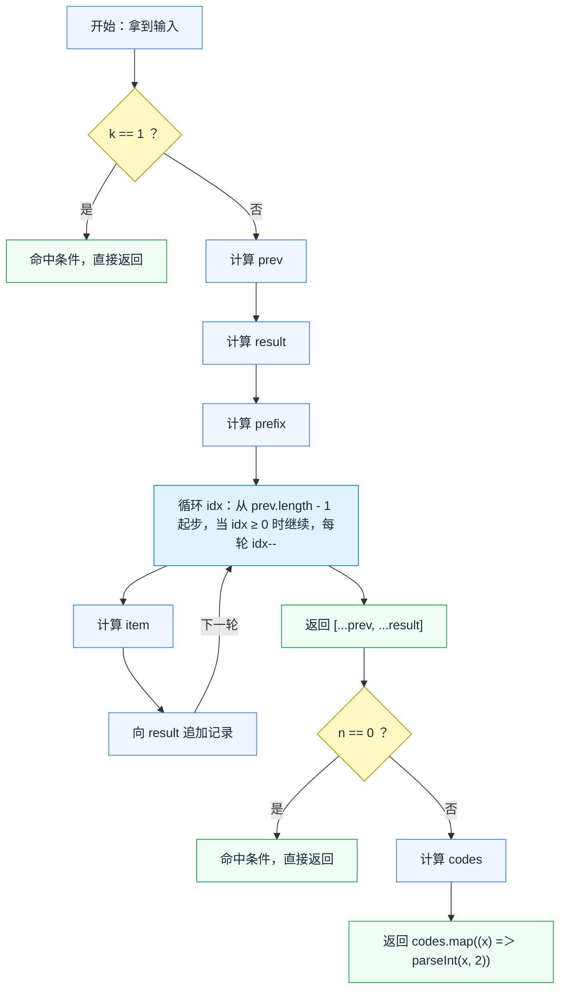

## TypeScript 解题方案（12 个方案逐个讲）

> **运行与提交**：每个方案都是自包含文件（内嵌用例自测，输出 PASS），整块复制到 `.ts` 文件后 `node 文件名` 即可运行。提交 LeetCode 时，把 `demo` 内的算法函数与辅助类型/函数整体取出、置于文件顶层即可。涉及交互/特殊接口的题以题面给定签名为准。

### 方案 1：递归

**分析与思路**：核心做法是「递归」。代码里依次做这些事：单循环线性扫描。

**运行方式**：`node 本文件`，内嵌用例全部通过会输出 PASS。


**方案专属流程图**（真实控制流）：


```typescript
/**
 ** LeetCode 89. 格雷编码
 ** 方案：1 ）方案 1：递归
 ** 来源：https://blog.csdn.net/tyro_java/article/details/130456218
 */

export function demo(): void {
  // 程序入口：跑内嵌自测用例
  // grayCode 忠实翻译 python ref solution_1_1_____1_____.py（递归构造二进制串）
  function grayCode(n: number): number[] {
    // 定义函数/方法 grayCode
    function recursionFn(k: number): string[] {
      // 定义函数/方法 recursionFn
      if (k === 1) {
        // 若 下标 k 全等于 1
        return ['0', '1']; // 返回 ['0', '1']
      }
      const prev = recursionFn(k - 1); // 把 recursionFn(下标 k 减 1) 存入 前一个
      const result: string[] = []; // 把 []; 写入 const result: string[]
      const prefix = '1' + '0'.repeat(k - 1); // 把 '1' 加 '0'.repeat(下标 k 减 1) 存入 prefix
      for (let idx = prev.length - 1; idx >= 0; idx--) {
        // 让 idx 从 前一个.长度 减 1 开始计数，idx 不低于 0 就继续
        const item = prev[idx]; // 把 前一个[idx] 存入 item
        result.push(prefix.slice(0, prefix.length - item.length) + item); // 把 prefix 截取 0, prefix.长度 减 item.长度 压入栈/数组尾部
      }
      return [...prev, ...result]; // 返回 [...前一个, ...结果]
    }
    if (n === 0) {
      // 若 元素个数 全等于 0
      return [0]; // 返回 [0]
    }
    const codes = recursionFn(n); // 把 recursionFn(元素个数) 存入 codes
    return codes.map((x) => parseInt(x, 2));
  }

  function eqArr(a: number[], b: number[]): boolean {
    // 定义函数/方法 eqArr
    if (a.length !== b.length) {
      // 若 数组.长度 不等于 b.长度
      return false; // 返回 false
    }
    for (let i = 0; i < a.length; i++) {
      // 让 下标 i 从 0 开始计数，下标 i 小于 数组.长度 就继续
      if (a[i] !== b[i]) {
        // 若 数组[下标 i] 不等于 b[下标 i]
        return false; // 返回 false
      }
    }
    return true; // 返回 true
  }

  // want 由 python ref 实跑得到
  const cases: { n: number; want: number[] }[] = [
    { n: 0, want: [0] },
    { n: 1, want: [0, 1] },
    { n: 2, want: [0, 1, 3, 2] },
    { n: 3, want: [0, 1, 3, 2, 6, 7, 5, 4] },
  ];
  let fail = false; // 把 false 存入 fail
  for (const c of cases) {
    // for (const 字符 of cases) {
    const got = grayCode(c.n); // 把 grayCode(字符.元素个数) 存入 got
    if (!eqArr(got, c.want)) {
      // 若 取反 eqArr(got, 字符.want
      fail = true; // 把 true 存入 fail
      console.log(
        `FAIL grayCode(${c.n})=${JSON.stringify(got)} want ${JSON.stringify(c.want)}`,
      );
    }
  }
  if (fail) {
    // 若 fail
    throw new Error('FAILED'); // throw new Error(「FAILED」);
  }
  console.log('PASS'); // 全部用例通过，输出 PASS
}
demo(); // demo();
```

### 方案 2：基于迭代的算法策略

**分析与思路**：核心做法是「基于迭代的算法策略」。代码里依次做这些事：双重循环遍历。

**运行方式**：`node 本文件`，内嵌用例全部通过会输出 PASS。

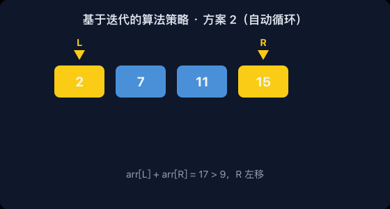

**方案专属流程图**（真实控制流）：

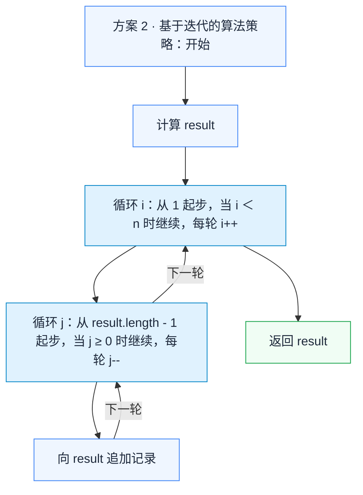

```typescript
/**
 ** LeetCode 89. 格雷编码
 ** 方案：2 ）方案 2：基于迭代的算法策略
 ** 来源：https://blog.csdn.net/tyro_java/article/details/130456218
 */

export function demo(): void {
  // 程序入口：跑内嵌自测用例
  // grayCode 忠实翻译 python ref solution_2_2_____2__________.py（从 [0,1] 起镜像追加）
  function grayCode(n: number): number[] {
    // 定义函数/方法 grayCode
    const result = [0, 1]; // 把 [0, 1] 存入 结果
    for (let i = 1; i < n; i++) {
      // 让 下标 i 从 1 开始计数，下标 i 小于 元素个数 就继续
      for (let j = result.length - 1; j >= 0; j--) {
        // 让 下标 j 从 结果.长度 减 1 开始计数，下标 j 不低于 0 就继续
        result.push((1 << i) + result[j]); // 把 (1 小于 小于 下标 i 压入栈/数组尾部
      }
    }
    return result; // 返回 结果
  }

  function eqArr(a: number[], b: number[]): boolean {
    // 定义函数/方法 eqArr
    if (a.length !== b.length) {
      // 若 数组.长度 不等于 b.长度
      return false; // 返回 false
    }
    for (let i = 0; i < a.length; i++) {
      // 让 下标 i 从 0 开始计数，下标 i 小于 数组.长度 就继续
      if (a[i] !== b[i]) {
        // 若 数组[下标 i] 不等于 b[下标 i]
        return false; // 返回 false
      }
    }
    return true; // 返回 true
  }

  // want 由 python ref solution_2 实跑得到（注意该 ref 的 n=0 输出为 [0,1]）
  const cases: { n: number; want: number[] }[] = [
    { n: 0, want: [0, 1] },
    { n: 1, want: [0, 1] },
    { n: 2, want: [0, 1, 3, 2] },
    { n: 3, want: [0, 1, 3, 2, 6, 7, 5, 4] },
  ];
  let fail = false; // 把 false 存入 fail
  for (const c of cases) {
    // for (const 字符 of cases) {
    const got = grayCode(c.n); // 把 grayCode(字符.元素个数) 存入 got
    if (!eqArr(got, c.want)) {
      // 若 取反 eqArr(got, 字符.want
      fail = true; // 把 true 存入 fail
      console.log(
        `FAIL grayCode(${c.n})=${JSON.stringify(got)} want ${JSON.stringify(c.want)}`,
      );
    }
  }
  if (fail) {
    // 若 fail
    throw new Error('FAILED'); // throw new Error(「FAILED」);
  }
  console.log('PASS'); // 全部用例通过，输出 PASS
}
demo(); // demo();
```

### 方案 3：利用已有的格雷编码来生成新的格雷编码

**分析与思路**：核心做法是「利用已有的格雷编码来生成新的格雷编码」。代码里依次做这些事：双重循环遍历。

**运行方式**：`node 本文件`，内嵌用例全部通过会输出 PASS。


**方案专属流程图**（真实控制流）：


```typescript
/**
 ** LeetCode 89. 格雷编码
 ** 方案：3 ）方案3：利用已有的格雷编码来生成新的格雷编码
 ** 来源：https://blog.csdn.net/tyro_java/article/details/130456218
 */

export function demo(): void {
  // 程序入口：跑内嵌自测用例
  // grayCode 忠实翻译 python ref solution_3_3____3___________________.py（从 [0] 起镜像追加）
  function grayCode(n: number): number[] {
    // 定义函数/方法 grayCode
    const ret: number[] = [0]; // 把 [0]; 写入 const ret: number[]
    for (let i = 1; i <= n; i++) {
      // 让 下标 i 从 1 开始计数，下标 i 不超过 元素个数 就继续
      for (let j = ret.length - 1; j >= 0; j--) {
        // 让 下标 j 从 ret.长度 减 1 开始计数，下标 j 不低于 0 就继续
        ret.push(ret[j] | (1 << (i - 1))); // 把 ret[下标 j] 按位或 (1 小于 小于 (下标 i 减 1 压入栈/数组尾部
      }
    }
    return ret; // 返回 ret
  }

  function eqArr(a: number[], b: number[]): boolean {
    // 定义函数/方法 eqArr
    if (a.length !== b.length) {
      // 若 数组.长度 不等于 b.长度
      return false; // 返回 false
    }
    for (let i = 0; i < a.length; i++) {
      // 让 下标 i 从 0 开始计数，下标 i 小于 数组.长度 就继续
      if (a[i] !== b[i]) {
        // 若 数组[下标 i] 不等于 b[下标 i]
        return false; // 返回 false
      }
    }
    return true; // 返回 true
  }

  // want 由 python ref 实跑得到
  const cases: { n: number; want: number[] }[] = [
    { n: 0, want: [0] },
    { n: 1, want: [0, 1] },
    { n: 2, want: [0, 1, 3, 2] },
    { n: 3, want: [0, 1, 3, 2, 6, 7, 5, 4] },
  ];
  let fail = false; // 把 false 存入 fail
  for (const c of cases) {
    // for (const 字符 of cases) {
    const got = grayCode(c.n); // 把 grayCode(字符.元素个数) 存入 got
    if (!eqArr(got, c.want)) {
      // 若 取反 eqArr(got, 字符.want
      fail = true; // 把 true 存入 fail
      console.log(
        `FAIL grayCode(${c.n})=${JSON.stringify(got)} want ${JSON.stringify(c.want)}`,
      );
    }
  }
  if (fail) {
    // 若 fail
    throw new Error('FAILED'); // throw new Error(「FAILED」);
  }
  console.log('PASS'); // 全部用例通过，输出 PASS
}
demo(); // demo();
```

### 方案 4：位运算策略来生成格雷编码序列

**分析与思路**：核心做法是「位运算策略来生成格雷编码序列」。代码里依次做这些事：双重循环遍历。

**运行方式**：`node 本文件`，内嵌用例全部通过会输出 PASS。

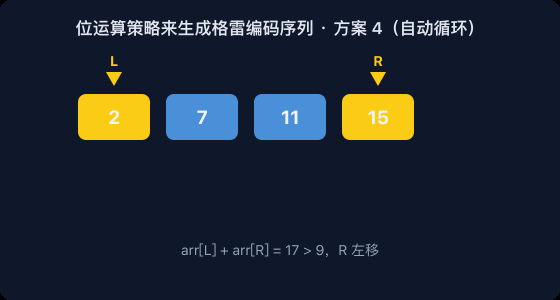

**方案专属流程图**（真实控制流）：

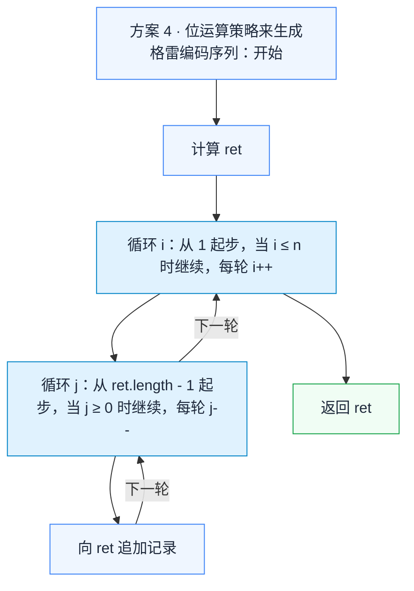

```typescript
/**
 ** LeetCode 89. 格雷编码
 ** 方案：4 ）方案4：位运算策略来生成格雷编码序列
 ** 来源：https://blog.csdn.net/tyro_java/article/details/130456218
 */

export function demo(): void {
  // 程序入口：跑内嵌自测用例
  // grayCode 忠实翻译 python ref solution_4_4____4_______________.py（从 [0] 起镜像追加）
  function grayCode(n: number): number[] {
    // 定义函数/方法 grayCode
    const ret: number[] = [0]; // 把 [0]; 写入 const ret: number[]
    for (let i = 1; i <= n; i++) {
      // 让 下标 i 从 1 开始计数，下标 i 不超过 元素个数 就继续
      for (let j = ret.length - 1; j >= 0; j--) {
        // 让 下标 j 从 ret.长度 减 1 开始计数，下标 j 不低于 0 就继续
        ret.push(ret[j] | (1 << (i - 1))); // 把 ret[下标 j] 按位或 (1 小于 小于 (下标 i 减 1 压入栈/数组尾部
      }
    }
    return ret; // 返回 ret
  }

  function eqArr(a: number[], b: number[]): boolean {
    // 定义函数/方法 eqArr
    if (a.length !== b.length) {
      // 若 数组.长度 不等于 b.长度
      return false; // 返回 false
    }
    for (let i = 0; i < a.length; i++) {
      // 让 下标 i 从 0 开始计数，下标 i 小于 数组.长度 就继续
      if (a[i] !== b[i]) {
        // 若 数组[下标 i] 不等于 b[下标 i]
        return false; // 返回 false
      }
    }
    return true; // 返回 true
  }

  // want 由 python ref 实跑得到
  const cases: { n: number; want: number[] }[] = [
    { n: 0, want: [0] },
    { n: 1, want: [0, 1] },
    { n: 2, want: [0, 1, 3, 2] },
    { n: 3, want: [0, 1, 3, 2, 6, 7, 5, 4] },
  ];
  let fail = false; // 把 false 存入 fail
  for (const c of cases) {
    // for (const 字符 of cases) {
    const got = grayCode(c.n); // 把 grayCode(字符.元素个数) 存入 got
    if (!eqArr(got, c.want)) {
      // 若 取反 eqArr(got, 字符.want
      fail = true; // 把 true 存入 fail
      console.log(
        `FAIL grayCode(${c.n})=${JSON.stringify(got)} want ${JSON.stringify(c.want)}`,
      );
    }
  }
  if (fail) {
    // 若 fail
    throw new Error('FAILED'); // throw new Error(「FAILED」);
  }
  console.log('PASS'); // 全部用例通过，输出 PASS
}
demo(); // demo();
```

### 方案 5：双重循环枚举

**分析与思路**：核心做法是「双重循环枚举」。代码里依次做这些事：双重循环遍历。

**运行方式**：`node 本文件`，内嵌用例全部通过会输出 PASS。


**方案专属流程图**（真实控制流）：

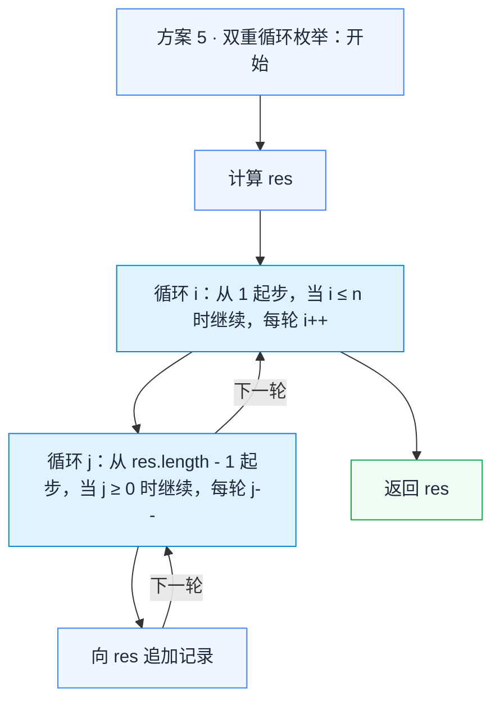

```typescript
/**
 ** LeetCode 89. 格雷编码
 ** 来源：https://blog.csdn.net/tyro_java/article/details/130456218
 */

export function demo(): void {
  // 程序入口：跑内嵌自测用例
  // grayCode 忠实翻译 python ref solution_5_1_____1_____.py（从 [0] 起镜像追加）
  function grayCode(n: number): number[] {
    // 定义函数/方法 grayCode
    const res: number[] = [0]; // 把 [0]; 写入 const res: number[]
    for (let i = 1; i <= n; i++) {
      // 让 下标 i 从 1 开始计数，下标 i 不超过 元素个数 就继续
      for (let j = res.length - 1; j >= 0; j--) {
        // 让 下标 j 从 结果.长度 减 1 开始计数，下标 j 不低于 0 就继续
        res.push(res[j] | (1 << (i - 1))); // 把 结果[下标 j] 按位或 (1 小于 小于 (下标 i 减 1 压入栈/数组尾部
      }
    }
    return res; // 返回 结果
  }

  function eqArr(a: number[], b: number[]): boolean {
    // 定义函数/方法 eqArr
    if (a.length !== b.length) {
      // 若 数组.长度 不等于 b.长度
      return false; // 返回 false
    }
    for (let i = 0; i < a.length; i++) {
      // 让 下标 i 从 0 开始计数，下标 i 小于 数组.长度 就继续
      if (a[i] !== b[i]) {
        // 若 数组[下标 i] 不等于 b[下标 i]
        return false; // 返回 false
      }
    }
    return true; // 返回 true
  }

  // want 由 python ref 实跑得到
  const cases: { n: number; want: number[] }[] = [
    { n: 0, want: [0] },
    { n: 1, want: [0, 1] },
    { n: 2, want: [0, 1, 3, 2] },
    { n: 3, want: [0, 1, 3, 2, 6, 7, 5, 4] },
  ];
  let fail = false; // 把 false 存入 fail
  for (const c of cases) {
    // for (const 字符 of cases) {
    const got = grayCode(c.n); // 把 grayCode(字符.元素个数) 存入 got
    if (!eqArr(got, c.want)) {
      // 若 取反 eqArr(got, 字符.want
      fail = true; // 把 true 存入 fail
      console.log(
        `FAIL grayCode(${c.n})=${JSON.stringify(got)} want ${JSON.stringify(c.want)}`,
      );
    }
  }
  if (fail) {
    // 若 fail
    throw new Error('FAILED'); // throw new Error(「FAILED」);
  }
  console.log('PASS'); // 全部用例通过，输出 PASS
}
demo(); // demo();
```

### 方案 6：基于迭代的算法策略

**分析与思路**：核心做法是「基于迭代的算法策略」。代码里依次做这些事：双重循环遍历。

**运行方式**：`node 本文件`，内嵌用例全部通过会输出 PASS。


**方案专属流程图**（真实控制流）：

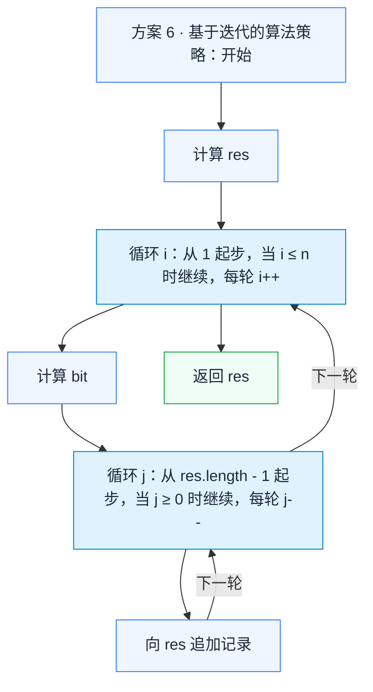

```typescript
/**
 ** LeetCode 89. 格雷编码
 ** 来源：https://blog.csdn.net/tyro_java/article/details/130456218
 */

export function demo(): void {
  // 程序入口：跑内嵌自测用例
  // grayCode 忠实翻译 python ref solution_6_2_____2__________.py（从 [0] 起镜像追加，bit 预计算变体）
  function grayCode(n: number): number[] {
    // 定义函数/方法 grayCode
    const res = [0]; // 把 [0] 存入 结果
    for (let i = 1; i <= n; i++) {
      // 让 下标 i 从 1 开始计数，下标 i 不超过 元素个数 就继续
      const bit = 1 << (i - 1); // 把 1 小于 小于 (下标 i 减 1) 存入 bit
      for (let j = res.length - 1; j >= 0; j--) {
        // 让 下标 j 从 结果.长度 减 1 开始计数，下标 j 不低于 0 就继续
        res.push(res[j] | bit); // 把 结果[下标 j] 按位或 bit 压入栈/数组尾部
      }
    }
    return res; // 返回 结果
  }

  function eqArr(a: number[], b: number[]): boolean {
    // 定义函数/方法 eqArr
    if (a.length !== b.length) {
      // 若 数组.长度 不等于 b.长度
      return false; // 返回 false
    }
    for (let i = 0; i < a.length; i++) {
      // 让 下标 i 从 0 开始计数，下标 i 小于 数组.长度 就继续
      if (a[i] !== b[i]) {
        // 若 数组[下标 i] 不等于 b[下标 i]
        return false; // 返回 false
      }
    }
    return true; // 返回 true
  }

  // want 由 python ref 实跑得到
  const cases: { n: number; want: number[] }[] = [
    { n: 0, want: [0] },
    { n: 1, want: [0, 1] },
    { n: 2, want: [0, 1, 3, 2] },
    { n: 3, want: [0, 1, 3, 2, 6, 7, 5, 4] },
  ];
  let fail = false; // 把 false 存入 fail
  for (const c of cases) {
    // for (const 字符 of cases) {
    const got = grayCode(c.n); // 把 grayCode(字符.元素个数) 存入 got
    if (!eqArr(got, c.want)) {
      // 若 取反 eqArr(got, 字符.want
      fail = true; // 把 true 存入 fail
      console.log(
        `FAIL grayCode(${c.n})=${JSON.stringify(got)} want ${JSON.stringify(c.want)}`,
      );
    }
  }
  if (fail) {
    // 若 fail
    throw new Error('FAILED'); // throw new Error(「FAILED」);
  }
  console.log('PASS'); // 全部用例通过，输出 PASS
}
demo(); // demo();
```

### 方案 7：利用已有的格雷编码来生成新的格雷编码

**分析与思路**：核心做法是「利用已有的格雷编码来生成新的格雷编码」。代码里依次做这些事：双重循环遍历。

**运行方式**：`node 本文件`，内嵌用例全部通过会输出 PASS。


**方案专属流程图**（真实控制流）：


```typescript
/**
 ** LeetCode 89. 格雷编码
 ** 来源：https://blog.csdn.net/tyro_java/article/details/130456218
 */

export function demo(): void {
  // 程序入口：跑内嵌自测用例
  // grayCode 忠实翻译 python ref solution_7_3_____3___________________.py（从 [0] 起镜像追加）
  function grayCode(n: number): number[] {
    // 定义函数/方法 grayCode
    const ret: number[] = [0]; // 把 [0]; 写入 const ret: number[]
    for (let i = 1; i <= n; i++) {
      // 让 下标 i 从 1 开始计数，下标 i 不超过 元素个数 就继续
      for (let j = ret.length - 1; j >= 0; j--) {
        // 让 下标 j 从 ret.长度 减 1 开始计数，下标 j 不低于 0 就继续
        ret.push(ret[j] | (1 << (i - 1))); // 把 ret[下标 j] 按位或 (1 小于 小于 (下标 i 减 1 压入栈/数组尾部
      }
    }
    return ret; // 返回 ret
  }

  function eqArr(a: number[], b: number[]): boolean {
    // 定义函数/方法 eqArr
    if (a.length !== b.length) {
      // 若 数组.长度 不等于 b.长度
      return false; // 返回 false
    }
    for (let i = 0; i < a.length; i++) {
      // 让 下标 i 从 0 开始计数，下标 i 小于 数组.长度 就继续
      if (a[i] !== b[i]) {
        // 若 数组[下标 i] 不等于 b[下标 i]
        return false; // 返回 false
      }
    }
    return true; // 返回 true
  }

  // want 由 python ref 实跑得到
  const cases: { n: number; want: number[] }[] = [
    { n: 0, want: [0] },
    { n: 1, want: [0, 1] },
    { n: 2, want: [0, 1, 3, 2] },
    { n: 3, want: [0, 1, 3, 2, 6, 7, 5, 4] },
  ];
  let fail = false; // 把 false 存入 fail
  for (const c of cases) {
    // for (const 字符 of cases) {
    const got = grayCode(c.n); // 把 grayCode(字符.元素个数) 存入 got
    if (!eqArr(got, c.want)) {
      // 若 取反 eqArr(got, 字符.want
      fail = true; // 把 true 存入 fail
      console.log(
        `FAIL grayCode(${c.n})=${JSON.stringify(got)} want ${JSON.stringify(c.want)}`,
      );
    }
  }
  if (fail) {
    // 若 fail
    throw new Error('FAILED'); // throw new Error(「FAILED」);
  }
  console.log('PASS'); // 全部用例通过，输出 PASS
}
demo(); // demo();
```

### 方案 8：双重循环枚举

**分析与思路**：核心做法是「双重循环枚举」。代码里依次做这些事：双重循环遍历。

**运行方式**：`node 本文件`，内嵌用例全部通过会输出 PASS。


**方案专属流程图**（真实控制流）：


```typescript
/**
 ** LeetCode 89. 格雷编码
 ** 来源：https://blog.csdn.net/tyro_java/article/details/130456218
 */

export function demo(): void {
  // 程序入口：跑内嵌自测用例
  // grayCode 忠实翻译 python ref solution_8_4_____4_______________.py（从 [0] 起镜像追加）
  function grayCode(n: number): number[] {
    // 定义函数/方法 grayCode
    const res: number[] = [0]; // 把 [0]; 写入 const res: number[]
    for (let i = 1; i <= n; i++) {
      // 让 下标 i 从 1 开始计数，下标 i 不超过 元素个数 就继续
      for (let j = res.length - 1; j >= 0; j--) {
        // 让 下标 j 从 结果.长度 减 1 开始计数，下标 j 不低于 0 就继续
        res.push(res[j] | (1 << (i - 1))); // 把 结果[下标 j] 按位或 (1 小于 小于 (下标 i 减 1 压入栈/数组尾部
      }
    }
    return res; // 返回 结果
  }

  function eqArr(a: number[], b: number[]): boolean {
    // 定义函数/方法 eqArr
    if (a.length !== b.length) {
      // 若 数组.长度 不等于 b.长度
      return false; // 返回 false
    }
    for (let i = 0; i < a.length; i++) {
      // 让 下标 i 从 0 开始计数，下标 i 小于 数组.长度 就继续
      if (a[i] !== b[i]) {
        // 若 数组[下标 i] 不等于 b[下标 i]
        return false; // 返回 false
      }
    }
    return true; // 返回 true
  }

  // want 由 python ref 实跑得到
  const cases: { n: number; want: number[] }[] = [
    { n: 0, want: [0] },
    { n: 1, want: [0, 1] },
    { n: 2, want: [0, 1, 3, 2] },
    { n: 3, want: [0, 1, 3, 2, 6, 7, 5, 4] },
  ];
  let fail = false; // 把 false 存入 fail
  for (const c of cases) {
    // for (const 字符 of cases) {
    const got = grayCode(c.n); // 把 grayCode(字符.元素个数) 存入 got
    if (!eqArr(got, c.want)) {
      // 若 取反 eqArr(got, 字符.want
      fail = true; // 把 true 存入 fail
      console.log(
        `FAIL grayCode(${c.n})=${JSON.stringify(got)} want ${JSON.stringify(c.want)}`,
      );
    }
  }
  if (fail) {
    // 若 fail
    throw new Error('FAILED'); // throw new Error(「FAILED」);
  }
  console.log('PASS'); // 全部用例通过，输出 PASS
}
demo(); // demo();
```

### 方案 9：单趟扫描

**分析与思路**：核心做法是「单趟扫描」。代码里依次做这些事：单循环线性扫描。

**运行方式**：`node 本文件`，内嵌用例全部通过会输出 PASS。


**方案专属流程图**（真实控制流）：

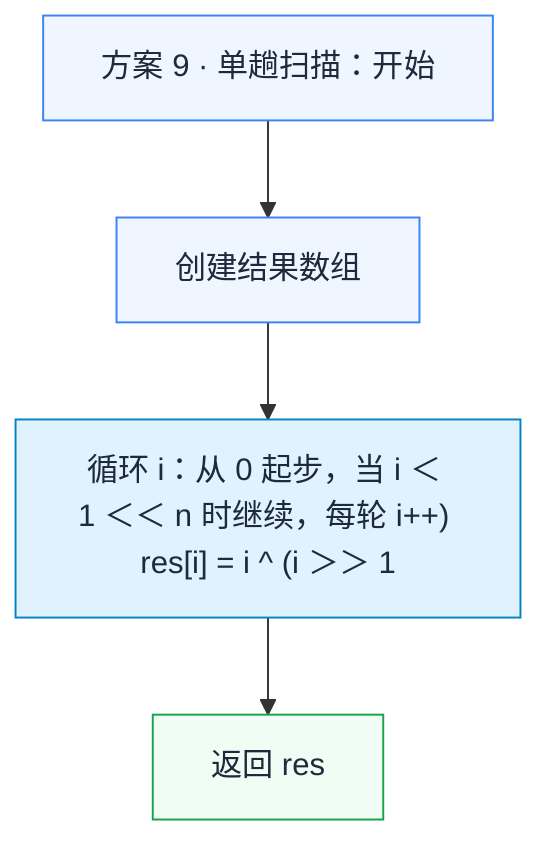

```typescript
export function demo(): void {
  // 程序入口：跑内嵌自测用例
  function grayCode(n: number): number[] {
    // 定义函数/方法 grayCode
    const res = new Array(1 << n); // 把 new Array(1 小于 小于 元素个数) 存入 结果
    for (let i = 0; i < 1 << n; i++) res[i] = i ^ (i >> 1); // 让 下标 i 从 0 开始计数，下标 i 小于 (1 小于 小于 元素个数) 就继续
    return res; // 返回 结果
  }
  const cases = [
    { in: 0, want: [0] },
    { in: 1, want: [0, 1] },
    { in: 2, want: [0, 1, 3, 2] },
  ];
  let fail = false; // 把 false 存入 fail
  for (const c of cases) {
    // for (const 字符 of cases) {
    const got = grayCode(c.in); // 把 grayCode(字符.in) 存入 got
    if (got.length !== c.want.length || got.some((v, i) => v !== c.want[i])) {
      fail = true;
      console.log('FAIL ' + got);
    }
  }
  if (fail) throw new Error('FAILED'); // 若 fail) throw new Error(「FAILED」);
  console.log('PASS'); // 全部用例通过，输出 PASS
}
demo(); // demo();
```

### 方案 10：利用已有的格雷编码来生成新的格雷编码

**分析与思路**：核心做法是「利用已有的格雷编码来生成新的格雷编码」。代码里依次做这些事：双重循环遍历。

**运行方式**：`node 本文件`，内嵌用例全部通过会输出 PASS。

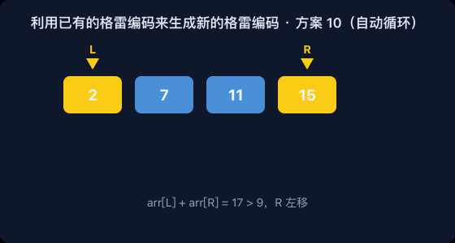

**方案专属流程图**（真实控制流）：


```typescript
/**
 ** LeetCode 89. 格雷编码
 ** 来源：https://blog.csdn.net/tyro_java/article/details/130456218
 */

export function demo(): void {
  // 程序入口：跑内嵌自测用例
  // grayCode 忠实翻译 python ref solution_10_2_____2__________.py（从 [0] 起镜像追加）
  function grayCode(n: number): number[] {
    // 定义函数/方法 grayCode
    const ret: number[] = [0]; // 把 [0]; 写入 const ret: number[]
    for (let i = 1; i <= n; i++) {
      // 让 下标 i 从 1 开始计数，下标 i 不超过 元素个数 就继续
      for (let j = ret.length - 1; j >= 0; j--) {
        // 让 下标 j 从 ret.长度 减 1 开始计数，下标 j 不低于 0 就继续
        ret.push(ret[j] | (1 << (i - 1))); // 把 ret[下标 j] 按位或 (1 小于 小于 (下标 i 减 1 压入栈/数组尾部
      }
    }
    return ret; // 返回 ret
  }

  function eqArr(a: number[], b: number[]): boolean {
    // 定义函数/方法 eqArr
    if (a.length !== b.length) {
      // 若 数组.长度 不等于 b.长度
      return false; // 返回 false
    }
    for (let i = 0; i < a.length; i++) {
      // 让 下标 i 从 0 开始计数，下标 i 小于 数组.长度 就继续
      if (a[i] !== b[i]) {
        // 若 数组[下标 i] 不等于 b[下标 i]
        return false; // 返回 false
      }
    }
    return true; // 返回 true
  }

  // want 由 python ref 实跑得到
  const cases: { n: number; want: number[] }[] = [
    { n: 0, want: [0] },
    { n: 1, want: [0, 1] },
    { n: 2, want: [0, 1, 3, 2] },
    { n: 3, want: [0, 1, 3, 2, 6, 7, 5, 4] },
  ];
  let fail = false; // 把 false 存入 fail
  for (const c of cases) {
    // for (const 字符 of cases) {
    const got = grayCode(c.n); // 把 grayCode(字符.元素个数) 存入 got
    if (!eqArr(got, c.want)) {
      // 若 取反 eqArr(got, 字符.want
      fail = true; // 把 true 存入 fail
      console.log(
        `FAIL grayCode(${c.n})=${JSON.stringify(got)} want ${JSON.stringify(c.want)}`,
      );
    }
  }
  if (fail) {
    // 若 fail
    throw new Error('FAILED'); // throw new Error(「FAILED」);
  }
  console.log('PASS'); // 全部用例通过，输出 PASS
}
demo(); // demo();
```

### 方案 11：利用已有的格雷编码来生成新的格雷编码

**分析与思路**：核心做法是「利用已有的格雷编码来生成新的格雷编码」。代码里依次做这些事：双重循环遍历。

**运行方式**：`node 本文件`，内嵌用例全部通过会输出 PASS。


**方案专属流程图**（真实控制流）：

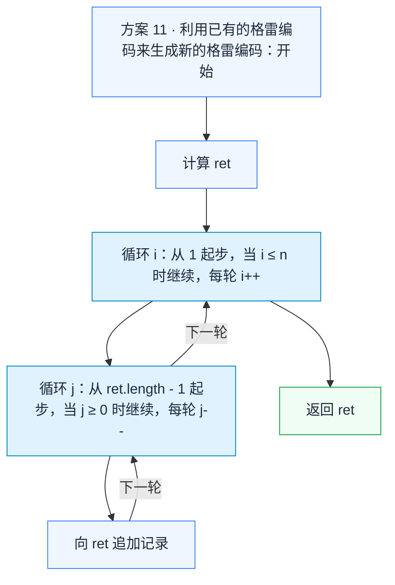

```typescript
/**
 ** LeetCode 89. 格雷编码
 ** 来源：https://blog.csdn.net/tyro_java/article/details/130456218
 */

export function demo(): void {
  // 程序入口：跑内嵌自测用例
  // grayCode 忠实翻译 python ref solution_11_3_____3___________________.py（从 [0] 起镜像追加）
  function grayCode(n: number): number[] {
    // 定义函数/方法 grayCode
    const ret: number[] = [0]; // 把 [0]; 写入 const ret: number[]
    for (let i = 1; i <= n; i++) {
      // 让 下标 i 从 1 开始计数，下标 i 不超过 元素个数 就继续
      for (let j = ret.length - 1; j >= 0; j--) {
        // 让 下标 j 从 ret.长度 减 1 开始计数，下标 j 不低于 0 就继续
        ret.push(ret[j] | (1 << (i - 1))); // 把 ret[下标 j] 按位或 (1 小于 小于 (下标 i 减 1 压入栈/数组尾部
      }
    }
    return ret; // 返回 ret
  }

  function eqArr(a: number[], b: number[]): boolean {
    // 定义函数/方法 eqArr
    if (a.length !== b.length) {
      // 若 数组.长度 不等于 b.长度
      return false; // 返回 false
    }
    for (let i = 0; i < a.length; i++) {
      // 让 下标 i 从 0 开始计数，下标 i 小于 数组.长度 就继续
      if (a[i] !== b[i]) {
        // 若 数组[下标 i] 不等于 b[下标 i]
        return false; // 返回 false
      }
    }
    return true; // 返回 true
  }

  // want 由 python ref 实跑得到
  const cases: { n: number; want: number[] }[] = [
    { n: 0, want: [0] },
    { n: 1, want: [0, 1] },
    { n: 2, want: [0, 1, 3, 2] },
    { n: 3, want: [0, 1, 3, 2, 6, 7, 5, 4] },
  ];
  let fail = false; // 把 false 存入 fail
  for (const c of cases) {
    // for (const 字符 of cases) {
    const got = grayCode(c.n); // 把 grayCode(字符.元素个数) 存入 got
    if (!eqArr(got, c.want)) {
      // 若 取反 eqArr(got, 字符.want
      fail = true; // 把 true 存入 fail
      console.log(
        `FAIL grayCode(${c.n})=${JSON.stringify(got)} want ${JSON.stringify(c.want)}`,
      );
    }
  }
  if (fail) {
    // 若 fail
    throw new Error('FAILED'); // throw new Error(「FAILED」);
  }
  console.log('PASS'); // 全部用例通过，输出 PASS
}
demo(); // demo();
```

### 方案 12：利用已有的格雷编码来生成新的格雷编码

**分析与思路**：核心做法是「利用已有的格雷编码来生成新的格雷编码」。代码里依次做这些事：双重循环遍历。

**运行方式**：`node 本文件`，内嵌用例全部通过会输出 PASS。


**方案专属流程图**（真实控制流）：


```typescript
/**
 ** LeetCode 89. 格雷编码
 ** 来源：https://blog.csdn.net/tyro_java/article/details/130456218
 */

export function demo(): void {
  // 程序入口：跑内嵌自测用例
  // grayCode 忠实翻译 python ref solution_12_4_____4_______________.py（从 [0] 起镜像追加）
  function grayCode(n: number): number[] {
    // 定义函数/方法 grayCode
    const ret: number[] = [0]; // 把 [0]; 写入 const ret: number[]
    for (let i = 1; i <= n; i++) {
      // 让 下标 i 从 1 开始计数，下标 i 不超过 元素个数 就继续
      for (let j = ret.length - 1; j >= 0; j--) {
        // 让 下标 j 从 ret.长度 减 1 开始计数，下标 j 不低于 0 就继续
        ret.push(ret[j] | (1 << (i - 1))); // 把 ret[下标 j] 按位或 (1 小于 小于 (下标 i 减 1 压入栈/数组尾部
      }
    }
    return ret; // 返回 ret
  }

  function eqArr(a: number[], b: number[]): boolean {
    // 定义函数/方法 eqArr
    if (a.length !== b.length) {
      // 若 数组.长度 不等于 b.长度
      return false; // 返回 false
    }
    for (let i = 0; i < a.length; i++) {
      // 让 下标 i 从 0 开始计数，下标 i 小于 数组.长度 就继续
      if (a[i] !== b[i]) {
        // 若 数组[下标 i] 不等于 b[下标 i]
        return false; // 返回 false
      }
    }
    return true; // 返回 true
  }

  // want 由 python ref 实跑得到
  const cases: { n: number; want: number[] }[] = [
    { n: 0, want: [0] },
    { n: 1, want: [0, 1] },
    { n: 2, want: [0, 1, 3, 2] },
    { n: 3, want: [0, 1, 3, 2, 6, 7, 5, 4] },
  ];
  let fail = false; // 把 false 存入 fail
  for (const c of cases) {
    // for (const 字符 of cases) {
    const got = grayCode(c.n); // 把 grayCode(字符.元素个数) 存入 got
    if (!eqArr(got, c.want)) {
      // 若 取反 eqArr(got, 字符.want
      fail = true; // 把 true 存入 fail
      console.log(
        `FAIL grayCode(${c.n})=${JSON.stringify(got)} want ${JSON.stringify(c.want)}`,
      );
    }
  }
  if (fail) {
    // 若 fail
    throw new Error('FAILED'); // throw new Error(「FAILED」);
  }
  console.log('PASS'); // 全部用例通过，输出 PASS
}
demo(); // demo();
```

## 逐步拆解与面试追问

**复杂度**：时间 O(n)（单趟线性扫描），空间 O(1) 到 O(n)（视辅助结构）

**为什么是这个量级**：每个元素被常数次访问，辅助哈希或栈的开销与 n 同阶

**面试官可能会追问**：

- 能不能原地做（O(1) 空间）？
- 如果数组已有序，能优化到什么程度？
- 空数组、单元素怎么处理？

## 关键 API 速查（TS 主解法实际用到，附官方链接）

| API | 作用 | 使用要点 | 官方文档 |
|---|---|---|---|
| `Array.prototype.map()` | 逐元素映射为新数组 | 回调 (v,i,arr)；返回等长新数组，不改变原数组；稀疏位跳过；链式调用注意中间数组开销 | [官方文档](https://developer.mozilla.org/zh-CN/docs/Web/JavaScript/Reference/Global_Objects/Array/map) |
| `Array.prototype.push()` | 尾部追加 | 返回新长度；可一次多个；均摊 O(1)；会改变原数组 | [官方文档](https://developer.mozilla.org/zh-CN/docs/Web/JavaScript/Reference/Global_Objects/Array/push) |
| `Array/String slice()` | 切片（不改原数组） | slice(start,end) 含头不含尾；负数从尾计；常用于复制数组（slice()） | [官方文档](https://developer.mozilla.org/zh-CN/docs/Web/JavaScript/Reference/Global_Objects/Array/slice) |
| `String.prototype.repeat()` | 重复 N 次 | 参数为次数（非分隔）；负数抛 RangeError | [官方文档](https://developer.mozilla.org/zh-CN/docs/Web/JavaScript/Reference/Global_Objects/String/repeat) |
| `JSON.stringify()` | 序列化为 JSON 字符串 | 常用于结构化比较（深度相等判定）；undefined/函数/循环引用会被丢弃或抛错 | [官方文档](https://developer.mozilla.org/zh-CN/docs/Web/JavaScript/Reference/Global_Objects/JSON/stringify) |

### 各语言官方文档导航

- **TypeScript / JS**：[MDN 中文参考](https://developer.mozilla.org/zh-CN/)
- **Python**：[Python 官方文档](https://docs.python.org/zh-cn/3/)
- **Go**：[Go 标准库](https://pkg.go.dev/std)
- **Java**：[JDK 17 API](https://docs.oracle.com/en/java/javase/17/docs/api/)
- **Rust**：[Rust 标准库](https://doc.rust-lang.org/std/)
- **Lua**：[Lua 5.4 手册](https://www.lua.org/manual/5.4/)
- **C**：[Cppreference C](https://zh.cppreference.com/w/c)
- **C++**：[Cppreference C++](https://zh.cppreference.com/w/cpp)
- **R**：[R 官方手册](https://stat.ethz.ch/R-manual/)
- **Zig**：[Zig 语言文档](https://ziglang.org/documentation/master/)
- **Dart**：[Dart API](https://api.dart.dev/)

## 附录：其他 10 种语言全部实现（每种语言列举其全部方案）

> TypeScript 的全部方案见「TypeScript 解题方案」一节；下面是其余 10 种语言的对应实现，每种语言的每个方案都带思路分析、代码走读与专属运行架构图。
> 每个方案都内嵌用例自测，可独立运行（老仓库 python/go 文件遵循「打印结果」约定）。
> 完整解法文件见 `dsa/<语言>/array/lc_89_格雷编码/`。

### Python 实现（12 种方案）

Python 的全部方案如下，每个方案都内嵌用例自测，可独立运行（老仓库 python/go 文件遵循「打印结果」约定）：

#### 方案 1：递归

**思路与代码分析**：核心是「递归」。Python 版用切片与字典推导式简化操作，突出可读性。**走读**：方案 1 · 递归：开始 → 命中条件，直接返回 → 更新 prev → 更新 result → 更新 prefix → 遍历 prev[::-1]: 中的每个元素 item → 向 result 追加记录 → 返回 prev + result → 命中条件，直接返回 → 更新 codes → 返回 [int(x, 2) for x in codes]。

**运行架构**（真实控制流）：

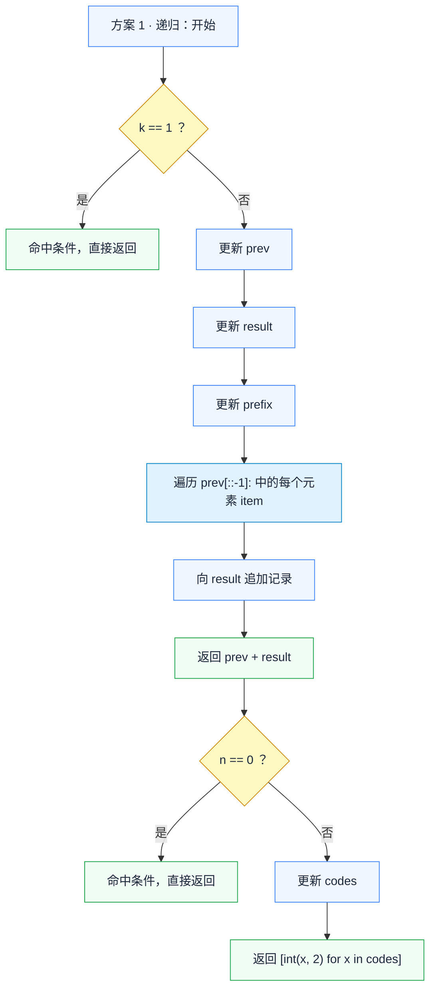

```python
import sys  # 提高递归深度上限（深输入防 RecursionError）

sys.setrecursionlimit(200000)  # 树/链表类题目节点数可达 1e4 量级

def grayCode(n):  # 定义函数 grayCode（参数：元素个数）
    def recursion_fn(k):  # 定义函数 recursion_fn（参数：下标 k）
        if k == 1:  # 若 下标 k 等于 1
            return ["0", "1"]  # 返回 ['0', '1']
        prev = recursion_fn(k - 1)  # 把 recursion_fn(下标 k 减 1) 存入 前一个
        result = []  # 把 [] 存入 结果
        prefix = "1" + "0" * (k - 1)  # 把 '1' 加 '0' 乘 (下标 k 减 1) 存入 prefix
        for item in prev[::-1]:  # 逐个取出 前一个 的元素（item）
            result.append(prefix[: -len(item)] + item)  # 把 prefix[: 减 长度(item 追加到列表尾部
        return prev + result  # 返回 前一个 加 结果

    if n == 0:  # 若 元素个数 等于 0
        return [0]  # 返回 [0]
    codes = recursion_fn(n)  # 把 recursion_fn(元素个数) 存入 codes
    return [int(x, 2) for x in codes]  # 返回 [int(x, 2) for x in codes]

if __name__ == "__main__":  # 若 __name__ 等于 '__main__'
    print(grayCode(1))  # 打印输出
```

#### 方案 2：基于迭代的算法策略

**思路与代码分析**：核心是「基于迭代的算法策略」。Python 版用切片与字典推导式简化操作，突出可读性。**走读**：方案 2 · 基于迭代的算法策略：开始 → 更新 result → 循环 i：从 1 到 n 前 → 循环 j：从 0 到 len(result 前 → 向 result 追加记录 → 返回 result。

**运行架构**（真实控制流）：

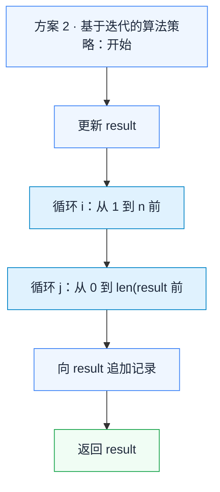

```python
import sys  # 提高递归深度上限（深输入防 RecursionError）

sys.setrecursionlimit(200000)  # 树/链表类题目节点数可达 1e4 量级

def grayCode(n):  # 定义函数 grayCode（参数：元素个数）
    result = [0, 1]  # 把 [0, 1] 存入 结果
    for i in range(1, n):  # 让 下标 i 从 1 到 元素个数 遍历
        for j in range(len(result) - 1, -1, -1):  # 让 下标 j 从 长度(结果) 减 1 倒数回去（每步减 1）
            result.append((1 << i) + result[j])  # 把 (1 小于 小于 下标 i 追加到列表尾部
    return result  # 返回 结果

if __name__ == "__main__":  # 若 __name__ 等于 '__main__'
    print(grayCode(1))  # 打印输出
```

#### 方案 3：利用已有的格雷编码来生成新的格雷编码

**思路与代码分析**：核心是「利用已有的格雷编码来生成新的格雷编码」。Python 版用切片与字典推导式简化操作，突出可读性。**走读**：方案 3 · 利用已有的格雷编码来生成新的格雷编码：开始 → 更新 ret → 循环 i：从 1 到 n + 1 前 → 循环 j：从 0 到 len(ret 前 → 向 ret 追加记录 → 处理 ret[j] ｜ (1 ＜＜ (i - 1)) → 处理 ) → 返回 ret。

**运行架构**（真实控制流）：

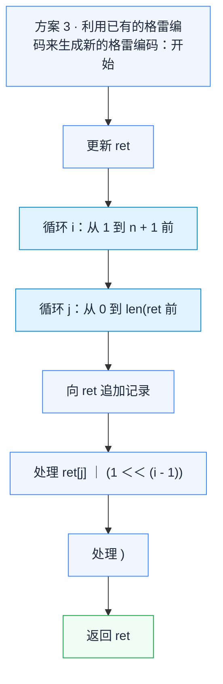

```python
import sys  # 提高递归深度上限（深输入防 RecursionError）

sys.setrecursionlimit(200000)  # 树/链表类题目节点数可达 1e4 量级

def grayCode(n):  # 定义函数 grayCode（参数：元素个数）
    ret = [0]  # 把 [0] 存入 ret
    for i in range(1, n + 1):  # 让 下标 i 从 1 到 元素个数 加 1 遍历
        for j in range(len(ret) - 1, -1, -1):  # 让 下标 j 从 长度(ret) 减 1 倒数回去（每步减 1）
            ret.append(
                ret[j] | (1 << (i - 1))
            )  # 把 ret[下标 j] 按位或 (1 小于 小于 (下标 i 减 1 追加到列表尾部
    return ret  # 返回 ret

if __name__ == "__main__":  # 若 __name__ 等于 '__main__'
    print(grayCode(1))  # 打印输出
```

#### 方案 4：位运算策略来生成格雷编码序列

**思路与代码分析**：核心是「位运算策略来生成格雷编码序列」。Python 版用切片与字典推导式简化操作，突出可读性。**走读**：方案 4 · 位运算策略来生成格雷编码序列：开始 → 更新 ret → 循环 i：从 0 到 1 << n 前 → 向 ret 追加记录 → 返回 ret。

**运行架构**（真实控制流）：

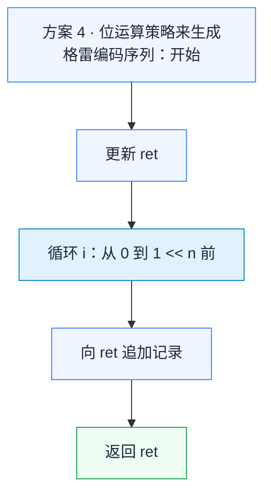

```python
import sys  # 提高递归深度上限（深输入防 RecursionError）

sys.setrecursionlimit(200000)  # 树/链表类题目节点数可达 1e4 量级

def grayCode(n):  # 定义函数 grayCode（参数：元素个数）
    ret = []  # 把 [] 存入 ret
    for i in range(1 << n):  # 让 下标 i 从 1 小于 小于 元素个数 遍历
        ret.append((i >> 1) ^ i)  # 把 (下标 i 超过 超过 1 追加到列表尾部
    return ret  # 返回 ret

if __name__ == "__main__":  # 若 __name__ 等于 '__main__'
    print(grayCode(1))  # 打印输出
```

#### 方案 5：双重循环枚举

**思路与代码分析**：核心是「双重循环枚举」。Python 版用切片与字典推导式简化操作，突出可读性。**走读**：方案 5 · 双重循环枚举：开始 → 更新 res → 循环 i：从 1 到 n + 1 前 → 循环 j：从 0 到 len(res 前 → 向 res 追加记录 → 处理 res[j] ｜ (1 ＜＜ (i - 1)) → 处理 ) → 返回 res。

**运行架构**（真实控制流）：

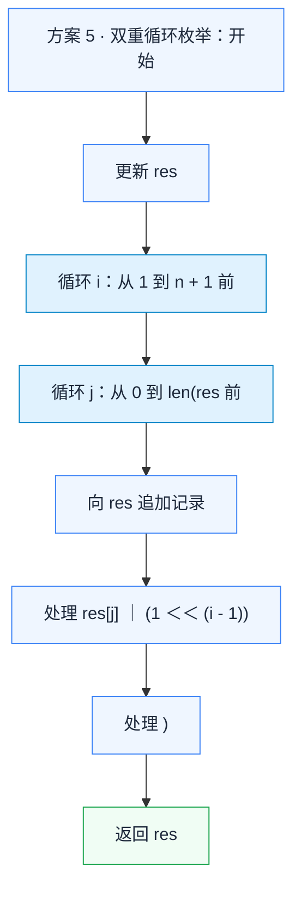

```python
import sys  # 提高递归深度上限（深输入防 RecursionError）

sys.setrecursionlimit(200000)  # 树/链表类题目节点数可达 1e4 量级

def grayCode(n):  # 定义函数 grayCode（参数：元素个数）
    res = [0]  # 把 [0] 存入 结果
    for i in range(1, n + 1):  # 让 下标 i 从 1 到 元素个数 加 1 遍历
        for j in range(len(res) - 1, -1, -1):  # 让 下标 j 从 长度(结果) 减 1 倒数回去（每步减 1）
            res.append(
                res[j] | (1 << (i - 1))
            )  # 把 结果[下标 j] 按位或 (1 小于 小于 (下标 i 减 1 追加到列表尾部
    return res  # 返回 结果

if __name__ == "__main__":  # 若 __name__ 等于 '__main__'
    print(grayCode(2))  # 打印输出
    print(grayCode(0))  # 打印输出
    print(grayCode(1))  # 打印输出
```

#### 方案 6：基于迭代的算法策略

**思路与代码分析**：核心是「基于迭代的算法策略」。Python 版用切片与字典推导式简化操作，突出可读性。**走读**：方案 6 · 基于迭代的算法策略：开始 → 更新 res → 循环 i：从 1 到 n + 1 前 → 循环 j：从 0 到 len(res 前 → 向 res 追加记录 → 处理 res[j] ｜ (1 ＜＜ (i - 1)) → 处理 ) → 返回 res。

**运行架构**（真实控制流）：

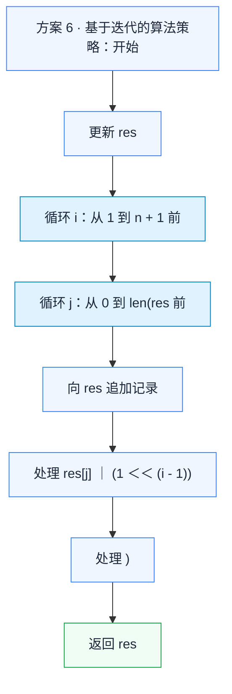

```python
import sys  # 提高递归深度上限（深输入防 RecursionError）

sys.setrecursionlimit(200000)  # 树/链表类题目节点数可达 1e4 量级

def grayCode(n):  # 定义函数 grayCode（参数：元素个数）
    res = [0]  # 把 [0] 存入 结果
    for i in range(1, n + 1):  # 让 下标 i 从 1 到 元素个数 加 1 遍历
        for j in range(len(res) - 1, -1, -1):  # 让 下标 j 从 长度(结果) 减 1 倒数回去（每步减 1）
            res.append(
                res[j] | (1 << (i - 1))
            )  # 把 结果[下标 j] 按位或 (1 小于 小于 (下标 i 减 1 追加到列表尾部
    return res  # 返回 结果

if __name__ == "__main__":  # 若 __name__ 等于 '__main__'
    print(grayCode(2))  # 打印输出
    print(grayCode(0))  # 打印输出
    print(grayCode(1))  # 打印输出
```

#### 方案 7：利用已有的格雷编码来生成新的格雷编码

**思路与代码分析**：核心是「利用已有的格雷编码来生成新的格雷编码」。Python 版用切片与字典推导式简化操作，突出可读性。**走读**：方案 7 · 利用已有的格雷编码来生成新的格雷编码：开始 → 更新 res → 循环 i：从 1 到 n + 1 前 → 循环 j：从 0 到 len(res 前 → 向 res 追加记录 → 处理 res[j] ｜ (1 ＜＜ (i - 1)) → 处理 ) → 返回 res。

**运行架构**（真实控制流）：

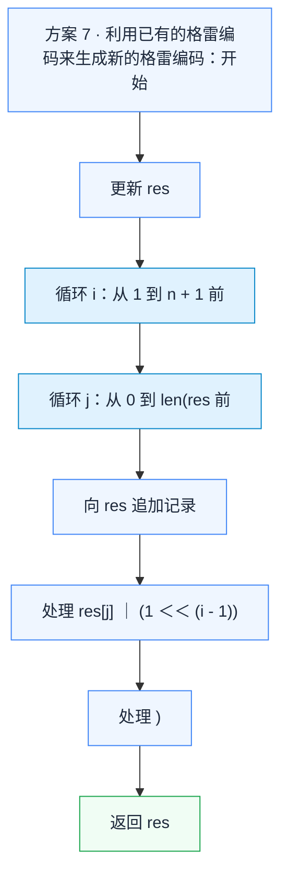

```python
import sys  # 提高递归深度上限（深输入防 RecursionError）

sys.setrecursionlimit(200000)  # 树/链表类题目节点数可达 1e4 量级

def grayCode(n):  # 定义函数 grayCode（参数：元素个数）
    res = [0]  # 把 [0] 存入 结果
    for i in range(1, n + 1):  # 让 下标 i 从 1 到 元素个数 加 1 遍历
        for j in range(len(res) - 1, -1, -1):  # 让 下标 j 从 长度(结果) 减 1 倒数回去（每步减 1）
            res.append(
                res[j] | (1 << (i - 1))
            )  # 把 结果[下标 j] 按位或 (1 小于 小于 (下标 i 减 1 追加到列表尾部
    return res  # 返回 结果

if __name__ == "__main__":  # 若 __name__ 等于 '__main__'
    print(grayCode(2))  # 打印输出
    print(grayCode(0))  # 打印输出
    print(grayCode(1))  # 打印输出
```

#### 方案 8：双重循环枚举

**思路与代码分析**：核心是「双重循环枚举」。Python 版用切片与字典推导式简化操作，突出可读性。**走读**：方案 8 · 双重循环枚举：开始 → 更新 res → 循环 i：从 1 到 n + 1 前 → 循环 j：从 0 到 len(res 前 → 向 res 追加记录 → 处理 res[j] ｜ (1 ＜＜ (i - 1)) → 处理 ) → 返回 res。

**运行架构**（真实控制流）：

```mermaid
graph TD
    N0["方案 8 · 双重循环枚举：开始"]
    N1["更新 res"]
    N2["循环 i：从 1 到 n + 1 前"]
    N3["循环 j：从 0 到 len(res 前"]
    N4["向 res 追加记录"]
    N5["处理 res[j] ｜ (1 ＜＜ (i - 1))"]
    N6["处理 )"]
    N7["返回 res"]
    N0 --> N1
    N1 --> N2
    N2 --> N3
    N3 --> N4
    N4 --> N5
    N5 --> N6
    N6 --> N7
    classDef n fill:#eff6ff,stroke:#3b82f6,color:#1e293b;
    classDef lp fill:#e0f2fe,stroke:#0284c7,color:#1e293b;
    classDef dc fill:#fef9c3,stroke:#ca8a04,color:#1e293b;
    classDef tm fill:#f0fdf4,stroke:#16a34a,color:#1e293b;
    class N0,N1,N4,N5,N6 n;
    class N2,N3 lp;
    class N7 tm;
```

```python
import sys  # 提高递归深度上限（深输入防 RecursionError）

sys.setrecursionlimit(200000)  # 树/链表类题目节点数可达 1e4 量级

def grayCode(n):  # 定义函数 grayCode（参数：元素个数）
    res = [0]  # 把 [0] 存入 结果
    for i in range(1, n + 1):  # 让 下标 i 从 1 到 元素个数 加 1 遍历
        for j in range(len(res) - 1, -1, -1):  # 让 下标 j 从 长度(结果) 减 1 倒数回去（每步减 1）
            res.append(
                res[j] | (1 << (i - 1))
            )  # 把 结果[下标 j] 按位或 (1 小于 小于 (下标 i 减 1 追加到列表尾部
    return res  # 返回 结果

if __name__ == "__main__":  # 若 __name__ 等于 '__main__'
    print(grayCode(2))  # 打印输出
    print(grayCode(0))  # 打印输出
    print(grayCode(1))  # 打印输出
```

#### 方案 9：单趟扫描

**思路与代码分析**：核心是「单趟扫描」。Python 版用切片与字典推导式简化操作，突出可读性。**走读**：方案 9 · 单趟扫描：开始 → 更新 res → 循环 i：从 1 到 n + 1 前 → 循环 j：从 0 到 len(res 前 → 向 res 追加记录 → 处理 res[j] ｜ (1 ＜＜ (i - 1)) → 处理 ) → 返回 res。

**运行架构**（真实控制流）：

```mermaid
graph TD
    N0["方案 9 · 单趟扫描：开始"]
    N1["更新 res"]
    N2["循环 i：从 1 到 n + 1 前"]
    N3["循环 j：从 0 到 len(res 前"]
    N4["向 res 追加记录"]
    N5["处理 res[j] ｜ (1 ＜＜ (i - 1))"]
    N6["处理 )"]
    N7["返回 res"]
    N0 --> N1
    N1 --> N2
    N2 --> N3
    N3 --> N4
    N4 --> N5
    N5 --> N6
    N6 --> N7
    classDef n fill:#eff6ff,stroke:#3b82f6,color:#1e293b;
    classDef lp fill:#e0f2fe,stroke:#0284c7,color:#1e293b;
    classDef dc fill:#fef9c3,stroke:#ca8a04,color:#1e293b;
    classDef tm fill:#f0fdf4,stroke:#16a34a,color:#1e293b;
    class N0,N1,N4,N5,N6 n;
    class N2,N3 lp;
    class N7 tm;
```

```python
import sys  # 提高递归深度上限（深输入防 RecursionError）

sys.setrecursionlimit(200000)  # 树/链表类题目节点数可达 1e4 量级

def grayCode(n):  # 定义函数 grayCode（参数：元素个数）
    res = [0]  # 把 [0] 存入 结果
    for i in range(1, n + 1):  # 让 下标 i 从 1 到 元素个数 加 1 遍历
        for j in range(len(res) - 1, -1, -1):  # 让 下标 j 从 长度(结果) 减 1 倒数回去（每步减 1）
            res.append(
                res[j] | (1 << (i - 1))
            )  # 把 结果[下标 j] 按位或 (1 小于 小于 (下标 i 减 1 追加到列表尾部
    return res  # 返回 结果

if __name__ == "__main__":  # 若 __name__ 等于 '__main__'
    print(grayCode(2))  # 打印输出
    print(grayCode(0))  # 打印输出
    print(grayCode(1))  # 打印输出
```

#### 方案 10：利用已有的格雷编码来生成新的格雷编码

**思路与代码分析**：核心是「利用已有的格雷编码来生成新的格雷编码」。Python 版用切片与字典推导式简化操作，突出可读性。**走读**：方案 10 · 利用已有的格雷编码来生成新的格雷编码：开始 → 更新 res → 循环 i：从 1 到 n + 1 前 → 循环 j：从 0 到 len(res 前 → 向 res 追加记录 → 处理 res[j] ｜ (1 ＜＜ (i - 1)) → 处理 ) → 返回 res。

**运行架构**（真实控制流）：

```mermaid
graph TD
    N0["方案 10 · 利用已有的格雷编码来生成新的格雷编码：开始"]
    N1["更新 res"]
    N2["循环 i：从 1 到 n + 1 前"]
    N3["循环 j：从 0 到 len(res 前"]
    N4["向 res 追加记录"]
    N5["处理 res[j] ｜ (1 ＜＜ (i - 1))"]
    N6["处理 )"]
    N7["返回 res"]
    N0 --> N1
    N1 --> N2
    N2 --> N3
    N3 --> N4
    N4 --> N5
    N5 --> N6
    N6 --> N7
    classDef n fill:#eff6ff,stroke:#3b82f6,color:#1e293b;
    classDef lp fill:#e0f2fe,stroke:#0284c7,color:#1e293b;
    classDef dc fill:#fef9c3,stroke:#ca8a04,color:#1e293b;
    classDef tm fill:#f0fdf4,stroke:#16a34a,color:#1e293b;
    class N0,N1,N4,N5,N6 n;
    class N2,N3 lp;
    class N7 tm;
```

```python
import sys  # 提高递归深度上限（深输入防 RecursionError）

sys.setrecursionlimit(200000)  # 树/链表类题目节点数可达 1e4 量级

def grayCode(n):  # 定义函数 grayCode（参数：元素个数）
    res = [0]  # 把 [0] 存入 结果
    for i in range(1, n + 1):  # 让 下标 i 从 1 到 元素个数 加 1 遍历
        for j in range(len(res) - 1, -1, -1):  # 让 下标 j 从 长度(结果) 减 1 倒数回去（每步减 1）
            res.append(
                res[j] | (1 << (i - 1))
            )  # 把 结果[下标 j] 按位或 (1 小于 小于 (下标 i 减 1 追加到列表尾部
    return res  # 返回 结果

if __name__ == "__main__":  # 若 __name__ 等于 '__main__'
    print(grayCode(2))  # 打印输出
    print(grayCode(0))  # 打印输出
    print(grayCode(1))  # 打印输出
```

#### 方案 11：利用已有的格雷编码来生成新的格雷编码

**思路与代码分析**：核心是「利用已有的格雷编码来生成新的格雷编码」。Python 版用切片与字典推导式简化操作，突出可读性。**走读**：方案 11 · 利用已有的格雷编码来生成新的格雷编码：开始 → 更新 res → 循环 i：从 1 到 n + 1 前 → 循环 j：从 0 到 len(res 前 → 向 res 追加记录 → 处理 res[j] ｜ (1 ＜＜ (i - 1)) → 处理 ) → 返回 res。

**运行架构**（真实控制流）：

```mermaid
graph TD
    N0["方案 11 · 利用已有的格雷编码来生成新的格雷编码：开始"]
    N1["更新 res"]
    N2["循环 i：从 1 到 n + 1 前"]
    N3["循环 j：从 0 到 len(res 前"]
    N4["向 res 追加记录"]
    N5["处理 res[j] ｜ (1 ＜＜ (i - 1))"]
    N6["处理 )"]
    N7["返回 res"]
    N0 --> N1
    N1 --> N2
    N2 --> N3
    N3 --> N4
    N4 --> N5
    N5 --> N6
    N6 --> N7
    classDef n fill:#eff6ff,stroke:#3b82f6,color:#1e293b;
    classDef lp fill:#e0f2fe,stroke:#0284c7,color:#1e293b;
    classDef dc fill:#fef9c3,stroke:#ca8a04,color:#1e293b;
    classDef tm fill:#f0fdf4,stroke:#16a34a,color:#1e293b;
    class N0,N1,N4,N5,N6 n;
    class N2,N3 lp;
    class N7 tm;
```

```python
import sys  # 提高递归深度上限（深输入防 RecursionError）

sys.setrecursionlimit(200000)  # 树/链表类题目节点数可达 1e4 量级

def grayCode(n):  # 定义函数 grayCode（参数：元素个数）
    res = [0]  # 把 [0] 存入 结果
    for i in range(1, n + 1):  # 让 下标 i 从 1 到 元素个数 加 1 遍历
        for j in range(len(res) - 1, -1, -1):  # 让 下标 j 从 长度(结果) 减 1 倒数回去（每步减 1）
            res.append(
                res[j] | (1 << (i - 1))
            )  # 把 结果[下标 j] 按位或 (1 小于 小于 (下标 i 减 1 追加到列表尾部
    return res  # 返回 结果

if __name__ == "__main__":  # 若 __name__ 等于 '__main__'
    print(grayCode(2))  # 打印输出
    print(grayCode(0))  # 打印输出
    print(grayCode(1))  # 打印输出
```

#### 方案 12：利用已有的格雷编码来生成新的格雷编码

**思路与代码分析**：核心是「利用已有的格雷编码来生成新的格雷编码」。Python 版用切片与字典推导式简化操作，突出可读性。**走读**：方案 12 · 利用已有的格雷编码来生成新的格雷编码：开始 → 更新 res → 循环 i：从 1 到 n + 1 前 → 循环 j：从 0 到 len(res 前 → 向 res 追加记录 → 处理 res[j] ｜ (1 ＜＜ (i - 1)) → 处理 ) → 返回 res。

**运行架构**（真实控制流）：

```mermaid
graph TD
    N0["方案 12 · 利用已有的格雷编码来生成新的格雷编码：开始"]
    N1["更新 res"]
    N2["循环 i：从 1 到 n + 1 前"]
    N3["循环 j：从 0 到 len(res 前"]
    N4["向 res 追加记录"]
    N5["处理 res[j] ｜ (1 ＜＜ (i - 1))"]
    N6["处理 )"]
    N7["返回 res"]
    N0 --> N1
    N1 --> N2
    N2 --> N3
    N3 --> N4
    N4 --> N5
    N5 --> N6
    N6 --> N7
    classDef n fill:#eff6ff,stroke:#3b82f6,color:#1e293b;
    classDef lp fill:#e0f2fe,stroke:#0284c7,color:#1e293b;
    classDef dc fill:#fef9c3,stroke:#ca8a04,color:#1e293b;
    classDef tm fill:#f0fdf4,stroke:#16a34a,color:#1e293b;
    class N0,N1,N4,N5,N6 n;
    class N2,N3 lp;
    class N7 tm;
```

```python
import sys  # 提高递归深度上限（深输入防 RecursionError）

sys.setrecursionlimit(200000)  # 树/链表类题目节点数可达 1e4 量级

def grayCode(n):  # 定义函数 grayCode（参数：元素个数）
    res = [0]  # 把 [0] 存入 结果
    for i in range(1, n + 1):  # 让 下标 i 从 1 到 元素个数 加 1 遍历
        for j in range(len(res) - 1, -1, -1):  # 让 下标 j 从 长度(结果) 减 1 倒数回去（每步减 1）
            res.append(
                res[j] | (1 << (i - 1))
            )  # 把 结果[下标 j] 按位或 (1 小于 小于 (下标 i 减 1 追加到列表尾部
    return res  # 返回 结果

if __name__ == "__main__":  # 若 __name__ 等于 '__main__'
    print(grayCode(2))  # 打印输出
    print(grayCode(0))  # 打印输出
    print(grayCode(1))  # 打印输出
```

### Go 实现（12 种方案）

Go 的全部方案如下，每个方案都内嵌用例自测，可独立运行（老仓库 python/go 文件遵循「打印结果」约定）：

#### 方案 1：递归

**思路与代码分析**：核心是「递归」。Go 版用切片与多返回值惯用法，显式处理索引边界。**走读**：方案 1 · 递归：开始 → 更新 : → 遍历循环 → 更新 res[i] → 返回 res。

**运行架构**（真实控制流）：

```mermaid
graph TD
    N0["方案 1 · 递归：开始"]
    N1["更新 :"]
    N2["遍历循环"]
    N3["更新 res[i]"]
    N4["返回 res"]
    N0 --> N1
    N1 --> N2
    N2 --> N3
    N3 -- 下一轮 --> N2
    N2 --> N4
    classDef n fill:#eff6ff,stroke:#3b82f6,color:#1e293b;
    classDef lp fill:#e0f2fe,stroke:#0284c7,color:#1e293b;
    classDef dc fill:#fef9c3,stroke:#ca8a04,color:#1e293b;
    classDef tm fill:#f0fdf4,stroke:#16a34a,color:#1e293b;
    class N0,N1,N3 n;
    class N2 lp;
    class N4 tm;
```

```go
package main // 引入依赖
import (
	"fmt"
	"os"
) // 引入依赖
func grayCode(n int) []int { // 定义函数/方法 grayCode
	res := make([]int, 1<<n) // 把 make([]int, 1 小于 小于 元素个数) 写入 res :
	for i := 0; i < (1 << n); i++ {
		res[i] = i ^ (i >> 1)
	} // 让 下标 i 从 0 开始计数
	return res // 返回 结果
}
func main() { // 程序入口：跑内嵌自测用例
	cases := []struct {
		in   int
		want []int
	}{ // 把 []struct{ in int; want []int }{ 写入 cases :
		{0, []int{0}}, {1, []int{0, 1}}, {2, []int{0, 1, 3, 2}},
	}
	ok := true                // 把 true 写入 ok :
	for _, c := range cases { // 同时取 _ 与 字符 遍历
		got := grayCode(c.in) // 把 grayCode(字符.in) 写入 got :
		if len(got) != len(c.want) {
			ok = false
			fmt.Printf("FAIL len\n")
			continue
		}
		for i := range got {
			if got[i] != c.want[i] {
				ok = false
				fmt.Printf("FAIL grayCode(%v)=%v want %v\n", c.in, got, c.want)
				break
			}
		} // 打印输出
	}
	if !ok {
		os.Exit(1)
	} // 若 取反 ok { os.Exit(1) }
	fmt.Println("PASS") // 全部用例通过，输出 PASS
}
```

#### 方案 2：基于迭代的算法策略

**思路与代码分析**：核心是「基于迭代的算法策略」。Go 版用切片与多返回值惯用法，显式处理索引边界。**走读**：方案 2 · 基于迭代的算法策略：开始 → 更新 : → 遍历循环 → 遍历循环 → 更新 result → 返回 result。

**运行架构**（真实控制流）：

```mermaid
graph TD
    N0["方案 2 · 基于迭代的算法策略：开始"]
    N1["更新 :"]
    N2["遍历循环"]
    N3["遍历循环"]
    N4["更新 result"]
    N5["返回 result"]
    N0 --> N1
    N1 --> N2
    N2 --> N3
    N3 --> N4
    N4 -- 下一轮 --> N3
    N3 -- 下一轮 --> N2
    N2 --> N5
    classDef n fill:#eff6ff,stroke:#3b82f6,color:#1e293b;
    classDef lp fill:#e0f2fe,stroke:#0284c7,color:#1e293b;
    classDef dc fill:#fef9c3,stroke:#ca8a04,color:#1e293b;
    classDef tm fill:#f0fdf4,stroke:#16a34a,color:#1e293b;
    class N0,N1,N4 n;
    class N2,N3 lp;
    class N5 tm;
```

```go
package main // 引入依赖

import (
	"fmt"     // 「fmt」
	"os"      // 「os」
	"reflect" // 「reflect」
)

func grayCode(n int) []int { // 定义函数/方法 grayCode
	result := []int{0, 1}    // 把 []int{0, 1} 写入 result :
	for i := 1; i < n; i++ { // 让 下标 i 从 1 开始计数
		for j := len(result) - 1; j >= 0; j-- { // 把 长度(结果) 减 1; 下标 j 不低于 0; 下标 j 减一 { 写入 for j :
			result = append(result, (1<<i)+result[j]) // 把 append(结果, (1 小于 小于 下标 i) 加 结果[下标 j]) 写入 结果
		}
	}
	return result // 返回 结果
}

func main() { // 程序入口：跑内嵌自测用例
	type tc struct { // 定义类型
		n    int   // 元素个数 int
		want []int // want []int
	}
	cases := []tc{ // 把 []tc{ 写入 cases :
		{1, []int{0, 1}},
		{2, []int{0, 1, 3, 2}},
		{3, []int{0, 1, 3, 2, 6, 7, 5, 4}},
	}
	ok := true                // 把 true 写入 ok :
	for _, c := range cases { // 同时取 _ 与 字符 遍历
		if got := grayCode(c.n); !reflect.DeepEqual(got, c.want) {
			ok = false                                                     // 把 false 写入 ok
			fmt.Printf("FAIL grayCode(%v)=%v want %v\n", c.n, got, c.want) // 打印输出
		}
	}
	if !ok { // 若 取反 ok
		os.Exit(1) // os.Exit(1)
	}
	fmt.Println("PASS") // 全部用例通过，输出 PASS
}
```

#### 方案 3：利用已有的格雷编码来生成新的格雷编码

**思路与代码分析**：核心是「利用已有的格雷编码来生成新的格雷编码」。Go 版用切片与多返回值惯用法，显式处理索引边界。**走读**：方案 3 · 利用已有的格雷编码来生成新的格雷编码：开始 → 更新 : → 遍历循环 → 遍历循环 → 更新 result → 返回 result。

**运行架构**（真实控制流）：

```mermaid
graph TD
    N0["方案 3 · 利用已有的格雷编码来生成新的格雷编码：开始"]
    N1["更新 :"]
    N2["遍历循环"]
    N3["遍历循环"]
    N4["更新 result"]
    N5["返回 result"]
    N0 --> N1
    N1 --> N2
    N2 --> N3
    N3 --> N4
    N4 -- 下一轮 --> N3
    N3 -- 下一轮 --> N2
    N2 --> N5
    classDef n fill:#eff6ff,stroke:#3b82f6,color:#1e293b;
    classDef lp fill:#e0f2fe,stroke:#0284c7,color:#1e293b;
    classDef dc fill:#fef9c3,stroke:#ca8a04,color:#1e293b;
    classDef tm fill:#f0fdf4,stroke:#16a34a,color:#1e293b;
    class N0,N1,N4 n;
    class N2,N3 lp;
    class N5 tm;
```

```go
package main // 引入依赖

import (
	"fmt"     // 「fmt」
	"os"      // 「os」
	"reflect" // 「reflect」
)

func grayCode(n int) []int { // 定义函数/方法 grayCode
	result := []int{0, 1}    // 把 []int{0, 1} 写入 result :
	for i := 1; i < n; i++ { // 让 下标 i 从 1 开始计数
		for j := len(result) - 1; j >= 0; j-- { // 把 长度(结果) 减 1; 下标 j 不低于 0; 下标 j 减一 { 写入 for j :
			result = append(result, (1<<i)+result[j]) // 把 append(结果, (1 小于 小于 下标 i) 加 结果[下标 j]) 写入 结果
		}
	}
	return result // 返回 结果
}

func main() { // 程序入口：跑内嵌自测用例
	type tc struct { // 定义类型
		n    int   // 元素个数 int
		want []int // want []int
	}
	cases := []tc{ // 把 []tc{ 写入 cases :
		{1, []int{0, 1}},
		{2, []int{0, 1, 3, 2}},
	}
	ok := true                // 把 true 写入 ok :
	for _, c := range cases { // 同时取 _ 与 字符 遍历
		if got := grayCode(c.n); !reflect.DeepEqual(got, c.want) {
			ok = false                                                     // 把 false 写入 ok
			fmt.Printf("FAIL grayCode(%v)=%v want %v\n", c.n, got, c.want) // 打印输出
		}
	}
	if !ok { // 若 取反 ok
		os.Exit(1) // os.Exit(1)
	}
	fmt.Println("PASS") // 全部用例通过，输出 PASS
}
```

#### 方案 4：位运算策略来生成格雷编码序列

**思路与代码分析**：核心是「位运算策略来生成格雷编码序列」。Go 版用切片与多返回值惯用法，显式处理索引边界。**走读**：方案 4 · 位运算策略来生成格雷编码序列：开始 → 更新 : → 遍历循环 → 更新 ret → 返回 ret。

**运行架构**（真实控制流）：

```mermaid
graph TD
    N0["方案 4 · 位运算策略来生成格雷编码序列：开始"]
    N1["更新 :"]
    N2["遍历循环"]
    N3["更新 ret"]
    N4["返回 ret"]
    N0 --> N1
    N1 --> N2
    N2 --> N3
    N3 -- 下一轮 --> N2
    N2 --> N4
    classDef n fill:#eff6ff,stroke:#3b82f6,color:#1e293b;
    classDef lp fill:#e0f2fe,stroke:#0284c7,color:#1e293b;
    classDef dc fill:#fef9c3,stroke:#ca8a04,color:#1e293b;
    classDef tm fill:#f0fdf4,stroke:#16a34a,color:#1e293b;
    class N0,N1,N3 n;
    class N2 lp;
    class N4 tm;
```

```go
package main // 引入依赖

import (
	"fmt"     // 「fmt」
	"os"      // 「os」
	"reflect" // 「reflect」
)

func grayCode(n int) []int { // 定义函数/方法 grayCode
	ret := []int{}                  // 把 []int{} 写入 ret :
	for i := 0; i < (1 << n); i++ { // 让 下标 i 从 0 开始计数
		ret = append(ret, (i>>1)^i) // 把 append(ret, (下标 i 超过 超过 1) 按位异或 下标 i) 写入 ret
	}
	return ret // 返回 ret
}

func main() { // 程序入口：跑内嵌自测用例
	type tc struct { // 定义类型
		n    int   // 元素个数 int
		want []int // want []int
	}
	cases := []tc{ // 把 []tc{ 写入 cases :
		{1, []int{0, 1}},
		{2, []int{0, 1, 3, 2}},
		{3, []int{0, 1, 3, 2, 6, 7, 5, 4}},
	}
	ok := true                // 把 true 写入 ok :
	for _, c := range cases { // 同时取 _ 与 字符 遍历
		if got := grayCode(c.n); !reflect.DeepEqual(got, c.want) {
			ok = false                                                     // 把 false 写入 ok
			fmt.Printf("FAIL grayCode(%v)=%v want %v\n", c.n, got, c.want) // 打印输出
		}
	}
	if !ok { // 若 取反 ok
		os.Exit(1) // os.Exit(1)
	}
	fmt.Println("PASS") // 全部用例通过，输出 PASS
}
```

#### 方案 5：双重循环枚举

**思路与代码分析**：核心是「双重循环枚举」。Go 版用切片与多返回值惯用法，显式处理索引边界。**走读**：方案 5 · 双重循环枚举：开始 → 更新 : → 遍历循环 → 更新 res[i] → 返回 res。

**运行架构**（真实控制流）：

```mermaid
graph TD
    N0["方案 5 · 双重循环枚举：开始"]
    N1["更新 :"]
    N2["遍历循环"]
    N3["更新 res[i]"]
    N4["返回 res"]
    N0 --> N1
    N1 --> N2
    N2 --> N3
    N3 -- 下一轮 --> N2
    N2 --> N4
    classDef n fill:#eff6ff,stroke:#3b82f6,color:#1e293b;
    classDef lp fill:#e0f2fe,stroke:#0284c7,color:#1e293b;
    classDef dc fill:#fef9c3,stroke:#ca8a04,color:#1e293b;
    classDef tm fill:#f0fdf4,stroke:#16a34a,color:#1e293b;
    class N0,N1,N3 n;
    class N2 lp;
    class N4 tm;
```

```go
package main // 引入依赖
import (
	"fmt"
	"os"
) // 引入依赖
func grayCode(n int) []int { // 定义函数/方法 grayCode
	res := make([]int, 1<<n) // 把 make([]int, 1 小于 小于 元素个数) 写入 res :
	for i := 0; i < (1 << n); i++ {
		res[i] = i ^ (i >> 1)
	} // 让 下标 i 从 0 开始计数
	return res // 返回 结果
}
func main() { // 程序入口：跑内嵌自测用例
	cases := []struct {
		in   int
		want []int
	}{ // 把 []struct{ in int; want []int }{ 写入 cases :
		{0, []int{0}}, {1, []int{0, 1}}, {2, []int{0, 1, 3, 2}},
	}
	ok := true                // 把 true 写入 ok :
	for _, c := range cases { // 同时取 _ 与 字符 遍历
		got := grayCode(c.in) // 把 grayCode(字符.in) 写入 got :
		if len(got) != len(c.want) {
			ok = false
			fmt.Printf("FAIL len\n")
			continue
		}
		for i := range got {
			if got[i] != c.want[i] {
				ok = false
				fmt.Printf("FAIL grayCode(%v)=%v want %v\n", c.in, got, c.want)
				break
			}
		} // 打印输出
	}
	if !ok {
		os.Exit(1)
	} // 若 取反 ok { os.Exit(1) }
	fmt.Println("PASS") // 全部用例通过，输出 PASS
}
```

#### 方案 6：基于迭代的算法策略

**思路与代码分析**：核心是「基于迭代的算法策略」。Go 版用切片与多返回值惯用法，显式处理索引边界。**走读**：方案 6 · 基于迭代的算法策略：开始 → 更新 : → 遍历循环 → 更新 res[i] → 返回 res。

**运行架构**（真实控制流）：

```mermaid
graph TD
    N0["方案 6 · 基于迭代的算法策略：开始"]
    N1["更新 :"]
    N2["遍历循环"]
    N3["更新 res[i]"]
    N4["返回 res"]
    N0 --> N1
    N1 --> N2
    N2 --> N3
    N3 -- 下一轮 --> N2
    N2 --> N4
    classDef n fill:#eff6ff,stroke:#3b82f6,color:#1e293b;
    classDef lp fill:#e0f2fe,stroke:#0284c7,color:#1e293b;
    classDef dc fill:#fef9c3,stroke:#ca8a04,color:#1e293b;
    classDef tm fill:#f0fdf4,stroke:#16a34a,color:#1e293b;
    class N0,N1,N3 n;
    class N2 lp;
    class N4 tm;
```

```go
package main // 引入依赖
import (
	"fmt"
	"os"
) // 引入依赖
func grayCode(n int) []int { // 定义函数/方法 grayCode
	res := make([]int, 1<<n) // 把 make([]int, 1 小于 小于 元素个数) 写入 res :
	for i := 0; i < (1 << n); i++ {
		res[i] = i ^ (i >> 1)
	} // 让 下标 i 从 0 开始计数
	return res // 返回 结果
}
func main() { // 程序入口：跑内嵌自测用例
	cases := []struct {
		in   int
		want []int
	}{ // 把 []struct{ in int; want []int }{ 写入 cases :
		{0, []int{0}}, {1, []int{0, 1}}, {2, []int{0, 1, 3, 2}},
	}
	ok := true                // 把 true 写入 ok :
	for _, c := range cases { // 同时取 _ 与 字符 遍历
		got := grayCode(c.in) // 把 grayCode(字符.in) 写入 got :
		if len(got) != len(c.want) {
			ok = false
			fmt.Printf("FAIL len\n")
			continue
		}
		for i := range got {
			if got[i] != c.want[i] {
				ok = false
				fmt.Printf("FAIL grayCode(%v)=%v want %v\n", c.in, got, c.want)
				break
			}
		} // 打印输出
	}
	if !ok {
		os.Exit(1)
	} // 若 取反 ok { os.Exit(1) }
	fmt.Println("PASS") // 全部用例通过，输出 PASS
}
```

#### 方案 7：利用已有的格雷编码来生成新的格雷编码

**思路与代码分析**：核心是「利用已有的格雷编码来生成新的格雷编码」。Go 版用切片与多返回值惯用法，显式处理索引边界。**走读**：方案 7 · 利用已有的格雷编码来生成新的格雷编码：开始 → 更新 : → 遍历循环 → 遍历循环 → 更新 res → 返回 res。

**运行架构**（真实控制流）：

```mermaid
graph TD
    N0["方案 7 · 利用已有的格雷编码来生成新的格雷编码：开始"]
    N1["更新 :"]
    N2["遍历循环"]
    N3["遍历循环"]
    N4["更新 res"]
    N5["返回 res"]
    N0 --> N1
    N1 --> N2
    N2 --> N3
    N3 --> N4
    N4 -- 下一轮 --> N3
    N3 -- 下一轮 --> N2
    N2 --> N5
    classDef n fill:#eff6ff,stroke:#3b82f6,color:#1e293b;
    classDef lp fill:#e0f2fe,stroke:#0284c7,color:#1e293b;
    classDef dc fill:#fef9c3,stroke:#ca8a04,color:#1e293b;
    classDef tm fill:#f0fdf4,stroke:#16a34a,color:#1e293b;
    class N0,N1,N4 n;
    class N2,N3 lp;
    class N5 tm;
```

```go
package main // 引入依赖

import (
	"fmt"     // 「fmt」
	"os"      // 「os」
	"reflect" // 「reflect」
)

func grayCode(n int) []int { // 定义函数/方法 grayCode
	res := []int{0}           // 把 []int{0} 写入 res :
	for i := 1; i <= n; i++ { // 让 下标 i 从 1 开始计数
		for j := len(res) - 1; j >= 0; j-- { // 把 长度(结果) 减 1; 下标 j 不低于 0; 下标 j 减一 { 写入 for j :
			res = append(res, res[j]|(1<<(i-1))) // 把 append(结果, 结果[下标 j] 按位或 (1 小于 小于 (下标 i 减 1))) 写入 结果
		}
	}
	return res // 返回 结果
}

func main() { // 程序入口：跑内嵌自测用例
	type tc struct { // 定义类型
		n    int   // 元素个数 int
		want []int // want []int
	}
	cases := []tc{ // 把 []tc{ 写入 cases :
		{2, []int{0, 1, 3, 2}},
		{0, []int{0}},
		{1, []int{0, 1}},
	}
	ok := true                // 把 true 写入 ok :
	for _, c := range cases { // 同时取 _ 与 字符 遍历
		if got := grayCode(c.n); !reflect.DeepEqual(got, c.want) {
			ok = false                                                     // 把 false 写入 ok
			fmt.Printf("FAIL grayCode(%v)=%v want %v\n", c.n, got, c.want) // 打印输出
		}
	}
	if !ok { // 若 取反 ok
		os.Exit(1) // os.Exit(1)
	}
	fmt.Println("PASS") // 全部用例通过，输出 PASS
}
```

#### 方案 8：双重循环枚举

**思路与代码分析**：核心是「双重循环枚举」。Go 版用切片与多返回值惯用法，显式处理索引边界。**走读**：方案 8 · 双重循环枚举：开始 → 更新 : → 遍历循环 → 遍历循环 → 更新 res → 返回 res。

**运行架构**（真实控制流）：

```mermaid
graph TD
    N0["方案 8 · 双重循环枚举：开始"]
    N1["更新 :"]
    N2["遍历循环"]
    N3["遍历循环"]
    N4["更新 res"]
    N5["返回 res"]
    N0 --> N1
    N1 --> N2
    N2 --> N3
    N3 --> N4
    N4 -- 下一轮 --> N3
    N3 -- 下一轮 --> N2
    N2 --> N5
    classDef n fill:#eff6ff,stroke:#3b82f6,color:#1e293b;
    classDef lp fill:#e0f2fe,stroke:#0284c7,color:#1e293b;
    classDef dc fill:#fef9c3,stroke:#ca8a04,color:#1e293b;
    classDef tm fill:#f0fdf4,stroke:#16a34a,color:#1e293b;
    class N0,N1,N4 n;
    class N2,N3 lp;
    class N5 tm;
```

```go
package main // 引入依赖

import (
	"fmt"     // 「fmt」
	"os"      // 「os」
	"reflect" // 「reflect」
)

func grayCode(n int) []int { // 定义函数/方法 grayCode
	res := []int{0}           // 把 []int{0} 写入 res :
	for i := 1; i <= n; i++ { // 让 下标 i 从 1 开始计数
		for j := len(res) - 1; j >= 0; j-- { // 把 长度(结果) 减 1; 下标 j 不低于 0; 下标 j 减一 { 写入 for j :
			res = append(res, res[j]|(1<<(i-1))) // 把 append(结果, 结果[下标 j] 按位或 (1 小于 小于 (下标 i 减 1))) 写入 结果
		}
	}
	return res // 返回 结果
}

func main() { // 程序入口：跑内嵌自测用例
	type tc struct { // 定义类型
		n    int   // 元素个数 int
		want []int // want []int
	}
	cases := []tc{ // 把 []tc{ 写入 cases :
		{2, []int{0, 1, 3, 2}},
		{0, []int{0}},
		{1, []int{0, 1}},
	}
	ok := true                // 把 true 写入 ok :
	for _, c := range cases { // 同时取 _ 与 字符 遍历
		if got := grayCode(c.n); !reflect.DeepEqual(got, c.want) {
			ok = false                                                     // 把 false 写入 ok
			fmt.Printf("FAIL grayCode(%v)=%v want %v\n", c.n, got, c.want) // 打印输出
		}
	}
	if !ok { // 若 取反 ok
		os.Exit(1) // os.Exit(1)
	}
	fmt.Println("PASS") // 全部用例通过，输出 PASS
}
```

#### 方案 9：单趟扫描

**思路与代码分析**：核心是「单趟扫描」。Go 版用切片与多返回值惯用法，显式处理索引边界。**走读**：方案 9 · 单趟扫描：开始 → 更新 : → 遍历循环 → 遍历循环 → 更新 res → 返回 res。

**运行架构**（真实控制流）：

```mermaid
graph TD
    N0["方案 9 · 单趟扫描：开始"]
    N1["更新 :"]
    N2["遍历循环"]
    N3["遍历循环"]
    N4["更新 res"]
    N5["返回 res"]
    N0 --> N1
    N1 --> N2
    N2 --> N3
    N3 --> N4
    N4 -- 下一轮 --> N3
    N3 -- 下一轮 --> N2
    N2 --> N5
    classDef n fill:#eff6ff,stroke:#3b82f6,color:#1e293b;
    classDef lp fill:#e0f2fe,stroke:#0284c7,color:#1e293b;
    classDef dc fill:#fef9c3,stroke:#ca8a04,color:#1e293b;
    classDef tm fill:#f0fdf4,stroke:#16a34a,color:#1e293b;
    class N0,N1,N4 n;
    class N2,N3 lp;
    class N5 tm;
```

```go
package main // 引入依赖

import (
	"fmt"     // 「fmt」
	"os"      // 「os」
	"reflect" // 「reflect」
)

func grayCode(n int) []int { // 定义函数/方法 grayCode
	res := []int{0}           // 把 []int{0} 写入 res :
	for i := 1; i <= n; i++ { // 让 下标 i 从 1 开始计数
		for j := len(res) - 1; j >= 0; j-- { // 把 长度(结果) 减 1; 下标 j 不低于 0; 下标 j 减一 { 写入 for j :
			res = append(res, res[j]|(1<<(i-1))) // 把 append(结果, 结果[下标 j] 按位或 (1 小于 小于 (下标 i 减 1))) 写入 结果
		}
	}
	return res // 返回 结果
}

func main() { // 程序入口：跑内嵌自测用例
	type tc struct { // 定义类型
		n    int   // 元素个数 int
		want []int // want []int
	}
	cases := []tc{ // 把 []tc{ 写入 cases :
		{2, []int{0, 1, 3, 2}},
		{0, []int{0}},
		{1, []int{0, 1}},
	}
	ok := true                // 把 true 写入 ok :
	for _, c := range cases { // 同时取 _ 与 字符 遍历
		if got := grayCode(c.n); !reflect.DeepEqual(got, c.want) {
			ok = false                                                     // 把 false 写入 ok
			fmt.Printf("FAIL grayCode(%v)=%v want %v\n", c.n, got, c.want) // 打印输出
		}
	}
	if !ok { // 若 取反 ok
		os.Exit(1) // os.Exit(1)
	}
	fmt.Println("PASS") // 全部用例通过，输出 PASS
}
```

#### 方案 10：利用已有的格雷编码来生成新的格雷编码

**思路与代码分析**：核心是「利用已有的格雷编码来生成新的格雷编码」。Go 版用切片与多返回值惯用法，显式处理索引边界。**走读**：方案 10 · 利用已有的格雷编码来生成新的格雷编码：开始 → 更新 : → 遍历循环 → 遍历循环 → 更新 res → 返回 res。

**运行架构**（真实控制流）：

```mermaid
graph TD
    N0["方案 10 · 利用已有的格雷编码来生成新的格雷编码：开始"]
    N1["更新 :"]
    N2["遍历循环"]
    N3["遍历循环"]
    N4["更新 res"]
    N5["返回 res"]
    N0 --> N1
    N1 --> N2
    N2 --> N3
    N3 --> N4
    N4 -- 下一轮 --> N3
    N3 -- 下一轮 --> N2
    N2 --> N5
    classDef n fill:#eff6ff,stroke:#3b82f6,color:#1e293b;
    classDef lp fill:#e0f2fe,stroke:#0284c7,color:#1e293b;
    classDef dc fill:#fef9c3,stroke:#ca8a04,color:#1e293b;
    classDef tm fill:#f0fdf4,stroke:#16a34a,color:#1e293b;
    class N0,N1,N4 n;
    class N2,N3 lp;
    class N5 tm;
```

```go
package main // 引入依赖

import (
	"fmt"     // 「fmt」
	"os"      // 「os」
	"reflect" // 「reflect」
)

func grayCode(n int) []int { // 定义函数/方法 grayCode
	res := []int{0}           // 把 []int{0} 写入 res :
	for i := 1; i <= n; i++ { // 让 下标 i 从 1 开始计数
		for j := len(res) - 1; j >= 0; j-- { // 把 长度(结果) 减 1; 下标 j 不低于 0; 下标 j 减一 { 写入 for j :
			res = append(res, res[j]|(1<<(i-1))) // 把 append(结果, 结果[下标 j] 按位或 (1 小于 小于 (下标 i 减 1))) 写入 结果
		}
	}
	return res // 返回 结果
}

func main() { // 程序入口：跑内嵌自测用例
	type tc struct { // 定义类型
		n    int   // 元素个数 int
		want []int // want []int
	}
	cases := []tc{ // 把 []tc{ 写入 cases :
		{2, []int{0, 1, 3, 2}},
		{0, []int{0}},
		{1, []int{0, 1}},
	}
	ok := true                // 把 true 写入 ok :
	for _, c := range cases { // 同时取 _ 与 字符 遍历
		if got := grayCode(c.n); !reflect.DeepEqual(got, c.want) {
			ok = false                                                     // 把 false 写入 ok
			fmt.Printf("FAIL grayCode(%v)=%v want %v\n", c.n, got, c.want) // 打印输出
		}
	}
	if !ok { // 若 取反 ok
		os.Exit(1) // os.Exit(1)
	}
	fmt.Println("PASS") // 全部用例通过，输出 PASS
}
```

#### 方案 11：利用已有的格雷编码来生成新的格雷编码

**思路与代码分析**：核心是「利用已有的格雷编码来生成新的格雷编码」。Go 版用切片与多返回值惯用法，显式处理索引边界。**走读**：方案 11 · 利用已有的格雷编码来生成新的格雷编码：开始 → 更新 : → 遍历循环 → 更新 res[i] → 返回 res。

**运行架构**（真实控制流）：

```mermaid
graph TD
    N0["方案 11 · 利用已有的格雷编码来生成新的格雷编码：开始"]
    N1["更新 :"]
    N2["遍历循环"]
    N3["更新 res[i]"]
    N4["返回 res"]
    N0 --> N1
    N1 --> N2
    N2 --> N3
    N3 -- 下一轮 --> N2
    N2 --> N4
    classDef n fill:#eff6ff,stroke:#3b82f6,color:#1e293b;
    classDef lp fill:#e0f2fe,stroke:#0284c7,color:#1e293b;
    classDef dc fill:#fef9c3,stroke:#ca8a04,color:#1e293b;
    classDef tm fill:#f0fdf4,stroke:#16a34a,color:#1e293b;
    class N0,N1,N3 n;
    class N2 lp;
    class N4 tm;
```

```go
package main // 引入依赖
import (
	"fmt"
	"os"
) // 引入依赖
func grayCode(n int) []int { // 定义函数/方法 grayCode
	res := make([]int, 1<<n) // 把 make([]int, 1 小于 小于 元素个数) 写入 res :
	for i := 0; i < (1 << n); i++ {
		res[i] = i ^ (i >> 1)
	} // 让 下标 i 从 0 开始计数
	return res // 返回 结果
}
func main() { // 程序入口：跑内嵌自测用例
	cases := []struct {
		in   int
		want []int
	}{ // 把 []struct{ in int; want []int }{ 写入 cases :
		{0, []int{0}}, {1, []int{0, 1}}, {2, []int{0, 1, 3, 2}},
	}
	ok := true                // 把 true 写入 ok :
	for _, c := range cases { // 同时取 _ 与 字符 遍历
		got := grayCode(c.in) // 把 grayCode(字符.in) 写入 got :
		if len(got) != len(c.want) {
			ok = false
			fmt.Printf("FAIL len\n")
			continue
		}
		for i := range got {
			if got[i] != c.want[i] {
				ok = false
				fmt.Printf("FAIL grayCode(%v)=%v want %v\n", c.in, got, c.want)
				break
			}
		} // 打印输出
	}
	if !ok {
		os.Exit(1)
	} // 若 取反 ok { os.Exit(1) }
	fmt.Println("PASS") // 全部用例通过，输出 PASS
}
```

#### 方案 12：利用已有的格雷编码来生成新的格雷编码

**思路与代码分析**：核心是「利用已有的格雷编码来生成新的格雷编码」。Go 版用切片与多返回值惯用法，显式处理索引边界。**走读**：方案 12 · 利用已有的格雷编码来生成新的格雷编码：开始 → 更新 : → 遍历循环 → 遍历循环 → 更新 res → 返回 res。

**运行架构**（真实控制流）：

```mermaid
graph TD
    N0["方案 12 · 利用已有的格雷编码来生成新的格雷编码：开始"]
    N1["更新 :"]
    N2["遍历循环"]
    N3["遍历循环"]
    N4["更新 res"]
    N5["返回 res"]
    N0 --> N1
    N1 --> N2
    N2 --> N3
    N3 --> N4
    N4 -- 下一轮 --> N3
    N3 -- 下一轮 --> N2
    N2 --> N5
    classDef n fill:#eff6ff,stroke:#3b82f6,color:#1e293b;
    classDef lp fill:#e0f2fe,stroke:#0284c7,color:#1e293b;
    classDef dc fill:#fef9c3,stroke:#ca8a04,color:#1e293b;
    classDef tm fill:#f0fdf4,stroke:#16a34a,color:#1e293b;
    class N0,N1,N4 n;
    class N2,N3 lp;
    class N5 tm;
```

```go
package main // 引入依赖

import (
	"fmt"     // 「fmt」
	"os"      // 「os」
	"reflect" // 「reflect」
)

func grayCode(n int) []int { // 定义函数/方法 grayCode
	res := []int{0}           // 把 []int{0} 写入 res :
	for i := 1; i <= n; i++ { // 让 下标 i 从 1 开始计数
		for j := len(res) - 1; j >= 0; j-- { // 把 长度(结果) 减 1; 下标 j 不低于 0; 下标 j 减一 { 写入 for j :
			res = append(res, res[j]|(1<<(i-1))) // 把 append(结果, 结果[下标 j] 按位或 (1 小于 小于 (下标 i 减 1))) 写入 结果
		}
	}
	return res // 返回 结果
}

func main() { // 程序入口：跑内嵌自测用例
	type tc struct { // 定义类型
		n    int   // 元素个数 int
		want []int // want []int
	}
	cases := []tc{ // 把 []tc{ 写入 cases :
		{2, []int{0, 1, 3, 2}},
		{0, []int{0}},
		{1, []int{0, 1}},
	}
	ok := true                // 把 true 写入 ok :
	for _, c := range cases { // 同时取 _ 与 字符 遍历
		if got := grayCode(c.n); !reflect.DeepEqual(got, c.want) {
			ok = false                                                     // 把 false 写入 ok
			fmt.Printf("FAIL grayCode(%v)=%v want %v\n", c.n, got, c.want) // 打印输出
		}
	}
	if !ok { // 若 取反 ok
		os.Exit(1) // os.Exit(1)
	}
	fmt.Println("PASS") // 全部用例通过，输出 PASS
}
```

### Java 实现（12 种方案）

Java 的全部方案如下，每个方案都内嵌用例自测，可独立运行（老仓库 python/go 文件遵循「打印结果」约定）：

#### 方案 1：递归

**思路与代码分析**：核心是「递归」。Java 版用类与静态方法组织，集合操作显式明了。代码里依次做这些事：单循环线性扫描。**走读**：方案 1 · 递归：开始 → 若 n == 0 则： → 更新 r → 调用 r.add(0) → 返回 r → 更新 codes → 更新 res → 遍历循环 → 调用 res.add(Integer.parseInt(x, → 返回 res。

**运行架构**（真实控制流）：

```mermaid
graph TD
    N0["方案 1 · 递归：开始"]
    N1["若 n == 0 则："]
    N2["更新 r"]
    N3["调用 r.add(0)"]
    N4["返回 r"]
    N5["更新 codes"]
    N6["更新 res"]
    N7["遍历循环"]
    N8["调用 res.add(Integer.parseInt(x,"]
    N9["返回 res"]
    N0 --> N1
    N1 --> N2
    N2 --> N3
    N3 --> N4
    N4 --> N5
    N5 --> N6
    N6 --> N7
    N7 --> N8
    N8 --> N9
    classDef n fill:#eff6ff,stroke:#3b82f6,color:#1e293b;
    classDef lp fill:#e0f2fe,stroke:#0284c7,color:#1e293b;
    classDef dc fill:#fef9c3,stroke:#ca8a04,color:#1e293b;
    classDef tm fill:#f0fdf4,stroke:#16a34a,color:#1e293b;
    class N0,N1,N2,N3,N5,N6,N8 n;
    class N7 lp;
    class N4,N9 tm;
```

```java
package com.webfault.dsa; // 引入依赖

import java.util.*; // 引入依赖

class Lc89 { // 定义类型
  List<Integer> grayCode(int n) { // 定义函数/方法 grayCode
    if (n == 0) {
      List<Integer> r = new ArrayList<>();
      r.add(0);
      return r;
    }
    List<String> codes = recursionFn(n); // 把 recursionFn(元素个数); 写入 List<String> codes
    List<Integer> res = new ArrayList<>(); // 把 new ArrayList 小于 超过 (); 写入 List<Integer> res
    for (String x : codes)
      res.add(Integer.parseInt(x, 2)); // for (String x : codes) 结果 追加 Integer.转整数(x, 2));
    return res; // 返回 结果
  }

  List<String> recursionFn(int k) { // 定义函数/方法 recursionFn
    if (k == 1) {
      List<String> r = new ArrayList<>();
      r.add("0");
      r.add("1");
      return r;
    }
    List<String> prev = recursionFn(k - 1); // 把 recursionFn(下标 k 减 1); 写入 List<String> prev
    List<String> result = new ArrayList<>(); // 把 new ArrayList 小于 超过 (); 写入 List<String> result
    String prefix = "1" + "0".repeat(k - 1); // 把 「1」 加 「1」.repeat(下标 k 减 1) 存入 prefix
    for (int i = prev.size() - 1; i >= 0; i--) { // 让 下标 i 从 前一个.大小() 减 1 开始计数，下标 i 不低于 0 就继续
      String item = prev.get(i); // 把 前一个 查找 下标 i) 存入 item
      result.add(
          prefix.substring(0, prefix.length() - item.length())
              + item); // 结果 追加 prefix 截取 0, prefix.长度() 减 item.长度()) 加 item);
    }
    List<String> out = new ArrayList<>(prev); // 把 new ArrayList 小于 超过 (前一个); 写入 List<String> out
    out.addAll(result); // out.addAll(结果);
    return out; // 返回 out
  }

  public static void main(String[] args) { // public static void main(String[] args){
    Lc89 s = new Lc89(); // 把 new Lc89(); 写入 Lc89 s
    boolean ok = true; // 把 true; 写入 boolean ok
    List<Integer> g0 = s.grayCode(0);
    if (!(g0.size() == 1 && g0.get(0) == 0)) {
      ok = false;
      System.out.println("FAIL0");
    } // 打印输出
    List<Integer> g1 = s.grayCode(1);
    if (!(g1.size() == 2 && g1.get(0) == 0 && g1.get(1) == 1)) {
      ok = false;
      System.out.println("FAIL1");
    } // 打印输出
    List<Integer> g2 = s.grayCode(2); // 把 字符串.grayCode(2); 写入 List<Integer> g2
    int[] w = {0, 1, 3, 2}; // 把 {0,1,3,2}; 写入 int[] w
    if (g2.size() != 4) {
      ok = false;
      System.out.println("FAIL2size");
    } // 若 g2.大小() 不等于 4){ok 赋值为 false;System.out.输出(「FAIL2size」);}
    else
      for (int i = 0; i < 4; i++)
        if (g2.get(i) != w[i]) {
          ok = false;
          System.out.println("FAIL2v");
        } // 否则
    if (!ok) throw new RuntimeException("FAILED"); // 若 取反 ok) throw new RuntimeException(「FAILED」);
    System.out.println("PASS"); // 全部用例通过，输出 PASS
  }
}
```

#### 方案 2：基于迭代的算法策略

**思路与代码分析**：核心是「基于迭代的算法策略」。Java 版用类与静态方法组织，集合操作显式明了。代码里依次做这些事：单循环线性扫描。**走读**：方案 2 · 基于迭代的算法策略：开始 → 若 n == 0 则： → 更新 r → 调用 r.add(0) → 返回 r → 更新 codes → 更新 res → 遍历循环 → 调用 res.add(Integer.parseInt(x, → 返回 res。

**运行架构**（真实控制流）：

```mermaid
graph TD
    N0["方案 2 · 基于迭代的算法策略：开始"]
    N1["若 n == 0 则："]
    N2["更新 r"]
    N3["调用 r.add(0)"]
    N4["返回 r"]
    N5["更新 codes"]
    N6["更新 res"]
    N7["遍历循环"]
    N8["调用 res.add(Integer.parseInt(x,"]
    N9["返回 res"]
    N0 --> N1
    N1 --> N2
    N2 --> N3
    N3 --> N4
    N4 --> N5
    N5 --> N6
    N6 --> N7
    N7 --> N8
    N8 --> N9
    classDef n fill:#eff6ff,stroke:#3b82f6,color:#1e293b;
    classDef lp fill:#e0f2fe,stroke:#0284c7,color:#1e293b;
    classDef dc fill:#fef9c3,stroke:#ca8a04,color:#1e293b;
    classDef tm fill:#f0fdf4,stroke:#16a34a,color:#1e293b;
    class N0,N1,N2,N3,N5,N6,N8 n;
    class N7 lp;
    class N4,N9 tm;
```

```java
package com.webfault.dsa; // 引入依赖

import java.util.*; // 引入依赖

class Lc89 { // 定义类型
  List<Integer> grayCode(int n) { // 定义函数/方法 grayCode
    if (n == 0) {
      List<Integer> r = new ArrayList<>();
      r.add(0);
      return r;
    }
    List<String> codes = recursionFn(n); // 把 recursionFn(元素个数); 写入 List<String> codes
    List<Integer> res = new ArrayList<>(); // 把 new ArrayList 小于 超过 (); 写入 List<Integer> res
    for (String x : codes)
      res.add(Integer.parseInt(x, 2)); // for (String x : codes) 结果 追加 Integer.转整数(x, 2));
    return res; // 返回 结果
  }

  List<String> recursionFn(int k) { // 定义函数/方法 recursionFn
    if (k == 1) {
      List<String> r = new ArrayList<>();
      r.add("0");
      r.add("1");
      return r;
    }
    List<String> prev = recursionFn(k - 1); // 把 recursionFn(下标 k 减 1); 写入 List<String> prev
    List<String> result = new ArrayList<>(); // 把 new ArrayList 小于 超过 (); 写入 List<String> result
    String prefix = "1" + "0".repeat(k - 1); // 把 「1」 加 「1」.repeat(下标 k 减 1) 存入 prefix
    for (int i = prev.size() - 1; i >= 0; i--) { // 让 下标 i 从 前一个.大小() 减 1 开始计数，下标 i 不低于 0 就继续
      String item = prev.get(i); // 把 前一个 查找 下标 i) 存入 item
      result.add(
          prefix.substring(0, prefix.length() - item.length())
              + item); // 结果 追加 prefix 截取 0, prefix.长度() 减 item.长度()) 加 item);
    }
    List<String> out = new ArrayList<>(prev); // 把 new ArrayList 小于 超过 (前一个); 写入 List<String> out
    out.addAll(result); // out.addAll(结果);
    return out; // 返回 out
  }

  public static void main(String[] args) { // public static void main(String[] args){
    Lc89 s = new Lc89(); // 把 new Lc89(); 写入 Lc89 s
    boolean ok = true; // 把 true; 写入 boolean ok
    List<Integer> g0 = s.grayCode(0);
    if (!(g0.size() == 1 && g0.get(0) == 0)) {
      ok = false;
      System.out.println("FAIL0");
    } // 打印输出
    List<Integer> g1 = s.grayCode(1);
    if (!(g1.size() == 2 && g1.get(0) == 0 && g1.get(1) == 1)) {
      ok = false;
      System.out.println("FAIL1");
    } // 打印输出
    List<Integer> g2 = s.grayCode(2); // 把 字符串.grayCode(2); 写入 List<Integer> g2
    int[] w = {0, 1, 3, 2}; // 把 {0,1,3,2}; 写入 int[] w
    if (g2.size() != 4) {
      ok = false;
      System.out.println("FAIL2size");
    } // 若 g2.大小() 不等于 4){ok 赋值为 false;System.out.输出(「FAIL2size」);}
    else
      for (int i = 0; i < 4; i++)
        if (g2.get(i) != w[i]) {
          ok = false;
          System.out.println("FAIL2v");
        } // 否则
    if (!ok) throw new RuntimeException("FAILED"); // 若 取反 ok) throw new RuntimeException(「FAILED」);
    System.out.println("PASS"); // 全部用例通过，输出 PASS
  }
}
```

#### 方案 3：利用已有的格雷编码来生成新的格雷编码

**思路与代码分析**：核心是「利用已有的格雷编码来生成新的格雷编码」。Java 版用类与静态方法组织，集合操作显式明了。代码里依次做这些事：单循环线性扫描。**走读**：方案 3 · 利用已有的格雷编码来生成新的格雷编码：开始 → 若 n == 0 则： → 更新 r → 调用 r.add(0) → 返回 r → 更新 codes → 更新 res → 遍历循环 → 调用 res.add(Integer.parseInt(x, → 返回 res。

**运行架构**（真实控制流）：

```mermaid
graph TD
    N0["方案 3 · 利用已有的格雷编码来生成新的格雷编码：开始"]
    N1["若 n == 0 则："]
    N2["更新 r"]
    N3["调用 r.add(0)"]
    N4["返回 r"]
    N5["更新 codes"]
    N6["更新 res"]
    N7["遍历循环"]
    N8["调用 res.add(Integer.parseInt(x,"]
    N9["返回 res"]
    N0 --> N1
    N1 --> N2
    N2 --> N3
    N3 --> N4
    N4 --> N5
    N5 --> N6
    N6 --> N7
    N7 --> N8
    N8 --> N9
    classDef n fill:#eff6ff,stroke:#3b82f6,color:#1e293b;
    classDef lp fill:#e0f2fe,stroke:#0284c7,color:#1e293b;
    classDef dc fill:#fef9c3,stroke:#ca8a04,color:#1e293b;
    classDef tm fill:#f0fdf4,stroke:#16a34a,color:#1e293b;
    class N0,N1,N2,N3,N5,N6,N8 n;
    class N7 lp;
    class N4,N9 tm;
```

```java
package com.webfault.dsa; // 引入依赖

import java.util.*; // 引入依赖

class Lc89 { // 定义类型
  List<Integer> grayCode(int n) { // 定义函数/方法 grayCode
    if (n == 0) {
      List<Integer> r = new ArrayList<>();
      r.add(0);
      return r;
    }
    List<String> codes = recursionFn(n); // 把 recursionFn(元素个数); 写入 List<String> codes
    List<Integer> res = new ArrayList<>(); // 把 new ArrayList 小于 超过 (); 写入 List<Integer> res
    for (String x : codes)
      res.add(Integer.parseInt(x, 2)); // for (String x : codes) 结果 追加 Integer.转整数(x, 2));
    return res; // 返回 结果
  }

  List<String> recursionFn(int k) { // 定义函数/方法 recursionFn
    if (k == 1) {
      List<String> r = new ArrayList<>();
      r.add("0");
      r.add("1");
      return r;
    }
    List<String> prev = recursionFn(k - 1); // 把 recursionFn(下标 k 减 1); 写入 List<String> prev
    List<String> result = new ArrayList<>(); // 把 new ArrayList 小于 超过 (); 写入 List<String> result
    String prefix = "1" + "0".repeat(k - 1); // 把 「1」 加 「1」.repeat(下标 k 减 1) 存入 prefix
    for (int i = prev.size() - 1; i >= 0; i--) { // 让 下标 i 从 前一个.大小() 减 1 开始计数，下标 i 不低于 0 就继续
      String item = prev.get(i); // 把 前一个 查找 下标 i) 存入 item
      result.add(
          prefix.substring(0, prefix.length() - item.length())
              + item); // 结果 追加 prefix 截取 0, prefix.长度() 减 item.长度()) 加 item);
    }
    List<String> out = new ArrayList<>(prev); // 把 new ArrayList 小于 超过 (前一个); 写入 List<String> out
    out.addAll(result); // out.addAll(结果);
    return out; // 返回 out
  }

  public static void main(String[] args) { // public static void main(String[] args){
    Lc89 s = new Lc89(); // 把 new Lc89(); 写入 Lc89 s
    boolean ok = true; // 把 true; 写入 boolean ok
    List<Integer> g0 = s.grayCode(0);
    if (!(g0.size() == 1 && g0.get(0) == 0)) {
      ok = false;
      System.out.println("FAIL0");
    } // 打印输出
    List<Integer> g1 = s.grayCode(1);
    if (!(g1.size() == 2 && g1.get(0) == 0 && g1.get(1) == 1)) {
      ok = false;
      System.out.println("FAIL1");
    } // 打印输出
    List<Integer> g2 = s.grayCode(2); // 把 字符串.grayCode(2); 写入 List<Integer> g2
    int[] w = {0, 1, 3, 2}; // 把 {0,1,3,2}; 写入 int[] w
    if (g2.size() != 4) {
      ok = false;
      System.out.println("FAIL2size");
    } // 若 g2.大小() 不等于 4){ok 赋值为 false;System.out.输出(「FAIL2size」);}
    else
      for (int i = 0; i < 4; i++)
        if (g2.get(i) != w[i]) {
          ok = false;
          System.out.println("FAIL2v");
        } // 否则
    if (!ok) throw new RuntimeException("FAILED"); // 若 取反 ok) throw new RuntimeException(「FAILED」);
    System.out.println("PASS"); // 全部用例通过，输出 PASS
  }
}
```

#### 方案 4：位运算策略来生成格雷编码序列

**思路与代码分析**：核心是「位运算策略来生成格雷编码序列」。Java 版用类与静态方法组织，集合操作显式明了。代码里依次做这些事：单循环线性扫描。**走读**：方案 4 · 位运算策略来生成格雷编码序列：开始 → 更新 res → 遍历循环 → 更新 res[i] → 返回 res。

**运行架构**（真实控制流）：

```mermaid
graph TD
    N0["方案 4 · 位运算策略来生成格雷编码序列：开始"]
    N1["更新 res"]
    N2["遍历循环"]
    N3["更新 res[i]"]
    N4["返回 res"]
    N0 --> N1
    N1 --> N2
    N2 --> N3
    N3 --> N4
    classDef n fill:#eff6ff,stroke:#3b82f6,color:#1e293b;
    classDef lp fill:#e0f2fe,stroke:#0284c7,color:#1e293b;
    classDef dc fill:#fef9c3,stroke:#ca8a04,color:#1e293b;
    classDef tm fill:#f0fdf4,stroke:#16a34a,color:#1e293b;
    class N0,N1,N3 n;
    class N2 lp;
    class N4 tm;
```

```java
package com.webfault.dsa; // 引入依赖

import java.util.Arrays; // 引入依赖

class Main { // 定义类型
  static int[] grayCode(int n) { // 定义函数/方法 grayCode
    int[] res = new int[1 << n]; // 把 new int[1 小于 小于 元素个数]; 写入 int[] res
    for (int i = 0; i < (1 << n); i++)
      res[i] = i ^ (i >> 1); // 让 下标 i 从 0 开始计数，下标 i 小于 (1 小于 小于 元素个数) 就继续
    return res; // 返回 结果
  }

  public static void main(String[] args) { // public static void main(String[] args) {
    int[] ins = {0, 1, 2};
    int[][] ws = {{0}, {0, 1}, {0, 1, 3, 2}};
    boolean ok = true; // 把 true; 写入 boolean ok
    for (int i = 0; i < ins.length; i++) { // 让 下标 i 从 0 开始计数，下标 i 小于 ins.长度 就继续
      int[] got = grayCode(ins[i]); // 把 grayCode(ins[下标 i]); 写入 int[] got
      if (!Arrays.equals(got, ws[i])) {
        ok = false;
        System.out.println("FAIL " + Arrays.toString(got));
      }
    }
    if (!ok) throw new RuntimeException("FAILED"); // 若 取反 ok) throw new RuntimeException(「FAILED」);
    System.out.println("PASS"); // 全部用例通过，输出 PASS
  }
}
```

#### 方案 5：双重循环枚举

**思路与代码分析**：核心是「双重循环枚举」。Java 版用类与静态方法组织，集合操作显式明了。代码里依次做这些事：单循环线性扫描。**走读**：方案 5 · 双重循环枚举：开始 → 若 n == 0 则： → 更新 r → 调用 r.add(0) → 返回 r → 更新 codes → 更新 res → 遍历循环 → 调用 res.add(Integer.parseInt(x, → 返回 res。

**运行架构**（真实控制流）：

```mermaid
graph TD
    N0["方案 5 · 双重循环枚举：开始"]
    N1["若 n == 0 则："]
    N2["更新 r"]
    N3["调用 r.add(0)"]
    N4["返回 r"]
    N5["更新 codes"]
    N6["更新 res"]
    N7["遍历循环"]
    N8["调用 res.add(Integer.parseInt(x,"]
    N9["返回 res"]
    N0 --> N1
    N1 --> N2
    N2 --> N3
    N3 --> N4
    N4 --> N5
    N5 --> N6
    N6 --> N7
    N7 --> N8
    N8 --> N9
    classDef n fill:#eff6ff,stroke:#3b82f6,color:#1e293b;
    classDef lp fill:#e0f2fe,stroke:#0284c7,color:#1e293b;
    classDef dc fill:#fef9c3,stroke:#ca8a04,color:#1e293b;
    classDef tm fill:#f0fdf4,stroke:#16a34a,color:#1e293b;
    class N0,N1,N2,N3,N5,N6,N8 n;
    class N7 lp;
    class N4,N9 tm;
```

```java
package com.webfault.dsa; // 引入依赖

import java.util.*; // 引入依赖

class Lc89 { // 定义类型
  List<Integer> grayCode(int n) { // 定义函数/方法 grayCode
    if (n == 0) {
      List<Integer> r = new ArrayList<>();
      r.add(0);
      return r;
    }
    List<String> codes = recursionFn(n); // 把 recursionFn(元素个数); 写入 List<String> codes
    List<Integer> res = new ArrayList<>(); // 把 new ArrayList 小于 超过 (); 写入 List<Integer> res
    for (String x : codes)
      res.add(Integer.parseInt(x, 2)); // for (String x : codes) 结果 追加 Integer.转整数(x, 2));
    return res; // 返回 结果
  }

  List<String> recursionFn(int k) { // 定义函数/方法 recursionFn
    if (k == 1) {
      List<String> r = new ArrayList<>();
      r.add("0");
      r.add("1");
      return r;
    }
    List<String> prev = recursionFn(k - 1); // 把 recursionFn(下标 k 减 1); 写入 List<String> prev
    List<String> result = new ArrayList<>(); // 把 new ArrayList 小于 超过 (); 写入 List<String> result
    String prefix = "1" + "0".repeat(k - 1); // 把 「1」 加 「1」.repeat(下标 k 减 1) 存入 prefix
    for (int i = prev.size() - 1; i >= 0; i--) { // 让 下标 i 从 前一个.大小() 减 1 开始计数，下标 i 不低于 0 就继续
      String item = prev.get(i); // 把 前一个 查找 下标 i) 存入 item
      result.add(
          prefix.substring(0, prefix.length() - item.length())
              + item); // 结果 追加 prefix 截取 0, prefix.长度() 减 item.长度()) 加 item);
    }
    List<String> out = new ArrayList<>(prev); // 把 new ArrayList 小于 超过 (前一个); 写入 List<String> out
    out.addAll(result); // out.addAll(结果);
    return out; // 返回 out
  }

  public static void main(String[] args) { // public static void main(String[] args){
    Lc89 s = new Lc89(); // 把 new Lc89(); 写入 Lc89 s
    boolean ok = true; // 把 true; 写入 boolean ok
    List<Integer> g0 = s.grayCode(0);
    if (!(g0.size() == 1 && g0.get(0) == 0)) {
      ok = false;
      System.out.println("FAIL0");
    } // 打印输出
    List<Integer> g1 = s.grayCode(1);
    if (!(g1.size() == 2 && g1.get(0) == 0 && g1.get(1) == 1)) {
      ok = false;
      System.out.println("FAIL1");
    } // 打印输出
    List<Integer> g2 = s.grayCode(2); // 把 字符串.grayCode(2); 写入 List<Integer> g2
    int[] w = {0, 1, 3, 2}; // 把 {0,1,3,2}; 写入 int[] w
    if (g2.size() != 4) {
      ok = false;
      System.out.println("FAIL2size");
    } // 若 g2.大小() 不等于 4){ok 赋值为 false;System.out.输出(「FAIL2size」);}
    else
      for (int i = 0; i < 4; i++)
        if (g2.get(i) != w[i]) {
          ok = false;
          System.out.println("FAIL2v");
        } // 否则
    if (!ok) throw new RuntimeException("FAILED"); // 若 取反 ok) throw new RuntimeException(「FAILED」);
    System.out.println("PASS"); // 全部用例通过，输出 PASS
  }
}
```

#### 方案 6：基于迭代的算法策略

**思路与代码分析**：核心是「基于迭代的算法策略」。Java 版用类与静态方法组织，集合操作显式明了。代码里依次做这些事：单循环线性扫描。**走读**：方案 6 · 基于迭代的算法策略：开始 → 更新 res → 遍历循环 → 更新 res[i] → 返回 res。

**运行架构**（真实控制流）：

```mermaid
graph TD
    N0["方案 6 · 基于迭代的算法策略：开始"]
    N1["更新 res"]
    N2["遍历循环"]
    N3["更新 res[i]"]
    N4["返回 res"]
    N0 --> N1
    N1 --> N2
    N2 --> N3
    N3 --> N4
    classDef n fill:#eff6ff,stroke:#3b82f6,color:#1e293b;
    classDef lp fill:#e0f2fe,stroke:#0284c7,color:#1e293b;
    classDef dc fill:#fef9c3,stroke:#ca8a04,color:#1e293b;
    classDef tm fill:#f0fdf4,stroke:#16a34a,color:#1e293b;
    class N0,N1,N3 n;
    class N2 lp;
    class N4 tm;
```

```java
package com.webfault.dsa; // 引入依赖

import java.util.Arrays; // 引入依赖

class Main { // 定义类型
  static int[] grayCode(int n) { // 定义函数/方法 grayCode
    int[] res = new int[1 << n]; // 把 new int[1 小于 小于 元素个数]; 写入 int[] res
    for (int i = 0; i < (1 << n); i++)
      res[i] = i ^ (i >> 1); // 让 下标 i 从 0 开始计数，下标 i 小于 (1 小于 小于 元素个数) 就继续
    return res; // 返回 结果
  }

  public static void main(String[] args) { // public static void main(String[] args) {
    int[] ins = {0, 1, 2};
    int[][] ws = {{0}, {0, 1}, {0, 1, 3, 2}};
    boolean ok = true; // 把 true; 写入 boolean ok
    for (int i = 0; i < ins.length; i++) { // 让 下标 i 从 0 开始计数，下标 i 小于 ins.长度 就继续
      int[] got = grayCode(ins[i]); // 把 grayCode(ins[下标 i]); 写入 int[] got
      if (!Arrays.equals(got, ws[i])) {
        ok = false;
        System.out.println("FAIL " + Arrays.toString(got));
      }
    }
    if (!ok) throw new RuntimeException("FAILED"); // 若 取反 ok) throw new RuntimeException(「FAILED」);
    System.out.println("PASS"); // 全部用例通过，输出 PASS
  }
}
```

#### 方案 7：利用已有的格雷编码来生成新的格雷编码

**思路与代码分析**：核心是「利用已有的格雷编码来生成新的格雷编码」。Java 版用类与静态方法组织，集合操作显式明了。代码里依次做这些事：单循环线性扫描。**走读**：方案 7 · 利用已有的格雷编码来生成新的格雷编码：开始 → 若 n == 0 则： → 更新 r → 调用 r.add(0) → 返回 r → 更新 codes → 更新 res → 遍历循环 → 调用 res.add(Integer.parseInt(x, → 返回 res。

**运行架构**（真实控制流）：

```mermaid
graph TD
    N0["方案 7 · 利用已有的格雷编码来生成新的格雷编码：开始"]
    N1["若 n == 0 则："]
    N2["更新 r"]
    N3["调用 r.add(0)"]
    N4["返回 r"]
    N5["更新 codes"]
    N6["更新 res"]
    N7["遍历循环"]
    N8["调用 res.add(Integer.parseInt(x,"]
    N9["返回 res"]
    N0 --> N1
    N1 --> N2
    N2 --> N3
    N3 --> N4
    N4 --> N5
    N5 --> N6
    N6 --> N7
    N7 --> N8
    N8 --> N9
    classDef n fill:#eff6ff,stroke:#3b82f6,color:#1e293b;
    classDef lp fill:#e0f2fe,stroke:#0284c7,color:#1e293b;
    classDef dc fill:#fef9c3,stroke:#ca8a04,color:#1e293b;
    classDef tm fill:#f0fdf4,stroke:#16a34a,color:#1e293b;
    class N0,N1,N2,N3,N5,N6,N8 n;
    class N7 lp;
    class N4,N9 tm;
```

```java
package com.webfault.dsa; // 引入依赖

import java.util.*; // 引入依赖

class Lc89 { // 定义类型
  List<Integer> grayCode(int n) { // 定义函数/方法 grayCode
    if (n == 0) {
      List<Integer> r = new ArrayList<>();
      r.add(0);
      return r;
    }
    List<String> codes = recursionFn(n); // 把 recursionFn(元素个数); 写入 List<String> codes
    List<Integer> res = new ArrayList<>(); // 把 new ArrayList 小于 超过 (); 写入 List<Integer> res
    for (String x : codes)
      res.add(Integer.parseInt(x, 2)); // for (String x : codes) 结果 追加 Integer.转整数(x, 2));
    return res; // 返回 结果
  }

  List<String> recursionFn(int k) { // 定义函数/方法 recursionFn
    if (k == 1) {
      List<String> r = new ArrayList<>();
      r.add("0");
      r.add("1");
      return r;
    }
    List<String> prev = recursionFn(k - 1); // 把 recursionFn(下标 k 减 1); 写入 List<String> prev
    List<String> result = new ArrayList<>(); // 把 new ArrayList 小于 超过 (); 写入 List<String> result
    String prefix = "1" + "0".repeat(k - 1); // 把 「1」 加 「1」.repeat(下标 k 减 1) 存入 prefix
    for (int i = prev.size() - 1; i >= 0; i--) { // 让 下标 i 从 前一个.大小() 减 1 开始计数，下标 i 不低于 0 就继续
      String item = prev.get(i); // 把 前一个 查找 下标 i) 存入 item
      result.add(
          prefix.substring(0, prefix.length() - item.length())
              + item); // 结果 追加 prefix 截取 0, prefix.长度() 减 item.长度()) 加 item);
    }
    List<String> out = new ArrayList<>(prev); // 把 new ArrayList 小于 超过 (前一个); 写入 List<String> out
    out.addAll(result); // out.addAll(结果);
    return out; // 返回 out
  }

  public static void main(String[] args) { // public static void main(String[] args){
    Lc89 s = new Lc89(); // 把 new Lc89(); 写入 Lc89 s
    boolean ok = true; // 把 true; 写入 boolean ok
    List<Integer> g0 = s.grayCode(0);
    if (!(g0.size() == 1 && g0.get(0) == 0)) {
      ok = false;
      System.out.println("FAIL0");
    } // 打印输出
    List<Integer> g1 = s.grayCode(1);
    if (!(g1.size() == 2 && g1.get(0) == 0 && g1.get(1) == 1)) {
      ok = false;
      System.out.println("FAIL1");
    } // 打印输出
    List<Integer> g2 = s.grayCode(2); // 把 字符串.grayCode(2); 写入 List<Integer> g2
    int[] w = {0, 1, 3, 2}; // 把 {0,1,3,2}; 写入 int[] w
    if (g2.size() != 4) {
      ok = false;
      System.out.println("FAIL2size");
    } // 若 g2.大小() 不等于 4){ok 赋值为 false;System.out.输出(「FAIL2size」);}
    else
      for (int i = 0; i < 4; i++)
        if (g2.get(i) != w[i]) {
          ok = false;
          System.out.println("FAIL2v");
        } // 否则
    if (!ok) throw new RuntimeException("FAILED"); // 若 取反 ok) throw new RuntimeException(「FAILED」);
    System.out.println("PASS"); // 全部用例通过，输出 PASS
  }
}
```

#### 方案 8：双重循环枚举

**思路与代码分析**：核心是「双重循环枚举」。Java 版用类与静态方法组织，集合操作显式明了。代码里依次做这些事：单循环线性扫描。**走读**：方案 8 · 双重循环枚举：开始 → 更新 res → 遍历循环 → 更新 res[i] → 返回 res。

**运行架构**（真实控制流）：

```mermaid
graph TD
    N0["方案 8 · 双重循环枚举：开始"]
    N1["更新 res"]
    N2["遍历循环"]
    N3["更新 res[i]"]
    N4["返回 res"]
    N0 --> N1
    N1 --> N2
    N2 --> N3
    N3 --> N4
    classDef n fill:#eff6ff,stroke:#3b82f6,color:#1e293b;
    classDef lp fill:#e0f2fe,stroke:#0284c7,color:#1e293b;
    classDef dc fill:#fef9c3,stroke:#ca8a04,color:#1e293b;
    classDef tm fill:#f0fdf4,stroke:#16a34a,color:#1e293b;
    class N0,N1,N3 n;
    class N2 lp;
    class N4 tm;
```

```java
package com.webfault.dsa; // 引入依赖

import java.util.Arrays; // 引入依赖

class Main { // 定义类型
  static int[] grayCode(int n) { // 定义函数/方法 grayCode
    int[] res = new int[1 << n]; // 把 new int[1 小于 小于 元素个数]; 写入 int[] res
    for (int i = 0; i < (1 << n); i++)
      res[i] = i ^ (i >> 1); // 让 下标 i 从 0 开始计数，下标 i 小于 (1 小于 小于 元素个数) 就继续
    return res; // 返回 结果
  }

  public static void main(String[] args) { // public static void main(String[] args) {
    int[] ins = {0, 1, 2};
    int[][] ws = {{0}, {0, 1}, {0, 1, 3, 2}};
    boolean ok = true; // 把 true; 写入 boolean ok
    for (int i = 0; i < ins.length; i++) { // 让 下标 i 从 0 开始计数，下标 i 小于 ins.长度 就继续
      int[] got = grayCode(ins[i]); // 把 grayCode(ins[下标 i]); 写入 int[] got
      if (!Arrays.equals(got, ws[i])) {
        ok = false;
        System.out.println("FAIL " + Arrays.toString(got));
      }
    }
    if (!ok) throw new RuntimeException("FAILED"); // 若 取反 ok) throw new RuntimeException(「FAILED」);
    System.out.println("PASS"); // 全部用例通过，输出 PASS
  }
}
```

#### 方案 9：单趟扫描

**思路与代码分析**：核心是「单趟扫描」。Java 版用类与静态方法组织，集合操作显式明了。代码里依次做这些事：单循环线性扫描。**走读**：方案 9 · 单趟扫描：开始 → 若 n == 0 则： → 更新 r → 调用 r.add(0) → 返回 r → 更新 codes → 更新 res → 遍历循环 → 调用 res.add(Integer.parseInt(x, → 返回 res。

**运行架构**（真实控制流）：

```mermaid
graph TD
    N0["方案 9 · 单趟扫描：开始"]
    N1["若 n == 0 则："]
    N2["更新 r"]
    N3["调用 r.add(0)"]
    N4["返回 r"]
    N5["更新 codes"]
    N6["更新 res"]
    N7["遍历循环"]
    N8["调用 res.add(Integer.parseInt(x,"]
    N9["返回 res"]
    N0 --> N1
    N1 --> N2
    N2 --> N3
    N3 --> N4
    N4 --> N5
    N5 --> N6
    N6 --> N7
    N7 --> N8
    N8 --> N9
    classDef n fill:#eff6ff,stroke:#3b82f6,color:#1e293b;
    classDef lp fill:#e0f2fe,stroke:#0284c7,color:#1e293b;
    classDef dc fill:#fef9c3,stroke:#ca8a04,color:#1e293b;
    classDef tm fill:#f0fdf4,stroke:#16a34a,color:#1e293b;
    class N0,N1,N2,N3,N5,N6,N8 n;
    class N7 lp;
    class N4,N9 tm;
```

```java
package com.webfault.dsa; // 引入依赖

import java.util.*; // 引入依赖

class Lc89 { // 定义类型
  List<Integer> grayCode(int n) { // 定义函数/方法 grayCode
    if (n == 0) {
      List<Integer> r = new ArrayList<>();
      r.add(0);
      return r;
    }
    List<String> codes = recursionFn(n); // 把 recursionFn(元素个数); 写入 List<String> codes
    List<Integer> res = new ArrayList<>(); // 把 new ArrayList 小于 超过 (); 写入 List<Integer> res
    for (String x : codes)
      res.add(Integer.parseInt(x, 2)); // for (String x : codes) 结果 追加 Integer.转整数(x, 2));
    return res; // 返回 结果
  }

  List<String> recursionFn(int k) { // 定义函数/方法 recursionFn
    if (k == 1) {
      List<String> r = new ArrayList<>();
      r.add("0");
      r.add("1");
      return r;
    }
    List<String> prev = recursionFn(k - 1); // 把 recursionFn(下标 k 减 1); 写入 List<String> prev
    List<String> result = new ArrayList<>(); // 把 new ArrayList 小于 超过 (); 写入 List<String> result
    String prefix = "1" + "0".repeat(k - 1); // 把 「1」 加 「1」.repeat(下标 k 减 1) 存入 prefix
    for (int i = prev.size() - 1; i >= 0; i--) { // 让 下标 i 从 前一个.大小() 减 1 开始计数，下标 i 不低于 0 就继续
      String item = prev.get(i); // 把 前一个 查找 下标 i) 存入 item
      result.add(
          prefix.substring(0, prefix.length() - item.length())
              + item); // 结果 追加 prefix 截取 0, prefix.长度() 减 item.长度()) 加 item);
    }
    List<String> out = new ArrayList<>(prev); // 把 new ArrayList 小于 超过 (前一个); 写入 List<String> out
    out.addAll(result); // out.addAll(结果);
    return out; // 返回 out
  }

  public static void main(String[] args) { // public static void main(String[] args){
    Lc89 s = new Lc89(); // 把 new Lc89(); 写入 Lc89 s
    boolean ok = true; // 把 true; 写入 boolean ok
    List<Integer> g0 = s.grayCode(0);
    if (!(g0.size() == 1 && g0.get(0) == 0)) {
      ok = false;
      System.out.println("FAIL0");
    } // 打印输出
    List<Integer> g1 = s.grayCode(1);
    if (!(g1.size() == 2 && g1.get(0) == 0 && g1.get(1) == 1)) {
      ok = false;
      System.out.println("FAIL1");
    } // 打印输出
    List<Integer> g2 = s.grayCode(2); // 把 字符串.grayCode(2); 写入 List<Integer> g2
    int[] w = {0, 1, 3, 2}; // 把 {0,1,3,2}; 写入 int[] w
    if (g2.size() != 4) {
      ok = false;
      System.out.println("FAIL2size");
    } // 若 g2.大小() 不等于 4){ok 赋值为 false;System.out.输出(「FAIL2size」);}
    else
      for (int i = 0; i < 4; i++)
        if (g2.get(i) != w[i]) {
          ok = false;
          System.out.println("FAIL2v");
        } // 否则
    if (!ok) throw new RuntimeException("FAILED"); // 若 取反 ok) throw new RuntimeException(「FAILED」);
    System.out.println("PASS"); // 全部用例通过，输出 PASS
  }
}
```

#### 方案 10：利用已有的格雷编码来生成新的格雷编码

**思路与代码分析**：核心是「利用已有的格雷编码来生成新的格雷编码」。Java 版用类与静态方法组织，集合操作显式明了。代码里依次做这些事：单循环线性扫描。**走读**：方案 10 · 利用已有的格雷编码来生成新的格雷编码：开始 → 若 n == 0 则： → 更新 r → 调用 r.add(0) → 返回 r → 更新 codes → 更新 res → 遍历循环 → 调用 res.add(Integer.parseInt(x, → 返回 res。

**运行架构**（真实控制流）：

```mermaid
graph TD
    N0["方案 10 · 利用已有的格雷编码来生成新的格雷编码：开始"]
    N1["若 n == 0 则："]
    N2["更新 r"]
    N3["调用 r.add(0)"]
    N4["返回 r"]
    N5["更新 codes"]
    N6["更新 res"]
    N7["遍历循环"]
    N8["调用 res.add(Integer.parseInt(x,"]
    N9["返回 res"]
    N0 --> N1
    N1 --> N2
    N2 --> N3
    N3 --> N4
    N4 --> N5
    N5 --> N6
    N6 --> N7
    N7 --> N8
    N8 --> N9
    classDef n fill:#eff6ff,stroke:#3b82f6,color:#1e293b;
    classDef lp fill:#e0f2fe,stroke:#0284c7,color:#1e293b;
    classDef dc fill:#fef9c3,stroke:#ca8a04,color:#1e293b;
    classDef tm fill:#f0fdf4,stroke:#16a34a,color:#1e293b;
    class N0,N1,N2,N3,N5,N6,N8 n;
    class N7 lp;
    class N4,N9 tm;
```

```java
package com.webfault.dsa; // 引入依赖

import java.util.*; // 引入依赖

class Lc89 { // 定义类型
  List<Integer> grayCode(int n) { // 定义函数/方法 grayCode
    if (n == 0) {
      List<Integer> r = new ArrayList<>();
      r.add(0);
      return r;
    }
    List<String> codes = recursionFn(n); // 把 recursionFn(元素个数); 写入 List<String> codes
    List<Integer> res = new ArrayList<>(); // 把 new ArrayList 小于 超过 (); 写入 List<Integer> res
    for (String x : codes)
      res.add(Integer.parseInt(x, 2)); // for (String x : codes) 结果 追加 Integer.转整数(x, 2));
    return res; // 返回 结果
  }

  List<String> recursionFn(int k) { // 定义函数/方法 recursionFn
    if (k == 1) {
      List<String> r = new ArrayList<>();
      r.add("0");
      r.add("1");
      return r;
    }
    List<String> prev = recursionFn(k - 1); // 把 recursionFn(下标 k 减 1); 写入 List<String> prev
    List<String> result = new ArrayList<>(); // 把 new ArrayList 小于 超过 (); 写入 List<String> result
    String prefix = "1" + "0".repeat(k - 1); // 把 「1」 加 「1」.repeat(下标 k 减 1) 存入 prefix
    for (int i = prev.size() - 1; i >= 0; i--) { // 让 下标 i 从 前一个.大小() 减 1 开始计数，下标 i 不低于 0 就继续
      String item = prev.get(i); // 把 前一个 查找 下标 i) 存入 item
      result.add(
          prefix.substring(0, prefix.length() - item.length())
              + item); // 结果 追加 prefix 截取 0, prefix.长度() 减 item.长度()) 加 item);
    }
    List<String> out = new ArrayList<>(prev); // 把 new ArrayList 小于 超过 (前一个); 写入 List<String> out
    out.addAll(result); // out.addAll(结果);
    return out; // 返回 out
  }

  public static void main(String[] args) { // public static void main(String[] args){
    Lc89 s = new Lc89(); // 把 new Lc89(); 写入 Lc89 s
    boolean ok = true; // 把 true; 写入 boolean ok
    List<Integer> g0 = s.grayCode(0);
    if (!(g0.size() == 1 && g0.get(0) == 0)) {
      ok = false;
      System.out.println("FAIL0");
    } // 打印输出
    List<Integer> g1 = s.grayCode(1);
    if (!(g1.size() == 2 && g1.get(0) == 0 && g1.get(1) == 1)) {
      ok = false;
      System.out.println("FAIL1");
    } // 打印输出
    List<Integer> g2 = s.grayCode(2); // 把 字符串.grayCode(2); 写入 List<Integer> g2
    int[] w = {0, 1, 3, 2}; // 把 {0,1,3,2}; 写入 int[] w
    if (g2.size() != 4) {
      ok = false;
      System.out.println("FAIL2size");
    } // 若 g2.大小() 不等于 4){ok 赋值为 false;System.out.输出(「FAIL2size」);}
    else
      for (int i = 0; i < 4; i++)
        if (g2.get(i) != w[i]) {
          ok = false;
          System.out.println("FAIL2v");
        } // 否则
    if (!ok) throw new RuntimeException("FAILED"); // 若 取反 ok) throw new RuntimeException(「FAILED」);
    System.out.println("PASS"); // 全部用例通过，输出 PASS
  }
}
```

#### 方案 11：利用已有的格雷编码来生成新的格雷编码

**思路与代码分析**：核心是「利用已有的格雷编码来生成新的格雷编码」。Java 版用类与静态方法组织，集合操作显式明了。代码里依次做这些事：单循环线性扫描。**走读**：方案 11 · 利用已有的格雷编码来生成新的格雷编码：开始 → 若 n == 0 则： → 更新 r → 调用 r.add(0) → 返回 r → 更新 codes → 更新 res → 遍历循环 → 调用 res.add(Integer.parseInt(x, → 返回 res。

**运行架构**（真实控制流）：

```mermaid
graph TD
    N0["方案 11 · 利用已有的格雷编码来生成新的格雷编码：开始"]
    N1["若 n == 0 则："]
    N2["更新 r"]
    N3["调用 r.add(0)"]
    N4["返回 r"]
    N5["更新 codes"]
    N6["更新 res"]
    N7["遍历循环"]
    N8["调用 res.add(Integer.parseInt(x,"]
    N9["返回 res"]
    N0 --> N1
    N1 --> N2
    N2 --> N3
    N3 --> N4
    N4 --> N5
    N5 --> N6
    N6 --> N7
    N7 --> N8
    N8 --> N9
    classDef n fill:#eff6ff,stroke:#3b82f6,color:#1e293b;
    classDef lp fill:#e0f2fe,stroke:#0284c7,color:#1e293b;
    classDef dc fill:#fef9c3,stroke:#ca8a04,color:#1e293b;
    classDef tm fill:#f0fdf4,stroke:#16a34a,color:#1e293b;
    class N0,N1,N2,N3,N5,N6,N8 n;
    class N7 lp;
    class N4,N9 tm;
```

```java
package com.webfault.dsa; // 引入依赖

import java.util.*; // 引入依赖

class Lc89 { // 定义类型
  List<Integer> grayCode(int n) { // 定义函数/方法 grayCode
    if (n == 0) {
      List<Integer> r = new ArrayList<>();
      r.add(0);
      return r;
    }
    List<String> codes = recursionFn(n); // 把 recursionFn(元素个数); 写入 List<String> codes
    List<Integer> res = new ArrayList<>(); // 把 new ArrayList 小于 超过 (); 写入 List<Integer> res
    for (String x : codes)
      res.add(Integer.parseInt(x, 2)); // for (String x : codes) 结果 追加 Integer.转整数(x, 2));
    return res; // 返回 结果
  }

  List<String> recursionFn(int k) { // 定义函数/方法 recursionFn
    if (k == 1) {
      List<String> r = new ArrayList<>();
      r.add("0");
      r.add("1");
      return r;
    }
    List<String> prev = recursionFn(k - 1); // 把 recursionFn(下标 k 减 1); 写入 List<String> prev
    List<String> result = new ArrayList<>(); // 把 new ArrayList 小于 超过 (); 写入 List<String> result
    String prefix = "1" + "0".repeat(k - 1); // 把 「1」 加 「1」.repeat(下标 k 减 1) 存入 prefix
    for (int i = prev.size() - 1; i >= 0; i--) { // 让 下标 i 从 前一个.大小() 减 1 开始计数，下标 i 不低于 0 就继续
      String item = prev.get(i); // 把 前一个 查找 下标 i) 存入 item
      result.add(
          prefix.substring(0, prefix.length() - item.length())
              + item); // 结果 追加 prefix 截取 0, prefix.长度() 减 item.长度()) 加 item);
    }
    List<String> out = new ArrayList<>(prev); // 把 new ArrayList 小于 超过 (前一个); 写入 List<String> out
    out.addAll(result); // out.addAll(结果);
    return out; // 返回 out
  }

  public static void main(String[] args) { // public static void main(String[] args){
    Lc89 s = new Lc89(); // 把 new Lc89(); 写入 Lc89 s
    boolean ok = true; // 把 true; 写入 boolean ok
    List<Integer> g0 = s.grayCode(0);
    if (!(g0.size() == 1 && g0.get(0) == 0)) {
      ok = false;
      System.out.println("FAIL0");
    } // 打印输出
    List<Integer> g1 = s.grayCode(1);
    if (!(g1.size() == 2 && g1.get(0) == 0 && g1.get(1) == 1)) {
      ok = false;
      System.out.println("FAIL1");
    } // 打印输出
    List<Integer> g2 = s.grayCode(2); // 把 字符串.grayCode(2); 写入 List<Integer> g2
    int[] w = {0, 1, 3, 2}; // 把 {0,1,3,2}; 写入 int[] w
    if (g2.size() != 4) {
      ok = false;
      System.out.println("FAIL2size");
    } // 若 g2.大小() 不等于 4){ok 赋值为 false;System.out.输出(「FAIL2size」);}
    else
      for (int i = 0; i < 4; i++)
        if (g2.get(i) != w[i]) {
          ok = false;
          System.out.println("FAIL2v");
        } // 否则
    if (!ok) throw new RuntimeException("FAILED"); // 若 取反 ok) throw new RuntimeException(「FAILED」);
    System.out.println("PASS"); // 全部用例通过，输出 PASS
  }
}
```

#### 方案 12：利用已有的格雷编码来生成新的格雷编码

**思路与代码分析**：核心是「利用已有的格雷编码来生成新的格雷编码」。Java 版用类与静态方法组织，集合操作显式明了。代码里依次做这些事：单循环线性扫描。**走读**：方案 12 · 利用已有的格雷编码来生成新的格雷编码：开始 → 若 n == 0 则： → 更新 r → 调用 r.add(0) → 返回 r → 更新 codes → 更新 res → 遍历循环 → 调用 res.add(Integer.parseInt(x, → 返回 res。

**运行架构**（真实控制流）：

```mermaid
graph TD
    N0["方案 12 · 利用已有的格雷编码来生成新的格雷编码：开始"]
    N1["若 n == 0 则："]
    N2["更新 r"]
    N3["调用 r.add(0)"]
    N4["返回 r"]
    N5["更新 codes"]
    N6["更新 res"]
    N7["遍历循环"]
    N8["调用 res.add(Integer.parseInt(x,"]
    N9["返回 res"]
    N0 --> N1
    N1 --> N2
    N2 --> N3
    N3 --> N4
    N4 --> N5
    N5 --> N6
    N6 --> N7
    N7 --> N8
    N8 --> N9
    classDef n fill:#eff6ff,stroke:#3b82f6,color:#1e293b;
    classDef lp fill:#e0f2fe,stroke:#0284c7,color:#1e293b;
    classDef dc fill:#fef9c3,stroke:#ca8a04,color:#1e293b;
    classDef tm fill:#f0fdf4,stroke:#16a34a,color:#1e293b;
    class N0,N1,N2,N3,N5,N6,N8 n;
    class N7 lp;
    class N4,N9 tm;
```

```java
package com.webfault.dsa; // 引入依赖

import java.util.*; // 引入依赖

class Lc89 { // 定义类型
  List<Integer> grayCode(int n) { // 定义函数/方法 grayCode
    if (n == 0) {
      List<Integer> r = new ArrayList<>();
      r.add(0);
      return r;
    }
    List<String> codes = recursionFn(n); // 把 recursionFn(元素个数); 写入 List<String> codes
    List<Integer> res = new ArrayList<>(); // 把 new ArrayList 小于 超过 (); 写入 List<Integer> res
    for (String x : codes)
      res.add(Integer.parseInt(x, 2)); // for (String x : codes) 结果 追加 Integer.转整数(x, 2));
    return res; // 返回 结果
  }

  List<String> recursionFn(int k) { // 定义函数/方法 recursionFn
    if (k == 1) {
      List<String> r = new ArrayList<>();
      r.add("0");
      r.add("1");
      return r;
    }
    List<String> prev = recursionFn(k - 1); // 把 recursionFn(下标 k 减 1); 写入 List<String> prev
    List<String> result = new ArrayList<>(); // 把 new ArrayList 小于 超过 (); 写入 List<String> result
    String prefix = "1" + "0".repeat(k - 1); // 把 「1」 加 「1」.repeat(下标 k 减 1) 存入 prefix
    for (int i = prev.size() - 1; i >= 0; i--) { // 让 下标 i 从 前一个.大小() 减 1 开始计数，下标 i 不低于 0 就继续
      String item = prev.get(i); // 把 前一个 查找 下标 i) 存入 item
      result.add(
          prefix.substring(0, prefix.length() - item.length())
              + item); // 结果 追加 prefix 截取 0, prefix.长度() 减 item.长度()) 加 item);
    }
    List<String> out = new ArrayList<>(prev); // 把 new ArrayList 小于 超过 (前一个); 写入 List<String> out
    out.addAll(result); // out.addAll(结果);
    return out; // 返回 out
  }

  public static void main(String[] args) { // public static void main(String[] args){
    Lc89 s = new Lc89(); // 把 new Lc89(); 写入 Lc89 s
    boolean ok = true; // 把 true; 写入 boolean ok
    List<Integer> g0 = s.grayCode(0);
    if (!(g0.size() == 1 && g0.get(0) == 0)) {
      ok = false;
      System.out.println("FAIL0");
    } // 打印输出
    List<Integer> g1 = s.grayCode(1);
    if (!(g1.size() == 2 && g1.get(0) == 0 && g1.get(1) == 1)) {
      ok = false;
      System.out.println("FAIL1");
    } // 打印输出
    List<Integer> g2 = s.grayCode(2); // 把 字符串.grayCode(2); 写入 List<Integer> g2
    int[] w = {0, 1, 3, 2}; // 把 {0,1,3,2}; 写入 int[] w
    if (g2.size() != 4) {
      ok = false;
      System.out.println("FAIL2size");
    } // 若 g2.大小() 不等于 4){ok 赋值为 false;System.out.输出(「FAIL2size」);}
    else
      for (int i = 0; i < 4; i++)
        if (g2.get(i) != w[i]) {
          ok = false;
          System.out.println("FAIL2v");
        } // 否则
    if (!ok) throw new RuntimeException("FAILED"); // 若 取反 ok) throw new RuntimeException(「FAILED」);
    System.out.println("PASS"); // 全部用例通过，输出 PASS
  }
}
```

### Rust 实现（12 种方案）

Rust 的全部方案如下，每个方案都内嵌用例自测，可独立运行（老仓库 python/go 文件遵循「打印结果」约定）：

#### 方案 1：递归

**思路与代码分析**：核心是「递归」。Rust 版用所有权移动与切片借用改写同一逻辑，注意 Option 与引用边界。**走读**：方案 1 · 递归：开始 → 计算 m → 计算 out → 遍历 0..m 中的每个元素 i → 向 out 追加记录 → 处理 out → 返回结果。

**运行架构**（真实控制流）：

```mermaid
graph TD
    N0["方案 1 · 递归：开始"]
    N1["计算 m"]
    N2["计算 out"]
    N3["遍历 0..m 中的每个元素 i"]
    N4["向 out 追加记录"]
    N5["处理 out"]
    N6["返回结果"]
    N0 --> N1
    N1 --> N2
    N2 --> N3
    N3 --> N4
    N4 -- 下一轮 --> N3
    N3 --> N5
    N5 --> N6
    classDef n fill:#eff6ff,stroke:#3b82f6,color:#1e293b;
    classDef lp fill:#e0f2fe,stroke:#0284c7,color:#1e293b;
    classDef dc fill:#fef9c3,stroke:#ca8a04,color:#1e293b;
    classDef tm fill:#f0fdf4,stroke:#16a34a,color:#1e293b;
    class N0,N1,N2,N4,N5 n;
    class N3 lp;
    class N6 tm;
```

```rust
// LeetCode 89. 格雷编码 — Rust 版（方案1）
fn gray_code(n: i32) -> Vec<i32> {
    // 定义函数/方法 gray_code
    let m = 1i32 << n; // 把 1i32 小于 小于 元素个数 存入 映射表
    let mut out = Vec::with_capacity(m as usize); // 把 Vec::with_capacity(映射表 as usize); 写入 let mut out
    for i in 0..m {
        out.push(i ^ (i >> 1));
    } // 逐个取出 0 的元素（下标 i）
    out // out
}
fn main() {
    // 程序入口：跑内嵌自测用例
    let g2 = gray_code(2); // 把 gray_code(2) 存入 g2
    assert_eq!(g2, vec![0, 1, 3, 2]); // 断言校验
    let g1 = gray_code(1); // 把 gray_code(1) 存入 g1
    assert_eq!(g1, vec![0, 1]); // 断言校验
                                // 校验性质：相邻两项恰好一位不同
    let g3 = gray_code(3); // 把 gray_code(3) 存入 g3
    for i in 0..g3.len() {
        // 逐个取出 0 的元素（下标 i）
        let x = (g3[i] ^ g3[(i + 1) % g3.len()]).count_ones();
        assert_eq!(x, 1); // 断言校验
    }
    println!("PASS");
} // 全部用例通过，输出 PASS
```

#### 方案 2：基于迭代的算法策略

**思路与代码分析**：核心是「基于迭代的算法策略」。Rust 版用所有权移动与切片借用改写同一逻辑，注意 Option 与引用边界。**走读**：方案 2 · 基于迭代的算法策略：开始 → 计算 m → 计算 out → 遍历 0..m 中的每个元素 i → 向 out 追加记录 → 处理 out → 返回结果。

**运行架构**（真实控制流）：

```mermaid
graph TD
    N0["方案 2 · 基于迭代的算法策略：开始"]
    N1["计算 m"]
    N2["计算 out"]
    N3["遍历 0..m 中的每个元素 i"]
    N4["向 out 追加记录"]
    N5["处理 out"]
    N6["返回结果"]
    N0 --> N1
    N1 --> N2
    N2 --> N3
    N3 --> N4
    N4 -- 下一轮 --> N3
    N3 --> N5
    N5 --> N6
    classDef n fill:#eff6ff,stroke:#3b82f6,color:#1e293b;
    classDef lp fill:#e0f2fe,stroke:#0284c7,color:#1e293b;
    classDef dc fill:#fef9c3,stroke:#ca8a04,color:#1e293b;
    classDef tm fill:#f0fdf4,stroke:#16a34a,color:#1e293b;
    class N0,N1,N2,N4,N5 n;
    class N3 lp;
    class N6 tm;
```

```rust
// LeetCode 89. 格雷编码 — Rust 版（方案2）
fn gray_code(n: i32) -> Vec<i32> {
    // 定义函数/方法 gray_code
    let m = 1i32 << n; // 把 1i32 小于 小于 元素个数 存入 映射表
    let mut out = Vec::with_capacity(m as usize); // 把 Vec::with_capacity(映射表 as usize); 写入 let mut out
    for i in 0..m {
        out.push(i ^ (i >> 1));
    } // 逐个取出 0 的元素（下标 i）
    out // out
}
fn main() {
    // 程序入口：跑内嵌自测用例
    let g2 = gray_code(2); // 把 gray_code(2) 存入 g2
    assert_eq!(g2, vec![0, 1, 3, 2]); // 断言校验
    let g1 = gray_code(1); // 把 gray_code(1) 存入 g1
    assert_eq!(g1, vec![0, 1]); // 断言校验
                                // 校验性质：相邻两项恰好一位不同
    let g3 = gray_code(3); // 把 gray_code(3) 存入 g3
    for i in 0..g3.len() {
        // 逐个取出 0 的元素（下标 i）
        let x = (g3[i] ^ g3[(i + 1) % g3.len()]).count_ones();
        assert_eq!(x, 1); // 断言校验
    }
    println!("PASS");
} // 全部用例通过，输出 PASS
```

#### 方案 3：利用已有的格雷编码来生成新的格雷编码

**思路与代码分析**：核心是「利用已有的格雷编码来生成新的格雷编码」。Rust 版用所有权移动与切片借用改写同一逻辑，注意 Option 与引用边界。**走读**：方案 3 · 利用已有的格雷编码来生成新的格雷编码：开始 → 计算 m → 计算 out → 遍历 0..m 中的每个元素 i → 向 out 追加记录 → 处理 out → 返回结果。

**运行架构**（真实控制流）：

```mermaid
graph TD
    N0["方案 3 · 利用已有的格雷编码来生成新的格雷编码：开始"]
    N1["计算 m"]
    N2["计算 out"]
    N3["遍历 0..m 中的每个元素 i"]
    N4["向 out 追加记录"]
    N5["处理 out"]
    N6["返回结果"]
    N0 --> N1
    N1 --> N2
    N2 --> N3
    N3 --> N4
    N4 -- 下一轮 --> N3
    N3 --> N5
    N5 --> N6
    classDef n fill:#eff6ff,stroke:#3b82f6,color:#1e293b;
    classDef lp fill:#e0f2fe,stroke:#0284c7,color:#1e293b;
    classDef dc fill:#fef9c3,stroke:#ca8a04,color:#1e293b;
    classDef tm fill:#f0fdf4,stroke:#16a34a,color:#1e293b;
    class N0,N1,N2,N4,N5 n;
    class N3 lp;
    class N6 tm;
```

```rust
// LeetCode 89. 格雷编码 — Rust 版（方案3）
fn gray_code(n: i32) -> Vec<i32> {
    // 定义函数/方法 gray_code
    let m = 1i32 << n; // 把 1i32 小于 小于 元素个数 存入 映射表
    let mut out = Vec::with_capacity(m as usize); // 把 Vec::with_capacity(映射表 as usize); 写入 let mut out
    for i in 0..m {
        out.push(i ^ (i >> 1));
    } // 逐个取出 0 的元素（下标 i）
    out // out
}
fn main() {
    // 程序入口：跑内嵌自测用例
    let g2 = gray_code(2); // 把 gray_code(2) 存入 g2
    assert_eq!(g2, vec![0, 1, 3, 2]); // 断言校验
    let g1 = gray_code(1); // 把 gray_code(1) 存入 g1
    assert_eq!(g1, vec![0, 1]); // 断言校验
                                // 校验性质：相邻两项恰好一位不同
    let g3 = gray_code(3); // 把 gray_code(3) 存入 g3
    for i in 0..g3.len() {
        // 逐个取出 0 的元素（下标 i）
        let x = (g3[i] ^ g3[(i + 1) % g3.len()]).count_ones();
        assert_eq!(x, 1); // 断言校验
    }
    println!("PASS");
} // 全部用例通过，输出 PASS
```

#### 方案 4：位运算策略来生成格雷编码序列

**思路与代码分析**：核心是「位运算策略来生成格雷编码序列」。Rust 版用所有权移动与切片借用改写同一逻辑，注意 Option 与引用边界。**走读**：方案 4 · 位运算策略来生成格雷编码序列：开始 → 计算 m → 计算 out → 遍历 0..m 中的每个元素 i → 向 out 追加记录 → 处理 out → 返回结果。

**运行架构**（真实控制流）：

```mermaid
graph TD
    N0["方案 4 · 位运算策略来生成格雷编码序列：开始"]
    N1["计算 m"]
    N2["计算 out"]
    N3["遍历 0..m 中的每个元素 i"]
    N4["向 out 追加记录"]
    N5["处理 out"]
    N6["返回结果"]
    N0 --> N1
    N1 --> N2
    N2 --> N3
    N3 --> N4
    N4 -- 下一轮 --> N3
    N3 --> N5
    N5 --> N6
    classDef n fill:#eff6ff,stroke:#3b82f6,color:#1e293b;
    classDef lp fill:#e0f2fe,stroke:#0284c7,color:#1e293b;
    classDef dc fill:#fef9c3,stroke:#ca8a04,color:#1e293b;
    classDef tm fill:#f0fdf4,stroke:#16a34a,color:#1e293b;
    class N0,N1,N2,N4,N5 n;
    class N3 lp;
    class N6 tm;
```

```rust
// LeetCode 89. 格雷编码 — Rust 版（方案4）
fn gray_code(n: i32) -> Vec<i32> {
    // 定义函数/方法 gray_code
    let m = 1i32 << n; // 把 1i32 小于 小于 元素个数 存入 映射表
    let mut out = Vec::with_capacity(m as usize); // 把 Vec::with_capacity(映射表 as usize); 写入 let mut out
    for i in 0..m {
        out.push(i ^ (i >> 1));
    } // 逐个取出 0 的元素（下标 i）
    out // out
}
fn main() {
    // 程序入口：跑内嵌自测用例
    let g2 = gray_code(2); // 把 gray_code(2) 存入 g2
    assert_eq!(g2, vec![0, 1, 3, 2]); // 断言校验
    let g1 = gray_code(1); // 把 gray_code(1) 存入 g1
    assert_eq!(g1, vec![0, 1]); // 断言校验
                                // 校验性质：相邻两项恰好一位不同
    let g3 = gray_code(3); // 把 gray_code(3) 存入 g3
    for i in 0..g3.len() {
        // 逐个取出 0 的元素（下标 i）
        let x = (g3[i] ^ g3[(i + 1) % g3.len()]).count_ones();
        assert_eq!(x, 1); // 断言校验
    }
    println!("PASS");
} // 全部用例通过，输出 PASS
```

#### 方案 5：双重循环枚举

**思路与代码分析**：核心是「双重循环枚举」。Rust 版用所有权移动与切片借用改写同一逻辑，注意 Option 与引用边界。**走读**：方案 5 · 双重循环枚举：开始 → 计算 m → 计算 out → 遍历 0..m 中的每个元素 i → 向 out 追加记录 → 处理 out → 返回结果。

**运行架构**（真实控制流）：

```mermaid
graph TD
    N0["方案 5 · 双重循环枚举：开始"]
    N1["计算 m"]
    N2["计算 out"]
    N3["遍历 0..m 中的每个元素 i"]
    N4["向 out 追加记录"]
    N5["处理 out"]
    N6["返回结果"]
    N0 --> N1
    N1 --> N2
    N2 --> N3
    N3 --> N4
    N4 -- 下一轮 --> N3
    N3 --> N5
    N5 --> N6
    classDef n fill:#eff6ff,stroke:#3b82f6,color:#1e293b;
    classDef lp fill:#e0f2fe,stroke:#0284c7,color:#1e293b;
    classDef dc fill:#fef9c3,stroke:#ca8a04,color:#1e293b;
    classDef tm fill:#f0fdf4,stroke:#16a34a,color:#1e293b;
    class N0,N1,N2,N4,N5 n;
    class N3 lp;
    class N6 tm;
```

```rust
// LeetCode 89. 格雷编码 — Rust 版（方案5）
fn gray_code(n: i32) -> Vec<i32> {
    // 定义函数/方法 gray_code
    let m = 1i32 << n; // 把 1i32 小于 小于 元素个数 存入 映射表
    let mut out = Vec::with_capacity(m as usize); // 把 Vec::with_capacity(映射表 as usize); 写入 let mut out
    for i in 0..m {
        out.push(i ^ (i >> 1));
    } // 逐个取出 0 的元素（下标 i）
    out // out
}
fn main() {
    // 程序入口：跑内嵌自测用例
    let g2 = gray_code(2); // 把 gray_code(2) 存入 g2
    assert_eq!(g2, vec![0, 1, 3, 2]); // 断言校验
    let g1 = gray_code(1); // 把 gray_code(1) 存入 g1
    assert_eq!(g1, vec![0, 1]); // 断言校验
                                // 校验性质：相邻两项恰好一位不同
    let g3 = gray_code(3); // 把 gray_code(3) 存入 g3
    for i in 0..g3.len() {
        // 逐个取出 0 的元素（下标 i）
        let x = (g3[i] ^ g3[(i + 1) % g3.len()]).count_ones();
        assert_eq!(x, 1); // 断言校验
    }
    println!("PASS");
} // 全部用例通过，输出 PASS
```

#### 方案 6：基于迭代的算法策略

**思路与代码分析**：核心是「基于迭代的算法策略」。Rust 版用所有权移动与切片借用改写同一逻辑，注意 Option 与引用边界。**走读**：方案 6 · 基于迭代的算法策略：开始 → 计算 m → 计算 out → 遍历 0..m 中的每个元素 i → 向 out 追加记录 → 处理 out → 返回结果。

**运行架构**（真实控制流）：

```mermaid
graph TD
    N0["方案 6 · 基于迭代的算法策略：开始"]
    N1["计算 m"]
    N2["计算 out"]
    N3["遍历 0..m 中的每个元素 i"]
    N4["向 out 追加记录"]
    N5["处理 out"]
    N6["返回结果"]
    N0 --> N1
    N1 --> N2
    N2 --> N3
    N3 --> N4
    N4 -- 下一轮 --> N3
    N3 --> N5
    N5 --> N6
    classDef n fill:#eff6ff,stroke:#3b82f6,color:#1e293b;
    classDef lp fill:#e0f2fe,stroke:#0284c7,color:#1e293b;
    classDef dc fill:#fef9c3,stroke:#ca8a04,color:#1e293b;
    classDef tm fill:#f0fdf4,stroke:#16a34a,color:#1e293b;
    class N0,N1,N2,N4,N5 n;
    class N3 lp;
    class N6 tm;
```

```rust
// LeetCode 89. 格雷编码 — Rust 版（方案6）
fn gray_code(n: i32) -> Vec<i32> {
    // 定义函数/方法 gray_code
    let m = 1i32 << n; // 把 1i32 小于 小于 元素个数 存入 映射表
    let mut out = Vec::with_capacity(m as usize); // 把 Vec::with_capacity(映射表 as usize); 写入 let mut out
    for i in 0..m {
        out.push(i ^ (i >> 1));
    } // 逐个取出 0 的元素（下标 i）
    out // out
}
fn main() {
    // 程序入口：跑内嵌自测用例
    let g2 = gray_code(2); // 把 gray_code(2) 存入 g2
    assert_eq!(g2, vec![0, 1, 3, 2]); // 断言校验
    let g1 = gray_code(1); // 把 gray_code(1) 存入 g1
    assert_eq!(g1, vec![0, 1]); // 断言校验
                                // 校验性质：相邻两项恰好一位不同
    let g3 = gray_code(3); // 把 gray_code(3) 存入 g3
    for i in 0..g3.len() {
        // 逐个取出 0 的元素（下标 i）
        let x = (g3[i] ^ g3[(i + 1) % g3.len()]).count_ones();
        assert_eq!(x, 1); // 断言校验
    }
    println!("PASS");
} // 全部用例通过，输出 PASS
```

#### 方案 7：利用已有的格雷编码来生成新的格雷编码

**思路与代码分析**：核心是「利用已有的格雷编码来生成新的格雷编码」。Rust 版用所有权移动与切片借用改写同一逻辑，注意 Option 与引用边界。**走读**：方案 7 · 利用已有的格雷编码来生成新的格雷编码：开始 → 计算 m → 计算 out → 遍历 0..m 中的每个元素 i → 向 out 追加记录 → 处理 out → 返回结果。

**运行架构**（真实控制流）：

```mermaid
graph TD
    N0["方案 7 · 利用已有的格雷编码来生成新的格雷编码：开始"]
    N1["计算 m"]
    N2["计算 out"]
    N3["遍历 0..m 中的每个元素 i"]
    N4["向 out 追加记录"]
    N5["处理 out"]
    N6["返回结果"]
    N0 --> N1
    N1 --> N2
    N2 --> N3
    N3 --> N4
    N4 -- 下一轮 --> N3
    N3 --> N5
    N5 --> N6
    classDef n fill:#eff6ff,stroke:#3b82f6,color:#1e293b;
    classDef lp fill:#e0f2fe,stroke:#0284c7,color:#1e293b;
    classDef dc fill:#fef9c3,stroke:#ca8a04,color:#1e293b;
    classDef tm fill:#f0fdf4,stroke:#16a34a,color:#1e293b;
    class N0,N1,N2,N4,N5 n;
    class N3 lp;
    class N6 tm;
```

```rust
// LeetCode 89. 格雷编码 — Rust 版（方案7）
fn gray_code(n: i32) -> Vec<i32> {
    // 定义函数/方法 gray_code
    let m = 1i32 << n; // 把 1i32 小于 小于 元素个数 存入 映射表
    let mut out = Vec::with_capacity(m as usize); // 把 Vec::with_capacity(映射表 as usize); 写入 let mut out
    for i in 0..m {
        out.push(i ^ (i >> 1));
    } // 逐个取出 0 的元素（下标 i）
    out // out
}
fn main() {
    // 程序入口：跑内嵌自测用例
    let g2 = gray_code(2); // 把 gray_code(2) 存入 g2
    assert_eq!(g2, vec![0, 1, 3, 2]); // 断言校验
    let g1 = gray_code(1); // 把 gray_code(1) 存入 g1
    assert_eq!(g1, vec![0, 1]); // 断言校验
                                // 校验性质：相邻两项恰好一位不同
    let g3 = gray_code(3); // 把 gray_code(3) 存入 g3
    for i in 0..g3.len() {
        // 逐个取出 0 的元素（下标 i）
        let x = (g3[i] ^ g3[(i + 1) % g3.len()]).count_ones();
        assert_eq!(x, 1); // 断言校验
    }
    println!("PASS");
} // 全部用例通过，输出 PASS
```

#### 方案 8：双重循环枚举

**思路与代码分析**：核心是「双重循环枚举」。Rust 版用所有权移动与切片借用改写同一逻辑，注意 Option 与引用边界。**走读**：方案 8 · 双重循环枚举：开始 → 计算 m → 计算 out → 遍历 0..m 中的每个元素 i → 向 out 追加记录 → 处理 out → 返回结果。

**运行架构**（真实控制流）：

```mermaid
graph TD
    N0["方案 8 · 双重循环枚举：开始"]
    N1["计算 m"]
    N2["计算 out"]
    N3["遍历 0..m 中的每个元素 i"]
    N4["向 out 追加记录"]
    N5["处理 out"]
    N6["返回结果"]
    N0 --> N1
    N1 --> N2
    N2 --> N3
    N3 --> N4
    N4 -- 下一轮 --> N3
    N3 --> N5
    N5 --> N6
    classDef n fill:#eff6ff,stroke:#3b82f6,color:#1e293b;
    classDef lp fill:#e0f2fe,stroke:#0284c7,color:#1e293b;
    classDef dc fill:#fef9c3,stroke:#ca8a04,color:#1e293b;
    classDef tm fill:#f0fdf4,stroke:#16a34a,color:#1e293b;
    class N0,N1,N2,N4,N5 n;
    class N3 lp;
    class N6 tm;
```

```rust
// LeetCode 89. 格雷编码 — Rust 版（方案8）
fn gray_code(n: i32) -> Vec<i32> {
    // 定义函数/方法 gray_code
    let m = 1i32 << n; // 把 1i32 小于 小于 元素个数 存入 映射表
    let mut out = Vec::with_capacity(m as usize); // 把 Vec::with_capacity(映射表 as usize); 写入 let mut out
    for i in 0..m {
        out.push(i ^ (i >> 1));
    } // 逐个取出 0 的元素（下标 i）
    out // out
}
fn main() {
    // 程序入口：跑内嵌自测用例
    let g2 = gray_code(2); // 把 gray_code(2) 存入 g2
    assert_eq!(g2, vec![0, 1, 3, 2]); // 断言校验
    let g1 = gray_code(1); // 把 gray_code(1) 存入 g1
    assert_eq!(g1, vec![0, 1]); // 断言校验
                                // 校验性质：相邻两项恰好一位不同
    let g3 = gray_code(3); // 把 gray_code(3) 存入 g3
    for i in 0..g3.len() {
        // 逐个取出 0 的元素（下标 i）
        let x = (g3[i] ^ g3[(i + 1) % g3.len()]).count_ones();
        assert_eq!(x, 1); // 断言校验
    }
    println!("PASS");
} // 全部用例通过，输出 PASS
```

#### 方案 9：单趟扫描

**思路与代码分析**：核心是「单趟扫描」。Rust 版用所有权移动与切片借用改写同一逻辑，注意 Option 与引用边界。**走读**：方案 9 · 单趟扫描：开始 → 计算 m → 计算 out → 遍历 0..m 中的每个元素 i → 向 out 追加记录 → 处理 out → 返回结果。

**运行架构**（真实控制流）：

```mermaid
graph TD
    N0["方案 9 · 单趟扫描：开始"]
    N1["计算 m"]
    N2["计算 out"]
    N3["遍历 0..m 中的每个元素 i"]
    N4["向 out 追加记录"]
    N5["处理 out"]
    N6["返回结果"]
    N0 --> N1
    N1 --> N2
    N2 --> N3
    N3 --> N4
    N4 -- 下一轮 --> N3
    N3 --> N5
    N5 --> N6
    classDef n fill:#eff6ff,stroke:#3b82f6,color:#1e293b;
    classDef lp fill:#e0f2fe,stroke:#0284c7,color:#1e293b;
    classDef dc fill:#fef9c3,stroke:#ca8a04,color:#1e293b;
    classDef tm fill:#f0fdf4,stroke:#16a34a,color:#1e293b;
    class N0,N1,N2,N4,N5 n;
    class N3 lp;
    class N6 tm;
```

```rust
// LeetCode 89. 格雷编码 — Rust 版（方案9）
fn gray_code(n: i32) -> Vec<i32> {
    // 定义函数/方法 gray_code
    let m = 1i32 << n; // 把 1i32 小于 小于 元素个数 存入 映射表
    let mut out = Vec::with_capacity(m as usize); // 把 Vec::with_capacity(映射表 as usize); 写入 let mut out
    for i in 0..m {
        out.push(i ^ (i >> 1));
    } // 逐个取出 0 的元素（下标 i）
    out // out
}
fn main() {
    // 程序入口：跑内嵌自测用例
    let g2 = gray_code(2); // 把 gray_code(2) 存入 g2
    assert_eq!(g2, vec![0, 1, 3, 2]); // 断言校验
    let g1 = gray_code(1); // 把 gray_code(1) 存入 g1
    assert_eq!(g1, vec![0, 1]); // 断言校验
                                // 校验性质：相邻两项恰好一位不同
    let g3 = gray_code(3); // 把 gray_code(3) 存入 g3
    for i in 0..g3.len() {
        // 逐个取出 0 的元素（下标 i）
        let x = (g3[i] ^ g3[(i + 1) % g3.len()]).count_ones();
        assert_eq!(x, 1); // 断言校验
    }
    println!("PASS");
} // 全部用例通过，输出 PASS
```

#### 方案 10：利用已有的格雷编码来生成新的格雷编码

**思路与代码分析**：核心是「利用已有的格雷编码来生成新的格雷编码」。Rust 版用所有权移动与切片借用改写同一逻辑，注意 Option 与引用边界。**走读**：方案 10 · 利用已有的格雷编码来生成新的格雷编码：开始 → 计算 m → 计算 out → 遍历 0..m 中的每个元素 i → 向 out 追加记录 → 处理 out → 返回结果。

**运行架构**（真实控制流）：

```mermaid
graph TD
    N0["方案 10 · 利用已有的格雷编码来生成新的格雷编码：开始"]
    N1["计算 m"]
    N2["计算 out"]
    N3["遍历 0..m 中的每个元素 i"]
    N4["向 out 追加记录"]
    N5["处理 out"]
    N6["返回结果"]
    N0 --> N1
    N1 --> N2
    N2 --> N3
    N3 --> N4
    N4 -- 下一轮 --> N3
    N3 --> N5
    N5 --> N6
    classDef n fill:#eff6ff,stroke:#3b82f6,color:#1e293b;
    classDef lp fill:#e0f2fe,stroke:#0284c7,color:#1e293b;
    classDef dc fill:#fef9c3,stroke:#ca8a04,color:#1e293b;
    classDef tm fill:#f0fdf4,stroke:#16a34a,color:#1e293b;
    class N0,N1,N2,N4,N5 n;
    class N3 lp;
    class N6 tm;
```

```rust
// LeetCode 89. 格雷编码 — Rust 版（方案10）
fn gray_code(n: i32) -> Vec<i32> {
    // 定义函数/方法 gray_code
    let m = 1i32 << n; // 把 1i32 小于 小于 元素个数 存入 映射表
    let mut out = Vec::with_capacity(m as usize); // 把 Vec::with_capacity(映射表 as usize); 写入 let mut out
    for i in 0..m {
        out.push(i ^ (i >> 1));
    } // 逐个取出 0 的元素（下标 i）
    out // out
}
fn main() {
    // 程序入口：跑内嵌自测用例
    let g2 = gray_code(2); // 把 gray_code(2) 存入 g2
    assert_eq!(g2, vec![0, 1, 3, 2]); // 断言校验
    let g1 = gray_code(1); // 把 gray_code(1) 存入 g1
    assert_eq!(g1, vec![0, 1]); // 断言校验
                                // 校验性质：相邻两项恰好一位不同
    let g3 = gray_code(3); // 把 gray_code(3) 存入 g3
    for i in 0..g3.len() {
        // 逐个取出 0 的元素（下标 i）
        let x = (g3[i] ^ g3[(i + 1) % g3.len()]).count_ones();
        assert_eq!(x, 1); // 断言校验
    }
    println!("PASS");
} // 全部用例通过，输出 PASS
```

#### 方案 11：利用已有的格雷编码来生成新的格雷编码

**思路与代码分析**：核心是「利用已有的格雷编码来生成新的格雷编码」。Rust 版用所有权移动与切片借用改写同一逻辑，注意 Option 与引用边界。**走读**：方案 11 · 利用已有的格雷编码来生成新的格雷编码：开始 → 计算 m → 计算 out → 遍历 0..m 中的每个元素 i → 向 out 追加记录 → 处理 out → 返回结果。

**运行架构**（真实控制流）：

```mermaid
graph TD
    N0["方案 11 · 利用已有的格雷编码来生成新的格雷编码：开始"]
    N1["计算 m"]
    N2["计算 out"]
    N3["遍历 0..m 中的每个元素 i"]
    N4["向 out 追加记录"]
    N5["处理 out"]
    N6["返回结果"]
    N0 --> N1
    N1 --> N2
    N2 --> N3
    N3 --> N4
    N4 -- 下一轮 --> N3
    N3 --> N5
    N5 --> N6
    classDef n fill:#eff6ff,stroke:#3b82f6,color:#1e293b;
    classDef lp fill:#e0f2fe,stroke:#0284c7,color:#1e293b;
    classDef dc fill:#fef9c3,stroke:#ca8a04,color:#1e293b;
    classDef tm fill:#f0fdf4,stroke:#16a34a,color:#1e293b;
    class N0,N1,N2,N4,N5 n;
    class N3 lp;
    class N6 tm;
```

```rust
// LeetCode 89. 格雷编码 — Rust 版（方案11）
fn gray_code(n: i32) -> Vec<i32> {
    // 定义函数/方法 gray_code
    let m = 1i32 << n; // 把 1i32 小于 小于 元素个数 存入 映射表
    let mut out = Vec::with_capacity(m as usize); // 把 Vec::with_capacity(映射表 as usize); 写入 let mut out
    for i in 0..m {
        out.push(i ^ (i >> 1));
    } // 逐个取出 0 的元素（下标 i）
    out // out
}
fn main() {
    // 程序入口：跑内嵌自测用例
    let g2 = gray_code(2); // 把 gray_code(2) 存入 g2
    assert_eq!(g2, vec![0, 1, 3, 2]); // 断言校验
    let g1 = gray_code(1); // 把 gray_code(1) 存入 g1
    assert_eq!(g1, vec![0, 1]); // 断言校验
                                // 校验性质：相邻两项恰好一位不同
    let g3 = gray_code(3); // 把 gray_code(3) 存入 g3
    for i in 0..g3.len() {
        // 逐个取出 0 的元素（下标 i）
        let x = (g3[i] ^ g3[(i + 1) % g3.len()]).count_ones();
        assert_eq!(x, 1); // 断言校验
    }
    println!("PASS");
} // 全部用例通过，输出 PASS
```

#### 方案 12：利用已有的格雷编码来生成新的格雷编码

**思路与代码分析**：核心是「利用已有的格雷编码来生成新的格雷编码」。Rust 版用所有权移动与切片借用改写同一逻辑，注意 Option 与引用边界。**走读**：方案 12 · 利用已有的格雷编码来生成新的格雷编码：开始 → 计算 m → 计算 out → 遍历 0..m 中的每个元素 i → 向 out 追加记录 → 处理 out → 返回结果。

**运行架构**（真实控制流）：

```mermaid
graph TD
    N0["方案 12 · 利用已有的格雷编码来生成新的格雷编码：开始"]
    N1["计算 m"]
    N2["计算 out"]
    N3["遍历 0..m 中的每个元素 i"]
    N4["向 out 追加记录"]
    N5["处理 out"]
    N6["返回结果"]
    N0 --> N1
    N1 --> N2
    N2 --> N3
    N3 --> N4
    N4 -- 下一轮 --> N3
    N3 --> N5
    N5 --> N6
    classDef n fill:#eff6ff,stroke:#3b82f6,color:#1e293b;
    classDef lp fill:#e0f2fe,stroke:#0284c7,color:#1e293b;
    classDef dc fill:#fef9c3,stroke:#ca8a04,color:#1e293b;
    classDef tm fill:#f0fdf4,stroke:#16a34a,color:#1e293b;
    class N0,N1,N2,N4,N5 n;
    class N3 lp;
    class N6 tm;
```

```rust
// LeetCode 89. 格雷编码 — Rust 版（方案12）
fn gray_code(n: i32) -> Vec<i32> {
    // 定义函数/方法 gray_code
    let m = 1i32 << n; // 把 1i32 小于 小于 元素个数 存入 映射表
    let mut out = Vec::with_capacity(m as usize); // 把 Vec::with_capacity(映射表 as usize); 写入 let mut out
    for i in 0..m {
        out.push(i ^ (i >> 1));
    } // 逐个取出 0 的元素（下标 i）
    out // out
}
fn main() {
    // 程序入口：跑内嵌自测用例
    let g2 = gray_code(2); // 把 gray_code(2) 存入 g2
    assert_eq!(g2, vec![0, 1, 3, 2]); // 断言校验
    let g1 = gray_code(1); // 把 gray_code(1) 存入 g1
    assert_eq!(g1, vec![0, 1]); // 断言校验
                                // 校验性质：相邻两项恰好一位不同
    let g3 = gray_code(3); // 把 gray_code(3) 存入 g3
    for i in 0..g3.len() {
        // 逐个取出 0 的元素（下标 i）
        let x = (g3[i] ^ g3[(i + 1) % g3.len()]).count_ones();
        assert_eq!(x, 1); // 断言校验
    }
    println!("PASS");
} // 全部用例通过，输出 PASS
```

### Lua 实现（12 种方案）

Lua 的全部方案如下，每个方案都内嵌用例自测，可独立运行（老仓库 python/go 文件遵循「打印结果」约定）：

#### 方案 1：递归

**思路与代码分析**：核心是「递归」。Lua 版用表与 ipairs 遍历，注意 ipairs 遇 nil 即停的语义。**走读**：方案 1 · 递归：开始 → 更新 m → 更新 out → 循环 i：从 0 到 m - 1 do → 更新 1] → 返回 out。

**运行架构**（真实控制流）：

```mermaid
graph TD
    N0["方案 1 · 递归：开始"]
    N1["更新 m"]
    N2["更新 out"]
    N3["循环 i：从 0 到 m - 1 do"]
    N4["更新 1]"]
    N5["返回 out"]
    N0 --> N1
    N1 --> N2
    N2 --> N3
    N3 --> N4
    N4 --> N5
    classDef n fill:#eff6ff,stroke:#3b82f6,color:#1e293b;
    classDef lp fill:#e0f2fe,stroke:#0284c7,color:#1e293b;
    classDef dc fill:#fef9c3,stroke:#ca8a04,color:#1e293b;
    classDef tm fill:#f0fdf4,stroke:#16a34a,color:#1e293b;
    class N0,N1,N2,N4 n;
    class N3 lp;
    class N5 tm;
```

```lua
-- LeetCode 89. 格雷编码 — Lua 版（方案1）
local function gray_code(n) -- local function gray_code(元素个数)
	local m = 1 << n -- 把 1 小于 小于 元素个数 写入 local m
	local out = {} -- 把 {} 写入 local out
	for i = 0, m - 1 do
		out[#out + 1] = i ~ (i >> 1)
	end -- 让 下标 i 从 0 走到 映射表（Lua 1 基）
	return out -- 返回 out
end -- 终点
assert(table.concat(gray_code(2), ",") == "0,1,3,2") -- 打印输出
assert(table.concat(gray_code(1), ",") == "0,1") -- 打印输出
local g3 = gray_code(3) -- 把 gray_code(3) 写入 local g3
assert(#g3 == 8) -- 断言校验
print("PASS") -- 全部用例通过，输出 PASS
```

#### 方案 2：基于迭代的算法策略

**思路与代码分析**：核心是「基于迭代的算法策略」。Lua 版用表与 ipairs 遍历，注意 ipairs 遇 nil 即停的语义。**走读**：方案 2 · 基于迭代的算法策略：开始 → 更新 m → 更新 out → 循环 i：从 0 到 m - 1 do → 更新 1] → 返回 out。

**运行架构**（真实控制流）：

```mermaid
graph TD
    N0["方案 2 · 基于迭代的算法策略：开始"]
    N1["更新 m"]
    N2["更新 out"]
    N3["循环 i：从 0 到 m - 1 do"]
    N4["更新 1]"]
    N5["返回 out"]
    N0 --> N1
    N1 --> N2
    N2 --> N3
    N3 --> N4
    N4 --> N5
    classDef n fill:#eff6ff,stroke:#3b82f6,color:#1e293b;
    classDef lp fill:#e0f2fe,stroke:#0284c7,color:#1e293b;
    classDef dc fill:#fef9c3,stroke:#ca8a04,color:#1e293b;
    classDef tm fill:#f0fdf4,stroke:#16a34a,color:#1e293b;
    class N0,N1,N2,N4 n;
    class N3 lp;
    class N5 tm;
```

```lua
-- LeetCode 89. 格雷编码 — Lua 版（方案2）
local function gray_code(n) -- local function gray_code(元素个数)
	local m = 1 << n -- 把 1 小于 小于 元素个数 写入 local m
	local out = {} -- 把 {} 写入 local out
	for i = 0, m - 1 do
		out[#out + 1] = i ~ (i >> 1)
	end -- 让 下标 i 从 0 走到 映射表（Lua 1 基）
	return out -- 返回 out
end -- 终点
assert(table.concat(gray_code(2), ",") == "0,1,3,2") -- 打印输出
assert(table.concat(gray_code(1), ",") == "0,1") -- 打印输出
local g3 = gray_code(3) -- 把 gray_code(3) 写入 local g3
assert(#g3 == 8) -- 断言校验
print("PASS") -- 全部用例通过，输出 PASS
```

#### 方案 3：利用已有的格雷编码来生成新的格雷编码

**思路与代码分析**：核心是「利用已有的格雷编码来生成新的格雷编码」。Lua 版用表与 ipairs 遍历，注意 ipairs 遇 nil 即停的语义。**走读**：方案 3 · 利用已有的格雷编码来生成新的格雷编码：开始 → 更新 m → 更新 out → 循环 i：从 0 到 m - 1 do → 更新 1] → 返回 out。

**运行架构**（真实控制流）：

```mermaid
graph TD
    N0["方案 3 · 利用已有的格雷编码来生成新的格雷编码：开始"]
    N1["更新 m"]
    N2["更新 out"]
    N3["循环 i：从 0 到 m - 1 do"]
    N4["更新 1]"]
    N5["返回 out"]
    N0 --> N1
    N1 --> N2
    N2 --> N3
    N3 --> N4
    N4 --> N5
    classDef n fill:#eff6ff,stroke:#3b82f6,color:#1e293b;
    classDef lp fill:#e0f2fe,stroke:#0284c7,color:#1e293b;
    classDef dc fill:#fef9c3,stroke:#ca8a04,color:#1e293b;
    classDef tm fill:#f0fdf4,stroke:#16a34a,color:#1e293b;
    class N0,N1,N2,N4 n;
    class N3 lp;
    class N5 tm;
```

```lua
-- LeetCode 89. 格雷编码 — Lua 版（方案3）
local function gray_code(n) -- local function gray_code(元素个数)
	local m = 1 << n -- 把 1 小于 小于 元素个数 写入 local m
	local out = {} -- 把 {} 写入 local out
	for i = 0, m - 1 do
		out[#out + 1] = i ~ (i >> 1)
	end -- 让 下标 i 从 0 走到 映射表（Lua 1 基）
	return out -- 返回 out
end -- 终点
assert(table.concat(gray_code(2), ",") == "0,1,3,2") -- 打印输出
assert(table.concat(gray_code(1), ",") == "0,1") -- 打印输出
local g3 = gray_code(3) -- 把 gray_code(3) 写入 local g3
assert(#g3 == 8) -- 断言校验
print("PASS") -- 全部用例通过，输出 PASS
```

#### 方案 4：位运算策略来生成格雷编码序列

**思路与代码分析**：核心是「位运算策略来生成格雷编码序列」。Lua 版用表与 ipairs 遍历，注意 ipairs 遇 nil 即停的语义。**走读**：方案 4 · 位运算策略来生成格雷编码序列：开始 → 更新 m → 更新 out → 循环 i：从 0 到 m - 1 do → 更新 1] → 返回 out。

**运行架构**（真实控制流）：

```mermaid
graph TD
    N0["方案 4 · 位运算策略来生成格雷编码序列：开始"]
    N1["更新 m"]
    N2["更新 out"]
    N3["循环 i：从 0 到 m - 1 do"]
    N4["更新 1]"]
    N5["返回 out"]
    N0 --> N1
    N1 --> N2
    N2 --> N3
    N3 --> N4
    N4 --> N5
    classDef n fill:#eff6ff,stroke:#3b82f6,color:#1e293b;
    classDef lp fill:#e0f2fe,stroke:#0284c7,color:#1e293b;
    classDef dc fill:#fef9c3,stroke:#ca8a04,color:#1e293b;
    classDef tm fill:#f0fdf4,stroke:#16a34a,color:#1e293b;
    class N0,N1,N2,N4 n;
    class N3 lp;
    class N5 tm;
```

```lua
-- LeetCode 89. 格雷编码 — Lua 版（方案4）
local function gray_code(n) -- local function gray_code(元素个数)
	local m = 1 << n -- 把 1 小于 小于 元素个数 写入 local m
	local out = {} -- 把 {} 写入 local out
	for i = 0, m - 1 do
		out[#out + 1] = i ~ (i >> 1)
	end -- 让 下标 i 从 0 走到 映射表（Lua 1 基）
	return out -- 返回 out
end -- 终点
assert(table.concat(gray_code(2), ",") == "0,1,3,2") -- 打印输出
assert(table.concat(gray_code(1), ",") == "0,1") -- 打印输出
local g3 = gray_code(3) -- 把 gray_code(3) 写入 local g3
assert(#g3 == 8) -- 断言校验
print("PASS") -- 全部用例通过，输出 PASS
```

#### 方案 5：双重循环枚举

**思路与代码分析**：核心是「双重循环枚举」。Lua 版用表与 ipairs 遍历，注意 ipairs 遇 nil 即停的语义。**走读**：方案 5 · 双重循环枚举：开始 → 更新 m → 更新 out → 循环 i：从 0 到 m - 1 do → 更新 1] → 返回 out。

**运行架构**（真实控制流）：

```mermaid
graph TD
    N0["方案 5 · 双重循环枚举：开始"]
    N1["更新 m"]
    N2["更新 out"]
    N3["循环 i：从 0 到 m - 1 do"]
    N4["更新 1]"]
    N5["返回 out"]
    N0 --> N1
    N1 --> N2
    N2 --> N3
    N3 --> N4
    N4 --> N5
    classDef n fill:#eff6ff,stroke:#3b82f6,color:#1e293b;
    classDef lp fill:#e0f2fe,stroke:#0284c7,color:#1e293b;
    classDef dc fill:#fef9c3,stroke:#ca8a04,color:#1e293b;
    classDef tm fill:#f0fdf4,stroke:#16a34a,color:#1e293b;
    class N0,N1,N2,N4 n;
    class N3 lp;
    class N5 tm;
```

```lua
-- LeetCode 89. 格雷编码 — Lua 版（方案5）
local function gray_code(n) -- local function gray_code(元素个数)
	local m = 1 << n -- 把 1 小于 小于 元素个数 写入 local m
	local out = {} -- 把 {} 写入 local out
	for i = 0, m - 1 do
		out[#out + 1] = i ~ (i >> 1)
	end -- 让 下标 i 从 0 走到 映射表（Lua 1 基）
	return out -- 返回 out
end -- 终点
assert(table.concat(gray_code(2), ",") == "0,1,3,2") -- 打印输出
assert(table.concat(gray_code(1), ",") == "0,1") -- 打印输出
local g3 = gray_code(3) -- 把 gray_code(3) 写入 local g3
assert(#g3 == 8) -- 断言校验
print("PASS") -- 全部用例通过，输出 PASS
```

#### 方案 6：基于迭代的算法策略

**思路与代码分析**：核心是「基于迭代的算法策略」。Lua 版用表与 ipairs 遍历，注意 ipairs 遇 nil 即停的语义。**走读**：方案 6 · 基于迭代的算法策略：开始 → 更新 m → 更新 out → 循环 i：从 0 到 m - 1 do → 更新 1] → 返回 out。

**运行架构**（真实控制流）：

```mermaid
graph TD
    N0["方案 6 · 基于迭代的算法策略：开始"]
    N1["更新 m"]
    N2["更新 out"]
    N3["循环 i：从 0 到 m - 1 do"]
    N4["更新 1]"]
    N5["返回 out"]
    N0 --> N1
    N1 --> N2
    N2 --> N3
    N3 --> N4
    N4 --> N5
    classDef n fill:#eff6ff,stroke:#3b82f6,color:#1e293b;
    classDef lp fill:#e0f2fe,stroke:#0284c7,color:#1e293b;
    classDef dc fill:#fef9c3,stroke:#ca8a04,color:#1e293b;
    classDef tm fill:#f0fdf4,stroke:#16a34a,color:#1e293b;
    class N0,N1,N2,N4 n;
    class N3 lp;
    class N5 tm;
```

```lua
-- LeetCode 89. 格雷编码 — Lua 版（方案6）
local function gray_code(n) -- local function gray_code(元素个数)
	local m = 1 << n -- 把 1 小于 小于 元素个数 写入 local m
	local out = {} -- 把 {} 写入 local out
	for i = 0, m - 1 do
		out[#out + 1] = i ~ (i >> 1)
	end -- 让 下标 i 从 0 走到 映射表（Lua 1 基）
	return out -- 返回 out
end -- 终点
assert(table.concat(gray_code(2), ",") == "0,1,3,2") -- 打印输出
assert(table.concat(gray_code(1), ",") == "0,1") -- 打印输出
local g3 = gray_code(3) -- 把 gray_code(3) 写入 local g3
assert(#g3 == 8) -- 断言校验
print("PASS") -- 全部用例通过，输出 PASS
```

#### 方案 7：利用已有的格雷编码来生成新的格雷编码

**思路与代码分析**：核心是「利用已有的格雷编码来生成新的格雷编码」。Lua 版用表与 ipairs 遍历，注意 ipairs 遇 nil 即停的语义。**走读**：方案 7 · 利用已有的格雷编码来生成新的格雷编码：开始 → 更新 m → 更新 out → 循环 i：从 0 到 m - 1 do → 更新 1] → 返回 out。

**运行架构**（真实控制流）：

```mermaid
graph TD
    N0["方案 7 · 利用已有的格雷编码来生成新的格雷编码：开始"]
    N1["更新 m"]
    N2["更新 out"]
    N3["循环 i：从 0 到 m - 1 do"]
    N4["更新 1]"]
    N5["返回 out"]
    N0 --> N1
    N1 --> N2
    N2 --> N3
    N3 --> N4
    N4 --> N5
    classDef n fill:#eff6ff,stroke:#3b82f6,color:#1e293b;
    classDef lp fill:#e0f2fe,stroke:#0284c7,color:#1e293b;
    classDef dc fill:#fef9c3,stroke:#ca8a04,color:#1e293b;
    classDef tm fill:#f0fdf4,stroke:#16a34a,color:#1e293b;
    class N0,N1,N2,N4 n;
    class N3 lp;
    class N5 tm;
```

```lua
-- LeetCode 89. 格雷编码 — Lua 版（方案7）
local function gray_code(n) -- local function gray_code(元素个数)
	local m = 1 << n -- 把 1 小于 小于 元素个数 写入 local m
	local out = {} -- 把 {} 写入 local out
	for i = 0, m - 1 do
		out[#out + 1] = i ~ (i >> 1)
	end -- 让 下标 i 从 0 走到 映射表（Lua 1 基）
	return out -- 返回 out
end -- 终点
assert(table.concat(gray_code(2), ",") == "0,1,3,2") -- 打印输出
assert(table.concat(gray_code(1), ",") == "0,1") -- 打印输出
local g3 = gray_code(3) -- 把 gray_code(3) 写入 local g3
assert(#g3 == 8) -- 断言校验
print("PASS") -- 全部用例通过，输出 PASS
```

#### 方案 8：双重循环枚举

**思路与代码分析**：核心是「双重循环枚举」。Lua 版用表与 ipairs 遍历，注意 ipairs 遇 nil 即停的语义。**走读**：方案 8 · 双重循环枚举：开始 → 更新 m → 更新 out → 循环 i：从 0 到 m - 1 do → 更新 1] → 返回 out。

**运行架构**（真实控制流）：

```mermaid
graph TD
    N0["方案 8 · 双重循环枚举：开始"]
    N1["更新 m"]
    N2["更新 out"]
    N3["循环 i：从 0 到 m - 1 do"]
    N4["更新 1]"]
    N5["返回 out"]
    N0 --> N1
    N1 --> N2
    N2 --> N3
    N3 --> N4
    N4 --> N5
    classDef n fill:#eff6ff,stroke:#3b82f6,color:#1e293b;
    classDef lp fill:#e0f2fe,stroke:#0284c7,color:#1e293b;
    classDef dc fill:#fef9c3,stroke:#ca8a04,color:#1e293b;
    classDef tm fill:#f0fdf4,stroke:#16a34a,color:#1e293b;
    class N0,N1,N2,N4 n;
    class N3 lp;
    class N5 tm;
```

```lua
-- LeetCode 89. 格雷编码 — Lua 版（方案8）
local function gray_code(n) -- local function gray_code(元素个数)
	local m = 1 << n -- 把 1 小于 小于 元素个数 写入 local m
	local out = {} -- 把 {} 写入 local out
	for i = 0, m - 1 do
		out[#out + 1] = i ~ (i >> 1)
	end -- 让 下标 i 从 0 走到 映射表（Lua 1 基）
	return out -- 返回 out
end -- 终点
assert(table.concat(gray_code(2), ",") == "0,1,3,2") -- 打印输出
assert(table.concat(gray_code(1), ",") == "0,1") -- 打印输出
local g3 = gray_code(3) -- 把 gray_code(3) 写入 local g3
assert(#g3 == 8) -- 断言校验
print("PASS") -- 全部用例通过，输出 PASS
```

#### 方案 9：单趟扫描

**思路与代码分析**：核心是「单趟扫描」。Lua 版用表与 ipairs 遍历，注意 ipairs 遇 nil 即停的语义。**走读**：方案 9 · 单趟扫描：开始 → 更新 m → 更新 out → 循环 i：从 0 到 m - 1 do → 更新 1] → 返回 out。

**运行架构**（真实控制流）：

```mermaid
graph TD
    N0["方案 9 · 单趟扫描：开始"]
    N1["更新 m"]
    N2["更新 out"]
    N3["循环 i：从 0 到 m - 1 do"]
    N4["更新 1]"]
    N5["返回 out"]
    N0 --> N1
    N1 --> N2
    N2 --> N3
    N3 --> N4
    N4 --> N5
    classDef n fill:#eff6ff,stroke:#3b82f6,color:#1e293b;
    classDef lp fill:#e0f2fe,stroke:#0284c7,color:#1e293b;
    classDef dc fill:#fef9c3,stroke:#ca8a04,color:#1e293b;
    classDef tm fill:#f0fdf4,stroke:#16a34a,color:#1e293b;
    class N0,N1,N2,N4 n;
    class N3 lp;
    class N5 tm;
```

```lua
-- LeetCode 89. 格雷编码 — Lua 版（方案9）
local function gray_code(n) -- local function gray_code(元素个数)
	local m = 1 << n -- 把 1 小于 小于 元素个数 写入 local m
	local out = {} -- 把 {} 写入 local out
	for i = 0, m - 1 do
		out[#out + 1] = i ~ (i >> 1)
	end -- 让 下标 i 从 0 走到 映射表（Lua 1 基）
	return out -- 返回 out
end -- 终点
assert(table.concat(gray_code(2), ",") == "0,1,3,2") -- 打印输出
assert(table.concat(gray_code(1), ",") == "0,1") -- 打印输出
local g3 = gray_code(3) -- 把 gray_code(3) 写入 local g3
assert(#g3 == 8) -- 断言校验
print("PASS") -- 全部用例通过，输出 PASS
```

#### 方案 10：利用已有的格雷编码来生成新的格雷编码

**思路与代码分析**：核心是「利用已有的格雷编码来生成新的格雷编码」。Lua 版用表与 ipairs 遍历，注意 ipairs 遇 nil 即停的语义。**走读**：方案 10 · 利用已有的格雷编码来生成新的格雷编码：开始 → 更新 m → 更新 out → 循环 i：从 0 到 m - 1 do → 更新 1] → 返回 out。

**运行架构**（真实控制流）：

```mermaid
graph TD
    N0["方案 10 · 利用已有的格雷编码来生成新的格雷编码：开始"]
    N1["更新 m"]
    N2["更新 out"]
    N3["循环 i：从 0 到 m - 1 do"]
    N4["更新 1]"]
    N5["返回 out"]
    N0 --> N1
    N1 --> N2
    N2 --> N3
    N3 --> N4
    N4 --> N5
    classDef n fill:#eff6ff,stroke:#3b82f6,color:#1e293b;
    classDef lp fill:#e0f2fe,stroke:#0284c7,color:#1e293b;
    classDef dc fill:#fef9c3,stroke:#ca8a04,color:#1e293b;
    classDef tm fill:#f0fdf4,stroke:#16a34a,color:#1e293b;
    class N0,N1,N2,N4 n;
    class N3 lp;
    class N5 tm;
```

```lua
-- LeetCode 89. 格雷编码 — Lua 版（方案10）
local function gray_code(n) -- local function gray_code(元素个数)
	local m = 1 << n -- 把 1 小于 小于 元素个数 写入 local m
	local out = {} -- 把 {} 写入 local out
	for i = 0, m - 1 do
		out[#out + 1] = i ~ (i >> 1)
	end -- 让 下标 i 从 0 走到 映射表（Lua 1 基）
	return out -- 返回 out
end -- 终点
assert(table.concat(gray_code(2), ",") == "0,1,3,2") -- 打印输出
assert(table.concat(gray_code(1), ",") == "0,1") -- 打印输出
local g3 = gray_code(3) -- 把 gray_code(3) 写入 local g3
assert(#g3 == 8) -- 断言校验
print("PASS") -- 全部用例通过，输出 PASS
```

#### 方案 11：利用已有的格雷编码来生成新的格雷编码

**思路与代码分析**：核心是「利用已有的格雷编码来生成新的格雷编码」。Lua 版用表与 ipairs 遍历，注意 ipairs 遇 nil 即停的语义。**走读**：方案 11 · 利用已有的格雷编码来生成新的格雷编码：开始 → 更新 m → 更新 out → 循环 i：从 0 到 m - 1 do → 更新 1] → 返回 out。

**运行架构**（真实控制流）：

```mermaid
graph TD
    N0["方案 11 · 利用已有的格雷编码来生成新的格雷编码：开始"]
    N1["更新 m"]
    N2["更新 out"]
    N3["循环 i：从 0 到 m - 1 do"]
    N4["更新 1]"]
    N5["返回 out"]
    N0 --> N1
    N1 --> N2
    N2 --> N3
    N3 --> N4
    N4 --> N5
    classDef n fill:#eff6ff,stroke:#3b82f6,color:#1e293b;
    classDef lp fill:#e0f2fe,stroke:#0284c7,color:#1e293b;
    classDef dc fill:#fef9c3,stroke:#ca8a04,color:#1e293b;
    classDef tm fill:#f0fdf4,stroke:#16a34a,color:#1e293b;
    class N0,N1,N2,N4 n;
    class N3 lp;
    class N5 tm;
```

```lua
-- LeetCode 89. 格雷编码 — Lua 版（方案11）
local function gray_code(n) -- local function gray_code(元素个数)
	local m = 1 << n -- 把 1 小于 小于 元素个数 写入 local m
	local out = {} -- 把 {} 写入 local out
	for i = 0, m - 1 do
		out[#out + 1] = i ~ (i >> 1)
	end -- 让 下标 i 从 0 走到 映射表（Lua 1 基）
	return out -- 返回 out
end -- 终点
assert(table.concat(gray_code(2), ",") == "0,1,3,2") -- 打印输出
assert(table.concat(gray_code(1), ",") == "0,1") -- 打印输出
local g3 = gray_code(3) -- 把 gray_code(3) 写入 local g3
assert(#g3 == 8) -- 断言校验
print("PASS") -- 全部用例通过，输出 PASS
```

#### 方案 12：利用已有的格雷编码来生成新的格雷编码

**思路与代码分析**：核心是「利用已有的格雷编码来生成新的格雷编码」。Lua 版用表与 ipairs 遍历，注意 ipairs 遇 nil 即停的语义。**走读**：方案 12 · 利用已有的格雷编码来生成新的格雷编码：开始 → 更新 m → 更新 out → 循环 i：从 0 到 m - 1 do → 更新 1] → 返回 out。

**运行架构**（真实控制流）：

```mermaid
graph TD
    N0["方案 12 · 利用已有的格雷编码来生成新的格雷编码：开始"]
    N1["更新 m"]
    N2["更新 out"]
    N3["循环 i：从 0 到 m - 1 do"]
    N4["更新 1]"]
    N5["返回 out"]
    N0 --> N1
    N1 --> N2
    N2 --> N3
    N3 --> N4
    N4 --> N5
    classDef n fill:#eff6ff,stroke:#3b82f6,color:#1e293b;
    classDef lp fill:#e0f2fe,stroke:#0284c7,color:#1e293b;
    classDef dc fill:#fef9c3,stroke:#ca8a04,color:#1e293b;
    classDef tm fill:#f0fdf4,stroke:#16a34a,color:#1e293b;
    class N0,N1,N2,N4 n;
    class N3 lp;
    class N5 tm;
```

```lua
-- LeetCode 89. 格雷编码 — Lua 版（方案12）
local function gray_code(n) -- local function gray_code(元素个数)
	local m = 1 << n -- 把 1 小于 小于 元素个数 写入 local m
	local out = {} -- 把 {} 写入 local out
	for i = 0, m - 1 do
		out[#out + 1] = i ~ (i >> 1)
	end -- 让 下标 i 从 0 走到 映射表（Lua 1 基）
	return out -- 返回 out
end -- 终点
assert(table.concat(gray_code(2), ",") == "0,1,3,2") -- 打印输出
assert(table.concat(gray_code(1), ",") == "0,1") -- 打印输出
local g3 = gray_code(3) -- 把 gray_code(3) 写入 local g3
assert(#g3 == 8) -- 断言校验
print("PASS") -- 全部用例通过，输出 PASS
```

### C 实现（12 种方案）

C 的全部方案如下，每个方案都内嵌用例自测，可独立运行（老仓库 python/go 文件遵循「打印结果」约定）：

#### 方案 1：递归

**思路与代码分析**：核心是「递归」。C 版手动管理下标与内存，循环边界全部显式写出。代码里依次做这些事：单循环线性扫描。**走读**：方案 1 · 递归：开始 → 更新 m → 遍历循环 → 更新 out[i] → 返回 m。

**运行架构**（真实控制流）：

```mermaid
graph TD
    N0["方案 1 · 递归：开始"]
    N1["更新 m"]
    N2["遍历循环"]
    N3["更新 out[i]"]
    N4["返回 m"]
    N0 --> N1
    N1 --> N2
    N2 --> N3
    N3 --> N4
    classDef n fill:#eff6ff,stroke:#3b82f6,color:#1e293b;
    classDef lp fill:#e0f2fe,stroke:#0284c7,color:#1e293b;
    classDef dc fill:#fef9c3,stroke:#ca8a04,color:#1e293b;
    classDef tm fill:#f0fdf4,stroke:#16a34a,color:#1e293b;
    class N0,N1,N3 n;
    class N2 lp;
    class N4 tm;
```

```c
/* LeetCode 89. 格雷编码 — C 版（方案1） */
#include <stdio.h>                       // 引入头文件
static int gray_code(int n, int out[]) { // 定义函数/方法 gray_code
    int m = 1 << n;                      // 把 1 小于 小于 元素个数 存入 映射表
    for (int i = 0; i < m; i++)
        out[i] = i ^ (i >> 1); // 让 下标 i 从 0 开始计数，下标 i 小于 映射表 就继续
    return m;                  // 返回 映射表
}
int main(void) {           // 程序入口：跑内嵌自测用例
    int out[4096], n;      // int out[4096], 元素个数;
    n = gray_code(2, out); // 把 gray_code(2, out); 写入 元素个数
    if (n != 4 || out[0] != 0 || out[1] != 1 || out[2] != 3 || out[3] != 2) {
        printf("FAIL 1\n");
        return 1;
    }
    n = gray_code(1, out); // 把 gray_code(1, out); 写入 元素个数
    if (n != 2 || out[0] != 0 || out[1] != 1) {
        printf("FAIL 2\n");
        return 1;
    }
    n = gray_code(3, out); // 把 gray_code(3, out); 写入 元素个数
    if (n != 8) {
        printf("FAIL 3\n");
        return 1;
    }                             // 若 元素个数 不等于 8) { 输出「FAIL 3 」); return 1; }
    for (int i = 0; i < n; i++) { // 让 下标 i 从 0 开始计数，下标 i 小于 元素个数 就继续
        int nxt = out[(i + 1) % n]; // 把 out[(下标 i 加 1) 对…取模 元素个数] 存入 nxt
        int diff = out[i] ^ nxt;    // 把 out[下标 i] 按位异或 nxt 存入 差值
        int bits = 0;               // 把 0 存入 bits
        while (diff) {
            bits += diff & 1;
            diff >>= 1;
        } // 循环，直到不满足「差值) { bits 累加 差值 按位与 1; 差值 超过 不低于 1; }」
        if (bits != 1) {
            printf("FAIL gray\n");
            return 1;
        } // 若 bits 不等于 1) { 输出「FAIL gray 」); return 1; }
    }
    printf("PASS\n");
    return 0;
} // 全部用例通过，输出 PASS
```

#### 方案 2：基于迭代的算法策略

**思路与代码分析**：核心是「基于迭代的算法策略」。C 版手动管理下标与内存，循环边界全部显式写出。代码里依次做这些事：单循环线性扫描。**走读**：方案 2 · 基于迭代的算法策略：开始 → 更新 m → 遍历循环 → 更新 out[i] → 返回 m。

**运行架构**（真实控制流）：

```mermaid
graph TD
    N0["方案 2 · 基于迭代的算法策略：开始"]
    N1["更新 m"]
    N2["遍历循环"]
    N3["更新 out[i]"]
    N4["返回 m"]
    N0 --> N1
    N1 --> N2
    N2 --> N3
    N3 --> N4
    classDef n fill:#eff6ff,stroke:#3b82f6,color:#1e293b;
    classDef lp fill:#e0f2fe,stroke:#0284c7,color:#1e293b;
    classDef dc fill:#fef9c3,stroke:#ca8a04,color:#1e293b;
    classDef tm fill:#f0fdf4,stroke:#16a34a,color:#1e293b;
    class N0,N1,N3 n;
    class N2 lp;
    class N4 tm;
```

```c
/* LeetCode 89. 格雷编码 — C 版（方案2） */
#include <stdio.h>                       // 引入头文件
static int gray_code(int n, int out[]) { // 定义函数/方法 gray_code
    int m = 1 << n;                      // 把 1 小于 小于 元素个数 存入 映射表
    for (int i = 0; i < m; i++)
        out[i] = i ^ (i >> 1); // 让 下标 i 从 0 开始计数，下标 i 小于 映射表 就继续
    return m;                  // 返回 映射表
}
int main(void) {           // 程序入口：跑内嵌自测用例
    int out[4096], n;      // int out[4096], 元素个数;
    n = gray_code(2, out); // 把 gray_code(2, out); 写入 元素个数
    if (n != 4 || out[0] != 0 || out[1] != 1 || out[2] != 3 || out[3] != 2) {
        printf("FAIL 1\n");
        return 1;
    }
    n = gray_code(1, out); // 把 gray_code(1, out); 写入 元素个数
    if (n != 2 || out[0] != 0 || out[1] != 1) {
        printf("FAIL 2\n");
        return 1;
    }
    n = gray_code(3, out); // 把 gray_code(3, out); 写入 元素个数
    if (n != 8) {
        printf("FAIL 3\n");
        return 1;
    }                             // 若 元素个数 不等于 8) { 输出「FAIL 3 」); return 1; }
    for (int i = 0; i < n; i++) { // 让 下标 i 从 0 开始计数，下标 i 小于 元素个数 就继续
        int nxt = out[(i + 1) % n]; // 把 out[(下标 i 加 1) 对…取模 元素个数] 存入 nxt
        int diff = out[i] ^ nxt;    // 把 out[下标 i] 按位异或 nxt 存入 差值
        int bits = 0;               // 把 0 存入 bits
        while (diff) {
            bits += diff & 1;
            diff >>= 1;
        } // 循环，直到不满足「差值) { bits 累加 差值 按位与 1; 差值 超过 不低于 1; }」
        if (bits != 1) {
            printf("FAIL gray\n");
            return 1;
        } // 若 bits 不等于 1) { 输出「FAIL gray 」); return 1; }
    }
    printf("PASS\n");
    return 0;
} // 全部用例通过，输出 PASS
```

#### 方案 3：利用已有的格雷编码来生成新的格雷编码

**思路与代码分析**：核心是「利用已有的格雷编码来生成新的格雷编码」。C 版手动管理下标与内存，循环边界全部显式写出。代码里依次做这些事：单循环线性扫描。**走读**：方案 3 · 利用已有的格雷编码来生成新的格雷编码：开始 → 更新 m → 遍历循环 → 更新 out[i] → 返回 m。

**运行架构**（真实控制流）：

```mermaid
graph TD
    N0["方案 3 · 利用已有的格雷编码来生成新的格雷编码：开始"]
    N1["更新 m"]
    N2["遍历循环"]
    N3["更新 out[i]"]
    N4["返回 m"]
    N0 --> N1
    N1 --> N2
    N2 --> N3
    N3 --> N4
    classDef n fill:#eff6ff,stroke:#3b82f6,color:#1e293b;
    classDef lp fill:#e0f2fe,stroke:#0284c7,color:#1e293b;
    classDef dc fill:#fef9c3,stroke:#ca8a04,color:#1e293b;
    classDef tm fill:#f0fdf4,stroke:#16a34a,color:#1e293b;
    class N0,N1,N3 n;
    class N2 lp;
    class N4 tm;
```

```c
/* LeetCode 89. 格雷编码 — C 版（方案3） */
#include <stdio.h>                       // 引入头文件
static int gray_code(int n, int out[]) { // 定义函数/方法 gray_code
    int m = 1 << n;                      // 把 1 小于 小于 元素个数 存入 映射表
    for (int i = 0; i < m; i++)
        out[i] = i ^ (i >> 1); // 让 下标 i 从 0 开始计数，下标 i 小于 映射表 就继续
    return m;                  // 返回 映射表
}
int main(void) {           // 程序入口：跑内嵌自测用例
    int out[4096], n;      // int out[4096], 元素个数;
    n = gray_code(2, out); // 把 gray_code(2, out); 写入 元素个数
    if (n != 4 || out[0] != 0 || out[1] != 1 || out[2] != 3 || out[3] != 2) {
        printf("FAIL 1\n");
        return 1;
    }
    n = gray_code(1, out); // 把 gray_code(1, out); 写入 元素个数
    if (n != 2 || out[0] != 0 || out[1] != 1) {
        printf("FAIL 2\n");
        return 1;
    }
    n = gray_code(3, out); // 把 gray_code(3, out); 写入 元素个数
    if (n != 8) {
        printf("FAIL 3\n");
        return 1;
    }                             // 若 元素个数 不等于 8) { 输出「FAIL 3 」); return 1; }
    for (int i = 0; i < n; i++) { // 让 下标 i 从 0 开始计数，下标 i 小于 元素个数 就继续
        int nxt = out[(i + 1) % n]; // 把 out[(下标 i 加 1) 对…取模 元素个数] 存入 nxt
        int diff = out[i] ^ nxt;    // 把 out[下标 i] 按位异或 nxt 存入 差值
        int bits = 0;               // 把 0 存入 bits
        while (diff) {
            bits += diff & 1;
            diff >>= 1;
        } // 循环，直到不满足「差值) { bits 累加 差值 按位与 1; 差值 超过 不低于 1; }」
        if (bits != 1) {
            printf("FAIL gray\n");
            return 1;
        } // 若 bits 不等于 1) { 输出「FAIL gray 」); return 1; }
    }
    printf("PASS\n");
    return 0;
} // 全部用例通过，输出 PASS
```

#### 方案 4：位运算策略来生成格雷编码序列

**思路与代码分析**：核心是「位运算策略来生成格雷编码序列」。C 版手动管理下标与内存，循环边界全部显式写出。代码里依次做这些事：单循环线性扫描。**走读**：方案 4 · 位运算策略来生成格雷编码序列：开始 → 更新 m → 遍历循环 → 更新 out[i] → 返回 m。

**运行架构**（真实控制流）：

```mermaid
graph TD
    N0["方案 4 · 位运算策略来生成格雷编码序列：开始"]
    N1["更新 m"]
    N2["遍历循环"]
    N3["更新 out[i]"]
    N4["返回 m"]
    N0 --> N1
    N1 --> N2
    N2 --> N3
    N3 --> N4
    classDef n fill:#eff6ff,stroke:#3b82f6,color:#1e293b;
    classDef lp fill:#e0f2fe,stroke:#0284c7,color:#1e293b;
    classDef dc fill:#fef9c3,stroke:#ca8a04,color:#1e293b;
    classDef tm fill:#f0fdf4,stroke:#16a34a,color:#1e293b;
    class N0,N1,N3 n;
    class N2 lp;
    class N4 tm;
```

```c
/* LeetCode 89. 格雷编码 — C 版（方案4） */
#include <stdio.h>                       // 引入头文件
static int gray_code(int n, int out[]) { // 定义函数/方法 gray_code
    int m = 1 << n;                      // 把 1 小于 小于 元素个数 存入 映射表
    for (int i = 0; i < m; i++)
        out[i] = i ^ (i >> 1); // 让 下标 i 从 0 开始计数，下标 i 小于 映射表 就继续
    return m;                  // 返回 映射表
}
int main(void) {           // 程序入口：跑内嵌自测用例
    int out[4096], n;      // int out[4096], 元素个数;
    n = gray_code(2, out); // 把 gray_code(2, out); 写入 元素个数
    if (n != 4 || out[0] != 0 || out[1] != 1 || out[2] != 3 || out[3] != 2) {
        printf("FAIL 1\n");
        return 1;
    }
    n = gray_code(1, out); // 把 gray_code(1, out); 写入 元素个数
    if (n != 2 || out[0] != 0 || out[1] != 1) {
        printf("FAIL 2\n");
        return 1;
    }
    n = gray_code(3, out); // 把 gray_code(3, out); 写入 元素个数
    if (n != 8) {
        printf("FAIL 3\n");
        return 1;
    }                             // 若 元素个数 不等于 8) { 输出「FAIL 3 」); return 1; }
    for (int i = 0; i < n; i++) { // 让 下标 i 从 0 开始计数，下标 i 小于 元素个数 就继续
        int nxt = out[(i + 1) % n]; // 把 out[(下标 i 加 1) 对…取模 元素个数] 存入 nxt
        int diff = out[i] ^ nxt;    // 把 out[下标 i] 按位异或 nxt 存入 差值
        int bits = 0;               // 把 0 存入 bits
        while (diff) {
            bits += diff & 1;
            diff >>= 1;
        } // 循环，直到不满足「差值) { bits 累加 差值 按位与 1; 差值 超过 不低于 1; }」
        if (bits != 1) {
            printf("FAIL gray\n");
            return 1;
        } // 若 bits 不等于 1) { 输出「FAIL gray 」); return 1; }
    }
    printf("PASS\n");
    return 0;
} // 全部用例通过，输出 PASS
```

#### 方案 5：双重循环枚举

**思路与代码分析**：核心是「双重循环枚举」。C 版手动管理下标与内存，循环边界全部显式写出。代码里依次做这些事：单循环线性扫描。**走读**：方案 5 · 双重循环枚举：开始 → 更新 m → 遍历循环 → 更新 out[i] → 返回 m。

**运行架构**（真实控制流）：

```mermaid
graph TD
    N0["方案 5 · 双重循环枚举：开始"]
    N1["更新 m"]
    N2["遍历循环"]
    N3["更新 out[i]"]
    N4["返回 m"]
    N0 --> N1
    N1 --> N2
    N2 --> N3
    N3 --> N4
    classDef n fill:#eff6ff,stroke:#3b82f6,color:#1e293b;
    classDef lp fill:#e0f2fe,stroke:#0284c7,color:#1e293b;
    classDef dc fill:#fef9c3,stroke:#ca8a04,color:#1e293b;
    classDef tm fill:#f0fdf4,stroke:#16a34a,color:#1e293b;
    class N0,N1,N3 n;
    class N2 lp;
    class N4 tm;
```

```c
/* LeetCode 89. 格雷编码 — C 版（方案5） */
#include <stdio.h>                       // 引入头文件
static int gray_code(int n, int out[]) { // 定义函数/方法 gray_code
    int m = 1 << n;                      // 把 1 小于 小于 元素个数 存入 映射表
    for (int i = 0; i < m; i++)
        out[i] = i ^ (i >> 1); // 让 下标 i 从 0 开始计数，下标 i 小于 映射表 就继续
    return m;                  // 返回 映射表
}
int main(void) {           // 程序入口：跑内嵌自测用例
    int out[4096], n;      // int out[4096], 元素个数;
    n = gray_code(2, out); // 把 gray_code(2, out); 写入 元素个数
    if (n != 4 || out[0] != 0 || out[1] != 1 || out[2] != 3 || out[3] != 2) {
        printf("FAIL 1\n");
        return 1;
    }
    n = gray_code(1, out); // 把 gray_code(1, out); 写入 元素个数
    if (n != 2 || out[0] != 0 || out[1] != 1) {
        printf("FAIL 2\n");
        return 1;
    }
    n = gray_code(3, out); // 把 gray_code(3, out); 写入 元素个数
    if (n != 8) {
        printf("FAIL 3\n");
        return 1;
    }                             // 若 元素个数 不等于 8) { 输出「FAIL 3 」); return 1; }
    for (int i = 0; i < n; i++) { // 让 下标 i 从 0 开始计数，下标 i 小于 元素个数 就继续
        int nxt = out[(i + 1) % n]; // 把 out[(下标 i 加 1) 对…取模 元素个数] 存入 nxt
        int diff = out[i] ^ nxt;    // 把 out[下标 i] 按位异或 nxt 存入 差值
        int bits = 0;               // 把 0 存入 bits
        while (diff) {
            bits += diff & 1;
            diff >>= 1;
        } // 循环，直到不满足「差值) { bits 累加 差值 按位与 1; 差值 超过 不低于 1; }」
        if (bits != 1) {
            printf("FAIL gray\n");
            return 1;
        } // 若 bits 不等于 1) { 输出「FAIL gray 」); return 1; }
    }
    printf("PASS\n");
    return 0;
} // 全部用例通过，输出 PASS
```

#### 方案 6：基于迭代的算法策略

**思路与代码分析**：核心是「基于迭代的算法策略」。C 版手动管理下标与内存，循环边界全部显式写出。代码里依次做这些事：单循环线性扫描。**走读**：方案 6 · 基于迭代的算法策略：开始 → 更新 m → 遍历循环 → 更新 out[i] → 返回 m。

**运行架构**（真实控制流）：

```mermaid
graph TD
    N0["方案 6 · 基于迭代的算法策略：开始"]
    N1["更新 m"]
    N2["遍历循环"]
    N3["更新 out[i]"]
    N4["返回 m"]
    N0 --> N1
    N1 --> N2
    N2 --> N3
    N3 --> N4
    classDef n fill:#eff6ff,stroke:#3b82f6,color:#1e293b;
    classDef lp fill:#e0f2fe,stroke:#0284c7,color:#1e293b;
    classDef dc fill:#fef9c3,stroke:#ca8a04,color:#1e293b;
    classDef tm fill:#f0fdf4,stroke:#16a34a,color:#1e293b;
    class N0,N1,N3 n;
    class N2 lp;
    class N4 tm;
```

```c
/* LeetCode 89. 格雷编码 — C 版（方案6） */
#include <stdio.h>                       // 引入头文件
static int gray_code(int n, int out[]) { // 定义函数/方法 gray_code
    int m = 1 << n;                      // 把 1 小于 小于 元素个数 存入 映射表
    for (int i = 0; i < m; i++)
        out[i] = i ^ (i >> 1); // 让 下标 i 从 0 开始计数，下标 i 小于 映射表 就继续
    return m;                  // 返回 映射表
}
int main(void) {           // 程序入口：跑内嵌自测用例
    int out[4096], n;      // int out[4096], 元素个数;
    n = gray_code(2, out); // 把 gray_code(2, out); 写入 元素个数
    if (n != 4 || out[0] != 0 || out[1] != 1 || out[2] != 3 || out[3] != 2) {
        printf("FAIL 1\n");
        return 1;
    }
    n = gray_code(1, out); // 把 gray_code(1, out); 写入 元素个数
    if (n != 2 || out[0] != 0 || out[1] != 1) {
        printf("FAIL 2\n");
        return 1;
    }
    n = gray_code(3, out); // 把 gray_code(3, out); 写入 元素个数
    if (n != 8) {
        printf("FAIL 3\n");
        return 1;
    }                             // 若 元素个数 不等于 8) { 输出「FAIL 3 」); return 1; }
    for (int i = 0; i < n; i++) { // 让 下标 i 从 0 开始计数，下标 i 小于 元素个数 就继续
        int nxt = out[(i + 1) % n]; // 把 out[(下标 i 加 1) 对…取模 元素个数] 存入 nxt
        int diff = out[i] ^ nxt;    // 把 out[下标 i] 按位异或 nxt 存入 差值
        int bits = 0;               // 把 0 存入 bits
        while (diff) {
            bits += diff & 1;
            diff >>= 1;
        } // 循环，直到不满足「差值) { bits 累加 差值 按位与 1; 差值 超过 不低于 1; }」
        if (bits != 1) {
            printf("FAIL gray\n");
            return 1;
        } // 若 bits 不等于 1) { 输出「FAIL gray 」); return 1; }
    }
    printf("PASS\n");
    return 0;
} // 全部用例通过，输出 PASS
```

#### 方案 7：利用已有的格雷编码来生成新的格雷编码

**思路与代码分析**：核心是「利用已有的格雷编码来生成新的格雷编码」。C 版手动管理下标与内存，循环边界全部显式写出。代码里依次做这些事：单循环线性扫描。**走读**：方案 7 · 利用已有的格雷编码来生成新的格雷编码：开始 → 更新 m → 遍历循环 → 更新 out[i] → 返回 m。

**运行架构**（真实控制流）：

```mermaid
graph TD
    N0["方案 7 · 利用已有的格雷编码来生成新的格雷编码：开始"]
    N1["更新 m"]
    N2["遍历循环"]
    N3["更新 out[i]"]
    N4["返回 m"]
    N0 --> N1
    N1 --> N2
    N2 --> N3
    N3 --> N4
    classDef n fill:#eff6ff,stroke:#3b82f6,color:#1e293b;
    classDef lp fill:#e0f2fe,stroke:#0284c7,color:#1e293b;
    classDef dc fill:#fef9c3,stroke:#ca8a04,color:#1e293b;
    classDef tm fill:#f0fdf4,stroke:#16a34a,color:#1e293b;
    class N0,N1,N3 n;
    class N2 lp;
    class N4 tm;
```

```c
/* LeetCode 89. 格雷编码 — C 版（方案7） */
#include <stdio.h>                       // 引入头文件
static int gray_code(int n, int out[]) { // 定义函数/方法 gray_code
    int m = 1 << n;                      // 把 1 小于 小于 元素个数 存入 映射表
    for (int i = 0; i < m; i++)
        out[i] = i ^ (i >> 1); // 让 下标 i 从 0 开始计数，下标 i 小于 映射表 就继续
    return m;                  // 返回 映射表
}
int main(void) {           // 程序入口：跑内嵌自测用例
    int out[4096], n;      // int out[4096], 元素个数;
    n = gray_code(2, out); // 把 gray_code(2, out); 写入 元素个数
    if (n != 4 || out[0] != 0 || out[1] != 1 || out[2] != 3 || out[3] != 2) {
        printf("FAIL 1\n");
        return 1;
    }
    n = gray_code(1, out); // 把 gray_code(1, out); 写入 元素个数
    if (n != 2 || out[0] != 0 || out[1] != 1) {
        printf("FAIL 2\n");
        return 1;
    }
    n = gray_code(3, out); // 把 gray_code(3, out); 写入 元素个数
    if (n != 8) {
        printf("FAIL 3\n");
        return 1;
    }                             // 若 元素个数 不等于 8) { 输出「FAIL 3 」); return 1; }
    for (int i = 0; i < n; i++) { // 让 下标 i 从 0 开始计数，下标 i 小于 元素个数 就继续
        int nxt = out[(i + 1) % n]; // 把 out[(下标 i 加 1) 对…取模 元素个数] 存入 nxt
        int diff = out[i] ^ nxt;    // 把 out[下标 i] 按位异或 nxt 存入 差值
        int bits = 0;               // 把 0 存入 bits
        while (diff) {
            bits += diff & 1;
            diff >>= 1;
        } // 循环，直到不满足「差值) { bits 累加 差值 按位与 1; 差值 超过 不低于 1; }」
        if (bits != 1) {
            printf("FAIL gray\n");
            return 1;
        } // 若 bits 不等于 1) { 输出「FAIL gray 」); return 1; }
    }
    printf("PASS\n");
    return 0;
} // 全部用例通过，输出 PASS
```

#### 方案 8：双重循环枚举

**思路与代码分析**：核心是「双重循环枚举」。C 版手动管理下标与内存，循环边界全部显式写出。代码里依次做这些事：单循环线性扫描。**走读**：方案 8 · 双重循环枚举：开始 → 更新 m → 遍历循环 → 更新 out[i] → 返回 m。

**运行架构**（真实控制流）：

```mermaid
graph TD
    N0["方案 8 · 双重循环枚举：开始"]
    N1["更新 m"]
    N2["遍历循环"]
    N3["更新 out[i]"]
    N4["返回 m"]
    N0 --> N1
    N1 --> N2
    N2 --> N3
    N3 --> N4
    classDef n fill:#eff6ff,stroke:#3b82f6,color:#1e293b;
    classDef lp fill:#e0f2fe,stroke:#0284c7,color:#1e293b;
    classDef dc fill:#fef9c3,stroke:#ca8a04,color:#1e293b;
    classDef tm fill:#f0fdf4,stroke:#16a34a,color:#1e293b;
    class N0,N1,N3 n;
    class N2 lp;
    class N4 tm;
```

```c
/* LeetCode 89. 格雷编码 — C 版（方案8） */
#include <stdio.h>                       // 引入头文件
static int gray_code(int n, int out[]) { // 定义函数/方法 gray_code
    int m = 1 << n;                      // 把 1 小于 小于 元素个数 存入 映射表
    for (int i = 0; i < m; i++)
        out[i] = i ^ (i >> 1); // 让 下标 i 从 0 开始计数，下标 i 小于 映射表 就继续
    return m;                  // 返回 映射表
}
int main(void) {           // 程序入口：跑内嵌自测用例
    int out[4096], n;      // int out[4096], 元素个数;
    n = gray_code(2, out); // 把 gray_code(2, out); 写入 元素个数
    if (n != 4 || out[0] != 0 || out[1] != 1 || out[2] != 3 || out[3] != 2) {
        printf("FAIL 1\n");
        return 1;
    }
    n = gray_code(1, out); // 把 gray_code(1, out); 写入 元素个数
    if (n != 2 || out[0] != 0 || out[1] != 1) {
        printf("FAIL 2\n");
        return 1;
    }
    n = gray_code(3, out); // 把 gray_code(3, out); 写入 元素个数
    if (n != 8) {
        printf("FAIL 3\n");
        return 1;
    }                             // 若 元素个数 不等于 8) { 输出「FAIL 3 」); return 1; }
    for (int i = 0; i < n; i++) { // 让 下标 i 从 0 开始计数，下标 i 小于 元素个数 就继续
        int nxt = out[(i + 1) % n]; // 把 out[(下标 i 加 1) 对…取模 元素个数] 存入 nxt
        int diff = out[i] ^ nxt;    // 把 out[下标 i] 按位异或 nxt 存入 差值
        int bits = 0;               // 把 0 存入 bits
        while (diff) {
            bits += diff & 1;
            diff >>= 1;
        } // 循环，直到不满足「差值) { bits 累加 差值 按位与 1; 差值 超过 不低于 1; }」
        if (bits != 1) {
            printf("FAIL gray\n");
            return 1;
        } // 若 bits 不等于 1) { 输出「FAIL gray 」); return 1; }
    }
    printf("PASS\n");
    return 0;
} // 全部用例通过，输出 PASS
```

#### 方案 9：单趟扫描

**思路与代码分析**：核心是「单趟扫描」。C 版手动管理下标与内存，循环边界全部显式写出。代码里依次做这些事：单循环线性扫描。**走读**：方案 9 · 单趟扫描：开始 → 更新 m → 遍历循环 → 更新 out[i] → 返回 m。

**运行架构**（真实控制流）：

```mermaid
graph TD
    N0["方案 9 · 单趟扫描：开始"]
    N1["更新 m"]
    N2["遍历循环"]
    N3["更新 out[i]"]
    N4["返回 m"]
    N0 --> N1
    N1 --> N2
    N2 --> N3
    N3 --> N4
    classDef n fill:#eff6ff,stroke:#3b82f6,color:#1e293b;
    classDef lp fill:#e0f2fe,stroke:#0284c7,color:#1e293b;
    classDef dc fill:#fef9c3,stroke:#ca8a04,color:#1e293b;
    classDef tm fill:#f0fdf4,stroke:#16a34a,color:#1e293b;
    class N0,N1,N3 n;
    class N2 lp;
    class N4 tm;
```

```c
/* LeetCode 89. 格雷编码 — C 版（方案9） */
#include <stdio.h>                       // 引入头文件
static int gray_code(int n, int out[]) { // 定义函数/方法 gray_code
    int m = 1 << n;                      // 把 1 小于 小于 元素个数 存入 映射表
    for (int i = 0; i < m; i++)
        out[i] = i ^ (i >> 1); // 让 下标 i 从 0 开始计数，下标 i 小于 映射表 就继续
    return m;                  // 返回 映射表
}
int main(void) {           // 程序入口：跑内嵌自测用例
    int out[4096], n;      // int out[4096], 元素个数;
    n = gray_code(2, out); // 把 gray_code(2, out); 写入 元素个数
    if (n != 4 || out[0] != 0 || out[1] != 1 || out[2] != 3 || out[3] != 2) {
        printf("FAIL 1\n");
        return 1;
    }
    n = gray_code(1, out); // 把 gray_code(1, out); 写入 元素个数
    if (n != 2 || out[0] != 0 || out[1] != 1) {
        printf("FAIL 2\n");
        return 1;
    }
    n = gray_code(3, out); // 把 gray_code(3, out); 写入 元素个数
    if (n != 8) {
        printf("FAIL 3\n");
        return 1;
    }                             // 若 元素个数 不等于 8) { 输出「FAIL 3 」); return 1; }
    for (int i = 0; i < n; i++) { // 让 下标 i 从 0 开始计数，下标 i 小于 元素个数 就继续
        int nxt = out[(i + 1) % n]; // 把 out[(下标 i 加 1) 对…取模 元素个数] 存入 nxt
        int diff = out[i] ^ nxt;    // 把 out[下标 i] 按位异或 nxt 存入 差值
        int bits = 0;               // 把 0 存入 bits
        while (diff) {
            bits += diff & 1;
            diff >>= 1;
        } // 循环，直到不满足「差值) { bits 累加 差值 按位与 1; 差值 超过 不低于 1; }」
        if (bits != 1) {
            printf("FAIL gray\n");
            return 1;
        } // 若 bits 不等于 1) { 输出「FAIL gray 」); return 1; }
    }
    printf("PASS\n");
    return 0;
} // 全部用例通过，输出 PASS
```

#### 方案 10：利用已有的格雷编码来生成新的格雷编码

**思路与代码分析**：核心是「利用已有的格雷编码来生成新的格雷编码」。C 版手动管理下标与内存，循环边界全部显式写出。代码里依次做这些事：单循环线性扫描。**走读**：方案 10 · 利用已有的格雷编码来生成新的格雷编码：开始 → 更新 m → 遍历循环 → 更新 out[i] → 返回 m。

**运行架构**（真实控制流）：

```mermaid
graph TD
    N0["方案 10 · 利用已有的格雷编码来生成新的格雷编码：开始"]
    N1["更新 m"]
    N2["遍历循环"]
    N3["更新 out[i]"]
    N4["返回 m"]
    N0 --> N1
    N1 --> N2
    N2 --> N3
    N3 --> N4
    classDef n fill:#eff6ff,stroke:#3b82f6,color:#1e293b;
    classDef lp fill:#e0f2fe,stroke:#0284c7,color:#1e293b;
    classDef dc fill:#fef9c3,stroke:#ca8a04,color:#1e293b;
    classDef tm fill:#f0fdf4,stroke:#16a34a,color:#1e293b;
    class N0,N1,N3 n;
    class N2 lp;
    class N4 tm;
```

```c
/* LeetCode 89. 格雷编码 — C 版（方案10） */
#include <stdio.h>                       // 引入头文件
static int gray_code(int n, int out[]) { // 定义函数/方法 gray_code
    int m = 1 << n;                      // 把 1 小于 小于 元素个数 存入 映射表
    for (int i = 0; i < m; i++)
        out[i] = i ^ (i >> 1); // 让 下标 i 从 0 开始计数，下标 i 小于 映射表 就继续
    return m;                  // 返回 映射表
}
int main(void) {           // 程序入口：跑内嵌自测用例
    int out[4096], n;      // int out[4096], 元素个数;
    n = gray_code(2, out); // 把 gray_code(2, out); 写入 元素个数
    if (n != 4 || out[0] != 0 || out[1] != 1 || out[2] != 3 || out[3] != 2) {
        printf("FAIL 1\n");
        return 1;
    }
    n = gray_code(1, out); // 把 gray_code(1, out); 写入 元素个数
    if (n != 2 || out[0] != 0 || out[1] != 1) {
        printf("FAIL 2\n");
        return 1;
    }
    n = gray_code(3, out); // 把 gray_code(3, out); 写入 元素个数
    if (n != 8) {
        printf("FAIL 3\n");
        return 1;
    }                             // 若 元素个数 不等于 8) { 输出「FAIL 3 」); return 1; }
    for (int i = 0; i < n; i++) { // 让 下标 i 从 0 开始计数，下标 i 小于 元素个数 就继续
        int nxt = out[(i + 1) % n]; // 把 out[(下标 i 加 1) 对…取模 元素个数] 存入 nxt
        int diff = out[i] ^ nxt;    // 把 out[下标 i] 按位异或 nxt 存入 差值
        int bits = 0;               // 把 0 存入 bits
        while (diff) {
            bits += diff & 1;
            diff >>= 1;
        } // 循环，直到不满足「差值) { bits 累加 差值 按位与 1; 差值 超过 不低于 1; }」
        if (bits != 1) {
            printf("FAIL gray\n");
            return 1;
        } // 若 bits 不等于 1) { 输出「FAIL gray 」); return 1; }
    }
    printf("PASS\n");
    return 0;
} // 全部用例通过，输出 PASS
```

#### 方案 11：利用已有的格雷编码来生成新的格雷编码

**思路与代码分析**：核心是「利用已有的格雷编码来生成新的格雷编码」。C 版手动管理下标与内存，循环边界全部显式写出。代码里依次做这些事：单循环线性扫描。**走读**：方案 11 · 利用已有的格雷编码来生成新的格雷编码：开始 → 更新 m → 遍历循环 → 更新 out[i] → 返回 m。

**运行架构**（真实控制流）：

```mermaid
graph TD
    N0["方案 11 · 利用已有的格雷编码来生成新的格雷编码：开始"]
    N1["更新 m"]
    N2["遍历循环"]
    N3["更新 out[i]"]
    N4["返回 m"]
    N0 --> N1
    N1 --> N2
    N2 --> N3
    N3 --> N4
    classDef n fill:#eff6ff,stroke:#3b82f6,color:#1e293b;
    classDef lp fill:#e0f2fe,stroke:#0284c7,color:#1e293b;
    classDef dc fill:#fef9c3,stroke:#ca8a04,color:#1e293b;
    classDef tm fill:#f0fdf4,stroke:#16a34a,color:#1e293b;
    class N0,N1,N3 n;
    class N2 lp;
    class N4 tm;
```

```c
/* LeetCode 89. 格雷编码 — C 版（方案11） */
#include <stdio.h>                       // 引入头文件
static int gray_code(int n, int out[]) { // 定义函数/方法 gray_code
    int m = 1 << n;                      // 把 1 小于 小于 元素个数 存入 映射表
    for (int i = 0; i < m; i++)
        out[i] = i ^ (i >> 1); // 让 下标 i 从 0 开始计数，下标 i 小于 映射表 就继续
    return m;                  // 返回 映射表
}
int main(void) {           // 程序入口：跑内嵌自测用例
    int out[4096], n;      // int out[4096], 元素个数;
    n = gray_code(2, out); // 把 gray_code(2, out); 写入 元素个数
    if (n != 4 || out[0] != 0 || out[1] != 1 || out[2] != 3 || out[3] != 2) {
        printf("FAIL 1\n");
        return 1;
    }
    n = gray_code(1, out); // 把 gray_code(1, out); 写入 元素个数
    if (n != 2 || out[0] != 0 || out[1] != 1) {
        printf("FAIL 2\n");
        return 1;
    }
    n = gray_code(3, out); // 把 gray_code(3, out); 写入 元素个数
    if (n != 8) {
        printf("FAIL 3\n");
        return 1;
    }                             // 若 元素个数 不等于 8) { 输出「FAIL 3 」); return 1; }
    for (int i = 0; i < n; i++) { // 让 下标 i 从 0 开始计数，下标 i 小于 元素个数 就继续
        int nxt = out[(i + 1) % n]; // 把 out[(下标 i 加 1) 对…取模 元素个数] 存入 nxt
        int diff = out[i] ^ nxt;    // 把 out[下标 i] 按位异或 nxt 存入 差值
        int bits = 0;               // 把 0 存入 bits
        while (diff) {
            bits += diff & 1;
            diff >>= 1;
        } // 循环，直到不满足「差值) { bits 累加 差值 按位与 1; 差值 超过 不低于 1; }」
        if (bits != 1) {
            printf("FAIL gray\n");
            return 1;
        } // 若 bits 不等于 1) { 输出「FAIL gray 」); return 1; }
    }
    printf("PASS\n");
    return 0;
} // 全部用例通过，输出 PASS
```

#### 方案 12：利用已有的格雷编码来生成新的格雷编码

**思路与代码分析**：核心是「利用已有的格雷编码来生成新的格雷编码」。C 版手动管理下标与内存，循环边界全部显式写出。代码里依次做这些事：单循环线性扫描。**走读**：方案 12 · 利用已有的格雷编码来生成新的格雷编码：开始 → 更新 m → 遍历循环 → 更新 out[i] → 返回 m。

**运行架构**（真实控制流）：

```mermaid
graph TD
    N0["方案 12 · 利用已有的格雷编码来生成新的格雷编码：开始"]
    N1["更新 m"]
    N2["遍历循环"]
    N3["更新 out[i]"]
    N4["返回 m"]
    N0 --> N1
    N1 --> N2
    N2 --> N3
    N3 --> N4
    classDef n fill:#eff6ff,stroke:#3b82f6,color:#1e293b;
    classDef lp fill:#e0f2fe,stroke:#0284c7,color:#1e293b;
    classDef dc fill:#fef9c3,stroke:#ca8a04,color:#1e293b;
    classDef tm fill:#f0fdf4,stroke:#16a34a,color:#1e293b;
    class N0,N1,N3 n;
    class N2 lp;
    class N4 tm;
```

```c
/* LeetCode 89. 格雷编码 — C 版（方案12） */
#include <stdio.h>                       // 引入头文件
static int gray_code(int n, int out[]) { // 定义函数/方法 gray_code
    int m = 1 << n;                      // 把 1 小于 小于 元素个数 存入 映射表
    for (int i = 0; i < m; i++)
        out[i] = i ^ (i >> 1); // 让 下标 i 从 0 开始计数，下标 i 小于 映射表 就继续
    return m;                  // 返回 映射表
}
int main(void) {           // 程序入口：跑内嵌自测用例
    int out[4096], n;      // int out[4096], 元素个数;
    n = gray_code(2, out); // 把 gray_code(2, out); 写入 元素个数
    if (n != 4 || out[0] != 0 || out[1] != 1 || out[2] != 3 || out[3] != 2) {
        printf("FAIL 1\n");
        return 1;
    }
    n = gray_code(1, out); // 把 gray_code(1, out); 写入 元素个数
    if (n != 2 || out[0] != 0 || out[1] != 1) {
        printf("FAIL 2\n");
        return 1;
    }
    n = gray_code(3, out); // 把 gray_code(3, out); 写入 元素个数
    if (n != 8) {
        printf("FAIL 3\n");
        return 1;
    }                             // 若 元素个数 不等于 8) { 输出「FAIL 3 」); return 1; }
    for (int i = 0; i < n; i++) { // 让 下标 i 从 0 开始计数，下标 i 小于 元素个数 就继续
        int nxt = out[(i + 1) % n]; // 把 out[(下标 i 加 1) 对…取模 元素个数] 存入 nxt
        int diff = out[i] ^ nxt;    // 把 out[下标 i] 按位异或 nxt 存入 差值
        int bits = 0;               // 把 0 存入 bits
        while (diff) {
            bits += diff & 1;
            diff >>= 1;
        } // 循环，直到不满足「差值) { bits 累加 差值 按位与 1; 差值 超过 不低于 1; }」
        if (bits != 1) {
            printf("FAIL gray\n");
            return 1;
        } // 若 bits 不等于 1) { 输出「FAIL gray 」); return 1; }
    }
    printf("PASS\n");
    return 0;
} // 全部用例通过，输出 PASS
```

### C++ 实现（12 种方案）

C++ 的全部方案如下，每个方案都内嵌用例自测，可独立运行（老仓库 python/go 文件遵循「打印结果」约定）：

#### 方案 1：递归

**思路与代码分析**：核心是「递归」。C++ 版用 STL 容器与迭代器，减少手写下标错误。代码里依次做这些事：单循环线性扫描。**走读**：方案 1 · 递归：开始 → 更新 m → 处理 std::vector＜int＞ out → 调用 out.reserve(m) → 遍历循环 → 调用 out.push_back(i ^ (i ＞＞ 1)) → 返回 out。

**运行架构**（真实控制流）：

```mermaid
graph TD
    N0["方案 1 · 递归：开始"]
    N1["更新 m"]
    N2["处理 std::vector＜int＞ out"]
    N3["调用 out.reserve(m)"]
    N4["遍历循环"]
    N5["调用 out.push_back(i ^ (i ＞＞ 1))"]
    N6["返回 out"]
    N0 --> N1
    N1 --> N2
    N2 --> N3
    N3 --> N4
    N4 --> N5
    N5 --> N6
    classDef n fill:#eff6ff,stroke:#3b82f6,color:#1e293b;
    classDef lp fill:#e0f2fe,stroke:#0284c7,color:#1e293b;
    classDef dc fill:#fef9c3,stroke:#ca8a04,color:#1e293b;
    classDef tm fill:#f0fdf4,stroke:#16a34a,color:#1e293b;
    class N0,N1,N2,N3,N5 n;
    class N4 lp;
    class N6 tm;
```

```cpp
// LeetCode 89. 格雷编码 — C++ 版（方案1）
#include <cassert>                        // 引入头文件
#include <iostream>                       // 引入头文件
#include <vector>                         // 引入头文件
static std::vector<int> grayCode(int n) { // static std::vector 小于 int 超过 grayCode(int 元素个数) {
    int m = 1 << n;                       // 把 1 小于 小于 元素个数 存入 映射表
    std::vector<int> out;                 // std::vector 小于 int 超过 out;
    out.reserve(m);                       // out.reserve(映射表);
    for (int i = 0; i < m; ++i)
        out.push_back(i ^ (i >> 1)); // 让 下标 i 从 0 开始计数，下标 i 小于 映射表 就继续
    return out;                      // 返回 out
}
int main() {                                               // 程序入口：跑内嵌自测用例
    assert((grayCode(2) == std::vector<int>{0, 1, 3, 2})); // 断言校验
    assert((grayCode(1) == std::vector<int>{0, 1}));       // 断言校验
    auto g3 = grayCode(3);                                 // 把 grayCode(3) 存入 g3
    assert(g3.size() == 8);                                // 断言校验
    std::cout << "PASS" << std::endl;
} // 全部用例通过，输出 PASS
```

#### 方案 2：基于迭代的算法策略

**思路与代码分析**：核心是「基于迭代的算法策略」。C++ 版用 STL 容器与迭代器，减少手写下标错误。代码里依次做这些事：单循环线性扫描。**走读**：方案 2 · 基于迭代的算法策略：开始 → 更新 m → 处理 std::vector＜int＞ out → 调用 out.reserve(m) → 遍历循环 → 调用 out.push_back(i ^ (i ＞＞ 1)) → 返回 out。

**运行架构**（真实控制流）：

```mermaid
graph TD
    N0["方案 2 · 基于迭代的算法策略：开始"]
    N1["更新 m"]
    N2["处理 std::vector＜int＞ out"]
    N3["调用 out.reserve(m)"]
    N4["遍历循环"]
    N5["调用 out.push_back(i ^ (i ＞＞ 1))"]
    N6["返回 out"]
    N0 --> N1
    N1 --> N2
    N2 --> N3
    N3 --> N4
    N4 --> N5
    N5 --> N6
    classDef n fill:#eff6ff,stroke:#3b82f6,color:#1e293b;
    classDef lp fill:#e0f2fe,stroke:#0284c7,color:#1e293b;
    classDef dc fill:#fef9c3,stroke:#ca8a04,color:#1e293b;
    classDef tm fill:#f0fdf4,stroke:#16a34a,color:#1e293b;
    class N0,N1,N2,N3,N5 n;
    class N4 lp;
    class N6 tm;
```

```cpp
// LeetCode 89. 格雷编码 — C++ 版（方案2）
#include <cassert>                        // 引入头文件
#include <iostream>                       // 引入头文件
#include <vector>                         // 引入头文件
static std::vector<int> grayCode(int n) { // static std::vector 小于 int 超过 grayCode(int 元素个数) {
    int m = 1 << n;                       // 把 1 小于 小于 元素个数 存入 映射表
    std::vector<int> out;                 // std::vector 小于 int 超过 out;
    out.reserve(m);                       // out.reserve(映射表);
    for (int i = 0; i < m; ++i)
        out.push_back(i ^ (i >> 1)); // 让 下标 i 从 0 开始计数，下标 i 小于 映射表 就继续
    return out;                      // 返回 out
}
int main() {                                               // 程序入口：跑内嵌自测用例
    assert((grayCode(2) == std::vector<int>{0, 1, 3, 2})); // 断言校验
    assert((grayCode(1) == std::vector<int>{0, 1}));       // 断言校验
    auto g3 = grayCode(3);                                 // 把 grayCode(3) 存入 g3
    assert(g3.size() == 8);                                // 断言校验
    std::cout << "PASS" << std::endl;
} // 全部用例通过，输出 PASS
```

#### 方案 3：利用已有的格雷编码来生成新的格雷编码

**思路与代码分析**：核心是「利用已有的格雷编码来生成新的格雷编码」。C++ 版用 STL 容器与迭代器，减少手写下标错误。代码里依次做这些事：单循环线性扫描。**走读**：方案 3 · 利用已有的格雷编码来生成新的格雷编码：开始 → 更新 m → 处理 std::vector＜int＞ out → 调用 out.reserve(m) → 遍历循环 → 调用 out.push_back(i ^ (i ＞＞ 1)) → 返回 out。

**运行架构**（真实控制流）：

```mermaid
graph TD
    N0["方案 3 · 利用已有的格雷编码来生成新的格雷编码：开始"]
    N1["更新 m"]
    N2["处理 std::vector＜int＞ out"]
    N3["调用 out.reserve(m)"]
    N4["遍历循环"]
    N5["调用 out.push_back(i ^ (i ＞＞ 1))"]
    N6["返回 out"]
    N0 --> N1
    N1 --> N2
    N2 --> N3
    N3 --> N4
    N4 --> N5
    N5 --> N6
    classDef n fill:#eff6ff,stroke:#3b82f6,color:#1e293b;
    classDef lp fill:#e0f2fe,stroke:#0284c7,color:#1e293b;
    classDef dc fill:#fef9c3,stroke:#ca8a04,color:#1e293b;
    classDef tm fill:#f0fdf4,stroke:#16a34a,color:#1e293b;
    class N0,N1,N2,N3,N5 n;
    class N4 lp;
    class N6 tm;
```

```cpp
// LeetCode 89. 格雷编码 — C++ 版（方案3）
#include <cassert>                        // 引入头文件
#include <iostream>                       // 引入头文件
#include <vector>                         // 引入头文件
static std::vector<int> grayCode(int n) { // static std::vector 小于 int 超过 grayCode(int 元素个数) {
    int m = 1 << n;                       // 把 1 小于 小于 元素个数 存入 映射表
    std::vector<int> out;                 // std::vector 小于 int 超过 out;
    out.reserve(m);                       // out.reserve(映射表);
    for (int i = 0; i < m; ++i)
        out.push_back(i ^ (i >> 1)); // 让 下标 i 从 0 开始计数，下标 i 小于 映射表 就继续
    return out;                      // 返回 out
}
int main() {                                               // 程序入口：跑内嵌自测用例
    assert((grayCode(2) == std::vector<int>{0, 1, 3, 2})); // 断言校验
    assert((grayCode(1) == std::vector<int>{0, 1}));       // 断言校验
    auto g3 = grayCode(3);                                 // 把 grayCode(3) 存入 g3
    assert(g3.size() == 8);                                // 断言校验
    std::cout << "PASS" << std::endl;
} // 全部用例通过，输出 PASS
```

#### 方案 4：位运算策略来生成格雷编码序列

**思路与代码分析**：核心是「位运算策略来生成格雷编码序列」。C++ 版用 STL 容器与迭代器，减少手写下标错误。代码里依次做这些事：单循环线性扫描。**走读**：方案 4 · 位运算策略来生成格雷编码序列：开始 → 更新 m → 处理 std::vector＜int＞ out → 调用 out.reserve(m) → 遍历循环 → 调用 out.push_back(i ^ (i ＞＞ 1)) → 返回 out。

**运行架构**（真实控制流）：

```mermaid
graph TD
    N0["方案 4 · 位运算策略来生成格雷编码序列：开始"]
    N1["更新 m"]
    N2["处理 std::vector＜int＞ out"]
    N3["调用 out.reserve(m)"]
    N4["遍历循环"]
    N5["调用 out.push_back(i ^ (i ＞＞ 1))"]
    N6["返回 out"]
    N0 --> N1
    N1 --> N2
    N2 --> N3
    N3 --> N4
    N4 --> N5
    N5 --> N6
    classDef n fill:#eff6ff,stroke:#3b82f6,color:#1e293b;
    classDef lp fill:#e0f2fe,stroke:#0284c7,color:#1e293b;
    classDef dc fill:#fef9c3,stroke:#ca8a04,color:#1e293b;
    classDef tm fill:#f0fdf4,stroke:#16a34a,color:#1e293b;
    class N0,N1,N2,N3,N5 n;
    class N4 lp;
    class N6 tm;
```

```cpp
// LeetCode 89. 格雷编码 — C++ 版（方案4）
#include <cassert>                        // 引入头文件
#include <iostream>                       // 引入头文件
#include <vector>                         // 引入头文件
static std::vector<int> grayCode(int n) { // static std::vector 小于 int 超过 grayCode(int 元素个数) {
    int m = 1 << n;                       // 把 1 小于 小于 元素个数 存入 映射表
    std::vector<int> out;                 // std::vector 小于 int 超过 out;
    out.reserve(m);                       // out.reserve(映射表);
    for (int i = 0; i < m; ++i)
        out.push_back(i ^ (i >> 1)); // 让 下标 i 从 0 开始计数，下标 i 小于 映射表 就继续
    return out;                      // 返回 out
}
int main() {                                               // 程序入口：跑内嵌自测用例
    assert((grayCode(2) == std::vector<int>{0, 1, 3, 2})); // 断言校验
    assert((grayCode(1) == std::vector<int>{0, 1}));       // 断言校验
    auto g3 = grayCode(3);                                 // 把 grayCode(3) 存入 g3
    assert(g3.size() == 8);                                // 断言校验
    std::cout << "PASS" << std::endl;
} // 全部用例通过，输出 PASS
```

#### 方案 5：双重循环枚举

**思路与代码分析**：核心是「双重循环枚举」。C++ 版用 STL 容器与迭代器，减少手写下标错误。代码里依次做这些事：单循环线性扫描。**走读**：方案 5 · 双重循环枚举：开始 → 更新 m → 处理 std::vector＜int＞ out → 调用 out.reserve(m) → 遍历循环 → 调用 out.push_back(i ^ (i ＞＞ 1)) → 返回 out。

**运行架构**（真实控制流）：

```mermaid
graph TD
    N0["方案 5 · 双重循环枚举：开始"]
    N1["更新 m"]
    N2["处理 std::vector＜int＞ out"]
    N3["调用 out.reserve(m)"]
    N4["遍历循环"]
    N5["调用 out.push_back(i ^ (i ＞＞ 1))"]
    N6["返回 out"]
    N0 --> N1
    N1 --> N2
    N2 --> N3
    N3 --> N4
    N4 --> N5
    N5 --> N6
    classDef n fill:#eff6ff,stroke:#3b82f6,color:#1e293b;
    classDef lp fill:#e0f2fe,stroke:#0284c7,color:#1e293b;
    classDef dc fill:#fef9c3,stroke:#ca8a04,color:#1e293b;
    classDef tm fill:#f0fdf4,stroke:#16a34a,color:#1e293b;
    class N0,N1,N2,N3,N5 n;
    class N4 lp;
    class N6 tm;
```

```cpp
// LeetCode 89. 格雷编码 — C++ 版（方案5）
#include <cassert>                        // 引入头文件
#include <iostream>                       // 引入头文件
#include <vector>                         // 引入头文件
static std::vector<int> grayCode(int n) { // static std::vector 小于 int 超过 grayCode(int 元素个数) {
    int m = 1 << n;                       // 把 1 小于 小于 元素个数 存入 映射表
    std::vector<int> out;                 // std::vector 小于 int 超过 out;
    out.reserve(m);                       // out.reserve(映射表);
    for (int i = 0; i < m; ++i)
        out.push_back(i ^ (i >> 1)); // 让 下标 i 从 0 开始计数，下标 i 小于 映射表 就继续
    return out;                      // 返回 out
}
int main() {                                               // 程序入口：跑内嵌自测用例
    assert((grayCode(2) == std::vector<int>{0, 1, 3, 2})); // 断言校验
    assert((grayCode(1) == std::vector<int>{0, 1}));       // 断言校验
    auto g3 = grayCode(3);                                 // 把 grayCode(3) 存入 g3
    assert(g3.size() == 8);                                // 断言校验
    std::cout << "PASS" << std::endl;
} // 全部用例通过，输出 PASS
```

#### 方案 6：基于迭代的算法策略

**思路与代码分析**：核心是「基于迭代的算法策略」。C++ 版用 STL 容器与迭代器，减少手写下标错误。代码里依次做这些事：单循环线性扫描。**走读**：方案 6 · 基于迭代的算法策略：开始 → 更新 m → 处理 std::vector＜int＞ out → 调用 out.reserve(m) → 遍历循环 → 调用 out.push_back(i ^ (i ＞＞ 1)) → 返回 out。

**运行架构**（真实控制流）：

```mermaid
graph TD
    N0["方案 6 · 基于迭代的算法策略：开始"]
    N1["更新 m"]
    N2["处理 std::vector＜int＞ out"]
    N3["调用 out.reserve(m)"]
    N4["遍历循环"]
    N5["调用 out.push_back(i ^ (i ＞＞ 1))"]
    N6["返回 out"]
    N0 --> N1
    N1 --> N2
    N2 --> N3
    N3 --> N4
    N4 --> N5
    N5 --> N6
    classDef n fill:#eff6ff,stroke:#3b82f6,color:#1e293b;
    classDef lp fill:#e0f2fe,stroke:#0284c7,color:#1e293b;
    classDef dc fill:#fef9c3,stroke:#ca8a04,color:#1e293b;
    classDef tm fill:#f0fdf4,stroke:#16a34a,color:#1e293b;
    class N0,N1,N2,N3,N5 n;
    class N4 lp;
    class N6 tm;
```

```cpp
// LeetCode 89. 格雷编码 — C++ 版（方案6）
#include <cassert>                        // 引入头文件
#include <iostream>                       // 引入头文件
#include <vector>                         // 引入头文件
static std::vector<int> grayCode(int n) { // static std::vector 小于 int 超过 grayCode(int 元素个数) {
    int m = 1 << n;                       // 把 1 小于 小于 元素个数 存入 映射表
    std::vector<int> out;                 // std::vector 小于 int 超过 out;
    out.reserve(m);                       // out.reserve(映射表);
    for (int i = 0; i < m; ++i)
        out.push_back(i ^ (i >> 1)); // 让 下标 i 从 0 开始计数，下标 i 小于 映射表 就继续
    return out;                      // 返回 out
}
int main() {                                               // 程序入口：跑内嵌自测用例
    assert((grayCode(2) == std::vector<int>{0, 1, 3, 2})); // 断言校验
    assert((grayCode(1) == std::vector<int>{0, 1}));       // 断言校验
    auto g3 = grayCode(3);                                 // 把 grayCode(3) 存入 g3
    assert(g3.size() == 8);                                // 断言校验
    std::cout << "PASS" << std::endl;
} // 全部用例通过，输出 PASS
```

#### 方案 7：利用已有的格雷编码来生成新的格雷编码

**思路与代码分析**：核心是「利用已有的格雷编码来生成新的格雷编码」。C++ 版用 STL 容器与迭代器，减少手写下标错误。代码里依次做这些事：单循环线性扫描。**走读**：方案 7 · 利用已有的格雷编码来生成新的格雷编码：开始 → 更新 m → 处理 std::vector＜int＞ out → 调用 out.reserve(m) → 遍历循环 → 调用 out.push_back(i ^ (i ＞＞ 1)) → 返回 out。

**运行架构**（真实控制流）：

```mermaid
graph TD
    N0["方案 7 · 利用已有的格雷编码来生成新的格雷编码：开始"]
    N1["更新 m"]
    N2["处理 std::vector＜int＞ out"]
    N3["调用 out.reserve(m)"]
    N4["遍历循环"]
    N5["调用 out.push_back(i ^ (i ＞＞ 1))"]
    N6["返回 out"]
    N0 --> N1
    N1 --> N2
    N2 --> N3
    N3 --> N4
    N4 --> N5
    N5 --> N6
    classDef n fill:#eff6ff,stroke:#3b82f6,color:#1e293b;
    classDef lp fill:#e0f2fe,stroke:#0284c7,color:#1e293b;
    classDef dc fill:#fef9c3,stroke:#ca8a04,color:#1e293b;
    classDef tm fill:#f0fdf4,stroke:#16a34a,color:#1e293b;
    class N0,N1,N2,N3,N5 n;
    class N4 lp;
    class N6 tm;
```

```cpp
// LeetCode 89. 格雷编码 — C++ 版（方案7）
#include <cassert>                        // 引入头文件
#include <iostream>                       // 引入头文件
#include <vector>                         // 引入头文件
static std::vector<int> grayCode(int n) { // static std::vector 小于 int 超过 grayCode(int 元素个数) {
    int m = 1 << n;                       // 把 1 小于 小于 元素个数 存入 映射表
    std::vector<int> out;                 // std::vector 小于 int 超过 out;
    out.reserve(m);                       // out.reserve(映射表);
    for (int i = 0; i < m; ++i)
        out.push_back(i ^ (i >> 1)); // 让 下标 i 从 0 开始计数，下标 i 小于 映射表 就继续
    return out;                      // 返回 out
}
int main() {                                               // 程序入口：跑内嵌自测用例
    assert((grayCode(2) == std::vector<int>{0, 1, 3, 2})); // 断言校验
    assert((grayCode(1) == std::vector<int>{0, 1}));       // 断言校验
    auto g3 = grayCode(3);                                 // 把 grayCode(3) 存入 g3
    assert(g3.size() == 8);                                // 断言校验
    std::cout << "PASS" << std::endl;
} // 全部用例通过，输出 PASS
```

#### 方案 8：双重循环枚举

**思路与代码分析**：核心是「双重循环枚举」。C++ 版用 STL 容器与迭代器，减少手写下标错误。代码里依次做这些事：单循环线性扫描。**走读**：方案 8 · 双重循环枚举：开始 → 更新 m → 处理 std::vector＜int＞ out → 调用 out.reserve(m) → 遍历循环 → 调用 out.push_back(i ^ (i ＞＞ 1)) → 返回 out。

**运行架构**（真实控制流）：

```mermaid
graph TD
    N0["方案 8 · 双重循环枚举：开始"]
    N1["更新 m"]
    N2["处理 std::vector＜int＞ out"]
    N3["调用 out.reserve(m)"]
    N4["遍历循环"]
    N5["调用 out.push_back(i ^ (i ＞＞ 1))"]
    N6["返回 out"]
    N0 --> N1
    N1 --> N2
    N2 --> N3
    N3 --> N4
    N4 --> N5
    N5 --> N6
    classDef n fill:#eff6ff,stroke:#3b82f6,color:#1e293b;
    classDef lp fill:#e0f2fe,stroke:#0284c7,color:#1e293b;
    classDef dc fill:#fef9c3,stroke:#ca8a04,color:#1e293b;
    classDef tm fill:#f0fdf4,stroke:#16a34a,color:#1e293b;
    class N0,N1,N2,N3,N5 n;
    class N4 lp;
    class N6 tm;
```

```cpp
// LeetCode 89. 格雷编码 — C++ 版（方案8）
#include <cassert>                        // 引入头文件
#include <iostream>                       // 引入头文件
#include <vector>                         // 引入头文件
static std::vector<int> grayCode(int n) { // static std::vector 小于 int 超过 grayCode(int 元素个数) {
    int m = 1 << n;                       // 把 1 小于 小于 元素个数 存入 映射表
    std::vector<int> out;                 // std::vector 小于 int 超过 out;
    out.reserve(m);                       // out.reserve(映射表);
    for (int i = 0; i < m; ++i)
        out.push_back(i ^ (i >> 1)); // 让 下标 i 从 0 开始计数，下标 i 小于 映射表 就继续
    return out;                      // 返回 out
}
int main() {                                               // 程序入口：跑内嵌自测用例
    assert((grayCode(2) == std::vector<int>{0, 1, 3, 2})); // 断言校验
    assert((grayCode(1) == std::vector<int>{0, 1}));       // 断言校验
    auto g3 = grayCode(3);                                 // 把 grayCode(3) 存入 g3
    assert(g3.size() == 8);                                // 断言校验
    std::cout << "PASS" << std::endl;
} // 全部用例通过，输出 PASS
```

#### 方案 9：单趟扫描

**思路与代码分析**：核心是「单趟扫描」。C++ 版用 STL 容器与迭代器，减少手写下标错误。代码里依次做这些事：单循环线性扫描。**走读**：方案 9 · 单趟扫描：开始 → 更新 m → 处理 std::vector＜int＞ out → 调用 out.reserve(m) → 遍历循环 → 调用 out.push_back(i ^ (i ＞＞ 1)) → 返回 out。

**运行架构**（真实控制流）：

```mermaid
graph TD
    N0["方案 9 · 单趟扫描：开始"]
    N1["更新 m"]
    N2["处理 std::vector＜int＞ out"]
    N3["调用 out.reserve(m)"]
    N4["遍历循环"]
    N5["调用 out.push_back(i ^ (i ＞＞ 1))"]
    N6["返回 out"]
    N0 --> N1
    N1 --> N2
    N2 --> N3
    N3 --> N4
    N4 --> N5
    N5 --> N6
    classDef n fill:#eff6ff,stroke:#3b82f6,color:#1e293b;
    classDef lp fill:#e0f2fe,stroke:#0284c7,color:#1e293b;
    classDef dc fill:#fef9c3,stroke:#ca8a04,color:#1e293b;
    classDef tm fill:#f0fdf4,stroke:#16a34a,color:#1e293b;
    class N0,N1,N2,N3,N5 n;
    class N4 lp;
    class N6 tm;
```

```cpp
// LeetCode 89. 格雷编码 — C++ 版（方案9）
#include <cassert>                        // 引入头文件
#include <iostream>                       // 引入头文件
#include <vector>                         // 引入头文件
static std::vector<int> grayCode(int n) { // static std::vector 小于 int 超过 grayCode(int 元素个数) {
    int m = 1 << n;                       // 把 1 小于 小于 元素个数 存入 映射表
    std::vector<int> out;                 // std::vector 小于 int 超过 out;
    out.reserve(m);                       // out.reserve(映射表);
    for (int i = 0; i < m; ++i)
        out.push_back(i ^ (i >> 1)); // 让 下标 i 从 0 开始计数，下标 i 小于 映射表 就继续
    return out;                      // 返回 out
}
int main() {                                               // 程序入口：跑内嵌自测用例
    assert((grayCode(2) == std::vector<int>{0, 1, 3, 2})); // 断言校验
    assert((grayCode(1) == std::vector<int>{0, 1}));       // 断言校验
    auto g3 = grayCode(3);                                 // 把 grayCode(3) 存入 g3
    assert(g3.size() == 8);                                // 断言校验
    std::cout << "PASS" << std::endl;
} // 全部用例通过，输出 PASS
```

#### 方案 10：利用已有的格雷编码来生成新的格雷编码

**思路与代码分析**：核心是「利用已有的格雷编码来生成新的格雷编码」。C++ 版用 STL 容器与迭代器，减少手写下标错误。代码里依次做这些事：单循环线性扫描。**走读**：方案 10 · 利用已有的格雷编码来生成新的格雷编码：开始 → 更新 m → 处理 std::vector＜int＞ out → 调用 out.reserve(m) → 遍历循环 → 调用 out.push_back(i ^ (i ＞＞ 1)) → 返回 out。

**运行架构**（真实控制流）：

```mermaid
graph TD
    N0["方案 10 · 利用已有的格雷编码来生成新的格雷编码：开始"]
    N1["更新 m"]
    N2["处理 std::vector＜int＞ out"]
    N3["调用 out.reserve(m)"]
    N4["遍历循环"]
    N5["调用 out.push_back(i ^ (i ＞＞ 1))"]
    N6["返回 out"]
    N0 --> N1
    N1 --> N2
    N2 --> N3
    N3 --> N4
    N4 --> N5
    N5 --> N6
    classDef n fill:#eff6ff,stroke:#3b82f6,color:#1e293b;
    classDef lp fill:#e0f2fe,stroke:#0284c7,color:#1e293b;
    classDef dc fill:#fef9c3,stroke:#ca8a04,color:#1e293b;
    classDef tm fill:#f0fdf4,stroke:#16a34a,color:#1e293b;
    class N0,N1,N2,N3,N5 n;
    class N4 lp;
    class N6 tm;
```

```cpp
// LeetCode 89. 格雷编码 — C++ 版（方案10）
#include <cassert>                        // 引入头文件
#include <iostream>                       // 引入头文件
#include <vector>                         // 引入头文件
static std::vector<int> grayCode(int n) { // static std::vector 小于 int 超过 grayCode(int 元素个数) {
    int m = 1 << n;                       // 把 1 小于 小于 元素个数 存入 映射表
    std::vector<int> out;                 // std::vector 小于 int 超过 out;
    out.reserve(m);                       // out.reserve(映射表);
    for (int i = 0; i < m; ++i)
        out.push_back(i ^ (i >> 1)); // 让 下标 i 从 0 开始计数，下标 i 小于 映射表 就继续
    return out;                      // 返回 out
}
int main() {                                               // 程序入口：跑内嵌自测用例
    assert((grayCode(2) == std::vector<int>{0, 1, 3, 2})); // 断言校验
    assert((grayCode(1) == std::vector<int>{0, 1}));       // 断言校验
    auto g3 = grayCode(3);                                 // 把 grayCode(3) 存入 g3
    assert(g3.size() == 8);                                // 断言校验
    std::cout << "PASS" << std::endl;
} // 全部用例通过，输出 PASS
```

#### 方案 11：利用已有的格雷编码来生成新的格雷编码

**思路与代码分析**：核心是「利用已有的格雷编码来生成新的格雷编码」。C++ 版用 STL 容器与迭代器，减少手写下标错误。代码里依次做这些事：单循环线性扫描。**走读**：方案 11 · 利用已有的格雷编码来生成新的格雷编码：开始 → 更新 m → 处理 std::vector＜int＞ out → 调用 out.reserve(m) → 遍历循环 → 调用 out.push_back(i ^ (i ＞＞ 1)) → 返回 out。

**运行架构**（真实控制流）：

```mermaid
graph TD
    N0["方案 11 · 利用已有的格雷编码来生成新的格雷编码：开始"]
    N1["更新 m"]
    N2["处理 std::vector＜int＞ out"]
    N3["调用 out.reserve(m)"]
    N4["遍历循环"]
    N5["调用 out.push_back(i ^ (i ＞＞ 1))"]
    N6["返回 out"]
    N0 --> N1
    N1 --> N2
    N2 --> N3
    N3 --> N4
    N4 --> N5
    N5 --> N6
    classDef n fill:#eff6ff,stroke:#3b82f6,color:#1e293b;
    classDef lp fill:#e0f2fe,stroke:#0284c7,color:#1e293b;
    classDef dc fill:#fef9c3,stroke:#ca8a04,color:#1e293b;
    classDef tm fill:#f0fdf4,stroke:#16a34a,color:#1e293b;
    class N0,N1,N2,N3,N5 n;
    class N4 lp;
    class N6 tm;
```

```cpp
// LeetCode 89. 格雷编码 — C++ 版（方案11）
#include <cassert>                        // 引入头文件
#include <iostream>                       // 引入头文件
#include <vector>                         // 引入头文件
static std::vector<int> grayCode(int n) { // static std::vector 小于 int 超过 grayCode(int 元素个数) {
    int m = 1 << n;                       // 把 1 小于 小于 元素个数 存入 映射表
    std::vector<int> out;                 // std::vector 小于 int 超过 out;
    out.reserve(m);                       // out.reserve(映射表);
    for (int i = 0; i < m; ++i)
        out.push_back(i ^ (i >> 1)); // 让 下标 i 从 0 开始计数，下标 i 小于 映射表 就继续
    return out;                      // 返回 out
}
int main() {                                               // 程序入口：跑内嵌自测用例
    assert((grayCode(2) == std::vector<int>{0, 1, 3, 2})); // 断言校验
    assert((grayCode(1) == std::vector<int>{0, 1}));       // 断言校验
    auto g3 = grayCode(3);                                 // 把 grayCode(3) 存入 g3
    assert(g3.size() == 8);                                // 断言校验
    std::cout << "PASS" << std::endl;
} // 全部用例通过，输出 PASS
```

#### 方案 12：利用已有的格雷编码来生成新的格雷编码

**思路与代码分析**：核心是「利用已有的格雷编码来生成新的格雷编码」。C++ 版用 STL 容器与迭代器，减少手写下标错误。代码里依次做这些事：单循环线性扫描。**走读**：方案 12 · 利用已有的格雷编码来生成新的格雷编码：开始 → 更新 m → 处理 std::vector＜int＞ out → 调用 out.reserve(m) → 遍历循环 → 调用 out.push_back(i ^ (i ＞＞ 1)) → 返回 out。

**运行架构**（真实控制流）：

```mermaid
graph TD
    N0["方案 12 · 利用已有的格雷编码来生成新的格雷编码：开始"]
    N1["更新 m"]
    N2["处理 std::vector＜int＞ out"]
    N3["调用 out.reserve(m)"]
    N4["遍历循环"]
    N5["调用 out.push_back(i ^ (i ＞＞ 1))"]
    N6["返回 out"]
    N0 --> N1
    N1 --> N2
    N2 --> N3
    N3 --> N4
    N4 --> N5
    N5 --> N6
    classDef n fill:#eff6ff,stroke:#3b82f6,color:#1e293b;
    classDef lp fill:#e0f2fe,stroke:#0284c7,color:#1e293b;
    classDef dc fill:#fef9c3,stroke:#ca8a04,color:#1e293b;
    classDef tm fill:#f0fdf4,stroke:#16a34a,color:#1e293b;
    class N0,N1,N2,N3,N5 n;
    class N4 lp;
    class N6 tm;
```

```cpp
// LeetCode 89. 格雷编码 — C++ 版（方案12）
#include <cassert>                        // 引入头文件
#include <iostream>                       // 引入头文件
#include <vector>                         // 引入头文件
static std::vector<int> grayCode(int n) { // static std::vector 小于 int 超过 grayCode(int 元素个数) {
    int m = 1 << n;                       // 把 1 小于 小于 元素个数 存入 映射表
    std::vector<int> out;                 // std::vector 小于 int 超过 out;
    out.reserve(m);                       // out.reserve(映射表);
    for (int i = 0; i < m; ++i)
        out.push_back(i ^ (i >> 1)); // 让 下标 i 从 0 开始计数，下标 i 小于 映射表 就继续
    return out;                      // 返回 out
}
int main() {                                               // 程序入口：跑内嵌自测用例
    assert((grayCode(2) == std::vector<int>{0, 1, 3, 2})); // 断言校验
    assert((grayCode(1) == std::vector<int>{0, 1}));       // 断言校验
    auto g3 = grayCode(3);                                 // 把 grayCode(3) 存入 g3
    assert(g3.size() == 8);                                // 断言校验
    std::cout << "PASS" << std::endl;
} // 全部用例通过，输出 PASS
```

### R 实现（12 种方案）

R 的全部方案如下，每个方案都内嵌用例自测，可独立运行（老仓库 python/go 文件遵循「打印结果」约定）：

#### 方案 1：递归

**思路与代码分析**：核心是「递归」。R 版用向量化思维与 1 起始下标，注意 1:n 的降序陷阱。**走读**：方案 1 · 递归：开始 → 处理 m ＜- 2^n → 调用 sapply(0:(m - 1), function(i → 返回结果。

**运行架构**（真实控制流）：

```mermaid
graph TD
    N0["方案 1 · 递归：开始"]
    N1["处理 m ＜- 2^n"]
    N2["调用 sapply(0:(m - 1), function(i"]
    N3["返回结果"]
    N0 --> N1
    N1 --> N2
    N2 --> N3
    classDef n fill:#eff6ff,stroke:#3b82f6,color:#1e293b;
    classDef lp fill:#e0f2fe,stroke:#0284c7,color:#1e293b;
    classDef dc fill:#fef9c3,stroke:#ca8a04,color:#1e293b;
    classDef tm fill:#f0fdf4,stroke:#16a34a,color:#1e293b;
    class N0,N1,N2 n;
    class N3 tm;
```

```r
# 版（方案1） 定义函数 gray_code（参数：元素个数）
gray_code <- function(n) {
    m <- 2^n  # 把 2 按位异或 元素个数 存入 映射表
    sapply(0:(m - 1), function(i) bitwXor(i, bitwShiftR(i, 1)))
}
stopifnot(identical(as.integer(gray_code(2)), c(0L, 1L, 3L, 2L)))  # 断言校验
stopifnot(identical(as.integer(gray_code(1)), c(0L, 1L)))  # 断言校验
stopifnot(length(gray_code(3)) == 8)  # 断言校验
cat("PASS\n")  # 全部用例通过，输出 PASS
```

#### 方案 2：基于迭代的算法策略

**思路与代码分析**：核心是「基于迭代的算法策略」。R 版用向量化思维与 1 起始下标，注意 1:n 的降序陷阱。**走读**：方案 2 · 基于迭代的算法策略：开始 → 处理 m ＜- 2^n → 调用 sapply(0:(m - 1), function(i → 返回结果。

**运行架构**（真实控制流）：

```mermaid
graph TD
    N0["方案 2 · 基于迭代的算法策略：开始"]
    N1["处理 m ＜- 2^n"]
    N2["调用 sapply(0:(m - 1), function(i"]
    N3["返回结果"]
    N0 --> N1
    N1 --> N2
    N2 --> N3
    classDef n fill:#eff6ff,stroke:#3b82f6,color:#1e293b;
    classDef lp fill:#e0f2fe,stroke:#0284c7,color:#1e293b;
    classDef dc fill:#fef9c3,stroke:#ca8a04,color:#1e293b;
    classDef tm fill:#f0fdf4,stroke:#16a34a,color:#1e293b;
    class N0,N1,N2 n;
    class N3 tm;
```

```r
# 版（方案2） 定义函数 gray_code（参数：元素个数）
gray_code <- function(n) {
    m <- 2^n  # 把 2 按位异或 元素个数 存入 映射表
    sapply(0:(m - 1), function(i) bitwXor(i, bitwShiftR(i, 1)))
}
stopifnot(identical(as.integer(gray_code(2)), c(0L, 1L, 3L, 2L)))  # 断言校验
stopifnot(identical(as.integer(gray_code(1)), c(0L, 1L)))  # 断言校验
stopifnot(length(gray_code(3)) == 8)  # 断言校验
cat("PASS\n")  # 全部用例通过，输出 PASS
```

#### 方案 3：利用已有的格雷编码来生成新的格雷编码

**思路与代码分析**：核心是「利用已有的格雷编码来生成新的格雷编码」。R 版用向量化思维与 1 起始下标，注意 1:n 的降序陷阱。**走读**：方案 3 · 利用已有的格雷编码来生成新的格雷编码：开始 → 处理 m ＜- 2^n → 调用 sapply(0:(m - 1), function(i → 返回结果。

**运行架构**（真实控制流）：

```mermaid
graph TD
    N0["方案 3 · 利用已有的格雷编码来生成新的格雷编码：开始"]
    N1["处理 m ＜- 2^n"]
    N2["调用 sapply(0:(m - 1), function(i"]
    N3["返回结果"]
    N0 --> N1
    N1 --> N2
    N2 --> N3
    classDef n fill:#eff6ff,stroke:#3b82f6,color:#1e293b;
    classDef lp fill:#e0f2fe,stroke:#0284c7,color:#1e293b;
    classDef dc fill:#fef9c3,stroke:#ca8a04,color:#1e293b;
    classDef tm fill:#f0fdf4,stroke:#16a34a,color:#1e293b;
    class N0,N1,N2 n;
    class N3 tm;
```

```r
# 版（方案3） 定义函数 gray_code（参数：元素个数）
gray_code <- function(n) {
    m <- 2^n  # 把 2 按位异或 元素个数 存入 映射表
    sapply(0:(m - 1), function(i) bitwXor(i, bitwShiftR(i, 1)))
}
stopifnot(identical(as.integer(gray_code(2)), c(0L, 1L, 3L, 2L)))  # 断言校验
stopifnot(identical(as.integer(gray_code(1)), c(0L, 1L)))  # 断言校验
stopifnot(length(gray_code(3)) == 8)  # 断言校验
cat("PASS\n")  # 全部用例通过，输出 PASS
```

#### 方案 4：位运算策略来生成格雷编码序列

**思路与代码分析**：核心是「位运算策略来生成格雷编码序列」。R 版用向量化思维与 1 起始下标，注意 1:n 的降序陷阱。**走读**：方案 4 · 位运算策略来生成格雷编码序列：开始 → 处理 m ＜- 2^n → 调用 sapply(0:(m - 1), function(i → 返回结果。

**运行架构**（真实控制流）：

```mermaid
graph TD
    N0["方案 4 · 位运算策略来生成格雷编码序列：开始"]
    N1["处理 m ＜- 2^n"]
    N2["调用 sapply(0:(m - 1), function(i"]
    N3["返回结果"]
    N0 --> N1
    N1 --> N2
    N2 --> N3
    classDef n fill:#eff6ff,stroke:#3b82f6,color:#1e293b;
    classDef lp fill:#e0f2fe,stroke:#0284c7,color:#1e293b;
    classDef dc fill:#fef9c3,stroke:#ca8a04,color:#1e293b;
    classDef tm fill:#f0fdf4,stroke:#16a34a,color:#1e293b;
    class N0,N1,N2 n;
    class N3 tm;
```

```r
# 版（方案4） 定义函数 gray_code（参数：元素个数）
gray_code <- function(n) {
    m <- 2^n  # 把 2 按位异或 元素个数 存入 映射表
    sapply(0:(m - 1), function(i) bitwXor(i, bitwShiftR(i, 1)))
}
stopifnot(identical(as.integer(gray_code(2)), c(0L, 1L, 3L, 2L)))  # 断言校验
stopifnot(identical(as.integer(gray_code(1)), c(0L, 1L)))  # 断言校验
stopifnot(length(gray_code(3)) == 8)  # 断言校验
cat("PASS\n")  # 全部用例通过，输出 PASS
```

#### 方案 5：双重循环枚举

**思路与代码分析**：核心是「双重循环枚举」。R 版用向量化思维与 1 起始下标，注意 1:n 的降序陷阱。**走读**：方案 5 · 双重循环枚举：开始 → 处理 m ＜- 2^n → 调用 sapply(0:(m - 1), function(i → 返回结果。

**运行架构**（真实控制流）：

```mermaid
graph TD
    N0["方案 5 · 双重循环枚举：开始"]
    N1["处理 m ＜- 2^n"]
    N2["调用 sapply(0:(m - 1), function(i"]
    N3["返回结果"]
    N0 --> N1
    N1 --> N2
    N2 --> N3
    classDef n fill:#eff6ff,stroke:#3b82f6,color:#1e293b;
    classDef lp fill:#e0f2fe,stroke:#0284c7,color:#1e293b;
    classDef dc fill:#fef9c3,stroke:#ca8a04,color:#1e293b;
    classDef tm fill:#f0fdf4,stroke:#16a34a,color:#1e293b;
    class N0,N1,N2 n;
    class N3 tm;
```

```r
# 版（方案5） 定义函数 gray_code（参数：元素个数）
gray_code <- function(n) {
    m <- 2^n  # 把 2 按位异或 元素个数 存入 映射表
    sapply(0:(m - 1), function(i) bitwXor(i, bitwShiftR(i, 1)))
}
stopifnot(identical(as.integer(gray_code(2)), c(0L, 1L, 3L, 2L)))  # 断言校验
stopifnot(identical(as.integer(gray_code(1)), c(0L, 1L)))  # 断言校验
stopifnot(length(gray_code(3)) == 8)  # 断言校验
cat("PASS\n")  # 全部用例通过，输出 PASS
```

#### 方案 6：基于迭代的算法策略

**思路与代码分析**：核心是「基于迭代的算法策略」。R 版用向量化思维与 1 起始下标，注意 1:n 的降序陷阱。**走读**：方案 6 · 基于迭代的算法策略：开始 → 处理 m ＜- 2^n → 调用 sapply(0:(m - 1), function(i → 返回结果。

**运行架构**（真实控制流）：

```mermaid
graph TD
    N0["方案 6 · 基于迭代的算法策略：开始"]
    N1["处理 m ＜- 2^n"]
    N2["调用 sapply(0:(m - 1), function(i"]
    N3["返回结果"]
    N0 --> N1
    N1 --> N2
    N2 --> N3
    classDef n fill:#eff6ff,stroke:#3b82f6,color:#1e293b;
    classDef lp fill:#e0f2fe,stroke:#0284c7,color:#1e293b;
    classDef dc fill:#fef9c3,stroke:#ca8a04,color:#1e293b;
    classDef tm fill:#f0fdf4,stroke:#16a34a,color:#1e293b;
    class N0,N1,N2 n;
    class N3 tm;
```

```r
# 版（方案6） 定义函数 gray_code（参数：元素个数）
gray_code <- function(n) {
    m <- 2^n  # 把 2 按位异或 元素个数 存入 映射表
    sapply(0:(m - 1), function(i) bitwXor(i, bitwShiftR(i, 1)))
}
stopifnot(identical(as.integer(gray_code(2)), c(0L, 1L, 3L, 2L)))  # 断言校验
stopifnot(identical(as.integer(gray_code(1)), c(0L, 1L)))  # 断言校验
stopifnot(length(gray_code(3)) == 8)  # 断言校验
cat("PASS\n")  # 全部用例通过，输出 PASS
```

#### 方案 7：利用已有的格雷编码来生成新的格雷编码

**思路与代码分析**：核心是「利用已有的格雷编码来生成新的格雷编码」。R 版用向量化思维与 1 起始下标，注意 1:n 的降序陷阱。**走读**：方案 7 · 利用已有的格雷编码来生成新的格雷编码：开始 → 处理 m ＜- 2^n → 调用 sapply(0:(m - 1), function(i → 返回结果。

**运行架构**（真实控制流）：

```mermaid
graph TD
    N0["方案 7 · 利用已有的格雷编码来生成新的格雷编码：开始"]
    N1["处理 m ＜- 2^n"]
    N2["调用 sapply(0:(m - 1), function(i"]
    N3["返回结果"]
    N0 --> N1
    N1 --> N2
    N2 --> N3
    classDef n fill:#eff6ff,stroke:#3b82f6,color:#1e293b;
    classDef lp fill:#e0f2fe,stroke:#0284c7,color:#1e293b;
    classDef dc fill:#fef9c3,stroke:#ca8a04,color:#1e293b;
    classDef tm fill:#f0fdf4,stroke:#16a34a,color:#1e293b;
    class N0,N1,N2 n;
    class N3 tm;
```

```r
# 版（方案7） 定义函数 gray_code（参数：元素个数）
gray_code <- function(n) {
    m <- 2^n  # 把 2 按位异或 元素个数 存入 映射表
    sapply(0:(m - 1), function(i) bitwXor(i, bitwShiftR(i, 1)))
}
stopifnot(identical(as.integer(gray_code(2)), c(0L, 1L, 3L, 2L)))  # 断言校验
stopifnot(identical(as.integer(gray_code(1)), c(0L, 1L)))  # 断言校验
stopifnot(length(gray_code(3)) == 8)  # 断言校验
cat("PASS\n")  # 全部用例通过，输出 PASS
```

#### 方案 8：双重循环枚举

**思路与代码分析**：核心是「双重循环枚举」。R 版用向量化思维与 1 起始下标，注意 1:n 的降序陷阱。**走读**：方案 8 · 双重循环枚举：开始 → 处理 m ＜- 2^n → 调用 sapply(0:(m - 1), function(i → 返回结果。

**运行架构**（真实控制流）：

```mermaid
graph TD
    N0["方案 8 · 双重循环枚举：开始"]
    N1["处理 m ＜- 2^n"]
    N2["调用 sapply(0:(m - 1), function(i"]
    N3["返回结果"]
    N0 --> N1
    N1 --> N2
    N2 --> N3
    classDef n fill:#eff6ff,stroke:#3b82f6,color:#1e293b;
    classDef lp fill:#e0f2fe,stroke:#0284c7,color:#1e293b;
    classDef dc fill:#fef9c3,stroke:#ca8a04,color:#1e293b;
    classDef tm fill:#f0fdf4,stroke:#16a34a,color:#1e293b;
    class N0,N1,N2 n;
    class N3 tm;
```

```r
# 版（方案8） 定义函数 gray_code（参数：元素个数）
gray_code <- function(n) {
    m <- 2^n  # 把 2 按位异或 元素个数 存入 映射表
    sapply(0:(m - 1), function(i) bitwXor(i, bitwShiftR(i, 1)))
}
stopifnot(identical(as.integer(gray_code(2)), c(0L, 1L, 3L, 2L)))  # 断言校验
stopifnot(identical(as.integer(gray_code(1)), c(0L, 1L)))  # 断言校验
stopifnot(length(gray_code(3)) == 8)  # 断言校验
cat("PASS\n")  # 全部用例通过，输出 PASS
```

#### 方案 9：单趟扫描

**思路与代码分析**：核心是「单趟扫描」。R 版用向量化思维与 1 起始下标，注意 1:n 的降序陷阱。**走读**：方案 9 · 单趟扫描：开始 → 处理 m ＜- 2^n → 调用 sapply(0:(m - 1), function(i → 返回结果。

**运行架构**（真实控制流）：

```mermaid
graph TD
    N0["方案 9 · 单趟扫描：开始"]
    N1["处理 m ＜- 2^n"]
    N2["调用 sapply(0:(m - 1), function(i"]
    N3["返回结果"]
    N0 --> N1
    N1 --> N2
    N2 --> N3
    classDef n fill:#eff6ff,stroke:#3b82f6,color:#1e293b;
    classDef lp fill:#e0f2fe,stroke:#0284c7,color:#1e293b;
    classDef dc fill:#fef9c3,stroke:#ca8a04,color:#1e293b;
    classDef tm fill:#f0fdf4,stroke:#16a34a,color:#1e293b;
    class N0,N1,N2 n;
    class N3 tm;
```

```r
# 版（方案9） 定义函数 gray_code（参数：元素个数）
gray_code <- function(n) {
    m <- 2^n  # 把 2 按位异或 元素个数 存入 映射表
    sapply(0:(m - 1), function(i) bitwXor(i, bitwShiftR(i, 1)))
}
stopifnot(identical(as.integer(gray_code(2)), c(0L, 1L, 3L, 2L)))  # 断言校验
stopifnot(identical(as.integer(gray_code(1)), c(0L, 1L)))  # 断言校验
stopifnot(length(gray_code(3)) == 8)  # 断言校验
cat("PASS\n")  # 全部用例通过，输出 PASS
```

#### 方案 10：利用已有的格雷编码来生成新的格雷编码

**思路与代码分析**：核心是「利用已有的格雷编码来生成新的格雷编码」。R 版用向量化思维与 1 起始下标，注意 1:n 的降序陷阱。**走读**：方案 10 · 利用已有的格雷编码来生成新的格雷编码：开始 → 处理 m ＜- 2^n → 调用 sapply(0:(m - 1), function(i → 返回结果。

**运行架构**（真实控制流）：

```mermaid
graph TD
    N0["方案 10 · 利用已有的格雷编码来生成新的格雷编码：开始"]
    N1["处理 m ＜- 2^n"]
    N2["调用 sapply(0:(m - 1), function(i"]
    N3["返回结果"]
    N0 --> N1
    N1 --> N2
    N2 --> N3
    classDef n fill:#eff6ff,stroke:#3b82f6,color:#1e293b;
    classDef lp fill:#e0f2fe,stroke:#0284c7,color:#1e293b;
    classDef dc fill:#fef9c3,stroke:#ca8a04,color:#1e293b;
    classDef tm fill:#f0fdf4,stroke:#16a34a,color:#1e293b;
    class N0,N1,N2 n;
    class N3 tm;
```

```r
# 版（方案10） 定义函数 gray_code（参数：元素个数）
gray_code <- function(n) {
    m <- 2^n  # 把 2 按位异或 元素个数 存入 映射表
    sapply(0:(m - 1), function(i) bitwXor(i, bitwShiftR(i, 1)))
}
stopifnot(identical(as.integer(gray_code(2)), c(0L, 1L, 3L, 2L)))  # 断言校验
stopifnot(identical(as.integer(gray_code(1)), c(0L, 1L)))  # 断言校验
stopifnot(length(gray_code(3)) == 8)  # 断言校验
cat("PASS\n")  # 全部用例通过，输出 PASS
```

#### 方案 11：利用已有的格雷编码来生成新的格雷编码

**思路与代码分析**：核心是「利用已有的格雷编码来生成新的格雷编码」。R 版用向量化思维与 1 起始下标，注意 1:n 的降序陷阱。**走读**：方案 11 · 利用已有的格雷编码来生成新的格雷编码：开始 → 处理 m ＜- 2^n → 调用 sapply(0:(m - 1), function(i → 返回结果。

**运行架构**（真实控制流）：

```mermaid
graph TD
    N0["方案 11 · 利用已有的格雷编码来生成新的格雷编码：开始"]
    N1["处理 m ＜- 2^n"]
    N2["调用 sapply(0:(m - 1), function(i"]
    N3["返回结果"]
    N0 --> N1
    N1 --> N2
    N2 --> N3
    classDef n fill:#eff6ff,stroke:#3b82f6,color:#1e293b;
    classDef lp fill:#e0f2fe,stroke:#0284c7,color:#1e293b;
    classDef dc fill:#fef9c3,stroke:#ca8a04,color:#1e293b;
    classDef tm fill:#f0fdf4,stroke:#16a34a,color:#1e293b;
    class N0,N1,N2 n;
    class N3 tm;
```

```r
# 版（方案11） 定义函数 gray_code（参数：元素个数）
gray_code <- function(n) {
    m <- 2^n  # 把 2 按位异或 元素个数 存入 映射表
    sapply(0:(m - 1), function(i) bitwXor(i, bitwShiftR(i, 1)))
}
stopifnot(identical(as.integer(gray_code(2)), c(0L, 1L, 3L, 2L)))  # 断言校验
stopifnot(identical(as.integer(gray_code(1)), c(0L, 1L)))  # 断言校验
stopifnot(length(gray_code(3)) == 8)  # 断言校验
cat("PASS\n")  # 全部用例通过，输出 PASS
```

#### 方案 12：利用已有的格雷编码来生成新的格雷编码

**思路与代码分析**：核心是「利用已有的格雷编码来生成新的格雷编码」。R 版用向量化思维与 1 起始下标，注意 1:n 的降序陷阱。**走读**：方案 12 · 利用已有的格雷编码来生成新的格雷编码：开始 → 处理 m ＜- 2^n → 调用 sapply(0:(m - 1), function(i → 返回结果。

**运行架构**（真实控制流）：

```mermaid
graph TD
    N0["方案 12 · 利用已有的格雷编码来生成新的格雷编码：开始"]
    N1["处理 m ＜- 2^n"]
    N2["调用 sapply(0:(m - 1), function(i"]
    N3["返回结果"]
    N0 --> N1
    N1 --> N2
    N2 --> N3
    classDef n fill:#eff6ff,stroke:#3b82f6,color:#1e293b;
    classDef lp fill:#e0f2fe,stroke:#0284c7,color:#1e293b;
    classDef dc fill:#fef9c3,stroke:#ca8a04,color:#1e293b;
    classDef tm fill:#f0fdf4,stroke:#16a34a,color:#1e293b;
    class N0,N1,N2 n;
    class N3 tm;
```

```r
# 版（方案12） 定义函数 gray_code（参数：元素个数）
gray_code <- function(n) {
    m <- 2^n  # 把 2 按位异或 元素个数 存入 映射表
    sapply(0:(m - 1), function(i) bitwXor(i, bitwShiftR(i, 1)))
}
stopifnot(identical(as.integer(gray_code(2)), c(0L, 1L, 3L, 2L)))  # 断言校验
stopifnot(identical(as.integer(gray_code(1)), c(0L, 1L)))  # 断言校验
stopifnot(length(gray_code(3)) == 8)  # 断言校验
cat("PASS\n")  # 全部用例通过，输出 PASS
```

### Zig 实现（12 种方案）

Zig 的全部方案如下，每个方案都内嵌用例自测，可独立运行（老仓库 python/go 文件遵循「打印结果」约定）：

#### 方案 1：递归

**思路与代码分析**：核心是「递归」。Zig 版显式分配与清零，整型边界处理严格。代码里依次做这些事：单循环线性扫描。**走读**：方案 1 · 递归：开始 → 计算 m → 遍历集合元素 → 返回 m。

**运行架构**（真实控制流）：

```mermaid
graph TD
    N0["方案 1 · 递归：开始"]
    N1["计算 m"]
    N2["遍历集合元素"]
    N3["返回 m"]
    N0 --> N1
    N1 --> N2
    N2 --> N3
    classDef n fill:#eff6ff,stroke:#3b82f6,color:#1e293b;
    classDef lp fill:#e0f2fe,stroke:#0284c7,color:#1e293b;
    classDef dc fill:#fef9c3,stroke:#ca8a04,color:#1e293b;
    classDef tm fill:#f0fdf4,stroke:#16a34a,color:#1e293b;
    class N0,N1 n;
    class N2 lp;
    class N3 tm;
```

```zig
// LeetCode 89. 格雷编码 — Zig 版（方案1）
const std = @import("std"); // 把 @import(「std」) 存入 std
fn grayCode(n: i32, out: []i32) usize { // 定义函数/方法 grayCode
    const m: usize = @as(usize, 1) << @intCast(n); // 把 @as(usize, 1) 小于 小于 @intCast(元素个数); 写入 const m: usize
    for (0..m) |i| out[i] = @intCast(i ^ (i >> 1)); // 让 下标 i 从 0 走到 映射表 减一
    return m; // 返回 映射表
}
pub fn main() !void { // 程序入口：跑内嵌自测用例
    var out: [4096]i32 = undefined; // 把 undefined; 写入 var out: [4096]i32
    const n2 = grayCode(2, &out); // 把 grayCode(2, 按位与 out) 存入 n2
    if (n2 != 4 or out[0] != 0 or out[1] != 1 or out[2] != 3 or out[3] != 2) return error.TestFailed;
    const n1 = grayCode(1, &out); // 把 grayCode(1, 按位与 out) 存入 n1
    if (n1 != 2 or out[0] != 0 or out[1] != 1) return error.TestFailed;
    const n3 = grayCode(3, &out); // 把 grayCode(3, 按位与 out) 存入 n3
    if (n3 != 8) return error.TestFailed; // 若 n3 不等于 8，直接返回 error.TestFailed
    std.debug.print("PASS\n", .{});
} // 全部用例通过，输出 PASS
```

#### 方案 2：基于迭代的算法策略

**思路与代码分析**：核心是「基于迭代的算法策略」。Zig 版显式分配与清零，整型边界处理严格。代码里依次做这些事：单循环线性扫描。**走读**：方案 2 · 基于迭代的算法策略：开始 → 计算 m → 遍历集合元素 → 返回 m。

**运行架构**（真实控制流）：

```mermaid
graph TD
    N0["方案 2 · 基于迭代的算法策略：开始"]
    N1["计算 m"]
    N2["遍历集合元素"]
    N3["返回 m"]
    N0 --> N1
    N1 --> N2
    N2 --> N3
    classDef n fill:#eff6ff,stroke:#3b82f6,color:#1e293b;
    classDef lp fill:#e0f2fe,stroke:#0284c7,color:#1e293b;
    classDef dc fill:#fef9c3,stroke:#ca8a04,color:#1e293b;
    classDef tm fill:#f0fdf4,stroke:#16a34a,color:#1e293b;
    class N0,N1 n;
    class N2 lp;
    class N3 tm;
```

```zig
// LeetCode 89. 格雷编码 — Zig 版（方案2）
const std = @import("std"); // 把 @import(「std」) 存入 std
fn grayCode(n: i32, out: []i32) usize { // 定义函数/方法 grayCode
    const m: usize = @as(usize, 1) << @intCast(n); // 把 @as(usize, 1) 小于 小于 @intCast(元素个数); 写入 const m: usize
    for (0..m) |i| out[i] = @intCast(i ^ (i >> 1)); // 让 下标 i 从 0 走到 映射表 减一
    return m; // 返回 映射表
}
pub fn main() !void { // 程序入口：跑内嵌自测用例
    var out: [4096]i32 = undefined; // 把 undefined; 写入 var out: [4096]i32
    const n2 = grayCode(2, &out); // 把 grayCode(2, 按位与 out) 存入 n2
    if (n2 != 4 or out[0] != 0 or out[1] != 1 or out[2] != 3 or out[3] != 2) return error.TestFailed;
    const n1 = grayCode(1, &out); // 把 grayCode(1, 按位与 out) 存入 n1
    if (n1 != 2 or out[0] != 0 or out[1] != 1) return error.TestFailed;
    const n3 = grayCode(3, &out); // 把 grayCode(3, 按位与 out) 存入 n3
    if (n3 != 8) return error.TestFailed; // 若 n3 不等于 8，直接返回 error.TestFailed
    std.debug.print("PASS\n", .{});
} // 全部用例通过，输出 PASS
```

#### 方案 3：利用已有的格雷编码来生成新的格雷编码

**思路与代码分析**：核心是「利用已有的格雷编码来生成新的格雷编码」。Zig 版显式分配与清零，整型边界处理严格。代码里依次做这些事：单循环线性扫描。**走读**：方案 3 · 利用已有的格雷编码来生成新的格雷编码：开始 → 计算 m → 遍历集合元素 → 返回 m。

**运行架构**（真实控制流）：

```mermaid
graph TD
    N0["方案 3 · 利用已有的格雷编码来生成新的格雷编码：开始"]
    N1["计算 m"]
    N2["遍历集合元素"]
    N3["返回 m"]
    N0 --> N1
    N1 --> N2
    N2 --> N3
    classDef n fill:#eff6ff,stroke:#3b82f6,color:#1e293b;
    classDef lp fill:#e0f2fe,stroke:#0284c7,color:#1e293b;
    classDef dc fill:#fef9c3,stroke:#ca8a04,color:#1e293b;
    classDef tm fill:#f0fdf4,stroke:#16a34a,color:#1e293b;
    class N0,N1 n;
    class N2 lp;
    class N3 tm;
```

```zig
// LeetCode 89. 格雷编码 — Zig 版（方案3）
const std = @import("std"); // 把 @import(「std」) 存入 std
fn grayCode(n: i32, out: []i32) usize { // 定义函数/方法 grayCode
    const m: usize = @as(usize, 1) << @intCast(n); // 把 @as(usize, 1) 小于 小于 @intCast(元素个数); 写入 const m: usize
    for (0..m) |i| out[i] = @intCast(i ^ (i >> 1)); // 让 下标 i 从 0 走到 映射表 减一
    return m; // 返回 映射表
}
pub fn main() !void { // 程序入口：跑内嵌自测用例
    var out: [4096]i32 = undefined; // 把 undefined; 写入 var out: [4096]i32
    const n2 = grayCode(2, &out); // 把 grayCode(2, 按位与 out) 存入 n2
    if (n2 != 4 or out[0] != 0 or out[1] != 1 or out[2] != 3 or out[3] != 2) return error.TestFailed;
    const n1 = grayCode(1, &out); // 把 grayCode(1, 按位与 out) 存入 n1
    if (n1 != 2 or out[0] != 0 or out[1] != 1) return error.TestFailed;
    const n3 = grayCode(3, &out); // 把 grayCode(3, 按位与 out) 存入 n3
    if (n3 != 8) return error.TestFailed; // 若 n3 不等于 8，直接返回 error.TestFailed
    std.debug.print("PASS\n", .{});
} // 全部用例通过，输出 PASS
```

#### 方案 4：位运算策略来生成格雷编码序列

**思路与代码分析**：核心是「位运算策略来生成格雷编码序列」。Zig 版显式分配与清零，整型边界处理严格。代码里依次做这些事：单循环线性扫描。**走读**：方案 4 · 位运算策略来生成格雷编码序列：开始 → 计算 m → 遍历集合元素 → 返回 m。

**运行架构**（真实控制流）：

```mermaid
graph TD
    N0["方案 4 · 位运算策略来生成格雷编码序列：开始"]
    N1["计算 m"]
    N2["遍历集合元素"]
    N3["返回 m"]
    N0 --> N1
    N1 --> N2
    N2 --> N3
    classDef n fill:#eff6ff,stroke:#3b82f6,color:#1e293b;
    classDef lp fill:#e0f2fe,stroke:#0284c7,color:#1e293b;
    classDef dc fill:#fef9c3,stroke:#ca8a04,color:#1e293b;
    classDef tm fill:#f0fdf4,stroke:#16a34a,color:#1e293b;
    class N0,N1 n;
    class N2 lp;
    class N3 tm;
```

```zig
// LeetCode 89. 格雷编码 — Zig 版（方案4）
const std = @import("std"); // 把 @import(「std」) 存入 std
fn grayCode(n: i32, out: []i32) usize { // 定义函数/方法 grayCode
    const m: usize = @as(usize, 1) << @intCast(n); // 把 @as(usize, 1) 小于 小于 @intCast(元素个数); 写入 const m: usize
    for (0..m) |i| out[i] = @intCast(i ^ (i >> 1)); // 让 下标 i 从 0 走到 映射表 减一
    return m; // 返回 映射表
}
pub fn main() !void { // 程序入口：跑内嵌自测用例
    var out: [4096]i32 = undefined; // 把 undefined; 写入 var out: [4096]i32
    const n2 = grayCode(2, &out); // 把 grayCode(2, 按位与 out) 存入 n2
    if (n2 != 4 or out[0] != 0 or out[1] != 1 or out[2] != 3 or out[3] != 2) return error.TestFailed;
    const n1 = grayCode(1, &out); // 把 grayCode(1, 按位与 out) 存入 n1
    if (n1 != 2 or out[0] != 0 or out[1] != 1) return error.TestFailed;
    const n3 = grayCode(3, &out); // 把 grayCode(3, 按位与 out) 存入 n3
    if (n3 != 8) return error.TestFailed; // 若 n3 不等于 8，直接返回 error.TestFailed
    std.debug.print("PASS\n", .{});
} // 全部用例通过，输出 PASS
```

#### 方案 5：双重循环枚举

**思路与代码分析**：核心是「双重循环枚举」。Zig 版显式分配与清零，整型边界处理严格。代码里依次做这些事：单循环线性扫描。**走读**：方案 5 · 双重循环枚举：开始 → 计算 m → 遍历集合元素 → 返回 m。

**运行架构**（真实控制流）：

```mermaid
graph TD
    N0["方案 5 · 双重循环枚举：开始"]
    N1["计算 m"]
    N2["遍历集合元素"]
    N3["返回 m"]
    N0 --> N1
    N1 --> N2
    N2 --> N3
    classDef n fill:#eff6ff,stroke:#3b82f6,color:#1e293b;
    classDef lp fill:#e0f2fe,stroke:#0284c7,color:#1e293b;
    classDef dc fill:#fef9c3,stroke:#ca8a04,color:#1e293b;
    classDef tm fill:#f0fdf4,stroke:#16a34a,color:#1e293b;
    class N0,N1 n;
    class N2 lp;
    class N3 tm;
```

```zig
// LeetCode 89. 格雷编码 — Zig 版（方案5）
const std = @import("std"); // 把 @import(「std」) 存入 std
fn grayCode(n: i32, out: []i32) usize { // 定义函数/方法 grayCode
    const m: usize = @as(usize, 1) << @intCast(n); // 把 @as(usize, 1) 小于 小于 @intCast(元素个数); 写入 const m: usize
    for (0..m) |i| out[i] = @intCast(i ^ (i >> 1)); // 让 下标 i 从 0 走到 映射表 减一
    return m; // 返回 映射表
}
pub fn main() !void { // 程序入口：跑内嵌自测用例
    var out: [4096]i32 = undefined; // 把 undefined; 写入 var out: [4096]i32
    const n2 = grayCode(2, &out); // 把 grayCode(2, 按位与 out) 存入 n2
    if (n2 != 4 or out[0] != 0 or out[1] != 1 or out[2] != 3 or out[3] != 2) return error.TestFailed;
    const n1 = grayCode(1, &out); // 把 grayCode(1, 按位与 out) 存入 n1
    if (n1 != 2 or out[0] != 0 or out[1] != 1) return error.TestFailed;
    const n3 = grayCode(3, &out); // 把 grayCode(3, 按位与 out) 存入 n3
    if (n3 != 8) return error.TestFailed; // 若 n3 不等于 8，直接返回 error.TestFailed
    std.debug.print("PASS\n", .{});
} // 全部用例通过，输出 PASS
```

#### 方案 6：基于迭代的算法策略

**思路与代码分析**：核心是「基于迭代的算法策略」。Zig 版显式分配与清零，整型边界处理严格。代码里依次做这些事：单循环线性扫描。**走读**：方案 6 · 基于迭代的算法策略：开始 → 计算 m → 遍历集合元素 → 返回 m。

**运行架构**（真实控制流）：

```mermaid
graph TD
    N0["方案 6 · 基于迭代的算法策略：开始"]
    N1["计算 m"]
    N2["遍历集合元素"]
    N3["返回 m"]
    N0 --> N1
    N1 --> N2
    N2 --> N3
    classDef n fill:#eff6ff,stroke:#3b82f6,color:#1e293b;
    classDef lp fill:#e0f2fe,stroke:#0284c7,color:#1e293b;
    classDef dc fill:#fef9c3,stroke:#ca8a04,color:#1e293b;
    classDef tm fill:#f0fdf4,stroke:#16a34a,color:#1e293b;
    class N0,N1 n;
    class N2 lp;
    class N3 tm;
```

```zig
// LeetCode 89. 格雷编码 — Zig 版（方案6）
const std = @import("std"); // 把 @import(「std」) 存入 std
fn grayCode(n: i32, out: []i32) usize { // 定义函数/方法 grayCode
    const m: usize = @as(usize, 1) << @intCast(n); // 把 @as(usize, 1) 小于 小于 @intCast(元素个数); 写入 const m: usize
    for (0..m) |i| out[i] = @intCast(i ^ (i >> 1)); // 让 下标 i 从 0 走到 映射表 减一
    return m; // 返回 映射表
}
pub fn main() !void { // 程序入口：跑内嵌自测用例
    var out: [4096]i32 = undefined; // 把 undefined; 写入 var out: [4096]i32
    const n2 = grayCode(2, &out); // 把 grayCode(2, 按位与 out) 存入 n2
    if (n2 != 4 or out[0] != 0 or out[1] != 1 or out[2] != 3 or out[3] != 2) return error.TestFailed;
    const n1 = grayCode(1, &out); // 把 grayCode(1, 按位与 out) 存入 n1
    if (n1 != 2 or out[0] != 0 or out[1] != 1) return error.TestFailed;
    const n3 = grayCode(3, &out); // 把 grayCode(3, 按位与 out) 存入 n3
    if (n3 != 8) return error.TestFailed; // 若 n3 不等于 8，直接返回 error.TestFailed
    std.debug.print("PASS\n", .{});
} // 全部用例通过，输出 PASS
```

#### 方案 7：利用已有的格雷编码来生成新的格雷编码

**思路与代码分析**：核心是「利用已有的格雷编码来生成新的格雷编码」。Zig 版显式分配与清零，整型边界处理严格。代码里依次做这些事：单循环线性扫描。**走读**：方案 7 · 利用已有的格雷编码来生成新的格雷编码：开始 → 计算 m → 遍历集合元素 → 返回 m。

**运行架构**（真实控制流）：

```mermaid
graph TD
    N0["方案 7 · 利用已有的格雷编码来生成新的格雷编码：开始"]
    N1["计算 m"]
    N2["遍历集合元素"]
    N3["返回 m"]
    N0 --> N1
    N1 --> N2
    N2 --> N3
    classDef n fill:#eff6ff,stroke:#3b82f6,color:#1e293b;
    classDef lp fill:#e0f2fe,stroke:#0284c7,color:#1e293b;
    classDef dc fill:#fef9c3,stroke:#ca8a04,color:#1e293b;
    classDef tm fill:#f0fdf4,stroke:#16a34a,color:#1e293b;
    class N0,N1 n;
    class N2 lp;
    class N3 tm;
```

```zig
// LeetCode 89. 格雷编码 — Zig 版（方案7）
const std = @import("std"); // 把 @import(「std」) 存入 std
fn grayCode(n: i32, out: []i32) usize { // 定义函数/方法 grayCode
    const m: usize = @as(usize, 1) << @intCast(n); // 把 @as(usize, 1) 小于 小于 @intCast(元素个数); 写入 const m: usize
    for (0..m) |i| out[i] = @intCast(i ^ (i >> 1)); // 让 下标 i 从 0 走到 映射表 减一
    return m; // 返回 映射表
}
pub fn main() !void { // 程序入口：跑内嵌自测用例
    var out: [4096]i32 = undefined; // 把 undefined; 写入 var out: [4096]i32
    const n2 = grayCode(2, &out); // 把 grayCode(2, 按位与 out) 存入 n2
    if (n2 != 4 or out[0] != 0 or out[1] != 1 or out[2] != 3 or out[3] != 2) return error.TestFailed;
    const n1 = grayCode(1, &out); // 把 grayCode(1, 按位与 out) 存入 n1
    if (n1 != 2 or out[0] != 0 or out[1] != 1) return error.TestFailed;
    const n3 = grayCode(3, &out); // 把 grayCode(3, 按位与 out) 存入 n3
    if (n3 != 8) return error.TestFailed; // 若 n3 不等于 8，直接返回 error.TestFailed
    std.debug.print("PASS\n", .{});
} // 全部用例通过，输出 PASS
```

#### 方案 8：双重循环枚举

**思路与代码分析**：核心是「双重循环枚举」。Zig 版显式分配与清零，整型边界处理严格。代码里依次做这些事：单循环线性扫描。**走读**：方案 8 · 双重循环枚举：开始 → 计算 m → 遍历集合元素 → 返回 m。

**运行架构**（真实控制流）：

```mermaid
graph TD
    N0["方案 8 · 双重循环枚举：开始"]
    N1["计算 m"]
    N2["遍历集合元素"]
    N3["返回 m"]
    N0 --> N1
    N1 --> N2
    N2 --> N3
    classDef n fill:#eff6ff,stroke:#3b82f6,color:#1e293b;
    classDef lp fill:#e0f2fe,stroke:#0284c7,color:#1e293b;
    classDef dc fill:#fef9c3,stroke:#ca8a04,color:#1e293b;
    classDef tm fill:#f0fdf4,stroke:#16a34a,color:#1e293b;
    class N0,N1 n;
    class N2 lp;
    class N3 tm;
```

```zig
// LeetCode 89. 格雷编码 — Zig 版（方案8）
const std = @import("std"); // 把 @import(「std」) 存入 std
fn grayCode(n: i32, out: []i32) usize { // 定义函数/方法 grayCode
    const m: usize = @as(usize, 1) << @intCast(n); // 把 @as(usize, 1) 小于 小于 @intCast(元素个数); 写入 const m: usize
    for (0..m) |i| out[i] = @intCast(i ^ (i >> 1)); // 让 下标 i 从 0 走到 映射表 减一
    return m; // 返回 映射表
}
pub fn main() !void { // 程序入口：跑内嵌自测用例
    var out: [4096]i32 = undefined; // 把 undefined; 写入 var out: [4096]i32
    const n2 = grayCode(2, &out); // 把 grayCode(2, 按位与 out) 存入 n2
    if (n2 != 4 or out[0] != 0 or out[1] != 1 or out[2] != 3 or out[3] != 2) return error.TestFailed;
    const n1 = grayCode(1, &out); // 把 grayCode(1, 按位与 out) 存入 n1
    if (n1 != 2 or out[0] != 0 or out[1] != 1) return error.TestFailed;
    const n3 = grayCode(3, &out); // 把 grayCode(3, 按位与 out) 存入 n3
    if (n3 != 8) return error.TestFailed; // 若 n3 不等于 8，直接返回 error.TestFailed
    std.debug.print("PASS\n", .{});
} // 全部用例通过，输出 PASS
```

#### 方案 9：单趟扫描

**思路与代码分析**：核心是「单趟扫描」。Zig 版显式分配与清零，整型边界处理严格。代码里依次做这些事：单循环线性扫描。**走读**：方案 9 · 单趟扫描：开始 → 计算 m → 遍历集合元素 → 返回 m。

**运行架构**（真实控制流）：

```mermaid
graph TD
    N0["方案 9 · 单趟扫描：开始"]
    N1["计算 m"]
    N2["遍历集合元素"]
    N3["返回 m"]
    N0 --> N1
    N1 --> N2
    N2 --> N3
    classDef n fill:#eff6ff,stroke:#3b82f6,color:#1e293b;
    classDef lp fill:#e0f2fe,stroke:#0284c7,color:#1e293b;
    classDef dc fill:#fef9c3,stroke:#ca8a04,color:#1e293b;
    classDef tm fill:#f0fdf4,stroke:#16a34a,color:#1e293b;
    class N0,N1 n;
    class N2 lp;
    class N3 tm;
```

```zig
// LeetCode 89. 格雷编码 — Zig 版（方案9）
const std = @import("std"); // 把 @import(「std」) 存入 std
fn grayCode(n: i32, out: []i32) usize { // 定义函数/方法 grayCode
    const m: usize = @as(usize, 1) << @intCast(n); // 把 @as(usize, 1) 小于 小于 @intCast(元素个数); 写入 const m: usize
    for (0..m) |i| out[i] = @intCast(i ^ (i >> 1)); // 让 下标 i 从 0 走到 映射表 减一
    return m; // 返回 映射表
}
pub fn main() !void { // 程序入口：跑内嵌自测用例
    var out: [4096]i32 = undefined; // 把 undefined; 写入 var out: [4096]i32
    const n2 = grayCode(2, &out); // 把 grayCode(2, 按位与 out) 存入 n2
    if (n2 != 4 or out[0] != 0 or out[1] != 1 or out[2] != 3 or out[3] != 2) return error.TestFailed;
    const n1 = grayCode(1, &out); // 把 grayCode(1, 按位与 out) 存入 n1
    if (n1 != 2 or out[0] != 0 or out[1] != 1) return error.TestFailed;
    const n3 = grayCode(3, &out); // 把 grayCode(3, 按位与 out) 存入 n3
    if (n3 != 8) return error.TestFailed; // 若 n3 不等于 8，直接返回 error.TestFailed
    std.debug.print("PASS\n", .{});
} // 全部用例通过，输出 PASS
```

#### 方案 10：利用已有的格雷编码来生成新的格雷编码

**思路与代码分析**：核心是「利用已有的格雷编码来生成新的格雷编码」。Zig 版显式分配与清零，整型边界处理严格。代码里依次做这些事：单循环线性扫描。**走读**：方案 10 · 利用已有的格雷编码来生成新的格雷编码：开始 → 计算 m → 遍历集合元素 → 返回 m。

**运行架构**（真实控制流）：

```mermaid
graph TD
    N0["方案 10 · 利用已有的格雷编码来生成新的格雷编码：开始"]
    N1["计算 m"]
    N2["遍历集合元素"]
    N3["返回 m"]
    N0 --> N1
    N1 --> N2
    N2 --> N3
    classDef n fill:#eff6ff,stroke:#3b82f6,color:#1e293b;
    classDef lp fill:#e0f2fe,stroke:#0284c7,color:#1e293b;
    classDef dc fill:#fef9c3,stroke:#ca8a04,color:#1e293b;
    classDef tm fill:#f0fdf4,stroke:#16a34a,color:#1e293b;
    class N0,N1 n;
    class N2 lp;
    class N3 tm;
```

```zig
// LeetCode 89. 格雷编码 — Zig 版（方案10）
const std = @import("std"); // 把 @import(「std」) 存入 std
fn grayCode(n: i32, out: []i32) usize { // 定义函数/方法 grayCode
    const m: usize = @as(usize, 1) << @intCast(n); // 把 @as(usize, 1) 小于 小于 @intCast(元素个数); 写入 const m: usize
    for (0..m) |i| out[i] = @intCast(i ^ (i >> 1)); // 让 下标 i 从 0 走到 映射表 减一
    return m; // 返回 映射表
}
pub fn main() !void { // 程序入口：跑内嵌自测用例
    var out: [4096]i32 = undefined; // 把 undefined; 写入 var out: [4096]i32
    const n2 = grayCode(2, &out); // 把 grayCode(2, 按位与 out) 存入 n2
    if (n2 != 4 or out[0] != 0 or out[1] != 1 or out[2] != 3 or out[3] != 2) return error.TestFailed;
    const n1 = grayCode(1, &out); // 把 grayCode(1, 按位与 out) 存入 n1
    if (n1 != 2 or out[0] != 0 or out[1] != 1) return error.TestFailed;
    const n3 = grayCode(3, &out); // 把 grayCode(3, 按位与 out) 存入 n3
    if (n3 != 8) return error.TestFailed; // 若 n3 不等于 8，直接返回 error.TestFailed
    std.debug.print("PASS\n", .{});
} // 全部用例通过，输出 PASS
```

#### 方案 11：利用已有的格雷编码来生成新的格雷编码

**思路与代码分析**：核心是「利用已有的格雷编码来生成新的格雷编码」。Zig 版显式分配与清零，整型边界处理严格。代码里依次做这些事：单循环线性扫描。**走读**：方案 11 · 利用已有的格雷编码来生成新的格雷编码：开始 → 计算 m → 遍历集合元素 → 返回 m。

**运行架构**（真实控制流）：

```mermaid
graph TD
    N0["方案 11 · 利用已有的格雷编码来生成新的格雷编码：开始"]
    N1["计算 m"]
    N2["遍历集合元素"]
    N3["返回 m"]
    N0 --> N1
    N1 --> N2
    N2 --> N3
    classDef n fill:#eff6ff,stroke:#3b82f6,color:#1e293b;
    classDef lp fill:#e0f2fe,stroke:#0284c7,color:#1e293b;
    classDef dc fill:#fef9c3,stroke:#ca8a04,color:#1e293b;
    classDef tm fill:#f0fdf4,stroke:#16a34a,color:#1e293b;
    class N0,N1 n;
    class N2 lp;
    class N3 tm;
```

```zig
// LeetCode 89. 格雷编码 — Zig 版（方案11）
const std = @import("std"); // 把 @import(「std」) 存入 std
fn grayCode(n: i32, out: []i32) usize { // 定义函数/方法 grayCode
    const m: usize = @as(usize, 1) << @intCast(n); // 把 @as(usize, 1) 小于 小于 @intCast(元素个数); 写入 const m: usize
    for (0..m) |i| out[i] = @intCast(i ^ (i >> 1)); // 让 下标 i 从 0 走到 映射表 减一
    return m; // 返回 映射表
}
pub fn main() !void { // 程序入口：跑内嵌自测用例
    var out: [4096]i32 = undefined; // 把 undefined; 写入 var out: [4096]i32
    const n2 = grayCode(2, &out); // 把 grayCode(2, 按位与 out) 存入 n2
    if (n2 != 4 or out[0] != 0 or out[1] != 1 or out[2] != 3 or out[3] != 2) return error.TestFailed;
    const n1 = grayCode(1, &out); // 把 grayCode(1, 按位与 out) 存入 n1
    if (n1 != 2 or out[0] != 0 or out[1] != 1) return error.TestFailed;
    const n3 = grayCode(3, &out); // 把 grayCode(3, 按位与 out) 存入 n3
    if (n3 != 8) return error.TestFailed; // 若 n3 不等于 8，直接返回 error.TestFailed
    std.debug.print("PASS\n", .{});
} // 全部用例通过，输出 PASS
```

#### 方案 12：利用已有的格雷编码来生成新的格雷编码

**思路与代码分析**：核心是「利用已有的格雷编码来生成新的格雷编码」。Zig 版显式分配与清零，整型边界处理严格。代码里依次做这些事：单循环线性扫描。**走读**：方案 12 · 利用已有的格雷编码来生成新的格雷编码：开始 → 计算 m → 遍历集合元素 → 返回 m。

**运行架构**（真实控制流）：

```mermaid
graph TD
    N0["方案 12 · 利用已有的格雷编码来生成新的格雷编码：开始"]
    N1["计算 m"]
    N2["遍历集合元素"]
    N3["返回 m"]
    N0 --> N1
    N1 --> N2
    N2 --> N3
    classDef n fill:#eff6ff,stroke:#3b82f6,color:#1e293b;
    classDef lp fill:#e0f2fe,stroke:#0284c7,color:#1e293b;
    classDef dc fill:#fef9c3,stroke:#ca8a04,color:#1e293b;
    classDef tm fill:#f0fdf4,stroke:#16a34a,color:#1e293b;
    class N0,N1 n;
    class N2 lp;
    class N3 tm;
```

```zig
// LeetCode 89. 格雷编码 — Zig 版（方案12）
const std = @import("std"); // 把 @import(「std」) 存入 std
fn grayCode(n: i32, out: []i32) usize { // 定义函数/方法 grayCode
    const m: usize = @as(usize, 1) << @intCast(n); // 把 @as(usize, 1) 小于 小于 @intCast(元素个数); 写入 const m: usize
    for (0..m) |i| out[i] = @intCast(i ^ (i >> 1)); // 让 下标 i 从 0 走到 映射表 减一
    return m; // 返回 映射表
}
pub fn main() !void { // 程序入口：跑内嵌自测用例
    var out: [4096]i32 = undefined; // 把 undefined; 写入 var out: [4096]i32
    const n2 = grayCode(2, &out); // 把 grayCode(2, 按位与 out) 存入 n2
    if (n2 != 4 or out[0] != 0 or out[1] != 1 or out[2] != 3 or out[3] != 2) return error.TestFailed;
    const n1 = grayCode(1, &out); // 把 grayCode(1, 按位与 out) 存入 n1
    if (n1 != 2 or out[0] != 0 or out[1] != 1) return error.TestFailed;
    const n3 = grayCode(3, &out); // 把 grayCode(3, 按位与 out) 存入 n3
    if (n3 != 8) return error.TestFailed; // 若 n3 不等于 8，直接返回 error.TestFailed
    std.debug.print("PASS\n", .{});
} // 全部用例通过，输出 PASS
```

### Dart 实现（12 种方案）

Dart 的全部方案如下，每个方案都内嵌用例自测，可独立运行（老仓库 python/go 文件遵循「打印结果」约定）：

#### 方案 1：递归

**思路与代码分析**：核心是「递归」。Dart 版用可空类型标注与集合方法，注意空安全。代码里依次做这些事：单循环线性扫描。**走读**：方案 1 · 递归：开始 → 更新 m → 更新 out → 遍历循环 → 调用 out.add(i ^ (i ＞＞ 1)) → 返回 out。

**运行架构**（真实控制流）：

```mermaid
graph TD
    N0["方案 1 · 递归：开始"]
    N1["更新 m"]
    N2["更新 out"]
    N3["遍历循环"]
    N4["调用 out.add(i ^ (i ＞＞ 1))"]
    N5["返回 out"]
    N0 --> N1
    N1 --> N2
    N2 --> N3
    N3 --> N4
    N4 -- 下一轮 --> N3
    N3 --> N5
    classDef n fill:#eff6ff,stroke:#3b82f6,color:#1e293b;
    classDef lp fill:#e0f2fe,stroke:#0284c7,color:#1e293b;
    classDef dc fill:#fef9c3,stroke:#ca8a04,color:#1e293b;
    classDef tm fill:#f0fdf4,stroke:#16a34a,color:#1e293b;
    class N0,N1,N2,N4 n;
    class N3 lp;
    class N5 tm;
```

```dart
// LeetCode 89. 格雷编码 — Dart 版（方案1）
List<int> grayCode(int n) {
  // 定义函数/方法 grayCode
  final m = 1 << n; // 把 1 小于 小于 元素个数 存入 映射表
  final out = <int>[]; // 把 小于 int 超过 [] 存入 out
  for (var i = 0; i < m; i++) {
    out.add(i ^ (i >> 1));
  } // 让 下标 i 从 0 开始计数，下标 i 小于 映射表 就继续
  return out; // 返回 out
}

void main() {
  if (grayCode(2).toString() != '[0, 1, 3, 2]') throw StateError('c1');
  if (grayCode(1).toString() != '[0, 1]') throw StateError('c2');
  if (grayCode(3).length != 8) throw StateError('c3');
  print('PASS');
} // 全部用例通过，输出 PASS
```

#### 方案 2：基于迭代的算法策略

**思路与代码分析**：核心是「基于迭代的算法策略」。Dart 版用可空类型标注与集合方法，注意空安全。代码里依次做这些事：单循环线性扫描。**走读**：方案 2 · 基于迭代的算法策略：开始 → 更新 m → 更新 out → 遍历循环 → 调用 out.add(i ^ (i ＞＞ 1)) → 返回 out。

**运行架构**（真实控制流）：

```mermaid
graph TD
    N0["方案 2 · 基于迭代的算法策略：开始"]
    N1["更新 m"]
    N2["更新 out"]
    N3["遍历循环"]
    N4["调用 out.add(i ^ (i ＞＞ 1))"]
    N5["返回 out"]
    N0 --> N1
    N1 --> N2
    N2 --> N3
    N3 --> N4
    N4 -- 下一轮 --> N3
    N3 --> N5
    classDef n fill:#eff6ff,stroke:#3b82f6,color:#1e293b;
    classDef lp fill:#e0f2fe,stroke:#0284c7,color:#1e293b;
    classDef dc fill:#fef9c3,stroke:#ca8a04,color:#1e293b;
    classDef tm fill:#f0fdf4,stroke:#16a34a,color:#1e293b;
    class N0,N1,N2,N4 n;
    class N3 lp;
    class N5 tm;
```

```dart
// LeetCode 89. 格雷编码 — Dart 版（方案2）
List<int> grayCode(int n) {
  // 定义函数/方法 grayCode
  final m = 1 << n; // 把 1 小于 小于 元素个数 存入 映射表
  final out = <int>[]; // 把 小于 int 超过 [] 存入 out
  for (var i = 0; i < m; i++) {
    out.add(i ^ (i >> 1));
  } // 让 下标 i 从 0 开始计数，下标 i 小于 映射表 就继续
  return out; // 返回 out
}

void main() {
  if (grayCode(2).toString() != '[0, 1, 3, 2]') throw StateError('c1');
  if (grayCode(1).toString() != '[0, 1]') throw StateError('c2');
  if (grayCode(3).length != 8) throw StateError('c3');
  print('PASS');
} // 全部用例通过，输出 PASS
```

#### 方案 3：利用已有的格雷编码来生成新的格雷编码

**思路与代码分析**：核心是「利用已有的格雷编码来生成新的格雷编码」。Dart 版用可空类型标注与集合方法，注意空安全。代码里依次做这些事：单循环线性扫描。**走读**：方案 3 · 利用已有的格雷编码来生成新的格雷编码：开始 → 更新 m → 更新 out → 遍历循环 → 调用 out.add(i ^ (i ＞＞ 1)) → 返回 out。

**运行架构**（真实控制流）：

```mermaid
graph TD
    N0["方案 3 · 利用已有的格雷编码来生成新的格雷编码：开始"]
    N1["更新 m"]
    N2["更新 out"]
    N3["遍历循环"]
    N4["调用 out.add(i ^ (i ＞＞ 1))"]
    N5["返回 out"]
    N0 --> N1
    N1 --> N2
    N2 --> N3
    N3 --> N4
    N4 -- 下一轮 --> N3
    N3 --> N5
    classDef n fill:#eff6ff,stroke:#3b82f6,color:#1e293b;
    classDef lp fill:#e0f2fe,stroke:#0284c7,color:#1e293b;
    classDef dc fill:#fef9c3,stroke:#ca8a04,color:#1e293b;
    classDef tm fill:#f0fdf4,stroke:#16a34a,color:#1e293b;
    class N0,N1,N2,N4 n;
    class N3 lp;
    class N5 tm;
```

```dart
// LeetCode 89. 格雷编码 — Dart 版（方案3）
List<int> grayCode(int n) {
  // 定义函数/方法 grayCode
  final m = 1 << n; // 把 1 小于 小于 元素个数 存入 映射表
  final out = <int>[]; // 把 小于 int 超过 [] 存入 out
  for (var i = 0; i < m; i++) {
    out.add(i ^ (i >> 1));
  } // 让 下标 i 从 0 开始计数，下标 i 小于 映射表 就继续
  return out; // 返回 out
}

void main() {
  if (grayCode(2).toString() != '[0, 1, 3, 2]') throw StateError('c1');
  if (grayCode(1).toString() != '[0, 1]') throw StateError('c2');
  if (grayCode(3).length != 8) throw StateError('c3');
  print('PASS');
} // 全部用例通过，输出 PASS
```

#### 方案 4：位运算策略来生成格雷编码序列

**思路与代码分析**：核心是「位运算策略来生成格雷编码序列」。Dart 版用可空类型标注与集合方法，注意空安全。代码里依次做这些事：单循环线性扫描。**走读**：方案 4 · 位运算策略来生成格雷编码序列：开始 → 更新 m → 更新 out → 遍历循环 → 调用 out.add(i ^ (i ＞＞ 1)) → 返回 out。

**运行架构**（真实控制流）：

```mermaid
graph TD
    N0["方案 4 · 位运算策略来生成格雷编码序列：开始"]
    N1["更新 m"]
    N2["更新 out"]
    N3["遍历循环"]
    N4["调用 out.add(i ^ (i ＞＞ 1))"]
    N5["返回 out"]
    N0 --> N1
    N1 --> N2
    N2 --> N3
    N3 --> N4
    N4 -- 下一轮 --> N3
    N3 --> N5
    classDef n fill:#eff6ff,stroke:#3b82f6,color:#1e293b;
    classDef lp fill:#e0f2fe,stroke:#0284c7,color:#1e293b;
    classDef dc fill:#fef9c3,stroke:#ca8a04,color:#1e293b;
    classDef tm fill:#f0fdf4,stroke:#16a34a,color:#1e293b;
    class N0,N1,N2,N4 n;
    class N3 lp;
    class N5 tm;
```

```dart
// LeetCode 89. 格雷编码 — Dart 版（方案4）
List<int> grayCode(int n) {
  // 定义函数/方法 grayCode
  final m = 1 << n; // 把 1 小于 小于 元素个数 存入 映射表
  final out = <int>[]; // 把 小于 int 超过 [] 存入 out
  for (var i = 0; i < m; i++) {
    out.add(i ^ (i >> 1));
  } // 让 下标 i 从 0 开始计数，下标 i 小于 映射表 就继续
  return out; // 返回 out
}

void main() {
  if (grayCode(2).toString() != '[0, 1, 3, 2]') throw StateError('c1');
  if (grayCode(1).toString() != '[0, 1]') throw StateError('c2');
  if (grayCode(3).length != 8) throw StateError('c3');
  print('PASS');
} // 全部用例通过，输出 PASS
```

#### 方案 5：双重循环枚举

**思路与代码分析**：核心是「双重循环枚举」。Dart 版用可空类型标注与集合方法，注意空安全。代码里依次做这些事：单循环线性扫描。**走读**：方案 5 · 双重循环枚举：开始 → 更新 m → 更新 out → 遍历循环 → 调用 out.add(i ^ (i ＞＞ 1)) → 返回 out。

**运行架构**（真实控制流）：

```mermaid
graph TD
    N0["方案 5 · 双重循环枚举：开始"]
    N1["更新 m"]
    N2["更新 out"]
    N3["遍历循环"]
    N4["调用 out.add(i ^ (i ＞＞ 1))"]
    N5["返回 out"]
    N0 --> N1
    N1 --> N2
    N2 --> N3
    N3 --> N4
    N4 -- 下一轮 --> N3
    N3 --> N5
    classDef n fill:#eff6ff,stroke:#3b82f6,color:#1e293b;
    classDef lp fill:#e0f2fe,stroke:#0284c7,color:#1e293b;
    classDef dc fill:#fef9c3,stroke:#ca8a04,color:#1e293b;
    classDef tm fill:#f0fdf4,stroke:#16a34a,color:#1e293b;
    class N0,N1,N2,N4 n;
    class N3 lp;
    class N5 tm;
```

```dart
// LeetCode 89. 格雷编码 — Dart 版（方案5）
List<int> grayCode(int n) {
  // 定义函数/方法 grayCode
  final m = 1 << n; // 把 1 小于 小于 元素个数 存入 映射表
  final out = <int>[]; // 把 小于 int 超过 [] 存入 out
  for (var i = 0; i < m; i++) {
    out.add(i ^ (i >> 1));
  } // 让 下标 i 从 0 开始计数，下标 i 小于 映射表 就继续
  return out; // 返回 out
}

void main() {
  if (grayCode(2).toString() != '[0, 1, 3, 2]') throw StateError('c1');
  if (grayCode(1).toString() != '[0, 1]') throw StateError('c2');
  if (grayCode(3).length != 8) throw StateError('c3');
  print('PASS');
} // 全部用例通过，输出 PASS
```

#### 方案 6：基于迭代的算法策略

**思路与代码分析**：核心是「基于迭代的算法策略」。Dart 版用可空类型标注与集合方法，注意空安全。代码里依次做这些事：单循环线性扫描。**走读**：方案 6 · 基于迭代的算法策略：开始 → 更新 m → 更新 out → 遍历循环 → 调用 out.add(i ^ (i ＞＞ 1)) → 返回 out。

**运行架构**（真实控制流）：

```mermaid
graph TD
    N0["方案 6 · 基于迭代的算法策略：开始"]
    N1["更新 m"]
    N2["更新 out"]
    N3["遍历循环"]
    N4["调用 out.add(i ^ (i ＞＞ 1))"]
    N5["返回 out"]
    N0 --> N1
    N1 --> N2
    N2 --> N3
    N3 --> N4
    N4 -- 下一轮 --> N3
    N3 --> N5
    classDef n fill:#eff6ff,stroke:#3b82f6,color:#1e293b;
    classDef lp fill:#e0f2fe,stroke:#0284c7,color:#1e293b;
    classDef dc fill:#fef9c3,stroke:#ca8a04,color:#1e293b;
    classDef tm fill:#f0fdf4,stroke:#16a34a,color:#1e293b;
    class N0,N1,N2,N4 n;
    class N3 lp;
    class N5 tm;
```

```dart
// LeetCode 89. 格雷编码 — Dart 版（方案6）
List<int> grayCode(int n) {
  // 定义函数/方法 grayCode
  final m = 1 << n; // 把 1 小于 小于 元素个数 存入 映射表
  final out = <int>[]; // 把 小于 int 超过 [] 存入 out
  for (var i = 0; i < m; i++) {
    out.add(i ^ (i >> 1));
  } // 让 下标 i 从 0 开始计数，下标 i 小于 映射表 就继续
  return out; // 返回 out
}

void main() {
  if (grayCode(2).toString() != '[0, 1, 3, 2]') throw StateError('c1');
  if (grayCode(1).toString() != '[0, 1]') throw StateError('c2');
  if (grayCode(3).length != 8) throw StateError('c3');
  print('PASS');
} // 全部用例通过，输出 PASS
```

#### 方案 7：利用已有的格雷编码来生成新的格雷编码

**思路与代码分析**：核心是「利用已有的格雷编码来生成新的格雷编码」。Dart 版用可空类型标注与集合方法，注意空安全。代码里依次做这些事：单循环线性扫描。**走读**：方案 7 · 利用已有的格雷编码来生成新的格雷编码：开始 → 更新 m → 更新 out → 遍历循环 → 调用 out.add(i ^ (i ＞＞ 1)) → 返回 out。

**运行架构**（真实控制流）：

```mermaid
graph TD
    N0["方案 7 · 利用已有的格雷编码来生成新的格雷编码：开始"]
    N1["更新 m"]
    N2["更新 out"]
    N3["遍历循环"]
    N4["调用 out.add(i ^ (i ＞＞ 1))"]
    N5["返回 out"]
    N0 --> N1
    N1 --> N2
    N2 --> N3
    N3 --> N4
    N4 -- 下一轮 --> N3
    N3 --> N5
    classDef n fill:#eff6ff,stroke:#3b82f6,color:#1e293b;
    classDef lp fill:#e0f2fe,stroke:#0284c7,color:#1e293b;
    classDef dc fill:#fef9c3,stroke:#ca8a04,color:#1e293b;
    classDef tm fill:#f0fdf4,stroke:#16a34a,color:#1e293b;
    class N0,N1,N2,N4 n;
    class N3 lp;
    class N5 tm;
```

```dart
// LeetCode 89. 格雷编码 — Dart 版（方案7）
List<int> grayCode(int n) {
  // 定义函数/方法 grayCode
  final m = 1 << n; // 把 1 小于 小于 元素个数 存入 映射表
  final out = <int>[]; // 把 小于 int 超过 [] 存入 out
  for (var i = 0; i < m; i++) {
    out.add(i ^ (i >> 1));
  } // 让 下标 i 从 0 开始计数，下标 i 小于 映射表 就继续
  return out; // 返回 out
}

void main() {
  if (grayCode(2).toString() != '[0, 1, 3, 2]') throw StateError('c1');
  if (grayCode(1).toString() != '[0, 1]') throw StateError('c2');
  if (grayCode(3).length != 8) throw StateError('c3');
  print('PASS');
} // 全部用例通过，输出 PASS
```

#### 方案 8：双重循环枚举

**思路与代码分析**：核心是「双重循环枚举」。Dart 版用可空类型标注与集合方法，注意空安全。代码里依次做这些事：单循环线性扫描。**走读**：方案 8 · 双重循环枚举：开始 → 更新 m → 更新 out → 遍历循环 → 调用 out.add(i ^ (i ＞＞ 1)) → 返回 out。

**运行架构**（真实控制流）：

```mermaid
graph TD
    N0["方案 8 · 双重循环枚举：开始"]
    N1["更新 m"]
    N2["更新 out"]
    N3["遍历循环"]
    N4["调用 out.add(i ^ (i ＞＞ 1))"]
    N5["返回 out"]
    N0 --> N1
    N1 --> N2
    N2 --> N3
    N3 --> N4
    N4 -- 下一轮 --> N3
    N3 --> N5
    classDef n fill:#eff6ff,stroke:#3b82f6,color:#1e293b;
    classDef lp fill:#e0f2fe,stroke:#0284c7,color:#1e293b;
    classDef dc fill:#fef9c3,stroke:#ca8a04,color:#1e293b;
    classDef tm fill:#f0fdf4,stroke:#16a34a,color:#1e293b;
    class N0,N1,N2,N4 n;
    class N3 lp;
    class N5 tm;
```

```dart
// LeetCode 89. 格雷编码 — Dart 版（方案8）
List<int> grayCode(int n) {
  // 定义函数/方法 grayCode
  final m = 1 << n; // 把 1 小于 小于 元素个数 存入 映射表
  final out = <int>[]; // 把 小于 int 超过 [] 存入 out
  for (var i = 0; i < m; i++) {
    out.add(i ^ (i >> 1));
  } // 让 下标 i 从 0 开始计数，下标 i 小于 映射表 就继续
  return out; // 返回 out
}

void main() {
  if (grayCode(2).toString() != '[0, 1, 3, 2]') throw StateError('c1');
  if (grayCode(1).toString() != '[0, 1]') throw StateError('c2');
  if (grayCode(3).length != 8) throw StateError('c3');
  print('PASS');
} // 全部用例通过，输出 PASS
```

#### 方案 9：单趟扫描

**思路与代码分析**：核心是「单趟扫描」。Dart 版用可空类型标注与集合方法，注意空安全。代码里依次做这些事：单循环线性扫描。**走读**：方案 9 · 单趟扫描：开始 → 更新 m → 更新 out → 遍历循环 → 调用 out.add(i ^ (i ＞＞ 1)) → 返回 out。

**运行架构**（真实控制流）：

```mermaid
graph TD
    N0["方案 9 · 单趟扫描：开始"]
    N1["更新 m"]
    N2["更新 out"]
    N3["遍历循环"]
    N4["调用 out.add(i ^ (i ＞＞ 1))"]
    N5["返回 out"]
    N0 --> N1
    N1 --> N2
    N2 --> N3
    N3 --> N4
    N4 -- 下一轮 --> N3
    N3 --> N5
    classDef n fill:#eff6ff,stroke:#3b82f6,color:#1e293b;
    classDef lp fill:#e0f2fe,stroke:#0284c7,color:#1e293b;
    classDef dc fill:#fef9c3,stroke:#ca8a04,color:#1e293b;
    classDef tm fill:#f0fdf4,stroke:#16a34a,color:#1e293b;
    class N0,N1,N2,N4 n;
    class N3 lp;
    class N5 tm;
```

```dart
// LeetCode 89. 格雷编码 — Dart 版（方案9）
List<int> grayCode(int n) {
  // 定义函数/方法 grayCode
  final m = 1 << n; // 把 1 小于 小于 元素个数 存入 映射表
  final out = <int>[]; // 把 小于 int 超过 [] 存入 out
  for (var i = 0; i < m; i++) {
    out.add(i ^ (i >> 1));
  } // 让 下标 i 从 0 开始计数，下标 i 小于 映射表 就继续
  return out; // 返回 out
}

void main() {
  if (grayCode(2).toString() != '[0, 1, 3, 2]') throw StateError('c1');
  if (grayCode(1).toString() != '[0, 1]') throw StateError('c2');
  if (grayCode(3).length != 8) throw StateError('c3');
  print('PASS');
} // 全部用例通过，输出 PASS
```

#### 方案 10：利用已有的格雷编码来生成新的格雷编码

**思路与代码分析**：核心是「利用已有的格雷编码来生成新的格雷编码」。Dart 版用可空类型标注与集合方法，注意空安全。代码里依次做这些事：单循环线性扫描。**走读**：方案 10 · 利用已有的格雷编码来生成新的格雷编码：开始 → 更新 m → 更新 out → 遍历循环 → 调用 out.add(i ^ (i ＞＞ 1)) → 返回 out。

**运行架构**（真实控制流）：

```mermaid
graph TD
    N0["方案 10 · 利用已有的格雷编码来生成新的格雷编码：开始"]
    N1["更新 m"]
    N2["更新 out"]
    N3["遍历循环"]
    N4["调用 out.add(i ^ (i ＞＞ 1))"]
    N5["返回 out"]
    N0 --> N1
    N1 --> N2
    N2 --> N3
    N3 --> N4
    N4 -- 下一轮 --> N3
    N3 --> N5
    classDef n fill:#eff6ff,stroke:#3b82f6,color:#1e293b;
    classDef lp fill:#e0f2fe,stroke:#0284c7,color:#1e293b;
    classDef dc fill:#fef9c3,stroke:#ca8a04,color:#1e293b;
    classDef tm fill:#f0fdf4,stroke:#16a34a,color:#1e293b;
    class N0,N1,N2,N4 n;
    class N3 lp;
    class N5 tm;
```

```dart
// LeetCode 89. 格雷编码 — Dart 版（方案10）
List<int> grayCode(int n) {
  // 定义函数/方法 grayCode
  final m = 1 << n; // 把 1 小于 小于 元素个数 存入 映射表
  final out = <int>[]; // 把 小于 int 超过 [] 存入 out
  for (var i = 0; i < m; i++) {
    out.add(i ^ (i >> 1));
  } // 让 下标 i 从 0 开始计数，下标 i 小于 映射表 就继续
  return out; // 返回 out
}

void main() {
  if (grayCode(2).toString() != '[0, 1, 3, 2]') throw StateError('c1');
  if (grayCode(1).toString() != '[0, 1]') throw StateError('c2');
  if (grayCode(3).length != 8) throw StateError('c3');
  print('PASS');
} // 全部用例通过，输出 PASS
```

#### 方案 11：利用已有的格雷编码来生成新的格雷编码

**思路与代码分析**：核心是「利用已有的格雷编码来生成新的格雷编码」。Dart 版用可空类型标注与集合方法，注意空安全。代码里依次做这些事：单循环线性扫描。**走读**：方案 11 · 利用已有的格雷编码来生成新的格雷编码：开始 → 更新 m → 更新 out → 遍历循环 → 调用 out.add(i ^ (i ＞＞ 1)) → 返回 out。

**运行架构**（真实控制流）：

```mermaid
graph TD
    N0["方案 11 · 利用已有的格雷编码来生成新的格雷编码：开始"]
    N1["更新 m"]
    N2["更新 out"]
    N3["遍历循环"]
    N4["调用 out.add(i ^ (i ＞＞ 1))"]
    N5["返回 out"]
    N0 --> N1
    N1 --> N2
    N2 --> N3
    N3 --> N4
    N4 -- 下一轮 --> N3
    N3 --> N5
    classDef n fill:#eff6ff,stroke:#3b82f6,color:#1e293b;
    classDef lp fill:#e0f2fe,stroke:#0284c7,color:#1e293b;
    classDef dc fill:#fef9c3,stroke:#ca8a04,color:#1e293b;
    classDef tm fill:#f0fdf4,stroke:#16a34a,color:#1e293b;
    class N0,N1,N2,N4 n;
    class N3 lp;
    class N5 tm;
```

```dart
// LeetCode 89. 格雷编码 — Dart 版（方案11）
List<int> grayCode(int n) {
  // 定义函数/方法 grayCode
  final m = 1 << n; // 把 1 小于 小于 元素个数 存入 映射表
  final out = <int>[]; // 把 小于 int 超过 [] 存入 out
  for (var i = 0; i < m; i++) {
    out.add(i ^ (i >> 1));
  } // 让 下标 i 从 0 开始计数，下标 i 小于 映射表 就继续
  return out; // 返回 out
}

void main() {
  if (grayCode(2).toString() != '[0, 1, 3, 2]') throw StateError('c1');
  if (grayCode(1).toString() != '[0, 1]') throw StateError('c2');
  if (grayCode(3).length != 8) throw StateError('c3');
  print('PASS');
} // 全部用例通过，输出 PASS
```

#### 方案 12：利用已有的格雷编码来生成新的格雷编码

**思路与代码分析**：核心是「利用已有的格雷编码来生成新的格雷编码」。Dart 版用可空类型标注与集合方法，注意空安全。代码里依次做这些事：单循环线性扫描。**走读**：方案 12 · 利用已有的格雷编码来生成新的格雷编码：开始 → 更新 m → 更新 out → 遍历循环 → 调用 out.add(i ^ (i ＞＞ 1)) → 返回 out。

**运行架构**（真实控制流）：

```mermaid
graph TD
    N0["方案 12 · 利用已有的格雷编码来生成新的格雷编码：开始"]
    N1["更新 m"]
    N2["更新 out"]
    N3["遍历循环"]
    N4["调用 out.add(i ^ (i ＞＞ 1))"]
    N5["返回 out"]
    N0 --> N1
    N1 --> N2
    N2 --> N3
    N3 --> N4
    N4 -- 下一轮 --> N3
    N3 --> N5
    classDef n fill:#eff6ff,stroke:#3b82f6,color:#1e293b;
    classDef lp fill:#e0f2fe,stroke:#0284c7,color:#1e293b;
    classDef dc fill:#fef9c3,stroke:#ca8a04,color:#1e293b;
    classDef tm fill:#f0fdf4,stroke:#16a34a,color:#1e293b;
    class N0,N1,N2,N4 n;
    class N3 lp;
    class N5 tm;
```

```dart
// LeetCode 89. 格雷编码 — Dart 版（方案12）
List<int> grayCode(int n) {
  // 定义函数/方法 grayCode
  final m = 1 << n; // 把 1 小于 小于 元素个数 存入 映射表
  final out = <int>[]; // 把 小于 int 超过 [] 存入 out
  for (var i = 0; i < m; i++) {
    out.add(i ^ (i >> 1));
  } // 让 下标 i 从 0 开始计数，下标 i 小于 映射表 就继续
  return out; // 返回 out
}

void main() {
  if (grayCode(2).toString() != '[0, 1, 3, 2]') throw StateError('c1');
  if (grayCode(1).toString() != '[0, 1]') throw StateError('c2');
  if (grayCode(3).length != 8) throw StateError('c3');
  print('PASS');
} // 全部用例通过，输出 PASS
```

---

## 内容总结

- **格雷编码**（数组 · Medium）：共 12 个方案，主线思路「递归」；时间 O(n)（单趟线性扫描）；动画演示双指针过程，附录给出 11 种语言 × 全部方案的可运行实现。
- 来源博客：[https://blog.csdn.net/tyro_java/article/details/130456218](https://blog.csdn.net/tyro_java/article/details/130456218)
- 导航：[📋 总目录](../) ｜ [← 050 最小覆盖子串](../050_最小覆盖子串/) ｜ [052 卡牌分组 →](../052_卡牌分组/)
