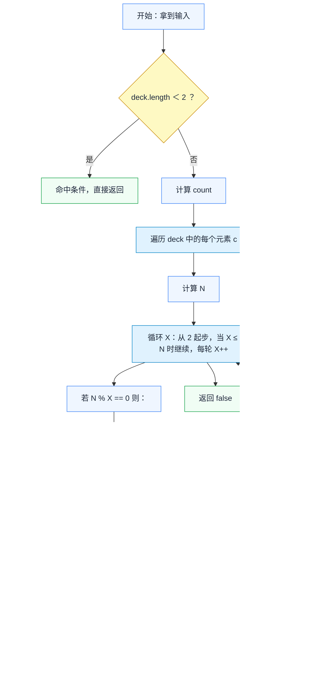
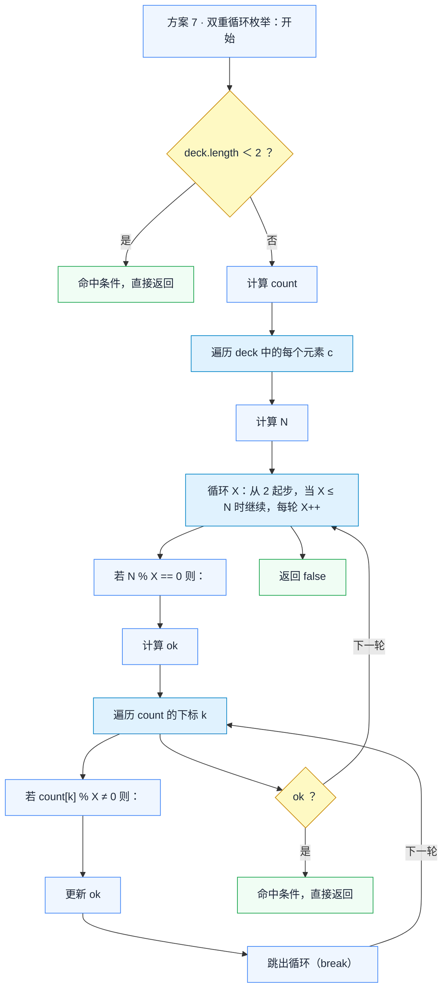
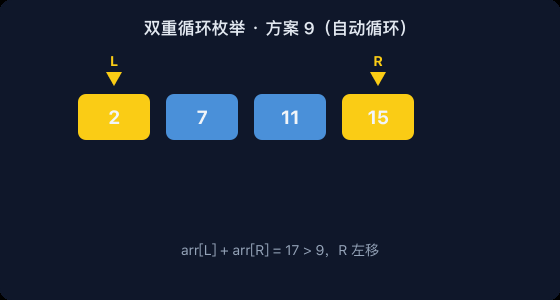
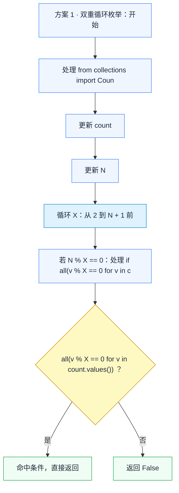
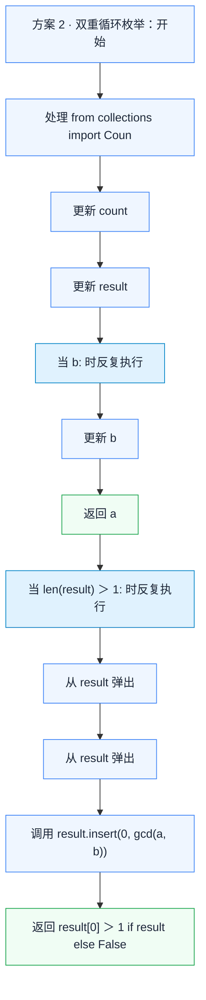
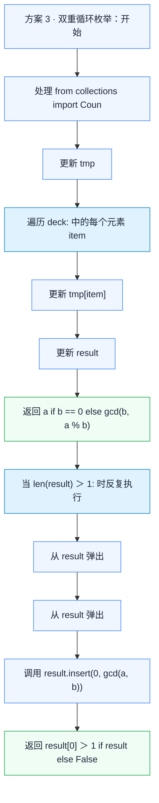
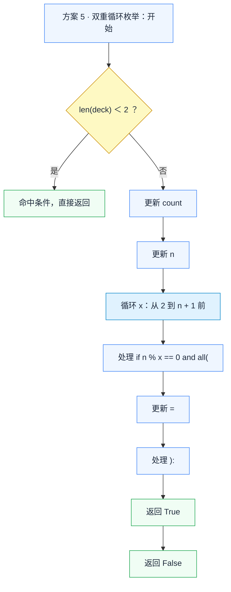
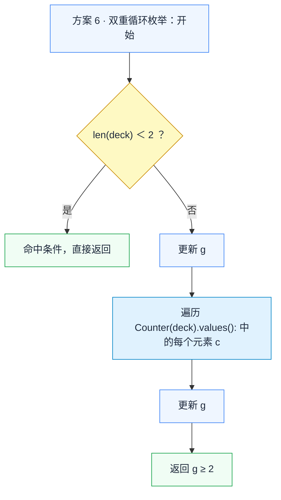
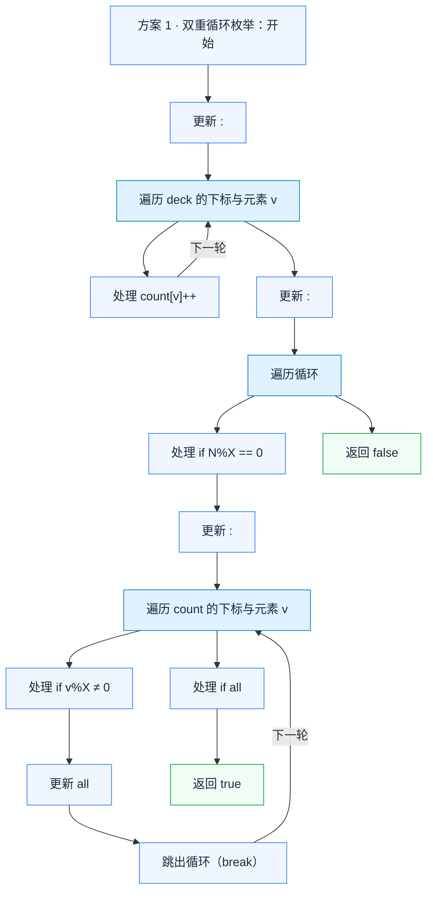

# 052 · 卡牌分组（第一阶段 · 线性结构入门 · Medium）

> **难度**：⭐⭐ Medium ｜ **专题**：数组
> **学习定位**：第一阶段 · 线性结构入门第 52 篇 ｜ **解法数**：9
> **内容总结**：**卡牌分组**（数组 · Medium）：共 9 个方案，主线思路「双重循环枚举」；时间 O(n²)（两层嵌套扫描）；动画演示双指针过程，附录给出 11 种语言 × 全部方案的可运行实现。

---

## 题目描述

给定一副牌，每张牌上都写着一个整数。

此时，你需要选定一个数字 `X`，使我们可以将整副牌按下述规则分成 1 组或更多组：

 每组都有 `X` 张牌。
 组内所有的牌上都写着相同的整数。

仅当你可选的 `X >= 2` 时返回 `true`。

- 主函数签名：`function hasGroupsSizeX(deck: number[]): boolean`

**用例（来自原题）**：

**示例 1**

```text
输入：deck = [1,2,3,4,4,3,2,1]
输出：true
```

解释：可行的分组是 [1,1]，[2,2]，[3,3]，[4,4]

**示例 2**

```text
输入：deck = [1,1,1,2,2,2,3,3]
输出：false
```

解释：没有满足要求的分组。
> ✅ **官方验证**：全部 TypeScript 解法已通过 leetcode.cn 官方示例用例验证（自动注入运行，全部 PASS）。题面与 [leetcode.cn 官方](https://leetcode.cn/problems/x-of-a-kind-in-a-deck-of-cards/)一致，示例配图取自官方题面。

**数据范围与注意事项**：

- `1 <= deck.length <= 10^4`
- `0 <= deck[i] < 10^4`
- **易错点**：边界最容易漏：空数组、只有一个元素、目标出现在头尾。

## 题目分析

**场景是什么**：数组是最常用的线性容器，这类题练的是下标操作与原地腾挪，对应真实开发里的缓冲区、列表整理。本题就是该场景的 Medium 级练习，主线做法是「双重循环枚举」。

**主线怎么解**：把主解法从头到尾过一遍，它其实在依次做这几件事：双重循环遍历。

## 解题思路

**方案对比**（共 9 个方案，由浅入深）：

| 方案 | 时间复杂度 | 空间复杂度 |
|---|---|---|
| 方案 1 · 双重循环枚举 | O(n²)（两层嵌套扫描） | O(1) 到 O(n) |
| 方案 2 · 双重循环枚举 | O(n²)（两层嵌套扫描） | O(1) 到 O(n) |
| 方案 3 · 双重循环枚举 | O(n²)（两层嵌套扫描） | O(1) 到 O(n) |
| 方案 4 · 双重循环枚举 | O(n²)（两层嵌套扫描） | O(1) 到 O(n) |
| 方案 5 · 双重循环枚举 | O(n²)（两层嵌套扫描） | O(1) 到 O(n) |
| 方案 6 · 双重循环枚举 | O(n²)（两层嵌套扫描） | O(1) 到 O(n) |
| 方案 7 · 双重循环枚举 | O(n²)（两层嵌套扫描） | O(1) 到 O(n) |
| 方案 8 · 双重循环枚举 | O(n²)（两层嵌套扫描） | O(1) 到 O(n) |
| 方案 9 · 双重循环枚举 | O(n²)（两层嵌套扫描） | O(1) 到 O(n) |

**方案间的取舍**：方案 1（双重循环枚举）；方案 2（双重循环枚举）；方案 3（双重循环枚举）；方案 4（双重循环枚举）；方案 5（双重循环枚举）；方案 6（双重循环枚举）；方案 7（双重循环枚举）；方案 8（双重循环枚举）；方案 9（双重循环枚举）。数据规模小、可读性优先时选靠前的方案；规模大、性能优先时选靠后的方案。

**怎么读这一篇**：

- 🐣 **新手路线**：把「题目描述」的示例 1 在纸上手推一遍 → 读方案 1（最直观的写法）与它的代码走读 → 按「运行方式」本地跑通看 PASS → 回头对比方案 2 之后的写法差在哪
- 🦅 **大佬路线**：直接锁定最优方案 1（双重循环枚举，O(n²)（两层嵌套扫描））→ 跳读该方案代码与走读 → 用「逐步拆解与面试追问」补齐复杂度推导与边界追问

### 动态算法图（双指针，GIF 自动循环）


动画演示数组专题里双指针的典型过程；每个方案在「TypeScript 解题方案」一节还配了专属动画与专属流程图。

### 主解法流程图（真实控制流）



## TypeScript 解题方案（9 个方案逐个讲）

> **运行与提交**：每个方案都是自包含文件（内嵌用例自测，输出 PASS），整块复制到 `.ts` 文件后 `node 文件名` 即可运行。提交 LeetCode 时，把 `demo` 内的算法函数与辅助类型/函数整体取出、置于文件顶层即可。涉及交互/特殊接口的题以题面给定签名为准。

### 方案 1：双重循环枚举

**分析与思路**：核心做法是「双重循环枚举」。代码里依次做这些事：双重循环遍历。

**运行方式**：`node 本文件`，内嵌用例全部通过会输出 PASS。


**方案专属流程图**（真实控制流）：


```typescript
export function demo(): void {
  // 程序入口：跑内嵌自测用例
  function hasGroupsSizeX(deck: number[]): boolean {
    // 定义函数/方法 hasGroupsSizeX
    if (deck.length < 2) return false; // 若 deck.长度 小于 2，直接返回 false
    const count: Record<number, number> = {}; // 把 {}; 写入 const count:Record<number,number>
    for (const c of deck) count[c] = (count[c] || 0) + 1; // 把 (计数[字符] 或 0) 加 1; 写入 for(const c of deck) count[c]
    const N = deck.length; // 把 deck.长度 存入 N
    for (let X = 2; X <= N; X++) {
      // 让 X 从 2 开始计数，X 不超过 N 就继续
      if (N % X === 0) {
        // 若 N 对…取模 X 全等于 0
        let ok = true; // 把 true 存入 ok
        for (const k in count) {
          if (count[k] % X !== 0) {
            ok = false;
            break;
          }
        }
        if (ok) return true; // 若 ok，直接返回 true
      }
    }
    return false; // 返回 false
  }
  let fail = false; // 把 false 存入 fail
  if (hasGroupsSizeX([1, 1, 1, 2, 2, 2, 3, 3]) !== false) {
    fail = true;
    console.log('FAIL1');
  }
  if (hasGroupsSizeX([1, 2, 3, 4, 4, 3, 2, 1]) !== true) {
    fail = true;
    console.log('FAIL2');
  }
  if (fail) throw new Error('FAILED'); // 若 fail) throw new Error(「FAILED」);
  console.log('PASS'); // 全部用例通过，输出 PASS
}
demo(); // demo();
```

### 方案 2：双重循环枚举

**分析与思路**：核心做法是「双重循环枚举」。代码里依次做这些事：双重循环遍历。

**运行方式**：`node 本文件`，内嵌用例全部通过会输出 PASS。


**方案专属流程图**（真实控制流）：


```typescript
export function demo(): void {
  // 程序入口：跑内嵌自测用例
  function hasGroupsSizeX(deck: number[]): boolean {
    // 定义函数/方法 hasGroupsSizeX
    if (deck.length < 2) return false; // 若 deck.长度 小于 2，直接返回 false
    const count: Record<number, number> = {}; // 把 {}; 写入 const count:Record<number,number>
    for (const c of deck) count[c] = (count[c] || 0) + 1; // 把 (计数[字符] 或 0) 加 1; 写入 for(const c of deck) count[c]
    const N = deck.length; // 把 deck.长度 存入 N
    for (let X = 2; X <= N; X++) {
      // 让 X 从 2 开始计数，X 不超过 N 就继续
      if (N % X === 0) {
        // 若 N 对…取模 X 全等于 0
        let ok = true; // 把 true 存入 ok
        for (const k in count) {
          if (count[k] % X !== 0) {
            ok = false;
            break;
          }
        }
        if (ok) return true; // 若 ok，直接返回 true
      }
    }
    return false; // 返回 false
  }
  let fail = false; // 把 false 存入 fail
  if (hasGroupsSizeX([1, 1, 1, 2, 2, 2, 3, 3]) !== false) {
    fail = true;
    console.log('FAIL1');
  }
  if (hasGroupsSizeX([1, 2, 3, 4, 4, 3, 2, 1]) !== true) {
    fail = true;
    console.log('FAIL2');
  }
  if (fail) throw new Error('FAILED'); // 若 fail) throw new Error(「FAILED」);
  console.log('PASS'); // 全部用例通过，输出 PASS
}
demo(); // demo();
```

### 方案 3：双重循环枚举

**分析与思路**：核心做法是「双重循环枚举」。代码里依次做这些事：双重循环遍历。

**运行方式**：`node 本文件`，内嵌用例全部通过会输出 PASS。


**方案专属流程图**（真实控制流）：


```typescript
export function demo(): void {
  // 程序入口：跑内嵌自测用例
  function hasGroupsSizeX(deck: number[]): boolean {
    // 定义函数/方法 hasGroupsSizeX
    if (deck.length < 2) return false; // 若 deck.长度 小于 2，直接返回 false
    const count: Record<number, number> = {}; // 把 {}; 写入 const count:Record<number,number>
    for (const c of deck) count[c] = (count[c] || 0) + 1; // 把 (计数[字符] 或 0) 加 1; 写入 for(const c of deck) count[c]
    const N = deck.length; // 把 deck.长度 存入 N
    for (let X = 2; X <= N; X++) {
      // 让 X 从 2 开始计数，X 不超过 N 就继续
      if (N % X === 0) {
        // 若 N 对…取模 X 全等于 0
        let ok = true; // 把 true 存入 ok
        for (const k in count) {
          if (count[k] % X !== 0) {
            ok = false;
            break;
          }
        }
        if (ok) return true; // 若 ok，直接返回 true
      }
    }
    return false; // 返回 false
  }
  let fail = false; // 把 false 存入 fail
  if (hasGroupsSizeX([1, 1, 1, 2, 2, 2, 3, 3]) !== false) {
    fail = true;
    console.log('FAIL1');
  }
  if (hasGroupsSizeX([1, 2, 3, 4, 4, 3, 2, 1]) !== true) {
    fail = true;
    console.log('FAIL2');
  }
  if (fail) throw new Error('FAILED'); // 若 fail) throw new Error(「FAILED」);
  console.log('PASS'); // 全部用例通过，输出 PASS
}
demo(); // demo();
```

### 方案 4：双重循环枚举

**分析与思路**：核心做法是「双重循环枚举」。代码里依次做这些事：双重循环遍历。

**运行方式**：`node 本文件`，内嵌用例全部通过会输出 PASS。


**方案专属流程图**（真实控制流）：


```typescript
export function demo(): void {
  // 程序入口：跑内嵌自测用例
  function hasGroupsSizeX(deck: number[]): boolean {
    // 定义函数/方法 hasGroupsSizeX
    if (deck.length < 2) return false; // 若 deck.长度 小于 2，直接返回 false
    const count: Record<number, number> = {}; // 把 {}; 写入 const count:Record<number,number>
    for (const c of deck) count[c] = (count[c] || 0) + 1; // 把 (计数[字符] 或 0) 加 1; 写入 for(const c of deck) count[c]
    const N = deck.length; // 把 deck.长度 存入 N
    for (let X = 2; X <= N; X++) {
      // 让 X 从 2 开始计数，X 不超过 N 就继续
      if (N % X === 0) {
        // 若 N 对…取模 X 全等于 0
        let ok = true; // 把 true 存入 ok
        for (const k in count) {
          if (count[k] % X !== 0) {
            ok = false;
            break;
          }
        }
        if (ok) return true; // 若 ok，直接返回 true
      }
    }
    return false; // 返回 false
  }
  let fail = false; // 把 false 存入 fail
  if (hasGroupsSizeX([1, 1, 1, 2, 2, 2, 3, 3]) !== false) {
    fail = true;
    console.log('FAIL1');
  }
  if (hasGroupsSizeX([1, 2, 3, 4, 4, 3, 2, 1]) !== true) {
    fail = true;
    console.log('FAIL2');
  }
  if (fail) throw new Error('FAILED'); // 若 fail) throw new Error(「FAILED」);
  console.log('PASS'); // 全部用例通过，输出 PASS
}
demo(); // demo();
```

### 方案 5：双重循环枚举

**分析与思路**：核心做法是「双重循环枚举」。代码里依次做这些事：双重循环遍历。

**运行方式**：`node 本文件`，内嵌用例全部通过会输出 PASS。


**方案专属流程图**（真实控制流）：


```typescript
export function demo(): void {
  // 程序入口：跑内嵌自测用例
  function hasGroupsSizeX(deck: number[]): boolean {
    // 定义函数/方法 hasGroupsSizeX
    if (deck.length < 2) return false; // 若 deck.长度 小于 2，直接返回 false
    const count: Record<number, number> = {}; // 把 {}; 写入 const count:Record<number,number>
    for (const c of deck) count[c] = (count[c] || 0) + 1; // 把 (计数[字符] 或 0) 加 1; 写入 for(const c of deck) count[c]
    const N = deck.length; // 把 deck.长度 存入 N
    for (let X = 2; X <= N; X++) {
      // 让 X 从 2 开始计数，X 不超过 N 就继续
      if (N % X === 0) {
        // 若 N 对…取模 X 全等于 0
        let ok = true; // 把 true 存入 ok
        for (const k in count) {
          if (count[k] % X !== 0) {
            ok = false;
            break;
          }
        }
        if (ok) return true; // 若 ok，直接返回 true
      }
    }
    return false; // 返回 false
  }
  let fail = false; // 把 false 存入 fail
  if (hasGroupsSizeX([1, 1, 1, 2, 2, 2, 3, 3]) !== false) {
    fail = true;
    console.log('FAIL1');
  }
  if (hasGroupsSizeX([1, 2, 3, 4, 4, 3, 2, 1]) !== true) {
    fail = true;
    console.log('FAIL2');
  }
  if (fail) throw new Error('FAILED'); // 若 fail) throw new Error(「FAILED」);
  console.log('PASS'); // 全部用例通过，输出 PASS
}
demo(); // demo();
```

### 方案 6：双重循环枚举

**分析与思路**：核心做法是「双重循环枚举」。代码里依次做这些事：双重循环遍历。

**运行方式**：`node 本文件`，内嵌用例全部通过会输出 PASS。


**方案专属流程图**（真实控制流）：


```typescript
export function demo(): void {
  // 程序入口：跑内嵌自测用例
  function hasGroupsSizeX(deck: number[]): boolean {
    // 定义函数/方法 hasGroupsSizeX
    if (deck.length < 2) return false; // 若 deck.长度 小于 2，直接返回 false
    const count: Record<number, number> = {}; // 把 {}; 写入 const count:Record<number,number>
    for (const c of deck) count[c] = (count[c] || 0) + 1; // 把 (计数[字符] 或 0) 加 1; 写入 for(const c of deck) count[c]
    const N = deck.length; // 把 deck.长度 存入 N
    for (let X = 2; X <= N; X++) {
      // 让 X 从 2 开始计数，X 不超过 N 就继续
      if (N % X === 0) {
        // 若 N 对…取模 X 全等于 0
        let ok = true; // 把 true 存入 ok
        for (const k in count) {
          if (count[k] % X !== 0) {
            ok = false;
            break;
          }
        }
        if (ok) return true; // 若 ok，直接返回 true
      }
    }
    return false; // 返回 false
  }
  let fail = false; // 把 false 存入 fail
  if (hasGroupsSizeX([1, 1, 1, 2, 2, 2, 3, 3]) !== false) {
    fail = true;
    console.log('FAIL1');
  }
  if (hasGroupsSizeX([1, 2, 3, 4, 4, 3, 2, 1]) !== true) {
    fail = true;
    console.log('FAIL2');
  }
  if (fail) throw new Error('FAILED'); // 若 fail) throw new Error(「FAILED」);
  console.log('PASS'); // 全部用例通过，输出 PASS
}
demo(); // demo();
```

### 方案 7：双重循环枚举

**分析与思路**：核心做法是「双重循环枚举」。代码里依次做这些事：双重循环遍历。

**运行方式**：`node 本文件`，内嵌用例全部通过会输出 PASS。


**方案专属流程图**（真实控制流）：



```typescript
export function demo(): void {
  // 程序入口：跑内嵌自测用例
  function hasGroupsSizeX(deck: number[]): boolean {
    // 定义函数/方法 hasGroupsSizeX
    if (deck.length < 2) return false; // 若 deck.长度 小于 2，直接返回 false
    const count: Record<number, number> = {}; // 把 {}; 写入 const count:Record<number,number>
    for (const c of deck) count[c] = (count[c] || 0) + 1; // 把 (计数[字符] 或 0) 加 1; 写入 for(const c of deck) count[c]
    const N = deck.length; // 把 deck.长度 存入 N
    for (let X = 2; X <= N; X++) {
      // 让 X 从 2 开始计数，X 不超过 N 就继续
      if (N % X === 0) {
        // 若 N 对…取模 X 全等于 0
        let ok = true; // 把 true 存入 ok
        for (const k in count) {
          if (count[k] % X !== 0) {
            ok = false;
            break;
          }
        }
        if (ok) return true; // 若 ok，直接返回 true
      }
    }
    return false; // 返回 false
  }
  let fail = false; // 把 false 存入 fail
  if (hasGroupsSizeX([1, 1, 1, 2, 2, 2, 3, 3]) !== false) {
    fail = true;
    console.log('FAIL1');
  }
  if (hasGroupsSizeX([1, 2, 3, 4, 4, 3, 2, 1]) !== true) {
    fail = true;
    console.log('FAIL2');
  }
  if (fail) throw new Error('FAILED'); // 若 fail) throw new Error(「FAILED」);
  console.log('PASS'); // 全部用例通过，输出 PASS
}
demo(); // demo();
```

### 方案 8：双重循环枚举

**分析与思路**：核心做法是「双重循环枚举」。代码里依次做这些事：双重循环遍历。

**运行方式**：`node 本文件`，内嵌用例全部通过会输出 PASS。


**方案专属流程图**（真实控制流）：


```typescript
export function demo(): void {
  // 程序入口：跑内嵌自测用例
  function hasGroupsSizeX(deck: number[]): boolean {
    // 定义函数/方法 hasGroupsSizeX
    if (deck.length < 2) return false; // 若 deck.长度 小于 2，直接返回 false
    const count: Record<number, number> = {}; // 把 {}; 写入 const count:Record<number,number>
    for (const c of deck) count[c] = (count[c] || 0) + 1; // 把 (计数[字符] 或 0) 加 1; 写入 for(const c of deck) count[c]
    const N = deck.length; // 把 deck.长度 存入 N
    for (let X = 2; X <= N; X++) {
      // 让 X 从 2 开始计数，X 不超过 N 就继续
      if (N % X === 0) {
        // 若 N 对…取模 X 全等于 0
        let ok = true; // 把 true 存入 ok
        for (const k in count) {
          if (count[k] % X !== 0) {
            ok = false;
            break;
          }
        }
        if (ok) return true; // 若 ok，直接返回 true
      }
    }
    return false; // 返回 false
  }
  let fail = false; // 把 false 存入 fail
  if (hasGroupsSizeX([1, 1, 1, 2, 2, 2, 3, 3]) !== false) {
    fail = true;
    console.log('FAIL1');
  }
  if (hasGroupsSizeX([1, 2, 3, 4, 4, 3, 2, 1]) !== true) {
    fail = true;
    console.log('FAIL2');
  }
  if (fail) throw new Error('FAILED'); // 若 fail) throw new Error(「FAILED」);
  console.log('PASS'); // 全部用例通过，输出 PASS
}
demo(); // demo();
```

### 方案 9：双重循环枚举

**分析与思路**：核心做法是「双重循环枚举」。代码里依次做这些事：双重循环遍历。

**运行方式**：`node 本文件`，内嵌用例全部通过会输出 PASS。



**方案专属流程图**（真实控制流）：


```typescript
export function demo(): void {
  // 程序入口：跑内嵌自测用例
  function hasGroupsSizeX(deck: number[]): boolean {
    // 定义函数/方法 hasGroupsSizeX
    if (deck.length < 2) return false; // 若 deck.长度 小于 2，直接返回 false
    const count: Record<number, number> = {}; // 把 {}; 写入 const count:Record<number,number>
    for (const c of deck) count[c] = (count[c] || 0) + 1; // 把 (计数[字符] 或 0) 加 1; 写入 for(const c of deck) count[c]
    const N = deck.length; // 把 deck.长度 存入 N
    for (let X = 2; X <= N; X++) {
      // 让 X 从 2 开始计数，X 不超过 N 就继续
      if (N % X === 0) {
        // 若 N 对…取模 X 全等于 0
        let ok = true; // 把 true 存入 ok
        for (const k in count) {
          if (count[k] % X !== 0) {
            ok = false;
            break;
          }
        }
        if (ok) return true; // 若 ok，直接返回 true
      }
    }
    return false; // 返回 false
  }
  let fail = false; // 把 false 存入 fail
  if (hasGroupsSizeX([1, 1, 1, 2, 2, 2, 3, 3]) !== false) {
    fail = true;
    console.log('FAIL1');
  }
  if (hasGroupsSizeX([1, 2, 3, 4, 4, 3, 2, 1]) !== true) {
    fail = true;
    console.log('FAIL2');
  }
  if (fail) throw new Error('FAILED'); // 若 fail) throw new Error(「FAILED」);
  console.log('PASS'); // 全部用例通过，输出 PASS
}
demo(); // demo();
```

## 逐步拆解与面试追问

**复杂度**：时间 O(n²)（两层嵌套扫描），空间 O(1) 到 O(n)

**为什么是这个量级**：外层定起点、内层扫终点，n 个起点各扫 n 次

**面试官可能会追问**：

- 能不能原地做（O(1) 空间）？
- 如果数组已有序，能优化到什么程度？
- 空数组、单元素怎么处理？

## 关键 API 速查（TS 主解法实际用到，附官方链接）

本题主解法只用到基础语法（变量、循环、比较），不依赖特殊库 API。

### 各语言官方文档导航

- **TypeScript / JS**：[MDN 中文参考](https://developer.mozilla.org/zh-CN/)
- **Python**：[Python 官方文档](https://docs.python.org/zh-cn/3/)
- **Go**：[Go 标准库](https://pkg.go.dev/std)
- **Java**：[JDK 17 API](https://docs.oracle.com/en/java/javase/17/docs/api/)
- **Rust**：[Rust 标准库](https://doc.rust-lang.org/std/)
- **Lua**：[Lua 5.4 手册](https://www.lua.org/manual/5.4/)
- **C**：[Cppreference C](https://zh.cppreference.com/w/c)
- **C++**：[Cppreference C++](https://zh.cppreference.com/w/cpp)
- **R**：[R 官方手册](https://stat.ethz.ch/R-manual/)
- **Zig**：[Zig 语言文档](https://ziglang.org/documentation/master/)
- **Dart**：[Dart API](https://api.dart.dev/)

## 附录：其他 10 种语言全部实现（每种语言列举其全部方案）

> TypeScript 的全部方案见「TypeScript 解题方案」一节；下面是其余 10 种语言的对应实现，每种语言的每个方案都带思路分析、代码走读与专属运行架构图。
> 每个方案都内嵌用例自测，可独立运行（老仓库 python/go 文件遵循「打印结果」约定）。
> 完整解法文件见 `dsa/<语言>/array/lc_914_卡牌分组/`。

### Python 实现（9 种方案）

Python 的全部方案如下，每个方案都内嵌用例自测，可独立运行（老仓库 python/go 文件遵循「打印结果」约定）：

#### 方案 1：双重循环枚举

**思路与代码分析**：核心是「双重循环枚举」。Python 版用切片与字典推导式简化操作，突出可读性。**走读**：方案 1 · 双重循环枚举：开始 → 处理 from collections import Coun → 更新 count → 更新 N → 循环 X：从 2 到 N + 1 前 → 若 N % X == 0：处理 if all(v % X == 0 for v in c → 命中条件，直接返回 → 返回 False。

**运行架构**（真实控制流）：



```python
import sys  # 提高递归深度上限（深输入防 RecursionError）

sys.setrecursionlimit(200000)  # 树/链表类题目节点数可达 1e4 量级

def hasGroupsSizeX(deck):  # 定义函数 hasGroupsSizeX（参数：deck）
    from collections import Counter  # from collections import Counter

    count = Counter(deck)  # 把 Counter(deck) 存入 计数
    N = len(deck)  # 把 长度(deck) 存入 N
    for X in range(2, N + 1):  # 让 X 从 2 到 N 加 1 遍历
        if N % X == 0:  # 若 N 对…取模 X 等于 0
            if all(v % X == 0 for v in count.values()):  # 若 all(值 对…取模 X 等于 0 for 值 in 计数.values(
                return True  # 返回 True
    return False  # 返回 False

if __name__ == "__main__":  # 若 __name__ 等于 '__main__'
    print(hasGroupsSizeX([1, 1, 1, 2, 2, 2, 3, 3]))  # 打印输出
    print(hasGroupsSizeX([1, 2, 3, 4, 4, 3, 2, 1]))  # 打印输出
```

#### 方案 2：双重循环枚举

**思路与代码分析**：核心是「双重循环枚举」。Python 版用切片与字典推导式简化操作，突出可读性。**走读**：方案 2 · 双重循环枚举：开始 → 处理 from collections import Coun → 更新 count → 更新 result → 当 b: 时反复执行 → 更新 b → 返回 a → 当 len(result) ＞ 1: 时反复执行 → 从 result 弹出 → 从 result 弹出 → 调用 result.insert(0, gcd(a, b)) → 返回 result[0] ＞ 1 if result else False。

**运行架构**（真实控制流）：



```python
import sys  # 提高递归深度上限（深输入防 RecursionError）

sys.setrecursionlimit(200000)  # 树/链表类题目节点数可达 1e4 量级

def hasGroupsSizeX(deck):  # 定义函数 hasGroupsSizeX（参数：deck）
    from collections import Counter  # from collections import Counter

    count = Counter(deck)  # 把 Counter(deck) 存入 计数
    result = list(set(count.values()))  # 把 列表(set(计数.values())) 存入 结果

    def gcd(a, b):  # 定义函数 gcd（参数：数组, b）
        while b:  # 循环，直到不满足「b」
            a, b = b, a % b  # 把 b, 数组 对…取模 b 写入 a, b
        return a  # 返回 数组

    while len(result) > 1:  # 循环，直到不满足「长度(结果) 超过 1」
        a = result.pop(0)  # 把 结果 弹出 0) 存入 数组
        b = result.pop(0)  # 把 结果 弹出 0) 存入 b
        result.insert(0, gcd(a, b))  # 结果 插入 0, gcd(数组, b))
    return result[0] > 1 if result else False  # 返回 结果[0] 超过 1 if 结果 else False

if __name__ == "__main__":  # 若 __name__ 等于 '__main__'
    print(hasGroupsSizeX(None))  # 打印输出
```

#### 方案 3：双重循环枚举

**思路与代码分析**：核心是「双重循环枚举」。Python 版用切片与字典推导式简化操作，突出可读性。**走读**：方案 3 · 双重循环枚举：开始 → 处理 from collections import Coun → 更新 tmp → 遍历 deck: 中的每个元素 item → 更新 tmp[item] → 更新 result → 返回 a if b == 0 else gcd(b, a % b) → 当 len(result) ＞ 1: 时反复执行 → 从 result 弹出 → 从 result 弹出 → 调用 result.insert(0, gcd(a, b)) → 返回 result[0] ＞ 1 if result else False。

**运行架构**（真实控制流）：



```python
import sys  # 提高递归深度上限（深输入防 RecursionError）

sys.setrecursionlimit(200000)  # 树/链表类题目节点数可达 1e4 量级

def hasGroupsSizeX(deck):  # 定义函数 hasGroupsSizeX（参数：deck）
    from collections import Counter  # from collections import Counter

    tmp = {}  # 把 {} 存入 临时变量
    for item in deck:  # 逐个取出 deck 的元素（item）
        tmp[item] = tmp.get(item, 0) + 1  # 把 临时变量 查找 item, 0) 加 1 写入 tmp[item]
    result = list(set(tmp.values()))  # 把 列表(set(临时变量.values())) 存入 结果

    def gcd(a, b):  # 定义函数 gcd（参数：数组, b）
        return a if b == 0 else gcd(b, a % b)  # 返回 数组 if b 等于 0 else gcd(b, 数组 对…取模 b)

    while len(result) > 1:  # 循环，直到不满足「长度(结果) 超过 1」
        a = result.pop(0)  # 把 结果 弹出 0) 存入 数组
        b = result.pop(0)  # 把 结果 弹出 0) 存入 b
        result.insert(0, gcd(a, b))  # 结果 插入 0, gcd(数组, b))
    return result[0] > 1 if result else False  # 返回 结果[0] 超过 1 if 结果 else False

if __name__ == "__main__":  # 若 __name__ 等于 '__main__'
    print(hasGroupsSizeX([1, 1, 1, 2, 2, 2, 3, 3]))  # 打印输出
    print(hasGroupsSizeX([1, 2, 3, 4, 4, 3, 2, 1]))  # 打印输出
```

#### 方案 4：双重循环枚举

**思路与代码分析**：核心是「双重循环枚举」。Python 版用切片与字典推导式简化操作，突出可读性。**走读**：方案 4 · 双重循环枚举：开始 → 命中条件，直接返回 → 更新 g → 遍历 Counter(deck).values(): 中的每个元素 c → 更新 g → 返回 g ≥ 2。

**运行架构**（真实控制流）：


```python
import sys  # 提高递归深度上限（深输入防 RecursionError）

sys.setrecursionlimit(200000)  # 树/链表类题目节点数可达 1e4 量级
import math  # 引入依赖
from collections import Counter  # from collections import Counter

def hasGroupsSizeX(deck):  # 定义函数 hasGroupsSizeX（参数：deck）
    if len(deck) < 2:  # 若 长度(deck) 小于 2
        return False  # 返回 False
    g = 0  # 把 0 存入 g
    for c in Counter(deck).values():  # 逐个取出 Counter 的元素（字符）
        g = math.gcd(g, c)  # 把 math.gcd(g, 字符) 存入 g
    return g >= 2  # 返回 g 不低于 2

if __name__ == "__main__":  # 若 __name__ 等于 '__main__'
    print(hasGroupsSizeX([1, 2, 3, 4, 4, 3, 2, 1]))  # 打印输出
```

#### 方案 5：双重循环枚举

**思路与代码分析**：核心是「双重循环枚举」。Python 版用切片与字典推导式简化操作，突出可读性。**走读**：方案 5 · 双重循环枚举：开始 → 命中条件，直接返回 → 更新 count → 更新 n → 循环 x：从 2 到 n + 1 前 → 处理 if n % x == 0 and all( → 更新 = → 处理 ): → 返回 True → 返回 False。

**运行架构**（真实控制流）：



```python
import sys  # 提高递归深度上限（深输入防 RecursionError）

sys.setrecursionlimit(200000)  # 树/链表类题目节点数可达 1e4 量级
from collections import Counter  # from collections import Counter

def hasGroupsSizeX(deck):  # 定义函数 hasGroupsSizeX（参数：deck）
    if len(deck) < 2:  # 若 长度(deck) 小于 2
        return False  # 返回 False
    count = Counter(deck)  # 把 Counter(deck) 存入 计数
    n = len(deck)  # 把 长度(deck) 存入 元素个数
    for x in range(2, n + 1):  # 让 x 从 2 到 元素个数 加 1 遍历
        if n % x == 0 and all(
            v % x == 0 for v in count.values()
        ):  # 若 元素个数 对…取模 x 等于 0 and all(值 对…取模 x 等于 0 for 值 in 计数.values(
            return True  # 返回 True
    return False  # 返回 False

if __name__ == "__main__":  # 若 __name__ 等于 '__main__'
    print(hasGroupsSizeX([1, 1, 2, 2, 2, 2]))  # 打印输出
```

#### 方案 6：双重循环枚举

**思路与代码分析**：核心是「双重循环枚举」。Python 版用切片与字典推导式简化操作，突出可读性。**走读**：方案 6 · 双重循环枚举：开始 → 命中条件，直接返回 → 更新 g → 遍历 Counter(deck).values(): 中的每个元素 c → 更新 g → 返回 g ≥ 2。

**运行架构**（真实控制流）：



```python
import sys  # 提高递归深度上限（深输入防 RecursionError）

sys.setrecursionlimit(200000)  # 树/链表类题目节点数可达 1e4 量级
import math  # 引入依赖
from collections import Counter  # from collections import Counter

def hasGroupsSizeX(deck):  # 定义函数 hasGroupsSizeX（参数：deck）
    if len(deck) < 2:  # 若 长度(deck) 小于 2
        return False  # 返回 False
    g = 0  # 把 0 存入 g
    for c in Counter(deck).values():  # 逐个取出 Counter 的元素（字符）
        g = math.gcd(g, c)  # 把 math.gcd(g, 字符) 存入 g
    return g >= 2  # 返回 g 不低于 2

if __name__ == "__main__":  # 若 __name__ 等于 '__main__'
    print(hasGroupsSizeX([1, 2, 3, 4, 4, 3, 2, 1]))  # 打印输出
```

#### 方案 7：双重循环枚举

**思路与代码分析**：核心是「双重循环枚举」。Python 版用切片与字典推导式简化操作，突出可读性。**走读**：方案 7 · 双重循环枚举：开始 → 命中条件，直接返回 → 更新 g → 遍历 Counter(deck).values(): 中的每个元素 c → 更新 g → 返回 g ≥ 2。

**运行架构**（真实控制流）：


```python
import sys  # 提高递归深度上限（深输入防 RecursionError）

sys.setrecursionlimit(200000)  # 树/链表类题目节点数可达 1e4 量级
import math  # 引入依赖
from collections import Counter  # from collections import Counter

def hasGroupsSizeX(deck):  # 定义函数 hasGroupsSizeX（参数：deck）
    if len(deck) < 2:  # 若 长度(deck) 小于 2
        return False  # 返回 False
    g = 0  # 把 0 存入 g
    for c in Counter(deck).values():  # 逐个取出 Counter 的元素（字符）
        g = math.gcd(g, c)  # 把 math.gcd(g, 字符) 存入 g
    return g >= 2  # 返回 g 不低于 2

if __name__ == "__main__":  # 若 __name__ 等于 '__main__'
    print(hasGroupsSizeX([1, 1, 1, 2, 2, 2, 3, 3]))  # 打印输出
```

#### 方案 8：双重循环枚举

**思路与代码分析**：核心是「双重循环枚举」。Python 版用切片与字典推导式简化操作，突出可读性。**走读**：方案 8 · 双重循环枚举：开始 → 命中条件，直接返回 → 更新 g → 遍历 Counter(deck).values(): 中的每个元素 c → 更新 g → 返回 g ≥ 2。

**运行架构**（真实控制流）：


```python
import sys  # 提高递归深度上限（深输入防 RecursionError）

sys.setrecursionlimit(200000)  # 树/链表类题目节点数可达 1e4 量级
import math  # 引入依赖
from collections import Counter  # from collections import Counter

def hasGroupsSizeX(deck):  # 定义函数 hasGroupsSizeX（参数：deck）
    if len(deck) < 2:  # 若 长度(deck) 小于 2
        return False  # 返回 False
    g = 0  # 把 0 存入 g
    for c in Counter(deck).values():  # 逐个取出 Counter 的元素（字符）
        g = math.gcd(g, c)  # 把 math.gcd(g, 字符) 存入 g
    return g >= 2  # 返回 g 不低于 2

if __name__ == "__main__":  # 若 __name__ 等于 '__main__'
    print(hasGroupsSizeX([1, 1, 2, 2, 2, 2]))  # 打印输出
```

#### 方案 9：双重循环枚举

**思路与代码分析**：核心是「双重循环枚举」。Python 版用切片与字典推导式简化操作，突出可读性。**走读**：方案 9 · 双重循环枚举：开始 → 命中条件，直接返回 → 更新 g → 遍历 Counter(deck).values(): 中的每个元素 c → 更新 g → 返回 g ≥ 2。

**运行架构**（真实控制流）：


```python
import sys  # 提高递归深度上限（深输入防 RecursionError）

sys.setrecursionlimit(200000)  # 树/链表类题目节点数可达 1e4 量级
import math  # 引入依赖
from collections import Counter  # from collections import Counter

def hasGroupsSizeX(deck):  # 定义函数 hasGroupsSizeX（参数：deck）
    if len(deck) < 2:  # 若 长度(deck) 小于 2
        return False  # 返回 False
    g = 0  # 把 0 存入 g
    for c in Counter(deck).values():  # 逐个取出 Counter 的元素（字符）
        g = math.gcd(g, c)  # 把 math.gcd(g, 字符) 存入 g
    return g >= 2  # 返回 g 不低于 2

if __name__ == "__main__":  # 若 __name__ 等于 '__main__'
    print(hasGroupsSizeX([1, 2, 3, 4, 4, 3, 2, 1]))  # 打印输出
```

### Go 实现（9 种方案）

Go 的全部方案如下，每个方案都内嵌用例自测，可独立运行（老仓库 python/go 文件遵循「打印结果」约定）：

#### 方案 1：双重循环枚举

**思路与代码分析**：核心是「双重循环枚举」。Go 版用切片与多返回值惯用法，显式处理索引边界。代码里依次做这些事：哈希结构做计数或查重。**走读**：方案 1 · 双重循环枚举：开始 → 更新 : → 遍历 deck 的下标与元素 v → 处理 count[v]++ → 更新 : → 遍历循环 → 处理 if N%X == 0 → 更新 : → 遍历 count 的下标与元素 v → 处理 if v%X ≠ 0 → 更新 all → 跳出循环（break） → 处理 if all → 返回 true → 返回 false。

**运行架构**（真实控制流）：



```go
package main // 引入依赖

import (
	"fmt"     // 「fmt」
	"os"      // 「os」
	"reflect" // 「reflect」
)

func hasGroupsSizeX(deck []int) bool { // 定义函数/方法 hasGroupsSizeX
	count := map[int]int{}   // 把 映射表[int]int{} 写入 count :
	for _, v := range deck { // 同时取 _ 与 值 遍历
		count[v]++ // 计数[值] 加一
	}
	N := len(deck)            // 把 长度(deck) 写入 N :
	for X := 2; X <= N; X++ { // 让 X 从 2 开始计数
		if N%X == 0 { // 若 N 对…取模 X 等于 0
			all := true               // 把 true 写入 all :
			for _, v := range count { // 同时取 _ 与 值 遍历
				if v%X != 0 { // 若 值 对…取模 X 不等于 0
					all = false // 把 false 写入 all
					break       // 跳出循环
				}
			}
			if all { // 若 all
				return true // 返回 true
			}
		}
	}
	return false // 返回 false
}

func main() { // 程序入口：跑内嵌自测用例
	type tc struct { // 定义类型
		in   []int // in []int
		want bool  // want bool
	}
	cases := []tc{ // 把 []tc{ 写入 cases :
		{[]int{1, 1, 1, 2, 2, 2, 3, 3}, false},
		{[]int{1, 2, 3, 4, 4, 3, 2, 1}, true},
		{[]int{1, 1}, true},
		{[]int{1}, false},
	}
	ok := true                // 把 true 写入 ok :
	for _, c := range cases { // 同时取 _ 与 字符 遍历
		if got := hasGroupsSizeX(c.in); !reflect.DeepEqual(got, c.want) {
			ok = false                                                            // 把 false 写入 ok
			fmt.Printf("FAIL hasGroupsSizeX(%v)=%v want %v\n", c.in, got, c.want) // 打印输出
		}
	}
	if !ok { // 若 取反 ok
		os.Exit(1) // os.Exit(1)
	}
	fmt.Println("PASS") // 全部用例通过，输出 PASS
}
```

#### 方案 2：双重循环枚举

**思路与代码分析**：核心是「双重循环枚举」。Go 版用切片与多返回值惯用法，显式处理索引边界。代码里依次做这些事：哈希结构做计数或查重。**走读**：方案 2 · 双重循环枚举：开始 → 更新 : → 遍历 deck 的下标与元素 v → 遍历 count 的下标与元素 v → 遍历循环 → 返回 false → 返回 vals[0] ＞ 1。

**运行架构**（真实控制流）：

```mermaid
graph TD
    N0["方案 2 · 双重循环枚举：开始"]
    N1["更新 :"]
    N2["遍历 deck 的下标与元素 v"]
    D1["……（中间计算步骤）"]
    N6["遍历 count 的下标与元素 v"]
    D2["……（中间计算步骤）"]
    N11["遍历循环"]
    D3["……（中间计算步骤）"]
    N17["返回 false"]
    N18["返回 vals[0] ＞ 1"]
    N0 --> N1
    N1 --> N2
    N17 --> N18
    N2 --> D1
    D1 --> N6
    N6 --> D2
    D2 --> N11
    N11 --> D3
    D3 --> N17
    classDef n fill:#eff6ff,stroke:#3b82f6,color:#1e293b;
    classDef lp fill:#e0f2fe,stroke:#0284c7,color:#1e293b;
    classDef dc fill:#fef9c3,stroke:#ca8a04,color:#1e293b;
    classDef tm fill:#f0fdf4,stroke:#16a34a,color:#1e293b;
    class N0,N1,D1,D2,D3 n;
    class N2,N6,N11 lp;
    class N17,N18 tm;
```

```go
package main // 引入依赖

import (
	"fmt"     // 「fmt」
	"os"      // 「os」
	"reflect" // 「reflect」
	"sort"    // 「sort」
)

func gcd(a, b int) int { // 定义函数/方法 gcd
	for b != 0 { // 把 0 { 写入 for b !
		a, b = b, a%b // 把 b, 数组 对…取模 b 写入 a, b
	}
	return a // 返回 数组
}

func hasGroupsSizeX(deck []int) bool { // 定义函数/方法 hasGroupsSizeX
	count := map[int]int{}   // 把 映射表[int]int{} 写入 count :
	for _, v := range deck { // 同时取 _ 与 值 遍历
		count[v]++ // 计数[值] 加一
	}
	vals := []int{}           // 把 []int{} 写入 vals :
	seen := map[int]bool{}    // 把 映射表[int]bool{} 写入 seen :
	for _, v := range count { // 同时取 _ 与 值 遍历
		if !seen[v] { // 若 取反 已见集合[值]
			seen[v] = true         // 把 true 写入 seen[v]
			vals = append(vals, v) // 把 append(vals, 值) 写入 vals
		}
	}
	sort.Ints(vals)     // sort.Ints(vals)
	for len(vals) > 1 { // for 长度(vals) 超过 1 {
		a := vals[0]                             // 把 vals[0] 写入 a :
		b := vals[1]                             // 把 vals[1] 写入 b :
		vals = vals[2:]                          // 把 vals[2:] 写入 vals
		vals = append([]int{gcd(a, b)}, vals...) // 把 append([]int{gcd(数组, b)}, vals...) 写入 vals
	}
	if len(vals) == 0 { // 若 长度(vals) 等于 0
		return false // 返回 false
	}
	return vals[0] > 1 // 返回 vals[0] 超过 1
}

func main() { // 程序入口：跑内嵌自测用例
	type tc struct { // 定义类型
		in   []int // in []int
		want bool  // want bool
	}
	cases := []tc{ // 把 []tc{ 写入 cases :
		{[]int{1, 1, 1, 2, 2, 2, 3, 3}, false},
		{[]int{1, 2, 3, 4, 4, 3, 2, 1}, true},
		{[]int{1, 1}, true},
		{[]int{1}, false},
	}
	ok := true                // 把 true 写入 ok :
	for _, c := range cases { // 同时取 _ 与 字符 遍历
		if got := hasGroupsSizeX(c.in); !reflect.DeepEqual(got, c.want) {
			ok = false                                                            // 把 false 写入 ok
			fmt.Printf("FAIL hasGroupsSizeX(%v)=%v want %v\n", c.in, got, c.want) // 打印输出
		}
	}
	if !ok { // 若 取反 ok
		os.Exit(1) // os.Exit(1)
	}
	fmt.Println("PASS") // 全部用例通过，输出 PASS
}
```

#### 方案 3：双重循环枚举

**思路与代码分析**：核心是「双重循环枚举」。Go 版用切片与多返回值惯用法，显式处理索引边界。代码里依次做这些事：哈希结构做计数或查重。**走读**：方案 3 · 双重循环枚举：开始 → 更新 : → 遍历 deck 的下标与元素 item → 遍历 tmp 的下标与元素 v → 返回 a → 返回 gcd(b, a%b) → 遍历循环 → 返回 false → 返回 vals[0] ＞ 1。

**运行架构**（真实控制流）：

```mermaid
graph TD
    N0["方案 3 · 双重循环枚举：开始"]
    N1["更新 :"]
    N2["遍历 deck 的下标与元素 item"]
    D1["……（中间计算步骤）"]
    N6["遍历 tmp 的下标与元素 v"]
    D2["……（中间计算步骤）"]
    N14["返回 a"]
    N15["返回 gcd(b, a%b)"]
    N16["遍历循环"]
    D3["……（中间计算步骤）"]
    N22["返回 false"]
    N23["返回 vals[0] ＞ 1"]
    N0 --> N1
    N1 --> N2
    N14 --> N15
    N15 --> N16
    N22 --> N23
    N2 --> D1
    D1 --> N6
    N6 --> D2
    D2 --> N14
    N16 --> D3
    D3 --> N22
    classDef n fill:#eff6ff,stroke:#3b82f6,color:#1e293b;
    classDef lp fill:#e0f2fe,stroke:#0284c7,color:#1e293b;
    classDef dc fill:#fef9c3,stroke:#ca8a04,color:#1e293b;
    classDef tm fill:#f0fdf4,stroke:#16a34a,color:#1e293b;
    class N0,N1,D1,D2,D3 n;
    class N2,N6,N16 lp;
    class N14,N15,N22,N23 tm;
```

```go
package main // 引入依赖

import (
	"fmt"     // 「fmt」
	"os"      // 「os」
	"reflect" // 「reflect」
	"sort"    // 「sort」
)

func hasGroupsSizeX(deck []int) bool { // 定义函数/方法 hasGroupsSizeX
	tmp := map[int]int{}        // 把 映射表[int]int{} 写入 tmp :
	for _, item := range deck { // 同时取 _ 与 item 遍历
		tmp[item]++ // 临时变量[item] 加一
	}
	vals := []int{}         // 把 []int{} 写入 vals :
	seen := map[int]bool{}  // 把 映射表[int]bool{} 写入 seen :
	for _, v := range tmp { // 同时取 _ 与 值 遍历
		if !seen[v] { // 若 取反 已见集合[值]
			seen[v] = true         // 把 true 写入 seen[v]
			vals = append(vals, v) // 把 append(vals, 值) 写入 vals
		}
	}
	sort.Ints(vals)            // sort.Ints(vals)
	var gcd func(a, b int) int // var gcd func(数组, b int) int
	gcd = func(a, b int) int { // 把 func(数组, b int) int { 写入 gcd
		if b == 0 { // 若 b 等于 0
			return a // 返回 数组
		}
		return gcd(b, a%b) // 定义函数/方法 gcd
	}
	for len(vals) > 1 { // for 长度(vals) 超过 1 {
		a := vals[0]                             // 把 vals[0] 写入 a :
		b := vals[1]                             // 把 vals[1] 写入 b :
		vals = vals[2:]                          // 把 vals[2:] 写入 vals
		vals = append([]int{gcd(a, b)}, vals...) // 把 append([]int{gcd(数组, b)}, vals...) 写入 vals
	}
	if len(vals) == 0 { // 若 长度(vals) 等于 0
		return false // 返回 false
	}
	return vals[0] > 1 // 返回 vals[0] 超过 1
}

func main() { // 程序入口：跑内嵌自测用例
	type tc struct { // 定义类型
		in   []int // in []int
		want bool  // want bool
	}
	cases := []tc{ // 把 []tc{ 写入 cases :
		{[]int{1, 1, 1, 2, 2, 2, 3, 3}, false},
		{[]int{1, 2, 3, 4, 4, 3, 2, 1}, true},
		{[]int{1, 1}, true},
		{[]int{1}, false},
	}
	ok := true                // 把 true 写入 ok :
	for _, c := range cases { // 同时取 _ 与 字符 遍历
		if got := hasGroupsSizeX(c.in); !reflect.DeepEqual(got, c.want) {
			ok = false                                                            // 把 false 写入 ok
			fmt.Printf("FAIL hasGroupsSizeX(%v)=%v want %v\n", c.in, got, c.want) // 打印输出
		}
	}
	if !ok { // 若 取反 ok
		os.Exit(1) // os.Exit(1)
	}
	fmt.Println("PASS") // 全部用例通过，输出 PASS
}
```

#### 方案 4：双重循环枚举

**思路与代码分析**：核心是「双重循环枚举」。Go 版用切片与多返回值惯用法，显式处理索引边界。代码里依次做这些事：哈希结构做计数或查重。**走读**：方案 4 · 双重循环枚举：开始 → 处理 if len(deck) ＜ 2 → 返回 false → 更新 : → 遍历 deck 的下标与元素 c → 处理 count[c]++ → 更新 : → 遍历 count 的下标与元素 c → 更新 g → 返回 g ≥ 2。

**运行架构**（真实控制流）：

```mermaid
graph TD
    N0["方案 4 · 双重循环枚举：开始"]
    N1["处理 if len(deck) ＜ 2"]
    N2["返回 false"]
    N3["更新 :"]
    N4["遍历 deck 的下标与元素 c"]
    N5["处理 count[c]++"]
    N6["更新 :"]
    N7["遍历 count 的下标与元素 c"]
    N8["更新 g"]
    N9["返回 g ≥ 2"]
    N0 --> N1
    N1 --> N2
    N2 --> N3
    N3 --> N4
    N4 --> N5
    N5 -- 下一轮 --> N4
    N4 --> N6
    N6 --> N7
    N7 --> N8
    N8 -- 下一轮 --> N7
    N7 --> N9
    classDef n fill:#eff6ff,stroke:#3b82f6,color:#1e293b;
    classDef lp fill:#e0f2fe,stroke:#0284c7,color:#1e293b;
    classDef dc fill:#fef9c3,stroke:#ca8a04,color:#1e293b;
    classDef tm fill:#f0fdf4,stroke:#16a34a,color:#1e293b;
    class N0,N1,N3,N5,N6,N8 n;
    class N4,N7 lp;
    class N2,N9 tm;
```

```go
package main // 引入依赖

import (
	"fmt"     // 「fmt」
	"os"      // 「os」
	"reflect" // 「reflect」
)

func gcd(a, b int) int { // 定义函数/方法 gcd
	for b != 0 { // 把 0 { 写入 for b !
		a, b = b, a%b // 把 b, 数组 对…取模 b 写入 a, b
	}
	return a // 返回 数组
}

func hasGroupsSizeX(deck []int) bool { // 定义函数/方法 hasGroupsSizeX
	if len(deck) < 2 { // 若 长度(deck) 小于 2
		return false // 返回 false
	}
	count := map[int]int{}   // 把 映射表[int]int{} 写入 count :
	for _, c := range deck { // 同时取 _ 与 字符 遍历
		count[c]++ // 计数[字符] 加一
	}
	g := 0                    // 把 0 写入 g :
	for _, c := range count { // 同时取 _ 与 字符 遍历
		g = gcd(g, c) // 把 gcd(g, 字符) 写入 g
	}
	return g >= 2 // 返回 g 不低于 2
}

func main() { // 程序入口：跑内嵌自测用例
	type tc struct { // 定义类型
		in   []int // in []int
		want bool  // want bool
	}
	cases := []tc{ // 把 []tc{ 写入 cases :
		{[]int{1, 2, 3, 4, 4, 3, 2, 1}, true},
		{[]int{1, 1, 1, 2, 2, 2, 3, 3}, false},
		{[]int{1, 1}, true},
	}
	ok := true                // 把 true 写入 ok :
	for _, c := range cases { // 同时取 _ 与 字符 遍历
		if got := hasGroupsSizeX(c.in); !reflect.DeepEqual(got, c.want) {
			ok = false                                                            // 把 false 写入 ok
			fmt.Printf("FAIL hasGroupsSizeX(%v)=%v want %v\n", c.in, got, c.want) // 打印输出
		}
	}
	if !ok { // 若 取反 ok
		os.Exit(1) // os.Exit(1)
	}
	fmt.Println("PASS") // 全部用例通过，输出 PASS
}
```

#### 方案 5：双重循环枚举

**思路与代码分析**：核心是「双重循环枚举」。Go 版用切片与多返回值惯用法，显式处理索引边界。代码里依次做这些事：哈希结构做计数或查重。**走读**：方案 5 · 双重循环枚举：开始 → 处理 if len(deck) ＜ 2 → 返回 false → 遍历 deck 的下标与元素 v → 遍历循环 → 遍历 count 的下标与元素 v → 返回 true → 返回 false。

**运行架构**（真实控制流）：

```mermaid
graph TD
    N0["方案 5 · 双重循环枚举：开始"]
    N1["处理 if len(deck) ＜ 2"]
    N2["返回 false"]
    D1["……（中间计算步骤）"]
    N4["遍历 deck 的下标与元素 v"]
    D2["……（中间计算步骤）"]
    N7["遍历循环"]
    D3["……（中间计算步骤）"]
    N10["遍历 count 的下标与元素 v"]
    D4["……（中间计算步骤）"]
    N15["返回 true"]
    N16["返回 false"]
    N0 --> N1
    N1 --> N2
    N7 --> N16
    N2 --> D1
    D1 --> N4
    N4 --> D2
    D2 --> N7
    N7 --> D3
    D3 --> N10
    N10 --> D4
    D4 --> N15
    N15 --> N16
    classDef n fill:#eff6ff,stroke:#3b82f6,color:#1e293b;
    classDef lp fill:#e0f2fe,stroke:#0284c7,color:#1e293b;
    classDef dc fill:#fef9c3,stroke:#ca8a04,color:#1e293b;
    classDef tm fill:#f0fdf4,stroke:#16a34a,color:#1e293b;
    class N0,N1,D1,D2,D3,D4 n;
    class N4,N7,N10 lp;
    class N2,N15,N16 tm;
```

```go
package main // 引入依赖

import (
	"fmt"     // 「fmt」
	"os"      // 「os」
	"reflect" // 「reflect」
)

func hasGroupsSizeX(deck []int) bool { // 定义函数/方法 hasGroupsSizeX
	if len(deck) < 2 { // 若 长度(deck) 小于 2
		return false // 返回 false
	}
	count := map[int]int{}   // 把 映射表[int]int{} 写入 count :
	for _, v := range deck { // 同时取 _ 与 值 遍历
		count[v]++ // 计数[值] 加一
	}
	n := len(deck)            // 把 长度(deck) 写入 n :
	for x := 2; x <= n; x++ { // 让 x 从 2 开始计数
		if n%x == 0 { // 若 元素个数 对…取模 x 等于 0
			all := true               // 把 true 写入 all :
			for _, v := range count { // 同时取 _ 与 值 遍历
				if v%x != 0 { // 若 值 对…取模 x 不等于 0
					all = false // 把 false 写入 all
					break       // 跳出循环
				}
			}
			if all { // 若 all
				return true // 返回 true
			}
		}
	}
	return false // 返回 false
}

func main() { // 程序入口：跑内嵌自测用例
	type tc struct { // 定义类型
		in   []int // in []int
		want bool  // want bool
	}
	cases := []tc{ // 把 []tc{ 写入 cases :
		{[]int{1, 1, 2, 2, 2, 2}, true},
		{[]int{1, 2, 3, 4, 4, 3, 2, 1}, true},
		{[]int{1, 1, 1, 2, 2, 2, 3, 3}, false},
	}
	ok := true                // 把 true 写入 ok :
	for _, c := range cases { // 同时取 _ 与 字符 遍历
		if got := hasGroupsSizeX(c.in); !reflect.DeepEqual(got, c.want) {
			ok = false                                                            // 把 false 写入 ok
			fmt.Printf("FAIL hasGroupsSizeX(%v)=%v want %v\n", c.in, got, c.want) // 打印输出
		}
	}
	if !ok { // 若 取反 ok
		os.Exit(1) // os.Exit(1)
	}
	fmt.Println("PASS") // 全部用例通过，输出 PASS
}
```

#### 方案 6：双重循环枚举

**思路与代码分析**：核心是「双重循环枚举」。Go 版用切片与多返回值惯用法，显式处理索引边界。代码里依次做这些事：哈希结构做计数或查重。**走读**：方案 6 · 双重循环枚举：开始 → 处理 if len(deck) ＜ 2 → 返回 false → 更新 : → 遍历 deck 的下标与元素 c → 处理 count[c]++ → 更新 : → 遍历 count 的下标与元素 c → 更新 g → 返回 g ≥ 2。

**运行架构**（真实控制流）：

```mermaid
graph TD
    N0["方案 6 · 双重循环枚举：开始"]
    N1["处理 if len(deck) ＜ 2"]
    N2["返回 false"]
    N3["更新 :"]
    N4["遍历 deck 的下标与元素 c"]
    N5["处理 count[c]++"]
    N6["更新 :"]
    N7["遍历 count 的下标与元素 c"]
    N8["更新 g"]
    N9["返回 g ≥ 2"]
    N0 --> N1
    N1 --> N2
    N2 --> N3
    N3 --> N4
    N4 --> N5
    N5 -- 下一轮 --> N4
    N4 --> N6
    N6 --> N7
    N7 --> N8
    N8 -- 下一轮 --> N7
    N7 --> N9
    classDef n fill:#eff6ff,stroke:#3b82f6,color:#1e293b;
    classDef lp fill:#e0f2fe,stroke:#0284c7,color:#1e293b;
    classDef dc fill:#fef9c3,stroke:#ca8a04,color:#1e293b;
    classDef tm fill:#f0fdf4,stroke:#16a34a,color:#1e293b;
    class N0,N1,N3,N5,N6,N8 n;
    class N4,N7 lp;
    class N2,N9 tm;
```

```go
package main // 引入依赖

import (
	"fmt"     // 「fmt」
	"os"      // 「os」
	"reflect" // 「reflect」
)

func gcd(a, b int) int { // 定义函数/方法 gcd
	for b != 0 { // 把 0 { 写入 for b !
		a, b = b, a%b // 把 b, 数组 对…取模 b 写入 a, b
	}
	return a // 返回 数组
}

func hasGroupsSizeX(deck []int) bool { // 定义函数/方法 hasGroupsSizeX
	if len(deck) < 2 { // 若 长度(deck) 小于 2
		return false // 返回 false
	}
	count := map[int]int{}   // 把 映射表[int]int{} 写入 count :
	for _, c := range deck { // 同时取 _ 与 字符 遍历
		count[c]++ // 计数[字符] 加一
	}
	g := 0                    // 把 0 写入 g :
	for _, c := range count { // 同时取 _ 与 字符 遍历
		g = gcd(g, c) // 把 gcd(g, 字符) 写入 g
	}
	return g >= 2 // 返回 g 不低于 2
}

func main() { // 程序入口：跑内嵌自测用例
	type tc struct { // 定义类型
		in   []int // in []int
		want bool  // want bool
	}
	cases := []tc{ // 把 []tc{ 写入 cases :
		{[]int{1, 2, 3, 4, 4, 3, 2, 1}, true},
		{[]int{1, 1, 1, 2, 2, 2, 3, 3}, false},
		{[]int{1, 1}, true},
	}
	ok := true                // 把 true 写入 ok :
	for _, c := range cases { // 同时取 _ 与 字符 遍历
		if got := hasGroupsSizeX(c.in); !reflect.DeepEqual(got, c.want) {
			ok = false                                                            // 把 false 写入 ok
			fmt.Printf("FAIL hasGroupsSizeX(%v)=%v want %v\n", c.in, got, c.want) // 打印输出
		}
	}
	if !ok { // 若 取反 ok
		os.Exit(1) // os.Exit(1)
	}
	fmt.Println("PASS") // 全部用例通过，输出 PASS
}
```

#### 方案 7：双重循环枚举

**思路与代码分析**：核心是「双重循环枚举」。Go 版用切片与多返回值惯用法，显式处理索引边界。代码里依次做这些事：哈希结构做计数或查重。**走读**：方案 7 · 双重循环枚举：开始 → 处理 if len(deck) ＜ 2 → 返回 false → 更新 : → 遍历 deck 的下标与元素 c → 处理 count[c]++ → 更新 : → 遍历 count 的下标与元素 c → 更新 g → 返回 g ≥ 2。

**运行架构**（真实控制流）：

```mermaid
graph TD
    N0["方案 7 · 双重循环枚举：开始"]
    N1["处理 if len(deck) ＜ 2"]
    N2["返回 false"]
    N3["更新 :"]
    N4["遍历 deck 的下标与元素 c"]
    N5["处理 count[c]++"]
    N6["更新 :"]
    N7["遍历 count 的下标与元素 c"]
    N8["更新 g"]
    N9["返回 g ≥ 2"]
    N0 --> N1
    N1 --> N2
    N2 --> N3
    N3 --> N4
    N4 --> N5
    N5 -- 下一轮 --> N4
    N4 --> N6
    N6 --> N7
    N7 --> N8
    N8 -- 下一轮 --> N7
    N7 --> N9
    classDef n fill:#eff6ff,stroke:#3b82f6,color:#1e293b;
    classDef lp fill:#e0f2fe,stroke:#0284c7,color:#1e293b;
    classDef dc fill:#fef9c3,stroke:#ca8a04,color:#1e293b;
    classDef tm fill:#f0fdf4,stroke:#16a34a,color:#1e293b;
    class N0,N1,N3,N5,N6,N8 n;
    class N4,N7 lp;
    class N2,N9 tm;
```

```go
package main // 引入依赖

import (
	"fmt"     // 「fmt」
	"os"      // 「os」
	"reflect" // 「reflect」
)

func gcd(a, b int) int { // 定义函数/方法 gcd
	for b != 0 { // 把 0 { 写入 for b !
		a, b = b, a%b // 把 b, 数组 对…取模 b 写入 a, b
	}
	return a // 返回 数组
}

func hasGroupsSizeX(deck []int) bool { // 定义函数/方法 hasGroupsSizeX
	if len(deck) < 2 { // 若 长度(deck) 小于 2
		return false // 返回 false
	}
	count := map[int]int{}   // 把 映射表[int]int{} 写入 count :
	for _, c := range deck { // 同时取 _ 与 字符 遍历
		count[c]++ // 计数[字符] 加一
	}
	g := 0                    // 把 0 写入 g :
	for _, c := range count { // 同时取 _ 与 字符 遍历
		g = gcd(g, c) // 把 gcd(g, 字符) 写入 g
	}
	return g >= 2 // 返回 g 不低于 2
}

func main() { // 程序入口：跑内嵌自测用例
	type tc struct { // 定义类型
		in   []int // in []int
		want bool  // want bool
	}
	cases := []tc{ // 把 []tc{ 写入 cases :
		{[]int{1, 1, 1, 2, 2, 2, 3, 3}, false},
		{[]int{1, 2, 3, 4, 4, 3, 2, 1}, true},
		{[]int{1, 1}, true},
	}
	ok := true                // 把 true 写入 ok :
	for _, c := range cases { // 同时取 _ 与 字符 遍历
		if got := hasGroupsSizeX(c.in); !reflect.DeepEqual(got, c.want) {
			ok = false                                                            // 把 false 写入 ok
			fmt.Printf("FAIL hasGroupsSizeX(%v)=%v want %v\n", c.in, got, c.want) // 打印输出
		}
	}
	if !ok { // 若 取反 ok
		os.Exit(1) // os.Exit(1)
	}
	fmt.Println("PASS") // 全部用例通过，输出 PASS
}
```

#### 方案 8：双重循环枚举

**思路与代码分析**：核心是「双重循环枚举」。Go 版用切片与多返回值惯用法，显式处理索引边界。代码里依次做这些事：哈希结构做计数或查重。**走读**：方案 8 · 双重循环枚举：开始 → 处理 if len(deck) ＜ 2 → 返回 false → 更新 : → 遍历 deck 的下标与元素 c → 处理 count[c]++ → 更新 : → 遍历 count 的下标与元素 c → 更新 g → 返回 g ≥ 2。

**运行架构**（真实控制流）：

```mermaid
graph TD
    N0["方案 8 · 双重循环枚举：开始"]
    N1["处理 if len(deck) ＜ 2"]
    N2["返回 false"]
    N3["更新 :"]
    N4["遍历 deck 的下标与元素 c"]
    N5["处理 count[c]++"]
    N6["更新 :"]
    N7["遍历 count 的下标与元素 c"]
    N8["更新 g"]
    N9["返回 g ≥ 2"]
    N0 --> N1
    N1 --> N2
    N2 --> N3
    N3 --> N4
    N4 --> N5
    N5 -- 下一轮 --> N4
    N4 --> N6
    N6 --> N7
    N7 --> N8
    N8 -- 下一轮 --> N7
    N7 --> N9
    classDef n fill:#eff6ff,stroke:#3b82f6,color:#1e293b;
    classDef lp fill:#e0f2fe,stroke:#0284c7,color:#1e293b;
    classDef dc fill:#fef9c3,stroke:#ca8a04,color:#1e293b;
    classDef tm fill:#f0fdf4,stroke:#16a34a,color:#1e293b;
    class N0,N1,N3,N5,N6,N8 n;
    class N4,N7 lp;
    class N2,N9 tm;
```

```go
package main // 引入依赖

import (
	"fmt"     // 「fmt」
	"os"      // 「os」
	"reflect" // 「reflect」
)

func gcd(a, b int) int { // 定义函数/方法 gcd
	for b != 0 { // 把 0 { 写入 for b !
		a, b = b, a%b // 把 b, 数组 对…取模 b 写入 a, b
	}
	return a // 返回 数组
}

func hasGroupsSizeX(deck []int) bool { // 定义函数/方法 hasGroupsSizeX
	if len(deck) < 2 { // 若 长度(deck) 小于 2
		return false // 返回 false
	}
	count := map[int]int{}   // 把 映射表[int]int{} 写入 count :
	for _, c := range deck { // 同时取 _ 与 字符 遍历
		count[c]++ // 计数[字符] 加一
	}
	g := 0                    // 把 0 写入 g :
	for _, c := range count { // 同时取 _ 与 字符 遍历
		g = gcd(g, c) // 把 gcd(g, 字符) 写入 g
	}
	return g >= 2 // 返回 g 不低于 2
}

func main() { // 程序入口：跑内嵌自测用例
	type tc struct { // 定义类型
		in   []int // in []int
		want bool  // want bool
	}
	cases := []tc{ // 把 []tc{ 写入 cases :
		{[]int{1, 1, 2, 2, 2, 2}, true},
		{[]int{1, 2, 3, 4, 4, 3, 2, 1}, true},
		{[]int{1, 1, 1, 2, 2, 2, 3, 3}, false},
	}
	ok := true                // 把 true 写入 ok :
	for _, c := range cases { // 同时取 _ 与 字符 遍历
		if got := hasGroupsSizeX(c.in); !reflect.DeepEqual(got, c.want) {
			ok = false                                                            // 把 false 写入 ok
			fmt.Printf("FAIL hasGroupsSizeX(%v)=%v want %v\n", c.in, got, c.want) // 打印输出
		}
	}
	if !ok { // 若 取反 ok
		os.Exit(1) // os.Exit(1)
	}
	fmt.Println("PASS") // 全部用例通过，输出 PASS
}
```

#### 方案 9：双重循环枚举

**思路与代码分析**：核心是「双重循环枚举」。Go 版用切片与多返回值惯用法，显式处理索引边界。代码里依次做这些事：哈希结构做计数或查重。**走读**：方案 9 · 双重循环枚举：开始 → 处理 if len(deck) ＜ 2 → 返回 false → 更新 : → 遍历 deck 的下标与元素 c → 处理 count[c]++ → 更新 : → 遍历 count 的下标与元素 c → 更新 g → 返回 g ≥ 2。

**运行架构**（真实控制流）：

```mermaid
graph TD
    N0["方案 9 · 双重循环枚举：开始"]
    N1["处理 if len(deck) ＜ 2"]
    N2["返回 false"]
    N3["更新 :"]
    N4["遍历 deck 的下标与元素 c"]
    N5["处理 count[c]++"]
    N6["更新 :"]
    N7["遍历 count 的下标与元素 c"]
    N8["更新 g"]
    N9["返回 g ≥ 2"]
    N0 --> N1
    N1 --> N2
    N2 --> N3
    N3 --> N4
    N4 --> N5
    N5 -- 下一轮 --> N4
    N4 --> N6
    N6 --> N7
    N7 --> N8
    N8 -- 下一轮 --> N7
    N7 --> N9
    classDef n fill:#eff6ff,stroke:#3b82f6,color:#1e293b;
    classDef lp fill:#e0f2fe,stroke:#0284c7,color:#1e293b;
    classDef dc fill:#fef9c3,stroke:#ca8a04,color:#1e293b;
    classDef tm fill:#f0fdf4,stroke:#16a34a,color:#1e293b;
    class N0,N1,N3,N5,N6,N8 n;
    class N4,N7 lp;
    class N2,N9 tm;
```

```go
package main // 引入依赖

import (
	"fmt"     // 「fmt」
	"os"      // 「os」
	"reflect" // 「reflect」
)

func gcd(a, b int) int { // 定义函数/方法 gcd
	for b != 0 { // 把 0 { 写入 for b !
		a, b = b, a%b // 把 b, 数组 对…取模 b 写入 a, b
	}
	return a // 返回 数组
}

func hasGroupsSizeX(deck []int) bool { // 定义函数/方法 hasGroupsSizeX
	if len(deck) < 2 { // 若 长度(deck) 小于 2
		return false // 返回 false
	}
	count := map[int]int{}   // 把 映射表[int]int{} 写入 count :
	for _, c := range deck { // 同时取 _ 与 字符 遍历
		count[c]++ // 计数[字符] 加一
	}
	g := 0                    // 把 0 写入 g :
	for _, c := range count { // 同时取 _ 与 字符 遍历
		g = gcd(g, c) // 把 gcd(g, 字符) 写入 g
	}
	return g >= 2 // 返回 g 不低于 2
}

func main() { // 程序入口：跑内嵌自测用例
	type tc struct { // 定义类型
		in   []int // in []int
		want bool  // want bool
	}
	cases := []tc{ // 把 []tc{ 写入 cases :
		{[]int{1, 2, 3, 4, 4, 3, 2, 1}, true},
		{[]int{1, 1, 1, 2, 2, 2, 3, 3}, false},
		{[]int{1, 1}, true},
	}
	ok := true                // 把 true 写入 ok :
	for _, c := range cases { // 同时取 _ 与 字符 遍历
		if got := hasGroupsSizeX(c.in); !reflect.DeepEqual(got, c.want) {
			ok = false                                                            // 把 false 写入 ok
			fmt.Printf("FAIL hasGroupsSizeX(%v)=%v want %v\n", c.in, got, c.want) // 打印输出
		}
	}
	if !ok { // 若 取反 ok
		os.Exit(1) // os.Exit(1)
	}
	fmt.Println("PASS") // 全部用例通过，输出 PASS
}
```

### Java 实现（9 种方案）

Java 的全部方案如下，每个方案都内嵌用例自测，可独立运行（老仓库 python/go 文件遵循「打印结果」约定）：

#### 方案 1：双重循环枚举

**思路与代码分析**：核心是「双重循环枚举」。Java 版用类与静态方法组织，集合操作显式明了。代码里依次做这些事：哈希结构做计数或查重；双重循环遍历。**走读**：方案 1 · 双重循环枚举：开始 → 更新 count → 遍历循环 → 遍历循环 → 遍历循环 → 命中条件，直接返回 → 返回 false。

**运行架构**（真实控制流）：

```mermaid
graph TD
    N0["方案 1 · 双重循环枚举：开始"]
    N1["更新 count"]
    N2["遍历循环"]
    D1["……（中间计算步骤）"]
    N8["遍历循环"]
    D2["……（中间计算步骤）"]
    N11["遍历循环"]
    D3["……（中间计算步骤）"]
    N15{"ok ？"}
    N16["命中条件，直接返回"]
    N17["返回 false"]
    N0 --> N1
    N1 --> N2
    N15 -- 是 --> N16
    N15 -- 下一轮 --> N8
    N8 --> N17
    N2 --> D1
    D1 --> N8
    N8 --> D2
    D2 --> N11
    N11 --> D3
    D3 --> N15
    N16 --> N17
    classDef n fill:#eff6ff,stroke:#3b82f6,color:#1e293b;
    classDef lp fill:#e0f2fe,stroke:#0284c7,color:#1e293b;
    classDef dc fill:#fef9c3,stroke:#ca8a04,color:#1e293b;
    classDef tm fill:#f0fdf4,stroke:#16a34a,color:#1e293b;
    class N0,N1,D1,D2,D3 n;
    class N2,N8,N11 lp;
    class N15 dc;
    class N16,N17 tm;
```

```java
package com.webfault.dsa; // 引入依赖

class Lc914 { // 定义类型
  static int gcd(int a, int b) {
    return b == 0 ? a : gcd(b, a % b);
  }

  static boolean hasGroupsSizeX(int[] deck) { // 定义函数/方法 hasGroupsSizeX
    java.util.Map<Integer, Integer> count = new java.util.HashMap<>();
    for (int c : deck)
      count.put(
          c,
          count.getOrDefault(c, 0)
              + 1); // for (int 字符 : deck) 计数.put(字符, 计数.getOrDefault(字符, 0) 加 1);
    int n = deck.length; // 把 deck.长度 存入 元素个数
    for (int x = 2; x <= n; x++) { // 让 x 从 2 开始计数，x 不超过 元素个数 就继续
      if (n % x == 0) { // 若 元素个数 对…取模 x 等于 0
        boolean ok = true; // 把 true; 写入 boolean ok
        for (int v : count.values())
          if (v % x != 0) {
            ok = false;
            break;
          }
        if (ok) return true; // 若 ok，直接返回 true
      }
    }
    return false; // 返回 false
  }

  public static void main(String[] args) { // public static void main(String[] args) {
    java.util.List<Object[]> cases = new java.util.ArrayList<>();
    cases.add(
        new Object[] {
          new int[] {1, 1, 1, 2, 2, 2, 3, 3}, false
        }); // cases 追加 new Object[]{ new int[]{1,1,1,2,2,2,3,3}, false });
    cases.add(
        new Object[] {
          new int[] {1, 2, 3, 4, 4, 3, 2, 1}, true
        }); // cases 追加 new Object[]{ new int[]{1,2,3,4,4,3,2,1}, true });
    boolean ok = true; // 把 true; 写入 boolean ok
    for (Object[] c : cases) { // for (Object[] 字符 : cases) {
      int[] deck = (int[]) c[0]; // 把 (int[]) 字符[0]; 写入 int[] deck
      boolean want = (boolean) c[1]; // 把 (boolean) 字符[1]; 写入 boolean want
      boolean got = hasGroupsSizeX(deck); // 把 hasGroupsSizeX(deck); 写入 boolean got
      if (got != want) {
        ok = false;
        System.out.println(
            "FAIL hasGroupsSizeX("
                + java.util.Arrays.toString(deck)
                + ")="
                + got
                + " want "
                + want);
      }
    }
    if (!ok) throw new RuntimeException("FAILED"); // 若 取反 ok) throw new RuntimeException(「FAILED」);
    System.out.println("PASS"); // 全部用例通过，输出 PASS
  }
}
```

#### 方案 2：双重循环枚举

**思路与代码分析**：核心是「双重循环枚举」。Java 版用类与静态方法组织，集合操作显式明了。代码里依次做这些事：哈希结构做计数或查重；单循环线性扫描。**走读**：方案 2 · 双重循环枚举：开始 → 命中条件，直接返回 → 更新 tmp → 遍历循环 → 更新 result → 处理 new java.util.ArrayList＜＞(ne → 当 (result.size() ＞ 1) 时反复执行 → 更新 a → 更新 b → 调用 result.add(0, gcd(a, b)) → 命中条件，直接返回 → 返回 result.get(0) ＞ 1。

**运行架构**（真实控制流）：

```mermaid
graph TD
    N0["方案 2 · 双重循环枚举：开始"]
    N1{"deck == null ？"}
    N2["命中条件，直接返回"]
    N3["更新 tmp"]
    N4["遍历循环"]
    N5["更新 result"]
    N6["处理 new java.util.ArrayList＜＞(ne"]
    N7["当 (result.size() ＞ 1) 时反复执行"]
    N8["更新 a"]
    N9["更新 b"]
    N10["调用 result.add(0, gcd(a, b))"]
    N11{"result.isEmpty() ？"}
    N12["命中条件，直接返回"]
    N13["返回 result.get(0) ＞ 1"]
    N0 --> N1
    N1 -- 是 --> N2
    N1 -- 否 --> N3
    N3 --> N4
    N4 --> N5
    N5 --> N6
    N6 --> N7
    N7 --> N8
    N8 --> N9
    N9 --> N10
    N10 -- 下一轮 --> N7
    N7 --> N11
    N11 -- 是 --> N12
    N11 -- 否 --> N13
    classDef n fill:#eff6ff,stroke:#3b82f6,color:#1e293b;
    classDef lp fill:#e0f2fe,stroke:#0284c7,color:#1e293b;
    classDef dc fill:#fef9c3,stroke:#ca8a04,color:#1e293b;
    classDef tm fill:#f0fdf4,stroke:#16a34a,color:#1e293b;
    class N0,N3,N5,N6,N8,N9,N10 n;
    class N4,N7 lp;
    class N1,N11 dc;
    class N2,N12,N13 tm;
```

```java
package com.webfault.dsa; // 引入依赖

class Lc914 { // 定义类型
  static int gcd(int a, int b) {
    return b == 0 ? a : gcd(b, a % b);
  }

  static boolean hasGroupsSizeX(int[] deck) { // 定义函数/方法 hasGroupsSizeX
    if (deck == null) return false; // 若 deck 等于 null，直接返回 false
    java.util.Map<Integer, Integer> tmp = new java.util.HashMap<>();
    for (int item : deck) tmp.put(item, tmp.getOrDefault(item, 0) + 1);
    java.util.List<Integer> result =
        new java.util.ArrayList<>(new java.util.HashSet<>(tmp.values()));
    while (result.size() > 1) { // 循环，直到不满足「结果.大小() 超过 1」
      int a = result.remove(0); // 把 结果 弹出 0) 存入 数组
      int b = result.remove(0); // 把 结果 弹出 0) 存入 b
      result.add(0, gcd(a, b)); // 结果 追加 0, gcd(数组, b));
    }
    if (result.isEmpty()) return false; // 若 结果.isEmpty()，直接返回 false
    return result.get(0) > 1; // 返回 结果 查找 0) 超过 1
  }

  public static void main(String[] args) { // public static void main(String[] args) {
    java.util.List<Object[]> cases = new java.util.ArrayList<>();
    cases.add(new Object[] {null, false}); // cases 追加 new Object[]{ null, false });
    cases.add(
        new Object[] {
          new int[] {1, 1, 1, 2, 2, 2, 3, 3}, false
        }); // cases 追加 new Object[]{ new int[]{1,1,1,2,2,2,3,3}, false });
    cases.add(
        new Object[] {
          new int[] {1, 2, 3, 4, 4, 3, 2, 1}, true
        }); // cases 追加 new Object[]{ new int[]{1,2,3,4,4,3,2,1}, true });
    boolean ok = true; // 把 true; 写入 boolean ok
    for (Object[] c : cases) { // for (Object[] 字符 : cases) {
      int[] deck = (int[]) c[0]; // 把 (int[]) 字符[0]; 写入 int[] deck
      boolean want = (boolean) c[1]; // 把 (boolean) 字符[1]; 写入 boolean want
      boolean got = hasGroupsSizeX(deck); // 把 hasGroupsSizeX(deck); 写入 boolean got
      if (got != want) {
        ok = false;
        System.out.println(
            "FAIL hasGroupsSizeX("
                + java.util.Arrays.toString(deck)
                + ")="
                + got
                + " want "
                + want);
      }
    }
    if (!ok) throw new RuntimeException("FAILED"); // 若 取反 ok) throw new RuntimeException(「FAILED」);
    System.out.println("PASS"); // 全部用例通过，输出 PASS
  }
}
```

#### 方案 3：双重循环枚举

**思路与代码分析**：核心是「双重循环枚举」。Java 版用类与静态方法组织，集合操作显式明了。代码里依次做这些事：哈希结构做计数或查重；单循环线性扫描。**走读**：方案 3 · 双重循环枚举：开始 → 更新 tmp → 遍历循环 → 更新 result → 处理 new java.util.ArrayList＜＞(ne → 当 (result.size() ＞ 1) 时反复执行 → 更新 a → 更新 b → 调用 result.add(0, gcd(a, b)) → 命中条件，直接返回 → 返回 result.get(0) ＞ 1。

**运行架构**（真实控制流）：

```mermaid
graph TD
    N0["方案 3 · 双重循环枚举：开始"]
    N1["更新 tmp"]
    N2["遍历循环"]
    N3["更新 result"]
    N4["处理 new java.util.ArrayList＜＞(ne"]
    N5["当 (result.size() ＞ 1) 时反复执行"]
    N6["更新 a"]
    N7["更新 b"]
    N8["调用 result.add(0, gcd(a, b))"]
    N9{"result.isEmpty() ？"}
    N10["命中条件，直接返回"]
    N11["返回 result.get(0) ＞ 1"]
    N0 --> N1
    N1 --> N2
    N2 --> N3
    N3 --> N4
    N4 --> N5
    N5 --> N6
    N6 --> N7
    N7 --> N8
    N8 -- 下一轮 --> N5
    N5 --> N9
    N9 -- 是 --> N10
    N9 -- 否 --> N11
    classDef n fill:#eff6ff,stroke:#3b82f6,color:#1e293b;
    classDef lp fill:#e0f2fe,stroke:#0284c7,color:#1e293b;
    classDef dc fill:#fef9c3,stroke:#ca8a04,color:#1e293b;
    classDef tm fill:#f0fdf4,stroke:#16a34a,color:#1e293b;
    class N0,N1,N3,N4,N6,N7,N8 n;
    class N2,N5 lp;
    class N9 dc;
    class N10,N11 tm;
```

```java
package com.webfault.dsa; // 引入依赖

class Lc914 { // 定义类型
  static int gcd(int a, int b) {
    return b == 0 ? a : gcd(b, a % b);
  }

  static boolean hasGroupsSizeX(int[] deck) { // 定义函数/方法 hasGroupsSizeX
    java.util.Map<Integer, Integer> tmp = new java.util.HashMap<>();
    for (int item : deck) tmp.put(item, tmp.getOrDefault(item, 0) + 1);
    java.util.List<Integer> result =
        new java.util.ArrayList<>(new java.util.HashSet<>(tmp.values()));
    while (result.size() > 1) { // 循环，直到不满足「结果.大小() 超过 1」
      int a = result.remove(0); // 把 结果 弹出 0) 存入 数组
      int b = result.remove(0); // 把 结果 弹出 0) 存入 b
      result.add(0, gcd(a, b)); // 结果 追加 0, gcd(数组, b));
    }
    if (result.isEmpty()) return false; // 若 结果.isEmpty()，直接返回 false
    return result.get(0) > 1; // 返回 结果 查找 0) 超过 1
  }

  public static void main(String[] args) { // public static void main(String[] args) {
    java.util.List<Object[]> cases = new java.util.ArrayList<>();
    cases.add(
        new Object[] {
          new int[] {1, 1, 1, 2, 2, 2, 3, 3}, false
        }); // cases 追加 new Object[]{ new int[]{1,1,1,2,2,2,3,3}, false });
    cases.add(
        new Object[] {
          new int[] {1, 2, 3, 4, 4, 3, 2, 1}, true
        }); // cases 追加 new Object[]{ new int[]{1,2,3,4,4,3,2,1}, true });
    boolean ok = true; // 把 true; 写入 boolean ok
    for (Object[] c : cases) { // for (Object[] 字符 : cases) {
      int[] deck = (int[]) c[0]; // 把 (int[]) 字符[0]; 写入 int[] deck
      boolean want = (boolean) c[1]; // 把 (boolean) 字符[1]; 写入 boolean want
      boolean got = hasGroupsSizeX(deck); // 把 hasGroupsSizeX(deck); 写入 boolean got
      if (got != want) {
        ok = false;
        System.out.println(
            "FAIL hasGroupsSizeX("
                + java.util.Arrays.toString(deck)
                + ")="
                + got
                + " want "
                + want);
      }
    }
    if (!ok) throw new RuntimeException("FAILED"); // 若 取反 ok) throw new RuntimeException(「FAILED」);
    System.out.println("PASS"); // 全部用例通过，输出 PASS
  }
}
```

#### 方案 4：双重循环枚举

**思路与代码分析**：核心是「双重循环枚举」。Java 版用类与静态方法组织，集合操作显式明了。代码里依次做这些事：哈希结构做计数或查重；双重循环遍历。**走读**：方案 4 · 双重循环枚举：开始 → 更新 g → 更新 count → 遍历循环 → 调用 count.put( → 处理 c, → 调用 count.getOrDefault(c, 0) → 处理 + 1) → 遍历循环 → 返回 g ≥ 2。

**运行架构**（真实控制流）：

```mermaid
graph TD
    N0["方案 4 · 双重循环枚举：开始"]
    N1["更新 g"]
    N2["更新 count"]
    N3["遍历循环"]
    N4["调用 count.put("]
    N5["处理 c,"]
    N6["调用 count.getOrDefault(c, 0)"]
    N7["处理 + 1)"]
    N8["遍历循环"]
    N9["返回 g ≥ 2"]
    N0 --> N1
    N1 --> N2
    N2 --> N3
    N3 --> N4
    N4 --> N5
    N5 --> N6
    N6 --> N7
    N7 --> N8
    N8 --> N9
    classDef n fill:#eff6ff,stroke:#3b82f6,color:#1e293b;
    classDef lp fill:#e0f2fe,stroke:#0284c7,color:#1e293b;
    classDef dc fill:#fef9c3,stroke:#ca8a04,color:#1e293b;
    classDef tm fill:#f0fdf4,stroke:#16a34a,color:#1e293b;
    class N0,N1,N2,N4,N5,N6,N7 n;
    class N3,N8 lp;
    class N9 tm;
```

```java
package com.webfault.dsa; // 引入依赖

class Lc914 { // 定义类型
  static int gcd(int a, int b) {
    return b == 0 ? a : gcd(b, a % b);
  }

  static boolean hasGroupsSizeX(int[] deck) { // 定义函数/方法 hasGroupsSizeX
    int g = 0; // 把 0 存入 g
    java.util.Map<Integer, Integer> count = new java.util.HashMap<>();
    for (int c : deck)
      count.put(
          c,
          count.getOrDefault(c, 0)
              + 1); // for (int 字符 : deck) 计数.put(字符, 计数.getOrDefault(字符, 0) 加 1);
    for (int c : count.values()) g = gcd(g, c); // 把 gcd(g, 字符); 写入 for (int c : count.values()) g
    return g >= 2; // 返回 g 不低于 2
  }

  public static void main(String[] args) { // public static void main(String[] args) {
    java.util.List<Object[]> cases = new java.util.ArrayList<>();
    cases.add(
        new Object[] {
          new int[] {1, 2, 3, 4, 4, 3, 2, 1}, true
        }); // cases 追加 new Object[]{ new int[]{1,2,3,4,4,3,2,1}, true });
    cases.add(
        new Object[] {
          new int[] {1, 1, 1, 2, 2, 2, 3, 3}, false
        }); // cases 追加 new Object[]{ new int[]{1,1,1,2,2,2,3,3}, false });
    boolean ok = true; // 把 true; 写入 boolean ok
    for (Object[] c : cases) { // for (Object[] 字符 : cases) {
      int[] deck = (int[]) c[0]; // 把 (int[]) 字符[0]; 写入 int[] deck
      boolean want = (boolean) c[1]; // 把 (boolean) 字符[1]; 写入 boolean want
      boolean got = hasGroupsSizeX(deck); // 把 hasGroupsSizeX(deck); 写入 boolean got
      if (got != want) {
        ok = false;
        System.out.println(
            "FAIL hasGroupsSizeX("
                + java.util.Arrays.toString(deck)
                + ")="
                + got
                + " want "
                + want);
      }
    }
    if (!ok) throw new RuntimeException("FAILED"); // 若 取反 ok) throw new RuntimeException(「FAILED」);
    System.out.println("PASS"); // 全部用例通过，输出 PASS
  }
}
```

#### 方案 5：双重循环枚举

**思路与代码分析**：核心是「双重循环枚举」。Java 版用类与静态方法组织，集合操作显式明了。代码里依次做这些事：哈希结构做计数或查重；双重循环遍历。**走读**：方案 5 · 双重循环枚举：开始 → 更新 count → 遍历循环 → 遍历循环 → 遍历循环 → 命中条件，直接返回 → 返回 false。

**运行架构**（真实控制流）：

```mermaid
graph TD
    N0["方案 5 · 双重循环枚举：开始"]
    N1["更新 count"]
    N2["遍历循环"]
    D1["……（中间计算步骤）"]
    N8["遍历循环"]
    D2["……（中间计算步骤）"]
    N11["遍历循环"]
    D3["……（中间计算步骤）"]
    N15{"ok ？"}
    N16["命中条件，直接返回"]
    N17["返回 false"]
    N0 --> N1
    N1 --> N2
    N15 -- 是 --> N16
    N15 -- 下一轮 --> N8
    N8 --> N17
    N2 --> D1
    D1 --> N8
    N8 --> D2
    D2 --> N11
    N11 --> D3
    D3 --> N15
    N16 --> N17
    classDef n fill:#eff6ff,stroke:#3b82f6,color:#1e293b;
    classDef lp fill:#e0f2fe,stroke:#0284c7,color:#1e293b;
    classDef dc fill:#fef9c3,stroke:#ca8a04,color:#1e293b;
    classDef tm fill:#f0fdf4,stroke:#16a34a,color:#1e293b;
    class N0,N1,D1,D2,D3 n;
    class N2,N8,N11 lp;
    class N15 dc;
    class N16,N17 tm;
```

```java
package com.webfault.dsa; // 引入依赖

class Lc914 { // 定义类型
  static int gcd(int a, int b) {
    return b == 0 ? a : gcd(b, a % b);
  }

  static boolean hasGroupsSizeX(int[] deck) { // 定义函数/方法 hasGroupsSizeX
    java.util.Map<Integer, Integer> count = new java.util.HashMap<>();
    for (int c : deck)
      count.put(
          c,
          count.getOrDefault(c, 0)
              + 1); // for (int 字符 : deck) 计数.put(字符, 计数.getOrDefault(字符, 0) 加 1);
    int n = deck.length; // 把 deck.长度 存入 元素个数
    for (int x = 2; x <= n; x++) { // 让 x 从 2 开始计数，x 不超过 元素个数 就继续
      if (n % x == 0) { // 若 元素个数 对…取模 x 等于 0
        boolean ok = true; // 把 true; 写入 boolean ok
        for (int v : count.values())
          if (v % x != 0) {
            ok = false;
            break;
          }
        if (ok) return true; // 若 ok，直接返回 true
      }
    }
    return false; // 返回 false
  }

  public static void main(String[] args) { // public static void main(String[] args) {
    java.util.List<Object[]> cases = new java.util.ArrayList<>();
    cases.add(
        new Object[] {
          new int[] {1, 1, 2, 2, 2, 2}, true
        }); // cases 追加 new Object[]{ new int[]{1,1,2,2,2,2}, true });
    cases.add(
        new Object[] {
          new int[] {1, 1, 1, 2, 2, 2, 3, 3}, false
        }); // cases 追加 new Object[]{ new int[]{1,1,1,2,2,2,3,3}, false });
    boolean ok = true; // 把 true; 写入 boolean ok
    for (Object[] c : cases) { // for (Object[] 字符 : cases) {
      int[] deck = (int[]) c[0]; // 把 (int[]) 字符[0]; 写入 int[] deck
      boolean want = (boolean) c[1]; // 把 (boolean) 字符[1]; 写入 boolean want
      boolean got = hasGroupsSizeX(deck); // 把 hasGroupsSizeX(deck); 写入 boolean got
      if (got != want) {
        ok = false;
        System.out.println(
            "FAIL hasGroupsSizeX("
                + java.util.Arrays.toString(deck)
                + ")="
                + got
                + " want "
                + want);
      }
    }
    if (!ok) throw new RuntimeException("FAILED"); // 若 取反 ok) throw new RuntimeException(「FAILED」);
    System.out.println("PASS"); // 全部用例通过，输出 PASS
  }
}
```

#### 方案 6：双重循环枚举

**思路与代码分析**：核心是「双重循环枚举」。Java 版用类与静态方法组织，集合操作显式明了。代码里依次做这些事：哈希结构做计数或查重；双重循环遍历。**走读**：方案 6 · 双重循环枚举：开始 → 命中条件，直接返回 → 更新 g → 更新 count → 遍历循环 → 调用 count.put( → 处理 c, → 调用 count.getOrDefault(c, 0) → 处理 + 1) → 遍历循环 → 返回 g ≥ 2。

**运行架构**（真实控制流）：

```mermaid
graph TD
    N0["方案 6 · 双重循环枚举：开始"]
    N1{"deck.length ＜ 2 ？"}
    N2["命中条件，直接返回"]
    N3["更新 g"]
    N4["更新 count"]
    N5["遍历循环"]
    N6["调用 count.put("]
    N7["处理 c,"]
    N8["调用 count.getOrDefault(c, 0)"]
    N9["处理 + 1)"]
    N10["遍历循环"]
    N11["返回 g ≥ 2"]
    N0 --> N1
    N1 -- 是 --> N2
    N1 -- 否 --> N3
    N3 --> N4
    N4 --> N5
    N5 --> N6
    N6 --> N7
    N7 --> N8
    N8 --> N9
    N9 --> N10
    N10 --> N11
    classDef n fill:#eff6ff,stroke:#3b82f6,color:#1e293b;
    classDef lp fill:#e0f2fe,stroke:#0284c7,color:#1e293b;
    classDef dc fill:#fef9c3,stroke:#ca8a04,color:#1e293b;
    classDef tm fill:#f0fdf4,stroke:#16a34a,color:#1e293b;
    class N0,N3,N4,N6,N7,N8,N9 n;
    class N5,N10 lp;
    class N1 dc;
    class N2,N11 tm;
```

```java
package com.webfault.dsa; // 引入依赖

class Lc914 { // 定义类型
  static int gcd(int a, int b) {
    return b == 0 ? a : gcd(b, a % b);
  }

  static boolean hasGroupsSizeX(int[] deck) { // 定义函数/方法 hasGroupsSizeX
    if (deck.length < 2) return false; // 若 deck.长度 小于 2，直接返回 false
    int g = 0; // 把 0 存入 g
    java.util.Map<Integer, Integer> count = new java.util.HashMap<>();
    for (int c : deck)
      count.put(
          c,
          count.getOrDefault(c, 0)
              + 1); // for (int 字符 : deck) 计数.put(字符, 计数.getOrDefault(字符, 0) 加 1);
    for (int c : count.values()) g = gcd(g, c); // 把 gcd(g, 字符); 写入 for (int c : count.values()) g
    return g >= 2; // 返回 g 不低于 2
  }

  public static void main(String[] args) { // public static void main(String[] args) {
    java.util.List<Object[]> cases = new java.util.ArrayList<>();
    cases.add(
        new Object[] {
          new int[] {1, 2, 3, 4, 4, 3, 2, 1}, true
        }); // cases 追加 new Object[]{ new int[]{1,2,3,4,4,3,2,1}, true });
    cases.add(
        new Object[] {
          new int[] {1, 1, 1, 2, 2, 2, 3, 3}, false
        }); // cases 追加 new Object[]{ new int[]{1,1,1,2,2,2,3,3}, false });
    boolean ok = true; // 把 true; 写入 boolean ok
    for (Object[] c : cases) { // for (Object[] 字符 : cases) {
      int[] deck = (int[]) c[0]; // 把 (int[]) 字符[0]; 写入 int[] deck
      boolean want = (boolean) c[1]; // 把 (boolean) 字符[1]; 写入 boolean want
      boolean got = hasGroupsSizeX(deck); // 把 hasGroupsSizeX(deck); 写入 boolean got
      if (got != want) {
        ok = false;
        System.out.println(
            "FAIL hasGroupsSizeX("
                + java.util.Arrays.toString(deck)
                + ")="
                + got
                + " want "
                + want);
      }
    }
    if (!ok) throw new RuntimeException("FAILED"); // 若 取反 ok) throw new RuntimeException(「FAILED」);
    System.out.println("PASS"); // 全部用例通过，输出 PASS
  }
}
```

#### 方案 7：双重循环枚举

**思路与代码分析**：核心是「双重循环枚举」。Java 版用类与静态方法组织，集合操作显式明了。代码里依次做这些事：哈希结构做计数或查重；双重循环遍历。**走读**：方案 7 · 双重循环枚举：开始 → 命中条件，直接返回 → 更新 g → 更新 count → 遍历循环 → 调用 count.put( → 处理 c, → 调用 count.getOrDefault(c, 0) → 处理 + 1) → 遍历循环 → 返回 g ≥ 2。

**运行架构**（真实控制流）：

```mermaid
graph TD
    N0["方案 7 · 双重循环枚举：开始"]
    N1{"deck.length ＜ 2 ？"}
    N2["命中条件，直接返回"]
    N3["更新 g"]
    N4["更新 count"]
    N5["遍历循环"]
    N6["调用 count.put("]
    N7["处理 c,"]
    N8["调用 count.getOrDefault(c, 0)"]
    N9["处理 + 1)"]
    N10["遍历循环"]
    N11["返回 g ≥ 2"]
    N0 --> N1
    N1 -- 是 --> N2
    N1 -- 否 --> N3
    N3 --> N4
    N4 --> N5
    N5 --> N6
    N6 --> N7
    N7 --> N8
    N8 --> N9
    N9 --> N10
    N10 --> N11
    classDef n fill:#eff6ff,stroke:#3b82f6,color:#1e293b;
    classDef lp fill:#e0f2fe,stroke:#0284c7,color:#1e293b;
    classDef dc fill:#fef9c3,stroke:#ca8a04,color:#1e293b;
    classDef tm fill:#f0fdf4,stroke:#16a34a,color:#1e293b;
    class N0,N3,N4,N6,N7,N8,N9 n;
    class N5,N10 lp;
    class N1 dc;
    class N2,N11 tm;
```

```java
package com.webfault.dsa; // 引入依赖

class Lc914 { // 定义类型
  static int gcd(int a, int b) {
    return b == 0 ? a : gcd(b, a % b);
  }

  static boolean hasGroupsSizeX(int[] deck) { // 定义函数/方法 hasGroupsSizeX
    if (deck.length < 2) return false; // 若 deck.长度 小于 2，直接返回 false
    int g = 0; // 把 0 存入 g
    java.util.Map<Integer, Integer> count = new java.util.HashMap<>();
    for (int c : deck)
      count.put(
          c,
          count.getOrDefault(c, 0)
              + 1); // for (int 字符 : deck) 计数.put(字符, 计数.getOrDefault(字符, 0) 加 1);
    for (int c : count.values()) g = gcd(g, c); // 把 gcd(g, 字符); 写入 for (int c : count.values()) g
    return g >= 2; // 返回 g 不低于 2
  }

  public static void main(String[] args) { // public static void main(String[] args) {
    java.util.List<Object[]> cases = new java.util.ArrayList<>();
    cases.add(
        new Object[] {
          new int[] {1, 1, 1, 2, 2, 2, 3, 3}, false
        }); // cases 追加 new Object[]{ new int[]{1,1,1,2,2,2,3,3}, false });
    cases.add(
        new Object[] {
          new int[] {1, 2, 3, 4, 4, 3, 2, 1}, true
        }); // cases 追加 new Object[]{ new int[]{1,2,3,4,4,3,2,1}, true });
    boolean ok = true; // 把 true; 写入 boolean ok
    for (Object[] c : cases) { // for (Object[] 字符 : cases) {
      int[] deck = (int[]) c[0]; // 把 (int[]) 字符[0]; 写入 int[] deck
      boolean want = (boolean) c[1]; // 把 (boolean) 字符[1]; 写入 boolean want
      boolean got = hasGroupsSizeX(deck); // 把 hasGroupsSizeX(deck); 写入 boolean got
      if (got != want) {
        ok = false;
        System.out.println(
            "FAIL hasGroupsSizeX("
                + java.util.Arrays.toString(deck)
                + ")="
                + got
                + " want "
                + want);
      }
    }
    if (!ok) throw new RuntimeException("FAILED"); // 若 取反 ok) throw new RuntimeException(「FAILED」);
    System.out.println("PASS"); // 全部用例通过，输出 PASS
  }
}
```

#### 方案 8：双重循环枚举

**思路与代码分析**：核心是「双重循环枚举」。Java 版用类与静态方法组织，集合操作显式明了。代码里依次做这些事：哈希结构做计数或查重；双重循环遍历。**走读**：方案 8 · 双重循环枚举：开始 → 命中条件，直接返回 → 更新 g → 更新 count → 遍历循环 → 调用 count.put( → 处理 c, → 调用 count.getOrDefault(c, 0) → 处理 + 1) → 遍历循环 → 返回 g ≥ 2。

**运行架构**（真实控制流）：

```mermaid
graph TD
    N0["方案 8 · 双重循环枚举：开始"]
    N1{"deck.length ＜ 2 ？"}
    N2["命中条件，直接返回"]
    N3["更新 g"]
    N4["更新 count"]
    N5["遍历循环"]
    N6["调用 count.put("]
    N7["处理 c,"]
    N8["调用 count.getOrDefault(c, 0)"]
    N9["处理 + 1)"]
    N10["遍历循环"]
    N11["返回 g ≥ 2"]
    N0 --> N1
    N1 -- 是 --> N2
    N1 -- 否 --> N3
    N3 --> N4
    N4 --> N5
    N5 --> N6
    N6 --> N7
    N7 --> N8
    N8 --> N9
    N9 --> N10
    N10 --> N11
    classDef n fill:#eff6ff,stroke:#3b82f6,color:#1e293b;
    classDef lp fill:#e0f2fe,stroke:#0284c7,color:#1e293b;
    classDef dc fill:#fef9c3,stroke:#ca8a04,color:#1e293b;
    classDef tm fill:#f0fdf4,stroke:#16a34a,color:#1e293b;
    class N0,N3,N4,N6,N7,N8,N9 n;
    class N5,N10 lp;
    class N1 dc;
    class N2,N11 tm;
```

```java
package com.webfault.dsa; // 引入依赖

class Lc914 { // 定义类型
  static int gcd(int a, int b) {
    return b == 0 ? a : gcd(b, a % b);
  }

  static boolean hasGroupsSizeX(int[] deck) { // 定义函数/方法 hasGroupsSizeX
    if (deck.length < 2) return false; // 若 deck.长度 小于 2，直接返回 false
    int g = 0; // 把 0 存入 g
    java.util.Map<Integer, Integer> count = new java.util.HashMap<>();
    for (int c : deck)
      count.put(
          c,
          count.getOrDefault(c, 0)
              + 1); // for (int 字符 : deck) 计数.put(字符, 计数.getOrDefault(字符, 0) 加 1);
    for (int c : count.values()) g = gcd(g, c); // 把 gcd(g, 字符); 写入 for (int c : count.values()) g
    return g >= 2; // 返回 g 不低于 2
  }

  public static void main(String[] args) { // public static void main(String[] args) {
    java.util.List<Object[]> cases = new java.util.ArrayList<>();
    cases.add(
        new Object[] {
          new int[] {1, 1, 2, 2, 2, 2}, true
        }); // cases 追加 new Object[]{ new int[]{1,1,2,2,2,2}, true });
    cases.add(
        new Object[] {
          new int[] {1, 1, 1, 2, 2, 2, 3, 3}, false
        }); // cases 追加 new Object[]{ new int[]{1,1,1,2,2,2,3,3}, false });
    boolean ok = true; // 把 true; 写入 boolean ok
    for (Object[] c : cases) { // for (Object[] 字符 : cases) {
      int[] deck = (int[]) c[0]; // 把 (int[]) 字符[0]; 写入 int[] deck
      boolean want = (boolean) c[1]; // 把 (boolean) 字符[1]; 写入 boolean want
      boolean got = hasGroupsSizeX(deck); // 把 hasGroupsSizeX(deck); 写入 boolean got
      if (got != want) {
        ok = false;
        System.out.println(
            "FAIL hasGroupsSizeX("
                + java.util.Arrays.toString(deck)
                + ")="
                + got
                + " want "
                + want);
      }
    }
    if (!ok) throw new RuntimeException("FAILED"); // 若 取反 ok) throw new RuntimeException(「FAILED」);
    System.out.println("PASS"); // 全部用例通过，输出 PASS
  }
}
```

#### 方案 9：双重循环枚举

**思路与代码分析**：核心是「双重循环枚举」。Java 版用类与静态方法组织，集合操作显式明了。代码里依次做这些事：哈希结构做计数或查重；双重循环遍历。**走读**：方案 9 · 双重循环枚举：开始 → 命中条件，直接返回 → 更新 g → 更新 count → 遍历循环 → 调用 count.put( → 处理 c, → 调用 count.getOrDefault(c, 0) → 处理 + 1) → 遍历循环 → 返回 g ≥ 2。

**运行架构**（真实控制流）：

```mermaid
graph TD
    N0["方案 9 · 双重循环枚举：开始"]
    N1{"deck.length ＜ 2 ？"}
    N2["命中条件，直接返回"]
    N3["更新 g"]
    N4["更新 count"]
    N5["遍历循环"]
    N6["调用 count.put("]
    N7["处理 c,"]
    N8["调用 count.getOrDefault(c, 0)"]
    N9["处理 + 1)"]
    N10["遍历循环"]
    N11["返回 g ≥ 2"]
    N0 --> N1
    N1 -- 是 --> N2
    N1 -- 否 --> N3
    N3 --> N4
    N4 --> N5
    N5 --> N6
    N6 --> N7
    N7 --> N8
    N8 --> N9
    N9 --> N10
    N10 --> N11
    classDef n fill:#eff6ff,stroke:#3b82f6,color:#1e293b;
    classDef lp fill:#e0f2fe,stroke:#0284c7,color:#1e293b;
    classDef dc fill:#fef9c3,stroke:#ca8a04,color:#1e293b;
    classDef tm fill:#f0fdf4,stroke:#16a34a,color:#1e293b;
    class N0,N3,N4,N6,N7,N8,N9 n;
    class N5,N10 lp;
    class N1 dc;
    class N2,N11 tm;
```

```java
package com.webfault.dsa; // 引入依赖

class Lc914 { // 定义类型
  static int gcd(int a, int b) {
    return b == 0 ? a : gcd(b, a % b);
  }

  static boolean hasGroupsSizeX(int[] deck) { // 定义函数/方法 hasGroupsSizeX
    if (deck.length < 2) return false; // 若 deck.长度 小于 2，直接返回 false
    int g = 0; // 把 0 存入 g
    java.util.Map<Integer, Integer> count = new java.util.HashMap<>();
    for (int c : deck)
      count.put(
          c,
          count.getOrDefault(c, 0)
              + 1); // for (int 字符 : deck) 计数.put(字符, 计数.getOrDefault(字符, 0) 加 1);
    for (int c : count.values()) g = gcd(g, c); // 把 gcd(g, 字符); 写入 for (int c : count.values()) g
    return g >= 2; // 返回 g 不低于 2
  }

  public static void main(String[] args) { // public static void main(String[] args) {
    java.util.List<Object[]> cases = new java.util.ArrayList<>();
    cases.add(
        new Object[] {
          new int[] {1, 2, 3, 4, 4, 3, 2, 1}, true
        }); // cases 追加 new Object[]{ new int[]{1,2,3,4,4,3,2,1}, true });
    cases.add(
        new Object[] {
          new int[] {1, 1, 1, 2, 2, 2, 3, 3}, false
        }); // cases 追加 new Object[]{ new int[]{1,1,1,2,2,2,3,3}, false });
    boolean ok = true; // 把 true; 写入 boolean ok
    for (Object[] c : cases) { // for (Object[] 字符 : cases) {
      int[] deck = (int[]) c[0]; // 把 (int[]) 字符[0]; 写入 int[] deck
      boolean want = (boolean) c[1]; // 把 (boolean) 字符[1]; 写入 boolean want
      boolean got = hasGroupsSizeX(deck); // 把 hasGroupsSizeX(deck); 写入 boolean got
      if (got != want) {
        ok = false;
        System.out.println(
            "FAIL hasGroupsSizeX("
                + java.util.Arrays.toString(deck)
                + ")="
                + got
                + " want "
                + want);
      }
    }
    if (!ok) throw new RuntimeException("FAILED"); // 若 取反 ok) throw new RuntimeException(「FAILED」);
    System.out.println("PASS"); // 全部用例通过，输出 PASS
  }
}
```

### Rust 实现（9 种方案）

Rust 的全部方案如下，每个方案都内嵌用例自测，可独立运行（老仓库 python/go 文件遵循「打印结果」约定）：

#### 方案 1：双重循环枚举

**思路与代码分析**：核心是「双重循环枚举」。Rust 版用所有权移动与切片借用改写同一逻辑，注意 Option 与引用边界。代码里依次做这些事：哈希结构做计数或查重。**走读**：方案 1 · 双重循环枚举：开始 → 处理 use std::collections::HashMa → 计算 counts → 遍历 &deck 中的每个元素 c → 计算 g → 遍历 counts.values() 中的每个元素 v → 更新 g → 更新 > → 返回结果。

**运行架构**（真实控制流）：

```mermaid
graph TD
    N0["方案 1 · 双重循环枚举：开始"]
    N1["处理 use std::collections::HashMa"]
    N2["计算 counts"]
    N3["遍历 &deck 中的每个元素 c"]
    N4["计算 g"]
    N5["遍历 counts.values() 中的每个元素 v"]
    N6["更新 g"]
    N7["更新 >"]
    N8["返回结果"]
    N0 --> N1
    N1 --> N2
    N2 --> N3
    N3 --> N4
    N4 --> N5
    N5 --> N6
    N6 -- 下一轮 --> N5
    N5 --> N7
    N7 --> N8
    classDef n fill:#eff6ff,stroke:#3b82f6,color:#1e293b;
    classDef lp fill:#e0f2fe,stroke:#0284c7,color:#1e293b;
    classDef dc fill:#fef9c3,stroke:#ca8a04,color:#1e293b;
    classDef tm fill:#f0fdf4,stroke:#16a34a,color:#1e293b;
    class N0,N1,N2,N4,N6,N7 n;
    class N3,N5 lp;
    class N8 tm;
```

```rust
// LeetCode 914. 卡牌分组 — Rust 版（方案1）
fn gcd(a: i32, b: i32) -> i32 {
    if b == 0 {
        a
    } else {
        gcd(b, a % b)
    }
} // 定义函数/方法 gcd
fn has_groups_size_x(deck: Vec<i32>) -> bool {
    // 定义函数/方法 has_groups_size_x
    use std::collections::HashMap; // 引入依赖
    let mut counts: HashMap<i32, i32> = HashMap::new(); // 把 HashMap::new(); 写入 let mut counts: HashMap<i32, i32>
    for &c in &deck {
        *counts.entry(c).or_insert(0) += 1;
    } // 把 1; } 写入 for &c in &deck { *counts.entry(c).or_insert(0) +
    let mut g = 0; // 把 0; 写入 let mut g
    for v in counts.values() {
        g = gcd(g, *v);
    } // 逐个取出 counts 的元素（值）
    g >= 2 // 把 2 写入 g >
}
fn main() {
    assert!(has_groups_size_x(vec![1, 2, 3, 4, 4, 3, 2, 1]));
    assert!(!has_groups_size_x(vec![1, 1, 1, 2, 2, 2, 3, 3]));
    assert!(!has_groups_size_x(vec![1]));
    println!("PASS");
} // 程序入口：跑内嵌自测用例
```

#### 方案 2：双重循环枚举

**思路与代码分析**：核心是「双重循环枚举」。Rust 版用所有权移动与切片借用改写同一逻辑，注意 Option 与引用边界。代码里依次做这些事：哈希结构做计数或查重。**走读**：方案 2 · 双重循环枚举：开始 → 处理 use std::collections::HashMa → 计算 counts → 遍历 &deck 中的每个元素 c → 计算 g → 遍历 counts.values() 中的每个元素 v → 更新 g → 更新 > → 返回结果。

**运行架构**（真实控制流）：

```mermaid
graph TD
    N0["方案 2 · 双重循环枚举：开始"]
    N1["处理 use std::collections::HashMa"]
    N2["计算 counts"]
    N3["遍历 &deck 中的每个元素 c"]
    N4["计算 g"]
    N5["遍历 counts.values() 中的每个元素 v"]
    N6["更新 g"]
    N7["更新 >"]
    N8["返回结果"]
    N0 --> N1
    N1 --> N2
    N2 --> N3
    N3 --> N4
    N4 --> N5
    N5 --> N6
    N6 -- 下一轮 --> N5
    N5 --> N7
    N7 --> N8
    classDef n fill:#eff6ff,stroke:#3b82f6,color:#1e293b;
    classDef lp fill:#e0f2fe,stroke:#0284c7,color:#1e293b;
    classDef dc fill:#fef9c3,stroke:#ca8a04,color:#1e293b;
    classDef tm fill:#f0fdf4,stroke:#16a34a,color:#1e293b;
    class N0,N1,N2,N4,N6,N7 n;
    class N3,N5 lp;
    class N8 tm;
```

```rust
// LeetCode 914. 卡牌分组 — Rust 版（方案2）
fn gcd(a: i32, b: i32) -> i32 {
    if b == 0 {
        a
    } else {
        gcd(b, a % b)
    }
} // 定义函数/方法 gcd
fn has_groups_size_x(deck: Vec<i32>) -> bool {
    // 定义函数/方法 has_groups_size_x
    use std::collections::HashMap; // 引入依赖
    let mut counts: HashMap<i32, i32> = HashMap::new(); // 把 HashMap::new(); 写入 let mut counts: HashMap<i32, i32>
    for &c in &deck {
        *counts.entry(c).or_insert(0) += 1;
    } // 把 1; } 写入 for &c in &deck { *counts.entry(c).or_insert(0) +
    let mut g = 0; // 把 0; 写入 let mut g
    for v in counts.values() {
        g = gcd(g, *v);
    } // 逐个取出 counts 的元素（值）
    g >= 2 // 把 2 写入 g >
}
fn main() {
    assert!(has_groups_size_x(vec![1, 2, 3, 4, 4, 3, 2, 1]));
    assert!(!has_groups_size_x(vec![1, 1, 1, 2, 2, 2, 3, 3]));
    assert!(!has_groups_size_x(vec![1]));
    println!("PASS");
} // 程序入口：跑内嵌自测用例
```

#### 方案 3：双重循环枚举

**思路与代码分析**：核心是「双重循环枚举」。Rust 版用所有权移动与切片借用改写同一逻辑，注意 Option 与引用边界。代码里依次做这些事：哈希结构做计数或查重。**走读**：方案 3 · 双重循环枚举：开始 → 处理 use std::collections::HashMa → 计算 counts → 遍历 &deck 中的每个元素 c → 计算 g → 遍历 counts.values() 中的每个元素 v → 更新 g → 更新 > → 返回结果。

**运行架构**（真实控制流）：

```mermaid
graph TD
    N0["方案 3 · 双重循环枚举：开始"]
    N1["处理 use std::collections::HashMa"]
    N2["计算 counts"]
    N3["遍历 &deck 中的每个元素 c"]
    N4["计算 g"]
    N5["遍历 counts.values() 中的每个元素 v"]
    N6["更新 g"]
    N7["更新 >"]
    N8["返回结果"]
    N0 --> N1
    N1 --> N2
    N2 --> N3
    N3 --> N4
    N4 --> N5
    N5 --> N6
    N6 -- 下一轮 --> N5
    N5 --> N7
    N7 --> N8
    classDef n fill:#eff6ff,stroke:#3b82f6,color:#1e293b;
    classDef lp fill:#e0f2fe,stroke:#0284c7,color:#1e293b;
    classDef dc fill:#fef9c3,stroke:#ca8a04,color:#1e293b;
    classDef tm fill:#f0fdf4,stroke:#16a34a,color:#1e293b;
    class N0,N1,N2,N4,N6,N7 n;
    class N3,N5 lp;
    class N8 tm;
```

```rust
// LeetCode 914. 卡牌分组 — Rust 版（方案3）
fn gcd(a: i32, b: i32) -> i32 {
    if b == 0 {
        a
    } else {
        gcd(b, a % b)
    }
} // 定义函数/方法 gcd
fn has_groups_size_x(deck: Vec<i32>) -> bool {
    // 定义函数/方法 has_groups_size_x
    use std::collections::HashMap; // 引入依赖
    let mut counts: HashMap<i32, i32> = HashMap::new(); // 把 HashMap::new(); 写入 let mut counts: HashMap<i32, i32>
    for &c in &deck {
        *counts.entry(c).or_insert(0) += 1;
    } // 把 1; } 写入 for &c in &deck { *counts.entry(c).or_insert(0) +
    let mut g = 0; // 把 0; 写入 let mut g
    for v in counts.values() {
        g = gcd(g, *v);
    } // 逐个取出 counts 的元素（值）
    g >= 2 // 把 2 写入 g >
}
fn main() {
    assert!(has_groups_size_x(vec![1, 2, 3, 4, 4, 3, 2, 1]));
    assert!(!has_groups_size_x(vec![1, 1, 1, 2, 2, 2, 3, 3]));
    assert!(!has_groups_size_x(vec![1]));
    println!("PASS");
} // 程序入口：跑内嵌自测用例
```

#### 方案 4：双重循环枚举

**思路与代码分析**：核心是「双重循环枚举」。Rust 版用所有权移动与切片借用改写同一逻辑，注意 Option 与引用边界。代码里依次做这些事：哈希结构做计数或查重。**走读**：方案 4 · 双重循环枚举：开始 → 处理 use std::collections::HashMa → 计算 counts → 遍历 &deck 中的每个元素 c → 计算 g → 遍历 counts.values() 中的每个元素 v → 更新 g → 更新 > → 返回结果。

**运行架构**（真实控制流）：

```mermaid
graph TD
    N0["方案 4 · 双重循环枚举：开始"]
    N1["处理 use std::collections::HashMa"]
    N2["计算 counts"]
    N3["遍历 &deck 中的每个元素 c"]
    N4["计算 g"]
    N5["遍历 counts.values() 中的每个元素 v"]
    N6["更新 g"]
    N7["更新 >"]
    N8["返回结果"]
    N0 --> N1
    N1 --> N2
    N2 --> N3
    N3 --> N4
    N4 --> N5
    N5 --> N6
    N6 -- 下一轮 --> N5
    N5 --> N7
    N7 --> N8
    classDef n fill:#eff6ff,stroke:#3b82f6,color:#1e293b;
    classDef lp fill:#e0f2fe,stroke:#0284c7,color:#1e293b;
    classDef dc fill:#fef9c3,stroke:#ca8a04,color:#1e293b;
    classDef tm fill:#f0fdf4,stroke:#16a34a,color:#1e293b;
    class N0,N1,N2,N4,N6,N7 n;
    class N3,N5 lp;
    class N8 tm;
```

```rust
// LeetCode 914. 卡牌分组 — Rust 版（方案4）
fn gcd(a: i32, b: i32) -> i32 {
    if b == 0 {
        a
    } else {
        gcd(b, a % b)
    }
} // 定义函数/方法 gcd
fn has_groups_size_x(deck: Vec<i32>) -> bool {
    // 定义函数/方法 has_groups_size_x
    use std::collections::HashMap; // 引入依赖
    let mut counts: HashMap<i32, i32> = HashMap::new(); // 把 HashMap::new(); 写入 let mut counts: HashMap<i32, i32>
    for &c in &deck {
        *counts.entry(c).or_insert(0) += 1;
    } // 把 1; } 写入 for &c in &deck { *counts.entry(c).or_insert(0) +
    let mut g = 0; // 把 0; 写入 let mut g
    for v in counts.values() {
        g = gcd(g, *v);
    } // 逐个取出 counts 的元素（值）
    g >= 2 // 把 2 写入 g >
}
fn main() {
    assert!(has_groups_size_x(vec![1, 2, 3, 4, 4, 3, 2, 1]));
    assert!(!has_groups_size_x(vec![1, 1, 1, 2, 2, 2, 3, 3]));
    assert!(!has_groups_size_x(vec![1]));
    println!("PASS");
} // 程序入口：跑内嵌自测用例
```

#### 方案 5：双重循环枚举

**思路与代码分析**：核心是「双重循环枚举」。Rust 版用所有权移动与切片借用改写同一逻辑，注意 Option 与引用边界。代码里依次做这些事：哈希结构做计数或查重。**走读**：方案 5 · 双重循环枚举：开始 → 处理 use std::collections::HashMa → 计算 counts → 遍历 &deck 中的每个元素 c → 计算 g → 遍历 counts.values() 中的每个元素 v → 更新 g → 更新 > → 返回结果。

**运行架构**（真实控制流）：

```mermaid
graph TD
    N0["方案 5 · 双重循环枚举：开始"]
    N1["处理 use std::collections::HashMa"]
    N2["计算 counts"]
    N3["遍历 &deck 中的每个元素 c"]
    N4["计算 g"]
    N5["遍历 counts.values() 中的每个元素 v"]
    N6["更新 g"]
    N7["更新 >"]
    N8["返回结果"]
    N0 --> N1
    N1 --> N2
    N2 --> N3
    N3 --> N4
    N4 --> N5
    N5 --> N6
    N6 -- 下一轮 --> N5
    N5 --> N7
    N7 --> N8
    classDef n fill:#eff6ff,stroke:#3b82f6,color:#1e293b;
    classDef lp fill:#e0f2fe,stroke:#0284c7,color:#1e293b;
    classDef dc fill:#fef9c3,stroke:#ca8a04,color:#1e293b;
    classDef tm fill:#f0fdf4,stroke:#16a34a,color:#1e293b;
    class N0,N1,N2,N4,N6,N7 n;
    class N3,N5 lp;
    class N8 tm;
```

```rust
// LeetCode 914. 卡牌分组 — Rust 版（方案5）
fn gcd(a: i32, b: i32) -> i32 {
    if b == 0 {
        a
    } else {
        gcd(b, a % b)
    }
} // 定义函数/方法 gcd
fn has_groups_size_x(deck: Vec<i32>) -> bool {
    // 定义函数/方法 has_groups_size_x
    use std::collections::HashMap; // 引入依赖
    let mut counts: HashMap<i32, i32> = HashMap::new(); // 把 HashMap::new(); 写入 let mut counts: HashMap<i32, i32>
    for &c in &deck {
        *counts.entry(c).or_insert(0) += 1;
    } // 把 1; } 写入 for &c in &deck { *counts.entry(c).or_insert(0) +
    let mut g = 0; // 把 0; 写入 let mut g
    for v in counts.values() {
        g = gcd(g, *v);
    } // 逐个取出 counts 的元素（值）
    g >= 2 // 把 2 写入 g >
}
fn main() {
    assert!(has_groups_size_x(vec![1, 2, 3, 4, 4, 3, 2, 1]));
    assert!(!has_groups_size_x(vec![1, 1, 1, 2, 2, 2, 3, 3]));
    assert!(!has_groups_size_x(vec![1]));
    println!("PASS");
} // 程序入口：跑内嵌自测用例
```

#### 方案 6：双重循环枚举

**思路与代码分析**：核心是「双重循环枚举」。Rust 版用所有权移动与切片借用改写同一逻辑，注意 Option 与引用边界。代码里依次做这些事：哈希结构做计数或查重。**走读**：方案 6 · 双重循环枚举：开始 → 处理 use std::collections::HashMa → 计算 counts → 遍历 &deck 中的每个元素 c → 计算 g → 遍历 counts.values() 中的每个元素 v → 更新 g → 更新 > → 返回结果。

**运行架构**（真实控制流）：

```mermaid
graph TD
    N0["方案 6 · 双重循环枚举：开始"]
    N1["处理 use std::collections::HashMa"]
    N2["计算 counts"]
    N3["遍历 &deck 中的每个元素 c"]
    N4["计算 g"]
    N5["遍历 counts.values() 中的每个元素 v"]
    N6["更新 g"]
    N7["更新 >"]
    N8["返回结果"]
    N0 --> N1
    N1 --> N2
    N2 --> N3
    N3 --> N4
    N4 --> N5
    N5 --> N6
    N6 -- 下一轮 --> N5
    N5 --> N7
    N7 --> N8
    classDef n fill:#eff6ff,stroke:#3b82f6,color:#1e293b;
    classDef lp fill:#e0f2fe,stroke:#0284c7,color:#1e293b;
    classDef dc fill:#fef9c3,stroke:#ca8a04,color:#1e293b;
    classDef tm fill:#f0fdf4,stroke:#16a34a,color:#1e293b;
    class N0,N1,N2,N4,N6,N7 n;
    class N3,N5 lp;
    class N8 tm;
```

```rust
// LeetCode 914. 卡牌分组 — Rust 版（方案6）
fn gcd(a: i32, b: i32) -> i32 {
    if b == 0 {
        a
    } else {
        gcd(b, a % b)
    }
} // 定义函数/方法 gcd
fn has_groups_size_x(deck: Vec<i32>) -> bool {
    // 定义函数/方法 has_groups_size_x
    use std::collections::HashMap; // 引入依赖
    let mut counts: HashMap<i32, i32> = HashMap::new(); // 把 HashMap::new(); 写入 let mut counts: HashMap<i32, i32>
    for &c in &deck {
        *counts.entry(c).or_insert(0) += 1;
    } // 把 1; } 写入 for &c in &deck { *counts.entry(c).or_insert(0) +
    let mut g = 0; // 把 0; 写入 let mut g
    for v in counts.values() {
        g = gcd(g, *v);
    } // 逐个取出 counts 的元素（值）
    g >= 2 // 把 2 写入 g >
}
fn main() {
    assert!(has_groups_size_x(vec![1, 2, 3, 4, 4, 3, 2, 1]));
    assert!(!has_groups_size_x(vec![1, 1, 1, 2, 2, 2, 3, 3]));
    assert!(!has_groups_size_x(vec![1]));
    println!("PASS");
} // 程序入口：跑内嵌自测用例
```

#### 方案 7：双重循环枚举

**思路与代码分析**：核心是「双重循环枚举」。Rust 版用所有权移动与切片借用改写同一逻辑，注意 Option 与引用边界。代码里依次做这些事：哈希结构做计数或查重。**走读**：方案 7 · 双重循环枚举：开始 → 处理 use std::collections::HashMa → 计算 counts → 遍历 &deck 中的每个元素 c → 计算 g → 遍历 counts.values() 中的每个元素 v → 更新 g → 更新 > → 返回结果。

**运行架构**（真实控制流）：

```mermaid
graph TD
    N0["方案 7 · 双重循环枚举：开始"]
    N1["处理 use std::collections::HashMa"]
    N2["计算 counts"]
    N3["遍历 &deck 中的每个元素 c"]
    N4["计算 g"]
    N5["遍历 counts.values() 中的每个元素 v"]
    N6["更新 g"]
    N7["更新 >"]
    N8["返回结果"]
    N0 --> N1
    N1 --> N2
    N2 --> N3
    N3 --> N4
    N4 --> N5
    N5 --> N6
    N6 -- 下一轮 --> N5
    N5 --> N7
    N7 --> N8
    classDef n fill:#eff6ff,stroke:#3b82f6,color:#1e293b;
    classDef lp fill:#e0f2fe,stroke:#0284c7,color:#1e293b;
    classDef dc fill:#fef9c3,stroke:#ca8a04,color:#1e293b;
    classDef tm fill:#f0fdf4,stroke:#16a34a,color:#1e293b;
    class N0,N1,N2,N4,N6,N7 n;
    class N3,N5 lp;
    class N8 tm;
```

```rust
// LeetCode 914. 卡牌分组 — Rust 版（方案7）
fn gcd(a: i32, b: i32) -> i32 {
    if b == 0 {
        a
    } else {
        gcd(b, a % b)
    }
} // 定义函数/方法 gcd
fn has_groups_size_x(deck: Vec<i32>) -> bool {
    // 定义函数/方法 has_groups_size_x
    use std::collections::HashMap; // 引入依赖
    let mut counts: HashMap<i32, i32> = HashMap::new(); // 把 HashMap::new(); 写入 let mut counts: HashMap<i32, i32>
    for &c in &deck {
        *counts.entry(c).or_insert(0) += 1;
    } // 把 1; } 写入 for &c in &deck { *counts.entry(c).or_insert(0) +
    let mut g = 0; // 把 0; 写入 let mut g
    for v in counts.values() {
        g = gcd(g, *v);
    } // 逐个取出 counts 的元素（值）
    g >= 2 // 把 2 写入 g >
}
fn main() {
    assert!(has_groups_size_x(vec![1, 2, 3, 4, 4, 3, 2, 1]));
    assert!(!has_groups_size_x(vec![1, 1, 1, 2, 2, 2, 3, 3]));
    assert!(!has_groups_size_x(vec![1]));
    println!("PASS");
} // 程序入口：跑内嵌自测用例
```

#### 方案 8：双重循环枚举

**思路与代码分析**：核心是「双重循环枚举」。Rust 版用所有权移动与切片借用改写同一逻辑，注意 Option 与引用边界。代码里依次做这些事：哈希结构做计数或查重。**走读**：方案 8 · 双重循环枚举：开始 → 处理 use std::collections::HashMa → 计算 counts → 遍历 &deck 中的每个元素 c → 计算 g → 遍历 counts.values() 中的每个元素 v → 更新 g → 更新 > → 返回结果。

**运行架构**（真实控制流）：

```mermaid
graph TD
    N0["方案 8 · 双重循环枚举：开始"]
    N1["处理 use std::collections::HashMa"]
    N2["计算 counts"]
    N3["遍历 &deck 中的每个元素 c"]
    N4["计算 g"]
    N5["遍历 counts.values() 中的每个元素 v"]
    N6["更新 g"]
    N7["更新 >"]
    N8["返回结果"]
    N0 --> N1
    N1 --> N2
    N2 --> N3
    N3 --> N4
    N4 --> N5
    N5 --> N6
    N6 -- 下一轮 --> N5
    N5 --> N7
    N7 --> N8
    classDef n fill:#eff6ff,stroke:#3b82f6,color:#1e293b;
    classDef lp fill:#e0f2fe,stroke:#0284c7,color:#1e293b;
    classDef dc fill:#fef9c3,stroke:#ca8a04,color:#1e293b;
    classDef tm fill:#f0fdf4,stroke:#16a34a,color:#1e293b;
    class N0,N1,N2,N4,N6,N7 n;
    class N3,N5 lp;
    class N8 tm;
```

```rust
// LeetCode 914. 卡牌分组 — Rust 版（方案8）
fn gcd(a: i32, b: i32) -> i32 {
    if b == 0 {
        a
    } else {
        gcd(b, a % b)
    }
} // 定义函数/方法 gcd
fn has_groups_size_x(deck: Vec<i32>) -> bool {
    // 定义函数/方法 has_groups_size_x
    use std::collections::HashMap; // 引入依赖
    let mut counts: HashMap<i32, i32> = HashMap::new(); // 把 HashMap::new(); 写入 let mut counts: HashMap<i32, i32>
    for &c in &deck {
        *counts.entry(c).or_insert(0) += 1;
    } // 把 1; } 写入 for &c in &deck { *counts.entry(c).or_insert(0) +
    let mut g = 0; // 把 0; 写入 let mut g
    for v in counts.values() {
        g = gcd(g, *v);
    } // 逐个取出 counts 的元素（值）
    g >= 2 // 把 2 写入 g >
}
fn main() {
    assert!(has_groups_size_x(vec![1, 2, 3, 4, 4, 3, 2, 1]));
    assert!(!has_groups_size_x(vec![1, 1, 1, 2, 2, 2, 3, 3]));
    assert!(!has_groups_size_x(vec![1]));
    println!("PASS");
} // 程序入口：跑内嵌自测用例
```

#### 方案 9：双重循环枚举

**思路与代码分析**：核心是「双重循环枚举」。Rust 版用所有权移动与切片借用改写同一逻辑，注意 Option 与引用边界。代码里依次做这些事：哈希结构做计数或查重。**走读**：方案 9 · 双重循环枚举：开始 → 处理 use std::collections::HashMa → 计算 counts → 遍历 &deck 中的每个元素 c → 计算 g → 遍历 counts.values() 中的每个元素 v → 更新 g → 更新 > → 返回结果。

**运行架构**（真实控制流）：

```mermaid
graph TD
    N0["方案 9 · 双重循环枚举：开始"]
    N1["处理 use std::collections::HashMa"]
    N2["计算 counts"]
    N3["遍历 &deck 中的每个元素 c"]
    N4["计算 g"]
    N5["遍历 counts.values() 中的每个元素 v"]
    N6["更新 g"]
    N7["更新 >"]
    N8["返回结果"]
    N0 --> N1
    N1 --> N2
    N2 --> N3
    N3 --> N4
    N4 --> N5
    N5 --> N6
    N6 -- 下一轮 --> N5
    N5 --> N7
    N7 --> N8
    classDef n fill:#eff6ff,stroke:#3b82f6,color:#1e293b;
    classDef lp fill:#e0f2fe,stroke:#0284c7,color:#1e293b;
    classDef dc fill:#fef9c3,stroke:#ca8a04,color:#1e293b;
    classDef tm fill:#f0fdf4,stroke:#16a34a,color:#1e293b;
    class N0,N1,N2,N4,N6,N7 n;
    class N3,N5 lp;
    class N8 tm;
```

```rust
// LeetCode 914. 卡牌分组 — Rust 版（方案9）
fn gcd(a: i32, b: i32) -> i32 {
    if b == 0 {
        a
    } else {
        gcd(b, a % b)
    }
} // 定义函数/方法 gcd
fn has_groups_size_x(deck: Vec<i32>) -> bool {
    // 定义函数/方法 has_groups_size_x
    use std::collections::HashMap; // 引入依赖
    let mut counts: HashMap<i32, i32> = HashMap::new(); // 把 HashMap::new(); 写入 let mut counts: HashMap<i32, i32>
    for &c in &deck {
        *counts.entry(c).or_insert(0) += 1;
    } // 把 1; } 写入 for &c in &deck { *counts.entry(c).or_insert(0) +
    let mut g = 0; // 把 0; 写入 let mut g
    for v in counts.values() {
        g = gcd(g, *v);
    } // 逐个取出 counts 的元素（值）
    g >= 2 // 把 2 写入 g >
}
fn main() {
    assert!(has_groups_size_x(vec![1, 2, 3, 4, 4, 3, 2, 1]));
    assert!(!has_groups_size_x(vec![1, 1, 1, 2, 2, 2, 3, 3]));
    assert!(!has_groups_size_x(vec![1]));
    println!("PASS");
} // 程序入口：跑内嵌自测用例
```

### Lua 实现（9 种方案）

Lua 的全部方案如下，每个方案都内嵌用例自测，可独立运行（老仓库 python/go 文件遵循「打印结果」约定）：

#### 方案 1：双重循环枚举

**思路与代码分析**：核心是「双重循环枚举」。Lua 版用表与 ipairs 遍历，注意 ipairs 遇 nil 即停的语义。**走读**：方案 1 · 双重循环枚举：开始 → 当 b ~= 0 do 时反复执行 → 更新 b → 返回 a。

**运行架构**（真实控制流）：

```mermaid
graph TD
    N0["方案 1 · 双重循环枚举：开始"]
    N1["当 b ~= 0 do 时反复执行"]
    N2["更新 b"]
    N3["返回 a"]
    N0 --> N1
    N1 --> N2
    N2 --> N3
    classDef n fill:#eff6ff,stroke:#3b82f6,color:#1e293b;
    classDef lp fill:#e0f2fe,stroke:#0284c7,color:#1e293b;
    classDef dc fill:#fef9c3,stroke:#ca8a04,color:#1e293b;
    classDef tm fill:#f0fdf4,stroke:#16a34a,color:#1e293b;
    class N0,N2 n;
    class N1 lp;
    class N3 tm;
```

```lua
-- LeetCode 914. 卡牌分组 — Lua 版（方案1）
local function gcd(a, b) -- local function gcd(数组, b)
	while b ~= 0 do
		a, b = b, a % b
	end -- 把 0 do 数组, b 赋值为 b, 数组 对…取模 b 终点 写入 while b ~
	return a -- 返回 数组
end -- 终点
local function has_groups_size_x(deck) -- local function has_groups_size_x(deck)
	local counts = {} -- 把 {} 写入 local counts
	for _, c in ipairs(deck) do
		counts[c] = (counts[c] or 0) + 1
	end -- 遍历取 字符
	local g = 0 -- 把 0 写入 local g
	for _, v in pairs(counts) do
		g = gcd(g, v)
	end -- 遍历取 值
	return g >= 2 -- 返回 g 不低于 2
end -- 终点
assert(has_groups_size_x({ 1, 2, 3, 4, 4, 3, 2, 1 }) == true) -- 断言校验
assert(has_groups_size_x({ 1, 1, 1, 2, 2, 2, 3, 3 }) == false) -- 断言校验
assert(has_groups_size_x({ 1 }) == false) -- 断言校验
print("PASS") -- 全部用例通过，输出 PASS
```

#### 方案 2：双重循环枚举

**思路与代码分析**：核心是「双重循环枚举」。Lua 版用表与 ipairs 遍历，注意 ipairs 遇 nil 即停的语义。**走读**：方案 2 · 双重循环枚举：开始 → 当 b ~= 0 do 时反复执行 → 更新 b → 返回 a。

**运行架构**（真实控制流）：

```mermaid
graph TD
    N0["方案 2 · 双重循环枚举：开始"]
    N1["当 b ~= 0 do 时反复执行"]
    N2["更新 b"]
    N3["返回 a"]
    N0 --> N1
    N1 --> N2
    N2 --> N3
    classDef n fill:#eff6ff,stroke:#3b82f6,color:#1e293b;
    classDef lp fill:#e0f2fe,stroke:#0284c7,color:#1e293b;
    classDef dc fill:#fef9c3,stroke:#ca8a04,color:#1e293b;
    classDef tm fill:#f0fdf4,stroke:#16a34a,color:#1e293b;
    class N0,N2 n;
    class N1 lp;
    class N3 tm;
```

```lua
-- LeetCode 914. 卡牌分组 — Lua 版（方案2）
local function gcd(a, b) -- local function gcd(数组, b)
	while b ~= 0 do
		a, b = b, a % b
	end -- 把 0 do 数组, b 赋值为 b, 数组 对…取模 b 终点 写入 while b ~
	return a -- 返回 数组
end -- 终点
local function has_groups_size_x(deck) -- local function has_groups_size_x(deck)
	local counts = {} -- 把 {} 写入 local counts
	for _, c in ipairs(deck) do
		counts[c] = (counts[c] or 0) + 1
	end -- 遍历取 字符
	local g = 0 -- 把 0 写入 local g
	for _, v in pairs(counts) do
		g = gcd(g, v)
	end -- 遍历取 值
	return g >= 2 -- 返回 g 不低于 2
end -- 终点
assert(has_groups_size_x({ 1, 2, 3, 4, 4, 3, 2, 1 }) == true) -- 断言校验
assert(has_groups_size_x({ 1, 1, 1, 2, 2, 2, 3, 3 }) == false) -- 断言校验
assert(has_groups_size_x({ 1 }) == false) -- 断言校验
print("PASS") -- 全部用例通过，输出 PASS
```

#### 方案 3：双重循环枚举

**思路与代码分析**：核心是「双重循环枚举」。Lua 版用表与 ipairs 遍历，注意 ipairs 遇 nil 即停的语义。**走读**：方案 3 · 双重循环枚举：开始 → 当 b ~= 0 do 时反复执行 → 更新 b → 返回 a。

**运行架构**（真实控制流）：

```mermaid
graph TD
    N0["方案 3 · 双重循环枚举：开始"]
    N1["当 b ~= 0 do 时反复执行"]
    N2["更新 b"]
    N3["返回 a"]
    N0 --> N1
    N1 --> N2
    N2 --> N3
    classDef n fill:#eff6ff,stroke:#3b82f6,color:#1e293b;
    classDef lp fill:#e0f2fe,stroke:#0284c7,color:#1e293b;
    classDef dc fill:#fef9c3,stroke:#ca8a04,color:#1e293b;
    classDef tm fill:#f0fdf4,stroke:#16a34a,color:#1e293b;
    class N0,N2 n;
    class N1 lp;
    class N3 tm;
```

```lua
-- LeetCode 914. 卡牌分组 — Lua 版（方案3）
local function gcd(a, b) -- local function gcd(数组, b)
	while b ~= 0 do
		a, b = b, a % b
	end -- 把 0 do 数组, b 赋值为 b, 数组 对…取模 b 终点 写入 while b ~
	return a -- 返回 数组
end -- 终点
local function has_groups_size_x(deck) -- local function has_groups_size_x(deck)
	local counts = {} -- 把 {} 写入 local counts
	for _, c in ipairs(deck) do
		counts[c] = (counts[c] or 0) + 1
	end -- 遍历取 字符
	local g = 0 -- 把 0 写入 local g
	for _, v in pairs(counts) do
		g = gcd(g, v)
	end -- 遍历取 值
	return g >= 2 -- 返回 g 不低于 2
end -- 终点
assert(has_groups_size_x({ 1, 2, 3, 4, 4, 3, 2, 1 }) == true) -- 断言校验
assert(has_groups_size_x({ 1, 1, 1, 2, 2, 2, 3, 3 }) == false) -- 断言校验
assert(has_groups_size_x({ 1 }) == false) -- 断言校验
print("PASS") -- 全部用例通过，输出 PASS
```

#### 方案 4：双重循环枚举

**思路与代码分析**：核心是「双重循环枚举」。Lua 版用表与 ipairs 遍历，注意 ipairs 遇 nil 即停的语义。**走读**：方案 4 · 双重循环枚举：开始 → 当 b ~= 0 do 时反复执行 → 更新 b → 返回 a。

**运行架构**（真实控制流）：

```mermaid
graph TD
    N0["方案 4 · 双重循环枚举：开始"]
    N1["当 b ~= 0 do 时反复执行"]
    N2["更新 b"]
    N3["返回 a"]
    N0 --> N1
    N1 --> N2
    N2 --> N3
    classDef n fill:#eff6ff,stroke:#3b82f6,color:#1e293b;
    classDef lp fill:#e0f2fe,stroke:#0284c7,color:#1e293b;
    classDef dc fill:#fef9c3,stroke:#ca8a04,color:#1e293b;
    classDef tm fill:#f0fdf4,stroke:#16a34a,color:#1e293b;
    class N0,N2 n;
    class N1 lp;
    class N3 tm;
```

```lua
-- LeetCode 914. 卡牌分组 — Lua 版（方案4）
local function gcd(a, b) -- local function gcd(数组, b)
	while b ~= 0 do
		a, b = b, a % b
	end -- 把 0 do 数组, b 赋值为 b, 数组 对…取模 b 终点 写入 while b ~
	return a -- 返回 数组
end -- 终点
local function has_groups_size_x(deck) -- local function has_groups_size_x(deck)
	local counts = {} -- 把 {} 写入 local counts
	for _, c in ipairs(deck) do
		counts[c] = (counts[c] or 0) + 1
	end -- 遍历取 字符
	local g = 0 -- 把 0 写入 local g
	for _, v in pairs(counts) do
		g = gcd(g, v)
	end -- 遍历取 值
	return g >= 2 -- 返回 g 不低于 2
end -- 终点
assert(has_groups_size_x({ 1, 2, 3, 4, 4, 3, 2, 1 }) == true) -- 断言校验
assert(has_groups_size_x({ 1, 1, 1, 2, 2, 2, 3, 3 }) == false) -- 断言校验
assert(has_groups_size_x({ 1 }) == false) -- 断言校验
print("PASS") -- 全部用例通过，输出 PASS
```

#### 方案 5：双重循环枚举

**思路与代码分析**：核心是「双重循环枚举」。Lua 版用表与 ipairs 遍历，注意 ipairs 遇 nil 即停的语义。**走读**：方案 5 · 双重循环枚举：开始 → 当 b ~= 0 do 时反复执行 → 更新 b → 返回 a。

**运行架构**（真实控制流）：

```mermaid
graph TD
    N0["方案 5 · 双重循环枚举：开始"]
    N1["当 b ~= 0 do 时反复执行"]
    N2["更新 b"]
    N3["返回 a"]
    N0 --> N1
    N1 --> N2
    N2 --> N3
    classDef n fill:#eff6ff,stroke:#3b82f6,color:#1e293b;
    classDef lp fill:#e0f2fe,stroke:#0284c7,color:#1e293b;
    classDef dc fill:#fef9c3,stroke:#ca8a04,color:#1e293b;
    classDef tm fill:#f0fdf4,stroke:#16a34a,color:#1e293b;
    class N0,N2 n;
    class N1 lp;
    class N3 tm;
```

```lua
-- LeetCode 914. 卡牌分组 — Lua 版（方案5）
local function gcd(a, b) -- local function gcd(数组, b)
	while b ~= 0 do
		a, b = b, a % b
	end -- 把 0 do 数组, b 赋值为 b, 数组 对…取模 b 终点 写入 while b ~
	return a -- 返回 数组
end -- 终点
local function has_groups_size_x(deck) -- local function has_groups_size_x(deck)
	local counts = {} -- 把 {} 写入 local counts
	for _, c in ipairs(deck) do
		counts[c] = (counts[c] or 0) + 1
	end -- 遍历取 字符
	local g = 0 -- 把 0 写入 local g
	for _, v in pairs(counts) do
		g = gcd(g, v)
	end -- 遍历取 值
	return g >= 2 -- 返回 g 不低于 2
end -- 终点
assert(has_groups_size_x({ 1, 2, 3, 4, 4, 3, 2, 1 }) == true) -- 断言校验
assert(has_groups_size_x({ 1, 1, 1, 2, 2, 2, 3, 3 }) == false) -- 断言校验
assert(has_groups_size_x({ 1 }) == false) -- 断言校验
print("PASS") -- 全部用例通过，输出 PASS
```

#### 方案 6：双重循环枚举

**思路与代码分析**：核心是「双重循环枚举」。Lua 版用表与 ipairs 遍历，注意 ipairs 遇 nil 即停的语义。**走读**：方案 6 · 双重循环枚举：开始 → 当 b ~= 0 do 时反复执行 → 更新 b → 返回 a。

**运行架构**（真实控制流）：

```mermaid
graph TD
    N0["方案 6 · 双重循环枚举：开始"]
    N1["当 b ~= 0 do 时反复执行"]
    N2["更新 b"]
    N3["返回 a"]
    N0 --> N1
    N1 --> N2
    N2 --> N3
    classDef n fill:#eff6ff,stroke:#3b82f6,color:#1e293b;
    classDef lp fill:#e0f2fe,stroke:#0284c7,color:#1e293b;
    classDef dc fill:#fef9c3,stroke:#ca8a04,color:#1e293b;
    classDef tm fill:#f0fdf4,stroke:#16a34a,color:#1e293b;
    class N0,N2 n;
    class N1 lp;
    class N3 tm;
```

```lua
-- LeetCode 914. 卡牌分组 — Lua 版（方案6）
local function gcd(a, b) -- local function gcd(数组, b)
	while b ~= 0 do
		a, b = b, a % b
	end -- 把 0 do 数组, b 赋值为 b, 数组 对…取模 b 终点 写入 while b ~
	return a -- 返回 数组
end -- 终点
local function has_groups_size_x(deck) -- local function has_groups_size_x(deck)
	local counts = {} -- 把 {} 写入 local counts
	for _, c in ipairs(deck) do
		counts[c] = (counts[c] or 0) + 1
	end -- 遍历取 字符
	local g = 0 -- 把 0 写入 local g
	for _, v in pairs(counts) do
		g = gcd(g, v)
	end -- 遍历取 值
	return g >= 2 -- 返回 g 不低于 2
end -- 终点
assert(has_groups_size_x({ 1, 2, 3, 4, 4, 3, 2, 1 }) == true) -- 断言校验
assert(has_groups_size_x({ 1, 1, 1, 2, 2, 2, 3, 3 }) == false) -- 断言校验
assert(has_groups_size_x({ 1 }) == false) -- 断言校验
print("PASS") -- 全部用例通过，输出 PASS
```

#### 方案 7：双重循环枚举

**思路与代码分析**：核心是「双重循环枚举」。Lua 版用表与 ipairs 遍历，注意 ipairs 遇 nil 即停的语义。**走读**：方案 7 · 双重循环枚举：开始 → 当 b ~= 0 do 时反复执行 → 更新 b → 返回 a。

**运行架构**（真实控制流）：

```mermaid
graph TD
    N0["方案 7 · 双重循环枚举：开始"]
    N1["当 b ~= 0 do 时反复执行"]
    N2["更新 b"]
    N3["返回 a"]
    N0 --> N1
    N1 --> N2
    N2 --> N3
    classDef n fill:#eff6ff,stroke:#3b82f6,color:#1e293b;
    classDef lp fill:#e0f2fe,stroke:#0284c7,color:#1e293b;
    classDef dc fill:#fef9c3,stroke:#ca8a04,color:#1e293b;
    classDef tm fill:#f0fdf4,stroke:#16a34a,color:#1e293b;
    class N0,N2 n;
    class N1 lp;
    class N3 tm;
```

```lua
-- LeetCode 914. 卡牌分组 — Lua 版（方案7）
local function gcd(a, b) -- local function gcd(数组, b)
	while b ~= 0 do
		a, b = b, a % b
	end -- 把 0 do 数组, b 赋值为 b, 数组 对…取模 b 终点 写入 while b ~
	return a -- 返回 数组
end -- 终点
local function has_groups_size_x(deck) -- local function has_groups_size_x(deck)
	local counts = {} -- 把 {} 写入 local counts
	for _, c in ipairs(deck) do
		counts[c] = (counts[c] or 0) + 1
	end -- 遍历取 字符
	local g = 0 -- 把 0 写入 local g
	for _, v in pairs(counts) do
		g = gcd(g, v)
	end -- 遍历取 值
	return g >= 2 -- 返回 g 不低于 2
end -- 终点
assert(has_groups_size_x({ 1, 2, 3, 4, 4, 3, 2, 1 }) == true) -- 断言校验
assert(has_groups_size_x({ 1, 1, 1, 2, 2, 2, 3, 3 }) == false) -- 断言校验
assert(has_groups_size_x({ 1 }) == false) -- 断言校验
print("PASS") -- 全部用例通过，输出 PASS
```

#### 方案 8：双重循环枚举

**思路与代码分析**：核心是「双重循环枚举」。Lua 版用表与 ipairs 遍历，注意 ipairs 遇 nil 即停的语义。**走读**：方案 8 · 双重循环枚举：开始 → 当 b ~= 0 do 时反复执行 → 更新 b → 返回 a。

**运行架构**（真实控制流）：

```mermaid
graph TD
    N0["方案 8 · 双重循环枚举：开始"]
    N1["当 b ~= 0 do 时反复执行"]
    N2["更新 b"]
    N3["返回 a"]
    N0 --> N1
    N1 --> N2
    N2 --> N3
    classDef n fill:#eff6ff,stroke:#3b82f6,color:#1e293b;
    classDef lp fill:#e0f2fe,stroke:#0284c7,color:#1e293b;
    classDef dc fill:#fef9c3,stroke:#ca8a04,color:#1e293b;
    classDef tm fill:#f0fdf4,stroke:#16a34a,color:#1e293b;
    class N0,N2 n;
    class N1 lp;
    class N3 tm;
```

```lua
-- LeetCode 914. 卡牌分组 — Lua 版（方案8）
local function gcd(a, b) -- local function gcd(数组, b)
	while b ~= 0 do
		a, b = b, a % b
	end -- 把 0 do 数组, b 赋值为 b, 数组 对…取模 b 终点 写入 while b ~
	return a -- 返回 数组
end -- 终点
local function has_groups_size_x(deck) -- local function has_groups_size_x(deck)
	local counts = {} -- 把 {} 写入 local counts
	for _, c in ipairs(deck) do
		counts[c] = (counts[c] or 0) + 1
	end -- 遍历取 字符
	local g = 0 -- 把 0 写入 local g
	for _, v in pairs(counts) do
		g = gcd(g, v)
	end -- 遍历取 值
	return g >= 2 -- 返回 g 不低于 2
end -- 终点
assert(has_groups_size_x({ 1, 2, 3, 4, 4, 3, 2, 1 }) == true) -- 断言校验
assert(has_groups_size_x({ 1, 1, 1, 2, 2, 2, 3, 3 }) == false) -- 断言校验
assert(has_groups_size_x({ 1 }) == false) -- 断言校验
print("PASS") -- 全部用例通过，输出 PASS
```

#### 方案 9：双重循环枚举

**思路与代码分析**：核心是「双重循环枚举」。Lua 版用表与 ipairs 遍历，注意 ipairs 遇 nil 即停的语义。**走读**：方案 9 · 双重循环枚举：开始 → 当 b ~= 0 do 时反复执行 → 更新 b → 返回 a。

**运行架构**（真实控制流）：

```mermaid
graph TD
    N0["方案 9 · 双重循环枚举：开始"]
    N1["当 b ~= 0 do 时反复执行"]
    N2["更新 b"]
    N3["返回 a"]
    N0 --> N1
    N1 --> N2
    N2 --> N3
    classDef n fill:#eff6ff,stroke:#3b82f6,color:#1e293b;
    classDef lp fill:#e0f2fe,stroke:#0284c7,color:#1e293b;
    classDef dc fill:#fef9c3,stroke:#ca8a04,color:#1e293b;
    classDef tm fill:#f0fdf4,stroke:#16a34a,color:#1e293b;
    class N0,N2 n;
    class N1 lp;
    class N3 tm;
```

```lua
-- LeetCode 914. 卡牌分组 — Lua 版（方案9）
local function gcd(a, b) -- local function gcd(数组, b)
	while b ~= 0 do
		a, b = b, a % b
	end -- 把 0 do 数组, b 赋值为 b, 数组 对…取模 b 终点 写入 while b ~
	return a -- 返回 数组
end -- 终点
local function has_groups_size_x(deck) -- local function has_groups_size_x(deck)
	local counts = {} -- 把 {} 写入 local counts
	for _, c in ipairs(deck) do
		counts[c] = (counts[c] or 0) + 1
	end -- 遍历取 字符
	local g = 0 -- 把 0 写入 local g
	for _, v in pairs(counts) do
		g = gcd(g, v)
	end -- 遍历取 值
	return g >= 2 -- 返回 g 不低于 2
end -- 终点
assert(has_groups_size_x({ 1, 2, 3, 4, 4, 3, 2, 1 }) == true) -- 断言校验
assert(has_groups_size_x({ 1, 1, 1, 2, 2, 2, 3, 3 }) == false) -- 断言校验
assert(has_groups_size_x({ 1 }) == false) -- 断言校验
print("PASS") -- 全部用例通过，输出 PASS
```

### C 实现（9 种方案）

C 的全部方案如下，每个方案都内嵌用例自测，可独立运行（老仓库 python/go 文件遵循「打印结果」约定）：

#### 方案 1：双重循环枚举

**思路与代码分析**：核心是「双重循环枚举」。C 版手动管理下标与内存，循环边界全部显式写出。代码里依次做这些事：双重循环遍历。**走读**：方案 1 · 双重循环枚举：开始 → 更新 counts[65536] → 遍历循环 → 处理 counts[deck[i] + 32768]++ → 更新 g → 遍历循环 → 若 counts[i]：更新 g → 更新 g → 返回 g ≥ 2。

**运行架构**（真实控制流）：

```mermaid
graph TD
    N0["方案 1 · 双重循环枚举：开始"]
    N1["更新 counts[65536]"]
    N2["遍历循环"]
    N3["处理 counts[deck[i] + 32768]++"]
    N4["更新 g"]
    N5["遍历循环"]
    N6["若 counts[i]：更新 g"]
    N7["更新 g"]
    N8["返回 g ≥ 2"]
    N0 --> N1
    N1 --> N2
    N2 --> N3
    N3 --> N4
    N4 --> N5
    N5 --> N6
    N6 --> N7
    N7 --> N8
    classDef n fill:#eff6ff,stroke:#3b82f6,color:#1e293b;
    classDef lp fill:#e0f2fe,stroke:#0284c7,color:#1e293b;
    classDef dc fill:#fef9c3,stroke:#ca8a04,color:#1e293b;
    classDef tm fill:#f0fdf4,stroke:#16a34a,color:#1e293b;
    class N0,N1,N3,N4,N6,N7 n;
    class N2,N5 lp;
    class N8 tm;
```

```c
/* LeetCode 914. 卡牌分组 — C 版（方案1） */
#include <stdio.h> // 引入头文件
static int gcd(int a, int b) {
    while (b) {
        int t = a % b;
        a = b;
        b = t;
    }
    return a;
}
static int has_groups_size_x(const int *deck, int len) { // 定义函数/方法 has_groups_size_x
    int counts[65536] = {0};                             // 把 {0}; 写入 int counts[65536]
    for (int i = 0; i < len; i++)
        counts[deck[i] + 32768]++; // 让 下标 i 从 0 开始计数，下标 i 小于 长度 就继续
    int g = 0;                     // 把 0 存入 g
    for (int i = 0; i < 65536; i++)
        if (counts[i])
            g = gcd(g, counts[i]); // 让 下标 i 从 0 开始计数，下标 i 小于 65536 就继续
    return g >= 2;                 // 返回 g 不低于 2
}
int main(void) { // 程序入口：跑内嵌自测用例
    if (!has_groups_size_x((int[]){1, 2, 3, 4, 4, 3, 2, 1}, 8)) {
        printf("FAIL 1\n");
        return 1;
    }
    if (has_groups_size_x((int[]){1, 1, 1, 2, 2, 2, 3, 3}, 8)) {
        printf("FAIL 2\n");
        return 1;
    }
    if (has_groups_size_x((int[]){1}, 1)) {
        printf("FAIL 3\n");
        return 1;
    }
    printf("PASS\n");
    return 0;
} // 全部用例通过，输出 PASS
```

#### 方案 2：双重循环枚举

**思路与代码分析**：核心是「双重循环枚举」。C 版手动管理下标与内存，循环边界全部显式写出。代码里依次做这些事：双重循环遍历。**走读**：方案 2 · 双重循环枚举：开始 → 更新 counts[65536] → 遍历循环 → 处理 counts[deck[i] + 32768]++ → 更新 g → 遍历循环 → 若 counts[i]：更新 g → 更新 g → 返回 g ≥ 2。

**运行架构**（真实控制流）：

```mermaid
graph TD
    N0["方案 2 · 双重循环枚举：开始"]
    N1["更新 counts[65536]"]
    N2["遍历循环"]
    N3["处理 counts[deck[i] + 32768]++"]
    N4["更新 g"]
    N5["遍历循环"]
    N6["若 counts[i]：更新 g"]
    N7["更新 g"]
    N8["返回 g ≥ 2"]
    N0 --> N1
    N1 --> N2
    N2 --> N3
    N3 --> N4
    N4 --> N5
    N5 --> N6
    N6 --> N7
    N7 --> N8
    classDef n fill:#eff6ff,stroke:#3b82f6,color:#1e293b;
    classDef lp fill:#e0f2fe,stroke:#0284c7,color:#1e293b;
    classDef dc fill:#fef9c3,stroke:#ca8a04,color:#1e293b;
    classDef tm fill:#f0fdf4,stroke:#16a34a,color:#1e293b;
    class N0,N1,N3,N4,N6,N7 n;
    class N2,N5 lp;
    class N8 tm;
```

```c
/* LeetCode 914. 卡牌分组 — C 版（方案2） */
#include <stdio.h> // 引入头文件
static int gcd(int a, int b) {
    while (b) {
        int t = a % b;
        a = b;
        b = t;
    }
    return a;
}
static int has_groups_size_x(const int *deck, int len) { // 定义函数/方法 has_groups_size_x
    int counts[65536] = {0};                             // 把 {0}; 写入 int counts[65536]
    for (int i = 0; i < len; i++)
        counts[deck[i] + 32768]++; // 让 下标 i 从 0 开始计数，下标 i 小于 长度 就继续
    int g = 0;                     // 把 0 存入 g
    for (int i = 0; i < 65536; i++)
        if (counts[i])
            g = gcd(g, counts[i]); // 让 下标 i 从 0 开始计数，下标 i 小于 65536 就继续
    return g >= 2;                 // 返回 g 不低于 2
}
int main(void) { // 程序入口：跑内嵌自测用例
    if (!has_groups_size_x((int[]){1, 2, 3, 4, 4, 3, 2, 1}, 8)) {
        printf("FAIL 1\n");
        return 1;
    }
    if (has_groups_size_x((int[]){1, 1, 1, 2, 2, 2, 3, 3}, 8)) {
        printf("FAIL 2\n");
        return 1;
    }
    if (has_groups_size_x((int[]){1}, 1)) {
        printf("FAIL 3\n");
        return 1;
    }
    printf("PASS\n");
    return 0;
} // 全部用例通过，输出 PASS
```

#### 方案 3：双重循环枚举

**思路与代码分析**：核心是「双重循环枚举」。C 版手动管理下标与内存，循环边界全部显式写出。代码里依次做这些事：双重循环遍历。**走读**：方案 3 · 双重循环枚举：开始 → 更新 counts[65536] → 遍历循环 → 处理 counts[deck[i] + 32768]++ → 更新 g → 遍历循环 → 若 counts[i]：更新 g → 更新 g → 返回 g ≥ 2。

**运行架构**（真实控制流）：

```mermaid
graph TD
    N0["方案 3 · 双重循环枚举：开始"]
    N1["更新 counts[65536]"]
    N2["遍历循环"]
    N3["处理 counts[deck[i] + 32768]++"]
    N4["更新 g"]
    N5["遍历循环"]
    N6["若 counts[i]：更新 g"]
    N7["更新 g"]
    N8["返回 g ≥ 2"]
    N0 --> N1
    N1 --> N2
    N2 --> N3
    N3 --> N4
    N4 --> N5
    N5 --> N6
    N6 --> N7
    N7 --> N8
    classDef n fill:#eff6ff,stroke:#3b82f6,color:#1e293b;
    classDef lp fill:#e0f2fe,stroke:#0284c7,color:#1e293b;
    classDef dc fill:#fef9c3,stroke:#ca8a04,color:#1e293b;
    classDef tm fill:#f0fdf4,stroke:#16a34a,color:#1e293b;
    class N0,N1,N3,N4,N6,N7 n;
    class N2,N5 lp;
    class N8 tm;
```

```c
/* LeetCode 914. 卡牌分组 — C 版（方案3） */
#include <stdio.h> // 引入头文件
static int gcd(int a, int b) {
    while (b) {
        int t = a % b;
        a = b;
        b = t;
    }
    return a;
}
static int has_groups_size_x(const int *deck, int len) { // 定义函数/方法 has_groups_size_x
    int counts[65536] = {0};                             // 把 {0}; 写入 int counts[65536]
    for (int i = 0; i < len; i++)
        counts[deck[i] + 32768]++; // 让 下标 i 从 0 开始计数，下标 i 小于 长度 就继续
    int g = 0;                     // 把 0 存入 g
    for (int i = 0; i < 65536; i++)
        if (counts[i])
            g = gcd(g, counts[i]); // 让 下标 i 从 0 开始计数，下标 i 小于 65536 就继续
    return g >= 2;                 // 返回 g 不低于 2
}
int main(void) { // 程序入口：跑内嵌自测用例
    if (!has_groups_size_x((int[]){1, 2, 3, 4, 4, 3, 2, 1}, 8)) {
        printf("FAIL 1\n");
        return 1;
    }
    if (has_groups_size_x((int[]){1, 1, 1, 2, 2, 2, 3, 3}, 8)) {
        printf("FAIL 2\n");
        return 1;
    }
    if (has_groups_size_x((int[]){1}, 1)) {
        printf("FAIL 3\n");
        return 1;
    }
    printf("PASS\n");
    return 0;
} // 全部用例通过，输出 PASS
```

#### 方案 4：双重循环枚举

**思路与代码分析**：核心是「双重循环枚举」。C 版手动管理下标与内存，循环边界全部显式写出。代码里依次做这些事：双重循环遍历。**走读**：方案 4 · 双重循环枚举：开始 → 更新 counts[65536] → 遍历循环 → 处理 counts[deck[i] + 32768]++ → 更新 g → 遍历循环 → 若 counts[i]：更新 g → 更新 g → 返回 g ≥ 2。

**运行架构**（真实控制流）：

```mermaid
graph TD
    N0["方案 4 · 双重循环枚举：开始"]
    N1["更新 counts[65536]"]
    N2["遍历循环"]
    N3["处理 counts[deck[i] + 32768]++"]
    N4["更新 g"]
    N5["遍历循环"]
    N6["若 counts[i]：更新 g"]
    N7["更新 g"]
    N8["返回 g ≥ 2"]
    N0 --> N1
    N1 --> N2
    N2 --> N3
    N3 --> N4
    N4 --> N5
    N5 --> N6
    N6 --> N7
    N7 --> N8
    classDef n fill:#eff6ff,stroke:#3b82f6,color:#1e293b;
    classDef lp fill:#e0f2fe,stroke:#0284c7,color:#1e293b;
    classDef dc fill:#fef9c3,stroke:#ca8a04,color:#1e293b;
    classDef tm fill:#f0fdf4,stroke:#16a34a,color:#1e293b;
    class N0,N1,N3,N4,N6,N7 n;
    class N2,N5 lp;
    class N8 tm;
```

```c
/* LeetCode 914. 卡牌分组 — C 版（方案4） */
#include <stdio.h> // 引入头文件
static int gcd(int a, int b) {
    while (b) {
        int t = a % b;
        a = b;
        b = t;
    }
    return a;
}
static int has_groups_size_x(const int *deck, int len) { // 定义函数/方法 has_groups_size_x
    int counts[65536] = {0};                             // 把 {0}; 写入 int counts[65536]
    for (int i = 0; i < len; i++)
        counts[deck[i] + 32768]++; // 让 下标 i 从 0 开始计数，下标 i 小于 长度 就继续
    int g = 0;                     // 把 0 存入 g
    for (int i = 0; i < 65536; i++)
        if (counts[i])
            g = gcd(g, counts[i]); // 让 下标 i 从 0 开始计数，下标 i 小于 65536 就继续
    return g >= 2;                 // 返回 g 不低于 2
}
int main(void) { // 程序入口：跑内嵌自测用例
    if (!has_groups_size_x((int[]){1, 2, 3, 4, 4, 3, 2, 1}, 8)) {
        printf("FAIL 1\n");
        return 1;
    }
    if (has_groups_size_x((int[]){1, 1, 1, 2, 2, 2, 3, 3}, 8)) {
        printf("FAIL 2\n");
        return 1;
    }
    if (has_groups_size_x((int[]){1}, 1)) {
        printf("FAIL 3\n");
        return 1;
    }
    printf("PASS\n");
    return 0;
} // 全部用例通过，输出 PASS
```

#### 方案 5：双重循环枚举

**思路与代码分析**：核心是「双重循环枚举」。C 版手动管理下标与内存，循环边界全部显式写出。代码里依次做这些事：双重循环遍历。**走读**：方案 5 · 双重循环枚举：开始 → 更新 counts[65536] → 遍历循环 → 处理 counts[deck[i] + 32768]++ → 更新 g → 遍历循环 → 若 counts[i]：更新 g → 更新 g → 返回 g ≥ 2。

**运行架构**（真实控制流）：

```mermaid
graph TD
    N0["方案 5 · 双重循环枚举：开始"]
    N1["更新 counts[65536]"]
    N2["遍历循环"]
    N3["处理 counts[deck[i] + 32768]++"]
    N4["更新 g"]
    N5["遍历循环"]
    N6["若 counts[i]：更新 g"]
    N7["更新 g"]
    N8["返回 g ≥ 2"]
    N0 --> N1
    N1 --> N2
    N2 --> N3
    N3 --> N4
    N4 --> N5
    N5 --> N6
    N6 --> N7
    N7 --> N8
    classDef n fill:#eff6ff,stroke:#3b82f6,color:#1e293b;
    classDef lp fill:#e0f2fe,stroke:#0284c7,color:#1e293b;
    classDef dc fill:#fef9c3,stroke:#ca8a04,color:#1e293b;
    classDef tm fill:#f0fdf4,stroke:#16a34a,color:#1e293b;
    class N0,N1,N3,N4,N6,N7 n;
    class N2,N5 lp;
    class N8 tm;
```

```c
/* LeetCode 914. 卡牌分组 — C 版（方案5） */
#include <stdio.h> // 引入头文件
static int gcd(int a, int b) {
    while (b) {
        int t = a % b;
        a = b;
        b = t;
    }
    return a;
}
static int has_groups_size_x(const int *deck, int len) { // 定义函数/方法 has_groups_size_x
    int counts[65536] = {0};                             // 把 {0}; 写入 int counts[65536]
    for (int i = 0; i < len; i++)
        counts[deck[i] + 32768]++; // 让 下标 i 从 0 开始计数，下标 i 小于 长度 就继续
    int g = 0;                     // 把 0 存入 g
    for (int i = 0; i < 65536; i++)
        if (counts[i])
            g = gcd(g, counts[i]); // 让 下标 i 从 0 开始计数，下标 i 小于 65536 就继续
    return g >= 2;                 // 返回 g 不低于 2
}
int main(void) { // 程序入口：跑内嵌自测用例
    if (!has_groups_size_x((int[]){1, 2, 3, 4, 4, 3, 2, 1}, 8)) {
        printf("FAIL 1\n");
        return 1;
    }
    if (has_groups_size_x((int[]){1, 1, 1, 2, 2, 2, 3, 3}, 8)) {
        printf("FAIL 2\n");
        return 1;
    }
    if (has_groups_size_x((int[]){1}, 1)) {
        printf("FAIL 3\n");
        return 1;
    }
    printf("PASS\n");
    return 0;
} // 全部用例通过，输出 PASS
```

#### 方案 6：双重循环枚举

**思路与代码分析**：核心是「双重循环枚举」。C 版手动管理下标与内存，循环边界全部显式写出。代码里依次做这些事：双重循环遍历。**走读**：方案 6 · 双重循环枚举：开始 → 更新 counts[65536] → 遍历循环 → 处理 counts[deck[i] + 32768]++ → 更新 g → 遍历循环 → 若 counts[i]：更新 g → 更新 g → 返回 g ≥ 2。

**运行架构**（真实控制流）：

```mermaid
graph TD
    N0["方案 6 · 双重循环枚举：开始"]
    N1["更新 counts[65536]"]
    N2["遍历循环"]
    N3["处理 counts[deck[i] + 32768]++"]
    N4["更新 g"]
    N5["遍历循环"]
    N6["若 counts[i]：更新 g"]
    N7["更新 g"]
    N8["返回 g ≥ 2"]
    N0 --> N1
    N1 --> N2
    N2 --> N3
    N3 --> N4
    N4 --> N5
    N5 --> N6
    N6 --> N7
    N7 --> N8
    classDef n fill:#eff6ff,stroke:#3b82f6,color:#1e293b;
    classDef lp fill:#e0f2fe,stroke:#0284c7,color:#1e293b;
    classDef dc fill:#fef9c3,stroke:#ca8a04,color:#1e293b;
    classDef tm fill:#f0fdf4,stroke:#16a34a,color:#1e293b;
    class N0,N1,N3,N4,N6,N7 n;
    class N2,N5 lp;
    class N8 tm;
```

```c
/* LeetCode 914. 卡牌分组 — C 版（方案6） */
#include <stdio.h> // 引入头文件
static int gcd(int a, int b) {
    while (b) {
        int t = a % b;
        a = b;
        b = t;
    }
    return a;
}
static int has_groups_size_x(const int *deck, int len) { // 定义函数/方法 has_groups_size_x
    int counts[65536] = {0};                             // 把 {0}; 写入 int counts[65536]
    for (int i = 0; i < len; i++)
        counts[deck[i] + 32768]++; // 让 下标 i 从 0 开始计数，下标 i 小于 长度 就继续
    int g = 0;                     // 把 0 存入 g
    for (int i = 0; i < 65536; i++)
        if (counts[i])
            g = gcd(g, counts[i]); // 让 下标 i 从 0 开始计数，下标 i 小于 65536 就继续
    return g >= 2;                 // 返回 g 不低于 2
}
int main(void) { // 程序入口：跑内嵌自测用例
    if (!has_groups_size_x((int[]){1, 2, 3, 4, 4, 3, 2, 1}, 8)) {
        printf("FAIL 1\n");
        return 1;
    }
    if (has_groups_size_x((int[]){1, 1, 1, 2, 2, 2, 3, 3}, 8)) {
        printf("FAIL 2\n");
        return 1;
    }
    if (has_groups_size_x((int[]){1}, 1)) {
        printf("FAIL 3\n");
        return 1;
    }
    printf("PASS\n");
    return 0;
} // 全部用例通过，输出 PASS
```

#### 方案 7：双重循环枚举

**思路与代码分析**：核心是「双重循环枚举」。C 版手动管理下标与内存，循环边界全部显式写出。代码里依次做这些事：双重循环遍历。**走读**：方案 7 · 双重循环枚举：开始 → 更新 counts[65536] → 遍历循环 → 处理 counts[deck[i] + 32768]++ → 更新 g → 遍历循环 → 若 counts[i]：更新 g → 更新 g → 返回 g ≥ 2。

**运行架构**（真实控制流）：

```mermaid
graph TD
    N0["方案 7 · 双重循环枚举：开始"]
    N1["更新 counts[65536]"]
    N2["遍历循环"]
    N3["处理 counts[deck[i] + 32768]++"]
    N4["更新 g"]
    N5["遍历循环"]
    N6["若 counts[i]：更新 g"]
    N7["更新 g"]
    N8["返回 g ≥ 2"]
    N0 --> N1
    N1 --> N2
    N2 --> N3
    N3 --> N4
    N4 --> N5
    N5 --> N6
    N6 --> N7
    N7 --> N8
    classDef n fill:#eff6ff,stroke:#3b82f6,color:#1e293b;
    classDef lp fill:#e0f2fe,stroke:#0284c7,color:#1e293b;
    classDef dc fill:#fef9c3,stroke:#ca8a04,color:#1e293b;
    classDef tm fill:#f0fdf4,stroke:#16a34a,color:#1e293b;
    class N0,N1,N3,N4,N6,N7 n;
    class N2,N5 lp;
    class N8 tm;
```

```c
/* LeetCode 914. 卡牌分组 — C 版（方案7） */
#include <stdio.h> // 引入头文件
static int gcd(int a, int b) {
    while (b) {
        int t = a % b;
        a = b;
        b = t;
    }
    return a;
}
static int has_groups_size_x(const int *deck, int len) { // 定义函数/方法 has_groups_size_x
    int counts[65536] = {0};                             // 把 {0}; 写入 int counts[65536]
    for (int i = 0; i < len; i++)
        counts[deck[i] + 32768]++; // 让 下标 i 从 0 开始计数，下标 i 小于 长度 就继续
    int g = 0;                     // 把 0 存入 g
    for (int i = 0; i < 65536; i++)
        if (counts[i])
            g = gcd(g, counts[i]); // 让 下标 i 从 0 开始计数，下标 i 小于 65536 就继续
    return g >= 2;                 // 返回 g 不低于 2
}
int main(void) { // 程序入口：跑内嵌自测用例
    if (!has_groups_size_x((int[]){1, 2, 3, 4, 4, 3, 2, 1}, 8)) {
        printf("FAIL 1\n");
        return 1;
    }
    if (has_groups_size_x((int[]){1, 1, 1, 2, 2, 2, 3, 3}, 8)) {
        printf("FAIL 2\n");
        return 1;
    }
    if (has_groups_size_x((int[]){1}, 1)) {
        printf("FAIL 3\n");
        return 1;
    }
    printf("PASS\n");
    return 0;
} // 全部用例通过，输出 PASS
```

#### 方案 8：双重循环枚举

**思路与代码分析**：核心是「双重循环枚举」。C 版手动管理下标与内存，循环边界全部显式写出。代码里依次做这些事：双重循环遍历。**走读**：方案 8 · 双重循环枚举：开始 → 更新 counts[65536] → 遍历循环 → 处理 counts[deck[i] + 32768]++ → 更新 g → 遍历循环 → 若 counts[i]：更新 g → 更新 g → 返回 g ≥ 2。

**运行架构**（真实控制流）：

```mermaid
graph TD
    N0["方案 8 · 双重循环枚举：开始"]
    N1["更新 counts[65536]"]
    N2["遍历循环"]
    N3["处理 counts[deck[i] + 32768]++"]
    N4["更新 g"]
    N5["遍历循环"]
    N6["若 counts[i]：更新 g"]
    N7["更新 g"]
    N8["返回 g ≥ 2"]
    N0 --> N1
    N1 --> N2
    N2 --> N3
    N3 --> N4
    N4 --> N5
    N5 --> N6
    N6 --> N7
    N7 --> N8
    classDef n fill:#eff6ff,stroke:#3b82f6,color:#1e293b;
    classDef lp fill:#e0f2fe,stroke:#0284c7,color:#1e293b;
    classDef dc fill:#fef9c3,stroke:#ca8a04,color:#1e293b;
    classDef tm fill:#f0fdf4,stroke:#16a34a,color:#1e293b;
    class N0,N1,N3,N4,N6,N7 n;
    class N2,N5 lp;
    class N8 tm;
```

```c
/* LeetCode 914. 卡牌分组 — C 版（方案8） */
#include <stdio.h> // 引入头文件
static int gcd(int a, int b) {
    while (b) {
        int t = a % b;
        a = b;
        b = t;
    }
    return a;
}
static int has_groups_size_x(const int *deck, int len) { // 定义函数/方法 has_groups_size_x
    int counts[65536] = {0};                             // 把 {0}; 写入 int counts[65536]
    for (int i = 0; i < len; i++)
        counts[deck[i] + 32768]++; // 让 下标 i 从 0 开始计数，下标 i 小于 长度 就继续
    int g = 0;                     // 把 0 存入 g
    for (int i = 0; i < 65536; i++)
        if (counts[i])
            g = gcd(g, counts[i]); // 让 下标 i 从 0 开始计数，下标 i 小于 65536 就继续
    return g >= 2;                 // 返回 g 不低于 2
}
int main(void) { // 程序入口：跑内嵌自测用例
    if (!has_groups_size_x((int[]){1, 2, 3, 4, 4, 3, 2, 1}, 8)) {
        printf("FAIL 1\n");
        return 1;
    }
    if (has_groups_size_x((int[]){1, 1, 1, 2, 2, 2, 3, 3}, 8)) {
        printf("FAIL 2\n");
        return 1;
    }
    if (has_groups_size_x((int[]){1}, 1)) {
        printf("FAIL 3\n");
        return 1;
    }
    printf("PASS\n");
    return 0;
} // 全部用例通过，输出 PASS
```

#### 方案 9：双重循环枚举

**思路与代码分析**：核心是「双重循环枚举」。C 版手动管理下标与内存，循环边界全部显式写出。代码里依次做这些事：双重循环遍历。**走读**：方案 9 · 双重循环枚举：开始 → 更新 counts[65536] → 遍历循环 → 处理 counts[deck[i] + 32768]++ → 更新 g → 遍历循环 → 若 counts[i]：更新 g → 更新 g → 返回 g ≥ 2。

**运行架构**（真实控制流）：

```mermaid
graph TD
    N0["方案 9 · 双重循环枚举：开始"]
    N1["更新 counts[65536]"]
    N2["遍历循环"]
    N3["处理 counts[deck[i] + 32768]++"]
    N4["更新 g"]
    N5["遍历循环"]
    N6["若 counts[i]：更新 g"]
    N7["更新 g"]
    N8["返回 g ≥ 2"]
    N0 --> N1
    N1 --> N2
    N2 --> N3
    N3 --> N4
    N4 --> N5
    N5 --> N6
    N6 --> N7
    N7 --> N8
    classDef n fill:#eff6ff,stroke:#3b82f6,color:#1e293b;
    classDef lp fill:#e0f2fe,stroke:#0284c7,color:#1e293b;
    classDef dc fill:#fef9c3,stroke:#ca8a04,color:#1e293b;
    classDef tm fill:#f0fdf4,stroke:#16a34a,color:#1e293b;
    class N0,N1,N3,N4,N6,N7 n;
    class N2,N5 lp;
    class N8 tm;
```

```c
/* LeetCode 914. 卡牌分组 — C 版（方案9） */
#include <stdio.h> // 引入头文件
static int gcd(int a, int b) {
    while (b) {
        int t = a % b;
        a = b;
        b = t;
    }
    return a;
}
static int has_groups_size_x(const int *deck, int len) { // 定义函数/方法 has_groups_size_x
    int counts[65536] = {0};                             // 把 {0}; 写入 int counts[65536]
    for (int i = 0; i < len; i++)
        counts[deck[i] + 32768]++; // 让 下标 i 从 0 开始计数，下标 i 小于 长度 就继续
    int g = 0;                     // 把 0 存入 g
    for (int i = 0; i < 65536; i++)
        if (counts[i])
            g = gcd(g, counts[i]); // 让 下标 i 从 0 开始计数，下标 i 小于 65536 就继续
    return g >= 2;                 // 返回 g 不低于 2
}
int main(void) { // 程序入口：跑内嵌自测用例
    if (!has_groups_size_x((int[]){1, 2, 3, 4, 4, 3, 2, 1}, 8)) {
        printf("FAIL 1\n");
        return 1;
    }
    if (has_groups_size_x((int[]){1, 1, 1, 2, 2, 2, 3, 3}, 8)) {
        printf("FAIL 2\n");
        return 1;
    }
    if (has_groups_size_x((int[]){1}, 1)) {
        printf("FAIL 3\n");
        return 1;
    }
    printf("PASS\n");
    return 0;
} // 全部用例通过，输出 PASS
```

### C++ 实现（9 种方案）

C++ 的全部方案如下，每个方案都内嵌用例自测，可独立运行（老仓库 python/go 文件遵循「打印结果」约定）：

#### 方案 1：双重循环枚举

**思路与代码分析**：核心是「双重循环枚举」。C++ 版用 STL 容器与迭代器，减少手写下标错误。代码里依次做这些事：哈希结构做计数或查重；双重循环遍历。**走读**：方案 1 · 双重循环枚举：开始 → 处理 std::unordered_map＜int, int＞ → 遍历循环 → 处理 ++counts[c] → 更新 g → 遍历循环 → 更新 g → 返回 g ≥ 2。

**运行架构**（真实控制流）：

```mermaid
graph TD
    N0["方案 1 · 双重循环枚举：开始"]
    N1["处理 std::unordered_map＜int, int＞"]
    N2["遍历循环"]
    N3["处理 ++counts[c]"]
    N4["更新 g"]
    N5["遍历循环"]
    N6["更新 g"]
    N7["返回 g ≥ 2"]
    N0 --> N1
    N1 --> N2
    N2 --> N3
    N3 --> N4
    N4 --> N5
    N5 --> N6
    N6 --> N7
    classDef n fill:#eff6ff,stroke:#3b82f6,color:#1e293b;
    classDef lp fill:#e0f2fe,stroke:#0284c7,color:#1e293b;
    classDef dc fill:#fef9c3,stroke:#ca8a04,color:#1e293b;
    classDef tm fill:#f0fdf4,stroke:#16a34a,color:#1e293b;
    class N0,N1,N3,N4,N6 n;
    class N2,N5 lp;
    class N7 tm;
```

```cpp
// LeetCode 914. 卡牌分组 — C++ 版（方案1）
#include <cassert>                                         // 引入头文件
#include <iostream>                                        // 引入头文件
#include <numeric>                                         // 引入头文件
#include <unordered_map>                                   // 引入头文件
#include <vector>                                          // 引入头文件
static bool hasGroupsSizeX(const std::vector<int> &deck) { // 定义函数/方法 hasGroupsSizeX
    std::unordered_map<int, int> counts; // std::unordered_map 小于 int, int 超过 counts;
    for (int c : deck)
        ++counts[c]; // for (int 字符 : deck) 加一 counts[字符];
    int g = 0;       // 把 0 存入 g
    for (auto &[_, v] : counts)
        g = std::gcd(g, v); // 把 std::gcd(g, 值); 写入 for (auto &[_, v] : counts) g
    return g >= 2;          // 返回 g 不低于 2
}
int main() {
    assert(hasGroupsSizeX({1, 2, 3, 4, 4, 3, 2, 1}));
    assert(!hasGroupsSizeX({1, 1, 1, 2, 2, 2, 3, 3}));
    assert(!hasGroupsSizeX({1}));
    std::cout << "PASS" << std::endl;
} // 全部用例通过，输出 PASS
```

#### 方案 2：双重循环枚举

**思路与代码分析**：核心是「双重循环枚举」。C++ 版用 STL 容器与迭代器，减少手写下标错误。代码里依次做这些事：哈希结构做计数或查重；双重循环遍历。**走读**：方案 2 · 双重循环枚举：开始 → 处理 std::unordered_map＜int, int＞ → 遍历循环 → 处理 ++counts[c] → 更新 g → 遍历循环 → 更新 g → 返回 g ≥ 2。

**运行架构**（真实控制流）：

```mermaid
graph TD
    N0["方案 2 · 双重循环枚举：开始"]
    N1["处理 std::unordered_map＜int, int＞"]
    N2["遍历循环"]
    N3["处理 ++counts[c]"]
    N4["更新 g"]
    N5["遍历循环"]
    N6["更新 g"]
    N7["返回 g ≥ 2"]
    N0 --> N1
    N1 --> N2
    N2 --> N3
    N3 --> N4
    N4 --> N5
    N5 --> N6
    N6 --> N7
    classDef n fill:#eff6ff,stroke:#3b82f6,color:#1e293b;
    classDef lp fill:#e0f2fe,stroke:#0284c7,color:#1e293b;
    classDef dc fill:#fef9c3,stroke:#ca8a04,color:#1e293b;
    classDef tm fill:#f0fdf4,stroke:#16a34a,color:#1e293b;
    class N0,N1,N3,N4,N6 n;
    class N2,N5 lp;
    class N7 tm;
```

```cpp
// LeetCode 914. 卡牌分组 — C++ 版（方案2）
#include <cassert>                                         // 引入头文件
#include <iostream>                                        // 引入头文件
#include <numeric>                                         // 引入头文件
#include <unordered_map>                                   // 引入头文件
#include <vector>                                          // 引入头文件
static bool hasGroupsSizeX(const std::vector<int> &deck) { // 定义函数/方法 hasGroupsSizeX
    std::unordered_map<int, int> counts; // std::unordered_map 小于 int, int 超过 counts;
    for (int c : deck)
        ++counts[c]; // for (int 字符 : deck) 加一 counts[字符];
    int g = 0;       // 把 0 存入 g
    for (auto &[_, v] : counts)
        g = std::gcd(g, v); // 把 std::gcd(g, 值); 写入 for (auto &[_, v] : counts) g
    return g >= 2;          // 返回 g 不低于 2
}
int main() {
    assert(hasGroupsSizeX({1, 2, 3, 4, 4, 3, 2, 1}));
    assert(!hasGroupsSizeX({1, 1, 1, 2, 2, 2, 3, 3}));
    assert(!hasGroupsSizeX({1}));
    std::cout << "PASS" << std::endl;
} // 全部用例通过，输出 PASS
```

#### 方案 3：双重循环枚举

**思路与代码分析**：核心是「双重循环枚举」。C++ 版用 STL 容器与迭代器，减少手写下标错误。代码里依次做这些事：哈希结构做计数或查重；双重循环遍历。**走读**：方案 3 · 双重循环枚举：开始 → 处理 std::unordered_map＜int, int＞ → 遍历循环 → 处理 ++counts[c] → 更新 g → 遍历循环 → 更新 g → 返回 g ≥ 2。

**运行架构**（真实控制流）：

```mermaid
graph TD
    N0["方案 3 · 双重循环枚举：开始"]
    N1["处理 std::unordered_map＜int, int＞"]
    N2["遍历循环"]
    N3["处理 ++counts[c]"]
    N4["更新 g"]
    N5["遍历循环"]
    N6["更新 g"]
    N7["返回 g ≥ 2"]
    N0 --> N1
    N1 --> N2
    N2 --> N3
    N3 --> N4
    N4 --> N5
    N5 --> N6
    N6 --> N7
    classDef n fill:#eff6ff,stroke:#3b82f6,color:#1e293b;
    classDef lp fill:#e0f2fe,stroke:#0284c7,color:#1e293b;
    classDef dc fill:#fef9c3,stroke:#ca8a04,color:#1e293b;
    classDef tm fill:#f0fdf4,stroke:#16a34a,color:#1e293b;
    class N0,N1,N3,N4,N6 n;
    class N2,N5 lp;
    class N7 tm;
```

```cpp
// LeetCode 914. 卡牌分组 — C++ 版（方案3）
#include <cassert>                                         // 引入头文件
#include <iostream>                                        // 引入头文件
#include <numeric>                                         // 引入头文件
#include <unordered_map>                                   // 引入头文件
#include <vector>                                          // 引入头文件
static bool hasGroupsSizeX(const std::vector<int> &deck) { // 定义函数/方法 hasGroupsSizeX
    std::unordered_map<int, int> counts; // std::unordered_map 小于 int, int 超过 counts;
    for (int c : deck)
        ++counts[c]; // for (int 字符 : deck) 加一 counts[字符];
    int g = 0;       // 把 0 存入 g
    for (auto &[_, v] : counts)
        g = std::gcd(g, v); // 把 std::gcd(g, 值); 写入 for (auto &[_, v] : counts) g
    return g >= 2;          // 返回 g 不低于 2
}
int main() {
    assert(hasGroupsSizeX({1, 2, 3, 4, 4, 3, 2, 1}));
    assert(!hasGroupsSizeX({1, 1, 1, 2, 2, 2, 3, 3}));
    assert(!hasGroupsSizeX({1}));
    std::cout << "PASS" << std::endl;
} // 全部用例通过，输出 PASS
```

#### 方案 4：双重循环枚举

**思路与代码分析**：核心是「双重循环枚举」。C++ 版用 STL 容器与迭代器，减少手写下标错误。代码里依次做这些事：哈希结构做计数或查重；双重循环遍历。**走读**：方案 4 · 双重循环枚举：开始 → 处理 std::unordered_map＜int, int＞ → 遍历循环 → 处理 ++counts[c] → 更新 g → 遍历循环 → 更新 g → 返回 g ≥ 2。

**运行架构**（真实控制流）：

```mermaid
graph TD
    N0["方案 4 · 双重循环枚举：开始"]
    N1["处理 std::unordered_map＜int, int＞"]
    N2["遍历循环"]
    N3["处理 ++counts[c]"]
    N4["更新 g"]
    N5["遍历循环"]
    N6["更新 g"]
    N7["返回 g ≥ 2"]
    N0 --> N1
    N1 --> N2
    N2 --> N3
    N3 --> N4
    N4 --> N5
    N5 --> N6
    N6 --> N7
    classDef n fill:#eff6ff,stroke:#3b82f6,color:#1e293b;
    classDef lp fill:#e0f2fe,stroke:#0284c7,color:#1e293b;
    classDef dc fill:#fef9c3,stroke:#ca8a04,color:#1e293b;
    classDef tm fill:#f0fdf4,stroke:#16a34a,color:#1e293b;
    class N0,N1,N3,N4,N6 n;
    class N2,N5 lp;
    class N7 tm;
```

```cpp
// LeetCode 914. 卡牌分组 — C++ 版（方案4）
#include <cassert>                                         // 引入头文件
#include <iostream>                                        // 引入头文件
#include <numeric>                                         // 引入头文件
#include <unordered_map>                                   // 引入头文件
#include <vector>                                          // 引入头文件
static bool hasGroupsSizeX(const std::vector<int> &deck) { // 定义函数/方法 hasGroupsSizeX
    std::unordered_map<int, int> counts; // std::unordered_map 小于 int, int 超过 counts;
    for (int c : deck)
        ++counts[c]; // for (int 字符 : deck) 加一 counts[字符];
    int g = 0;       // 把 0 存入 g
    for (auto &[_, v] : counts)
        g = std::gcd(g, v); // 把 std::gcd(g, 值); 写入 for (auto &[_, v] : counts) g
    return g >= 2;          // 返回 g 不低于 2
}
int main() {
    assert(hasGroupsSizeX({1, 2, 3, 4, 4, 3, 2, 1}));
    assert(!hasGroupsSizeX({1, 1, 1, 2, 2, 2, 3, 3}));
    assert(!hasGroupsSizeX({1}));
    std::cout << "PASS" << std::endl;
} // 全部用例通过，输出 PASS
```

#### 方案 5：双重循环枚举

**思路与代码分析**：核心是「双重循环枚举」。C++ 版用 STL 容器与迭代器，减少手写下标错误。代码里依次做这些事：哈希结构做计数或查重；双重循环遍历。**走读**：方案 5 · 双重循环枚举：开始 → 处理 std::unordered_map＜int, int＞ → 遍历循环 → 处理 ++counts[c] → 更新 g → 遍历循环 → 更新 g → 返回 g ≥ 2。

**运行架构**（真实控制流）：

```mermaid
graph TD
    N0["方案 5 · 双重循环枚举：开始"]
    N1["处理 std::unordered_map＜int, int＞"]
    N2["遍历循环"]
    N3["处理 ++counts[c]"]
    N4["更新 g"]
    N5["遍历循环"]
    N6["更新 g"]
    N7["返回 g ≥ 2"]
    N0 --> N1
    N1 --> N2
    N2 --> N3
    N3 --> N4
    N4 --> N5
    N5 --> N6
    N6 --> N7
    classDef n fill:#eff6ff,stroke:#3b82f6,color:#1e293b;
    classDef lp fill:#e0f2fe,stroke:#0284c7,color:#1e293b;
    classDef dc fill:#fef9c3,stroke:#ca8a04,color:#1e293b;
    classDef tm fill:#f0fdf4,stroke:#16a34a,color:#1e293b;
    class N0,N1,N3,N4,N6 n;
    class N2,N5 lp;
    class N7 tm;
```

```cpp
// LeetCode 914. 卡牌分组 — C++ 版（方案5）
#include <cassert>                                         // 引入头文件
#include <iostream>                                        // 引入头文件
#include <numeric>                                         // 引入头文件
#include <unordered_map>                                   // 引入头文件
#include <vector>                                          // 引入头文件
static bool hasGroupsSizeX(const std::vector<int> &deck) { // 定义函数/方法 hasGroupsSizeX
    std::unordered_map<int, int> counts; // std::unordered_map 小于 int, int 超过 counts;
    for (int c : deck)
        ++counts[c]; // for (int 字符 : deck) 加一 counts[字符];
    int g = 0;       // 把 0 存入 g
    for (auto &[_, v] : counts)
        g = std::gcd(g, v); // 把 std::gcd(g, 值); 写入 for (auto &[_, v] : counts) g
    return g >= 2;          // 返回 g 不低于 2
}
int main() {
    assert(hasGroupsSizeX({1, 2, 3, 4, 4, 3, 2, 1}));
    assert(!hasGroupsSizeX({1, 1, 1, 2, 2, 2, 3, 3}));
    assert(!hasGroupsSizeX({1}));
    std::cout << "PASS" << std::endl;
} // 全部用例通过，输出 PASS
```

#### 方案 6：双重循环枚举

**思路与代码分析**：核心是「双重循环枚举」。C++ 版用 STL 容器与迭代器，减少手写下标错误。代码里依次做这些事：哈希结构做计数或查重；双重循环遍历。**走读**：方案 6 · 双重循环枚举：开始 → 处理 std::unordered_map＜int, int＞ → 遍历循环 → 处理 ++counts[c] → 更新 g → 遍历循环 → 更新 g → 返回 g ≥ 2。

**运行架构**（真实控制流）：

```mermaid
graph TD
    N0["方案 6 · 双重循环枚举：开始"]
    N1["处理 std::unordered_map＜int, int＞"]
    N2["遍历循环"]
    N3["处理 ++counts[c]"]
    N4["更新 g"]
    N5["遍历循环"]
    N6["更新 g"]
    N7["返回 g ≥ 2"]
    N0 --> N1
    N1 --> N2
    N2 --> N3
    N3 --> N4
    N4 --> N5
    N5 --> N6
    N6 --> N7
    classDef n fill:#eff6ff,stroke:#3b82f6,color:#1e293b;
    classDef lp fill:#e0f2fe,stroke:#0284c7,color:#1e293b;
    classDef dc fill:#fef9c3,stroke:#ca8a04,color:#1e293b;
    classDef tm fill:#f0fdf4,stroke:#16a34a,color:#1e293b;
    class N0,N1,N3,N4,N6 n;
    class N2,N5 lp;
    class N7 tm;
```

```cpp
// LeetCode 914. 卡牌分组 — C++ 版（方案6）
#include <cassert>                                         // 引入头文件
#include <iostream>                                        // 引入头文件
#include <numeric>                                         // 引入头文件
#include <unordered_map>                                   // 引入头文件
#include <vector>                                          // 引入头文件
static bool hasGroupsSizeX(const std::vector<int> &deck) { // 定义函数/方法 hasGroupsSizeX
    std::unordered_map<int, int> counts; // std::unordered_map 小于 int, int 超过 counts;
    for (int c : deck)
        ++counts[c]; // for (int 字符 : deck) 加一 counts[字符];
    int g = 0;       // 把 0 存入 g
    for (auto &[_, v] : counts)
        g = std::gcd(g, v); // 把 std::gcd(g, 值); 写入 for (auto &[_, v] : counts) g
    return g >= 2;          // 返回 g 不低于 2
}
int main() {
    assert(hasGroupsSizeX({1, 2, 3, 4, 4, 3, 2, 1}));
    assert(!hasGroupsSizeX({1, 1, 1, 2, 2, 2, 3, 3}));
    assert(!hasGroupsSizeX({1}));
    std::cout << "PASS" << std::endl;
} // 全部用例通过，输出 PASS
```

#### 方案 7：双重循环枚举

**思路与代码分析**：核心是「双重循环枚举」。C++ 版用 STL 容器与迭代器，减少手写下标错误。代码里依次做这些事：哈希结构做计数或查重；双重循环遍历。**走读**：方案 7 · 双重循环枚举：开始 → 处理 std::unordered_map＜int, int＞ → 遍历循环 → 处理 ++counts[c] → 更新 g → 遍历循环 → 更新 g → 返回 g ≥ 2。

**运行架构**（真实控制流）：

```mermaid
graph TD
    N0["方案 7 · 双重循环枚举：开始"]
    N1["处理 std::unordered_map＜int, int＞"]
    N2["遍历循环"]
    N3["处理 ++counts[c]"]
    N4["更新 g"]
    N5["遍历循环"]
    N6["更新 g"]
    N7["返回 g ≥ 2"]
    N0 --> N1
    N1 --> N2
    N2 --> N3
    N3 --> N4
    N4 --> N5
    N5 --> N6
    N6 --> N7
    classDef n fill:#eff6ff,stroke:#3b82f6,color:#1e293b;
    classDef lp fill:#e0f2fe,stroke:#0284c7,color:#1e293b;
    classDef dc fill:#fef9c3,stroke:#ca8a04,color:#1e293b;
    classDef tm fill:#f0fdf4,stroke:#16a34a,color:#1e293b;
    class N0,N1,N3,N4,N6 n;
    class N2,N5 lp;
    class N7 tm;
```

```cpp
// LeetCode 914. 卡牌分组 — C++ 版（方案7）
#include <cassert>                                         // 引入头文件
#include <iostream>                                        // 引入头文件
#include <numeric>                                         // 引入头文件
#include <unordered_map>                                   // 引入头文件
#include <vector>                                          // 引入头文件
static bool hasGroupsSizeX(const std::vector<int> &deck) { // 定义函数/方法 hasGroupsSizeX
    std::unordered_map<int, int> counts; // std::unordered_map 小于 int, int 超过 counts;
    for (int c : deck)
        ++counts[c]; // for (int 字符 : deck) 加一 counts[字符];
    int g = 0;       // 把 0 存入 g
    for (auto &[_, v] : counts)
        g = std::gcd(g, v); // 把 std::gcd(g, 值); 写入 for (auto &[_, v] : counts) g
    return g >= 2;          // 返回 g 不低于 2
}
int main() {
    assert(hasGroupsSizeX({1, 2, 3, 4, 4, 3, 2, 1}));
    assert(!hasGroupsSizeX({1, 1, 1, 2, 2, 2, 3, 3}));
    assert(!hasGroupsSizeX({1}));
    std::cout << "PASS" << std::endl;
} // 全部用例通过，输出 PASS
```

#### 方案 8：双重循环枚举

**思路与代码分析**：核心是「双重循环枚举」。C++ 版用 STL 容器与迭代器，减少手写下标错误。代码里依次做这些事：哈希结构做计数或查重；双重循环遍历。**走读**：方案 8 · 双重循环枚举：开始 → 处理 std::unordered_map＜int, int＞ → 遍历循环 → 处理 ++counts[c] → 更新 g → 遍历循环 → 更新 g → 返回 g ≥ 2。

**运行架构**（真实控制流）：

```mermaid
graph TD
    N0["方案 8 · 双重循环枚举：开始"]
    N1["处理 std::unordered_map＜int, int＞"]
    N2["遍历循环"]
    N3["处理 ++counts[c]"]
    N4["更新 g"]
    N5["遍历循环"]
    N6["更新 g"]
    N7["返回 g ≥ 2"]
    N0 --> N1
    N1 --> N2
    N2 --> N3
    N3 --> N4
    N4 --> N5
    N5 --> N6
    N6 --> N7
    classDef n fill:#eff6ff,stroke:#3b82f6,color:#1e293b;
    classDef lp fill:#e0f2fe,stroke:#0284c7,color:#1e293b;
    classDef dc fill:#fef9c3,stroke:#ca8a04,color:#1e293b;
    classDef tm fill:#f0fdf4,stroke:#16a34a,color:#1e293b;
    class N0,N1,N3,N4,N6 n;
    class N2,N5 lp;
    class N7 tm;
```

```cpp
// LeetCode 914. 卡牌分组 — C++ 版（方案8）
#include <cassert>                                         // 引入头文件
#include <iostream>                                        // 引入头文件
#include <numeric>                                         // 引入头文件
#include <unordered_map>                                   // 引入头文件
#include <vector>                                          // 引入头文件
static bool hasGroupsSizeX(const std::vector<int> &deck) { // 定义函数/方法 hasGroupsSizeX
    std::unordered_map<int, int> counts; // std::unordered_map 小于 int, int 超过 counts;
    for (int c : deck)
        ++counts[c]; // for (int 字符 : deck) 加一 counts[字符];
    int g = 0;       // 把 0 存入 g
    for (auto &[_, v] : counts)
        g = std::gcd(g, v); // 把 std::gcd(g, 值); 写入 for (auto &[_, v] : counts) g
    return g >= 2;          // 返回 g 不低于 2
}
int main() {
    assert(hasGroupsSizeX({1, 2, 3, 4, 4, 3, 2, 1}));
    assert(!hasGroupsSizeX({1, 1, 1, 2, 2, 2, 3, 3}));
    assert(!hasGroupsSizeX({1}));
    std::cout << "PASS" << std::endl;
} // 全部用例通过，输出 PASS
```

#### 方案 9：双重循环枚举

**思路与代码分析**：核心是「双重循环枚举」。C++ 版用 STL 容器与迭代器，减少手写下标错误。代码里依次做这些事：哈希结构做计数或查重；双重循环遍历。**走读**：方案 9 · 双重循环枚举：开始 → 处理 std::unordered_map＜int, int＞ → 遍历循环 → 处理 ++counts[c] → 更新 g → 遍历循环 → 更新 g → 返回 g ≥ 2。

**运行架构**（真实控制流）：

```mermaid
graph TD
    N0["方案 9 · 双重循环枚举：开始"]
    N1["处理 std::unordered_map＜int, int＞"]
    N2["遍历循环"]
    N3["处理 ++counts[c]"]
    N4["更新 g"]
    N5["遍历循环"]
    N6["更新 g"]
    N7["返回 g ≥ 2"]
    N0 --> N1
    N1 --> N2
    N2 --> N3
    N3 --> N4
    N4 --> N5
    N5 --> N6
    N6 --> N7
    classDef n fill:#eff6ff,stroke:#3b82f6,color:#1e293b;
    classDef lp fill:#e0f2fe,stroke:#0284c7,color:#1e293b;
    classDef dc fill:#fef9c3,stroke:#ca8a04,color:#1e293b;
    classDef tm fill:#f0fdf4,stroke:#16a34a,color:#1e293b;
    class N0,N1,N3,N4,N6 n;
    class N2,N5 lp;
    class N7 tm;
```

```cpp
// LeetCode 914. 卡牌分组 — C++ 版（方案9）
#include <cassert>                                         // 引入头文件
#include <iostream>                                        // 引入头文件
#include <numeric>                                         // 引入头文件
#include <unordered_map>                                   // 引入头文件
#include <vector>                                          // 引入头文件
static bool hasGroupsSizeX(const std::vector<int> &deck) { // 定义函数/方法 hasGroupsSizeX
    std::unordered_map<int, int> counts; // std::unordered_map 小于 int, int 超过 counts;
    for (int c : deck)
        ++counts[c]; // for (int 字符 : deck) 加一 counts[字符];
    int g = 0;       // 把 0 存入 g
    for (auto &[_, v] : counts)
        g = std::gcd(g, v); // 把 std::gcd(g, 值); 写入 for (auto &[_, v] : counts) g
    return g >= 2;          // 返回 g 不低于 2
}
int main() {
    assert(hasGroupsSizeX({1, 2, 3, 4, 4, 3, 2, 1}));
    assert(!hasGroupsSizeX({1, 1, 1, 2, 2, 2, 3, 3}));
    assert(!hasGroupsSizeX({1}));
    std::cout << "PASS" << std::endl;
} // 全部用例通过，输出 PASS
```

### R 实现（9 种方案）

R 的全部方案如下，每个方案都内嵌用例自测，可独立运行（老仓库 python/go 文件遵循「打印结果」约定）：

#### 方案 1：双重循环枚举

**思路与代码分析**：核心是「双重循环枚举」。R 版用向量化思维与 1 起始下标，注意 1:n 的降序陷阱。代码里依次做这些事：单循环线性扫描。**走读**：方案 1 · 双重循环枚举：开始 → 处理 counts ＜- table(deck) → 处理 g ＜- as.integer(counts[1]) → 循环 v：遍历 as.integer(counts)[-1]) g <- as.integer(gcd(g, v) → 更新 > → 返回结果。

**运行架构**（真实控制流）：

```mermaid
graph TD
    N0["方案 1 · 双重循环枚举：开始"]
    N1["处理 counts ＜- table(deck)"]
    N2["处理 g ＜- as.integer(counts[1])"]
    N3["循环 v：遍历 as.integer(counts)[-1]) g <- as.integer(gcd(g, v)"]
    N4["更新 >"]
    N5["返回结果"]
    N0 --> N1
    N1 --> N2
    N2 --> N3
    N3 --> N4
    N4 --> N5
    classDef n fill:#eff6ff,stroke:#3b82f6,color:#1e293b;
    classDef lp fill:#e0f2fe,stroke:#0284c7,color:#1e293b;
    classDef dc fill:#fef9c3,stroke:#ca8a04,color:#1e293b;
    classDef tm fill:#f0fdf4,stroke:#16a34a,color:#1e293b;
    class N0,N1,N2,N4 n;
    class N3 lp;
    class N5 tm;
```

```r
# 版（方案1） 定义函数 has_groups_size_x（参数：deck）
has_groups_size_x <- function(deck) {
    counts <- table(deck)  # 把 table(deck) 存入 counts
    g <- as.integer(counts[1])  # 把 as.integer(counts[1]) 存入 g
    for (v in as.integer(counts)[-1]) g <- as.integer(gcd(g, v))
    g >= 2  # 把 2 写入 g >
}
gcd <- function(a, b) {
    while (b != 0) {
        t <- a%%b
        a <- b
        b <- t
    }
    a
}  # 定义函数 gcd（参数：数组, b）
stopifnot(has_groups_size_x(c(1, 2, 3, 4, 4, 3, 2, 1)))  # 断言校验
stopifnot(!has_groups_size_x(c(1, 1, 1, 2, 2, 2, 3, 3)))  # 断言校验
stopifnot(!has_groups_size_x(c(1)))  # 断言校验
cat("PASS\n")  # 全部用例通过，输出 PASS
```

#### 方案 2：双重循环枚举

**思路与代码分析**：核心是「双重循环枚举」。R 版用向量化思维与 1 起始下标，注意 1:n 的降序陷阱。代码里依次做这些事：单循环线性扫描。**走读**：方案 2 · 双重循环枚举：开始 → 处理 counts ＜- table(deck) → 处理 g ＜- as.integer(counts[1]) → 循环 v：遍历 as.integer(counts)[-1]) g <- as.integer(gcd(g, v) → 更新 > → 返回结果。

**运行架构**（真实控制流）：

```mermaid
graph TD
    N0["方案 2 · 双重循环枚举：开始"]
    N1["处理 counts ＜- table(deck)"]
    N2["处理 g ＜- as.integer(counts[1])"]
    N3["循环 v：遍历 as.integer(counts)[-1]) g <- as.integer(gcd(g, v)"]
    N4["更新 >"]
    N5["返回结果"]
    N0 --> N1
    N1 --> N2
    N2 --> N3
    N3 --> N4
    N4 --> N5
    classDef n fill:#eff6ff,stroke:#3b82f6,color:#1e293b;
    classDef lp fill:#e0f2fe,stroke:#0284c7,color:#1e293b;
    classDef dc fill:#fef9c3,stroke:#ca8a04,color:#1e293b;
    classDef tm fill:#f0fdf4,stroke:#16a34a,color:#1e293b;
    class N0,N1,N2,N4 n;
    class N3 lp;
    class N5 tm;
```

```r
# 版（方案2） 定义函数 has_groups_size_x（参数：deck）
has_groups_size_x <- function(deck) {
    counts <- table(deck)  # 把 table(deck) 存入 counts
    g <- as.integer(counts[1])  # 把 as.integer(counts[1]) 存入 g
    for (v in as.integer(counts)[-1]) g <- as.integer(gcd(g, v))
    g >= 2  # 把 2 写入 g >
}
gcd <- function(a, b) {
    while (b != 0) {
        t <- a%%b
        a <- b
        b <- t
    }
    a
}  # 定义函数 gcd（参数：数组, b）
stopifnot(has_groups_size_x(c(1, 2, 3, 4, 4, 3, 2, 1)))  # 断言校验
stopifnot(!has_groups_size_x(c(1, 1, 1, 2, 2, 2, 3, 3)))  # 断言校验
stopifnot(!has_groups_size_x(c(1)))  # 断言校验
cat("PASS\n")  # 全部用例通过，输出 PASS
```

#### 方案 3：双重循环枚举

**思路与代码分析**：核心是「双重循环枚举」。R 版用向量化思维与 1 起始下标，注意 1:n 的降序陷阱。代码里依次做这些事：单循环线性扫描。**走读**：方案 3 · 双重循环枚举：开始 → 处理 counts ＜- table(deck) → 处理 g ＜- as.integer(counts[1]) → 循环 v：遍历 as.integer(counts)[-1]) g <- as.integer(gcd(g, v) → 更新 > → 返回结果。

**运行架构**（真实控制流）：

```mermaid
graph TD
    N0["方案 3 · 双重循环枚举：开始"]
    N1["处理 counts ＜- table(deck)"]
    N2["处理 g ＜- as.integer(counts[1])"]
    N3["循环 v：遍历 as.integer(counts)[-1]) g <- as.integer(gcd(g, v)"]
    N4["更新 >"]
    N5["返回结果"]
    N0 --> N1
    N1 --> N2
    N2 --> N3
    N3 --> N4
    N4 --> N5
    classDef n fill:#eff6ff,stroke:#3b82f6,color:#1e293b;
    classDef lp fill:#e0f2fe,stroke:#0284c7,color:#1e293b;
    classDef dc fill:#fef9c3,stroke:#ca8a04,color:#1e293b;
    classDef tm fill:#f0fdf4,stroke:#16a34a,color:#1e293b;
    class N0,N1,N2,N4 n;
    class N3 lp;
    class N5 tm;
```

```r
# 版（方案3） 定义函数 has_groups_size_x（参数：deck）
has_groups_size_x <- function(deck) {
    counts <- table(deck)  # 把 table(deck) 存入 counts
    g <- as.integer(counts[1])  # 把 as.integer(counts[1]) 存入 g
    for (v in as.integer(counts)[-1]) g <- as.integer(gcd(g, v))
    g >= 2  # 把 2 写入 g >
}
gcd <- function(a, b) {
    while (b != 0) {
        t <- a%%b
        a <- b
        b <- t
    }
    a
}  # 定义函数 gcd（参数：数组, b）
stopifnot(has_groups_size_x(c(1, 2, 3, 4, 4, 3, 2, 1)))  # 断言校验
stopifnot(!has_groups_size_x(c(1, 1, 1, 2, 2, 2, 3, 3)))  # 断言校验
stopifnot(!has_groups_size_x(c(1)))  # 断言校验
cat("PASS\n")  # 全部用例通过，输出 PASS
```

#### 方案 4：双重循环枚举

**思路与代码分析**：核心是「双重循环枚举」。R 版用向量化思维与 1 起始下标，注意 1:n 的降序陷阱。代码里依次做这些事：单循环线性扫描。**走读**：方案 4 · 双重循环枚举：开始 → 处理 counts ＜- table(deck) → 处理 g ＜- as.integer(counts[1]) → 循环 v：遍历 as.integer(counts)[-1]) g <- as.integer(gcd(g, v) → 更新 > → 返回结果。

**运行架构**（真实控制流）：

```mermaid
graph TD
    N0["方案 4 · 双重循环枚举：开始"]
    N1["处理 counts ＜- table(deck)"]
    N2["处理 g ＜- as.integer(counts[1])"]
    N3["循环 v：遍历 as.integer(counts)[-1]) g <- as.integer(gcd(g, v)"]
    N4["更新 >"]
    N5["返回结果"]
    N0 --> N1
    N1 --> N2
    N2 --> N3
    N3 --> N4
    N4 --> N5
    classDef n fill:#eff6ff,stroke:#3b82f6,color:#1e293b;
    classDef lp fill:#e0f2fe,stroke:#0284c7,color:#1e293b;
    classDef dc fill:#fef9c3,stroke:#ca8a04,color:#1e293b;
    classDef tm fill:#f0fdf4,stroke:#16a34a,color:#1e293b;
    class N0,N1,N2,N4 n;
    class N3 lp;
    class N5 tm;
```

```r
# 版（方案4） 定义函数 has_groups_size_x（参数：deck）
has_groups_size_x <- function(deck) {
    counts <- table(deck)  # 把 table(deck) 存入 counts
    g <- as.integer(counts[1])  # 把 as.integer(counts[1]) 存入 g
    for (v in as.integer(counts)[-1]) g <- as.integer(gcd(g, v))
    g >= 2  # 把 2 写入 g >
}
gcd <- function(a, b) {
    while (b != 0) {
        t <- a%%b
        a <- b
        b <- t
    }
    a
}  # 定义函数 gcd（参数：数组, b）
stopifnot(has_groups_size_x(c(1, 2, 3, 4, 4, 3, 2, 1)))  # 断言校验
stopifnot(!has_groups_size_x(c(1, 1, 1, 2, 2, 2, 3, 3)))  # 断言校验
stopifnot(!has_groups_size_x(c(1)))  # 断言校验
cat("PASS\n")  # 全部用例通过，输出 PASS
```

#### 方案 5：双重循环枚举

**思路与代码分析**：核心是「双重循环枚举」。R 版用向量化思维与 1 起始下标，注意 1:n 的降序陷阱。代码里依次做这些事：单循环线性扫描。**走读**：方案 5 · 双重循环枚举：开始 → 处理 counts ＜- table(deck) → 处理 g ＜- as.integer(counts[1]) → 循环 v：遍历 as.integer(counts)[-1]) g <- as.integer(gcd(g, v) → 更新 > → 返回结果。

**运行架构**（真实控制流）：

```mermaid
graph TD
    N0["方案 5 · 双重循环枚举：开始"]
    N1["处理 counts ＜- table(deck)"]
    N2["处理 g ＜- as.integer(counts[1])"]
    N3["循环 v：遍历 as.integer(counts)[-1]) g <- as.integer(gcd(g, v)"]
    N4["更新 >"]
    N5["返回结果"]
    N0 --> N1
    N1 --> N2
    N2 --> N3
    N3 --> N4
    N4 --> N5
    classDef n fill:#eff6ff,stroke:#3b82f6,color:#1e293b;
    classDef lp fill:#e0f2fe,stroke:#0284c7,color:#1e293b;
    classDef dc fill:#fef9c3,stroke:#ca8a04,color:#1e293b;
    classDef tm fill:#f0fdf4,stroke:#16a34a,color:#1e293b;
    class N0,N1,N2,N4 n;
    class N3 lp;
    class N5 tm;
```

```r
# 版（方案5） 定义函数 has_groups_size_x（参数：deck）
has_groups_size_x <- function(deck) {
    counts <- table(deck)  # 把 table(deck) 存入 counts
    g <- as.integer(counts[1])  # 把 as.integer(counts[1]) 存入 g
    for (v in as.integer(counts)[-1]) g <- as.integer(gcd(g, v))
    g >= 2  # 把 2 写入 g >
}
gcd <- function(a, b) {
    while (b != 0) {
        t <- a%%b
        a <- b
        b <- t
    }
    a
}  # 定义函数 gcd（参数：数组, b）
stopifnot(has_groups_size_x(c(1, 2, 3, 4, 4, 3, 2, 1)))  # 断言校验
stopifnot(!has_groups_size_x(c(1, 1, 1, 2, 2, 2, 3, 3)))  # 断言校验
stopifnot(!has_groups_size_x(c(1)))  # 断言校验
cat("PASS\n")  # 全部用例通过，输出 PASS
```

#### 方案 6：双重循环枚举

**思路与代码分析**：核心是「双重循环枚举」。R 版用向量化思维与 1 起始下标，注意 1:n 的降序陷阱。代码里依次做这些事：单循环线性扫描。**走读**：方案 6 · 双重循环枚举：开始 → 处理 counts ＜- table(deck) → 处理 g ＜- as.integer(counts[1]) → 循环 v：遍历 as.integer(counts)[-1]) g <- as.integer(gcd(g, v) → 更新 > → 返回结果。

**运行架构**（真实控制流）：

```mermaid
graph TD
    N0["方案 6 · 双重循环枚举：开始"]
    N1["处理 counts ＜- table(deck)"]
    N2["处理 g ＜- as.integer(counts[1])"]
    N3["循环 v：遍历 as.integer(counts)[-1]) g <- as.integer(gcd(g, v)"]
    N4["更新 >"]
    N5["返回结果"]
    N0 --> N1
    N1 --> N2
    N2 --> N3
    N3 --> N4
    N4 --> N5
    classDef n fill:#eff6ff,stroke:#3b82f6,color:#1e293b;
    classDef lp fill:#e0f2fe,stroke:#0284c7,color:#1e293b;
    classDef dc fill:#fef9c3,stroke:#ca8a04,color:#1e293b;
    classDef tm fill:#f0fdf4,stroke:#16a34a,color:#1e293b;
    class N0,N1,N2,N4 n;
    class N3 lp;
    class N5 tm;
```

```r
# 版（方案6） 定义函数 has_groups_size_x（参数：deck）
has_groups_size_x <- function(deck) {
    counts <- table(deck)  # 把 table(deck) 存入 counts
    g <- as.integer(counts[1])  # 把 as.integer(counts[1]) 存入 g
    for (v in as.integer(counts)[-1]) g <- as.integer(gcd(g, v))
    g >= 2  # 把 2 写入 g >
}
gcd <- function(a, b) {
    while (b != 0) {
        t <- a%%b
        a <- b
        b <- t
    }
    a
}  # 定义函数 gcd（参数：数组, b）
stopifnot(has_groups_size_x(c(1, 2, 3, 4, 4, 3, 2, 1)))  # 断言校验
stopifnot(!has_groups_size_x(c(1, 1, 1, 2, 2, 2, 3, 3)))  # 断言校验
stopifnot(!has_groups_size_x(c(1)))  # 断言校验
cat("PASS\n")  # 全部用例通过，输出 PASS
```

#### 方案 7：双重循环枚举

**思路与代码分析**：核心是「双重循环枚举」。R 版用向量化思维与 1 起始下标，注意 1:n 的降序陷阱。代码里依次做这些事：单循环线性扫描。**走读**：方案 7 · 双重循环枚举：开始 → 处理 counts ＜- table(deck) → 处理 g ＜- as.integer(counts[1]) → 循环 v：遍历 as.integer(counts)[-1]) g <- as.integer(gcd(g, v) → 更新 > → 返回结果。

**运行架构**（真实控制流）：

```mermaid
graph TD
    N0["方案 7 · 双重循环枚举：开始"]
    N1["处理 counts ＜- table(deck)"]
    N2["处理 g ＜- as.integer(counts[1])"]
    N3["循环 v：遍历 as.integer(counts)[-1]) g <- as.integer(gcd(g, v)"]
    N4["更新 >"]
    N5["返回结果"]
    N0 --> N1
    N1 --> N2
    N2 --> N3
    N3 --> N4
    N4 --> N5
    classDef n fill:#eff6ff,stroke:#3b82f6,color:#1e293b;
    classDef lp fill:#e0f2fe,stroke:#0284c7,color:#1e293b;
    classDef dc fill:#fef9c3,stroke:#ca8a04,color:#1e293b;
    classDef tm fill:#f0fdf4,stroke:#16a34a,color:#1e293b;
    class N0,N1,N2,N4 n;
    class N3 lp;
    class N5 tm;
```

```r
# 版（方案7） 定义函数 has_groups_size_x（参数：deck）
has_groups_size_x <- function(deck) {
    counts <- table(deck)  # 把 table(deck) 存入 counts
    g <- as.integer(counts[1])  # 把 as.integer(counts[1]) 存入 g
    for (v in as.integer(counts)[-1]) g <- as.integer(gcd(g, v))
    g >= 2  # 把 2 写入 g >
}
gcd <- function(a, b) {
    while (b != 0) {
        t <- a%%b
        a <- b
        b <- t
    }
    a
}  # 定义函数 gcd（参数：数组, b）
stopifnot(has_groups_size_x(c(1, 2, 3, 4, 4, 3, 2, 1)))  # 断言校验
stopifnot(!has_groups_size_x(c(1, 1, 1, 2, 2, 2, 3, 3)))  # 断言校验
stopifnot(!has_groups_size_x(c(1)))  # 断言校验
cat("PASS\n")  # 全部用例通过，输出 PASS
```

#### 方案 8：双重循环枚举

**思路与代码分析**：核心是「双重循环枚举」。R 版用向量化思维与 1 起始下标，注意 1:n 的降序陷阱。代码里依次做这些事：单循环线性扫描。**走读**：方案 8 · 双重循环枚举：开始 → 处理 counts ＜- table(deck) → 处理 g ＜- as.integer(counts[1]) → 循环 v：遍历 as.integer(counts)[-1]) g <- as.integer(gcd(g, v) → 更新 > → 返回结果。

**运行架构**（真实控制流）：

```mermaid
graph TD
    N0["方案 8 · 双重循环枚举：开始"]
    N1["处理 counts ＜- table(deck)"]
    N2["处理 g ＜- as.integer(counts[1])"]
    N3["循环 v：遍历 as.integer(counts)[-1]) g <- as.integer(gcd(g, v)"]
    N4["更新 >"]
    N5["返回结果"]
    N0 --> N1
    N1 --> N2
    N2 --> N3
    N3 --> N4
    N4 --> N5
    classDef n fill:#eff6ff,stroke:#3b82f6,color:#1e293b;
    classDef lp fill:#e0f2fe,stroke:#0284c7,color:#1e293b;
    classDef dc fill:#fef9c3,stroke:#ca8a04,color:#1e293b;
    classDef tm fill:#f0fdf4,stroke:#16a34a,color:#1e293b;
    class N0,N1,N2,N4 n;
    class N3 lp;
    class N5 tm;
```

```r
# 版（方案8） 定义函数 has_groups_size_x（参数：deck）
has_groups_size_x <- function(deck) {
    counts <- table(deck)  # 把 table(deck) 存入 counts
    g <- as.integer(counts[1])  # 把 as.integer(counts[1]) 存入 g
    for (v in as.integer(counts)[-1]) g <- as.integer(gcd(g, v))
    g >= 2  # 把 2 写入 g >
}
gcd <- function(a, b) {
    while (b != 0) {
        t <- a%%b
        a <- b
        b <- t
    }
    a
}  # 定义函数 gcd（参数：数组, b）
stopifnot(has_groups_size_x(c(1, 2, 3, 4, 4, 3, 2, 1)))  # 断言校验
stopifnot(!has_groups_size_x(c(1, 1, 1, 2, 2, 2, 3, 3)))  # 断言校验
stopifnot(!has_groups_size_x(c(1)))  # 断言校验
cat("PASS\n")  # 全部用例通过，输出 PASS
```

#### 方案 9：双重循环枚举

**思路与代码分析**：核心是「双重循环枚举」。R 版用向量化思维与 1 起始下标，注意 1:n 的降序陷阱。代码里依次做这些事：单循环线性扫描。**走读**：方案 9 · 双重循环枚举：开始 → 处理 counts ＜- table(deck) → 处理 g ＜- as.integer(counts[1]) → 循环 v：遍历 as.integer(counts)[-1]) g <- as.integer(gcd(g, v) → 更新 > → 返回结果。

**运行架构**（真实控制流）：

```mermaid
graph TD
    N0["方案 9 · 双重循环枚举：开始"]
    N1["处理 counts ＜- table(deck)"]
    N2["处理 g ＜- as.integer(counts[1])"]
    N3["循环 v：遍历 as.integer(counts)[-1]) g <- as.integer(gcd(g, v)"]
    N4["更新 >"]
    N5["返回结果"]
    N0 --> N1
    N1 --> N2
    N2 --> N3
    N3 --> N4
    N4 --> N5
    classDef n fill:#eff6ff,stroke:#3b82f6,color:#1e293b;
    classDef lp fill:#e0f2fe,stroke:#0284c7,color:#1e293b;
    classDef dc fill:#fef9c3,stroke:#ca8a04,color:#1e293b;
    classDef tm fill:#f0fdf4,stroke:#16a34a,color:#1e293b;
    class N0,N1,N2,N4 n;
    class N3 lp;
    class N5 tm;
```

```r
# 版（方案9） 定义函数 has_groups_size_x（参数：deck）
has_groups_size_x <- function(deck) {
    counts <- table(deck)  # 把 table(deck) 存入 counts
    g <- as.integer(counts[1])  # 把 as.integer(counts[1]) 存入 g
    for (v in as.integer(counts)[-1]) g <- as.integer(gcd(g, v))
    g >= 2  # 把 2 写入 g >
}
gcd <- function(a, b) {
    while (b != 0) {
        t <- a%%b
        a <- b
        b <- t
    }
    a
}  # 定义函数 gcd（参数：数组, b）
stopifnot(has_groups_size_x(c(1, 2, 3, 4, 4, 3, 2, 1)))  # 断言校验
stopifnot(!has_groups_size_x(c(1, 1, 1, 2, 2, 2, 3, 3)))  # 断言校验
stopifnot(!has_groups_size_x(c(1)))  # 断言校验
cat("PASS\n")  # 全部用例通过，输出 PASS
```

### Zig 实现（9 种方案）

Zig 的全部方案如下，每个方案都内嵌用例自测，可独立运行（老仓库 python/go 文件遵循「打印结果」约定）：

#### 方案 1：双重循环枚举

**思路与代码分析**：核心是「双重循环枚举」。Zig 版显式分配与清零，整型边界处理严格。代码里依次做这些事：双重循环遍历。**走读**：方案 1 · 双重循环枚举：开始 → 计算 counts → 遍历集合元素 → 计算 g → 遍历集合元素 → 若 v ＞ 0) g = gcdFn(g, v：None → 返回 g ≥ 2。

**运行架构**（真实控制流）：

```mermaid
graph TD
    N0["方案 1 · 双重循环枚举：开始"]
    N1["计算 counts"]
    N2["遍历集合元素"]
    N3["计算 g"]
    N4["遍历集合元素"]
    N5["若 v ＞ 0) g = gcdFn(g, v：None"]
    N6["返回 g ≥ 2"]
    N0 --> N1
    N1 --> N2
    N2 --> N3
    N3 --> N4
    N4 --> N5
    N5 -- 下一轮 --> N4
    N4 --> N6
    classDef n fill:#eff6ff,stroke:#3b82f6,color:#1e293b;
    classDef lp fill:#e0f2fe,stroke:#0284c7,color:#1e293b;
    classDef dc fill:#fef9c3,stroke:#ca8a04,color:#1e293b;
    classDef tm fill:#f0fdf4,stroke:#16a34a,color:#1e293b;
    class N0,N1,N3,N5 n;
    class N2,N4 lp;
    class N6 tm;
```

```zig
// LeetCode 914. 卡牌分组 — Zig 版（方案1）
const std = @import("std"); // 把 @import(「std」) 存入 std
fn gcdFn(a: i32, b: i32) i32 { // 定义函数/方法 gcdFn
    var x = a; // 把 数组 存入 x
    var y = b; // 把 b 存入 y
    while (y != 0) { // 循环，直到不满足「y 不等于 0」
        const t = @mod(x, y); // 把 @mod(x, y) 存入 另一字符串
        x = y; // 把 y; 写入 x
        y = t; // 把 另一字符串; 写入 y
    }
    return x; // 返回 x
}
fn hasGroupsSizeX(deck: []const i32) bool { // 定义函数/方法 hasGroupsSizeX
    var counts = [_]i32{0} ** 65536; // 把 [_]i32{0} 乘 乘 65536 存入 counts
    for (deck) |c| counts[@intCast(c + 32768)] += 1; // 逐个取出 deck 的元素（字符）
    var g: i32 = 0; // 把 0; 写入 var g: i32
    for (counts) |v| { // 逐个取出 counts 的元素（值）
        if (v > 0) g = gcdFn(g, v); // 若 值 超过 0) g 赋值为 gcdFn(g, 值);
    }
    return g >= 2; // 返回 g 不低于 2
}
pub fn main() !void { // 程序入口：跑内嵌自测用例
    if (!hasGroupsSizeX(&[_]i32{ 1, 2, 3, 4, 4, 3, 2, 1 })) return error.TestFailed;
    if (hasGroupsSizeX(&[_]i32{ 1, 1, 1, 2, 2, 2, 3, 3 })) return error.TestFailed;
    if (hasGroupsSizeX(&[_]i32{1})) return error.TestFailed; // 若 hasGroupsSizeX( 按位与 [_]i32{1})，直接返回 error.TestFailed
    std.debug.print("PASS\n", .{});
} // 全部用例通过，输出 PASS
```

#### 方案 2：双重循环枚举

**思路与代码分析**：核心是「双重循环枚举」。Zig 版显式分配与清零，整型边界处理严格。代码里依次做这些事：双重循环遍历。**走读**：方案 2 · 双重循环枚举：开始 → 计算 counts → 遍历集合元素 → 计算 g → 遍历集合元素 → 若 v ＞ 0) g = gcdFn(g, v：None → 返回 g ≥ 2。

**运行架构**（真实控制流）：

```mermaid
graph TD
    N0["方案 2 · 双重循环枚举：开始"]
    N1["计算 counts"]
    N2["遍历集合元素"]
    N3["计算 g"]
    N4["遍历集合元素"]
    N5["若 v ＞ 0) g = gcdFn(g, v：None"]
    N6["返回 g ≥ 2"]
    N0 --> N1
    N1 --> N2
    N2 --> N3
    N3 --> N4
    N4 --> N5
    N5 -- 下一轮 --> N4
    N4 --> N6
    classDef n fill:#eff6ff,stroke:#3b82f6,color:#1e293b;
    classDef lp fill:#e0f2fe,stroke:#0284c7,color:#1e293b;
    classDef dc fill:#fef9c3,stroke:#ca8a04,color:#1e293b;
    classDef tm fill:#f0fdf4,stroke:#16a34a,color:#1e293b;
    class N0,N1,N3,N5 n;
    class N2,N4 lp;
    class N6 tm;
```

```zig
// LeetCode 914. 卡牌分组 — Zig 版（方案2）
const std = @import("std"); // 把 @import(「std」) 存入 std
fn gcdFn(a: i32, b: i32) i32 { // 定义函数/方法 gcdFn
    var x = a; // 把 数组 存入 x
    var y = b; // 把 b 存入 y
    while (y != 0) { // 循环，直到不满足「y 不等于 0」
        const t = @mod(x, y); // 把 @mod(x, y) 存入 另一字符串
        x = y; // 把 y; 写入 x
        y = t; // 把 另一字符串; 写入 y
    }
    return x; // 返回 x
}
fn hasGroupsSizeX(deck: []const i32) bool { // 定义函数/方法 hasGroupsSizeX
    var counts = [_]i32{0} ** 65536; // 把 [_]i32{0} 乘 乘 65536 存入 counts
    for (deck) |c| counts[@intCast(c + 32768)] += 1; // 逐个取出 deck 的元素（字符）
    var g: i32 = 0; // 把 0; 写入 var g: i32
    for (counts) |v| { // 逐个取出 counts 的元素（值）
        if (v > 0) g = gcdFn(g, v); // 若 值 超过 0) g 赋值为 gcdFn(g, 值);
    }
    return g >= 2; // 返回 g 不低于 2
}
pub fn main() !void { // 程序入口：跑内嵌自测用例
    if (!hasGroupsSizeX(&[_]i32{ 1, 2, 3, 4, 4, 3, 2, 1 })) return error.TestFailed;
    if (hasGroupsSizeX(&[_]i32{ 1, 1, 1, 2, 2, 2, 3, 3 })) return error.TestFailed;
    if (hasGroupsSizeX(&[_]i32{1})) return error.TestFailed; // 若 hasGroupsSizeX( 按位与 [_]i32{1})，直接返回 error.TestFailed
    std.debug.print("PASS\n", .{});
} // 全部用例通过，输出 PASS
```

#### 方案 3：双重循环枚举

**思路与代码分析**：核心是「双重循环枚举」。Zig 版显式分配与清零，整型边界处理严格。代码里依次做这些事：双重循环遍历。**走读**：方案 3 · 双重循环枚举：开始 → 计算 counts → 遍历集合元素 → 计算 g → 遍历集合元素 → 若 v ＞ 0) g = gcdFn(g, v：None → 返回 g ≥ 2。

**运行架构**（真实控制流）：

```mermaid
graph TD
    N0["方案 3 · 双重循环枚举：开始"]
    N1["计算 counts"]
    N2["遍历集合元素"]
    N3["计算 g"]
    N4["遍历集合元素"]
    N5["若 v ＞ 0) g = gcdFn(g, v：None"]
    N6["返回 g ≥ 2"]
    N0 --> N1
    N1 --> N2
    N2 --> N3
    N3 --> N4
    N4 --> N5
    N5 -- 下一轮 --> N4
    N4 --> N6
    classDef n fill:#eff6ff,stroke:#3b82f6,color:#1e293b;
    classDef lp fill:#e0f2fe,stroke:#0284c7,color:#1e293b;
    classDef dc fill:#fef9c3,stroke:#ca8a04,color:#1e293b;
    classDef tm fill:#f0fdf4,stroke:#16a34a,color:#1e293b;
    class N0,N1,N3,N5 n;
    class N2,N4 lp;
    class N6 tm;
```

```zig
// LeetCode 914. 卡牌分组 — Zig 版（方案3）
const std = @import("std"); // 把 @import(「std」) 存入 std
fn gcdFn(a: i32, b: i32) i32 { // 定义函数/方法 gcdFn
    var x = a; // 把 数组 存入 x
    var y = b; // 把 b 存入 y
    while (y != 0) { // 循环，直到不满足「y 不等于 0」
        const t = @mod(x, y); // 把 @mod(x, y) 存入 另一字符串
        x = y; // 把 y; 写入 x
        y = t; // 把 另一字符串; 写入 y
    }
    return x; // 返回 x
}
fn hasGroupsSizeX(deck: []const i32) bool { // 定义函数/方法 hasGroupsSizeX
    var counts = [_]i32{0} ** 65536; // 把 [_]i32{0} 乘 乘 65536 存入 counts
    for (deck) |c| counts[@intCast(c + 32768)] += 1; // 逐个取出 deck 的元素（字符）
    var g: i32 = 0; // 把 0; 写入 var g: i32
    for (counts) |v| { // 逐个取出 counts 的元素（值）
        if (v > 0) g = gcdFn(g, v); // 若 值 超过 0) g 赋值为 gcdFn(g, 值);
    }
    return g >= 2; // 返回 g 不低于 2
}
pub fn main() !void { // 程序入口：跑内嵌自测用例
    if (!hasGroupsSizeX(&[_]i32{ 1, 2, 3, 4, 4, 3, 2, 1 })) return error.TestFailed;
    if (hasGroupsSizeX(&[_]i32{ 1, 1, 1, 2, 2, 2, 3, 3 })) return error.TestFailed;
    if (hasGroupsSizeX(&[_]i32{1})) return error.TestFailed; // 若 hasGroupsSizeX( 按位与 [_]i32{1})，直接返回 error.TestFailed
    std.debug.print("PASS\n", .{});
} // 全部用例通过，输出 PASS
```

#### 方案 4：双重循环枚举

**思路与代码分析**：核心是「双重循环枚举」。Zig 版显式分配与清零，整型边界处理严格。代码里依次做这些事：双重循环遍历。**走读**：方案 4 · 双重循环枚举：开始 → 计算 counts → 遍历集合元素 → 计算 g → 遍历集合元素 → 若 v ＞ 0) g = gcdFn(g, v：None → 返回 g ≥ 2。

**运行架构**（真实控制流）：

```mermaid
graph TD
    N0["方案 4 · 双重循环枚举：开始"]
    N1["计算 counts"]
    N2["遍历集合元素"]
    N3["计算 g"]
    N4["遍历集合元素"]
    N5["若 v ＞ 0) g = gcdFn(g, v：None"]
    N6["返回 g ≥ 2"]
    N0 --> N1
    N1 --> N2
    N2 --> N3
    N3 --> N4
    N4 --> N5
    N5 -- 下一轮 --> N4
    N4 --> N6
    classDef n fill:#eff6ff,stroke:#3b82f6,color:#1e293b;
    classDef lp fill:#e0f2fe,stroke:#0284c7,color:#1e293b;
    classDef dc fill:#fef9c3,stroke:#ca8a04,color:#1e293b;
    classDef tm fill:#f0fdf4,stroke:#16a34a,color:#1e293b;
    class N0,N1,N3,N5 n;
    class N2,N4 lp;
    class N6 tm;
```

```zig
// LeetCode 914. 卡牌分组 — Zig 版（方案4）
const std = @import("std"); // 把 @import(「std」) 存入 std
fn gcdFn(a: i32, b: i32) i32 { // 定义函数/方法 gcdFn
    var x = a; // 把 数组 存入 x
    var y = b; // 把 b 存入 y
    while (y != 0) { // 循环，直到不满足「y 不等于 0」
        const t = @mod(x, y); // 把 @mod(x, y) 存入 另一字符串
        x = y; // 把 y; 写入 x
        y = t; // 把 另一字符串; 写入 y
    }
    return x; // 返回 x
}
fn hasGroupsSizeX(deck: []const i32) bool { // 定义函数/方法 hasGroupsSizeX
    var counts = [_]i32{0} ** 65536; // 把 [_]i32{0} 乘 乘 65536 存入 counts
    for (deck) |c| counts[@intCast(c + 32768)] += 1; // 逐个取出 deck 的元素（字符）
    var g: i32 = 0; // 把 0; 写入 var g: i32
    for (counts) |v| { // 逐个取出 counts 的元素（值）
        if (v > 0) g = gcdFn(g, v); // 若 值 超过 0) g 赋值为 gcdFn(g, 值);
    }
    return g >= 2; // 返回 g 不低于 2
}
pub fn main() !void { // 程序入口：跑内嵌自测用例
    if (!hasGroupsSizeX(&[_]i32{ 1, 2, 3, 4, 4, 3, 2, 1 })) return error.TestFailed;
    if (hasGroupsSizeX(&[_]i32{ 1, 1, 1, 2, 2, 2, 3, 3 })) return error.TestFailed;
    if (hasGroupsSizeX(&[_]i32{1})) return error.TestFailed; // 若 hasGroupsSizeX( 按位与 [_]i32{1})，直接返回 error.TestFailed
    std.debug.print("PASS\n", .{});
} // 全部用例通过，输出 PASS
```

#### 方案 5：双重循环枚举

**思路与代码分析**：核心是「双重循环枚举」。Zig 版显式分配与清零，整型边界处理严格。代码里依次做这些事：双重循环遍历。**走读**：方案 5 · 双重循环枚举：开始 → 计算 counts → 遍历集合元素 → 计算 g → 遍历集合元素 → 若 v ＞ 0) g = gcdFn(g, v：None → 返回 g ≥ 2。

**运行架构**（真实控制流）：

```mermaid
graph TD
    N0["方案 5 · 双重循环枚举：开始"]
    N1["计算 counts"]
    N2["遍历集合元素"]
    N3["计算 g"]
    N4["遍历集合元素"]
    N5["若 v ＞ 0) g = gcdFn(g, v：None"]
    N6["返回 g ≥ 2"]
    N0 --> N1
    N1 --> N2
    N2 --> N3
    N3 --> N4
    N4 --> N5
    N5 -- 下一轮 --> N4
    N4 --> N6
    classDef n fill:#eff6ff,stroke:#3b82f6,color:#1e293b;
    classDef lp fill:#e0f2fe,stroke:#0284c7,color:#1e293b;
    classDef dc fill:#fef9c3,stroke:#ca8a04,color:#1e293b;
    classDef tm fill:#f0fdf4,stroke:#16a34a,color:#1e293b;
    class N0,N1,N3,N5 n;
    class N2,N4 lp;
    class N6 tm;
```

```zig
// LeetCode 914. 卡牌分组 — Zig 版（方案5）
const std = @import("std"); // 把 @import(「std」) 存入 std
fn gcdFn(a: i32, b: i32) i32 { // 定义函数/方法 gcdFn
    var x = a; // 把 数组 存入 x
    var y = b; // 把 b 存入 y
    while (y != 0) { // 循环，直到不满足「y 不等于 0」
        const t = @mod(x, y); // 把 @mod(x, y) 存入 另一字符串
        x = y; // 把 y; 写入 x
        y = t; // 把 另一字符串; 写入 y
    }
    return x; // 返回 x
}
fn hasGroupsSizeX(deck: []const i32) bool { // 定义函数/方法 hasGroupsSizeX
    var counts = [_]i32{0} ** 65536; // 把 [_]i32{0} 乘 乘 65536 存入 counts
    for (deck) |c| counts[@intCast(c + 32768)] += 1; // 逐个取出 deck 的元素（字符）
    var g: i32 = 0; // 把 0; 写入 var g: i32
    for (counts) |v| { // 逐个取出 counts 的元素（值）
        if (v > 0) g = gcdFn(g, v); // 若 值 超过 0) g 赋值为 gcdFn(g, 值);
    }
    return g >= 2; // 返回 g 不低于 2
}
pub fn main() !void { // 程序入口：跑内嵌自测用例
    if (!hasGroupsSizeX(&[_]i32{ 1, 2, 3, 4, 4, 3, 2, 1 })) return error.TestFailed;
    if (hasGroupsSizeX(&[_]i32{ 1, 1, 1, 2, 2, 2, 3, 3 })) return error.TestFailed;
    if (hasGroupsSizeX(&[_]i32{1})) return error.TestFailed; // 若 hasGroupsSizeX( 按位与 [_]i32{1})，直接返回 error.TestFailed
    std.debug.print("PASS\n", .{});
} // 全部用例通过，输出 PASS
```

#### 方案 6：双重循环枚举

**思路与代码分析**：核心是「双重循环枚举」。Zig 版显式分配与清零，整型边界处理严格。代码里依次做这些事：双重循环遍历。**走读**：方案 6 · 双重循环枚举：开始 → 计算 counts → 遍历集合元素 → 计算 g → 遍历集合元素 → 若 v ＞ 0) g = gcdFn(g, v：None → 返回 g ≥ 2。

**运行架构**（真实控制流）：

```mermaid
graph TD
    N0["方案 6 · 双重循环枚举：开始"]
    N1["计算 counts"]
    N2["遍历集合元素"]
    N3["计算 g"]
    N4["遍历集合元素"]
    N5["若 v ＞ 0) g = gcdFn(g, v：None"]
    N6["返回 g ≥ 2"]
    N0 --> N1
    N1 --> N2
    N2 --> N3
    N3 --> N4
    N4 --> N5
    N5 -- 下一轮 --> N4
    N4 --> N6
    classDef n fill:#eff6ff,stroke:#3b82f6,color:#1e293b;
    classDef lp fill:#e0f2fe,stroke:#0284c7,color:#1e293b;
    classDef dc fill:#fef9c3,stroke:#ca8a04,color:#1e293b;
    classDef tm fill:#f0fdf4,stroke:#16a34a,color:#1e293b;
    class N0,N1,N3,N5 n;
    class N2,N4 lp;
    class N6 tm;
```

```zig
// LeetCode 914. 卡牌分组 — Zig 版（方案6）
const std = @import("std"); // 把 @import(「std」) 存入 std
fn gcdFn(a: i32, b: i32) i32 { // 定义函数/方法 gcdFn
    var x = a; // 把 数组 存入 x
    var y = b; // 把 b 存入 y
    while (y != 0) { // 循环，直到不满足「y 不等于 0」
        const t = @mod(x, y); // 把 @mod(x, y) 存入 另一字符串
        x = y; // 把 y; 写入 x
        y = t; // 把 另一字符串; 写入 y
    }
    return x; // 返回 x
}
fn hasGroupsSizeX(deck: []const i32) bool { // 定义函数/方法 hasGroupsSizeX
    var counts = [_]i32{0} ** 65536; // 把 [_]i32{0} 乘 乘 65536 存入 counts
    for (deck) |c| counts[@intCast(c + 32768)] += 1; // 逐个取出 deck 的元素（字符）
    var g: i32 = 0; // 把 0; 写入 var g: i32
    for (counts) |v| { // 逐个取出 counts 的元素（值）
        if (v > 0) g = gcdFn(g, v); // 若 值 超过 0) g 赋值为 gcdFn(g, 值);
    }
    return g >= 2; // 返回 g 不低于 2
}
pub fn main() !void { // 程序入口：跑内嵌自测用例
    if (!hasGroupsSizeX(&[_]i32{ 1, 2, 3, 4, 4, 3, 2, 1 })) return error.TestFailed;
    if (hasGroupsSizeX(&[_]i32{ 1, 1, 1, 2, 2, 2, 3, 3 })) return error.TestFailed;
    if (hasGroupsSizeX(&[_]i32{1})) return error.TestFailed; // 若 hasGroupsSizeX( 按位与 [_]i32{1})，直接返回 error.TestFailed
    std.debug.print("PASS\n", .{});
} // 全部用例通过，输出 PASS
```

#### 方案 7：双重循环枚举

**思路与代码分析**：核心是「双重循环枚举」。Zig 版显式分配与清零，整型边界处理严格。代码里依次做这些事：双重循环遍历。**走读**：方案 7 · 双重循环枚举：开始 → 计算 counts → 遍历集合元素 → 计算 g → 遍历集合元素 → 若 v ＞ 0) g = gcdFn(g, v：None → 返回 g ≥ 2。

**运行架构**（真实控制流）：

```mermaid
graph TD
    N0["方案 7 · 双重循环枚举：开始"]
    N1["计算 counts"]
    N2["遍历集合元素"]
    N3["计算 g"]
    N4["遍历集合元素"]
    N5["若 v ＞ 0) g = gcdFn(g, v：None"]
    N6["返回 g ≥ 2"]
    N0 --> N1
    N1 --> N2
    N2 --> N3
    N3 --> N4
    N4 --> N5
    N5 -- 下一轮 --> N4
    N4 --> N6
    classDef n fill:#eff6ff,stroke:#3b82f6,color:#1e293b;
    classDef lp fill:#e0f2fe,stroke:#0284c7,color:#1e293b;
    classDef dc fill:#fef9c3,stroke:#ca8a04,color:#1e293b;
    classDef tm fill:#f0fdf4,stroke:#16a34a,color:#1e293b;
    class N0,N1,N3,N5 n;
    class N2,N4 lp;
    class N6 tm;
```

```zig
// LeetCode 914. 卡牌分组 — Zig 版（方案7）
const std = @import("std"); // 把 @import(「std」) 存入 std
fn gcdFn(a: i32, b: i32) i32 { // 定义函数/方法 gcdFn
    var x = a; // 把 数组 存入 x
    var y = b; // 把 b 存入 y
    while (y != 0) { // 循环，直到不满足「y 不等于 0」
        const t = @mod(x, y); // 把 @mod(x, y) 存入 另一字符串
        x = y; // 把 y; 写入 x
        y = t; // 把 另一字符串; 写入 y
    }
    return x; // 返回 x
}
fn hasGroupsSizeX(deck: []const i32) bool { // 定义函数/方法 hasGroupsSizeX
    var counts = [_]i32{0} ** 65536; // 把 [_]i32{0} 乘 乘 65536 存入 counts
    for (deck) |c| counts[@intCast(c + 32768)] += 1; // 逐个取出 deck 的元素（字符）
    var g: i32 = 0; // 把 0; 写入 var g: i32
    for (counts) |v| { // 逐个取出 counts 的元素（值）
        if (v > 0) g = gcdFn(g, v); // 若 值 超过 0) g 赋值为 gcdFn(g, 值);
    }
    return g >= 2; // 返回 g 不低于 2
}
pub fn main() !void { // 程序入口：跑内嵌自测用例
    if (!hasGroupsSizeX(&[_]i32{ 1, 2, 3, 4, 4, 3, 2, 1 })) return error.TestFailed;
    if (hasGroupsSizeX(&[_]i32{ 1, 1, 1, 2, 2, 2, 3, 3 })) return error.TestFailed;
    if (hasGroupsSizeX(&[_]i32{1})) return error.TestFailed; // 若 hasGroupsSizeX( 按位与 [_]i32{1})，直接返回 error.TestFailed
    std.debug.print("PASS\n", .{});
} // 全部用例通过，输出 PASS
```

#### 方案 8：双重循环枚举

**思路与代码分析**：核心是「双重循环枚举」。Zig 版显式分配与清零，整型边界处理严格。代码里依次做这些事：双重循环遍历。**走读**：方案 8 · 双重循环枚举：开始 → 计算 counts → 遍历集合元素 → 计算 g → 遍历集合元素 → 若 v ＞ 0) g = gcdFn(g, v：None → 返回 g ≥ 2。

**运行架构**（真实控制流）：

```mermaid
graph TD
    N0["方案 8 · 双重循环枚举：开始"]
    N1["计算 counts"]
    N2["遍历集合元素"]
    N3["计算 g"]
    N4["遍历集合元素"]
    N5["若 v ＞ 0) g = gcdFn(g, v：None"]
    N6["返回 g ≥ 2"]
    N0 --> N1
    N1 --> N2
    N2 --> N3
    N3 --> N4
    N4 --> N5
    N5 -- 下一轮 --> N4
    N4 --> N6
    classDef n fill:#eff6ff,stroke:#3b82f6,color:#1e293b;
    classDef lp fill:#e0f2fe,stroke:#0284c7,color:#1e293b;
    classDef dc fill:#fef9c3,stroke:#ca8a04,color:#1e293b;
    classDef tm fill:#f0fdf4,stroke:#16a34a,color:#1e293b;
    class N0,N1,N3,N5 n;
    class N2,N4 lp;
    class N6 tm;
```

```zig
// LeetCode 914. 卡牌分组 — Zig 版（方案8）
const std = @import("std"); // 把 @import(「std」) 存入 std
fn gcdFn(a: i32, b: i32) i32 { // 定义函数/方法 gcdFn
    var x = a; // 把 数组 存入 x
    var y = b; // 把 b 存入 y
    while (y != 0) { // 循环，直到不满足「y 不等于 0」
        const t = @mod(x, y); // 把 @mod(x, y) 存入 另一字符串
        x = y; // 把 y; 写入 x
        y = t; // 把 另一字符串; 写入 y
    }
    return x; // 返回 x
}
fn hasGroupsSizeX(deck: []const i32) bool { // 定义函数/方法 hasGroupsSizeX
    var counts = [_]i32{0} ** 65536; // 把 [_]i32{0} 乘 乘 65536 存入 counts
    for (deck) |c| counts[@intCast(c + 32768)] += 1; // 逐个取出 deck 的元素（字符）
    var g: i32 = 0; // 把 0; 写入 var g: i32
    for (counts) |v| { // 逐个取出 counts 的元素（值）
        if (v > 0) g = gcdFn(g, v); // 若 值 超过 0) g 赋值为 gcdFn(g, 值);
    }
    return g >= 2; // 返回 g 不低于 2
}
pub fn main() !void { // 程序入口：跑内嵌自测用例
    if (!hasGroupsSizeX(&[_]i32{ 1, 2, 3, 4, 4, 3, 2, 1 })) return error.TestFailed;
    if (hasGroupsSizeX(&[_]i32{ 1, 1, 1, 2, 2, 2, 3, 3 })) return error.TestFailed;
    if (hasGroupsSizeX(&[_]i32{1})) return error.TestFailed; // 若 hasGroupsSizeX( 按位与 [_]i32{1})，直接返回 error.TestFailed
    std.debug.print("PASS\n", .{});
} // 全部用例通过，输出 PASS
```

#### 方案 9：双重循环枚举

**思路与代码分析**：核心是「双重循环枚举」。Zig 版显式分配与清零，整型边界处理严格。代码里依次做这些事：双重循环遍历。**走读**：方案 9 · 双重循环枚举：开始 → 计算 counts → 遍历集合元素 → 计算 g → 遍历集合元素 → 若 v ＞ 0) g = gcdFn(g, v：None → 返回 g ≥ 2。

**运行架构**（真实控制流）：

```mermaid
graph TD
    N0["方案 9 · 双重循环枚举：开始"]
    N1["计算 counts"]
    N2["遍历集合元素"]
    N3["计算 g"]
    N4["遍历集合元素"]
    N5["若 v ＞ 0) g = gcdFn(g, v：None"]
    N6["返回 g ≥ 2"]
    N0 --> N1
    N1 --> N2
    N2 --> N3
    N3 --> N4
    N4 --> N5
    N5 -- 下一轮 --> N4
    N4 --> N6
    classDef n fill:#eff6ff,stroke:#3b82f6,color:#1e293b;
    classDef lp fill:#e0f2fe,stroke:#0284c7,color:#1e293b;
    classDef dc fill:#fef9c3,stroke:#ca8a04,color:#1e293b;
    classDef tm fill:#f0fdf4,stroke:#16a34a,color:#1e293b;
    class N0,N1,N3,N5 n;
    class N2,N4 lp;
    class N6 tm;
```

```zig
// LeetCode 914. 卡牌分组 — Zig 版（方案9）
const std = @import("std"); // 把 @import(「std」) 存入 std
fn gcdFn(a: i32, b: i32) i32 { // 定义函数/方法 gcdFn
    var x = a; // 把 数组 存入 x
    var y = b; // 把 b 存入 y
    while (y != 0) { // 循环，直到不满足「y 不等于 0」
        const t = @mod(x, y); // 把 @mod(x, y) 存入 另一字符串
        x = y; // 把 y; 写入 x
        y = t; // 把 另一字符串; 写入 y
    }
    return x; // 返回 x
}
fn hasGroupsSizeX(deck: []const i32) bool { // 定义函数/方法 hasGroupsSizeX
    var counts = [_]i32{0} ** 65536; // 把 [_]i32{0} 乘 乘 65536 存入 counts
    for (deck) |c| counts[@intCast(c + 32768)] += 1; // 逐个取出 deck 的元素（字符）
    var g: i32 = 0; // 把 0; 写入 var g: i32
    for (counts) |v| { // 逐个取出 counts 的元素（值）
        if (v > 0) g = gcdFn(g, v); // 若 值 超过 0) g 赋值为 gcdFn(g, 值);
    }
    return g >= 2; // 返回 g 不低于 2
}
pub fn main() !void { // 程序入口：跑内嵌自测用例
    if (!hasGroupsSizeX(&[_]i32{ 1, 2, 3, 4, 4, 3, 2, 1 })) return error.TestFailed;
    if (hasGroupsSizeX(&[_]i32{ 1, 1, 1, 2, 2, 2, 3, 3 })) return error.TestFailed;
    if (hasGroupsSizeX(&[_]i32{1})) return error.TestFailed; // 若 hasGroupsSizeX( 按位与 [_]i32{1})，直接返回 error.TestFailed
    std.debug.print("PASS\n", .{});
} // 全部用例通过，输出 PASS
```

### Dart 实现（9 种方案）

Dart 的全部方案如下，每个方案都内嵌用例自测，可独立运行（老仓库 python/go 文件遵循「打印结果」约定）：

#### 方案 1：双重循环枚举

**思路与代码分析**：核心是「双重循环枚举」。Dart 版用可空类型标注与集合方法，注意空安全。代码里依次做这些事：双重循环遍历。**走读**：方案 1 · 双重循环枚举：开始 → 更新 counts → 遍历循环 → 更新 counts[c] → 计算 g → 遍历循环 → 更新 g → 返回 g ≥ 2。

**运行架构**（真实控制流）：

```mermaid
graph TD
    N0["方案 1 · 双重循环枚举：开始"]
    N1["更新 counts"]
    N2["遍历循环"]
    N3["更新 counts[c]"]
    N4["计算 g"]
    N5["遍历循环"]
    N6["更新 g"]
    N7["返回 g ≥ 2"]
    N0 --> N1
    N1 --> N2
    N2 --> N3
    N3 -- 下一轮 --> N2
    N2 --> N4
    N4 --> N5
    N5 --> N6
    N6 -- 下一轮 --> N5
    N5 --> N7
    classDef n fill:#eff6ff,stroke:#3b82f6,color:#1e293b;
    classDef lp fill:#e0f2fe,stroke:#0284c7,color:#1e293b;
    classDef dc fill:#fef9c3,stroke:#ca8a04,color:#1e293b;
    classDef tm fill:#f0fdf4,stroke:#16a34a,color:#1e293b;
    class N0,N1,N3,N4,N6 n;
    class N2,N5 lp;
    class N7 tm;
```

```dart
// LeetCode 914. 卡牌分组 — Dart 版（方案1）
int gcd(int a, int b) {
  while (b != 0) {
    final t = a % b;
    a = b;
    b = t;
  }
  return a;
}

bool hasGroupsSizeX(List<int> deck) {
  // 定义函数/方法 hasGroupsSizeX
  final counts = <int, int>{}; // 把 小于 int, int 超过 {} 存入 counts
  for (final c in deck) {
    counts[c] = (counts[c] ?? 0) + 1;
  }
  var g = 0; // 把 0 存入 g
  for (final v in counts.values) {
    g = gcd(g, v);
  } // 把 gcd(g, 值); } 写入 for (final v in counts.values) { g
  return g >= 2; // 返回 g 不低于 2
}

void main() {
  if (!hasGroupsSizeX([1, 2, 3, 4, 4, 3, 2, 1])) throw StateError('c1');
  if (hasGroupsSizeX([1, 1, 1, 2, 2, 2, 3, 3])) throw StateError('c2');
  if (hasGroupsSizeX([1])) throw StateError('c3');
  print('PASS');
} // 全部用例通过，输出 PASS
```

#### 方案 2：双重循环枚举

**思路与代码分析**：核心是「双重循环枚举」。Dart 版用可空类型标注与集合方法，注意空安全。代码里依次做这些事：双重循环遍历。**走读**：方案 2 · 双重循环枚举：开始 → 更新 counts → 遍历循环 → 更新 counts[c] → 计算 g → 遍历循环 → 更新 g → 返回 g ≥ 2。

**运行架构**（真实控制流）：

```mermaid
graph TD
    N0["方案 2 · 双重循环枚举：开始"]
    N1["更新 counts"]
    N2["遍历循环"]
    N3["更新 counts[c]"]
    N4["计算 g"]
    N5["遍历循环"]
    N6["更新 g"]
    N7["返回 g ≥ 2"]
    N0 --> N1
    N1 --> N2
    N2 --> N3
    N3 -- 下一轮 --> N2
    N2 --> N4
    N4 --> N5
    N5 --> N6
    N6 -- 下一轮 --> N5
    N5 --> N7
    classDef n fill:#eff6ff,stroke:#3b82f6,color:#1e293b;
    classDef lp fill:#e0f2fe,stroke:#0284c7,color:#1e293b;
    classDef dc fill:#fef9c3,stroke:#ca8a04,color:#1e293b;
    classDef tm fill:#f0fdf4,stroke:#16a34a,color:#1e293b;
    class N0,N1,N3,N4,N6 n;
    class N2,N5 lp;
    class N7 tm;
```

```dart
// LeetCode 914. 卡牌分组 — Dart 版（方案2）
int gcd(int a, int b) {
  while (b != 0) {
    final t = a % b;
    a = b;
    b = t;
  }
  return a;
}

bool hasGroupsSizeX(List<int> deck) {
  // 定义函数/方法 hasGroupsSizeX
  final counts = <int, int>{}; // 把 小于 int, int 超过 {} 存入 counts
  for (final c in deck) {
    counts[c] = (counts[c] ?? 0) + 1;
  }
  var g = 0; // 把 0 存入 g
  for (final v in counts.values) {
    g = gcd(g, v);
  } // 把 gcd(g, 值); } 写入 for (final v in counts.values) { g
  return g >= 2; // 返回 g 不低于 2
}

void main() {
  if (!hasGroupsSizeX([1, 2, 3, 4, 4, 3, 2, 1])) throw StateError('c1');
  if (hasGroupsSizeX([1, 1, 1, 2, 2, 2, 3, 3])) throw StateError('c2');
  if (hasGroupsSizeX([1])) throw StateError('c3');
  print('PASS');
} // 全部用例通过，输出 PASS
```

#### 方案 3：双重循环枚举

**思路与代码分析**：核心是「双重循环枚举」。Dart 版用可空类型标注与集合方法，注意空安全。代码里依次做这些事：双重循环遍历。**走读**：方案 3 · 双重循环枚举：开始 → 更新 counts → 遍历循环 → 更新 counts[c] → 计算 g → 遍历循环 → 更新 g → 返回 g ≥ 2。

**运行架构**（真实控制流）：

```mermaid
graph TD
    N0["方案 3 · 双重循环枚举：开始"]
    N1["更新 counts"]
    N2["遍历循环"]
    N3["更新 counts[c]"]
    N4["计算 g"]
    N5["遍历循环"]
    N6["更新 g"]
    N7["返回 g ≥ 2"]
    N0 --> N1
    N1 --> N2
    N2 --> N3
    N3 -- 下一轮 --> N2
    N2 --> N4
    N4 --> N5
    N5 --> N6
    N6 -- 下一轮 --> N5
    N5 --> N7
    classDef n fill:#eff6ff,stroke:#3b82f6,color:#1e293b;
    classDef lp fill:#e0f2fe,stroke:#0284c7,color:#1e293b;
    classDef dc fill:#fef9c3,stroke:#ca8a04,color:#1e293b;
    classDef tm fill:#f0fdf4,stroke:#16a34a,color:#1e293b;
    class N0,N1,N3,N4,N6 n;
    class N2,N5 lp;
    class N7 tm;
```

```dart
// LeetCode 914. 卡牌分组 — Dart 版（方案3）
int gcd(int a, int b) {
  while (b != 0) {
    final t = a % b;
    a = b;
    b = t;
  }
  return a;
}

bool hasGroupsSizeX(List<int> deck) {
  // 定义函数/方法 hasGroupsSizeX
  final counts = <int, int>{}; // 把 小于 int, int 超过 {} 存入 counts
  for (final c in deck) {
    counts[c] = (counts[c] ?? 0) + 1;
  }
  var g = 0; // 把 0 存入 g
  for (final v in counts.values) {
    g = gcd(g, v);
  } // 把 gcd(g, 值); } 写入 for (final v in counts.values) { g
  return g >= 2; // 返回 g 不低于 2
}

void main() {
  if (!hasGroupsSizeX([1, 2, 3, 4, 4, 3, 2, 1])) throw StateError('c1');
  if (hasGroupsSizeX([1, 1, 1, 2, 2, 2, 3, 3])) throw StateError('c2');
  if (hasGroupsSizeX([1])) throw StateError('c3');
  print('PASS');
} // 全部用例通过，输出 PASS
```

#### 方案 4：双重循环枚举

**思路与代码分析**：核心是「双重循环枚举」。Dart 版用可空类型标注与集合方法，注意空安全。代码里依次做这些事：双重循环遍历。**走读**：方案 4 · 双重循环枚举：开始 → 更新 counts → 遍历循环 → 更新 counts[c] → 计算 g → 遍历循环 → 更新 g → 返回 g ≥ 2。

**运行架构**（真实控制流）：

```mermaid
graph TD
    N0["方案 4 · 双重循环枚举：开始"]
    N1["更新 counts"]
    N2["遍历循环"]
    N3["更新 counts[c]"]
    N4["计算 g"]
    N5["遍历循环"]
    N6["更新 g"]
    N7["返回 g ≥ 2"]
    N0 --> N1
    N1 --> N2
    N2 --> N3
    N3 -- 下一轮 --> N2
    N2 --> N4
    N4 --> N5
    N5 --> N6
    N6 -- 下一轮 --> N5
    N5 --> N7
    classDef n fill:#eff6ff,stroke:#3b82f6,color:#1e293b;
    classDef lp fill:#e0f2fe,stroke:#0284c7,color:#1e293b;
    classDef dc fill:#fef9c3,stroke:#ca8a04,color:#1e293b;
    classDef tm fill:#f0fdf4,stroke:#16a34a,color:#1e293b;
    class N0,N1,N3,N4,N6 n;
    class N2,N5 lp;
    class N7 tm;
```

```dart
// LeetCode 914. 卡牌分组 — Dart 版（方案4）
int gcd(int a, int b) {
  while (b != 0) {
    final t = a % b;
    a = b;
    b = t;
  }
  return a;
}

bool hasGroupsSizeX(List<int> deck) {
  // 定义函数/方法 hasGroupsSizeX
  final counts = <int, int>{}; // 把 小于 int, int 超过 {} 存入 counts
  for (final c in deck) {
    counts[c] = (counts[c] ?? 0) + 1;
  }
  var g = 0; // 把 0 存入 g
  for (final v in counts.values) {
    g = gcd(g, v);
  } // 把 gcd(g, 值); } 写入 for (final v in counts.values) { g
  return g >= 2; // 返回 g 不低于 2
}

void main() {
  if (!hasGroupsSizeX([1, 2, 3, 4, 4, 3, 2, 1])) throw StateError('c1');
  if (hasGroupsSizeX([1, 1, 1, 2, 2, 2, 3, 3])) throw StateError('c2');
  if (hasGroupsSizeX([1])) throw StateError('c3');
  print('PASS');
} // 全部用例通过，输出 PASS
```

#### 方案 5：双重循环枚举

**思路与代码分析**：核心是「双重循环枚举」。Dart 版用可空类型标注与集合方法，注意空安全。代码里依次做这些事：双重循环遍历。**走读**：方案 5 · 双重循环枚举：开始 → 更新 counts → 遍历循环 → 更新 counts[c] → 计算 g → 遍历循环 → 更新 g → 返回 g ≥ 2。

**运行架构**（真实控制流）：

```mermaid
graph TD
    N0["方案 5 · 双重循环枚举：开始"]
    N1["更新 counts"]
    N2["遍历循环"]
    N3["更新 counts[c]"]
    N4["计算 g"]
    N5["遍历循环"]
    N6["更新 g"]
    N7["返回 g ≥ 2"]
    N0 --> N1
    N1 --> N2
    N2 --> N3
    N3 -- 下一轮 --> N2
    N2 --> N4
    N4 --> N5
    N5 --> N6
    N6 -- 下一轮 --> N5
    N5 --> N7
    classDef n fill:#eff6ff,stroke:#3b82f6,color:#1e293b;
    classDef lp fill:#e0f2fe,stroke:#0284c7,color:#1e293b;
    classDef dc fill:#fef9c3,stroke:#ca8a04,color:#1e293b;
    classDef tm fill:#f0fdf4,stroke:#16a34a,color:#1e293b;
    class N0,N1,N3,N4,N6 n;
    class N2,N5 lp;
    class N7 tm;
```

```dart
// LeetCode 914. 卡牌分组 — Dart 版（方案5）
int gcd(int a, int b) {
  while (b != 0) {
    final t = a % b;
    a = b;
    b = t;
  }
  return a;
}

bool hasGroupsSizeX(List<int> deck) {
  // 定义函数/方法 hasGroupsSizeX
  final counts = <int, int>{}; // 把 小于 int, int 超过 {} 存入 counts
  for (final c in deck) {
    counts[c] = (counts[c] ?? 0) + 1;
  }
  var g = 0; // 把 0 存入 g
  for (final v in counts.values) {
    g = gcd(g, v);
  } // 把 gcd(g, 值); } 写入 for (final v in counts.values) { g
  return g >= 2; // 返回 g 不低于 2
}

void main() {
  if (!hasGroupsSizeX([1, 2, 3, 4, 4, 3, 2, 1])) throw StateError('c1');
  if (hasGroupsSizeX([1, 1, 1, 2, 2, 2, 3, 3])) throw StateError('c2');
  if (hasGroupsSizeX([1])) throw StateError('c3');
  print('PASS');
} // 全部用例通过，输出 PASS
```

#### 方案 6：双重循环枚举

**思路与代码分析**：核心是「双重循环枚举」。Dart 版用可空类型标注与集合方法，注意空安全。代码里依次做这些事：双重循环遍历。**走读**：方案 6 · 双重循环枚举：开始 → 更新 counts → 遍历循环 → 更新 counts[c] → 计算 g → 遍历循环 → 更新 g → 返回 g ≥ 2。

**运行架构**（真实控制流）：

```mermaid
graph TD
    N0["方案 6 · 双重循环枚举：开始"]
    N1["更新 counts"]
    N2["遍历循环"]
    N3["更新 counts[c]"]
    N4["计算 g"]
    N5["遍历循环"]
    N6["更新 g"]
    N7["返回 g ≥ 2"]
    N0 --> N1
    N1 --> N2
    N2 --> N3
    N3 -- 下一轮 --> N2
    N2 --> N4
    N4 --> N5
    N5 --> N6
    N6 -- 下一轮 --> N5
    N5 --> N7
    classDef n fill:#eff6ff,stroke:#3b82f6,color:#1e293b;
    classDef lp fill:#e0f2fe,stroke:#0284c7,color:#1e293b;
    classDef dc fill:#fef9c3,stroke:#ca8a04,color:#1e293b;
    classDef tm fill:#f0fdf4,stroke:#16a34a,color:#1e293b;
    class N0,N1,N3,N4,N6 n;
    class N2,N5 lp;
    class N7 tm;
```

```dart
// LeetCode 914. 卡牌分组 — Dart 版（方案6）
int gcd(int a, int b) {
  while (b != 0) {
    final t = a % b;
    a = b;
    b = t;
  }
  return a;
}

bool hasGroupsSizeX(List<int> deck) {
  // 定义函数/方法 hasGroupsSizeX
  final counts = <int, int>{}; // 把 小于 int, int 超过 {} 存入 counts
  for (final c in deck) {
    counts[c] = (counts[c] ?? 0) + 1;
  }
  var g = 0; // 把 0 存入 g
  for (final v in counts.values) {
    g = gcd(g, v);
  } // 把 gcd(g, 值); } 写入 for (final v in counts.values) { g
  return g >= 2; // 返回 g 不低于 2
}

void main() {
  if (!hasGroupsSizeX([1, 2, 3, 4, 4, 3, 2, 1])) throw StateError('c1');
  if (hasGroupsSizeX([1, 1, 1, 2, 2, 2, 3, 3])) throw StateError('c2');
  if (hasGroupsSizeX([1])) throw StateError('c3');
  print('PASS');
} // 全部用例通过，输出 PASS
```

#### 方案 7：双重循环枚举

**思路与代码分析**：核心是「双重循环枚举」。Dart 版用可空类型标注与集合方法，注意空安全。代码里依次做这些事：双重循环遍历。**走读**：方案 7 · 双重循环枚举：开始 → 更新 counts → 遍历循环 → 更新 counts[c] → 计算 g → 遍历循环 → 更新 g → 返回 g ≥ 2。

**运行架构**（真实控制流）：

```mermaid
graph TD
    N0["方案 7 · 双重循环枚举：开始"]
    N1["更新 counts"]
    N2["遍历循环"]
    N3["更新 counts[c]"]
    N4["计算 g"]
    N5["遍历循环"]
    N6["更新 g"]
    N7["返回 g ≥ 2"]
    N0 --> N1
    N1 --> N2
    N2 --> N3
    N3 -- 下一轮 --> N2
    N2 --> N4
    N4 --> N5
    N5 --> N6
    N6 -- 下一轮 --> N5
    N5 --> N7
    classDef n fill:#eff6ff,stroke:#3b82f6,color:#1e293b;
    classDef lp fill:#e0f2fe,stroke:#0284c7,color:#1e293b;
    classDef dc fill:#fef9c3,stroke:#ca8a04,color:#1e293b;
    classDef tm fill:#f0fdf4,stroke:#16a34a,color:#1e293b;
    class N0,N1,N3,N4,N6 n;
    class N2,N5 lp;
    class N7 tm;
```

```dart
// LeetCode 914. 卡牌分组 — Dart 版（方案7）
int gcd(int a, int b) {
  while (b != 0) {
    final t = a % b;
    a = b;
    b = t;
  }
  return a;
}

bool hasGroupsSizeX(List<int> deck) {
  // 定义函数/方法 hasGroupsSizeX
  final counts = <int, int>{}; // 把 小于 int, int 超过 {} 存入 counts
  for (final c in deck) {
    counts[c] = (counts[c] ?? 0) + 1;
  }
  var g = 0; // 把 0 存入 g
  for (final v in counts.values) {
    g = gcd(g, v);
  } // 把 gcd(g, 值); } 写入 for (final v in counts.values) { g
  return g >= 2; // 返回 g 不低于 2
}

void main() {
  if (!hasGroupsSizeX([1, 2, 3, 4, 4, 3, 2, 1])) throw StateError('c1');
  if (hasGroupsSizeX([1, 1, 1, 2, 2, 2, 3, 3])) throw StateError('c2');
  if (hasGroupsSizeX([1])) throw StateError('c3');
  print('PASS');
} // 全部用例通过，输出 PASS
```

#### 方案 8：双重循环枚举

**思路与代码分析**：核心是「双重循环枚举」。Dart 版用可空类型标注与集合方法，注意空安全。代码里依次做这些事：双重循环遍历。**走读**：方案 8 · 双重循环枚举：开始 → 更新 counts → 遍历循环 → 更新 counts[c] → 计算 g → 遍历循环 → 更新 g → 返回 g ≥ 2。

**运行架构**（真实控制流）：

```mermaid
graph TD
    N0["方案 8 · 双重循环枚举：开始"]
    N1["更新 counts"]
    N2["遍历循环"]
    N3["更新 counts[c]"]
    N4["计算 g"]
    N5["遍历循环"]
    N6["更新 g"]
    N7["返回 g ≥ 2"]
    N0 --> N1
    N1 --> N2
    N2 --> N3
    N3 -- 下一轮 --> N2
    N2 --> N4
    N4 --> N5
    N5 --> N6
    N6 -- 下一轮 --> N5
    N5 --> N7
    classDef n fill:#eff6ff,stroke:#3b82f6,color:#1e293b;
    classDef lp fill:#e0f2fe,stroke:#0284c7,color:#1e293b;
    classDef dc fill:#fef9c3,stroke:#ca8a04,color:#1e293b;
    classDef tm fill:#f0fdf4,stroke:#16a34a,color:#1e293b;
    class N0,N1,N3,N4,N6 n;
    class N2,N5 lp;
    class N7 tm;
```

```dart
// LeetCode 914. 卡牌分组 — Dart 版（方案8）
int gcd(int a, int b) {
  while (b != 0) {
    final t = a % b;
    a = b;
    b = t;
  }
  return a;
}

bool hasGroupsSizeX(List<int> deck) {
  // 定义函数/方法 hasGroupsSizeX
  final counts = <int, int>{}; // 把 小于 int, int 超过 {} 存入 counts
  for (final c in deck) {
    counts[c] = (counts[c] ?? 0) + 1;
  }
  var g = 0; // 把 0 存入 g
  for (final v in counts.values) {
    g = gcd(g, v);
  } // 把 gcd(g, 值); } 写入 for (final v in counts.values) { g
  return g >= 2; // 返回 g 不低于 2
}

void main() {
  if (!hasGroupsSizeX([1, 2, 3, 4, 4, 3, 2, 1])) throw StateError('c1');
  if (hasGroupsSizeX([1, 1, 1, 2, 2, 2, 3, 3])) throw StateError('c2');
  if (hasGroupsSizeX([1])) throw StateError('c3');
  print('PASS');
} // 全部用例通过，输出 PASS
```

#### 方案 9：双重循环枚举

**思路与代码分析**：核心是「双重循环枚举」。Dart 版用可空类型标注与集合方法，注意空安全。代码里依次做这些事：双重循环遍历。**走读**：方案 9 · 双重循环枚举：开始 → 更新 counts → 遍历循环 → 更新 counts[c] → 计算 g → 遍历循环 → 更新 g → 返回 g ≥ 2。

**运行架构**（真实控制流）：

```mermaid
graph TD
    N0["方案 9 · 双重循环枚举：开始"]
    N1["更新 counts"]
    N2["遍历循环"]
    N3["更新 counts[c]"]
    N4["计算 g"]
    N5["遍历循环"]
    N6["更新 g"]
    N7["返回 g ≥ 2"]
    N0 --> N1
    N1 --> N2
    N2 --> N3
    N3 -- 下一轮 --> N2
    N2 --> N4
    N4 --> N5
    N5 --> N6
    N6 -- 下一轮 --> N5
    N5 --> N7
    classDef n fill:#eff6ff,stroke:#3b82f6,color:#1e293b;
    classDef lp fill:#e0f2fe,stroke:#0284c7,color:#1e293b;
    classDef dc fill:#fef9c3,stroke:#ca8a04,color:#1e293b;
    classDef tm fill:#f0fdf4,stroke:#16a34a,color:#1e293b;
    class N0,N1,N3,N4,N6 n;
    class N2,N5 lp;
    class N7 tm;
```

```dart
// LeetCode 914. 卡牌分组 — Dart 版（方案9）
int gcd(int a, int b) {
  while (b != 0) {
    final t = a % b;
    a = b;
    b = t;
  }
  return a;
}

bool hasGroupsSizeX(List<int> deck) {
  // 定义函数/方法 hasGroupsSizeX
  final counts = <int, int>{}; // 把 小于 int, int 超过 {} 存入 counts
  for (final c in deck) {
    counts[c] = (counts[c] ?? 0) + 1;
  }
  var g = 0; // 把 0 存入 g
  for (final v in counts.values) {
    g = gcd(g, v);
  } // 把 gcd(g, 值); } 写入 for (final v in counts.values) { g
  return g >= 2; // 返回 g 不低于 2
}

void main() {
  if (!hasGroupsSizeX([1, 2, 3, 4, 4, 3, 2, 1])) throw StateError('c1');
  if (hasGroupsSizeX([1, 1, 1, 2, 2, 2, 3, 3])) throw StateError('c2');
  if (hasGroupsSizeX([1])) throw StateError('c3');
  print('PASS');
} // 全部用例通过，输出 PASS
```

---

## 内容总结

- **卡牌分组**（数组 · Medium）：共 9 个方案，主线思路「双重循环枚举」；时间 O(n²)（两层嵌套扫描）；动画演示双指针过程，附录给出 11 种语言 × 全部方案的可运行实现。
- 来源博客：[https://blog.csdn.net/tyro_java/article/details/130450957](https://blog.csdn.net/tyro_java/article/details/130450957)
- 导航：[📋 总目录](../) ｜ [← 051 格雷编码](../051_格雷编码/) ｜ [053 有序数组的平方 →](../053_有序数组的平方/)
