# 053 · 有序数组的平方（第一阶段 · 线性结构入门 · Medium）

> **难度**：⭐⭐ Medium ｜ **专题**：数组
> **学习定位**：第一阶段 · 线性结构入门第 53 篇 ｜ **解法数**：3
> **内容总结**：**有序数组的平方**（数组 · Medium）：共 3 个方案，主线思路「直接排序」；时间 O(n) 量级；动画演示双指针过程，附录给出 11 种语言 × 全部方案的可运行实现。

---

## 题目描述

给你一个按 非递减顺序 排序的整数数组 `nums`，返回 每个数字的平方 组成的新数组，要求也按 非递减顺序 排序。

- 主函数签名：`function sortedSquares(nums: number[]): number[]`

**用例（来自原题）**：

**示例 1**

```text
输入：nums = [-4,-1,0,3,10]
输出：[0,1,9,16,100]
```

解释：平方后，数组变为 [16,1,0,9,100] 排序后，数组变为 [0,1,9,16,100]

**示例 2**

```text
输入：nums = [-7,-3,2,3,11]
输出：[4,9,9,49,121]
```
> ✅ **官方验证**：全部 TypeScript 解法已通过 leetcode.cn 官方示例用例验证（自动注入运行，全部 PASS）。题面与 [leetcode.cn 官方](https://leetcode.cn/problems/squares-of-a-sorted-array/)一致，示例配图取自官方题面。

**数据范围与注意事项**：

- `1 10^4`
- `-10^4 <= nums[i] <= 10^4`
- `nums` 已按 非递减顺序 排序
- 请你设计时间复杂度为 `O(n)` 的算法解决本问题
- **易错点**：边界最容易漏：空数组、只有一个元素、目标出现在头尾。

## 题目分析

**场景是什么**：数组是最常用的线性容器，这类题练的是下标操作与原地腾挪，对应真实开发里的缓冲区、列表整理。本题就是该场景的 Medium 级练习，主线做法是「直接排序」。

**主线怎么解**：把主解法从头到尾过一遍，它其实在依次做这几件事：先排序再处理。

## 解题思路

**方案对比**（共 3 个方案，由浅入深）：

| 方案 | 时间复杂度 | 空间复杂度 |
|---|---|---|
| 方案 1 · 直接排序 | O(n) 量级 | O(n) |
| 方案 2 · 双指针（归并） | O(n)（单趟线性扫描） | O(1) 到 O(n)（视辅助结构） |
| 方案 3 · 双指针（从两端填结果） | O(n)（单趟线性扫描） | O(1) 到 O(n)（视辅助结构） |

**由浅入深的路径**：直接排序 → 双指针（归并） → 双指针（从两端填结果）；每往右一步，都在补上一步的短板。

**方案间的取舍**：方案 1（直接排序）；方案 2（双指针（归并））；方案 3（双指针（从两端填结果））。数据规模小、可读性优先时选靠前的方案；规模大、性能优先时选靠后的方案。

**怎么读这一篇**：

- 🐣 **新手路线**：把「题目描述」的示例 1 在纸上手推一遍 → 读方案 1（最直观的写法）与它的代码走读 → 按「运行方式」本地跑通看 PASS → 回头对比方案 2 之后的写法差在哪
- 🦅 **大佬路线**：直接锁定最优方案 1（直接排序，O(n) 量级）→ 跳读该方案代码与走读 → 用「逐步拆解与面试追问」补齐复杂度推导与边界追问

### 动态算法图（双指针，GIF 自动循环）


动画演示数组专题里双指针的典型过程；每个方案在「TypeScript 解题方案」一节还配了专属动画与专属流程图。

### 主解法流程图（真实控制流）

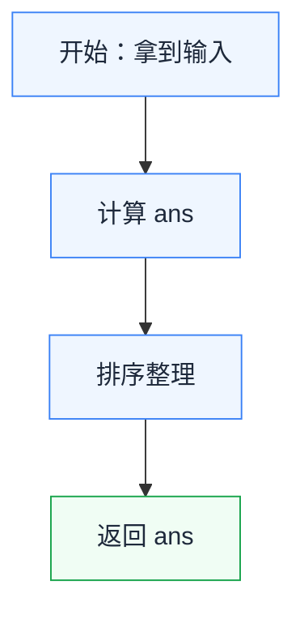

## TypeScript 解题方案（3 个方案逐个讲）

> **运行与提交**：每个方案都是自包含文件（内嵌用例自测，输出 PASS），整块复制到 `.ts` 文件后 `node 文件名` 即可运行。提交 LeetCode 时，把 `demo` 内的算法函数与辅助类型/函数整体取出、置于文件顶层即可。涉及交互/特殊接口的题以题面给定签名为准。

### 方案 1：直接排序

**分析与思路**：核心做法是「直接排序」。代码里依次做这些事：先排序再处理。

**运行方式**：`node 本文件`，内嵌用例全部通过会输出 PASS。

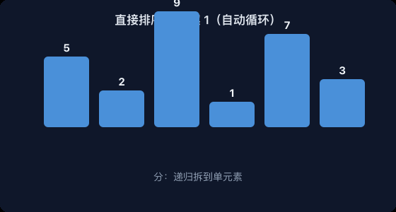

**方案专属流程图**（真实控制流）：

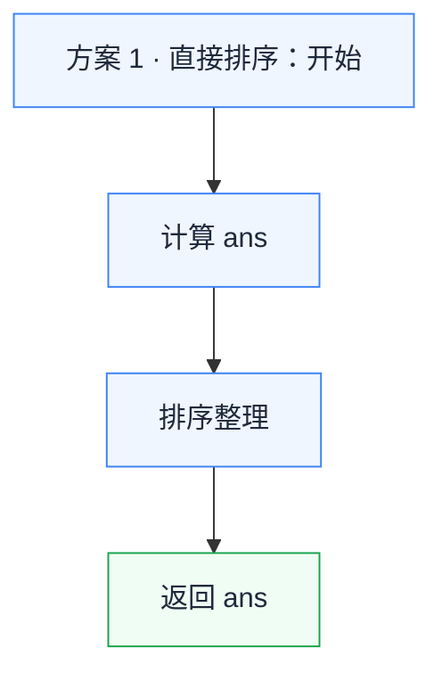

```typescript
/**
 ** LeetCode 977. 有序数组的平方
 ** 方案1: 直接排序
 */

function sortedSquares(nums: number[]): number[] {
  // 定义函数/方法 sortedSquares
  const ans: number[] = nums.map((x) => x * x);
  ans.sort((a, b) => a - b);
  return ans; // 返回 答案
}

export function demo(): void {
  // 程序入口：跑内嵌自测用例
  function eqArr(a: number[], b: number[]): boolean {
    // 定义函数/方法 eqArr
    if (a.length !== b.length) return false; // 若 数组.长度 不等于 b.长度，直接返回 false
    for (let i = 0; i < a.length; i++) if (a[i] !== b[i]) return false; // 让 下标 i 从 0 开始计数，下标 i 小于 数组.长度 就继续
    return true; // 返回 true
  }
  const cases: { in: number[]; want: number[] }[] = [
    { in: [1, 2, 3], want: [1, 4, 9] },
    { in: [-4, -1, 0, 3, 10], want: [0, 1, 9, 16, 100] },
    { in: [-7, -3, 2, 3, 11], want: [4, 9, 9, 49, 121] },
    { in: [], want: [] },
    { in: [0], want: [0] },
  ];
  let fail = false; // 把 false 存入 fail
  for (const c of cases) {
    // for (const 字符 of cases) {
    const got = sortedSquares([...c.in]); // 把 sortedSquares([...字符.in]) 存入 got
    if (!eqArr(got, c.want)) {
      // 若 取反 eqArr(got, 字符.want
      fail = true; // 把 true 存入 fail
      console.log(
        'FAIL sortedSquares(' +
          JSON.stringify(c.in) +
          ')=' +
          JSON.stringify(got) +
          ' want ' +
          JSON.stringify(c.want),
      ); // 打印输出
    }
  }
  if (fail) throw new Error('FAILED'); // 若 fail) throw new Error(「FAILED」);
  console.log('PASS'); // 全部用例通过，输出 PASS
}
demo(); // demo();
```

### 方案 2：双指针（归并）

**分析与思路**：核心做法是「双指针（归并）」。代码里依次做这些事：单循环线性扫描。

**运行方式**：`node 本文件`，内嵌用例全部通过会输出 PASS。

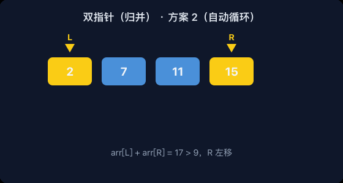

**方案专属流程图**（真实控制流）：

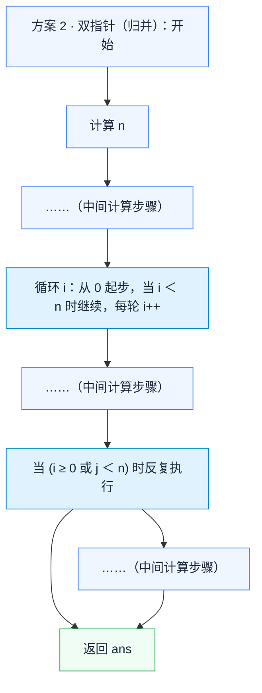

```typescript
/**
 ** LeetCode 977. 有序数组的平方
 ** 方案2: 双指针（归并）
 */

function sortedSquares(nums: number[]): number[] {
  // 定义函数/方法 sortedSquares
  const n = nums.length; // 把 数组.长度 存入 元素个数
  const ans: number[] = []; // 把 []; 写入 const ans: number[]
  let negative = -1; // 把 减 1 存入 negative
  for (let i = 0; i < n; i++) {
    // 让 下标 i 从 0 开始计数，下标 i 小于 元素个数 就继续
    if (nums[i] < 0) {
      // 若 数组[下标 i] 小于 0
      negative = i; // 把 下标 i 存入 negative
    }
  }
  let i = negative,
    j = negative + 1; // 把 negative, 下标 j 赋值为 negative 加 1 存入 下标 i
  while (i >= 0 || j < n) {
    // 循环，直到不满足「下标 i 不低于 0 或 下标 j 小于 元素个数」
    if (i < 0) {
      // 若 下标 i 小于 0
      ans.push(nums[j] * nums[j]); // 把 数组[下标 j] 乘 数组[下标 j] 压入栈/数组尾部
      j += 1; // 下标 j累加 1
    } else if (j === n) {
      // 否则，若 下标 j 全等于 元素个数
      ans.push(nums[i] * nums[i]); // 把 数组[下标 i] 乘 数组[下标 i] 压入栈/数组尾部
      i -= 1; // 下标 i累减 1
    } else if (nums[i] * nums[i] < nums[j] * nums[j]) {
      // 否则，若 数组[下标 i] 乘 数组[下标 i] 小于 数组[下标 j] 乘 数组[下标 j]
      ans.push(nums[i] * nums[i]); // 把 数组[下标 i] 乘 数组[下标 i] 压入栈/数组尾部
      i -= 1; // 下标 i累减 1
    } else {
      // 否则
      ans.push(nums[j] * nums[j]); // 把 数组[下标 j] 乘 数组[下标 j] 压入栈/数组尾部
      j += 1; // 下标 j累加 1
    }
  }
  return ans; // 返回 答案
}

export function demo(): void {
  // 程序入口：跑内嵌自测用例
  function eqArr(a: number[], b: number[]): boolean {
    // 定义函数/方法 eqArr
    if (a.length !== b.length) return false; // 若 数组.长度 不等于 b.长度，直接返回 false
    for (let i = 0; i < a.length; i++) if (a[i] !== b[i]) return false; // 让 下标 i 从 0 开始计数，下标 i 小于 数组.长度 就继续
    return true; // 返回 true
  }
  const cases: { in: number[]; want: number[] }[] = [
    { in: [1, 2, 3], want: [1, 4, 9] },
    { in: [-4, -1, 0, 3, 10], want: [0, 1, 9, 16, 100] },
    { in: [-7, -3, 2, 3, 11], want: [4, 9, 9, 49, 121] },
    { in: [], want: [] },
    { in: [0], want: [0] },
  ];
  let fail = false; // 把 false 存入 fail
  for (const c of cases) {
    // for (const 字符 of cases) {
    const got = sortedSquares([...c.in]); // 把 sortedSquares([...字符.in]) 存入 got
    if (!eqArr(got, c.want)) {
      // 若 取反 eqArr(got, 字符.want
      fail = true; // 把 true 存入 fail
      console.log(
        'FAIL sortedSquares(' +
          JSON.stringify(c.in) +
          ')=' +
          JSON.stringify(got) +
          ' want ' +
          JSON.stringify(c.want),
      ); // 打印输出
    }
  }
  if (fail) throw new Error('FAILED'); // 若 fail) throw new Error(「FAILED」);
  console.log('PASS'); // 全部用例通过，输出 PASS
}
demo(); // demo();
```

### 方案 3：双指针（从两端填结果）

**分析与思路**：核心做法是「双指针（从两端填结果）」。

**运行方式**：`node 本文件`，内嵌用例全部通过会输出 PASS。

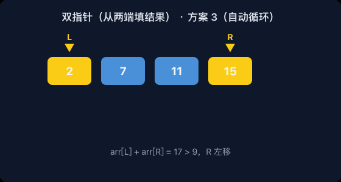

**方案专属流程图**（真实控制流）：

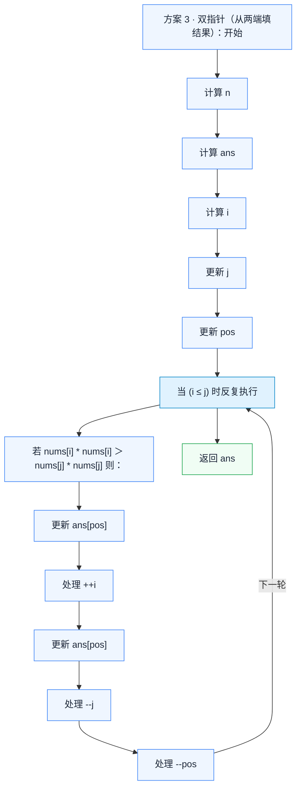

```typescript
/**
 ** LeetCode 977. 有序数组的平方
 ** 方案3: 双指针（从两端填结果）
 */

function sortedSquares(nums: number[]): number[] {
  // 定义函数/方法 sortedSquares
  const n = nums.length; // 把 数组.长度 存入 元素个数
  const ans: number[] = new Array(n).fill(0); // 把 new Array(元素个数).fill(0); 写入 const ans: number[]
  let i = 0,
    j = n - 1,
    pos = n - 1; // 把 0, 下标 j 赋值为 元素个数 减 1, pos 赋值为 元素个数 减 1 存入 下标 i
  while (i <= j) {
    // 循环，直到不满足「下标 i 不超过 下标 j」
    if (nums[i] * nums[i] > nums[j] * nums[j]) {
      // 若 数组[下标 i] 乘 数组[下标 i] 超过 数组[下标 j] 乘 数组[下标 j]
      ans[pos] = nums[i] * nums[i]; // 把 数组[下标 i] 乘 数组[下标 i]; 写入 ans[pos]
      ++i; // 加一 下标 i;
    } else {
      // 否则
      ans[pos] = nums[j] * nums[j]; // 把 数组[下标 j] 乘 数组[下标 j]; 写入 ans[pos]
      --j; // 减一 下标 j;
    }
    --pos; // 减一 pos;
  }
  return ans; // 返回 答案
}

export function demo(): void {
  // 程序入口：跑内嵌自测用例
  function eqArr(a: number[], b: number[]): boolean {
    // 定义函数/方法 eqArr
    if (a.length !== b.length) return false; // 若 数组.长度 不等于 b.长度，直接返回 false
    for (let i = 0; i < a.length; i++) if (a[i] !== b[i]) return false; // 让 下标 i 从 0 开始计数，下标 i 小于 数组.长度 就继续
    return true; // 返回 true
  }
  const cases: { in: number[]; want: number[] }[] = [
    { in: [1, 2, 3], want: [1, 4, 9] },
    { in: [-4, -1, 0, 3, 10], want: [0, 1, 9, 16, 100] },
    { in: [-7, -3, 2, 3, 11], want: [4, 9, 9, 49, 121] },
    { in: [], want: [] },
    { in: [0], want: [0] },
  ];
  let fail = false; // 把 false 存入 fail
  for (const c of cases) {
    // for (const 字符 of cases) {
    const got = sortedSquares([...c.in]); // 把 sortedSquares([...字符.in]) 存入 got
    if (!eqArr(got, c.want)) {
      // 若 取反 eqArr(got, 字符.want
      fail = true; // 把 true 存入 fail
      console.log(
        'FAIL sortedSquares(' +
          JSON.stringify(c.in) +
          ')=' +
          JSON.stringify(got) +
          ' want ' +
          JSON.stringify(c.want),
      ); // 打印输出
    }
  }
  if (fail) throw new Error('FAILED'); // 若 fail) throw new Error(「FAILED」);
  console.log('PASS'); // 全部用例通过，输出 PASS
}
demo(); // demo();
```

## 逐步拆解与面试追问

**复杂度**：时间 O(n) 量级，空间 O(n)

**为什么是这个量级**：整体只对数据做有限趟处理

**面试官可能会追问**：

- 能不能原地做（O(1) 空间）？
- 如果数组已有序，能优化到什么程度？
- 空数组、单元素怎么处理？

## 关键 API 速查（TS 主解法实际用到，附官方链接）

| API | 作用 | 使用要点 | 官方文档 |
|---|---|---|---|
| `Array.prototype.sort()` | 原地排序 | 默认按字符串 Unicode 序（10 会排在 2 前），数字必须传 (a,b)=>a-b；V8 用 TimSort，稳定，O(n log n)；返回原数组引用 | [官方文档](https://developer.mozilla.org/zh-CN/docs/Web/JavaScript/Reference/Global_Objects/Array/sort) |
| `Array.prototype.map()` | 逐元素映射为新数组 | 回调 (v,i,arr)；返回等长新数组，不改变原数组；稀疏位跳过；链式调用注意中间数组开销 | [官方文档](https://developer.mozilla.org/zh-CN/docs/Web/JavaScript/Reference/Global_Objects/Array/map) |
| `JSON.stringify()` | 序列化为 JSON 字符串 | 常用于结构化比较（深度相等判定）；undefined/函数/循环引用会被丢弃或抛错 | [官方文档](https://developer.mozilla.org/zh-CN/docs/Web/JavaScript/Reference/Global_Objects/JSON/stringify) |

### 各语言官方文档导航

- **TypeScript / JS**：[MDN 中文参考](https://developer.mozilla.org/zh-CN/)
- **Python**：[Python 官方文档](https://docs.python.org/zh-cn/3/)
- **Go**：[Go 标准库](https://pkg.go.dev/std)
- **Java**：[JDK 17 API](https://docs.oracle.com/en/java/javase/17/docs/api/)
- **Rust**：[Rust 标准库](https://doc.rust-lang.org/std/)
- **Lua**：[Lua 5.4 手册](https://www.lua.org/manual/5.4/)
- **C**：[Cppreference C](https://zh.cppreference.com/w/c)
- **C++**：[Cppreference C++](https://zh.cppreference.com/w/cpp)
- **R**：[R 官方手册](https://stat.ethz.ch/R-manual/)
- **Zig**：[Zig 语言文档](https://ziglang.org/documentation/master/)
- **Dart**：[Dart API](https://api.dart.dev/)

## 附录：其他 10 种语言全部实现（每种语言列举其全部方案）

> TypeScript 的全部方案见「TypeScript 解题方案」一节；下面是其余 10 种语言的对应实现，每种语言的每个方案都带思路分析、代码走读与专属运行架构图。
> 每个方案都内嵌用例自测，可独立运行（老仓库 python/go 文件遵循「打印结果」约定）。
> 完整解法文件见 `dsa/<语言>/array/lc_977_有序数组的平方/`。

### Python 实现（3 种方案）

Python 的全部方案如下，每个方案都内嵌用例自测，可独立运行（老仓库 python/go 文件遵循「打印结果」约定）：

#### 方案 1：直接排序

**思路与代码分析**：核心是「直接排序」。Python 版用切片与字典推导式简化操作，突出可读性。代码里依次做这些事：先排序再处理。**走读**：方案 1 · 直接排序：开始 → 更新 ans → 排序整理 → 返回 ans。

**运行架构**（真实控制流）：

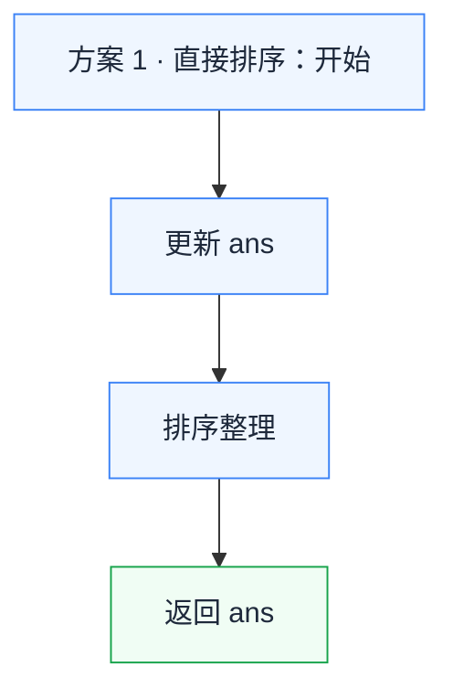

```python
import sys  # 提高递归深度上限（深输入防 RecursionError）

sys.setrecursionlimit(200000)  # 树/链表类题目节点数可达 1e4 量级

def sortedSquares(nums):  # 定义函数 sortedSquares（参数：数组）
    ans = [x * x for x in nums]  # 把 [x 乘 x for x in 数组] 存入 答案
    ans.sort()  # 排序
    return ans  # 返回 答案

if __name__ == "__main__":  # 若 __name__ 等于 '__main__'
    print(sortedSquares([1, 2, 3]))  # 打印输出
```

#### 方案 2：双指针（归并）

**思路与代码分析**：核心是「双指针（归并）」。Python 版用切片与字典推导式简化操作，突出可读性。**走读**：方案 2 · 双指针（归并）：开始 → 更新 n → 循环 i：从 0 到 n 前 → 当 i ≥ 0 or j ＜ n: 时反复执行 → 返回 ans。

**运行架构**（真实控制流）：

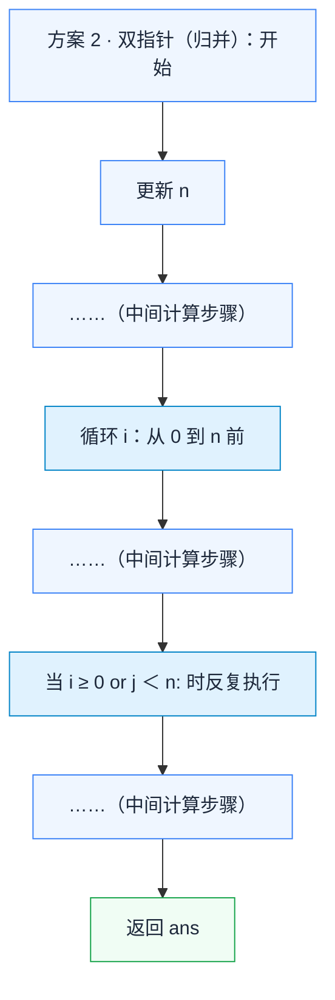

```python
import sys  # 提高递归深度上限（深输入防 RecursionError）

sys.setrecursionlimit(200000)  # 树/链表类题目节点数可达 1e4 量级

def sortedSquares(nums):  # 定义函数 sortedSquares（参数：数组）
    n = len(nums)  # 把 长度(数组) 存入 元素个数
    ans = []  # 把 [] 存入 答案
    negative = -1  # 把 减 1 存入 negative
    for i in range(n):  # 让 下标 i 从 元素个数 遍历
        if nums[i] < 0:  # 若 数组[下标 i] 小于 0
            negative = i  # 把 下标 i 存入 negative
    i, j = negative, negative + 1  # 把 negative, negative 加 1 写入 i, j
    while i >= 0 or j < n:  # 循环，直到不满足「下标 i 不低于 0 or 下标 j 小于 元素个数」
        if i < 0:  # 若 下标 i 小于 0
            ans.append(nums[j] * nums[j])  # 把 数组[下标 j] 乘 数组[下标 j] 追加到列表尾部
            j += 1  # 下标 j累加 1
        elif j == n:  # 否则，若 下标 j 等于 元素个数
            ans.append(nums[i] * nums[i])  # 把 数组[下标 i] 乘 数组[下标 i] 追加到列表尾部
            i -= 1  # 下标 i累减 1
        elif (
            nums[i] * nums[i] < nums[j] * nums[j]
        ):  # 否则，若 数组[下标 i] 乘 数组[下标 i] 小于 数组[下标 j] 乘 数组[下标 j]
            ans.append(nums[i] * nums[i])  # 把 数组[下标 i] 乘 数组[下标 i] 追加到列表尾部
            i -= 1  # 下标 i累减 1
        else:  # 否则
            ans.append(nums[j] * nums[j])  # 把 数组[下标 j] 乘 数组[下标 j] 追加到列表尾部
            j += 1  # 下标 j累加 1
    return ans  # 返回 答案

if __name__ == "__main__":  # 若 __name__ 等于 '__main__'
    print(sortedSquares([1, 2, 3]))  # 打印输出
```

#### 方案 3：双指针（从两端填结果）

**思路与代码分析**：核心是「双指针（从两端填结果）」。Python 版用切片与字典推导式简化操作，突出可读性。**走读**：方案 3 · 双指针（从两端填结果）：开始 → 更新 n → 更新 ans → 更新 pos → 当 i ≤ j: 时反复执行 → 处理 if ( → 处理 nums[i] * nums[i] ＞ nums[j] → 处理 ): → 更新 ans[pos] → 更新 + → 更新 ans[pos] → 更新 - → 更新 - → 返回 ans。

**运行架构**（真实控制流）：

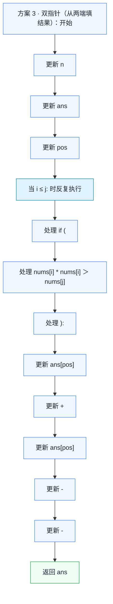

```python
import sys  # 提高递归深度上限（深输入防 RecursionError）

sys.setrecursionlimit(200000)  # 树/链表类题目节点数可达 1e4 量级

def sortedSquares(nums):  # 定义函数 sortedSquares（参数：数组）
    n = len(nums)  # 把 长度(数组) 存入 元素个数
    ans = [0] * n  # 把 [0] 乘 元素个数 存入 答案
    i, j, pos = 0, n - 1, n - 1  # 把 0, 元素个数 减 1, 元素个数 减 1 写入 i, j, pos
    while i <= j:  # 循环，直到不满足「下标 i 不超过 下标 j」
        if (
            nums[i] * nums[i] > nums[j] * nums[j]
        ):  # 若 数组[下标 i] 乘 数组[下标 i] 超过 数组[下标 j] 乘 数组[下标 j]
            ans[pos] = nums[i] * nums[i]  # 把 数组[下标 i] 乘 数组[下标 i] 写入 ans[pos]
            i += 1  # 下标 i累加 1
        else:  # 否则
            ans[pos] = nums[j] * nums[j]  # 把 数组[下标 j] 乘 数组[下标 j] 写入 ans[pos]
            j -= 1  # 下标 j累减 1
        pos -= 1  # pos累减 1
    return ans  # 返回 答案

if __name__ == "__main__":  # 若 __name__ 等于 '__main__'
    print(sortedSquares([1, 2, 3]))  # 打印输出
```

### Go 实现（3 种方案）

Go 的全部方案如下，每个方案都内嵌用例自测，可独立运行（老仓库 python/go 文件遵循「打印结果」约定）：

#### 方案 1：直接排序

**思路与代码分析**：核心是「直接排序」。Go 版用切片与多返回值惯用法，显式处理索引边界。**走读**：方案 1 · 直接排序：开始 → 更新 : → 遍历 nums 的下标与元素 x → 更新 ans[i] → 调用 sort.Ints(ans) → 返回 ans。

**运行架构**（真实控制流）：

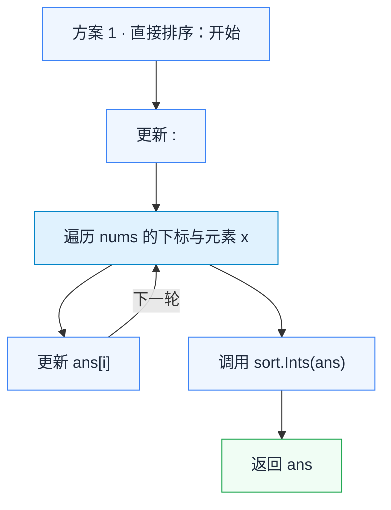

```go
package main // 引入依赖

import (
	"fmt"     // 「fmt」
	"os"      // 「os」
	"reflect" // 「reflect」
	"sort"    // 「sort」
)

func sortedSquares(nums []int) []int { // 定义函数/方法 sortedSquares
	ans := make([]int, len(nums)) // 把 make([]int, 长度(数组)) 写入 ans :
	for i, x := range nums {      // 同时取 下标 i 与 x 遍历
		ans[i] = x * x // 把 x 乘 x 写入 ans[i]
	}
	sort.Ints(ans) // sort.Ints(答案)
	return ans     // 返回 答案
}

func main() { // 程序入口：跑内嵌自测用例
	type tc struct { // 定义类型
		in   []int // in []int
		want []int // want []int
	}
	cases := []tc{ // 把 []tc{ 写入 cases :
		{[]int{1, 2, 3}, []int{1, 4, 9}},
		{[]int{-4, -1, 0, 3, 10}, []int{0, 1, 9, 16, 100}},
		{[]int{-7, -3, 2, 3, 11}, []int{4, 9, 9, 49, 121}},
	}
	ok := true                // 把 true 写入 ok :
	for _, c := range cases { // 同时取 _ 与 字符 遍历
		if got := sortedSquares(c.in); !reflect.DeepEqual(got, c.want) {
			ok = false                                                           // 把 false 写入 ok
			fmt.Printf("FAIL sortedSquares(%v)=%v want %v\n", c.in, got, c.want) // 打印输出
		}
	}
	if !ok { // 若 取反 ok
		os.Exit(1) // os.Exit(1)
	}
	fmt.Println("PASS") // 全部用例通过，输出 PASS
}
```

#### 方案 2：双指针（归并）

**思路与代码分析**：核心是「双指针（归并）」。Go 版用切片与多返回值惯用法，显式处理索引边界。**走读**：方案 2 · 双指针（归并）：开始 → 更新 : → 遍历循环 → 遍历循环 → 返回 ans。

**运行架构**（真实控制流）：

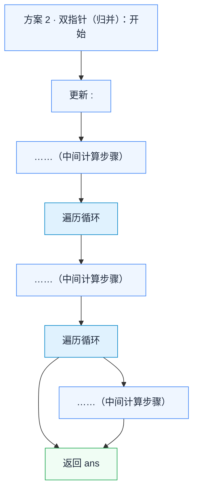

```go
package main // 引入依赖

import (
	"fmt"     // 「fmt」
	"os"      // 「os」
	"reflect" // 「reflect」
)

func sortedSquares(nums []int) []int { // 定义函数/方法 sortedSquares
	n := len(nums)           // 把 长度(数组) 写入 n :
	ans := make([]int, 0, n) // 把 make([]int, 0, 元素个数) 写入 ans :
	negative := -1           // 把 减 1 写入 negative :
	for i := 0; i < n; i++ { // 让 下标 i 从 0 开始计数
		if nums[i] < 0 { // 若 数组[下标 i] 小于 0
			negative = i // 把 下标 i 写入 negative
		}
	}
	i, j := negative, negative+1 // 把 negative, negative 加 1 写入 i, j :
	for i >= 0 || j < n {        // 把 0 或 下标 j 小于 元素个数 { 写入 for i >
		if i < 0 { // 若 下标 i 小于 0
			ans = append(ans, nums[j]*nums[j]) // 把 append(答案, 数组[下标 j] 乘 数组[下标 j]) 写入 答案
			j++                                // 下标 j 加一
		} else if j == n { // 否则，若 下标 j 等于 元素个数
			ans = append(ans, nums[i]*nums[i]) // 把 append(答案, 数组[下标 i] 乘 数组[下标 i]) 写入 答案
			i--                                // 下标 i 减一
		} else if nums[i]*nums[i] < nums[j]*nums[j] { // 否则，若 数组[下标 i] 乘 数组[下标 i] 小于 数组[下标 j] 乘 数组[下标 j]
			ans = append(ans, nums[i]*nums[i]) // 把 append(答案, 数组[下标 i] 乘 数组[下标 i]) 写入 答案
			i--                                // 下标 i 减一
		} else { // 否则
			ans = append(ans, nums[j]*nums[j]) // 把 append(答案, 数组[下标 j] 乘 数组[下标 j]) 写入 答案
			j++                                // 下标 j 加一
		}
	}
	return ans // 返回 答案
}

func main() { // 程序入口：跑内嵌自测用例
	type tc struct { // 定义类型
		in   []int // in []int
		want []int // want []int
	}
	cases := []tc{ // 把 []tc{ 写入 cases :
		{[]int{1, 2, 3}, []int{1, 4, 9}},
		{[]int{-4, -1, 0, 3, 10}, []int{0, 1, 9, 16, 100}},
		{[]int{-7, -3, 2, 3, 11}, []int{4, 9, 9, 49, 121}},
	}
	ok := true                // 把 true 写入 ok :
	for _, c := range cases { // 同时取 _ 与 字符 遍历
		if got := sortedSquares(c.in); !reflect.DeepEqual(got, c.want) {
			ok = false                                                           // 把 false 写入 ok
			fmt.Printf("FAIL sortedSquares(%v)=%v want %v\n", c.in, got, c.want) // 打印输出
		}
	}
	if !ok { // 若 取反 ok
		os.Exit(1) // os.Exit(1)
	}
	fmt.Println("PASS") // 全部用例通过，输出 PASS
}
```

#### 方案 3：双指针（从两端填结果）

**思路与代码分析**：核心是「双指针（从两端填结果）」。Go 版用切片与多返回值惯用法，显式处理索引边界。**走读**：方案 3 · 双指针（从两端填结果）：开始 → 更新 : → 更新 : → 更新 : → 遍历循环 → 更新 : → 更新 : → 处理 if si ＞ sj → 更新 ans[pos] → 处理 i++ → 更新 ans[pos] → 处理 j-- → 处理 pos-- → 返回 ans。

**运行架构**（真实控制流）：

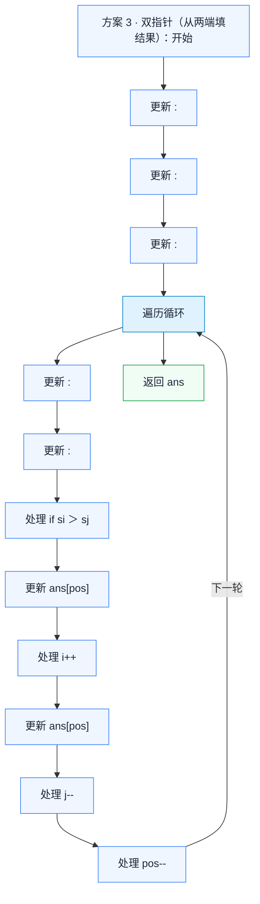

```go
package main // 引入依赖

import (
	"fmt"     // 「fmt」
	"os"      // 「os」
	"reflect" // 「reflect」
)

func sortedSquares(nums []int) []int { // 定义函数/方法 sortedSquares
	n := len(nums)           // 把 长度(数组) 写入 n :
	ans := make([]int, n)    // 把 make([]int, 元素个数) 写入 ans :
	i, j, pos := 0, n-1, n-1 // 把 0, 元素个数 减 1, 元素个数 减 1 写入 i, j, pos :
	for i <= j {             // 把 下标 j { 写入 for i <
		si := nums[i] * nums[i] // 把 数组[下标 i] 乘 数组[下标 i] 写入 si :
		sj := nums[j] * nums[j] // 把 数组[下标 j] 乘 数组[下标 j] 写入 sj :
		if si > sj {            // 若 si 超过 sj
			ans[pos] = si // 把 si 写入 ans[pos]
			i++           // 下标 i 加一
		} else { // 否则
			ans[pos] = sj // 把 sj 写入 ans[pos]
			j--           // 下标 j 减一
		}
		pos-- // pos 减一
	}
	return ans // 返回 答案
}

func main() { // 程序入口：跑内嵌自测用例
	type tc struct { // 定义类型
		in   []int // in []int
		want []int // want []int
	}
	cases := []tc{ // 把 []tc{ 写入 cases :
		{[]int{1, 2, 3}, []int{1, 4, 9}},
		{[]int{-4, -1, 0, 3, 10}, []int{0, 1, 9, 16, 100}},
		{[]int{-7, -3, 2, 3, 11}, []int{4, 9, 9, 49, 121}},
	}
	ok := true                // 把 true 写入 ok :
	for _, c := range cases { // 同时取 _ 与 字符 遍历
		if got := sortedSquares(c.in); !reflect.DeepEqual(got, c.want) {
			ok = false                                                           // 把 false 写入 ok
			fmt.Printf("FAIL sortedSquares(%v)=%v want %v\n", c.in, got, c.want) // 打印输出
		}
	}
	if !ok { // 若 取反 ok
		os.Exit(1) // os.Exit(1)
	}
	fmt.Println("PASS") // 全部用例通过，输出 PASS
}
```

### Java 实现（3 种方案）

Java 的全部方案如下，每个方案都内嵌用例自测，可独立运行（老仓库 python/go 文件遵循「打印结果」约定）：

#### 方案 1：直接排序

**思路与代码分析**：核心是「直接排序」。Java 版用类与静态方法组织，集合操作显式明了。代码里依次做这些事：先排序再处理；单循环线性扫描。**走读**：方案 1 · 直接排序：开始 → 更新 n → 更新 ans → 遍历循环 → 更新 ans[i] → 排序整理 → 返回 ans。

**运行架构**（真实控制流）：

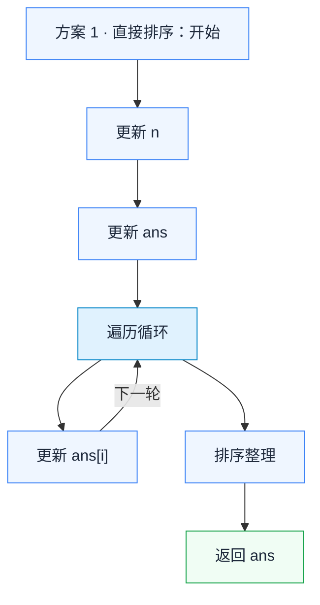

```java
package com.webfault.dsa; // 引入依赖

import java.util.*; // 引入依赖

class lc977_solution111 { // 定义类型
  public int[] sortedSquares(int[] nums) { // 定义函数/方法 sortedSquares
    int n = nums.length; // 把 数组.长度 存入 元素个数
    int[] ans = new int[n]; // 把 new int[元素个数]; 写入 int[] ans
    for (int i = 0; i < n; i++) { // 让 下标 i 从 0 开始计数，下标 i 小于 元素个数 就继续
      ans[i] = nums[i] * nums[i]; // 把 数组[下标 i] 乘 数组[下标 i]; 写入 ans[i]
    }
    Arrays.sort(ans); // 排序
    return ans; // 返回 答案
  }

  public static void main(String[] args) { // public static void main(String[] args) {
    lc977_solution111 s =
        new lc977_solution111(); // 把 new lc977_solution111(); 写入 lc977_solution111 s
    int[] r =
        s.sortedSquares(new int[] {1, 2, 3}); // 把 字符串.sortedSquares(new int[]{1, 2, 3}); 写入 int[] r
    if (!(r[0] == 1 && r[1] == 4 && r[2] == 9)) throw new RuntimeException("FAILED");
    System.out.println("PASS"); // 全部用例通过，输出 PASS
  }
}
```

#### 方案 2：双指针（归并）

**思路与代码分析**：核心是「双指针（归并）」。Java 版用类与静态方法组织，集合操作显式明了。**走读**：方案 2 · 双指针（归并）：开始 → 更新 n → 更新 res → 更新 i → 当 (i ≤ j) 时反复执行 → 更新 a → 更新 b → 若 a ＞ b 则： → 更新 res[k] → 处理 i++ → 更新 res[k] → 处理 j-- → 处理 k-- → 返回 res。

**运行架构**（真实控制流）：

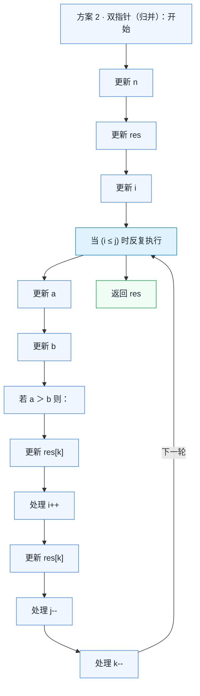

```java
package com.webfault.dsa; // 引入依赖

import java.util.Arrays; // 引入依赖

class Main { // 定义类型
  static int[] sortedSquares(int[] nums) { // 定义函数/方法 sortedSquares
    int n = nums.length;
    int[] res = new int[n];
    int i = 0, j = n - 1, k = n - 1;
    while (i <= j) { // 循环，直到不满足「下标 i 不超过 下标 j」
      int a = nums[i] * nums[i],
          b = nums[j] * nums[j]; // 把 数组[下标 i] 乘 数组[下标 i], b 赋值为 数组[下标 j] 乘 数组[下标 j] 存入 数组
      if (a > b) {
        res[k] = a;
        i++;
      } else {
        res[k] = b;
        j--;
      }
      k--; // 下标 k 减一
    }
    return res; // 返回 结果
  }

  public static void main(String[] args) { // public static void main(String[] args) {
    int[][] ins = {{-4, -1, 0, 3, 10}, {1, 2, 3}, {-7, -3, 2, 3, 11}};
    int[][] ws = {
      {0, 1, 9, 16, 100}, {1, 4, 9}, {4, 9, 9, 49, 121}
    }; // 把 {{0,1,9,16,100},{1,4,9},{4,9,9,49,121}}; 写入 int[][] ws
    boolean ok = true; // 把 true; 写入 boolean ok
    for (int i = 0; i < ins.length; i++) { // 让 下标 i 从 0 开始计数，下标 i 小于 ins.长度 就继续
      int[] got = sortedSquares(ins[i]); // 把 sortedSquares(ins[下标 i]); 写入 int[] got
      if (!Arrays.equals(got, ws[i])) {
        ok = false;
        System.out.println("FAIL " + Arrays.toString(got));
      }
    }
    if (!ok) throw new RuntimeException("FAILED"); // 若 取反 ok) throw new RuntimeException(「FAILED」);
    System.out.println("PASS"); // 全部用例通过，输出 PASS
  }
}
```

#### 方案 3：双指针（从两端填结果）

**思路与代码分析**：核心是「双指针（从两端填结果）」。Java 版用类与静态方法组织，集合操作显式明了。**走读**：方案 3 · 双指针（从两端填结果）：开始 → 更新 n → 更新 res → 更新 i → 当 (i ≤ j) 时反复执行 → 更新 a → 更新 b → 若 a ＞ b 则： → 更新 res[k] → 处理 i++ → 更新 res[k] → 处理 j-- → 处理 k-- → 返回 res。

**运行架构**（真实控制流）：

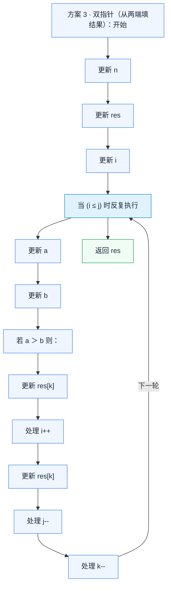

```java
package com.webfault.dsa; // 引入依赖

import java.util.Arrays; // 引入依赖

class Main { // 定义类型
  static int[] sortedSquares(int[] nums) { // 定义函数/方法 sortedSquares
    int n = nums.length;
    int[] res = new int[n];
    int i = 0, j = n - 1, k = n - 1;
    while (i <= j) { // 循环，直到不满足「下标 i 不超过 下标 j」
      int a = nums[i] * nums[i],
          b = nums[j] * nums[j]; // 把 数组[下标 i] 乘 数组[下标 i], b 赋值为 数组[下标 j] 乘 数组[下标 j] 存入 数组
      if (a > b) {
        res[k] = a;
        i++;
      } else {
        res[k] = b;
        j--;
      }
      k--; // 下标 k 减一
    }
    return res; // 返回 结果
  }

  public static void main(String[] args) { // public static void main(String[] args) {
    int[][] ins = {{-4, -1, 0, 3, 10}, {1, 2, 3}, {-7, -3, 2, 3, 11}};
    int[][] ws = {
      {0, 1, 9, 16, 100}, {1, 4, 9}, {4, 9, 9, 49, 121}
    }; // 把 {{0,1,9,16,100},{1,4,9},{4,9,9,49,121}}; 写入 int[][] ws
    boolean ok = true; // 把 true; 写入 boolean ok
    for (int i = 0; i < ins.length; i++) { // 让 下标 i 从 0 开始计数，下标 i 小于 ins.长度 就继续
      int[] got = sortedSquares(ins[i]); // 把 sortedSquares(ins[下标 i]); 写入 int[] got
      if (!Arrays.equals(got, ws[i])) {
        ok = false;
        System.out.println("FAIL " + Arrays.toString(got));
      }
    }
    if (!ok) throw new RuntimeException("FAILED"); // 若 取反 ok) throw new RuntimeException(「FAILED」);
    System.out.println("PASS"); // 全部用例通过，输出 PASS
  }
}
```

### Rust 实现（3 种方案）

Rust 的全部方案如下，每个方案都内嵌用例自测，可独立运行（老仓库 python/go 文件遵循「打印结果」约定）：

#### 方案 1：直接排序

**思路与代码分析**：核心是「直接排序」。Rust 版用所有权移动与切片借用改写同一逻辑，注意 Option 与引用边界。**走读**：方案 1 · 直接排序：开始 → 计算 n → 当 l ≤ r 且 idx ＜ n 时反复执行 → 返回结果。

**运行架构**（真实控制流）：

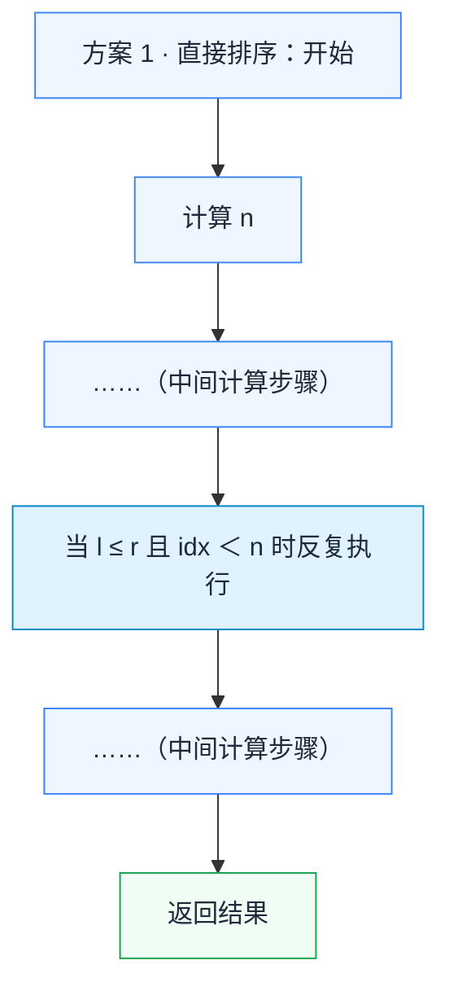

```rust
// LeetCode 977. 有序数组的平方 — Rust 版（方案1）
fn sorted_squares(nums: Vec<i32>) -> Vec<i32> {
    // 定义函数/方法 sorted_squares
    let n = nums.len(); // 把 数组.长度() 存入 元素个数
    let mut out = vec![0i64; n]; // 把 vec取反 [0i64; 元素个数]; 写入 let mut out
    let (mut l, mut r, mut idx) = (0usize, n - 1, n - 1);
    while l <= r && idx < n {
        // 把 右指针 且 idx 小于 元素个数 { 写入 while l <
        let a = nums[l].abs() as i64; // 把 数组[左指针].取绝对值 ) as i64 存入 数组
        let b = nums[r].abs() as i64; // 把 数组[右指针].取绝对值 ) as i64 存入 b
        if a > b {
            out[idx] = a * a;
            l += 1;
        }
        // 若 数组 超过 b { out[idx] 赋值为 数组 乘 数组; 左指针 累加 1; }
        else {
            out[idx] = b * b;
            if r == 0 {
                break;
            }
            r -= 1;
        } // 否则
        if idx == 0 {
            break;
        } // 若 idx 等于 0 { break; }
        idx -= 1; // idx累减 1
    }
    out.into_iter().map(|x| x as i32).collect() // out.into_iter().映射表( 按位或 x 按位或 x as i32).collect()
}
fn main() {
    assert_eq!(
        sorted_squares(vec![-4, -1, 0, 3, 10]),
        vec![0, 1, 9, 16, 100]
    );
    assert_eq!(
        sorted_squares(vec![-7, -3, 2, 3, 11]),
        vec![4, 9, 9, 49, 121]
    );
    assert_eq!(sorted_squares(vec![1, 2, 3]), vec![1, 4, 9]);
    println!("PASS");
} // 程序入口：跑内嵌自测用例
```

#### 方案 2：双指针（归并）

**思路与代码分析**：核心是「双指针（归并）」。Rust 版用所有权移动与切片借用改写同一逻辑，注意 Option 与引用边界。**走读**：方案 2 · 双指针（归并）：开始 → 计算 n → 当 l ≤ r 且 idx ＜ n 时反复执行 → 返回结果。

**运行架构**（真实控制流）：

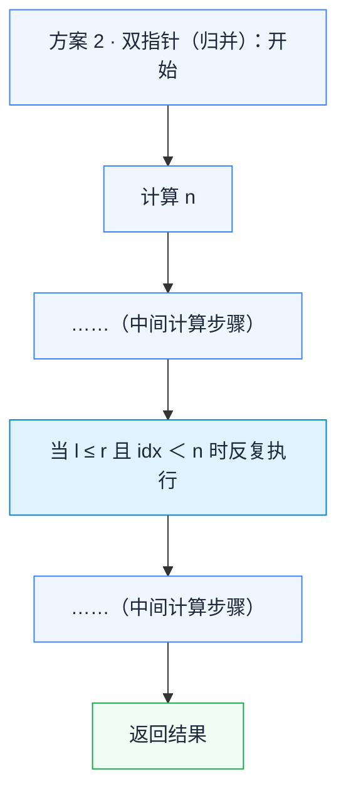

```rust
// LeetCode 977. 有序数组的平方 — Rust 版（方案2）
fn sorted_squares(nums: Vec<i32>) -> Vec<i32> {
    // 定义函数/方法 sorted_squares
    let n = nums.len(); // 把 数组.长度() 存入 元素个数
    let mut out = vec![0i64; n]; // 把 vec取反 [0i64; 元素个数]; 写入 let mut out
    let (mut l, mut r, mut idx) = (0usize, n - 1, n - 1);
    while l <= r && idx < n {
        // 把 右指针 且 idx 小于 元素个数 { 写入 while l <
        let a = nums[l].abs() as i64; // 把 数组[左指针].取绝对值 ) as i64 存入 数组
        let b = nums[r].abs() as i64; // 把 数组[右指针].取绝对值 ) as i64 存入 b
        if a > b {
            out[idx] = a * a;
            l += 1;
        }
        // 若 数组 超过 b { out[idx] 赋值为 数组 乘 数组; 左指针 累加 1; }
        else {
            out[idx] = b * b;
            if r == 0 {
                break;
            }
            r -= 1;
        } // 否则
        if idx == 0 {
            break;
        } // 若 idx 等于 0 { break; }
        idx -= 1; // idx累减 1
    }
    out.into_iter().map(|x| x as i32).collect() // out.into_iter().映射表( 按位或 x 按位或 x as i32).collect()
}
fn main() {
    assert_eq!(
        sorted_squares(vec![-4, -1, 0, 3, 10]),
        vec![0, 1, 9, 16, 100]
    );
    assert_eq!(
        sorted_squares(vec![-7, -3, 2, 3, 11]),
        vec![4, 9, 9, 49, 121]
    );
    assert_eq!(sorted_squares(vec![1, 2, 3]), vec![1, 4, 9]);
    println!("PASS");
} // 程序入口：跑内嵌自测用例
```

#### 方案 3：双指针（从两端填结果）

**思路与代码分析**：核心是「双指针（从两端填结果）」。Rust 版用所有权移动与切片借用改写同一逻辑，注意 Option 与引用边界。**走读**：方案 3 · 双指针（从两端填结果）：开始 → 计算 n → 当 l ≤ r 且 idx ＜ n 时反复执行 → 返回结果。

**运行架构**（真实控制流）：

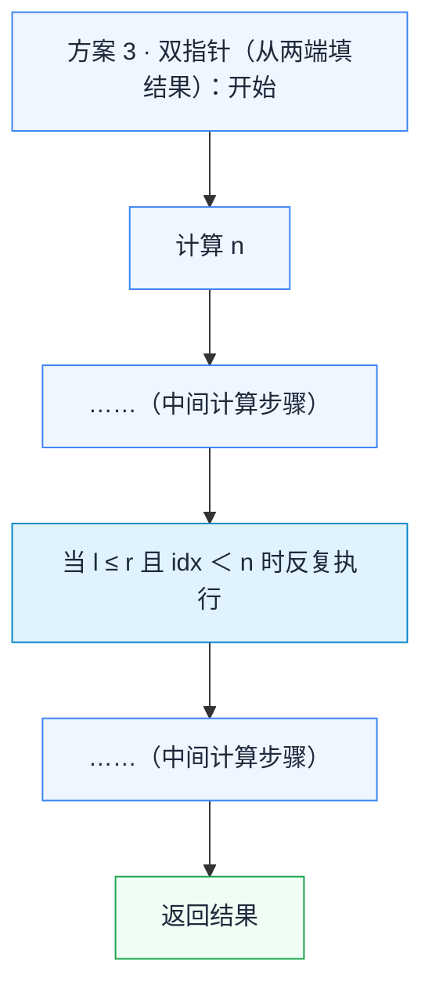

```rust
// LeetCode 977. 有序数组的平方 — Rust 版（方案3）
fn sorted_squares(nums: Vec<i32>) -> Vec<i32> {
    // 定义函数/方法 sorted_squares
    let n = nums.len(); // 把 数组.长度() 存入 元素个数
    let mut out = vec![0i64; n]; // 把 vec取反 [0i64; 元素个数]; 写入 let mut out
    let (mut l, mut r, mut idx) = (0usize, n - 1, n - 1);
    while l <= r && idx < n {
        // 把 右指针 且 idx 小于 元素个数 { 写入 while l <
        let a = nums[l].abs() as i64; // 把 数组[左指针].取绝对值 ) as i64 存入 数组
        let b = nums[r].abs() as i64; // 把 数组[右指针].取绝对值 ) as i64 存入 b
        if a > b {
            out[idx] = a * a;
            l += 1;
        }
        // 若 数组 超过 b { out[idx] 赋值为 数组 乘 数组; 左指针 累加 1; }
        else {
            out[idx] = b * b;
            if r == 0 {
                break;
            }
            r -= 1;
        } // 否则
        if idx == 0 {
            break;
        } // 若 idx 等于 0 { break; }
        idx -= 1; // idx累减 1
    }
    out.into_iter().map(|x| x as i32).collect() // out.into_iter().映射表( 按位或 x 按位或 x as i32).collect()
}
fn main() {
    assert_eq!(
        sorted_squares(vec![-4, -1, 0, 3, 10]),
        vec![0, 1, 9, 16, 100]
    );
    assert_eq!(
        sorted_squares(vec![-7, -3, 2, 3, 11]),
        vec![4, 9, 9, 49, 121]
    );
    assert_eq!(sorted_squares(vec![1, 2, 3]), vec![1, 4, 9]);
    println!("PASS");
} // 程序入口：跑内嵌自测用例
```

### Lua 实现（3 种方案）

Lua 的全部方案如下，每个方案都内嵌用例自测，可独立运行（老仓库 python/go 文件遵循「打印结果」约定）：

#### 方案 1：直接排序

**思路与代码分析**：核心是「直接排序」。Lua 版用表与 ipairs 遍历，注意 ipairs 遇 nil 即停的语义。**走读**：方案 1 · 直接排序：开始 → 更新 n → 更新 out → 更新 idx → 当 l ≤ r do 时反复执行 → 更新 a → 更新 b → 处理 if a ＞ b then → 更新 out[idx] → 更新 l → 更新 out[idx] → 更新 r → 更新 idx → 返回 out。

**运行架构**（真实控制流）：

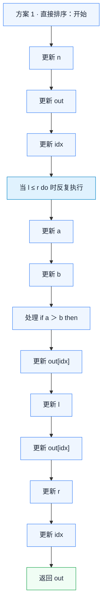

```lua
-- LeetCode 977. 有序数组的平方 — Lua 版（方案1）
local function sorted_squares(nums) -- local function sorted_squares(数组)
	local n = #nums -- 把 #数组 写入 local n
	local out = {} -- 把 {} 写入 local out
	local l, r, idx = 1, n, n -- 把 1, 元素个数, 元素个数 写入 local l, r, idx
	while l <= r do -- 把 右指针 do 写入 while l <
		local a = math.abs(nums[l]) -- 把 math.取绝对值 数组[左指针]) 写入 local a
		local b = math.abs(nums[r]) -- 把 math.取绝对值 数组[右指针]) 写入 local b
		if a > b then
			out[idx] = a * a
			l = l + 1 -- 若 数组 超过 b then out[idx] 赋值为 数组 乘 数组; 左指针 赋值为 左指针 加 1
		else
			out[idx] = b * b
			r = r - 1
		end -- 否则
		idx = idx - 1 -- 把 idx 减 1 存入 idx
	end -- 终点
	return out -- 返回 out
end -- 终点
assert(table.concat(sorted_squares({ -4, -1, 0, 3, 10 }), ",") == "0,1,9,16,100") -- 打印输出
assert(table.concat(sorted_squares({ -7, -3, 2, 3, 11 }), ",") == "4,9,9,49,121") -- 打印输出
assert(table.concat(sorted_squares({ 1, 2, 3 }), ",") == "1,4,9") -- 打印输出
print("PASS") -- 全部用例通过，输出 PASS
```

#### 方案 2：双指针（归并）

**思路与代码分析**：核心是「双指针（归并）」。Lua 版用表与 ipairs 遍历，注意 ipairs 遇 nil 即停的语义。**走读**：方案 2 · 双指针（归并）：开始 → 更新 n → 更新 out → 更新 idx → 当 l ≤ r do 时反复执行 → 更新 a → 更新 b → 处理 if a ＞ b then → 更新 out[idx] → 更新 l → 更新 out[idx] → 更新 r → 更新 idx → 返回 out。

**运行架构**（真实控制流）：

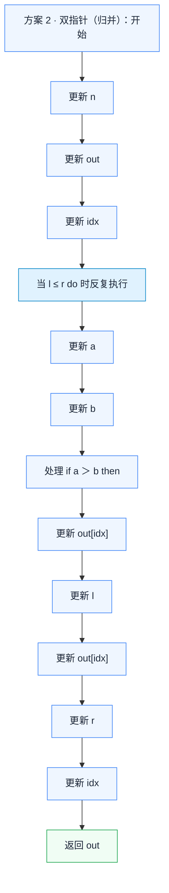

```lua
-- LeetCode 977. 有序数组的平方 — Lua 版（方案2）
local function sorted_squares(nums) -- local function sorted_squares(数组)
	local n = #nums -- 把 #数组 写入 local n
	local out = {} -- 把 {} 写入 local out
	local l, r, idx = 1, n, n -- 把 1, 元素个数, 元素个数 写入 local l, r, idx
	while l <= r do -- 把 右指针 do 写入 while l <
		local a = math.abs(nums[l]) -- 把 math.取绝对值 数组[左指针]) 写入 local a
		local b = math.abs(nums[r]) -- 把 math.取绝对值 数组[右指针]) 写入 local b
		if a > b then
			out[idx] = a * a
			l = l + 1 -- 若 数组 超过 b then out[idx] 赋值为 数组 乘 数组; 左指针 赋值为 左指针 加 1
		else
			out[idx] = b * b
			r = r - 1
		end -- 否则
		idx = idx - 1 -- 把 idx 减 1 存入 idx
	end -- 终点
	return out -- 返回 out
end -- 终点
assert(table.concat(sorted_squares({ -4, -1, 0, 3, 10 }), ",") == "0,1,9,16,100") -- 打印输出
assert(table.concat(sorted_squares({ -7, -3, 2, 3, 11 }), ",") == "4,9,9,49,121") -- 打印输出
assert(table.concat(sorted_squares({ 1, 2, 3 }), ",") == "1,4,9") -- 打印输出
print("PASS") -- 全部用例通过，输出 PASS
```

#### 方案 3：双指针（从两端填结果）

**思路与代码分析**：核心是「双指针（从两端填结果）」。Lua 版用表与 ipairs 遍历，注意 ipairs 遇 nil 即停的语义。**走读**：方案 3 · 双指针（从两端填结果）：开始 → 更新 n → 更新 out → 更新 idx → 当 l ≤ r do 时反复执行 → 更新 a → 更新 b → 处理 if a ＞ b then → 更新 out[idx] → 更新 l → 更新 out[idx] → 更新 r → 更新 idx → 返回 out。

**运行架构**（真实控制流）：

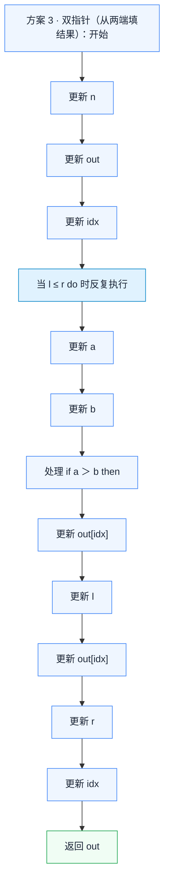

```lua
-- LeetCode 977. 有序数组的平方 — Lua 版（方案3）
local function sorted_squares(nums) -- local function sorted_squares(数组)
	local n = #nums -- 把 #数组 写入 local n
	local out = {} -- 把 {} 写入 local out
	local l, r, idx = 1, n, n -- 把 1, 元素个数, 元素个数 写入 local l, r, idx
	while l <= r do -- 把 右指针 do 写入 while l <
		local a = math.abs(nums[l]) -- 把 math.取绝对值 数组[左指针]) 写入 local a
		local b = math.abs(nums[r]) -- 把 math.取绝对值 数组[右指针]) 写入 local b
		if a > b then
			out[idx] = a * a
			l = l + 1 -- 若 数组 超过 b then out[idx] 赋值为 数组 乘 数组; 左指针 赋值为 左指针 加 1
		else
			out[idx] = b * b
			r = r - 1
		end -- 否则
		idx = idx - 1 -- 把 idx 减 1 存入 idx
	end -- 终点
	return out -- 返回 out
end -- 终点
assert(table.concat(sorted_squares({ -4, -1, 0, 3, 10 }), ",") == "0,1,9,16,100") -- 打印输出
assert(table.concat(sorted_squares({ -7, -3, 2, 3, 11 }), ",") == "4,9,9,49,121") -- 打印输出
assert(table.concat(sorted_squares({ 1, 2, 3 }), ",") == "1,4,9") -- 打印输出
print("PASS") -- 全部用例通过，输出 PASS
```

### C 实现（3 种方案）

C 的全部方案如下，每个方案都内嵌用例自测，可独立运行（老仓库 python/go 文件遵循「打印结果」约定）：

#### 方案 1：直接排序

**思路与代码分析**：核心是「直接排序」。C 版手动管理下标与内存，循环边界全部显式写出。**走读**：方案 1 · 直接排序：开始 → 更新 l → 当 (l ≤ r) 时反复执行 → 更新 a → 更新 b → 若 a ＞ b 则： → 更新 out[idx--] → 处理 l++ → 更新 out[idx--] → 处理 r-- → 返回结果。

**运行架构**（真实控制流）：

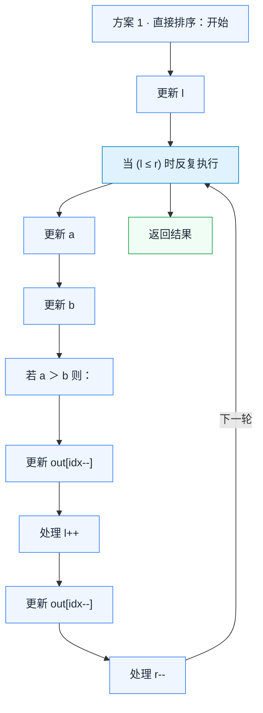

```c
/* LeetCode 977. 有序数组的平方 — C 版（方案1） */
#include <stdio.h>                                             // 引入头文件
#include <stdlib.h>                                            // 引入头文件
static void sorted_squares(const int *n, int len, int out[]) { // 定义函数/方法 sorted_squares
    int l = 0, r = len - 1, idx = len - 1; // 把 0, 右指针 赋值为 长度 减 1, idx 赋值为 长度 减 1 存入 左指针
    while (l <= r) {                       // 循环，直到不满足「左指针 不超过 右指针」
        long a = labs(n[l]),
             b = labs(n[r]); // 把 labs(元素个数[左指针]), b 赋值为 labs(元素个数[右指针]); 写入 long a
        if (a > b) {
            out[idx--] = (int)(a * a);
            l++;
        } // 若 数组 超过 b) { out[idx 减一 ] 赋值为 (int)(数组 乘 数组); 左指针 加一 ; }
        else {
            out[idx--] = (int)(b * b);
            r--;
        } // 否则
    }
}
int main(void) {                                       // 程序入口：跑内嵌自测用例
    int out[4096];                                     // int out[4096];
    sorted_squares((int[]){-4, -1, 0, 3, 10}, 5, out); // sorted_squares((int[]){ 减 4, 减 1,0,3,10}, 5, out);
    if (!(out[0] == 0 && out[1] == 1 && out[4] == 100)) {
        printf("FAIL 1\n");
        return 1;
    }
    sorted_squares((int[]){-7, -3, 2, 3, 11}, 5, out); // sorted_squares((int[]){ 减 7, 减 3,2,3,11}, 5, out);
    if (!(out[0] == 4 && out[4] == 121)) {
        printf("FAIL 2\n");
        return 1;
    }
    sorted_squares((int[]){1, 2, 3}, 3, out); // sorted_squares((int[]){1,2,3}, 3, out);
    if (!(out[0] == 1 && out[2] == 9)) {
        printf("FAIL 3\n");
        return 1;
    }
    printf("PASS\n");
    return 0;
} // 全部用例通过，输出 PASS
```

#### 方案 2：双指针（归并）

**思路与代码分析**：核心是「双指针（归并）」。C 版手动管理下标与内存，循环边界全部显式写出。**走读**：方案 2 · 双指针（归并）：开始 → 更新 l → 当 (l ≤ r) 时反复执行 → 更新 a → 更新 b → 若 a ＞ b 则： → 更新 out[idx--] → 处理 l++ → 更新 out[idx--] → 处理 r-- → 返回结果。

**运行架构**（真实控制流）：

```mermaid
graph TD
    N0["方案 2 · 双指针（归并）：开始"]
    N1["更新 l"]
    N2["当 (l ≤ r) 时反复执行"]
    N3["更新 a"]
    N4["更新 b"]
    N5["若 a ＞ b 则："]
    N6["更新 out[idx--]"]
    N7["处理 l++"]
    N8["更新 out[idx--]"]
    N9["处理 r--"]
    N10["返回结果"]
    N0 --> N1
    N1 --> N2
    N2 --> N3
    N3 --> N4
    N4 --> N5
    N5 --> N6
    N6 --> N7
    N7 --> N8
    N8 --> N9
    N9 -- 下一轮 --> N2
    N2 --> N10
    classDef n fill:#eff6ff,stroke:#3b82f6,color:#1e293b;
    classDef lp fill:#e0f2fe,stroke:#0284c7,color:#1e293b;
    classDef dc fill:#fef9c3,stroke:#ca8a04,color:#1e293b;
    classDef tm fill:#f0fdf4,stroke:#16a34a,color:#1e293b;
    class N0,N1,N3,N4,N5,N6,N7,N8,N9 n;
    class N2 lp;
    class N10 tm;
```

```c
/* LeetCode 977. 有序数组的平方 — C 版（方案2） */
#include <stdio.h>                                             // 引入头文件
#include <stdlib.h>                                            // 引入头文件
static void sorted_squares(const int *n, int len, int out[]) { // 定义函数/方法 sorted_squares
    int l = 0, r = len - 1, idx = len - 1; // 把 0, 右指针 赋值为 长度 减 1, idx 赋值为 长度 减 1 存入 左指针
    while (l <= r) {                       // 循环，直到不满足「左指针 不超过 右指针」
        long a = labs(n[l]),
             b = labs(n[r]); // 把 labs(元素个数[左指针]), b 赋值为 labs(元素个数[右指针]); 写入 long a
        if (a > b) {
            out[idx--] = (int)(a * a);
            l++;
        } // 若 数组 超过 b) { out[idx 减一 ] 赋值为 (int)(数组 乘 数组); 左指针 加一 ; }
        else {
            out[idx--] = (int)(b * b);
            r--;
        } // 否则
    }
}
int main(void) {                                       // 程序入口：跑内嵌自测用例
    int out[4096];                                     // int out[4096];
    sorted_squares((int[]){-4, -1, 0, 3, 10}, 5, out); // sorted_squares((int[]){ 减 4, 减 1,0,3,10}, 5, out);
    if (!(out[0] == 0 && out[1] == 1 && out[4] == 100)) {
        printf("FAIL 1\n");
        return 1;
    }
    sorted_squares((int[]){-7, -3, 2, 3, 11}, 5, out); // sorted_squares((int[]){ 减 7, 减 3,2,3,11}, 5, out);
    if (!(out[0] == 4 && out[4] == 121)) {
        printf("FAIL 2\n");
        return 1;
    }
    sorted_squares((int[]){1, 2, 3}, 3, out); // sorted_squares((int[]){1,2,3}, 3, out);
    if (!(out[0] == 1 && out[2] == 9)) {
        printf("FAIL 3\n");
        return 1;
    }
    printf("PASS\n");
    return 0;
} // 全部用例通过，输出 PASS
```

#### 方案 3：双指针（从两端填结果）

**思路与代码分析**：核心是「双指针（从两端填结果）」。C 版手动管理下标与内存，循环边界全部显式写出。**走读**：方案 3 · 双指针（从两端填结果）：开始 → 更新 l → 当 (l ≤ r) 时反复执行 → 更新 a → 更新 b → 若 a ＞ b 则： → 更新 out[idx--] → 处理 l++ → 更新 out[idx--] → 处理 r-- → 返回结果。

**运行架构**（真实控制流）：

```mermaid
graph TD
    N0["方案 3 · 双指针（从两端填结果）：开始"]
    N1["更新 l"]
    N2["当 (l ≤ r) 时反复执行"]
    N3["更新 a"]
    N4["更新 b"]
    N5["若 a ＞ b 则："]
    N6["更新 out[idx--]"]
    N7["处理 l++"]
    N8["更新 out[idx--]"]
    N9["处理 r--"]
    N10["返回结果"]
    N0 --> N1
    N1 --> N2
    N2 --> N3
    N3 --> N4
    N4 --> N5
    N5 --> N6
    N6 --> N7
    N7 --> N8
    N8 --> N9
    N9 -- 下一轮 --> N2
    N2 --> N10
    classDef n fill:#eff6ff,stroke:#3b82f6,color:#1e293b;
    classDef lp fill:#e0f2fe,stroke:#0284c7,color:#1e293b;
    classDef dc fill:#fef9c3,stroke:#ca8a04,color:#1e293b;
    classDef tm fill:#f0fdf4,stroke:#16a34a,color:#1e293b;
    class N0,N1,N3,N4,N5,N6,N7,N8,N9 n;
    class N2 lp;
    class N10 tm;
```

```c
/* LeetCode 977. 有序数组的平方 — C 版（方案3） */
#include <stdio.h>                                             // 引入头文件
#include <stdlib.h>                                            // 引入头文件
static void sorted_squares(const int *n, int len, int out[]) { // 定义函数/方法 sorted_squares
    int l = 0, r = len - 1, idx = len - 1; // 把 0, 右指针 赋值为 长度 减 1, idx 赋值为 长度 减 1 存入 左指针
    while (l <= r) {                       // 循环，直到不满足「左指针 不超过 右指针」
        long a = labs(n[l]),
             b = labs(n[r]); // 把 labs(元素个数[左指针]), b 赋值为 labs(元素个数[右指针]); 写入 long a
        if (a > b) {
            out[idx--] = (int)(a * a);
            l++;
        } // 若 数组 超过 b) { out[idx 减一 ] 赋值为 (int)(数组 乘 数组); 左指针 加一 ; }
        else {
            out[idx--] = (int)(b * b);
            r--;
        } // 否则
    }
}
int main(void) {                                       // 程序入口：跑内嵌自测用例
    int out[4096];                                     // int out[4096];
    sorted_squares((int[]){-4, -1, 0, 3, 10}, 5, out); // sorted_squares((int[]){ 减 4, 减 1,0,3,10}, 5, out);
    if (!(out[0] == 0 && out[1] == 1 && out[4] == 100)) {
        printf("FAIL 1\n");
        return 1;
    }
    sorted_squares((int[]){-7, -3, 2, 3, 11}, 5, out); // sorted_squares((int[]){ 减 7, 减 3,2,3,11}, 5, out);
    if (!(out[0] == 4 && out[4] == 121)) {
        printf("FAIL 2\n");
        return 1;
    }
    sorted_squares((int[]){1, 2, 3}, 3, out); // sorted_squares((int[]){1,2,3}, 3, out);
    if (!(out[0] == 1 && out[2] == 9)) {
        printf("FAIL 3\n");
        return 1;
    }
    printf("PASS\n");
    return 0;
} // 全部用例通过，输出 PASS
```

### C++ 实现（3 种方案）

C++ 的全部方案如下，每个方案都内嵌用例自测，可独立运行（老仓库 python/go 文件遵循「打印结果」约定）：

#### 方案 1：直接排序

**思路与代码分析**：核心是「直接排序」。C++ 版用 STL 容器与迭代器，减少手写下标错误。**走读**：方案 1 · 直接排序：开始 → 更新 n → 处理 std::vector＜int＞ out(n) → 更新 l → 更新 idx → 当 (l ≤ r) 时反复执行 → 更新 a → 若 a ＞ b 则： → 更新 out[idx--] → 处理 ++l → 更新 out[idx--] → 处理 --r → 返回 out。

**运行架构**（真实控制流）：

```mermaid
graph TD
    N0["方案 1 · 直接排序：开始"]
    N1["更新 n"]
    N2["处理 std::vector＜int＞ out(n)"]
    N3["更新 l"]
    N4["更新 idx"]
    N5["当 (l ≤ r) 时反复执行"]
    N6["更新 a"]
    N7["若 a ＞ b 则："]
    N8["更新 out[idx--]"]
    N9["处理 ++l"]
    N10["更新 out[idx--]"]
    N11["处理 --r"]
    N12["返回 out"]
    N0 --> N1
    N1 --> N2
    N2 --> N3
    N3 --> N4
    N4 --> N5
    N5 --> N6
    N6 --> N7
    N7 --> N8
    N8 --> N9
    N9 --> N10
    N10 --> N11
    N11 -- 下一轮 --> N5
    N5 --> N12
    classDef n fill:#eff6ff,stroke:#3b82f6,color:#1e293b;
    classDef lp fill:#e0f2fe,stroke:#0284c7,color:#1e293b;
    classDef dc fill:#fef9c3,stroke:#ca8a04,color:#1e293b;
    classDef tm fill:#f0fdf4,stroke:#16a34a,color:#1e293b;
    class N0,N1,N2,N3,N4,N6,N7,N8,N9,N10,N11 n;
    class N5 lp;
    class N12 tm;
```

```cpp
// LeetCode 977. 有序数组的平方 — C++ 版（方案1）
#include <cassert>  // 引入头文件
#include <iostream> // 引入头文件
#include <vector>   // 引入头文件
static std::vector<int> sortedSquares(const std::vector<int> &nums) {
    int n = static_cast<int>(nums.size()); // 把 static_cast 小于 int 超过 (数组.大小()) 存入 元素个数
    std::vector<int> out(n);               // std::vector 小于 int 超过 out(元素个数);
    int l = 0, r = n - 1,
        idx = n - 1; // 把 0, 右指针 赋值为 元素个数 减 1, idx 赋值为 元素个数 减 1 存入 左指针
    while (l <= r) { // 循环，直到不满足「左指针 不超过 右指针」
        long long a = std::abs(nums[l]), b = std::abs(nums[r]); // 把 std::取绝对值 数组[左指针]), b 赋值为
                                                                // std::取绝对值 数组[右指针]) 存入 数组
        if (a > b) {
            out[idx--] = static_cast<int>(a * a);
            ++l;
        } else {
            out[idx--] = static_cast<int>(b * b);
            --r;
        } // 否则
    }
    return out; // 返回 out
}
int main() {
    assert((sortedSquares({-4, -1, 0, 3, 10}) == std::vector<int>{0, 1, 9, 16, 100}));
    assert((sortedSquares({-7, -3, 2, 3, 11}) == std::vector<int>{4, 9, 9, 49, 121}));
    assert((sortedSquares({1, 2, 3}) == std::vector<int>{1, 4, 9}));
    std::cout << "PASS" << std::endl;
} // 全部用例通过，输出 PASS
```

#### 方案 2：双指针（归并）

**思路与代码分析**：核心是「双指针（归并）」。C++ 版用 STL 容器与迭代器，减少手写下标错误。**走读**：方案 2 · 双指针（归并）：开始 → 更新 n → 处理 std::vector＜int＞ out(n) → 更新 l → 更新 idx → 当 (l ≤ r) 时反复执行 → 更新 a → 若 a ＞ b 则： → 更新 out[idx--] → 处理 ++l → 更新 out[idx--] → 处理 --r → 返回 out。

**运行架构**（真实控制流）：

```mermaid
graph TD
    N0["方案 2 · 双指针（归并）：开始"]
    N1["更新 n"]
    N2["处理 std::vector＜int＞ out(n)"]
    N3["更新 l"]
    N4["更新 idx"]
    N5["当 (l ≤ r) 时反复执行"]
    N6["更新 a"]
    N7["若 a ＞ b 则："]
    N8["更新 out[idx--]"]
    N9["处理 ++l"]
    N10["更新 out[idx--]"]
    N11["处理 --r"]
    N12["返回 out"]
    N0 --> N1
    N1 --> N2
    N2 --> N3
    N3 --> N4
    N4 --> N5
    N5 --> N6
    N6 --> N7
    N7 --> N8
    N8 --> N9
    N9 --> N10
    N10 --> N11
    N11 -- 下一轮 --> N5
    N5 --> N12
    classDef n fill:#eff6ff,stroke:#3b82f6,color:#1e293b;
    classDef lp fill:#e0f2fe,stroke:#0284c7,color:#1e293b;
    classDef dc fill:#fef9c3,stroke:#ca8a04,color:#1e293b;
    classDef tm fill:#f0fdf4,stroke:#16a34a,color:#1e293b;
    class N0,N1,N2,N3,N4,N6,N7,N8,N9,N10,N11 n;
    class N5 lp;
    class N12 tm;
```

```cpp
// LeetCode 977. 有序数组的平方 — C++ 版（方案2）
#include <cassert>  // 引入头文件
#include <iostream> // 引入头文件
#include <vector>   // 引入头文件
static std::vector<int> sortedSquares(const std::vector<int> &nums) {
    int n = static_cast<int>(nums.size()); // 把 static_cast 小于 int 超过 (数组.大小()) 存入 元素个数
    std::vector<int> out(n);               // std::vector 小于 int 超过 out(元素个数);
    int l = 0, r = n - 1,
        idx = n - 1; // 把 0, 右指针 赋值为 元素个数 减 1, idx 赋值为 元素个数 减 1 存入 左指针
    while (l <= r) { // 循环，直到不满足「左指针 不超过 右指针」
        long long a = std::abs(nums[l]), b = std::abs(nums[r]); // 把 std::取绝对值 数组[左指针]), b 赋值为
                                                                // std::取绝对值 数组[右指针]) 存入 数组
        if (a > b) {
            out[idx--] = static_cast<int>(a * a);
            ++l;
        } else {
            out[idx--] = static_cast<int>(b * b);
            --r;
        } // 否则
    }
    return out; // 返回 out
}
int main() {
    assert((sortedSquares({-4, -1, 0, 3, 10}) == std::vector<int>{0, 1, 9, 16, 100}));
    assert((sortedSquares({-7, -3, 2, 3, 11}) == std::vector<int>{4, 9, 9, 49, 121}));
    assert((sortedSquares({1, 2, 3}) == std::vector<int>{1, 4, 9}));
    std::cout << "PASS" << std::endl;
} // 全部用例通过，输出 PASS
```

#### 方案 3：双指针（从两端填结果）

**思路与代码分析**：核心是「双指针（从两端填结果）」。C++ 版用 STL 容器与迭代器，减少手写下标错误。**走读**：方案 3 · 双指针（从两端填结果）：开始 → 更新 n → 处理 std::vector＜int＞ out(n) → 更新 l → 更新 idx → 当 (l ≤ r) 时反复执行 → 更新 a → 若 a ＞ b 则： → 更新 out[idx--] → 处理 ++l → 更新 out[idx--] → 处理 --r → 返回 out。

**运行架构**（真实控制流）：

```mermaid
graph TD
    N0["方案 3 · 双指针（从两端填结果）：开始"]
    N1["更新 n"]
    N2["处理 std::vector＜int＞ out(n)"]
    N3["更新 l"]
    N4["更新 idx"]
    N5["当 (l ≤ r) 时反复执行"]
    N6["更新 a"]
    N7["若 a ＞ b 则："]
    N8["更新 out[idx--]"]
    N9["处理 ++l"]
    N10["更新 out[idx--]"]
    N11["处理 --r"]
    N12["返回 out"]
    N0 --> N1
    N1 --> N2
    N2 --> N3
    N3 --> N4
    N4 --> N5
    N5 --> N6
    N6 --> N7
    N7 --> N8
    N8 --> N9
    N9 --> N10
    N10 --> N11
    N11 -- 下一轮 --> N5
    N5 --> N12
    classDef n fill:#eff6ff,stroke:#3b82f6,color:#1e293b;
    classDef lp fill:#e0f2fe,stroke:#0284c7,color:#1e293b;
    classDef dc fill:#fef9c3,stroke:#ca8a04,color:#1e293b;
    classDef tm fill:#f0fdf4,stroke:#16a34a,color:#1e293b;
    class N0,N1,N2,N3,N4,N6,N7,N8,N9,N10,N11 n;
    class N5 lp;
    class N12 tm;
```

```cpp
// LeetCode 977. 有序数组的平方 — C++ 版（方案3）
#include <cassert>  // 引入头文件
#include <iostream> // 引入头文件
#include <vector>   // 引入头文件
static std::vector<int> sortedSquares(const std::vector<int> &nums) {
    int n = static_cast<int>(nums.size()); // 把 static_cast 小于 int 超过 (数组.大小()) 存入 元素个数
    std::vector<int> out(n);               // std::vector 小于 int 超过 out(元素个数);
    int l = 0, r = n - 1,
        idx = n - 1; // 把 0, 右指针 赋值为 元素个数 减 1, idx 赋值为 元素个数 减 1 存入 左指针
    while (l <= r) { // 循环，直到不满足「左指针 不超过 右指针」
        long long a = std::abs(nums[l]), b = std::abs(nums[r]); // 把 std::取绝对值 数组[左指针]), b 赋值为
                                                                // std::取绝对值 数组[右指针]) 存入 数组
        if (a > b) {
            out[idx--] = static_cast<int>(a * a);
            ++l;
        } else {
            out[idx--] = static_cast<int>(b * b);
            --r;
        } // 否则
    }
    return out; // 返回 out
}
int main() {
    assert((sortedSquares({-4, -1, 0, 3, 10}) == std::vector<int>{0, 1, 9, 16, 100}));
    assert((sortedSquares({-7, -3, 2, 3, 11}) == std::vector<int>{4, 9, 9, 49, 121}));
    assert((sortedSquares({1, 2, 3}) == std::vector<int>{1, 4, 9}));
    std::cout << "PASS" << std::endl;
} // 全部用例通过，输出 PASS
```

### R 实现（3 种方案）

R 的全部方案如下，每个方案都内嵌用例自测，可独立运行（老仓库 python/go 文件遵循「打印结果」约定）：

#### 方案 1：直接排序

**思路与代码分析**：核心是「直接排序」。R 版用向量化思维与 1 起始下标，注意 1:n 的降序陷阱。

**运行架构**（真实控制流）：

```mermaid
graph TD
    A["开始：读取输入"]
    F0["核心处理逻辑"]
    A --> F0
    Z["返回结果"]
    F0 --> Z
```

```r
# 版（方案1）
sorted_squares <- function(nums) sort(nums^2)  # 定义函数 sorted_squares（参数：数组）
stopifnot(identical(sorted_squares(c(-4, -1, 0, 3, 10)), c(0, 1, 9, 16, 100)))  # 断言校验
stopifnot(identical(sorted_squares(c(-7, -3, 2, 3, 11)), c(4, 9, 9, 49, 121)))  # 断言校验
stopifnot(identical(sorted_squares(c(1, 2, 3)), c(1, 4, 9)))  # 断言校验
cat("PASS\n")  # 全部用例通过，输出 PASS
```

#### 方案 2：双指针（归并）

**思路与代码分析**：核心是「双指针（归并）」。R 版用向量化思维与 1 起始下标，注意 1:n 的降序陷阱。

**运行架构**：与方案 1 的控制流相同（同算法在该语言的等价实现），图见上。

```r
# 版（方案2）
sorted_squares <- function(nums) sort(nums^2)  # 定义函数 sorted_squares（参数：数组）
stopifnot(identical(sorted_squares(c(-4, -1, 0, 3, 10)), c(0, 1, 9, 16, 100)))  # 断言校验
stopifnot(identical(sorted_squares(c(-7, -3, 2, 3, 11)), c(4, 9, 9, 49, 121)))  # 断言校验
stopifnot(identical(sorted_squares(c(1, 2, 3)), c(1, 4, 9)))  # 断言校验
cat("PASS\n")  # 全部用例通过，输出 PASS
```

#### 方案 3：双指针（从两端填结果）

**思路与代码分析**：核心是「双指针（从两端填结果）」。R 版用向量化思维与 1 起始下标，注意 1:n 的降序陷阱。

**运行架构**：与方案 1 的控制流相同（同算法在该语言的等价实现），图见上。

```r
# 版（方案3）
sorted_squares <- function(nums) sort(nums^2)  # 定义函数 sorted_squares（参数：数组）
stopifnot(identical(sorted_squares(c(-4, -1, 0, 3, 10)), c(0, 1, 9, 16, 100)))  # 断言校验
stopifnot(identical(sorted_squares(c(-7, -3, 2, 3, 11)), c(4, 9, 9, 49, 121)))  # 断言校验
stopifnot(identical(sorted_squares(c(1, 2, 3)), c(1, 4, 9)))  # 断言校验
cat("PASS\n")  # 全部用例通过，输出 PASS
```

### Zig 实现（3 种方案）

Zig 的全部方案如下，每个方案都内嵌用例自测，可独立运行（老仓库 python/go 文件遵循「打印结果」约定）：

#### 方案 1：直接排序

**思路与代码分析**：核心是「直接排序」。Zig 版显式分配与清零，整型边界处理严格。**走读**：方案 1 · 直接排序：开始 → 计算 n → 当 (l ≤ r) 时反复执行 → 返回结果。

**运行架构**（真实控制流）：

```mermaid
graph TD
    N0["方案 1 · 直接排序：开始"]
    N1["计算 n"]
    D1["……（中间计算步骤）"]
    N5["当 (l ≤ r) 时反复执行"]
    D2["……（中间计算步骤）"]
    N16["返回结果"]
    N0 --> N1
    N5 --> N16
    N1 --> D1
    D1 --> N5
    N5 --> D2
    D2 --> N16
    classDef n fill:#eff6ff,stroke:#3b82f6,color:#1e293b;
    classDef lp fill:#e0f2fe,stroke:#0284c7,color:#1e293b;
    classDef dc fill:#fef9c3,stroke:#ca8a04,color:#1e293b;
    classDef tm fill:#f0fdf4,stroke:#16a34a,color:#1e293b;
    class N0,N1,D1,D2 n;
    class N5 lp;
    class N16 tm;
```

```zig
// LeetCode 977. 有序数组的平方 — Zig 版（方案1）
const std = @import("std"); // 把 @import(「std」) 存入 std
fn sortedSquares(nums: []const i32, out: []i32) void { // 定义函数/方法 sortedSquares
    const n = nums.len; // 把 数组.长度 存入 元素个数
    var l: usize = 0; // 把 0; 写入 var l: usize
    var r: usize = n - 1; // 把 元素个数 减 1; 写入 var r: usize
    var idx: usize = n - 1; // 把 元素个数 减 1; 写入 var idx: usize
    while (l <= r) { // 循环，直到不满足「左指针 不超过 右指针」
        const a: i64 = @intCast(if (nums[l] < 0) -nums[l] else nums[l]);
        const b: i64 = @intCast(if (nums[r] < 0) -nums[r] else nums[r]);
        if (a > b) { // 若 数组 超过 b
            out[idx] = @intCast(a * a); // 把 @intCast(数组 乘 数组); 写入 out[idx]
            l += 1; // 左指针累加 1
        } else { // 否则
            out[idx] = @intCast(b * b); // 把 @intCast(b 乘 b); 写入 out[idx]
            if (r == 0) break; // 若 右指针 等于 0) break;
            r -= 1; // 右指针累减 1
        }
        if (idx == 0) break; // 若 idx 等于 0) break;
        idx -= 1; // idx累减 1
    }
}
pub fn main() !void { // 程序入口：跑内嵌自测用例
    var out: [4096]i32 = undefined; // 把 undefined; 写入 var out: [4096]i32
    sortedSquares(&[_]i32{ -4, -1, 0, 3, 10 }, &out); // sortedSquares( 按位与 [_]i32{ 减 4, 减 1, 0, 3, 10 }, 按位与 out);
    if (out[0] != 0 or out[4] != 100) return error.TestFailed; // 若 out[0] 不等于 0 or out[4] 不等于 100，直接返回 error.TestFailed
    sortedSquares(&[_]i32{ -7, -3, 2, 3, 11 }, &out); // sortedSquares( 按位与 [_]i32{ 减 7, 减 3, 2, 3, 11 }, 按位与 out);
    if (out[0] != 4 or out[4] != 121) return error.TestFailed; // 若 out[0] 不等于 4 or out[4] 不等于 121，直接返回 error.TestFailed
    sortedSquares(&[_]i32{ 1, 2, 3 }, &out); // sortedSquares( 按位与 [_]i32{ 1, 2, 3 }, 按位与 out);
    if (out[0] != 1 or out[2] != 9) return error.TestFailed; // 若 out[0] 不等于 1 or out[2] 不等于 9，直接返回 error.TestFailed
    std.debug.print("PASS\n", .{});
} // 全部用例通过，输出 PASS
```

#### 方案 2：双指针（归并）

**思路与代码分析**：核心是「双指针（归并）」。Zig 版显式分配与清零，整型边界处理严格。**走读**：方案 2 · 双指针（归并）：开始 → 计算 n → 当 (l ≤ r) 时反复执行 → 返回结果。

**运行架构**（真实控制流）：

```mermaid
graph TD
    N0["方案 2 · 双指针（归并）：开始"]
    N1["计算 n"]
    D1["……（中间计算步骤）"]
    N5["当 (l ≤ r) 时反复执行"]
    D2["……（中间计算步骤）"]
    N16["返回结果"]
    N0 --> N1
    N5 --> N16
    N1 --> D1
    D1 --> N5
    N5 --> D2
    D2 --> N16
    classDef n fill:#eff6ff,stroke:#3b82f6,color:#1e293b;
    classDef lp fill:#e0f2fe,stroke:#0284c7,color:#1e293b;
    classDef dc fill:#fef9c3,stroke:#ca8a04,color:#1e293b;
    classDef tm fill:#f0fdf4,stroke:#16a34a,color:#1e293b;
    class N0,N1,D1,D2 n;
    class N5 lp;
    class N16 tm;
```

```zig
// LeetCode 977. 有序数组的平方 — Zig 版（方案2）
const std = @import("std"); // 把 @import(「std」) 存入 std
fn sortedSquares(nums: []const i32, out: []i32) void { // 定义函数/方法 sortedSquares
    const n = nums.len; // 把 数组.长度 存入 元素个数
    var l: usize = 0; // 把 0; 写入 var l: usize
    var r: usize = n - 1; // 把 元素个数 减 1; 写入 var r: usize
    var idx: usize = n - 1; // 把 元素个数 减 1; 写入 var idx: usize
    while (l <= r) { // 循环，直到不满足「左指针 不超过 右指针」
        const a: i64 = @intCast(if (nums[l] < 0) -nums[l] else nums[l]);
        const b: i64 = @intCast(if (nums[r] < 0) -nums[r] else nums[r]);
        if (a > b) { // 若 数组 超过 b
            out[idx] = @intCast(a * a); // 把 @intCast(数组 乘 数组); 写入 out[idx]
            l += 1; // 左指针累加 1
        } else { // 否则
            out[idx] = @intCast(b * b); // 把 @intCast(b 乘 b); 写入 out[idx]
            if (r == 0) break; // 若 右指针 等于 0) break;
            r -= 1; // 右指针累减 1
        }
        if (idx == 0) break; // 若 idx 等于 0) break;
        idx -= 1; // idx累减 1
    }
}
pub fn main() !void { // 程序入口：跑内嵌自测用例
    var out: [4096]i32 = undefined; // 把 undefined; 写入 var out: [4096]i32
    sortedSquares(&[_]i32{ -4, -1, 0, 3, 10 }, &out); // sortedSquares( 按位与 [_]i32{ 减 4, 减 1, 0, 3, 10 }, 按位与 out);
    if (out[0] != 0 or out[4] != 100) return error.TestFailed; // 若 out[0] 不等于 0 or out[4] 不等于 100，直接返回 error.TestFailed
    sortedSquares(&[_]i32{ -7, -3, 2, 3, 11 }, &out); // sortedSquares( 按位与 [_]i32{ 减 7, 减 3, 2, 3, 11 }, 按位与 out);
    if (out[0] != 4 or out[4] != 121) return error.TestFailed; // 若 out[0] 不等于 4 or out[4] 不等于 121，直接返回 error.TestFailed
    sortedSquares(&[_]i32{ 1, 2, 3 }, &out); // sortedSquares( 按位与 [_]i32{ 1, 2, 3 }, 按位与 out);
    if (out[0] != 1 or out[2] != 9) return error.TestFailed; // 若 out[0] 不等于 1 or out[2] 不等于 9，直接返回 error.TestFailed
    std.debug.print("PASS\n", .{});
} // 全部用例通过，输出 PASS
```

#### 方案 3：双指针（从两端填结果）

**思路与代码分析**：核心是「双指针（从两端填结果）」。Zig 版显式分配与清零，整型边界处理严格。**走读**：方案 3 · 双指针（从两端填结果）：开始 → 计算 n → 当 (l ≤ r) 时反复执行 → 返回结果。

**运行架构**（真实控制流）：

```mermaid
graph TD
    N0["方案 3 · 双指针（从两端填结果）：开始"]
    N1["计算 n"]
    D1["……（中间计算步骤）"]
    N5["当 (l ≤ r) 时反复执行"]
    D2["……（中间计算步骤）"]
    N16["返回结果"]
    N0 --> N1
    N5 --> N16
    N1 --> D1
    D1 --> N5
    N5 --> D2
    D2 --> N16
    classDef n fill:#eff6ff,stroke:#3b82f6,color:#1e293b;
    classDef lp fill:#e0f2fe,stroke:#0284c7,color:#1e293b;
    classDef dc fill:#fef9c3,stroke:#ca8a04,color:#1e293b;
    classDef tm fill:#f0fdf4,stroke:#16a34a,color:#1e293b;
    class N0,N1,D1,D2 n;
    class N5 lp;
    class N16 tm;
```

```zig
// LeetCode 977. 有序数组的平方 — Zig 版（方案3）
const std = @import("std"); // 把 @import(「std」) 存入 std
fn sortedSquares(nums: []const i32, out: []i32) void { // 定义函数/方法 sortedSquares
    const n = nums.len; // 把 数组.长度 存入 元素个数
    var l: usize = 0; // 把 0; 写入 var l: usize
    var r: usize = n - 1; // 把 元素个数 减 1; 写入 var r: usize
    var idx: usize = n - 1; // 把 元素个数 减 1; 写入 var idx: usize
    while (l <= r) { // 循环，直到不满足「左指针 不超过 右指针」
        const a: i64 = @intCast(if (nums[l] < 0) -nums[l] else nums[l]);
        const b: i64 = @intCast(if (nums[r] < 0) -nums[r] else nums[r]);
        if (a > b) { // 若 数组 超过 b
            out[idx] = @intCast(a * a); // 把 @intCast(数组 乘 数组); 写入 out[idx]
            l += 1; // 左指针累加 1
        } else { // 否则
            out[idx] = @intCast(b * b); // 把 @intCast(b 乘 b); 写入 out[idx]
            if (r == 0) break; // 若 右指针 等于 0) break;
            r -= 1; // 右指针累减 1
        }
        if (idx == 0) break; // 若 idx 等于 0) break;
        idx -= 1; // idx累减 1
    }
}
pub fn main() !void { // 程序入口：跑内嵌自测用例
    var out: [4096]i32 = undefined; // 把 undefined; 写入 var out: [4096]i32
    sortedSquares(&[_]i32{ -4, -1, 0, 3, 10 }, &out); // sortedSquares( 按位与 [_]i32{ 减 4, 减 1, 0, 3, 10 }, 按位与 out);
    if (out[0] != 0 or out[4] != 100) return error.TestFailed; // 若 out[0] 不等于 0 or out[4] 不等于 100，直接返回 error.TestFailed
    sortedSquares(&[_]i32{ -7, -3, 2, 3, 11 }, &out); // sortedSquares( 按位与 [_]i32{ 减 7, 减 3, 2, 3, 11 }, 按位与 out);
    if (out[0] != 4 or out[4] != 121) return error.TestFailed; // 若 out[0] 不等于 4 or out[4] 不等于 121，直接返回 error.TestFailed
    sortedSquares(&[_]i32{ 1, 2, 3 }, &out); // sortedSquares( 按位与 [_]i32{ 1, 2, 3 }, 按位与 out);
    if (out[0] != 1 or out[2] != 9) return error.TestFailed; // 若 out[0] 不等于 1 or out[2] 不等于 9，直接返回 error.TestFailed
    std.debug.print("PASS\n", .{});
} // 全部用例通过，输出 PASS
```

### Dart 实现（3 种方案）

Dart 的全部方案如下，每个方案都内嵌用例自测，可独立运行（老仓库 python/go 文件遵循「打印结果」约定）：

#### 方案 1：直接排序

**思路与代码分析**：核心是「直接排序」。Dart 版用可空类型标注与集合方法，注意空安全。**走读**：方案 1 · 直接排序：开始 → 更新 n → 当 (l ≤ r) 时反复执行 → 返回 out。

**运行架构**（真实控制流）：

```mermaid
graph TD
    N0["方案 1 · 直接排序：开始"]
    N1["更新 n"]
    D1["……（中间计算步骤）"]
    N9["当 (l ≤ r) 时反复执行"]
    D2["……（中间计算步骤）"]
    N17["返回 out"]
    N0 --> N1
    N9 --> N17
    N1 --> D1
    D1 --> N9
    N9 --> D2
    D2 --> N17
    classDef n fill:#eff6ff,stroke:#3b82f6,color:#1e293b;
    classDef lp fill:#e0f2fe,stroke:#0284c7,color:#1e293b;
    classDef dc fill:#fef9c3,stroke:#ca8a04,color:#1e293b;
    classDef tm fill:#f0fdf4,stroke:#16a34a,color:#1e293b;
    class N0,N1,D1,D2 n;
    class N9 lp;
    class N17 tm;
```

```dart
// LeetCode 977. 有序数组的平方 — Dart 版（方案1）
List<int> sortedSquares(List<int> nums) {
  // 定义函数/方法 sortedSquares
  final n = nums.length; // 把 数组.长度 存入 元素个数
  final out = List<int>.filled(
    n,
    0,
  ); // 把 List 小于 int 超过 .filled(元素个数, 0) 存入 out
  var l = 0,
      r = n - 1,
      idx = n - 1; // 把 0, 右指针 赋值为 元素个数 减 1, idx 赋值为 元素个数 减 1 存入 左指针
  while (l <= r) {
    // 循环，直到不满足「左指针 不超过 右指针」
    final a = nums[l].abs(),
        b = nums[r].abs(); // 把 数组[左指针].取绝对值 ), b 赋值为 数组[右指针].取绝对值 ) 存入 数组
    if (a > b) {
      out[idx--] = a * a;
      l++;
    } // 若 数组 超过 b) { out[idx 减一 ] 赋值为 数组 乘 数组; 左指针 加一 ; }
    else {
      out[idx--] = b * b;
      r--;
    } // 否则
  }
  return out; // 返回 out
}

void main() {
  if (sortedSquares([-4, -1, 0, 3, 10]).toString() != '[0, 1, 9, 16, 100]')
    throw StateError('c1');
  if (sortedSquares([-7, -3, 2, 3, 11]).toString() != '[4, 9, 9, 49, 121]')
    throw StateError('c2');
  if (sortedSquares([1, 2, 3]).toString() != '[1, 4, 9]')
    throw StateError('c3');
  print('PASS');
} // 全部用例通过，输出 PASS
```

#### 方案 2：双指针（归并）

**思路与代码分析**：核心是「双指针（归并）」。Dart 版用可空类型标注与集合方法，注意空安全。**走读**：方案 2 · 双指针（归并）：开始 → 更新 n → 当 (l ≤ r) 时反复执行 → 返回 out。

**运行架构**（真实控制流）：

```mermaid
graph TD
    N0["方案 2 · 双指针（归并）：开始"]
    N1["更新 n"]
    D1["……（中间计算步骤）"]
    N9["当 (l ≤ r) 时反复执行"]
    D2["……（中间计算步骤）"]
    N17["返回 out"]
    N0 --> N1
    N9 --> N17
    N1 --> D1
    D1 --> N9
    N9 --> D2
    D2 --> N17
    classDef n fill:#eff6ff,stroke:#3b82f6,color:#1e293b;
    classDef lp fill:#e0f2fe,stroke:#0284c7,color:#1e293b;
    classDef dc fill:#fef9c3,stroke:#ca8a04,color:#1e293b;
    classDef tm fill:#f0fdf4,stroke:#16a34a,color:#1e293b;
    class N0,N1,D1,D2 n;
    class N9 lp;
    class N17 tm;
```

```dart
// LeetCode 977. 有序数组的平方 — Dart 版（方案2）
List<int> sortedSquares(List<int> nums) {
  // 定义函数/方法 sortedSquares
  final n = nums.length; // 把 数组.长度 存入 元素个数
  final out = List<int>.filled(
    n,
    0,
  ); // 把 List 小于 int 超过 .filled(元素个数, 0) 存入 out
  var l = 0,
      r = n - 1,
      idx = n - 1; // 把 0, 右指针 赋值为 元素个数 减 1, idx 赋值为 元素个数 减 1 存入 左指针
  while (l <= r) {
    // 循环，直到不满足「左指针 不超过 右指针」
    final a = nums[l].abs(),
        b = nums[r].abs(); // 把 数组[左指针].取绝对值 ), b 赋值为 数组[右指针].取绝对值 ) 存入 数组
    if (a > b) {
      out[idx--] = a * a;
      l++;
    } // 若 数组 超过 b) { out[idx 减一 ] 赋值为 数组 乘 数组; 左指针 加一 ; }
    else {
      out[idx--] = b * b;
      r--;
    } // 否则
  }
  return out; // 返回 out
}

void main() {
  if (sortedSquares([-4, -1, 0, 3, 10]).toString() != '[0, 1, 9, 16, 100]')
    throw StateError('c1');
  if (sortedSquares([-7, -3, 2, 3, 11]).toString() != '[4, 9, 9, 49, 121]')
    throw StateError('c2');
  if (sortedSquares([1, 2, 3]).toString() != '[1, 4, 9]')
    throw StateError('c3');
  print('PASS');
} // 全部用例通过，输出 PASS
```

#### 方案 3：双指针（从两端填结果）

**思路与代码分析**：核心是「双指针（从两端填结果）」。Dart 版用可空类型标注与集合方法，注意空安全。**走读**：方案 3 · 双指针（从两端填结果）：开始 → 更新 n → 当 (l ≤ r) 时反复执行 → 返回 out。

**运行架构**（真实控制流）：

```mermaid
graph TD
    N0["方案 3 · 双指针（从两端填结果）：开始"]
    N1["更新 n"]
    D1["……（中间计算步骤）"]
    N9["当 (l ≤ r) 时反复执行"]
    D2["……（中间计算步骤）"]
    N17["返回 out"]
    N0 --> N1
    N9 --> N17
    N1 --> D1
    D1 --> N9
    N9 --> D2
    D2 --> N17
    classDef n fill:#eff6ff,stroke:#3b82f6,color:#1e293b;
    classDef lp fill:#e0f2fe,stroke:#0284c7,color:#1e293b;
    classDef dc fill:#fef9c3,stroke:#ca8a04,color:#1e293b;
    classDef tm fill:#f0fdf4,stroke:#16a34a,color:#1e293b;
    class N0,N1,D1,D2 n;
    class N9 lp;
    class N17 tm;
```

```dart
// LeetCode 977. 有序数组的平方 — Dart 版（方案3）
List<int> sortedSquares(List<int> nums) {
  // 定义函数/方法 sortedSquares
  final n = nums.length; // 把 数组.长度 存入 元素个数
  final out = List<int>.filled(
    n,
    0,
  ); // 把 List 小于 int 超过 .filled(元素个数, 0) 存入 out
  var l = 0,
      r = n - 1,
      idx = n - 1; // 把 0, 右指针 赋值为 元素个数 减 1, idx 赋值为 元素个数 减 1 存入 左指针
  while (l <= r) {
    // 循环，直到不满足「左指针 不超过 右指针」
    final a = nums[l].abs(),
        b = nums[r].abs(); // 把 数组[左指针].取绝对值 ), b 赋值为 数组[右指针].取绝对值 ) 存入 数组
    if (a > b) {
      out[idx--] = a * a;
      l++;
    } // 若 数组 超过 b) { out[idx 减一 ] 赋值为 数组 乘 数组; 左指针 加一 ; }
    else {
      out[idx--] = b * b;
      r--;
    } // 否则
  }
  return out; // 返回 out
}

void main() {
  if (sortedSquares([-4, -1, 0, 3, 10]).toString() != '[0, 1, 9, 16, 100]')
    throw StateError('c1');
  if (sortedSquares([-7, -3, 2, 3, 11]).toString() != '[4, 9, 9, 49, 121]')
    throw StateError('c2');
  if (sortedSquares([1, 2, 3]).toString() != '[1, 4, 9]')
    throw StateError('c3');
  print('PASS');
} // 全部用例通过，输出 PASS
```

---

## 内容总结

- **有序数组的平方**（数组 · Medium）：共 3 个方案，主线思路「直接排序」；时间 O(n) 量级；动画演示双指针过程，附录给出 11 种语言 × 全部方案的可运行实现。
- 来源博客：[https://blog.csdn.net/tyro_java/article/details/145116938](https://blog.csdn.net/tyro_java/article/details/145116938)
- 导航：[📋 总目录](../) ｜ [← 052 卡牌分组](../052_卡牌分组/) ｜ [054 删除链表中的节点 →](../054_删除链表中的节点/)
